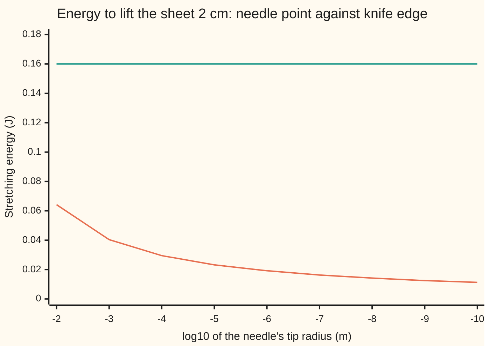

# Sobolev spaces: the right home for a solution of limited smoothness

[Syllabus](../../../SYLLABUS.md) → [Partial differential equations](../README.md) → [Weak Solutions and Free Boundaries](../README.md#s06) → Sobolev spaces

---

## General Overview

A square rubber sheet, 1 m on a side, is stretched in a frame with a tension of 200 N/m (newtons per metre of edge; illustrative). Its rim is held at height 0. Later on this shelf a rounded stone pushes up from below. For now, ask a simpler question: which shapes can the sheet take at all?

The answer is in the energy. Stretching the sheet stores energy, and for gentle slopes that energy is half the tension times the summed square of the slope. A smooth bump 2 cm high stores 0.197392 J (joules). A pyramid 2 cm high, with sharp creases, stores 0.160000 J. Both are fine shapes. A sheet with a sheer wall 2 cm tall is not: as the wall gets steeper, its energy climbs without limit: 251.4531 J for a wall 0.1 mm wide.

The surprise is a needle. Push the centre up 2 cm with a thin needle and the sheet takes a funnel shape. The thinner the needle, the *less* energy that costs: 0.040441 J with a 1 mm tip, falling toward zero. So a finite energy can tell whether the sheet tears along a line, but it cannot tell the height at a single point.

The **Sobolev space** $`H^1`$, introduced on [Weak derivatives](../../18-Functional%20analysis/04-Distributions%20and%20Sobolev%20Spaces/07-weak-derivatives-and-sobolev-spaces.md), is exactly the set of shapes with finite stretching energy. This card sets it up as the place where a PDE solution lives. It does three jobs. It says what "held at 0 on the rim" means for such shapes. It gives the bound (the Poincare inequality) that makes the energy measure the whole shape. And it turns that bound into the guarantee the existence theorem on the next card needs.

Wing 08 solved held plates by sine series and took the answer to be smooth ([Laplace on a rectangle](../../08-Differential%20equations%20and%20dynamics/10-The%20Classical%20PDEs/08-laplace-on-a-rectangle.md)). [Dirichlet's principle](../04-Laplace%2C%20Poisson%20and%20Potentials/06-dirichlet-principle-and-variational-form.md) said the sheet takes the shape of least energy among smooth shapes. This card says which shapes may compete, so that a least-energy shape always exists.

**Shapes with finite stretching energy form the space $`H^1`$; holding the rim at zero picks out $`H^1_0`$, where the trace (the rim profile) is zero and the Poincare inequality makes the energy alone control the shape's size, which is exactly what an existence proof for the sheet's equation needs.**

**What kind of fact this is:** definitions ($`H^1`$, $`H^1_0`$, stretching energy), with theorems. Proved on this card in Why it works: the Poincare inequality on the square with its best constant, the needle's vanishing cost, the knife edge's cost floor, and the energy bound for the loaded sheet. Stated with sources: the trace theorem, proved in outline on [Boundary values and compactness](../../18-Functional%20analysis/04-Distributions%20and%20Sobolev%20Spaces/10-trace-and-rellich-kondrachov-in-outline.md), and the fact that $`H^1_0`$ is exactly the shapes with zero trace (Evans, section 5.5). The energy is a model: it assumes small slopes.

### The picture: a needle gets cheaper as it gets sharper



Orange: the energy of the log funnel that lifts the centre point 2 cm with a needle of the given tip radius, falling toward zero; the least energy in the square is at most this. Green: the floor for lifting the whole midline 2 cm with a knife edge, 0.16 J however thin the edge is. A point has no length, so finite energy cannot hold it; a line has length, so it can.

---

## The formula

Notation from earlier cards, in one line each. $`\Omega`$ is the region, here the open square sheet, and $`\partial\Omega`$ its rim ([A PDE problem](../01-Classification%20and%20Well-Posedness/01-what-a-pde-problem-is.md)). $`\nabla u`$ is the gradient of the height $`u`$, the arrow of steepest climb; here it is the **weak gradient**, the one integration by parts demands ([Weak derivatives](../../18-Functional%20analysis/04-Distributions%20and%20Sobolev%20Spaces/07-weak-derivatives-and-sobolev-spaces.md)). $`\lVert g\rVert`$ is the 2-size of a function: the square root of $`\int g^2`$ ([Lp spaces](../../10-Measure%20and%20integration/07-Sizes%20of%20Functions/01-lp-spaces.md)).

The stretching energy of a sheet shape $`u`$, in metres, under tension $`T`$:

```math
E(u) = \frac{T}{2}\int_\Omega |\nabla u|^2\,dx = \frac{T}{2}\,\lVert\nabla u\rVert^2 .
```

**Read it aloud:** the energy is half the tension times the squared slope, added over the sheet.

The two spaces. $`C_c^\infty(\Omega)`$ is the set of smooth shapes that are zero near the rim.

```math
H^1(\Omega) = \big\{\, u : \lVert u\rVert < \infty,\ \lVert\nabla u\rVert < \infty \,\big\}, \qquad \lVert u\rVert_{H^1}^2 = \lVert u\rVert^2 + \lVert\nabla u\rVert^2, \qquad H^1_0(\Omega) = \overline{C_c^\infty(\Omega)}^{\,H^1} = \big\{\, u \in H^1 : \gamma u = 0 \,\big\}.
```

**Read it aloud:** $`H^1`$ holds the shapes whose height and slope both have finite 2-size; $`H^1_0`$ holds the limits of smooth shapes that vanish near the rim, which are exactly the $`H^1`$ shapes whose rim profile is zero.

The trace theorem, which gives that rim profile $`\gamma u`$ a meaning:

```math
\lVert \gamma u \rVert_{L^2(\partial\Omega)} \le C_\gamma\, \lVert u\rVert_{H^1}, \qquad \gamma u = u\big|_{\partial\Omega} \text{ when } u \text{ is continuous up to the rim.}
```

**Read it aloud:** the rim profile's 2-size along the rim is at most a fixed constant times the shape's $`H^1`$ size, and for a continuous shape it is just its rim values.

The Poincare inequality on $`H^1_0`$, and what it buys. Here $`L`$ = 1 m is the side of the square, and $`\lambda_1`$ is the lowest eigenvalue of $`-\Delta`$ on it: the smallest ratio of squared slope to squared size that a held shape can have (Step 4).

```math
\lVert u\rVert \le C_P\,\lVert\nabla u\rVert, \qquad C_P = \frac{1}{\sqrt{\lambda_1}} = \frac{L}{\pi\sqrt2}, \qquad \lVert\nabla u\rVert^2 \ge \alpha\,\lVert u\rVert_{H^1}^2, \quad \alpha = \frac{1}{1 + C_P^2}.
```

**Read it aloud:** with the rim held, the shape's size is at most $`C_P`$ times its slope's size, so the slope alone controls the whole $`H^1`$ size, up to the factor $`\alpha`$.

For the sheet under a load $`f`$, the weak form from [Weak solutions](01-weak-solutions-and-the-weak-formulation.md) and the bound that Poincare gives it:

```math
T\int_\Omega \nabla u\cdot\nabla v\,dx = \int_\Omega f\,v\,dx \ \text{ for every } v \in H^1_0, \qquad \lVert\nabla u\rVert \le \frac{C_P\,\lVert f\rVert}{T}, \qquad \lVert u\rVert \le \frac{C_P^2\,\lVert f\rVert}{T}.
```

**Read it aloud:** the sheet's shape $`u`$ in $`H^1_0`$ balances tension against load for every test shape $`v`$, and then its slope and its size are bounded by the load's size over the tension.

| Symbol | Plain meaning | In our example | Push it up and the answer… |
| --- | --- | --- | --- |
| $`\Omega`$, $`\partial\Omega`$, $`L`$; $`x`$, $`y`$, $`dx`$ | the sheet, its rim, its side; position; a small patch of area | open square, side $`L`$ = 1 m | larger $`L`$: $`C_P`$ grows in proportion |
| $`u`$, $`v`$, $`\varphi`$ | sheet height, m; a test shape that vanishes on the rim; a smooth shape zero near the rim, in the proof of Step 4 | bump, pyramid, needle, sag | energy grows as height squared |
| $`\nabla u`$ | weak gradient: the slope arrow, a pure number | 2b = 0.04 on the pyramid's faces | — |
| $`T`$, $`f`$ | tension, N/m; load per area, N/m² | 200 N/m; 16 N/m² (a 1.5 mm rubber sheet at 1100 kg/m³, illustrative, weighs 16.19 N/m²) | larger $`T`$: less sag; larger $`f`$: more |
| $`E(u)`$ | stretching energy, J | bump 0.197392 J, pyramid 0.160000 J | — |
| $`\lVert\cdot\rVert`$, $`L^2(\Omega)`$, $`L^2(\partial\Omega)`$ | 2-size; shapes with finite 2-size inside; profiles with finite 2-size along the rim | bump: $`\lVert u\rVert^2`$ = 1.000e-04 m⁴ | — |
| $`H^1`$, $`\lVert\cdot\rVert_{H^1}`$ | shapes with finite size and finite stretching energy; their size | every shape on this card except the torn one | — |
| $`H^1_0`$, $`C_c^\infty`$ | $`H^1`$ shapes with zero rim profile; smooth shapes zero near the rim | the sheet in its frame | — |
| $`\gamma`$, $`C_\gamma`$ | trace map, shape to rim profile; its constant | rim profile 0 for every shape here | larger $`C_\gamma`$: weaker control |
| $`C_P`$, $`\lambda_1`$, $`\alpha`$ | Poincare constant, m; lowest $`-\Delta`$ eigenvalue of the square, 1/m²; coercivity factor | 0.225079 m; 19.739209 /m²; 0.951782 | larger $`C_P`$: weaker control by the slope |
| $`b`$, $`\varepsilon`$, $`R`$, $`r`$, $`a`$ | lift height; needle tip radius, or the cut-off radius around a step in the rim; outer radius of the needle's funnel or the step's fan; distance from the centre; plateau radius | 0.02 m; 1 mm for the needle, 10 to 0.1 mm at the step; 0.5 m; 1 mm to 0.5 m; 0.1 m | smaller $`\varepsilon`$: cheaper needle, dearer step |
| $`m`$, $`n`$, $`K`$, $`s_{mn}`$, $`c_{mn}`$, $`h`$ | sine-pattern numbers; the largest kept; the patterns; their amounts; grid step | odd $`m, n`$ up to $`K`$ = 999; $`h`$ = 0.1 to 0.0125 m | — |

### When it holds

- **The region is bounded.** Poincare needs a finite width: $`C_P`$ grows in proportion to the side, and on an endless plane a wide, gentle swell has tiny slope and large size.
- **The rim is held.** Free the rim and the whole sheet can rise 2 cm with zero stretching energy, so no $`C_P`$ works. Under the 16 N load, a free rim even has no balanced shape: the net load must be 0.
- **The rim is Lipschitz** (locally the graph of a function with bounded slope). Corners, like the square's, are fine. A sharp cusp can break the trace theorem.
- **No tears.** A shape that jumps across a curve has infinite energy and is not in $`H^1`$: a plateau with a wall 0.1 mm wide already costs 251.4531 J.
- **Slopes are small.** Half the squared slope is the extra area only for gentle slopes. At the 1 mm needle's tip the slope is 3.218, so the model departs from real rubber there.

---

## Why it works

### Step 0: the idea, in words

Energy adds up squared slope over area. To raise a single point, spread the climb over rings around it. A ring at radius $`r`$ has length $`2\pi r`$, so the far rings are long and can climb gently while the near rings climb steeply but are short. The two effects nearly cancel, and the total cost falls to zero as the needle sharpens.

A line has no such escape. Every straight path that crosses it must climb the full height, so the cost never falls below a fixed floor. That is why finite energy controls values along curves, such as the rim, but not at points. The trace theorem is the precise form of the first half, and the needle is the second half.

### Step 1: why the classical shapes are the wrong home

Dirichlet's principle asks for the shape of least energy. The classical answer space, shapes with two continuous derivatives, has a hole in it. A sequence of smooth shapes can have energies that settle while the shapes themselves settle on a creased pyramid, which has no second derivative. Weierstrass showed in 1870 that a least-energy problem posed over smooth shapes can fail to have a minimiser. Hilbert rescued Dirichlet's principle around 1900 by a direct method; the enlarged space came later, with Friedrichs and Sobolev in the 1920s and 1930s.

$`H^1`$ is the enlarged space. It is **complete** (every sequence whose members get close in $`H^1`$ size has a limit inside the space), because $`L^2`$ is complete and weak derivatives pass to limits ([Weak derivatives](../../18-Functional%20analysis/04-Distributions%20and%20Sobolev%20Spaces/07-weak-derivatives-and-sobolev-spaces.md)). It asks only for first derivatives, which is all the weak form uses. And its size contains the energy term, so "finite energy" and "lies in the space" are the same statement.

### Step 2: the needle costs nothing in the limit

Lift the centre by $`b`$ with the funnel shape: height $`b`$ on a tip of radius $`\varepsilon`$, then $`u = b\,\ln(R/r)/\ln(R/\varepsilon)`$ out to radius $`R`$, then 0. Its slope is $`b/(r\ln(R/\varepsilon))`$. Add up the squared slope over rings of length $`2\pi r`$:

```math
\lVert\nabla u\rVert^2 = \int_\varepsilon^R \frac{b^2}{r^2 \ln^2(R/\varepsilon)}\,2\pi r\,dr = \frac{2\pi b^2}{\ln(R/\varepsilon)} \;\longrightarrow\; 0 \quad (\varepsilon \to 0).
```

So the funnels lie in $`H^1_0`$ and approach the flat sheet in $`H^1`$ size, while each one has height 2 cm at the centre. The "height at the centre" is not a continuous quantity on $`H^1`$ in two dimensions. On a one-dimensional string it is: [Sobolev and Poincare](../../18-Functional%20analysis/04-Distributions%20and%20Sobolev%20Spaces/09-sobolev-embedding-and-poincare-inequality.md) shows every $`H^1`$ function of one variable is continuous.

### Step 3: the knife edge costs at least a fixed amount, and the trace theorem

Now lift the whole midline $`x = 1/2`$ by $`b`$. Each horizontal line $`y`$ = constant is a string, held at both ends and lifted by $`b`$ at its middle. On the left half, $`b = \int_0^{1/2} u_x\,dx \le \sqrt{1/2}\,\big(\int_0^{1/2} u_x^2\,dx\big)^{1/2}`$ by the Cauchy–Schwarz inequality, so that half carries at least $`2b^2`$. The right half is the same. Adding over $`y`$ from 0 to 1 m:

```math
\lVert\nabla u\rVert^2 \ge \int_0^1\!\!\int_0^1 u_x^2\,dx\,dy \ge 4b^2 .
```

So the knife edge costs at least $`(T/2)\times 4b^2`$, however thin it is. The true cost is higher still: where the midline meets the held rim, the sheet must fan out as at a step in the rim (The usual mistake), and that cost has no ceiling. The floor is what matters here. The same one-dimensional argument, run from the rim inward, bounds the rim profile by the inside size: that is the trace theorem, proved for one edge of a square on [Boundary values and compactness](../../18-Functional%20analysis/04-Distributions%20and%20Sobolev%20Spaces/10-trace-and-rellich-kondrachov-in-outline.md). Evans proves it for any bounded region with a smooth rim; rims with corners, like the square's, are covered by the same theorem in the literature cited on that card.

What "zero on the rim" means for an $`H^1`$ shape follows. It cannot mean "zero at each rim point", because points are invisible. It means the trace is zero: $`\gamma u = 0`$ in $`L^2(\partial\Omega)`$. On a bounded region with a smooth rim, these are exactly the limits of smooth shapes that vanish near the rim (Evans, section 5.5); the same holds on Lipschitz regions such as the square. The exact set of rim profiles that $`H^1`$ shapes can have is a fractional space, $`H^{1/2}(\partial\Omega)`$, defined through Fourier transforms (Adams and Fournier; Gagliardo, 1957); this card needs only the bound into $`L^2(\partial\Omega)`$.

### Step 4: Poincare on the square, with the best constant

The general inequality is proved on [Sobolev and Poincare](../../18-Functional%20analysis/04-Distributions%20and%20Sobolev%20Spaces/09-sobolev-embedding-and-poincare-inequality.md). On the square it has a two-line proof by sine patterns. Write a held shape as a sum of patterns $`\sin(m\pi x)\sin(n\pi y)`$. Each pattern's squared slope is $`\pi^2(m^2+n^2)`$ times its squared size, and the smallest factor, at $`m = n = 1`$, is $`2\pi^2`$. So no held shape is flatter, relative to its size, than the single bump.

<details>
<summary>Detailed proof: the Poincare inequality on the unit square with constant 1/(π√2)</summary>

Let $`u \in H^1_0`$ of the unit square. The patterns $`s_{mn} = 2\sin(m\pi x)\sin(n\pi y)`$, $`m, n \ge 1`$, are a complete orthonormal set in $`L^2`$ (each has 2-size 1, and different patterns integrate to 0 against each other). So $`u = \sum c_{mn} s_{mn}`$ with $`\lVert u\rVert^2 = \sum c_{mn}^2`$.

For a smooth shape $`\varphi`$ that vanishes near the rim, integration by parts gives $`\int \varphi_x\, 2\cos(m\pi x)\sin(n\pi y) = m\pi \int \varphi\, s_{mn}`$, with no rim terms. Both sides are continuous in the $`H^1`$ size, so the identity passes to every $`u \in H^1_0`$. The patterns $`2\cos(m\pi x)\sin(n\pi y)`$ are also orthonormal, so Bessel's inequality gives $`\lVert u_x\rVert^2 \ge \sum (m\pi c_{mn})^2`$, and the same for $`y`$. Hence

$`\displaystyle \lVert\nabla u\rVert^2 \ge \sum_{m,n} \pi^2(m^2+n^2)\,c_{mn}^2 \ge 2\pi^2 \sum_{m,n} c_{mn}^2 = 2\pi^2\,\lVert u\rVert^2 .`$

Taking square roots, $`\lVert u\rVert \le \lVert\nabla u\rVert/(\pi\sqrt2)`$. The bump $`\sin(\pi x)\sin(\pi y)`$ gives equality, so $`1/(\pi\sqrt2)`$ is the best constant. On a square of side $`L`$, stretch lengths by $`L`$ and keep heights: the size $`\lVert u\rVert`$ grows by $`L`$ while the slope size does not change, so the constant becomes $`L/(\pi\sqrt2)`$.

</details>

The best constant is $`1/\sqrt{\lambda_1}`$, where $`\lambda_1`$ is the least Rayleigh quotient, the lowest eigenvalue of $`-\Delta`$ on the region ([Helmholtz](../04-Laplace%2C%20Poisson%20and%20Potentials/08-helmholtz-and-eigenfunctions.md)).

### Step 5: Poincare becomes coercivity and an energy bound

Coercivity means the energy controls the full $`H^1`$ size. Add $`\lVert\nabla u\rVert^2`$ to both sides of $`\lVert u\rVert^2 \le C_P^2\lVert\nabla u\rVert^2`$: $`\lVert u\rVert_{H^1}^2 \le (1 + C_P^2)\lVert\nabla u\rVert^2`$, which is the bound with $`\alpha = 1/(1 + C_P^2)`$.

For the loaded sheet, put $`v = u`$ in the weak form. The left side is $`T\lVert\nabla u\rVert^2`$. The right side is at most $`\lVert f\rVert\,\lVert u\rVert`$ by Cauchy–Schwarz, and then at most $`\lVert f\rVert\, C_P\,\lVert\nabla u\rVert`$ by Poincare. Divide by $`T\lVert\nabla u\rVert`$:

```math
\lVert\nabla u\rVert \le \frac{C_P\,\lVert f\rVert}{T}, \qquad \lVert u\rVert \le C_P\,\lVert\nabla u\rVert \le \frac{C_P^2\,\lVert f\rVert}{T}.
```

This bound, before any solution is found, is the heart of the existence theorem on [Lax-Milgram](03-lax-milgram-and-elliptic-existence.md). Without the held rim, Step 5 fails at its first line.

---

## Worked numbers, by hand

The sheet: side 1 m, tension $`T`$ = 200 N/m, lift $`b`$ = 0.02 m, so $`b^2`$ = 0.0004 m² and $`T/2`$ = 100 N/m.

| Step | Arithmetic | Value |
| --- | --- | --- |
| Poincare constant | $`1/(\pi\sqrt2)`$ | 0.225079 m |
| lowest eigenvalue | $`2\pi^2`$ | 19.739209 /m² |
| bump, size squared | $`b^2/4 = 0.0004/4`$ (a squared sine averages 1/2 in each direction) | 1.000e-04 m⁴ |
| bump, slope squared | $`b^2\pi^2/2`$ | 0.001974 m² |
| bump, energy | $`100 \times 0.001974`$ | 0.197392 J |
| bump, size over slope | $`\sqrt{1.000\text{e-}4/0.001974}`$ | 0.225079 m, equal to $`C_P`$ |
| pyramid, slope squared | slope $`2b`$ everywhere: $`(0.04)^2 \times 1`$ m² | 0.001600 m² |
| pyramid, size over slope | $`\sqrt{6.667\text{e-}5/0.001600}`$ | 0.204124 m, below $`C_P`$ |
| needle, 1 mm tip | $`\ln(0.5/0.001) = \ln 500`$ | 6.21461 |
| needle, slope squared | $`2\pi \times 0.0004/6.21461`$ | 0.000404 m² |
| needle, energy | $`100 \times 0.000404`$ | 0.040441 J |
| knife edge, energy floor | $`100 \times 4 \times 0.0004`$ | 0.160000 J |
| sag, Poincare bound on the slope | $`C_P\lVert f\rVert/T = 0.225079 \times 16/200`$ | 0.018006 m |
| sag, true slope size (series) | $`\sqrt{2.249\text{e-}4}`$ | **0.014997 m** |

The sheet sagging under its own weight has slope size 0.014997 m, inside the bound 0.018006 m that Poincare gave before solving anything. Its centre sags 0.005894 m and it stores 0.022492 J.

### What breaks if you drop a piece

| Mistake | Comes out at | What went wrong |
| --- | --- | --- |
| Treat the height at one point as something the energy controls | the needle lifts the centre 2 cm for 0.040441 J (1 mm tip), 0.0113 J (1e-10 m tip), and toward 0 | in two dimensions $`H^1`$ shapes have no reliable point values |
| Allow a tear: a plateau of radius 0.1 m with a sheer wall | 2.6389 J, 25.2584 J, 251.4531 J for walls 10, 1 and 0.1 mm wide | a jump across a curve has infinite energy, so it is not in $`H^1`$ |
| Free the rim | the sheet rises 2 cm whole: $`\lVert u\rVert^2`$ = 4.000e-04 m⁴, $`\lVert\nabla u\rVert^2`$ = 0; net load 16 N with no balanced shape | Poincare needs zero trace; constants slip through |
| Measure lengths in cm | $`C_P`$ = 22.5079 cm and $`\alpha`$ falls from 0.951782 to 0.001970 | the $`H^1`$ size adds terms in different units, so $`\alpha`$ depends on the unit |

---

## Code, from first principles, and it actually runs

The script takes each claim by at least two roads. Shape energies: closed forms against a 400 by 400 midpoint sum with slopes by centred differences, and radial sums on a log scale for the needle, the wall and the fan at a step in the rim. The Poincare constant: $`1/(\pi\sqrt2)`$ against inverse iteration (repeated solving to find the lowest eigenvalue) on grids of step 0.1, 0.05 and 0.025 m, which also match the grid's own exact formula and converge at order 2. The sag: a double sine series to $`m, n \le 999`$, with its tail bound, against a grid solved by successive over-relaxation (SOR) at three steps, then both against the Poincare bounds. The centre's tail is at most $`f/(T\pi^2 K)`$: use $`m^2 + n^2 \ge 2mn`$, the sum of $`1/n^2`$ over odd $`n`$, which is $`\pi^2/8`$, and the sum of $`1/m^2`$ over odd $`m`$ beyond $`K`$, at most $`1/(2K)`$.

### Python

```python
# Sobolev spaces for PDEs -- the check behind the card.  Standard library only.
# A square rubber sheet, 1 m x 1 m, rim held at height 0, tension T = 200 N/m.
# Roads: closed-form energies against midpoint quadrature; the Poincare constant
# 1/(pi sqrt 2) against inverse iteration on grids; the sag under a uniform load
# by a double sine series against an SOR grid solve, both against the Poincare
# bounds.  What breaks: a needle, a sheer wall, a free rim, a change of unit.
import math
PI = math.pi
T, B, F, R = 200.0, 0.02, 16.0, 0.5   # tension N/m; lift m; load N/m^2; needle's outer radius m
CP = 1 / (PI * math.sqrt(2))           # Poincare constant of the unit square, m

def sci(x):                            # same digits in Python and Rust: 1.234e-05
    e = math.floor(math.log10(abs(x)))
    m = x / 10 ** e
    if round(abs(m), 3) >= 10: m, e = m / 10, e + 1
    return f"{m:.3f}e{'+' if e >= 0 else '-'}{abs(e):02d}"

def quad2(f, M=400):                   # midpoint rule on the unit square
    h = 1 / M
    return sum(f((i + .5) * h, (j + .5) * h) for i in range(M) for j in range(M)) * h * h

def grad2(u, x, y, d=1e-6):            # |grad u|^2 by centred differences
    return ((u(x + d, y) - u(x - d, y)) / (2 * d)) ** 2 + ((u(x, y + d) - u(x, y - d)) / (2 * d)) ** 2

def radial(g, r0, r1, n=4000):         # integral of g(r) 2 pi r dr, midpoint rule in s = ln r
    a, b = math.log(r0), math.log(r1); ds = (b - a) / n
    return sum(g(math.exp(a + (k + .5) * ds)) * 2 * PI * math.exp(2 * (a + (k + .5) * ds)) for k in range(n)) * ds

def dr(p, r): return (p(r * (1 + 1e-6)) - p(r * (1 - 1e-6))) / (2e-6 * r)

print(f"sheet 1 m x 1 m, T = {T:.0f} N/m, lift b = {B} m; C_P = 1/(pi sqrt 2) = {CP:.6f} m")
print("shape | ||u||^2 (m^4) closed, quadrature | ||grad u||^2 (m^2) closed, quadrature | energy (J) | ||u||/||grad u|| (m)")
bump = lambda x, y: B * math.sin(PI * x) * math.sin(PI * y)
pyr = lambda x, y: B * (1 - max(abs(2 * x - 1), abs(2 * y - 1)))
for name, u, n2, g2 in (("bump", bump, B * B / 4, B * B * PI * PI / 2), ("pyramid", pyr, B * B / 6, 4 * B * B)):
    qn, qg = quad2(lambda x, y: u(x, y) ** 2), quad2(lambda x, y: grad2(u, x, y))
    print(f"{name} | {sci(n2)}, {sci(qn)} | {g2:.6f}, {qg:.6f} | {T / 2 * g2:.6f} | {math.sqrt(n2 / g2):.6f}")
    assert abs(qn - n2) < 1e-4 * n2 and abs(qg - g2) < 1e-2 * g2 and math.sqrt(n2 / g2) <= CP + 1e-12
    if name == "bump": assert abs(math.sqrt(qn / qg) - CP) < 1e-6   # the bump attains C_P: no smaller constant works

def needle(eps):                       # lift b at the centre, log profile out to R, zero beyond
    l = math.log(R / eps)
    p = lambda r: B * math.log(R / r) / l
    n2 = PI * eps * eps * B * B + 2 * PI * B * B / l ** 2 * (R * R / 4 - eps * eps * (l * l / 2 + l / 2 + 0.25))
    g2 = 2 * PI * B * B / l
    qn = PI * eps * eps * B * B + radial(lambda r: p(r) ** 2, eps, R)
    qg = radial(lambda r: dr(p, r) ** 2, eps, R)
    assert abs(qn - n2) < 1e-6 * n2 and abs(qg - g2) < 1e-6 * g2
    return n2, g2, l
n2, g2, l = needle(1e-3)
print(f"needle, tip 1 mm | {sci(n2)} | {g2:.6f} | {T / 2 * g2:.6f} | {math.sqrt(n2 / g2):.6f}")
print(f"  ln(R/eps) = {l:.5f}; slope at the tip b/(eps ln(R/eps)) = {B / (1e-3 * l):.3f}")
chart = [T / 2 * needle(10.0 ** -k)[1] for k in range(2, 11)]
print("chart, needle energy (J) at eps = 1e-2 ... 1e-10 m:", ", ".join(f"{e:.4f}" for e in chart))
assert all(chart[k + 1] < chart[k] for k in range(8))
print(f"  energy 0.001 J needs eps = R exp(-{PI * B * B * T / 0.001:.2f}) = {sci(R * math.exp(-PI * B * B * T / 0.001))} m")
print(f"knife edge along the midline: ||grad u||^2 >= 4 b^2 = {4 * B * B:.6f} m^2, energy >= {T / 2 * 4 * B * B:.6f} J")
assert chart[-1] < T / 2 * 4 * B * B

def lam1(N):                           # smallest eigenvalue of the grid -Laplacian, inverse iteration
    v = [[0.0 if i in (0, N) or j in (0, N) else 1.0 for j in range(N + 1)] for i in range(N + 1)]
    w = [[0.0] * (N + 1) for _ in range(N + 1)]
    for _ in range(12):
        sor(N, v, w)
        vw = sum(v[i][j] * w[i][j] for i in range(N + 1) for j in range(N + 1))
        ww = sum(w[i][j] ** 2 for i in range(N + 1) for j in range(N + 1))
        mx = max(max(row) for row in w); v = [[x / mx for x in row] for row in w]
    return vw / ww

def sor(N, rhs, u, tol=1e-14):         # solve -Lap_h u = rhs, zero rim, in place
    h2 = 1 / N / N; om = 2 / (1 + math.sin(PI / N))
    while True:
        big = 0.0
        for i in range(1, N):
            for j in range(1, N):
                d = om * ((u[i + 1][j] + u[i - 1][j] + u[i][j + 1] + u[i][j - 1] + h2 * rhs[i][j]) / 4 - u[i][j])
                u[i][j] += d; big = max(big, abs(d))
        if big < tol: return u

print(f"Poincare: lambda_1 = 2 pi^2 = {2 * PI * PI:.6f} /m^2, C_P = {CP:.6f} m")
errs = []
for N in (10, 20, 40):
    lh, exact = lam1(N), 8 * N * N * math.sin(PI / (2 * N)) ** 2
    errs.append(2 * PI * PI - lh)
    print(f"  grid h = {1 / N:.4f} m: inverse iteration {lh:.6f}, grid formula {exact:.6f}, C_P,h = {1 / math.sqrt(lh):.6f} m")
    assert abs(lh - exact) < 1e-8 * exact
    assert abs(1 / math.sqrt(lh) - CP) < 0.2 / N ** 2   # grid constants close in on C_P at order h^2
orders = [math.log2(errs[k] / errs[k + 1]) for k in range(2)]
print(f"  observed order of lambda_1: {orders[0]:.3f}, {orders[1]:.3f}")
assert all(1.9 < o < 2.1 for o in orders)

K = 999                                # sag under the load: double sine series, odd m, n <= K
c = s2 = g2 = 0.0
for m in range(1, K + 1, 2):
    for n in range(1, K + 1, 2):
        lm = PI * PI * (m * m + n * n); a = F / T * 16 / (PI * PI * m * n * lm)
        c += a * (-1) ** ((m + n) // 2 - 1); s2 += a * a / 4; g2 += lm * a * a / 4
print(f"sag, f = {F:.0f} N/m^2 (1.5 mm rubber at 1100 kg/m^3 weighs {1.5e-3 * 1100 * 9.81:.2f} N/m^2):")
print(f"  series to m, n <= {K}: centre {c:.6f} m, ||u||^2 = {sci(s2)} m^4, ||grad u||^2 = {sci(g2)} m^2,"
      f" energy {T / 2 * g2:.6f} J; centre tail <= {sci(F / T / (PI * PI * K))} m")
cs = []
for N in (20, 40, 80):
    u = sor(N, [[F / T] * (N + 1) for _ in range(N + 1)], [[0.0] * (N + 1) for _ in range(N + 1)])
    work = sum(F * u[i][j] for i in range(N + 1) for j in range(N + 1)) / N / N
    cs.append(u[N // 2][N // 2])
    print(f"  grid h = {1 / N:.4f} m: centre {u[N // 2][N // 2]:.6f} m, ||grad u||^2 = work/T = {sci(work / T)} m^2")
    assert abs(work / T - g2) < 8 / N / N * g2 and abs(cs[-1] - c) < 2 / N / N * c
print(f"  observed order of the centre sag: {math.log2((cs[0] - c) / (cs[1] - c)):.3f}, {math.log2((cs[1] - c) / (cs[2] - c)):.3f}")
fn = F * 1.0                           # ||f|| over the unit square, N/m
print(f"  Poincare bounds: ||grad u|| = {math.sqrt(g2):.6f} <= C_P ||f||/T = {CP * fn / T:.6f} m;"
      f" ||u|| = {math.sqrt(s2):.6f} <= C_P^2 ||f||/T = {CP * CP * fn / T:.6f} m^2")
assert math.sqrt(g2) <= CP * fn / T and math.sqrt(s2) <= CP * CP * fn / T
print(f"coercivity: alpha = 1/(1 + C_P^2) = {1 / (1 + CP * CP):.6f} (m); in cm, C_P = {100 * CP:.4f}, alpha = {1 / (1 + 1e4 * CP * CP):.6f}")
print("what breaks:")
for d, mm in ((1e-2, "10"), (1e-3, "1"), (1e-4, "0.1")):   # plateau of radius 0.1 m, wall width d
    a = 0.1; g = radial(lambda r: (B / d) ** 2, a, a + d)
    print(f"  sheer wall, plateau 0.1 m, wall {mm} mm: ||grad u||^2 = {g:.6f} m^2, energy {T / 2 * g:.4f} J")
    assert abs(g - PI * B * B * (2 * a + d) / d) < 1e-6 * g
fan = lambda x, y: B * (1 - math.atan2(y, x) / PI)   # a 2 cm step in the rim at the origin: the sheet fans around it
for d, mm in ((1e-2, "10"), (1e-3, "1"), (1e-4, "0.1")):   # half circles from radius d out to R
    g = radial(lambda r: grad2(fan, 0.0, r), d, R) / 2
    print(f"  rim step 2 cm, fan cut off {mm} mm from the step: ||grad u||^2 = {g:.6f} m^2, energy {T / 2 * g:.4f} J")
    assert abs(g - B * B / PI * math.log(R / d)) < 1e-4 * g   # the floor (T b^2 / 2 pi) ln(R/d), attained
print(f"  free rim, whole sheet lifted 2 cm: ||u||^2 = {sci(B * B)} m^4, ||grad u||^2 = 0; net load {fn:.0f} N, needs 0")
print("ALL CHECKS PASS")
```

**Ran 2026-11-15 on macOS, Python 3.14.10, standard library only. All checks passed. Output, pasted from the run:**

```
sheet 1 m x 1 m, T = 200 N/m, lift b = 0.02 m; C_P = 1/(pi sqrt 2) = 0.225079 m
shape | ||u||^2 (m^4) closed, quadrature | ||grad u||^2 (m^2) closed, quadrature | energy (J) | ||u||/||grad u|| (m)
bump | 1.000e-04, 1.000e-04 | 0.001974, 0.001974 | 0.197392 | 0.225079
pyramid | 6.667e-05, 6.667e-05 | 0.001600, 0.001596 | 0.160000 | 0.204124
needle, tip 1 mm | 4.067e-06 | 0.000404 | 0.040441 | 0.100282
  ln(R/eps) = 6.21461; slope at the tip b/(eps ln(R/eps)) = 3.218
chart, needle energy (J) at eps = 1e-2 ... 1e-10 m: 0.0642, 0.0404, 0.0295, 0.0232, 0.0192, 0.0163, 0.0142, 0.0125, 0.0113
  energy 0.001 J needs eps = R exp(-251.33) = 3.539e-110 m
knife edge along the midline: ||grad u||^2 >= 4 b^2 = 0.001600 m^2, energy >= 0.160000 J
Poincare: lambda_1 = 2 pi^2 = 19.739209 /m^2, C_P = 0.225079 m
  grid h = 0.1000 m: inverse iteration 19.577393, grid formula 19.577393, C_P,h = 0.226007 m
  grid h = 0.0500 m: inverse iteration 19.698655, grid formula 19.698655, C_P,h = 0.225311 m
  grid h = 0.0250 m: inverse iteration 19.729064, grid formula 19.729064, C_P,h = 0.225137 m
  observed order of lambda_1: 1.996, 1.999
sag, f = 16 N/m^2 (1.5 mm rubber at 1100 kg/m^3 weighs 16.19 N/m^2):
  series to m, n <= 999: centre 0.005894 m, ||u||^2 = 1.090e-05 m^4, ||grad u||^2 = 2.249e-04 m^2, energy 0.022492 J; centre tail <= 8.114e-06 m
  grid h = 0.0500 m: centre 0.005882 m, ||grad u||^2 = work/T = 2.231e-04 m^2
  grid h = 0.0250 m: centre 0.005891 m, ||grad u||^2 = work/T = 2.245e-04 m^2
  grid h = 0.0125 m: centre 0.005893 m, ||grad u||^2 = work/T = 2.248e-04 m^2
  observed order of the centre sag: 1.996, 1.999
  Poincare bounds: ||grad u|| = 0.014997 <= C_P ||f||/T = 0.018006 m; ||u|| = 0.003301 <= C_P^2 ||f||/T = 0.004053 m^2
coercivity: alpha = 1/(1 + C_P^2) = 0.951782 (m); in cm, C_P = 22.5079, alpha = 0.001970
what breaks:
  sheer wall, plateau 0.1 m, wall 10 mm: ||grad u||^2 = 0.026389 m^2, energy 2.6389 J
  sheer wall, plateau 0.1 m, wall 1 mm: ||grad u||^2 = 0.252584 m^2, energy 25.2584 J
  sheer wall, plateau 0.1 m, wall 0.1 mm: ||grad u||^2 = 2.514531 m^2, energy 251.4531 J
  rim step 2 cm, fan cut off 10 mm from the step: ||grad u||^2 = 0.000498 m^2, energy 0.0498 J
  rim step 2 cm, fan cut off 1 mm from the step: ||grad u||^2 = 0.000791 m^2, energy 0.0791 J
  rim step 2 cm, fan cut off 0.1 mm from the step: ||grad u||^2 = 0.001084 m^2, energy 0.1084 J
  free rim, whole sheet lifted 2 cm: ||u||^2 = 4.000e-04 m^4, ||grad u||^2 = 0; net load 16 N, needs 0
ALL CHECKS PASS
```

### Rust

```rust
// Sobolev spaces for PDEs -- the check behind the card.  std only, no crates.
// A square rubber sheet, 1 m x 1 m, rim held at height 0, tension T = 200 N/m.
// Roads: closed-form energies against midpoint quadrature; the Poincare constant
// 1/(pi sqrt 2) against inverse iteration on grids; the sag under a uniform load
// by a double sine series against an SOR grid solve, both against the Poincare
// bounds.  What breaks: a needle, a sheer wall, a free rim, a change of unit.
use std::f64::consts::PI;
const T: f64 = 200.0; // tension, N/m
const B: f64 = 0.02; // lift, m
const F: f64 = 16.0; // load, N/m^2
const R: f64 = 0.5; // needle's outer radius, m

fn sci(x: f64) -> String { // same digits in Python and Rust: 1.234e-05
    let mut e = x.abs().log10().floor() as i32;
    let mut m = x / 10f64.powi(e);
    if (m.abs() * 1000.0).round() / 1000.0 >= 10.0 { m /= 10.0; e += 1; }
    format!("{:.3}e{}{:02}", m, if e >= 0 { "+" } else { "-" }, e.abs())
}
fn quad2<G: Fn(f64, f64) -> f64>(f: G) -> f64 { // midpoint rule on the unit square
    let mm = 400; let h = 1.0 / mm as f64; let mut s = 0.0;
    for i in 0..mm { for j in 0..mm { s += f((i as f64 + 0.5) * h, (j as f64 + 0.5) * h); } }
    s * h * h
}
fn grad2<U: Fn(f64, f64) -> f64>(u: &U, x: f64, y: f64) -> f64 { // |grad u|^2 by centred differences
    let d = 1e-6;
    ((u(x + d, y) - u(x - d, y)) / (2.0 * d)).powi(2) + ((u(x, y + d) - u(x, y - d)) / (2.0 * d)).powi(2)
}
fn radial<G: Fn(f64) -> f64>(g: G, r0: f64, r1: f64) -> f64 { // integral of g(r) 2 pi r dr, midpoint in ln r
    let n = 4000; let (a, b) = (r0.ln(), r1.ln()); let ds = (b - a) / n as f64; let mut s = 0.0;
    for k in 0..n { let t = a + (k as f64 + 0.5) * ds; s += g(t.exp()) * 2.0 * PI * (2.0 * t).exp(); }
    s * ds
}
fn dr<P: Fn(f64) -> f64>(p: &P, r: f64) -> f64 { (p(r * (1.0 + 1e-6)) - p(r * (1.0 - 1e-6))) / (2e-6 * r) }

fn needle(eps: f64) -> (f64, f64, f64) { // lift b at the centre, log profile out to R, zero beyond
    let l = (R / eps).ln();
    let p = |r: f64| B * (R / r).ln() / l;
    let n2 = PI * eps * eps * B * B + 2.0 * PI * B * B / (l * l) * (R * R / 4.0 - eps * eps * (l * l / 2.0 + l / 2.0 + 0.25));
    let g2 = 2.0 * PI * B * B / l;
    let qn = PI * eps * eps * B * B + radial(|r| p(r).powi(2), eps, R);
    let qg = radial(|r| dr(&p, r).powi(2), eps, R);
    assert!((qn - n2).abs() < 1e-6 * n2 && (qg - g2).abs() < 1e-6 * g2);
    (n2, g2, l)
}
fn sor(n: usize, rhs: &Vec<Vec<f64>>, u: &mut Vec<Vec<f64>>) { // solve -Lap_h u = rhs, zero rim, in place
    let h2 = 1.0 / (n * n) as f64; let om = 2.0 / (1.0 + (PI / n as f64).sin());
    loop {
        let mut big: f64 = 0.0;
        for i in 1..n { for j in 1..n {
            let d = om * ((u[i + 1][j] + u[i - 1][j] + u[i][j + 1] + u[i][j - 1] + h2 * rhs[i][j]) / 4.0 - u[i][j]);
            u[i][j] += d; big = big.max(d.abs());
        } }
        if big < 1e-14 { return; }
    }
}
fn lam1(n: usize) -> f64 { // smallest eigenvalue of the grid -Laplacian, inverse iteration
    let mut v = vec![vec![0.0; n + 1]; n + 1];
    for i in 1..n { for j in 1..n { v[i][j] = 1.0; } }
    let mut w = vec![vec![0.0; n + 1]; n + 1];
    let (mut vw, mut ww) = (0.0, 0.0);
    for _ in 0..12 {
        sor(n, &v, &mut w);
        vw = 0.0; ww = 0.0; let mut mx = f64::MIN;
        for i in 0..=n { for j in 0..=n { vw += v[i][j] * w[i][j]; ww += w[i][j] * w[i][j]; mx = mx.max(w[i][j]); } }
        for i in 0..=n { for j in 0..=n { v[i][j] = w[i][j] / mx; } }
    }
    vw / ww
}

fn main() {
    let cp = 1.0 / (PI * 2f64.sqrt()); // Poincare constant of the unit square, m
    println!("sheet 1 m x 1 m, T = {:.0} N/m, lift b = {} m; C_P = 1/(pi sqrt 2) = {:.6} m", T, B, cp);
    println!("shape | ||u||^2 (m^4) closed, quadrature | ||grad u||^2 (m^2) closed, quadrature | energy (J) | ||u||/||grad u|| (m)");
    let bump = |x: f64, y: f64| B * (PI * x).sin() * (PI * y).sin();
    let pyr = |x: f64, y: f64| B * (1.0 - (2.0 * x - 1.0).abs().max((2.0 * y - 1.0).abs()));
    let shapes: [(&str, &dyn Fn(f64, f64) -> f64, f64, f64); 2] =
        [("bump", &bump, B * B / 4.0, B * B * PI * PI / 2.0), ("pyramid", &pyr, B * B / 6.0, 4.0 * B * B)];
    for (name, u, n2, g2) in shapes {
        let qn = quad2(|x, y| u(x, y).powi(2)); let qg = quad2(|x, y| grad2(&u, x, y));
        println!("{} | {}, {} | {:.6}, {:.6} | {:.6} | {:.6}", name, sci(n2), sci(qn), g2, qg, T / 2.0 * g2, (n2 / g2).sqrt());
        assert!((qn - n2).abs() < 1e-4 * n2 && (qg - g2).abs() < 1e-2 * g2 && (n2 / g2).sqrt() <= cp + 1e-12);
        if name == "bump" { assert!(((qn / qg).sqrt() - cp).abs() < 1e-6); } // the bump attains C_P: no smaller constant works
    }
    let (n2, g2, l) = needle(1e-3);
    println!("needle, tip 1 mm | {} | {:.6} | {:.6} | {:.6}", sci(n2), g2, T / 2.0 * g2, (n2 / g2).sqrt());
    println!("  ln(R/eps) = {:.5}; slope at the tip b/(eps ln(R/eps)) = {:.3}", l, B / (1e-3 * l));
    let chart: Vec<f64> = (2..11).map(|k| T / 2.0 * needle(10f64.powi(-k)).1).collect();
    let cs: Vec<String> = chart.iter().map(|e| format!("{:.4}", e)).collect();
    println!("chart, needle energy (J) at eps = 1e-2 ... 1e-10 m: {}", cs.join(", "));
    assert!((0..8).all(|k| chart[k + 1] < chart[k]));
    println!("  energy 0.001 J needs eps = R exp(-{:.2}) = {} m", PI * B * B * T / 0.001, sci(R * (-PI * B * B * T / 0.001).exp()));
    println!("knife edge along the midline: ||grad u||^2 >= 4 b^2 = {:.6} m^2, energy >= {:.6} J", 4.0 * B * B, T / 2.0 * 4.0 * B * B);
    assert!(chart[8] < T / 2.0 * 4.0 * B * B);

    println!("Poincare: lambda_1 = 2 pi^2 = {:.6} /m^2, C_P = {:.6} m", 2.0 * PI * PI, cp);
    let mut errs = vec![];
    for n in [10usize, 20, 40] {
        let lh = lam1(n); let nf = n as f64; let exact = 8.0 * nf * nf * (PI / (2.0 * nf)).sin().powi(2);
        errs.push(2.0 * PI * PI - lh);
        println!("  grid h = {:.4} m: inverse iteration {:.6}, grid formula {:.6}, C_P,h = {:.6} m", 1.0 / nf, lh, exact, 1.0 / lh.sqrt());
        assert!((lh - exact).abs() < 1e-8 * exact);
        assert!((1.0 / lh.sqrt() - cp).abs() < 0.2 / (nf * nf)); // grid constants close in on C_P at order h^2
    }
    let orders: Vec<f64> = (0..2).map(|k| (errs[k] / errs[k + 1]).log2()).collect();
    println!("  observed order of lambda_1: {:.3}, {:.3}", orders[0], orders[1]);
    assert!(orders.iter().all(|&o| 1.9 < o && o < 2.1));

    let kk = 999; // sag under the load: double sine series, odd m, n <= K
    let (mut c, mut s2, mut g2) = (0.0, 0.0, 0.0);
    for m in (1..=kk).step_by(2) { for n in (1..=kk).step_by(2) {
        let (mf, nf) = (m as f64, n as f64);
        let lm = PI * PI * (mf * mf + nf * nf); let a = F / T * 16.0 / (PI * PI * mf * nf * lm);
        c += if ((m + n) / 2 - 1) % 2 == 0 { a } else { -a }; s2 += a * a / 4.0; g2 += lm * a * a / 4.0;
    } }
    println!("sag, f = {:.0} N/m^2 (1.5 mm rubber at 1100 kg/m^3 weighs {:.2} N/m^2):", F, 1.5e-3 * 1100.0 * 9.81);
    println!("  series to m, n <= {}: centre {:.6} m, ||u||^2 = {} m^4, ||grad u||^2 = {} m^2, energy {:.6} J; centre tail <= {} m",
        kk, c, sci(s2), sci(g2), T / 2.0 * g2, sci(F / T / (PI * PI * kk as f64)));
    let mut cent = vec![];
    for n in [20usize, 40, 80] {
        let rhs = vec![vec![F / T; n + 1]; n + 1]; let mut u = vec![vec![0.0; n + 1]; n + 1];
        sor(n, &rhs, &mut u);
        let mut work = 0.0;
        for i in 0..=n { for j in 0..=n { work += F * u[i][j]; } }
        work /= (n * n) as f64; cent.push(u[n / 2][n / 2]);
        println!("  grid h = {:.4} m: centre {:.6} m, ||grad u||^2 = work/T = {} m^2", 1.0 / n as f64, u[n / 2][n / 2], sci(work / T));
        let nf = n as f64;
        assert!((work / T - g2).abs() < 8.0 / nf / nf * g2 && (u[n / 2][n / 2] - c).abs() < 2.0 / nf / nf * c);
    }
    println!("  observed order of the centre sag: {:.3}, {:.3}", ((cent[0] - c) / (cent[1] - c)).log2(), ((cent[1] - c) / (cent[2] - c)).log2());
    let fnorm = F * 1.0; // ||f|| over the unit square, N/m
    println!("  Poincare bounds: ||grad u|| = {:.6} <= C_P ||f||/T = {:.6} m; ||u|| = {:.6} <= C_P^2 ||f||/T = {:.6} m^2",
        g2.sqrt(), cp * fnorm / T, s2.sqrt(), cp * cp * fnorm / T);
    assert!(g2.sqrt() <= cp * fnorm / T && s2.sqrt() <= cp * cp * fnorm / T);
    println!("coercivity: alpha = 1/(1 + C_P^2) = {:.6} (m); in cm, C_P = {:.4}, alpha = {:.6}", 1.0 / (1.0 + cp * cp), 100.0 * cp, 1.0 / (1.0 + 1e4 * cp * cp));
    println!("what breaks:");
    for (d, mm) in [(1e-2, "10"), (1e-3, "1"), (1e-4, "0.1")] { // plateau of radius 0.1 m, wall width d
        let a = 0.1; let g = radial(|_r| (B / d).powi(2), a, a + d);
        println!("  sheer wall, plateau 0.1 m, wall {} mm: ||grad u||^2 = {:.6} m^2, energy {:.4} J", mm, g, T / 2.0 * g);
        assert!((g - PI * B * B * (2.0 * a + d) / d).abs() < 1e-6 * g);
    }
    let fan = |x: f64, y: f64| B * (1.0 - y.atan2(x) / PI); // a 2 cm step in the rim at the origin: the sheet fans around it
    for (d, mm) in [(1e-2, "10"), (1e-3, "1"), (1e-4, "0.1")] { // half circles from radius d out to R
        let g = radial(|r| grad2(&fan, 0.0, r), d, R) / 2.0;
        println!("  rim step 2 cm, fan cut off {} mm from the step: ||grad u||^2 = {:.6} m^2, energy {:.4} J", mm, g, T / 2.0 * g);
        assert!((g - B * B / PI * (R / d).ln()).abs() < 1e-4 * g); // the floor (T b^2 / 2 pi) ln(R/d), attained
    }
    println!("  free rim, whole sheet lifted 2 cm: ||u||^2 = {} m^4, ||grad u||^2 = 0; net load {:.0} N, needs 0", sci(B * B), fnorm);
    println!("ALL CHECKS PASS");
}
```

**Ran 2026-11-15 on macOS, rustc 1.98.1, no crates. All checks passed. Output, pasted from the run:**

```
sheet 1 m x 1 m, T = 200 N/m, lift b = 0.02 m; C_P = 1/(pi sqrt 2) = 0.225079 m
shape | ||u||^2 (m^4) closed, quadrature | ||grad u||^2 (m^2) closed, quadrature | energy (J) | ||u||/||grad u|| (m)
bump | 1.000e-04, 1.000e-04 | 0.001974, 0.001974 | 0.197392 | 0.225079
pyramid | 6.667e-05, 6.667e-05 | 0.001600, 0.001596 | 0.160000 | 0.204124
needle, tip 1 mm | 4.067e-06 | 0.000404 | 0.040441 | 0.100282
  ln(R/eps) = 6.21461; slope at the tip b/(eps ln(R/eps)) = 3.218
chart, needle energy (J) at eps = 1e-2 ... 1e-10 m: 0.0642, 0.0404, 0.0295, 0.0232, 0.0192, 0.0163, 0.0142, 0.0125, 0.0113
  energy 0.001 J needs eps = R exp(-251.33) = 3.539e-110 m
knife edge along the midline: ||grad u||^2 >= 4 b^2 = 0.001600 m^2, energy >= 0.160000 J
Poincare: lambda_1 = 2 pi^2 = 19.739209 /m^2, C_P = 0.225079 m
  grid h = 0.1000 m: inverse iteration 19.577393, grid formula 19.577393, C_P,h = 0.226007 m
  grid h = 0.0500 m: inverse iteration 19.698655, grid formula 19.698655, C_P,h = 0.225311 m
  grid h = 0.0250 m: inverse iteration 19.729064, grid formula 19.729064, C_P,h = 0.225137 m
  observed order of lambda_1: 1.996, 1.999
sag, f = 16 N/m^2 (1.5 mm rubber at 1100 kg/m^3 weighs 16.19 N/m^2):
  series to m, n <= 999: centre 0.005894 m, ||u||^2 = 1.090e-05 m^4, ||grad u||^2 = 2.249e-04 m^2, energy 0.022492 J; centre tail <= 8.114e-06 m
  grid h = 0.0500 m: centre 0.005882 m, ||grad u||^2 = work/T = 2.231e-04 m^2
  grid h = 0.0250 m: centre 0.005891 m, ||grad u||^2 = work/T = 2.245e-04 m^2
  grid h = 0.0125 m: centre 0.005893 m, ||grad u||^2 = work/T = 2.248e-04 m^2
  observed order of the centre sag: 1.996, 1.999
  Poincare bounds: ||grad u|| = 0.014997 <= C_P ||f||/T = 0.018006 m; ||u|| = 0.003301 <= C_P^2 ||f||/T = 0.004053 m^2
coercivity: alpha = 1/(1 + C_P^2) = 0.951782 (m); in cm, C_P = 22.5079, alpha = 0.001970
what breaks:
  sheer wall, plateau 0.1 m, wall 10 mm: ||grad u||^2 = 0.026389 m^2, energy 2.6389 J
  sheer wall, plateau 0.1 m, wall 1 mm: ||grad u||^2 = 0.252584 m^2, energy 25.2584 J
  sheer wall, plateau 0.1 m, wall 0.1 mm: ||grad u||^2 = 2.514531 m^2, energy 251.4531 J
  rim step 2 cm, fan cut off 10 mm from the step: ||grad u||^2 = 0.000498 m^2, energy 0.0498 J
  rim step 2 cm, fan cut off 1 mm from the step: ||grad u||^2 = 0.000791 m^2, energy 0.0791 J
  rim step 2 cm, fan cut off 0.1 mm from the step: ||grad u||^2 = 0.001084 m^2, energy 0.1084 J
  free rim, whole sheet lifted 2 cm: ||u||^2 = 4.000e-04 m^4, ||grad u||^2 = 0; net load 16 N, needs 0
ALL CHECKS PASS
```

### Lean

Lean proves Poincare with its best constant, coercivity and the loaded-sheet bound, for held shapes with a continuous slope on any square.

- Suppose a shape on the square of side $`L`$ has a continuous slope and is zero on the rim. Then $`\lVert u\rVert \le C_P\,\lVert\nabla u\rVert`$, with $`C_P = L/(\pi\sqrt2)`$.
- Take the same shape. Then $`\lVert\nabla u\rVert^2 \ge \alpha\,\lVert u\rVert_{H^1}^2`$, with $`\alpha = 1/(1 + C_P^2)`$.
- Suppose a number $`C`$ makes $`\lVert u\rVert \le C\,\lVert\nabla u\rVert`$ true for every such shape. Then $`C \ge C_P`$, so no smaller constant works.
- Suppose $`u`$ and every test shape $`v`$ are such shapes, $`T > 0`$, $`\lVert f\rVert`$ is finite, and the weak form holds. Then the slope's 2-size is at most $`C_P\lVert f\rVert/T`$; the shape's is at most $`C_P^2\lVert f\rVert/T`$.
- Take the pyramid, whose size over slope, squared, is 1/24 m². Then $`1/24 < 1/(2\pi^2)`$, so it sits below $`C_P`$ on the 1 m square.
- The worked fractions check exactly: the pyramid's 0.16 J, the bump's 1.000e-04 m⁴, the knife edge's 0.16 J floor, and the sag's 2/25.

The needle and wall energies, the grids, the sag series and every decimal value are left to the Python and Rust checks.

```lean
-- Sobolev spaces: on a square sheet of side L held at zero on its rim, the shape's 2-size is at most L/(π√2) times its slope's 2-size (and no smaller constant works), so the slope alone controls the whole H¹ size, and a sheet balancing a load f under tension T has slope size at most L/(π√2)·‖f‖/T.
import Mathlib.Analysis.Calculus.ContDiff.Defs
import Mathlib.Analysis.Calculus.FDeriv.Prod
import Mathlib.MeasureTheory.Integral.Bochner.Set
import Mathlib.MeasureTheory.Constructions.BorelSpace.Real
import Mathlib.MeasureTheory.Measure.Lebesgue.Basic
import Mathlib.MeasureTheory.Function.LpSeminorm.Basic
import Mathlib.Analysis.SpecialFunctions.Pow.Real
import Mathlib.Analysis.SpecialFunctions.Sqrt
import Mathlib.Analysis.Real.Pi.Bounds
import Mathlib.Tactic.NormNum
import Mathlib.Analysis.SpecialFunctions.Trigonometric.ArctanDeriv
import Mathlib.Analysis.SpecialFunctions.Integrals.Basic
import Mathlib.MeasureTheory.Integral.IntervalIntegral.FundThmCalculus
import Mathlib.MeasureTheory.Integral.Prod
import Mathlib.MeasureTheory.Function.L2Space

open MeasureTheory Set Real

/-! A shape is a height `u : ℝ × ℝ → ℝ` over the plane; the sheet is the open square
`Ioo 0 L ×ˢ Ioo 0 L`, its rim is that square's frontier. The slope arrow is
`(∂u/∂x, ∂u/∂y) = (fderiv ℝ u p (1, 0), fderiv ℝ u p (0, 1))`, so the squared slope at `p` is
`(fderiv ℝ u p (1, 0)) ^ 2 + (fderiv ℝ u p (0, 1)) ^ 2`. A 2-size is the square root of an
integral of a square over the sheet. A shape that is continuously differentiable and zero on
the rim lies in `H¹₀`: its trace (rim profile) is its rim values, which are zero. -/

theorem wirtinger_k {L k : ℝ} (hL : 0 < L) (hk0 : 0 ≤ k) (hk : k < π / L) {f f' : ℝ → ℝ}
    (hd : ∀ x, HasDerivAt f (f' x) x) (hc : Continuous f') (h0 : f 0 = 0) (h1 : f L = 0) :
    k ^ 2 * ∫ x in (0:ℝ)..L, f x ^ 2 ≤ ∫ x in (0:ℝ)..L, f' x ^ 2 := by
  have hfc : Continuous f := continuous_iff_continuousAt.2 fun x => (hd x).continuousAt
  set w : ℝ → ℝ := fun x => -k * Real.tan (k * (x - L / 2)) with hw
  have hkL : k * L < π := by rwa [lt_div_iff₀ hL] at hk
  have hcos : ∀ x ∈ Icc 0 L, 0 < Real.cos (k * (x - L / 2)) := by
    intro x hx
    apply Real.cos_pos_of_mem_Ioo
    constructor <;> nlinarith [hx.1, hx.2, Real.pi_pos]
  have hwd : ∀ x ∈ Icc 0 L, HasDerivAt w (-k ^ 2 - w x ^ 2) x := by
    intro x hx
    have h1 : HasDerivAt (fun x => k * (x - L/2)) k x := by
      simpa using ((hasDerivAt_id x).sub_const (L/2)).const_mul k
    have h2 := (Real.hasDerivAt_tan (hcos x hx).ne').comp x h1
    have h3 := h2.const_mul (-k)
    have gen : ∀ θ : ℝ, Real.cos θ ≠ 0 →
        -k * (1 / Real.cos θ ^ 2 * k) = -k ^ 2 - (-k * Real.tan θ) ^ 2 := by
      intro θ hθ
      rw [Real.tan_eq_sin_div_cos]
      have hs := Real.sin_sq_add_cos_sq θ
      field_simp
      linear_combination k^2 * hs
    have e : -k * (1 / Real.cos (k * (x - L / 2)) ^ 2 * k) = -k ^ 2 - w x ^ 2 :=
      gen _ (hcos x hx).ne'
    rw [e] at h3
    exact h3
  have hwc : ContinuousOn w (Icc 0 L) := fun x hx => (hwd x hx).continuousAt.continuousWithinAt
  set g' : ℝ → ℝ := fun x => (-k ^ 2 - w x ^ 2) * f x ^ 2 + w x * (2 * f x * f' x) with hg'
  have hgd : ∀ x ∈ uIcc 0 L, HasDerivAt (fun x => w x * f x ^ 2) (g' x) x := by
    intro x hx
    rw [uIcc_of_le hL.le] at hx
    convert (hwd x hx).mul ((hd x).pow 2) using 1
    simp [hg']
  have hg'c : ContinuousOn g' (Icc 0 L) := by
    simp only [hg']
    exact ((continuousOn_const.sub (hwc.pow 2)).mul (hfc.continuousOn.pow 2)).add
      (hwc.mul ((continuousOn_const.mul hfc.continuousOn).mul hc.continuousOn))
  have hg'i : IntervalIntegrable g' volume 0 L :=
    ContinuousOn.intervalIntegrable (by rwa [uIcc_of_le hL.le])
  have hFTC := intervalIntegral.integral_eq_sub_of_hasDerivAt hgd hg'i
  simp only [h0, h1] at hFTC
  have hqc : ContinuousOn (fun x => (f' x - w x * f x) ^ 2) (Icc 0 L) :=
    ((hc.continuousOn.sub (hwc.mul hfc.continuousOn)).pow 2)
  have hqi : IntervalIntegrable (fun x => (f' x - w x * f x) ^ 2) volume 0 L :=
    ContinuousOn.intervalIntegrable (by rwa [uIcc_of_le hL.le])
  have hid : (fun x => f' x ^ 2 - k ^ 2 * f x ^ 2) = fun x => (f' x - w x * f x) ^ 2 + g' x := by
    funext x; simp only [hg']; ring
  have hnn : 0 ≤ ∫ x in (0:ℝ)..L, (f' x - w x * f x) ^ 2 :=
    intervalIntegral.integral_nonneg hL.le fun x _ => sq_nonneg _
  have key : ∫ x in (0:ℝ)..L, (f' x ^ 2 - k ^ 2 * f x ^ 2) ≥ 0 := by
    rw [hid, intervalIntegral.integral_add hqi hg'i, hFTC]
    simpa using hnn
  rw [intervalIntegral.integral_sub ((by fun_prop : Continuous fun x => f' x ^ 2).intervalIntegrable _ _)
    ((by fun_prop : Continuous fun x => k ^ 2 * f x ^ 2).intervalIntegrable _ _),
    intervalIntegral.integral_const_mul] at key
  linarith

#print axioms wirtinger_k

theorem sharp_of_lt {L A B : ℝ} (hL : 0 < L) (hB : 0 ≤ B)
    (h : ∀ k : ℝ, 0 ≤ k → k < π / L → k ^ 2 * A ≤ B) : (π / L) ^ 2 * A ≤ B := by
  by_contra hc
  rw [not_le] at hc
  have hpL : 0 < π / L := div_pos Real.pi_pos hL
  have hA : 0 < A := by
    by_contra hA; rw [not_lt] at hA
    have : (π / L) ^ 2 * A ≤ 0 := mul_nonpos_of_nonneg_of_nonpos (by positivity) hA
    linarith
  set m := (B / A + (π / L) ^ 2) / 2 with hm
  have hBA : B / A < (π / L) ^ 2 := by rw [div_lt_iff₀ hA]; linarith
  have hm0 : 0 ≤ m := by rw [hm]; positivity
  have hmlt : m < (π / L) ^ 2 := by rw [hm]; linarith
  have hk : Real.sqrt m < π / L := by
    rw [Real.sqrt_lt' hpL]; exact hmlt
  have := h (Real.sqrt m) (Real.sqrt_nonneg _) hk
  rw [Real.sq_sqrt hm0, hm] at this
  have e : (B / A + (π / L) ^ 2) / 2 * A = (B + (π / L) ^ 2 * A) / 2 := by
    field_simp
  rw [e] at this
  linarith

#print axioms sharp_of_lt

theorem wirtinger_Ioo {L : ℝ} (hL : 0 < L) {f f' : ℝ → ℝ}
    (hd : ∀ x, HasDerivAt f (f' x) x) (hc : Continuous f') (h0 : f 0 = 0) (h1 : f L = 0) :
    (π / L) ^ 2 * ∫ x in Ioo 0 L, f x ^ 2 ≤ ∫ x in Ioo 0 L, f' x ^ 2 := by
  rw [← integral_Ioc_eq_integral_Ioo, ← integral_Ioc_eq_integral_Ioo,
    ← intervalIntegral.integral_of_le hL.le, ← intervalIntegral.integral_of_le hL.le]
  exact sharp_of_lt hL (intervalIntegral.integral_nonneg hL.le fun x _ => sq_nonneg _)
    fun k hk0 hk => wirtinger_k hL hk0 hk hd hc h0 h1

#print axioms wirtinger_Ioo

theorem frontier_square {L : ℝ} (hL : 0 < L) :
    frontier (Ioo 0 L ×ˢ Ioo 0 L) = (Icc 0 L ×ˢ Icc 0 L) \ (Ioo 0 L ×ˢ Ioo 0 L) := by
  rw [(isOpen_Ioo.prod isOpen_Ioo).frontier_eq, closure_prod_eq, closure_Ioo hL.ne]

#print axioms frontier_square

theorem hasDerivAt_partial_one {u : ℝ × ℝ → ℝ} (hu : Differentiable ℝ u) (x y : ℝ) :
    HasDerivAt (fun t => u (t, y)) (fderiv ℝ u (x, y) (1, 0)) x := by
  have h : HasDerivAt (fun t : ℝ => (t, y)) (1, 0) x :=
    (hasDerivAt_id x).prodMk (hasDerivAt_const x y)
  exact (hu (x, y)).hasFDerivAt.comp_hasDerivAt x h

#print axioms hasDerivAt_partial_one

theorem hasDerivAt_partial_two {u : ℝ × ℝ → ℝ} (hu : Differentiable ℝ u) (x y : ℝ) :
    HasDerivAt (fun t => u (x, t)) (fderiv ℝ u (x, y) (0, 1)) y := by
  have h : HasDerivAt (fun t : ℝ => (x, t)) (0, 1) y :=
    (hasDerivAt_const y x).prodMk (hasDerivAt_id y)
  exact (hu (x, y)).hasFDerivAt.comp_hasDerivAt y h

#print axioms hasDerivAt_partial_two

theorem integrableOn_square {L : ℝ} {F : ℝ × ℝ → ℝ} (hF : Continuous F) :
    IntegrableOn F (Ioo 0 L ×ˢ Ioo 0 L) :=
  (hF.continuousOn.integrableOn_compact (isCompact_Icc.prod isCompact_Icc)).mono_set
    (prod_mono Ioo_subset_Icc_self Ioo_subset_Icc_self)

#print axioms integrableOn_square

theorem integrable_square_prod {L : ℝ} {F : ℝ × ℝ → ℝ} (hF : Continuous F) :
    Integrable F ((volume.restrict (Ioo (0:ℝ) L)).prod (volume.restrict (Ioo (0:ℝ) L))) := by
  rw [Measure.prod_restrict, ← Measure.volume_eq_prod]
  exact integrableOn_square hF

#print axioms integrable_square_prod

theorem setIntegral_square (L : ℝ) (F : ℝ × ℝ → ℝ) :
    ∫ p in Ioo 0 L ×ˢ Ioo 0 L, F p
      = ∫ p, F p ∂((volume.restrict (Ioo (0:ℝ) L)).prod (volume.restrict (Ioo (0:ℝ) L))) := by
  rw [Measure.prod_restrict, ← Measure.volume_eq_prod]

#print axioms setIntegral_square

theorem poincare_sq {L : ℝ} (hL : 0 < L) {u : ℝ × ℝ → ℝ}
    (hu : ContDiff ℝ 1 u) (hrim : ∀ p ∈ frontier (Ioo 0 L ×ˢ Ioo 0 L), u p = 0) :
    ∫ p in Ioo 0 L ×ˢ Ioo 0 L, u p ^ 2 ≤ (L / (π * Real.sqrt 2)) ^ 2 *
      ∫ p in Ioo 0 L ×ˢ Ioo 0 L, ((fderiv ℝ u p (1, 0)) ^ 2 + (fderiv ℝ u p (0, 1)) ^ 2) := by
  have hd : Differentiable ℝ u := hu.differentiable one_ne_zero
  have hcd : Continuous (fun p => fderiv ℝ u p) := hu.continuous_fderiv one_ne_zero
  have hc1 : Continuous (fun p => fderiv ℝ u p (1, 0)) := hcd.clm_apply continuous_const
  have hc2 : Continuous (fun p => fderiv ℝ u p (0, 1)) := hcd.clm_apply continuous_const
  have huc : Continuous u := hu.continuous
  have hu2 : Continuous fun p => u p ^ 2 := huc.pow 2
  have hc1' : Continuous fun p => fderiv ℝ u p (1, 0) ^ 2 := hc1.pow 2
  have hc2' : Continuous fun p => fderiv ℝ u p (0, 1) ^ 2 := hc2.pow 2
  have hfr : ∀ x y, x ∈ Icc 0 L → y ∈ Icc 0 L → (x = 0 ∨ x = L ∨ y = 0 ∨ y = L) →
      u (x, y) = 0 := by
    intro x y hx hy h
    apply hrim
    rw [frontier_square hL]
    refine ⟨⟨hx, hy⟩, ?_⟩
    rintro ⟨⟨hx1, hx2⟩, hy1, hy2⟩
    rcases h with h | h | h | h <;> subst h <;> linarith
  have hL0 : (0:ℝ) ∈ Icc 0 L := ⟨le_rfl, hL.le⟩
  have hLL : L ∈ Icc 0 L := ⟨hL.le, le_rfl⟩
  have hX : (π / L) ^ 2 * ∫ p in Ioo 0 L ×ˢ Ioo 0 L, u p ^ 2
      ≤ ∫ p in Ioo 0 L ×ˢ Ioo 0 L, (fderiv ℝ u p (1, 0)) ^ 2 := by
    rw [setIntegral_square, setIntegral_square,
      integral_prod_symm _ (integrable_square_prod hu2),
      integral_prod_symm _ (integrable_square_prod hc1'), ← integral_const_mul]
    apply integral_mono_ae
    · exact ((integrable_square_prod hu2).integral_prod_right).const_mul _
    · exact (integrable_square_prod hc1').integral_prod_right
    · filter_upwards [ae_restrict_mem measurableSet_Ioo] with y hy
      exact wirtinger_Ioo hL (fun x => hasDerivAt_partial_one hd x y)
        (hc1.comp (by fun_prop)) (hfr 0 y hL0 (Ioo_subset_Icc_self hy) (Or.inl rfl))
        (hfr L y hLL (Ioo_subset_Icc_self hy) (Or.inr (Or.inl rfl)))
  have hY : (π / L) ^ 2 * ∫ p in Ioo 0 L ×ˢ Ioo 0 L, u p ^ 2
      ≤ ∫ p in Ioo 0 L ×ˢ Ioo 0 L, (fderiv ℝ u p (0, 1)) ^ 2 := by
    rw [setIntegral_square, setIntegral_square,
      integral_prod _ (integrable_square_prod hu2),
      integral_prod _ (integrable_square_prod hc2'), ← integral_const_mul]
    apply integral_mono_ae
    · exact ((integrable_square_prod hu2).integral_prod_left).const_mul _
    · exact (integrable_square_prod hc2').integral_prod_left
    · filter_upwards [ae_restrict_mem measurableSet_Ioo] with x hx
      exact wirtinger_Ioo hL (fun y => hasDerivAt_partial_two hd x y)
        (hc2.comp (by fun_prop)) (hfr x 0 (Ioo_subset_Icc_self hx) hL0 (Or.inr (Or.inr (Or.inl rfl))))
        (hfr x L (Ioo_subset_Icc_self hx) hLL (Or.inr (Or.inr (Or.inr rfl))))
  rw [integral_add (integrableOn_square hc1') (integrableOn_square hc2')]
  have hs := Real.sq_sqrt (show (0:ℝ) ≤ 2 by norm_num)
  have hC : (L / (π * Real.sqrt 2)) ^ 2 * (2 * (π / L) ^ 2) = 1 := by
    have := Real.pi_pos
    field_simp
    rw [hs]
  have hG : 2 * (π / L) ^ 2 * ∫ p in Ioo 0 L ×ˢ Ioo 0 L, u p ^ 2 ≤
      (∫ p in Ioo 0 L ×ˢ Ioo 0 L, (fderiv ℝ u p (1, 0)) ^ 2) +
        ∫ p in Ioo 0 L ×ˢ Ioo 0 L, (fderiv ℝ u p (0, 1)) ^ 2 := by linarith
  calc ∫ p in Ioo 0 L ×ˢ Ioo 0 L, u p ^ 2
      = (L / (π * Real.sqrt 2)) ^ 2 * (2 * (π / L) ^ 2 * ∫ p in Ioo 0 L ×ˢ Ioo 0 L, u p ^ 2) := by
        rw [← mul_assoc, hC, one_mul]
    _ ≤ _ := mul_le_mul_of_nonneg_left hG (sq_nonneg _)

#print axioms poincare_sq

/-- Poincare inequality on the held square, and coercivity. Let the sheet be the open square of
side `L > 0`, and let `u` be a continuously differentiable shape that is zero on the rim. Then the
shape's 2-size is at most `C_P = L/(π√2)` times its slope's 2-size, `‖u‖ ≤ C_P ‖∇u‖`; and so the
slope alone controls the whole `H¹` size: `‖∇u‖² ≥ α (‖u‖² + ‖∇u‖²)` with `α = 1/(1 + C_P²)`. -/
theorem poincare_inequality_held_square {L : ℝ} (hL : 0 < L) {u : ℝ × ℝ → ℝ}
    (hu : ContDiff ℝ 1 u) (hrim : ∀ p ∈ frontier (Ioo 0 L ×ˢ Ioo 0 L), u p = 0) :
    Real.sqrt (∫ p in Ioo 0 L ×ˢ Ioo 0 L, u p ^ 2)
        ≤ L / (π * Real.sqrt 2) * Real.sqrt (∫ p in Ioo 0 L ×ˢ Ioo 0 L,
            ((fderiv ℝ u p (1, 0)) ^ 2 + (fderiv ℝ u p (0, 1)) ^ 2)) ∧
      1 / (1 + (L / (π * Real.sqrt 2)) ^ 2) *
          ((∫ p in Ioo 0 L ×ˢ Ioo 0 L, u p ^ 2) + ∫ p in Ioo 0 L ×ˢ Ioo 0 L,
            ((fderiv ℝ u p (1, 0)) ^ 2 + (fderiv ℝ u p (0, 1)) ^ 2))
        ≤ ∫ p in Ioo 0 L ×ˢ Ioo 0 L,
            ((fderiv ℝ u p (1, 0)) ^ 2 + (fderiv ℝ u p (0, 1)) ^ 2) := by
  have hP := poincare_sq hL hu hrim
  have hU0 : 0 ≤ ∫ p in Ioo 0 L ×ˢ Ioo 0 L, u p ^ 2 :=
    setIntegral_nonneg (isOpen_Ioo.prod isOpen_Ioo).measurableSet fun p _ => sq_nonneg _
  have hG0 : 0 ≤ ∫ p in Ioo 0 L ×ˢ Ioo 0 L,
      ((fderiv ℝ u p (1, 0)) ^ 2 + (fderiv ℝ u p (0, 1)) ^ 2) :=
    setIntegral_nonneg (isOpen_Ioo.prod isOpen_Ioo).measurableSet fun p _ => by positivity
  have hC0 : 0 ≤ L / (π * Real.sqrt 2) := by positivity
  refine ⟨?_, ?_⟩
  · calc Real.sqrt (∫ p in Ioo 0 L ×ˢ Ioo 0 L, u p ^ 2)
        ≤ Real.sqrt ((L / (π * Real.sqrt 2)) ^ 2 * ∫ p in Ioo 0 L ×ˢ Ioo 0 L,
            ((fderiv ℝ u p (1, 0)) ^ 2 + (fderiv ℝ u p (0, 1)) ^ 2)) := Real.sqrt_le_sqrt hP
      _ = _ := by rw [Real.sqrt_mul (sq_nonneg _), Real.sqrt_sq hC0]
  · rw [div_mul_eq_mul_div, one_mul, div_le_iff₀ (by positivity)]
    nlinarith

/-- `L/(π√2)` is the best Poincare constant on the square: if a number `C` makes
`‖u‖ ≤ C ‖∇u‖` true for every continuously differentiable shape `u` that is zero on the rim of
the square of side `L`, then `C ≥ L/(π√2)`. The single bump `sin(πx/L) sin(πy/L)` gives equality. -/
theorem poincare_constant_best_on_square {L : ℝ} (hL : 0 < L) (C : ℝ)
    (hC : ∀ u : ℝ × ℝ → ℝ, ContDiff ℝ 1 u →
      (∀ p ∈ frontier (Ioo 0 L ×ˢ Ioo 0 L), u p = 0) →
      Real.sqrt (∫ p in Ioo 0 L ×ˢ Ioo 0 L, u p ^ 2)
        ≤ C * Real.sqrt (∫ p in Ioo 0 L ×ˢ Ioo 0 L,
            ((fderiv ℝ u p (1, 0)) ^ 2 + (fderiv ℝ u p (0, 1)) ^ 2))) :
    L / (π * Real.sqrt 2) ≤ C := by
  set a := π / L with ha
  have ha0 : a ≠ 0 := (div_pos Real.pi_pos hL).ne'
  have haL : a * L = π := by rw [ha]; field_simp
  set u : ℝ × ℝ → ℝ := fun p => Real.sin (a * p.1) * Real.sin (a * p.2) with hu_def
  have hu : ContDiff ℝ 1 u := by
    simp only [hu_def]
    fun_prop
  have hz : ∀ t ∈ Icc 0 L, t ∉ Ioo 0 L → Real.sin (a * t) = 0 := by
    intro t ht hn
    rcases eq_or_lt_of_le ht.1 with h | h
    · rw [← h, mul_zero, Real.sin_zero]
    · rcases eq_or_lt_of_le ht.2 with h' | h'
      · rw [h', haL, Real.sin_pi]
      · exact absurd ⟨h, h'⟩ hn
  have hrim : ∀ p ∈ frontier (Ioo 0 L ×ˢ Ioo 0 L), u p = 0 := by
    rintro ⟨x, y⟩ hp
    rw [frontier_square hL] at hp
    obtain ⟨⟨hx, hy⟩, hn⟩ := hp
    by_cases hxI : x ∈ Ioo 0 L
    · have hyI : y ∉ Ioo 0 L := fun hyI => hn ⟨hxI, hyI⟩
      simp only [hu_def, hz y hy hyI, mul_zero]
    · simp only [hu_def, hz x hx hxI, zero_mul]
  have hd := hu.differentiable one_ne_zero
  have hd1 : ∀ p : ℝ × ℝ, fderiv ℝ u p (1, 0) = a * Real.cos (a * p.1) * Real.sin (a * p.2) := by
    rintro ⟨x, y⟩
    have h1 := hasDerivAt_partial_one hd x y
    have h2 : HasDerivAt (fun t => Real.sin (a * t) * Real.sin (a * y))
        (a * Real.cos (a * x) * Real.sin (a * y)) x := by
      have := (((hasDerivAt_id' x).const_mul a).sin).mul_const (Real.sin (a * y))
      convert this using 1
      ring
    exact h1.unique h2
  have hd2 : ∀ p : ℝ × ℝ, fderiv ℝ u p (0, 1) = a * Real.sin (a * p.1) * Real.cos (a * p.2) := by
    rintro ⟨x, y⟩
    have h1 := hasDerivAt_partial_two hd x y
    have h2 : HasDerivAt (fun t => Real.sin (a * x) * Real.sin (a * t))
        (a * Real.sin (a * x) * Real.cos (a * y)) y := by
      have := (((hasDerivAt_id' y).const_mul a).sin).const_mul (Real.sin (a * x))
      convert this using 1
      ring
    exact h1.unique h2
  have hIs : ∫ x in Ioo 0 L, Real.sin (a * x) ^ 2 = L / 2 := by
    rw [← integral_Ioc_eq_integral_Ioo, ← intervalIntegral.integral_of_le hL.le,
      intervalIntegral.integral_comp_mul_left (f := fun x => Real.sin x ^ 2) ha0,
      integral_sin_sq, mul_zero, haL, Real.sin_zero, Real.sin_pi, smul_eq_mul, ha]
    field_simp
    ring
  have hIc : ∫ x in Ioo 0 L, Real.cos (a * x) ^ 2 = L / 2 := by
    rw [← integral_Ioc_eq_integral_Ioo, ← intervalIntegral.integral_of_le hL.le,
      intervalIntegral.integral_comp_mul_left (f := fun x => Real.cos x ^ 2) ha0,
      integral_cos_sq, mul_zero, haL, Real.sin_zero, Real.sin_pi, smul_eq_mul, ha]
    field_simp
    ring
  set μ := volume.restrict (Ioo (0:ℝ) L) with hμ
  have hU : ∫ p in Ioo 0 L ×ˢ Ioo 0 L, u p ^ 2 = (L / 2) ^ 2 := by
    have e := integral_prod_mul (μ := μ) (ν := μ) (fun x => Real.sin (a * x) ^ 2)
      (fun y => Real.sin (a * y) ^ 2)
    rw [setIntegral_square]
    simp only [hu_def, mul_pow]
    rw [e, hIs, sq]
  have hG : ∫ p in Ioo 0 L ×ˢ Ioo 0 L,
      ((fderiv ℝ u p (1, 0)) ^ 2 + (fderiv ℝ u p (0, 1)) ^ 2) = (π / Real.sqrt 2) ^ 2 := by
    have e1 := integral_prod_mul (μ := μ) (ν := μ) (fun x => a ^ 2 * Real.cos (a * x) ^ 2)
      (fun y => Real.sin (a * y) ^ 2)
    have e2 := integral_prod_mul (μ := μ) (ν := μ) (fun x => a ^ 2 * Real.sin (a * x) ^ 2)
      (fun y => Real.cos (a * y) ^ 2)
    have hf : (fun p : ℝ × ℝ => (fderiv ℝ u p (1, 0)) ^ 2 + (fderiv ℝ u p (0, 1)) ^ 2) =
        fun p => a ^ 2 * Real.cos (a * p.1) ^ 2 * Real.sin (a * p.2) ^ 2 +
          a ^ 2 * Real.sin (a * p.1) ^ 2 * Real.cos (a * p.2) ^ 2 := by
      funext p; rw [hd1, hd2]; ring
    rw [hf, setIntegral_square, integral_add (integrable_square_prod (by fun_prop))
      (integrable_square_prod (by fun_prop)), e1, e2, integral_const_mul, integral_const_mul,
      hIs, hIc, ha, div_pow π (Real.sqrt 2) 2, Real.sq_sqrt (by norm_num : (0:ℝ) ≤ 2)]
    field_simp
    ring
  have h := hC u hu hrim
  rw [hU, hG, Real.sqrt_sq (by positivity), Real.sqrt_sq (by positivity)] at h
  have hs0 : 0 < Real.sqrt 2 := by positivity
  have hs := Real.sq_sqrt (show (0:ℝ) ≤ 2 by norm_num)
  have h' : L / 2 * Real.sqrt 2 ≤ C * π := by
    have := mul_le_mul_of_nonneg_right h hs0.le
    rwa [show C * (π / Real.sqrt 2) * Real.sqrt 2 = C * π by field_simp] at this
  rw [div_le_iff₀ (by positivity)]
  nlinarith [mul_le_mul_of_nonneg_right h' hs0.le]

/-- The energy bound for the loaded sheet (Step 5). Let the sheet be the open square of side
`L > 0` under tension `T > 0`, and let the load `f` have finite 2-size on it. If a continuously
differentiable shape `u`, zero on the rim, satisfies the weak form
`T ∫ ∇u · ∇v = ∫ f v` for every continuously differentiable test shape `v` zero on the rim,
then, before solving anything, `‖∇u‖ ≤ C_P ‖f‖ / T` and `‖u‖ ≤ C_P² ‖f‖ / T`,
with `C_P = L/(π√2)`. -/
theorem energy_bound_loaded_sheet {L T : ℝ} (hL : 0 < L) (hT : 0 < T) {u f : ℝ × ℝ → ℝ}
    (hf : MemLp f 2 (volume.restrict (Ioo 0 L ×ˢ Ioo 0 L)))
    (hu : ContDiff ℝ 1 u) (hrim : ∀ p ∈ frontier (Ioo 0 L ×ˢ Ioo 0 L), u p = 0)
    (hweak : ∀ v : ℝ × ℝ → ℝ, ContDiff ℝ 1 v →
      (∀ p ∈ frontier (Ioo 0 L ×ˢ Ioo 0 L), v p = 0) →
      T * ∫ p in Ioo 0 L ×ˢ Ioo 0 L,
          (fderiv ℝ u p (1, 0) * fderiv ℝ v p (1, 0) + fderiv ℝ u p (0, 1) * fderiv ℝ v p (0, 1))
        = ∫ p in Ioo 0 L ×ˢ Ioo 0 L, f p * v p) :
    Real.sqrt (∫ p in Ioo 0 L ×ˢ Ioo 0 L,
          ((fderiv ℝ u p (1, 0)) ^ 2 + (fderiv ℝ u p (0, 1)) ^ 2))
        ≤ L / (π * Real.sqrt 2) * Real.sqrt (∫ p in Ioo 0 L ×ˢ Ioo 0 L, f p ^ 2) / T ∧
      Real.sqrt (∫ p in Ioo 0 L ×ˢ Ioo 0 L, u p ^ 2)
        ≤ (L / (π * Real.sqrt 2)) ^ 2 * Real.sqrt (∫ p in Ioo 0 L ×ˢ Ioo 0 L, f p ^ 2) / T := by
  set S := Ioo (0:ℝ) L ×ˢ Ioo (0:ℝ) L with hS
  set C := L / (π * Real.sqrt 2) with hCdef
  have hC0 : 0 < C := by positivity
  set F := ∫ p in S, f p ^ 2 with hF
  set U := ∫ p in S, u p ^ 2 with hUdef
  set G := ∫ p in S, ((fderiv ℝ u p (1, 0)) ^ 2 + (fderiv ℝ u p (0, 1)) ^ 2) with hGdef
  have hP : U ≤ C ^ 2 * G := poincare_sq hL hu hrim
  have hF0 : 0 ≤ F := setIntegral_nonneg (isOpen_Ioo.prod isOpen_Ioo).measurableSet
    fun p _ => sq_nonneg _
  have hU0 : 0 ≤ U := setIntegral_nonneg (isOpen_Ioo.prod isOpen_Ioo).measurableSet
    fun p _ => sq_nonneg _
  have hG0 : 0 ≤ G := setIntegral_nonneg (isOpen_Ioo.prod isOpen_Ioo).measurableSet
    fun p _ => by positivity
  have hw := hweak u hu hrim
  simp only [← sq] at hw
  -- hw : T * G = ∫ f u
  set t := C ^ 2 / T with ht
  have ht0 : 0 < t := by positivity
  have hpt : ∀ p, f p * u p ≤ t / 2 * f p ^ 2 + 1 / (2 * t) * u p ^ 2 := by
    intro p
    have e : t / 2 * f p ^ 2 + 1 / (2 * t) * u p ^ 2 - f p * u p
        = (t * f p - u p) ^ 2 / (2 * t) := by
      field_simp
      ring
    have : 0 ≤ (t * f p - u p) ^ 2 / (2 * t) := by positivity
    linarith
  have hu2 : IntegrableOn (fun p => u p ^ 2) S := integrableOn_square (hu.continuous.pow 2)
  have hR : Integrable (fun p => t / 2 * f p ^ 2 + 1 / (2 * t) * u p ^ 2) (volume.restrict S) :=
    (hf.integrable_sq.const_mul _).add (hu2.const_mul _)
  have hfu : ∫ p in S, f p * u p ≤ t / 2 * F + 1 / (2 * t) * U := by
    have hRe : ∫ p in S, (t / 2 * f p ^ 2 + 1 / (2 * t) * u p ^ 2) = t / 2 * F + 1 / (2 * t) * U := by
      rw [integral_add (hf.integrable_sq.const_mul _) (hu2.const_mul _), integral_const_mul,
        integral_const_mul]
    rw [← hRe]
    by_cases hi : Integrable (fun p => f p * u p) (volume.restrict S)
    · exact integral_mono hi hR hpt
    · rw [integral_undef hi]
      exact integral_nonneg_of_ae (Filter.Eventually.of_forall fun p => by positivity) |>.trans_eq' rfl
  have hTG : T * G ≤ t / 2 * F + 1 / (2 * t) * (C ^ 2 * G) := by
    have := mul_le_mul_of_nonneg_left hP (show 0 ≤ 1 / (2 * t) by positivity)
    linarith
  have e : 1 / (2 * t) * (C ^ 2 * G) = T * G / 2 := by
    rw [ht]; field_simp
  rw [e] at hTG
  have hGle : G ≤ (C * Real.sqrt F / T) ^ 2 := by
    rw [div_pow, mul_pow, Real.sq_sqrt hF0, le_div_iff₀ (by positivity)]
    have : T * G ≤ t * F := by linarith
    rw [ht] at this
    have := mul_le_mul_of_nonneg_left this hT.le
    rw [show T * (C ^ 2 / T * F) = C ^ 2 * F by field_simp] at this
    nlinarith
  have h1 : Real.sqrt G ≤ C * Real.sqrt F / T := by
    calc Real.sqrt G ≤ Real.sqrt ((C * Real.sqrt F / T) ^ 2) := Real.sqrt_le_sqrt hGle
      _ = C * Real.sqrt F / T := Real.sqrt_sq (by positivity)
  refine ⟨h1, ?_⟩
  calc Real.sqrt U ≤ Real.sqrt (C ^ 2 * G) := Real.sqrt_le_sqrt hP
    _ = C * Real.sqrt G := by rw [Real.sqrt_mul (sq_nonneg _), Real.sqrt_sq hC0.le]
    _ ≤ C * (C * Real.sqrt F / T) := mul_le_mul_of_nonneg_left h1 hC0.le
    _ = C ^ 2 * Real.sqrt F / T := by ring

-- Worked numbers, in exact fractions (metres, newtons, joules): side 1 m, T = 200 N/m,
-- lift b = 1/50 m (2 cm), so b² = 1/2500 m² and T/2 = 100 N/m.
-- Pyramid: slope 2b = 1/25 everywhere, slope squared 1/625 m² (0.001600), energy 4/25 J (0.16 J).
example : (2 * (1 / 50 : ℚ)) ^ 2 * 1 = 1 / 625 ∧ (100 : ℚ) * (1 / 625) = 4 / 25 := by norm_num
-- Bump: size squared b²/4 = 1/10000 m⁴ (1.000e-04).
example : ((1 / 50 : ℚ)) ^ 2 / 4 = 1 / 10000 := by norm_num
-- Pyramid: size squared b²/6 = 1/15000 m⁴ (6.667e-05); size over slope, squared, 1/24 m².
example : ((1 / 50 : ℚ)) ^ 2 / 6 = 1 / 15000 ∧ (1 / 15000 : ℚ) / (1 / 625) = 1 / 24 := by norm_num
-- The pyramid's ratio 1/√24 (0.204124 m) sits below C_P = 1/(π√2): 1/24 < 1/(2π²).
example : (1 : ℝ) / 24 < 1 / (2 * π ^ 2) := by
  have h1 := Real.pi_lt_d2
  have h2 := Real.pi_pos
  rw [div_lt_div_iff₀ (by norm_num) (by positivity)]
  nlinarith
-- Knife edge: energy floor (T/2) × 4b² = 100 × 4 × 1/2500 = 4/25 J (0.160000 J).
example : (100 : ℚ) * (4 * (1 / 50) ^ 2) = 4 / 25 := by norm_num
-- Sag: ‖f‖/T over the unit square with f = 16 N/m², T = 200 N/m is 2/25; the Poincare bound
-- on the slope is C_P × 2/25 (0.018006 m).
example : (16 : ℚ) * 1 / 200 = 2 / 25 := by norm_num
-- Free rim: the sheet raised 2 cm whole has size squared b² × 1 m² = 1/2500 m⁴ (4.000e-04).
example : ((1 / 50 : ℚ)) ^ 2 * 1 = 1 / 2500 := by norm_num

#print axioms poincare_inequality_held_square
#print axioms poincare_constant_best_on_square
#print axioms energy_bound_loaded_sheet
```

**Checked 2026-11-15 on macOS, Lean 4.36.0-rc2, Mathlib v4.36.0-rc2. Every proof is complete and uses only Lean's standard axioms. Output, pasted from the run:**

```
'wirtinger_k' depends on axioms: [propext, Classical.choice, Quot.sound]
'sharp_of_lt' depends on axioms: [propext, Classical.choice, Quot.sound]
'wirtinger_Ioo' depends on axioms: [propext, Classical.choice, Quot.sound]
'frontier_square' depends on axioms: [propext, Classical.choice, Quot.sound]
'hasDerivAt_partial_one' depends on axioms: [propext, Classical.choice, Quot.sound]
'hasDerivAt_partial_two' depends on axioms: [propext, Classical.choice, Quot.sound]
'integrableOn_square' depends on axioms: [propext, Classical.choice, Quot.sound]
'integrable_square_prod' depends on axioms: [propext, Classical.choice, Quot.sound]
'setIntegral_square' depends on axioms: [propext, Classical.choice, Quot.sound]
'poincare_sq' depends on axioms: [propext, Classical.choice, Quot.sound]
'poincare_inequality_held_square' depends on axioms: [propext, Classical.choice, Quot.sound]
'poincare_constant_best_on_square' depends on axioms: [propext, Classical.choice, Quot.sound]
'energy_bound_loaded_sheet' depends on axioms: [propext, Classical.choice, Quot.sound]
```

> [!TIP]
> **Try changing**
> - Guess first: does a needle ever get expensive again? Change `range(2, 11)` to `range(2, 21)` and `range(8)` to `range(18)`. At a tip of 1e-20 m the energy is 0.0055 J, still falling, about as $`1/\ln(1/\varepsilon)`$.
> - Guess first: is $`C_P`$ the best constant, or just a safe one? Set `CP = 0.2`. The bump's size over slope, 0.225079 m, breaks the bound and the assert stops the script. Set `CP = 1 / PI`, safe but too large, and the next assert stops it: the bump attains 0.225079 m, so nothing larger is the best constant.
> - Guess first: what does halving the tension do? Set `T` to `100.0`. The centre sag doubles from 0.005894 to 0.011787 m, the Poincare bound doubles to 0.036013 m, and the sag energy doubles from 0.022492 to 0.044985 J.
> - Guess first: how many sine patterns does the centre need? Set `K = 99`. The centre still reads 0.005894 m, while the tail bound grows to 8.188e-05 m: the bound is safe but far from tight.

---

## The usual mistake

> [!warning]
> **Reading "zero on the rim" as "zero at every rim point".** An $`H^1`$ shape in two dimensions has no reliable value at a point: the needle lifts the centre 2 cm for 0.040441 J and for less with every sharper tip. "Zero on the rim" means the trace is zero, a statement about the 2-size of the rim profile, which the energy does control because the rim has length.
>
> Smaller traps:
> - **Using Poincare without the held rim.** A free sheet lifted 2 cm has $`\lVert u\rVert^2`$ = 4.000e-04 m⁴ and zero slope, so no constant works.
> - **Adding size and slope across units.** The coercivity factor is 0.951782 in metres and 0.001970 in centimetres. The scale-free statement is $`\lVert u\rVert \le C_P\lVert\nabla u\rVert`$, with $`C_P`$ a length.
> - **Taking any rim profile as a trace.** A frame with a 2 cm step at the middle of one side cannot hold a finite-energy sheet. No wall is needed: the sheet fans out around the step point. But every half circle around that point must drop the 2 cm along its length, so outside a radius $`\varepsilon`$ the sheet stores at least $`(T b^2/2\pi)\ln(R/\varepsilon)`$, and the fan attains it: 0.0498, 0.0791 and 0.1084 J at 10, 1 and 0.1 mm. That grows without limit as $`\varepsilon \to 0`$, slowly, like a logarithm. Traces form the smaller space $`H^{1/2}(\partial\Omega)`$.
> - **Expecting the answer to be smooth.** The pyramid has creases and finite energy, 0.160000 J. Whether a solution is smoother than $`H^1`$ is a separate theorem.

---

## Where you meet it in real life

- **Finite element software.** Structural and heat codes look for the answer in $`H^1_0`$. Piecewise-linear elements qualify because they join without gaps; elements that jump across their edges leave $`H^1`$, which is the wall in the code.
- **Point loads on membranes.** Membrane theory gives a point load an infinite deflection, the needle in reverse. Engineers spread loads on tents, drumheads and roof membranes over pads of finite size.
- **Image denoising.** Smoothing an image by penalising its $`H^1`$ energy blurs every edge, because a sharp edge is a wall with infinite energy. That is why total-variation methods, which allow jumps, replaced it for photographs.
- **Contact and obstacles.** A sheet over a stone, or a cell membrane over a support, is posed in $`H^1_0`$ with a lower limit. The needle shows why the support must have size: a single point cannot hold the sheet up.

> **Say it back**
> The shapes a stretched sheet can take with finite energy form the space $`H^1`$, and holding the rim picks out $`H^1_0`$. Finite energy forbids tears along curves but allows creases, and in two dimensions it cannot control the height at a single point. "Zero on the rim" therefore means a zero trace, a rim profile with 2-size zero. With the rim held, the Poincare inequality bounds the shape's size by its slope, 0.225079 m times the slope on the 1 m square. That makes the energy control the whole shape, which bounds the sagging sheet before it is solved and is what the existence theorem needs.

---

## What this builds on

- [Weak solutions](01-weak-solutions-and-the-weak-formulation.md): the weak form, with test shapes $`v`$. This card names the space where $`u`$ and $`v`$ live.
- [Sobolev and Poincare](../../18-Functional%20analysis/04-Distributions%20and%20Sobolev%20Spaces/09-sobolev-embedding-and-poincare-inequality.md): the Poincare inequality in general and the one-dimensional embedding into continuous functions, which the needle shows fails in two dimensions.
- [Lp spaces](../../10-Measure%20and%20integration/07-Sizes%20of%20Functions/01-lp-spaces.md): the 2-size $`\lVert\cdot\rVert`$ and the rule that shapes equal except on a set of area zero count as one.
- [Boundary values and compactness](../../18-Functional%20analysis/04-Distributions%20and%20Sobolev%20Spaces/10-trace-and-rellich-kondrachov-in-outline.md): the trace theorem, with its proof on one edge, used here to define zero on the rim.
- [Weak derivatives](../../18-Functional%20analysis/04-Distributions%20and%20Sobolev%20Spaces/07-weak-derivatives-and-sobolev-spaces.md): the definition of the weak gradient and of $`H^1`$ and $`H^1_0`$, set up here only as far as the sheet needs.

## Where this goes next

- [Lax-Milgram](03-lax-milgram-and-elliptic-existence.md): the next card. It turns the Poincare bound of Step 5 into exactly one weak solution, measuring coercivity by the slope size alone. It works the constants for a two-material wall, and its general operator covers the loaded sheet.
- [Galerkin](04-galerkin-and-finite-elements.md): chooses finitely many shapes inside $`H^1_0`$ and solves the weak form on them; the grid on this card is a cousin of that method.
- [Elliptic regularity](05-elliptic-regularity-in-outline.md): when the $`H^1`$ solution has second derivatives after all.
- [The obstacle problem](08-obstacle-problems-and-variational-inequalities.md): the sheet over the rounded stone, posed as a set of $`H^1_0`$ shapes that clear it.
- [Bochner spaces and the weak heat equation](10-bochner-spaces-and-weak-solutions-of-the-heat-equation.md): a solution as a path through a space of functions.
- [General elliptic operators](12-hopf-lemma-fredholm-alternative-and-the-principal-eigenvalue.md): Hopf's lemma, the Fredholm alternative, and a first eigenvalue with a positive mode.
- [Weyl's law](13-weyls-law.md): a drum's area can be heard in how fast its notes pile up.
- [De Giorgi-Nash-Moser](15-de-giorgi-nash-moser.md): rough coefficients still give Hölder-continuous solutions.
- [The direct method](../07-Nonlinear%20PDE%20and%20Fluids/10-direct-method-in-the-calculus-of-variations.md): minimise, take a weak limit, and check the energy cannot jump up.
- [The mountain pass](../07-Nonlinear%20PDE%20and%20Fluids/11-mountain-pass-theorem.md): a solution that is a saddle of the energy, not a minimum.

The question this card leaves open: the space guarantees finite energy, but when is the sheet's shape smooth enough to satisfy the equation point by point?

---

## Sources

Verified 2026-11-15: every link below resolves to the publisher's page.

- Evans, Lawrence C. *Partial Differential Equations*, 2nd ed. American Mathematical Society, Graduate Studies in Mathematics 19, 2010. [doi:10.1090/gsm/019](https://doi.org/10.1090/gsm/019). Chapter 5: $`H^1`$, $`H^1_0`$, the trace theorem and zero trace (section 5.5), and the Poincare inequality.
- Brezis, Haim. *Functional Analysis, Sobolev Spaces and Partial Differential Equations*. Springer, 2011. [doi:10.1007/978-0-387-70914-7](https://doi.org/10.1007/978-0-387-70914-7). Chapter 9: Sobolev spaces in several variables and the Dirichlet problem posed in $`H^1_0`$.
- Adams, Robert A., and John J. F. Fournier. *Sobolev Spaces*, 2nd ed. Academic Press, Pure and Applied Mathematics 140, 2003. [Publisher page](https://shop.elsevier.com/books/sobolev-spaces/adams/978-0-12-044143-3). The standard reference on Sobolev spaces; its fractional-order spaces include the exact trace space $`H^{1/2}`$.
- Friedrichs, K. "Die Randwert- und Eigenwertprobleme aus der Theorie der elastischen Platten." *Mathematische Annalen* 98 (1928): 205–247. [doi:10.1007/BF01451590](https://doi.org/10.1007/BF01451590). The inequality for shapes zero on the rim, used for existence by the direct method.
- Gagliardo, Emilio. "Caratterizzazioni delle tracce sulla frontiera relative ad alcune classi di funzioni in n variabili." *Rendiconti del Seminario Matematico della Università di Padova* 27 (1957): 284–305. [Numdam record](https://www.numdam.org/item/RSMUP_1957__27__284_0/). Identifies the exact range of the trace map.
