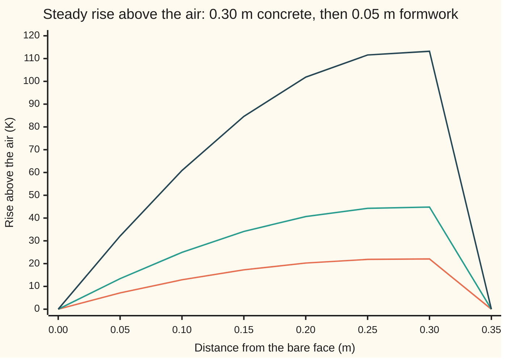

# Lax-Milgram: one weak solution when the form is bounded and coercive

[Syllabus](../../../SYLLABUS.md) → [Partial differential equations](../README.md) → [Weak Solutions and Free Boundaries](../README.md#s06) → Lax-Milgram

---

## General Overview

A concrete wall 0.30 m thick has just been poured. One side is bare. The other side is still held by its formwork, a 0.05 m insulating panel. As cement sets it releases heat. Take 1000 W per cubic metre, a rate typical of the first day (illustrative). The air on both sides is at the same temperature. How far above the air does the wall's core settle, and is that answer even well defined?

Wing 08 solved steady heat in one material by integrating twice. Here the conductivity jumps from 1.8 W/(m K) in the concrete to 0.04 W/(m K) in the panel (both illustrative), so the temperature has a corner at the joint. The equation in its usual form needs a second derivative there, and none exists. [Weak solutions](01-weak-solutions-and-the-weak-formulation.md) fixes that by asking the equation to hold only on average against smooth test functions.

This card answers the next question: does that weaker problem have exactly one answer? The Lax-Milgram theorem says yes, after two checks on the problem's **energy form** (the rule that pairs two temperature profiles into one number). The form must be **bounded**: never larger than a constant $`M`$ times the sizes of the two profiles. It must be **coercive**: every nonzero profile costs at least $`\alpha`$ times its size squared. For the wall, $`M`$ = 1.800 and $`\alpha`$ = 0.040 W/(m K): the largest and smallest conductivities.

The smaller one, $`\alpha`$, together with the Poincaré constant, also caps the answer before anything is solved. The guarantee says the core rises at most 451.26 K above the air. The true rise is 22.1453 K, 0.2824 m from the bare face. The cap is crude but certain; the existence and uniqueness are the real prize.

**For a second-order elliptic problem, bound the form above by the largest coefficient and below by the smallest one together with the Poincaré constant; if the lower bound is positive, exactly one weak solution exists and its size is at most the load's size divided by it.**

**What kind of fact this is:** a theorem. The abstract theorem is proved on [Lax-Milgram](../../18-Functional%20analysis/02-Hilbert%20Spaces/07-lax-milgram-theorem.md); this card proves the two constants for a variable-coefficient heat problem in Why it works. The wall's numbers come from a model: steady heat at a frozen heating rate, with each face held at the air temperature. Real faces also pass heat through a thin film of air, whose resistance can be comparable to the concrete's own, so the true rise is higher than this model's.

### The picture: the wall's rise, and what a temperature-driven source does to it



Orange (lowest): the wall as given, peak 22.1453 K. Teal (middle): heating that grows by half the critical rate $`\beta^*`$ per kelvin of rise (defined in The formula). Dark (top): heating that grows by 0.8 $`\beta^*`$ per kelvin. The joint is at 0.30 m; the last 0.05 m is the panel, where the temperature falls in a straight line.

---

## The formula

Notation first, in words. Measure $`x`$ in metres from the bare face, across the wall of thickness $`L`$ = 0.35 m. The region is $`\Omega = (0, L)`$. The unknown $`u(x)`$ is the rise above the air, in kelvin; both faces are held at the air, so $`u(0) = u(L) = 0`$. The conductivity $`k(x)`$ is 1.8 W/(m K) in the concrete and 0.04 W/(m K) in the panel. The heating $`f(x)`$ is $`F`$ = 1000 W/m³ in the concrete and 0 in the panel.

The strong problem and its weak form, as on [Weak solutions](01-weak-solutions-and-the-weak-formulation.md):

```math
-\big(k(x)\,u'\big)' = f(x) \ \text{ on } (0, L), \quad u(0) = u(L) = 0 \qquad\leadsto\qquad a(u, v) = \int_0^L k\,u'v'\,dx = \int_0^L f\,v\,dx = \ell(v) \ \text{ for every } v \in H^1_0(0, L).
```

$`H^1_0(0, L)`$ is the space of profiles with a square-integrable slope that are zero at both faces ([Sobolev spaces](02-sobolev-spaces-for-pdes.md)). Its size here is the slope size $`\lVert v'\rVert = \big(\int_0^L v'^2\,dx\big)^{1/2}`$. The **plain size** of a function is $`\lVert v\rVert = \big(\int_0^L v^2\,dx\big)^{1/2}`$, with no slope in it. The **Poincaré constant** $`C_P`$ is the best number with $`\lVert v\rVert \le C_P\,\lVert v'\rVert`$; on an interval of length $`L`$ it is $`L/\pi`$.

The two checks and what they give:

```math
\lvert a(u, v)\rvert \le \underbrace{k_{\max}}_{M}\,\lVert u'\rVert\,\lVert v'\rVert, \qquad a(v, v) \ge \underbrace{k_{\min}}_{\alpha}\,\lVert v'\rVert^2 \quad\Longrightarrow\quad \text{one } u \in H^1_0, \qquad \lVert u'\rVert \le \frac{\lVert \ell\rVert}{\alpha} \le \frac{C_P\,\lVert f\rVert}{k_{\min}}.
```

**Read it aloud:** if the form never exceeds the largest conductivity times the two slope sizes, and never falls below the smallest conductivity times the slope size squared, then exactly one weak solution exists, and its slope size is at most the Poincaré constant times the heating's size, over the smallest conductivity.

**The general operator.** In $`d`$ dimensions the same recipe handles $`-\nabla\cdot(A(x)\nabla u) + c(x)\,u = f`$ in $`\Omega`$, $`u = 0`$ on $`\partial\Omega`$. Here $`A = (a_{ij})`$ is the matrix of coefficients, with ellipticity constant $`\theta`$ ([Elliptic, parabolic, hyperbolic](../01-Classification%20and%20Well-Posedness/04-classification-elliptic-parabolic-hyperbolic.md)) and largest eigenvalue at most $`\Lambda`$ at every point. The reaction coefficient $`c(x)`$ is bounded, with $`c(x) \ge -c_0`$ everywhere. Then

```math
M = \Lambda + \max\lvert c\rvert\,C_P^2, \qquad \alpha = \theta - c_0\,C_P^2 \quad\text{(enough when positive)}.
```

The wall is $`d = 1`$, $`A = k`$, $`\theta = k_{\min}`$, $`\Lambda = k_{\max}`$. With a heating that grows with temperature, $`F + \beta u`$ in the concrete, the reaction is $`c = -\beta`$ there, and a sharper coercivity constant is

```math
\alpha_\beta = \Big(1 - \frac{\beta}{\beta^*}\Big)\,k_{\min}, \qquad \beta^* = \min_{v \ne 0} \frac{\int_0^L k\,v'^2\,dx}{\int_{\text{concrete}} v^2\,dx} = 54.5400\ \text{W/(m}^3\text{ K)}.
```

$`\beta^*`$, the **critical rate**, is the smallest eigenvalue of the wall, a Rayleigh quotient as on [Helmholtz](../04-Laplace%2C%20Poisson%20and%20Potentials/08-helmholtz-and-eigenfunctions.md). It weighs the slope by $`k`$ and counts size only in the concrete, so it is not the plain $`-\Delta`$ eigenvalue of [Sobolev spaces](02-sobolev-spaces-for-pdes.md), and $`C_P`$ is not one over its square root.

| Symbol | Plain meaning | In our example | Push it up and the answer… |
| --- | --- | --- | --- |
| $`x`$, $`s`$, $`L`$, $`\Omega`$, $`\partial\Omega`$, $`d`$ | distance from the bare face, m; the joint; wall thickness; the region $`(0, L)`$; its boundary, the two faces; number of space dimensions | $`s`$ = 0.30 m, $`L`$ = 0.35 m, $`d`$ = 1 | thicker: a bigger $`C_P`$ |
| $`u`$, $`u'`$, $`w`$, $`e`$ | rise above the air, K; its slope, K/m; the difference of two solutions; the gap between the exact and finite element rises | peak 22.1453 K; slope 156.8627 K/m at the bare face; $`w = 0`$; $`a(e, e)`$ from 34.722222 to 0.542535 W K/m² | — |
| $`k`$, $`k_c`$, $`k_p`$, $`k_{\max}`$, $`k_{\min}`$ | conductivity, W/(m K); in the concrete; in the panel; its largest and smallest values | 1.8 and 0.04 | panel up: the core cools |
| $`f`$, $`F`$, $`\lVert f\rVert`$ | heating per cubic metre; its value in the concrete, W/m³; its plain size | 1000 W/m³ (illustrative); 547.7226 $`\mathrm{W/m^{2.5}}`$ | the rise grows in proportion |
| $`v`$, $`H^1_0`$, $`\lVert v'\rVert`$, $`\lVert v\rVert`$ | test profile; profiles zero at both faces with square-integrable slope; slope size; plain size | $`\lVert u'\rVert`$ = 109.7645 $`\mathrm{K/m^{0.5}}`$ | — |
| $`a(u, v)`$, $`\ell(v)`$, $`\lVert\ell\rVert`$ | energy form; load; the load's size | $`a(u, u)`$ = 4558.8235 W K/m²; $`\lVert\ell\rVert \le`$ 61.0209 $`\mathrm{W/m^{1.5}}`$ | — |
| $`M`$, $`\alpha`$ | bound and coercivity constants, W/(m K) | 1.800 and 0.040 | $`\alpha`$ up: a lower cap |
| $`C_P`$ | Poincaré constant, m | $`L/\pi`$ = 0.111408 m | — |
| $`\beta`$, $`\beta^*`$, $`\mu`$, $`\alpha_\beta`$ | extra heating per kelvin of rise, W/(m³ K); its critical value, the critical rate; the wavenumber of the critical shape, 1/m; coercivity with $`\beta`$ | $`\beta^*`$ = 54.5400 | $`\beta \to \beta^*`$: the rise runs away |
| $`A = (a_{ij})`$, $`\theta`$, $`\Lambda`$, $`c`$, $`c_0`$ | coefficient matrix; its smallest and largest eigenvalue bounds; reaction coefficient; the most it goes below zero | $`k`$; 0.04; 1.8; $`-\beta`$ in the concrete; $`\beta`$ | — |
| $`N`$, $`h`$ | number of elements in the finite element check; their length, m | 7 to 280; $`L/N`$ | — |

### When it holds

- **Every conductivity is positive: $`k_{\min} > 0`$.** A panel with $`k = 0`$ gives $`\alpha = 0`$. Its temperature is then not decided at all, and the finite element matrix has a zero pivot (What breaks, row 1).
- **Every conductivity is finite: $`k_{\max} < \infty`$.** Otherwise no $`M`$ exists, and a small test profile could carry an unbounded energy.
- **The temperature is fixed somewhere on the boundary.** That is what makes the Poincaré inequality, and so the slope size, work. With heat flux given on both faces, any constant can be added to $`u`$.
- **No reaction pulls harder than $`\beta^*`$.** A heating that grows by $`\beta \ge \beta^*`$ per kelvin destroys coercivity. At $`\beta = 1.01\,\beta^*`$ the "steady" rise comes out at −2289.0 K, colder than the air.
- **The load is bounded.** A square-integrable heating is. So is a point source in one dimension; in two or three dimensions it is not.

---

## Why it works

### Step 0: two numbers replace infinitely many checks

A temperature profile is a whole curve, so the weak problem has infinitely many unknowns. Counting equations against unknowns proves nothing. [Lax-Milgram](../../18-Functional%20analysis/02-Hilbert%20Spaces/07-lax-milgram-theorem.md) replaces that count with two inequalities on the form, one from above and one from below. On a complete space they give exactly one solution. This card's work is to find the two numbers for a real elliptic problem, from its coefficients.

### Step 1: boundedness comes from the largest coefficient

At every point $`k(x) \le k_{\max}`$. Pull it out of the integral and apply the Cauchy-Schwarz inequality (the integral of a product is at most the product of the root-integrals of the squares):

```math
\lvert a(u, v)\rvert = \Big\lvert \int_0^L k\,u'v'\,dx \Big\rvert \le k_{\max}\int_0^L \lvert u'\rvert\,\lvert v'\rvert\,dx \le k_{\max}\,\lVert u'\rVert\,\lVert v'\rVert.
```

So $`M`$ = 1.800 W/(m K). A reaction term adds $`\max\lvert c\rvert\,C_P^2`$: Cauchy-Schwarz bounds $`\int c\,uv`$ by the plain sizes of $`u`$ and $`v`$, and Poincaré turns each plain size into $`C_P`$ times a slope size.

### Step 2: coercivity comes from the smallest coefficient

At every point $`k(x) \ge k_{\min}`$, so

```math
a(v, v) = \int_0^L k\,v'^2\,dx \ge k_{\min}\int_0^L v'^2\,dx = k_{\min}\,\lVert v'\rVert^2.
```

So $`\alpha`$ = 0.040 W/(m K). The jump in $`k`$ does no harm: only its lowest value matters.

This only counts as coercivity if $`\lVert v'\rVert`$ is a genuine size on $`H^1_0`$, zero only for the zero profile. The Poincaré inequality guarantees it: a profile pinned to zero at a face with zero slope everywhere is zero. The finite element road confirms $`C_P`$: one over the square root of the smallest eigenvalue of $`-v''`$, on 280 elements, is 0.111408 m, equal to $`L/\pi`$.

Textbooks often use the full Sobolev size $`\int v^2 + \int v'^2`$ instead. Poincaré then gives $`a(v, v) \ge \frac{k_{\min}}{1 + C_P^2}\,(\int v^2 + \int v'^2)`$, so $`\alpha`$ = 0.039510 with $`x`$ in metres. That number depends on the unit of length, because the two integrals carry different units: the factor $`1/(1 + C_P^2)`$ is 0.98774 with $`x`$ in metres and 0.0000806 with $`x`$ in millimetres. The slope size has no such problem.

### Step 3: the load is bounded, by Poincaré

The load is $`\ell(v) = \int f\,v`$. Cauchy-Schwarz and then Poincaré give

```math
\lvert \ell(v)\rvert \le \lVert f\rVert\,\lVert v\rVert \le C_P\,\lVert f\rVert\,\lVert v'\rVert, \qquad \lVert f\rVert = F\sqrt{0.30} = 547.7226\ \text{W/m}^{2.5}.
```

So $`\lVert\ell\rVert \le`$ 61.0209 $`\mathrm{W/m^{1.5}}`$. Here Poincaré does real work: it converts a heating, measured in plain size, into a load on slopes.

### Step 4: Lax-Milgram gives one solution and a cap

With $`M`$ and $`\alpha`$ in hand, Lax-Milgram gives exactly one $`u`$ in $`H^1_0`$ with $`a(u, v) = \ell(v)`$ for every $`v`$. Putting $`v = u`$ shows where the cap comes from:

```math
\alpha\,\lVert u'\rVert^2 \le a(u, u) = \ell(u) \le \lVert\ell\rVert\,\lVert u'\rVert \quad\Longrightarrow\quad \lVert u'\rVert \le \frac{61.0209}{0.040} = 1525.52\ \text{K/m}^{0.5}.
```

A profile pinned at both faces has $`u(x)^2 \le \frac{x(L - x)}{L}\,\lVert u'\rVert^2`$, largest at the middle. The reason is Cauchy-Schwarz from each face: $`u(x)^2 \le x\int_0^x u'^2`$ and $`u(x)^2 \le (L - x)\int_x^L u'^2`$; divide the first by $`x`$, the second by $`L - x`$, and add. So the rise anywhere is at most $`\frac{\sqrt{L}}{2}\,\lVert u'\rVert`$ = 0.295804 × 1525.52 = 451.26 K.

Uniqueness needs only coercivity: if two solutions differ by $`w`$, then $`a(w, w) = 0`$, so $`\alpha\,\lVert w'\rVert^2 \le 0`$, and $`w = 0`$. This is the energy method of [Energy methods](../01-Classification%20and%20Well-Posedness/07-energy-methods-and-uniqueness.md), now in the weak setting.

### Step 5: a reaction term, Gårding's inequality and the critical rate

Suppose the setting cement heats faster as it warms: $`F + \beta u`$ instead of $`F`$. The form gains $`-\beta\int_{\text{concrete}} uv`$. Step 2 now gives only

```math
a(v, v) \ge k_{\min}\,\lVert v'\rVert^2 - \beta \int v^2\,dx .
```

This is **Gårding's inequality**: coercive up to a plain-size term. Two ways to finish:

- **Crude.** Poincaré turns $`\int v^2`$ into $`C_P^2\lVert v'\rVert^2`$, giving $`\alpha = k_{\min} - \beta C_P^2`$. That is positive only for $`\beta <`$ 3.2227 W/(m³ K).
- **Sharp.** By the definition of $`\beta^*`$, $`\beta\int_{\text{concrete}} v^2 \le (\beta/\beta^*)\int k\,v'^2`$. So $`a(v, v) \ge (1 - \beta/\beta^*)\int k\,v'^2 \ge \alpha_\beta\,\lVert v'\rVert^2`$, positive for every $`\beta < \beta^*`$ = 54.5400.

The crude test pays for the panel's low $`k`$ and for heating everywhere; the sharp one knows where each sits. At $`\beta`$ = 10 the crude $`\alpha`$ is −0.08412 and proves nothing, while the sharp $`\alpha_\beta`$ = 0.03267 and the peak is 27.2634 K.

Turn up $`\beta`$ and the coercivity $`\alpha_\beta`$ shrinks in proportion, while the peak grows faster and faster:

| $`\beta`$, W/(m³ K) | $`\beta/\beta^*`$ | $`\alpha_\beta`$ | peak, closed form, K | peak, 280 elements, K |
| ---: | ---: | ---: | ---: | ---: |
| 0.0000 | 0.00 | 0.04000 | 22.1453 | 22.1453 |
| 27.2700 | 0.50 | 0.02000 | 44.9723 | 44.9721 |
| 43.6320 | 0.80 | 0.00800 | 113.5809 | 113.5790 |
| 49.0860 | 0.90 | 0.00400 | 227.9766 | 227.9684 |
| 53.9946 | 0.99 | 0.00040 | 2287.3189 | 2286.4217 |
| 55.0854 | 1.01 | −0.00040 | −2289.0266 | −2289.9333 |

Near $`\beta^*`$ the peak behaves like $`1/(1 - \beta/\beta^*)`$: from 0.90 to 0.99 the gap shrinks tenfold and the peak grows about tenfold. Real cement runs out of fuel, so it never reaches this runaway; the table shows what coercivity protects, a profile that depends gently on the data.

Past $`\beta^*`$, Lax-Milgram stops. The [Fredholm alternative](../../18-Functional%20analysis/03-Bounded%20Operators/09-fredholm-alternative-and-integral-equations.md) still gives a solution for every $`\beta`$ that is not an eigenvalue, but just above $`\beta^*`$ it is negative: no physical steady state exists.

<details>
<summary>Detailed proof: the critical rate solves one equation</summary>

The eigenfunction of $`\beta^*`$ solves $`-(k v')' = \beta^* v`$ in the concrete and $`-(k v')' = 0`$ in the panel. In the concrete, with $`v(0) = 0`$, it is $`\sin(\mu x)`$ with $`\beta^* = k_c\,\mu^2`$. In the panel it is a straight line falling to 0 at $`x = L`$. Equal temperature and equal flux at the joint $`s`$ give

$`\displaystyle k_c\,\mu\cos(s\mu) + \frac{k_p}{L - s}\,\sin(s\mu) = 0.`$

At $`\mu = \pi/(2s)`$ the left side is $`k_p/(L - s) > 0`$; at $`\mu = \pi/s`$ it is $`-k_c\,\pi/s < 0`$. Bisection between them finds the first root, and $`\beta^* = k_c\,\mu^2`$ = 54.5400 W/(m³ K). The finite element Rayleigh quotients 54.5434, 54.5409, 54.5402 at N = 70, 140, 280 sit above it and close in, as Galerkin eigenvalues must.

</details>

### Step 6: three roads to the wall's answer

1. **Closed form.** The heating is uniform in the concrete, so the rise there is a parabola, $`u = u'(0)\,x - F x^2/(2k_c)`$. In the panel it is a straight line, as on [Fourier's law](../../13-Engineering%20mathematics/08-Fluids%20and%20Heat/05-heat-conduction-and-fouriers-law.md). Equal flux at the joint fixes the slope at the bare face, $`u'(0)`$ = 156.8627 K/m.
2. **Hat functions.** The finite element solve, as on [Galerkin](04-galerkin-and-finite-elements.md), with a node on the joint. In one dimension it hits the exact rise at every node. Its energy error, the energy $`a(e, e)`$ of the gap $`e`$ between the exact and finite element rises, falls by a factor of 4.000 each time $`N`$ doubles. That is order 2 for the energy, so order 1 for the gap's slope size, as hat functions promise.
3. **Energy balance.** Putting $`v = u`$ in the weak form says $`a(u, u) = \ell(u)`$. Both sides come out at 4558.8235 W K/m², by two different integrals.

The ratio $`a(u, u)/\lVert u'\rVert^2`$ = 0.3784 lands between $`\alpha`$ = 0.040 and $`M`$ = 1.800, as the two constants promise for every profile.

---

## Worked numbers, by hand

The wall: concrete 0.30 m at 1.8 W/(m K) heated at 1000 W/m³, then a 0.05 m panel at 0.04 W/(m K); both faces at the air.

| Step | Arithmetic | Value |
| --- | --- | --- |
| bound constant | $`M = k_{\max}`$ | 1.800 W/(m K) |
| coercivity constant | $`\alpha = k_{\min}`$ | 0.040 W/(m K) |
| Poincaré constant | $`C_P = 0.35/\pi`$ | 0.111408 m |
| size of the heating | $`1000 \times \sqrt{0.30}`$ | 547.7226 $`\mathrm{W/m^{2.5}}`$ |
| size of the load, at most | $`0.111408 \times 547.7226`$ | 61.0209 $`\mathrm{W/m^{1.5}}`$ |
| cap on the slope size | $`61.0209 / 0.040`$ | 1525.52 $`\mathrm{K/m^{0.5}}`$ |
| cap on the rise | $`0.295804 \times 1525.52`$ | 451.26 K |
| panel resistance | $`0.05 / 0.04`$ | 1.2500 m² K/W |
| slope at the bare face | $`u'(0) = \dfrac{300\,(1 + 0.30/(2 \times 1.8 \times 1.25))}{1.8 + 0.30/1.25}`$ | 156.8627 K/m |
| joint rise | $`156.8627 \times 0.30 - 1000 \times 0.09/3.6`$ | 22.0588 K |
| heat out of each face | $`1.8 \times 156.8627`$; $`22.0588 / 1.25`$ | 282.3529 and 17.6471 W/m² |
| peak position, where the slope is 0 | $`156.8627 \times 1.8 / 1000`$ | 0.2824 m |
| **peak rise** | $`156.8627^2 \times 1.8 / (2 \times 1000)`$ | **22.1453 K** |

The core settles 22.1453 K above the air, close to the panel, and the two exits share the 300 W/m² of heat 282.3529 to 17.6471. Lax-Milgram had already promised exactly one such profile, capped at 451.26 K.

### What breaks if you drop a piece

| Mistake | Comes out at | What went wrong |
| --- | --- | --- |
| Panel conductivity 0 | smallest pivot 0.0000 | $`\alpha = 0`$: the panel's temperature is not decided, and the matrix is singular. |
| Heating that grows by $`1.01\,\beta^*`$ per kelvin | rise −2289.0 K | Not coercive. A solution exists, but it is colder than the air: no physical steady state. |
| Crude Poincaré test at $`\beta`$ = 10 | $`\alpha`$ = −0.08412, "no proof" | Sufficient, not necessary. The sharp test gives 0.03267, and the peak is 27.2634 K. |

---

## Code, from first principles, and it actually runs

The code builds the wall's closed-form rise, the hat-function matrices with a Thomas solve (elimination for a matrix with three diagonals), and inverse iteration for the smallest eigenvalue. It takes three roads to the rise: the closed form, the finite element solve (exact at every node, the energy of its error falling at order 2), and the energy balance $`a(u, u) = \ell(u)`$ by Simpson's rule. It takes two roads each to $`C_P`$ and to $`\beta^*`$: the formula or matching root, and finite element eigenvalues. Then it checks the caps, sweeps $`\beta`$ and prints the three failures.

### Python

```python
# Lax-Milgram for steady heat in a two-material wall: constants, bounds, three roads.
import math
K1, K2, S, D2, F = 1.8, 0.04, 0.30, 0.05, 1000.0   # W/(m K), W/(m K), m, m, W/m^3
L, R2 = S + D2, D2 / K2                             # wall thickness m; formwork resistance m^2 K/W

def closed(x, beta):  # exact rise above the air, K: -(k u')' - beta*u = F in the concrete
    if beta == 0.0:
        A = F * S * (1 + S / (2 * K1 * R2)) / (K1 + S / R2)
        inner = lambda y: -F * y * y / (2 * K1) + A * y
    else:
        mu = math.sqrt(beta / K1); c, s = math.cos(mu * S), math.sin(mu * S)
        P, Q = F / beta * (c - 1), -F / beta * mu * s
        b = -(P / R2 + K1 * Q) / (K1 * mu * c + s / R2)
        inner = lambda y: F / beta * (math.cos(mu * y) - 1) + b * math.sin(mu * y)
    return inner(x) if x <= S else inner(S) * max(L - x, 0.0) / D2

def thomas(lo, di, up, rhs):  # solve a three-diagonal system; also return the smallest pivot
    n = len(di); d, r = di[:], rhs[:]; piv = abs(d[0])
    for i in range(1, n):
        if d[i - 1] == 0.0: return None, 0.0   # a zero pivot: the matrix is singular
        m = lo[i] / d[i - 1]; d[i] -= m * up[i - 1]; r[i] -= m * r[i - 1]; piv = min(piv, abs(d[i]))
    x = [0.0] * n; x[-1] = r[-1] / d[-1]
    for i in range(n - 2, -1, -1):
        x[i] = (r[i] - up[i] * x[i + 1]) / d[i]
    return x, piv

def fem(N, beta, k2=K2, heat_all=False, k1=K1):  # hat functions; node on the joint when 7 divides N
    h = L / N; di = [0.0] * (N - 1); off = [0.0] * (N - 1); md = [0.0] * (N - 1); mo = [0.0] * (N - 1); rhs = [0.0] * (N - 1)
    for e in range(N):
        conc = (e + 0.5) * h < S; k = k1 if conc else k2; w = 1.0 if (conc or heat_all) else 0.0
        for i in (e - 1, e):  # interior node numbers 0..N-2 sit at x = (i+1) h
            if 0 <= i < N - 1:
                di[i] += k / h; md[i] += w * h / 3; rhs[i] += w * F * h / 2
        if 1 <= e < N - 1:
            off[e] = -k / h; mo[e] = w * h / 6
    lo = [off[i] - beta * mo[i] for i in range(N - 1)]; up = lo[1:] + [0.0]
    u, piv = thomas(lo, [di[i] - beta * md[i] for i in range(N - 1)], up, rhs)
    return u, piv, (di, off, md, mo), rhs

def lowest_eig(N, heat_all):  # inverse iteration: smallest lambda with K v = lambda M v
    k = 1.0 if heat_all else K1  # heat_all: plain -u'' on the whole wall, for Poincare
    _, _, (di, off, md, mo), _ = fem(N, 0.0, k2=k if heat_all else K2, heat_all=heat_all, k1=k)
    lo = off; up = off[1:] + [0.0]; mul = lambda a, b, v: [a[i] * v[i] + (b[i] * v[i - 1] if i else 0) + (b[i + 1] * v[i + 1] if i + 1 < len(v) else 0) for i in range(len(v))]
    v = [1.0] * (N - 1)
    for _ in range(60):
        v, _ = thomas(lo, di, up, mul(md, mo, v)); s = max(abs(t) for t in v); v = [t / s for t in v]
    dot = lambda a, b: sum(p * q for p, q in zip(a, b))
    return dot(v, mul(di, off, v)) / dot(v, mul(md, mo, v))

def simpson(f, a, b, n=2000):
    h = (b - a) / n
    return h / 3 * (f(a) + f(b) + sum((4 if i % 2 else 2) * f(a + i * h) for i in range(1, n)))

def peak(beta):
    xs = [i * L / 7000 for i in range(7001)]; v = [closed(x, beta) for x in xs]
    j = max(range(7001), key=lambda i: abs(v[i])); return xs[j], v[j]

M, ALPHA, CP = K1, K2, L / math.pi
print(f"wall: concrete {S:.2f} m k {K1:.3f}, formwork {D2:.2f} m k {K2:.3f} W/(m K), heating {F:.0f} W/m3")
print(f"constants: M = k_max {M:.3f}, alpha = k_min {ALPHA:.3f} W/(m K), M/alpha {M / ALPHA:.1f}")
cp_fe = 1 / math.sqrt(lowest_eig(280, True))
print(f"Poincare: C_P = L/pi {CP:.6f} m, finite elements N = 280: {cp_fe:.6f} m")
print(f"full Sobolev norm: alpha = k_min/(1 + C_P^2) = {ALPHA / (1 + CP**2):.6f} (x in m); factor 1/(1 + C_P^2) = {1 / (1 + CP**2):.5f} (x in m), {1 / (1 + (1000 * CP)**2):.7f} (x in mm)")
fnorm = F * math.sqrt(S); lnorm = CP * fnorm; ceil = lnorm / ALPHA; pceil = math.sqrt(L) / 2 * ceil
print(f"load: |f| {fnorm:.4f} W/m^2.5, |l| at most C_P |f| = {lnorm:.4f} W/m^1.5")
print(f"ceilings: |u'| at most {ceil:.2f} K/m^0.5, peak rise at most {pceil:.2f} K")
uj = closed(S, 0.0); A0 = F * S * (1 + S / (2 * K1 * R2)) / (K1 + S / R2); xp = A0 * K1 / F; up_ = closed(xp, 0.0)
print(f"closed form: joint {uj:.4f} K, peak {up_:.4f} K at {xp:.4f} m")
q0, qL = K1 * A0, uj / R2   # heat leaving each face, W/m2
print(f"by hand: formwork resistance {R2:.4f} m2 K/W, slope at the bare face {A0:.4f} K/m, sqrt(L)/2 = {math.sqrt(L) / 2:.6f} m^0.5")
print(f"heat out: bare face {q0:.4f} W/m2, formwork face {qL:.4f} W/m2, sum {q0 + qL:.4f} = F S {F * S:.4f}")
g1 = simpson(lambda x: (A0 - F * x / K1)**2, 0.0, S); g2 = (uj / D2)**2 * D2   # slope squared, each layer
grad, energy = math.sqrt(g1 + g2), K1 * g1 + K2 * g2
work = simpson(lambda x: F * closed(x, 0.0), 0.0, S)
print(f"|u'| = {grad:.4f} K/m^0.5; energy a(u,u) = {energy:.4f}, l(u) = {work:.4f} W K/m2")
print(f"a(u,u)/|u'|^2 = {energy / grad**2:.4f}, between alpha and M: {ALPHA - 1e-9 <= energy / grad**2 <= M + 1e-9}")
assert ALPHA - 1e-9 <= energy / grad**2 <= M + 1e-9   # the true profile obeys both constants (1e-9 for rounding)
assert abs(cp_fe - CP) < 1e-5 and abs(q0 + qL - F * S) < 1e-9          # Poincare by two roads; heat balance
assert abs(energy - work) < 1e-9 * work and abs(up_ - peak(0.0)[1]) < 1e-6 and grad <= ceil and up_ <= pceil  # energy identity; Lax-Milgram ceilings hold
print("Galerkin, beta = 0:   N  nodes exact to 1e-12  energy error W K/m2  ratio")
prev = None
for N in (7, 14, 28, 56):
    u, _, _, rhs = fem(N, 0.0); h = L / N
    err = max(abs(u[i] - closed((i + 1) * h, 0.0)) for i in range(N - 1))
    e = work - sum(p * q for p, q in zip(u, rhs))
    print(f"                   {N:4d}  {str(err < 1e-12):>20}  {e:19.6f}  " + (f"{prev / e:.3f}" if prev else "  -"))
    assert err < 1e-12 and (prev is None or 3.9 < prev / e < 4.1)   # exact at nodes; energy error falls 4x per halving
    prev = e
lam1_fe = [lowest_eig(N, False) for N in (70, 140, 280)]
a, b = math.pi / (2 * S), math.pi / S
g = lambda m: K1 * m * math.cos(S * m) + (K2 / D2) * math.sin(S * m)
for _ in range(100):
    m = (a + b) / 2; a, b = (a, m) if g(a) * g(m) <= 0 else (m, b)
lam1 = K1 * m * m
print(f"critical rate beta*: matching root {lam1:.4f}, finite elements N = 70/140/280: " + " ".join(f"{t:.4f}" for t in lam1_fe) + " W/(m3 K)")
print(f"crude Poincare test certifies beta < k_min/C_P^2 = {K2 / CP**2:.4f} W/(m3 K) only")
assert abs(lam1_fe[-1] - lam1) < 1e-3 and lam1_fe[0] > lam1_fe[1] > lam1_fe[2] > lam1  # eigenvalue by two roads
print("  beta W/(m3 K)  beta/beta*  alpha_beta  peak closed K  peak N = 280 K")
for r in (0.0, 0.5, 0.8, 0.9, 0.99, 1.01):
    beta = r * lam1; xb, pb = peak(beta); u = fem(280, beta)[0]; pf = max(u, key=abs)
    print(f"  {beta:12.4f}  {r:10.2f}  {(1 - r) * ALPHA:10.5f}  {pb:13.4f}  {pf:14.4f}")
    assert abs(pf - pb) < 2e-3 * abs(pb)   # Galerkin agrees with the closed form
piv0 = fem(70, 0.0, k2=0.0)[1]
print(f"what breaks: formwork k = 0: smallest pivot {piv0:.4f}")
print(f"what breaks: beta = 1.01 beta*: rise {peak(1.01 * lam1)[1]:.1f} K, below the air")
print(f"what breaks: beta = 10: crude alpha {K2 - 10 * CP**2:.5f}, true alpha {(1 - 10 / lam1) * ALPHA:.5f}, peak {peak(10.0)[1]:.4f} K")
assert piv0 == 0.0 and peak(1.01 * lam1)[1] < 0.0 < peak(10.0)[1]   # each failure shows
print(f"chart, x (m)       " + " ".join(f"{0.05 * i:7.2f}" for i in range(8)))
for r in (0.0, 0.5, 0.8):
    print(f"chart, beta/beta* {r:.1f}" + " ".join(f"{closed(0.05 * i, r * lam1):7.2f}" for i in range(8)))
print("ALL CHECKS PASS")
```

**Ran 2026-11-15 on macOS, Python 3.14.10, standard library only. All checks passed. Output, pasted from the run:**

```
wall: concrete 0.30 m k 1.800, formwork 0.05 m k 0.040 W/(m K), heating 1000 W/m3
constants: M = k_max 1.800, alpha = k_min 0.040 W/(m K), M/alpha 45.0
Poincare: C_P = L/pi 0.111408 m, finite elements N = 280: 0.111408 m
full Sobolev norm: alpha = k_min/(1 + C_P^2) = 0.039510 (x in m); factor 1/(1 + C_P^2) = 0.98774 (x in m), 0.0000806 (x in mm)
load: |f| 547.7226 W/m^2.5, |l| at most C_P |f| = 61.0209 W/m^1.5
ceilings: |u'| at most 1525.52 K/m^0.5, peak rise at most 451.26 K
closed form: joint 22.0588 K, peak 22.1453 K at 0.2824 m
by hand: formwork resistance 1.2500 m2 K/W, slope at the bare face 156.8627 K/m, sqrt(L)/2 = 0.295804 m^0.5
heat out: bare face 282.3529 W/m2, formwork face 17.6471 W/m2, sum 300.0000 = F S 300.0000
|u'| = 109.7645 K/m^0.5; energy a(u,u) = 4558.8235, l(u) = 4558.8235 W K/m2
a(u,u)/|u'|^2 = 0.3784, between alpha and M: True
Galerkin, beta = 0:   N  nodes exact to 1e-12  energy error W K/m2  ratio
                      7                  True            34.722222    -
                     14                  True             8.680556  4.000
                     28                  True             2.170139  4.000
                     56                  True             0.542535  4.000
critical rate beta*: matching root 54.5400, finite elements N = 70/140/280: 54.5434 54.5409 54.5402 W/(m3 K)
crude Poincare test certifies beta < k_min/C_P^2 = 3.2227 W/(m3 K) only
  beta W/(m3 K)  beta/beta*  alpha_beta  peak closed K  peak N = 280 K
        0.0000        0.00     0.04000        22.1453         22.1453
       27.2700        0.50     0.02000        44.9723         44.9721
       43.6320        0.80     0.00800       113.5809        113.5790
       49.0860        0.90     0.00400       227.9766        227.9684
       53.9946        0.99     0.00040      2287.3189       2286.4217
       55.0854        1.01    -0.00040     -2289.0266      -2289.9333
what breaks: formwork k = 0: smallest pivot 0.0000
what breaks: beta = 1.01 beta*: rise -2289.0 K, below the air
what breaks: beta = 10: crude alpha -0.08412, true alpha 0.03267, peak 27.2634 K
chart, x (m)          0.00    0.05    0.10    0.15    0.20    0.25    0.30    0.35
chart, beta/beta* 0.0   0.00    7.15   12.91   17.28   20.26   21.85   22.06    0.00
chart, beta/beta* 0.5   0.00   13.41   24.94   34.13   40.66   44.26   44.81    0.00
chart, beta/beta* 0.8   0.00   32.10   60.88   84.61  101.86  111.58  113.20    0.00
ALL CHECKS PASS
```

### Rust

```rust
// Lax-Milgram for steady heat in a two-material wall: constants, bounds, three roads.
const K1: f64 = 1.8; const K2: f64 = 0.04; // conductivity of concrete and formwork, W/(m K)
const S: f64 = 0.30; const D2: f64 = 0.05; // thickness of concrete and formwork, m
const F: f64 = 1000.0; // heating in the concrete, W/m^3
const L: f64 = S + D2;
const R2: f64 = D2 / K2;

// exact rise above the air, K: -(k u')' - beta*u = F in the concrete
fn closed(x: f64, beta: f64) -> f64 {
    let inner = |y: f64| -> f64 {
        if beta == 0.0 {
            let a = F * S * (1.0 + S / (2.0 * K1 * R2)) / (K1 + S / R2);
            -F * y * y / (2.0 * K1) + a * y
        } else {
            let mu = (beta / K1).sqrt();
            let (c, s) = ((mu * S).cos(), (mu * S).sin());
            let (p, q) = (F / beta * (c - 1.0), -F / beta * mu * s);
            let b = -(p / R2 + K1 * q) / (K1 * mu * c + s / R2);
            F / beta * ((mu * y).cos() - 1.0) + b * (mu * y).sin()
        }
    };
    if x <= S { inner(x) } else { inner(S) * (L - x).max(0.0) / D2 }
}

// solve a three-diagonal system; also return the smallest pivot (None if a pivot is zero)
fn thomas(lo: &[f64], di: &[f64], up: &[f64], rhs: &[f64]) -> (Option<Vec<f64>>, f64) {
    let n = di.len();
    let (mut d, mut r) = (di.to_vec(), rhs.to_vec());
    let mut piv = d[0].abs();
    for i in 1..n {
        if d[i - 1] == 0.0 { return (None, 0.0); }
        let m = lo[i] / d[i - 1];
        d[i] -= m * up[i - 1];
        r[i] -= m * r[i - 1];
        piv = piv.min(d[i].abs());
    }
    let mut x = vec![0.0; n];
    x[n - 1] = r[n - 1] / d[n - 1];
    for i in (0..n - 1).rev() { x[i] = (r[i] - up[i] * x[i + 1]) / d[i]; }
    (Some(x), piv)
}

struct Fem { u: Option<Vec<f64>>, piv: f64, di: Vec<f64>, off: Vec<f64>, md: Vec<f64>, mo: Vec<f64>, rhs: Vec<f64> }

// hat functions; node on the joint when 7 divides N
fn fem(n: usize, beta: f64, k2: f64, heat_all: bool, k1: f64) -> Fem {
    let h = L / n as f64;
    let (mut di, mut off, mut md, mut mo, mut rhs) = (vec![0.0; n - 1], vec![0.0; n - 1], vec![0.0; n - 1], vec![0.0; n - 1], vec![0.0; n - 1]);
    for e in 0..n {
        let conc = (e as f64 + 0.5) * h < S;
        let k = if conc { k1 } else { k2 };
        let w = if conc || heat_all { 1.0 } else { 0.0 };
        for i in [e as i64 - 1, e as i64] {
            if i >= 0 && (i as usize) < n - 1 {
                let i = i as usize;
                di[i] += k / h; md[i] += w * h / 3.0; rhs[i] += w * F * h / 2.0;
            }
        }
        if e >= 1 && e < n - 1 { off[e] = -k / h; mo[e] = w * h / 6.0; }
    }
    let lo: Vec<f64> = (0..n - 1).map(|i| off[i] - beta * mo[i]).collect();
    let mut up = lo[1..].to_vec(); up.push(0.0);
    let dd: Vec<f64> = (0..n - 1).map(|i| di[i] - beta * md[i]).collect();
    let (u, piv) = thomas(&lo, &dd, &up, &rhs);
    Fem { u, piv, di, off, md, mo, rhs }
}

fn mul(a: &[f64], b: &[f64], v: &[f64]) -> Vec<f64> {
    let n = v.len();
    (0..n).map(|i| a[i] * v[i] + (if i > 0 { b[i] * v[i - 1] } else { 0.0 }) + (if i + 1 < n { b[i + 1] * v[i + 1] } else { 0.0 })).collect()
}
fn dot(a: &[f64], b: &[f64]) -> f64 { let mut s = 0.0; for i in 0..a.len() { s += a[i] * b[i]; } s }

// inverse iteration: smallest lambda with K v = lambda M v
fn lowest_eig(n: usize, heat_all: bool) -> f64 {
    let k = if heat_all { 1.0 } else { K1 };
    let m = fem(n, 0.0, if heat_all { k } else { K2 }, heat_all, k);
    let mut up = m.off[1..].to_vec(); up.push(0.0);
    let mut v = vec![1.0; n - 1];
    for _ in 0..60 {
        v = thomas(&m.off, &m.di, &up, &mul(&m.md, &m.mo, &v)).0.unwrap();
        let s = v.iter().fold(0.0f64, |a, t| a.max(t.abs()));
        v = v.iter().map(|t| t / s).collect();
    }
    dot(&v, &mul(&m.di, &m.off, &v)) / dot(&v, &mul(&m.md, &m.mo, &v))
}

fn simpson(f: &dyn Fn(f64) -> f64, a: f64, b: f64) -> f64 {
    let n = 2000; let h = (b - a) / n as f64; let mut acc = 0.0;
    for i in 1..n { acc += (if i % 2 == 1 { 4.0 } else { 2.0 }) * f(a + i as f64 * h); }
    h / 3.0 * (f(a) + f(b) + acc)
}

fn peak(beta: f64) -> (f64, f64) {
    let (mut bx, mut bv) = (0.0, closed(0.0, beta));
    for i in 0..7001 {
        let x = i as f64 * L / 7000.0; let v = closed(x, beta);
        if v.abs() > bv.abs() { bx = x; bv = v; }
    }
    (bx, bv)
}

fn tf(b: bool) -> &'static str { if b { "True" } else { "False" } }

fn main() {
    let (m, alpha, cp) = (K1, K2, L / std::f64::consts::PI);
    println!("wall: concrete {:.2} m k {:.3}, formwork {:.2} m k {:.3} W/(m K), heating {:.0} W/m3", S, K1, D2, K2, F);
    println!("constants: M = k_max {:.3}, alpha = k_min {:.3} W/(m K), M/alpha {:.1}", m, alpha, m / alpha);
    let cp_fe = 1.0 / lowest_eig(280, true).sqrt();
    println!("Poincare: C_P = L/pi {:.6} m, finite elements N = 280: {:.6} m", cp, cp_fe);
    println!("full Sobolev norm: alpha = k_min/(1 + C_P^2) = {:.6} (x in m); factor 1/(1 + C_P^2) = {:.5} (x in m), {:.7} (x in mm)", alpha / (1.0 + cp * cp), 1.0 / (1.0 + cp * cp), 1.0 / (1.0 + (1000.0 * cp).powi(2)));
    let fnorm = F * S.sqrt(); let lnorm = cp * fnorm; let ceil = lnorm / alpha; let pceil = L.sqrt() / 2.0 * ceil;
    println!("load: |f| {:.4} W/m^2.5, |l| at most C_P |f| = {:.4} W/m^1.5", fnorm, lnorm);
    println!("ceilings: |u'| at most {:.2} K/m^0.5, peak rise at most {:.2} K", ceil, pceil);
    let uj = closed(S, 0.0); let a0 = F * S * (1.0 + S / (2.0 * K1 * R2)) / (K1 + S / R2);
    let xp = a0 * K1 / F; let up_ = closed(xp, 0.0);
    println!("closed form: joint {:.4} K, peak {:.4} K at {:.4} m", uj, up_, xp);
    let (q0, ql) = (K1 * a0, uj / R2); // heat leaving each face, W/m2
    println!("by hand: formwork resistance {:.4} m2 K/W, slope at the bare face {:.4} K/m, sqrt(L)/2 = {:.6} m^0.5", R2, a0, L.sqrt() / 2.0);
    println!("heat out: bare face {:.4} W/m2, formwork face {:.4} W/m2, sum {:.4} = F S {:.4}", q0, ql, q0 + ql, F * S);
    let g1 = simpson(&|x| (a0 - F * x / K1).powi(2), 0.0, S); let g2 = (uj / D2).powi(2) * D2;
    let (grad, energy) = ((g1 + g2).sqrt(), K1 * g1 + K2 * g2);
    let work = simpson(&|x| F * closed(x, 0.0), 0.0, S);
    println!("|u'| = {:.4} K/m^0.5; energy a(u,u) = {:.4}, l(u) = {:.4} W K/m2", grad, energy, work);
    let ratio = energy / (grad * grad);
    println!("a(u,u)/|u'|^2 = {:.4}, between alpha and M: {}", ratio, tf(alpha - 1e-9 <= ratio && ratio <= m + 1e-9));
    assert!(alpha - 1e-9 <= ratio && ratio <= m + 1e-9); // the true profile obeys both constants (1e-9 for rounding)
    assert!((cp_fe - cp).abs() < 1e-5 && (q0 + ql - F * S).abs() < 1e-9);
    assert!((energy - work).abs() < 1e-9 * work && (up_ - peak(0.0).1).abs() < 1e-6 && grad <= ceil && up_ <= pceil);
    println!("Galerkin, beta = 0:   N  nodes exact to 1e-12  energy error W K/m2  ratio");
    let mut prev: Option<f64> = None;
    for n in [7usize, 14, 28, 56] {
        let r = fem(n, 0.0, K2, false, K1); let u = r.u.unwrap(); let h = L / n as f64;
        let err = (0..n - 1).fold(0.0f64, |a, i| a.max((u[i] - closed((i + 1) as f64 * h, 0.0)).abs()));
        let e = work - dot(&u, &r.rhs);
        let rs = match prev { Some(p) => format!("{:.3}", p / e), None => "  -".to_string() };
        println!("                   {:4}  {:>20}  {:19.6}  {}", n, tf(err < 1e-12), e, rs);
        assert!(err < 1e-12 && prev.map_or(true, |p| 3.9 < p / e && p / e < 4.1));
        prev = Some(e);
    }
    let lam1_fe: Vec<f64> = [70usize, 140, 280].iter().map(|&n| lowest_eig(n, false)).collect();
    let (mut a, mut b) = (std::f64::consts::PI / (2.0 * S), std::f64::consts::PI / S);
    let g = |m: f64| K1 * m * (S * m).cos() + (K2 / D2) * (S * m).sin();
    let mut mm = 0.0;
    for _ in 0..100 { mm = (a + b) / 2.0; if g(a) * g(mm) <= 0.0 { b = mm; } else { a = mm; } }
    let lam1 = K1 * mm * mm;
    println!("critical rate beta*: matching root {:.4}, finite elements N = 70/140/280: {:.4} {:.4} {:.4} W/(m3 K)", lam1, lam1_fe[0], lam1_fe[1], lam1_fe[2]);
    println!("crude Poincare test certifies beta < k_min/C_P^2 = {:.4} W/(m3 K) only", K2 / (cp * cp));
    assert!((lam1_fe[2] - lam1).abs() < 1e-3 && lam1_fe[0] > lam1_fe[1] && lam1_fe[1] > lam1_fe[2] && lam1_fe[2] > lam1);
    println!("  beta W/(m3 K)  beta/beta*  alpha_beta  peak closed K  peak N = 280 K");
    for r in [0.0, 0.5, 0.8, 0.9, 0.99, 1.01] {
        let beta = r * lam1; let (_, pb) = peak(beta);
        let u = fem(280, beta, K2, false, K1).u.unwrap();
        let pf = u.iter().fold(0.0f64, |a, &t| if t.abs() > a.abs() { t } else { a });
        println!("  {:12.4}  {:10.2}  {:10.5}  {:13.4}  {:14.4}", beta, r, (1.0 - r) * alpha, pb, pf);
        assert!((pf - pb).abs() < 2e-3 * pb.abs());
    }
    let piv0 = fem(70, 0.0, 0.0, false, K1).piv;
    println!("what breaks: formwork k = 0: smallest pivot {:.4}", piv0);
    println!("what breaks: beta = 1.01 beta*: rise {:.1} K, below the air", peak(1.01 * lam1).1);
    println!("what breaks: beta = 10: crude alpha {:.5}, true alpha {:.5}, peak {:.4} K", K2 - 10.0 * cp * cp, (1.0 - 10.0 / lam1) * alpha, peak(10.0).1);
    assert!(piv0 == 0.0 && peak(1.01 * lam1).1 < 0.0 && peak(10.0).1 > 0.0);
    let xs: Vec<String> = (0..8).map(|i| format!("{:7.2}", 0.05 * i as f64)).collect();
    println!("chart, x (m)       {}", xs.join(" "));
    for r in [0.0, 0.5, 0.8] {
        let ys: Vec<String> = (0..8).map(|i| format!("{:7.2}", closed(0.05 * i as f64, r * lam1))).collect();
        println!("chart, beta/beta* {:.1}{}", r, ys.join(" "));
    }
    println!("ALL CHECKS PASS");
}
```

**Ran 2026-11-15 on macOS, rustc 1.98.1, no crates. All checks passed. Output, pasted from the run:**

```
wall: concrete 0.30 m k 1.800, formwork 0.05 m k 0.040 W/(m K), heating 1000 W/m3
constants: M = k_max 1.800, alpha = k_min 0.040 W/(m K), M/alpha 45.0
Poincare: C_P = L/pi 0.111408 m, finite elements N = 280: 0.111408 m
full Sobolev norm: alpha = k_min/(1 + C_P^2) = 0.039510 (x in m); factor 1/(1 + C_P^2) = 0.98774 (x in m), 0.0000806 (x in mm)
load: |f| 547.7226 W/m^2.5, |l| at most C_P |f| = 61.0209 W/m^1.5
ceilings: |u'| at most 1525.52 K/m^0.5, peak rise at most 451.26 K
closed form: joint 22.0588 K, peak 22.1453 K at 0.2824 m
by hand: formwork resistance 1.2500 m2 K/W, slope at the bare face 156.8627 K/m, sqrt(L)/2 = 0.295804 m^0.5
heat out: bare face 282.3529 W/m2, formwork face 17.6471 W/m2, sum 300.0000 = F S 300.0000
|u'| = 109.7645 K/m^0.5; energy a(u,u) = 4558.8235, l(u) = 4558.8235 W K/m2
a(u,u)/|u'|^2 = 0.3784, between alpha and M: True
Galerkin, beta = 0:   N  nodes exact to 1e-12  energy error W K/m2  ratio
                      7                  True            34.722222    -
                     14                  True             8.680556  4.000
                     28                  True             2.170139  4.000
                     56                  True             0.542535  4.000
critical rate beta*: matching root 54.5400, finite elements N = 70/140/280: 54.5434 54.5409 54.5402 W/(m3 K)
crude Poincare test certifies beta < k_min/C_P^2 = 3.2227 W/(m3 K) only
  beta W/(m3 K)  beta/beta*  alpha_beta  peak closed K  peak N = 280 K
        0.0000        0.00     0.04000        22.1453         22.1453
       27.2700        0.50     0.02000        44.9723         44.9721
       43.6320        0.80     0.00800       113.5809        113.5790
       49.0860        0.90     0.00400       227.9766        227.9684
       53.9946        0.99     0.00040      2287.3189       2286.4217
       55.0854        1.01    -0.00040     -2289.0266      -2289.9333
what breaks: formwork k = 0: smallest pivot 0.0000
what breaks: beta = 1.01 beta*: rise -2289.0 K, below the air
what breaks: beta = 10: crude alpha -0.08412, true alpha 0.03267, peak 27.2634 K
chart, x (m)          0.00    0.05    0.10    0.15    0.20    0.25    0.30    0.35
chart, beta/beta* 0.0   0.00    7.15   12.91   17.28   20.26   21.85   22.06    0.00
chart, beta/beta* 0.5   0.00   13.41   24.94   34.13   40.66   44.26   44.81    0.00
chart, beta/beta* 0.8   0.00   32.10   60.88   84.61  101.86  111.58  113.20    0.00
ALL CHECKS PASS
```

### Lean

Lean proves Steps 1, 2 and 4 of Why it works for any conductivity between two positive bounds, working with each profile's slope.

- Take a conductivity $`k`$ with $`k_{\min} \le k(x) \le k_{\max}`$ at every point, and $`k_{\min} > 0`$. Then the energy form is bounded with $`M = k_{\max}`$ and coercive with $`\alpha = k_{\min}`$.
- Take the same $`k`$ and any bounded load $`\ell`$. Then exactly one profile $`u`$ solves $`a(u, v) = \ell(v)`$ for every test profile $`v`$.
- Take any such solution $`u`$. Then its slope size obeys $`\lVert u'\rVert \le \lVert\ell\rVert/\alpha`$.
- Take a profile pinned to zero at both faces, with a square-integrable slope. Then $`u(x)^2 \le \frac{x(L - x)}{L}\,\lVert u'\rVert^2`$ at every point $`x`$.
- In exact fractions, $`M/\alpha`$ = 45 and the slope at the bare face is 8000/51, about 156.8627 K/m.
- The joint rise is 375/17, about 22.0588 K, and the two faces shed 300 W/m² in all.
- The peak sits 24/85 m, about 0.2824 m, from the bare face. Its rise is 57600/2601, about 22.1453 K.

The Poincaré bound on the load, the critical rate and the finite element solves are left to the Python and Rust checks.

```lean
-- Lax-Milgram: a conductivity held between two positive constants gives exactly one weak solution of steady heat, with slope size at most the load's size over the smallest conductivity.
import Mathlib.MeasureTheory.Function.L2Space
import Mathlib.MeasureTheory.Integral.IntervalIntegral.Basic
import Mathlib.MeasureTheory.Function.LpOrder
import Mathlib.Analysis.InnerProductSpace.LaxMilgram

open MeasureTheory

theorem lm_integrable_mul {X : Type*} [MeasurableSpace X] {μ : Measure X} (g h : Lp ℝ 2 μ) :
    Integrable (fun x => (g : X → ℝ) x * (h : X → ℝ) x) μ := by
  have := L2.integrable_inner (𝕜 := ℝ) g h
  simpa [mul_comm] using this

theorem lm_integral_mul_eq_inner {X : Type*} [MeasurableSpace X] {μ : Measure X}
    (g h : Lp ℝ 2 μ) :
    ∫ x, (g : X → ℝ) x * (h : X → ℝ) x ∂μ = inner ℝ g h := by
  rw [L2.inner_def]
  simp [mul_comm]

theorem lm_integral_abs_mul_le {X : Type*} [MeasurableSpace X] {μ : Measure X}
    (g h : Lp ℝ 2 μ) :
    ∫ x, |(g : X → ℝ) x| * |(h : X → ℝ) x| ∂μ ≤ ‖g‖ * ‖h‖ := by
  have e : ∫ x, |(g : X → ℝ) x| * |(h : X → ℝ) x| ∂μ
      = ∫ x, ((|g| : Lp ℝ 2 μ) : X → ℝ) x * ((|h| : Lp ℝ 2 μ) : X → ℝ) x ∂μ := by
    apply integral_congr_ae
    filter_upwards [Lp.coeFn_abs g, Lp.coeFn_abs h] with x hg hh
    rw [hg, hh]
  rw [e, lm_integral_mul_eq_inner, ← norm_abs_eq_norm g, ← norm_abs_eq_norm h]
  exact real_inner_le_norm _ _

theorem lm_integrable_kmul {X : Type*} [MeasurableSpace X] {μ : Measure X}
    (k : X → ℝ) (hk : Measurable k) (C : ℝ) (hC : ∀ x, |k x| ≤ C) (g h : Lp ℝ 2 μ) :
    Integrable (fun x => k x * (g : X → ℝ) x * (h : X → ℝ) x) μ := by
  have := (lm_integrable_mul g h).bdd_mul (c := C) hk.aestronglyMeasurable
    (Filter.Eventually.of_forall fun x => by simpa using hC x)
  simpa [mul_assoc] using this

theorem lm_form_add_left {X : Type*} [MeasurableSpace X] {μ : Measure X}
    (k : X → ℝ) (hk : Measurable k) (C : ℝ) (hC : ∀ x, |k x| ≤ C) (g₁ g₂ h : Lp ℝ 2 μ) :
    ∫ x, k x * ((g₁ + g₂ : Lp ℝ 2 μ) : X → ℝ) x * (h : X → ℝ) x ∂μ
      = ∫ x, k x * (g₁ : X → ℝ) x * (h : X → ℝ) x ∂μ
        + ∫ x, k x * (g₂ : X → ℝ) x * (h : X → ℝ) x ∂μ := by
  rw [← integral_add (lm_integrable_kmul k hk C hC g₁ h) (lm_integrable_kmul k hk C hC g₂ h)]
  apply integral_congr_ae
  filter_upwards [Lp.coeFn_add g₁ g₂] with x hx
  rw [hx]; simp only [Pi.add_apply]; ring

theorem lm_form_add_right {X : Type*} [MeasurableSpace X] {μ : Measure X}
    (k : X → ℝ) (hk : Measurable k) (C : ℝ) (hC : ∀ x, |k x| ≤ C) (g h₁ h₂ : Lp ℝ 2 μ) :
    ∫ x, k x * (g : X → ℝ) x * ((h₁ + h₂ : Lp ℝ 2 μ) : X → ℝ) x ∂μ
      = ∫ x, k x * (g : X → ℝ) x * (h₁ : X → ℝ) x ∂μ
        + ∫ x, k x * (g : X → ℝ) x * (h₂ : X → ℝ) x ∂μ := by
  rw [← integral_add (lm_integrable_kmul k hk C hC g h₁) (lm_integrable_kmul k hk C hC g h₂)]
  apply integral_congr_ae
  filter_upwards [Lp.coeFn_add h₁ h₂] with x hx
  rw [hx]; simp only [Pi.add_apply]; ring

theorem lm_form_smul_left {X : Type*} [MeasurableSpace X] {μ : Measure X}
    (k : X → ℝ) (c : ℝ) (g h : Lp ℝ 2 μ) :
    ∫ x, k x * ((c • g : Lp ℝ 2 μ) : X → ℝ) x * (h : X → ℝ) x ∂μ
      = c * ∫ x, k x * (g : X → ℝ) x * (h : X → ℝ) x ∂μ := by
  rw [← integral_const_mul]
  apply integral_congr_ae
  filter_upwards [Lp.coeFn_smul c g] with x hx
  rw [hx]; simp only [Pi.smul_apply, smul_eq_mul]; ring

theorem lm_form_smul_right {X : Type*} [MeasurableSpace X] {μ : Measure X}
    (k : X → ℝ) (c : ℝ) (g h : Lp ℝ 2 μ) :
    ∫ x, k x * (g : X → ℝ) x * ((c • h : Lp ℝ 2 μ) : X → ℝ) x ∂μ
      = c * ∫ x, k x * (g : X → ℝ) x * (h : X → ℝ) x ∂μ := by
  rw [← integral_const_mul]
  apply integral_congr_ae
  filter_upwards [Lp.coeFn_smul c h] with x hx
  rw [hx]; simp only [Pi.smul_apply, smul_eq_mul]; ring

theorem lm_cs_interval {a b : ℝ} (hab : a ≤ b) (g : ℝ → ℝ)
    (hg : IntervalIntegrable g volume a b)
    (hg2 : IntervalIntegrable (fun t => g t ^ 2) volume a b) :
    (∫ t in a..b, g t) ^ 2 ≤ (b - a) * ∫ t in a..b, g t ^ 2 := by
  set G := ∫ t in a..b, g t with hG
  set G2 := ∫ t in a..b, g t ^ 2 with hG2
  have hnn : 0 ≤ ∫ t in a..b, ((b - a) * g t - G) ^ 2 :=
    intervalIntegral.integral_nonneg hab (fun t _ => sq_nonneg _)
  have hexp : ∫ t in a..b, ((b - a) * g t - G) ^ 2
      = (b - a) ^ 2 * G2 - 2 * (b - a) * G * G + G ^ 2 * (b - a) := by
    have e : ∀ t, ((b - a) * g t - G) ^ 2
        = ((b - a) ^ 2 * g t ^ 2 - (2 * (b - a) * G) * g t) + G ^ 2 := fun t => by ring
    simp_rw [e]
    rw [intervalIntegral.integral_add ((hg2.const_mul _).sub (hg.const_mul _))
        intervalIntegrable_const,
      intervalIntegral.integral_sub (hg2.const_mul _) (hg.const_mul _),
      intervalIntegral.integral_const_mul, intervalIntegral.integral_const_mul,
      intervalIntegral.integral_const, smul_eq_mul]
    ring
  rw [hexp] at hnn
  rcases hab.eq_or_lt with h | h
  · subst h
    simp [hG]
  · have hba : 0 < b - a := sub_pos.2 h
    have : 0 ≤ (b - a) * ((b - a) * G2 - G ^ 2) := by nlinarith
    nlinarith [(mul_nonneg_iff_of_pos_left hba).1 this]

theorem lm_energy_form {X : Type*} [MeasurableSpace X] {μ : Measure X}
    (k : X → ℝ) (hk : Measurable k) (kmin kmax : ℝ) (hkmin : 0 < kmin)
    (hbounds : ∀ x, kmin ≤ k x ∧ k x ≤ kmax) (g h : Lp ℝ 2 μ) :
    |∫ x, k x * (g : X → ℝ) x * (h : X → ℝ) x ∂μ| ≤ kmax * ‖g‖ * ‖h‖ ∧
    kmin * ‖g‖ ^ 2 ≤ ∫ x, k x * (g : X → ℝ) x * (g : X → ℝ) x ∂μ := by
  have hkabs : ∀ x, |k x| ≤ kmax := fun x =>
    abs_le.2 ⟨by linarith [hbounds x], (hbounds x).2⟩
  rcases isEmpty_or_nonempty X with hX | hX
  · have hg : g = 0 := Lp.ext (Filter.Eventually.of_forall fun x => isEmptyElim x)
    subst hg
    simp [integral_of_isEmpty]
  constructor
  · calc |∫ x, k x * (g : X → ℝ) x * (h : X → ℝ) x ∂μ|
        ≤ ∫ x, |k x * (g : X → ℝ) x * (h : X → ℝ) x| ∂μ := abs_integral_le_integral_abs
      _ ≤ ∫ x, kmax * (|(g : X → ℝ) x| * |(h : X → ℝ) x|) ∂μ := by
          apply integral_mono (lm_integrable_kmul k hk kmax hkabs g h).abs
            ((lm_integrable_mul g h).abs.const_mul kmax |>.congr
              (Filter.Eventually.of_forall fun x => by simp [abs_mul]))
          intro x
          dsimp only
          rw [abs_mul, abs_mul, mul_assoc]
          exact mul_le_mul_of_nonneg_right (hkabs x) (by positivity)
      _ = kmax * ∫ x, |(g : X → ℝ) x| * |(h : X → ℝ) x| ∂μ := integral_const_mul _ _
      _ ≤ kmax * (‖g‖ * ‖h‖) := by
          apply mul_le_mul_of_nonneg_left (lm_integral_abs_mul_le g h)
          linarith [hbounds (Classical.arbitrary X)]
      _ = kmax * ‖g‖ * ‖h‖ := by ring
  · calc kmin * ‖g‖ ^ 2 = ∫ x, kmin * ((g : X → ℝ) x * (g : X → ℝ) x) ∂μ := by
          rw [integral_const_mul, lm_integral_mul_eq_inner, real_inner_self_eq_norm_sq]
      _ ≤ ∫ x, k x * (g : X → ℝ) x * (g : X → ℝ) x ∂μ := by
          apply integral_mono ((lm_integrable_mul g g).const_mul kmin)
            (lm_integrable_kmul k hk kmax hkabs g g)
          intro x
          dsimp only
          rw [mul_assoc]
          exact mul_le_mul_of_nonneg_right (hbounds x).1 (mul_self_nonneg _)

#print axioms lm_integrable_mul
#print axioms lm_integral_mul_eq_inner
#print axioms lm_integral_abs_mul_le
#print axioms lm_integrable_kmul
#print axioms lm_form_add_left
#print axioms lm_form_add_right
#print axioms lm_form_smul_left
#print axioms lm_form_smul_right
#print axioms lm_cs_interval
#print axioms lm_energy_form

/-- **Lax-Milgram for steady heat.** Work with the slopes of the temperature profiles: they form a
closed subspace `V` of the square-integrable functions (for the wall, the slopes `u'` of the
profiles in `H^1_0(0, L)`, where the slope size `‖u'‖` is the size used on the card). The energy
form is `a(u, v) = ∫ k u' v'`. If the conductivity `k` is measurable and lies between
`k_min > 0` and `k_max` everywhere, then for every bounded load `ℓ` there is exactly one `u` with
`a(u, v) = ℓ(v)` for every test slope `v`, and every such solution has slope size at most
`‖ℓ‖ / k_min`. -/
theorem lax_milgram_unique_weak_solution {X : Type*} [MeasurableSpace X] {μ : Measure X}
    (V : Submodule ℝ (Lp ℝ 2 μ)) (hV : IsClosed (V : Set (Lp ℝ 2 μ)))
    (k : X → ℝ) (hk : Measurable k) (kmin kmax : ℝ) (hkmin : 0 < kmin)
    (hbounds : ∀ x, kmin ≤ k x ∧ k x ≤ kmax) (ℓ : V →L[ℝ] ℝ) :
    (∃! u : V, ∀ v : V,
        ∫ x, k x * ((u : Lp ℝ 2 μ) : X → ℝ) x * ((v : Lp ℝ 2 μ) : X → ℝ) x ∂μ = ℓ v) ∧
    ∀ u : V, (∀ v : V,
        ∫ x, k x * ((u : Lp ℝ 2 μ) : X → ℝ) x * ((v : Lp ℝ 2 μ) : X → ℝ) x ∂μ = ℓ v) →
      ‖u‖ ≤ ‖ℓ‖ / kmin := by
  have : CompleteSpace V := hV.completeSpace_coe
  have hkabs : ∀ x, |k x| ≤ kmax := fun x =>
    abs_le.2 ⟨by linarith [hbounds x], (hbounds x).2⟩
  set b : V → V → ℝ := fun u v =>
    ∫ x, k x * ((u : Lp ℝ 2 μ) : X → ℝ) x * ((v : Lp ℝ 2 μ) : X → ℝ) x ∂μ with hb
  have hcoer : ∀ u : V, kmin * ‖u‖ ^ 2 ≤ b u u := fun u => by
    have := (lm_energy_form k hk kmin kmax hkmin hbounds
      (u : Lp ℝ 2 μ) u).2
    simpa [hb] using this
  have hbound : ∀ u v : V, ‖b u v‖ ≤ kmax * ‖u‖ * ‖v‖ := fun u v => by
    have := (lm_energy_form k hk kmin kmax hkmin hbounds
      (u : Lp ℝ 2 μ) v).1
    simpa [hb] using this
  let B₀ : V →ₗ[ℝ] V →ₗ[ℝ] ℝ := LinearMap.mk₂ ℝ b
    (fun u₁ u₂ v => lm_form_add_left k hk kmax hkabs (u₁ : Lp ℝ 2 μ) (u₂ : Lp ℝ 2 μ) (v : Lp ℝ 2 μ))
    (fun c u v => lm_form_smul_left k c (u : Lp ℝ 2 μ) (v : Lp ℝ 2 μ))
    (fun u v₁ v₂ => lm_form_add_right k hk kmax hkabs (u : Lp ℝ 2 μ) (v₁ : Lp ℝ 2 μ) (v₂ : Lp ℝ 2 μ))
    (fun c u v => lm_form_smul_right k c (u : Lp ℝ 2 μ) (v : Lp ℝ 2 μ))
  let B : V →L[ℝ] V →L[ℝ] ℝ := B₀.mkContinuous₂ kmax hbound
  have hBapp : ∀ u v, B u v = b u v := fun u v => rfl
  have hcB : IsCoercive B := ⟨kmin, hkmin, fun u => by
    rw [hBapp]; nlinarith [hcoer u]⟩
  have hsol : ∀ u : V, (∀ v, b u v = ℓ v) → ‖u‖ ≤ ‖ℓ‖ / kmin := by
    intro u hu
    rw [le_div_iff₀ hkmin]
    have h1 := hcoer u
    rw [hu u] at h1
    have h2 : ℓ u ≤ ‖ℓ‖ * ‖u‖ := (Real.le_norm_self (ℓ u)).trans (ℓ.le_opNorm u)
    rcases (norm_nonneg u).eq_or_lt with h0 | hpos
    · rw [← h0, zero_mul]; exact norm_nonneg ℓ
    · nlinarith
  refine ⟨?_, hsol⟩
  let f : V := (InnerProductSpace.toDual ℝ V).symm ℓ
  refine ⟨hcB.continuousLinearEquivOfBilin.symm f, ?_, ?_⟩
  · intro v
    show B _ v = ℓ v
    rw [← hcB.continuousLinearEquivOfBilin_apply, ContinuousLinearEquiv.apply_symm_apply,
      InnerProductSpace.toDual_symm_apply]
  · intro u hu
    rw [ContinuousLinearEquiv.eq_symm_apply]
    symm
    apply hcB.unique_continuousLinearEquivOfBilin
    intro w
    rw [InnerProductSpace.toDual_symm_apply, hBapp]
    exact (hu w).symm

/-- **The two constants.** If the conductivity lies between `k_min > 0` and `k_max`, the energy
form is bounded with `M = k_max` and coercive with `α = k_min`:
`|∫ k g h| ≤ k_max ‖g‖ ‖h‖` and `∫ k g² ≥ k_min ‖g‖²` for all square-integrable slopes `g`, `h`. -/
theorem energy_form_bounded_and_coercive {X : Type*} [MeasurableSpace X] {μ : Measure X}
    (k : X → ℝ) (hk : Measurable k) (kmin kmax : ℝ) (hkmin : 0 < kmin)
    (hbounds : ∀ x, kmin ≤ k x ∧ k x ≤ kmax) (g h : Lp ℝ 2 μ) :
    |∫ x, k x * (g : X → ℝ) x * (h : X → ℝ) x ∂μ| ≤ kmax * ‖g‖ * ‖h‖ ∧
    kmin * ‖g‖ ^ 2 ≤ ∫ x, k x * (g : X → ℝ) x * (g : X → ℝ) x ∂μ := by
  exact lm_energy_form k hk kmin kmax hkmin hbounds g h

/-- **From slope size to the rise.** A profile `u(x) = ∫₀ˣ g` pinned to zero at both faces of
`(0, L)` (so `∫₀ᴸ g = 0`), with a square-integrable slope `g`, obeys
`u(x)² ≤ x (L − x) / L · ∫₀ᴸ g²` at every point; at the middle this is `(√L / 2)² ‖u'‖²`. -/
theorem rise_sq_le_of_pinned {L : ℝ} (hL : 0 < L) (g : ℝ → ℝ)
    (hg : IntervalIntegrable g volume 0 L)
    (hg2 : IntervalIntegrable (fun t => g t ^ 2) volume 0 L)
    (hpin : ∫ t in (0 : ℝ)..L, g t = 0) {x : ℝ} (hx0 : 0 ≤ x) (hxL : x ≤ L) :
    (∫ t in (0 : ℝ)..x, g t) ^ 2 ≤ x * (L - x) / L * ∫ t in (0 : ℝ)..L, g t ^ 2 := by
  have s1 : Set.uIcc 0 x ⊆ Set.uIcc 0 L := by
    rw [Set.uIcc_of_le hx0, Set.uIcc_of_le hL.le]; exact Set.Icc_subset_Icc le_rfl hxL
  have s2 : Set.uIcc x L ⊆ Set.uIcc 0 L := by
    rw [Set.uIcc_of_le hxL, Set.uIcc_of_le hL.le]; exact Set.Icc_subset_Icc hx0 le_rfl
  have hgx := hg.mono_set s1
  have hgxL := hg.mono_set s2
  have hg2x := hg2.mono_set s1
  have hg2xL := hg2.mono_set s2
  have h1 := lm_cs_interval hx0 g hgx hg2x
  have h2 := lm_cs_interval hxL g hgxL hg2xL
  have e1 := intervalIntegral.integral_add_adjacent_intervals hgx hgxL
  have e2 := intervalIntegral.integral_add_adjacent_intervals hg2x hg2xL
  rw [hpin] at e1
  rw [← e2, div_mul_eq_mul_div, le_div_iff₀ hL]
  set u := ∫ t in (0 : ℝ)..x, g t
  set w := ∫ t in x..L, g t
  have hw : w = -u := by linarith
  rw [hw, neg_sq] at h2
  rw [sub_zero] at h1
  nlinarith [mul_le_mul_of_nonneg_left h1 (sub_nonneg.2 hxL), mul_le_mul_of_nonneg_left h2 hx0]

-- The wall's exact numbers (k in W/(m K), lengths in m, heating 1000 W/m³).
-- M / α = 1.8 / 0.04 = 45.
example : ((18 : ℚ) / 10) / (4 / 100) = 45 := by norm_num
-- Slope at the bare face: 300 (1 + 0.30 / (2 · 1.8 · 1.25)) / (1.8 + 0.30 / 1.25) = 8000/51 K/m.
example : (300 : ℚ) * (1 + (3 / 10) / (2 * (18 / 10) * (5 / 4))) / (18 / 10 + (3 / 10) / (5 / 4))
    = 8000 / 51 := by norm_num
-- Joint rise: (8000/51) · 0.30 − 1000 · 0.09 / 3.6 = 375/17 K.
example : (8000 : ℚ) / 51 * (3 / 10) - 1000 * (9 / 100) / (36 / 10) = 375 / 17 := by norm_num
-- Heat out of each face, 1.8 · 8000/51 and (375/17) / 1.25, adds to F S = 1000 · 0.30 = 300 W/m².
example : (18 : ℚ) / 10 * (8000 / 51) + (375 / 17) / (5 / 4) = 1000 * (3 / 10) := by norm_num
-- Peak position 8000/51 · 1.8 / 1000 = 24/85 m and peak rise (8000/51)² · 1.8 / 2000 = 57600/2601 K.
example : (8000 : ℚ) / 51 * (18 / 10) / 1000 = 24 / 85 := by norm_num
example : ((8000 : ℚ) / 51) ^ 2 * (18 / 10) / 2000 = 57600 / 2601 := by norm_num

#print axioms lax_milgram_unique_weak_solution
#print axioms energy_form_bounded_and_coercive
#print axioms rise_sq_le_of_pinned
```

**Checked 2026-11-15 on macOS, Lean 4.36.0-rc2, Mathlib v4.36.0-rc2. Every proof is complete and uses only Lean's standard axioms. Output, pasted from the run:**

```
'lm_integrable_mul' depends on axioms: [propext, Classical.choice, Quot.sound]
'lm_integral_mul_eq_inner' depends on axioms: [propext, Classical.choice, Quot.sound]
'lm_integral_abs_mul_le' depends on axioms: [propext, Classical.choice, Quot.sound]
'lm_integrable_kmul' depends on axioms: [propext, Classical.choice, Quot.sound]
'lm_form_add_left' depends on axioms: [propext, Classical.choice, Quot.sound]
'lm_form_add_right' depends on axioms: [propext, Classical.choice, Quot.sound]
'lm_form_smul_left' depends on axioms: [propext, Classical.choice, Quot.sound]
'lm_form_smul_right' depends on axioms: [propext, Classical.choice, Quot.sound]
'lm_cs_interval' depends on axioms: [propext, Classical.choice, Quot.sound]
'lm_energy_form' depends on axioms: [propext, Classical.choice, Quot.sound]
'lax_milgram_unique_weak_solution' depends on axioms: [propext, Classical.choice, Quot.sound]
'energy_form_bounded_and_coercive' depends on axioms: [propext, Classical.choice, Quot.sound]
'rise_sq_le_of_pinned' depends on axioms: [propext, Classical.choice, Quot.sound]
```

> [!TIP]
> **Try changing**
> Guess first, then run it. An assert is a line that stops the program if a number comes out wrong.
> - **A better panel.** Set `K2` to `0.02`. Guess first: $`\alpha`$ halves, so the cap doubles to 902.51 K. The true peak rises only from 22.1453 to 23.4619 K, because the bare face still carries most of the heat. $`\beta^*`$ falls to 51.9790. Every assert passes.
> - **One material.** Set `K2` to `1.8`, so the panel conducts like concrete. Guess first: $`M/\alpha`$ falls to 1.0 and the cap to 10.03 K; the peak drops to 8.1633 K at 0.1714 m. The eigenvalue assert then stops the program: $`\beta^*`$ rises to 147.5831, and 280 elements land 0.0015 above it, outside the 0.001 tolerance.
> - **Double the heating.** Set `F` to `2000.0`. Guess first: every rise and every cap doubles, to a peak of 44.2907 K under a cap of 902.51 K, but $`M`$, $`\alpha`$ and $`\beta^*`$ do not move. They belong to the form, not to the load.

---

## The usual mistake

> [!warning]
> **Reading the cap as an estimate.** The cap 451.26 K is a guarantee, not a prediction: the peak is 22.1453 K. The cap pays the panel's tiny conductivity, 0.040, over the whole wall, and assumes the worst place for the heat. Lax-Milgram's job is existence and uniqueness; for the number itself, solve.
>
> - **Taking $`\alpha`$ from the average conductivity.** Coercivity needs the minimum. The ratio $`a(u, u)/\lVert u'\rVert^2`$ for the true profile is 0.3784, but some profiles, those that bend only inside the panel, get as low as 0.040.
> - **Calling a reaction term harmless because the crude test fails.** The crude Poincaré test certifies only $`\beta <`$ 3.2227; the true limit is $`\beta^*`$ = 54.5400. At $`\beta`$ = 10 the wall is fine, with a peak of 27.2634 K.
> - **Quoting $`\alpha`$ in the full Sobolev size without units.** It is 0.039510 with $`x`$ in metres, and its factor $`1/(1 + C_P^2)`$ falls from 0.98774 to 0.0000806 when $`x`$ is in millimetres. A constant that changes with the unit of length says nothing physical by itself.

---

## Where you meet it in real life

- **Mass concrete.** Dams, bridge piers and thick foundations heat up as they set. Engineers model the temperature to keep the core-to-surface difference small enough to avoid cracks. The steady model here is the simplest version; real curing is transient.
- **Building physics software.** Programs that compute heat flow through walls, window frames and thermal bridges solve the weak form with finite elements. Coercivity is why each layout has exactly one temperature field, however sharp the jumps between materials.
- **Composite and layered materials.** Circuit boards, battery stacks and turbine blade coatings mix conductivities that differ by factors of 100 or more. The ratio $`M/\alpha`$ then controls how well a solver converges and how large the error guarantee is.
- **Thermal runaway.** A heat source that grows with temperature, in batteries, chemical reactors or stored grain, has a critical rate like $`\beta^*`$. Below it there is one steady state; above it there is no physical one.

> **Say it back**
> The weak form of steady heat in a two-material wall is $`a(u, v) = \ell(v)`$ on $`H^1_0`$. The form is bounded by the largest conductivity and coercive with the smallest, measured in the slope size; Poincaré makes that size genuine and bounds the load. So Lax-Milgram gives exactly one weak solution, with a cap of 451.26 K on a true peak of 22.1453 K. A reaction term that pulls the wrong way leaves only Gårding's inequality; coercivity then holds exactly when the reaction rate stays below the wall's smallest eigenvalue, 54.5400 W/(m³ K).

---

## What this builds on

- [Sobolev spaces](02-sobolev-spaces-for-pdes.md): the space $`H^1_0`$ and the Poincaré constant $`C_P`$, which make the slope size a genuine size and bound the load.
- [Lax-Milgram](../../18-Functional%20analysis/02-Hilbert%20Spaces/07-lax-milgram-theorem.md): the abstract theorem and its proof, here used as a tool on an elliptic problem with jumping coefficients.
- [Fourier's law](../../13-Engineering%20mathematics/08-Fluids%20and%20Heat/05-heat-conduction-and-fouriers-law.md): heat flows down the temperature slope, and a layer's resistance is its thickness over its conductivity; it gives the closed form that checks the weak solution.

The one-dimensional weak solution through a conductivity jump, with the bound and coercivity constants of an unheated wall, is owned by the functional-analysis card [Weak solutions](../../18-Functional%20analysis/04-Distributions%20and%20Sobolev%20Spaces/08-weak-solutions-of-differential-equations.md); this card adds the heating, the Poincaré constant and the reaction term.

## Where this goes next

- [Galerkin](04-galerkin-and-finite-elements.md): the next card. It solves the weak form on finitely many hat functions, and the ratio $`M/\alpha`$ found here sets its error guarantee.
- [Elliptic regularity](05-elliptic-regularity-in-outline.md): when the weak solution has more derivatives than $`H^1`$ promises. Here it is smooth inside each layer, but its slope still jumps at the joint.
- [The obstacle problem](08-obstacle-problems-and-variational-inequalities.md): the same coercive form, minimised over profiles that must stay above an obstacle, where Lax-Milgram becomes Stampacchia's theorem.
- [Bochner spaces and the weak heat equation](10-bochner-spaces-and-weak-solutions-of-the-heat-equation.md): a solution as a path through a space of functions.
- [General elliptic operators](12-hopf-lemma-fredholm-alternative-and-the-principal-eigenvalue.md): Hopf's lemma, the Fredholm alternative, and a first eigenvalue with a positive mode.
- [De Giorgi-Nash-Moser](15-de-giorgi-nash-moser.md): rough coefficients still give Hölder-continuous solutions.
- [The direct method](../07-Nonlinear%20PDE%20and%20Fluids/10-direct-method-in-the-calculus-of-variations.md): minimise, take a weak limit, and check the energy cannot jump up.

Other cards on this shelf: [Weak solutions](01-weak-solutions-and-the-weak-formulation.md), [Viscosity solutions](06-viscosity-solutions.md), [Free boundaries](07-free-boundaries-and-the-stefan-problem.md), [An American option](09-american-options-as-a-free-boundary-problem.md).

Left open: in two or three dimensions, where the joint is a curved surface or meets a corner of the region, how smooth is the weak solution near it?

---

## Sources

Verified 2026-11-15: every link below resolves to the publisher's page.

- Lax, P. D., and A. N. Milgram. "Parabolic equations." In *Contributions to the Theory of Partial Differential Equations*, Annals of Mathematics Studies 33, Princeton University Press, 1954. [doi:10.1515/9781400882182-010](https://doi.org/10.1515/9781400882182-010). The original statement of the theorem.
- Gårding, L. "Dirichlet's problem for linear elliptic partial differential equations." *Mathematica Scandinavica* 1 (1953), 55–72. [doi:10.7146/math.scand.a-10364](https://doi.org/10.7146/math.scand.a-10364). The inequality of Step 5: coercive up to a plain-size term.
- Evans, L. C. *Partial Differential Equations*, 2nd edition. American Mathematical Society, Graduate Studies in Mathematics 19, 2010. [doi:10.1090/gsm/019](https://doi.org/10.1090/gsm/019). Section 6.2: the energy estimates for a general second-order elliptic operator, with the constants of Steps 1 to 3.
- Gilbarg, D., and N. S. Trudinger. *Elliptic Partial Differential Equations of Second Order*. Springer, Classics in Mathematics, 2001. [doi:10.1007/978-3-642-61798-0](https://doi.org/10.1007/978-3-642-61798-0). Chapter 8: weak solutions of divergence-form equations with bounded measurable coefficients, such as a jumping conductivity.
