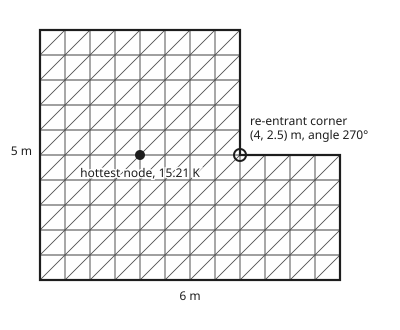
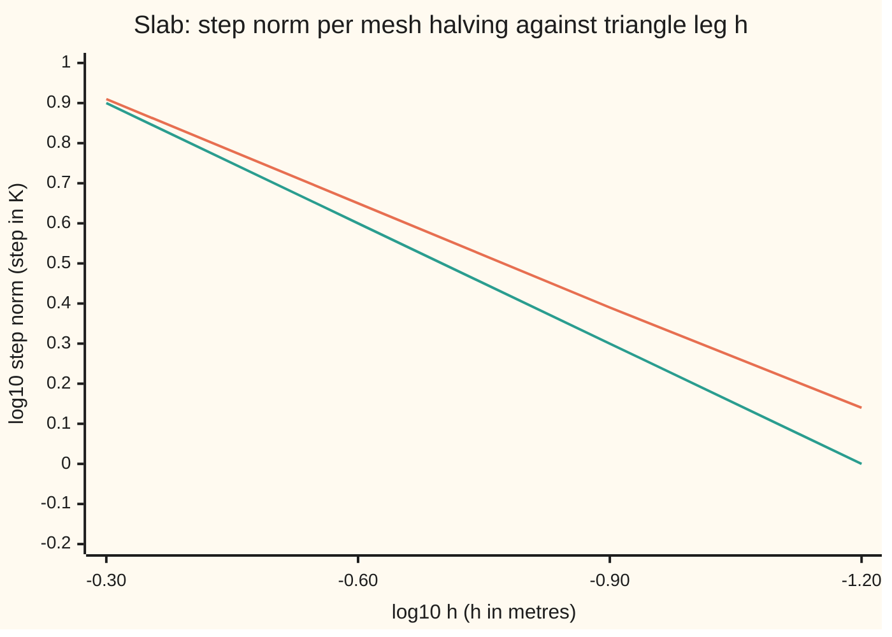

# Galerkin: solve the weak form on finitely many chosen shapes

[Syllabus](../../../SYLLABUS.md) → [Partial differential equations](../README.md) → [Weak Solutions and Free Boundaries](../README.md#s06) → Galerkin

---

## General Overview

Wing 08's [Finite differences](../../08-Differential%20equations%20and%20dynamics/07-Series%20Solutions%20and%20Boundary%20Problems/07-finite-differences-for-boundary-problems.md) solved a boundary problem on a line by writing the equation at grid points. This card solves one on a real floor plan, and proves how close the answer is.

A concrete floor slab is L-shaped: 6 m by 5 m, with a 2 m by 2.5 m corner missing, so its area is 25 m². A heating mat under it puts in 2 W per square metre. The slab's edges sit on a ground beam held at 5 °C. How warm does the slab get, and where?

The unknown is the temperature rise above the edges, in kelvin, at each point of the floor. The region is the L. The data are the heating and the edge temperature. No formula solves this heat equation on an L, so the answer has to be computed.

**Galerkin's method** picks a finite set of simple shapes and asks the weak form of the equation ([Weak solutions](01-weak-solutions-and-the-weak-formulation.md)) to hold only when it is tested with those shapes. Here the shapes are tent-shaped **hat functions** on a mesh of 200 right triangles: 79 hats, one per inside **node** (a corner of the mesh that is not on the slab's edge). That gives 79 equations in 79 unknowns. The hottest node comes out 15.21 K above the edges, 20.21 °C, and the slab's average rise is 6.75 K.

How good is that? **Céa's lemma** answers without knowing the true temperature: the Galerkin answer is the best the 79 hats can do, measured in the energy norm (the square root of the summed squared slope). Any other mix of the same hats is further off, even the one that matches the true temperature at every corner.

**Galerkin's method asks the weak form to hold only for finitely many chosen test shapes; Lax-Milgram makes that small system solvable, and Céa's lemma makes its answer the best those shapes allow, up to a fixed factor: exactly the best in the energy norm when the problem is symmetric.**

**What kind of fact this is:** a method, with two theorems proved on this card in Why it works: Galerkin orthogonality and Céa's lemma. The slower convergence caused by the L's inside corner is a theorem stated with a source and shown by the checks.

### The picture: the slab and its 200 triangles

<p align="center"></p>

To scale: 50 px per metre, from the checks' `figure,` line (corner and hottest node). Every square of 0.5 m is cut by the same diagonal into two right triangles. The circle marks the **re-entrant corner**, the one inside corner where the boundary turns through 270°. The dot marks the hottest node of the 200-triangle answer.

---

## The formula

**The problem.** The unknown $`u(x, y)`$ is the rise above the edge temperature, in K, at the point $`(x, y)`$ m. The region $`\Omega`$ is the open L; its edges are $`\partial\Omega`$. Heat flows sideways through concrete of conductivity $`k`$ = 2 W/(m K) and thickness $`b`$ = 0.1 m, and the mat puts in $`p`$ = 2 W/m² (all three illustrative). Heat balance on a small patch gives

```math
-\Delta u = f \ \text{ in } \Omega, \qquad u = 0 \ \text{ on } \partial\Omega, \qquad f = \frac{p}{k\,b} = 10\ \text{K/m}^2 .
```

This is the steady state. It treats the slab as insulated above and below, so heat leaves only through the edges. A real slab also loses heat downward, so its rises are lower than these.

$`\Delta u = u_{xx} + u_{yy}`$ is the Laplacian. The solution sought is weak: it lies in $`H^1_0(\Omega)`$, the shapes with finite energy that are zero on the edges ([Sobolev spaces](02-sobolev-spaces-for-pdes.md)). In that class it is unique ([Lax-Milgram](03-lax-milgram-and-elliptic-existence.md)).

**The weak form.** Multiply by a test shape $`v`$ and integrate by parts:

```math
a(u, v) = (f, v) \ \text{ for every } v \in H^1_0, \qquad a(u, v) = \int_\Omega \nabla u \cdot \nabla v \, dA, \qquad (f, v) = \int_\Omega f\,v \, dA .
```

**Galerkin's method.** Choose a finite-dimensional space $`V_h`$ inside $`H^1_0`$: here, every sum of the 79 hats. Find $`u_h`$ in $`V_h`$ with

```math
a(u_h, v_h) = (f, v_h) \ \text{ for every } v_h \in V_h \quad\Longleftrightarrow\quad K\,U = F, \qquad K_{ij} = a(\varphi_j, \varphi_i), \quad F_i = (f, \varphi_i) .
```

**Read it aloud:** the Galerkin answer passes the weak form's test for every chosen shape; written in the hats, that is one linear system, the stiffness matrix times the corner values equals the loads.

**Céa's lemma.** The error is at most a fixed factor times the best possible error from $`V_h`$:

```math
\lVert u - u_h\rVert_{H^1} \;\le\; \frac{M}{\alpha}\,\min_{v_h \in V_h} \lVert u - v_h\rVert_{H^1}, \qquad \lVert u - u_h\rVert_a \;=\; \min_{v_h \in V_h} \lVert u - v_h\rVert_a \ \text{ when } a \text{ is symmetric.}
```

**Read it aloud:** the Galerkin error is no more than M over alpha times the error of the best shape in the space; in the energy norm of a symmetric problem it is the best, with factor one.

The **energy norm** is $`\lVert w\rVert_a = \sqrt{a(w, w)}`$, the square root of the summed squared slope. The $`H^1`$ norm adds the plain size: $`\lVert w\rVert_{H^1}^2 = \int_\Omega (w^2 + \lvert\nabla w\rvert^2)\,dA`$.

| Symbol | Plain meaning | In our example | Push it up and the answer… |
| --- | --- | --- | --- |
| $`u`$, $`u_h`$ | the true rise, K; the Galerkin answer | peak 15.2094 K on 200 triangles | — |
| $`x`$, $`y`$, $`\Omega`$, $`\partial\Omega`$ | position, m; the L-shaped region; its edges | 6 m by 5 m less a 2 m by 2.5 m corner, 25 m² | a bigger slab: higher rises |
| $`p`$, $`k`$, $`b`$ | heating per area; conductivity; thickness | 2 W/m², 2 W/(m K), 0.1 m | $`p`$ up: every rise grows in proportion |
| $`f`$ | heating over conduction, $`p/(kb)`$ | 10 K/m² | the rise grows in proportion |
| $`v`$, $`v_h`$, $`H^1_0`$ | a test shape; one built from hats; all finite-energy shapes zero on the edges | — | — |
| $`a(u, v)`$, $`(f, v)`$ | energy pairing; load pairing | $`a(u_h, u_h)`$ = 1688.2232 K² | — |
| $`V_h`$, $`\varphi_i`$ | the chosen space; hat $`i`$: 1 at node $`i`$, 0 at every other node, flat on each triangle | 79 hats | more hats: a smaller error |
| $`h`$ | leg length of each right triangle | 0.5 m | halved: the error falls to $`2^{-s}`$ times itself |
| $`K`$, $`U`$, $`F`$ | stiffness matrix; corner values; loads | 79 by 79; $`U`$ up to 15.2094 K; 2.5 K each | — |
| $`M`$, $`\alpha`$, $`C_P`$ | bound and coercivity constants; Poincaré constant | 1; at least 0.4008; $`C_P^2 \le`$ 1.4949 m² | $`\alpha`$ down: Céa's factor grows |
| $`w`$, $`\lVert w\rVert_a`$, $`\lVert w\rVert_{H^1}`$ | any shape in $`H^1_0`$; its energy norm; its full norm | Galerkin error 9.7363 K | — |
| $`s`$, $`r`$, $`\theta`$ | observed order; distance and angle from the re-entrant corner | $`s`$ = 0.823 on the L, 0.999 on a rectangle | — |

### When it holds

- **The form is bounded and coercive on $`H^1_0`$.** These are the hypotheses of [Lax-Milgram](03-lax-milgram-and-elliptic-existence.md). Drop the edge condition and constants cost no energy: every row of the 123-node matrix sums to 0.0 while the loads sum to 250.0 K, so the system has no solution.
- **The chosen shapes lie inside $`H^1_0`$.** Hats are continuous and vanish on the edges. Shapes that jump across a triangle side have infinite energy, and the proof below fails.
- **The system is solved exactly.** Galerkin orthogonality is a property of the solved equations. A solver stopped early loses it.
- **The rate needs smoothness.** Céa's lemma turns the error into a question of how well hats fit $`u`$. On the rectangle that fit improves like $`h`$; at the L's re-entrant corner $`u`$ bends like $`r^{2/3}`$ and the order drops toward 2/3.

---

## Why it works

### Step 0: the error is perpendicular to every chosen shape

The true $`u`$ passes the weak form's test for every shape. The Galerkin $`u_h`$ passes it for the chosen shapes. Subtract, and the error $`u - u_h`$ fails nothing on the chosen shapes: its energy pairing with each of them is zero.

In the geometry of the energy pairing, that says the error is perpendicular to $`V_h`$. The closest point of a flat space to a given point is the foot of the perpendicular. So $`u_h`$ is the closest shape in $`V_h`$ to $`u`$, in energy. Céa's lemma is that sentence with the constants written in.

### Step 1: the small system has one solution

Lax-Milgram applies to $`V_h`$ unchanged, with the same $`M`$ and $`\alpha`$. In matrix terms, $`U^{\mathsf T} K U = a(v_h, v_h) > 0`$ for every nonzero $`U`$, where $`v_h = \sum_i U_i\,\varphi_i`$: the stiffness matrix is symmetric and positive definite, so it is invertible. The checks solve it by conjugate gradients, an iteration for such matrices.

The constants for this slab, in the $`H^1`$ norm with lengths in metres: $`\lvert a(u, v)\rvert \le \lVert u\rVert_{H^1}\lVert v\rVert_{H^1}`$, so $`M = 1`$. The Poincaré inequality $`\int_\Omega v^2\,dA \le C_P^2 \int_\Omega \lvert\nabla v\rvert^2 dA`$ gives $`\alpha \ge 1/(1 + C_P^2)`$. The L sits inside the 6 m by 5 m box, so $`C_P^2`$ is at most one over the box's lowest eigenvalue, $`\pi^2(1/36 + 1/25)`$ = 0.66894 /m²: $`C_P^2 \le`$ 1.4949 m², $`\alpha \ge`$ 0.4008, and $`M/\alpha \le`$ 2.4949. In the energy norm, $`M = \alpha = 1`$.

### Step 2: Galerkin orthogonality

```math
a(u - u_h,\ v_h) = 0 \quad \text{for every } v_h \in V_h .
```

The proof is one line: $`a(u, v_h) = (f, v_h)`$ because $`v_h`$ is in $`H^1_0`$, and $`a(u_h, v_h) = (f, v_h)`$ by construction; subtract.

The checks test it. The true $`u`$ is replaced by the answer on 51,200 triangles, whose hats include the coarse hats, since every 0.5 m triangle splits into four smaller ones. The largest pairing of the error with a coarse hat is 0.0000 K. For the interpolant (the hat mix that matches the fine answer at the 79 corners) it is 2.1512 K.

### Step 3: Céa's lemma

Take any $`v_h`$ in $`V_h`$. Coercivity, then orthogonality (replace $`u_h`$ by $`v_h`$ in the second slot, since $`v_h - u_h`$ is in $`V_h`$), then boundedness:

```math
\alpha\,\lVert u - u_h\rVert^2 \le a(u - u_h,\ u - u_h) = a(u - u_h,\ u - v_h) \le M\,\lVert u - u_h\rVert\,\lVert u - v_h\rVert .
```

Divide by $`\alpha\,\lVert u - u_h\rVert`$: that is Céa's lemma. No step used symmetry, so it also covers forms with a drift term.

<details>
<summary>Detailed proof: in the symmetric case the factor is exactly 1</summary>

For symmetric $`a`$, write $`u - v_h = (u - u_h) + (u_h - v_h)`$. The second piece lies in $`V_h`$, so orthogonality removes the cross term:

$`\displaystyle \lVert u - v_h\rVert_a^2 = \lVert u - u_h\rVert_a^2 + \lVert u_h - v_h\rVert_a^2 \ \ge\ \lVert u - u_h\rVert_a^2 .`$

Equality holds only at $`v_h = u_h`$. Taking $`v_h = 0`$ gives a second fact the checks use: $`\lVert u - u_h\rVert_a^2 = a(u, u) - a(u_h, u_h)`$, because $`a(u_h, u_h) = (f, u_h) = a(u, u_h)`$. So the energy error, squared, is the part of $`a(u, u)`$ that the Galerkin answer is missing.

</details>

The checks measure both sides against the 51,200-triangle answer. The Galerkin error is 9.7363 K by summing the error's squared slopes, and 9.7363 K again as the square root of the missing energy. The interpolant's error is 9.9266 K: larger, as the lemma requires, even though it matches the fine answer at every corner.

### Step 4: building the system from hats

[Finite elements](../../16-Numerical%20analysis/07-PDE%20Solvers/07-finite-elements-galerkin-and-hat-functions.md) builds the weak form and hats on a cable, and [Assembly and error](../../16-Numerical%20analysis/07-PDE%20Solvers/08-finite-element-assembly-and-error.md) adds element matrices into one system. In two dimensions the recipe is the same.

On one right triangle with legs $`h`$, each hat has a constant slope, and the triangle's $`3 \times 3`$ matrix of pairings is

```math
\frac12\begin{pmatrix} 1 & -1 & 0 \\ -1 & 2 & -1 \\ 0 & -1 & 1 \end{pmatrix},
```

with the right-angle corner in the middle row. No $`h`$ is left: slopes scale like $`1/h`$, squared $`1/h^2`$, and the area like $`h^2`$. Each corner gets a third of the triangle's load, $`f h^2/6`$ = 0.41667 K.

An inside node touches six triangles. Adding their pieces gives 4 on the diagonal, −1 for the four neighbours along the grid lines, 0 for the two along the diagonal, and load $`f h^2`$ = 2.5 K. That row is the five-point difference stencil, wing 08's three-point stencil taken in both directions. The checks build the matrix both ways; the largest gap is 0.0. On this mesh Galerkin and finite differences agree exactly; Galerkin brings the error theory, and keeps working on meshes where no stencil exists.

### Step 5: how fast the error falls, and what the corner does

Céa's lemma turns the error into a fitting question: how close can hats of size $`h`$ get to $`u`$? If $`u`$ has square-integrable second derivatives, the interpolant's energy error is at most a constant times $`h`$ times their size, so the Galerkin error falls like $`h`$.

On the 6 m by 5 m rectangle the exact energy is a sine series, $`a(u, u)`$ = 3114.7295 K² (terms up to 399 in each direction; the tail is below 0.000040 K²), and the true errors are 9.1271, 4.5978, 2.3040, 1.1528 and 0.5765 K as $`h`$ halves from 0.5 m: order 1.

At the re-entrant corner, $`u`$ behaves like $`r^{2/3}\sin(2\theta/3)`$, with $`r`$ the distance from the corner and $`\theta`$ the angle from one edge. Its slope grows like $`r^{-1/3}`$: infinite at the corner. Its second derivatives are not square-integrable, so the order-1 fit fails. On meshes of equal triangles the energy error then falls like $`h^{2/3}`$. Grisvard (Sources) derives the corner behaviour.

Without the exact $`u`$, the checks use nested meshes. By Step 3's fold, the change between meshes $`h`$ and $`h/2`$ has energy norm $`\sqrt{a(u_{h/2}, u_{h/2}) - a(u_h, u_h)}`$. If the error is $`C h^s`$, these steps shrink by $`2^{-s}`$ too.

| Triangles | $`h`$, m | $`a(u_h, u_h)`$, K² | Peak, K | Step to next mesh, K |
| ---: | ---: | ---: | ---: | ---: |
| 200 | 0.5 | 1688.2232 | 15.2094 | 8.1890 |
| 800 | 0.25 | 1755.2830 | 15.4726 | 4.4480 |
| 3,200 | 0.125 | 1775.0678 | 15.5764 | 2.4548 |
| 12,800 | 0.0625 | 1781.0936 | 15.6015 | 1.3876 |
| 51,200 | 0.03125 | 1783.0192 | 15.6137 | — |

Observed orders on the L: 0.881, 0.858, 0.823, falling toward 2/3. On the rectangle: 0.987, 0.996, 0.999.



Orange: the L, slope 0.82 and flattening. Green: the full rectangle, slope 1.00. Each slope on this log-log plot is an observed order.

### Step 6: an estimate of the true error

With the order known to tend to 2/3, the missing energy beyond the finest mesh can be estimated as a geometric tail: the last step's energy times $`1/(2^{4/3} - 1)`$. That gives $`a(u, u) \approx`$ 1784.286 K². The same rule with order 1 on the rectangle gives 3114.7294 K², against the series' 3114.7295.

So the 200-triangle answer's energy error is about 9.801 K, which is 23.2 % of the solution's own energy norm, 42.241 K. This is an estimate, not a bound: it assumes the order has settled.

---

## Worked numbers, by hand

| Step | Arithmetic | Value |
| --- | --- | --- |
| heating over conduction | $`f = p/(kb) = 2/(2 \times 0.1)`$ | 10 K/m² |
| one triangle's matrix | right angle in the middle row | 0.50 −0.50 0.00 / −0.50 1.00 −0.50 / 0.00 −0.50 0.50 |
| load per corner | $`10 \times 0.125 / 3`$ | 0.41667 K |
| an inside row | six triangles added | 4 on the diagonal, −1 to four neighbours, load 2.5 K |
| system size | 123 nodes, of which the inside ones are unknown | 79 unknowns |
| hottest row, checked | $`4 \times 15.2094 - (14.0862 + 14.7487 + 15.0013 + 14.5015)`$ | 2.5000 K, the load (to rounding) |
| average rise | $`a(u_h, u_h)/(f \times 25) = 1688.2232/250`$ | 6.7529 K |
| Galerkin error, against 51,200 triangles | $`\sqrt{1783.0192 - 1688.2232}`$ | 9.7363 K |
| interpolant error, same reference | squared slopes summed | 9.9266 K |
| **hottest node** | Galerkin, 200 triangles | **15.2094 K above the edges, at (2.0, 2.5) m** |

The floor's warmest point on the coarse mesh is 20.21 °C, and no mix of the same 79 hats has a smaller energy error than this one.

### What breaks if you drop a piece

| Mistake | Comes out at | What went wrong |
| --- | --- | --- |
| A re-entrant corner (smoothness fails) | observed order 0.823, not 0.999 | $`u`$ bends like $`r^{2/3}`$ at the corner, and the hats cannot fit it at order 1 |
| Edges not held (coercivity fails) | row sums 0.0, loads 250.0 K: no answer | a constant rise costs no energy, so the matrix has no inverse |
| The one-dimensional $`1/h`$ factor on each element matrix | peak 7.6047 K, then 3.8681 K on 800 triangles | in two dimensions the $`h`$ cancels; the wrong factor halves every answer at each refinement |
| Whole triangle load on each corner | peak 45.6283 K | each corner takes a third of the load, not all of it: three times too hot |

---

## Code, from first principles, and it actually runs

The script builds the mesh, adds every triangle's matrix into place, and solves by conjugate gradients written out. Four independent roads check it:

1. The assembled matrix against the five-point stencil written directly, entry by entry.
2. The Galerkin error as summed squared slopes against the missing energy.
3. On the rectangle, the meshes' extrapolated energy against the exact sine series.
4. Céa's lemma and orthogonality against the 51,200-triangle answer.

### Python

```python
# Galerkin and finite elements -- the check behind the card.  Standard library only.  An L-shaped
# floor slab, 6 m x 5 m less the corner x > 4 m, y > 2.5 m; a mat puts in p = 2 W/m^2 through
# b = 0.1 m of concrete with k = 2 W/(m K) (illustrative).  The rise u above the 5 C edges solves
# -Laplacian(u) = f = p/(k b), u = 0 on the edges.  Nothing imported solves anything.
import math
P, KC, B = 2.0, 2.0, 0.1
F = P / (KC * B)                                    # f = 10 K/m^2
HS = [0.5, 0.25, 0.125, 0.0625, 0.03125]            # element leg h, in metres
SIDES = [(1, 0), (-1, 0), (0, 1), (0, -1), (1, 1), (-1, -1)]   # where a hat reaches
def level(h, notch=True):             # the mesh: nodes, numbered unknowns, triangles
    nx, ny = round(6 / h), round(5 / h)
    cell = lambda i, j: 0 <= i < nx and 0 <= j < ny and not (notch and i * h >= 4 and j * h >= 2.5)
    near = lambda i, j: [cell(i - a, j - b) for a in (0, 1) for b in (0, 1)]
    nodes = [(i, j) for i in range(nx + 1) for j in range(ny + 1) if any(near(i, j))]
    idx = {n: k for k, n in enumerate(n for n in nodes if all(near(*n)))}
    tris = [t for i in range(nx) for j in range(ny) if cell(i, j) for t in
            (((i, j), (i + 1, j), (i + 1, j + 1)), ((i, j), (i + 1, j + 1), (i, j + 1)))]
    return dict(h=h, nodes=nodes, idx=idx, tris=tris, A=h * h * len(tris) / 2)
def element(h, t):                    # one triangle's stiffness, from its corners' coordinates
    x = [(a * h, b * h) for a, b in t]
    a2 = (x[1][0] - x[0][0]) * (x[2][1] - x[0][1]) - (x[2][0] - x[0][0]) * (x[1][1] - x[0][1])
    g = [((x[(k + 1) % 3][1] - x[(k + 2) % 3][1]) / a2, (x[(k + 2) % 3][0] - x[(k + 1) % 3][0]) / a2)
         for k in range(3)]
    return [[a2 / 2 * (g[p][0] * g[q][0] + g[p][1] * g[q][1]) for q in range(3)] for p in range(3)], a2 / 2
def assemble(L, idx, share=3.0, scale=1.0):        # road 1: add each triangle into its rows
    K, b = [dict() for _ in idx], [0.0] * len(idx)
    for t in L['tris']:
        ke, area = element(L['h'], t)
        for p in range(3):
            if t[p] in idx:
                b[idx[t[p]]] += F * area / share
                for q in range(3):
                    if t[q] in idx:
                        K[idx[t[p]]][idx[t[q]]] = K[idx[t[p]]].get(idx[t[q]], 0.0) + ke[p][q] * scale
    return K, b
def stencil(L):                       # road 2: the 5-point difference stencil, written directly
    idx, K = L['idx'], [dict() for _ in L['idx']]
    for (i, j), k in idx.items():
        K[k] = {k: 4.0, **{idx[n]: -1.0 for n in ((i + 1, j), (i - 1, j), (i, j + 1), (i, j - 1)) if n in idx}}
    return K, [F * L['h'] ** 2] * len(idx)
def cg(K, b):                         # conjugate gradients, written out
    rows, n = [list(r.items()) for r in K], len(b)
    x, r, p, it = [0.0] * n, b[:], b[:], 0
    rr = stop = sum(v * v for v in b)
    while rr > 1e-26 * stop:
        Ap = [sum(v * p[c] for c, v in row) for row in rows]
        al = rr / sum(p[k] * Ap[k] for k in range(n))
        x, r = [x[k] + al * p[k] for k in range(n)], [r[k] - al * Ap[k] for k in range(n)]
        rn = sum(v * v for v in r)
        p, rr, it = [r[k] + rn / rr * p[k] for k in range(n)], rn, it + 1
    return x, it
def prolong(v, fine):                 # a coarse broken surface, read off on the halved mesh
    return {(i, j): (v.get((i // 2, j // 2), 0.0) + v.get(((i + 1) // 2, (j + 1) // 2), 0.0)) / 2
            for (i, j) in fine['nodes']}
def restrict(r, coarse):              # its transpose: halved-mesh numbers tested on coarse hats
    return {(i, j): r.get((2 * i, 2 * j), 0.0) + sum(r.get((2 * i + a, 2 * j + b), 0.0) for a, b in SIDES) / 2
            for (i, j) in coarse['idx']}
def edge_energy(v):                   # a(w, w) on right triangles = sum of squared edge jumps
    return sum((v[(i + a, j + b)] - v[(i, j)]) ** 2 for (i, j) in v for a, b in ((1, 0), (0, 1)) if (i + a, j + b) in v)
def series(a, b, N=399):              # exact energy of the a x b rectangle: sine series, odd m, n <= N
    E = sum(64 * F * F * a * b / (math.pi ** 6 * m * m * n * n * (m * m / a ** 2 + n * n / b ** 2))
            for m in range(1, N + 1, 2) for n in range(1, N + 1, 2))
    return E, 64 * F * F * a * b / math.pi ** 4 / 8 * (a * a + b * b) / (6 * (N - 1) ** 3)

L0 = level(0.5)
ke, area = element(0.5, L0['tris'][0])
print(f"slab area {L0['A']:.1f} m^2, f = p/(k b) = {F:.1f} K/m^2")
print("element, legs 0.5 m:", " / ".join(" ".join(f"{v:.2f}" for v in row) for row in ke), f"; load per corner {F * area / 3:.5f} K")
K0, b0 = assemble(L0, L0['idx'])
S0, c0 = stencil(L0)
gap = max(abs(K0[k].get(c, 0.0) - S0[k].get(c, 0.0)) for k in range(len(K0)) for c in set(K0[k]) | set(S0[k]))
print(f"200 triangles: {len(L0['nodes'])} nodes, {len(b0)} unknowns; row 40: diagonal {K0[40][40]:.1f}, side "
      f"{K0[40][41]:.1f}, load {b0[40]:.2f} K; gap to the stencil {gap:.1f}, load gap {max(abs(b0[k] - c0[k]) for k in range(len(b0))):.1f}")
runs = {}
for name, notch in (("L", True), ("rect", False)):
    for h in HS:
        L = level(h, notch)
        K, b = assemble(L, L['idx'])
        u, it = cg(K, b)
        m = max(L['idx'], key=lambda n: u[L['idx'][n]])
        E = sum(b[k] * u[k] for k in range(len(b)))
        runs[(name, h)] = (L, K, u, E, m)
        print(f"{name:4s} {len(L['tris']):5d} triangles, h {h:.5f} m: {len(b):5d} unknowns, CG {it:3d} steps, energy "
              f"{E:.4f} K^2, mean rise {E / (F * L['A']):.4f} K, peak {max(u):.4f} K at ({m[0] * h:.4f}, {m[1] * h:.4f}) m")
Ex, tail = series(6.0, 5.0)
print(f"rect by sine series: energy {Ex:.4f} K^2, tail below {tail:.6f} K^2; true errors "
      f"{', '.join(f'{math.sqrt(Ex - runs[('rect', h)][3]):.4f}' for h in HS)} K")
order = {}
for name in ("L", "rect"):
    d = [runs[(name, HS[k + 1])][3] - runs[(name, HS[k])][3] for k in range(4)]
    order[name] = [0.5 * math.log2(d[k] / d[k + 1]) for k in range(3)]
    print(f"{name:4s} step norms sqrt(dE): {', '.join(f'{math.sqrt(x):.4f}' for x in d)} K; observed orders "
          f"{', '.join(f'{x:.3f}' for x in order[name])}")
    print(f"chart, {name}, log10 h: {', '.join(f'{math.log10(h):.2f}' for h in HS[:4])}; log10 step norm: "
          f"{', '.join(f'{math.log10(math.sqrt(x)):.2f}' for x in d)}")
ext = {nm: runs[(nm, HS[4])][3] + (runs[(nm, HS[4])][3] - runs[(nm, HS[3])][3]) / (2 ** (2 * s) - 1)
       for nm, s in (("L", 2 / 3), ("rect", 1))}
print(f"extrapolated energy: rect {ext['rect']:.4f} K^2 (series {Ex:.4f}), L {ext['L']:.3f} K^2")
Lc, Kc, uc, Ec, mc = runs[("L", 0.5)]
Lf, Kf, uf, Ef, mf = runs[("L", 0.03125)]
vf = {n: (uf[Lf['idx'][n]] if n in Lf['idx'] else 0.0) for n in Lf['nodes']}
vc = {n: (uc[Lc['idx'][n]] if n in Lc['idx'] else 0.0) for n in Lc['nodes']}
chain = [runs[("L", h)][0] for h in HS]
res = {}
for name, coarse in (("Galerkin", vc), ("interpolant", {(i, j): vf[(16 * i, 16 * j)] for (i, j) in Lc['nodes']})):
    for L in chain[1:]:
        coarse = prolong(coarse, L)
    w = {n: vf[n] - coarse[n] for n in vf}
    wl = [w[n] for n in Lf['idx']]
    r = {n: sum(v * wl[c] for c, v in Kf[k].items()) for n, k in Lf['idx'].items()}
    for L in chain[-2::-1]:
        r = restrict(r, L)
    res[name] = (math.sqrt(edge_energy(w)), max(abs(x) for x in r.values()))
print(f"Cea at 200 triangles, against 51200: Galerkin error {res['Galerkin'][0]:.4f} K (sqrt(E_f - E_h) = "
      f"{math.sqrt(Ef - Ec):.4f} K), interpolant error {res['interpolant'][0]:.4f} K")
i, j = mc
print(f"hottest node row: 4 x {uc[Lc['idx'][mc]]:.4f} - ({' + '.join(f'{vc[n]:.4f}' for n in ((i - 1, j), (i + 1, j), (i, j - 1), (i, j + 1)))})"
      f" = {4 * vc[mc] - sum(vc[n] for n in ((i - 1, j), (i + 1, j), (i, j - 1), (i, j + 1))):.4f} K")
print(f"orthogonality, largest a(error, coarse hat): Galerkin {res['Galerkin'][1]:.4f} K, interpolant {res['interpolant'][1]:.4f} K")
print(f"node values not exact: largest gap at the 79 nodes {max(abs(vc[n] - vf[(16 * n[0], 16 * n[1])]) for n in Lc['idx']):.4f} K")
print(f"estimated true error at 200 triangles {math.sqrt(ext['L'] - Ec):.3f} K, "
      f"{100 * math.sqrt((ext['L'] - Ec) / ext['L']):.1f} % of {math.sqrt(ext['L']):.3f} K")
lam = math.pi ** 2 * (1 / 36 + 1 / 25)
print(f"Lax-Milgram: lambda1 of the 6 m x 5 m box {lam:.5f} /m^2, C_P^2 <= {1 / lam:.4f} m^2, M = 1, "
      f"alpha >= {1 / (1 + 1 / lam):.4f}, Cea factor M/alpha <= {1 + 1 / lam:.4f}")
Ka, ba = assemble(Lc, {n: k for k, n in enumerate(Lc['nodes'])})
print(f"mistake, edges not held: largest row sum {max(abs(sum(r.values())) for r in Ka):.1f}, load sum {sum(ba):.1f} K")
for h in (0.5, 0.25):
    L = level(h)
    print(f"mistake, 1/h scaling from the cable card: peak {max(cg(*assemble(L, L['idx'], scale=1 / h))[0]):.4f} K at {len(L['tris'])} triangles")
print(f"mistake, whole triangle load on each corner: peak {max(cg(*assemble(Lc, Lc['idx'], share=1.0))[0]):.4f} K")
print(f"figure, corner (4.00, 2.50) m, hottest node at 200 triangles ({mc[0] * 0.5:.2f}, {mc[1] * 0.5:.2f}) m, {5 + max(uc):.2f} C")
assert gap < 1e-12 and max(abs(b0[k] - c0[k]) for k in range(len(b0))) < 1e-12   # road 1 = road 2
assert abs(res['Galerkin'][0] ** 2 - (Ef - Ec)) < 1e-6 * (Ef - Ec)           # edge sum = Pythagoras
assert res['Galerkin'][0] < res['interpolant'][0] and res['Galerkin'][1] < 1e-8 < res['interpolant'][1]
assert all(Ex - runs[("rect", h)][3] > 0 for h in HS) and abs(ext['rect'] - Ex) < 1e-3   # series road
assert 0.6 < order["L"][2] < 0.9 and abs(order["rect"][2] - 1) < 0.01         # the corner costs order
print("ALL CHECKS PASS")
```

**Ran 2026-11-15 on macOS, Python 3.14.10, standard library only. All checks passed. Output, pasted from the run:**

```
slab area 25.0 m^2, f = p/(k b) = 10.0 K/m^2
element, legs 0.5 m: 0.50 -0.50 0.00 / -0.50 1.00 -0.50 / 0.00 -0.50 0.50 ; load per corner 0.41667 K
200 triangles: 123 nodes, 79 unknowns; row 40: diagonal 4.0, side -1.0, load 2.50 K; gap to the stencil 0.0, load gap 0.0
L      200 triangles, h 0.50000 m:    79 unknowns, CG  42 steps, energy 1688.2232 K^2, mean rise 6.7529 K, peak 15.2094 K at (2.0000, 2.5000) m
L      800 triangles, h 0.25000 m:   357 unknowns, CG  92 steps, energy 1755.2830 K^2, mean rise 7.0211 K, peak 15.4726 K at (2.2500, 2.2500) m
L     3200 triangles, h 0.12500 m:  1513 unknowns, CG 187 steps, energy 1775.0678 K^2, mean rise 7.1003 K, peak 15.5764 K at (2.1250, 2.3750) m
L    12800 triangles, h 0.06250 m:  6225 unknowns, CG 378 steps, energy 1781.0936 K^2, mean rise 7.1244 K, peak 15.6015 K at (2.1875, 2.3125) m
L    51200 triangles, h 0.03125 m: 25249 unknowns, CG 761 steps, energy 1783.0192 K^2, mean rise 7.1321 K, peak 15.6137 K at (2.1562, 2.3438) m
rect   240 triangles, h 0.50000 m:    99 unknowns, CG  28 steps, energy 3031.4261 K^2, mean rise 10.1048 K, peak 21.5483 K at (3.0000, 2.5000) m
rect   960 triangles, h 0.25000 m:   437 unknowns, CG  63 steps, energy 3093.5897 K^2, mean rise 10.3120 K, peak 21.6507 K at (3.0000, 2.5000) m
rect  3840 triangles, h 0.12500 m:  1833 unknowns, CG 129 steps, energy 3109.4209 K^2, mean rise 10.3647 K, peak 21.6765 K at (3.0000, 2.5000) m
rect 15360 triangles, h 0.06250 m:  7505 unknowns, CG 262 steps, energy 3113.4007 K^2, mean rise 10.3780 K, peak 21.6830 K at (3.0000, 2.5000) m
rect 61440 triangles, h 0.03125 m: 30369 unknowns, CG 527 steps, energy 3114.3972 K^2, mean rise 10.3813 K, peak 21.6846 K at (3.0000, 2.5000) m
rect by sine series: energy 3114.7295 K^2, tail below 0.000040 K^2; true errors 9.1271, 4.5978, 2.3040, 1.1528, 0.5765 K
L    step norms sqrt(dE): 8.1890, 4.4480, 2.4548, 1.3876 K; observed orders 0.881, 0.858, 0.823
chart, L, log10 h: -0.30, -0.60, -0.90, -1.20; log10 step norm: 0.91, 0.65, 0.39, 0.14
rect step norms sqrt(dE): 7.8844, 3.9788, 1.9949, 0.9983 K; observed orders 0.987, 0.996, 0.999
chart, rect, log10 h: -0.30, -0.60, -0.90, -1.20; log10 step norm: 0.90, 0.60, 0.30, -0.00
extrapolated energy: rect 3114.7294 K^2 (series 3114.7295), L 1784.286 K^2
Cea at 200 triangles, against 51200: Galerkin error 9.7363 K (sqrt(E_f - E_h) = 9.7363 K), interpolant error 9.9266 K
hottest node row: 4 x 15.2094 - (14.0862 + 14.7487 + 15.0013 + 14.5015) = 2.5000 K
orthogonality, largest a(error, coarse hat): Galerkin 0.0000 K, interpolant 2.1512 K
node values not exact: largest gap at the 79 nodes 0.8763 K
estimated true error at 200 triangles 9.801 K, 23.2 % of 42.241 K
Lax-Milgram: lambda1 of the 6 m x 5 m box 0.66894 /m^2, C_P^2 <= 1.4949 m^2, M = 1, alpha >= 0.4008, Cea factor M/alpha <= 2.4949
mistake, edges not held: largest row sum 0.0, load sum 250.0 K
mistake, 1/h scaling from the cable card: peak 7.6047 K at 200 triangles
mistake, 1/h scaling from the cable card: peak 3.8681 K at 800 triangles
mistake, whole triangle load on each corner: peak 45.6283 K
figure, corner (4.00, 2.50) m, hottest node at 200 triangles (2.00, 2.50) m, 20.21 C
ALL CHECKS PASS
```

### Rust

Same numbers, same labels, built with `rustc --edition 2021 -O`. The helper `psum` adds a list the way Python's `sum()` does, so the two programs stop their iterations at the same step.

```rust
// Galerkin and finite elements -- the same check as the Python, in Rust.  No crates.  An L-shaped
// floor slab, 6 m x 5 m less the corner x > 4 m, y > 2.5 m; a mat puts in p = 2 W/m^2 through
// b = 0.1 m of concrete with k = 2 W/(m K) (illustrative).  The rise u above the 5 C edges solves
// -Laplacian(u) = f = p/(k b), u = 0 on the edges.  Nothing imported solves anything.
use std::f64::consts::PI;
const F: f64 = 2.0 / (2.0 * 0.1);                   // f = 10 K/m^2
const HS: [f64; 5] = [0.5, 0.25, 0.125, 0.0625, 0.03125];
const SIDES: [(i64, i64); 6] = [(1, 0), (-1, 0), (0, 1), (0, -1), (1, 1), (-1, -1)];
type Tri = [(i64, i64); 3];
type Mat = Vec<Vec<(usize, f64)>>;
struct Level { h: f64, nx: i64, ny: i64, nodes: Vec<(i64, i64)>, idx: Vec<i64>, inner: Vec<(i64, i64)>, tris: Vec<Tri>, a: f64 }
impl Level {
    fn id(&self, i: i64, j: i64) -> Option<usize> { if i < 0 || j < 0 || i > self.nx || j > self.ny { None } else { Some((i * (self.ny + 1) + j) as usize) } }
    fn get(&self, v: &[f64], i: i64, j: i64) -> f64 { self.id(i, j).map_or(0.0, |k| v[k]) }
    fn grid(&self) -> Vec<f64> { vec![0.0; ((self.nx + 1) * (self.ny + 1)) as usize] }
}
fn psum<I: Iterator<Item = f64>>(it: I) -> f64 {   // compensated sum, the rule Python's sum() uses
    let (mut s, mut c) = (0.0f64, 0.0f64);
    for x in it { let t = s + x; c += if s.abs() >= x.abs() { (s - t) + x } else { (x - t) + s }; s = t }
    if c != 0.0 && c.is_finite() { s + c } else { s }
}
fn level(h: f64, notch: bool) -> Level {           // the mesh: nodes, numbered unknowns, triangles
    let (nx, ny) = ((6.0 / h).round() as i64, (5.0 / h).round() as i64);
    let cell = |i: i64, j: i64| 0 <= i && i < nx && 0 <= j && j < ny && !(notch && i as f64 * h >= 4.0 && j as f64 * h >= 2.5);
    let (mut nodes, mut inner, mut tris, mut idx) = (vec![], vec![], vec![], vec![-1i64; ((nx + 1) * (ny + 1)) as usize]);
    for i in 0..=nx { for j in 0..=ny {
        let c = [cell(i, j), cell(i, j - 1), cell(i - 1, j), cell(i - 1, j - 1)];
        if c.iter().any(|&x| x) { nodes.push((i, j)) }
        if c.iter().all(|&x| x) { idx[(i * (ny + 1) + j) as usize] = inner.len() as i64; inner.push((i, j)) }
    } }
    for i in 0..nx { for j in (0..ny).filter(|&j| cell(i, j)) { tris.extend([[(i, j), (i + 1, j), (i + 1, j + 1)], [(i, j), (i + 1, j + 1), (i, j + 1)]]) } }
    Level { h, nx, ny, nodes, idx, inner, a: h * h * tris.len() as f64 / 2.0, tris }
}
fn element(h: f64, t: &Tri) -> ([[f64; 3]; 3], f64) {   // one triangle's stiffness, from its corners
    let x: Vec<(f64, f64)> = t.iter().map(|&(a, b)| (a as f64 * h, b as f64 * h)).collect();
    let a2 = (x[1].0 - x[0].0) * (x[2].1 - x[0].1) - (x[2].0 - x[0].0) * (x[1].1 - x[0].1);
    let g: Vec<(f64, f64)> = (0..3).map(|k| ((x[(k + 1) % 3].1 - x[(k + 2) % 3].1) / a2, (x[(k + 2) % 3].0 - x[(k + 1) % 3].0) / a2)).collect();
    (std::array::from_fn(|p| std::array::from_fn(|q| a2 / 2.0 * (g[p].0 * g[q].0 + g[p].1 * g[q].1))), a2 / 2.0)
}
fn assemble(l: &Level, idx: &[i64], n: usize, share: f64, scale: f64) -> (Mat, Vec<f64>) {  // road 1
    let (mut k, mut b): (Mat, Vec<f64>) = (vec![vec![]; n], vec![0.0; n]);
    for t in &l.tris {
        let (ke, area) = element(l.h, t);
        let ix: Vec<i64> = t.iter().map(|&(i, j)| idx[l.id(i, j).unwrap()]).collect();
        for p in (0..3).filter(|&p| ix[p] >= 0) {
            let r = ix[p] as usize;
            b[r] += F * area / share;
            for (q, c) in (0..3).filter(|&q| ix[q] >= 0).map(|q| (q, ix[q] as usize)) {
                match k[r].iter_mut().find(|e| e.0 == c) { Some(e) => e.1 += ke[p][q] * scale, None => k[r].push((c, ke[p][q] * scale)) }
    } } }
    (k, b)
}
fn stencil(l: &Level, r: usize, c: usize) -> f64 {  // road 2: the 5-point stencil, written directly
    let ((i, j), (a, b)) = (l.inner[r], l.inner[c]);
    if r == c { 4.0 } else if (i - a).abs() + (j - b).abs() == 1 { -1.0 } else { 0.0 }
}
fn cg(k: &Mat, b: &[f64]) -> (Vec<f64>, usize) {     // conjugate gradients, written out
    let (n, stop) = (b.len(), psum(b.iter().map(|v| v * v)));
    let (mut x, mut r, mut p, mut it, mut rr) = (vec![0.0; n], b.to_vec(), b.to_vec(), 0, stop);
    while rr > 1e-26 * stop {
        let ap: Vec<f64> = k.iter().map(|row| psum(row.iter().map(|&(c, v)| v * p[c]))).collect();
        let al = rr / psum((0..n).map(|q| p[q] * ap[q]));
        for q in 0..n { x[q] += al * p[q]; r[q] -= al * ap[q] }
        let rn = psum(r.iter().map(|v| v * v));
        for q in 0..n { p[q] = r[q] + rn / rr * p[q] }
        (rr, it) = (rn, it + 1);
    }
    (x, it)
}
fn prolong(c: &Level, v: &[f64], f: &Level) -> Vec<f64> {   // a coarse broken surface on the halved mesh
    let mut out = f.grid();
    for &(i, j) in &f.nodes { out[f.id(i, j).unwrap()] = (c.get(v, i / 2, j / 2) + c.get(v, (i + 1) / 2, (j + 1) / 2)) / 2.0 }
    out
}
fn restrict(f: &Level, r: &[f64], c: &Level) -> Vec<f64> {   // its transpose, onto the coarse hats
    let mut out = c.grid();
    for &(i, j) in &c.inner {
        out[c.id(i, j).unwrap()] = f.get(r, 2 * i, 2 * j) + psum(SIDES.iter().map(|&(a, b)| f.get(r, 2 * i + a, 2 * j + b))) / 2.0;
    }
    out
}
fn edge_energy(l: &Level, v: &[f64], present: &[bool]) -> f64 {  // a(w, w) = sum of squared edge jumps
    psum(l.nodes.iter().flat_map(|&(i, j)| [(1, 0), (0, 1)].into_iter().filter_map(move |(a, b)| l.id(i + a, j + b)
        .filter(|&q| present[q]).map(|q| (v[q] - v[l.id(i, j).unwrap()]).powi(2)))))
}
fn series(a: f64, b: f64, n: i64) -> (f64, f64) {   // exact energy of the a x b rectangle: sine series
    let e = psum((1..=n).step_by(2).flat_map(|m| (1..=n).step_by(2).map(move |k| { let (m, k) = (m as f64, k as f64);
        64.0 * F * F * a * b / (PI.powi(6) * m * m * k * k * (m * m / (a * a) + k * k / (b * b))) })));
    (e, 64.0 * F * F * a * b / PI.powi(4) / 8.0 * (a * a + b * b) / (6.0 * ((n - 1) as f64).powi(3)))
}
fn peak(u: &[f64]) -> usize { (0..u.len()).fold(0, |m, q| if u[q] > u[m] { q } else { m }) }
fn j(v: Vec<String>) -> String { v.join(", ") }
fn main() {
    let l0 = level(0.5, true); let (ke, area) = element(0.5, &l0.tris[0]);
    println!("slab area {:.1} m^2, f = p/(k b) = {:.1} K/m^2", l0.a, F);
    let rows: Vec<String> = ke.iter().map(|r| r.iter().map(|v| format!("{:.2}", v)).collect::<Vec<_>>().join(" ")).collect();
    println!("element, legs 0.5 m: {} ; load per corner {:.5} K", rows.join(" / "), F * area / 3.0);
    let n0 = l0.inner.len(); let (k0, b0) = assemble(&l0, &l0.idx, n0, 3.0, 1.0);
    let entry = |r: usize, c: usize| k0[r].iter().find(|e| e.0 == c).map_or(0.0, |e| e.1);
    let gap = (0..n0 * n0).map(|q| (entry(q / n0, q % n0) - stencil(&l0, q / n0, q % n0)).abs()).fold(0.0, f64::max);
    let lgap = b0.iter().map(|v| (v - F * 0.25).abs()).fold(0.0, f64::max);
    println!("200 triangles: {} nodes, {} unknowns; row 40: diagonal {:.1}, side {:.1}, load {:.2} K; gap to the stencil {:.1}, load gap {:.1}",
             l0.nodes.len(), n0, entry(40, 40), entry(40, 41), b0[40], gap, lgap);
    let mut runs: Vec<(Level, Mat, Vec<f64>, f64, usize)> = vec![];
    for (name, notch) in [("L", true), ("rect", false)] { for &h in HS.iter() {
        let l = level(h, notch); let (k, b) = assemble(&l, &l.idx, l.inner.len(), 3.0, 1.0);
        let (u, it) = cg(&k, &b); let (m, e) = (peak(&u), psum((0..b.len()).map(|q| b[q] * u[q])));
        println!("{:4} {:5} triangles, h {:.5} m: {:5} unknowns, CG {:3} steps, energy {:.4} K^2, mean rise {:.4} K, peak {:.4} K at ({:.4}, {:.4}) m",
                 name, l.tris.len(), h, b.len(), it, e, e / (F * l.a), u[m], l.inner[m].0 as f64 * h, l.inner[m].1 as f64 * h);
        runs.push((l, k, u, e, m));
    } }
    let (ex, tail) = series(6.0, 5.0, 399);
    println!("rect by sine series: energy {:.4} K^2, tail below {:.6} K^2; true errors {} K", ex, tail,
             j((5..10).map(|q| format!("{:.4}", (ex - runs[q].3).sqrt())).collect()));
    let mut order = vec![]; for (s, name) in [(0, "L"), (5, "rect")] {
        let d: Vec<f64> = (0..4).map(|q| runs[s + q + 1].3 - runs[s + q].3).collect();
        let o: Vec<f64> = (0..3).map(|q| 0.5 * (d[q] / d[q + 1]).log2()).collect();
        println!("{:4} step norms sqrt(dE): {} K; observed orders {}", name, j(d.iter().map(|x| format!("{:.4}", x.sqrt())).collect()),
                 j(o.iter().map(|x| format!("{:.3}", x)).collect()));
        println!("chart, {}, log10 h: {}; log10 step norm: {}", name, j(HS[..4].iter().map(|h| format!("{:.2}", h.log10())).collect()),
                 j(d.iter().map(|x| format!("{:.2}", x.sqrt().log10())).collect()));
        order.push(o[2]);
    }
    let ext = |s: usize, p: f64| runs[s + 4].3 + (runs[s + 4].3 - runs[s + 3].3) / (2f64.powf(2.0 * p) - 1.0);
    let (ext_l, ext_r) = (ext(0, 2.0 / 3.0), ext(5, 1.0));
    println!("extrapolated energy: rect {:.4} K^2 (series {:.4}), L {:.3} K^2", ext_r, ex, ext_l);
    let ((lc, uc, ec, mc), (lf, kf, uf, ef)) = ((&runs[0].0, &runs[0].2, runs[0].3, runs[0].4), (&runs[4].0, &runs[4].1, &runs[4].2, runs[4].3));
    let full = |l: &Level, u: &[f64]| { let mut v = l.grid(); for (q, &(i, j)) in l.inner.iter().enumerate() { v[l.id(i, j).unwrap()] = u[q] } v };
    let (vf, vc) = (full(lf, uf), full(lc, uc));
    let (mut present, mut interp) = (vec![false; vf.len()], lc.grid());
    for &(i, j) in &lf.nodes { present[lf.id(i, j).unwrap()] = true }
    for &(i, j) in &lc.nodes { interp[lc.id(i, j).unwrap()] = lf.get(&vf, 16 * i, 16 * j) }
    let mut res = vec![];
    for mut v in [vc.clone(), interp] {
        for q in 1..5 { v = prolong(&runs[q - 1].0, &v, &runs[q].0) }
        let w: Vec<f64> = (0..vf.len()).map(|q| vf[q] - v[q]).collect();
        let mut r = lf.grid();
        for (q, &(i, j)) in lf.inner.iter().enumerate() { r[lf.id(i, j).unwrap()] = psum(kf[q].iter().map(|&(c, x)| x * w[lf.id(lf.inner[c].0, lf.inner[c].1).unwrap()])) }
        for q in (0..4).rev() { r = restrict(&runs[q + 1].0, &r, &runs[q].0) }
        res.push((edge_energy(lf, &w, &present).sqrt(), r.iter().map(|x| x.abs()).fold(0.0, f64::max)));
    }
    println!("Cea at 200 triangles, against 51200: Galerkin error {:.4} K (sqrt(E_f - E_h) = {:.4} K), interpolant error {:.4} K",
             res[0].0, (ef - ec).sqrt(), res[1].0);
    let (i, jj) = lc.inner[mc];
    let nb = [(i - 1, jj), (i + 1, jj), (i, jj - 1), (i, jj + 1)].map(|(a, b)| lc.get(&vc, a, b));
    println!("hottest node row: 4 x {:.4} - ({}) = {:.4} K", uc[mc], nb.map(|x| format!("{:.4}", x)).join(" + "), 4.0 * uc[mc] - psum(nb.into_iter()));
    println!("orthogonality, largest a(error, coarse hat): Galerkin {:.4} K, interpolant {:.4} K", res[0].1, res[1].1);
    let ng = lc.inner.iter().map(|&(a, b)| (lc.get(&vc, a, b) - lf.get(&vf, 16 * a, 16 * b)).abs()).fold(0.0, f64::max);
    println!("node values not exact: largest gap at the 79 nodes {:.4} K", ng);
    println!("estimated true error at 200 triangles {:.3} K, {:.1} % of {:.3} K", (ext_l - ec).sqrt(), 100.0 * ((ext_l - ec) / ext_l).sqrt(), ext_l.sqrt());
    let lam = PI.powi(2) * (1.0 / 36.0 + 1.0 / 25.0);
    println!("Lax-Milgram: lambda1 of the 6 m x 5 m box {:.5} /m^2, C_P^2 <= {:.4} m^2, M = 1, alpha >= {:.4}, Cea factor M/alpha <= {:.4}",
             lam, 1.0 / lam, 1.0 / (1.0 + 1.0 / lam), 1.0 + 1.0 / lam);
    let mut all = vec![-1i64; lc.idx.len()];
    for (q, &(i, j)) in lc.nodes.iter().enumerate() { all[lc.id(i, j).unwrap()] = q as i64 }
    let (ka, ba) = assemble(lc, &all, lc.nodes.len(), 3.0, 1.0);
    let rs = ka.iter().map(|r| psum(r.iter().map(|e| e.1)).abs()).fold(0.0, f64::max);
    println!("mistake, edges not held: largest row sum {:.1}, load sum {:.1} K", rs, psum(ba.into_iter()));
    let solve = |l: &Level, share: f64, scale: f64| { let (k, b) = assemble(l, &l.idx, l.inner.len(), share, scale); let u = cg(&k, &b).0; u[peak(&u)] };
    for h in [0.5, 0.25] { let l = level(h, true);
        println!("mistake, 1/h scaling from the cable card: peak {:.4} K at {} triangles", solve(&l, 3.0, 1.0 / h), l.tris.len()) }
    println!("mistake, whole triangle load on each corner: peak {:.4} K", solve(lc, 1.0, 1.0));
    println!("figure, corner (4.00, 2.50) m, hottest node at 200 triangles ({:.2}, {:.2}) m, {:.2} C", i as f64 * 0.5, jj as f64 * 0.5, 5.0 + uc[mc]);
    assert!(gap < 1e-12 && lgap < 1e-12);                                    // road 1 = road 2
    assert!((res[0].0.powi(2) - (ef - ec)).abs() < 1e-6 * (ef - ec));       // edge sum = Pythagoras
    assert!(res[0].0 < res[1].0 && res[0].1 < 1e-8 && 1e-8 < res[1].1);      // Cea and orthogonality
    assert!((5..10).all(|q| ex - runs[q].3 > 0.0) && (ext_r - ex).abs() < 1e-3);   // series road
    assert!(0.6 < order[0] && order[0] < 0.9 && (order[1] - 1.0).abs() < 0.01);    // the corner costs order
    println!("ALL CHECKS PASS");
}
```

**Ran 2026-11-15 on macOS, rustc 1.98.1, no crates. All checks passed. Output, pasted from the run:**

```
slab area 25.0 m^2, f = p/(k b) = 10.0 K/m^2
element, legs 0.5 m: 0.50 -0.50 0.00 / -0.50 1.00 -0.50 / 0.00 -0.50 0.50 ; load per corner 0.41667 K
200 triangles: 123 nodes, 79 unknowns; row 40: diagonal 4.0, side -1.0, load 2.50 K; gap to the stencil 0.0, load gap 0.0
L      200 triangles, h 0.50000 m:    79 unknowns, CG  42 steps, energy 1688.2232 K^2, mean rise 6.7529 K, peak 15.2094 K at (2.0000, 2.5000) m
L      800 triangles, h 0.25000 m:   357 unknowns, CG  92 steps, energy 1755.2830 K^2, mean rise 7.0211 K, peak 15.4726 K at (2.2500, 2.2500) m
L     3200 triangles, h 0.12500 m:  1513 unknowns, CG 187 steps, energy 1775.0678 K^2, mean rise 7.1003 K, peak 15.5764 K at (2.1250, 2.3750) m
L    12800 triangles, h 0.06250 m:  6225 unknowns, CG 378 steps, energy 1781.0936 K^2, mean rise 7.1244 K, peak 15.6015 K at (2.1875, 2.3125) m
L    51200 triangles, h 0.03125 m: 25249 unknowns, CG 761 steps, energy 1783.0192 K^2, mean rise 7.1321 K, peak 15.6137 K at (2.1562, 2.3438) m
rect   240 triangles, h 0.50000 m:    99 unknowns, CG  28 steps, energy 3031.4261 K^2, mean rise 10.1048 K, peak 21.5483 K at (3.0000, 2.5000) m
rect   960 triangles, h 0.25000 m:   437 unknowns, CG  63 steps, energy 3093.5897 K^2, mean rise 10.3120 K, peak 21.6507 K at (3.0000, 2.5000) m
rect  3840 triangles, h 0.12500 m:  1833 unknowns, CG 129 steps, energy 3109.4209 K^2, mean rise 10.3647 K, peak 21.6765 K at (3.0000, 2.5000) m
rect 15360 triangles, h 0.06250 m:  7505 unknowns, CG 262 steps, energy 3113.4007 K^2, mean rise 10.3780 K, peak 21.6830 K at (3.0000, 2.5000) m
rect 61440 triangles, h 0.03125 m: 30369 unknowns, CG 527 steps, energy 3114.3972 K^2, mean rise 10.3813 K, peak 21.6846 K at (3.0000, 2.5000) m
rect by sine series: energy 3114.7295 K^2, tail below 0.000040 K^2; true errors 9.1271, 4.5978, 2.3040, 1.1528, 0.5765 K
L    step norms sqrt(dE): 8.1890, 4.4480, 2.4548, 1.3876 K; observed orders 0.881, 0.858, 0.823
chart, L, log10 h: -0.30, -0.60, -0.90, -1.20; log10 step norm: 0.91, 0.65, 0.39, 0.14
rect step norms sqrt(dE): 7.8844, 3.9788, 1.9949, 0.9983 K; observed orders 0.987, 0.996, 0.999
chart, rect, log10 h: -0.30, -0.60, -0.90, -1.20; log10 step norm: 0.90, 0.60, 0.30, -0.00
extrapolated energy: rect 3114.7294 K^2 (series 3114.7295), L 1784.286 K^2
Cea at 200 triangles, against 51200: Galerkin error 9.7363 K (sqrt(E_f - E_h) = 9.7363 K), interpolant error 9.9266 K
hottest node row: 4 x 15.2094 - (14.0862 + 14.7487 + 15.0013 + 14.5015) = 2.5000 K
orthogonality, largest a(error, coarse hat): Galerkin 0.0000 K, interpolant 2.1512 K
node values not exact: largest gap at the 79 nodes 0.8763 K
estimated true error at 200 triangles 9.801 K, 23.2 % of 42.241 K
Lax-Milgram: lambda1 of the 6 m x 5 m box 0.66894 /m^2, C_P^2 <= 1.4949 m^2, M = 1, alpha >= 0.4008, Cea factor M/alpha <= 2.4949
mistake, edges not held: largest row sum 0.0, load sum 250.0 K
mistake, 1/h scaling from the cable card: peak 7.6047 K at 200 triangles
mistake, 1/h scaling from the cable card: peak 3.8681 K at 800 triangles
mistake, whole triangle load on each corner: peak 45.6283 K
figure, corner (4.00, 2.50) m, hottest node at 200 triangles (2.00, 2.50) m, 20.21 C
ALL CHECKS PASS
```

The two outputs match line for line.

### Lean

Lean proves Steps 2 and 3, with Step 3's fold, for any bounded coercive form, and checks the slab's counts.

- Suppose $`u`$ solves the weak form, and $`u_h`$ in $`V_h`$ solves it for every $`v_h`$ in $`V_h`$. Then $`a(u - u_h, v_h) = 0`$ for every $`v_h`$ in $`V_h`$.
- Take the same $`u`$ and $`u_h`$, and let $`a`$ be bounded with constant $`M`$ and coercive with constant $`\alpha > 0`$. Then $`\lVert u - u_h\rVert \le (M/\alpha) \lVert u - v_h\rVert`$ for every $`v_h`$ in $`V_h`$.
- Suppose $`a`$ is also symmetric, and take any $`v_h`$ in $`V_h`$. Then $`\lVert u - v_h\rVert_a^2 = \lVert u - u_h\rVert_a^2 + \lVert u_h - v_h\rVert_a^2`$.
- Take the same symmetric case. Then $`u_h`$ is the only shape in $`V_h`$ with the smallest $`\lVert u - v_h\rVert_a`$.
- Take the same symmetric case. Then $`\lVert u - u_h\rVert_a^2 = a(u, u) - a(u_h, u_h)`$.
- The mesh has 123 nodes, 79 of them inside, and 200 triangles covering 25 m².
- The heating over conduction is 10 K/m², and each corner's load is 5/12 K, about 0.41667 K.
- An inside row's six triangles add up to 4 on the diagonal and a load of 2.5 K.
- With the edges not held, the loads sum to 250 K.

The solve, the peak of 15.2094 K, the error sizes, the constants and the observed orders are left to the Python and Rust checks.

```lean
-- Galerkin: for a bounded coercive form, the Galerkin error is perpendicular to every chosen shape, is at most M over alpha times the error of any chosen shape, and in the symmetric case is exactly the smallest in the energy norm.
import Mathlib.Analysis.InnerProductSpace.Basic
import Mathlib.Analysis.SpecialFunctions.Sqrt
import Mathlib.Data.Finset.Card
import Mathlib.Data.Finset.Prod
import Mathlib.Tactic.NormNum

/-- Céa's lemma. Let `V` be a real Hilbert space (the card's `H^1_0`) and `a(u, v)` a form,
linear in each slot, that is bounded, `|a(u, v)| ≤ M ‖u‖ ‖v‖`, and coercive,
`a(v, v) ≥ α ‖v‖²` with `α > 0`. Let `u` solve the weak form, `a(u, v) = (f, v)` for every `v`,
and let `V_h` be a chosen space of shapes inside `V`. If `u_h` lies in `V_h` and solves the
Galerkin system exactly, `a(u_h, v_h) = (f, v_h)` for every `v_h` in `V_h`, then the Galerkin
error is at most `M / α` times the error of every shape in `V_h`:
`‖u - u_h‖ ≤ (M / α) ‖u - v_h‖`. -/
theorem cea_lemma {V : Type*} [NormedAddCommGroup V] [InnerProductSpace ℝ V] [CompleteSpace V]
    (a : V →ₗ[ℝ] V →ₗ[ℝ] ℝ) (f : V →ₗ[ℝ] ℝ) {M α : ℝ}
    (h_bounded : ∀ v w, |a v w| ≤ M * ‖v‖ * ‖w‖)
    (hα : 0 < α) (h_coercive : ∀ v, α * ‖v‖ ^ 2 ≤ a v v)
    (Vh : Submodule ℝ V) {u uh : V}
    (hu : ∀ v, a u v = f v)
    (huh_mem : uh ∈ Vh) (huh : ∀ vh ∈ Vh, a uh vh = f vh) :
    ∀ vh ∈ Vh, ‖u - uh‖ ≤ M / α * ‖u - vh‖ := by
  intro vh hvh
  have horth : ∀ w ∈ Vh, a (u - uh) w = 0 := by
    intro w hw
    rw [map_sub, LinearMap.sub_apply, hu, huh w hw, sub_self]
  have hd : uh - vh ∈ Vh := Vh.sub_mem huh_mem hvh
  have key : a (u - uh) (u - uh) = a (u - uh) (u - vh) := by
    have : u - vh = (u - uh) + (uh - vh) := by abel
    rw [this, map_add, horth _ hd, add_zero]
  have h1 := h_coercive (u - uh)
  have h2 := h_bounded (u - uh) (u - vh)
  have h3 : α * ‖u - uh‖ ^ 2 ≤ M * ‖u - uh‖ * ‖u - vh‖ := by
    rw [key] at h1
    exact h1.trans ((le_abs_self _).trans h2)
  rw [div_mul_eq_mul_div, le_div_iff₀ hα]
  rcases (norm_nonneg (u - uh)).eq_or_lt with h0 | hpos
  · rw [← h0, zero_mul]
    have hw1 := h_coercive (u - vh)
    have hw2 := (le_abs_self _).trans (h_bounded (u - vh) (u - vh))
    rcases (norm_nonneg (u - vh)).eq_or_lt with hw0 | hwpos
    · rw [← hw0, mul_zero]
    · have : 0 ≤ M * ‖u - vh‖ * ‖u - vh‖ := by
        nlinarith [mul_pos hα (pow_pos hwpos 2)]
      exact nonneg_of_mul_nonneg_left this hwpos
  · have : ‖u - uh‖ * (α * ‖u - uh‖) ≤ ‖u - uh‖ * (M * ‖u - vh‖) := by nlinarith [h3]
    have := le_of_mul_le_mul_left this hpos
    linarith

/-- Galerkin orthogonality. If `u` solves the weak form, `a(u, v) = (f, v)` for every `v`, and
`u_h` in the chosen space `V_h` solves the Galerkin system, `a(u_h, v_h) = (f, v_h)` for every
`v_h` in `V_h`, then the error is perpendicular to every chosen shape:
`a(u - u_h, v_h) = 0` for every `v_h` in `V_h`. -/
theorem galerkin_orthogonality {V : Type*} [NormedAddCommGroup V] [InnerProductSpace ℝ V]
    [CompleteSpace V]
    (a : V →ₗ[ℝ] V →ₗ[ℝ] ℝ) (f : V →ₗ[ℝ] ℝ) (Vh : Submodule ℝ V) {u uh : V}
    (hu : ∀ v, a u v = f v)
    (huh_mem : uh ∈ Vh) (huh : ∀ vh ∈ Vh, a uh vh = f vh) :
    ∀ vh ∈ Vh, a (u - uh) vh = 0 := by
  intro vh hvh
  rw [map_sub, LinearMap.sub_apply, hu, huh vh hvh, sub_self]

/-- The symmetric case: the factor is exactly 1. If the form is also symmetric,
`a(v, w) = a(w, v)`, then in the energy norm `‖w‖_a = √(a(w, w))`:
Pythagoras holds, `‖u - v_h‖_a² = ‖u - u_h‖_a² + ‖u_h - v_h‖_a²`; so the Galerkin answer is the
best shape in `V_h`, `‖u - u_h‖_a ≤ ‖u - v_h‖_a`, with equality only at `v_h = u_h`; and the
squared energy error is the missing energy, `‖u - u_h‖_a² = a(u, u) - a(u_h, u_h)`. -/
theorem galerkin_best_in_energy_norm {V : Type*} [NormedAddCommGroup V] [InnerProductSpace ℝ V]
    [CompleteSpace V]
    (a : V →ₗ[ℝ] V →ₗ[ℝ] ℝ) (f : V →ₗ[ℝ] ℝ) {M α : ℝ}
    (h_bounded : ∀ v w, |a v w| ≤ M * ‖v‖ * ‖w‖)
    (hα : 0 < α) (h_coercive : ∀ v, α * ‖v‖ ^ 2 ≤ a v v)
    (h_symm : ∀ v w, a v w = a w v)
    (Vh : Submodule ℝ V) {u uh : V}
    (hu : ∀ v, a u v = f v)
    (huh_mem : uh ∈ Vh) (huh : ∀ vh ∈ Vh, a uh vh = f vh) :
    (∀ vh ∈ Vh, a (u - vh) (u - vh) = a (u - uh) (u - uh) + a (uh - vh) (uh - vh)) ∧
    (∀ vh ∈ Vh, √(a (u - uh) (u - uh)) ≤ √(a (u - vh) (u - vh))) ∧
    (∀ vh ∈ Vh, √(a (u - vh) (u - vh)) = √(a (u - uh) (u - uh)) → vh = uh) ∧
    a (u - uh) (u - uh) = a u u - a uh uh := by
  have horth : ∀ w ∈ Vh, a (u - uh) w = 0 := by
    intro w hw
    rw [map_sub, LinearMap.sub_apply, hu, huh w hw, sub_self]
  have pyth : ∀ vh ∈ Vh, a (u - vh) (u - vh) = a (u - uh) (u - uh) + a (uh - vh) (uh - vh) := by
    intro vh hvh
    have hd : uh - vh ∈ Vh := Vh.sub_mem huh_mem hvh
    have : u - vh = (u - uh) + (uh - vh) := by abel
    rw [this]
    simp only [map_add, LinearMap.add_apply]
    rw [horth _ hd, h_symm (uh - vh) (u - uh), horth _ hd]
    ring
  have nonneg : ∀ v, 0 ≤ a v v := fun v =>
    le_trans (mul_nonneg hα.le (sq_nonneg _)) (h_coercive v)
  refine ⟨pyth, ?_, ?_, ?_⟩
  · intro vh hvh
    apply Real.sqrt_le_sqrt
    rw [pyth vh hvh]
    linarith [nonneg (uh - vh)]
  · intro vh hvh heq
    have heq' := (Real.sqrt_inj (nonneg _) (nonneg _)).1 heq
    rw [pyth vh hvh] at heq'
    have hz : a (uh - vh) (uh - vh) = 0 := by linarith
    have hc := h_coercive (uh - vh)
    rw [hz] at hc
    have : ‖uh - vh‖ ^ 2 ≤ 0 := by
      by_contra hneg
      rw [not_le] at hneg
      linarith [mul_pos hα hneg]
    have hn : ‖uh - vh‖ = 0 := by nlinarith [norm_nonneg (uh - vh)]
    rw [norm_eq_zero, sub_eq_zero] at hn
    exact hn.symm
  · have h0 := horth uh huh_mem
    simp only [map_sub, LinearMap.sub_apply] at h0 ⊢
    rw [h_symm uh u]
    linarith

-- The slab's whole-number facts. Grid nodes are (i, j), at (0.5 i, 0.5 j) m, 0 ≤ i ≤ 12, 0 ≤ j ≤ 10;
-- the missing corner is x > 4 m and y > 2.5 m, that is i > 8 and j > 5.

-- 123 nodes on the L.
set_option maxRecDepth 4000 in
example : ((Finset.range 13 ×ˢ Finset.range 11).filter
    (fun p : ℕ × ℕ => ¬ (8 < p.1 ∧ 5 < p.2))).card = 123 := by decide

-- 79 inside nodes (not on the outer edges, not on the two edges of the re-entrant corner).
set_option maxRecDepth 4000 in
example : ((Finset.range 13 ×ˢ Finset.range 11).filter
    (fun p : ℕ × ℕ => 0 < p.1 ∧ p.1 < 12 ∧ 0 < p.2 ∧ p.2 < 10 ∧ ¬ (8 ≤ p.1 ∧ 5 ≤ p.2))).card = 79 := by
  decide

-- 200 triangles: each 0.5 m square of the L (lower-left corner (i, j)) is cut into two.
set_option maxRecDepth 4000 in
example : 2 * ((Finset.range 12 ×ˢ Finset.range 10).filter
    (fun p : ℕ × ℕ => ¬ (8 ≤ p.1 ∧ 5 ≤ p.2))).card = 200 := by decide

-- Area 6 × 5 - 2 × 2.5 = 25 m², and 25 m² over 0.125 m² per triangle is 200 triangles.
example : (6 : ℚ) * 5 - 2 * (5 / 2) = 25 ∧ (25 : ℚ) / ((1 / 2) ^ 2 / 2) = 200 := by norm_num

-- f = p / (k b) = 2 / (2 × 0.1) = 10 K/m².
example : (2 : ℚ) / (2 * (1 / 10)) = 10 := by norm_num

-- Load per corner f h² / 6 = 10 × 0.125 / 3 = 5/12 K (0.41667 K).
example : (10 : ℚ) * (1 / 2) ^ 2 / 6 = 5 / 12 ∧ (10 : ℚ) * (1 / 8) / 3 = 5 / 12 := by norm_num

-- An inside row: six triangles, two with the node at the right angle (entry 1 each) and four
-- with it at an acute corner (entry 1/2 each), give 4 on the diagonal; six loads of 5/12 K
-- give f h² = 2.5 K.
example : 2 * (1 : ℚ) + 4 * (1 / 2) = 4 ∧ 6 * ((5 : ℚ) / 12) = 10 * (1 / 2) ^ 2 ∧
    10 * ((1 : ℚ) / 2) ^ 2 = 5 / 2 := by norm_num

-- Edges not held: the loads sum to f × area = 10 × 25 = 250 K.
example : (10 : ℚ) * 25 = 250 := by norm_num

#print axioms cea_lemma
#print axioms galerkin_orthogonality
#print axioms galerkin_best_in_energy_norm
```

**Checked 2026-11-15 on macOS, Lean 4.36.0-rc2, Mathlib v4.36.0-rc2. Every proof is complete and uses only Lean's standard axioms. Output, pasted from the run:**

```
'cea_lemma' depends on axioms: [propext, Classical.choice, Quot.sound]
'galerkin_orthogonality' depends on axioms: [propext, Classical.choice, Quot.sound]
'galerkin_best_in_energy_norm' depends on axioms: [propext, Classical.choice, Quot.sound]
```

> [!TIP]
> **Try changing**
> Guess first, then run it.
> - **Double the heating.** Set `P = 4.0`. Guess first: every rise doubles (peak 30.4188 K), every energy grows four times, and the orders stay put. All asserts pass.
> - **Fill in the corner.** In `level`, change `j * h >= 2.5` to `j * h >= 5`, so no cell is cut out. Guess first: the "L" becomes the rectangle and its orders jump to 0.987, 0.996, 0.999. The last assert stops the run.
> - **Stop the solver early.** In `cg`, change `1e-26` to `1e-6`. Guess first: the answers still look right to a few digits, but orthogonality is lost: the Galerkin pairing with a coarse hat comes out at 0.0063 K instead of 0.0000 K, and the second assert stops the run.

---

## The usual mistake

> [!warning]
> **Reading "best" as "exact at the nodes".** Céa's lemma promises the best fit in energy, not at the corners. On the cable of [Assembly and error](../../16-Numerical%20analysis/07-PDE%20Solvers/08-finite-element-assembly-and-error.md) the node values happen to be exact. On the slab they are not: the 79 corner values differ from the 51,200-triangle answer by up to 0.8763 K. The interpolant matches the corners and still has the larger energy error, 9.9266 K against 9.7363 K.
>
> - **Expecting order 1 on any floor plan.** The L's inside corner gives 0.823 and falling, against 0.999 on the rectangle.
> - **Carrying the $`1/h`$ of one dimension into two.** The peak comes out at 7.6047 K instead of 15.2094 K, and halves again on the next mesh.
> - **Dropping Céa's factor.** With the full $`H^1`$ norm the guarantee is $`M/\alpha \le`$ 2.4949 times the best fit, not 1. Only the energy norm of a symmetric problem gives factor 1.
> - **Forgetting the edges.** Without the held edges the matrix's rows sum to 0.0 and there is no answer at all.

---

## Where you meet it in real life

- **Thermal bridges in buildings.** Heat loss through slab edges and wall junctions is computed on triangle meshes. The standard EN ISO 10211 sets how such a numerical model is built and checked.
- **Stress at inside corners.** Brackets, window openings in aircraft skins and L-shaped plates concentrate stress at re-entrant corners. Engineers refine the mesh there, because a uniform mesh loses order exactly as on this card.
- **Electronics cooling.** Heat spreading in a circuit board solves the same weak form, and the same lemma bounds the error.
- **Pricing with an early-exercise right.** [An American option](09-american-options-as-a-free-boundary-problem.md) is an obstacle problem ([The obstacle problem](08-obstacle-problems-and-variational-inequalities.md)), and Galerkin's method on a constrained set of shapes is one way to compute it.

> **Say it back**
> The weak form is a test the true temperature passes for every shape. Galerkin's method keeps only finitely many shapes, here 79 hats, and solves the 79 equations that result. Both answers pass the chosen tests, so their difference is perpendicular, in energy, to every chosen shape. That makes the Galerkin answer the closest available, up to the factor M/α, which is 1 in the energy norm. How fast the error falls depends on how smooth the true answer is, and the L's inside corner slows it from order 1 toward 2/3.

---

## What this builds on

- [Lax-Milgram](03-lax-milgram-and-elliptic-existence.md): the constants $`M`$ and $`\alpha`$, and one weak solution in $`H^1_0`$; the same theorem on $`V_h`$ makes the 79-equation system solvable.
- [Finite differences](../../08-Differential%20equations%20and%20dynamics/07-Series%20Solutions%20and%20Boundary%20Problems/07-finite-differences-for-boundary-problems.md): the three-point stencil whose two-dimensional form the hat matrix reproduces.
- [Finite elements](../../16-Numerical%20analysis/07-PDE%20Solvers/07-finite-elements-galerkin-and-hat-functions.md): the weak form, hat functions and the best fit in energy, on a cable.
- [Assembly and error](../../16-Numerical%20analysis/07-PDE%20Solvers/08-finite-element-assembly-and-error.md): adding element matrices into one system, the two kinds of boundary condition, and the error estimate this card derives from Céa's lemma.

## Where this goes next

- [Elliptic regularity](05-elliptic-regularity-in-outline.md): when $`u`$ has square-integrable second derivatives, which is what decides between order 1 and the corner's 2/3.
- [The obstacle problem](08-obstacle-problems-and-variational-inequalities.md): Galerkin on a constrained set, where the weak form becomes an inequality.
- [An American option](09-american-options-as-a-free-boundary-problem.md): the same discretization pricing an option with an early-exercise boundary.
- [Bochner spaces and the weak heat equation](10-bochner-spaces-and-weak-solutions-of-the-heat-equation.md): a solution as a path through a space of functions.
- [Monotone operators](../07-Nonlinear%20PDE%20and%20Fluids/12-monotone-operators-and-minty-browder.md): Minty's trick solves nonlinear equations that have no energy.

The question this card leaves open: how should the triangles be graded toward the corner so that order 1 comes back?

---

## Sources

Verified 2026-11-15: every link below resolves to the publisher's page.

- Courant, R. "Variational methods for the solution of problems of equilibrium and vibrations." *Bulletin of the American Mathematical Society* 49 (1943): 1–23. [doi:10.1090/S0002-9904-1943-07818-4](https://doi.org/10.1090/S0002-9904-1943-07818-4). Piecewise-linear shapes on triangles, the start of the method used here.
- Céa, Jean. "Approximation variationnelle des problèmes aux limites." *Annales de l'Institut Fourier* 14 (1964): 345–444. [doi:10.5802/aif.181](https://doi.org/10.5802/aif.181). The lemma bounding the Galerkin error by the best approximation.
- Brenner, Susanne C., and L. Ridgway Scott. *The Mathematical Theory of Finite Element Methods*, 3rd ed. Springer, 2008. [doi:10.1007/978-0-387-75934-0](https://doi.org/10.1007/978-0-387-75934-0). Galerkin orthogonality, Céa's lemma, and the interpolation estimates on triangles.
- Grisvard, Pierre. *Elliptic Problems in Nonsmooth Domains*. SIAM Classics in Applied Mathematics, 2011. [doi:10.1137/1.9781611972030](https://doi.org/10.1137/1.9781611972030). The $`r^{2/3}`$ singularity at a 270° corner and why the solution lacks second derivatives there.
