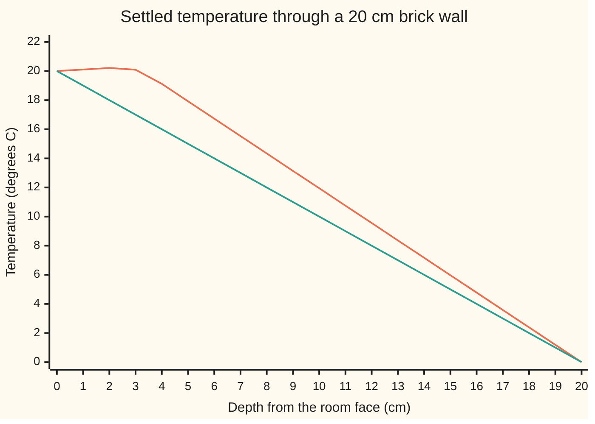
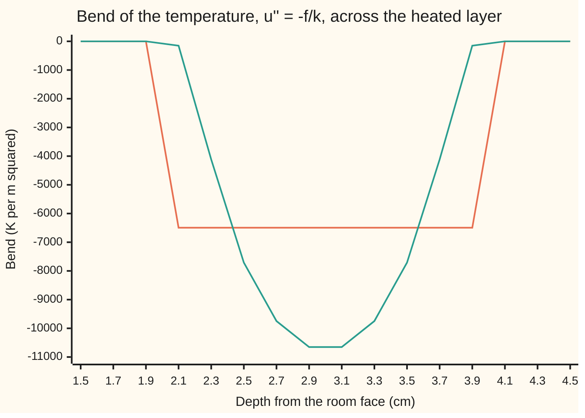

# Elliptic regularity: the weak solution turns out to be smooth after all

[Syllabus](../../../SYLLABUS.md) → [Partial differential equations](../README.md) → [Weak Solutions and Free Boundaries](../README.md#s06) → Elliptic regularity

---

## General Overview

[Laplace's equation](../../08-Differential%20equations%20and%20dynamics/10-The%20Classical%20PDEs/07-laplaces-equation-and-harmonic-functions.md) found settled temperatures by formulas that were smooth by construction. This card shows why that smoothness holds for any weak solution of an elliptic equation, where no formula is available.

Take a brick wall 20 cm thick, with conductivity 0.77 W/(m K) (illustrative). The room face is held at 20 °C and the outside face at 0 °C. Heating cables in a layer from 2 cm to 4 cm deep deliver 100 W per square metre of wall. The **unknown** is the settled temperature $`u(x)`$ at depth $`x`$. The **region** is the wall, $`0 < x < 0.2`$ m. The **data** are the two face temperatures and the heat made inside, $`f(x)`$, in W/m³.

[Lax-Milgram](03-lax-milgram-and-elliptic-existence.md) guarantees exactly one weak solution. "Weak" means the temperature was only asked to have one square-integrable slope. Nothing promised a bend (a second derivative), and the heat equation is a statement about the bend.

Regularity says the promise was too modest. The temperature has a bend wherever the heating is finite: −6493.51 K/m² inside the cable layer and zero elsewhere. Spread the same 100 W/m² smoothly from water pipes in the plaster, and the profile has derivatives of every order. Only when the heat is squeezed into a thin foil does the profile get a corner.

Without heating, the room loses 77 W/m² through this wall. With it, the room gains 8 W/m², and the smoothly heated wall peaks at 20.2407 °C, 2.422 cm deep. At 10 cm, all three heaters give the same 11.95 °C.

**A weak solution of an elliptic equation is exactly as smooth as its data allow: where the source has m derivatives and the coefficients have m + 1, the solution has m + 2, so smooth data on a smooth region make the weak solution a classical one after all.**

**What kind of fact this is:** theorems. The one-dimensional case is proved in full in Why it works. The interior and boundary theorems in any dimension are stated, with their proof by difference quotients outlined and sourced (Evans, Section 6.3; Gilbarg and Trudinger, Chapter 8).

### The picture: the heated wall against the unheated wall



Orange: the wall with 100 W/m² from water pipes spread smoothly between 2 cm and 4 cm. Teal: the same wall unheated, a straight line. Beyond 4 cm the heated profile is again straight, but higher.

---

## The formula

Reminders from this wing: $`\Omega`$ is the region, $`\partial\Omega`$ its boundary, $`\bar\Omega`$ the two together, and $`d`$ the number of space directions. The matrix $`(a_{ij})`$ and the ellipticity constant $`\theta`$ come from [Elliptic, parabolic, hyperbolic](../01-Classification%20and%20Well-Posedness/04-classification-elliptic-parabolic-hyperbolic.md). The weak form with test function $`v`$ comes from [Weak solutions](01-weak-solutions-and-the-weak-formulation.md), and $`H^1_0`$ from [Sobolev spaces](02-sobolev-spaces-for-pdes.md).

This card introduces $`H^m`$: the functions whose weak derivatives of every order up to $`m`$ have finite squared integrals. $`H^0`$ is $`L^2`$, the square-integrable functions. $`C^m`$ is the functions with $`m`$ continuous derivatives, and $`C^\infty`$ those with all of them.

The equation, in divergence form, with uniform ellipticity:

```math
-\sum_{i,j=1}^{d} \partial_j\big(a_{ij}(x)\,\partial_i u\big) + \sum_{i=1}^{d} b_i(x)\,\partial_i u + c(x)\,u = f \ \text{ in } \Omega, \qquad \sum_{i,j=1}^{d} a_{ij}(x)\,\xi_i\,\xi_j \ge \theta\,|\xi|^2
```

**Read it aloud:** the heat flowing out of each small piece, plus drift and absorption, balances the heat made there, and the conductivity matrix pushes at least $`\theta`$ in every direction $`\xi`$.

A weak solution $`u`$ in $`H^1`$ satisfies $`a(u, v) = (f, v)`$ for every test function $`v`$ in $`H^1_0(\Omega)`$. Here $`a(u, v)`$ is the integral of $`a_{ij}\,\partial_i u\,\partial_j v + b_i\,\partial_i u\,v + c\,u\,v`$, and $`(f, v)`$ is the integral of $`f v`$.

**Interior regularity.** Let $`V`$ be any region whose closure lies inside $`\Omega`$. Then

```math
a_{ij},\ b_i,\ c \in C^{m+1}(\Omega), \quad f \in H^m(\Omega) \;\Longrightarrow\; \lVert u\rVert_{H^{m+2}(V)} \le C_V\,\big(\lVert f\rVert_{H^m(\Omega)} + \lVert u\rVert_{L^2(\Omega)}\big)
```

**Read it aloud:** away from the edge, if the coefficients have $`m + 1`$ derivatives and the source has $`m`$, the solution has $`m + 2`$, and their size is bounded by the source's size plus the solution's own size.

**Boundary regularity.** If also the boundary is of class $`C^{m+2}`$ (locally the graph of a function with $`m + 2`$ continuous derivatives), the coefficients are in $`C^{m+1}(\bar\Omega)`$ and $`u`$ is in $`H^1_0(\Omega)`$, then

```math
\lVert u\rVert_{H^{m+2}(\Omega)} \le C_\Omega\,\big(\lVert f\rVert_{H^m(\Omega)} + \lVert u\rVert_{L^2(\Omega)}\big)
```

**Read it aloud:** with a smooth enough edge and zero edge values, the same gain of two derivatives holds all the way up to the edge.

Nonzero edge values are handled by subtracting a smooth function that has them: for the wall, the straight line from 20 °C to 0 °C. When everything is $`C^\infty`$, $`u`$ is in every $`H^m`$, so it is in $`C^\infty(\bar\Omega)`$ (Step 4).

For the wall, $`d = 1`$, $`a_{11} = k`$ = 0.77 W/(m K), $`b = c = 0`$ and $`\theta = k`$. The cable layer's source jumps at its edges, so $`f`$ is in $`H^0`$ but not $`H^1`$: the theorem promises $`u`$ in $`H^2`$, no more.

| Symbol | Plain meaning | In our example | Push it up and the answer… |
| --- | --- | --- | --- |
| $`x`$, $`L`$ | depth from the room face; wall thickness, m | 0 to 0.2 m | thicker: less heat lost |
| $`u`$, $`u'`$, $`u''`$ | temperature, °C; its slope, K/m; its bend, K/m² | peak 20.2161 °C; bend −6493.51 K/m² in the cable layer | — |
| $`k`$ | conductivity of the brick, W/(m K) | 0.77 (illustrative) | the bend $`-f/k`$ shrinks |
| $`f`$, $`F(x)`$, $`c_0`$ | heat made per m³; heat made between the room face and depth $`x`$, W/m²; heat flux into the room, W/m² | 5000 W/m³ in the cable layer; $`F(0.2)`$ = 100; $`c_0`$ = 8 | the bend grows in proportion |
| $`v`$, $`a(u, v)`$, $`(f, v)`$, $`g`$, $`\bar g`$ | a test function, zero on the boundary; the integrals of the weak form; in the fold, $`k u' + F`$ and its average | for the wall, $`a(u, v) = \int k\,u'\,v'\,dx`$; $`\bar g = c_0`$ = 8 | — |
| $`d`$, $`\Omega`$, $`\partial\Omega`$, $`\bar\Omega`$, $`V`$ | number of space directions; the region; its boundary; the two together; an inner region away from the boundary | 1; the wall; its two faces | $`V`$ nearer the boundary: $`C_V`$ grows |
| $`a_{ij}`$, $`b_i`$, $`c`$, $`\partial_i`$, $`\xi`$, $`\theta`$ | conductivity matrix; drift; absorption; derivative in direction $`i`$; a direction; ellipticity constant | $`a_{11} = k`$, $`b = c = 0`$, $`\theta`$ = 0.77 | $`\theta`$ toward 0: the constants blow up |
| $`m`$, $`s`$, $`j`$, $`p`$, $`H^m`$, $`L^2`$ | counts of derivatives; a power; functions with $`m`$ square-integrable weak derivatives; $`L^2 = H^0`$ | cable layer: $`f \in H^0`$, so $`u \in H^2`$ | — |
| $`C^m`$, $`C^\infty`$ | functions with $`m`$ continuous derivatives; with all of them | water-pipe heating: $`f \in C^\infty`$ | — |
| $`\lVert\cdot\rVert_{H^m}`$, $`C_V`$, $`C_\Omega`$ | size: root of the summed squared integrals of all derivatives up to order $`m`$; constants set by the region, $`\theta`$ and the coefficients | — | — |
| $`h`$, $`e_i`$, $`D^i_h u`$, $`\zeta`$ | a step length; the unit step in direction $`i`$; the difference quotient; a smooth cutoff, 1 on $`V`$, 0 near $`\partial\Omega`$ | $`h`$ = 2, 0.2, 0.02 mm | — |
| $`r`$, $`\varphi`$, $`\beta`$, $`\varepsilon`$ | distance from a corner; angle from one face (not $`\theta`$, which is taken); the corner's opening angle; inner radius left out | room corner, $`\beta`$ = 270°; $`\varepsilon`$ = 1e-2 to 1e-6, scaled | $`\beta`$ above 180°: the bend is not square-integrable near the corner |

### When it holds

- **The coefficients have $`m + 1`$ derivatives.** In a two-material wall, as on [Lax-Milgram](03-lax-milgram-and-elliptic-existence.md), the conductivity jumps at the joint: here 10 cm of wool, 0.035 W/(m K) (illustrative), on 10 cm of brick. Even unheated, the slope jumps there by 182.61 K/m, so no bend exists across the joint.
- **The source is in $`H^m`$.** A heating foil puts 100 W/m² into one plane at 3 cm. That source is a spike, not square-integrable, and the profile gets a corner with its peak, 20.3117 °C, exactly on the foil.
- **The boundary is of class $`C^{m+2}`$, for the boundary theorem.** The inside corner of a room is a 270° corner of the wall's cross-section. Near it, even with smooth data, the bend is not square-integrable.
- **$`V`$ stays away from $`\partial\Omega`$, for the interior theorem.** Interior regularity needs no boundary condition and no smooth boundary. In exchange it says nothing at the boundary.
- **Uniform ellipticity, $`\theta > 0`$.** The constants $`C_V`$ and $`C_\Omega`$ grow as $`\theta`$ shrinks. Where the conductivity can fall to zero, the equation stops controlling the bend.

---

## Why it works

### Step 0: the equation hands smoothness from the source to the solution

The heat equation says the heat flux changes exactly by the heat made. So the flux is the running total of the source, and a running total is always one derivative smoother than what it adds up. The temperature's slope is the flux divided by the conductivity, so it inherits that smoothness. The temperature itself gains one more. Two derivatives are gained in all.

In one direction this is the whole proof. In several, the equation controls only one combination of second derivatives, the sum the Laplacian adds up. The work is to show each second derivative separately. The tool is the difference quotient, a slope over a finite step.

### Step 1: one dimension, proved completely

For the wall, the weak form is $`\int_0^L k\,u'\,v'\,dx = \int_0^L f\,v\,dx`$ for every $`v`$ in $`H^1_0(0, L)`$. It forces

```math
k\,u'(x) = c_0 - F(x), \qquad F(x) = \int_0^x f(y)\,dy
```

**Read it aloud:** conductivity times slope equals a fixed number minus the heat made so far.

$`F`$ has one more derivative than $`f`$. Dividing by $`k`$, which has $`m + 1`$ derivatives and stays above $`\theta`$, keeps that. So $`u'`$ has $`m + 1`$ derivatives and $`u`$ has $`m + 2`$: the theorem for the wall's equation. Drift and absorption move to the source side as $`f - b\,u' - c\,u`$; each round of the same argument gives $`u`$, and so that source, one more derivative, up to $`m + 2`$ for $`u`$.

For the cable layer, $`F`$ is a ramp from 0 to 100 W/m² between 2 cm and 4 cm. It is continuous with two corners. So $`u'`$ is continuous, and $`u'' = -f/k`$ jumps from 0 to −6493.51 K/m² and back.

<details>
<summary>Detailed proof: the weak form forces k u' = c_0 − F</summary>

Integrate by parts on the right. $`F`$ has slope $`f`$, and $`v`$ is zero at both faces, so

$`\displaystyle \int_0^L f\,v\,dx = -\int_0^L F\,v'\,dx .`$

The weak form becomes $`\int_0^L g\,v'\,dx = 0`$ for every $`v`$ in $`H^1_0`$, with $`g = k u' + F`$ square-integrable.

Let $`\bar g`$ be the average of $`g`$ over the wall. Choose the test function

$`\displaystyle v(x) = \int_0^x \big(g(y) - \bar g\big)\,dy .`$

It is zero at $`x = 0`$, and zero at $`x = L`$ because $`g - \bar g`$ averages to zero. Its slope $`g - \bar g`$ is square-integrable, so $`v`$ is in $`H^1_0`$. Then

$`\displaystyle 0 = \int_0^L g\,(g - \bar g)\,dx = \int_0^L (g - \bar g)^2\,dx ,`$

since $`\bar g`$ times $`g - \bar g`$ integrates to zero. A square with zero integral is zero almost everywhere, so $`g = \bar g`$, a constant. Call it $`c_0`$.

The face values fix $`c_0`$. Integrating $`u' = (c_0 - F)/k`$ from face to face must give the drop of −20 K. For the wall that gives $`c_0`$ = 8 W/m²: the heater sends 85 W/m² toward the room, and the unheated gradient carries 77 W/m² away from it.

</details>

The check plots the bend for two heaters with the same 100 W/m² and the same centre:



Orange: cables, a source that jumps, so a bend that jumps. Teal: water pipes, a smooth source peaking at 8285.69 W/m³, so a smooth bend.

### Step 2: several dimensions, by difference quotients

The **difference quotient** in direction $`i`$ is the slope over a finite step $`h`$, where $`e_i`$ is the unit step in direction $`i`$:

```math
D^i_h u(x) = \frac{u(x + h\,e_i) - u(x)}{h}
```

**Read it aloud:** the change in $`u`$ over a step of length $`h`$ in direction $`i`$, divided by the step.

Two facts make it useful (Evans, Section 5.8.2). An $`H^1`$ function's difference quotients are bounded by its derivative. Conversely, if the difference quotients on $`V`$ stay below one bound for every small $`h`$, the derivative in direction $`i`$ exists, is square-integrable, and obeys the same bound. So to show $`\nabla u`$ is in $`H^1`$, it is enough to bound $`D^i_h \nabla u`$ independently of $`h`$.

The weak form allows this. A shifted copy of a weak solution solves a shifted equation, so $`D^i_h u`$ solves an equation whose source is built from $`f`$ and the shifted coefficients. Let $`\zeta`$ be a smooth cutoff: 1 on $`V`$ and 0 near $`\partial\Omega`$. Testing with $`v = -D^i_{-h}(\zeta^2 D^i_h u)`$, then using ellipticity, gives

```math
\int_V |D^i_h \nabla u|^2\,dx \;\le\; C_V\int_\Omega \big(f^2 + u^2 + |\nabla u|^2\big)\,dx
```

with $`C_V`$ independent of $`h`$. The cutoff $`\zeta`$ keeps every shift inside $`\Omega`$. The difference quotients of the coefficients appear too, which is why they must have a derivative.

<details>
<summary>Detailed proof outline: the h-independent bound</summary>

Write the weak form with $`v = -D_{-h}(\zeta^2 D_h u)`$, dropping the direction label. A difference quotient can be moved from one factor to the other, like integration by parts, with a sign change and the step reversed. So the main term becomes

$`\displaystyle \int_\Omega D_h\big(a_{ij}\,\partial_i u\big)\,\partial_j\big(\zeta^2 D_h u\big)\,dx .`$

A product rule splits $`D_h(a_{ij}\,\partial_i u)`$ into the shifted coefficient times $`D_h \partial_i u`$, plus $`D_h a_{ij}`$ times $`\partial_i u`$. The first piece, with ellipticity, is at least

$`\displaystyle \theta \int_\Omega \zeta^2\,|D_h \nabla u|^2\,dx .`$

Every other piece is a product of $`\zeta\,D_h \nabla u`$ with something already bounded: $`\nabla u`$, $`u`$, $`f`$, the slope of $`\zeta`$, or $`D_h a_{ij}`$, which is at most the largest slope of $`a_{ij}`$. Young's inequality (a product is at most $`\theta/4`$ times the first factor squared plus $`1/\theta`$ times the second squared) moves the share with $`|D_h \nabla u|^2`$ to the left, where the $`\theta`$ term absorbs it. What is left on the right does not involve $`h`$.

A second estimate, the energy (Caccioppoli) bound from testing with $`\zeta^2 u`$, controls the integral of $`|\nabla u|^2`$ on a middle region by $`f`$ and $`u`$ alone. That turns the right side into the theorem's $`\lVert f\rVert_{L^2} + \lVert u\rVert_{L^2}`$. Full details: Evans, Section 6.3.1, Theorem 1.

</details>

The code runs this test on the wall's Galerkin solution. The root-mean-square second difference settles for the cable layer and grows like $`1/\sqrt{h}`$ for the foil (Worked numbers, below).

### Step 3: more derivatives, by differentiating the equation

Once $`u`$ is in $`H^2`$, a first derivative $`\partial_i u`$ is in $`H^1`$. Differentiate the weak form in direction $`i`$. Then $`\partial_i u`$ is a weak solution of the same kind of equation, with source $`\partial_i f`$ plus terms in which a derivative fell on a coefficient.

If $`f`$ is in $`H^1`$ and the coefficients are in $`C^2`$, that new source is square-integrable. Step 2 then puts $`\partial_i u`$ in $`H^2`$, so $`u`$ is in $`H^3`$. Repeating $`m`$ times gives $`H^{m+2}`$. Each round spends one derivative of $`f`$ and one of the coefficients: hence $`C^{m+1}`$ and $`H^m`$ in the theorem.

### Step 4: from square-integrable derivatives to a classical solution

The [Sobolev and Poincare](../../18-Functional%20analysis/04-Distributions%20and%20Sobolev%20Spaces/09-sobolev-embedding-and-poincare-inequality.md) card gives the bridge: a function in $`H^s`$ is in $`C^j`$ when $`s > j + d/2`$.

- In the wall, $`d = 1`$: $`H^2`$ lies in $`C^1`$. So the cable-heated profile has a continuous slope, as Step 1 found.
- In a solid, $`d = 3`$: $`H^2`$ gives only continuity. A bend continuous at every point needs $`H^4`$, so $`f`$ in $`H^2`$.
- With $`C^\infty`$ data, $`u`$ is in every $`H^s`$, hence in $`C^\infty`$.

Once $`u`$ has two continuous derivatives, integrating the weak form back by parts shows that the left side minus $`f`$, times any test function $`v`$, integrates to zero. By the fundamental lemma of the calculus of variations (a continuous function whose integral against every smooth bump is zero is zero), the equation holds at every point. The weak solution was a classical solution all along.

### Step 5: the boundary, and why corners break it

Near a curved piece of boundary, a change of variables flattens it. That change has as many derivatives as the boundary, which is why the boundary must be $`C^{m+2}`$: the new coefficients must still be $`C^{m+1}`$.

On the flat piece, shifts along the boundary keep zero boundary values, so Step 2 bounds every second derivative except the one straight across. The equation supplies that one. It says $`a_{dd}\,\partial_d^2 u`$ equals $`f`$ minus all the other terms, and $`a_{dd} \ge \theta`$, so $`\partial_d^2 u`$ is as good as the rest.

A corner cannot be flattened by a smooth change of variables. Near a corner of opening angle $`\beta`$, a solution with zero values on both faces behaves like

```math
u \approx r^{\pi/\beta}\,\sin(\pi\varphi/\beta)
```

**Read it aloud:** at distance $`r`$ from the corner, the solution grows like $`r`$ to the power $`\pi`$ over the opening angle, shaped by a sine across the opening.

- The outside corner of a building is a 90° corner of the wall: the power is 2 and $`u = r^2 \sin 2\varphi = 2xy`$, a polynomial. Its bend is harmless.
- The inside corner of a room is a 270° corner of the wall: the power is 2/3. The bend grows like $`r^{-4/3}`$ and its squared integral is infinite.

The check computes the squared bend integrated outside a small circle of radius $`\varepsilon`$, in a scaled corner of radius 1. For 270°, a closed form gives $`(2\pi/9)(\varepsilon^{-2/3} - 1)`$, which grows without limit. For 90°, it stays at 6.2832. Every convex region, with all corners under 180°, keeps $`H^2`$ (Grisvard, Chapter 3).

### Step 6: other ways to measure smoothness

The same gain of two derivatives holds on other scales.

- **Hölder classes.** If $`f`$ is Hölder continuous, the second derivatives are too. These are the Schauder estimates, stated on [Harnack and regularity](../04-Laplace%2C%20Poisson%20and%20Potentials/10-harnack-and-regularity-in-outline.md) and proved on [Schauder estimates](14-holder-spaces-and-schauder-estimates.md).
- **Lp classes.** If the $`p`$-th power of $`f`$ is integrable, $`1 < p < \infty`$, so is that of the second derivatives. This is Calderón–Zygmund theory, built in the harmonic-analysis wing: Singular integrals, and Calderon-Zygmund decomposition.

Both fail at the end points: merely continuous $`f`$, and $`p = 1`$ or $`p = \infty`$.

---

## Worked numbers, by hand

The cable layer: 100 W/m² spread evenly from 2 cm to 4 cm deep, in brick with $`k`$ = 0.77 W/(m K), faces at 20 °C and 0 °C.

| Step | Arithmetic | Value |
| --- | --- | --- |
| heat made per m³ in the layer | 100 ÷ 0.02 | 5000 W/m³ |
| bend in the layer, $`-f/k`$ | −5000 ÷ 0.77 | −6493.51 K/m² |
| loss through the unheated wall | 0.77 × 20 ÷ 0.2 | 77 W/m² |
| heater's share toward the room | 100 × 17 cm ÷ 20 cm | 85 W/m² |
| flux into the room, $`c_0`$ | 85 − 77 | 8 W/m² |
| loss at the outside face | 100 − 8 | 92 W/m² |
| temperature at 2 cm | 20 + 8 × 0.02 ÷ 0.77 | 20.2078 °C |
| peak, where $`F(x) = c_0`$ | 0.02 + 8 ÷ 5000 | 2.16 cm |
| peak temperature | 20.2078 + (8 × 0.0016 − 2500 × 0.0016²) ÷ 0.77 | 20.2161 °C |
| root-mean-square bend over the wall | 6493.51 × √(0.02 ÷ 0.2) | **2053.43 K/m²** |

The bend is finite and square-integrable, so the weak solution is in $`H^2`$ and its peak sits where its slope is zero. A 10,000-element Galerkin solve, from the weak form alone, finds the same peak, 20.2161 °C at 2.160 cm.

### The difference-quotient test, run on the weak solution

The root-mean-square second difference of the Galerkin temperatures, in K/m², at three step lengths:

| Heater | $`h`$ = 2 mm | 0.2 mm | 0.02 mm | Verdict |
| --- | ---: | ---: | ---: | --- |
| foil | 6493.51 | 20534.27 | 64935.06 | grows by √10 each time: no bend |
| cable layer | 2001.43 | 2048.29 | 2052.91 | settles at 2053.43: in $`H^2`$ |
| water pipes | 2362.80 | 2385.83 | 2386.07 | settles at 2386.07: in $`H^2`$ |

One order higher, the root-mean-square third difference grows by √10 per step for the cable layer (What breaks, below), so it is not in $`H^3`$. For the water pipes it settles at 418592 K/m³: the third derivative exists, as does every higher one.

### What breaks if you drop a piece

| Mistake | Comes out at | What went wrong |
| --- | --- | --- |
| Squeeze the heat into a foil: source not in $`L^2`$ | second difference 6493.51, 20534.27, 64935.06 K/m² as $`h`$ falls tenfold each time | a corner; $`u`$ is in $`H^1`$ only |
| Two-material wall, no heating: a coefficient that jumps | slope jump 182.61 K/m; second difference 9130.43, 28872.97, 91304.35 K/m² | $`k`$ is not $`C^1`$, so no bend across the joint at 0.869565 °C |
| Expect a third derivative from the cable layer | third difference 3.2468e+05, 1.0267e+06, 3.2468e+06 K/m³ | $`f`$ is in $`H^0`$, not $`H^1`$: two derivatives gained, not three |
| A 270° corner: boundary not $`C^2`$ | squared bend 14.3427, 323.3459, 6980.6191 for $`\varepsilon`$ = 1e-2, 1e-4, 1e-6 (scaled); the 90° corner stays at 6.2832 | $`r^{2/3}`$ has a bend of size $`r^{-4/3}`$ |

---

## Code, from first principles, and it actually runs

The code solves the wall three ways for each heater: Step 1's flux formula, $`k u' = c_0 - F`$, in closed form or by Simpson's rule; a Galerkin solve with hat functions, from the weak form alone, agreeing to six decimals; and the equation's residual by centred differences. The regularity test runs difference quotients on the Galerkin answer at three steps against exact limits. The corner is a closed form against a double Simpson sum of centred-difference second derivatives.

### Python

```python
# Elliptic regularity on a heated brick wall: -(k u')' = f, u(0) = 20 C, u(L) = 0 C.
import math

L, K, T_IN, Q, A, W = 0.2, 0.77, 20.0, 100.0, 0.03, 0.01  # m, W/(m K), C, W/m2, m, m
F_BOX = Q / (2 * W)                                        # 5000 W/m3 in the cable layer
KW = 0.035                                                 # wool, for the two-material wall

def simpson(g, a, b, n):
    h = (b - a) / n
    s = g(a) + g(b) + sum((4 if i % 2 else 2) * g(a + i * h) for i in range(1, n))
    return s * h / 3

def bump(t):
    return math.exp(-1.0 / (1.0 - t * t)) if abs(t) < 1.0 else 0.0

I0 = simpson(bump, -1.0, 1.0, 4000)
def f_bump(x): return Q / (W * I0) * bump((x - A) / W)
def df_bump(x):
    t = (x - A) / W
    return f_bump(x) * (-2.0 * t / (1.0 - t * t) ** 2) / W if abs(t) < 1.0 else 0.0

def qint(kind, x):  # integral of (x - y) f(y) dy from 0 to x: heat made before x, weighted
    if kind == "foil": return Q * max(x - A, 0.0)
    if kind == "box":
        if x <= A - W: return 0.0
        return F_BOX * (x - A + W) ** 2 / 2 if x <= A + W else Q * (x - A)
    hi = min(x, A + W)
    return simpson(lambda y: (x - y) * f_bump(y), A - W, hi, 2000) if hi > A - W else 0.0

C0 = Q * (L - A) / L - K * T_IN / L     # flux into the room at x = 0, W/m2 (Step 1)
def u_exact(kind, x): return T_IN + (C0 * x - qint(kind, x)) / K

def galerkin(n, kind):  # hat functions on n equal elements: the weak form only
    h = L / n
    kel = [K] * n if kind != "wall2" else [KW if (e + 0.5) * h < 0.1 else 0.77 for e in range(n)]
    b = [0.0] * (n + 1)
    if kind == "foil": b[round(A / h)] = Q
    for e in range(n):
        x0 = e * h
        if kind == "box" and A - W - 1e-12 <= x0 < A + W - 1e-12:
            b[e] += F_BOX * h / 2; b[e + 1] += F_BOX * h / 2
        if kind == "bump" and A - W - 1e-12 <= x0 < A + W - 1e-12:
            b[e] += simpson(lambda y: f_bump(y) * (x0 + h - y) / h, x0, x0 + h, 16)
            b[e + 1] += simpson(lambda y: f_bump(y) * (y - x0) / h, x0, x0 + h, 16)
    lo = [-kel[i - 1] / h for i in range(1, n)]
    di = [(kel[i - 1] + kel[i]) / h for i in range(1, n)]
    up = [-kel[i] / h for i in range(1, n)]
    rhs = b[1:n]; rhs[0] += kel[0] / h * T_IN
    for i in range(1, n - 1):          # Thomas algorithm
        m = lo[i] / di[i - 1]; di[i] -= m * up[i - 1]; rhs[i] -= m * rhs[i - 1]
    u = [0.0] * (n - 1); u[-1] = rhs[-1] / di[-1]
    for i in range(n - 3, -1, -1): u[i] = (rhs[i] - up[i] * u[i + 1]) / di[i]
    return [T_IN] + u + [0.0], h

def rms_diffs(u, h):  # root-mean-square of first, second and third differences over the wall
    n = len(u) - 1
    s1 = sum(h * ((u[i + 1] - u[i]) / h) ** 2 for i in range(n))
    s2 = sum(h * ((u[i + 1] - 2 * u[i] + u[i - 1]) / h ** 2) ** 2 for i in range(1, n))
    s3 = sum(h * ((u[i + 2] - 3 * u[i + 1] + 3 * u[i] - u[i - 1]) / h ** 3) ** 2 for i in range(1, n - 1))
    return math.sqrt(s1 / L), math.sqrt(s2 / L), math.sqrt(s3 / L)

print(f"wall: L = {L} m, k = {K} W/(m K), faces {T_IN:.0f} C and 0 C, heater {Q:.0f} W/m2 centred at {A} m")
print(f"unheated loss {K * T_IN / L:.4f} W/m2; heater sends {Q * (L - A) / L:.4f} to the room side, {Q * A / L:.4f} outward")
print(f"flux at the room face {C0:.4f} W/m2 into the room; at the outside face {Q - C0:.4f} W/m2 out")
assert abs(I0 - 0.443993816) < 1e-8
nodes = {}
for kind in ("foil", "box", "bump"):
    g, h = galerkin(10000, kind); nodes[kind] = (g, h)
    i3, i10 = round(0.03 / h), round(0.10 / h)
    e3, e10 = u_exact(kind, 0.03), u_exact(kind, 0.10)
    imax = max(range(len(g)), key=lambda i: g[i])
    print(f"{kind:4s}: u(3 cm) flux formula {e3:.6f}, Galerkin {g[i3]:.6f}; u(10 cm) {e10:.6f}, {g[i10]:.6f};"
          f" peak {g[imax]:.4f} C at {imax * h * 100:.3f} cm")
    assert abs(e3 - g[i3]) < 1e-6 and abs(e10 - g[i10]) < 1e-6
    assert abs(e10 - (T_IN / 2 + Q * A * (L - 0.10) / (K * L))) < 1e-9  # same outside the layer
xp = A - W + C0 / F_BOX
peak_hand = T_IN + C0 * (A - W) / K + (C0 * (xp - A + W) - F_BOX * (xp - A + W) ** 2 / 2) / K
print(f"box by hand: f = {F_BOX:.0f} W/m3, bend {-F_BOX / K:.2f} K/m2, u(2 cm) {T_IN + C0 * (A - W) / K:.4f} C,"
      f" peak {peak_hand:.4f} C at {xp * 100:.2f} cm")
assert abs(peak_hand - max(nodes["box"][0])) < 1e-5
hd = 1e-4
res = -K * (u_exact("bump", 0.03 + hd) - 2 * u_exact("bump", 0.03) + u_exact("bump", 0.03 - hd)) / hd ** 2
print(f"bump residual at 3 cm: -k u'' = {res:.2f}, f = {f_bump(0.03):.2f} W/m3")
assert abs(res - f_bump(0.03)) < 1e-3 * f_bump(0.03)
rb2 = math.sqrt(simpson(lambda x: f_bump(x) ** 2, A - W, A + W, 4000) / L) / K
rb3 = math.sqrt(simpson(lambda x: df_bump(x) ** 2, A - W, A + W, 4000) / L) / K
print(f"limits: box rms bend {F_BOX / K * math.sqrt(2 * W / L):.2f} K/m2; bump rms bend {rb2:.2f} K/m2,"
      f" rms third derivative {rb3:.0f} K/m3")
table = {}
for kind in ("foil", "box", "bump", "wall2"):
    for n in (100, 1000, 10000):
        u, h = galerkin(n, kind)
        s1, s2, s3 = rms_diffs(u, h); table[kind, n] = (s1, s2, s3)
        print(f"{kind:5s} h = {h * 1000:5.2f} mm: rms slope {s1:9.4f} K/m, rms 2nd diff {s2:10.2f} K/m2,"
              f" rms 3rd diff {s3:.4e} K/m3")
for n in (100, 1000):
    assert abs(table["foil", 10 * n][1] / table["foil", n][1] - math.sqrt(10)) < 1e-6
    assert abs(table["box", 10 * n][2] / table["box", n][2] - math.sqrt(10)) < 0.05
assert abs(table["box", 10000][1] - F_BOX / K * math.sqrt(2 * W / L)) < 1e-2 * table["box", 10000][1]
assert abs(table["bump", 10000][1] - rb2) < 1e-3 * rb2 and abs(table["bump", 10000][2] - rb3) < 1e-2 * rb3
for n in (100, 1000, 10000):
    h = L / n
    print(f"foil formula (Q/k)/sqrt(hL) at h = {h * 1000:5.2f} mm: {Q / K / math.sqrt(h * L):.2f} K/m2")
    assert abs(table["foil", n][1] - Q / K / math.sqrt(h * L)) < 1e-6 * table["foil", n][1]
u2, h2 = galerkin(10000, "wall2")
j = round(0.1 / h2); jump = (u2[j + 1] - u2[j] - u2[j] + u2[j - 1]) / h2
tj = T_IN * (0.1 / 0.77) / (0.1 / KW + 0.1 / 0.77)
print(f"two-material wall: joint {u2[j]:.6f} C (resistances {tj:.6f}), slope jump {jump:.2f} K/m")
assert abs(u2[j] - tj) < 1e-9 and abs(table["wall2", 100][1] - jump / math.sqrt(0.002 * L)) < 1e-6 * jump

def corner(alpha, opening, eps, ns=200, nphi=60):  # integral of |D2 u|^2, u = r^alpha sin(alpha phi)
    def hess2(r, p):
        x, y, d = r * math.cos(p), r * math.sin(p), 1e-3 * r
        def u(x, y):
            ph = math.atan2(y, x); ph = ph + 2 * math.pi if ph < -math.pi / 4 else ph
            return math.hypot(x, y) ** alpha * math.sin(alpha * ph)
        uxx = (u(x + d, y) - 2 * u(x, y) + u(x - d, y)) / d ** 2
        uyy = (u(x, y + d) - 2 * u(x, y) + u(x, y - d)) / d ** 2
        uxy = (u(x + d, y + d) - u(x + d, y - d) - u(x - d, y + d) + u(x - d, y - d)) / (4 * d * d)
        return uxx ** 2 + uyy ** 2 + 2 * uxy ** 2
    return simpson(lambda s: simpson(lambda p: hess2(math.exp(s), p), 0.0, opening, nphi)
                   * math.exp(2 * s), math.log(eps), 0.0, ns)

for eps in (1e-2, 1e-4, 1e-6):
    num, exact = corner(2 / 3, 1.5 * math.pi, eps), 2 * math.pi / 9 * (eps ** (-2 / 3) - 1)
    print(f"corner 270 deg, eps = {eps:.0e}: H2 energy {num:.4f}, closed form {exact:.4f} (scaled)")
    assert abs(num - exact) < 1e-4 * exact
c90 = corner(2.0, 0.5 * math.pi, 1e-6)
print(f"corner  90 deg, eps = 1e-06: H2 energy {c90:.4f}, closed form {2 * math.pi * (1 - 1e-12):.4f} (scaled)")
assert abs(c90 - 2 * math.pi) < 1e-4
print("chart, depth cm: " + ", ".join(f"{i}" for i in range(21)))
print("chart, heated u: " + ", ".join(f"{round(u_exact('bump', i / 100), 2) + 0.0:.2f}" for i in range(21)))
print("chart, unheated: " + ", ".join(f"{T_IN * (1 - i / 20):.2f}" for i in range(21)))
xs = [1.5 + 0.2 * i for i in range(16)]
print("chart, bend x cm: " + ", ".join(f"{x:.1f}" for x in xs))
print("chart, box bend: " + ", ".join(f"{(-F_BOX / K if 2 < x < 4 else 0.0):.0f}" for x in xs))
print("chart, bump bend: " + ", ".join(f"{-f_bump(x / 100) / K + 0.0:.0f}" for x in xs))
print("ALL CHECKS PASS")
```

**Ran 2026-11-15 on macOS, Python 3.14.10, standard library only. All checks passed. Output, pasted from the run:**

```
wall: L = 0.2 m, k = 0.77 W/(m K), faces 20 C and 0 C, heater 100 W/m2 centred at 0.03 m
unheated loss 77.0000 W/m2; heater sends 85.0000 to the room side, 15.0000 outward
flux at the room face 8.0000 W/m2 into the room; at the outside face 92.0000 W/m2 out
foil: u(3 cm) flux formula 20.311688, Galerkin 20.311688; u(10 cm) 11.948052, 11.948052; peak 20.3117 C at 3.000 cm
box : u(3 cm) flux formula 19.987013, Galerkin 19.987013; u(10 cm) 11.948052, 11.948052; peak 20.2161 C at 2.160 cm
bump: u(3 cm) flux formula 20.094510, Galerkin 20.094510; u(10 cm) 11.948052, 11.948052; peak 20.2407 C at 2.422 cm
box by hand: f = 5000 W/m3, bend -6493.51 K/m2, u(2 cm) 20.2078 C, peak 20.2161 C at 2.16 cm
bump residual at 3 cm: -k u'' = 8285.55, f = 8285.69 W/m3
limits: box rms bend 2053.43 K/m2; bump rms bend 2386.07 K/m2, rms third derivative 418592 K/m3
foil  h =  2.00 mm: rms slope  110.2291 K/m, rms 2nd diff    6493.51 K/m2, rms 3rd diff 4.5916e+06 K/m3
foil  h =  0.20 mm: rms slope  110.2291 K/m, rms 2nd diff   20534.27 K/m2, rms 3rd diff 1.4520e+08 K/m3
foil  h =  0.02 mm: rms slope  110.2291 K/m, rms 2nd diff   64935.06 K/m2, rms 3rd diff 4.5916e+09 K/m3
box   h =  2.00 mm: rms slope  108.9401 K/m, rms 2nd diff    2001.43 K/m2, rms 3rd diff 3.2468e+05 K/m3
box   h =  0.20 mm: rms slope  108.9464 K/m, rms 2nd diff    2048.29 K/m2, rms 3rd diff 1.0267e+06 K/m3
box   h =  0.02 mm: rms slope  108.9465 K/m, rms 2nd diff    2052.91 K/m2, rms 3rd diff 3.2468e+06 K/m3
bump  h =  2.00 mm: rms slope  109.3419 K/m, rms 2nd diff    2362.80 K/m2, rms 3rd diff 3.8480e+05 K/m3
bump  h =  0.20 mm: rms slope  109.3505 K/m, rms 2nd diff    2385.83 K/m2, rms 3rd diff 4.1804e+05 K/m3
bump  h =  0.02 mm: rms slope  109.3506 K/m, rms 2nd diff    2386.07 K/m2, rms 3rd diff 4.1859e+05 K/m3
wall2 h =  2.00 mm: rms slope  135.4123 K/m, rms 2nd diff    9130.43 K/m2, rms 3rd diff 6.4562e+06 K/m3
wall2 h =  0.20 mm: rms slope  135.4123 K/m, rms 2nd diff   28872.97 K/m2, rms 3rd diff 2.0416e+08 K/m3
wall2 h =  0.02 mm: rms slope  135.4123 K/m, rms 2nd diff   91304.35 K/m2, rms 3rd diff 6.4562e+09 K/m3
foil formula (Q/k)/sqrt(hL) at h =  2.00 mm: 6493.51 K/m2
foil formula (Q/k)/sqrt(hL) at h =  0.20 mm: 20534.27 K/m2
foil formula (Q/k)/sqrt(hL) at h =  0.02 mm: 64935.06 K/m2
two-material wall: joint 0.869565 C (resistances 0.869565), slope jump 182.61 K/m
corner 270 deg, eps = 1e-02: H2 energy 14.3427, closed form 14.3427 (scaled)
corner 270 deg, eps = 1e-04: H2 energy 323.3459, closed form 323.3459 (scaled)
corner 270 deg, eps = 1e-06: H2 energy 6980.6191, closed form 6980.6189 (scaled)
corner  90 deg, eps = 1e-06: H2 energy 6.2832, closed form 6.2832 (scaled)
chart, depth cm: 0, 1, 2, 3, 4, 5, 6, 7, 8, 9, 10, 11, 12, 13, 14, 15, 16, 17, 18, 19, 20
chart, heated u: 20.00, 20.10, 20.21, 20.09, 19.12, 17.92, 16.73, 15.53, 14.34, 13.14, 11.95, 10.75, 9.56, 8.36, 7.17, 5.97, 4.78, 3.58, 2.39, 1.19, 0.00
chart, unheated: 20.00, 19.00, 18.00, 17.00, 16.00, 15.00, 14.00, 13.00, 12.00, 11.00, 10.00, 9.00, 8.00, 7.00, 6.00, 5.00, 4.00, 3.00, 2.00, 1.00, 0.00
chart, bend x cm: 1.5, 1.7, 1.9, 2.1, 2.3, 2.5, 2.7, 2.9, 3.1, 3.3, 3.5, 3.7, 3.9, 4.1, 4.3, 4.5
chart, box bend: 0, 0, 0, -6494, -6494, -6494, -6494, -6494, -6494, -6494, -6494, -6494, -6494, 0, 0, 0
chart, bump bend: 0, 0, 0, -151, -4117, -7710, -9747, -10652, -10652, -9747, -7710, -4117, -151, 0, 0, 0
ALL CHECKS PASS
```

### Rust

The same checks with the same inputs, standard library only.

```rust
// Elliptic regularity on a heated brick wall: -(k u')' = f, u(0) = 20 C, u(L) = 0 C.
use std::f64::consts::PI;

const L: f64 = 0.2; const K: f64 = 0.77; const T_IN: f64 = 20.0; // m, W/(m K), C
const Q: f64 = 100.0; const A: f64 = 0.03; const W: f64 = 0.01; // W/m2, m, m
const F_BOX: f64 = Q / (2.0 * W); // 5000 W/m3 in the cable layer
const KW: f64 = 0.035; // wool, for the two-material wall

fn simpson(g: &dyn Fn(f64) -> f64, a: f64, b: f64, n: usize) -> f64 {
    let h = (b - a) / n as f64;
    let acc: f64 = (1..n).fold(0.0, |s, i| s + (if i % 2 == 1 { 4.0 } else { 2.0 }) * g(a + i as f64 * h));
    (g(a) + g(b) + acc) * h / 3.0
}
fn bump(t: f64) -> f64 { if t.abs() < 1.0 { (-1.0 / (1.0 - t * t)).exp() } else { 0.0 } }
fn i0() -> f64 { simpson(&bump, -1.0, 1.0, 4000) }
fn f_bump(x: f64, i0: f64) -> f64 { Q / (W * i0) * bump((x - A) / W) }
fn df_bump(x: f64, i0: f64) -> f64 {
    let t = (x - A) / W;
    if t.abs() < 1.0 { f_bump(x, i0) * (-2.0 * t / (1.0 - t * t).powf(2.0)) / W } else { 0.0 }
}
// integral of (x - y) f(y) dy from 0 to x: heat made before x, weighted
fn qint(kind: &str, x: f64, i0: f64) -> f64 {
    match kind {
        "foil" => Q * (x - A).max(0.0),
        "box" => if x <= A - W { 0.0 } else if x <= A + W { F_BOX * (x - A + W).powf(2.0) / 2.0 } else { Q * (x - A) },
        _ => {
            let hi = x.min(A + W);
            if hi > A - W { simpson(&|y| (x - y) * f_bump(y, i0), A - W, hi, 2000) } else { 0.0 }
        }
    }
}
fn c0() -> f64 { Q * (L - A) / L - K * T_IN / L } // flux into the room at x = 0 (Step 1)
fn u_exact(kind: &str, x: f64, i0: f64) -> f64 { T_IN + (c0() * x - qint(kind, x, i0)) / K }

// hat functions on n equal elements: the weak form only
fn galerkin(n: usize, kind: &str, i0: f64) -> (Vec<f64>, f64) {
    let h = L / n as f64;
    let kel: Vec<f64> = (0..n)
        .map(|e| if kind == "wall2" && (e as f64 + 0.5) * h < 0.1 { KW } else if kind == "wall2" { 0.77 } else { K })
        .collect();
    let mut b = vec![0.0; n + 1];
    if kind == "foil" { b[(A / h).round() as usize] = Q; }
    for e in 0..n {
        let x0 = e as f64 * h;
        let inside = A - W - 1e-12 <= x0 && x0 < A + W - 1e-12;
        if kind == "box" && inside { b[e] += F_BOX * h / 2.0; b[e + 1] += F_BOX * h / 2.0; }
        if kind == "bump" && inside {
            b[e] += simpson(&|y| f_bump(y, i0) * (x0 + h - y) / h, x0, x0 + h, 16);
            b[e + 1] += simpson(&|y| f_bump(y, i0) * (y - x0) / h, x0, x0 + h, 16);
        }
    }
    let lo: Vec<f64> = (1..n).map(|i| -kel[i - 1] / h).collect();
    let mut di: Vec<f64> = (1..n).map(|i| (kel[i - 1] + kel[i]) / h).collect();
    let up: Vec<f64> = (1..n).map(|i| -kel[i] / h).collect();
    let mut rhs: Vec<f64> = b[1..n].to_vec();
    rhs[0] += kel[0] / h * T_IN;
    for i in 1..n - 1 { // Thomas algorithm
        let m = lo[i] / di[i - 1]; di[i] -= m * up[i - 1]; rhs[i] -= m * rhs[i - 1];
    }
    let mut u = vec![0.0; n - 1];
    u[n - 2] = rhs[n - 2] / di[n - 2];
    for i in (0..n - 2).rev() { u[i] = (rhs[i] - up[i] * u[i + 1]) / di[i]; }
    let mut out = vec![T_IN]; out.extend(u); out.push(0.0);
    (out, h)
}
// root-mean-square of first, second and third differences over the wall
fn rms_diffs(u: &[f64], h: f64) -> (f64, f64, f64) {
    let n = u.len() - 1;
    let (mut s1, mut s2, mut s3) = (0.0, 0.0, 0.0);
    for i in 0..n { s1 += h * ((u[i + 1] - u[i]) / h).powf(2.0); }
    for i in 1..n { s2 += h * ((u[i + 1] - 2.0 * u[i] + u[i - 1]) / h.powf(2.0)).powf(2.0); }
    for i in 1..n - 1 { s3 += h * ((u[i + 2] - 3.0 * u[i + 1] + 3.0 * u[i] - u[i - 1]) / h.powf(3.0)).powf(2.0); }
    ((s1 / L).sqrt(), (s2 / L).sqrt(), (s3 / L).sqrt())
}
// integral of |D2 u|^2 over the sector, u = r^alpha sin(alpha phi)
fn corner(alpha: f64, opening: f64, eps: f64) -> f64 {
    let u = |x: f64, y: f64| {
        let mut ph = y.atan2(x);
        if ph < -PI / 4.0 { ph += 2.0 * PI; }
        x.hypot(y).powf(alpha) * (alpha * ph).sin()
    };
    let hess2 = |r: f64, p: f64| {
        let (x, y, d) = (r * p.cos(), r * p.sin(), 1e-3 * r);
        let uxx = (u(x + d, y) - 2.0 * u(x, y) + u(x - d, y)) / d.powf(2.0);
        let uyy = (u(x, y + d) - 2.0 * u(x, y) + u(x, y - d)) / d.powf(2.0);
        let uxy = (u(x + d, y + d) - u(x + d, y - d) - u(x - d, y + d) + u(x - d, y - d)) / (4.0 * d * d);
        uxx.powf(2.0) + uyy.powf(2.0) + 2.0 * uxy.powf(2.0)
    };
    simpson(&|s| simpson(&|p| hess2(s.exp(), p), 0.0, opening, 60) * (2.0 * s).exp(), eps.ln(), 0.0, 200)
}
fn join(v: &[f64], d: usize) -> String { v.iter().map(|x| format!("{:.*}", d, x)).collect::<Vec<_>>().join(", ") }

fn main() {
    let (i0, c0) = (i0(), c0());
    println!("wall: L = {} m, k = {} W/(m K), faces {:.0} C and 0 C, heater {:.0} W/m2 centred at {} m", L, K, T_IN, Q, A);
    println!("unheated loss {:.4} W/m2; heater sends {:.4} to the room side, {:.4} outward", K * T_IN / L, Q * (L - A) / L, Q * A / L);
    println!("flux at the room face {:.4} W/m2 into the room; at the outside face {:.4} W/m2 out", c0, Q - c0);
    assert!((i0 - 0.443993816).abs() < 1e-8);
    let mut boxmax = 0.0;
    for kind in ["foil", "box", "bump"] {
        let (g, h) = galerkin(10000, kind, i0);
        let (i3, i10) = ((0.03 / h).round() as usize, (0.10 / h).round() as usize);
        let (e3, e10) = (u_exact(kind, 0.03, i0), u_exact(kind, 0.10, i0));
        let mut imax = 0;
        for i in 0..g.len() { if g[i] > g[imax] { imax = i; } }
        if kind == "box" { boxmax = g[imax]; }
        println!("{:4}: u(3 cm) flux formula {:.6}, Galerkin {:.6}; u(10 cm) {:.6}, {:.6}; peak {:.4} C at {:.3} cm",
                 kind, e3, g[i3], e10, g[i10], g[imax], imax as f64 * h * 100.0);
        assert!((e3 - g[i3]).abs() < 1e-6 && (e10 - g[i10]).abs() < 1e-6);
        assert!((e10 - (T_IN / 2.0 + Q * A * (L - 0.10) / (K * L))).abs() < 1e-9);
    }
    let xp = A - W + c0 / F_BOX;
    let peak_hand = T_IN + c0 * (A - W) / K + (c0 * (xp - A + W) - F_BOX * (xp - A + W).powf(2.0) / 2.0) / K;
    println!("box by hand: f = {:.0} W/m3, bend {:.2} K/m2, u(2 cm) {:.4} C, peak {:.4} C at {:.2} cm",
             F_BOX, -F_BOX / K, T_IN + c0 * (A - W) / K, peak_hand, xp * 100.0);
    assert!((peak_hand - boxmax).abs() < 1e-5);
    let hd = 1e-4; let res = -K * (u_exact("bump", 0.03 + hd, i0) - 2.0 * u_exact("bump", 0.03, i0) + u_exact("bump", 0.03 - hd, i0)) / hd.powf(2.0);
    println!("bump residual at 3 cm: -k u'' = {:.2}, f = {:.2} W/m3", res, f_bump(0.03, i0));
    assert!((res - f_bump(0.03, i0)).abs() < 1e-3 * f_bump(0.03, i0));
    let rb2 = (simpson(&|x| f_bump(x, i0).powf(2.0), A - W, A + W, 4000) / L).sqrt() / K;
    let rb3 = (simpson(&|x| df_bump(x, i0).powf(2.0), A - W, A + W, 4000) / L).sqrt() / K;
    println!("limits: box rms bend {:.2} K/m2; bump rms bend {:.2} K/m2, rms third derivative {:.0} K/m3",
             F_BOX / K * (2.0 * W / L).sqrt(), rb2, rb3);
    let mut table = std::collections::HashMap::new();
    for kind in ["foil", "box", "bump", "wall2"] {
        for n in [100usize, 1000, 10000] {
            let (u, h) = galerkin(n, kind, i0);
            let (s1, s2, s3) = rms_diffs(&u, h);
            table.insert((kind, n), (s1, s2, s3));
            let e = format!("{:.4e}", s3).replace("e", "e+0");
            println!("{:5} h = {:5.2} mm: rms slope {:9.4} K/m, rms 2nd diff {:10.2} K/m2, rms 3rd diff {} K/m3", kind, h * 1000.0, s1, s2, e);
        }
    }
    for n in [100usize, 1000] {
        assert!((table[&("foil", 10 * n)].1 / table[&("foil", n)].1 - 10f64.sqrt()).abs() < 1e-6);
        assert!((table[&("box", 10 * n)].2 / table[&("box", n)].2 - 10f64.sqrt()).abs() < 0.05);
    }
    assert!((table[&("box", 10000)].1 - F_BOX / K * (2.0 * W / L).sqrt()).abs() < 1e-2 * table[&("box", 10000)].1);
    assert!((table[&("bump", 10000)].1 - rb2).abs() < 1e-3 * rb2 && (table[&("bump", 10000)].2 - rb3).abs() < 1e-2 * rb3);
    for n in [100usize, 1000, 10000] {
        let h = L / n as f64;
        println!("foil formula (Q/k)/sqrt(hL) at h = {:5.2} mm: {:.2} K/m2", h * 1000.0, Q / K / (h * L).sqrt());
        assert!((table[&("foil", n)].1 - Q / K / (h * L).sqrt()).abs() < 1e-6 * table[&("foil", n)].1);
    }
    let (u2, h2) = galerkin(10000, "wall2", i0);
    let j = (0.1 / h2).round() as usize; let jump = (u2[j + 1] - u2[j] - u2[j] + u2[j - 1]) / h2;
    let tj = T_IN * (0.1 / 0.77) / (0.1 / KW + 0.1 / 0.77);
    println!("two-material wall: joint {:.6} C (resistances {:.6}), slope jump {:.2} K/m", u2[j], tj, jump);
    assert!((u2[j] - tj).abs() < 1e-9 && (table[&("wall2", 100)].1 - jump / (0.002 * L).sqrt()).abs() < 1e-6 * jump);
    for (eps, name) in [(1e-2, "1e-02"), (1e-4, "1e-04"), (1e-6, "1e-06")] {
        let (num, exact) = (corner(2.0 / 3.0, 1.5 * PI, eps), 2.0 * PI / 9.0 * (eps.powf(-2.0 / 3.0) - 1.0));
        println!("corner 270 deg, eps = {}: H2 energy {:.4}, closed form {:.4} (scaled)", name, num, exact);
        assert!((num - exact).abs() < 1e-4 * exact);
    }
    let c90 = corner(2.0, 0.5 * PI, 1e-6);
    println!("corner  90 deg, eps = 1e-06: H2 energy {:.4}, closed form {:.4} (scaled)", c90, 2.0 * PI * (1.0 - 1e-12));
    assert!((c90 - 2.0 * PI).abs() < 1e-4);
    println!("chart, depth cm: {}", (0..21).map(|i| i.to_string()).collect::<Vec<_>>().join(", "));
    let heated: Vec<f64> = (0..21).map(|i| u_exact("bump", i as f64 / 100.0, i0)).collect();
    println!("chart, heated u: {}", join(&heated.iter().map(|v| (v * 100.0).round() / 100.0 + 0.0).collect::<Vec<_>>(), 2));
    let unheated: Vec<f64> = (0..21).map(|i| T_IN * (1.0 - i as f64 / 20.0)).collect();
    println!("chart, unheated: {}", join(&unheated, 2));
    let xs: Vec<f64> = (0..16).map(|i| 1.5 + 0.2 * i as f64).collect();
    println!("chart, bend x cm: {}", join(&xs, 1));
    let bx: Vec<f64> = xs.iter().map(|&x| if 2.0 < x && x < 4.0 { -F_BOX / K } else { 0.0 }).collect();
    println!("chart, box bend: {}", join(&bx, 0));
    let bb: Vec<f64> = xs.iter().map(|&x| -f_bump(x / 100.0, i0) / K + 0.0).collect();
    println!("chart, bump bend: {}", join(&bb, 0));
    println!("ALL CHECKS PASS");
}
```

**Ran 2026-11-15 on macOS, rustc 1.98.1, no crates. All checks passed. Output, pasted from the run:**

```
wall: L = 0.2 m, k = 0.77 W/(m K), faces 20 C and 0 C, heater 100 W/m2 centred at 0.03 m
unheated loss 77.0000 W/m2; heater sends 85.0000 to the room side, 15.0000 outward
flux at the room face 8.0000 W/m2 into the room; at the outside face 92.0000 W/m2 out
foil: u(3 cm) flux formula 20.311688, Galerkin 20.311688; u(10 cm) 11.948052, 11.948052; peak 20.3117 C at 3.000 cm
box : u(3 cm) flux formula 19.987013, Galerkin 19.987013; u(10 cm) 11.948052, 11.948052; peak 20.2161 C at 2.160 cm
bump: u(3 cm) flux formula 20.094510, Galerkin 20.094510; u(10 cm) 11.948052, 11.948052; peak 20.2407 C at 2.422 cm
box by hand: f = 5000 W/m3, bend -6493.51 K/m2, u(2 cm) 20.2078 C, peak 20.2161 C at 2.16 cm
bump residual at 3 cm: -k u'' = 8285.55, f = 8285.69 W/m3
limits: box rms bend 2053.43 K/m2; bump rms bend 2386.07 K/m2, rms third derivative 418592 K/m3
foil  h =  2.00 mm: rms slope  110.2291 K/m, rms 2nd diff    6493.51 K/m2, rms 3rd diff 4.5916e+06 K/m3
foil  h =  0.20 mm: rms slope  110.2291 K/m, rms 2nd diff   20534.27 K/m2, rms 3rd diff 1.4520e+08 K/m3
foil  h =  0.02 mm: rms slope  110.2291 K/m, rms 2nd diff   64935.06 K/m2, rms 3rd diff 4.5916e+09 K/m3
box   h =  2.00 mm: rms slope  108.9401 K/m, rms 2nd diff    2001.43 K/m2, rms 3rd diff 3.2468e+05 K/m3
box   h =  0.20 mm: rms slope  108.9464 K/m, rms 2nd diff    2048.29 K/m2, rms 3rd diff 1.0267e+06 K/m3
box   h =  0.02 mm: rms slope  108.9465 K/m, rms 2nd diff    2052.91 K/m2, rms 3rd diff 3.2468e+06 K/m3
bump  h =  2.00 mm: rms slope  109.3419 K/m, rms 2nd diff    2362.80 K/m2, rms 3rd diff 3.8480e+05 K/m3
bump  h =  0.20 mm: rms slope  109.3505 K/m, rms 2nd diff    2385.83 K/m2, rms 3rd diff 4.1804e+05 K/m3
bump  h =  0.02 mm: rms slope  109.3506 K/m, rms 2nd diff    2386.07 K/m2, rms 3rd diff 4.1859e+05 K/m3
wall2 h =  2.00 mm: rms slope  135.4123 K/m, rms 2nd diff    9130.43 K/m2, rms 3rd diff 6.4562e+06 K/m3
wall2 h =  0.20 mm: rms slope  135.4123 K/m, rms 2nd diff   28872.97 K/m2, rms 3rd diff 2.0416e+08 K/m3
wall2 h =  0.02 mm: rms slope  135.4123 K/m, rms 2nd diff   91304.35 K/m2, rms 3rd diff 6.4562e+09 K/m3
foil formula (Q/k)/sqrt(hL) at h =  2.00 mm: 6493.51 K/m2
foil formula (Q/k)/sqrt(hL) at h =  0.20 mm: 20534.27 K/m2
foil formula (Q/k)/sqrt(hL) at h =  0.02 mm: 64935.06 K/m2
two-material wall: joint 0.869565 C (resistances 0.869565), slope jump 182.61 K/m
corner 270 deg, eps = 1e-02: H2 energy 14.3427, closed form 14.3427 (scaled)
corner 270 deg, eps = 1e-04: H2 energy 323.3459, closed form 323.3459 (scaled)
corner 270 deg, eps = 1e-06: H2 energy 6980.6191, closed form 6980.6189 (scaled)
corner  90 deg, eps = 1e-06: H2 energy 6.2832, closed form 6.2832 (scaled)
chart, depth cm: 0, 1, 2, 3, 4, 5, 6, 7, 8, 9, 10, 11, 12, 13, 14, 15, 16, 17, 18, 19, 20
chart, heated u: 20.00, 20.10, 20.21, 20.09, 19.12, 17.92, 16.73, 15.53, 14.34, 13.14, 11.95, 10.75, 9.56, 8.36, 7.17, 5.97, 4.78, 3.58, 2.39, 1.19, 0.00
chart, unheated: 20.00, 19.00, 18.00, 17.00, 16.00, 15.00, 14.00, 13.00, 12.00, 11.00, 10.00, 9.00, 8.00, 7.00, 6.00, 5.00, 4.00, 3.00, 2.00, 1.00, 0.00
chart, bend x cm: 1.5, 1.7, 1.9, 2.1, 2.3, 2.5, 2.7, 2.9, 3.1, 3.3, 3.5, 3.7, 3.9, 4.1, 4.3, 4.5
chart, box bend: 0, 0, 0, -6494, -6494, -6494, -6494, -6494, -6494, -6494, -6494, -6494, -6494, 0, 0, 0
chart, bump bend: 0, 0, 0, -151, -4117, -7710, -9747, -10652, -10652, -9747, -7710, -4117, -151, 0, 0, 0
ALL CHECKS PASS
```

The two outputs agree line for line.

### Lean

Lean proves Step 1 of Why it works for the wall, for any thickness $`L`$, conductivity and source.

- Take a square-integrable source $`f`$, a continuous $`k`$, and a weak solution $`u`$. Then $`k\,u' = c_0 - F(x)`$ at almost every depth $`x`$.
- Take $`k`$ in $`C^1`$ with $`k \ge \theta > 0`$, and a square-integrable source $`f`$. Then the weak solution $`u`$ is in $`H^2`$.
- Take $`k`$ in $`C^{m+1}`$ with $`k \ge \theta > 0`$, and $`f`$ in $`C^m`$ on the closed wall. Then $`u`$ is in $`C^{m+2}`$, a classical solution.
- In exact fractions, the cable layer's bend is −500000/77, about −6493.51 K/m², and $`c_0`$ = 8 W/m².
- The cable-heated peak sits at 2.16 cm and reaches 38916/1925, about 20.2161 °C.
- At 10 cm every heater gives 920/77, about 11.948 °C.
- The two-material wall's joint sits at 20/23 °C, and its slope jumps by 4200/23, about 182.61 K/m.
- The corner power $`\pi/\beta`$ is 2/3 at 270° and 2 at 90°.

The Galerkin solves, difference quotients and corner integrals are left to the Python and Rust checks, and the several-dimension theorems to their sources.

```lean
-- Elliptic regularity: for the heated wall -(k u')' = f on 0 < x < L, the weak form forces k u' = c₀ - F, so a weak solution gains two derivatives over its source: a square-integrable source gives u in H², and a source with m continuous derivatives and a conductivity with m + 1 give u with m + 2.
import Mathlib.MeasureTheory.Integral.IntervalIntegral.FundThmCalculus
import Mathlib.MeasureTheory.Function.LpSpace.Basic
import Mathlib.Analysis.Calculus.ContDiff.Basic
import Mathlib.Analysis.SpecialFunctions.Pow.Real
import Mathlib.Tactic.NormNum
import Mathlib.MeasureTheory.Integral.IntervalIntegral.AbsolutelyContinuousFun
import Mathlib.MeasureTheory.Integral.IntervalIntegral.LebesgueDifferentiationThm
import Mathlib.MeasureTheory.Function.L2Space
import Mathlib.Analysis.Calculus.ContDiff.Deriv

open MeasureTheory Set

theorem restrict_Ioo_eq_Ioc_zero (L : ℝ) :
    volume.restrict (Ioo (0 : ℝ) L) = volume.restrict (Ioc 0 L) :=
  Measure.restrict_congr_set Ioo_ae_eq_Ioc

#print axioms restrict_Ioo_eq_Ioc_zero

theorem memLp_of_continuousOn_Icc_zero {L : ℝ} {g : ℝ → ℝ} (hg : ContinuousOn g (Icc 0 L))
    (p : ENNReal) : MemLp g p (volume.restrict (Ioc 0 L)) := by
  obtain ⟨C, hC⟩ := isCompact_Icc.exists_bound_of_continuousOn hg
  have hmeas : AEStronglyMeasurable g (volume.restrict (Ioc 0 L)) :=
    (hg.aestronglyMeasurable measurableSet_Icc).mono_measure
      (Measure.restrict_mono Ioc_subset_Icc_self le_rfl)
  refine MemLp.of_bound hmeas C ?_
  rw [ae_restrict_iff' measurableSet_Ioc]
  exact Filter.Eventually.of_forall fun x hx => hC x (Ioc_subset_Icc_self hx)

#print axioms memLp_of_continuousOn_Icc_zero

theorem intervalIntegrable_of_memLp_two {L x : ℝ} {g : ℝ → ℝ}
    (hg : MemLp g 2 (volume.restrict (Ioc 0 L))) (hx : x ∈ Icc 0 L) :
    IntervalIntegrable g volume 0 x := by
  have hi : IntegrableOn g (Ioc 0 L) := hg.integrable one_le_two
  rw [intervalIntegrable_iff_integrableOn_Ioc_of_le hx.1]
  exact hi.mono_set (Ioc_subset_Ioc_right hx.2)

#print axioms intervalIntegrable_of_memLp_two

theorem contDiffOn_primitive_Icc {L : ℝ} (hL : 0 < L) {n : ℕ} {h : ℝ → ℝ}
    (hh : ContDiffOn ℝ n h (Icc 0 L)) :
    ContDiffOn ℝ ((n : WithTop ℕ∞) + 1) (fun x => ∫ t in (0 : ℝ)..x, h t) (Icc 0 L) := by
  have hc : ContinuousOn h (Icc 0 L) := hh.continuousOn
  have hd : ∀ x ∈ Icc 0 L,
      HasDerivWithinAt (fun x => ∫ t in (0 : ℝ)..x, h t) (h x) (Icc 0 L) x := by
    intro x hx
    have : Fact (x ∈ Icc 0 L) := ⟨hx⟩
    exact intervalIntegral.integral_hasDerivWithinAt_right
      ((hc.mono (Icc_subset_Icc_right hx.2)).intervalIntegrable_of_Icc hx.1)
      (hc.stronglyMeasurableAtFilter_nhdsWithin measurableSet_Icc x) (hc x hx)
  rw [contDiffOn_succ_iff_derivWithin (uniqueDiffOn_Icc hL)]
  refine ⟨fun x hx => (hd x hx).differentiableWithinAt, by simp, ?_⟩
  exact hh.congr fun x hx => (hd x hx).derivWithin ((uniqueDiffOn_Icc hL) x hx)

#print axioms contDiffOn_primitive_Icc

/-- Helper: the flux formula, proved here so that the first theorem can use it. -/
theorem weak_form_flux_aux {L : ℝ} (hL : 0 < L) {k f du : ℝ → ℝ}
    (hk : ContinuousOn k (Icc 0 L))
    (hf : MemLp f 2 (volume.restrict (Ioo 0 L)))
    (hdu : MemLp du 2 (volume.restrict (Ioo 0 L)))
    (hweak : ∀ w : ℝ → ℝ, MemLp w 2 (volume.restrict (Ioo 0 L)) →
      ∫ t in (0 : ℝ)..L, w t = 0 →
      ∫ x in (0 : ℝ)..L, k x * du x * w x = ∫ x in (0 : ℝ)..L, f x * ∫ t in (0 : ℝ)..x, w t) :
    ∃ c₀ : ℝ, ∀ᵐ x ∂(volume.restrict (Ioo 0 L)), k x * du x = c₀ - ∫ t in (0 : ℝ)..x, f t := by
  rw [restrict_Ioo_eq_Ioc_zero] at hf hdu hweak ⊢
  set μ := volume.restrict (Ioc (0 : ℝ) L) with hμ
  have hLmem : L ∈ Icc 0 L := ⟨hL.le, le_rfl⟩
  have h0mem : (0 : ℝ) ∈ uIcc 0 L := left_mem_uIcc
  have hkL : MemLp k ⊤ μ := memLp_of_continuousOn_Icc_zero hk ⊤
  set F : ℝ → ℝ := fun x => ∫ t in (0 : ℝ)..x, f t with hF
  have hfi : IntervalIntegrable f volume 0 L := intervalIntegrable_of_memLp_two hf hLmem
  have hFac : AbsolutelyContinuousOnInterval F 0 L :=
    hfi.absolutelyContinuousOnInterval_intervalIntegral h0mem
  have hFc : ContinuousOn F (Icc 0 L) := by
    simpa [uIcc_of_le hL.le] using hFac.continuousOn
  have hFL : MemLp F 2 μ := memLp_of_continuousOn_Icc_zero hFc 2
  set G : ℝ → ℝ := fun x => k x * du x + F x with hG
  have hGL : MemLp G 2 μ := (hkL.mul hdu).add hFL
  -- the weak form, rewritten
  have key : ∀ w : ℝ → ℝ, MemLp w 2 μ → ∫ x, w x ∂μ = 0 → ∫ x, G x * w x ∂μ = 0 := by
    intro w hw hint
    have hint' : ∫ t in (0 : ℝ)..L, w t = 0 := by
      rw [intervalIntegral.integral_of_le hL.le]; exact hint
    have h1 := hweak w hw hint'
    have hwi : IntervalIntegrable w volume 0 L := intervalIntegrable_of_memLp_two hw hLmem
    set W : ℝ → ℝ := fun x => ∫ t in (0 : ℝ)..x, w t with hW
    have hWac : AbsolutelyContinuousOnInterval W 0 L :=
      hwi.absolutelyContinuousOnInterval_intervalIntegral h0mem
    have hibp := hFac.integral_mul_deriv_eq_deriv_mul hWac
    have hdW : ∫ x in (0 : ℝ)..L, F x * deriv W x = ∫ x in (0 : ℝ)..L, F x * w x := by
      apply intervalIntegral.integral_congr_ae
      filter_upwards [hwi.ae_hasDerivAt_integral] with x hx hxI
      rw [(hx (uIoc_subset_uIcc hxI) 0 h0mem).deriv]
    have hdF : ∫ x in (0 : ℝ)..L, deriv F x * W x = ∫ x in (0 : ℝ)..L, f x * W x := by
      apply intervalIntegral.integral_congr_ae
      filter_upwards [hfi.ae_hasDerivAt_integral] with x hx hxI
      rw [(hx (uIoc_subset_uIcc hxI) 0 h0mem).deriv]
    have hWL : W L = 0 := hint'
    have hF0 : F 0 = 0 := intervalIntegral.integral_same
    rw [hdW, hdF, hWL, hF0] at hibp
    have hsum : (∫ x in (0 : ℝ)..L, k x * du x * w x) + (∫ x in (0 : ℝ)..L, F x * w x) = 0 := by
      have hC : (∫ x in (0 : ℝ)..L, f x * W x)
          = ∫ x in (0 : ℝ)..L, f x * ∫ t in (0 : ℝ)..x, w t := rfl
      linarith
    have i1 : Integrable (fun x => k x * du x * w x) μ := (hkL.mul (r := 2) hdu).integrable_mul hw
    have i2 : Integrable (fun x => F x * w x) μ := hFL.integrable_mul hw
    rw [intervalIntegral.integral_of_le hL.le, intervalIntegral.integral_of_le hL.le,
      ← integral_add i1 i2] at hsum
    rw [← hsum]
    congr 1; ext x; simp only [hG]; ring
  -- the mean of G
  have hμL : μ.real univ = L := by simp [μ, hL.le]
  set a : ℝ := (∫ x, G x ∂μ) / L with ha
  have hGi : Integrable G μ := hGL.integrable one_le_two
  have hwL : MemLp (fun x => G x - a) 2 μ := hGL.sub (memLp_const a)
  have hwint : ∫ x, (G x - a) ∂μ = 0 := by
    rw [integral_sub hGi (integrable_const a), integral_const, hμL, smul_eq_mul, ha]
    field_simp; ring
  have h2 := key _ hwL hwint
  have hsq : ∫ x, (G x - a) ^ 2 ∂μ = 0 := by
    have e : (fun x => (G x - a) ^ 2) = fun x => G x * (G x - a) - a * (G x - a) := by
      ext x; ring
    have i3 : Integrable (fun x => G x * (G x - a)) μ := hGL.integrable_mul hwL
    rw [e, integral_sub i3 ((hwL.integrable one_le_two).const_mul a),
      integral_const_mul, h2, hwint]; ring
  have hae := (integral_eq_zero_iff_of_nonneg (fun x => sq_nonneg (G x - a))
    hwL.integrable_sq).1 hsq
  refine ⟨a, ?_⟩
  filter_upwards [hae] with x hx
  have : (G x - a) ^ 2 = 0 := hx
  have : G x = a := by nlinarith [sq_nonneg (G x - a), pow_eq_zero_iff (n := 2) (two_ne_zero) |>.1 this]
  simp only [hG] at this
  linarith

#print axioms weak_form_flux_aux

/-- **A weak solution is as smooth as its data allow (one space direction).** The wall is the
region `0 < x < L`. The conductivity `k` has `m + 1` continuous derivatives on the closed wall and
stays above the ellipticity constant `θ > 0`; the heat made per unit volume, `f`, has `m`
continuous derivatives there. The temperature `u` is a weak solution in `H¹`: it has a
square-integrable weak slope `du`, so `u x = u 0 + ∫₀ˣ du`, and it satisfies the weak form
`∫₀ᴸ k u' v' = ∫₀ᴸ f v` for every test function `v` in `H¹₀(0, L)`. Such a `v` is exactly
`v x = ∫₀ˣ w` with `w` square-integrable and `∫₀ᴸ w = 0` (so `v` is zero at both faces), and then
`v' = w`. Conclusion: `u` has `m + 2` continuous derivatives on the closed wall, so it is a
classical solution. -/
theorem weak_solution_gains_two_derivatives (m : ℕ) {L θ : ℝ} (hL : 0 < L) (hθ : 0 < θ)
    {k f u du : ℝ → ℝ}
    (hk : ContDiffOn ℝ (m + 1) k (Icc 0 L)) (hkθ : ∀ x ∈ Icc 0 L, θ ≤ k x)
    (hf : ContDiffOn ℝ m f (Icc 0 L))
    (hdu : MemLp du 2 (volume.restrict (Ioo 0 L)))
    (hu : ∀ x ∈ Icc 0 L, u x = u 0 + ∫ t in (0 : ℝ)..x, du t)
    (hweak : ∀ w : ℝ → ℝ, MemLp w 2 (volume.restrict (Ioo 0 L)) →
      ∫ t in (0 : ℝ)..L, w t = 0 →
      ∫ x in (0 : ℝ)..L, k x * du x * w x = ∫ x in (0 : ℝ)..L, f x * ∫ t in (0 : ℝ)..x, w t) :
    ContDiffOn ℝ (m + 2) u (Icc 0 L) := by
  have hf2 : MemLp f 2 (volume.restrict (Ioo 0 L)) := by
    rw [restrict_Ioo_eq_Ioc_zero]; exact memLp_of_continuousOn_Icc_zero hf.continuousOn 2
  obtain ⟨c₀, hc⟩ := weak_form_flux_aux hL hk.continuousOn hf2 hdu hweak
  rw [restrict_Ioo_eq_Ioc_zero, ae_restrict_iff' measurableSet_Ioc] at hc
  have hk0 : ∀ x ∈ Icc 0 L, k x ≠ 0 := fun x hx => (lt_of_lt_of_le hθ (hkθ x hx)).ne'
  set h : ℝ → ℝ := fun x => (c₀ - ∫ t in (0 : ℝ)..x, f t) / k x with hh
  have hhc : ContDiffOn ℝ ((m + 1 : ℕ) : WithTop ℕ∞) h (Icc 0 L) := by
    have hF := contDiffOn_primitive_Icc hL hf
    have hk' : ContDiffOn ℝ ((m + 1 : ℕ) : WithTop ℕ∞) k (Icc 0 L) := by
      convert hk using 1; push_cast; rfl
    refine ContDiffOn.div ?_ hk' hk0
    refine contDiffOn_const.sub ?_
    convert hF using 1
    push_cast; rfl
  have hu' : ∀ x ∈ Icc 0 L, u x = u 0 + ∫ t in (0 : ℝ)..x, h t := by
    intro x hx
    rw [hu x hx]
    congr 1
    apply intervalIntegral.integral_congr_ae
    filter_upwards [hc] with t ht htx
    rw [uIoc_of_le hx.1] at htx
    have htL : t ∈ Ioc 0 L := ⟨htx.1, htx.2.trans hx.2⟩
    have hkt := hk0 t (Ioc_subset_Icc_self htL)
    have := ht htL
    simp only [hh]
    field_simp
    linarith
  have hG := (contDiffOn_const (c := u 0)).add (contDiffOn_primitive_Icc hL hhc)
  have e : (((m + 1 : ℕ) : WithTop ℕ∞) + 1) = (m : WithTop ℕ∞) + 2 := by
    push_cast; rw [add_assoc]; norm_num
  rw [e] at hG
  exact hG.congr hu'

/-- **A square-integrable source puts the weak solution in `H²`.** This is the card's cable-layer
case, a source that jumps: with the conductivity `k` continuously differentiable and at least
`θ > 0` on the closed wall, the source `f` only square-integrable, and `u` a weak solution in `H¹`
as above, the slope `u'` is itself an `H¹` function: there is a square-integrable bend `u''` with
`u' x = u'(0) + ∫₀ˣ u''` for almost every depth `x` in the wall. So `u` is in `H²`, two
derivatives better than its source. -/
theorem weak_solution_in_H2_of_square_integrable_source {L θ : ℝ} (hL : 0 < L) (hθ : 0 < θ)
    {k f u du : ℝ → ℝ}
    (hk : ContDiffOn ℝ 1 k (Icc 0 L)) (hkθ : ∀ x ∈ Icc 0 L, θ ≤ k x)
    (hf : MemLp f 2 (volume.restrict (Ioo 0 L)))
    (hdu : MemLp du 2 (volume.restrict (Ioo 0 L)))
    (hu : ∀ x ∈ Icc 0 L, u x = u 0 + ∫ t in (0 : ℝ)..x, du t)
    (hweak : ∀ w : ℝ → ℝ, MemLp w 2 (volume.restrict (Ioo 0 L)) →
      ∫ t in (0 : ℝ)..L, w t = 0 →
      ∫ x in (0 : ℝ)..L, k x * du x * w x = ∫ x in (0 : ℝ)..L, f x * ∫ t in (0 : ℝ)..x, w t) :
    ∃ ddu : ℝ → ℝ, MemLp ddu 2 (volume.restrict (Ioo 0 L)) ∧
      ∃ d₀ : ℝ, ∀ᵐ x ∂(volume.restrict (Ioo 0 L)), du x = d₀ + ∫ t in (0 : ℝ)..x, ddu t := by
  obtain ⟨c₀, hc⟩ := weak_form_flux_aux hL hk.continuousOn hf hdu hweak
  rw [restrict_Ioo_eq_Ioc_zero] at hf hdu hc ⊢
  set μ := volume.restrict (Ioc (0 : ℝ) L) with hμ
  have hLmem : L ∈ Icc 0 L := ⟨hL.le, le_rfl⟩
  have h0mem : (0 : ℝ) ∈ uIcc 0 L := left_mem_uIcc
  have hk0 : ∀ x ∈ Icc 0 L, k x ≠ 0 := fun x hx => (lt_of_lt_of_le hθ (hkθ x hx)).ne'
  set g : ℝ → ℝ := fun x => (k x)⁻¹ with hgdef
  have hg : ContDiffOn ℝ 1 g (Icc 0 L) := hk.inv hk0
  have hfi : IntervalIntegrable f volume 0 L := intervalIntegrable_of_memLp_two hf hLmem
  set P : ℝ → ℝ := fun x => c₀ - ∫ t in (0 : ℝ)..x, f t with hP
  have hPac : AbsolutelyContinuousOnInterval P 0 L := by
    have h1 : AbsolutelyContinuousOnInterval (fun _ : ℝ => c₀) 0 L :=
      (contDiffOn_const (c := c₀)).absolutelyContinuousOnInterval
    exact h1.sub (hfi.absolutelyContinuousOnInterval_intervalIntegral h0mem)
  have hgac : AbsolutelyContinuousOnInterval g 0 L :=
    ContDiffOn.absolutelyContinuousOnInterval (by rwa [uIcc_of_le hL.le])
  have hPg : AbsolutelyContinuousOnInterval (fun x => P x * g x) 0 L := hPac.fun_mul hgac
  have hPc : ContinuousOn P (Icc 0 L) := by
    simpa [uIcc_of_le hL.le] using hPac.continuousOn
  set g' : ℝ → ℝ := derivWithin g (Icc 0 L) with hg'
  have hg'c : ContinuousOn g' (Icc 0 L) :=
    hg.continuousOn_derivWithin (uniqueDiffOn_Icc hL) le_rfl
  have hgc : ContinuousOn g (Icc 0 L) := hg.continuousOn
  refine ⟨deriv (fun x => P x * g x), ?_, P 0 * g 0, ?_⟩
  · have hm : MemLp (fun x => -f x * g x + P x * g' x) 2 μ :=
      (hf.neg.mul (r := 2) (memLp_of_continuousOn_Icc_zero hgc ⊤)).add
        (memLp_of_continuousOn_Icc_zero (hPc.mul hg'c) 2)
    refine hm.ae_eq ?_
    have hne : ∀ᵐ x ∂μ, x ≠ L := by
      apply ae_restrict_of_ae
      simp [ae_iff, measure_singleton]
    filter_upwards [ae_restrict_mem measurableSet_Ioc, hne,
      ae_restrict_of_ae hfi.ae_hasDerivAt_integral] with x hx hxL hd
    have hxo : x ∈ Ioo 0 L := ⟨hx.1, lt_of_le_of_ne hx.2 hxL⟩
    have hnhds : Icc 0 L ∈ nhds x := Icc_mem_nhds hxo.1 hxo.2
    have hxu : x ∈ uIcc 0 L := by rw [uIcc_of_le hL.le]; exact Ioc_subset_Icc_self hx
    have hF := hd hxu 0 h0mem
    have hgd : HasDerivAt g (g' x) x := by
      have := ((hg.differentiableOn one_ne_zero) x (Ioo_subset_Icc_self hxo)).differentiableAt hnhds
      rw [hg', derivWithin_of_mem_nhds hnhds]
      exact this.hasDerivAt
    have hPd : HasDerivAt P (-f x) x := (hasDerivAt_const x c₀).sub hF |>.congr_deriv (by ring)
    exact ((hPd.mul hgd).deriv).symm
  · filter_upwards [ae_restrict_mem measurableSet_Ioc, hc] with x hx hcx
    have hxI : x ∈ Icc 0 L := Ioc_subset_Icc_self hx
    have hac : AbsolutelyContinuousOnInterval (fun x => P x * g x) 0 x :=
      hPg.mono (by
        rw [uIcc_of_le hL.le, uIcc_of_le hxI.1]; exact Icc_subset_Icc_right hxI.2)
    rw [hac.integral_deriv_eq_sub]
    have hkx := hk0 x hxI
    simp only [hgdef, hP]
    field_simp
    linarith

/-- **The weak form forces `k u' = c₀ - F`.** On the wall `0 < x < L`, with the conductivity `k`
continuous on the closed wall, the source `f` and the weak slope `du` square-integrable, and the
weak form `∫₀ᴸ k u' v' = ∫₀ᴸ f v` for every `v` in `H¹₀(0, L)` (written as `v x = ∫₀ˣ w` with
`w` square-integrable and `∫₀ᴸ w = 0`), there is a constant `c₀`, the heat flux into the room,
with conductivity times slope equal to `c₀` minus the heat made so far,
`k x · u'(x) = c₀ - ∫₀ˣ f`, for almost every depth `x`. -/
theorem weak_form_forces_flux_formula {L : ℝ} (hL : 0 < L) {k f du : ℝ → ℝ}
    (hk : ContinuousOn k (Icc 0 L))
    (hf : MemLp f 2 (volume.restrict (Ioo 0 L)))
    (hdu : MemLp du 2 (volume.restrict (Ioo 0 L)))
    (hweak : ∀ w : ℝ → ℝ, MemLp w 2 (volume.restrict (Ioo 0 L)) →
      ∫ t in (0 : ℝ)..L, w t = 0 →
      ∫ x in (0 : ℝ)..L, k x * du x * w x = ∫ x in (0 : ℝ)..L, f x * ∫ t in (0 : ℝ)..x, w t) :
    ∃ c₀ : ℝ, ∀ᵐ x ∂(volume.restrict (Ioo 0 L)), k x * du x = c₀ - ∫ t in (0 : ℝ)..x, f t := by
  exact weak_form_flux_aux hL hk hf hdu hweak

-- The card's worked numbers for the cable layer, in exact fractions (lengths in m).
-- Heat made per m³: 100 W/m² spread over 2 cm.
example : (100 : ℚ) / (2 / 100) = 5000 := by norm_num
-- Bend in the layer, -f/k = -5000/0.77 = -6493.51... K/m².
example : -(5000 : ℚ) / (77 / 100) = -500000 / 77 := by norm_num
-- Loss through the unheated wall: 0.77 × 20 / 0.2 = 77 W/m².
example : (77 / 100 : ℚ) * 20 / (2 / 10) = 77 := by norm_num
-- Heater's share toward the room and the flux into the room: 85 - 77 = 8 W/m²; out the far face 92.
example : (100 : ℚ) * (17 / 100) / (20 / 100) = 85 := by norm_num
example : (100 : ℚ) * (17 / 100) / (20 / 100) - (77 / 100) * 20 / (2 / 10) = 8 := by norm_num
example : (100 : ℚ) - 8 = 92 := by norm_num
-- Temperature at 2 cm: 20 + 8 × 0.02 / 0.77 = 1556/77 = 20.2078... °C.
example : (20 : ℚ) + 8 * (2 / 100) / (77 / 100) = 1556 / 77 := by norm_num
-- The peak sits where F(x) = c₀: 0.02 + 8/5000 = 0.0216 m.
example : (2 / 100 : ℚ) + 8 / 5000 = 216 / 10000 := by norm_num
-- Peak temperature: 20.2078 + (8 × 0.0016 - 2500 × 0.0016²)/0.77 = 38916/1925 = 20.2161... °C.
example : (1556 / 77 : ℚ) + (8 * (16 / 10000) - 2500 * (16 / 10000) ^ 2) / (77 / 100)
    = 38916 / 1925 := by norm_num
-- At 10 cm every heater gives 20/2 + 100 × 0.03 × 0.1/(0.77 × 0.2) = 920/77 = 11.948... °C.
example : (20 : ℚ) / 2 + 100 * (3 / 100) * (1 / 10) / ((77 / 100) * (2 / 10)) = 920 / 77 := by
  norm_num
-- Two-material wall (10 cm wool at 0.035, 10 cm brick at 0.77): joint at 20/23 = 0.869565 °C,
-- slope jump 4200/23 = 182.61 K/m.
example : (20 : ℚ) * ((1 / 10) / (77 / 100)) / ((1 / 10) / (35 / 1000) + (1 / 10) / (77 / 100))
    = 20 / 23 := by norm_num
example : (154 / 23 : ℚ) / (35 / 1000) - (154 / 23) / (77 / 100) = 4200 / 23 := by norm_num
-- Corners: the power π/β is 2/3 at 270° and 2 at 90°; at 270° the bend goes as r^(2/3 - 2) = r^(-4/3).
example : Real.pi / (3 * Real.pi / 2) = 2 / 3 := by field_simp
example : Real.pi / (Real.pi / 2) = 2 := by field_simp
example : (2 / 3 : ℚ) - 2 = -4 / 3 := by norm_num

#print axioms weak_solution_gains_two_derivatives
#print axioms weak_solution_in_H2_of_square_integrable_source
#print axioms weak_form_forces_flux_formula
```

**Checked 2026-11-15 on macOS, Lean 4.36.0-rc2, Mathlib v4.36.0-rc2. Every proof is complete and uses only Lean's standard axioms. Output, pasted from the run:**

```
'restrict_Ioo_eq_Ioc_zero' depends on axioms: [propext, Classical.choice, Quot.sound]
'memLp_of_continuousOn_Icc_zero' depends on axioms: [propext, Classical.choice, Quot.sound]
'intervalIntegrable_of_memLp_two' depends on axioms: [propext, Classical.choice, Quot.sound]
'contDiffOn_primitive_Icc' depends on axioms: [propext, Classical.choice, Quot.sound]
'weak_form_flux_aux' depends on axioms: [propext, Classical.choice, Quot.sound]
'weak_solution_gains_two_derivatives' depends on axioms: [propext, Classical.choice, Quot.sound]
'weak_solution_in_H2_of_square_integrable_source' depends on axioms: [propext, Classical.choice, Quot.sound]
'weak_form_forces_flux_formula' depends on axioms: [propext, Classical.choice, Quot.sound]
```

> [!TIP]
> **Try changing**
> - **A thicker cable layer.** Change `W` from 0.01 to 0.02, so the layer runs from 1 cm to 5 cm. Guess first: does the temperature at 10 cm change? No: it stays 11.948052 °C, because the total and centre are the same. The bend in the layer halves to −3246.75 K/m², and the peak drops to 20.1205 °C at 1.32 cm.
> - **More heating power.** Change `Q` from 100.0 to 150.0. Guess first: how much reaches the room? The flux into the room rises from 8 to 50.50 W/m², the bend becomes −9740.26 K/m², and the cable layer's second difference still settles, at 3079.37. More power never changes how smooth the profile is.
> - **A more conductive inner layer.** Change `KW` from 0.035 to 0.35, so the inner layer conducts ten times as well and insulates worse. Guess first: does the corner at the joint go away? No, it shrinks: the slope jump falls from 182.61 to 75.00 K/m, and the second difference still grows by √10 per step, from 3750.00 to 37500.00 K/m². Any jump in the coefficient leaves a corner.

---

## The usual mistake

> [!warning]
> **Reading "weak solution" as "rough solution".** The weak form asks for one derivative; it does not say the solution has only one. With square-integrable heating, regularity gives two. Treating the cable-heated wall as a mere $`H^1`$ function would forbid its bend of −6493.51 K/m² and its peak at 20.2161 °C, found by setting the slope to zero.
>
> - **Expecting smoothness up to a re-entrant corner.** The boundary theorem needs a $`C^2`$ boundary. At a room's 270° inside corner the squared bend is already 6980.6191 at $`\varepsilon`$ = 1e-6 (scaled), and unbounded below it.
> - **Forgetting the coefficients.** Smooth heating does not help if the conductivity jumps. The two-material wall has a slope jump of 182.61 K/m with no heating at all.
> - **Counting three derivatives from a jumping source.** The gain is exactly two. The cable layer's third difference grows from 3.2468e+05 to 3.2468e+06 K/m³ as the step falls a hundredfold.

---

## Where you meet it in real life

- **Finite-element error estimates.** The standard estimate, error in slope at most a constant times the mesh size times the size of $`u''`$, needs $`u`$ in $`H^2`$. [Galerkin](04-galerkin-and-finite-elements.md) shows the order dropping at the L-shaped slab's inside corner, where $`H^2`$ fails.
- **Corners in building physics.** Two-dimensional heat calculations for wall corners, as in the ISO 10211 standard for thermal bridges, refine the mesh at inside corners. That is where the temperature's bend is unbounded.
- **Heated walls and floors.** Because the profile is $`H^2`$, an engineer may use the strong equation, pointwise slopes and pointwise fluxes. On the wall: 8 W/m² into the room, 92 W/m² out of the outside face.

> **Say it back**
> A weak solution is only asked to have one square-integrable derivative. Elliptic regularity shows it has as many as the data allow: two more than the source, if the coefficients have one more than the source. In one dimension the flux is the running total of the source; in several, difference quotients bound each second derivative. The same holds up to a smooth boundary, but a re-entrant corner breaks it. With smooth data on a smooth region, the weak solution is classical.

---

## What this builds on

- [Lax-Milgram](03-lax-milgram-and-elliptic-existence.md): one weak solution in $`H^1_0`$; this card shows how smooth that solution is.
- [Sobolev and Poincare](../../18-Functional%20analysis/04-Distributions%20and%20Sobolev%20Spaces/09-sobolev-embedding-and-poincare-inequality.md): the embedding that turns enough square-integrable derivatives into continuous ones.
- [Harnack and regularity](../04-Laplace%2C%20Poisson%20and%20Potentials/10-harnack-and-regularity-in-outline.md): Weyl's lemma, the special case of the Laplacian, and the Schauder estimates.

## Where this goes next

- [Galerkin](04-galerkin-and-finite-elements.md): with $`u`$ in $`H^2`$, Céa's estimate becomes an error of order $`h`$ in the slope.
- [The obstacle problem](08-obstacle-problems-and-variational-inequalities.md): a membrane over a stone, where regularity stops at a bounded bend, because the contact edge is not known in advance.
- [Viscosity solutions](06-viscosity-solutions.md): fully nonlinear equations, where integration by parts is not available and smoothness must be earned another way.
- [Singular integrals](../../20-Harmonic%20analysis/06-Maximal%20Functions%20and%20Beyond/03-singular-integrals-and-the-hilbert-transform-bound.md): the harmonic-analysis wing's tool behind the Lp estimates of Step 6.
- [Calderon-Zygmund decomposition](../../20-Harmonic%20analysis/06-Maximal%20Functions%20and%20Beyond/02-calderon-zygmund-decomposition-in-outline.md): the cutting argument that proves those singular integrals are bounded.
- [General elliptic operators](12-hopf-lemma-fredholm-alternative-and-the-principal-eigenvalue.md): Hopf's lemma, the Fredholm alternative, and a first eigenvalue with a positive mode.
- [Schauder estimates](14-holder-spaces-and-schauder-estimates.md): a Hölder source gives a solution with Hölder second derivatives.
- [De Giorgi-Nash-Moser](15-de-giorgi-nash-moser.md): rough coefficients still give Hölder-continuous solutions.
- [Leray-Schauder](../07-Nonlinear%20PDE%20and%20Fluids/13-leray-schauder-and-a-priori-bounds.md): an a priori bound is enough to prove a solution exists.
- [Pseudodifferential operators](../../20-Harmonic%20analysis/07-Multipliers%20and%20Estimates%20for%20PDE/05-pseudodifferential-operators.md): a Fourier multiplier whose gain also depends on position.

The question this card leaves open: the proof needs coefficients with a derivative, yet the two-material wall still has a continuous temperature. How much regularity survives when the coefficients are only bounded and measurable?

---

## Sources

Verified 2026-11-15: every link below resolves to the publisher's page.

- Evans, Lawrence C. *Partial Differential Equations*, 2nd ed. AMS Graduate Studies in Mathematics 19, 2010. [doi:10.1090/gsm/019](https://doi.org/10.1090/gsm/019). Section 5.8.2 (difference quotients) and Section 6.3 (interior and boundary regularity, Theorems 1 to 6): the statements and the proof outlined here.
- Gilbarg, David, and Neil S. Trudinger. *Elliptic Partial Differential Equations of Second Order*. Springer, Classics in Mathematics, 2001. [doi:10.1007/978-3-642-61798-0](https://doi.org/10.1007/978-3-642-61798-0). Chapter 8: interior and global $`H^2`$ regularity and higher regularity for weak solutions.
- Nirenberg, Louis. "Remarks on strongly elliptic partial differential equations." *Communications on Pure and Applied Mathematics* 8 (1955): 648–674. [doi:10.1002/cpa.3160080414](https://doi.org/10.1002/cpa.3160080414). The difference-quotient method used in Step 2.
- Agmon, Shmuel, Avron Douglis, and Louis Nirenberg. "Estimates near the boundary for solutions of elliptic partial differential equations satisfying general boundary conditions. I." *Communications on Pure and Applied Mathematics* 12 (1959): 623–727. [doi:10.1002/cpa.3160120405](https://doi.org/10.1002/cpa.3160120405). The boundary estimates in Hölder and Lp classes.
- Grisvard, Pierre. *Elliptic Problems in Nonsmooth Domains*. SIAM Classics in Applied Mathematics, 2011. [doi:10.1137/1.9781611972030](https://doi.org/10.1137/1.9781611972030). Corner singularities $`r^{\pi/\beta}`$, and $`H^2`$ regularity on convex regions.
