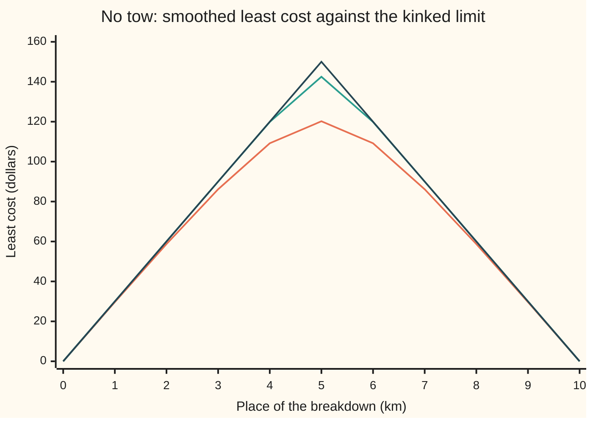

# Viscosity solutions: test with smooth functions that touch the graph

[Syllabus](../../../SYLLABUS.md) → [Partial differential equations](../README.md) → [Weak Solutions and Free Boundaries](../README.md#s06) → Viscosity solutions

---

## General Overview

Wing 08's [Dynamic programming](../../08-Differential%20equations%20and%20dynamics/12-Calculus%20of%20Variations%20and%20Optimal%20Control/07-dynamic-programming-and-the-bellman-equation.md) found least costs from the Bellman equation, one stage at a time; on a continuous road that equation is about slopes. The [Hamilton-Jacobi](../02-First-Order%20Equations%20and%20Characteristics/05-hamilton-jacobi-equations.md) card ended on such a least-cost function with a kink, and a question: in what sense does a function with no slope at a point still solve an equation about its slope? This card answers it, and shows why the answer picks exactly one function.

A car's engine starts to fail at km $`x`$ of a 10 km country road with a garage at each end, at km 0 and km 10. Limping on to a garage costs $30 of engine damage per km. Stopping where the car stands and calling a tow truck costs a flat $120. Both prices are illustrative. The driver makes one **stopping decision**: drive on, or stop now.

The unknown is $`u(x)`$, the least cost from a breakdown at km $`x`$, in dollars. The region is the open road, $`0 < x < 10`$ km. The data: $`u = 0`$ at each garage.

From km 3, driving back to km 0 costs $90, less than the tow, so the driver drives. From km 5, either garage costs $150, so the driver stops and pays $120. The two choices tie at km 4 and km 6. There the graph of $`u`$ has corners, or **kinks**: points where the slope jumps and no derivative exists.

The equation for $`u`$ is about its slope $`u'`$, and at km 4 there is no slope. Asking it only where the slope exists, "almost everywhere", lets in false answers: a sawtooth that pretends there is a free garage at km 5 passes too. The fix is to test each kink with smooth curves that touch the graph: one resting on top must meet the equation as an inequality, one resting underneath the opposite inequality. The true least cost passes everywhere; the phantom garage fails at km 5.

**A viscosity solution is a continuous function whose graph passes two tests at every point: a smooth function touching it from above makes the equation at most zero, one touching from below makes it at least zero, and a comparison principle then makes the solution unique.**

**What kind of fact this is:** the viscosity solution is a definition. That the least cost is a viscosity solution, that smooth viscosity solutions are ordinary solutions, and the comparison principle for this card's equation are theorems, proved on this card in Why it works. The comparison principle for general equations is stated with its source.

### The picture: the least cost, the tow fee and a phantom

<p align="center"></p>

Thick line: the least cost $`u(x)`$. Dashed: the tow fee, $120. Dotted: the phantom garage, a false answer that is $0 at km 5. The bar on the axis is the stretch where stopping is best. The three thin lines touch $`u`$ from above at its kink at km 4. Drawn to scale from the checks' numbers.

---

## The formula

A **test function** is a smooth function used to probe a candidate solution, as on the [Weak solutions](01-weak-solutions-and-the-weak-formulation.md) card. An **obstacle** $`\psi`$ is a ceiling or floor the solution may touch but not cross; here it is the tow fee. [The obstacle problem](08-obstacle-problems-and-variational-inequalities.md) treats obstacles in general.

The problem: on the road $`0 < x < L`$, with $`u(0) = u(L) = 0`$,

```math
F\big(u(x), u'(x)\big) = \max\big(u(x) - \psi,\; |u'(x)| - c\big) = 0 .
```

**Read it aloud:** the least cost never exceeds the tow fee, it never changes faster than the damage per km, and at every place one of the two holds with equality.

The equation needs a slope that $`u`$ lacks at its kinks. A smooth function $`\varphi`$ **touches $`u`$ from above** at $`x_0`$ when $`\varphi \ge u`$ near $`x_0`$ and $`\varphi(x_0) = u(x_0)`$. Touching from below is the same with $`\varphi \le u`$. Then a continuous $`u`$ is a

```math
\text{subsolution if } F\big(u(x_0), \varphi'(x_0)\big) \le 0 \text{ whenever } \varphi \text{ touches from above;} \qquad \text{supersolution if } F\big(u(x_0), \varphi'(x_0)\big) \ge 0 \text{ whenever } \varphi \text{ touches from below.}
```

A **viscosity solution** is both. If no smooth function touches at a point from one side, that side's test is passed, because nothing is asked.

**Read it aloud:** whatever smooth curve rests on the graph from above must not break the equation upward; whatever rests on it from below must not break it downward.

The **comparison principle** turns this into uniqueness. If $`w`$ is a subsolution, $`z`$ a supersolution, and $`w \le z`$ at both garages, then

```math
w(x) \le z(x) \quad \text{for every } x \text{ on the road.}
```

**Read it aloud:** a subsolution that starts below a supersolution at the ends stays below it everywhere. Two viscosity solutions with the same end values each lie below the other, so they are equal.

| Symbol | Plain meaning | In our example | Push it up and the answer… |
| --- | --- | --- | --- |
| $`x`$, $`L`$, $`h`$, $`s`$ | place of the breakdown, km; road length, km; a short stretch of driving, km; its direction, +1 or −1 | km 3, 4, 5; 10 km | — |
| $`u(x)`$ | least cost from a breakdown at km $`x`$, dollars | $90 at km 3, $120 at km 5 | — |
| $`c`$ | engine damage per km driven, dollars per km (not wing 08's wave speed) | 30 | stopping starts nearer the garages |
| $`\psi`$ | the tow fee: the obstacle, a ceiling on $`u`$, dollars | 120 | the stopping stretch shrinks; at 150 it is the single point km 5 |
| $`F(r, p)`$, $`G(p)`$ | the equation's left side at value $`r`$ and slope $`p`$; the same with no tow, $`G(p) = \lvert p\rvert - c`$ | $`\max(r - 120, \lvert p\rvert - 30)`$ | — |
| $`u'`$, $`p`$ | slope of $`u`$, dollars per km; slope of a test function | 30, then 0, then −30; 0 to 30 at km 4 | — |
| $`\varphi`$, $`x_0`$ | a smooth test function; the point where it touches | lines through the kink at km 4 | — |
| $`w`$, $`z`$ | a subsolution; a supersolution | half of $`u`$, the phantom; the tent, the flat $120 | — |
| $`\varepsilon`$ | the viscosity length: how strongly a smoothing term rounds corners, km | 0.25 km | corners rounder, top lower |
| $`u_\varepsilon(x)`$ | the smoothed least cost with no tow, dollars | $142.50 at km 5 | — |
| $`\theta`$, $`\alpha`$, $`\delta`$, $`\Phi`$ | a factor just below 1, a small length, a positive gap and the doubled-variable function, used in the comparison proof; here $`\theta`$ is not an angle or the ellipticity constant, and $`\Phi`$ not the fundamental solution | — | — |
| $`\Omega`$, $`\partial\Omega`$ | a region and its edge, in the general comparison principle | the road, $`0 < x < 10`$ km; the two garages | — |

### When it holds

- **$`F`$ does not decrease as $`u`$ grows, and its sign is set by the problem.** Here $`F`$, "cost minus the most it could be", grows with $`u`$. The sign matters even where $`u`$ is absent: written as $`30 - \lvert u'\rvert = 0`$, the no-tow equation's viscosity solution flips to a valley, −$150 at km 5, not $150.
- **The candidate is continuous.** A function with a jump has no sensible touching curve at the jump.
- **The tests are asked at every point, not almost everywhere.** Drop the kink test and the phantom garage, $0 at km 5, solves the equation at all but three points.
- **A classical solution is not demanded.** With no tow, a smooth $`u`$ with $`u(0) = u(10) = 0`$ has a top where $`u' = 0`$. There $`\lvert u'\rvert - 30 = -30`$, so no smooth solution exists at all.
- **For this card's proof of comparison: $`c > 0`$ and $`\psi > 0`$.** The proof shrinks a subsolution by a factor $`\theta < 1`$ to make it strict, and that step needs a positive damage rate and tow fee.

---

## Why it works

### Step 0: move the derivative onto something that has one

A kink has no slope, but a smooth curve touching it does, and where $`u`$ is smooth the touching curve reports its slope (Step 1).

At a kink, many curves touch, with a whole range of slopes. The definition asks the equation of all of them, one-sided: touching from above, at most zero; from below, at least zero. The [Weak solutions](01-weak-solutions-and-the-weak-formulation.md) card moved derivatives onto a test function by integration by parts. This card moves them by touching. No integral appears, so the idea works for fully nonlinear equations such as this one (equations where the slope enters through a nonlinear function like $`\lvert u'\rvert`$).

### Step 1: smooth solutions pass, and smooth viscosity solutions are ordinary ones

Suppose $`u`$ is smooth and $`\varphi`$ touches it from above at $`x_0`$. Then $`u - \varphi`$ has a local maximum at $`x_0`$, so $`u'(x_0) = \varphi'(x_0)`$. The sub test asks $`F(u(x_0), u'(x_0)) \le 0`$. Touching from below gives the same slope and asks $`\ge 0`$. So for smooth $`u`$:

- an ordinary solution, with $`F = 0`$ everywhere, passes both tests;
- a smooth viscosity solution has $`F \le 0`$ and $`F \ge 0`$ at every point, using $`\varphi = u`$ itself, so it is an ordinary solution.

The definition adds nothing where $`u`$ is smooth. It only speaks at kinks.

### Step 2: checking the kinks of the least cost

On km 0 to 4, $`u = 30x`$: slope 30, value below 120, so $`F = \max(30x - 120, 0) = 0`$. On km 4 to 6, $`u = 120`$ and the slope is 0, so $`F = \max(0, -30) = 0`$. Only the corners need the new tests.

At km 4 the slope drops from 30 to 0. The graph bends down, like a roof ridge. Any line through the corner with slope between 0 and 30 stays above the graph on both sides. A line of slope 40 does not: at km 3.9 it is at $116, below $`u(3.9)`$ = $117, so it cuts through. Nothing smooth fits underneath a ridge, so the supersolution test asks nothing.

| Function and place | Slopes that touch from above | Largest $`F`$ (needs ≤ 0) | Slopes that touch from below | Smallest $`F`$ (needs ≥ 0) | Verdict |
| --- | --- | --- | --- | --- | --- |
| $`u`$ at km 3 (smooth) | 30 | 0 | 30 | 0 | passes |
| $`u`$ at km 4 (ridge) | 0 to 30 | 0 | none | — | passes |
| $`u`$ at km 6 (ridge) | −30 to 0 | 0 | none | — | passes |
| phantom at km 2.5 (ridge) | −30 to 30 | 0 | none | — | passes |
| phantom at km 5 (valley) | none | — | −30 to 30 | −30 | **fails** |

The phantom garage is $`\min(120, 30x, 30\lvert x - 5\rvert, 30(10 - x))`$. Away from its three corners its slope is ±30 and its value is below 120, so $`F = 0`$ there, exactly as for $`u`$. Its fault sits at km 5, a valley: a flat line touches from below, slope 0, and $`F = \max(0 - 120, 0 - 30) = -30`$, which is below zero. The valley says "costs could fall faster than $30 a km here", and they cannot.

That is the general pattern for this equation. Ridges are allowed: there two choices tie and the cheaper one wins. Valleys are forbidden: they need a cheap point with no reason to be cheap.

### Step 3: the least cost passes, by dynamic programming

The tests come from the reason $`u`$ is the least cost, the Bellman equation of [Dynamic programming](../../08-Differential%20equations%20and%20dynamics/12-Calculus%20of%20Variations%20and%20Optimal%20Control/07-dynamic-programming-and-the-bellman-equation.md): the best plan from here is the best first move followed by the best plan from where that move lands. Two facts follow.

- Stopping is always allowed, and so is driving a short stretch $`h`$ either way first. So $`u(x) \le 120`$ and $`u(x) \le 30h + u(x \pm h)`$.
- At every place one choice is used: either $`u(x) = 120`$, or the best plan drives off in some direction $`s = \pm 1`$ and $`u(x) = 30h + u(x + sh)`$ for short $`h`$.

The first fact gives the sub test, the second the super test (fold below). The phantom breaks the second fact at km 5: it claims $0, but every move from km 5 costs $30 per km and lands where the phantom itself charges $30 per km.

<details>
<summary>Detailed proof: the least cost is a viscosity solution</summary>

**Sub test.** Let $`\varphi`$ touch $`u`$ from above at $`x_0`$. The first fact gives $`u(x_0) \le \psi`$. It also gives, for small $`h > 0`$,

$`\displaystyle \varphi(x_0) = u(x_0) \le c\,h + u(x_0 \pm h) \le c\,h + \varphi(x_0 \pm h).`$

Divide by $`h`$ and let $`h \to 0`$: $`\mp\varphi'(x_0) \le c`$ for both signs, so $`\lvert\varphi'(x_0)\rvert \le c`$. Both parts of $`F`$ are at most zero, so $`F(u(x_0), \varphi'(x_0)) \le 0`$.

**Super test.** Let $`\varphi`$ touch $`u`$ from below at $`x_0`$. If $`u(x_0) = \psi`$, the first part of $`F`$ is zero and $`F \ge 0`$. Otherwise the best plan drives off in a direction $`s`$, and

$`\displaystyle \varphi(x_0) = u(x_0) = c\,h + u(x_0 + s\,h) \ge c\,h + \varphi(x_0 + s\,h).`$

Divide by $`h`$ and let $`h \to 0`$: $`-s\,\varphi'(x_0) \ge c`$, so $`\lvert\varphi'(x_0)\rvert \ge c`$ and $`F \ge 0`$.

</details>

### Step 4: where the name comes from

Add a small second-derivative term to the no-tow equation, the way physical viscosity adds friction to a fluid:

```math
-\varepsilon\, u_\varepsilon'' + \lvert u_\varepsilon'\rvert = c, \qquad u_\varepsilon(0) = u_\varepsilon(10) = 0 .
```

Here $`\varepsilon`$ is a length in km. The equation is now second order and has a classical, twice-differentiable solution. By symmetry the top is at km 5, where the slope is 0. On the left half the slope solves a linear first-order equation, which gives

```math
u_\varepsilon(x) = c\,x - c\,\varepsilon\big(e^{(x - 5)/\varepsilon} - e^{-5/\varepsilon}\big), \qquad 0 \le x \le 5,
```

mirrored on the right half. At km 5 the top sits $`c\,\varepsilon(1 - e^{-5/\varepsilon})`$ below the tent's $150. That gap halves each time $`\varepsilon`$ halves:

| $`\varepsilon`$, km | 1.000 | 0.500 | 0.250 | 0.125 |
| --- | --- | --- | --- | --- |
| $`u_\varepsilon(5)`$, dollars | 120.2021 | 135.0007 | 142.5000 | 146.2500 |
| gap to the tent, dollars | 29.7979 | 14.9993 | 7.5000 | 3.7500 |



Orange: $`\varepsilon`$ = 1 km. Teal: $`\varepsilon`$ = 0.25 km. Dark: the tent $`30\min(x, 10 - x)`$, the limit. Each smoothed curve is rounded at the top and sharpens toward the ridge. None of them ever forms a valley.

That is the selection rule at work. The term $`-\varepsilon u''`$ is positive at a bend downward and negative at a bend upward. In the limit, ridges survive and valleys are excluded, which is exactly the one-sided test. The name, given in 1983, comes from this limit, and the limit of vanishing viscosity is always a viscosity solution (fold below). The shocks of [Entropy conditions](../02-First-Order%20Equations%20and%20Characteristics/03-entropy-conditions-and-vanishing-viscosity.md) are chosen the same way.

<details>
<summary>Detailed proof: a limit of smoothed solutions passes the tests</summary>

Let twice-differentiable $`u_\varepsilon`$ solve $`-\varepsilon u_\varepsilon'' + G(u_\varepsilon') = 0`$ with $`G`$ continuous, and let $`u_\varepsilon \to u`$ uniformly as $`\varepsilon \to 0`$.

Let $`\varphi`$ touch $`u`$ from below at $`x_0`$. Replace $`\varphi`$ by $`\varphi - (x - x_0)^4`$, so that the touching is strict: $`u - \varphi`$ has its only nearby minimum at $`x_0`$. Uniform convergence then gives minimum points $`x_\varepsilon`$ of $`u_\varepsilon - \varphi`$ with $`x_\varepsilon \to x_0`$.

At a minimum of a smooth difference, the slopes agree and the bend of $`u_\varepsilon`$ is at least that of $`\varphi`$:

$`\displaystyle u_\varepsilon'(x_\varepsilon) = \varphi'(x_\varepsilon), \qquad u_\varepsilon''(x_\varepsilon) \ge \varphi''(x_\varepsilon).`$

So $`G(\varphi'(x_\varepsilon)) = \varepsilon\,u_\varepsilon''(x_\varepsilon) \ge \varepsilon\,\varphi''(x_\varepsilon)`$. Let $`\varepsilon \to 0`$: $`G(\varphi'(x_0)) \ge 0`$, the super test. Touching from above gives the sub test with the inequalities reversed.

At a valley of $`u`$, a flat $`\varphi`$ touches from below, and $`G(0) = -c < 0`$. So no limit of smoothed solutions has a valley.

</details>

### Step 5: the comparison principle, and why the answer is unique

Comparing two kinked functions is hard: both may have corners at the same place, where no single smooth curve touches both. The trick is **doubling the variables**: give the subsolution its own variable $`x`$ and the supersolution its own $`y`$, and charge a penalty for their distance. At the best pair, each function is touched by a smooth parabola built from the other, with one shared slope, and the sub and super tests at that slope contradict each other if the subsolution ever rose above the supersolution.

The argument for this card's equation is complete in the fold. For general equations:

- **Comparison principle** (Crandall, Ishii and Lions, 1992, Theorem 3.3). Let $`\Omega`$ be a bounded region with edge $`\partial\Omega`$, and let $`F(x, r, p)`$ be continuous, increasing in $`r`$ at least at a fixed rate, and changing with $`x`$ in a controlled way (conditions (3.13) and (3.14) there). If $`w`$ is a subsolution, $`z`$ a supersolution, and $`w \le z`$ on the edge, then $`w \le z`$ in $`\Omega`$. The same holds for second-order equations of the right sign, as the stopping problem with a random price needs.

Uniqueness follows at once. The checks test comparison on finite instances. The functions half of $`u`$ and the phantom pass the sub test at all 99 interior grid points, so they must lie below $`u`$: at km 5 they are $60 and $0, against $120. The tent and the flat $120 pass the super test, so they must lie above: $150 and $120. The phantom is a subsolution, not a solution, so comparison places it underneath.

**Existence** comes from dynamic programming here (Step 3). In general it comes from vanishing viscosity (Step 4) or from Perron's method: take the largest subsolution below a given supersolution, as on the [Subharmonic functions](../04-Laplace%2C%20Poisson%20and%20Potentials/09-subharmonic-functions-and-perrons-method.md) card.

<details>
<summary>Detailed proof: comparison for the tow equation</summary>

Let $`w`$ be a subsolution and $`z`$ a supersolution, both continuous on $`[0, L]`$, with $`w \le z`$ at both ends. Suppose, for a contradiction, that $`w - z`$ has a positive maximum $`2\delta`$.

**Make the subsolution strict.** Fix $`\theta < 1`$ so close to 1 that $`\theta w - z`$ still has maximum at least $`\delta`$, while at the ends it stays below $`\delta`$. Where $`\varphi`$ touches $`\theta w`$ from above, $`\varphi/\theta`$ touches $`w`$, so the slope $`p`$ of $`\varphi`$ has $`\lvert p\rvert \le \theta c < c`$, and $`w \le \psi`$ there.

**Double the variables.** For a small length $`\alpha > 0`$ let

$`\displaystyle \Phi(x, y) = \theta\,w(x) - z(y) - \frac{(x - y)^2}{2\alpha}`$

be largest at $`(x_\alpha, y_\alpha)`$. Then $`\Phi(x_\alpha, y_\alpha) \ge \delta`$, and as $`\alpha \to 0`$ the two points close in on an interior maximum of $`\theta w - z`$ (Crandall, Ishii and Lions, Lemma 3.1), so for small $`\alpha`$ both are inside the road.

**Touch both.** Freeze $`y = y_\alpha`$: the parabola $`x \mapsto z(y_\alpha) + (x - y_\alpha)^2/(2\alpha) + \Phi(x_\alpha, y_\alpha)`$ touches $`\theta w`$ from above at $`x_\alpha`$, with slope $`p = (x_\alpha - y_\alpha)/\alpha`$. Freeze $`x = x_\alpha`$: the parabola $`y \mapsto \theta w(x_\alpha) - (x_\alpha - y)^2/(2\alpha) - \Phi(x_\alpha, y_\alpha)`$ touches $`z`$ from below at $`y_\alpha`$, with the same slope $`p`$.

**Contradict.** The sub test gives $`\lvert p\rvert < c`$ and $`w(x_\alpha) \le \psi`$. The super test gives $`\max(z(y_\alpha) - \psi, \lvert p\rvert - c) \ge 0`$. The second part is negative, so $`z(y_\alpha) \ge \psi`$. Since $`\psi > 0`$ and $`\theta < 1`$, $`\theta\,w(x_\alpha) < \psi`$ whatever the sign of $`w(x_\alpha)`$. So

$`\displaystyle \theta\,w(x_\alpha) - z(y_\alpha) < 0 < \delta \le \Phi(x_\alpha, y_\alpha) \le \theta\,w(x_\alpha) - z(y_\alpha),`$

which is impossible. So $`w \le z`$ everywhere.

</details>

---

## Worked numbers, by hand

| Step | Arithmetic | Value |
| --- | --- | --- |
| least cost from km 3 | drive back: 30 × 3 | $90.00 |
| from km 5, driving | 30 × 5 to either garage | $150.00 |
| from km 5 | min(120, 150) | **$120.00**, stop |
| where driving and towing tie | 120 / 30 and 10 − 4 | km 4.00 and km 6.00 |
| a line of slope 40 through the kink at km 4 | at km 3.9: 120 + 40 × (3.9 − 4) | $116.00, below $`u(3.9)`$ = $117.00: does not touch |
| sub test at km 4, slopes 0 to 30 | $`\max(120 - 120, \lvert p\rvert - 30)`$ | largest 0: passes |
| phantom at km 5, flat line from below | $`\max(0 - 120, 0 - 30)`$ | −30: fails the super test |
| smoothed, no tow, $`\varepsilon`$ = 0.25 km | 150 − 30 × 0.25 × (1 − e^−20) | $142.50 |

**From a breakdown at km 5 the least cost is $120: stop and call the tow. The kink tests pass, and comparison makes $120 the only answer with these end values.** The kinks at km 4 and 6 are the places where the driver is indifferent.

### What breaks if you drop a piece

| Mistake | Comes out at | What went wrong |
| --- | --- | --- |
| Accept solutions "almost everywhere": the phantom garage | $0.00 at km 5, not $120.00 | Its valley at km 5 fails the super test; with no kink test, uniqueness is lost. |
| Flip the sign: write the no-tow equation as $`30 - \lvert u'\rvert = 0`$ | −$150.00 at km 5, not $150.00 | The tests swap sides: valleys pass, ridges fail. |
| Forget the tow: solve $`\lvert u'\rvert = 30`$ alone | $150.00 at km 5, not $120.00 | The ceiling $`u \le \psi`$ is part of the equation. |
| Demand a smooth solution, no tow | residual −30 $/km at the top, for every $`\varepsilon`$ | Any smooth $`u`$ has slope 0 at its top; no classical solution exists. |

The checks print every row.

---

## Code, from first principles, and it actually runs

The scripts reach the least cost by two independent roads and then test it. Road 1 is the closed form $`\min(120, 30x, 30(10 - x))`$. Road 2 is dynamic programming on a 0.1 km grid: each node takes the cheaper of the tow and one step to a neighbour, swept until nothing changes, from above and from below. The kink tests try parabolas $`\varphi(x) = u(x_0) + p\,(x - x_0) \pm 100\,(x - x_0)^2`$, with slopes $`p`$ every 5 $/km from −40 to 40, sampled every 0.005 km up to 0.5 km either side, at every grid point. Comparison is checked on four sub- and supersolutions, and the smoothed solution by its residual (what is left when it is put into its equation) with centred differences at two steps.

### Python

```python
# Viscosity solutions -- the check behind the card.  Imports only math's exp.
# A car breaks down at km x of a 10 km road with garages at km 0 and km 10.
# Limping on costs C dollars per km; stopping for a tow costs PSI dollars.
# Least cost u(x) = min(PSI, C x, C (L - x)) solves max(u - PSI, |u'| - C) = 0.
# Roads: the closed form, dynamic programming on a grid, smooth functions that
# touch the graph, comparison with sub- and supersolutions, vanishing viscosity.
from math import exp
L, C, PSI = 10.0, 30.0, 120.0            # road km, damage $/km, tow $ (illustrative)
K, HALF, NS = 100.0, 0.5, 100            # test parabola curvature $/km^2, window km, samples
SLOPES = range(-40, 41, 5)               # test slopes tried, $/km

def value(x, c=C, psi=PSI): return min(psi, c * x, c * (L - x))   # road 1
def u(x): return value(x)
def tent(x): return C * min(x, L - x)                             # no tow on offer
def phantom(x): return min(PSI, C * x, C * abs(x - 5.0), C * (L - x))   # fake garage at km 5
def half_u(x): return 0.5 * u(x)
def flat(x): return PSI
def F(r, p): return max(r - PSI, abs(p) - C)    # the equation's left side
def G(r, p): return abs(p) - C                   # no tow: |u'| - C
def Gflip(r, p): return C - abs(p)               # the same, sign flipped

def touches(f, x0, p, side):                     # phi = f(x0) + p s + side K s^2
    for j in range(1, NS + 1):                   # stays above (side +1) or below (-1)?
        for s in (-HALF * j / NS, HALF * j / NS):
            gap = f(x0) + p * s + side * K * s * s - f(x0 + s)
            if side * gap < -1e-9:
                return False
    return True

def test(f, x0, eq=F):                           # the two viscosity tests at x0
    above = [p for p in SLOPES if touches(f, x0, p, +1)]
    below = [p for p in SLOPES if touches(f, x0, p, -1)]
    sub = max([eq(f(x0), p) for p in above], default=None)    # needs <= 0
    sup = min([eq(f(x0), p) for p in below], default=None)    # needs >= 0
    return above, below, sub, sup

def ok(f, x0, eq=F, need="both"):
    _, _, sub, sup = test(f, x0, eq)
    good_sub, good_sup = sub is None or sub <= 1e-9, sup is None or sup >= -1e-9
    return {"sub": good_sub, "super": good_sup, "both": good_sub and good_sup}[need]

def show(name, f, x0, eq=F):
    a, b, sub, sup = test(f, x0, eq)
    rng = lambda s: f"{s[0]} to {s[-1]}" if s else "none"
    num = lambda v: "-" if v is None else f"{v:.0f}"
    print(f"{name:<20} km {x0:3.1f}: value {f(x0):7.2f} $; from above {rng(a):>9}, max F {num(sub):>2}; "
          f"from below {rng(b):>9}, min F {num(sup):>3}")

H, N = 0.1, 100                                  # road 2: Bellman on a 0.1 km grid
def dp(start):
    v, sweeps = [0.0] + [start] * (N - 1) + [0.0], 0
    while True:
        new = [0.0] + [min(PSI, C * H + min(v[i - 1], v[i + 1])) for i in range(1, N)] + [0.0]
        sweeps += 1
        if max(abs(a - b) for a, b in zip(new, v)) < 1e-12:
            return new, sweeps
        v = new
grid = [i * H for i in range(N + 1)]
down, s1 = dp(PSI)
up, s2 = dp(0.0)
err = max(abs(d - u(x)) for d, x in zip(down, grid))
err2 = max(abs(d - u(x)) for d, x in zip(up, grid))

print(f"road {L:.0f} km, garages at km 0 and 10; limping {C:.0f} $/km; tow {PSI:.0f} $")
print(f"closed form: u(3) = {u(3):.2f} $, u(4) = {u(4):.2f} $, u(5) = {u(5):.2f} $, u(6) = {u(6):.2f} $")
print(f"stop where u = tow fee: km {PSI / C:.2f} to {L - PSI / C:.2f}; no-tow tent at km 5: {tent(5):.2f} $")
print(f"dynamic programming, step 0.1 km: from above {s1} sweeps, from below {s2} sweeps; "
      f"both equal the closed form to 1e-9 $ at all {N + 1} nodes: {'yes' if err < 1e-9 and err2 < 1e-9 else 'no'}")
print(f"by hand at km 4: slope 40 line at km 3.9 gives {120 + 40 * (3.9 - 4):.2f} $, u(3.9) = {u(3.9):.2f} $")
show("value u", u, 3.0); show("value u", u, 4.0); show("value u", u, 5.0); show("value u", u, 6.0)
show("phantom garage", phantom, 5.0); show("phantom garage", phantom, 2.5)
show("tent, no tow", tent, 5.0, G); show("tent, flipped sign", tent, 5.0, Gflip)
show("minus tent, flipped", lambda x: -tent(x), 5.0, Gflip)
inner = grid[1:N]
fails = lambda f, eq=F, need="both": [x for x in inner if not ok(f, x, eq, need)]
fu, fph = fails(u), fails(phantom, F, "super")
fph_sub = fails(phantom, F, "sub")
smooth = [x for x in inner if round(x * 10) not in (25, 50, 75)]
ae = max(abs(F(phantom(x), (phantom(x + 0.01) - phantom(x - 0.01)) / 0.02)) for x in smooth)
print(f"grid scan, {len(inner)} points: u fails a test at {len(fu)}; phantom fails at {len(fph)} "
      f"(km {fph[0]:.1f}, the super test) and the sub test at {len(fph_sub)}")
print(f"phantom's largest |F| at its {len(smooth)} smooth grid points: {ae:.6f} $/km")
subs = [("half of u", half_u), ("phantom", phantom)]
sups = [("tent", tent), ("flat 120", flat)]
for name, f in subs:
    assert not fails(f, F, "sub")
for name, f in sups:
    assert not fails(f, F, "super")
gap_lo = min(u(x) - f(x) for _, f in subs for x in grid)
gap_hi = min(f(x) - u(x) for _, f in sups for x in grid)
print(f"comparison on all {N + 1} nodes: least of u - sub {gap_lo:.2f} $, least of super - u {gap_hi:.2f} $")
print(f"  at km 5: half of u {half_u(5):.2f}, phantom {phantom(5):.2f} <= u {u(5):.2f} <= "
      f"flat {flat(5):.2f}, tent {tent(5):.2f} $")

def visc(x, e):                                  # -e u'' + |u'| = C, u(0) = u(L) = 0
    y = min(x, L - x)
    return C * y - C * e * (exp((y - L / 2) / e) - exp(-L / 2 / e))
def resid(x, e, d):                              # centred differences
    u2 = (visc(x + d, e) - 2 * visc(x, e) + visc(x - d, e)) / d ** 2
    u1 = (visc(x + d, e) - visc(x - d, e)) / (2 * d)
    return -e * u2 + abs(u1) - C
EPS = [1.0, 0.5, 0.25, 0.125]
print("vanishing viscosity, eps km    " + "".join(f"{e:9.3f}" for e in EPS))
print("  u_eps(5) $                   " + "".join(f"{visc(5, e):9.4f}" for e in EPS))
print("  tent(5) - u_eps(5) $         " + "".join(f"{tent(5) - visc(5, e):9.4f}" for e in EPS))
r1, r2 = abs(resid(2.0, 0.5, 0.01)), abs(resid(2.0, 0.5, 0.005))
print(f"  residual at km 2, eps 0.5, step 0.01, 0.005 km: {r1 * 1e6:.3f} {r2 * 1e6:.3f} x 1e-6 $/km")
print(f"  first-order residual at the top, km 5: {G(visc(5, 0.5), 0.0):.0f} $/km for every eps")
xs = list(range(11))
print("chart, km          " + "".join(f"{x:>8}" for x in xs))
print("chart, eps 1 km    " + "".join(f"{visc(x, 1.0):8.2f}" for x in xs))
print("chart, eps 0.25 km " + "".join(f"{visc(x, 0.25):8.2f}" for x in xs))
print("chart, tent        " + "".join(f"{tent(x):8.2f}" for x in xs))
print(f"mistake 1, phantom garage at km 5: {phantom(5):.2f} $, not {u(5):.2f} $; tooth tops {phantom(2.5):.2f} $")
print(f"mistake 2, sign flipped, no tow: {-tent(5):.2f} $ at km 5, not {tent(5):.2f} $")
print(f"mistake 3, tow forgotten: {tent(5):.2f} $ at km 5, not {u(5):.2f} $")
print(f"try: tow 150 $ gives u(5) = {value(5, C, 150):.2f} $; damage 20 $/km gives u(5) = "
      f"{value(5, 20, PSI):.2f} $; eps 0.05 km gives u_eps(5) = {visc(5, 0.05):.4f} $")
print(f"figure, x 0 to 10 km at 50 px/km from 60; y 0 to 160 $ at 1.5 px/$ up from 300; "
      f"kinks (4, {u(4):.0f}) (6, {u(6):.0f}); phantom teeth (2.5, {phantom(2.5):.0f}) (5, {phantom(5):.0f}) (7.5, {phantom(7.5):.0f})")
assert err < 1e-9 and err2 < 1e-9                            # Bellman grid = closed form
assert test(u, 4.0)[0] == [0, 5, 10, 15, 20, 25, 30] and test(u, 4.0)[1] == []
assert fu == [] and fph == [5.0] and fph_sub == [] and ae < 1e-6
assert test(tent, 5.0, Gflip)[2] > 0 and ok(lambda x: -tent(x), 5.0, Gflip)
assert gap_lo >= 0 and gap_hi >= 0 and abs(gap_lo) < 1e-9     # phantom touches u at km 0
for e in EPS:
    d = tent(5) - visc(5, e)
    assert 0 < d <= C * e and abs(visc(0, e)) < 1e-9          # below the tent; u_eps(0) = 0
assert r2 < r1 / 3 and r1 < 1e-3                               # second order in the step
print("ALL CHECKS PASS")
```

**Ran 2026-11-15 on macOS, Python 3.14.10, standard library only. All checks passed. Output, pasted from the run:**

```
road 10 km, garages at km 0 and 10; limping 30 $/km; tow 120 $
closed form: u(3) = 90.00 $, u(4) = 120.00 $, u(5) = 120.00 $, u(6) = 120.00 $
stop where u = tow fee: km 4.00 to 6.00; no-tow tent at km 5: 150.00 $
dynamic programming, step 0.1 km: from above 40 sweeps, from below 41 sweeps; both equal the closed form to 1e-9 $ at all 101 nodes: yes
by hand at km 4: slope 40 line at km 3.9 gives 116.00 $, u(3.9) = 117.00 $
value u              km 3.0: value   90.00 $; from above  30 to 30, max F  0; from below  30 to 30, min F   0
value u              km 4.0: value  120.00 $; from above   0 to 30, max F  0; from below      none, min F   -
value u              km 5.0: value  120.00 $; from above    0 to 0, max F  0; from below    0 to 0, min F   0
value u              km 6.0: value  120.00 $; from above  -30 to 0, max F  0; from below      none, min F   -
phantom garage       km 5.0: value    0.00 $; from above      none, max F  -; from below -30 to 30, min F -30
phantom garage       km 2.5: value   75.00 $; from above -30 to 30, max F  0; from below      none, min F   -
tent, no tow         km 5.0: value  150.00 $; from above -30 to 30, max F  0; from below      none, min F   -
tent, flipped sign   km 5.0: value  150.00 $; from above -30 to 30, max F 30; from below      none, min F   -
minus tent, flipped  km 5.0: value -150.00 $; from above      none, max F  -; from below -30 to 30, min F   0
grid scan, 99 points: u fails a test at 0; phantom fails at 1 (km 5.0, the super test) and the sub test at 0
phantom's largest |F| at its 96 smooth grid points: 0.000000 $/km
comparison on all 101 nodes: least of u - sub 0.00 $, least of super - u 0.00 $
  at km 5: half of u 60.00, phantom 0.00 <= u 120.00 <= flat 120.00, tent 150.00 $
vanishing viscosity, eps km        1.000    0.500    0.250    0.125
  u_eps(5) $                    120.2021 135.0007 142.5000 146.2500
  tent(5) - u_eps(5) $           29.7979  14.9993   7.5000   3.7500
  residual at km 2, eps 0.5, step 0.01, 0.005 km: 2.479 0.620 x 1e-6 $/km
  first-order residual at the top, km 5: -30 $/km for every eps
chart, km                 0       1       2       3       4       5       6       7       8       9      10
chart, eps 1 km        0.00   29.65   58.71   86.14  109.17  120.20  109.17   86.14   58.71   29.65    0.00
chart, eps 0.25 km     0.00   30.00   60.00   90.00  119.86  142.50  119.86   90.00   60.00   30.00    0.00
chart, tent            0.00   30.00   60.00   90.00  120.00  150.00  120.00   90.00   60.00   30.00    0.00
mistake 1, phantom garage at km 5: 0.00 $, not 120.00 $; tooth tops 75.00 $
mistake 2, sign flipped, no tow: -150.00 $ at km 5, not 150.00 $
mistake 3, tow forgotten: 150.00 $ at km 5, not 120.00 $
try: tow 150 $ gives u(5) = 150.00 $; damage 20 $/km gives u(5) = 100.00 $; eps 0.05 km gives u_eps(5) = 148.5000 $
figure, x 0 to 10 km at 50 px/km from 60; y 0 to 160 $ at 1.5 px/$ up from 300; kinks (4, 120) (6, 120); phantom teeth (2.5, 75) (5, 0) (7.5, 75)
ALL CHECKS PASS
```

The grid matches the closed form at all 101 nodes, from above and from below. The residual falls four-fold when the step halves, as centred differences should.

### Rust

Same roads, same labels, built with `rustc --edition 2021 -O`.

```rust
// Viscosity solutions -- the same check as the Python, in Rust.  No crates.
// A car breaks down at km x of a 10 km road with garages at km 0 and km 10.
// Limping on costs C dollars per km; stopping for a tow costs PSI dollars.
// Least cost u(x) = min(PSI, C x, C (L - x)) solves max(u - PSI, |u'| - C) = 0.
// Roads: the closed form, dynamic programming on a grid, smooth functions that
// touch the graph, comparison with sub- and supersolutions, vanishing viscosity.
const L: f64 = 10.0; const C: f64 = 30.0; const PSI: f64 = 120.0;  // km, $/km, $ (illustrative)
const K: f64 = 100.0; const HALF: f64 = 0.5; const NS: usize = 100; // curvature, window, samples
const H: f64 = 0.1; const N: usize = 100;                          // Bellman grid

fn value(x: f64, c: f64, psi: f64) -> f64 { psi.min(c * x).min(c * (L - x)) }   // road 1
fn u(x: f64) -> f64 { value(x, C, PSI) }
fn tent(x: f64) -> f64 { C * x.min(L - x) }                               // no tow on offer
fn phantom(x: f64) -> f64 { PSI.min(C * x).min(C * (x - 5.0).abs()).min(C * (L - x)) }
fn half_u(x: f64) -> f64 { 0.5 * u(x) }
fn flat(_x: f64) -> f64 { PSI }
fn mtent(x: f64) -> f64 { -tent(x) }
fn f_eq(r: f64, p: f64) -> f64 { (r - PSI).max(p.abs() - C) }          // the equation's left side
fn g_eq(_r: f64, p: f64) -> f64 { p.abs() - C }                         // no tow: |u'| - C
fn gflip(_r: f64, p: f64) -> f64 { C - p.abs() }                        // the same, sign flipped
type Fun = fn(f64) -> f64;
type Eq = fn(f64, f64) -> f64;

fn touches(f: Fun, x0: f64, p: f64, side: f64) -> bool {  // phi = f(x0) + p s + side K s^2
    for j in 1..=NS {
        for s in [-HALF * j as f64 / NS as f64, HALF * j as f64 / NS as f64] {
            let gap = f(x0) + p * s + side * K * s * s - f(x0 + s);
            if side * gap < -1e-9 { return false; }
        }
    }
    true
}
fn test(f: Fun, x0: f64, eq: Eq) -> (Vec<i32>, Vec<i32>, Option<f64>, Option<f64>) {
    let slopes: Vec<i32> = (-8..=8).map(|k| 5 * k).collect();
    let above: Vec<i32> = slopes.iter().copied().filter(|&p| touches(f, x0, p as f64, 1.0)).collect();
    let below: Vec<i32> = slopes.iter().copied().filter(|&p| touches(f, x0, p as f64, -1.0)).collect();
    let sub = above.iter().map(|&p| eq(f(x0), p as f64)).fold(None, |m: Option<f64>, v| Some(m.map_or(v, |m| m.max(v))));
    let sup = below.iter().map(|&p| eq(f(x0), p as f64)).fold(None, |m: Option<f64>, v| Some(m.map_or(v, |m| m.min(v))));
    (above, below, sub, sup)
}
fn ok(f: Fun, x0: f64, eq: Eq, need: &str) -> bool {
    let (_, _, sub, sup) = test(f, x0, eq);
    let gs = sub.map_or(true, |v| v <= 1e-9);
    let gp = sup.map_or(true, |v| v >= -1e-9);
    match need { "sub" => gs, "super" => gp, _ => gs && gp }
}
fn show(name: &str, f: Fun, x0: f64, eq: Eq) {
    let (a, b, sub, sup) = test(f, x0, eq);
    let rng = |s: &Vec<i32>| if s.is_empty() { "none".to_string() } else { format!("{} to {}", s[0], s[s.len() - 1]) };
    let num = |v: Option<f64>| v.map_or("-".to_string(), |v| format!("{:.0}", v));
    println!("{:<20} km {:3.1}: value {:7.2} $; from above {:>9}, max F {:>2}; from below {:>9}, min F {:>3}",
             name, x0, f(x0), rng(&a), num(sub), rng(&b), num(sup));
}
fn dp(start: f64) -> (Vec<f64>, usize) {
    let mut v = vec![start; N + 1]; v[0] = 0.0; v[N] = 0.0;
    let mut sweeps = 0;
    loop {
        let mut new = vec![0.0; N + 1];
        for i in 1..N { new[i] = PSI.min(C * H + v[i - 1].min(v[i + 1])); }
        sweeps += 1;
        let d = new.iter().zip(&v).map(|(a, b)| (a - b).abs()).fold(0.0, f64::max);
        if d < 1e-12 { return (new, sweeps); }
        v = new;
    }
}
fn visc(x: f64, e: f64) -> f64 {                     // -e u'' + |u'| = C, u(0) = u(L) = 0
    let y = x.min(L - x);
    C * y - C * e * (((y - L / 2.0) / e).exp() - (-L / 2.0 / e).exp())
}
fn resid(x: f64, e: f64, d: f64) -> f64 {           // centred differences
    let u2 = (visc(x + d, e) - 2.0 * visc(x, e) + visc(x - d, e)) / (d * d);
    let u1 = (visc(x + d, e) - visc(x - d, e)) / (2.0 * d);
    -e * u2 + u1.abs() - C
}
fn main() {
    let grid: Vec<f64> = (0..=N).map(|i| i as f64 * H).collect();
    let (down, s1) = dp(PSI);
    let (up, s2) = dp(0.0);
    let err = down.iter().zip(&grid).map(|(d, &x)| (d - u(x)).abs()).fold(0.0, f64::max);
    let err2 = up.iter().zip(&grid).map(|(d, &x)| (d - u(x)).abs()).fold(0.0, f64::max);
    println!("road {:.0} km, garages at km 0 and 10; limping {:.0} $/km; tow {:.0} $", L, C, PSI);
    println!("closed form: u(3) = {:.2} $, u(4) = {:.2} $, u(5) = {:.2} $, u(6) = {:.2} $", u(3.0), u(4.0), u(5.0), u(6.0));
    println!("stop where u = tow fee: km {:.2} to {:.2}; no-tow tent at km 5: {:.2} $", PSI / C, L - PSI / C, tent(5.0));
    println!("dynamic programming, step 0.1 km: from above {} sweeps, from below {} sweeps; both equal the closed form to 1e-9 $ at all {} nodes: {}",
             s1, s2, N + 1, if err < 1e-9 && err2 < 1e-9 { "yes" } else { "no" });
    println!("by hand at km 4: slope 40 line at km 3.9 gives {:.2} $, u(3.9) = {:.2} $", 120.0 + 40.0 * (3.9 - 4.0), u(3.9));
    for x in [3.0, 4.0, 5.0, 6.0] { show("value u", u, x, f_eq); }
    show("phantom garage", phantom, 5.0, f_eq); show("phantom garage", phantom, 2.5, f_eq);
    show("tent, no tow", tent, 5.0, g_eq); show("tent, flipped sign", tent, 5.0, gflip);
    show("minus tent, flipped", mtent, 5.0, gflip);
    let inner: Vec<f64> = grid[1..N].to_vec();
    let fails = |f: Fun, need: &str| -> Vec<f64> { inner.iter().copied().filter(|&x| !ok(f, x, f_eq, need)).collect() };
    let (fu, fph, fph_sub) = (fails(u, "both"), fails(phantom, "super"), fails(phantom, "sub"));
    let smooth: Vec<f64> = inner.iter().copied().filter(|&x| ![25, 50, 75].contains(&((x * 10.0).round() as i32))).collect();
    let ae = smooth.iter().map(|&x| f_eq(phantom(x), (phantom(x + 0.01) - phantom(x - 0.01)) / 0.02).abs()).fold(0.0, f64::max);
    println!("grid scan, {} points: u fails a test at {}; phantom fails at {} (km {:.1}, the super test) and the sub test at {}",
             inner.len(), fu.len(), fph.len(), fph[0], fph_sub.len());
    println!("phantom's largest |F| at its {} smooth grid points: {:.6} $/km", smooth.len(), ae);
    let subs: [Fun; 2] = [half_u, phantom];
    let sups: [Fun; 2] = [tent, flat];
    for &f in &subs { assert!(fails(f, "sub").is_empty()); }
    for &f in &sups { assert!(fails(f, "super").is_empty()); }
    let gap_lo = subs.iter().flat_map(|&f| grid.iter().map(move |&x| u(x) - f(x))).fold(f64::INFINITY, f64::min);
    let gap_hi = sups.iter().flat_map(|&f| grid.iter().map(move |&x| f(x) - u(x))).fold(f64::INFINITY, f64::min);
    println!("comparison on all {} nodes: least of u - sub {:.2} $, least of super - u {:.2} $", N + 1, gap_lo, gap_hi);
    println!("  at km 5: half of u {:.2}, phantom {:.2} <= u {:.2} <= flat {:.2}, tent {:.2} $",
             half_u(5.0), phantom(5.0), u(5.0), flat(5.0), tent(5.0));
    let eps = [1.0, 0.5, 0.25, 0.125];
    let row = |f: &dyn Fn(f64) -> f64, w: usize, d: usize| eps.iter().map(|&e| format!("{:w$.d$}", f(e), w = w, d = d)).collect::<String>();
    println!("vanishing viscosity, eps km    {}", row(&|e| e, 9, 3));
    println!("  u_eps(5) $                   {}", row(&|e| visc(5.0, e), 9, 4));
    println!("  tent(5) - u_eps(5) $         {}", row(&|e| tent(5.0) - visc(5.0, e), 9, 4));
    let (r1, r2) = (resid(2.0, 0.5, 0.01).abs(), resid(2.0, 0.5, 0.005).abs());
    println!("  residual at km 2, eps 0.5, step 0.01, 0.005 km: {:.3} {:.3} x 1e-6 $/km", r1 * 1e6, r2 * 1e6);
    println!("  first-order residual at the top, km 5: {:.0} $/km for every eps", g_eq(visc(5.0, 0.5), 0.0));
    let chart = |name: &str, f: &dyn Fn(f64) -> f64| println!("{:<19}{}", name, (0..=10).map(|x| format!("{:8.2}", f(x as f64))).collect::<String>());
    println!("chart, km          {}", (0..=10).map(|x| format!("{:>8}", x)).collect::<String>());
    chart("chart, eps 1 km", &|x| visc(x, 1.0));
    chart("chart, eps 0.25 km", &|x| visc(x, 0.25));
    chart("chart, tent", &|x| tent(x));
    println!("mistake 1, phantom garage at km 5: {:.2} $, not {:.2} $; tooth tops {:.2} $", phantom(5.0), u(5.0), phantom(2.5));
    println!("mistake 2, sign flipped, no tow: {:.2} $ at km 5, not {:.2} $", -tent(5.0), tent(5.0));
    println!("mistake 3, tow forgotten: {:.2} $ at km 5, not {:.2} $", tent(5.0), u(5.0));
    println!("try: tow 150 $ gives u(5) = {:.2} $; damage 20 $/km gives u(5) = {:.2} $; eps 0.05 km gives u_eps(5) = {:.4} $",
             value(5.0, C, 150.0), value(5.0, 20.0, PSI), visc(5.0, 0.05));
    println!("figure, x 0 to 10 km at 50 px/km from 60; y 0 to 160 $ at 1.5 px/$ up from 300; kinks (4, {:.0}) (6, {:.0}); phantom teeth (2.5, {:.0}) (5, {:.0}) (7.5, {:.0})",
             u(4.0), u(6.0), phantom(2.5), phantom(5.0), phantom(7.5));
    assert!(err < 1e-9 && err2 < 1e-9);                            // Bellman grid = closed form
    let t4 = test(u, 4.0, f_eq);
    assert!(t4.0 == vec![0, 5, 10, 15, 20, 25, 30] && t4.1.is_empty());
    assert!(fu.is_empty() && fph == vec![5.0] && fph_sub.is_empty() && ae < 1e-6);
    assert!(test(tent, 5.0, gflip).2.unwrap() > 0.0 && ok(mtent, 5.0, gflip, "both"));
    assert!(gap_lo >= 0.0 && gap_hi >= 0.0 && gap_lo.abs() < 1e-9);  // phantom touches u at km 0
    for &e in &eps {
        let d = tent(5.0) - visc(5.0, e);
        assert!(0.0 < d && d <= C * e && visc(0.0, e).abs() < 1e-9); // below the tent; u_eps(0) = 0
    }
    assert!(r2 < r1 / 3.0 && r1 < 1e-3);                            // second order in the step
    println!("ALL CHECKS PASS");
}
```

**Ran 2026-11-15 on macOS, rustc 1.98.1, no crates. All checks passed. Output, pasted from the run:**

```
road 10 km, garages at km 0 and 10; limping 30 $/km; tow 120 $
closed form: u(3) = 90.00 $, u(4) = 120.00 $, u(5) = 120.00 $, u(6) = 120.00 $
stop where u = tow fee: km 4.00 to 6.00; no-tow tent at km 5: 150.00 $
dynamic programming, step 0.1 km: from above 40 sweeps, from below 41 sweeps; both equal the closed form to 1e-9 $ at all 101 nodes: yes
by hand at km 4: slope 40 line at km 3.9 gives 116.00 $, u(3.9) = 117.00 $
value u              km 3.0: value   90.00 $; from above  30 to 30, max F  0; from below  30 to 30, min F   0
value u              km 4.0: value  120.00 $; from above   0 to 30, max F  0; from below      none, min F   -
value u              km 5.0: value  120.00 $; from above    0 to 0, max F  0; from below    0 to 0, min F   0
value u              km 6.0: value  120.00 $; from above  -30 to 0, max F  0; from below      none, min F   -
phantom garage       km 5.0: value    0.00 $; from above      none, max F  -; from below -30 to 30, min F -30
phantom garage       km 2.5: value   75.00 $; from above -30 to 30, max F  0; from below      none, min F   -
tent, no tow         km 5.0: value  150.00 $; from above -30 to 30, max F  0; from below      none, min F   -
tent, flipped sign   km 5.0: value  150.00 $; from above -30 to 30, max F 30; from below      none, min F   -
minus tent, flipped  km 5.0: value -150.00 $; from above      none, max F  -; from below -30 to 30, min F   0
grid scan, 99 points: u fails a test at 0; phantom fails at 1 (km 5.0, the super test) and the sub test at 0
phantom's largest |F| at its 96 smooth grid points: 0.000000 $/km
comparison on all 101 nodes: least of u - sub 0.00 $, least of super - u 0.00 $
  at km 5: half of u 60.00, phantom 0.00 <= u 120.00 <= flat 120.00, tent 150.00 $
vanishing viscosity, eps km        1.000    0.500    0.250    0.125
  u_eps(5) $                    120.2021 135.0007 142.5000 146.2500
  tent(5) - u_eps(5) $           29.7979  14.9993   7.5000   3.7500
  residual at km 2, eps 0.5, step 0.01, 0.005 km: 2.479 0.620 x 1e-6 $/km
  first-order residual at the top, km 5: -30 $/km for every eps
chart, km                 0       1       2       3       4       5       6       7       8       9      10
chart, eps 1 km        0.00   29.65   58.71   86.14  109.17  120.20  109.17   86.14   58.71   29.65    0.00
chart, eps 0.25 km     0.00   30.00   60.00   90.00  119.86  142.50  119.86   90.00   60.00   30.00    0.00
chart, tent            0.00   30.00   60.00   90.00  120.00  150.00  120.00   90.00   60.00   30.00    0.00
mistake 1, phantom garage at km 5: 0.00 $, not 120.00 $; tooth tops 75.00 $
mistake 2, sign flipped, no tow: -150.00 $ at km 5, not 150.00 $
mistake 3, tow forgotten: 150.00 $ at km 5, not 120.00 $
try: tow 150 $ gives u(5) = 150.00 $; damage 20 $/km gives u(5) = 100.00 $; eps 0.05 km gives u_eps(5) = 148.5000 $
figure, x 0 to 10 km at 50 px/km from 60; y 0 to 160 $ at 1.5 px/$ up from 300; kinks (4, 120) (6, 120); phantom teeth (2.5, 75) (5, 0) (7.5, 75)
ALL CHECKS PASS
```

The two outputs are identical, line for line.

### Lean

Lean proves comparison, that the least cost is a viscosity solution, and uniqueness, for any road, damage rate and tow fee above zero.

- Take $`c > 0`$, $`\psi > 0`$, a subsolution $`w`$ and a supersolution $`z`$ with $`w \le z`$ at both garages. Then $`w \le z`$ at every place on the road.
- Take $`c > 0`$, $`\psi > 0`$ and $`L > 0`$. Then the least cost $`\min(\psi, cx, c(L - x))`$ is a viscosity solution, zero at both garages.
- Take $`c > 0`$, $`\psi > 0`$, $`L > 0`$ and a viscosity solution $`v`$ that is zero at both garages. Then $`v`$ equals the least cost at every place on the road.
- Take the card's road: 10 km, $30 per km and a $120 tow. Then the least cost is $90 at km 3 and $120 at km 4, 5 and 6. Driving and towing tie at km 4 and 6.
- Take the phantom garage on that road. Then it is $0 at km 5, and the flat line touching it there from below gives $`F = -30`$.
- Take the tent, with no tow. Then it is $150 at km 5, and −$150 with the sign flipped.
- Take a $150 tow, or $20 per km of damage. Then the least cost at km 5 is $150, or $100.

The dynamic programming, the kink tests on the grid, the comparison instances and vanishing viscosity are left to the Python and Rust checks.

```lean
-- Viscosity solutions: on a road [0, L], a viscosity subsolution of max(u - ψ, |u'| - c) = 0 that starts below a supersolution at both ends stays below it everywhere, so the least cost min(ψ, c x, c (L - x)) is the only viscosity solution with zero end values.
import Mathlib.Analysis.Calculus.ContDiff.Defs
import Mathlib.Analysis.Calculus.Deriv.Basic
import Mathlib.Analysis.Calculus.Deriv.Slope
import Mathlib.Analysis.SpecialFunctions.Sqrt
import Mathlib.Topology.Order.Compact
import Mathlib.Analysis.Calculus.Deriv.Pow
import Mathlib.Analysis.Calculus.Deriv.Mul

open Set Filter Topology
open scoped ContDiff

/-- The left side of the tow equation at value `r` and slope `p`:
`F(r, p) = max(r - ψ, |p| - c)`, with `ψ` the tow fee and `c` the damage per km. -/
noncomputable def towF (c ψ r p : ℝ) : ℝ := max (r - ψ) (|p| - c)

/-- `φ` touches `u` from above at `x₀`: equal there, and `φ ≥ u` near `x₀`. -/
def TouchesAbove (φ u : ℝ → ℝ) (x₀ : ℝ) : Prop :=
  φ x₀ = u x₀ ∧ ∀ᶠ x in 𝓝 x₀, u x ≤ φ x

/-- `φ` touches `u` from below at `x₀`: equal there, and `φ ≤ u` near `x₀`. -/
def TouchesBelow (φ u : ℝ → ℝ) (x₀ : ℝ) : Prop :=
  φ x₀ = u x₀ ∧ ∀ᶠ x in 𝓝 x₀, φ x ≤ u x

/-- A viscosity subsolution of `max(u - ψ, |u'| - c) = 0` on the road `0 < x < L`:
`u` is continuous on `[0, L]`, and every smooth `φ` touching `u` from above at an
interior point `x₀` gives `F(u(x₀), φ'(x₀)) ≤ 0`. -/
def IsViscositySubsolution (c ψ L : ℝ) (u : ℝ → ℝ) : Prop :=
  ContinuousOn u (Icc 0 L) ∧
    ∀ x₀ ∈ Ioo 0 L, ∀ φ : ℝ → ℝ, ContDiff ℝ ∞ φ → TouchesAbove φ u x₀ →
      towF c ψ (u x₀) (deriv φ x₀) ≤ 0

/-- A viscosity supersolution: `u` is continuous on `[0, L]`, and every smooth `φ`
touching `u` from below at an interior point `x₀` gives `F(u(x₀), φ'(x₀)) ≥ 0`. -/
def IsViscositySupersolution (c ψ L : ℝ) (u : ℝ → ℝ) : Prop :=
  ContinuousOn u (Icc 0 L) ∧
    ∀ x₀ ∈ Ioo 0 L, ∀ φ : ℝ → ℝ, ContDiff ℝ ∞ φ → TouchesBelow φ u x₀ →
      0 ≤ towF c ψ (u x₀) (deriv φ x₀)

/-- A viscosity solution is both a subsolution and a supersolution. -/
def IsViscositySolution (c ψ L : ℝ) (u : ℝ → ℝ) : Prop :=
  IsViscositySubsolution c ψ L u ∧ IsViscositySupersolution c ψ L u

/-- The least cost from a breakdown at km `x`: stop for the tow at `ψ`, or drive to the
garage at km 0 or km `L` at `c` per km. -/
noncomputable def leastCost (c ψ L x : ℝ) : ℝ := min ψ (min (c * x) (c * (L - x)))


/-- A one-sided slope bound from the right gives an upper bound on the derivative. -/
theorem deriv_le_of_right {f : ℝ → ℝ} {a f' m : ℝ} (hd : HasDerivAt f f' a)
    (h : ∀ᶠ x in 𝓝 a, a < x → f x - f a ≤ m * (x - a)) : f' ≤ m := by
  have ht := (hasDerivAt_iff_tendsto_slope.1 hd).mono_left
    (nhdsWithin_mono a (fun y (hy : y ∈ Ioi a) => (ne_of_gt hy : y ≠ a)))
  refine le_of_tendsto ht ?_
  rw [eventually_nhdsWithin_iff]
  filter_upwards [h] with x hx hxa
  have hxa' : a < x := hxa
  rw [slope_def_field, div_le_iff₀ (by linarith)]
  exact hx hxa'

/-- A one-sided slope bound from the right gives a lower bound on the derivative. -/
theorem le_deriv_of_right {f : ℝ → ℝ} {a f' m : ℝ} (hd : HasDerivAt f f' a)
    (h : ∀ᶠ x in 𝓝 a, a < x → m * (x - a) ≤ f x - f a) : m ≤ f' := by
  have ht := (hasDerivAt_iff_tendsto_slope.1 hd).mono_left
    (nhdsWithin_mono a (fun y (hy : y ∈ Ioi a) => (ne_of_gt hy : y ≠ a)))
  refine ge_of_tendsto ht ?_
  rw [eventually_nhdsWithin_iff]
  filter_upwards [h] with x hx hxa
  have hxa' : a < x := hxa
  rw [slope_def_field, le_div_iff₀ (by linarith)]
  exact hx hxa'

/-- A one-sided slope bound from the left gives a lower bound on the derivative. -/
theorem le_deriv_of_left {f : ℝ → ℝ} {a f' m : ℝ} (hd : HasDerivAt f f' a)
    (h : ∀ᶠ x in 𝓝 a, x < a → f x - f a ≤ m * (x - a)) : m ≤ f' := by
  have ht := (hasDerivAt_iff_tendsto_slope.1 hd).mono_left
    (nhdsWithin_mono a (fun y (hy : y ∈ Iio a) => (ne_of_lt hy : y ≠ a)))
  refine ge_of_tendsto ht ?_
  rw [eventually_nhdsWithin_iff]
  filter_upwards [h] with x hx hxa
  have hxa' : x < a := hxa
  rw [slope_def_field, le_div_iff_of_neg (by linarith)]
  exact hx hxa'

/-- A one-sided slope bound from the left gives an upper bound on the derivative. -/
theorem deriv_le_of_left {f : ℝ → ℝ} {a f' m : ℝ} (hd : HasDerivAt f f' a)
    (h : ∀ᶠ x in 𝓝 a, x < a → m * (x - a) ≤ f x - f a) : f' ≤ m := by
  have ht := (hasDerivAt_iff_tendsto_slope.1 hd).mono_left
    (nhdsWithin_mono a (fun y (hy : y ∈ Iio a) => (ne_of_lt hy : y ≠ a)))
  refine le_of_tendsto ht ?_
  rw [eventually_nhdsWithin_iff]
  filter_upwards [h] with x hx hxa
  have hxa' : x < a := hxa
  rw [slope_def_field, div_le_iff_of_neg (by linarith)]
  exact hx hxa'

/-- Localized touching from above for a subsolution: maximizing `w` minus a tilted parabola
around `x₀` gives a nearby touching point where the slope and value bounds hold. -/
theorem sub_drift {c ψ L : ℝ} {w : ℝ → ℝ} (hw : IsViscositySubsolution c ψ L w) {x₀ r : ℝ}
    (hr : 0 < r) (h0 : 0 ≤ x₀ - r) (hL : x₀ + r ≤ L) (p : ℝ) :
    ∃ K > 0, ∃ y ∈ Ioo (x₀ - r) (x₀ + r), |p + 2 * K * (y - x₀)| ≤ c ∧ w y ≤ ψ ∧
      w x₀ + p * (y - x₀) + K * (y - x₀) ^ 2 ≤ w y := by
  set K : ℝ := (|w (x₀ - r) - w x₀| + |w (x₀ + r) - w x₀| + |p| * r + 1) / r ^ 2 with hKdef
  have hK : 0 < K := by positivity
  have hKr : K * r ^ 2 = |w (x₀ - r) - w x₀| + |w (x₀ + r) - w x₀| + |p| * r + 1 := by
    rw [hKdef]; field_simp
  set f : ℝ → ℝ := fun x => w x - (p * (x - x₀) + K * (x - x₀) ^ 2) with hf
  have hsub : Icc (x₀ - r) (x₀ + r) ⊆ Icc 0 L := Icc_subset_Icc h0 hL
  have hcont : ContinuousOn f (Icc (x₀ - r) (x₀ + r)) :=
    (hw.1.mono hsub).sub (by fun_prop)
  obtain ⟨y, hy, hmax⟩ := isCompact_Icc.exists_isMaxOn (nonempty_Icc.2 (by linarith)) hcont
  have hx₀ : x₀ ∈ Icc (x₀ - r) (x₀ + r) := ⟨by linarith, by linarith⟩
  have hfy : f x₀ ≤ f y := hmax hx₀
  have hfx₀ : f x₀ = w x₀ := by simp [hf]
  have hleft : f (x₀ - r) < w x₀ := by
    simp only [hf]
    have h1 := le_abs_self (w (x₀ - r) - w x₀)
    have h2 := le_abs_self p
    have h3 := abs_nonneg (w (x₀ + r) - w x₀)
    have h4 : p * (x₀ - r - x₀) = -(p * r) := by ring
    have h5 : K * (x₀ - r - x₀) ^ 2 = K * r ^ 2 := by ring
    rw [h4, h5]; nlinarith
  have hright : f (x₀ + r) < w x₀ := by
    simp only [hf]
    have h1 := le_abs_self (w (x₀ + r) - w x₀)
    have h2 := neg_abs_le p
    have h3 := abs_nonneg (w (x₀ - r) - w x₀)
    have h4 : p * (x₀ + r - x₀) = p * r := by ring
    have h5 : K * (x₀ + r - x₀) ^ 2 = K * r ^ 2 := by ring
    rw [h4, h5]; nlinarith
  have hyI : y ∈ Ioo (x₀ - r) (x₀ + r) := by
    refine ⟨lt_of_le_of_ne hy.1 ?_, lt_of_le_of_ne hy.2 ?_⟩
    · rintro rfl; linarith
    · rintro rfl; linarith
  set C : ℝ := w y - (p * (y - x₀) + K * (y - x₀) ^ 2) with hC
  set φ : ℝ → ℝ := fun x => p * (x - x₀) + K * (x - x₀) ^ 2 + C with hφ
  have hφs : ContDiff ℝ ∞ φ := by simp only [hφ]; fun_prop
  have htouch : TouchesAbove φ w y := by
    refine ⟨by simp only [hφ, hC]; ring, ?_⟩
    filter_upwards [Icc_mem_nhds hyI.1 hyI.2] with x hx
    have : f x ≤ f y := hmax hx
    simp only [hf] at this
    simp only [hφ, hC]; linarith
  have hderiv : HasDerivAt φ (p + 2 * K * (y - x₀)) y := by
    have h1 : HasDerivAt (fun x : ℝ => x - x₀) 1 y := (hasDerivAt_id y).sub_const x₀
    have h2 := ((h1.const_mul p).add ((h1.pow 2).const_mul K)).add_const C
    convert h2 using 1
    simp; ring
  have hyL : y ∈ Ioo 0 L := ⟨by linarith [hyI.1], by linarith [hyI.2]⟩
  have hv := hw.2 y hyL φ hφs htouch
  rw [hderiv.deriv, towF, max_le_iff] at hv
  refine ⟨K, hK, y, hyI, by linarith [hv.2], by linarith [hv.1], ?_⟩
  have : f x₀ ≤ f y := hfy
  simp only [hf] at this
  have h6 : p * (x₀ - x₀) + K * (x₀ - x₀) ^ 2 = 0 := by ring
  linarith

/-- A subsolution stays below the tow fee at every interior point. -/
theorem sub_le_fee {c ψ L : ℝ} {w : ℝ → ℝ} (hw : IsViscositySubsolution c ψ L w) {x : ℝ}
    (hx : x ∈ Ioo 0 L) : w x ≤ ψ := by
  have hr : 0 < min x (L - x) := lt_min hx.1 (by linarith [hx.2])
  obtain ⟨K, hK, y, -, -, hyψ, hy⟩ :=
    sub_drift (x₀ := x) hw hr (by linarith [min_le_left x (L - x)]) (by linarith [min_le_right x (L - x)]) 0
  nlinarith [sq_nonneg (y - x)]

/-- A subsolution cannot rise faster than `c` between two interior points. -/
theorem sub_slope_up {c ψ L : ℝ} {w : ℝ → ℝ} (hw : IsViscositySubsolution c ψ L w) {a b : ℝ}
    (ha : a ∈ Ioo 0 L) (hb : b ∈ Ioo 0 L) (hab : a ≤ b) : w b - w a ≤ c * (b - a) := by
  by_contra h
  push Not at h
  have hab' : a < b := by
    rcases eq_or_lt_of_le hab with rfl | h'
    · simp at h
    · exact h'
  set e := w b - w a - c * (b - a) with he
  have he0 : 0 < e := by linarith
  set c' := c + e / (2 * (b - a)) with hc'
  have hba : 0 < b - a := by linarith
  have hc'1 : c < c' := by have : 0 < e / (2 * (b - a)) := by positivity
                           linarith
  have hc'2 : c' * (b - a) < w b - w a := by
    have : e / (2 * (b - a)) * (b - a) = e / 2 := by field_simp
    have h3 : c' * (b - a) = c * (b - a) + e / 2 := by rw [hc', add_mul, this]
    linarith
  set g : ℝ → ℝ := fun x => w x - c' * x with hg
  have hsub : Icc a b ⊆ Icc 0 L := Icc_subset_Icc ha.1.le hb.2.le
  have hcont : ContinuousOn g (Icc a b) := (hw.1.mono hsub).sub (by fun_prop)
  obtain ⟨x₀, hx₀, hmax⟩ := isCompact_Icc.exists_isMaxOn (nonempty_Icc.2 hab) hcont
  have hgb : g b ≤ g x₀ := hmax ⟨hab, le_rfl⟩
  have hgab : g a < g b := by simp only [hg]; nlinarith
  have hax : a < x₀ := by
    rcases eq_or_lt_of_le hx₀.1 with h' | h'
    · rw [← h'] at hgb; linarith
    · exact h'
  have hr : 0 < min (x₀ - a) (L - x₀) := lt_min (by linarith) (by linarith [hx₀.2, hb.2])
  have hr1 := min_le_left (x₀ - a) (L - x₀)
  have hr2 := min_le_right (x₀ - a) (L - x₀)
  obtain ⟨K, hK, y, hy, hsl, -, hval⟩ :=
    sub_drift (x₀ := x₀) hw hr (by linarith [ha.1]) (by linarith) c'
  have hneg : y - x₀ < 0 := by
    by_contra h'
    push Not at h'
    have := le_abs_self (c' + 2 * K * (y - x₀))
    have : 0 ≤ 2 * K * (y - x₀) := by positivity
    linarith
  have hyI : y ∈ Icc a b := ⟨by linarith [hy.1], by linarith [hx₀.2]⟩
  have hgy : g y ≤ g x₀ := hmax hyI
  simp only [hg] at hgy
  have : 0 < K * (y - x₀) ^ 2 := by
    have : 0 < (y - x₀) ^ 2 := by nlinarith
    positivity
  nlinarith

/-- A subsolution cannot fall faster than `c` between two interior points. -/
theorem sub_slope_down {c ψ L : ℝ} {w : ℝ → ℝ} (hw : IsViscositySubsolution c ψ L w) {a b : ℝ}
    (ha : a ∈ Ioo 0 L) (hb : b ∈ Ioo 0 L) (hab : a ≤ b) : w a - w b ≤ c * (b - a) := by
  by_contra h
  push Not at h
  have hab' : a < b := by
    rcases eq_or_lt_of_le hab with rfl | h'
    · simp at h
    · exact h'
  set e := w a - w b - c * (b - a) with he
  have he0 : 0 < e := by linarith
  set c' := c + e / (2 * (b - a)) with hc'
  have hba : 0 < b - a := by linarith
  have hc'1 : c < c' := by have : 0 < e / (2 * (b - a)) := by positivity
                           linarith
  have hc'2 : c' * (b - a) < w a - w b := by
    have : e / (2 * (b - a)) * (b - a) = e / 2 := by field_simp
    have h3 : c' * (b - a) = c * (b - a) + e / 2 := by rw [hc', add_mul, this]
    linarith
  set g : ℝ → ℝ := fun x => w x + c' * x with hg
  have hsub : Icc a b ⊆ Icc 0 L := Icc_subset_Icc ha.1.le hb.2.le
  have hcont : ContinuousOn g (Icc a b) := (hw.1.mono hsub).add (by fun_prop)
  obtain ⟨x₀, hx₀, hmax⟩ := isCompact_Icc.exists_isMaxOn (nonempty_Icc.2 hab) hcont
  have hga : g a ≤ g x₀ := hmax ⟨le_rfl, hab⟩
  have hgab : g b < g a := by simp only [hg]; nlinarith
  have hxb : x₀ < b := by
    rcases eq_or_lt_of_le hx₀.2 with h' | h'
    · rw [h'] at hga; linarith
    · exact h'
  have hr : 0 < min (b - x₀) x₀ := lt_min (by linarith) (by linarith [hx₀.1, ha.1])
  have hr1 := min_le_left (b - x₀) x₀
  have hr2 := min_le_right (b - x₀) x₀
  obtain ⟨K, hK, y, hy, hsl, -, hval⟩ :=
    sub_drift (x₀ := x₀) hw hr (by linarith) (by linarith [hb.2]) (-c')
  have hpos : 0 < y - x₀ := by
    by_contra h'
    push Not at h'
    have := neg_abs_le (-c' + 2 * K * (y - x₀))
    have : 2 * K * (y - x₀) ≤ 0 := by
      have : 0 ≤ 2 * K * (x₀ - y) := by
        have : 0 ≤ x₀ - y := by linarith
        positivity
      linarith
    linarith
  have hyI : y ∈ Icc a b := ⟨by linarith [hx₀.1], by linarith [hy.2]⟩
  have hgy : g y ≤ g x₀ := hmax hyI
  simp only [hg] at hgy
  have : 0 < K * (y - x₀) ^ 2 := by
    have : 0 < (y - x₀) ^ 2 := by positivity
    positivity
  nlinarith

/-- A subsolution is `c`-Lipschitz on the open road. -/
theorem sub_lipschitz {c ψ L : ℝ} {w : ℝ → ℝ} (hw : IsViscositySubsolution c ψ L w) {x y : ℝ}
    (hx : x ∈ Ioo 0 L) (hy : y ∈ Ioo 0 L) : w x - w y ≤ c * |x - y| := by
  rcases le_total x y with h | h
  · rw [abs_of_nonpos (by linarith)]
    have := sub_slope_down hw hx hy h
    linarith
  · rw [abs_of_nonneg (by linarith)]
    exact sub_slope_up hw hy hx h

/-- A supersolution cannot sit above a cone of slope `k < c` with vertex at an interior point
where it is below the tow fee: a smoothed cone would touch it from below with slope below `c`. -/
theorem super_no_cone {c ψ L : ℝ} {z : ℝ → ℝ} (hz : IsViscositySupersolution c ψ L z) {xh k : ℝ}
    (hxhI : xh ∈ Ioo 0 L) (hzψ : z xh < ψ) (hk0 : 0 ≤ k) (hkc : k < c)
    (hcone : ∀ y ∈ Ioo 0 L, z xh - k * |y - xh| ≤ z y) : False := by
  set r := min xh (L - xh) / 2 with hr
  have hmin0 : 0 < min xh (L - xh) := lt_min hxhI.1 (by linarith [hxhI.2])
  have hr0 : 0 < r := by positivity
  have hr1 : r < xh := by have := min_le_left xh (L - xh); linarith
  have hr2 : r < L - xh := by have := min_le_right xh (L - xh); linarith
  set c' := (k + c) / 2 with hc'
  have hc'θ : k < c' := by rw [hc']; linarith
  have hc'c : c' < c := by rw [hc']; linarith
  have hc'0 : 0 < c' := by linarith
  set δ := (c' - k) * r / (2 * c') with hδ
  have hδ0 : 0 < δ := by
    have : 0 < c' - k := by linarith
    positivity
  have hc'δ : c' * δ = (c' - k) * r / 2 := by rw [hδ]; field_simp
  have hpos : ∀ y : ℝ, 0 < (y - xh) ^ 2 + δ ^ 2 := fun y => by
    have := sq_nonneg (y - xh); have := pow_pos hδ0 2; linarith
  set φ₀ : ℝ → ℝ := fun y => z xh - c' * (√((y - xh) ^ 2 + δ ^ 2) - δ) with hφ₀
  set G : ℝ → ℝ := fun y => z y - φ₀ y with hG
  have hsubI : Icc (xh - r) (xh + r) ⊆ Ioo 0 L :=
    fun y hy => ⟨by linarith [hy.1], by linarith [hy.2]⟩
  have hGc : ContinuousOn G (Icc (xh - r) (xh + r)) :=
    (hz.1.mono (hsubI.trans Ioo_subset_Icc_self)).sub (by simp only [hφ₀]; fun_prop)
  obtain ⟨ys, hys, hmin⟩ :=
    isCompact_Icc.exists_isMinOn (nonempty_Icc.2 (by linarith)) hGc
  have hGxh : G xh = 0 := by
    simp only [hG, hφ₀, sub_self]
    rw [show (0 : ℝ) ^ 2 + δ ^ 2 = δ ^ 2 by ring, Real.sqrt_sq hδ0.le]; ring
  have hGlow : ∀ y ∈ Ioo 0 L, (c' - k) * |y - xh| - c' * δ ≤ G y := by
    intro y hy
    have h1 := hcone y hy
    have h2 : |y - xh| ≤ √((y - xh) ^ 2 + δ ^ 2) :=
      Real.abs_le_sqrt (by have := sq_nonneg δ; linarith)
    have h3 : c' * |y - xh| ≤ c' * √((y - xh) ^ 2 + δ ^ 2) :=
      mul_le_mul_of_nonneg_left h2 hc'0.le
    simp only [hG, hφ₀]
    nlinarith
  have hGys : G ys ≤ 0 := hGxh ▸ hmin ⟨by linarith, by linarith⟩
  have hysI : ys ∈ Ioo (xh - r) (xh + r) := by
    refine ⟨lt_of_le_of_ne hys.1 ?_, lt_of_le_of_ne hys.2 ?_⟩
    · rintro h
      have := hGlow (xh - r) (hsubI ⟨le_rfl, by linarith⟩)
      rw [show xh - r - xh = -r by ring, abs_neg, abs_of_pos hr0, h] at this
      have hp : 0 < (c' - k) * r := mul_pos (by linarith) hr0
      linarith
    · rintro h
      have := hGlow (xh + r) (hsubI ⟨by linarith, le_rfl⟩)
      rw [show xh + r - xh = r by ring, abs_of_pos hr0, ← h] at this
      have hp : 0 < (c' - k) * r := mul_pos (by linarith) hr0
      linarith
  have hysL : ys ∈ Ioo 0 L := hsubI hys
  have hzys : z ys < ψ := by
    have h1 : δ ≤ √((ys - xh) ^ 2 + δ ^ 2) := by
      have := Real.abs_le_sqrt (x := δ) (y := (ys - xh) ^ 2 + δ ^ 2)
        (by have := sq_nonneg (ys - xh); linarith)
      rwa [abs_of_pos hδ0] at this
    have h2 : 0 ≤ c' * (√((ys - xh) ^ 2 + δ ^ 2) - δ) :=
      mul_nonneg hc'0.le (by linarith)
    simp only [hG, hφ₀] at hGys
    linarith
  set φ : ℝ → ℝ := fun y => φ₀ y + G ys with hφ
  have hφs : ContDiff ℝ ∞ φ := by
    simp only [hφ, hφ₀]
    exact (contDiff_const.sub (contDiff_const.mul
      ((ContDiff.sqrt (by fun_prop) (fun y => (hpos y).ne')).sub contDiff_const))).add
      contDiff_const
  have htouch : TouchesBelow φ z ys := by
    refine ⟨by simp only [hφ, hG]; ring, ?_⟩
    filter_upwards [Icc_mem_nhds hysI.1 hysI.2] with y hy
    have : G ys ≤ G y := hmin hy
    simp only [hφ]
    simp only [hG] at this ⊢
    linarith
  set S := √((ys - xh) ^ 2 + δ ^ 2) with hS
  have hS0 : 0 < S := Real.sqrt_pos.2 (hpos ys)
  have hderiv : HasDerivAt φ (-(c' * (2 * (ys - xh) / (2 * S)))) ys := by
    have h1 : HasDerivAt (fun y : ℝ => (y - xh) ^ 2 + δ ^ 2) (2 * (ys - xh)) ys := by
      have := (((hasDerivAt_id ys).sub_const xh).pow 2).add_const (δ ^ 2)
      convert this using 1 <;> simp
    have h2 := ((((h1.sqrt (hpos ys).ne').sub_const δ).const_mul c').const_sub
      (z xh)).add_const (G ys)
    exact h2
  have hdb : |-(c' * (2 * (ys - xh) / (2 * S)))| ≤ c' := by
    rw [abs_neg, abs_mul, abs_of_pos hc'0]
    have : |2 * (ys - xh) / (2 * S)| ≤ 1 := by
      rw [abs_div, abs_of_pos (by positivity : (0 : ℝ) < 2 * S), div_le_one (by positivity),
        abs_mul, abs_two]
      have : |ys - xh| ≤ S := Real.abs_le_sqrt (by have := sq_nonneg δ; linarith)
      linarith
    nlinarith [abs_nonneg (2 * (ys - xh) / (2 * S))]
  have hsup := hz.2 ys hysL φ hφs htouch
  rw [hderiv.deriv, towF, le_max_iff] at hsup
  rcases hsup with h | h
  · linarith
  · linarith

/-- Comparison principle for the tow equation: if the damage rate `c` and the tow fee `ψ`
are positive, `w` is a viscosity subsolution, `z` a viscosity supersolution, and `w ≤ z` at
both garages, then `w ≤ z` at every place on the road. -/
theorem comparison_principle_tow {c ψ L : ℝ} (hc : 0 < c) (hψ : 0 < ψ) {w z : ℝ → ℝ}
    (hw : IsViscositySubsolution c ψ L w) (hz : IsViscositySupersolution c ψ L z)
    (h0 : w 0 ≤ z 0) (hL : w L ≤ z L) :
    ∀ x ∈ Icc 0 L, w x ≤ z x := by
  intro x hx
  by_contra hlt
  push Not at hlt
  have hx0 : x ≠ 0 := by rintro rfl; linarith
  have hxL : x ≠ L := by rintro rfl; linarith
  have hxI : x ∈ Ioo 0 L := ⟨lt_of_le_of_ne hx.1 (Ne.symm hx0), lt_of_le_of_ne hx.2 hxL⟩
  set d := w x - z x with hd
  have hd0 : 0 < d := by linarith
  set a := min (min (w 0) (w L)) ψ with ha
  have ha0 : a ≤ w 0 := (min_le_left _ _).trans (min_le_left _ _)
  have haL : a ≤ w L := (min_le_left _ _).trans (min_le_right _ _)
  have haψ : a ≤ ψ := min_le_right _ _
  set m := |w x - a| with hm
  have hm0 : 0 ≤ m := abs_nonneg _
  set ε := d / (2 * (m + d)) with hε
  have hε0 : 0 < ε := by positivity
  have hε1 : ε ≤ 1 / 2 := by
    rw [hε, div_le_iff₀ (by positivity)]; linarith
  have hεd : ε * (w x - a) < d := by
    have h1 : ε * (w x - a) ≤ ε * m := mul_le_mul_of_nonneg_left (le_abs_self _) hε0.le
    have h2 : ε * m < d := by
      rw [hε, div_mul_eq_mul_div, div_lt_iff₀ (by positivity)]; nlinarith
    linarith
  set θ := 1 - ε with hθ
  set D : ℝ → ℝ := fun y => θ * w y + ε * a - z y with hD
  have hDc : ContinuousOn D (Icc 0 L) :=
    ((continuousOn_const.mul hw.1).add continuousOn_const).sub hz.1
  obtain ⟨xh, hxh, hmax⟩ := isCompact_Icc.exists_isMaxOn ⟨x, hx⟩ hDc
  have hDx : 0 < D x := by
    have : D x = d - ε * (w x - a) := by simp only [hD, hd, hθ]; ring
    linarith
  have hDxh : D x ≤ D xh := hmax hx
  have hD0 : D 0 ≤ 0 := by
    have : ε * a ≤ ε * w 0 := mul_le_mul_of_nonneg_left ha0 hε0.le
    have : D 0 = w 0 - z 0 + (ε * a - ε * w 0) := by simp only [hD, hθ]; ring
    linarith
  have hDL : D L ≤ 0 := by
    have : ε * a ≤ ε * w L := mul_le_mul_of_nonneg_left haL hε0.le
    have : D L = w L - z L + (ε * a - ε * w L) := by simp only [hD, hθ]; ring
    linarith
  have hxhI : xh ∈ Ioo 0 L := by
    refine ⟨lt_of_le_of_ne hxh.1 ?_, lt_of_le_of_ne hxh.2 ?_⟩
    · rintro h; rw [← h] at hDxh; linarith
    · rintro h; rw [h] at hDxh; linarith
  have hθ0 : 0 ≤ θ := by linarith
  have hzψ : z xh < ψ := by
    have h1 : w xh ≤ ψ := sub_le_fee hw hxhI
    have h2 : θ * w xh ≤ θ * ψ := mul_le_mul_of_nonneg_left h1 hθ0
    have h3 : ε * a ≤ ε * ψ := mul_le_mul_of_nonneg_left haψ hε0.le
    have h4 : 0 < θ * w xh + ε * a - z xh := by
      have : D xh = θ * w xh + ε * a - z xh := rfl
      linarith
    have h5 : θ * ψ + ε * ψ = ψ := by rw [hθ]; ring
    linarith
  have hcone : ∀ y ∈ Ioo 0 L, z xh - θ * c * |y - xh| ≤ z y := by
    intro y hy
    have h1 : D y ≤ D xh := hmax (Ioo_subset_Icc_self hy)
    simp only [hD] at h1
    have h2 := sub_lipschitz hw hxhI hy
    rw [abs_sub_comm] at h2
    have h3 : θ * (w xh - w y) ≤ θ * (c * |y - xh|) := mul_le_mul_of_nonneg_left h2 hθ0
    nlinarith
  have hk0 : 0 ≤ θ * c := mul_nonneg hθ0 hc.le
  have hkc : θ * c < c := by rw [hθ]; nlinarith
  exact super_no_cone hz hxhI hzψ hk0 hkc hcone

/-- The least cost `min(ψ, c x, c (L - x))` is a viscosity solution of
`max(u - ψ, |u'| - c) = 0` on the road `0 < x < L`, and it is zero at both garages. -/
theorem least_cost_is_viscosity_solution {c ψ L : ℝ} (hc : 0 < c) (hψ : 0 < ψ) (hL : 0 < L) :
    IsViscositySolution c ψ L (leastCost c ψ L) ∧
      leastCost c ψ L 0 = 0 ∧ leastCost c ψ L L = 0 := by
  have hLip : ∀ x y, |leastCost c ψ L x - leastCost c ψ L y| ≤ c * |x - y| := by
    intro x y
    have e1 : |c * x - c * y| = c * |x - y| := by rw [← mul_sub, abs_mul, abs_of_pos hc]
    have e2 : |c * (L - x) - c * (L - y)| = c * |x - y| := by
      rw [show c * (L - x) - c * (L - y) = c * (y - x) by ring, abs_mul, abs_of_pos hc,
        abs_sub_comm]
    unfold leastCost
    calc |min ψ (min (c * x) (c * (L - x))) - min ψ (min (c * y) (c * (L - y)))|
        ≤ max |ψ - ψ| |min (c * x) (c * (L - x)) - min (c * y) (c * (L - y))| :=
          abs_min_sub_min_le_max _ _ _ _
      _ ≤ c * |x - y| := by
          refine max_le (by simp only [sub_self, abs_zero]; positivity) ?_
          exact (abs_min_sub_min_le_max _ _ _ _).trans (max_le e1.le e2.le)
  have hcont : Continuous (leastCost c ψ L) := by
    unfold leastCost
    exact continuous_const.min ((continuous_const.mul continuous_id).min
      (continuous_const.mul (continuous_const.sub continuous_id)))
  have hle : ∀ x, leastCost c ψ L x ≤ ψ := fun x => min_le_left _ _
  refine ⟨⟨⟨hcont.continuousOn, ?_⟩, ⟨hcont.continuousOn, ?_⟩⟩, ?_, ?_⟩
  · intro x₀ _ φ hφ ⟨heq, hev⟩
    have hd : HasDerivAt φ (deriv φ x₀) x₀ :=
      ((hφ.differentiable (by simp)) x₀).hasDerivAt
    have key : ∀ᶠ x in 𝓝 x₀, -(c * |x - x₀|) ≤ φ x - φ x₀ := by
      filter_upwards [hev] with x hx
      have := (abs_le.1 (hLip x x₀)).1
      linarith
    have hup : deriv φ x₀ ≤ c := by
      refine deriv_le_of_left hd ?_
      filter_upwards [key] with x hx hxa
      rw [abs_of_neg (by linarith)] at hx
      linarith
    have hlo : -c ≤ deriv φ x₀ := by
      refine le_deriv_of_right hd ?_
      filter_upwards [key] with x hx hxa
      rw [abs_of_pos (by linarith)] at hx
      linarith
    unfold towF
    exact max_le (by linarith [hle x₀]) (by linarith [abs_le.2 ⟨hlo, hup⟩])
  · intro x₀ _ φ hφ ⟨heq, hev⟩
    have hd : HasDerivAt φ (deriv φ x₀) x₀ :=
      ((hφ.differentiable (by simp)) x₀).hasDerivAt
    unfold towF
    by_cases hψe : leastCost c ψ L x₀ = ψ
    · exact le_max_of_le_left (by rw [hψe, sub_self])
    have hT : leastCost c ψ L x₀ = min (c * x₀) (c * (L - x₀)) := by
      unfold leastCost at hψe ⊢
      rcases min_choice ψ (min (c * x₀) (c * (L - x₀))) with h | h
      · exact absurd h hψe
      · exact h
    refine le_max_of_le_right ?_
    rcases le_total (c * x₀) (c * (L - x₀)) with h | h
    · rw [min_eq_left h] at hT
      have : c ≤ deriv φ x₀ := by
        refine le_deriv_of_left hd ?_
        filter_upwards [hev] with x hx _
        have : leastCost c ψ L x ≤ c * x :=
          (min_le_right _ _).trans (min_le_left _ _)
        linarith
      linarith [le_abs_self (deriv φ x₀)]
    · rw [min_eq_right h] at hT
      have : deriv φ x₀ ≤ -c := by
        refine deriv_le_of_right hd ?_
        filter_upwards [hev] with x hx _
        have : leastCost c ψ L x ≤ c * (L - x) :=
          (min_le_right _ _).trans (min_le_right _ _)
        linarith
      linarith [neg_abs_le (deriv φ x₀)]
  · unfold leastCost
    have : min (c * 0) (c * (L - 0)) = 0 := by
      rw [mul_zero, sub_zero]; exact min_eq_left (by positivity)
    rw [this]; exact min_eq_right hψ.le
  · unfold leastCost
    have : min (c * L) (c * (L - L)) = 0 := by
      rw [sub_self, mul_zero]; exact min_eq_right (by positivity)
    rw [this]; exact min_eq_right hψ.le

/-- Uniqueness: every viscosity solution that is zero at both garages equals the least cost
at every place on the road. -/
theorem viscosity_solution_unique {c ψ L : ℝ} (hc : 0 < c) (hψ : 0 < ψ) (hL : 0 < L)
    {v : ℝ → ℝ} (hv : IsViscositySolution c ψ L v) (h0 : v 0 = 0) (hvL : v L = 0) :
    ∀ x ∈ Icc 0 L, v x = leastCost c ψ L x := by
  intro x hx
  have h := least_cost_is_viscosity_solution hc hψ hL
  exact le_antisymm
    (comparison_principle_tow hc hψ hv.1 h.1.2 (by rw [h0, h.2.1]) (by rw [hvL, h.2.2]) x hx)
    (comparison_principle_tow hc hψ h.1.1 hv.2 (by rw [h0, h.2.1]) (by rw [hvL, h.2.2]) x hx)

-- The card's road: L = 10 km, c = 30 $/km, tow ψ = 120 $.
-- Least cost from km 3: drive back, 30 × 3 = 90 $.
example : leastCost 30 120 10 3 = 90 := by norm_num [leastCost]
-- From km 5 driving costs 150 $ to either garage, so the driver stops and pays 120 $.
example : (30 : ℝ) * 5 = 150 ∧ (30 : ℝ) * (10 - 5) = 150 := by norm_num
example : leastCost 30 120 10 5 = 120 := by norm_num [leastCost]
-- Driving and towing tie at km 4 and km 6: 120 / 30 = 4 and 10 - 4 = 6.
example : (120 : ℝ) / 30 = 4 ∧ (10 : ℝ) - 4 = 6 := by norm_num
example : leastCost 30 120 10 4 = 30 * 4 ∧ leastCost 30 120 10 6 = 30 * (10 - 6) := by
  norm_num [leastCost]
-- The phantom garage min(120, 30x, 30|x - 5|, 30(10 - x)) is 0 $ at km 5.
example : min (120 : ℝ) (min (30 * 5) (min (30 * |(5 : ℝ) - 5|) (30 * (10 - 5)))) = 0 := by
  norm_num
-- Its valley at km 5: a flat line touches from below and F = max(0 - 120, 0 - 30) = -30 < 0.
example : towF 30 120 0 0 = -30 := by norm_num [towF]
-- Forgetting the tow: the tent 30 min(x, 10 - x) is 150 $ at km 5; flipping the sign gives -150 $.
example : (30 : ℝ) * min 5 (10 - 5) = 150 ∧ -((30 : ℝ) * min 5 (10 - 5)) = -150 := by norm_num
-- Try lines: a tow of 150 $ gives u(5) = 150 $; damage 20 $/km gives u(5) = 100 $.
example : leastCost 30 150 10 5 = 150 := by norm_num [leastCost]
example : leastCost 20 120 10 5 = 100 := by norm_num [leastCost]

#print axioms deriv_le_of_right
#print axioms le_deriv_of_right
#print axioms le_deriv_of_left
#print axioms deriv_le_of_left
#print axioms sub_drift
#print axioms sub_le_fee
#print axioms sub_slope_up
#print axioms sub_slope_down
#print axioms sub_lipschitz
#print axioms super_no_cone
#print axioms comparison_principle_tow
#print axioms least_cost_is_viscosity_solution
#print axioms viscosity_solution_unique
```

**Checked 2026-11-15 on macOS, Lean 4.36.0-rc2, Mathlib v4.36.0-rc2. Every proof is complete and uses only Lean's standard axioms. Output, pasted from the run:**

```
'deriv_le_of_right' depends on axioms: [propext, Classical.choice, Quot.sound]
'le_deriv_of_right' depends on axioms: [propext, Classical.choice, Quot.sound]
'le_deriv_of_left' depends on axioms: [propext, Classical.choice, Quot.sound]
'deriv_le_of_left' depends on axioms: [propext, Classical.choice, Quot.sound]
'sub_drift' depends on axioms: [propext, Classical.choice, Quot.sound]
'sub_le_fee' depends on axioms: [propext, Classical.choice, Quot.sound]
'sub_slope_up' depends on axioms: [propext, Classical.choice, Quot.sound]
'sub_slope_down' depends on axioms: [propext, Classical.choice, Quot.sound]
'sub_lipschitz' depends on axioms: [propext, Classical.choice, Quot.sound]
'super_no_cone' depends on axioms: [propext, Classical.choice, Quot.sound]
'comparison_principle_tow' depends on axioms: [propext, Classical.choice, Quot.sound]
'least_cost_is_viscosity_solution' depends on axioms: [propext, Classical.choice, Quot.sound]
'viscosity_solution_unique' depends on axioms: [propext, Classical.choice, Quot.sound]
```

> [!TIP]
> **Try changing**
> - Guess first: if the tow costs $150, where does the driver stop? The script's `try` line computes it. The least cost at km 5 becomes **$150.00**, a tie between towing and driving, and the stopping stretch shrinks to the single point km 5.
> - Guess first: engine damage of $20 per km instead of $30. The `try` line gives **$100.00** at km 5: driving always beats the tow, so the stopping stretch disappears and one ridge is left, at km 5. (Editing `C` itself breaks the asserts, which are written for $30 per km.)
> - Guess first: a viscosity length of 0.05 km. The `try` line gives **$148.5000** at km 5, just under the tent's $150, by about $`30\varepsilon`$.
> - Guess first: put the phantom garage at km 3 instead of km 5 in `phantom`. The grid scan finds the failing valley at km 3, and the assert pinned to km 5 stops the script.

---

## The usual mistake

> [!warning]
> **Checking the equation only where the slope exists.** The phantom garage has slope ±30 everywhere except three corners, and its value is below $120, so it solves the equation at all 96 grid points away from its corners. Yet it says a breakdown at km 5 costs $0.00, when the true least cost is $120.00. Infinitely many such sawtooths exist, one for every set of imaginary garages. Only the touching test at the corners removes them.
>
> - **Getting the sign backwards.** Written as $`30 - \lvert u'\rvert = 0`$, the same no-tow problem has the viscosity solution −$150 at km 5.
> - **Treating the tow fee as a boundary condition.** $120 is a ceiling on $`u`$ everywhere, part of the equation, not a value at the ends. Without it the answer at km 5 is $150.
> - **Expecting a smooth answer.** With no tow, every smooth candidate has slope 0 at its top, where the equation is off by −30 $/km.

---

## Where you meet it in real life

- **Stopping and exercise decisions.** When to sell, exercise, repair or abandon gives a value function with kinks where two choices tie. [An American option](09-american-options-as-a-free-boundary-problem.md) adds a random price: a second-order obstacle problem whose value is the viscosity solution.
- **Steering at least cost.** The value of a control problem solves a Hamilton-Jacobi-Bellman equation and is generally kinked; [The HJB equation](../02-First-Order%20Equations%20and%20Characteristics/06-hamilton-jacobi-bellman-and-verification.md) has exactly one viscosity solution.
- **Fronts and arrival times.** Fire fronts, etching fronts and wavefronts meet and form corners. The arrival time of [Eikonal and traffic](../02-First-Order%20Equations%20and%20Characteristics/07-eikonal-and-traffic-models.md) is the viscosity solution, and level-set front trackers compute exactly that.
- **Trusting a computer's answer.** Barles and Souganidis (1991) proved that a grid scheme that is monotone, stable and consistent converges to the viscosity solution, provided the equation has a comparison principle. This card's grid is such a scheme, so it converges as the step shrinks. At 0.1 km it is already exact, because the garages sit on nodes and each step costs exactly $3, the closed form's own rate.

> **Say it back**
> A least-cost function has kinks where two choices tie, and there the equation about its slope cannot be asked. A viscosity solution asks it of every smooth curve touching the graph: from above the equation must come out at most zero, from below at least zero. For the broken-down car, the true least cost passes everywhere, with $120 at km 5; a sawtooth with a phantom garage fails at its valley. Adding a small viscosity term and letting it vanish rounds corners the same one-sided way, hence the name. Comparison keeps every subsolution below every supersolution, so there is exactly one viscosity solution.

---

## What this builds on

- [Weak solutions](01-weak-solutions-and-the-weak-formulation.md): test functions that take the derivatives off the unknown by integration; here, by touching.
- [Hamilton-Jacobi](../02-First-Order%20Equations%20and%20Characteristics/05-hamilton-jacobi-equations.md): the least-cost equation, its crossing characteristics and the kinked minimum, which this card shows is the one solution.
- [Subharmonic functions](../04-Laplace%2C%20Poisson%20and%20Potentials/09-subharmonic-functions-and-perrons-method.md): solutions trapped between under and over shapes, the idea behind sub- and supersolutions here.
- [Entropy conditions](../02-First-Order%20Equations%20and%20Characteristics/03-entropy-conditions-and-vanishing-viscosity.md): vanishing viscosity choosing the right shock. Here it chooses the right kink.

## Where this goes next

- [Free boundaries](07-free-boundaries-and-the-stefan-problem.md), the next card: boundaries found as part of the answer. The stopping stretch from km 4 to 6 is one, decided by where $`u`$ meets the tow fee.
- [The obstacle problem](08-obstacle-problems-and-variational-inequalities.md): a solution held under or over a fixed shape, in second-order form, where the contact set plays the part of the stopping stretch.
- [An American option](09-american-options-as-a-free-boundary-problem.md): the stopping decision with a random price, whose value is the viscosity solution of a second-order obstacle equation.

The question this card leaves open: the viscosity solution is unique and often kinked, so how smooth can it be, and where exactly do its kinks and free boundaries sit?

---

## Sources

Verified 2026-11-15: every link below resolves to the publisher's page.

- Crandall, Michael G., and Pierre-Louis Lions. "Viscosity Solutions of Hamilton-Jacobi Equations." *Transactions of the American Mathematical Society* 277 (1983): 1–42. [doi:10.1090/S0002-9947-1983-0690039-8](https://doi.org/10.1090/S0002-9947-1983-0690039-8). The definition, the name, existence by vanishing viscosity and the first uniqueness proofs.
- Crandall, Michael G., Lawrence C. Evans, and Pierre-Louis Lions. "Some Properties of Viscosity Solutions of Hamilton-Jacobi Equations." *Transactions of the American Mathematical Society* 282 (1984): 487–502. [doi:10.1090/S0002-9947-1984-0732102-X](https://doi.org/10.1090/S0002-9947-1984-0732102-X). The definition in the form used here, with smooth functions that touch the graph.
- Crandall, Michael G., Hitoshi Ishii, and Pierre-Louis Lions. "User's Guide to Viscosity Solutions of Second Order Partial Differential Equations." *Bulletin of the American Mathematical Society* 27 (1992): 1–67. [doi:10.1090/S0273-0979-1992-00266-5](https://doi.org/10.1090/S0273-0979-1992-00266-5). The comparison principle (Theorem 3.3), doubling the variables (Lemma 3.1) and Perron's method.
- Barles, Guy, and Panagiotis E. Souganidis. "Convergence of Approximation Schemes for Fully Nonlinear Second Order Equations." *Asymptotic Analysis* 4 (1991): 271–283. [doi:10.3233/ASY-1991-4305](https://doi.org/10.3233/ASY-1991-4305). Why monotone grid schemes, like this card's, converge to the viscosity solution.
- Evans, Lawrence C. *Partial Differential Equations*, 2nd ed. American Mathematical Society, 2010. [doi:10.1090/gsm/019](https://doi.org/10.1090/gsm/019). Chapter 10: viscosity solutions of Hamilton-Jacobi equations, with the vanishing-viscosity motivation.
