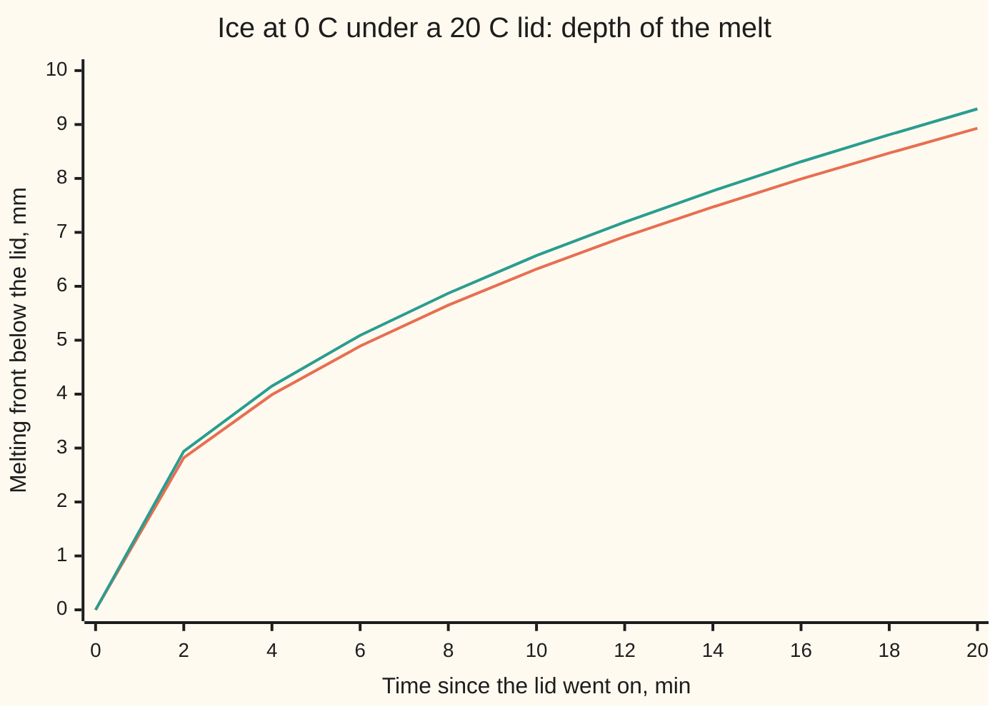
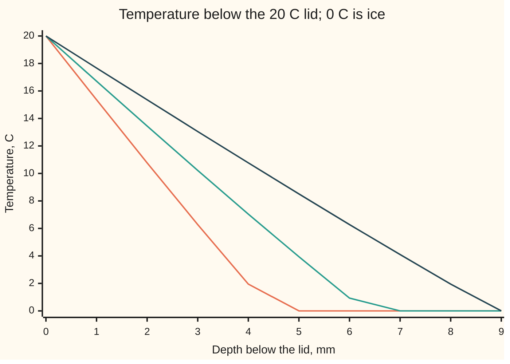

# Free boundaries: when the edge of the region is part of the answer

[Syllabus](../../../SYLLABUS.md) → [Partial differential equations](../README.md) → [Weak Solutions and Free Boundaries](../README.md#s06) → Free boundaries

---

## General Overview

[The heat equation](../../08-Differential%20equations%20and%20dynamics/10-The%20Classical%20PDEs/03-the-heat-equation.md) in wing 08 solved heat flow in a rod whose ends stay where they are. This card lets one end move. Where it moves is not given in advance: it is part of the answer.

A glass is frozen solid, a column of ice at 0 °C. Its sides are wrapped in foam, so heat can only travel up and down. At noon a copper lid held at 20 °C is pressed onto the ice. A layer of melt water forms under the lid and grows downward.

- The **unknown** is the temperature in the melt water and the depth of the melt.
- The **region** is the water layer, from the lid down to the ice. Its lower edge, the melting front, moves.
- The **data** are the lid at 20 °C, the ice at 0 °C, and the heat it takes to melt ice: 334,000 joules per kilogram.

After 20 minutes the front is 8.93 mm below the lid. One minute in, it was moving at 1 mm per minute; by 20 minutes it had slowed to 0.22 mm per minute. Of the heat that came through the lid, 89.1% melted ice and 10.9% warmed the melt water.

**When the edge of the region is unknown, one extra condition on that edge finds it: for melting ice, the Stefan condition makes the heat arriving at the ice pay exactly for the ice it melts.**

**What kind of fact this is:** a model, the Stefan problem: conduction plus an energy balance at the front, which fits melting well when the water does not stir. The Neumann solution of it is exact, derived on this card in Why it works and checked by two other roads in the code.

### The picture: the melting front over 20 minutes



Orange: the exact front, from the Neumann solution. Teal: the quick estimate that ignores the heat stored in the warm water (the quasi-steady estimate, in What breaks). Both curves rise like the square root of time: the front at 20 minutes is twice as deep as at 5 minutes, not four times.

---

## The formula

**Reminders.** Subscripts are partial derivatives, as in wing 08: $`T_t`$ is the rate of warming at a fixed depth, $`T_{xx}`$ the curvature of the temperature profile. $`\kappa`$ is the diffusivity, how fast heat spreads, in m²/s. $`\mathrm{erf}`$ is the error function from [Similarity solutions](../03-The%20Heat%20Equation%20in%20Depth/02-similarity-solutions-and-the-error-function.md): it rises from 0 at 0 toward 1. [Fourier's law](../../13-Engineering%20mathematics/08-Fluids%20and%20Heat/05-heat-conduction-and-fouriers-law.md) gives the heat flow per square metre as $`-k\,T_x`$, where $`k`$ is the conductivity (here not a wavenumber).

**New notation.** This card introduces two symbols. The **interface** $`s(t)`$ is the depth of the melting front at time $`t`$. The **latent heat** $`L`$ is the heat that turns one kilogram of ice at 0 °C into water at 0 °C. The temperature does not change while it melts. (Here $`L`$ is not the operator $`L`$ of shelf 01.)

**The problem.** Put $`x`$ as depth below the lid, and write $`\rho`$ for the density of water, 1000 kg/m³. Find the temperature $`T(x, t)`$ and the front $`s(t)`$ together, such that

```math
\begin{aligned} &T_t = \kappa\,T_{xx} && \text{for } 0 < x < s(t),\ t > 0 && \text{(heat spreads in the water)}\\ &T(0, t) = T_0 && && \text{(the lid)}\\ &T(s(t), t) = 0 && && \text{(the front is at the melting point)}\\ &\rho L\, s'(t) = -k\,T_x(s(t), t) && && \text{(the Stefan condition)}\\ &s(0) = 0 && && \text{(no water at noon)} \end{aligned}
```

**Read it aloud:** heat spreads through the water as usual; the water touching the ice is at 0 °C; and the front moves down exactly as fast as the heat arriving at it can melt ice.

**The answer, the Neumann solution.** Write $`\mathrm{St} = c\,T_0/L`$, the Stefan number: the heat that warms water by $`T_0`$ against the heat that melts it. Then

```math
s(t) = 2\lambda\sqrt{\kappa t}, \qquad T(x, t) = T_0\left(1 - \frac{\mathrm{erf}\big(x / 2\sqrt{\kappa t}\big)}{\mathrm{erf}(\lambda)}\right), \qquad \lambda\, e^{\lambda^2}\,\mathrm{erf}(\lambda) = \frac{\mathrm{St}}{\sqrt{\pi}}
```

**Read it aloud:** the front goes down like the square root of time, at a pace $`\lambda`$ fixed by one equation, and the water's temperature falls from the lid to the front along a stretched piece of the error function.

| Symbol | Plain meaning | In our example | Push it up and the answer… |
| --- | --- | --- | --- |
| $`T(x, t)`$ | temperature of the melt water, °C | 13.05 °C at 3 mm after 20 min | — |
| $`x`$, $`t`$, $`\tau`$ | depth below the lid, m; time since noon, s; a running time inside an integral | front at $`t = 1200`$ s | — |
| $`s(t)`$, $`s'(t)`$ | the interface: depth of the melting front, m; its speed | 8.931 mm; 0.223 mm/min at 20 min | — |
| $`T_0`$ | lid temperature | 20 °C | the front goes deeper |
| $`k`$, $`\rho`$, $`c`$ | water's conductivity, W/(m K); density, kg/m³; specific heat, J/(kg K) | 0.6; 1000; 4186 | larger $`k`$ melts faster |
| $`\kappa = k/(\rho c)`$ | diffusivity of water, m²/s | $`1.4333 \times 10^{-7}`$ | the same melt depth arrives sooner |
| $`L`$ | latent heat of melting, J/kg | 334,000 | the front goes slower |
| $`\mathrm{St} = c\,T_0/L`$ | Stefan number: heat to warm water by $`T_0`$ against heat to melt it | 0.2507 | a deeper front, and a larger share of heat left in the water |
| $`\lambda`$, $`\eta`$, $`A`$, $`B`$ | front constant; the similarity variable $`x/2\sqrt{\kappa t}`$; the two constants of the profile $`A + B\,\mathrm{erf}(\eta)`$ | 0.340497; the front sits at $`\eta = \lambda`$; $`A = 20`$ °C | larger $`\lambda`$: a deeper front |
| $`H`$, $`F`$, $`h`$, $`\Delta t`$ | enthalpy (heat content) per m³, J/m³ (not the Hamiltonian of shelf 02); heat flux $`-k\,T_x`$, W/m²; grid step, m; time step, s | 0 for ice at 0 °C, $`\rho L`$ for water at 0 °C; 0.125 mm; 0.05 s | — |
| $`T_i`$, $`k_s`$, $`c_s`$, $`\kappa_s`$, $`\nu`$, $`\mathrm{St}_s`$, $`\mathrm{erfc}`$ | start temperature of colder ice; ice's conductivity, specific heat and diffusivity; $`\sqrt{\kappa/\kappa_s}`$; the ice's Stefan number; $`1 - \mathrm{erf}`$ | −10 °C; 2.2; 2100 | colder ice: a shallower front |
| $`\xi`$ | scaled depth $`x/s(t)`$, from 0 at the lid to 1 at the front | — | — |

### When it holds

- **The ice sits at exactly 0 °C.** Ice that starts at −10 °C soaks up heat ahead of the front. The front at 20 minutes is then 7.715 mm, 13.6% short of 8.931 mm.
- **Heat moves only by conduction.** Water is densest at 4 °C, so the coldest water near the ice can stir a little. Stirring carries heat faster, and the model then gives too little melt.
- **One density for water and ice.** Real ice is lighter than water, so melt water takes less room than the ice it came from, and the lid sinks. The model ignores this movement.
- **Insulated sides and a lid held at 20 °C.** Warm sides would melt inward too, and the front would curve; the problem is then two- or three-dimensional. A lid of plain air (heat transfer from air, not a held temperature) melts far more slowly.
- **The phase being used up is not past its melting point: no ice above 0 °C, no water below it.** Supercooled water is water below 0 °C that has not yet frozen. When it freezes, the problem is ill-posed: the front breaks into fingers, and this solution does not describe it.

---

## Why it works

### Step 0: an unknown edge needs one extra condition

On a fixed rod, the heat equation needs one condition at each end. Here the lower end is unknown, so one more number per moment is unknown: $`s(t)`$. One more condition per moment is needed to fix it.

The front gives two conditions instead of one. The water there is at 0 °C, and the energy must balance. The first is the usual boundary value. The second, the Stefan condition, is what pins the edge down.

### Step 1: the Stefan condition is an energy budget for a thin slice

Watch the front for a short time $`dt`$. It moves down by $`ds`$.

1. Melting a slice of ice $`ds`$ thick and 1 m² wide needs $`\rho L\,ds`$ joules.
2. Heat arriving through the water at the front, per m², is $`-k\,T_x\,dt`$ ([Fourier's law](../../13-Engineering%20mathematics/08-Fluids%20and%20Heat/05-heat-conduction-and-fouriers-law.md)). $`T_x < 0`$ there, because the water cools toward the ice, so this is positive.
3. The ice beyond is all at 0 °C, so it takes no heat away.

Setting heat in equal to heat used, and dividing by $`dt`$, gives $`\rho L\,s' = -k\,T_x`$. At 20 minutes both sides are 1242.9 W/m², and the code checks this from the formula by a centred difference.

### Step 2: no ruler and no clock, so the front goes like the square root of time

The ice is deep and the melt starts at zero thickness. So the problem has no length and no time of its own. [Similarity solutions](../03-The%20Heat%20Equation%20in%20Depth/02-similarity-solutions-and-the-error-function.md) showed that the temperature then depends only on $`\eta = x/2\sqrt{\kappa t}`$, and the solutions of that form are $`A + B\,\mathrm{erf}(\eta)`$.

The front must sit at a fixed value of $`\eta`$. Call it $`\lambda`$. Then $`s = 2\lambda\sqrt{\kappa t}`$. The lid fixes $`A = T_0`$, the 0 °C front fixes $`B`$, and the Stefan condition fixes $`\lambda`$.

<details>
<summary>Detailed proof: the Neumann solution and its one equation</summary>

Try $`T = A + B\,\mathrm{erf}(\eta)`$ with $`\eta = x/2\sqrt{\kappa t}`$. It solves $`T_t = \kappa T_{xx}`$ for any constants $`A`$ and $`B`$ (Similarity solutions).

At the lid, $`\eta = 0`$ and $`\mathrm{erf}(0) = 0`$, so $`A = T_0`$.

For $`T(s(t), t) = 0`$ to hold at every time with fixed $`A`$ and $`B`$, the front must sit at one fixed $`\eta = \lambda`$. So $`s = 2\lambda\sqrt{\kappa t}`$, and $`T_0 + B\,\mathrm{erf}(\lambda) = 0`$ gives $`B = -T_0/\mathrm{erf}(\lambda)`$.

Differentiate, using $`\mathrm{erf}'(z) = (2/\sqrt{\pi})\,e^{-z^2}`$:

$`\displaystyle T_x = -\frac{T_0}{\mathrm{erf}(\lambda)}\cdot\frac{2}{\sqrt{\pi}}\,e^{-\eta^2}\cdot\frac{1}{2\sqrt{\kappa t}} = -\frac{T_0\,e^{-\eta^2}}{\mathrm{erf}(\lambda)\sqrt{\pi\kappa t}} .`$

At the front, $`\eta = \lambda`$. The speed is $`s' = \lambda\sqrt{\kappa/t}`$. The Stefan condition $`\rho L s' = -k T_x`$ reads

$`\displaystyle \rho L\,\lambda\sqrt{\frac{\kappa}{t}} = \frac{k\,T_0\,e^{-\lambda^2}}{\mathrm{erf}(\lambda)\sqrt{\pi\kappa t}} .`$

The $`t`$ cancels, which is the check that the guess was right. Multiply by $`\sqrt{t}/(\rho L\sqrt{\kappa})`$ and use $`k = \rho c\kappa`$:

$`\displaystyle \lambda = \frac{c\,T_0}{L}\cdot\frac{e^{-\lambda^2}}{\sqrt{\pi}\,\mathrm{erf}(\lambda)}, \qquad\text{that is}\qquad \lambda\,e^{\lambda^2}\,\mathrm{erf}(\lambda) = \frac{\mathrm{St}}{\sqrt{\pi}} .`$

**Exactly one root.** The left side is 0 at $`\lambda = 0`$. It is a product of three positive, increasing factors, so it increases strictly and without bound. So it meets each $`\mathrm{St}/\sqrt{\pi} > 0`$ exactly once. For small $`\mathrm{St}`$, $`e^{\lambda^2}\mathrm{erf}(\lambda) \approx (2/\sqrt{\pi})(\lambda + 2\lambda^3/3)`$, which gives $`\lambda \approx \sqrt{\mathrm{St}/2}\,(1 - \mathrm{St}/6)`$. The code asserts this to 1%.

**Colder ice.** If the ice starts at $`T_i < 0`$, the ice also carries a profile, $`T_i + (0 - T_i)\,\mathrm{erfc}(x/2\sqrt{\kappa_s t})/\mathrm{erfc}(\nu\lambda)`$, and heat flows into it at the front. The same steps give

$`\displaystyle \lambda = \frac{\mathrm{St}\,e^{-\lambda^2}}{\sqrt{\pi}\,\mathrm{erf}(\lambda)} - \frac{\mathrm{St}_s\,e^{-\nu^2\lambda^2}}{\nu\sqrt{\pi}\,\mathrm{erfc}(\nu\lambda)}, \qquad \mathrm{St}_s = \frac{c_s(0 - T_i)}{L} .`$

The second term is heat lost into the ice, so $`\lambda`$ falls: 0.294123 instead of 0.340497.

</details>

### Step 3: the weak form, where the edge needs no tracking

The enthalpy $`H`$ is the heat content per cubic metre, counted from ice at 0 °C. Ice at 0 °C has $`H = 0`$. Water at 0 °C has $`H = \rho L`$. Water at $`T`$ has $`H = \rho L + \rho c\,T`$. A half-melted cell sits between, at 0 °C.

In this form one equation holds everywhere, ice and water alike:

```math
H_t = \big(k\,T_x\big)_x, \qquad T = \max\!\Big(0,\ \frac{H - \rho L}{\rho c}\Big)
```

**Read it aloud:** heat content changes only by heat flowing in; temperature is zero until a cell has taken in all its latent heat.

$`H`$ jumps at the front, so this equation holds in the weak sense of [Weak solutions](01-weak-solutions-and-the-weak-formulation.md): integrated against smooth test functions, not point by point. The jump rule for a conservation law, from [Conservation laws](../02-First-Order%20Equations%20and%20Characteristics/02-conservation-laws-and-shocks.md), says the speed of a jump is the jump in flux over the jump in the conserved amount. Applied to $`H`$, that rule is exactly the Stefan condition.

<details>
<summary>Detailed proof: the jump rule gives the Stefan condition</summary>

Write the equation as a conservation law $`H_t + F_x = 0`$ with flux $`F = -k\,T_x`$. Across a jump moving at speed $`s'`$, the rule is $`s'\,(H_+ - H_-) = F_+ - F_-`$, where the subscripts $`-`$ and $`+`$ mean just behind (water side) and just ahead (ice side).

Water side: $`H_- = \rho L`$ (water at 0 °C) and $`F_- = -k\,T_x(s^-)`$. Ice side: $`H_+ = 0`$ and $`F_+ = 0`$, because the ice is all at 0 °C.

$`\displaystyle s'\,(0 - \rho L) = 0 - \big(-k\,T_x(s^-)\big) \quad\Longrightarrow\quad \rho L\,s' = -k\,T_x(s^-) .`$

That is the Stefan condition. Away from the front $`H`$ is smooth and $`H_t = \rho c\,T_t`$, so the heat equation holds there. So a weak solution of the enthalpy equation is the Stefan problem, with the front read off afterwards as the place where $`H`$ crosses from $`\rho L`$ to 0.

</details>

This is why the code's grid never looks for the front. It steps $`H`$ forward and reads the melt depth from the melted fractions afterwards. In several space dimensions the weak problem has exactly one solution (Friedman, 1968, in Sources); this card cites that theorem and does not prove it.

### Step 4: a third way, fixing the region

Another standard method is front-fixing: set $`\xi = x/s(t)`$, so the water always fills $`0 \le \xi \le 1`$. The region stops moving. The price is an extra drift term, $`(\xi s'/s)\,T_\xi`$, in the equation. For the Neumann solution, $`s\,s' = 2\lambda^2\kappa`$ is constant and the profile in $`\xi`$ does not change at all. The three methods compared:

| Method | What it tracks | Cost |
| --- | --- | --- |
| Neumann (similarity) | the front, exactly | works only with no ruler or clock |
| Enthalpy (weak form) | nothing; read the front afterwards | the front is blurred over one cell |
| Front-fixing | the front, as a moving coordinate | an extra drift term in the equation |

### Step 5: the energy books balance

Heat through the lid in 20 minutes is $`\int_0^t k\,T_0/\big(\mathrm{erf}(\lambda)\sqrt{\pi\kappa\tau}\big)\,d\tau = 3349.719`$ kJ/m², with $`\tau`$ the running time. Melting 8.931 mm of ice used 2983.025 kJ/m². Warming the water, $`\rho c\int_0^s T\,dx`$ by Simpson's rule, used 366.694 kJ/m². The two add up to the heat in, to eight decimals. That balance holds only if the Stefan condition holds, so it is a check on $`\lambda`$ from outside its equation.

[Diffusion's maximum principle](../03-The%20Heat%20Equation%20in%20Depth/04-maximum-principle-for-the-heat-equation.md) adds two facts. The water stays between 0 °C and 20 °C. And the water cools toward the ice, $`T_x < 0`$ at the front, so the front only ever moves down.

---

## Worked numbers, by hand

Ice at 0 °C, lid at 20 °C, 20 minutes ($`t = 1200`$ s).

| Step | Arithmetic | Value |
| --- | --- | --- |
| diffusivity | $`\kappa = 0.6 / (1000 \times 4186)`$ | $`1.4333 \times 10^{-7}`$ m²/s |
| Stefan number | $`\mathrm{St} = 4186 \times 20 / 334{,}000`$ | 0.2507 |
| right side | $`\mathrm{St}/\sqrt{\pi} = 0.2507 / 1.7725`$ | 0.1414 |
| try $`\lambda = 0.3405`$ | $`e^{\lambda^2} = 1.1229`$, $`\mathrm{erf}(\lambda) = 0.3699`$ | product $`0.3405 \times 1.1229 \times 0.3699 = 0.1414`$ |
| spreading length | $`\sqrt{\kappa t} = \sqrt{1.4333 \times 10^{-7} \times 1200}`$ | 13.115 mm |
| the front | $`s = 2 \times 0.340497 \times 13.115`$ mm | **8.931 mm** |
| its speed | $`s' = s/(2t)`$ = 8.931 mm / 40 min | 0.223 mm/min |
| Stefan condition | $`\rho L s' = 1000 \times 334{,}000 \times s'`$ | 1242.9 W/m² |

After 20 minutes under a 20 °C lid, the glass has lost 8.93 mm of ice, and the front is creeping down at under a quarter of a millimetre a minute.

### What breaks if you drop a piece

| Mistake | Comes out at | What went wrong |
| --- | --- | --- |
| Moving the front at its 1-minute speed, 0.999 mm/min, for 20 minutes | 19.971 mm | The front slows like $`1/\sqrt{t}`$: the water layer it must heat through keeps thickening |
| Ignoring the heat that warms the water (quasi-steady) | 9.286 mm, 4.0% too deep | All the heat is spent on melting; the 10.9% kept in the water is forgotten |
| Dropping the 2 in $`s = 2\lambda\sqrt{\kappa t}`$ | 4.466 mm | That is the front at 5 minutes, not 20 |
| Ice at −10 °C, solved as if it were at 0 °C | 8.931 mm; the true front is 7.715 mm | The hypothesis "ice at the melting point" fails: heat leaks into the cold ice |

---

## How the front moves

**The puzzle.** The lid stays at 20 °C, yet the melting slows down. Why?

The answer is in the water layer. Heat must cross it to reach the ice. The thicker it is, the gentler the temperature slope across it, and the less heat gets through. Twice the depth means half the slope, half the speed. That feedback is what makes the depth grow like $`\sqrt{t}`$.

| Time | Front | Temperature 3 mm down |
| --- | --- | --- |
| 5 min | 4.466 mm | 6.28 °C |
| 10 min | 6.315 mm | 10.22 °C |
| 20 min | 8.931 mm | 13.05 °C |

**Force one: where the heat goes.** By 20 minutes, the heat through the lid has split two ways.

```
melting the ice      ######################################  2983.025 kJ/m^2
warming the water    #####                                    366.694 kJ/m^2
```

**Force two: the flux falls across the layer.** At 20 minutes, 1395.7 W/m² enters at the lid, but only 1242.9 W/m² reaches the ice. The difference stays behind and warms the water.

```
heat flux at the lid     ######################################  1395.7 W/m^2
heat flux at the front   ##################################      1242.9 W/m^2
```

**Both together: the temperature profiles.**



Orange: 5 minutes. Teal: 10 minutes. Dark blue: 20 minutes. Each profile is close to a straight line from 20 °C down to 0 °C at its front, and each is the one before stretched sideways. The 5-minute values reappear on the 20-minute curve at twice the depth: 10.77 °C at 2 mm, then at 4 mm.

---

## Code, from first principles, and it actually runs

The code takes three roads to the 20-minute front. Road one is the Neumann formula: it writes its own error function as a series and finds $`\lambda`$ by bisection. Road two is the enthalpy grid of Step 3, an explicit scheme run at three grid steps. Its ratio $`\kappa\Delta t/h^2 = 0.4587`$ is inside the limit of 1/2 from [Stepping the heat equation on a grid](../../08-Differential%20equations%20and%20dynamics/10-The%20Classical%20PDEs/09-finite-differences-for-the-heat-equation.md). Road three is the energy budget, with Simpson's rule for the heat in the water. The code also checks the Stefan condition by a centred difference, and the heat equation by its residual at two steps.

The grid agrees with Neumann to under 4 µm at every step. Its error has no clean observed order: it changes sign as the front crosses cell edges, the known staircase of the enthalpy method (Voller and Cross, in Sources). The residual falls from 5.1994 to 1.2996 (units of $`10^{-6}`$ K/s) when both steps halve: a factor 4, the truncation of centred differences, so the formula itself solves the equation.

### Python

```python
# Free boundaries and the Stefan problem -- the check behind the card.  Standard
# library only.  A glass of ice at 0 C under a lid held at 20 C, melting for 20
# minutes.  Road 1: the Neumann closed form, its number lam found by bisection.
# Road 2: an enthalpy grid that never tracks the front, at three steps.
# Road 3: the heat through the lid against the heat stored, by Simpson's rule.
import math
K, RHO, C, LAT, T0 = 0.6, 1000.0, 4186.0, 334000.0, 20.0   # water, SI units
KS, CS, TI = 2.2, 2100.0, -10.0                # ice, for the -10 C break
KAP = K / (RHO * C)                            # water's diffusivity, m^2/s
ST = C * T0 / LAT                              # Stefan number
TEND = 1200.0                                  # 20 minutes, s
SQPI = math.sqrt(math.pi)

def erf(z):                                    # Taylor series, fine for z < 3
    term, total, n = z, z, 0
    while abs(term) > 1e-17:
        n += 1
        term *= -z * z / n
        total += term / (2 * n + 1)
    return 2 / SQPI * total

def bisect(f, a, b):                           # f(a) < 0 < f(b)
    for _ in range(200):
        m = 0.5 * (a + b)
        a, b = (m, b) if f(m) < 0 else (a, m)
    return 0.5 * (a + b)

lam = bisect(lambda l: l * math.exp(l * l) * erf(l) - ST / SQPI, 0.0, 2.0)
def front(t): return 2 * lam * math.sqrt(KAP * t)
def speed(t): return lam * math.sqrt(KAP / t)
def temp(x, t): return T0 * (1 - erf(x / (2 * math.sqrt(KAP * t))) / erf(lam))

def enthalpy_front(n_cells, dt):               # H = heat content per m^3 above ice at 0 C
    h = 0.015 / n_cells
    H = [0.0] * (n_cells + 1)
    T = [T0] + [0.0] * n_cells
    for _ in range(round(TEND / dt)):
        for i in range(1, n_cells):
            H[i] += dt * K * (T[i + 1] - 2 * T[i] + T[i - 1]) / (h * h)
        for i in range(1, n_cells):
            T[i] = max(0.0, (H[i] - RHO * LAT) / (RHO * C))
    return h / 2 + h * sum(min(1.0, Hi / (RHO * LAT)) for Hi in H[1:])

def simpson(f, a, b, n=200):
    h = (b - a) / n
    return h / 3 * sum((1 if j in (0, n) else 4 if j % 2 else 2) * f(a + j * h) for j in range(n + 1))

def out(label, value): print(f"{label:<46}{value}")
out("diffusivity of water, 1e-7 m^2/s", f"{KAP * 1e7:.4f}")
out("Stefan number c*T0/L", f"{ST:.4f}")
out("lam, root of the Neumann equation", f"{lam:.6f}")
s20 = front(TEND)
out("by hand: exp(lam^2), erf(lam), product", f"{math.exp(lam * lam):.4f}, {erf(lam):.4f}, "
    f"{lam * math.exp(lam * lam) * erf(lam):.4f} = St/sqrt(pi) {ST / SQPI:.4f}")
out("sqrt(kappa t) at 20 min, mm", f"{1000 * math.sqrt(KAP * TEND):.3f}")
out("front after 5, 10 and 20 min, mm", f"{1000 * front(300):.3f}, {1000 * front(600):.3f}, {1000 * s20:.3f}")
out("front speed at 1 min and 20 min, mm/min", f"{60000 * speed(60):.3f} and {60000 * speed(TEND):.3f}")
print("minute   " + "".join(f"{m:>6}" for m in range(0, 21, 2)))
print("front mm " + "".join(f"{1000 * front(60 * m):>6.2f}" for m in range(0, 21, 2)))
qs = [math.sqrt(2 * K * T0 * 60 * m / (RHO * LAT)) for m in range(0, 21, 2)]
print("quasi mm " + "".join(f"{1000 * v:>6.2f}" for v in qs))
for m in (5, 10, 20):
    t = 60 * m
    row = [temp(x / 1000, t) if x / 1000 <= front(t) else 0.0 for x in range(10)]
    print(f"T at {m:>2} min, x = 0..9 mm, C " + " ".join(f"{v:5.2f}" for v in row))
# road 3: heat in through the lid against latent plus sensible heat stored
q_in = 2 * K * T0 * math.sqrt(TEND) / (erf(lam) * math.sqrt(math.pi * KAP))
latent = RHO * LAT * s20
sensible = RHO * C * simpson(lambda x: temp(x, TEND), 0.0, s20)
out("heat in through the lid, kJ/m^2", f"{q_in / 1000:.3f}")
out("melting the ice (latent), kJ/m^2", f"{latent / 1000:.3f}")
out("warming the melt water (sensible), kJ/m^2", f"{sensible / 1000:.3f}")
out("stored / in", f"{(latent + sensible) / q_in:.8f}")
out("shares: latent, sensible, %", f"{100 * latent / q_in:.1f}, {100 * sensible / q_in:.1f}")
dx = 1e-3 * s20                                # Stefan condition at 20 min, two sides
grad = (temp(s20 + dx, TEND) - temp(s20 - dx, TEND)) / (2 * dx)
lid = -K * (temp(dx, TEND) - temp(-dx, TEND)) / (2 * dx)
out("W/m^2 at 20 min: lid, -k T_x(s), rho L s'", f"{lid:.1f}, {-K * grad:.1f}, {RHO * LAT * speed(TEND):.1f}")
# road 2: the enthalpy grid, explicit, r = kappa*dt/h^2 = 0.4587 on every grid
grid = []
for n_cells, dt in ((30, 0.8), (60, 0.2), (120, 0.05)):
    sg = enthalpy_front(n_cells, dt)
    grid.append(sg)
    out(f"grid h = {15 / n_cells:.3f} mm, dt = {dt} s, front mm", f"{1000 * sg:.3f}  error {1e6 * (sg - s20):+.1f} um  ratio {KAP * dt / (0.015 / n_cells) ** 2:.4f}")
# two-phase: ice starting at -10 C also soaks up heat ahead of the front
kaps = KS / (RHO * CS)
nu, sts = math.sqrt(KAP / kaps), CS * (0 - TI) / LAT
lam2 = bisect(lambda l: l - ST * math.exp(-l * l) / (SQPI * erf(l))
              + sts * math.exp(-nu * nu * l * l) / (nu * SQPI * (1 - erf(nu * l))), 1e-9, 2.0)
s_cold = 2 * lam2 * math.sqrt(KAP * TEND)
out("ice at -10 C: lam, front after 20 min mm", f"{lam2:.6f}, {1000 * s_cold:.3f}")
mist = [60 * speed(60) * 20, qs[-1], lam * math.sqrt(KAP * TEND)]
out("mistakes, mm: constant speed, quasi, no 2", ", ".join(f"{1000 * v:.3f}" for v in mist))
out("off by, %: -10 C ice, quasi-steady", f"{100 * (s_cold / s20 - 1):+.1f}, {100 * (qs[-1] / s20 - 1):+.1f}")
# centred-difference residual of the heat equation at mid-layer, 20 min, two steps
x0, res = 0.5 * s20, []
for d, e in ((0.1 * s20, 40.0), (0.05 * s20, 20.0)):
    res.append((temp(x0, TEND + e) - temp(x0, TEND - e)) / (2 * e)
               - KAP * (temp(x0 + d, TEND) - 2 * temp(x0, TEND) + temp(x0 - d, TEND)) / (d * d))
out("heat-eq residual, 1e-6 K/s, step d and d/2", f"{res[0] * 1e6:.4f}, {res[1] * 1e6:.4f}")
assert abs(lam - math.sqrt(ST / 2) * (1 - ST / 6)) < 0.01 * lam   # small-St series
assert abs((latent + sensible) / q_in - 1) < 1e-8          # energy is conserved
assert max(abs(g - s20) for g in grid) < 1e-3 * s20       # the grid agrees with Neumann
assert 3.5 < res[0] / res[1] < 4.5                          # order 2: the formula solves the equation
assert abs(-K * grad / (RHO * LAT * speed(TEND)) - 1) < 1e-5   # the Stefan condition
assert s_cold < s20 < qs[-1] < mist[0]                      # each break's direction
print("ALL CHECKS PASS")
```

**Ran 2026-11-15 on macOS, Python 3.14.10, standard library only. All checks passed. Output, pasted from the run:**

```
diffusivity of water, 1e-7 m^2/s              1.4333
Stefan number c*T0/L                          0.2507
lam, root of the Neumann equation             0.340497
by hand: exp(lam^2), erf(lam), product        1.1229, 0.3699, 0.1414 = St/sqrt(pi) 0.1414
sqrt(kappa t) at 20 min, mm                   13.115
front after 5, 10 and 20 min, mm              4.466, 6.315, 8.931
front speed at 1 min and 20 min, mm/min       0.999 and 0.223
minute        0     2     4     6     8    10    12    14    16    18    20
front mm   0.00  2.82  3.99  4.89  5.65  6.32  6.92  7.47  7.99  8.47  8.93
quasi mm   0.00  2.94  4.15  5.09  5.87  6.57  7.19  7.77  8.31  8.81  9.29
T at  5 min, x = 0..9 mm, C 20.00 15.36 10.77  6.28  1.95  0.00  0.00  0.00  0.00  0.00
T at 10 min, x = 0..9 mm, C 20.00 16.71 13.45 10.22  7.04  3.94  0.93  0.00  0.00  0.00
T at 20 min, x = 0..9 mm, C 20.00 17.67 15.36 13.05 10.77  8.51  6.28  4.10  1.95  0.00
heat in through the lid, kJ/m^2               3349.719
melting the ice (latent), kJ/m^2              2983.025
warming the melt water (sensible), kJ/m^2     366.694
stored / in                                   1.00000000
shares: latent, sensible, %                   89.1, 10.9
W/m^2 at 20 min: lid, -k T_x(s), rho L s'     1395.7, 1242.9, 1242.9
grid h = 0.500 mm, dt = 0.8 s, front mm       8.927  error -3.8 um  ratio 0.4587
grid h = 0.250 mm, dt = 0.2 s, front mm       8.930  error -1.5 um  ratio 0.4587
grid h = 0.125 mm, dt = 0.05 s, front mm      8.933  error +1.6 um  ratio 0.4587
ice at -10 C: lam, front after 20 min mm      0.294123, 7.715
mistakes, mm: constant speed, quasi, no 2     19.971, 9.286, 4.466
off by, %: -10 C ice, quasi-steady            -13.6, +4.0
heat-eq residual, 1e-6 K/s, step d and d/2    5.1994, 1.2996
ALL CHECKS PASS
```

### Rust

The same numbers and labels, built with `rustc --edition 2021 -O`.

```rust
// Free boundaries and the Stefan problem -- the same check as the Python, in Rust.
// No crates.  A glass of ice at 0 C under a lid held at 20 C, melting for 20
// minutes.  Road 1: the Neumann closed form, its number lam found by bisection.
// Road 2: an enthalpy grid that never tracks the front, at three steps.
// Road 3: the heat through the lid against the heat stored, by Simpson's rule.
const K: f64 = 0.6;
const RHO: f64 = 1000.0;
const C: f64 = 4186.0;
const LAT: f64 = 334000.0;
const T0: f64 = 20.0; // water, SI units
const KS: f64 = 2.2;
const CS: f64 = 2100.0;
const TI: f64 = -10.0; // ice, for the -10 C break
const TEND: f64 = 1200.0; // 20 minutes, s

fn sqpi() -> f64 { std::f64::consts::PI.sqrt() }
fn kap() -> f64 { K / (RHO * C) } // water's diffusivity, m^2/s
fn st() -> f64 { C * T0 / LAT } // Stefan number

fn erf(z: f64) -> f64 { // Taylor series, fine for z < 3
    let (mut term, mut total, mut n) = (z, z, 0.0);
    while term.abs() > 1e-17 {
        n += 1.0;
        term *= -z * z / n;
        total += term / (2.0 * n + 1.0);
    }
    2.0 / sqpi() * total
}

fn bisect(f: &dyn Fn(f64) -> f64, mut a: f64, mut b: f64) -> f64 { // f(a) < 0 < f(b)
    for _ in 0..200 {
        let m = 0.5 * (a + b);
        if f(m) < 0.0 { a = m; } else { b = m; }
    }
    0.5 * (a + b)
}

fn temp(lam: f64, x: f64, t: f64) -> f64 { T0 * (1.0 - erf(x / (2.0 * (kap() * t).sqrt())) / erf(lam)) }

fn enthalpy_front(n_cells: usize, dt: f64) -> f64 { // H = heat content per m^3 above ice at 0 C
    let h = 0.015 / n_cells as f64;
    let mut hh = vec![0.0; n_cells + 1];
    let mut t = vec![0.0; n_cells + 1];
    t[0] = T0;
    for _ in 0..(TEND / dt).round() as usize {
        for i in 1..n_cells {
            hh[i] += dt * K * (t[i + 1] - 2.0 * t[i] + t[i - 1]) / (h * h);
        }
        for i in 1..n_cells {
            t[i] = f64::max(0.0, (hh[i] - RHO * LAT) / (RHO * C));
        }
    }
    h / 2.0 + h * hh[1..].iter().map(|v| f64::min(1.0, v / (RHO * LAT))).sum::<f64>()
}

fn simpson(f: &dyn Fn(f64) -> f64, a: f64, b: f64, n: usize) -> f64 {
    let h = (b - a) / n as f64;
    let mut s = 0.0;
    for j in 0..=n {
        let w = if j == 0 || j == n { 1.0 } else if j % 2 == 1 { 4.0 } else { 2.0 };
        s += w * f(a + j as f64 * h);
    }
    h / 3.0 * s
}

fn out(label: &str, value: String) { println!("{:<46}{}", label, value); }

fn main() {
    let (kap, st, sqpi) = (kap(), st(), sqpi());
    let lam = bisect(&|l: f64| l * (l * l).exp() * erf(l) - st / sqpi, 0.0, 2.0);
    let front = |t: f64| 2.0 * lam * (kap * t).sqrt();
    let speed = |t: f64| lam * (kap / t).sqrt();
    out("diffusivity of water, 1e-7 m^2/s", format!("{:.4}", kap * 1e7));
    out("Stefan number c*T0/L", format!("{:.4}", st));
    out("lam, root of the Neumann equation", format!("{:.6}", lam));
    let s20 = front(TEND);
    out("by hand: exp(lam^2), erf(lam), product", format!("{:.4}, {:.4}, {:.4} = St/sqrt(pi) {:.4}",
        (lam * lam).exp(), erf(lam), lam * (lam * lam).exp() * erf(lam), st / sqpi));
    out("sqrt(kappa t) at 20 min, mm", format!("{:.3}", 1000.0 * (kap * TEND).sqrt()));
    out("front after 5, 10 and 20 min, mm",
        format!("{:.3}, {:.3}, {:.3}", 1000.0 * front(300.0), 1000.0 * front(600.0), 1000.0 * s20));
    out("front speed at 1 min and 20 min, mm/min",
        format!("{:.3} and {:.3}", 60000.0 * speed(60.0), 60000.0 * speed(TEND)));
    let mins: Vec<f64> = (0..=10).map(|k| (2 * k) as f64).collect();
    let mut line = String::from("minute   ");
    for m in &mins { line.push_str(&format!("{:>6}", m)); }
    println!("{}", line);
    let mut line = String::from("front mm ");
    for m in &mins { line.push_str(&format!("{:>6.2}", 1000.0 * front(60.0 * m))); }
    println!("{}", line);
    let qs: Vec<f64> = mins.iter().map(|m| (2.0 * K * T0 * 60.0 * m / (RHO * LAT)).sqrt()).collect();
    let mut line = String::from("quasi mm ");
    for v in &qs { line.push_str(&format!("{:>6.2}", 1000.0 * v)); }
    println!("{}", line);
    for m in [5.0, 10.0, 20.0] {
        let t = 60.0 * m;
        let row: Vec<String> = (0..10).map(|x| {
            let xm = x as f64 / 1000.0;
            format!("{:5.2}", if xm <= front(t) { temp(lam, xm, t) } else { 0.0 })
        }).collect();
        println!("T at {:>2} min, x = 0..9 mm, C {}", m, row.join(" "));
    }
    // road 3: heat in through the lid against latent plus sensible heat stored
    let q_in = 2.0 * K * T0 * TEND.sqrt() / (erf(lam) * (std::f64::consts::PI * kap).sqrt());
    let latent = RHO * LAT * s20;
    let sensible = RHO * C * simpson(&|x: f64| temp(lam, x, TEND), 0.0, s20, 200);
    out("heat in through the lid, kJ/m^2", format!("{:.3}", q_in / 1000.0));
    out("melting the ice (latent), kJ/m^2", format!("{:.3}", latent / 1000.0));
    out("warming the melt water (sensible), kJ/m^2", format!("{:.3}", sensible / 1000.0));
    out("stored / in", format!("{:.8}", (latent + sensible) / q_in));
    out("shares: latent, sensible, %", format!("{:.1}, {:.1}", 100.0 * latent / q_in, 100.0 * sensible / q_in));
    let dx = 1e-3 * s20; // Stefan condition at 20 min, two sides
    let grad = (temp(lam, s20 + dx, TEND) - temp(lam, s20 - dx, TEND)) / (2.0 * dx);
    let lid = -K * (temp(lam, dx, TEND) - temp(lam, -dx, TEND)) / (2.0 * dx);
    out("W/m^2 at 20 min: lid, -k T_x(s), rho L s'",
        format!("{:.1}, {:.1}, {:.1}", lid, -K * grad, RHO * LAT * speed(TEND)));
    // road 2: the enthalpy grid, explicit, r = kappa*dt/h^2 = 0.4587 on every grid
    let mut grid = Vec::new();
    for (n_cells, dt) in [(30usize, 0.8), (60, 0.2), (120, 0.05)] {
        let sg = enthalpy_front(n_cells, dt);
        grid.push(sg);
        out(&format!("grid h = {:.3} mm, dt = {} s, front mm", 15.0 / n_cells as f64, dt),
            format!("{:.3}  error {:+.1} um  ratio {:.4}", 1000.0 * sg, 1e6 * (sg - s20), kap * dt / (0.015 / n_cells as f64).powi(2)));
    }
    // two-phase: ice starting at -10 C also soaks up heat ahead of the front
    let kaps = KS / (RHO * CS);
    let (nu, sts) = ((kap / kaps).sqrt(), CS * (0.0 - TI) / LAT);
    let lam2 = bisect(&|l: f64| l - st * (-l * l).exp() / (sqpi * erf(l))
        + sts * (-nu * nu * l * l).exp() / (nu * sqpi * (1.0 - erf(nu * l))), 1e-9, 2.0);
    let s_cold = 2.0 * lam2 * (kap * TEND).sqrt();
    out("ice at -10 C: lam, front after 20 min mm", format!("{:.6}, {:.3}", lam2, 1000.0 * s_cold));
    let mist = [60.0 * speed(60.0) * 20.0, qs[10], lam * (kap * TEND).sqrt()];
    out("mistakes, mm: constant speed, quasi, no 2",
        format!("{:.3}, {:.3}, {:.3}", 1000.0 * mist[0], 1000.0 * mist[1], 1000.0 * mist[2]));
    out("off by, %: -10 C ice, quasi-steady",
        format!("{:+.1}, {:+.1}", 100.0 * (s_cold / s20 - 1.0), 100.0 * (qs[10] / s20 - 1.0)));
    // centred-difference residual of the heat equation at mid-layer, 20 min, two steps
    let x0 = 0.5 * s20;
    let u = |x: f64, t: f64| temp(lam, x, t);
    let mut res = Vec::new();
    for (d, e) in [(0.1 * s20, 40.0), (0.05 * s20, 20.0)] {
        res.push((u(x0, TEND + e) - u(x0, TEND - e)) / (2.0 * e)
            - kap * (u(x0 + d, TEND) - 2.0 * u(x0, TEND) + u(x0 - d, TEND)) / (d * d));
    }
    out("heat-eq residual, 1e-6 K/s, step d and d/2", format!("{:.4}, {:.4}", res[0] * 1e6, res[1] * 1e6));
    assert!((lam - (st / 2.0).sqrt() * (1.0 - st / 6.0)).abs() < 0.01 * lam); // small-St series
    assert!(((latent + sensible) / q_in - 1.0).abs() < 1e-8); // energy is conserved
    assert!(grid.iter().all(|g| (g - s20).abs() < 1e-3 * s20)); // the grid agrees with Neumann
    assert!(3.5 < res[0] / res[1] && res[0] / res[1] < 4.5); // order 2: the formula solves the equation
    assert!((-K * grad / (RHO * LAT * speed(TEND)) - 1.0).abs() < 1e-5); // the Stefan condition
    assert!(s_cold < s20 && s20 < qs[10] && qs[10] < mist[0]); // each break's direction
    println!("ALL CHECKS PASS");
}
```

**Ran 2026-11-15 on macOS, rustc 1.98.1, no crates. All checks passed. Output, pasted from the run:**

```
diffusivity of water, 1e-7 m^2/s              1.4333
Stefan number c*T0/L                          0.2507
lam, root of the Neumann equation             0.340497
by hand: exp(lam^2), erf(lam), product        1.1229, 0.3699, 0.1414 = St/sqrt(pi) 0.1414
sqrt(kappa t) at 20 min, mm                   13.115
front after 5, 10 and 20 min, mm              4.466, 6.315, 8.931
front speed at 1 min and 20 min, mm/min       0.999 and 0.223
minute        0     2     4     6     8    10    12    14    16    18    20
front mm   0.00  2.82  3.99  4.89  5.65  6.32  6.92  7.47  7.99  8.47  8.93
quasi mm   0.00  2.94  4.15  5.09  5.87  6.57  7.19  7.77  8.31  8.81  9.29
T at  5 min, x = 0..9 mm, C 20.00 15.36 10.77  6.28  1.95  0.00  0.00  0.00  0.00  0.00
T at 10 min, x = 0..9 mm, C 20.00 16.71 13.45 10.22  7.04  3.94  0.93  0.00  0.00  0.00
T at 20 min, x = 0..9 mm, C 20.00 17.67 15.36 13.05 10.77  8.51  6.28  4.10  1.95  0.00
heat in through the lid, kJ/m^2               3349.719
melting the ice (latent), kJ/m^2              2983.025
warming the melt water (sensible), kJ/m^2     366.694
stored / in                                   1.00000000
shares: latent, sensible, %                   89.1, 10.9
W/m^2 at 20 min: lid, -k T_x(s), rho L s'     1395.7, 1242.9, 1242.9
grid h = 0.500 mm, dt = 0.8 s, front mm       8.927  error -3.8 um  ratio 0.4587
grid h = 0.250 mm, dt = 0.2 s, front mm       8.930  error -1.5 um  ratio 0.4587
grid h = 0.125 mm, dt = 0.05 s, front mm      8.933  error +1.6 um  ratio 0.4587
ice at -10 C: lam, front after 20 min mm      0.294123, 7.715
mistakes, mm: constant speed, quasi, no 2     19.971, 9.286, 4.466
off by, %: -10 C ice, quasi-steady            -13.6, +4.0
heat-eq residual, 1e-6 K/s, step d and d/2    5.1994, 1.2996
ALL CHECKS PASS
```

The two outputs match line for line.

### Lean

Lean proves the Neumann solution exact for any positive $`k`$, $`\rho`$, $`c`$, $`L`$ and $`T_0`$, at every time $`t > 0`$.

- Take $`\lambda > 0`$ with $`\lambda\, e^{\lambda^2}\,\mathrm{erf}(\lambda) = \mathrm{St}/\sqrt{\pi}`$. Then $`T`$ and $`s`$ meet all five lines of the problem, the Stefan condition included.
- Take any Stefan number $`\mathrm{St} > 0`$. Then the equation for $`\lambda`$ has exactly one positive root.
- Take that $`\lambda`$ and any time $`t > 0`$. Then the heat in through the lid equals $`\rho L\, s(t)`$ plus the heat that warmed the melt water.
- The front at 20 minutes is exactly twice as deep as at 5 minutes, not four times.

The numbers, the enthalpy grid, the colder ice and the mistakes are left to the Python and Rust checks.

```lean
-- Free boundaries: the Neumann formula solves the one-phase Stefan problem for ice at 0 °C under a lid held at T₀, its front constant λ is the one positive root of λ e^{λ²} erf λ = St/√π, and the heat through the lid equals the heat used to melt the ice plus the heat kept in the water.
import Mathlib.MeasureTheory.Integral.IntervalIntegral.Basic
import Mathlib.Analysis.SpecialFunctions.ExpDeriv
import Mathlib.Analysis.SpecialFunctions.Sqrt
import Mathlib.Analysis.SpecialFunctions.Trigonometric.Basic
import Mathlib.Analysis.Calculus.ContDiff.Basic
import Mathlib.Analysis.SpecialFunctions.Integrals.Basic
import Mathlib.Analysis.Calculus.ContDiff.Deriv
import Mathlib.Analysis.Calculus.Deriv.MeanValue

open Real Set

namespace StefanProblem

/-- The error function, `erf z = (2/√π) ∫₀^z e^{-u²} du`. Mathlib has no `erf`, so it is
defined here from Mathlib's interval integral, exponential, square root and `π`. -/
noncomputable def erf (z : ℝ) : ℝ :=
  2 / √π * ∫ u in (0 : ℝ)..z, exp (-u ^ 2)

/-- The Neumann front: the depth `s(t) = 2 λ √(κ t)` of the melting front at time `t`. -/
noncomputable def front (κ lam t : ℝ) : ℝ :=
  2 * lam * √(κ * t)

/-- The Neumann profile: the melt-water temperature
`T(x, t) = T₀ (1 - erf(x / (2 √(κ t))) / erf λ)`. -/
noncomputable def temp (T₀ κ lam x t : ℝ) : ℝ :=
  T₀ * (1 - erf (x / (2 * √(κ * t))) / erf lam)

lemma hasDerivAt_erf (z : ℝ) : HasDerivAt erf (2 / √π * exp (-z ^ 2)) z := by
  have h : Continuous fun u : ℝ => exp (-u ^ 2) := by fun_prop
  exact ((h.integral_hasStrictDerivAt 0 z).hasDerivAt).const_mul (2 / √π)

lemma erf_zero : erf 0 = 0 := by simp [erf]

lemma erf_strictMono : StrictMono erf :=
  strictMono_of_hasDerivAt_pos hasDerivAt_erf (fun x => by positivity)

lemma erf_pos {z : ℝ} (hz : 0 < z) : 0 < erf z := by
  simpa [erf_zero] using erf_strictMono hz

lemma deriv_erf : deriv erf = fun z => 2 / √π * exp (-z ^ 2) :=
  funext fun z => (hasDerivAt_erf z).deriv

lemma erf_contDiff : ContDiff ℝ 2 erf := by
  rw [show (2 : WithTop ℕ∞) = 1 + 1 from rfl, contDiff_succ_iff_deriv]
  refine ⟨fun z => (hasDerivAt_erf z).differentiableAt, by simp, ?_⟩
  rw [deriv_erf]
  fun_prop

lemma erf_continuous : Continuous erf :=
  continuous_iff_continuousAt.2 fun z => (hasDerivAt_erf z).continuousAt

#print axioms hasDerivAt_erf
#print axioms erf_zero
#print axioms erf_strictMono
#print axioms erf_pos
#print axioms deriv_erf
#print axioms erf_contDiff
#print axioms erf_continuous

lemma hasDerivAt_temp_x (T₀ κ lam t y : ℝ) :
    HasDerivAt (fun y => temp T₀ κ lam y t)
      (-(T₀ / erf lam) * (2 / √π * exp (-(y / (2 * √(κ * t))) ^ 2)) * (1 / (2 * √(κ * t)))) y := by
  have h1 := (hasDerivAt_erf (y / (2 * √(κ * t)))).comp y ((hasDerivAt_id y).div_const (2 * √(κ * t)))
  have h2 := ((h1.div_const (erf lam)).const_sub 1).const_mul T₀
  refine h2.congr_deriv ?_
  ring

lemma deriv_temp_x (T₀ κ lam t : ℝ) :
    deriv (fun y => temp T₀ κ lam y t) = fun y =>
      -(T₀ / erf lam) * (2 / √π * exp (-(y / (2 * √(κ * t))) ^ 2)) * (1 / (2 * √(κ * t))) :=
  funext fun y => (hasDerivAt_temp_x T₀ κ lam t y).deriv

lemma hasDerivAt_temp_xx (T₀ κ lam t y : ℝ) :
    HasDerivAt (fun y =>
      -(T₀ / erf lam) * (2 / √π * exp (-(y / (2 * √(κ * t))) ^ 2)) * (1 / (2 * √(κ * t))))
      (-(T₀ / erf lam) * (2 / √π * (exp (-(y / (2 * √(κ * t))) ^ 2) *
        (-(2 * (y / (2 * √(κ * t))) * (1 / (2 * √(κ * t))))))) * (1 / (2 * √(κ * t)))) y := by
  have h0 : HasDerivAt (fun y => -(y / (2 * √(κ * t))) ^ 2)
      (-(2 * (y / (2 * √(κ * t))) * (1 / (2 * √(κ * t))))) y := by
    have := (((hasDerivAt_id y).div_const (2 * √(κ * t))).pow 2).neg
    refine this.congr_deriv ?_
    simp only [id]
    ring
  exact ((h0.exp.const_mul (2 / √π)).const_mul (-(T₀ / erf lam))).mul_const _

lemma hasDerivAt_temp_t (T₀ κ lam x t : ℝ) (hκt : 0 < κ * t) :
    HasDerivAt (fun τ => temp T₀ κ lam x τ)
      (-(T₀ / erf lam) * (2 / √π * exp (-(x / (2 * √(κ * t))) ^ 2)) *
        (-(x * (2 * (κ / (2 * √(κ * t))))) / (2 * √(κ * t)) ^ 2)) t := by
  have hA : HasDerivAt (fun τ => √(κ * τ)) (κ / (2 * √(κ * t))) t := by
    have := ((hasDerivAt_id t).const_mul κ).sqrt (by simpa using hκt.ne')
    refine this.congr_deriv ?_
    simp
  have hne : 2 * √(κ * t) ≠ 0 := by positivity
  have hq := (hasDerivAt_const t x).div (hA.const_mul 2) hne
  have h1 := (hasDerivAt_erf (x / (2 * √(κ * t)))).comp t hq
  have h2 := ((h1.div_const (erf lam)).const_sub 1).const_mul T₀
  refine h2.congr_deriv ?_
  ring

#print axioms hasDerivAt_temp_x
#print axioms deriv_temp_x
#print axioms hasDerivAt_temp_xx
#print axioms hasDerivAt_temp_t

/-- **The Neumann solution solves the Stefan problem.** Ice sits at exactly 0 °C, heat moves
only by conduction (one dimension, insulated sides), water and ice share one density `ρ`, and
the lid is held at `T₀ > 0`, so the phase being used up is not past its melting point. Let
`κ = k/(ρ c)` and let `λ > 0` solve `λ e^{λ²} erf λ = St/√π` with `St = c T₀ / L`. Then the
front `s(t) = 2λ√(κt)` and the profile `T(x, t) = T₀(1 - erf(x/2√(κt))/erf λ)` satisfy, for
every `t > 0`: the heat equation `T_t = κ T_xx` in the water `0 < x < s(t)`; the lid condition
`T(0, t) = T₀`; the front is at the melting point, `T(s(t), t) = 0`; and the Stefan condition
`ρ L s'(t) = -k T_x(s(t), t)`. Also `s(0) = 0`: no water at the start. -/
theorem neumann_solution_solves_stefan_problem
    (k ρ c L T₀ lam : ℝ) (hk : 0 < k) (hρ : 0 < ρ) (hc : 0 < c) (hL : 0 < L) (hT₀ : 0 < T₀)
    (hlam : 0 < lam)
    (hroot : lam * exp (lam ^ 2) * erf lam = (c * T₀ / L) / √π) :
    let κ := k / (ρ * c)
    front κ lam 0 = 0 ∧
    ∀ t : ℝ, 0 < t →
      (∀ x : ℝ, 0 < x → x < front κ lam t →
        ContDiffAt ℝ 2 (fun y => temp T₀ κ lam y t) x ∧
        HasDerivAt (fun τ => temp T₀ κ lam x τ)
          (κ * deriv (deriv (fun y => temp T₀ κ lam y t)) x) t) ∧
      temp T₀ κ lam 0 t = T₀ ∧
      temp T₀ κ lam (front κ lam t) t = 0 ∧
      ∃ v g : ℝ, HasDerivAt (front κ lam) v t ∧
        HasDerivAt (fun y => temp T₀ κ lam y t) g (front κ lam t) ∧
        ρ * L * v = -k * g := by
  intro κ
  have hκ : 0 < κ := div_pos hk (mul_pos hρ hc)
  have hE : 0 < erf lam := erf_pos hlam
  refine ⟨by simp [front], fun t ht => ?_⟩
  have hκt : 0 < κ * t := mul_pos hκ ht
  have hA : 0 < √(κ * t) := Real.sqrt_pos.2 hκt
  refine ⟨fun x _ _ => ⟨?_, ?_⟩, ?_, ?_, ?_⟩
  · have := erf_contDiff
    unfold temp
    fun_prop
  · rw [deriv_temp_x, (hasDerivAt_temp_xx T₀ κ lam t x).deriv]
    convert hasDerivAt_temp_t T₀ κ lam x t hκt using 1
    field_simp
  · simp [temp, erf_zero]
  · unfold temp front
    rw [show 2 * lam * √(κ * t) / (2 * √(κ * t)) = lam by field_simp]
    simp [hE.ne']
  · have hfront : HasDerivAt (front κ lam) (2 * lam * (κ / (2 * √(κ * t)))) t := by
      have := (((hasDerivAt_id t).const_mul κ).sqrt (by simpa using hκt.ne')).const_mul (2 * lam)
      refine this.congr_deriv ?_
      simp
    refine ⟨_, _, hfront, hasDerivAt_temp_x T₀ κ lam t _, ?_⟩
    unfold front
    rw [show 2 * lam * √(κ * t) / (2 * √(κ * t)) = lam by field_simp]
    have hκdef : κ = k / (ρ * c) := rfl
    have hpi : 0 < √π := Real.sqrt_pos.2 pi_pos
    have hexp : exp (lam ^ 2) * exp (-lam ^ 2) = 1 := by rw [← exp_add]; simp
    have key : lam * L * erf lam * √π = c * T₀ * exp (-lam ^ 2) := by
      have h := congrArg (fun z => z * (L * √π * exp (-lam ^ 2))) hroot
      field_simp at h
      linear_combination exp (-lam ^ 2) * h - (lam * L * erf lam * √π) * hexp
    rw [hκdef]
    field_simp
    linear_combination key

/-- **The front constant is unique.** For every Stefan number `St > 0`, the equation
`λ e^{λ²} erf λ = St/√π` has exactly one positive root `λ`. -/
theorem neumann_equation_has_unique_positive_root (St : ℝ) (hSt : 0 < St) :
    ∃! lam : ℝ, 0 < lam ∧ lam * exp (lam ^ 2) * erf lam = St / √π := by
  set y := St / √π with hydef
  have hy : 0 < y := by positivity
  have he1 := erf_pos one_pos
  have hf : Continuous fun l : ℝ => l * exp (l ^ 2) * erf l := by
    have := erf_continuous
    fun_prop
  set M := max 1 (y / erf 1)
  have hM1 : 1 ≤ M := le_max_left _ _
  have hfM : y ≤ M * exp (M ^ 2) * erf M := by
    have h1 : y ≤ M * erf 1 := by
      have := le_max_right 1 (y / erf 1)
      rwa [div_le_iff₀ he1] at this
    have h2 : erf 1 ≤ erf M := erf_strictMono.monotone hM1
    have h3 : 1 ≤ exp (M ^ 2) := one_le_exp (sq_nonneg _)
    have h4 : 0 < erf M := he1.trans_le h2
    calc y ≤ M * erf 1 := h1
      _ ≤ M * erf M := by gcongr
      _ = M * 1 * erf M := by ring
      _ ≤ M * exp (M ^ 2) * erf M := by gcongr
  obtain ⟨l, hl, hfl⟩ := intermediate_value_Icc (by linarith : (0 : ℝ) ≤ M) hf.continuousOn
    ⟨by simp [erf_zero]; linarith, hfM⟩
  simp only at hfl
  have hl0 : 0 < l := by
    rcases hl.1.eq_or_lt with h | h
    · subst h
      simp [erf_zero] at hfl
      linarith
    · exact h
  have mono : ∀ a b : ℝ, 0 < a → a < b → a * exp (a ^ 2) * erf a < b * exp (b ^ 2) * erf b := by
    intro a b ha hab
    have h1 : exp (a ^ 2) < exp (b ^ 2) := exp_lt_exp.2 (by nlinarith)
    have h2 : erf a < erf b := erf_strictMono hab
    have h3 : 0 < erf a := erf_pos ha
    have h4 : a * exp (a ^ 2) < b * exp (b ^ 2) := mul_lt_mul'' hab h1 ha.le (exp_pos _).le
    exact mul_lt_mul'' h4 h2 (by positivity) h3.le
  refine ⟨l, ⟨hl0, hfl⟩, fun m ⟨hm0, hfm⟩ => ?_⟩
  rcases lt_trichotomy m l with h | h | h
  · have := mono m l hm0 h
    linarith
  · exact h
  · have := mono l m hl0 h
    linarith

/-- **The energy books balance.** Under the same hypotheses, the heat through the lid up to
time `t`, `∫₀^t k T₀ / (erf λ √(π κ τ)) dτ`, equals the heat that melted the ice, `ρ L s(t)`,
plus the heat kept in the warm water, `ρ c ∫₀^{s(t)} T(x, t) dx`. -/
theorem neumann_energy_balance
    (k ρ c L T₀ lam : ℝ) (hk : 0 < k) (hρ : 0 < ρ) (hc : 0 < c) (hL : 0 < L) (hT₀ : 0 < T₀)
    (hlam : 0 < lam)
    (hroot : lam * exp (lam ^ 2) * erf lam = (c * T₀ / L) / √π)
    (t : ℝ) (ht : 0 < t) :
    let κ := k / (ρ * c)
    (∫ τ in (0 : ℝ)..t, k * T₀ / (erf lam * √(π * κ * τ))) =
      ρ * L * front κ lam t + ρ * c * ∫ x in (0 : ℝ)..front κ lam t, temp T₀ κ lam x t := by
  intro κ
  have hκ : 0 < κ := div_pos hk (mul_pos hρ hc)
  have hE : 0 < erf lam := erf_pos hlam
  have hpi : 0 < √π := Real.sqrt_pos.2 pi_pos
  have hst : 0 < √t := Real.sqrt_pos.2 ht
  have hsk : 0 < √κ := Real.sqrt_pos.2 hκ
  have hLHS : (∫ τ in (0 : ℝ)..t, k * T₀ / (erf lam * √(π * κ * τ))) =
      k * T₀ / (erf lam * √(π * κ)) * (2 * √t) := by
    have h1 : ∫ τ in (0 : ℝ)..t, τ ^ (-(1 / 2 : ℝ)) = 2 * √t := by
      rw [integral_rpow (Or.inl (by norm_num)), Real.sqrt_eq_rpow]
      norm_num
      ring
    rw [← h1, ← intervalIntegral.integral_const_mul]
    refine intervalIntegral.integral_congr fun τ hτ => ?_
    rw [uIcc_of_le ht.le] at hτ
    rcases hτ.1.eq_or_lt with h | h
    · subst h
      simp
    · rw [Real.rpow_neg h.le, ← Real.sqrt_eq_rpow, Real.sqrt_mul (by positivity) τ]
      field_simp
  set A := √(κ * t) with hAdef
  have hA : 0 < A := Real.sqrt_pos.2 (mul_pos hκ ht)
  clear_value A
  have hF : ∀ x ∈ uIcc 0 (front κ lam t), HasDerivAt
      (fun x => T₀ * (x - (x * erf (x / (2 * A)) + 2 * A / √π * exp (-(x / (2 * A)) ^ 2)) / erf lam))
      (temp T₀ κ lam x t) x := by
    intro x _
    have hu := (hasDerivAt_id x).div_const (2 * A)
    have he := (hasDerivAt_erf (x / (2 * A))).comp x hu
    have hprod := (hasDerivAt_id x).mul he
    have hex := ((hu.pow 2).neg.exp).const_mul (2 * A / √π)
    have htot := ((hasDerivAt_id x).sub ((hprod.add hex).div_const (erf lam))).const_mul T₀
    refine htot.congr_deriv ?_
    simp only [temp, id, Function.comp, Pi.neg_apply, Pi.pow_apply, ← hAdef]
    have hA0 : A ≠ 0 := hA.ne'
    field_simp
    ring_nf
    rw [show A * x * A⁻¹ = x by field_simp]
    ring
  have hint : IntervalIntegrable (fun x => temp T₀ κ lam x t) MeasureTheory.volume 0 (front κ lam t) := by
    apply Continuous.intervalIntegrable
    have := erf_continuous
    unfold temp
    fun_prop
  rw [hLHS, intervalIntegral.integral_eq_sub_of_hasDerivAt hF hint]
  have hs : front κ lam t / (2 * A) = lam := by
    unfold front
    rw [← hAdef]
    field_simp
  simp only [hs]
  unfold front
  simp only [zero_div, erf_zero, mul_zero, zero_add, ne_eq, OfNat.ofNat_ne_zero,
    not_false_eq_true, zero_pow, neg_zero, exp_zero, mul_one, zero_sub]
  have hexp : exp (lam ^ 2) * exp (-lam ^ 2) = 1 := by rw [← exp_add]; simp
  have key : lam * L * erf lam * √π = c * T₀ * exp (-lam ^ 2) := by
    have h := congrArg (fun z => z * (L * √π * exp (-lam ^ 2))) hroot
    field_simp at h
    linear_combination exp (-lam ^ 2) * h - (lam * L * erf lam * √π) * hexp
  have hk' : k = ρ * c * √κ ^ 2 := by
    rw [Real.sq_sqrt hκ.le]
    show k = ρ * c * (k / (ρ * c))
    field_simp
  rw [hAdef, Real.sqrt_mul hκ.le, Real.sqrt_mul pi_pos.le, hk']
  field_simp
  linear_combination (-1 : ℝ) * key

/-- The square-root law on the card: the front at 20 minutes (1200 s) is twice as deep as at
5 minutes (300 s), not four times. -/
example (κ lam : ℝ) (hκ : 0 ≤ κ) : front κ lam 1200 = 2 * front κ lam 300 := by
  unfold front
  rw [show κ * 1200 = 2 ^ 2 * (κ * 300) by ring, Real.sqrt_mul (by norm_num),
    Real.sqrt_sq (by norm_num)]
  ring

#print axioms neumann_solution_solves_stefan_problem
#print axioms neumann_equation_has_unique_positive_root
#print axioms neumann_energy_balance

end StefanProblem
```

**Checked 2026-11-15 on macOS, Lean 4.36.0-rc2, Mathlib v4.36.0-rc2. Every proof is complete and uses only Lean's standard axioms. Output, pasted from the run:**

```
'StefanProblem.hasDerivAt_erf' depends on axioms: [propext, Classical.choice, Quot.sound]
'StefanProblem.erf_zero' depends on axioms: [propext, Classical.choice, Quot.sound]
'StefanProblem.erf_strictMono' depends on axioms: [propext, Classical.choice, Quot.sound]
'StefanProblem.erf_pos' depends on axioms: [propext, Classical.choice, Quot.sound]
'StefanProblem.deriv_erf' depends on axioms: [propext, Classical.choice, Quot.sound]
'StefanProblem.erf_contDiff' depends on axioms: [propext, Classical.choice, Quot.sound]
'StefanProblem.erf_continuous' depends on axioms: [propext, Classical.choice, Quot.sound]
'StefanProblem.hasDerivAt_temp_x' depends on axioms: [propext, Classical.choice, Quot.sound]
'StefanProblem.deriv_temp_x' depends on axioms: [propext, Classical.choice, Quot.sound]
'StefanProblem.hasDerivAt_temp_xx' depends on axioms: [propext, Classical.choice, Quot.sound]
'StefanProblem.hasDerivAt_temp_t' depends on axioms: [propext, Classical.choice, Quot.sound]
'StefanProblem.neumann_solution_solves_stefan_problem' depends on axioms: [propext, Classical.choice, Quot.sound]
'StefanProblem.neumann_equation_has_unique_positive_root' depends on axioms: [propext, Classical.choice, Quot.sound]
'StefanProblem.neumann_energy_balance' depends on axioms: [propext, Classical.choice, Quot.sound]
```

> [!TIP]
> **Try changing**
> Guess first, then run it. An assert is a line that stops the program if a check fails.
> - **A cooler lid.** Set `T0` to `10.0`. Guess first: half the heat, half the melt? The front reaches 6.435 mm, not 4.47 mm, because $`\lambda`$ goes roughly like $`\sqrt{\mathrm{St}}`$. All checks still pass.
> - **Colder ice.** Set `TI` to `-20.0`. Guess first: how much shallower than 8.931 mm? The line labelled "ice at -10 C" now reads 0.255933 and 6.713 mm.
> - **Run for 80 minutes.** Set `TEND` to `4800.0`. Neumann gives 17.862 mm, twice the 20-minute depth. The grid's column of ice is only 15 mm deep, so its fronts stop between 14.750 and 14.938 mm and the grid assert stops the program. The formula assumes the ice goes on and on.

---

## The usual mistake

> [!warning]
> **Moving the front at a steady speed.** The front is fastest at the start and slows like $`1/\sqrt{t}`$, because the heat has to cross a thicker layer of water. Taking the 1-minute speed of 0.999 mm/min for 20 minutes gives 19.971 mm, more than twice the true 8.931 mm.
>
> - Forgetting the heat kept in the warm water gives 9.286 mm, 4.0% too deep. The error grows with the Stefan number.
> - Dropping the 2 in $`s = 2\lambda\sqrt{\kappa t}`$ gives 4.466 mm.
> - Using the lid's heat flow, 1395.7 W/m², in the Stefan condition instead of the flow at the front, 1242.9 W/m², makes the front 1.1229 times too fast. That factor is $`e^{\lambda^2}`$, the ratio of the two flows.
> - Using the one-phase formula for ice below 0 °C: 8.931 mm where −10 °C ice gives 7.715 mm.

---

## Where you meet it in real life

- **Sea ice and permafrost.** Stefan's 1891 paper on ice growth in polar seas found the square-root law: ice thickens like $`\sqrt{t}`$, the same law as this melt.
- **Casting and welding.** A metal casting freezes from the mould wall inward. The time it takes to freeze through follows from the same front condition.
- **Heat storage with wax.** Panels of wax that melts near room temperature store heat as latent heat. The melt front decides how fast they charge and discharge.
- **Freezing food and tissue.** Freezers and cryosurgery both push a freezing front into a body with water in it.
- **Pricing American options.** The price at which an option should be exercised early is a free boundary, found with the price itself: [An American option](09-american-options-as-a-free-boundary-problem.md).

> **Say it back**
> In a free-boundary problem the edge of the region is unknown and found together with the solution. For melting ice, the water touching the ice is at 0 °C, and the Stefan condition makes the heat arriving at the front pay exactly for the ice it melts. With no length or time scale, the front goes down like the square root of time, at a pace set by one equation in the Stefan number. Under a 20 °C lid, 8.93 mm melts in 20 minutes, and 89.1% of the heat goes into melting. Written for the heat content instead of the temperature, the same problem becomes one equation in the weak sense, with no front to track.

---

## What this builds on

- [Diffusion's maximum principle](../03-The%20Heat%20Equation%20in%20Depth/04-maximum-principle-for-the-heat-equation.md): keeps the melt water between 0 °C and 20 °C and makes the water cool toward the ice, so the front only advances.
- [Similarity solutions](../03-The%20Heat%20Equation%20in%20Depth/02-similarity-solutions-and-the-error-function.md): the variable $`x/2\sqrt{\kappa t}`$ and the error-function profile that the Neumann solution is built from.
- [Conservation laws](../02-First-Order%20Equations%20and%20Characteristics/02-conservation-laws-and-shocks.md): the jump rule for a moving discontinuity, which is the Stefan condition in disguise.
- [Weak solutions](01-weak-solutions-and-the-weak-formulation.md): the sense in which the enthalpy equation holds across the front.

## Where this goes next

- [The obstacle problem](08-obstacle-problems-and-variational-inequalities.md): the shelf's rubber sheet over a rounded stone, where the edge of the contact set is the free boundary. The time integral of the water's temperature turns this melting problem into an obstacle problem, and the obstacle theory then shows the melting front is smooth, except possibly at a small set of singular points.
- [An American option](09-american-options-as-a-free-boundary-problem.md): the early-exercise price as a free boundary, with the same pattern of an equation on one side and a condition on the edge.

Left open: in a glass of any shape, with heat coming from several sides, when does the melting front stay smooth, and when can it form corners?

---

## Sources

Verified 2026-11-15: every link below resolves to the publisher's page, and every DOI was checked against Crossref.

- Stefan, J. "Ueber die Theorie der Eisbildung, insbesondere über die Eisbildung im Polarmeere." *Annalen der Physik* 278, no. 2 (1891). [doi:10.1002/andp.18912780206](https://doi.org/10.1002/andp.18912780206). The original problem: ice growth with a moving front, and the square-root law.
- Friedman, A. "The Stefan problem in several space variables." *Transactions of the American Mathematical Society* 133 (1968): 51–87. [doi:10.1090/S0002-9947-1968-0227625-7](https://doi.org/10.1090/S0002-9947-1968-0227625-7). The weak (enthalpy) formulation in several dimensions, with existence and uniqueness.
- Caffarelli, L. A. "The regularity of free boundaries in higher dimensions." *Acta Mathematica* 139 (1977). [doi:10.1007/BF02392236](https://doi.org/10.1007/BF02392236). Smoothness of free boundaries through the obstacle problem, which also covers the one-phase Stefan problem.
- Voller, V. R., and M. Cross. "Accurate solutions of moving boundary problems using the enthalpy method." *International Journal of Heat and Mass Transfer* 24, no. 3 (1981). [doi:10.1016/0017-9310(81)90062-4](https://doi.org/10.1016/0017-9310(81)90062-4). The enthalpy grid, its staircase error and how to read the front from it.
- Alexiades, V., and A. D. Solomon. *Mathematical Modeling of Melting and Freezing Processes*. Taylor & Francis (reissued 2018). [doi:10.1201/9780203749449](https://doi.org/10.1201/9780203749449). The Neumann solution, the Stefan number and the quasi-steady estimate, worked for water and ice. The property values on this card (0.6 W/(m K), 4186 J/(kg K), 334 kJ/kg) are rounded standard values, used as illustrative.
