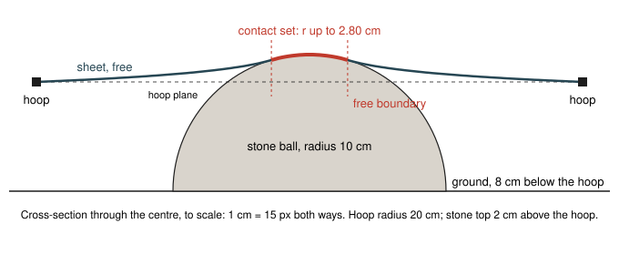
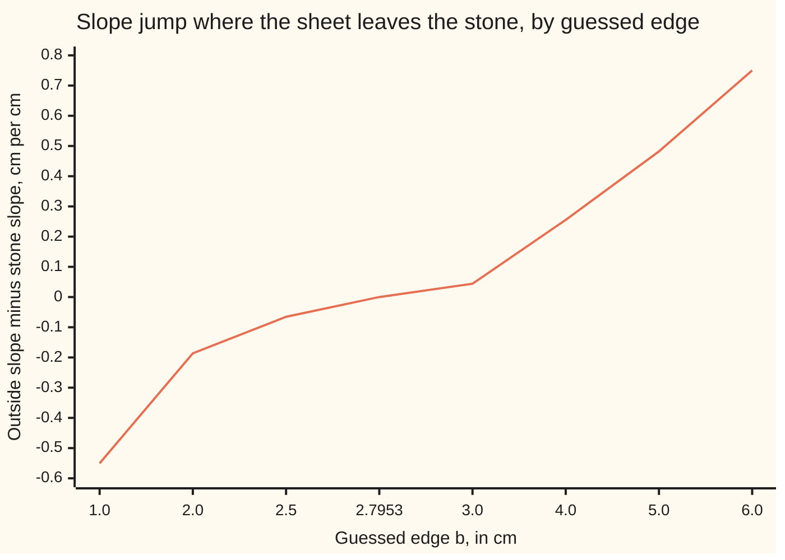

# The obstacle problem: a membrane that must clear an obstacle

[Syllabus](../../../SYLLABUS.md) → [Partial differential equations](../README.md) → [Weak Solutions and Free Boundaries](../README.md#s06) → The obstacle problem

---

## General Overview

A rubber sheet is clamped flat in a round hoop of radius 20 cm, pulled tight at 50 N/m (newtons per metre of edge, illustrative). The hoop is lowered over a smooth stone ball of radius 10 cm, half buried in the ground, until the stone's top stands 2 cm above the hoop. The sheet must ride over the stone. It cannot pass through it.

Two things happen at once. Near the top, the sheet lies on the stone and takes the stone's shape. Further out, it lifts off and runs free to the hoop. The circle where it lifts off is not given in advance. It comes out of the calculation: radius **2.80 cm**. Inside that circle the stone pushes up with 1000 Pa (pascals, newtons per square metre) at the top; in total it carries **2.56 N**.

[Dirichlet's principle](../04-Laplace%2C%20Poisson%20and%20Potentials/06-dirichlet-principle-and-variational-form.md) found a free sheet's shape as the one with the least energy, and the answer was an equation: Laplace's. Here the same least-energy rule meets a fence: the sheet must stay above the stone. The answer is no longer an equation. It is an **inequality** that every allowed rival shape must satisfy.

**A sheet that must clear an obstacle takes the least-energy shape among those that clear it; that shape is the one where every allowed change costs energy, which splits the region into a contact set, where it lies on the obstacle, and a free part, where it solves Laplace's equation, with a free boundary between them that the sheet crosses without a kink.**

**What kind of fact this is:** a theorem. Existence and uniqueness (Stampacchia, 1964) are proved on this card in a fold; the split into contact and free parts and the smooth crossing are proved in Why it works. The deeper smoothness of the free boundary in general is stated with its source. The sheet itself is a small-slope model: its slope reaches 0.29 at the free boundary.

<p align="center"></p>

The red arc is the contact set, where the sheet lies on the stone. The dashed lines mark the free boundary. Beyond them the sheet runs free to the hoop.

---

## The formula

**The problem.** The unknown is $`u`$: the sheet's height in cm above the hoop's plane. By symmetry it depends only on $`r`$, the distance in cm from the centre. The region $`\Omega`$ (omega) is the disc of radius $`R = 20`$ cm inside the hoop; its edge $`\partial\Omega`$ is the hoop. The data are the hoop height, $`u = 0`$ on $`\partial\Omega`$, and the obstacle.

**The obstacle.** $`\psi`$ (psi) is the height of whatever lies under the sheet. Over the stone, a ball of radius $`\rho = 10`$ cm whose top is $`h = 2`$ cm above the hoop, it is the stone's surface:

```math
\psi(r) = \sqrt{\rho^2 - r^2} - (\rho - h) \quad (r < \rho), \qquad \psi = -8 \text{ cm, the ground, beyond.}
```

On this card $`\rho`$ is the stone's radius and $`h`$ its height, not the density and grid step of [Free boundaries](07-free-boundaries-and-the-stefan-problem.md).

**The allowed sheets.** $`H^1_0(\Omega)`$ is the set of sheets with finite energy that sit at 0 on the hoop ([Sobolev spaces](02-sobolev-spaces-for-pdes.md)). The **admissible set** $`\mathcal{K}`$ keeps those that clear the obstacle:

```math
\mathcal{K} = \{\, v \in H^1_0(\Omega) : v \ge \psi \text{ in } \Omega \,\}.
```

**The variational inequality.** The sheet $`u`$ is the member of $`\mathcal{K}`$ with

```math
\int_\Omega \nabla u \cdot \nabla (v - u)\, dA \ \ge\ 0 \qquad \text{for every } v \in \mathcal{K}.
```

**Read it aloud:** the sheet clears the stone, and moving from it toward any other sheet that also clears the stone never lowers its energy at the first step.

Here $`\nabla u`$ is the gradient, the slope vector; $`dA`$ is a small patch of area; the left side is $`I`$, the **first variation**: the rate the energy changes as the sheet starts moving toward $`v`$. The energy is the Dirichlet energy, $`E(w) = \tfrac12\int_\Omega |\nabla w|^2\,dA`$ in cm², and the sheet stores $`T E`$ joules, with $`T`$ the tension.

**The same thing, point by point.** Where the solution is smooth enough, the inequality says three things at once:

```math
u \ge \psi, \qquad -\Delta u \ge 0, \qquad (u - \psi)(-\Delta u) = 0 .
```

$`\Delta u`$ is the Laplacian, $`u_{xx} + u_{yy}`$. The sheet clears the stone; the stone pushes, never pulls; and at each point one of the two is tight. The **contact set** $`\Lambda`$ (lambda) is where $`u = \psi`$. Its edge inside $`\Omega`$ is the **free boundary**. The contact pressure is $`p = T(-\Delta u)`$.

**For this stone.** The contact set is the disc $`r \le a`$. Outside it the sheet is $`u = A\ln(r/R)`$. The two unknowns $`a`$ and $`A`$ come from matching the stone's height and slope at $`r = a`$:

```math
A = a\,\psi'(a), \qquad a\,\psi'(a)\,\ln(a/R) = \psi(a) \quad\Longrightarrow\quad a = 2.7953 \text{ cm}, \ \ A = -0.8138 \text{ cm}.
```

| Symbol | Plain meaning | In our example | Push it up and the answer… |
| --- | --- | --- | --- |
| $`u`$, $`r`$, $`x`$, $`y`$ | the sheet's height; distance from the centre; position across the hoop, in cm | 2 cm at the centre, 0.5641 cm at 10 cm | — |
| $`\Omega`$, $`\partial\Omega`$, $`R`$, $`dA`$ | the disc inside the hoop; the hoop; its radius; a patch of area | $`R = 20`$ cm | a bigger hoop pulls less steeply: contact shrinks |
| $`\psi`$, $`\rho`$, $`h`$, $`s`$ | obstacle height; stone radius; stone top above the hoop; $`\sqrt{\rho^2 - r^2}`$ | $`\psi = 1.6014`$ cm at the edge; 10 cm; 2 cm; $`s = 9.6014`$ cm at the edge | a higher top widens the contact set |
| $`\mathcal{K}`$, $`H^1_0`$ | sheets that clear the obstacle; finite-energy sheets at 0 on the hoop | — | — |
| $`v`$, $`I`$ | a rival sheet in $`\mathcal{K}`$; the first variation toward it | lifting by 0.5 cm: $`I = 2.5313`$ cm² | — |
| $`\nabla`$, $`\Delta`$ | gradient: the slope vector; Laplacian: $`u_{xx} + u_{yy}`$ | $`-\Delta u = 0.2`$ per cm at the top | — |
| $`E`$, $`\lVert w\rVert`$, $`T`$ | Dirichlet energy, half the summed squared slope; the energy distance, with $`E(w) = \tfrac12\lVert w\rVert^2`$; tension | 4.6001 cm²; 50 N/m, illustrative | stored energy $`TE`$ grows; the shape does not change |
| $`\Lambda`$, $`a`$, $`A`$, $`F`$ | contact set; its radius, the free boundary; the free sheet's coefficient in $`u = A\ln(r/R)`$; the smooth-fit mismatch $`F(b) = b\,\psi'(b)\ln(b/R) - \psi(b)`$ | $`r \le 2.7953`$ cm; $`A = -0.8138`$ cm | — |
| $`p`$ | contact pressure, $`T(-\Delta u)`$ on $`\Lambda`$ | 1000 Pa at the top, 1085.7 Pa at the edge | — |
| $`b`$, $`d`$ | a guessed edge, in What breaks; a needle's tip radius | 1 to 6 cm; 1 mm and below | — |
| $`t`$, $`\varphi`$, $`\varepsilon`$ | a step toward a rival; a bump; a small size, in Why it works | — | — |
| $`f`$, $`V`$, $`\mathcal{B}`$, $`M`$, $`\alpha`$, $`g`$ | a load; in the fold: a Hilbert space; a bilinear form; its bound and coercivity constants; the load's representative | no load: $`f = 0`$ | — |

### When it holds

- **The admissible set is convex: any mix of two allowed sheets is allowed.** It is, because "above $`\psi`$" survives averaging. Without convexity the step from $`u`$ toward $`v`$ can leave the set, and the inequality says nothing.
- **The obstacle stays below the hoop's height at the hoop.** Here the ground is 8 cm down. If $`\psi > 0`$ on the hoop, no sheet clamped at 0 clears it, and $`\mathcal{K}`$ is empty.
- **The obstacle has some width.** A needle in place of the stone fails: its energy cost falls toward 0 as the tip sharpens (2.3718 cm² at 1 mm, 0.3816 cm² at a proton's width), and no least-energy sheet rests on it.
- **The energy is coercive: it controls the size of the sheet.** On $`H^1_0`$ this is Poincaré's inequality, the constant $`\alpha`$ of [Lax-Milgram](03-lax-milgram-and-elliptic-existence.md). Without it a minimising sequence can run off with no limit.
- **Small slopes, for the rubber sheet.** Half the squared slope stands in for the extra area. At slope 0.29 that is a model, as on [Dirichlet's principle](../04-Laplace%2C%20Poisson%20and%20Potentials/06-dirichlet-principle-and-variational-form.md).

---

## Why it works

### Step 0: at the bottom of a fenced bowl, every allowed direction is uphill

Minimise $`(x - 1)^2`$ over the numbers $`x \ge 3`$. The free minimum, 1, is fenced off, so the answer is $`x = 3`$, on the fence. The slope there is 4, not 0. But the only allowed moves are upward, and upward the function rises. At a fenced minimum the slope need not vanish; it must be uphill in every **allowed** direction.

The sheet is the same problem, with a whole function as the unknown and the stone as the fence. "Uphill in every allowed direction" is the variational inequality. Off the stone the sheet can move both ways, so uphill both ways means flat: Laplace's equation. On the stone it can only move up.

### Step 1: least energy is the same as the inequality

Take $`u`$ and $`v`$ in $`\mathcal{K}`$. Because $`\mathcal{K}`$ is convex, the sheets $`u + t(v - u)`$ for $`0 \le t \le 1`$ all stay in it. Expand the energy like a square:

```math
E\big(u + t(v - u)\big) = E(u) + t\,I + t^2 E(v - u), \qquad I = \int_\Omega \nabla u\cdot\nabla(v - u)\,dA .
```

- **If $`u`$ has the least energy**, the right side cannot dip below $`E(u)`$ for small positive $`t`$. So $`I \ge 0`$: the inequality.
- **If $`I \ge 0`$ for every $`v`$**, put $`t = 1`$: $`E(v) = E(u) + I + E(v - u) \ge E(u)`$. So $`u`$ has the least energy.
- **Only one sheet does it.** If $`u_1`$ and $`u_2`$ both satisfy the inequality, test each against the other and add: $`-\int |\nabla(u_1 - u_2)|^2\,dA \ge 0`$. So $`u_1 - u_2`$ has zero slope and is 0 on the hoop: $`u_1 = u_2`$.

The code tests this on four rival sheets:

| Rival $`v`$ | In $`\mathcal{K}`$? | $`I`$, cm² | $`E(v) - E(u)`$, cm² |
| --- | --- | --- | --- |
| lift by $`0.5(1 - r^2/R^2)`$ cm | yes | 2.5313 | 3.3167 = 2.5313 + 0.7854 |
| press down by the same | no: cuts the stone | −2.5313 | −1.7459 |
| wiggle +0.3 cm, only beyond 6 cm | yes | 0.0000 | 1.2956 |
| wiggle −0.3 cm, only beyond 6 cm | yes | 0.0000 | 1.2956 |

Pressing down saves energy, 1.7459 cm². That is no contradiction: that sheet cuts into the stone, so it is not allowed. The wiggles move the sheet where it is free, both ways, and the first variation is 0: there the inequality is an equation.

### Step 2: a solution exists, and it is a nearest point

Measure the distance between sheets by energy: $`\|w\|^2 = \int |\nabla w|^2\,dA`$. Then $`E(v) = \tfrac12\|v\|^2`$, and the least-energy sheet in $`\mathcal{K}`$ is the point of $`\mathcal{K}`$ **nearest to the flat sheet** 0.

A closed convex set in a complete inner-product space has exactly one nearest point to any given point ([Projection](../../18-Functional%20analysis/02-Hilbert%20Spaces/02-projection-theorem-and-orthogonal-complements.md)). That card's test for it, an angle of 90° or more to every other member, is exactly $`I \ge 0`$. So existence comes down to $`\mathcal{K}`$ being closed, convex and not empty.

This is **Stampacchia's theorem**: the version of [Lax-Milgram](03-lax-milgram-and-elliptic-existence.md) for a convex set instead of the whole space. A load $`f`$ adds $`-\int f\,v\,dA`$ to the energy and turns the inequality into $`\int \nabla u\cdot\nabla(v - u)\,dA \ge \int f\,(v - u)\,dA`$.

<details>
<summary>Detailed proof: existence and uniqueness for a symmetric form (Stampacchia)</summary>

Let $`V`$ be a Hilbert space, $`\mathcal{B}(\cdot,\cdot)`$ a symmetric bilinear form with $`\mathcal{B}(w, w) \ge \alpha\|w\|_V^2`$ and $`|\mathcal{B}(w_1, w_2)| \le M\|w_1\|_V\|w_2\|_V`$, $`f`$ a bounded linear functional, and $`\mathcal{K} \subset V`$ closed, convex and not empty.

**A new inner product.** By the two bounds, $`\mathcal{B}`$ is an inner product on $`V`$ whose norm is equivalent to $`\|\cdot\|_V`$, so $`V`$ is complete under it. By the Riesz representation theorem there is $`g \in V`$ with $`f(w) = \mathcal{B}(g, w)`$ for all $`w`$.

**The energy is a distance.** For $`v \in V`$,

$`\displaystyle \tfrac12 \mathcal{B}(v, v) - f(v) = \tfrac12 \mathcal{B}(v - g, v - g) - \tfrac12 \mathcal{B}(g, g).`$

So minimising the energy over $`\mathcal{K}`$ is finding the point of $`\mathcal{K}`$ nearest to $`g`$ in the $`\mathcal{B}`$-distance. By the projection theorem for closed convex sets, exactly one such point $`u`$ exists, and it is characterised by

$`\displaystyle \mathcal{B}(g - u, v - u) \le 0 \quad \text{for every } v \in \mathcal{K},`$

which is $`\mathcal{B}(u, v - u) \ge f(v - u)`$: the variational inequality. Uniqueness of the nearest point gives uniqueness of $`u`$.

**The obstacle set qualifies.** Take $`V = H^1_0(\Omega)`$, $`\mathcal{B}(w_1, w_2) = \int_\Omega \nabla w_1\cdot\nabla w_2\,dA`$; Poincaré's inequality gives $`\alpha > 0`$. $`\mathcal{K}`$ is convex: if $`v_1, v_2 \ge \psi`$ then $`(1 - t)v_1 + t v_2 \ge \psi`$. It is closed: if $`v_n \to v`$ in $`H^1_0`$, then $`v_n \to v`$ in mean square, a subsequence converges at almost every point, and $`v \ge \psi`$ survives that limit. It is not empty when some finite-energy sheet clamped at 0 clears $`\psi`$; here $`\max(\psi, 0)`$ does.

A form that is not symmetric needs one more step, a contraction-map argument built on the nearest-point map (Kinderlehrer and Stampacchia, chapter II).

</details>

### Step 3: read the inequality point by point

Three choices of rival turn the inequality into the three conditions of The formula.

1. **Push up.** Take $`v = u + \varphi`$ with $`\varphi \ge 0`$ a smooth bump, zero on the hoop. It clears the stone, so $`\int \nabla u\cdot\nabla\varphi\,dA \ge 0`$. Integrating by parts, $`\int (-\Delta u)\,\varphi\,dA \ge 0`$ for every such bump: $`-\Delta u \ge 0`$. The stone pushes, never pulls. In the language of [Subharmonic functions](../04-Laplace%2C%20Poisson%20and%20Potentials/09-subharmonic-functions-and-perrons-method.md), $`u`$ is superharmonic.
2. **Wiggle where the sheet is free.** Where $`u > \psi`$, a small bump $`\varepsilon\varphi`$ there can be added or taken away. Both signs give $`\ge 0`$, so $`\int (-\Delta u)\varphi\,dA = 0`$: Laplace's equation off the stone.
3. **Combine.** At each point either $`u = \psi`$ or $`-\Delta u = 0`$. That is $`(u - \psi)(-\Delta u) = 0`$.

On the contact set $`u = \psi`$, so $`-\Delta u = -\Delta\psi`$ there: the stone's own curvature sets the pressure. At the top of a ball, $`-\Delta\psi = 2/\rho = 0.2`$ per cm, so $`p = 50 \times 20 = 1000`$ Pa.

The code checks both halves by centred differences, at steps 0.1 and 0.05 cm. At $`r = 1.5`$ cm, on the stone, $`-\Delta u`$ is 0.204619 per cm against the stone's 0.204617. At $`r = 10`$ cm, off it, it is 0.000000.

### Step 4: the free boundary, where the sheet leaves without a kink

Off the stone, a sheet that depends only on $`r`$ solves $`u'' + u'/r = 0`$, that is $`(r u')' = 0`$. So $`r u'`$ is constant, and with $`u = 0`$ at the hoop, $`u = A\ln(r/R)`$. That leaves two unknowns, the coefficient $`A`$ and the edge $`a`$, and needs two conditions.

The first is height: the sheet meets the stone, $`A\ln(a/R) = \psi(a)`$. The second is slope: it leaves the stone without a corner. Guess an edge $`b`$ and match height only, and a corner appears. Its size is the slope jump, outside slope minus stone slope at $`b`$. The tension turns a corner into a ring force of $`T`$ times the jump, per metre of ring.



The line is the slope jump at each guessed edge. It crosses zero once, at 2.7953 cm. The guessed edges are not evenly spaced, so the horizontal axis is not to scale.

- **Jump below zero (edge guessed too small).** The sheet leaves more steeply than the stone falls away, so just past $`b`$ it runs into the stone. At $`b = 2.5`$ cm it cuts 0.0925 mm deep. Not allowed.
- **Jump above zero (edge guessed too large).** The sheet clears the stone, but the corner bends the wrong way. Holding it needs a downward ring force: at $`b = 4`$ cm, 12.77 N/m. The stone can only push, so Step 3 forbids it.

So the jump is zero: the sheet's slope matches the stone's, $`A/a = \psi'(a)`$. This is **smooth fit**. Height and slope together give the equation in The formula, and bisection gives $`a = 2.7953`$ cm.

### Step 5: how smooth the free boundary is, in general

For any smooth obstacle on a smooth region, the solution has bounded second derivatives, and no better: they jump across the free boundary, as the contact pressure drops here from 1085.7 Pa to 0 (Brézis and Kinderlehrer, 1974). The free boundary itself is smooth near most of its points, its "regular" points; at "singular" points, where the contact set is thin, it can pinch (Caffarelli, 1977). These are stated, not proved, here; [Elliptic regularity](05-elliptic-regularity-in-outline.md) gives the machinery's outline.

---

## Worked numbers, by hand

With $`a`$ from bisection, everything else is a few lines.

| Step | Arithmetic | Value |
| --- | --- | --- |
| contact radius, by bisection on the smooth-fit equation | $`F(1) = -1.6488`$, $`F(6) = 5.4179`$ cm: a sign change | $`a = 2.7953`$ cm |
| $`s = \sqrt{\rho^2 - a^2}`$ | $`\sqrt{100 - 7.8135}`$ | 9.6014 cm |
| stone height at the edge, $`\psi(a) = s - 8`$ | $`9.6014 - 8`$ | 1.6014 cm |
| stone slope at the edge, $`\psi'(a) = -a/s`$ | $`-2.7953/9.6014`$ | −0.2911 |
| coefficient, $`A = a\,\psi'(a)`$ | $`2.7953 \times (-0.2911)`$ | −0.8138 cm |
| height check, $`A\ln(a/R)`$ | $`-0.8138 \times (-1.9678)`$ | 1.6014 cm, equal to $`\psi(a)`$ |
| sheet at 10 cm, $`A\ln(10/20)`$ | $`-0.8138 \times (-0.6931)`$ | 0.5641 cm |
| free part's energy, $`\pi A^2\ln(R/a)`$ | $`\pi \times 0.6623 \times 1.9678`$ | 4.0941 cm² |
| total energy, adding the contact part | $`0.5060 + 4.0941`$ | 4.6001 cm² |
| stored energy, $`TE`$ | $`50 \times 4.6001 \times 10^{-4}`$ J | 23.00 mJ |
| pressure at the top, $`T \times 2/\rho`$ | $`50 \text{ N/m} \times 20 \text{ per m}`$ | 1000 Pa |
| stone's total push, $`2\pi T\lvert A\rvert`$ | $`2\pi \times 50 \times 0.008138`$ | **2.5566 N** |

The stone carries 2.56 N, and the hoop pulls down with exactly that much: the slope at the hoop, times the hoop's length, times the tension. The code checks the balance: summing the pressure over the contact disc gives the same 2.5566 N as the pull at the hoop.

### What breaks if you drop a piece

| Mistake | Comes out at | What went wrong |
| --- | --- | --- |
| Clip: the sheet hugs the stone wherever it stands above the hoop, out to 6 cm, flat beyond | 13.5539 cm², nearly 3 times too much; the stone must pull with 37.50 N/m along the ring | No smooth fit: a 0.75 slope jump at 6 cm |
| Match height only, edge guessed at 4 cm | 4.9046 cm²; a 12.77 N/m pull along the ring | The corner needs a pulling stone |
| Match height only, edge guessed at 2.5 cm | 4.5967 cm², less than the true 4.6001 | Not allowed: the sheet cuts 0.0925 mm into the stone |
| A needle instead of a stone | 2.3718, 1.0295, 0.3816 cm² at tip radius 1 mm, 1 micrometre, 1e-13 cm | In two dimensions a point costs no energy to hold up in the limit; no least-energy sheet rests on it |

The code prints every row.

---

## Code, from first principles, and it actually runs

The script takes three roads to the sheet. First, smooth fit: bisection on the height-and-slope equation, then the closed form. Second, the variational inequality itself, tested on four rival sheets by Simpson's rule (adding up an integral from evenly spaced samples, weighted 1, 4, 2, 4, …, 1), with the first variation computed twice: from slopes, and from the pressure after integrating by parts. Third, projected over-relaxation on a radial grid: lower the grid energy one point at a time, moving each point past its local best by a fixed factor (over-relaxation, which speeds things up), and put any point that dips below the stone back onto it. The grid energy settles on the exact 4.6001 cm² at observed order 2: halving the step quarters the error.

### Python

```python
# The obstacle problem: a rubber sheet on a 20 cm hoop, pressed over a stone ball.
# Unknown u(r): sheet height in cm at distance r cm from the centre. Standard library only.
from math import sqrt, log, pi, sin

R, RHO, H, T = 20.0, 10.0, 2.0, 50.0   # hoop radius cm, stone radius cm, top height cm, tension N/m
C = RHO - H                             # the stone's centre sits 8 cm below the hoop plane

def psi(r):   # obstacle: the stone's upper surface; beyond its equator, its equator height
    return sqrt(RHO * RHO - r * r) - C if r < RHO else -C
def dpsi(r):  # slope of the stone
    return -r / sqrt(RHO * RHO - r * r)
def press(r): # -Laplacian of the stone surface, per cm: the contact pressure divided by T
    s = sqrt(RHO * RHO - r * r)
    return RHO * RHO / (s * s * s) + 1.0 / s

def z(x):     # print a rounding-level residual as 0
    return 0.0 if abs(x) < 5e-7 else x

def simpson(f, x0, x1, n=2000):
    h = (x1 - x0) / n
    s = f(x0) + f(x1)
    for i in range(1, n):
        s += (4.0 if i % 2 else 2.0) * f(x0 + i * h)
    return s * h / 3.0

def bisect(f, lo, hi):
    for _ in range(200):
        m = 0.5 * (lo + hi)
        if (f(lo) < 0.0) == (f(m) < 0.0): lo = m
        else: hi = m
    return 0.5 * (lo + hi)

# Road 1: smooth fit. Outside contact u = A log(r/R); match the stone's height and slope at r = a.
fit = lambda a: a * dpsi(a) * log(a / R) - psi(a)
a = bisect(fit, 1.0, 6.0)
A = a * dpsi(a)
u = lambda r: psi(r) if r <= a else A * log(r / R) + 0.0
du = lambda r: dpsi(r) if r <= a else A / r
print(f"smooth fit: F(1) = {fit(1.0):.4f}, F(6) = {fit(6.0):.4f} cm; root a = {a:.4f} cm")
print(f"contact radius a = {a:.4f} cm ({a:.2f} cm), A = {A:.4f} cm, height at edge {psi(a):.4f} cm, slope at edge {dpsi(a):.4f}")
print(f"by hand: top {H:.0f} cm, a^2 = {a * a:.4f}, s = {sqrt(RHO * RHO - a * a):.4f} cm, log(a/R) = {log(a / R):.4f}, log(10/R) = {log(10 / R):.4f}, A^2 = {A * A:.4f} cm^2")
for r in [0.0, 1.0, 2.0, a, 4.0, 6.0, 8.0, 10.0, 15.0, 20.0]:
    print(f"r = {r:7.4f} cm: sheet {u(r):7.4f} cm, stone {psi(r):7.4f} cm, gap {u(r) - psi(r):7.4f} cm")
gaps = [u(a + (R - a) * k / 1000) - psi(a + (R - a) * k / 1000) for k in range(1, 1001)]
assert min(gaps) > 0.0 and abs(u(a) - psi(a)) < 1e-12

# Energy E = (1/2) integral |grad u|^2 dA = pi * integral u'^2 r dr, in cm^2
e_in = pi * simpson(lambda r: dpsi(r) * dpsi(r) * r, 0.0, a)
e_out = pi * simpson(lambda r: (A / r) * (A / r) * r, a, R)
e_out_exact = pi * A * A * log(R / a)
E = e_in + e_out
print(f"energy: contact {e_in:.4f}, free part {e_out:.4f} (exact {e_out_exact:.4f}), total {E:.4f} cm^2")
print(f"stored energy T E = {T * E * 1e-4 * 1e3:.2f} mJ")
assert abs(e_out - e_out_exact) < 1e-9

# The equation, by centred differences of u'' + u'/r: equals the stone's Laplacian on contact, 0 off it
lap = lambda r, h: (u(r + h) - 2 * u(r) + u(r - h)) / (h * h) + (u(r + h) - u(r - h)) / (2 * h * r)
for h in [0.1, 0.05]:
    print(f"step {h} cm: -Laplacian of sheet at r = 1.5 cm {-lap(1.5, h):.6f} (stone {press(1.5):.6f}), at r = 10 cm {abs(lap(10.0, h)):.6f} per cm")
assert abs(-lap(1.5, 0.05) - press(1.5)) < 1e-4 and abs(lap(10.0, 0.05)) < 1e-4
print(f"contact pressure T x (-Laplacian): top {T * press(0.0) * 100:.1f} Pa, edge {T * press(a) * 100:.1f} Pa")

# Force balance: the stone's push equals the hoop's pull (N)
f_press = T * simpson(lambda r: press(r) * 2 * pi * r, 0.0, a) / 100
f_rim = T * 2 * pi * R * abs(du(R)) / 100
print(f"stone's push: pressure integral {f_press:.4f} N, hoop flux {f_rim:.4f} N ({f_rim:.2f} N)")
assert abs(f_press - f_rim) < 1e-6

# Road 2: the variational inequality, tested on rival sheets v. I = integral grad u . grad (v - u) dA
def split(f):   # integrate piece by piece, across the kinks at r = a and r = 6 cm
    return simpson(f, 0.0, a) + simpson(f, a, 6.0) + simpson(f, 6.0, R)
bump = lambda r: 1 - r * r / (R * R)                                  # lift, zero on the hoop
far = lambda r: sin(pi * (r - 6) / (R - 6)) * sin(pi * (r - 6) / (R - 6)) if r > 6 else 0.0            # wiggle where the sheet is free
dbump = lambda r: -2 * r / (R * R)
dfar = lambda r: pi / (R - 6) * sin(2 * pi * (r - 6) / (R - 6)) if r > 6 else 0.0
tests = [("lift 0.5 cm", 0.5, bump, dbump), ("press 0.5 cm", -0.5, bump, dbump),
         ("wiggle +0.3 cm", 0.3, far, dfar), ("wiggle -0.3 cm", -0.3, far, dfar)]
for name, t, f, df in tests:
    I = 2 * pi * t * split(lambda r: du(r) * df(r) * r)
    I_p = 2 * pi * t * simpson(lambda r: press(r) * f(r) * r, 0.0, a)   # same thing, by parts
    Ev = pi * split(lambda r: (du(r) + t * df(r)) * (du(r) + t * df(r)) * r)
    ok = min(u(r) + t * f(r) - psi(r) for r in [R * k / 2000 for k in range(2001)]) >= -1e-12
    dE = pi * t * t * split(lambda r: df(r) * df(r) * r)
    print(f"{name}: admissible {ok}, I = {z(I):.4f} (by parts {z(I_p):.4f}), E(v) - E(u) = {Ev - E:.4f} = I + E(v - u) = {z(I):.4f} + {dE:.4f} cm^2")
    assert abs(I - I_p) < 1e-6 and abs(Ev - (E + I + dE)) < 1e-9
    assert (I >= -1e-9) == ok

# Wrong edges: sheet on the stone out to b, then A_b log(r/R), matching height only
print("guessed edge b: energy cm^2, deepest cut into the stone mm, slope jump, ring force N/m (negative = pull)")
jumps = []
b0 = sqrt(RHO * RHO - C * C)   # the clipped guess max(stone, 0) leaves the stone here
for b in [1.0, 2.0, 2.5, a, 3.0, 4.0, 5.0, b0]:
    B = psi(b) / log(b / R)
    Eb = pi * simpson(lambda r: dpsi(r) * dpsi(r) * r, 0.0, b) + pi * B * B * log(R / b)
    cut = max(psi(r) - B * log(r / R) for r in [b + (RHO - b) * k / 1000 for k in range(1, 1000)])
    jump = B / b - dpsi(b)
    jumps.append(jump)
    print(f"b = {b:.4f}: energy {Eb:.4f}, cut {z(max(cut, 0.0)) * 10:.4f}, jump {z(jump):.4f}, ring {z(-T * jump):.2f}")
    assert (cut > 1e-9) == (b < a - 1e-9)
    if b >= a: assert Eb >= E - 1e-9
assert jumps[0] < 0 < jumps[-1] and abs(jumps[3]) < 1e-9

# Road 3: projected SOR on a radial grid, minimising the grid energy with u_i >= psi_i
def psor(N):
    h = R / N
    r = [i * h for i in range(N + 1)]
    ob = [psi(x) for x in r]
    v = [max(o, 0.0) for o in ob]
    v[N] = 0.0
    w = 2.0 / (1.0 + sin(pi / N))
    for sweep in range(1, 100001):
        big = 0.0
        for i in range(N):
            lo, hi = (0.0 if i == 0 else r[i] - h / 2), r[i] + h / 2
            gs = v[1] if i == 0 else (lo * v[i - 1] + hi * v[i + 1]) / (lo + hi)
            new = max(ob[i], v[i] + w * (gs - v[i]))
            big = max(big, abs(new - v[i]))
            v[i] = new
        if big < 1e-13: break
    k = max(i for i in range(N) if v[i] - ob[i] < 1e-12)
    eh = 0.0
    for i in range(N): eh += pi * (r[i] + h / 2) * (v[i + 1] - v[i]) * (v[i + 1] - v[i]) / h
    return v[N // 2], r[k], r[k + 1], eh, sweep
errs = []
for N in [50, 100, 200]:
    um, rk, rk1, eh, sw = psor(N)
    errs.append(eh - E)
    print(f"grid N = {N}, step {R / N:.2f} cm: energy {eh:.4f} cm^2 (error {eh - E:.4f}), sheet at {R / 2:.0f} cm {um:.6f} (error {um - u(R / 2):.6f}), last point on the stone {rk:.2f} cm, first free point {rk1:.2f} cm, {sw} sweeps")
    assert abs(rk - a) <= R / N and abs(um - u(R / 2)) < 1e-3
print(f"observed order, energy: {log(errs[0] / errs[1]) / log(2):.2f}, {log(errs[1] / errs[2]) / log(2):.2f}")
assert abs(errs[2]) < abs(errs[1]) < abs(errs[0])

# A hypothesis that fails: a needle. Hold the sheet at 2 cm on a tip of radius d; energy pi H^2 / log(R/d)
for name, d in [("1 mm", 0.1), ("1 micrometre", 1e-4), ("1e-13 cm, a proton", 1e-13)]:
    print(f"needle tip radius {name}: energy {pi * H * H / log(R / d):.4f} cm^2")
print(f"figure, hoop +-{R:.0f} cm, stone centre (0, {-C:.0f}) radius {RHO:.0f} cm, contact edge +-{a:.4f} cm at height {psi(a):.4f} cm, sheet at 10 cm {u(10.0):.4f} cm")
print("ALL CHECKS PASS")
```

**Ran 2026-11-15 on macOS, Python 3.14.10, standard library only. All checks passed. Output, pasted from the run:**

```
smooth fit: F(1) = -1.6488, F(6) = 5.4179 cm; root a = 2.7953 cm
contact radius a = 2.7953 cm (2.80 cm), A = -0.8138 cm, height at edge 1.6014 cm, slope at edge -0.2911
by hand: top 2 cm, a^2 = 7.8135, s = 9.6014 cm, log(a/R) = -1.9678, log(10/R) = -0.6931, A^2 = 0.6623 cm^2
r =  0.0000 cm: sheet  2.0000 cm, stone  2.0000 cm, gap  0.0000 cm
r =  1.0000 cm: sheet  1.9499 cm, stone  1.9499 cm, gap  0.0000 cm
r =  2.0000 cm: sheet  1.7980 cm, stone  1.7980 cm, gap  0.0000 cm
r =  2.7953 cm: sheet  1.6014 cm, stone  1.6014 cm, gap  0.0000 cm
r =  4.0000 cm: sheet  1.3097 cm, stone  1.1652 cm, gap  0.1446 cm
r =  6.0000 cm: sheet  0.9798 cm, stone  0.0000 cm, gap  0.9798 cm
r =  8.0000 cm: sheet  0.7457 cm, stone -2.0000 cm, gap  2.7457 cm
r = 10.0000 cm: sheet  0.5641 cm, stone -8.0000 cm, gap  8.5641 cm
r = 15.0000 cm: sheet  0.2341 cm, stone -8.0000 cm, gap  8.2341 cm
r = 20.0000 cm: sheet  0.0000 cm, stone -8.0000 cm, gap  8.0000 cm
energy: contact 0.5060, free part 4.0941 (exact 4.0941), total 4.6001 cm^2
stored energy T E = 23.00 mJ
step 0.1 cm: -Laplacian of sheet at r = 1.5 cm 0.204625 (stone 0.204617), at r = 10 cm 0.000000 per cm
step 0.05 cm: -Laplacian of sheet at r = 1.5 cm 0.204619 (stone 0.204617), at r = 10 cm 0.000000 per cm
contact pressure T x (-Laplacian): top 1000.0 Pa, edge 1085.7 Pa
stone's push: pressure integral 2.5566 N, hoop flux 2.5566 N (2.56 N)
lift 0.5 cm: admissible True, I = 2.5313 (by parts 2.5313), E(v) - E(u) = 3.3167 = I + E(v - u) = 2.5313 + 0.7854 cm^2
press 0.5 cm: admissible False, I = -2.5313 (by parts -2.5313), E(v) - E(u) = -1.7459 = I + E(v - u) = -2.5313 + 0.7854 cm^2
wiggle +0.3 cm: admissible True, I = 0.0000 (by parts 0.0000), E(v) - E(u) = 1.2956 = I + E(v - u) = 0.0000 + 1.2956 cm^2
wiggle -0.3 cm: admissible True, I = 0.0000 (by parts 0.0000), E(v) - E(u) = 1.2956 = I + E(v - u) = 0.0000 + 1.2956 cm^2
guessed edge b: energy cm^2, deepest cut into the stone mm, slope jump, ring force N/m (negative = pull)
b = 1.0000: energy 3.9950, cut 3.2899, jump -0.5504, ring 27.52
b = 2.0000: energy 4.5397, cut 0.6515, jump -0.1863, ring 9.31
b = 2.5000: energy 4.5967, cut 0.0925, jump -0.0654, ring 3.27
b = 2.7953: energy 4.6001, cut 0.0000, jump 0.0000, ring 0.00
b = 3.0000: energy 4.6013, cut 0.0000, jump 0.0440, ring -2.20
b = 4.0000: energy 4.9046, cut 0.0000, jump 0.2554, ring -12.77
b = 5.0000: energy 6.9070, cut 0.0000, jump 0.4821, ring -24.10
b = 6.0000: energy 13.5539, cut 0.0000, jump 0.7500, ring -37.50
grid N = 50, step 0.40 cm: energy 4.5964 cm^2 (error -0.0037), sheet at 10 cm 0.564273 (error 0.000197), last point on the stone 2.80 cm, first free point 3.20 cm, 225 sweeps
grid N = 100, step 0.20 cm: energy 4.5992 cm^2 (error -0.0009), sheet at 10 cm 0.564125 (error 0.000049), last point on the stone 2.80 cm, first free point 3.00 cm, 431 sweeps
grid N = 200, step 0.10 cm: energy 4.5999 cm^2 (error -0.0002), sheet at 10 cm 0.564088 (error 0.000012), last point on the stone 2.80 cm, first free point 2.90 cm, 861 sweeps
observed order, energy: 2.00, 2.00
needle tip radius 1 mm: energy 2.3718 cm^2
needle tip radius 1 micrometre: energy 1.0295 cm^2
needle tip radius 1e-13 cm, a proton: energy 0.3816 cm^2
figure, hoop +-20 cm, stone centre (0, -8) radius 10 cm, contact edge +-2.7953 cm at height 1.6014 cm, sheet at 10 cm 0.5641 cm
ALL CHECKS PASS
```

### Rust

```rust
// The obstacle problem: a rubber sheet on a 20 cm hoop, pressed over a stone ball.
// Unknown u(r): sheet height in cm at distance r cm from the centre. Standard library only.
use std::f64::consts::PI;

const R: f64 = 20.0; // hoop radius cm
const RHO: f64 = 10.0; // stone radius cm
const H: f64 = 2.0; // stone top above the hoop plane, cm
const T: f64 = 50.0; // tension N/m
const C: f64 = RHO - H; // the stone's centre sits 8 cm below the hoop plane

fn psi(r: f64) -> f64 { if r < RHO { (RHO * RHO - r * r).sqrt() - C } else { -C } }
fn dpsi(r: f64) -> f64 { -r / (RHO * RHO - r * r).sqrt() }
fn press(r: f64) -> f64 { let s = (RHO * RHO - r * r).sqrt(); RHO * RHO / (s * s * s) + 1.0 / s }
fn z(x: f64) -> f64 { if x.abs() < 5e-7 { 0.0 } else { x } }
fn tf(b: bool) -> &'static str { if b { "True" } else { "False" } }

fn simpson(f: &dyn Fn(f64) -> f64, x0: f64, x1: f64) -> f64 {
    let n = 2000;
    let h = (x1 - x0) / n as f64;
    let mut s = f(x0) + f(x1);
    for i in 1..n { s += (if i % 2 == 1 { 4.0 } else { 2.0 }) * f(x0 + i as f64 * h); }
    s * h / 3.0
}

fn bisect(f: &dyn Fn(f64) -> f64, mut lo: f64, mut hi: f64) -> f64 {
    for _ in 0..200 {
        let m = 0.5 * (lo + hi);
        if (f(lo) < 0.0) == (f(m) < 0.0) { lo = m; } else { hi = m; }
    }
    0.5 * (lo + hi)
}

fn psor(n: usize) -> (f64, f64, f64, f64, usize) {
    let h = R / n as f64;
    let r: Vec<f64> = (0..=n).map(|i| i as f64 * h).collect();
    let ob: Vec<f64> = r.iter().map(|&x| psi(x)).collect();
    let mut v: Vec<f64> = ob.iter().map(|&o| o.max(0.0)).collect();
    v[n] = 0.0;
    let w = 2.0 / (1.0 + (PI / n as f64).sin());
    let mut sweep = 0;
    for s in 1..=100000 {
        sweep = s;
        let mut big: f64 = 0.0;
        for i in 0..n {
            let (lo, hi) = (if i == 0 { 0.0 } else { r[i] - h / 2.0 }, r[i] + h / 2.0);
            let gs = if i == 0 { v[1] } else { (lo * v[i - 1] + hi * v[i + 1]) / (lo + hi) };
            let new = ob[i].max(v[i] + w * (gs - v[i]));
            big = big.max((new - v[i]).abs());
            v[i] = new;
        }
        if big < 1e-13 { break; }
    }
    let k = (0..n).filter(|&i| v[i] - ob[i] < 1e-12).max().unwrap();
    let mut eh = 0.0;
    for i in 0..n { eh += PI * (r[i] + h / 2.0) * (v[i + 1] - v[i]) * (v[i + 1] - v[i]) / h; }
    (v[n / 2], r[k], r[k + 1], eh, sweep)
}

fn main() {
    // Road 1: smooth fit. Outside contact u = A log(r/R); match the stone's height and slope at r = a.
    let fit = |a: f64| a * dpsi(a) * (a / R).ln() - psi(a);
    let a = bisect(&fit, 1.0, 6.0);
    let aa = a * dpsi(a);
    let u = |r: f64| if r <= a { psi(r) } else { aa * (r / R).ln() + 0.0 };
    let du = |r: f64| if r <= a { dpsi(r) } else { aa / r };
    println!("smooth fit: F(1) = {:.4}, F(6) = {:.4} cm; root a = {:.4} cm", fit(1.0), fit(6.0), a);
    println!("contact radius a = {:.4} cm ({:.2} cm), A = {:.4} cm, height at edge {:.4} cm, slope at edge {:.4}", a, a, aa, psi(a), dpsi(a));
    println!("by hand: top {:.0} cm, a^2 = {:.4}, s = {:.4} cm, log(a/R) = {:.4}, log(10/R) = {:.4}, A^2 = {:.4} cm^2", H, a * a, (RHO * RHO - a * a).sqrt(), (a / R).ln(), (10.0 / R).ln(), aa * aa);
    for r in [0.0, 1.0, 2.0, a, 4.0, 6.0, 8.0, 10.0, 15.0, 20.0] {
        println!("r = {:7.4} cm: sheet {:7.4} cm, stone {:7.4} cm, gap {:7.4} cm", r, u(r), psi(r), u(r) - psi(r));
    }
    let gmin = (1..=1000).map(|k| { let r = a + (R - a) * k as f64 / 1000.0; u(r) - psi(r) }).fold(f64::INFINITY, f64::min);
    assert!(gmin > 0.0 && (u(a) - psi(a)).abs() < 1e-12);

    // Energy E = (1/2) integral |grad u|^2 dA = pi * integral u'^2 r dr, in cm^2
    let e_in = PI * simpson(&|r| dpsi(r) * dpsi(r) * r, 0.0, a);
    let e_out = PI * simpson(&|r| (aa / r) * (aa / r) * r, a, R);
    let e_out_exact = PI * aa * aa * (R / a).ln();
    let e = e_in + e_out;
    println!("energy: contact {:.4}, free part {:.4} (exact {:.4}), total {:.4} cm^2", e_in, e_out, e_out_exact, e);
    println!("stored energy T E = {:.2} mJ", T * e * 1e-4 * 1e3);
    assert!((e_out - e_out_exact).abs() < 1e-9);

    // The equation, by centred differences of u'' + u'/r: equals the stone's Laplacian on contact, 0 off it
    let lap = |r: f64, h: f64| (u(r + h) - 2.0 * u(r) + u(r - h)) / (h * h) + (u(r + h) - u(r - h)) / (2.0 * h * r);
    for h in [0.1, 0.05] {
        println!("step {} cm: -Laplacian of sheet at r = 1.5 cm {:.6} (stone {:.6}), at r = 10 cm {:.6} per cm", h, -lap(1.5, h), press(1.5), lap(10.0, h).abs());
    }
    assert!((-lap(1.5, 0.05) - press(1.5)).abs() < 1e-4 && lap(10.0, 0.05).abs() < 1e-4);
    println!("contact pressure T x (-Laplacian): top {:.1} Pa, edge {:.1} Pa", T * press(0.0) * 100.0, T * press(a) * 100.0);

    // Force balance: the stone's push equals the hoop's pull (N)
    let f_press = T * simpson(&|r| press(r) * 2.0 * PI * r, 0.0, a) / 100.0;
    let f_rim = T * 2.0 * PI * R * du(R).abs() / 100.0;
    println!("stone's push: pressure integral {:.4} N, hoop flux {:.4} N ({:.2} N)", f_press, f_rim, f_rim);
    assert!((f_press - f_rim).abs() < 1e-6);

    // Road 2: the variational inequality, tested on rival sheets v. I = integral grad u . grad (v - u) dA
    let split = |f: &dyn Fn(f64) -> f64| simpson(f, 0.0, a) + simpson(f, a, 6.0) + simpson(f, 6.0, R);
    let bump = |r: f64| 1.0 - r * r / (R * R);
    let far = |r: f64| if r > 6.0 { (PI * (r - 6.0) / (R - 6.0)).sin() * (PI * (r - 6.0) / (R - 6.0)).sin() } else { 0.0 };
    let dbump = |r: f64| -2.0 * r / (R * R);
    let dfar = |r: f64| if r > 6.0 { PI / (R - 6.0) * (2.0 * PI * (r - 6.0) / (R - 6.0)).sin() } else { 0.0 };
    let tests: [(&str, f64, &dyn Fn(f64) -> f64, &dyn Fn(f64) -> f64); 4] = [("lift 0.5 cm", 0.5, &bump, &dbump),
        ("press 0.5 cm", -0.5, &bump, &dbump), ("wiggle +0.3 cm", 0.3, &far, &dfar), ("wiggle -0.3 cm", -0.3, &far, &dfar)];
    for (name, t, f, df) in tests {
        let i_ = 2.0 * PI * t * split(&|r| du(r) * df(r) * r);
        let i_p = 2.0 * PI * t * simpson(&|r| press(r) * f(r) * r, 0.0, a);
        let ev = PI * split(&|r| (du(r) + t * df(r)) * (du(r) + t * df(r)) * r);
        let ok = (0..=2000).map(|k| { let r = R * k as f64 / 2000.0; u(r) + t * f(r) - psi(r) }).fold(f64::INFINITY, f64::min) >= -1e-12;
        let de = PI * t * t * split(&|r| df(r) * df(r) * r);
        println!("{}: admissible {}, I = {:.4} (by parts {:.4}), E(v) - E(u) = {:.4} = I + E(v - u) = {:.4} + {:.4} cm^2", name, tf(ok), z(i_), z(i_p), ev - e, z(i_), de);
        assert!((i_ - i_p).abs() < 1e-6 && (ev - (e + i_ + de)).abs() < 1e-9);
        assert!((i_ >= -1e-9) == ok);
    }

    // Wrong edges: sheet on the stone out to b, then A_b log(r/R), matching height only
    println!("guessed edge b: energy cm^2, deepest cut into the stone mm, slope jump, ring force N/m (negative = pull)");
    let mut jumps = Vec::new();
    let b0 = (RHO * RHO - C * C).sqrt(); // the clipped guess max(stone, 0) leaves the stone here
    for b in [1.0, 2.0, 2.5, a, 3.0, 4.0, 5.0, b0] {
        let bb = psi(b) / (b / R).ln();
        let eb = PI * simpson(&|r| dpsi(r) * dpsi(r) * r, 0.0, b) + PI * bb * bb * (R / b).ln();
        let cut = (1..1000).map(|k| { let r = b + (RHO - b) * k as f64 / 1000.0; psi(r) - bb * (r / R).ln() }).fold(f64::NEG_INFINITY, f64::max);
        let jump = bb / b - dpsi(b);
        jumps.push(jump);
        println!("b = {:.4}: energy {:.4}, cut {:.4}, jump {:.4}, ring {:.2}", b, eb, z(cut.max(0.0)) * 10.0, z(jump), z(-T * jump));
        assert!((cut > 1e-9) == (b < a - 1e-9));
        if b >= a { assert!(eb >= e - 1e-9); }
    }
    assert!(jumps[0] < 0.0 && 0.0 < jumps[7] && jumps[3].abs() < 1e-9);

    // Road 3: projected SOR on a radial grid, minimising the grid energy with u_i >= psi_i
    let mut errs = Vec::new();
    for n in [50usize, 100, 200] {
        let (um, rk, rk1, eh, sw) = psor(n);
        errs.push(eh - e);
        println!("grid N = {}, step {:.2} cm: energy {:.4} cm^2 (error {:.4}), sheet at {:.0} cm {:.6} (error {:.6}), last point on the stone {:.2} cm, first free point {:.2} cm, {} sweeps",
            n, R / n as f64, eh, eh - e, R / 2.0, um, um - u(R / 2.0), rk, rk1, sw);
        assert!((rk - a).abs() <= R / n as f64 && (um - u(R / 2.0)).abs() < 1e-3);
    }
    println!("observed order, energy: {:.2}, {:.2}", (errs[0] / errs[1]).ln() / 2f64.ln(), (errs[1] / errs[2]).ln() / 2f64.ln());
    assert!(errs[2].abs() < errs[1].abs() && errs[1].abs() < errs[0].abs());

    // A hypothesis that fails: a needle. Hold the sheet at 2 cm on a tip of radius d; energy pi H^2 / log(R/d)
    for (name, d) in [("1 mm", 0.1), ("1 micrometre", 1e-4), ("1e-13 cm, a proton", 1e-13)] {
        println!("needle tip radius {}: energy {:.4} cm^2", name, PI * H * H / (R / d).ln());
    }
    println!("figure, hoop +-{:.0} cm, stone centre (0, {:.0}) radius {:.0} cm, contact edge +-{:.4} cm at height {:.4} cm, sheet at 10 cm {:.4} cm", R, -C, RHO, a, psi(a), u(10.0));
    println!("ALL CHECKS PASS");
}
```

**Ran 2026-11-15 on macOS, rustc 1.98.1, no crates. All checks passed. Output, pasted from the run:**

```
smooth fit: F(1) = -1.6488, F(6) = 5.4179 cm; root a = 2.7953 cm
contact radius a = 2.7953 cm (2.80 cm), A = -0.8138 cm, height at edge 1.6014 cm, slope at edge -0.2911
by hand: top 2 cm, a^2 = 7.8135, s = 9.6014 cm, log(a/R) = -1.9678, log(10/R) = -0.6931, A^2 = 0.6623 cm^2
r =  0.0000 cm: sheet  2.0000 cm, stone  2.0000 cm, gap  0.0000 cm
r =  1.0000 cm: sheet  1.9499 cm, stone  1.9499 cm, gap  0.0000 cm
r =  2.0000 cm: sheet  1.7980 cm, stone  1.7980 cm, gap  0.0000 cm
r =  2.7953 cm: sheet  1.6014 cm, stone  1.6014 cm, gap  0.0000 cm
r =  4.0000 cm: sheet  1.3097 cm, stone  1.1652 cm, gap  0.1446 cm
r =  6.0000 cm: sheet  0.9798 cm, stone  0.0000 cm, gap  0.9798 cm
r =  8.0000 cm: sheet  0.7457 cm, stone -2.0000 cm, gap  2.7457 cm
r = 10.0000 cm: sheet  0.5641 cm, stone -8.0000 cm, gap  8.5641 cm
r = 15.0000 cm: sheet  0.2341 cm, stone -8.0000 cm, gap  8.2341 cm
r = 20.0000 cm: sheet  0.0000 cm, stone -8.0000 cm, gap  8.0000 cm
energy: contact 0.5060, free part 4.0941 (exact 4.0941), total 4.6001 cm^2
stored energy T E = 23.00 mJ
step 0.1 cm: -Laplacian of sheet at r = 1.5 cm 0.204625 (stone 0.204617), at r = 10 cm 0.000000 per cm
step 0.05 cm: -Laplacian of sheet at r = 1.5 cm 0.204619 (stone 0.204617), at r = 10 cm 0.000000 per cm
contact pressure T x (-Laplacian): top 1000.0 Pa, edge 1085.7 Pa
stone's push: pressure integral 2.5566 N, hoop flux 2.5566 N (2.56 N)
lift 0.5 cm: admissible True, I = 2.5313 (by parts 2.5313), E(v) - E(u) = 3.3167 = I + E(v - u) = 2.5313 + 0.7854 cm^2
press 0.5 cm: admissible False, I = -2.5313 (by parts -2.5313), E(v) - E(u) = -1.7459 = I + E(v - u) = -2.5313 + 0.7854 cm^2
wiggle +0.3 cm: admissible True, I = 0.0000 (by parts 0.0000), E(v) - E(u) = 1.2956 = I + E(v - u) = 0.0000 + 1.2956 cm^2
wiggle -0.3 cm: admissible True, I = 0.0000 (by parts 0.0000), E(v) - E(u) = 1.2956 = I + E(v - u) = 0.0000 + 1.2956 cm^2
guessed edge b: energy cm^2, deepest cut into the stone mm, slope jump, ring force N/m (negative = pull)
b = 1.0000: energy 3.9950, cut 3.2899, jump -0.5504, ring 27.52
b = 2.0000: energy 4.5397, cut 0.6515, jump -0.1863, ring 9.31
b = 2.5000: energy 4.5967, cut 0.0925, jump -0.0654, ring 3.27
b = 2.7953: energy 4.6001, cut 0.0000, jump 0.0000, ring 0.00
b = 3.0000: energy 4.6013, cut 0.0000, jump 0.0440, ring -2.20
b = 4.0000: energy 4.9046, cut 0.0000, jump 0.2554, ring -12.77
b = 5.0000: energy 6.9070, cut 0.0000, jump 0.4821, ring -24.10
b = 6.0000: energy 13.5539, cut 0.0000, jump 0.7500, ring -37.50
grid N = 50, step 0.40 cm: energy 4.5964 cm^2 (error -0.0037), sheet at 10 cm 0.564273 (error 0.000197), last point on the stone 2.80 cm, first free point 3.20 cm, 225 sweeps
grid N = 100, step 0.20 cm: energy 4.5992 cm^2 (error -0.0009), sheet at 10 cm 0.564125 (error 0.000049), last point on the stone 2.80 cm, first free point 3.00 cm, 431 sweeps
grid N = 200, step 0.10 cm: energy 4.5999 cm^2 (error -0.0002), sheet at 10 cm 0.564088 (error 0.000012), last point on the stone 2.80 cm, first free point 2.90 cm, 861 sweeps
observed order, energy: 2.00, 2.00
needle tip radius 1 mm: energy 2.3718 cm^2
needle tip radius 1 micrometre: energy 1.0295 cm^2
needle tip radius 1e-13 cm, a proton: energy 0.3816 cm^2
figure, hoop +-20 cm, stone centre (0, -8) radius 10 cm, contact edge +-2.7953 cm at height 1.6014 cm, sheet at 10 cm 0.5641 cm
ALL CHECKS PASS
```

### Lean

Lean proves Stampacchia's theorem and Step 1 for any Hilbert space, and that the obstacle set qualifies in mean square.

- Take a symmetric, bounded, coercive form $`\mathcal{B}`$ on $`V`$, a bounded load $`f`$, and $`\mathcal{K}`$ closed, convex and not empty. Then exactly one $`u`$ in $`\mathcal{K}`$ has $`\mathcal{B}(u, v - u) \ge f(v - u)`$ for every $`v`$ in $`\mathcal{K}`$.
- Take the same form and load, a convex $`\mathcal{K}`$, and $`u`$ in it. Then $`u`$ has the least energy $`\tfrac12\mathcal{B}(w, w) - f(w)`$ over $`\mathcal{K}`$ exactly when the variational inequality holds.
- Take the functions that stay above $`\psi`$ at almost every point. Then they form a convex set, closed under mean-square limits.
- Take the fenced bowl $`(x - 1)^2`$ at the fence $`x = 3`$. Then its value is 4 and its slope is 4, not 0.
- Take the stone, radius 10 cm, centre 8 cm below the hoop's plane. Then its top stands 2 cm above that plane, and it crosses the plane 6 cm out.
- The pressure at the top is 50 N/m times 20 per m, which is 1000 Pa.

The point-by-point reading, smooth fit, the contact radius 2.7953 cm and the grid solves are left to the Python and Rust checks.

```lean
-- The obstacle problem: on a real Hilbert space, a symmetric bounded coercive energy and a closed convex nonempty admissible set give exactly one solution of the variational inequality, and solving it is the same as having the least energy among admissible shapes.
import Mathlib.Analysis.InnerProductSpace.LaxMilgram
import Mathlib.Analysis.Convex.Basic
import Mathlib.MeasureTheory.Function.L2Space
import Mathlib.Tactic.NormNum

open MeasureTheory

theorem obstacle_energy_expand
    {V : Type*} [NormedAddCommGroup V] [InnerProductSpace ℝ V]
    (B : V →L[ℝ] V →L[ℝ] ℝ) (hsymm : ∀ u v, B u v = B v u)
    (f : V →L[ℝ] ℝ) (u d : V) (t : ℝ) :
    (1 / 2 : ℝ) * B (u + t • d) (u + t • d) - f (u + t • d) =
      ((1 / 2 : ℝ) * B u u - f u) + t * (B u d - f d) + t ^ 2 / 2 * B d d := by
  simp only [map_add, map_smul, add_apply, FunLike.coe_smul, Pi.smul_apply,
    smul_eq_mul]
  rw [hsymm d u]
  ring

#print axioms obstacle_energy_expand

theorem obstacle_vi_of_least_energy
    {V : Type*} [NormedAddCommGroup V] [InnerProductSpace ℝ V]
    (B : V →L[ℝ] V →L[ℝ] ℝ) (hsymm : ∀ u v, B u v = B v u) (hcoer : IsCoercive B)
    (f : V →L[ℝ] ℝ) (K : Set V) (hconv : Convex ℝ K) {u : V} (hu : u ∈ K)
    (hmin : ∀ v ∈ K, (1 / 2 : ℝ) * B u u - f u ≤ (1 / 2 : ℝ) * B v v - f v) :
    ∀ v ∈ K, f (v - u) ≤ B u (v - u) := by
  intro v hv
  obtain ⟨C, hC, hcoerC⟩ := hcoer
  set d := v - u with hd
  have hβ : 0 ≤ B d d := le_trans (by positivity) (hcoerC d)
  have key : ∀ t : ℝ, 0 < t → t ≤ 1 → 0 ≤ t * (B u d - f d) + t ^ 2 / 2 * B d d := by
    intro t ht0 ht1
    have hmem : u + t • d ∈ K := by
      have := hconv hu hv (by linarith : (0:ℝ) ≤ 1 - t) ht0.le (by ring)
      convert this using 1
      rw [hd]; module
    have := hmin _ hmem
    rw [obstacle_energy_expand B hsymm f u d t] at this
    linarith
  by_contra hcon
  push Not at hcon
  set c := B u d - f d with hc
  have hc0 : c < 0 := by linarith
  set β := B d d
  have hpos : 0 < β - c := by linarith
  have h := key (-c / (β - c)) (div_pos (by linarith) hpos)
    ((div_le_one hpos).2 (by linarith))
  have e : (-c / (β - c)) * c + (-c / (β - c)) ^ 2 / 2 * β =
      (-c) * (c * (β - c) - c * β / 2) / (β - c) ^ 2 := by
    field_simp
    ring
  rw [e] at h
  have : 0 ≤ (-c) * (c * (β - c) - c * β / 2) := by
    have := mul_nonneg h (sq_nonneg (β - c))
    rwa [div_mul_cancel₀ _ (by positivity)] at this
  nlinarith [mul_nonneg (sq_nonneg c) hβ, pow_pos (neg_pos.2 hc0) 3]

#print axioms obstacle_vi_of_least_energy

theorem obstacle_energy_midpoint
    {V : Type*} [NormedAddCommGroup V] [InnerProductSpace ℝ V]
    (B : V →L[ℝ] V →L[ℝ] ℝ) (hsymm : ∀ u v, B u v = B v u)
    (f : V →L[ℝ] ℝ) (a b : V) :
    ((1 / 2 : ℝ) * B a a - f a) + ((1 / 2 : ℝ) * B b b - f b) -
      2 * ((1 / 2 : ℝ) * B ((1 / 2 : ℝ) • a + (1 / 2 : ℝ) • b) ((1 / 2 : ℝ) • a + (1 / 2 : ℝ) • b)
        - f ((1 / 2 : ℝ) • a + (1 / 2 : ℝ) • b)) = (1 / 4 : ℝ) * B (a - b) (a - b) := by
  simp only [map_add, map_sub, map_smul, add_apply, sub_apply, FunLike.coe_smul, Pi.smul_apply,
    smul_eq_mul]
  rw [hsymm b a]
  ring

#print axioms obstacle_energy_midpoint

theorem obstacle_vi_unique
    {V : Type*} [NormedAddCommGroup V] [InnerProductSpace ℝ V]
    (B : V →L[ℝ] V →L[ℝ] ℝ) (hcoer : IsCoercive B)
    (f : V →L[ℝ] ℝ) {u w : V}
    (hu : f (w - u) ≤ B u (w - u)) (hw : f (u - w) ≤ B w (u - w)) : u = w := by
  obtain ⟨C, hC, hcoerC⟩ := hcoer
  have h1 := hcoerC (w - u)
  have e1 : u - w = -(w - u) := by abel
  rw [e1, map_neg, map_neg] at hw
  have e2 : B (w - u) (w - u) = B w (w - u) - B u (w - u) := by
    simp only [map_sub, sub_apply]
    ring
  have hn : C * ‖w - u‖ * ‖w - u‖ ≤ 0 := by linarith
  have : ‖w - u‖ = 0 := by
    by_contra h
    have hp : 0 < ‖w - u‖ := lt_of_le_of_ne (norm_nonneg _) (Ne.symm h)
    nlinarith [mul_pos (mul_pos hC hp) hp]
  have := norm_eq_zero.1 this
  exact (sub_eq_zero.1 this).symm

#print axioms obstacle_vi_unique

theorem obstacle_exists_least_energy
    {V : Type*} [NormedAddCommGroup V] [InnerProductSpace ℝ V] [CompleteSpace V]
    (B : V →L[ℝ] V →L[ℝ] ℝ) (hsymm : ∀ u v, B u v = B v u) (hcoer : IsCoercive B)
    (f : V →L[ℝ] ℝ) (K : Set V) (hconv : Convex ℝ K) (hclosed : IsClosed K)
    (hne : K.Nonempty) :
    ∃ u ∈ K, ∀ v ∈ K, (1 / 2 : ℝ) * B u u - f u ≤ (1 / 2 : ℝ) * B v v - f v := by
  set E : V → ℝ := fun w => (1 / 2 : ℝ) * B w w - f w with hE
  obtain ⟨C, hC, hcoerC⟩ := hcoer
  have hlow : ∀ w, -(‖f‖ ^ 2 / (2 * C)) ≤ E w := by
    intro w
    have hf : f w ≤ ‖f‖ * ‖w‖ := le_trans (le_abs_self _) (f.le_opNorm w)
    have hB := hcoerC w
    have key : -(‖f‖ ^ 2) ≤ 2 * C * E w := by
      simp only [hE]
      nlinarith [sq_nonneg (C * ‖w‖ - ‖f‖)]
    rw [neg_le, le_div_iff₀ (by positivity)]
    linarith
  have hbdd : BddBelow (E '' K) := ⟨_, by rintro _ ⟨w, -, rfl⟩; exact hlow w⟩
  have hne' : (E '' K).Nonempty := hne.image E
  set m := sInf (E '' K) with hm
  have hmle : ∀ v ∈ K, m ≤ E v := fun v hv => csInf_le hbdd ⟨v, hv, rfl⟩
  have hseq : ∀ n : ℕ, ∃ w ∈ K, E w < m + 1 / ((n : ℝ) + 1) := by
    intro n
    obtain ⟨_, ⟨w, hw, rfl⟩, hlt⟩ := exists_lt_of_csInf_lt hne'
      (lt_add_of_pos_right m (by positivity : (0 : ℝ) < 1 / ((n : ℝ) + 1)))
    exact ⟨w, hw, hlt⟩
  choose w hwK hwE using hseq
  have hdist : ∀ n k N : ℕ, N ≤ n → N ≤ k →
      dist (w n) (w k) ≤ Real.sqrt (8 / C * (1 / ((N : ℝ) + 1))) := by
    intro n k N hn hk
    rw [dist_eq_norm]
    apply Real.le_sqrt_of_sq_le
    have hmid := hmle _ (hconv (hwK n) (hwK k) (by norm_num : (0 : ℝ) ≤ 1 / 2)
      (by norm_num : (0 : ℝ) ≤ 1 / 2) (by norm_num))
    have hid := obstacle_energy_midpoint B hsymm f (w n) (w k)
    have hc := hcoerC (w n - w k)
    have hn' : 1 / ((n : ℝ) + 1) ≤ 1 / ((N : ℝ) + 1) :=
      one_div_le_one_div_of_le (by positivity) (by exact_mod_cast Nat.add_le_add_right hn 1)
    have hk' : 1 / ((k : ℝ) + 1) ≤ 1 / ((N : ℝ) + 1) :=
      one_div_le_one_div_of_le (by positivity) (by exact_mod_cast Nat.add_le_add_right hk 1)
    have h1 := hwE n
    have h2 := hwE k
    simp only [hE] at hmid h1 h2
    have hb : C * ‖w n - w k‖ ^ 2 ≤ 8 * (1 / ((N : ℝ) + 1)) := by nlinarith
    rw [div_mul_eq_mul_div, le_div_iff₀ hC]
    linarith
  have hcauchy : CauchySeq w := by
    refine cauchySeq_of_le_tendsto_0 _ hdist ?_
    have := (tendsto_one_div_add_atTop_nhds_zero_nat.const_mul (8 / C)).sqrt
    simpa using this
  obtain ⟨u, hlim⟩ := cauchySeq_tendsto_of_complete hcauchy
  have huK : u ∈ K := hclosed.mem_of_tendsto hlim (Filter.Eventually.of_forall hwK)
  have hEcont : Continuous E := by
    simp only [hE]
    fun_prop
  have hEu : Filter.Tendsto (fun n => E (w n)) Filter.atTop (nhds (E u)) := (hEcont.tendsto u).comp hlim
  have hEm : Filter.Tendsto (fun n => E (w n)) Filter.atTop (nhds m) := by
    refine tendsto_of_tendsto_of_tendsto_of_le_of_le tendsto_const_nhds ?_
      (fun n => hmle _ (hwK n)) (fun n => (hwE n).le)
    have := (tendsto_one_div_add_atTop_nhds_zero_nat).const_add m
    simpa using this
  have : E u = m := tendsto_nhds_unique hEu hEm
  refine ⟨u, huK, fun v hv => ?_⟩
  have := hmle v hv
  simp only [hE] at *
  linarith

#print axioms obstacle_exists_least_energy


/-- **Stampacchia's theorem, the obstacle problem's existence and uniqueness.** Let `V` be a real
Hilbert space (for the sheet, `H^1_0(Ω)`), `B(u, v)` a bounded bilinear form that is symmetric and
coercive, `B(v, v) ≥ α ‖v‖²` with `α > 0` (for the sheet, `∫ ∇u · ∇v dA`, coercive by Poincaré),
`f` a bounded load, and `𝒦` an admissible set that is convex, closed and not empty (for the sheet,
the finite-energy sheets clamped at 0 that clear the obstacle `ψ`). Then exactly one `u` in `𝒦`
satisfies the variational inequality `B(u, v − u) ≥ f(v − u)` for every `v` in `𝒦`. -/
theorem stampacchia_exists_unique_variational_inequality
    {V : Type*} [NormedAddCommGroup V] [InnerProductSpace ℝ V] [CompleteSpace V]
    (B : V →L[ℝ] V →L[ℝ] ℝ) (hsymm : ∀ u v, B u v = B v u) (hcoer : IsCoercive B)
    (f : V →L[ℝ] ℝ) (K : Set V) (hconv : Convex ℝ K) (hclosed : IsClosed K)
    (hne : K.Nonempty) :
    ∃! u : V, u ∈ K ∧ ∀ v ∈ K, f (v - u) ≤ B u (v - u) := by
  obtain ⟨u, huK, hmin⟩ := obstacle_exists_least_energy B hsymm hcoer f K hconv hclosed hne
  refine ⟨u, ⟨huK, obstacle_vi_of_least_energy B hsymm hcoer f K hconv huK hmin⟩, ?_⟩
  rintro w ⟨hwK, hw⟩
  exact (obstacle_vi_unique B hcoer f
    (obstacle_vi_of_least_energy B hsymm hcoer f K hconv huK hmin w hwK) (hw u huK)).symm

/-- **Least energy is the same as the inequality.** With the energy
`E(w) = ½ B(w, w) − f(w)`, a symmetric coercive form and a convex admissible set `𝒦`, a member `u`
of `𝒦` has the least energy over `𝒦` exactly when every allowed move costs energy at the first
step: `B(u, v − u) ≥ f(v − u)` for every `v` in `𝒦`. -/
theorem least_energy_iff_variational_inequality
    {V : Type*} [NormedAddCommGroup V] [InnerProductSpace ℝ V] [CompleteSpace V]
    (B : V →L[ℝ] V →L[ℝ] ℝ) (hsymm : ∀ u v, B u v = B v u) (hcoer : IsCoercive B)
    (f : V →L[ℝ] ℝ) (K : Set V) (hconv : Convex ℝ K) {u : V} (hu : u ∈ K) :
    (∀ v ∈ K, (1 / 2 : ℝ) * B u u - f u ≤ (1 / 2 : ℝ) * B v v - f v) ↔
      ∀ v ∈ K, f (v - u) ≤ B u (v - u) := by
  refine ⟨obstacle_vi_of_least_energy B hsymm hcoer f K hconv hu, fun h v hv => ?_⟩
  have hvi := h v hv
  obtain ⟨C, hC, hc⟩ := hcoer
  have e := obstacle_energy_expand B hsymm f u (v - u) 1
  rw [one_smul, add_sub_cancel] at e
  have hβ : 0 ≤ B (v - u) (v - u) := le_trans (by positivity) (hc (v - u))
  rw [e]
  nlinarith

/-- **The obstacle set qualifies.** The functions that stay above an obstacle `ψ` at almost every
point, `{v : v ≥ ψ}`, form a convex and closed set among the square-integrable functions: any mix
of two allowed functions is allowed, and a mean-square limit of allowed functions is allowed. -/
theorem obstacle_set_convex_and_closed {X : Type*} [MeasurableSpace X] (μ : Measure X)
    (ψ : X → ℝ) :
    Convex ℝ {v : Lp ℝ 2 μ | ∀ᵐ x ∂μ, ψ x ≤ (v : X → ℝ) x} ∧
      IsClosed {v : Lp ℝ 2 μ | ∀ᵐ x ∂μ, ψ x ≤ (v : X → ℝ) x} := by
  constructor
  · intro v hv w hw a b ha hb hab
    simp only [Set.mem_ofPred_eq] at *
    filter_upwards [hv, hw, Lp.coeFn_add (a • v) (b • w), Lp.coeFn_smul a v,
      Lp.coeFn_smul b w] with x h1 h2 h3 h4 h5
    rw [h3, Pi.add_apply, h4, h5, Pi.smul_apply, Pi.smul_apply, smul_eq_mul, smul_eq_mul]
    calc ψ x = a * ψ x + b * ψ x := by rw [← add_mul, hab, one_mul]
      _ ≤ a * v x + b * w x := by nlinarith [mul_le_mul_of_nonneg_left h1 ha,
          mul_le_mul_of_nonneg_left h2 hb]
  · rw [← isSeqClosed_iff_isClosed]
    intro v g hv hlim
    have h1 := (Lp.tendsto_Lp_iff_tendsto_eLpNorm' v g).1 hlim
    have hm := tendstoInMeasure_of_tendsto_eLpNorm (by norm_num) h1
    obtain ⟨ns, -, hae⟩ := hm.exists_seq_tendsto_ae
    have hall : ∀ᵐ x ∂μ, ∀ n, ψ x ≤ (v n : X → ℝ) x := ae_all_iff.2 hv
    show ∀ᵐ x ∂μ, ψ x ≤ (g : X → ℝ) x
    filter_upwards [hae, hall] with x hx hx2
    exact ge_of_tendsto' hx (fun i => hx2 (ns i))

-- Step 0, the fenced bowl: (x − 1)² at the fence x = 3 is 4, and its slope 2 (x − 1) there is 4, not 0.
example : ((3 : ℤ) - 1) ^ 2 = 4 ∧ 2 * ((3 : ℤ) - 1) = 4 := by norm_num
-- The stone (radius 10 cm, centre 8 cm below the hoop plane) has its top 10 − 8 = 2 cm above the hoop.
example : (10 : ℤ) - 8 = 2 := by norm_num
-- The stone crosses the hoop plane at 6 cm from the centre: 6² + 8² = 10².
example : (6 : ℕ) ^ 2 + 8 ^ 2 = 10 ^ 2 := by norm_num
-- Pressure at the top: T × 2/ρ = 50 N/m × 20 per m = 1000 Pa.
example : (50 : ℕ) * 20 = 1000 := by norm_num

#print axioms stampacchia_exists_unique_variational_inequality
#print axioms least_energy_iff_variational_inequality
#print axioms obstacle_set_convex_and_closed
```

**Checked 2026-11-15 on macOS, Lean 4.36.0-rc2, Mathlib v4.36.0-rc2. Every proof is complete and uses only Lean's standard axioms. Output, pasted from the run:**

```
'obstacle_energy_expand' depends on axioms: [propext, Classical.choice, Quot.sound]
'obstacle_vi_of_least_energy' depends on axioms: [propext, Classical.choice, Quot.sound]
'obstacle_energy_midpoint' depends on axioms: [propext, Classical.choice, Quot.sound]
'obstacle_vi_unique' depends on axioms: [propext, Classical.choice, Quot.sound]
'obstacle_exists_least_energy' depends on axioms: [propext, Classical.choice, Quot.sound]
'stampacchia_exists_unique_variational_inequality' depends on axioms: [propext, Classical.choice, Quot.sound]
'least_energy_iff_variational_inequality' depends on axioms: [propext, Classical.choice, Quot.sound]
'obstacle_set_convex_and_closed' depends on axioms: [propext, Classical.choice, Quot.sound]
```

> [!TIP]
> **Try changing**
> - **Guess first:** double the tension. In the line `R, RHO, H, T = 20.0, 10.0, 2.0, 50.0`, change the last number to `100.0`. The contact radius stays 2.7953 cm: tension multiplies every force on the sheet alike, so it cannot move the edge. The stone's push doubles to 5.1132 N and the top pressure to 2000.0 Pa.
> - **Guess first:** raise the stone's top to 3 cm. In the same line, change the third number to `3.0`. The contact set widens to 3.5629 cm, and the push rises to 4.2681 N.
> - **Guess first:** double the hoop to 40 cm. In the same line, change the first number to `40.0`. The sheet now falls away more gently, so it leaves the stone sooner: 2.4267 cm, with a push of 1.9070 N.
> - **Guess first:** turn off over-relaxation. Replace `2.0 / (1.0 + sin(pi / N))` with `1.0`. The grid answers do not change. The sweeps do: 4856, 18310 and 68749 instead of 225, 431 and 861.

---

## The usual mistake

> [!warning]
> **Solving Laplace's equation and then clipping the sheet to the stone.** "Take the free answer, and wherever it falls below the stone, use the stone" gives a sheet that hugs the stone out to 6 cm, where the stone crosses the hoop's plane, and lies flat beyond. It has 13.5539 cm² of energy against the true 4.6001 cm². Its corner at 6 cm could only be held by the stone pulling down with 37.50 N/m. The contact set is not where the obstacle pokes through. It is found by the inequality, and here it is less than half as wide: 2.80 cm.
>
> Smaller traps:
> - **Matching height but not slope.** Every guessed edge gives a sheet that meets the stone. Only one meets it without a corner. An edge at 4 cm stores 4.9046 cm².
> - **Treating the inequality as an equation.** It holds only for rivals that clear the stone. Pressing the sheet down 0.5 cm lowers the energy by 1.7459 cm², and is still wrong, because that sheet cuts through the stone.
> - **Expecting a sharp obstacle to work like a blunt one.** A needle 2 cm high holds the sheet up at an energy cost that falls toward 0 as it sharpens: 0.3816 cm² at a proton's width. The model has no least-energy sheet resting on a point.

---

## Where you meet it in real life

- **Contact in engineering.** An elastic part pressed on a rigid support, such as a gasket, a tyre on a road or a bearing, is Signorini's problem: an obstacle problem for elasticity. Finite element programs solve its contact zone as a variational inequality.
- **American options.** An option that can be exercised any day must be worth at least its exercise payoff, the obstacle. The exercise boundary is the free boundary ([American options on a grid](../../12-Financial%20mathematics/06-Numerical%20Methods%20for%20Pricing/08-american-options-by-psor-and-lcp.md), [An American option](09-american-options-as-a-free-boundary-problem.md)).
- **Water seeping through an earth dam.** Where the soil is wet and where it is dry is unknown in advance. Baiocchi's change of unknown in 1971 turned the problem into an obstacle problem with a fixed region.
- **A twisted bar going plastic.** In elastic-plastic torsion the stress function may not exceed a cap set by the distance to the bar's edge. The plastic zone is the contact set.
- **Constrained optimisation in general.** The three conditions are the [KKT conditions](../../15-Optimization/03-Constrained%20Optimisation/02-kkt-conditions.md) with a function for the unknown: the contact pressure is the multiplier on the constraint $`u \ge \psi`$.

> **Say it back**
> A sheet that must stay above an obstacle takes the least-energy shape among the shapes that stay above it. At that shape every allowed change costs energy, and that statement is a variational inequality. It exists and is unique because the allowed shapes form a closed convex set, and the answer is the nearest of them to flat. Read point by point, it says the sheet solves Laplace's equation where it is free, lies on the obstacle where it touches, and is pushed, never pulled. The edge between the two, the free boundary, is where the sheet leaves the obstacle with matching height and matching slope: for this stone, 2.80 cm from the centre.

---

## What this builds on

- [Lax-Milgram](03-lax-milgram-and-elliptic-existence.md): one weak solution when the form is bounded and coercive. Stampacchia's theorem is the same result on a convex set, with an inequality for the equation.
- [Free boundaries](07-free-boundaries-and-the-stefan-problem.md): a problem whose region's edge is part of the answer, fixed by one extra condition there. Here that extra condition is smooth fit.
- [Dirichlet's principle](../04-Laplace%2C%20Poisson%20and%20Potentials/06-dirichlet-principle-and-variational-form.md): the least-energy sheet without an obstacle solves Laplace's equation.
- [Projection](../../18-Functional%20analysis/02-Hilbert%20Spaces/02-projection-theorem-and-orthogonal-complements.md): the nearest point of a closed convex set, and its obtuse-angle test, which is the inequality here.

## Where this goes next

- [An American option](09-american-options-as-a-free-boundary-problem.md): the next card. The same inequality in time, with the exercise payoff as the obstacle and the exercise boundary as the free boundary.
- [Penalties and augmented Lagrangians](../../15-Optimization/03-Constrained%20Optimisation/07-penalty-and-augmented-lagrangian-methods.md): replace the stone by a stiff spring bed that fines any dip below it. The penalty method approaches the obstacle problem as the springs stiffen.
- [Elliptic regularity](05-elliptic-regularity-in-outline.md): the estimates behind the bounded second derivatives of Step 5.

The question this card leaves open: when the obstacle changes with time, as an option's payoff does as expiry approaches, how does the free boundary move?

---

## Sources

Verified 2026-11-15: every link below resolves to the publisher's page.

- Lions, J.-L., and G. Stampacchia. "Variational inequalities." *Communications on Pure and Applied Mathematics* 20 (1967): 493–519. [doi:10.1002/cpa.3160200302](https://doi.org/10.1002/cpa.3160200302). The general existence and uniqueness theory, including the nonsymmetric case.
- Kinderlehrer, David, and Guido Stampacchia. *An Introduction to Variational Inequalities and Their Applications*. SIAM Classics in Applied Mathematics, 2000. [doi:10.1137/1.9780898719451](https://doi.org/10.1137/1.9780898719451). The textbook account: the obstacle problem, complementarity, and the dam and torsion problems.
- Brézis, Haïm, and David Kinderlehrer. "The smoothness of solutions to nonlinear variational inequalities." *Indiana University Mathematics Journal* 23 (1974): 831–844. [doi:10.1512/iumj.1974.23.23069](https://doi.org/10.1512/iumj.1974.23.23069). Bounded second derivatives for the solution, the optimal smoothness.
- Caffarelli, Luis A. "The regularity of free boundaries in higher dimensions." *Acta Mathematica* 139 (1977): 155–184. [doi:10.1007/BF02392236](https://doi.org/10.1007/BF02392236). The free boundary is smooth near its regular points.
- Petrosyan, Arshak, Henrik Shahgholian, and Nina Uraltseva. *Regularity of Free Boundaries in Obstacle-Type Problems*. American Mathematical Society, Graduate Studies in Mathematics 136, 2012. [doi:10.1090/gsm/136](https://doi.org/10.1090/gsm/136). A modern account of regular and singular free-boundary points.
