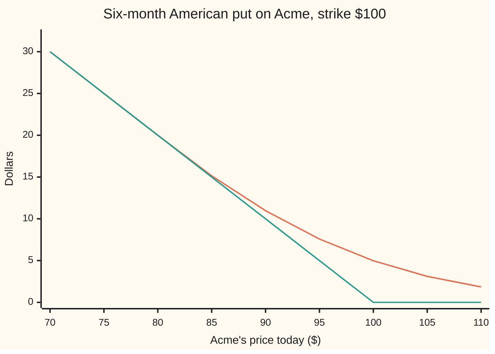
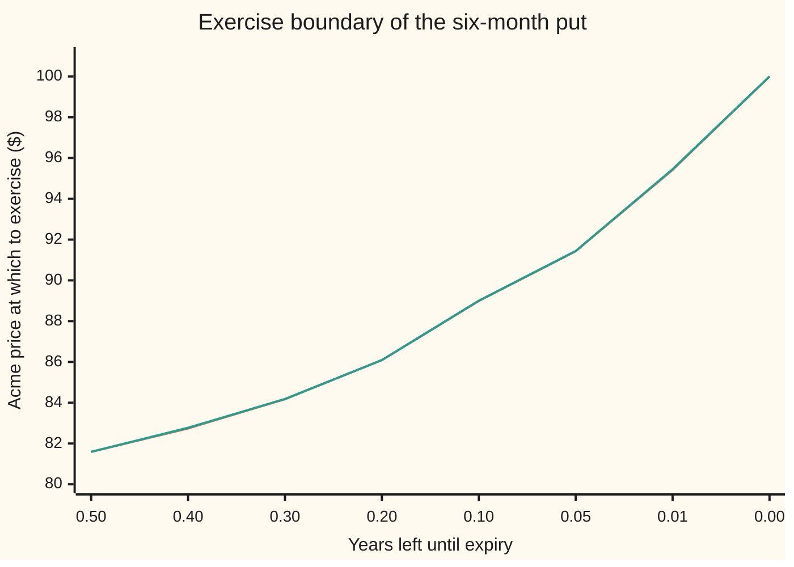

# An American option: the boundary where holding stops beating exercising

[Syllabus](../../../SYLLABUS.md) → [Partial differential equations](../README.md) → [Weak Solutions and Free Boundaries](../README.md#s06) → An American option

---

## General Overview

Acme shares trade at $100. A **put** on Acme is the right, not the duty, to sell one share for $100, the **strike**. This one is **American**: the holder may use it on any day of the next six months. Cash earns 5% a year, Acme pays a 2% dividend yield (cash paid out each year, as a fraction of the price), and its **volatility** (the yearly spread of its log-returns) is 20%. These are the finance wing's illustrative house numbers.

The put is worth $4.98 today. Its **European** twin, usable only on the last day, is worth $4.83. The extra 14 cents ($0.1435 before rounding) pays for one freedom: the holder can take the $100 early.

Every morning the holder asks the same question: exercise now, or keep holding? The answer is a price line. With six months left it sits at **$81.59**. If Acme is at $80, exercise: take the $20 now and earn interest on it. If Acme is at $85, hold. The line climbs toward $100 as expiry nears. Nobody writes it into the contract. It comes out of the pricing, which makes it a **free boundary**: an edge of the region that is part of the answer.

[Black-Scholes is the heat equation after a change of variables](../03-The%20Heat%20Equation%20in%20Depth/07-black-scholes-to-the-heat-equation.md) showed that a European option obeys a heat equation. The American option adds one rule: its value may never fall below what exercising pays this instant. That payoff is a floor, like the stone under the rubber sheet in [The obstacle problem](08-obstacle-problems-and-variational-inequalities.md). Where the value lifts off the floor, the holder waits. Where it rests on the floor, the holder exercises.

This card writes that rule as a **variational inequality**: an inequality that must hold against every shape allowed to sit on the floor. That form never mentions the boundary. Two conditions at the boundary then come out of it instead of being assumed: the value meets the payoff at the same height (**value matching**) and with the same slope (**smooth pasting**).

**An American option's value is the solution of an obstacle problem with the payoff as the obstacle; the variational inequality finds it without knowing the boundary, and because the payoff can push the value up but never pull it down, the value leaves the payoff along a tangent, which pins the boundary at $81.59 with six months left.**

**What kind of fact this is:** a theorem inside the Black-Scholes model (the share follows geometric Brownian motion, an assumption, not a law). The two inequality forms, value matching, and smooth pasting are proved in Why it works; existence and uniqueness are stated with their source; the boundary is computed two ways.

### The picture: the value resting on its floor



Orange: the put's value today, from the integral road in the code. Teal: the payoff $`\max(100 - S, 0)`$, the floor. At $70, $75 and $80 the two lines are one: the value rests on the floor, and the holder exercises. The boundary, $81.59, lies between $80 and $85. Right of it the value lifts off without a corner.

---

## The formula

Notation from earlier cards, one line each. $`S`$ is Acme's price, $`K`$ the strike, $`r`$ the bank rate, $`q`$ the dividend yield, $`\sigma`$ the volatility and $`V`$ the option's value, as on the finance wing. $`\mathcal{L}`$ is the pricing operator of [American options on a grid](../../12-Financial%20mathematics/06-Numerical%20Methods%20for%20Pricing/08-american-options-by-psor-and-lcp.md): what holding the hedged option earns above the bank rate, apart from the passage of time. The obstacle $`\psi`$, the admissible set $`\mathcal{K}`$ and the contact set come from [The obstacle problem](08-obstacle-problems-and-variational-inequalities.md). Time $`t`$ runs in years from today, and the option expires at $`T`$ = 0.5, so $`T - t`$ is the time left.

```math
\mathcal{L}V = \tfrac12\sigma^2 S^2\,\frac{\partial^2 V}{\partial S^2} + (r - q)\,S\,\frac{\partial V}{\partial S} - rV, \qquad \psi(S) = \max(K - S,\, 0).
```

**The strong form.** At every price and date, three conditions hold together, with $`V = \psi`$ at expiry:

```math
V - \psi \ge 0, \qquad -\Big(\frac{\partial V}{\partial t} + \mathcal{L}V\Big) \ge 0, \qquad (V - \psi)\Big(\frac{\partial V}{\partial t} + \mathcal{L}V\Big) = 0 .
```

**Read it aloud:** the value never falls below the payoff; holding never earns more than the bank; and at every point one of the two is tight.

Call $`-(\partial V/\partial t + \mathcal{L}V)`$ the **push**. It is the floor's push on the value: zero where the holder waits, positive where the value rests on the floor.

**The weak form, the variational inequality.** Measure price by its log, $`x = \ln(S/K)`$. Let $`\mathcal{K}`$ be the set of value profiles $`w(x)`$ with one square-integrable slope that never dip below the floor, $`w \ge \psi`$. Strictly, the slope and every integral below are measured with a weight that tames the far ends, where $`V`$ tends to $`K`$ (Step 2). At each date $`t`$ the value profile $`V`$ is in $`\mathcal{K}`$, and

```math
\int -\frac{\partial V}{\partial t}\,(w - V)\,dx \;+\; a(V,\, w - V) \;\ge\; 0 \quad \text{for every } w \in \mathcal{K}, \qquad a(V, w) = \int \Big(\tfrac12\sigma^2\, V_x w_x - \mu\, V_x\, w + r\, V w\Big)\,dx .
```

**Read it aloud:** nudge the value toward any profile that stays on or above the floor, and the push can only resist the nudge, never help it.

Here $`\mu = r - q - \tfrac12\sigma^2`$ is the drift of the log price, and $`a`$ is the bilinear form (a rule that takes two profiles and returns a number, linear in each) of the pricing operator after one integration by parts, as in [Weak solutions](01-weak-solutions-and-the-weak-formulation.md). It needs one derivative of $`V`$, not two.

**What comes out.** The exercise region is the contact set: all prices at or below a line $`B(t)`$ (the finance wing's smooth-pasting card shows it is one stretch at the bottom). On that line,

```math
V\big(B(t), t\big) = K - B(t), \qquad \frac{\partial V}{\partial S}\big(B(t), t\big) = -1 .
```

**Read it aloud:** on the boundary the option is worth exactly its payoff, and it changes with Acme's price at the payoff's rate, minus one dollar per dollar.

| Symbol | Plain meaning | In our example | Push it up and the answer… |
| --- | --- | --- | --- |
| $`S`$; $`x`$ | Acme's price; its log price $`\ln(S/K)`$ | $100; 0 | the put falls |
| $`K`$ | strike: what the holder may sell for | $100 | put and boundary rise |
| $`r`$, $`q`$, $`\sigma`$ | bank rate, dividend yield, volatility, per year | 5%, 2%, 20% (illustrative) | $`r`$ lifts the boundary; $`q`$ and $`\sigma`$ lower it |
| $`t`$, $`T`$ | years from today; expiry | 0; 0.5 years | more time left lowers the boundary |
| $`V`$ | the American put's value | $4.98 at $100 | — |
| $`\psi`$ | the obstacle: what exercising pays now | $20 at $80 | — |
| $`\mathcal{L}`$, $`\mu`$ | pricing operator; drift of the log price | $`\mu`$ = 0.01 | — |
| $`\mathcal{K}`$, $`w`$, $`a`$; $`\varphi`$, $`\varepsilon`$ | profiles on or above the floor; one such profile; the bilinear form; a small bump and its size, in the proofs | — | — |
| push, $`P`$ | $`-(\partial V/\partial t + \mathcal{L}V)`$: the floor's push, dollars a year | 0 where waiting; $3.5994 a year at $70.03 | — |
| $`B`$; $`\Gamma`$ | the exercise boundary; gamma, $`\partial^2 V/\partial S^2`$ | $81.59 today; 0 below it, 0.0253 per dollar just above | — |
| $`\lambda`$, $`S^*`$, $`L`$; $`[V_S]`$ | perpetual put's power and boundary; a trial trigger; jump in slope | −1.850781, $64.92; $50 or $80 | — |
| $`h`$ | grid step in log price, for road 1 | 0.01 down to 0.00125 | — |

### When it holds

- **Constant rates and volatility.** The inequality survives a volatility that varies with price and date. The integral road in the code does not: it needs constants.
- **Exercise at every instant.** A Bermudan put, exercisable on listed dates only, has a corner at each date's boundary, and smooth pasting fails.
- **No jumps in price.** A jump can carry the price past the line, and the value can then meet the payoff at a corner.
- **The rate exceeds the dividend yield.** Then the push $`rK - qS`$ is positive below the strike, and the boundary starts at $`K`$ at expiry. With $`q > r`$ it starts at $`rK/q`$.
- **A straight floor where contact happens.** The payoff is a straight line below the strike, so the value can leave it along a tangent. Before expiry the value sits above the payoff at the strike, so the floor's own corner is never touched.

---

## Why it works

### Step 0: the floor can push, but it cannot pull

Where the holder waits, the option obeys the Black-Scholes equation and the push is zero. Where the holder exercises, the value is pinned to the floor, and something must hold it there: the push. It is positive, because exercising early earns a steady income. Everything else on this card comes from two facts. The value never goes below the floor, and the floor never pulls the value down. The second fact forbids a corner where the value leaves the floor.

### Step 1: the three conditions are the holder's best stopping rule

The American price is the best the holder can do by choosing when to stop. [Optimal stopping](../../11-Stochastic%20processes%20and%20calculus/08-Generators%2C%20Densities%20and%20Simulation/07-optimal-stopping-and-snell-envelope.md) shows that this best value, discounted, is the smallest supermartingale (a process that falls or holds steady on average) that stays above the reward. Read through Itô's formula (the chain rule for random paths), that becomes the strong form:

- **Above the floor**, because exercising now is always allowed: $`V \ge \psi`$.
- **A non-negative push**, because the discounted value falls or holds steady on average.
- **Zero push where the value is above the floor**, because there the holder waits, and waiting is fair on average.

In the exercise region the push can be computed by hand. There $`V = K - S`$, so its time derivative and curvature are zero, and

```math
-\mathcal{L}(K - S) = (r - q)S + r(K - S) = rK - qS .
```

That is the interest earned on the $100 strike, minus the dividends given up on the share handed over. The grid in the code measures the push without this formula: $3.5994 a year at $70.03, against $`rK - qS`$ = $3.5994. Where the holder waits, the push is zero by construction, not by measurement: there the grid applies the pricing equation and lifts nothing.

### Step 2: the strong form and the variational inequality say the same thing

Multiply the push by $`w - V`$ for any profile $`w`$ on or above the floor, and add it up. Where the holder waits, the push is zero. Where the holder exercises, both the push and $`w - V = w - \psi`$ are non-negative. So the total is never negative, and one integration by parts turns it into the variational inequality. Going back, test profiles that lift $`V`$ by a small bump show the push is non-negative; where $`V`$ is above the floor, lowering it is allowed too, so the push is zero there.

<details>
<summary>Detailed proof: complementarity and the variational inequality are equivalent</summary>

Write $`P = -(V_t + \mathcal{L}V)`$ for the push. In log price, $`\mathcal{L}V = \tfrac12\sigma^2 V_{xx} + \mu V_x - rV`$. For a profile $`\varphi`$ that vanishes far out, integration by parts gives

$`\displaystyle \int -\mathcal{L}V\,\varphi\,dx = \int \Big(\tfrac12\sigma^2 V_x \varphi_x - \mu V_x \varphi + r V \varphi\Big)\,dx = a(V, \varphi).`$

So $`\int -V_t\,\varphi\,dx + a(V, \varphi) = \int P\,\varphi\,dx`$, and the variational inequality reads $`\int P\,(w - V)\,dx \ge 0`$ for every $`w \in \mathcal{K}`$.

*Strong form implies inequality.* Split the line into the waiting set, where $`V > \psi`$ and $`P = 0`$, and the contact set, where $`V = \psi`$ and $`P \ge 0`$. On the contact set $`w - V = w - \psi \ge 0`$. So the integrand $`P\,(w - V)`$ is zero on the first set and non-negative on the second.

*Inequality implies strong form.* Take any smooth bump $`\varphi \ge 0`$. The profile $`w = V + \varphi`$ is in $`\mathcal{K}`$, so $`\int P\,\varphi\,dx \ge 0`$ for every such bump: $`P \ge 0`$. Now take a bump supported where $`V - \psi > \varepsilon`$, with height at most $`\varepsilon`$. Then $`w = V - \varphi`$ is still in $`\mathcal{K}`$, so $`\int P\,\varphi\,dx \le 0`$. Together, $`P = 0`$ wherever $`V > \psi`$. The first condition, $`V \ge \psi`$, is membership of $`\mathcal{K}`$.

</details>

What the weak form buys: it needs only one derivative of $`V`$ and never names the boundary. Jaillet, Lamberton and Lapeyre (1990) proved that it has exactly one solution in a weighted $`H^1`$ class in log price, where the weight tames the far ends. They also proved that this solution is the optimal-stopping price. So "the solution" here is a weak solution, unique in that class. It turns out to have a continuous slope, but its curvature jumps on the boundary, so it is not a classical solution of any one equation across the line.

### Step 3: value matching is continuity

A profile with one square-integrable slope in one variable is continuous. On the contact set $`V = \psi`$. So at the top of the contact set, $`V(B, t) = K - B`$. Nothing more was needed.

Value matching alone does not locate the line: any trial trigger can be glued on at matching height. [The perpetual American put](../../12-Financial%20mathematics/15-American%20and%20Bermudan%20exercise/05-perpetual-american-put.md) shows this in closed form. Above a trigger $`L`$ its value is $`(K - L)(S/L)^{\lambda}`$, with $`\lambda`$ = −1.850781, and every $`L`$ matches the payoff in height.

### Step 4: smooth pasting is the floor's refusal to pull

Suppose the value leaves the floor at $`B`$ with a corner. Below $`B`$ its slope is the payoff's, −1. Just above, it is $`-1 + [V_S]`$, where $`[V_S]`$ is the jump in slope. Two facts squeeze the jump.

- **The value stays above the floor.** At $`B`$ the gap $`V - \psi`$ is zero, and just above it is non-negative. So its slope just above, $`[V_S]`$, is at least zero. A downward jump would carry the value under the floor.
- **The floor cannot pull.** A corner puts a spike into the curvature, of total weight $`[V_S]`$. In the push it becomes a spike of weight $`-\tfrac12\sigma^2 B^2\,[V_S]`$. The push must be non-negative, so $`[V_S]`$ is at most zero.

So $`[V_S] = 0`$: the slope is −1 on the line. Smooth pasting is not an extra rule. It is what the variational inequality says at the edge of the contact set. This is exactly how the rubber sheet leaves the stone in [The obstacle problem](08-obstacle-problems-and-variational-inequalities.md).

<details>
<summary>Detailed proof: the spike in the push</summary>

Fix a date and integrate the push across a window $`[B - \varepsilon, B + \varepsilon]`$. The terms $`V_t`$, $`(r - q)S V_S`$ and $`rV`$ are bounded near the line, so their integrals vanish with $`\varepsilon`$. The curvature term integrates exactly:

$`\displaystyle \int_{B-\varepsilon}^{B+\varepsilon} \tfrac12\sigma^2 S^2 V_{SS}\,dS \;\to\; \tfrac12\sigma^2 B^2\,\big(V_S(B^+) - V_S(B^-)\big) = \tfrac12\sigma^2 B^2\,[V_S].`$

The push is non-negative, so this limit gives $`[V_S] \le 0`$. The gap $`V - \psi`$ is zero at $`B`$ and non-negative to its right, so $`[V_S] \ge 0`$. Hence $`[V_S] = 0`$. The bound on $`V_t`$ near the line before expiry is a regularity fact taken from the sources.

</details>

The perpetual put, with no time term, shows both failures in exact numbers. The checks glue the power curve to the payoff at three trial triggers:

| Trial trigger | Jump in slope $`[V_S]`$ | Spike in the push | Value at $100 | Which inequality fails |
| --- | --- | --- | --- | --- |
| $50 | −0.8508 | +42.54 | $13.8621 | the value dips $4.32 under the payoff at $60 |
| $64.92 | 0.0000 | 0.00 | **$15.7693** | none |
| $80 | +0.5373 | −68.78 | $13.2334 | the floor would have to pull |

The spike's weight is in dollars a year, summed across dollars of share price. Only the tangent trigger, $64.92, satisfies both inequalities, and it also gives the highest value. That matches the perpetual card's exact boundary, $`S^* = K\lambda/(\lambda - 1)`$.

### Step 5: locating the boundary for the six-month put

With six months left there is no closed form. The code takes two independent roads.

**Road 1 solves the variational inequality directly.** On a grid in log price, step the pricing equation back one date, inside its stability limit, then lift every value that fell below the floor back onto it. The lift is the floor's push. It is a plain explicit version of the solver in [American options on a grid](../../12-Financial%20mathematics/06-Numerical%20Methods%20for%20Pricing/08-american-options-by-psor-and-lcp.md). It stays on this card because it solves the variational inequality as written and measures the floor's push. The boundary is read off where the value leaves the floor. Near that point $`V - \psi`$ grows like the square of the distance (Step 4), so the code locates it between nodes by a straight line through $`\sqrt{V - \psi}`$.

**Road 2 never solves for the value.** The early-exercise integral equation of Kim (1990) is one equation per date in the boundary alone, marched back from expiry ([The exercise boundary and smooth pasting](../../12-Financial%20mathematics/15-American%20and%20Bermudan%20exercise/04-exercise-boundary-and-smooth-pasting.md) explains it).

| Grid step $`h`$ in log price | Price at $100 | Boundary today | Gap to road 2 |
| --- | --- | --- | --- |
| 0.01 | $4.97756 | $81.650 | +0.062 |
| 0.005 | $4.97714 | $81.638 | +0.049 |
| 0.0025 | $4.97702 | $81.605 | +0.016 |
| 0.00125 | $4.97699 | $81.593 | +0.004 |

The price converges at the observed order 1.85, then 1.91, close to the scheme's order 2. The boundary settles to within half a cent of road 2's $81.589, but not at a clean order: the edge of the contact set jumps from node to node as the grid shrinks. Both roads sit inside the bracket the perpetual put gives: above $64.92, below $100.



Orange: road 2, the integral equation. Teal: road 1, the finest grid. They agree to within 3 cents on every date. Time is not to scale: the last three points crowd into the final 0.05 years, where the line climbs fastest.

**The curvature jumps.** Put value matching, smooth pasting and a zero push into the equation just above the line. Differentiating value matching, $`V(B(t), t) = K - B(t)`$, along the moving line and using the slope −1 gives $`\partial V/\partial t = 0`$ there. What is left is $`\tfrac12\sigma^2 B^2\,\Gamma = rK - qB`$: the gain from the wobble pays the carry of exercising. So $`\Gamma`$ jumps from 0 on the floor to $`2(rK - qB)/(\sigma B)^2`$ = 0.02530 per dollar just above it. The finest grid never uses this formula; at $81.77, its second node above the line, it measures 0.02548 per dollar. A value with a continuous slope and a jumping curvature is exactly what an obstacle problem produces.

---

## Worked numbers, by hand

The six-month put, strike $100, at the house market: $`r`$ = 0.05, $`q`$ = 0.02, $`\sigma`$ = 0.20.

| Step | Arithmetic | Value |
| --- | --- | --- |
| drift of the log price, $`\mu`$ | 0.05 − 0.02 − ½ × 0.04 | 0.0100 |
| perpetual power, $`\lambda`$ | negative root of 0.02λ² + 0.01λ − 0.05 = 0 | −1.850781 |
| perpetual boundary, $`S^*`$ | 100 × λ ÷ (λ − 1) | $64.92 |
| six-month boundary, $`B`$ | road 2's root, checked by road 1's $81.593 | **$81.59** |
| carry of exercising on the line | 5 − 0.02 × 81.59 | $3.3682 a year |
| gamma just above the line | 2 × 3.3682 ÷ (0.04 × 81.59²) | 0.02530 per dollar |
| predicted slope over the first dollar | −1 + ½ × 0.02530 × 1 | −0.9874 |
| measured slope over the first dollar | road 2 | −0.9870 |
| push at $70.03, exercising | 5 − 0.02 × 70.03 | $3.5994 a year |
| American price at $100 | grid, integral, tree | $4.9770, $4.9771, $4.9766 |
| early-exercise premium | 4.9771 − 4.8336 | **$0.1435** |

With six months left, the holder exercises if Acme is at $81.59 or below. On that line the put moves dollar for dollar against Acme, and the gap between the value and the payoff opens like a parabola, not a wedge. The right to exercise early is worth 14 cents today.

### What breaks if you drop a piece

| Mistake | Comes out at | What went wrong |
| --- | --- | --- |
| Drop the floor: price it as European | $4.8336 by formula, $4.8329 on the tree | No contact set, no boundary; the 14-cent premium is gone. |
| Freeze today's line at $81.59 for all six months | $4.9059, not $4.9766 | The line should climb to $100; waiting below it in the last weeks wastes the carry. |
| Use the perpetual line, $64.92 | $4.8335, against $4.8329 never exercising | A line far below the true one almost never acts in six months. |
| Glue the perpetual put at $80 by value matching only | $13.2334, not $15.7693 | Slope jumps by +0.5373; the floor would have to pull. |
| Glue it at $50 | $13.8621, and $4.32 under the payoff by $60 | Slope jumps by −0.8508; the value falls through the floor. |
| Read the boundary off a coarse grid as exact | $81.650 at $`h`$ = 0.01 | 6 cents high; a grid boundary needs its step beside it. |

---

## Code, from first principles, and it actually runs

The code takes two independent roads to the boundary and three to the price. Road 1 solves the variational inequality on a log-price grid at four steps: step the equation, lift onto the floor, read the push. Road 2 solves Kim's integral equation for the boundary alone, with the normal curve written out as a series. Road 3 is a 2,000-step binomial tree. The perpetual put gives the exact checks: its boundary $64.92 bounds the six-month line from below, and its trial triggers show each inequality failing.

### Python

```python
# An American put as an obstacle problem: strike $100, six months left. Standard library only.
# Road 1 solves the variational inequality on a log-price grid: step the equation, lift onto the payoff.
# Road 2 solves the early-exercise integral equation for the boundary alone. Road 3 is a binomial tree.
from math import log, exp, sqrt
K, r, q, sig, T, S0 = 100.0, 0.05, 0.02, 0.20, 0.5, 100.0
mu = r - q - 0.5 * sig * sig                  # drift of log price in the pricing world

def N(x):                                     # normal CDF from its Taylor series, no erf
    if abs(x) > 9: return 1.0 if x > 0 else 0.0
    s, t, k = x, x, 1
    while abs(t) > 1e-17 * abs(s):
        k += 2; t *= x * x / k; s += t
    return 0.5 + s * exp(-0.5 * x * x) / sqrt(2 * 3.141592653589793)
def d12(S, b, u):
    d1 = (log(S / b) + (r - q + 0.5 * sig * sig) * u) / (sig * sqrt(u)); return d1, d1 - sig * sqrt(u)
def euro(S, u):                               # European put with u years left
    d1, d2 = d12(S, K, u); return K * exp(-r * u) * N(-d2) - S * exp(-q * u) * N(-d1)
def root(f, lo, hi):                          # bisection on a sign change
    flo = f(lo)
    for _ in range(50):
        m = 0.5 * (lo + hi); fm = f(m)
        if (fm > 0) == (flo > 0): lo, flo = m, fm
        else: hi = m
    return 0.5 * (lo + hi)
psi = lambda S: max(K - S, 0.0)               # the obstacle: what exercising pays
LEFT = (0.5, 0.4, 0.3, 0.2, 0.1, 0.05, 0.01)  # years left, for the boundary chart

# ---- road 1: projected explicit scheme in x = ln(S/K) on [-0.8, 0.8], ratio sig^2 dt / h^2 = 0.8
def grid(h):
    n, nt = round(1.6 / h), round(T * sig * sig / (0.8 * h * h)); dt = T / nt
    S = [K * exp(-0.8 + i * h) for i in range(n + 1)]; g = [psi(s) for s in S]; V = g[:]; seen = {}
    a, b = 0.5 * sig * sig / (h * h), mu / (2 * h)
    for step in range(1, nt + 1):
        old = V
        LV = [0.0] + [a * (old[i + 1] - 2 * old[i] + old[i - 1]) + b * (old[i + 1] - old[i - 1]) - r * old[i]
                      for i in range(1, n)] + [0.0]
        V = [g[0]] + [max(g[i], old[i] + dt * LV[i]) for i in range(1, n)] + [0.0]
        left = round(step * dt, 6)
        if left in LEFT: seen[left] = edge(S, V, g)
    push = [(V[i] - old[i]) / dt - LV[i] for i in range(n)]   # -(V_t + LV) on the last step: V_t = (old - V)/dt
    return S, V, g, push, seen
def edge(S, V, g):                            # last contact node, then V - psi ~ c (x - xb)^2 above it
    i = max(k for k in range(len(S)) if S[k] < K and V[k] - g[k] < 1e-12)
    d1, d2 = sqrt(V[i + 1] - g[i + 1]), sqrt(V[i + 2] - g[i + 2])
    return S[i + 1] * (S[i + 2] / S[i + 1]) ** (-d1 / (d2 - d1))
HS = (0.01, 0.005, 0.0025, 0.00125); runs = {h: grid(h) for h in HS}
S, V, g, push, seen = runs[0.00125]; i0 = round(0.8 / 0.00125)

# ---- road 2: early-exercise integral equation, marched back from expiry on 100 bunched dates
def prem(S, us, Bs, i):                       # discounted carry r K - q S wherever S sits below the line
    tot, pu, pf = 0.0, None, None
    for j in range(i, -1, -1):
        u = us[i] - us[j]
        if u == 0: f = 0.5 * (r * K - q * S)
        else:
            d1, d2 = d12(S, Bs[j], u); f = r * K * exp(-r * u) * N(-d2) - q * S * exp(-q * u) * N(-d1)
        if pu is not None: tot += 0.5 * (f + pf) * (u - pu)
        pu, pf = u, f
    return tot
m = 100; us = [T * (i / m) ** 2 for i in range(m + 1)]; Bs = [K]
for i in range(1, m + 1):
    Bs.append(root(lambda b: K - b - euro(b, us[i]) - prem(b, us, Bs + [b], i), 40.0, Bs[-1]))
def B_int(t):                                 # boundary t years left, linear between dates
    t = max(t, 0.0); i = max(k for k in range(m) if us[k] <= t); w = (t - us[i]) / (us[i + 1] - us[i])
    return Bs[i] + w * (Bs[i + 1] - Bs[i])
def V_int(S, n=400):                          # price: European put plus premium, Simpson in v = sqrt(u)
    if S <= Bs[m]: return K - S
    hv, tot = sqrt(T) / n, 0.0
    for k in range(1, n + 1):
        u = (k * hv) ** 2; d1, d2 = d12(S, B_int(T - u), u)
        f = r * K * exp(-r * u) * N(-d2) - q * S * exp(-q * u) * N(-d1)
        tot += (4 if k % 2 else 2 if k < n else 1) * f * 2 * k * hv
    return euro(S, T) + tot * hv / 3

# ---- road 3: CRR binomial tree: at each node take the larger of exercising and waiting
def tree(n, rule=None):
    dt = T / n; u = exp(sig * sqrt(dt)); p = (exp((r - q) * dt) - 1 / u) / (u - 1 / u); D = exp(-r * dt)
    W = [psi(S0 * u ** (2 * j - n)) for j in range(n + 1)]
    for k in range(n - 1, -1, -1):
        for j in range(k + 1):
            s = S0 * u ** (2 * j - k); c = D * (p * W[j + 1] + (1 - p) * W[j])
            W[j] = max(psi(s), c) if rule is None else (psi(s) if s <= rule else c)
    return W[0]

# ---- the perpetual put: exact boundary, and trial triggers glued at matching height only
lam = (-mu - sqrt(mu * mu + 2 * sig * sig * r)) / (sig * sig); Sstar = K * lam / (lam - 1)
def trial(L):                                 # (K - L)(S/L)^lam above L: value matches, slope may not
    jump = lam * (K - L) / L + 1; low = min((K - L) * (s / L) ** lam - psi(s) for s in (L + 1, L + 5, L + 10))
    return jump, (K - L) * (S0 / L) ** lam, low

B1, A_tree = Bs[m], tree(2000)
print(f"six-month put, S = {S0:.0f}: grid {V[i0]:.4f}, integral {V_int(S0):.4f}, tree {A_tree:.4f} dollars")
print(f"European put {euro(S0, T):.4f} dollars, early-exercise premium {V_int(S0) - euro(S0, T):.4f}")
pg = [runs[h][1][round(0.8 / h)] for h in HS]; bg = [edge(*runs[h][:3]) for h in HS]
for h, p, b in zip(HS, pg, bg):
    print(f"grid h = {h:.5f}: price {p:.5f} dollars, boundary {b:.3f} dollars, gap to integral road {b - B1:+.3f}")
print("price order from successive halvings: " + ", ".join(f"{log((pg[k] - pg[k + 1]) / (pg[k + 1] - pg[k + 2])) / log(2):.2f}" for k in (0, 1)))
print(f"boundary today: integral {B1:.3f} dollars, finest grid {bg[3]:.3f} dollars")
print("years left:", ", ".join(f"{t:.2f}" for t in LEFT) + ", 0.00")
print("boundary integral:", ", ".join(f"{B_int(t):.2f}" for t in LEFT) + f", {K:.2f}")
print("boundary grid:", ", ".join(f"{seen[t]:.2f}" for t in LEFT) + f", {K:.2f}")
print("chart S:", ", ".join(f"{s}" for s in range(70, 115, 5)))
print("chart V:", ", ".join(f"{V_int(s):.2f}" for s in range(70, 115, 5)))
print("chart payoff:", ", ".join(f"{psi(s):.2f}" for s in range(70, 115, 5)))
cont = [k for k in range(1, len(S) - 1) if V[k] - g[k] > 1e-9]; ex = [k for k in range(1, len(S) - 1) if k not in cont and S[k] < K]
for s in (60.0, 70.0, 80.0):
    k = min(ex, key=lambda k: abs(S[k] - s))
    print(f"push at S = {S[k]:.2f}: grid {push[k]:.4f}, rK - qS {r * K - q * S[k]:.4f} dollars a year")
sl = [(V_int(B1 + e) - (K - B1)) / e for e in (2.0, 1.0, 0.5)]
print("slope from the line out by 2, 1, 0.5 dollars: " + ", ".join(f"{x:.4f}" for x in sl))
gam = 2 * (r * K - q * B1) / (sig * sig * B1 * B1)
j, h = cont[0] + 1, HS[3]                     # the finest grid's second node above the line; Gamma = (V_xx - V_x) / S^2
gm = ((V[j + 1] - 2 * V[j] + V[j - 1]) / (h * h) - (V[j + 1] - V[j - 1]) / (2 * h)) / (S[j] * S[j])
print(f"curvature just above the line: predicted {gam:.5f}, finest grid at {S[j]:.2f} dollars {gm:.5f} per dollar")
print(f"carry on the line rK - qB {r * K - q * B1:.4f} dollars a year; predicted slope out by 2, 1, 0.5: " + ", ".join(f"{-1 + gam * e / 2:.4f}" for e in (2.0, 1.0, 0.5)))
print(f"perpetual: log-price drift mu {mu:.4f}, lambda {lam:.6f}, boundary {Sstar:.2f}, value at 100 {(K - Sstar) * (S0 / Sstar) ** lam:.4f}")
for L in (50.0, Sstar, 80.0):
    jump, v100, low = trial(L); jump = round(jump, 9) + 0.0
    print(f"trigger {L:5.2f}: slope jump {jump:+.4f}, point push {-0.5 * sig * sig * L * L * jump + 0.0:+.2f}, value at 100 {v100:.4f}, lowest gap to payoff {low:+.4f}")
wf, wp, we = tree(2000, B1), tree(2000, Sstar), tree(2000, 0.0)
print(f"breaks on the tree: never exercise {we:.4f}; boundary frozen at {B1:.2f}: {wf:.4f}; perpetual {Sstar:.2f}: {wp:.4f}")

assert abs(euro(S0, 1.0) - 6.330080627550) < 1e-9                        # CDF series: the one-year European put
assert abs(V[i0] - A_tree) < 0.005 and abs(V_int(S0) - A_tree) < 0.002   # three roads, one price
assert abs(bg[3] - B1) < 0.02 and abs(bg[3] - B1) < abs(bg[0] - B1)       # two roads, one boundary
assert all(abs(seen[t] - B_int(t)) < 0.15 for t in LEFT)                  # the whole line agrees
assert Sstar < B1 < K and all(B_int(a) < B_int(b) for a, b in zip(LEFT, LEFT[1:]))
assert min(push[k] for k in ex) > 0                                      # the floor pushes wherever V rests on it
assert all(abs(push[k] - (r * K - q * S[k])) < 0.01 for k in ex if S[k] < B1 - 2)
assert all(abs(1 + sl[k]) / abs(1 + sl[k + 1]) > 1.8 for k in (0, 1))    # slope tends to -1: no corner
assert abs(gm - gam) < 0.02 * gam                                          # curvature jumps from 0 to 2(rK-qB)/(sig B)^2
assert abs(trial(Sstar)[0]) < 1e-12 and trial(80.0)[0] > 0 and trial(50.0)[2] < 0
assert max(trial(50.0)[1], trial(80.0)[1]) < trial(Sstar)[1] and max(wf, wp, we) < A_tree - 0.05
assert abs(we - euro(S0, T)) < 0.002 and abs(wp - we) < 0.001                # the far line almost never acts
print("ALL CHECKS PASS")
```

**Ran 2026-11-15 on macOS, Python 3.14.10, standard library only. All checks passed. Output, pasted from the run:**

```
six-month put, S = 100: grid 4.9770, integral 4.9771, tree 4.9766 dollars
European put 4.8336 dollars, early-exercise premium 0.1435
grid h = 0.01000: price 4.97756 dollars, boundary 81.650 dollars, gap to integral road +0.062
grid h = 0.00500: price 4.97714 dollars, boundary 81.638 dollars, gap to integral road +0.049
grid h = 0.00250: price 4.97702 dollars, boundary 81.605 dollars, gap to integral road +0.016
grid h = 0.00125: price 4.97699 dollars, boundary 81.593 dollars, gap to integral road +0.004
price order from successive halvings: 1.85, 1.91
boundary today: integral 81.589 dollars, finest grid 81.593 dollars
years left: 0.50, 0.40, 0.30, 0.20, 0.10, 0.05, 0.01, 0.00
boundary integral: 81.59, 82.74, 84.18, 86.09, 88.99, 91.43, 95.42, 100.00
boundary grid: 81.59, 82.77, 84.18, 86.09, 89.00, 91.44, 95.45, 100.00
chart S: 70, 75, 80, 85, 90, 95, 100, 105, 110
chart V: 30.00, 25.00, 20.00, 15.15, 10.97, 7.58, 4.98, 3.11, 1.85
chart payoff: 30.00, 25.00, 20.00, 15.00, 10.00, 5.00, 0.00, 0.00, 0.00
push at S = 59.97: grid 3.8005, rK - qS 3.8005 dollars a year
push at S = 70.03: grid 3.5994, rK - qS 3.5994 dollars a year
push at S = 79.95: grid 3.4010, rK - qS 3.4010 dollars a year
slope from the line out by 2, 1, 0.5 dollars: -0.9740, -0.9870, -0.9932
curvature just above the line: predicted 0.02530, finest grid at 81.77 dollars 0.02548 per dollar
carry on the line rK - qB 3.3682 dollars a year; predicted slope out by 2, 1, 0.5: -0.9747, -0.9874, -0.9937
perpetual: log-price drift mu 0.0100, lambda -1.850781, boundary 64.92, value at 100 15.7693
trigger 50.00: slope jump -0.8508, point push +42.54, value at 100 13.8621, lowest gap to payoff -4.3202
trigger 64.92: slope jump +0.0000, point push +0.00, value at 100 15.7693, lowest gap to payoff +0.0215
trigger 80.00: slope jump +0.5373, point push -68.78, value at 100 13.2334, lowest gap to payoff +0.5454
breaks on the tree: never exercise 4.8329; boundary frozen at 81.59: 4.9059; perpetual 64.92: 4.8335
ALL CHECKS PASS
```

### Rust

```rust
// An American put as an obstacle problem: strike $100, six months left. Rust std only.
// Road 1 solves the variational inequality on a log-price grid: step the equation, lift onto the payoff.
// Road 2 solves the early-exercise integral equation for the boundary alone. Road 3 is a binomial tree.
const K: f64 = 100.0; const R: f64 = 0.05; const Q: f64 = 0.02; const SIG: f64 = 0.20; const T: f64 = 0.5; const S0: f64 = 100.0;
const MU: f64 = R - Q - 0.5 * SIG * SIG; // drift of log price in the pricing world
const LEFT: [f64; 7] = [0.5, 0.4, 0.3, 0.2, 0.1, 0.05, 0.01]; // years left, for the boundary chart

fn ncdf(x: f64) -> f64 { // normal CDF from its Taylor series, no erf
    if x.abs() > 9.0 { return if x > 0.0 { 1.0 } else { 0.0 }; }
    let (mut s, mut t, mut k) = (x, x, 1.0);
    while t.abs() > 1e-17 * s.abs() { k += 2.0; t *= x * x / k; s += t; }
    0.5 + s * (-0.5 * x * x).exp() / (2.0 * 3.141592653589793f64).sqrt()
}
fn d12(s: f64, b: f64, u: f64) -> (f64, f64) {
    let d1 = ((s / b).ln() + (R - Q + 0.5 * SIG * SIG) * u) / (SIG * u.sqrt()); (d1, d1 - SIG * u.sqrt())
}
fn euro(s: f64, u: f64) -> f64 { // European put with u years left
    let (d1, d2) = d12(s, K, u); K * (-R * u).exp() * ncdf(-d2) - s * (-Q * u).exp() * ncdf(-d1)
}
fn root<F: Fn(f64) -> f64>(f: F, mut lo: f64, mut hi: f64) -> f64 { // bisection on a sign change
    let mut flo = f(lo);
    for _ in 0..50 {
        let m = 0.5 * (lo + hi); let fm = f(m);
        if (fm > 0.0) == (flo > 0.0) { lo = m; flo = fm; } else { hi = m; }
    }
    0.5 * (lo + hi)
}
fn psi(s: f64) -> f64 { (K - s).max(0.0) } // the obstacle: what exercising pays

// ---- road 1: projected explicit scheme in x = ln(S/K) on [-0.8, 0.8], ratio sig^2 dt / h^2 = 0.8
struct Run { s: Vec<f64>, v: Vec<f64>, g: Vec<f64>, push: Vec<f64>, seen: Vec<f64> }
fn edge(s: &[f64], v: &[f64], g: &[f64]) -> f64 { // last contact node, then V - psi ~ c (x - xb)^2 above it
    let i = (0..s.len()).filter(|&k| s[k] < K && v[k] - g[k] < 1e-12).max().unwrap();
    let (d1, d2) = ((v[i + 1] - g[i + 1]).sqrt(), (v[i + 2] - g[i + 2]).sqrt()); s[i + 1] * (s[i + 2] / s[i + 1]).powf(-d1 / (d2 - d1))
}
fn grid(h: f64) -> Run {
    let n = (1.6 / h).round() as usize; let nt = (T * SIG * SIG / (0.8 * h * h)).round() as usize; let dt = T / nt as f64;
    let s: Vec<f64> = (0..=n).map(|i| K * (-0.8 + i as f64 * h).exp()).collect();
    let g: Vec<f64> = s.iter().map(|&x| psi(x)).collect();
    let (a, b) = (0.5 * SIG * SIG / (h * h), MU / (2.0 * h));
    let (mut v, mut old, mut lv) = (g.clone(), g.clone(), vec![0.0; n + 1]); let mut seen = vec![0.0; 7];
    for step in 1..=nt {
        old = v.clone();
        for i in 1..n { lv[i] = a * (old[i + 1] - 2.0 * old[i] + old[i - 1]) + b * (old[i + 1] - old[i - 1]) - R * old[i]; }
        v = (0..=n).map(|i| if i == 0 { g[0] } else if i == n { 0.0 } else { g[i].max(old[i] + dt * lv[i]) }).collect();
        for (k, &t) in LEFT.iter().enumerate() {
            if (step as f64 * dt * 1e6).round() == (t * 1e6).round() { seen[k] = edge(&s, &v, &g); }
        }
    }
    let push = (0..n).map(|i| (v[i] - old[i]) / dt - lv[i]).collect(); // -(V_t + LV) on the last step
    Run { s, v, g, push, seen }
}

// ---- road 2: early-exercise integral equation, marched back from expiry on 100 bunched dates
fn prem(s: f64, us: &[f64], bs: &[f64], i: usize) -> f64 { // discounted carry r K - q S below the line
    let (mut tot, mut pu, mut pf) = (0.0, -1.0, 0.0);
    for j in (0..=i).rev() {
        let u = us[i] - us[j];
        let f = if u == 0.0 { 0.5 * (R * K - Q * s) } else {
            let (d1, d2) = d12(s, bs[j], u); R * K * (-R * u).exp() * ncdf(-d2) - Q * s * (-Q * u).exp() * ncdf(-d1) };
        if pu >= 0.0 { tot += 0.5 * (f + pf) * (u - pu); }
        pu = u; pf = f;
    }
    tot
}
struct Line { us: Vec<f64>, bs: Vec<f64> }
impl Line {
    fn b(&self, t: f64) -> f64 { // boundary t years left, linear between dates
        let t = t.max(0.0); let m = self.us.len() - 1;
        let i = (0..m).filter(|&k| self.us[k] <= t).max().unwrap();
        let w = (t - self.us[i]) / (self.us[i + 1] - self.us[i]); self.bs[i] + w * (self.bs[i + 1] - self.bs[i]) }
    fn v(&self, s: f64) -> f64 { // price: European put plus premium, Simpson in v = sqrt(u)
        if s <= self.bs[self.bs.len() - 1] { return K - s; }
        let n = 400; let hv = T.sqrt() / n as f64; let mut tot = 0.0;
        for k in 1..=n {
            let u = (k as f64 * hv).powi(2); let (d1, d2) = d12(s, self.b(T - u), u);
            let f = R * K * (-R * u).exp() * ncdf(-d2) - Q * s * (-Q * u).exp() * ncdf(-d1);
            tot += (if k % 2 == 1 { 4.0 } else if k < n { 2.0 } else { 1.0 }) * f * 2.0 * k as f64 * hv;
        }
        euro(s, T) + tot * hv / 3.0
    }
}

// ---- road 3: CRR binomial tree: at each node take the larger of exercising and waiting
fn tree(n: usize, rule: Option<f64>) -> f64 {
    let dt = T / n as f64; let u = (SIG * dt.sqrt()).exp();
    let p = ((((R - Q) * dt).exp()) - 1.0 / u) / (u - 1.0 / u); let d = (-R * dt).exp();
    let mut w: Vec<f64> = (0..=n).map(|j| psi(S0 * u.powi(2 * j as i32 - n as i32))).collect();
    for k in (0..n).rev() {
        for j in 0..=k {
            let s = S0 * u.powi(2 * j as i32 - k as i32); let c = d * (p * w[j + 1] + (1.0 - p) * w[j]);
            w[j] = match rule { None => psi(s).max(c), Some(b) => if s <= b { psi(s) } else { c } };
        }
    }
    w[0]
}

fn main() {
    // ---- the perpetual put: exact boundary, and trial triggers glued at matching height only
    let lam = (-MU - (MU * MU + 2.0 * SIG * SIG * R).sqrt()) / (SIG * SIG); let sstar = K * lam / (lam - 1.0);
    let trial = |l: f64| -> (f64, f64, f64) { // (K - L)(S/L)^lam above L: value matches, slope may not
        let jump = lam * (K - l) / l + 1.0;
        let low = [l + 1.0, l + 5.0, l + 10.0].iter().map(|&s| (K - l) * (s / l).powf(lam) - psi(s)).fold(f64::INFINITY, f64::min);
        (jump, (K - l) * (S0 / l).powf(lam), low)
    };
    let hs = [0.01, 0.005, 0.0025, 0.00125];
    let runs: Vec<Run> = hs.iter().map(|&h| grid(h)).collect();
    let fine = &runs[3]; let i0 = (0.8f64 / 0.00125).round() as usize;
    let (s, v, g, push) = (&fine.s, &fine.v, &fine.g, &fine.push);
    let m = 100; let us: Vec<f64> = (0..=m).map(|i| T * (i as f64 / m as f64).powi(2)).collect();
    let mut bs = vec![K];
    for i in 1..=m {
        let prev = bs.clone(); let usr = &us;
        let b = root(|b| { let mut t = prev.clone(); t.push(b); K - b - euro(b, usr[i]) - prem(b, usr, &t, i) }, 40.0, prev[i - 1]);
        bs.push(b);
    }
    let line = Line { us: us.clone(), bs: bs.clone() }; let (b1, a_tree) = (bs[m], tree(2000, None));
    println!("six-month put, S = {:.0}: grid {:.4}, integral {:.4}, tree {:.4} dollars", S0, v[i0], line.v(S0), a_tree);
    println!("European put {:.4} dollars, early-exercise premium {:.4}", euro(S0, T), line.v(S0) - euro(S0, T));
    let pg: Vec<f64> = runs.iter().zip(hs.iter()).map(|(rn, &h)| rn.v[(0.8 / h).round() as usize]).collect();
    let bg: Vec<f64> = runs.iter().map(|rn| edge(&rn.s, &rn.v, &rn.g)).collect();
    for k in 0..4 { println!("grid h = {:.5}: price {:.5} dollars, boundary {:.3} dollars, gap to integral road {:+.3}", hs[k], pg[k], bg[k], bg[k] - b1); }
    let ord: Vec<String> = (0..2).map(|k| format!("{:.2}", ((pg[k] - pg[k + 1]) / (pg[k + 1] - pg[k + 2])).ln() / 2f64.ln())).collect();
    println!("price order from successive halvings: {}", ord.join(", "));
    println!("boundary today: integral {:.3} dollars, finest grid {:.3} dollars", b1, bg[3]);
    let join = |xs: Vec<String>| xs.join(", ");
    println!("years left: {}, 0.00", join(LEFT.iter().map(|t| format!("{:.2}", t)).collect()));
    println!("boundary integral: {}, {:.2}", join(LEFT.iter().map(|&t| format!("{:.2}", line.b(t))).collect()), K);
    println!("boundary grid: {}, {:.2}", join(fine.seen.iter().map(|x| format!("{:.2}", x)).collect()), K);
    let xs: Vec<f64> = (0..9).map(|k| 70.0 + 5.0 * k as f64).collect();
    println!("chart S: {}", join(xs.iter().map(|x| format!("{:.0}", x)).collect()));
    println!("chart V: {}", join(xs.iter().map(|&x| format!("{:.2}", line.v(x))).collect()));
    println!("chart payoff: {}", join(xs.iter().map(|&x| format!("{:.2}", psi(x))).collect()));
    let cont: Vec<usize> = (1..s.len() - 1).filter(|&k| v[k] - g[k] > 1e-9).collect();
    let ex: Vec<usize> = (1..s.len() - 1).filter(|&k| !cont.contains(&k) && s[k] < K).collect();
    for &x in &[60.0, 70.0, 80.0] {
        let k = *ex.iter().min_by(|&&a, &&b| (s[a] - x).abs().partial_cmp(&(s[b] - x).abs()).unwrap()).unwrap();
        println!("push at S = {:.2}: grid {:.4}, rK - qS {:.4} dollars a year", s[k], push[k], R * K - Q * s[k]);
    }
    let sl: Vec<f64> = [2.0, 1.0, 0.5].iter().map(|&e| (line.v(b1 + e) - (K - b1)) / e).collect();
    println!("slope from the line out by 2, 1, 0.5 dollars: {:.4}, {:.4}, {:.4}", sl[0], sl[1], sl[2]);
    let gam = 2.0 * (R * K - Q * b1) / (SIG * SIG * b1 * b1);
    let (j, h) = (cont[0] + 1, hs[3]); // the finest grid's second node above the line; Gamma = (V_xx - V_x) / S^2
    let gm = ((v[j + 1] - 2.0 * v[j] + v[j - 1]) / (h * h) - (v[j + 1] - v[j - 1]) / (2.0 * h)) / (s[j] * s[j]);
    println!("curvature just above the line: predicted {:.5}, finest grid at {:.2} dollars {:.5} per dollar", gam, s[j], gm);
    println!("carry on the line rK - qB {:.4} dollars a year; predicted slope out by 2, 1, 0.5: {:.4}, {:.4}, {:.4}", R * K - Q * b1, -1.0 + gam, -1.0 + gam / 2.0, -1.0 + gam / 4.0);
    println!("perpetual: log-price drift mu {:.4}, lambda {:.6}, boundary {:.2}, value at 100 {:.4}", MU, lam, sstar, (K - sstar) * (S0 / sstar).powf(lam));
    for &l in &[50.0, sstar, 80.0] {
        let (jump, v100, low) = trial(l); let jump = (jump * 1e9).round() / 1e9 + 0.0;
        println!("trigger {:5.2}: slope jump {:+.4}, point push {:+.2}, value at 100 {:.4}, lowest gap to payoff {:+.4}",
                 l, jump, -0.5 * SIG * SIG * l * l * jump + 0.0, v100, low);
    }
    let (wf, wp, we) = (tree(2000, Some(b1)), tree(2000, Some(sstar)), tree(2000, Some(0.0)));
    println!("breaks on the tree: never exercise {:.4}; boundary frozen at {:.2}: {:.4}; perpetual {:.2}: {:.4}", we, b1, wf, sstar, wp);

    assert!((euro(S0, 1.0) - 6.330080627550).abs() < 1e-9); // CDF series: the one-year European put
    assert!((v[i0] - a_tree).abs() < 0.005 && (line.v(S0) - a_tree).abs() < 0.002); // three roads, one price
    assert!((bg[3] - b1).abs() < 0.02 && (bg[3] - b1).abs() < (bg[0] - b1).abs()); // two roads, one boundary
    assert!(LEFT.iter().zip(fine.seen.iter()).all(|(&t, &x)| (x - line.b(t)).abs() < 0.15));
    assert!(sstar < b1 && b1 < K && LEFT.windows(2).all(|w| line.b(w[0]) < line.b(w[1])));
    assert!(ex.iter().all(|&k| push[k] > 0.0)); // the floor pushes wherever V rests on it
    assert!(ex.iter().filter(|&&k| s[k] < b1 - 2.0).all(|&k| (push[k] - (R * K - Q * s[k])).abs() < 0.01));
    assert!((0..2).all(|k| (1.0 + sl[k]).abs() / (1.0 + sl[k + 1]).abs() > 1.8)); // slope tends to -1: no corner
    assert!((gm - gam).abs() < 0.02 * gam); // curvature jumps from 0 to 2(rK-qB)/(sig B)^2
    assert!(trial(sstar).0.abs() < 1e-12 && trial(80.0).0 > 0.0 && trial(50.0).2 < 0.0);
    assert!(trial(50.0).1.max(trial(80.0).1) < trial(sstar).1 && wf.max(wp).max(we) < a_tree - 0.05);
    assert!((we - euro(S0, T)).abs() < 0.002 && (wp - we).abs() < 0.001); // the far line almost never acts
    println!("ALL CHECKS PASS");
}
```

**Ran 2026-11-15 on macOS, rustc 1.98.1, no crates. All checks passed. Output, pasted from the run:**

```
six-month put, S = 100: grid 4.9770, integral 4.9771, tree 4.9766 dollars
European put 4.8336 dollars, early-exercise premium 0.1435
grid h = 0.01000: price 4.97756 dollars, boundary 81.650 dollars, gap to integral road +0.062
grid h = 0.00500: price 4.97714 dollars, boundary 81.638 dollars, gap to integral road +0.049
grid h = 0.00250: price 4.97702 dollars, boundary 81.605 dollars, gap to integral road +0.016
grid h = 0.00125: price 4.97699 dollars, boundary 81.593 dollars, gap to integral road +0.004
price order from successive halvings: 1.85, 1.91
boundary today: integral 81.589 dollars, finest grid 81.593 dollars
years left: 0.50, 0.40, 0.30, 0.20, 0.10, 0.05, 0.01, 0.00
boundary integral: 81.59, 82.74, 84.18, 86.09, 88.99, 91.43, 95.42, 100.00
boundary grid: 81.59, 82.77, 84.18, 86.09, 89.00, 91.44, 95.45, 100.00
chart S: 70, 75, 80, 85, 90, 95, 100, 105, 110
chart V: 30.00, 25.00, 20.00, 15.15, 10.97, 7.58, 4.98, 3.11, 1.85
chart payoff: 30.00, 25.00, 20.00, 15.00, 10.00, 5.00, 0.00, 0.00, 0.00
push at S = 59.97: grid 3.8005, rK - qS 3.8005 dollars a year
push at S = 70.03: grid 3.5994, rK - qS 3.5994 dollars a year
push at S = 79.95: grid 3.4010, rK - qS 3.4010 dollars a year
slope from the line out by 2, 1, 0.5 dollars: -0.9740, -0.9870, -0.9932
curvature just above the line: predicted 0.02530, finest grid at 81.77 dollars 0.02548 per dollar
carry on the line rK - qB 3.3682 dollars a year; predicted slope out by 2, 1, 0.5: -0.9747, -0.9874, -0.9937
perpetual: log-price drift mu 0.0100, lambda -1.850781, boundary 64.92, value at 100 15.7693
trigger 50.00: slope jump -0.8508, point push +42.54, value at 100 13.8621, lowest gap to payoff -4.3202
trigger 64.92: slope jump +0.0000, point push +0.00, value at 100 15.7693, lowest gap to payoff +0.0215
trigger 80.00: slope jump +0.5373, point push -68.78, value at 100 13.2334, lowest gap to payoff +0.5454
breaks on the tree: never exercise 4.8329; boundary frozen at 81.59: 4.9059; perpetual 64.92: 4.8335
ALL CHECKS PASS
```

### Lean

Lean proves Step 2's equivalence, Step 1's push and the perpetual put's trigger, for any market numbers.

- Fix one date. Suppose the value $`V`$ is continuous and never below the floor $`\psi`$. The push $`P`$ may jump, but has a finite integral on each finite stretch. Then the variational inequality holds exactly when the strong form holds. Its test shapes are bumps $`\varphi`$ with a continuous slope that keep $`V + \varphi \ge \psi`$.
- Take the perpetual put's power curve glued at a trial trigger $`L > 0`$, with $`\lambda < 0`$. Then its slope at $`L`$ is −1 exactly when $`L = K\lambda/(\lambda - 1)`$, which is $`S^*`$.
- Take any trial trigger $`L > 0`$ and any price $`S > 0`$. Then $`(K - S^*)(S/S^*)^{\lambda}`$ is at least $`(K - L)(S/L)^{\lambda}`$: the tangent trigger gives the highest value.
- Take the exercise region, where $`V = K - S`$. Then the push is $`rK - qS`$ for any rate, yield and volatility.
- In exact fractions, the floor at $70, $75, ..., $110 is the chart's teal line, and $`\mu`$ = 0.01.
- In exact fractions, the carry on the line $81.59 is $3.3682 a year, and the push at $70.03 is $3.5994 a year.

The six-month boundary, the prices and the digits of $`\lambda`$ are left to the Python and Rust checks.

```lean
-- An American option: the floor's push makes the variational inequality and the complementarity form the same problem, the perpetual put's tangent trigger is the one smooth-pasting trigger and the best one, and the push where the holder exercises is the carry rK - qS.
import Mathlib.MeasureTheory.Function.LocallyIntegrable
import Mathlib.MeasureTheory.Integral.Bochner.Basic
import Mathlib.MeasureTheory.Measure.Lebesgue.Basic
import Mathlib.Analysis.SpecialFunctions.Pow.Deriv
import Mathlib.Analysis.Calculus.ContDiff.Defs
import Mathlib.Analysis.Distribution.AEEqOfIntegralContDiff
import Mathlib.Analysis.Convex.SpecificFunctions.Basic

open MeasureTheory

open Filter Metric Function Set Topology in
/-- A locally integrable function whose integral against every smooth, compactly supported,
non-negative bump is non-negative has non-negative integral over every compact set. -/
theorem setIntegral_isCompact_nonneg_of_bump (P : ℝ → ℝ) (hP : LocallyIntegrable P volume)
    (h : ∀ g : ℝ → ℝ, ContDiff ℝ ((⊤ : ℕ∞) : WithTop ℕ∞) g → HasCompactSupport g →
      (∀ x, 0 ≤ g x) → 0 ≤ ∫ x, g x * P x)
    (s : Set ℝ) (hs : IsCompact s) : 0 ≤ ∫ x in s, P x := by
  obtain ⟨δ, δpos, hδ⟩ : ∃ δ, 0 < δ ∧ IsCompact (cthickening δ s) :=
    hs.exists_isCompact_cthickening
  obtain ⟨u, -, u_pos, u_lim⟩ : ∃ u, StrictAnti u ∧ (∀ (n : ℕ), u n ∈ Ioo 0 δ)
    ∧ Tendsto u atTop (𝓝 0) := exists_seq_strictAnti_tendsto' δpos
  let v : ℕ → Set ℝ := fun n ↦ thickening (u n) s
  obtain ⟨K, K_compact, vK⟩ : ∃ K, IsCompact K ∧ ∀ n, v n ⊆ K :=
    ⟨_, hδ, fun n ↦ thickening_subset_cthickening_of_le (u_pos n).2.le _⟩
  have : ∀ n, ∃ (g : ℝ → ℝ), support g = v n ∧ ContDiff ℝ ((⊤ : ℕ∞) : WithTop ℕ∞) g ∧
      Set.range g ⊆ Set.Icc 0 1 ∧ ∀ x ∈ s, g x = 1 := by
    intro n
    rcases exists_contDiff_support_eq_eq_one_iff (n := (⊤ : ℕ∞)) isOpen_thickening
      hs.isClosed (self_subset_thickening (u_pos n).1 s) with ⟨g, g_smooth, g_range, g_supp, hg⟩
    exact ⟨g, g_supp, g_smooth, g_range, fun x hx ↦ (hg x).1 hx⟩
  choose g g_supp g_diff g_range hg using this
  have L : Tendsto (fun n ↦ ∫ x, g n x * P x) atTop (𝓝 (∫ x in s, P x)) := by
    rw [← integral_indicator hs.measurableSet]
    let bound : ℝ → ℝ := K.indicator (fun x ↦ ‖P x‖)
    have A : ∀ n, AEStronglyMeasurable (fun x ↦ g n x * P x) volume :=
      fun n ↦ (g_diff n).continuous.aestronglyMeasurable.mul hP.aestronglyMeasurable
    have B : Integrable bound volume := by
      rw [integrable_indicator_iff K_compact.measurableSet]
      exact (hP.integrableOn_isCompact K_compact).norm
    have C : ∀ n, ∀ᵐ x ∂volume, ‖g n x * P x‖ ≤ bound x := by
      intro n
      filter_upwards with x
      rw [norm_mul]
      refine le_indicator_apply (fun _ ↦ ?_) (fun hxK ↦ ?_)
      · have : ‖g n x‖ ≤ 1 := by
          have := g_range n (mem_range_self (f := g n) x)
          rw [Real.norm_of_nonneg this.1]
          exact this.2
        exact mul_le_of_le_one_left (norm_nonneg _) this
      · have : g n x = 0 := by
          rw [← notMem_support, g_supp]; contrapose hxK; exact vK n hxK
        simp [this]
    have D : ∀ᵐ x ∂volume, Tendsto (fun n => g n x * P x) atTop (𝓝 (s.indicator P x)) := by
      filter_upwards with x
      by_cases hxs : x ∈ s
      · have : ∀ n, g n x = 1 := fun n ↦ hg n x hxs
        simp [this, indicator_of_mem hxs P]
      · simp_rw [indicator_of_notMem hxs P]
        apply tendsto_const_nhds.congr'
        suffices H : ∀ᶠ n in atTop, g n x = 0 by
          filter_upwards [H] with n hn using by simp [hn]
        obtain ⟨ε, εpos, hε⟩ : ∃ ε, 0 < ε ∧ x ∉ thickening ε s := by
          rw [← hs.isClosed.closure_eq, closure_eq_iInter_thickening s] at hxs
          simpa using hxs
        filter_upwards [(tendsto_order.1 u_lim).2 _ εpos] with n hn
        rw [← notMem_support, g_supp]
        contrapose hε
        exact thickening_mono hn.le s hε
    exact tendsto_integral_of_dominated_convergence bound A B C D
  have : ∀ n, 0 ≤ ∫ x, g n x * P x := by
    refine fun n ↦ h _ (g_diff n) ?_ (fun x ↦ (g_range n (mem_range_self x)).1)
    apply HasCompactSupport.of_support_subset_isCompact K_compact
    simpa [g_supp] using vK n
  exact ge_of_tendsto' L this

#print axioms setIntegral_isCompact_nonneg_of_bump

/-- A locally integrable function whose integral against every smooth, compactly supported,
non-negative bump is non-negative is non-negative almost everywhere. -/
theorem ae_nonneg_of_bump (P : ℝ → ℝ) (hP : LocallyIntegrable P volume)
    (h : ∀ g : ℝ → ℝ, ContDiff ℝ ((⊤ : ℕ∞) : WithTop ℕ∞) g → HasCompactSupport g →
      (∀ x, 0 ≤ g x) → 0 ≤ ∫ x, g x * P x) :
    ∀ᵐ x, 0 ≤ P x := by
  have hm := hP.aestronglyMeasurable
  set P' := hm.mk P with hP'
  have hPP' : P =ᵐ[volume] P' := hm.ae_eq_mk
  have hP'm : Measurable P' := hm.stronglyMeasurable_mk.measurable
  let A : Set ℝ := {x | P' x < 0}
  have hA : MeasurableSet A := measurableSet_lt hP'm measurable_const
  have hA0 : volume A = 0 := by
    by_contra hne
    have hpos : (0 : ENNReal) < volume A := pos_iff_ne_zero.mpr hne
    obtain ⟨Kc, KA, hKc, hKpos⟩ := hA.exists_lt_isCompact hpos
    have h1 := setIntegral_isCompact_nonneg_of_bump P hP h Kc hKc
    have hKP : ∫ x in Kc, P x = ∫ x in Kc, P' x := integral_congr_ae (ae_restrict_of_ae hPP')
    have h2 : 0 < ∫ x in Kc, -P' x := by
      have hint : IntegrableOn (fun x => -P' x) Kc volume :=
        ((hP.integrableOn_isCompact hKc).congr_fun_ae (ae_restrict_of_ae hPP')).neg
      rw [setIntegral_pos_iff_support_of_nonneg_ae _ hint]
      · refine lt_of_lt_of_le hKpos (measure_mono ?_)
        intro x hx
        refine ⟨?_, hx⟩
        have : P' x < 0 := KA hx
        simp only [Function.mem_support]
        linarith
      · refine (ae_restrict_iff' hKc.measurableSet).2 (Filter.Eventually.of_forall fun x hx => ?_)
        have : P' x < 0 := KA hx
        simp only [Pi.zero_apply]
        linarith
    rw [integral_neg, ← hKP] at h2
    linarith
  filter_upwards [hPP', measure_eq_zero_iff_ae_notMem.mp hA0] with x hx hxA
  rw [hx]
  simpa [A] using hxA

#print axioms ae_nonneg_of_bump

/-- The variational inequality and the complementarity form say the same thing.
At one date, let `V` be the value profile in log price, `ψ` the payoff floor with `V ≥ ψ`,
and `P = -(V_t + 𝓛V)` the floor's push, only locally integrable (it jumps on the boundary).
Nudging `V` by any compactly supported profile `φ` with one continuous slope that keeps
`V + φ` on or above the floor never makes `∫ P φ` negative, exactly when the push is
non-negative and is zero wherever the value sits above the floor. -/
theorem variational_inequality_iff_complementarity
    (V ψ P : ℝ → ℝ) (hV : Continuous V) (hψ : Continuous ψ) (hP : LocallyIntegrable P volume)
    (hVψ : ∀ x, ψ x ≤ V x) :
    (∀ φ : ℝ → ℝ, ContDiff ℝ 1 φ → HasCompactSupport φ → (∀ x, ψ x ≤ V x + φ x) →
        0 ≤ ∫ x, P x * φ x) ↔
      ((∀ᵐ x, 0 ≤ P x) ∧ (∀ᵐ x, P x * (V x - ψ x) = 0)) := by
  constructor
  · intro h
    have h1 : ∀ g : ℝ → ℝ, ContDiff ℝ ((⊤ : ℕ∞) : WithTop ℕ∞) g → ContDiff ℝ 1 g :=
      fun g hg => hg.of_le (by exact_mod_cast le_top)
    refine ⟨ae_nonneg_of_bump P hP fun g hg hgc hg0 => ?_, ?_⟩
    · have := h g (h1 g hg) hgc (fun x => by linarith [hVψ x, hg0 x])
      simpa only [mul_comm] using this
    · let U : Set ℝ := {x | ψ x < V x}
      have hU : IsOpen U := isOpen_lt hψ hV
      have hz := hU.ae_eq_zero_of_integral_contDiff_smul_eq_zero (hP.locallyIntegrableOn U)
        (fun g hg hgc hgU => ?_)
      · filter_upwards [hz] with x hx
        by_cases hxU : x ∈ U
        · rw [hx hxU, zero_mul]
        · have : V x - ψ x = 0 := by
            have := hVψ x
            simp only [U, Set.mem_ofPred_eq, not_lt] at hxU
            linarith
          rw [this, mul_zero]
      · -- `V - ψ` has a positive lower bound on the support of `g`
        obtain ⟨δ, δpos, hδ⟩ := hgc.isCompact.exists_forall_le' (a := 0)
          ((hV.sub hψ).continuousOn) (fun x hx => by
            have := hgU hx
            simp only [U, Set.mem_ofPred_eq] at this
            simp only [Pi.sub_apply]; linarith)
        obtain ⟨M, hM⟩ := hgc.exists_bound_of_continuous hg.continuous
        set ε := δ / (|M| + 1) with hε
        have hεpos : 0 < ε := div_pos δpos (by positivity)
        have hsmall : ∀ x, ε * |g x| ≤ V x - ψ x := by
          intro x
          by_cases hx : x ∈ tsupport g
          · have h1 : |g x| ≤ |M| := (hM x).trans (le_abs_self M)
            have h2 : ε * |g x| ≤ ε * (|M| + 1) :=
              mul_le_mul_of_nonneg_left (by linarith) hεpos.le
            have h3 : ε * (|M| + 1) = δ := by rw [hε]; field_simp
            have := hδ x hx
            simp only [Pi.sub_apply] at this
            linarith
          · rw [image_eq_zero_of_notMem_tsupport hx, abs_zero, mul_zero]
            linarith [hVψ x]
        have hc : ContDiff ℝ 1 g := h1 g hg
        have hp := h (fun x => ε * g x) (contDiff_const.mul hc) (hgc.mul_left)
          (fun x => by
            have := hsmall x
            have := neg_abs_le (g x)
            nlinarith)
        have hn := h (fun x => -ε * g x) (contDiff_const.mul hc) (hgc.mul_left)
          (fun x => by
            have := hsmall x
            have := le_abs_self (g x)
            nlinarith)
        have ep : ∫ x, P x * (ε * g x) = ε * ∫ x, g x • P x := by
          rw [← integral_const_mul]; congr 1; funext x; rw [smul_eq_mul]; ring
        have en : ∫ x, P x * (-ε * g x) = -ε * ∫ x, g x • P x := by
          rw [← integral_const_mul]; congr 1; funext x; rw [smul_eq_mul]; ring
        rw [ep] at hp
        rw [en] at hn
        have a1 : 0 ≤ ∫ x, g x • P x := nonneg_of_mul_nonneg_right hp hεpos
        have a2 : ∫ x, g x • P x ≤ 0 := by nlinarith
        linarith
  · rintro ⟨h0, hc⟩ φ _ _ hφ
    apply integral_nonneg_of_ae
    filter_upwards [h0, hc] with x hx0 hxc
    have := hφ x
    simp only [Pi.zero_apply]
    nlinarith

/-- Smooth pasting picks the perpetual put's boundary. Let `λ < 0` be the negative root of
`½σ²λ² + μλ - r = 0`, `μ = r - q - ½σ²`. Glue `(K - L)(S/L)^λ` to the payoff at a trial trigger
`L > 0`: its slope at `L` is the payoff's slope `-1` exactly when `L = Kλ/(λ - 1)`, and that
tangent trigger gives the highest value at every share price. -/
theorem perpetual_put_smooth_pasting_trigger
    (K r q σ lam : ℝ) (hK : 0 < K)
    (hquad : σ ^ 2 / 2 * lam ^ 2 + (r - q - σ ^ 2 / 2) * lam - r = 0) (hlam : lam < 0) :
    (∀ L : ℝ, 0 < L →
        (deriv (fun S : ℝ => (K - L) * (S / L) ^ lam) L = -1 ↔ L = K * lam / (lam - 1))) ∧
      (∀ L S : ℝ, 0 < L → 0 < S →
        (K - L) * (S / L) ^ lam ≤
          (K - K * lam / (lam - 1)) * (S / (K * lam / (lam - 1))) ^ lam) := by
  have hl1 : lam - 1 < 0 := by linarith
  constructor
  · intro L hL
    have hd : HasDerivAt (fun S : ℝ => (K - L) * (S / L) ^ lam)
        ((K - L) * ((1 / L) * lam * (L / L) ^ (lam - 1))) L := by
      apply HasDerivAt.const_mul
      apply HasDerivAt.rpow_const
      · exact (hasDerivAt_id L).div_const L |>.congr_deriv (by simp)
      · left; simp [hL.ne']
    rw [hd.deriv, div_self hL.ne', Real.one_rpow, eq_div_iff hl1.ne]
    have : (K - L) * (1 / L * lam * 1) = (K - L) * lam / L := by ring
    rw [this, div_eq_iff hL.ne']
    constructor <;> intro h <;> linarith
  · intro L S hL hS
    set Ls := K * lam / (lam - 1) with hLsdef
    have hLs : Ls * (lam - 1) = K * lam := by
      rw [hLsdef, div_mul_cancel₀ _ hl1.ne]
    have hLspos : 0 < Ls := by
      rw [hLsdef]; exact div_pos_of_neg_of_neg (by nlinarith) hl1
    set u := Ls / L with hudef
    have hu : 0 < u := div_pos hLspos hL
    have hLu : L * u = Ls := by rw [hudef]; field_simp
    have hsplit : S / L = S / Ls * u := by rw [hudef]; field_simp
    rw [hsplit, Real.mul_rpow (div_pos hS hLspos).le hu.le]
    set c := (S / Ls) ^ lam with hc
    have hcpos : 0 < c := Real.rpow_pos_of_pos (div_pos hS hLspos) _
    set w := u ^ lam with hw
    have hwpos : 0 < w := Real.rpow_pos_of_pos hu _
    have B := one_add_mul_self_le_rpow_one_add (s := u - 1) (by linarith) (p := 1 - lam)
      (by linarith)
    rw [show 1 + (u - 1) = u by ring, Real.rpow_sub hu, Real.rpow_one, ← hw] at B
    rw [le_div_iff₀ hwpos] at B
    have hKLs : (K - Ls) * (1 - lam) = K := by linarith
    have hKLs0 : 0 ≤ K - Ls := by nlinarith
    have key : (K - L) * u = (K - Ls) * (1 + (1 - lam) * (u - 1)) := by
      clear_value Ls u c w
      linear_combination (-1 : ℝ) * hLu - (u - 1) * hKLs
    have h2 : (K - L) * w * u ≤ (K - Ls) * u := by
      calc (K - L) * w * u = w * ((K - L) * u) := by ring
        _ = (K - Ls) * ((1 + (1 - lam) * (u - 1)) * w) := by rw [key]; ring
        _ ≤ (K - Ls) * u := mul_le_mul_of_nonneg_left B hKLs0
    have h3 : (K - L) * w ≤ K - Ls := le_of_mul_le_mul_right h2 hu
    calc (K - L) * (c * w) = c * ((K - L) * w) := by ring
      _ ≤ c * (K - Ls) := mul_le_mul_of_nonneg_left h3 hcpos.le
      _ = (K - Ls) * c := by ring

/-- Where the holder exercises, the value is the payoff `K - S`, and the floor's push
`-(½σ²S² V_SS + (r - q) S V_S - rV)` is the carry of exercising: `rK - qS`. -/
theorem push_on_exercise_region (K r q σ S : ℝ) :
    -(1 / 2 * σ ^ 2 * S ^ 2 * deriv (deriv fun s : ℝ => K - s) S
        + (r - q) * S * deriv (fun s : ℝ => K - s) S - r * (K - S)) = r * K - q * S := by
  have h1 : deriv (fun s : ℝ => K - s) = fun _ => -1 := by
    funext x
    rw [deriv_const_sub, deriv_id'']
  rw [h1]
  simp only [deriv_const]
  ring

-- The payoff floor max(100 - S, 0) at the chart's prices 70, 75, ..., 110.
example : [70, 75, 80, 85, 90, 95, 100, 105, 110].map (fun S : ℤ => max (100 - S) 0)
    = [30, 25, 20, 15, 10, 5, 0, 0, 0] := by decide

-- The drift of the log price at r = 5%, q = 2%, σ = 20%: μ = 1/100 a year.
example : (5 / 100 : ℚ) - 2 / 100 - 1 / 2 * (20 / 100) ^ 2 = 1 / 100 := by norm_num

-- The carry on the line B = $81.59: rK - qB = $3.3682 a year.
example : (5 / 100 : ℚ) * 100 - 2 / 100 * (8159 / 100) = 33682 / 10000 := by norm_num

-- The push at the grid node $70.03: rK - qS = $3.5994 a year.
example : (5 / 100 : ℚ) * 100 - 2 / 100 * (7003 / 100) = 35994 / 10000 := by norm_num

#print axioms variational_inequality_iff_complementarity
#print axioms perpetual_put_smooth_pasting_trigger
#print axioms push_on_exercise_region
```

**Checked 2026-11-15 on macOS, Lean 4.36.0-rc2, Mathlib v4.36.0-rc2. Every proof is complete and uses only Lean's standard axioms. Output, pasted from the run:**

```
'setIntegral_isCompact_nonneg_of_bump' depends on axioms: [propext, Classical.choice, Quot.sound]
'ae_nonneg_of_bump' depends on axioms: [propext, Classical.choice, Quot.sound]
'variational_inequality_iff_complementarity' depends on axioms: [propext, Classical.choice, Quot.sound]
'perpetual_put_smooth_pasting_trigger' depends on axioms: [propext, Classical.choice, Quot.sound]
'push_on_exercise_region' depends on axioms: [propext, Classical.choice, Quot.sound]
```

> [!TIP]
> **Try changing**
> - Guess first: raise the volatility to 30%. Set `sig = 0.30`. The boundary falls to $71.46 and the price rises to $7.7299: a jumpier share is worth waiting on. The perpetual boundary falls to $47.38.
> - Guess first: remove the dividend. Set `q = 0.0`. The boundary rises to $83.92, because exercising no longer gives up any dividend, and the premium over the European put grows to $0.2361.
> - Guess first: give the put a year. Set `T = 1.0`. Today's boundary is $77.85 and the price $6.6609. The line at six months left is still $81.59: the boundary depends only on the time left.
> - In each experiment the prints come first. Some asserts are pinned to the house market and stop the run afterwards; the printed numbers still stand.

---

## The usual mistake

> [!warning]
> **Thinking value matching locates the boundary.** Any trial line can be glued to a solution of the pricing equation at matching height. The perpetual put glued at $80 matches in height and is worth $13.2334, not $15.7693. The second condition, smooth pasting, is what picks the line, and it comes from the floor's refusal to pull.
>
> - **Imposing smooth pasting as a separate assumption.** It is a consequence of the variational inequality. Road 2's integral equation asks only for value matching on the line, and its value still leaves the floor along a tangent: the slope from the line is −0.9740, −0.9870 and −0.9932 over two, one and half a dollar.
> - **Pricing the American put as European.** That drops the floor and gives $4.8336, 14 cents short.
> - **Freezing the boundary.** Holding today's $81.59 for six months gives $4.9059: the line must climb to the strike.
> - **Quoting a grid boundary without its step.** At $`h`$ = 0.01 the edge reads $81.650. It settles only as the step shrinks, and not at a clean order.

---

## Where you meet it in real life

- **Listed stock options.** Most single-stock options on United States exchanges are American. Market makers price them on a grid or tree that lifts the value onto the payoff at every node, which is road 1 of this card.
- **Real options.** The decision to abandon a mine, delay a plant or prepay a mortgage is an optimal-stopping problem with a free boundary of the same shape.
- **Contact problems in engineering.** A membrane pressed on a support, or a plate resting on a foundation, solves the same variational inequality, with the support as the obstacle ([The obstacle problem](08-obstacle-problems-and-variational-inequalities.md)).

> **Say it back**
> A six-month American put on Acme, strike $100, may never be worth less than what exercising pays, so its value rests on the payoff like a sheet on a stone. Holding never earns more than the bank, and where the holder waits it earns exactly that, so the floor pushes only where the holder exercises, with the carry $`rK - qS`$. Written as a variational inequality, the problem never mentions the boundary. Value matching follows from continuity, and smooth pasting follows because the floor can push but never pull. Solving it two ways puts the exercise line at $81.59 today and the price at $4.98.

---

## What this builds on

- [The obstacle problem](08-obstacle-problems-and-variational-inequalities.md): the obstacle, the admissible set, the contact set and the variational inequality, here with the payoff as the obstacle.
- [Black-Scholes is the heat equation after a change of variables](../03-The%20Heat%20Equation%20in%20Depth/07-black-scholes-to-the-heat-equation.md): the European pricing equation as a heat equation in log price; the American problem is that heat equation above a moving floor.
- [American options on a grid](../../12-Financial%20mathematics/06-Numerical%20Methods%20for%20Pricing/08-american-options-by-psor-and-lcp.md): the complementarity problem on a mesh and the PSOR solver that locates the boundary numerically.
- [The exercise boundary and smooth pasting](../../12-Financial%20mathematics/15-American%20and%20Bermudan%20exercise/04-exercise-boundary-and-smooth-pasting.md): the free-boundary problem with value matching and smooth pasting, smooth pasting proved by optimality, and the integral equation used as road 2.
- [Optimal stopping](../../11-Stochastic%20processes%20and%20calculus/08-Generators%2C%20Densities%20and%20Simulation/07-optimal-stopping-and-snell-envelope.md): the price as the smallest supermartingale above the reward, which gives the three conditions of Step 1.
- [The perpetual American put](../../12-Financial%20mathematics/15-American%20and%20Bermudan%20exercise/05-perpetual-american-put.md): the exact boundary $64.92, used here as a check and as the closed-form case of Step 4.

## Where this goes next

- [Viscosity solutions](06-viscosity-solutions.md): the same price is the unique viscosity solution of one equation, $`\max\big(\partial V/\partial t + \mathcal{L}V,\; \psi - V\big) = 0`$, a route that also works where no integration by parts is available.
- [Free boundaries](07-free-boundaries-and-the-stefan-problem.md): a boundary found as part of the answer in heat flow, where melting ice plays the role of exercise.
- [Galerkin](04-galerkin-and-finite-elements.md): finite elements solve the variational inequality on a finite set of shapes, the usual route when the floor or the coefficients vary.
- [Lax-Milgram](03-lax-milgram-and-elliptic-existence.md): existence and uniqueness for the equation version, which the variational inequality extends to the convex set $`\mathcal{K}`$.

This card finds the boundary for one put at one set of rates. It leaves open how smooth the boundary itself is as a curve in time, a question with a precise answer near expiry that takes free-boundary regularity theory to settle.

---

## Sources

Verified 2026-11-15: every link below resolves to the publisher's page, and each DOI was checked against Crossref for title and first author.

- Jaillet, P., D. Lamberton and B. Lapeyre. "Variational inequalities and the pricing of American options." *Acta Applicandae Mathematicae* 21 (1990): 263–289. [doi:10.1007/BF00047211](https://doi.org/10.1007/BF00047211). The variational inequality in log price, its existence and uniqueness in a weighted Sobolev space, and its equality with the optimal-stopping price.
- Kinderlehrer, D., and G. Stampacchia. *An Introduction to Variational Inequalities and Their Applications*. SIAM, Classics in Applied Mathematics, 2000. [doi:10.1137/1.9780898719451](https://doi.org/10.1137/1.9780898719451). The obstacle problem, the equivalence of the inequality and complementarity forms, and the regularity behind smooth pasting.
- Kim, I. J. "The analytic valuation of American options." *The Review of Financial Studies* 3 (1990): 547–572. [doi:10.1093/rfs/3.4.547](https://doi.org/10.1093/rfs/3.4.547). The early-exercise integral equation for the boundary, road 2 in the code.
- Wilmott, P., S. Howison and J. Dewynne. *The Mathematics of Financial Derivatives: A Student Introduction*. Cambridge University Press, 1995. [doi:10.1017/CBO9780511812545](https://doi.org/10.1017/CBO9780511812545). The American put as an obstacle problem for the heat equation, with the linear complementarity form and projected schemes.
- Peskir, G., and A. Shiryaev. *Optimal Stopping and Free-Boundary Problems*. Birkhäuser, 2006. [doi:10.1007/978-3-7643-7390-0](https://doi.org/10.1007/978-3-7643-7390-0). Optimal stopping as a free-boundary problem, and when smooth pasting holds or fails.
