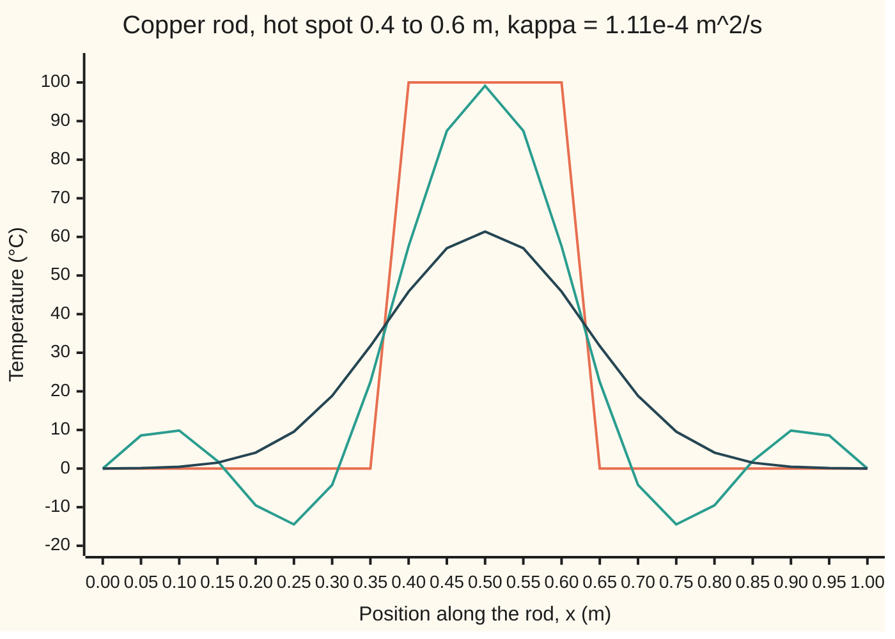
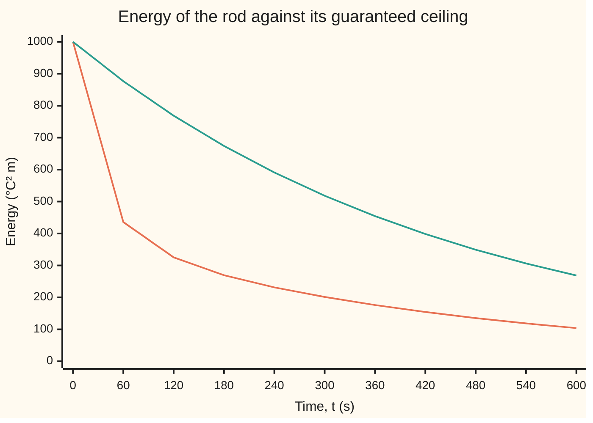

# Bochner spaces and the weak heat equation: a solution as a path through a space of functions

[Syllabus](../../../SYLLABUS.md) → [Partial differential equations](../README.md) → [Weak Solutions and Free Boundaries](../README.md#s06) → Bochner spaces and the weak heat equation

---

## General Overview

Wing 08's [Separation of variables](../../08-Differential%20equations%20and%20dynamics/10-The%20Classical%20PDEs/04-separation-of-variables-for-the-heat-equation.md) solved heat flow in a rod by a sine series and took the series to be the answer. This card proves that the answer exists, is unique and moves continuously, even when the start has jumps that no derivative can handle.

The rod is the shelf 03 copper rod. It is 1 m long, its ends are held at 0 °C, and its diffusivity is $`\kappa`$ = 1.11 × 10⁻⁴ m²/s (how fast heat spreads). At the start, the middle stretch from 0.4 m to 0.6 m is at 100 °C and the rest is at 0 °C.

The unknown is the temperature $`u(x, t)`$ in °C at position $`x`$ (m) and time $`t`$ (s). The region is the rod, $`0 < x < 1`$ m. The data are the start profile and 0 °C at both ends. The start jumps by 100 °C at 0.4 m and at 0.6 m, so it has no slope there, and the heat equation $`u_t = \kappa\,u_{xx}`$ cannot even be written at time 0.

The way out is to change what "a solution" is. Freeze time. The whole profile at that moment, $`u(t)`$, is one point in a space of functions of $`x`$. As time runs, the point moves, and the solution is that **path**.

A **Bochner space** holds such paths. $`L^2(0, T; X)`$ is the set of paths whose size in a space $`X`$ of profiles, squared and added up over time, is finite. The weak problem asks for $`u`$ in $`L^2(0, T; H^1_0)`$, where $`H^1_0`$ holds the profiles that are zero at the ends and have finite slope energy. Its time derivative may live in a larger space, $`H^{-1}`$: the linear readings of such profiles, which tolerate the steep slopes a jump leaves.

Sixty seconds on, the centre of the rod is at 61.3761 °C. Solved exactly in time, five sine modes give 60.7688 °C, and twenty agree with the exact value to within 10⁻¹² °C, since their first omitted term is 4.825 × 10⁻¹³ °C. The energy $`\tfrac12\lVert u\rVert^2`$ has fallen from 1000 to 435.7631 °C² m, under its guaranteed ceiling of 876.8 °C² m.

**Pose the heat equation for a path of profiles: ask for $`u`$ in $`L^2(0,T;H^1_0)`$ with $`u'`$ in $`L^2(0,T;H^{-1})`$; Galerkin approximations obey an energy bound that does not depend on the number of modes, a weak limit of them is a solution, and the same energy identity makes it unique and continuous in time.**

**What kind of fact this is:** a theorem, proved on this card in Why it works: existence, uniqueness and continuity in time of the weak solution, with the energy decay bound. The embedding of Step 3 (that such paths are continuous) is proved in outline in a fold, with its source. The heat equation is a model: it lets heat reach every point at once, which real conduction does not.

### The picture: the start, its five-mode copy, and the rod at 60 s



Orange: the start, 100 °C on 0.4 to 0.6 m (the jumps fall between plotted points). Green: the start as five sine modes see it, the Galerkin start for N = 5, wobbling down to −14.46 °C. Dark: the exact temperature at 60 s, 61.38 °C at the centre. The five-mode answer at 60 s sits within 0.61 °C of the dark line, because diffusion has already damped the modes it is missing.

---

## The formula

**The space-weak form.** Multiply $`u_t = \kappa u_{xx}`$ by a test profile $`v`$ that is zero at both ends, integrate over the rod, and move one $`x`$ derivative onto $`v`$, as on [Weak solutions](01-weak-solutions-and-the-weak-formulation.md):

```math
\frac{d}{dt}(u, v) + \kappa\,(u_x, v_x) = 0, \qquad (f, g) = \int_0^L f\,g\,dx, \qquad \lVert f\rVert = \sqrt{(f, f)} .
```

$`H^1_0`$ is the space of profiles with finite slope energy $`\lVert v_x\rVert^2`$ that are zero at both ends ([Sobolev spaces](02-sobolev-spaces-for-pdes.md)). $`H^{-1}`$ is its **dual**: the linear readings $`F`$ that assign a number $`\langle F, v\rangle`$ to every $`v`$ in $`H^1_0`$, with size $`\lVert F\rVert_{H^{-1}} = \sup \langle F, v\rangle / \lVert v_x\rVert`$.

**The weak heat problem.** Find a path $`u`$ with

```math
u \in L^2(0, T; H^1_0), \quad u' \in L^2(0, T; H^{-1}), \qquad \langle u'(t), v\rangle + \kappa\,(u_x(t), v_x) = 0 \ \text{ for every } v \in H^1_0 \text{ and almost every } t, \qquad u(0) = u_0 .
```

**Read it aloud:** find a path of profiles whose slope energy has a finite time integral, whose time derivative, a path of readings, also has a finite squared time integral, which balances diffusion against every test profile, and which starts at the start profile.

**The theorem.** There is exactly one such path. It is continuous into $`L^2`$, so $`u(0) = u_0`$ makes sense. It obeys the **energy identity** and, through the Poincaré inequality $`\lVert v\rVert \le (L/\pi)\lVert v_x\rVert`$, the **decay bound**:

```math
\tfrac12\lVert u(t)\rVert^2 + \kappa\int_0^t \lVert u_x(s)\rVert^2\,ds = \tfrac12\lVert u_0\rVert^2, \qquad E(t) = \tfrac12\lVert u(t)\rVert^2 \le E(0)\,e^{-2\pi^2\kappa t/L^2} .
```

**Read it aloud:** the energy left at time t plus the energy diffusion has burned so far equals the start energy; so the energy never exceeds its start times e to the minus two pi squared kappa t over L squared.

For the rod: $`E(0) = \tfrac12 \times 100^2 \times 0.2`$ = 1000 °C² m, and at 60 s the ceiling is 876.8 °C² m against a true 435.7631.

| Symbol | Plain meaning | In our example | Push it up and the answer… |
| --- | --- | --- | --- |
| $`u(x, t)`$, $`u(t)`$, $`\tilde u`$, $`w`$ | temperature, °C; the whole profile at time $`t`$, one point of the path; a second solution; the difference $`u - \tilde u`$ | 61.3761 °C at the centre at 60 s | — |
| $`x`$, $`t`$, $`L`$, $`T`$ | position, m; time, s; rod length (not the Stefan card's latent heat); time span | $`L`$ = 1 m, $`T`$ = 60 s | longer $`T`$: lower energy at the end |
| $`\kappa`$ | diffusivity | 1.11 × 10⁻⁴ m²/s | faster decay of every mode |
| $`u_0`$, $`E(t)`$ | start profile; energy $`\tfrac12\lVert u(t)\rVert^2`$ | 100 °C on 0.4 to 0.6 m; 1000 then 435.7631 °C² m | hotter spot: energy grows as its square |
| $`(f, g)`$, $`\lVert f\rVert`$ | the integral of $`f g`$ along the rod; its root, the rms over the 1 m rod | $`\lVert u(60) - u_0\rVert`$ = 25.2063 °C | — |
| $`H^1_0`$, $`H^{-1}`$, $`\langle F, v\rangle`$ | finite-energy profiles zero at the ends; linear readings of them; reading $`F`$ on $`v`$ | — | — |
| $`X`$, $`L^2(0,T;X)`$, $`L^\infty(0,T;X)`$, $`C([0,T];X)`$ | a space of profiles; paths with finite time integral of $`\lVert u(t)\rVert_X^2`$; paths of bounded size; continuous paths | $`\int_0^{60}\lVert u_x\rVert^2 dt`$ = 5.083 × 10⁶ °C² s/m | — |
| $`u'`$, $`\eta`$ | weak time derivative; a smooth test function of time alone | $`\int_0^{60}\lVert u'\rVert_{H^{-1}}^2 dt`$ = 0.062630 °C² m³/s | — |
| $`v`$, $`m`$, $`d_k`$, $`\varepsilon`$, $`\delta`$ | a test profile in $`H^1_0`$; in the proofs, the number of test modes, their coefficients in time, and averaging window widths | — | — |
| $`\varphi_k`$, $`\lambda_k`$, $`b_k`$ | sine mode $`\sin(k\pi x/L)`$; its eigenvalue $`(k\pi/L)^2`$; its start coefficient | $`\kappa\lambda_1`$ = 1.096 × 10⁻³ /s; $`b_1`$ = 39.3453 °C | higher $`k`$: faster decay |
| $`N`$, $`u_N`$, $`c_k(t)`$, $`E_N`$ | number of modes; Galerkin approximation; its coefficients; its energy | $`N`$ = 5, 20, 80 | more modes: smaller error |
| $`\Delta t`$ | Crank-Nicolson time step | 0.5 s | doubled: time error four times larger |

### When it holds

- **The ends are held at 0 °C.** That gives the Poincaré inequality. Insulate the ends and the mean, 20.0 °C, never decays.
- **Time runs forward, $`\kappa > 0`$.** Backward, the energy identity's sign flips and high modes grow without limit.
- **The time derivative is asked for in $`H^{-1}`$, not $`L^2`$.** Near $`t = 0`$ the jumps make $`\lVert u_{xx}\rVert^2`$ so large that its time integral is infinite, so the $`L^2`$ demand has no solution here.
- **The start is in $`L^2`$.** Finite slope energy is not needed at the start, only finite $`\lVert u_0\rVert`$.

Each failure is worked in What breaks, below.

---

## Why it works

### Step 0: freeze time, and treat the heat equation as one ODE

The heat equation says how the point $`u(t)`$ moves: $`u' = \kappa u_{xx}`$, an ordinary differential equation in a space with infinitely many directions.

Two things make that precise. Calculus for paths of profiles (Steps 1 to 3). And a reason approximate paths have a limit (Steps 4 to 6): multiply the equation by $`u`$, and the energy can only fall, by a bound that ignores the number of modes.

### Step 1: paths, and the Bochner integral

A **step path** takes finitely many profiles, each on a measurable set of times (a set that has a length). A path is **strongly measurable** when it is the limit of step paths at almost every time. Any continuous path is.

The **Bochner integral** of a step path is the sum of each profile times the length of its set of times. For other paths take limits. Bochner's theorem: a strongly measurable path is integrable exactly when $`\int_0^T \lVert u(t)\rVert_X\,dt`$ is finite. The result is itself a profile in $`X`$.

$`L^2(0, T; X)`$ collects the strongly measurable paths with finite $`\int_0^T \lVert u(t)\rVert_X^2\,dt`$, the square of its norm. When $`X`$ is a Hilbert space, so is $`L^2(0, T; X)`$.

On the rod, the integral is finite where the values are not. The rod's slope energy $`\lVert u_x(t)\rVert^2`$ is 1,545,869.9 °C²/m at 0.06 s and 488,847.0 at 0.6 s: it grows like 378,659.3 divided by $`\sqrt t`$ (in seconds), the two-jump limit. That is infinite at $`t = 0`$. Yet the energy identity gives

```math
\int_0^{60} \lVert u_x(t)\rVert^2\,dt = \frac{E(0) - E(60)}{\kappa} = 5.083 \times 10^{6}\ \text{°C}^2\ \text{s/m} .
```

So $`u`$ lies in $`L^2(0, 60; H^1_0)`$ even though $`u(0)`$ does not lie in $`H^1_0`$.

### Step 2: the weak time derivative, and why it lands in $`H^{-1}`$

A path $`u`$ in $`L^2(0,T;H^1_0)`$ has **weak time derivative** $`u'`$ when, for every smooth $`\eta(t)`$ that vanishes near $`0`$ and $`T`$,

```math
\int_0^T \eta'(t)\,u(t)\,dt = -\int_0^T \eta(t)\,u'(t)\,dt ,
```

both sides Bochner integrals: integration by parts in time, as [Weak derivatives](../../18-Functional%20analysis/04-Distributions%20and%20Sobolev%20Spaces/07-weak-derivatives-and-sobolev-spaces.md) did in space.

The equation says $`u' = \kappa u_{xx}`$. For a profile in $`H^1_0`$, $`u_{xx}`$ need not be a function, but $`\kappa u_{xx}`$ is always a reading: $`v \mapsto -\kappa (u_x, v_x)`$, of size at most $`\kappa \lVert u_x\rVert`$. So $`u'(t)`$ lies in $`H^{-1}`$ with $`\lVert u'(t)\rVert_{H^{-1}} \le \kappa\lVert u_x(t)\rVert`$, and squaring and integrating gives $`u'`$ in $`L^2(0,T;H^{-1})`$. For the rod the integral is 0.062630 °C² m³/s.

The spaces nest, $`H^1_0 \subset L^2 \subset H^{-1}`$: a profile $`u`$ is also the reading $`v \mapsto (u, v)`$.

### Step 3: such paths are continuous, and the energy has a derivative

**Theorem (Lions and Magenes).** If $`u`$ is in $`L^2(0,T;H^1_0)`$ and $`u'`$ is in $`L^2(0,T;H^{-1})`$, then, after a change on a set of times of length zero, $`u`$ is in $`C([0,T]; L^2)`$, and

```math
\frac{d}{dt}\,\tfrac12\lVert u(t)\rVert^2 = \langle u'(t), u(t)\rangle \quad \text{for almost every } t .
```

The path sits in the small space, its derivative in the big one, and they meet in the middle space $`L^2`$.

<details>
<summary>Detailed proof, in outline: smooth in time, then pass to the limit</summary>

Extend $`u`$ a little past $`0`$ and $`T`$ by reflection and average it over short time windows. The averaged paths $`u^\varepsilon`$ are smooth in time with values in $`H^1_0`$. They tend to $`u`$ in $`L^2(0,T;H^1_0)`$, and their derivatives tend to $`u'`$ in $`L^2(0,T;H^{-1})`$.

For smooth paths the product rule holds. Write $`w = u^\varepsilon - u^\delta`$:

$`\displaystyle \lVert w(t)\rVert^2 = \lVert w(s)\rVert^2 + 2\int_s^t \langle w'(r), w(r)\rangle\,dr \le \lVert w(s)\rVert^2 + \int_0^T \left(\lVert w'\rVert_{H^{-1}}^2 + \lVert w_x\rVert^2\right) dr .`$

Average over $`s`$ in $`[0, T]`$. The right side then tends to zero as $`\varepsilon, \delta \to 0`$, uniformly in $`t`$. So the $`u^\varepsilon`$ converge uniformly in time in $`L^2`$, and the limit is a continuous path that equals $`u`$ at almost every time. The product rule passes to the limit in its integrated form. Evans, section 5.9.2, gives the full argument.

</details>

The rod's path does creep back to its start. The rms gap $`\lVert u(t) - u_0\rVert`$ is 4.1301 °C at 0.06 s, 7.3446 at 0.6 s, 13.0612 at 6 s and 25.2063 at 60 s. Each tenfold step in time multiplies it by about $`10^{1/4}`$, so it tends to zero, slowly. A start with jumps is reached in $`L^2`$, never in slope energy.

### Step 4: Galerkin, the path through N modes

Choose the first $`N`$ sine modes $`\varphi_k`$. Look for $`u_N(t) = \sum_{k \le N} c_k(t)\,\varphi_k`$ and ask the weak form to hold only for $`v = \varphi_1, \dots, \varphi_N`$ ([Galerkin](04-galerkin-and-finite-elements.md) did the same in space alone). That gives $`N`$ linear ODEs:

```math
\sum_{j \le N} (\varphi_j, \varphi_k)\,c_j'(t) + \kappa \sum_{j \le N} (\varphi_j', \varphi_k')\,c_j(t) = 0, \qquad \sum_{j \le N} (\varphi_j, \varphi_k)\,c_j(0) = (u_0, \varphi_k) .
```

A linear ODE system with constant coefficients has one solution for all time. The checks build the mass entries $`(\varphi_j, \varphi_k)`$ and stiffness entries $`(\varphi_j', \varphi_k')`$ by Simpson's rule. They come out as $`\tfrac12`$ and $`\lambda_k/2`$ on the diagonal and below 10⁻¹² off it (stiffness in units of $`\lambda_{80}`$), because the sine modes are orthogonal. So the system splits into one decay per mode, $`c_k(t) = b_k e^{-\kappa\lambda_k t}`$, with

```math
b_k = \frac{2}{L}\int_{0.4}^{0.6} 100\,\sin(k\pi x)\,dx = \frac{400}{k\pi}\,\sin\frac{k\pi}{2}\,\sin\frac{k\pi}{10}\ \text{°C} .
```

Even modes vanish, because the spot is centred. The proof below does not use the splitting.

### Step 5: the energy estimate, the same for every N

Test the Galerkin equations with $`u_N`$ itself, which is allowed because it is a mix of the chosen modes. The two terms become

```math
\frac{d}{dt}\,\tfrac12\lVert u_N\rVert^2 + \kappa\,\lVert \partial_x u_N\rVert^2 = 0 \quad\Longrightarrow\quad \tfrac12\lVert u_N(t)\rVert^2 + \kappa\int_0^t \lVert \partial_x u_N\rVert^2 ds = \tfrac12\lVert u_N(0)\rVert^2 \le \tfrac12\lVert u_0\rVert^2 .
```

The last step holds because $`u_N(0)`$ is the projection of $`u_0`$, which never adds size. So for every $`N`$:

- $`u_N`$ stays below $`\sqrt{2 E(0)}`$ in $`L^2`$ at every time: bounded in $`L^\infty(0,T;L^2)`$.
- $`\kappa\int_0^T\lVert\partial_x u_N\rVert^2 dt \le`$ 1000 °C² m: bounded in $`L^2(0,T;H^1_0)`$.
- $`\lVert u_N'\rVert_{H^{-1}} \le \kappa\lVert \partial_x u_N\rVert`$, as in Step 2, because projecting onto sine modes never adds slope energy: bounded in $`L^2(0,T;H^{-1})`$.

The Poincaré inequality $`\lVert \partial_x u_N\rVert^2 \ge (\pi/L)^2 \lVert u_N\rVert^2`$ turns the first line into $`E_N' \le -2\pi^2\kappa E_N/L^2`$, so $`E_N(t) \le E(0)\,e^{-2\pi^2\kappa t/L^2}`$. The checks confirm the bound at every step: the largest ratio of energy to bound is 0.8371, 0.9302 and 0.9413 for N = 5, 20, 80.



Orange: the energy. Green: its ceiling. The energy falls fast while the high modes die, then at the ceiling's rate.

### Step 6: a weak limit is a solution

The bounds of Step 5 do not depend on $`N`$. In a Hilbert space a bounded sequence has a weakly convergent subsequence ([Weak convergence](../../18-Functional%20analysis/02-Hilbert%20Spaces/09-weak-convergence-and-banach-alaoglu.md)). So a subsequence of $`u_N`$ converges weakly in $`L^2(0,T;H^1_0)`$ to some $`u`$, and $`u_N'`$ converges weakly in $`L^2(0,T;H^{-1})`$ to $`u'`$.

$`L^\infty(0,T;L^2)`$ is not a Hilbert space, but it is the dual of $`L^1(0,T;L^2)`$. Banach–Alaoglu then gives **weak-star** convergence there: every time-integrated reading against an $`L^1(0,T;L^2)`$ path settles. The limit keeps the bound $`\lVert u(t)\rVert^2 \le 2E(0)`$ for almost every $`t`$.

<details>
<summary>Detailed proof: passing to the limit, and the start value</summary>

Fix $`m`$ and a test path $`v(t) = \sum_{k \le m} d_k(t)\,\varphi_k`$ with smooth $`d_k`$. For $`N \ge m`$, multiply the Galerkin equation by $`d_k`$, add over $`k \le m`$ and integrate in time:

$`\displaystyle \int_0^T \left(\langle u_N', v\rangle + \kappa\,(\partial_x u_N, v_x)\right) dt = 0 .`$

Each term is a fixed continuous linear reading of $`u_N`$ or $`u_N'`$, so weak convergence carries it to the limit with $`u`$ in place of $`u_N`$. Such $`v`$ are dense in $`L^2(0,T;H^1_0)`$, so the weak heat equation holds for almost every $`t`$ and every $`v`$ in $`H^1_0`$.

For the start, take $`d_k`$ with $`d_k(T) = 0`$ and integrate the time derivative by parts. For $`u_N`$ the boundary term holds $`u_N(0)`$, which tends to $`u_0`$ in $`L^2`$. For $`u`$, Step 3 makes $`u(0)`$ meaningful. Comparing the two boundary terms gives $`(u(0), v(0)) = (u_0, v(0))`$ for every such $`v(0)`$, so $`u(0) = u_0`$.

</details>

On the rod the limit can be watched: at the centre at 60 s the five-mode answer is off by 0.6075 °C, the twenty-mode answer by 0.000277 °C, all of it time-step error.

### Step 7: one solution, continuous in time

Let $`u`$ and $`\tilde u`$ be two weak solutions with the same start. Their difference $`w`$ solves the same weak equation and starts at zero. Step 3 lets the energy identity be used for $`w`$ with $`v = w(t)`$:

```math
\tfrac12\lVert w(t)\rVert^2 + \kappa\int_0^t \lVert w_x\rVert^2 ds = \tfrac12\lVert w(0)\rVert^2 = 0 .
```

Both terms are at least zero, so $`w(t) = 0`$: the weak solution is unique in this class. Continuity in time is Step 3, and the decay bound follows as in Step 5.

The checks build the rod's solution two different ways. The sine series and the heat kernel with images (the bell curves of [The heat kernel](../03-The%20Heat%20Equation%20in%20Depth/01-heat-kernel-and-fundamental-solution.md), reflected at both ends) agree to six decimals: 61.376136, 45.844483 and 18.844965 °C at 0.5, 0.4 and 0.3 m at 60 s, and 3.147718 °C at 0.05 m after 600 s, where the reflections matter.

---

## Worked numbers, by hand

The five-mode Galerkin temperature at the rod's centre at 60 s.

| Step | Arithmetic | Value |
| --- | --- | --- |
| start energy | $`\tfrac12 \times 100^2 \times 0.2`$ | 1000 °C² m |
| decay rate of mode 1 | $`\kappa\pi^2 = 1.11 \times 10^{-4} \times \pi^2`$ | 1.096 × 10⁻³ /s |
| coefficients | $`b_k = (400/k\pi)\sin(k\pi/2)\sin(k\pi/10)`$ for $`k`$ = 1, 3, 5 | 39.3453, −34.3357, 25.4648 °C |
| decay factors | $`e^{-\kappa\lambda_k \times 60}`$ for $`k`$ = 1, 3, 5 | 0.936382, 0.553450, 0.193343 |
| mode 1 at the centre | $`39.3453 \times 1 \times 0.936382`$ | 36.8422 °C |
| mode 3 | $`-34.3357 \times (-1) \times 0.553450`$ | 19.0031 °C |
| mode 5 | $`25.4648 \times 1 \times 0.193343`$ | 4.9234 °C |
| **five modes** | $`36.8422 + 19.0031 + 4.9234`$ | **60.7688 °C** |
| exact, series and kernel | 2000 modes; Simpson on the kernel | 61.3761 °C |
| energy ceiling at 60 s | $`1000 \times e^{-2 \times 1.096 \times 10^{-3} \times 60}`$ | 876.8 °C² m |
| energy at 60 s | $`\tfrac14\sum b_k^2 e^{-2\kappa\lambda_k \times 60}`$ | 435.7631 °C² m |

A minute after the torch, five modes put the centre at 60.7688 °C, 0.61 °C under the true 61.3761 °C, and the energy is half its ceiling.

| N | centre at 60 s, °C | rms error at 0 s, °C | rms error at 60 s, °C | first omitted term at 60 s, °C |
| ---: | ---: | ---: | ---: | ---: |
| 5 | 60.768613 | 17.6713 | 4.157 × 10⁻¹ | 5.875 × 10⁻¹ (mode 7) |
| 20 | 61.375859 | 10.0067 | 3.412 × 10⁻¹³ | 4.825 × 10⁻¹³ (mode 21) |
| 80 | 61.375859 | 5.0310 | printed 0.000: its square is below the smallest double | 2.457 × 10⁻¹⁸⁸ (mode 81) |

At the start the error halves only when $`N`$ grows fourfold, because the jumps are hard to fit. At 60 s diffusion has damped every mode above 20. The centre column uses Crank-Nicolson at $`\Delta t`$ = 0.5 s; its time error is 1.956 × 10⁻³, 4.880 × 10⁻⁴ and 1.220 × 10⁻⁴ °C rms at $`\Delta t`$ = 2, 1 and 0.5 s, observed order 2.003 then 2.000.

### What breaks if you drop a piece

| Mistake | Comes out at | What went wrong |
| --- | --- | --- |
| Asking for $`u'`$ in $`L^2(0,T;L^2)`$ | 6.3421, 20.7675, 87.3675 °C² m/s for N = 5, 20, 80, growing | near $`t = 0`$ the time integral of $`\lVert u_{xx}\rVert^2`$ is infinite; only $`H^{-1}`$ holds $`u'`$ |
| Asking for $`u`$ in $`C([0,T];H^1_0)`$ | $`\lVert u_x\rVert^2`$ = 1,545,869.9 °C²/m at 0.06 s, growing like $`1/\sqrt t`$ | the start has jumps, so its slope energy is infinite |
| Running time backward | 10⁻⁶ °C in mode 21 becomes 3.883 × 10⁶ °C in 60 s | the energy identity's sign flips; nothing caps high modes |
| Insulating the ends | 200.0000 °C² m at one hour, against a bound of 0.3753 | the mean costs no slope energy; Poincaré fails |

The checks print all four.

---

## Code, from first principles, and it actually runs

The script computes the rod four independent ways and checks them against each other:

1. The sine series with closed-form coefficients, 2000 modes, with its first omitted term.
2. The heat kernel with images at both ends, integrated over the hot spot by Simpson's rule.
3. Galerkin on $`N`$ sine modes: mass and stiffness entries and loads by Simpson's rule, a Gauss-Jordan solve, and Crank-Nicolson in time at three steps.
4. The energy: the discrete energy identity at every step, the decay bound at every step, and the $`1/\sqrt t`$ blow-up against the two-jump limit $`2 \times 100^2/\sqrt{8\pi\kappa}`$, and the rms gap of Step 3 against two error-function steps that have not yet met, $`\sqrt{100^2\sqrt{4\kappa t}\,(2 - \sqrt2)/\sqrt\pi}`$ °C.

Crank-Nicolson averages the explicit and the implicit step ([Crank-Nicolson and the theta family](../../16-Numerical%20analysis/07-PDE%20Solvers/04-crank-nicolson-and-theta-methods.md)); its discrete energy obeys the energy identity exactly.

### Python

```python
# Bochner spaces and the weak heat equation -- the check behind the card.
# Standard library only.  A copper rod 1 m long, ends held at 0 C, diffusivity
# 1.11e-4 m^2/s, starting at 100 C on 0.4 < x < 0.6 m and 0 C elsewhere.
# Roads: (1) the sine series with closed-form coefficients; (2) the heat kernel
# with images, integrated by Simpson's rule; (3) Galerkin on N sine modes, its
# matrices and loads by Simpson, solved by Gauss-Jordan, stepped by
# Crank-Nicolson; (4) the energy identity and the decay bound.
import math
PI, KAP, T, HOT, A, B = math.pi, 1.11e-4, 60.0, 100.0, 0.4, 0.6
E0 = 0.5 * HOT ** 2 * (B - A)                      # start energy, C^2 m

def sci(v):                                        # same digits in Rust
    if v == 0.0: return "0.000e+00"
    e = math.floor(math.log10(abs(v))); m = v / 10.0 ** e
    if abs(m) >= 9.9995: m /= 10.0; e += 1
    return f"{m:.3f}e{'+' if e >= 0 else '-'}{abs(e):02d}"
def lam(n): return (n * PI) ** 2                   # eigenvalue of -d2/dx2, 1/m^2
def bn(n): return 2 * HOT / (n * PI) * (math.cos(n * PI * A) - math.cos(n * PI * B))
def series(x, t, nmax=2000):
    return sum(bn(n) * math.sin(n * PI * x) * math.exp(-KAP * lam(n) * t) for n in range(1, nmax + 1))
def energy(t, nmax=2000): return sum(bn(n) ** 2 * math.exp(-2 * KAP * lam(n) * t) for n in range(1, nmax + 1)) / 4
def bound(t): return E0 * math.exp(-2 * PI ** 2 * KAP * t)
def weights(a, b, m): return [(b - a) / m / 3 * (1 if i in (0, m) else 4 if i % 2 else 2) for i in range(m + 1)]
def kernel(x, t, m=400):                           # heat kernel with images at 0 and 1 m
    s, w = 4 * KAP * t, weights(A, B, m); tot = 0.0
    for i in range(m + 1):
        y = A + (B - A) * i / m
        tot += w[i] * sum(math.exp(-(x - y - 2 * k) ** 2 / s) - math.exp(-(x + y - 2 * k) ** 2 / s) for k in (-1, 0, 1))
    return HOT * tot / math.sqrt(PI * s)
def solve(Am, Bm):                                 # Gauss-Jordan, partial pivoting: Am X = Bm
    n = len(Am); M = [Am[i][:] + Bm[i][:] for i in range(n)]
    for c in range(n):
        p = c
        for r in range(c + 1, n):
            if abs(M[r][c]) > abs(M[p][c]): p = r
        M[c], M[p] = M[p], M[c]; piv = M[c][c]; M[c] = [v / piv for v in M[c]]
        for r in range(n):
            if r != c and M[r][c] != 0.0:
                f = M[r][c]; M[r] = [a - f * b for a, b in zip(M[r], M[c])]
    return [row[n:] for row in M]

print(f"rod 1 m, kappa {sci(KAP)} m^2/s, 100 C on 0.4..0.6 m, t = {T:.0f} s; kappa pi^2 = {sci(KAP * PI ** 2)} /s")
print(f"spread 2 sqrt(kappa t) = {2 * math.sqrt(KAP * T):.4f} m; start energy 0.5||u0||^2 = {E0:.4f} C^2 m")
# ---- roads 1 and 2: the series and the kernel agree ----
for x, t in ((0.5, T), (0.4, T), (0.3, T), (0.05, 600.0)):  # the last needs the images
    s, k = series(x, t), kernel(x, t)
    print(f"u({x}, {t:.0f} s): series {s:.6f} C, kernel with images {k:.6f} C")
    assert abs(s - k) < 1e-6
print(f"series: 2000 modes, first omitted term {sci(abs(bn(2001)) * math.exp(-KAP * lam(2001) * T))} C")
# ---- road 3: Galerkin, assembled by Simpson on 2000 intervals ----
NM, xs, w = 80, [i / 2000 for i in range(2001)], weights(0.0, 1.0, 2000)
S = [[math.sin(k * PI * x) for x in xs] for k in range(1, NM + 1)]
C = [[k * PI * math.cos(k * PI * x) for x in xs] for k in range(1, NM + 1)]
WS = [[a * b for a, b in zip(w, r)] for r in S]; WC = [[a * b for a, b in zip(w, r)] for r in C]
MM = [[sum(a * b for a, b in zip(WS[j], S[k])) for k in range(NM)] for j in range(NM)]
KK = [[sum(a * b for a, b in zip(WC[j], C[k])) for k in range(NM)] for j in range(NM)]
wl = weights(A, B, 800)
F = [HOT * sum(wl[i] * math.sin(k * PI * (A + 0.2 * i / 800)) for i in range(801)) for k in range(1, NM + 1)]
off = max(abs(MM[j][k]) + abs(KK[j][k]) / lam(80) for j in range(NM) for k in range(NM) if j != k)
assert off < 1e-12 and all(abs(MM[k][k] - 0.5) < 1e-12 and abs(KK[k][k] / lam(k + 1) - 0.5) < 1e-12 for k in range(NM))
print("mass matrix 1/2 I, stiffness diag(lambda_k/2): off-diagonal below 1e-12 (stiffness over lambda_80), as orthogonality says")

def galerkin(N, dt):
    Mn, Kn = [r[:N] for r in MM[:N]], [r[:N] for r in KK[:N]]
    c = [r[0] for r in solve(Mn, [[f] for f in F[:N]])]
    h = KAP * dt / 2
    St = solve([[Mn[i][j] + h * Kn[i][j] for j in range(N)] for i in range(N)],
               [[Mn[i][j] - h * Kn[i][j] for j in range(N)] for i in range(N)])
    en = lambda v, G: 0.5 * sum(v[i] * G[i][j] * v[j] for i in range(N) for j in range(N))
    e_start, diss, worst, c0 = en(c, Mn), 0.0, 0.0, c[:]
    for n in range(round(T / dt)):
        cn = [sum(St[i][j] * c[j] for j in range(N)) for i in range(N)]
        diss += KAP * dt * 2 * en([(a + b) / 2 for a, b in zip(c, cn)], Kn); c = cn
        worst = max(worst, en(c, Mn) / bound((n + 1) * dt))
    return c0, c, e_start, en(c, Mn), diss, worst
def at(c, x): return sum(ck * math.sin((k + 1) * PI * x) for k, ck in enumerate(c))
def rms_gap(c, t): return math.sqrt(0.5 * sum((ck - bn(k + 1) * math.exp(-KAP * lam(k + 1) * t)) ** 2 for k, ck in enumerate(c)))

print("Galerkin, Crank-Nicolson dt = 0.5 s")
print(" N | u_N(0.5,60) C | gap to series C | rms err t=0 C | rms err t=60 C | 1st omitted C | E_N(60) C^2 m | kappa int|du/dx|^2 | max E/bound")
runs = {}
for N in (5, 20, 80):
    c0, c, es, et, diss, worst = runs[N] = galerkin(N, 0.5)
    assert max(abs(a - bn(k + 1)) for k, a in enumerate(c0)) < 1e-6        # quadrature against closed form
    assert abs(es - et - diss) < 1e-9 * E0 and worst <= 1.0                  # energy identity, decay bound
    r0 = math.sqrt(2 * (E0 - sum(bn(n) ** 2 for n in range(1, N + 1)) / 4))
    r60 = math.sqrt(0.5 * sum(bn(n) ** 2 * math.exp(-2 * KAP * lam(n) * T) for n in range(N + 1, 2001)))
    om = abs(bn(N + 1 + N % 2)) * math.exp(-KAP * lam(N + 1 + N % 2) * T)
    g = at(c, 0.5) - series(0.5, T)
    print(f"{N:2d} | {at(c, 0.5):13.6f} | {g:15.6f} | {r0:13.4f} | {sci(r60):>14} | {sci(om):>13} | {et:13.4f} | {diss:18.4f} | {worst:.4f}")
fac = [math.exp(-KAP * lam(k) * T) for k in (1, 3, 5)]
h5 = [bn(k) * math.sin(k * PI / 2) * f for k, f in zip((1, 3, 5), fac)]
print(f"by hand, N = 5 at the centre: b_1, b_3, b_5 = {bn(1):.4f}, {bn(3):.4f}, {bn(5):.4f} C; decay {fac[0]:.6f}, {fac[1]:.6f}, {fac[2]:.6f}")
print(f"  terms {h5[0]:.4f} + ({h5[1]:.4f}) + {h5[2]:.4f} = {h5[0] + h5[1] + h5[2]:.4f} C, the 5-mode series exactly")
assert abs(runs[80][3] - energy(T)) < 2e-3 and abs(at(runs[80][1], 0.4) - series(0.4, T)) < 2e-4  # CN error, dt 0.5 s
errs = [rms_gap(galerkin(80, dt)[1], T) for dt in (2.0, 1.0, 0.5)]
o1, o2 = math.log2(errs[0] / errs[1]), math.log2(errs[1] / errs[2])
print(f"Crank-Nicolson time error, N = 80, dt 2, 1, 0.5 s: {sci(errs[0])}, {sci(errs[1])}, {sci(errs[2])} C rms; orders {o1:.3f}, {o2:.3f}")
assert 1.9 < o1 < 2.1 and 1.9 < o2 < 2.1
# ---- the path: continuous in L^2, not in H^1_0 ----
LEAD, TAIL = 2 * HOT ** 2 / math.sqrt(8 * PI * KAP), 2 * E0 - sum(0.5 * bn(n) ** 2 for n in range(1, 100001))  # Parseval
print(f"t s | rms ||u(t)-u0|| C | two jumps alone C | ||du/dx||^2 C^2/m | times sqrt(t)  (two-jump limit {LEAD:.1f}; 100000 modes + Parseval tail {TAIL:.4f} C^2)")
prev = 0.0
for t in (0.06, 0.6, 6.0, 60.0):
    d2, g2 = TAIL, 0.0                             # modes above 100000 have died, each adding b_n^2 / 2 to the gap^2
    for n in range(1, 100001):
        b, q = bn(n), math.exp(-KAP * lam(n) * t)
        d2 += 0.5 * b * b * (1 - q) ** 2; g2 += 0.5 * b * b * lam(n) * q * q
    cf = math.sqrt(HOT ** 2 * math.sqrt(4 * KAP * t) * (2 - math.sqrt(2)) / math.sqrt(PI))  # two erf steps on a line
    print(f"{t:5.2f} | {math.sqrt(d2):17.4f} | {cf:17.4f} | {g2:17.1f} | {g2 * math.sqrt(t):.1f}")
    assert prev < math.sqrt(d2) < 30 and (t > 1 or abs(math.sqrt(d2) - cf) < 1e-6) and (t > 10 or abs(g2 * math.sqrt(t) / LEAD - 1) < 0.01); prev = math.sqrt(d2)
EL = energy(T)
print(f"exact E(60) = {EL:.4f} C^2 m; int_0^60 ||du/dx||^2 dt = (E0 - E(60))/kappa = {sci((E0 - EL) / KAP)} C^2 s/m; int ||u'||^2_(H^-1) = {(E0 - EL) * KAP:.6f} C^2 m^3/s")
# ---- what breaks ----
LS = [sum(bn(n) ** 2 * KAP * lam(n) * (1 - math.exp(-2 * KAP * lam(n) * T)) for n in range(1, N + 1)) / 4 for N in (5, 20, 80)]
print(f"u' in L^2(0,60; L^2) instead: int ||u_N'||^2 dt for N = 5, 20, 80 = {LS[0]:.4f}, {LS[1]:.4f}, {LS[2]:.4f} C^2 m/s, growing")
assert LS[2] > 4 * LS[1] and LS[1] > 3 * LS[0]
grow = 1e-6 * math.exp(KAP * lam(21) * T)
print(f"backward in time: 1e-6 C in mode 21 becomes {sci(grow)} C after 60 s")
mean = HOT * (B - A)                               # insulated ends keep the mean, C
ins = 0.5 * (mean ** 2 + 0.5 * sum((2 * HOT / (n * PI) * (math.sin(n * PI * B) - math.sin(n * PI * A))) ** 2 * math.exp(-2 * KAP * lam(n) * 3600) for n in range(1, 2001)))
print(f"insulated ends, cosine series: mean {mean:.1f} C never decays, energy {ins:.4f} C^2 m at 3600 s, bound {bound(3600):.4f}")
assert ins > 100 * bound(3600) and abs(ins - 0.5 * mean ** 2) < 1e-6
# ---- chart points ----
print("chart, x m:       " + " ".join(f"{i / 20:.2f}" for i in range(21)))
print("chart, start:     " + " ".join(f"{HOT if 8 <= i <= 12 else 0.0:.2f}" for i in range(21)))
print("chart, N=5, t=0:  " + " ".join(f"{at(runs[5][0], i / 20):.2f}" for i in range(21)))
print("chart, t=60 s:    " + " ".join(f"{series(i / 20, T):.2f}" for i in range(21)))
print("chart, t s:       " + " ".join(f"{60 * i}" for i in range(11)))
print("chart, energy:    " + " ".join(f"{E0 if i == 0 else energy(60 * i):.1f}" for i in range(11)))
print("chart, bound:     " + " ".join(f"{bound(60 * i):.1f}" for i in range(11)))
assert all(energy(60 * i) <= bound(60 * i) for i in range(1, 11))
print("ALL CHECKS PASS")
```

**Ran 2026-11-24 on macOS, Python 3.14.10, standard library only. All checks passed. Output, pasted from the run:**

```
rod 1 m, kappa 1.110e-04 m^2/s, 100 C on 0.4..0.6 m, t = 60 s; kappa pi^2 = 1.096e-03 /s
spread 2 sqrt(kappa t) = 0.1632 m; start energy 0.5||u0||^2 = 1000.0000 C^2 m
u(0.5, 60 s): series 61.376136 C, kernel with images 61.376136 C
u(0.4, 60 s): series 45.844483 C, kernel with images 45.844483 C
u(0.3, 60 s): series 18.844965 C, kernel with images 18.844965 C
u(0.05, 600 s): series 3.147718 C, kernel with images 3.147718 C
series: 2000 modes, first omitted term 0.000e+00 C
mass matrix 1/2 I, stiffness diag(lambda_k/2): off-diagonal below 1e-12 (stiffness over lambda_80), as orthogonality says
Galerkin, Crank-Nicolson dt = 0.5 s
 N | u_N(0.5,60) C | gap to series C | rms err t=0 C | rms err t=60 C | 1st omitted C | E_N(60) C^2 m | kappa int|du/dx|^2 | max E/bound
 5 |     60.768613 |       -0.607523 |       17.6713 |      4.157e-01 |     5.875e-01 |      435.6762 |           408.1861 | 0.8371
20 |     61.375859 |       -0.000277 |       10.0067 |      3.412e-13 |     4.825e-13 |      435.7625 |           514.1706 | 0.9302
80 |     61.375859 |       -0.000277 |        5.0310 |      0.000e+00 |    2.457e-188 |      435.7625 |           551.5822 | 0.9413
by hand, N = 5 at the centre: b_1, b_3, b_5 = 39.3453, -34.3357, 25.4648 C; decay 0.936382, 0.553450, 0.193343
  terms 36.8422 + (19.0031) + 4.9234 = 60.7688 C, the 5-mode series exactly
Crank-Nicolson time error, N = 80, dt 2, 1, 0.5 s: 1.956e-03, 4.880e-04, 1.220e-04 C rms; orders 2.003, 2.000
t s | rms ||u(t)-u0|| C | two jumps alone C | ||du/dx||^2 C^2/m | times sqrt(t)  (two-jump limit 378659.3; 100000 modes + Parseval tail 0.0203 C^2)
 0.06 |            4.1301 |            4.1301 |         1545869.9 | 378659.3
 0.60 |            7.3446 |            7.3446 |          488847.0 | 378659.3
 6.00 |           13.0612 |           13.0607 |          154502.1 | 378451.4
60.00 |           25.2063 |           23.2255 |           25810.8 | 199929.8
exact E(60) = 435.7631 C^2 m; int_0^60 ||du/dx||^2 dt = (E0 - E(60))/kappa = 5.083e+06 C^2 s/m; int ||u'||^2_(H^-1) = 0.062630 C^2 m^3/s
u' in L^2(0,60; L^2) instead: int ||u_N'||^2 dt for N = 5, 20, 80 = 6.3421, 20.7675, 87.3675 C^2 m/s, growing
backward in time: 1e-6 C in mode 21 becomes 3.883e+06 C after 60 s
insulated ends, cosine series: mean 20.0 C never decays, energy 200.0000 C^2 m at 3600 s, bound 0.3753
chart, x m:       0.00 0.05 0.10 0.15 0.20 0.25 0.30 0.35 0.40 0.45 0.50 0.55 0.60 0.65 0.70 0.75 0.80 0.85 0.90 0.95 1.00
chart, start:     0.00 0.00 0.00 0.00 0.00 0.00 0.00 0.00 100.00 100.00 100.00 100.00 100.00 0.00 0.00 0.00 0.00 0.00 0.00 0.00 0.00
chart, N=5, t=0:  0.00 8.57 9.84 1.96 -9.53 -14.46 -4.24 22.42 57.60 87.46 99.15 87.46 57.60 22.42 -4.24 -14.46 -9.53 1.96 9.84 8.57 0.00
chart, t=60 s:    0.00 0.12 0.47 1.51 4.13 9.56 18.84 31.73 45.84 57.07 61.38 57.07 45.84 31.73 18.84 9.56 4.13 1.51 0.47 0.12 0.00
chart, t s:       0 60 120 180 240 300 360 420 480 540 600
chart, energy:    1000.0 435.8 325.4 269.4 231.3 201.4 176.1 154.3 135.2 118.6 103.9
chart, bound:     1000.0 876.8 768.8 674.1 591.1 518.2 454.4 398.4 349.3 306.3 268.6
ALL CHECKS PASS
```

### Rust

```rust
// Bochner spaces and the weak heat equation -- the check behind the card.
// Standard library only.  A copper rod 1 m long, ends held at 0 C, diffusivity
// 1.11e-4 m^2/s, starting at 100 C on 0.4 < x < 0.6 m and 0 C elsewhere.
// Roads: (1) the sine series with closed-form coefficients; (2) the heat kernel
// with images, integrated by Simpson's rule; (3) Galerkin on N sine modes, its
// matrices and loads by Simpson, solved by Gauss-Jordan, stepped by
// Crank-Nicolson; (4) the energy identity and the decay bound.
use std::f64::consts::PI;
const KAP: f64 = 1.11e-4; const T: f64 = 60.0; const HOT: f64 = 100.0; const A: f64 = 0.4; const B: f64 = 0.6;
const E0: f64 = 0.5 * HOT * HOT * (B - A); // start energy, C^2 m
type Mat = Vec<Vec<f64>>;

fn nsum<I: Iterator<Item = f64>>(it: I) -> f64 { // compensated, the same rule as Python's sum() of floats
    let (mut s, mut c) = (0.0f64, 0.0f64);
    for x in it { let t = s + x; if s.abs() >= x.abs() { c += (s - t) + x } else { c += (x - t) + s } s = t; }
    if c != 0.0 && c.is_finite() { s + c } else { s }
}
fn sci(v: f64) -> String {
    if v == 0.0 { return "0.000e+00".to_string(); }
    let mut e = v.abs().log10().floor() as i32;
    let mut m = v / 10f64.powf(e as f64);
    if m.abs() >= 9.9995 { m /= 10.0; e += 1; }
    format!("{:.3}e{}{:02}", m, if e >= 0 { '+' } else { '-' }, e.abs())
}
fn lam(n: usize) -> f64 { (n as f64 * PI).powi(2) }
fn bn(n: usize) -> f64 { let np = n as f64 * PI; 2.0 * HOT / np * ((np * A).cos() - (np * B).cos()) }
fn series(x: f64, t: f64) -> f64 { nsum((1..=2000).map(|n| bn(n) * (n as f64 * PI * x).sin() * (-KAP * lam(n) * t).exp())) }
fn energy(t: f64) -> f64 { nsum((1..=2000).map(|n| bn(n).powi(2) * (-2.0 * KAP * lam(n) * t).exp())) / 4.0 }
fn bound(t: f64) -> f64 { E0 * (-2.0 * PI.powi(2) * KAP * t).exp() }
fn weights(a: f64, b: f64, m: usize) -> Vec<f64> {
    (0..=m).map(|i| (b - a) / m as f64 / 3.0 * if i == 0 || i == m { 1.0 } else if i % 2 == 1 { 4.0 } else { 2.0 }).collect()
}
fn kernel(x: f64, t: f64) -> f64 { // heat kernel with images at 0 and 1 m
    let (m, s) = (400usize, 4.0 * KAP * t);
    let (w, mut tot) = (weights(A, B, m), 0.0);
    for i in 0..=m {
        let y = A + (B - A) * i as f64 / m as f64;
        tot += w[i] * nsum([-1.0f64, 0.0, 1.0].iter().map(|&k| (-(x - y - 2.0 * k).powi(2) / s).exp() - (-(x + y - 2.0 * k).powi(2) / s).exp()));
    }
    HOT * tot / (PI * s).sqrt()
}
fn solve(am: &Mat, bm: &Mat) -> Mat { // Gauss-Jordan, partial pivoting: am X = bm
    let n = am.len();
    let mut m: Mat = (0..n).map(|i| { let mut r = am[i].clone(); r.extend_from_slice(&bm[i]); r }).collect();
    for c in 0..n {
        let mut p = c;
        for r in c + 1..n { if m[r][c].abs() > m[p][c].abs() { p = r; } }
        m.swap(c, p); let piv = m[c][c];
        m[c] = m[c].iter().map(|v| v / piv).collect();
        for r in 0..n {
            if r != c && m[r][c] != 0.0 {
                let (f, rc) = (m[r][c], m[c].clone());
                m[r] = m[r].iter().zip(rc.iter()).map(|(a, b)| a - f * b).collect();
            }
        }
    }
    m.iter().map(|r| r[n..].to_vec()).collect()
}
fn en(v: &[f64], g: &Mat) -> f64 {
    let n = v.len();
    0.5 * nsum((0..n).flat_map(|i| (0..n).map(move |j| (i, j))).map(|(i, j)| v[i] * g[i][j] * v[j]))
}
fn galerkin(mm: &Mat, kk: &Mat, f: &[f64], n: usize, dt: f64) -> (Vec<f64>, Vec<f64>, f64, f64, f64, f64) {
    let mn: Mat = mm[..n].iter().map(|r| r[..n].to_vec()).collect();
    let kn: Mat = kk[..n].iter().map(|r| r[..n].to_vec()).collect();
    let mut c: Vec<f64> = solve(&mn, &f[..n].iter().map(|&x| vec![x]).collect()).iter().map(|r| r[0]).collect();
    let h = KAP * dt / 2.0;
    let st = solve(&(0..n).map(|i| (0..n).map(|j| mn[i][j] + h * kn[i][j]).collect()).collect(),
                   &(0..n).map(|i| (0..n).map(|j| mn[i][j] - h * kn[i][j]).collect()).collect());
    let (e_start, mut diss, mut worst, c0) = (en(&c, &mn), 0.0f64, 0.0f64, c.clone());
    for step in 0..(T / dt).round() as usize {
        let cn: Vec<f64> = (0..n).map(|i| nsum((0..n).map(|j| st[i][j] * c[j]))).collect();
        let mid: Vec<f64> = c.iter().zip(cn.iter()).map(|(a, b)| (a + b) / 2.0).collect();
        diss += KAP * dt * 2.0 * en(&mid, &kn); c = cn;
        worst = worst.max(en(&c, &mn) / bound((step + 1) as f64 * dt));
    }
    let et = en(&c, &mn); (c0, c, e_start, et, diss, worst)
}
fn at(c: &[f64], x: f64) -> f64 { nsum(c.iter().enumerate().map(|(k, ck)| ck * (((k + 1) as f64) * PI * x).sin())) }
fn rms_gap(c: &[f64], t: f64) -> f64 { (0.5 * nsum(c.iter().enumerate().map(|(k, ck)| (ck - bn(k + 1) * (-KAP * lam(k + 1) * t).exp()).powi(2)))).sqrt() }
fn row(label: &str, v: &[String]) { println!("{}{}", label, v.join(" ")); }

fn main() {
    println!("rod 1 m, kappa {} m^2/s, 100 C on 0.4..0.6 m, t = {:.0} s; kappa pi^2 = {} /s", sci(KAP), T, sci(KAP * PI.powi(2)));
    println!("spread 2 sqrt(kappa t) = {:.4} m; start energy 0.5||u0||^2 = {:.4} C^2 m", 2.0 * (KAP * T).sqrt(), E0);
    // ---- roads 1 and 2: the series and the kernel agree ----
    for (x, t) in [(0.5, T), (0.4, T), (0.3, T), (0.05, 600.0)] { // the last needs the images
        let (s, k) = (series(x, t), kernel(x, t));
        println!("u({}, {:.0} s): series {:.6} C, kernel with images {:.6} C", x, t, s, k);
        assert!((s - k).abs() < 1e-6);
    }
    println!("series: 2000 modes, first omitted term {} C", sci(bn(2001).abs() * (-KAP * lam(2001) * T).exp()));
    // ---- road 3: Galerkin, assembled by Simpson on 2000 intervals ----
    let (nm, w) = (80usize, weights(0.0, 1.0, 2000));
    let xs: Vec<f64> = (0..=2000).map(|i| i as f64 / 2000.0).collect();
    let s: Mat = (1..=nm).map(|k| xs.iter().map(|&x| (k as f64 * PI * x).sin()).collect()).collect();
    let cc: Mat = (1..=nm).map(|k| xs.iter().map(|&x| k as f64 * PI * (k as f64 * PI * x).cos()).collect()).collect();
    let ws: Mat = s.iter().map(|r| w.iter().zip(r).map(|(a, b)| a * b).collect()).collect();
    let wc: Mat = cc.iter().map(|r| w.iter().zip(r).map(|(a, b)| a * b).collect()).collect();
    let mm: Mat = (0..nm).map(|j| (0..nm).map(|k| nsum(ws[j].iter().zip(&s[k]).map(|(a, b)| a * b))).collect()).collect();
    let kk: Mat = (0..nm).map(|j| (0..nm).map(|k| nsum(wc[j].iter().zip(&cc[k]).map(|(a, b)| a * b))).collect()).collect();
    let wl = weights(A, B, 800);
    let f: Vec<f64> = (1..=nm).map(|k| HOT * nsum((0..=800).map(|i| wl[i] * (k as f64 * PI * (A + 0.2 * i as f64 / 800.0)).sin()))).collect();
    let mut off = 0.0f64;
    for j in 0..nm { for k in 0..nm { if j != k { off = off.max(mm[j][k].abs() + kk[j][k].abs() / lam(80)); } } }
    assert!(off < 1e-12 && (0..nm).all(|k| (mm[k][k] - 0.5).abs() < 1e-12 && (kk[k][k] / lam(k + 1) - 0.5).abs() < 1e-12));
    println!("mass matrix 1/2 I, stiffness diag(lambda_k/2): off-diagonal below 1e-12 (stiffness over lambda_80), as orthogonality says");

    println!("Galerkin, Crank-Nicolson dt = 0.5 s");
    println!(" N | u_N(0.5,60) C | gap to series C | rms err t=0 C | rms err t=60 C | 1st omitted C | E_N(60) C^2 m | kappa int|du/dx|^2 | max E/bound");
    let mut runs = Vec::new();
    for n in [5usize, 20, 80] {
        let r = galerkin(&mm, &kk, &f, n, 0.5);
        let (c0, c, es, et, diss, worst) = (&r.0, &r.1, r.2, r.3, r.4, r.5);
        assert!(c0.iter().enumerate().map(|(k, a)| (a - bn(k + 1)).abs()).fold(0.0, f64::max) < 1e-6); // quadrature against closed form
        assert!((es - et - diss).abs() < 1e-9 * E0 && worst <= 1.0); // energy identity, decay bound
        let r0 = (2.0 * (E0 - nsum((1..=n).map(|m| bn(m).powi(2))) / 4.0)).sqrt();
        let r60 = (0.5 * nsum((n + 1..=2000).map(|m| bn(m).powi(2) * (-2.0 * KAP * lam(m) * T).exp()))).sqrt();
        let (mo, g) = (n + 1 + n % 2, at(c, 0.5) - series(0.5, T));
        let om = bn(mo).abs() * (-KAP * lam(mo) * T).exp();
        println!("{:2} | {:13.6} | {:15.6} | {:13.4} | {:>14} | {:>13} | {:13.4} | {:18.4} | {:.4}", n, at(c, 0.5), g, r0, sci(r60), sci(om), et, diss, worst);
        runs.push(r);
    }
    let fac: Vec<f64> = [1usize, 3, 5].iter().map(|&k| (-KAP * lam(k) * T).exp()).collect();
    let h5: Vec<f64> = [1usize, 3, 5].iter().zip(&fac).map(|(&k, f)| bn(k) * (k as f64 * PI / 2.0).sin() * f).collect();
    println!("by hand, N = 5 at the centre: b_1, b_3, b_5 = {:.4}, {:.4}, {:.4} C; decay {:.6}, {:.6}, {:.6}", bn(1), bn(3), bn(5), fac[0], fac[1], fac[2]);
    println!("  terms {:.4} + ({:.4}) + {:.4} = {:.4} C, the 5-mode series exactly", h5[0], h5[1], h5[2], h5[0] + h5[1] + h5[2]);
    assert!((runs[2].3 - energy(T)).abs() < 2e-3 && (at(&runs[2].1, 0.4) - series(0.4, T)).abs() < 2e-4); // CN error, dt 0.5 s
    let errs: Vec<f64> = [2.0, 1.0, 0.5].iter().map(|&dt| rms_gap(&galerkin(&mm, &kk, &f, 80, dt).1, T)).collect();
    let (o1, o2) = ((errs[0] / errs[1]).log2(), (errs[1] / errs[2]).log2());
    println!("Crank-Nicolson time error, N = 80, dt 2, 1, 0.5 s: {}, {}, {} C rms; orders {:.3}, {:.3}", sci(errs[0]), sci(errs[1]), sci(errs[2]), o1, o2);
    assert!(1.9 < o1 && o1 < 2.1 && 1.9 < o2 && o2 < 2.1);
    // ---- the path: continuous in L^2, not in H^1_0 ----
    let (lead, tail) = (2.0 * HOT.powi(2) / (8.0 * PI * KAP).sqrt(), 2.0 * E0 - nsum((1..=100000).map(|n| 0.5 * bn(n).powi(2)))); // Parseval
    println!("t s | rms ||u(t)-u0|| C | two jumps alone C | ||du/dx||^2 C^2/m | times sqrt(t)  (two-jump limit {:.1}; 100000 modes + Parseval tail {:.4} C^2)", lead, tail);
    let mut prev = 0.0;
    for t in [0.06, 0.6, 6.0, 60.0] {
        let (mut d2, mut g2) = (tail, 0.0f64); // modes above 100000 have died, each adding b_n^2 / 2 to the gap^2
        for n in 1..=100000usize {
            let (b, q) = (bn(n), (-KAP * lam(n) * t).exp());
            d2 += 0.5 * b * b * (1.0 - q).powi(2); g2 += 0.5 * b * b * lam(n) * q * q;
        }
        let cf = (HOT.powi(2) * (4.0 * KAP * t).sqrt() * (2.0 - 2f64.sqrt()) / PI.sqrt()).sqrt(); // two erf steps on a line
        println!("{:5.2} | {:17.4} | {:17.4} | {:17.1} | {:.1}", t, d2.sqrt(), cf, g2, g2 * t.sqrt());
        assert!(prev < d2.sqrt() && d2.sqrt() < 30.0 && (t > 1.0 || (d2.sqrt() - cf).abs() < 1e-6) && (t > 10.0 || (g2 * t.sqrt() / lead - 1.0).abs() < 0.01));
        prev = d2.sqrt();
    }
    let el = energy(T);
    println!("exact E(60) = {:.4} C^2 m; int_0^60 ||du/dx||^2 dt = (E0 - E(60))/kappa = {} C^2 s/m; int ||u'||^2_(H^-1) = {:.6} C^2 m^3/s", el, sci((E0 - el) / KAP), (E0 - el) * KAP);
    // ---- what breaks ----
    let ls: Vec<f64> = [5usize, 20, 80].iter().map(|&n| nsum((1..=n).map(|m| bn(m).powi(2) * KAP * lam(m) * (1.0 - (-2.0 * KAP * lam(m) * T).exp()))) / 4.0).collect();
    println!("u' in L^2(0,60; L^2) instead: int ||u_N'||^2 dt for N = 5, 20, 80 = {:.4}, {:.4}, {:.4} C^2 m/s, growing", ls[0], ls[1], ls[2]);
    assert!(ls[2] > 4.0 * ls[1] && ls[1] > 3.0 * ls[0]);
    let grow = 1e-6 * (KAP * lam(21) * T).exp();
    println!("backward in time: 1e-6 C in mode 21 becomes {} C after 60 s", sci(grow));
    let mean = HOT * (B - A); // insulated ends keep the mean, C
    let ins = 0.5 * (mean.powi(2) + 0.5 * nsum((1..=2000).map(|n| (2.0 * HOT / (n as f64 * PI) * ((n as f64 * PI * B).sin() - (n as f64 * PI * A).sin())).powi(2) * (-2.0 * KAP * lam(n) * 3600.0).exp())));
    println!("insulated ends, cosine series: mean {:.1} C never decays, energy {:.4} C^2 m at 3600 s, bound {:.4}", mean, ins, bound(3600.0));
    assert!(ins > 100.0 * bound(3600.0) && (ins - 0.5 * mean.powi(2)).abs() < 1e-6);
    // ---- chart points ----
    row("chart, x m:       ", &(0..21).map(|i| format!("{:.2}", i as f64 / 20.0)).collect::<Vec<_>>());
    row("chart, start:     ", &(0..21).map(|i| format!("{:.2}", if (8..=12).contains(&i) { HOT } else { 0.0 })).collect::<Vec<_>>());
    row("chart, N=5, t=0:  ", &(0..21).map(|i| format!("{:.2}", at(&runs[0].0, i as f64 / 20.0))).collect::<Vec<_>>());
    row("chart, t=60 s:    ", &(0..21).map(|i| format!("{:.2}", series(i as f64 / 20.0, T))).collect::<Vec<_>>());
    row("chart, t s:       ", &(0..11).map(|i| format!("{}", 60 * i)).collect::<Vec<_>>());
    row("chart, energy:    ", &(0..11).map(|i| format!("{:.1}", if i == 0 { E0 } else { energy(60.0 * i as f64) })).collect::<Vec<_>>());
    row("chart, bound:     ", &(0..11).map(|i| format!("{:.1}", bound(60.0 * i as f64))).collect::<Vec<_>>());
    assert!((1..11).all(|i| energy(60.0 * i as f64) <= bound(60.0 * i as f64)));
    println!("ALL CHECKS PASS");
}
```

**Ran 2026-11-24 on macOS, rustc 1.98.1, no crates. All checks passed. Output, pasted from the run:**

```
rod 1 m, kappa 1.110e-04 m^2/s, 100 C on 0.4..0.6 m, t = 60 s; kappa pi^2 = 1.096e-03 /s
spread 2 sqrt(kappa t) = 0.1632 m; start energy 0.5||u0||^2 = 1000.0000 C^2 m
u(0.5, 60 s): series 61.376136 C, kernel with images 61.376136 C
u(0.4, 60 s): series 45.844483 C, kernel with images 45.844483 C
u(0.3, 60 s): series 18.844965 C, kernel with images 18.844965 C
u(0.05, 600 s): series 3.147718 C, kernel with images 3.147718 C
series: 2000 modes, first omitted term 0.000e+00 C
mass matrix 1/2 I, stiffness diag(lambda_k/2): off-diagonal below 1e-12 (stiffness over lambda_80), as orthogonality says
Galerkin, Crank-Nicolson dt = 0.5 s
 N | u_N(0.5,60) C | gap to series C | rms err t=0 C | rms err t=60 C | 1st omitted C | E_N(60) C^2 m | kappa int|du/dx|^2 | max E/bound
 5 |     60.768613 |       -0.607523 |       17.6713 |      4.157e-01 |     5.875e-01 |      435.6762 |           408.1861 | 0.8371
20 |     61.375859 |       -0.000277 |       10.0067 |      3.412e-13 |     4.825e-13 |      435.7625 |           514.1706 | 0.9302
80 |     61.375859 |       -0.000277 |        5.0310 |      0.000e+00 |    2.457e-188 |      435.7625 |           551.5822 | 0.9413
by hand, N = 5 at the centre: b_1, b_3, b_5 = 39.3453, -34.3357, 25.4648 C; decay 0.936382, 0.553450, 0.193343
  terms 36.8422 + (19.0031) + 4.9234 = 60.7688 C, the 5-mode series exactly
Crank-Nicolson time error, N = 80, dt 2, 1, 0.5 s: 1.956e-03, 4.880e-04, 1.220e-04 C rms; orders 2.003, 2.000
t s | rms ||u(t)-u0|| C | two jumps alone C | ||du/dx||^2 C^2/m | times sqrt(t)  (two-jump limit 378659.3; 100000 modes + Parseval tail 0.0203 C^2)
 0.06 |            4.1301 |            4.1301 |         1545869.9 | 378659.3
 0.60 |            7.3446 |            7.3446 |          488847.0 | 378659.3
 6.00 |           13.0612 |           13.0607 |          154502.1 | 378451.4
60.00 |           25.2063 |           23.2255 |           25810.8 | 199929.8
exact E(60) = 435.7631 C^2 m; int_0^60 ||du/dx||^2 dt = (E0 - E(60))/kappa = 5.083e+06 C^2 s/m; int ||u'||^2_(H^-1) = 0.062630 C^2 m^3/s
u' in L^2(0,60; L^2) instead: int ||u_N'||^2 dt for N = 5, 20, 80 = 6.3421, 20.7675, 87.3675 C^2 m/s, growing
backward in time: 1e-6 C in mode 21 becomes 3.883e+06 C after 60 s
insulated ends, cosine series: mean 20.0 C never decays, energy 200.0000 C^2 m at 3600 s, bound 0.3753
chart, x m:       0.00 0.05 0.10 0.15 0.20 0.25 0.30 0.35 0.40 0.45 0.50 0.55 0.60 0.65 0.70 0.75 0.80 0.85 0.90 0.95 1.00
chart, start:     0.00 0.00 0.00 0.00 0.00 0.00 0.00 0.00 100.00 100.00 100.00 100.00 100.00 0.00 0.00 0.00 0.00 0.00 0.00 0.00 0.00
chart, N=5, t=0:  0.00 8.57 9.84 1.96 -9.53 -14.46 -4.24 22.42 57.60 87.46 99.15 87.46 57.60 22.42 -4.24 -14.46 -9.53 1.96 9.84 8.57 0.00
chart, t=60 s:    0.00 0.12 0.47 1.51 4.13 9.56 18.84 31.73 45.84 57.07 61.38 57.07 45.84 31.73 18.84 9.56 4.13 1.51 0.47 0.12 0.00
chart, t s:       0 60 120 180 240 300 360 420 480 540 600
chart, energy:    1000.0 435.8 325.4 269.4 231.3 201.4 176.1 154.3 135.2 118.6 103.9
chart, bound:     1000.0 876.8 768.8 674.1 591.1 518.2 454.4 398.4 349.3 306.3 268.6
ALL CHECKS PASS
```

### Lean

Lean proves Steps 5 and 7 for paths with an ordinary time derivative, and the rod's coefficients and start numbers.

- Suppose the ends are at 0 °C, $`\kappa > 0`$, $`t \ge 0`$, and $`u_N`$ starts at the projection of $`u_0`$. Then $`E_N(t) + \kappa\int_0^t \lVert \partial_x u_N\rVert^2 ds = E_N(0)`$.
- Take the same case. Then $`E_N(0) \le E(0)`$, because the projection never adds size.
- Take the same case. Then $`E_N(t) \le E(0) e^{-2\pi^2\kappa t/L^2}`$, for every number of modes $`N`$.
- Suppose $`\kappa > 0`$, two paths $`u`$ and $`\tilde u`$ solve the weak heat equation, and they share a start. Then $`u(t) = \tilde u(t)`$ at every $`t \ge 0`$.
- Take any mode $`k \ge 1`$ on the 1 m rod. Then $`b_k = (400/k\pi)\sin(k\pi/2)\sin(k\pi/10)`$ °C.
- The start energy is $`\tfrac12 \times 100^2 \times 0.2`$ = 1000 °C² m.
- With insulated ends, the mean is 100 °C × 0.2 m over 1 m, or 20 °C, and its energy is 200 °C² m.

Steps 3 and 6, and the rod's tables, are left to the proofs above and the Python and Rust checks.

```lean
-- Bochner spaces and the weak heat equation: every Galerkin path of the heat equation obeys the energy identity and the decay bound E(t) ≤ E(0) e^(−2π²κt/L²), weak heat paths with the same start are equal, and the hot spot's sine coefficients have the card's closed form.
import Mathlib.Analysis.InnerProductSpace.Projection.FiniteDimensional
import Mathlib.Analysis.InnerProductSpace.Calculus
import Mathlib.Analysis.SpecialFunctions.Trigonometric.Deriv
import Mathlib.Analysis.SpecialFunctions.Integrals.Basic
import Mathlib.LinearAlgebra.BilinearForm.Basic

open Real

/-- The energy estimate of Step 5, the same for every number of modes.
`E` is the space of profiles with the inner product `(f, g)`, `V` the finite-dimensional
Galerkin space of the chosen modes, and `a v w` the slope form `(v_x, w_x)`.
The ends are held at 0 °C, which gives the Poincaré inequality `(π/L)² ‖v‖² ≤ (v_x, v_x)`
on `V`; time runs forward with `κ > 0`; the start `u₀` only needs a finite norm.
If the Galerkin path `u_N` stays in `V`, has time derivative `u_N'`, obeys
`(u_N', v) + κ (∂ₓu_N, v_x) = 0` for every `v` in `V`, and starts at the projection of `u₀`,
then for every `t ≥ 0` the energy identity
`½‖u_N(t)‖² + κ ∫₀ᵗ ‖∂ₓu_N‖² ds = ½‖u_N(0)‖² ≤ ½‖u₀‖²` holds, and the energy obeys the
decay bound `½‖u_N(t)‖² ≤ ½‖u₀‖² e^(−2π²κt/L²)`. -/
theorem galerkin_energy_identity_and_decay_bound
    {E : Type*} [NormedAddCommGroup E] [InnerProductSpace ℝ E]
    (V : Submodule ℝ E) [FiniteDimensional ℝ V]
    (a : LinearMap.BilinForm ℝ E) (κ L : ℝ) (hκ : 0 < κ) (hL : 0 < L)
    (hpoincare : ∀ v ∈ V, (π / L) ^ 2 * ‖v‖ ^ 2 ≤ a v v)
    (u₀ : E) (u u' : ℝ → E)
    (hV : ∀ t, u t ∈ V)
    (hderiv : ∀ t, HasDerivAt u (u' t) t)
    (hgalerkin : ∀ t, ∀ v ∈ V, inner ℝ (u' t) v + κ * a (u t) v = 0)
    (hstart : u 0 = V.starProjection u₀) :
    ∀ t, 0 ≤ t →
      (1 / 2) * ‖u t‖ ^ 2 + κ * ∫ s in (0 : ℝ)..t, a (u s) (u s) = (1 / 2) * ‖u 0‖ ^ 2 ∧
      (1 / 2) * ‖u 0‖ ^ 2 ≤ (1 / 2) * ‖u₀‖ ^ 2 ∧
      (1 / 2) * ‖u t‖ ^ 2 ≤ (1 / 2) * ‖u₀‖ ^ 2 * Real.exp (-2 * π ^ 2 * κ * t / L ^ 2) := by
  have hnn : ∀ s, 0 ≤ a (u s) (u s) := fun s =>
    le_trans (by positivity) (hpoincare (u s) (hV s))
  have hN : ∀ t, HasDerivAt (fun s => ‖u s‖ ^ 2) (-(2 * κ) * a (u t) (u t)) t := by
    intro t
    have h1 := (hderiv t).norm_sq
    have h2 := hgalerkin t (u t) (hV t)
    have h3 := real_inner_comm (u t) (u' t)
    convert h1 using 1
    linarith
  have hu0 : ‖u 0‖ ^ 2 ≤ ‖u₀‖ ^ 2 := by
    rw [hstart]
    exact pow_le_pow_left₀ (norm_nonneg _) (V.norm_starProjection_apply_le u₀) 2
  intro t ht
  refine ⟨?_, by linarith, ?_⟩
  · have hg : ∀ s, HasDerivAt (fun s => -(1 / 2) * ‖u s‖ ^ 2) (κ * a (u s) (u s)) s := by
      intro s
      convert (hN s).const_mul (-(1 / 2) : ℝ) using 1
      ring
    have hint : IntervalIntegrable (fun s => κ * a (u s) (u s)) MeasureTheory.volume 0 t :=
      intervalIntegral.intervalIntegrable_deriv_of_nonneg
        (fun s _ => (hg s).continuousAt.continuousWithinAt)
        (fun s _ => hg s) (fun s _ => mul_nonneg hκ.le (hnn s))
    have hftc := intervalIntegral.integral_eq_sub_of_hasDerivAt (fun s _ => hg s) hint
    rw [intervalIntegral.integral_const_mul] at hftc
    linarith
  · set c : ℝ := (π / L) ^ 2 with hc
    have hh : ∀ s, HasDerivAt (fun s => Real.exp (2 * κ * c * s) * ‖u s‖ ^ 2)
        (2 * κ * Real.exp (2 * κ * c * s) * (c * ‖u s‖ ^ 2 - a (u s) (u s))) s := by
      intro s
      have he : HasDerivAt (fun s => Real.exp (2 * κ * c * s)) (Real.exp (2 * κ * c * s) * (2 * κ * c)) s := by
        have := ((hasDerivAt_id s).const_mul (2 * κ * c)).exp
        simpa using this
      convert he.mul (hN s) using 1
      ring
    have hanti : Antitone (fun s => Real.exp (2 * κ * c * s) * ‖u s‖ ^ 2) := by
      apply antitone_of_hasDerivAt_nonpos hh
      intro s
      have hp := hpoincare (u s) (hV s)
      have : c * ‖u s‖ ^ 2 - a (u s) (u s) ≤ 0 := by rw [hc]; linarith
      exact mul_nonpos_of_nonneg_of_nonpos (by positivity) this
    have hle := hanti ht
    simp only [mul_zero, Real.exp_zero, one_mul] at hle
    have hx : -2 * π ^ 2 * κ * t / L ^ 2 = -(2 * κ * c * t) := by
      rw [hc, div_pow]; field_simp
    rw [hx]
    have hE : ‖u t‖ ^ 2 = Real.exp (-(2 * κ * c * t)) * (Real.exp (2 * κ * c * t) * ‖u t‖ ^ 2) := by
      rw [← mul_assoc, ← Real.exp_add]; simp
    have hpos : 0 < Real.exp (-(2 * κ * c * t)) := Real.exp_pos _
    have : ‖u t‖ ^ 2 ≤ ‖u₀‖ ^ 2 * Real.exp (-(2 * κ * c * t)) := by
      rw [hE, mul_comm (‖u₀‖ ^ 2)]
      exact mul_le_mul_of_nonneg_left (hle.trans hu0) hpos.le
    linarith

/-- Uniqueness, Step 7: two paths `u` and `ũ` that solve the same weak heat equation
`(u', v) + κ (u_x, v_x) = 0` for every test profile `v` in `V`, with `κ > 0` and slope energy
`(v_x, v_x) ≥ 0`, and that have the same start, are equal at every later time. -/
theorem weak_heat_solution_unique
    {E : Type*} [NormedAddCommGroup E] [InnerProductSpace ℝ E]
    (V : Submodule ℝ E) (a : LinearMap.BilinForm ℝ E) (κ : ℝ) (hκ : 0 < κ)
    (hnonneg : ∀ v ∈ V, 0 ≤ a v v)
    (u u' w w' : ℝ → E)
    (huV : ∀ t, u t ∈ V) (hwV : ∀ t, w t ∈ V)
    (hu : ∀ t, HasDerivAt u (u' t) t) (hw : ∀ t, HasDerivAt w (w' t) t)
    (hequ : ∀ t, ∀ v ∈ V, inner ℝ (u' t) v + κ * a (u t) v = 0)
    (heqw : ∀ t, ∀ v ∈ V, inner ℝ (w' t) v + κ * a (w t) v = 0)
    (h0 : u 0 = w 0) :
    ∀ t, 0 ≤ t → u t = w t := by
  have hd : ∀ t, HasDerivAt (fun s => u s - w s) (u' t - w' t) t := fun t => (hu t).sub (hw t)
  have hdV : ∀ t, u t - w t ∈ V := fun t => V.sub_mem (huV t) (hwV t)
  have heq : ∀ t, ∀ v ∈ V, inner ℝ (u' t - w' t) v + κ * a (u t - w t) v = 0 := by
    intro t v hv
    rw [inner_sub_left, map_sub, LinearMap.sub_apply]
    have h1 := hequ t v hv
    have h2 := heqw t v hv
    linarith
  have hN : ∀ t, HasDerivAt (fun s => ‖u s - w s‖ ^ 2)
      (-(2 * κ) * a (u t - w t) (u t - w t)) t := by
    intro t
    have h1 := (hd t).norm_sq
    have h2 := heq t (u t - w t) (hdV t)
    have h3 := real_inner_comm (u t - w t) (u' t - w' t)
    convert h1 using 1
    linarith
  have hanti : Antitone (fun s => ‖u s - w s‖ ^ 2) := by
    apply antitone_of_hasDerivAt_nonpos hN
    intro s
    have := hnonneg _ (hdV s)
    show -(2 * κ) * a (u s - w s) (u s - w s) ≤ 0
    nlinarith
  intro t ht
  have hle := hanti ht
  simp only [h0, sub_self, norm_zero] at hle
  have : ‖u t - w t‖ = 0 := by
    have := sq_nonneg ‖u t - w t‖
    nlinarith [norm_nonneg (u t - w t)]
  exact sub_eq_zero.mp (norm_eq_zero.mp this)

/-- The hot spot's sine coefficients on the 1 m rod: for every mode `k ≥ 1`,
`b_k = (2/L) ∫_{0.4}^{0.6} 100 sin(kπx) dx = (400/(kπ)) sin(kπ/2) sin(kπ/10)` with `L = 1`. -/
theorem hot_spot_sine_coefficient (k : ℕ) (hk : 1 ≤ k) :
    (2 / 1 : ℝ) * ∫ x in (2 / 5 : ℝ)..(3 / 5), 100 * Real.sin (k * π * x)
      = 400 / (k * π) * Real.sin (k * π / 2) * Real.sin (k * π / 10) := by
  have hk0 : (k : ℝ) ≠ 0 := by
    have : (1 : ℝ) ≤ k := by exact_mod_cast hk
    linarith
  have hkπ : (k : ℝ) * π ≠ 0 := mul_ne_zero hk0 Real.pi_ne_zero
  rw [intervalIntegral.integral_const_mul, intervalIntegral.integral_comp_mul_left Real.sin hkπ,
    integral_sin, smul_eq_mul]
  have e1 : (k : ℝ) * π * (2 / 5) = k * π / 2 - k * π / 10 := by ring
  have e2 : (k : ℝ) * π * (3 / 5) = k * π / 2 + k * π / 10 := by ring
  rw [e1, e2, Real.cos_sub, Real.cos_add]
  field_simp
  ring

-- The start energy: ½ × 100² × 0.2 = 1000 °C² m.
example : (1 / 2 : ℚ) * 100 ^ 2 * (1 / 5) = 1000 := by norm_num

-- Insulated ends keep the mean: 100 °C × 0.2 m over a 1 m rod is 20 °C.
example : (100 : ℚ) * (1 / 5) / 1 = 20 := by norm_num

-- ... and its energy ½ × 20² × 1 = 200 °C² m never decays.
example : (1 / 2 : ℚ) * 20 ^ 2 * 1 = 200 := by norm_num

#print axioms galerkin_energy_identity_and_decay_bound
#print axioms weak_heat_solution_unique
#print axioms hot_spot_sine_coefficient
```

**Checked 2026-11-24 on macOS, Lean 4.36.0-rc2, Mathlib v4.36.0-rc2. Every proof is complete and uses only Lean's standard axioms. Output, pasted from the run:**

```
'galerkin_energy_identity_and_decay_bound' depends on axioms: [propext, Classical.choice, Quot.sound]
'weak_heat_solution_unique' depends on axioms: [propext, Classical.choice, Quot.sound]
'hot_spot_sine_coefficient' depends on axioms: [propext, Classical.choice, Quot.sound]
```

> [!TIP]
> **Try changing**
> Guess first, then run it.
> - **A coarser time step in the table.** Change `galerkin(N, 0.5)` to `galerkin(N, 2.0)`. Guess first: the 80-mode centre moves from 61.375859 to 61.371384 °C, a gap of −0.004752 °C, and the assert after the table stops the run.
> - **Run time backward.** Change `h = KAP * dt / 2` to `h = -KAP * dt / 2`. Guess first: the energy grows instead of falling, and the energy-identity assert stops the run at N = 5.
> - **Look sooner.** Set `T = 10.0`. Guess first: five modes now miss by 7.227070 °C at the centre, because fewer modes have died. The 80-mode Crank-Nicolson answer is off by 0.004541 °C: ordinary second-order time error in the middle modes, which have not died yet, and the assert after the table stops the run.

---

## The usual mistake

> [!warning]
> **Reading $`u \in L^2(0,T;H^1_0)`$ as "the profile has finite slope energy at every time".** It holds only for almost every time, and the time integral is what is finite. At $`t = 0`$ the rod's profile has two jumps and infinite slope energy, and near it $`\lVert u_x\rVert^2`$ is 1,545,869.9 °C²/m at 0.06 s. The integral over the minute is still 5.083 × 10⁶ °C² s/m. The start value lives in $`L^2`$, where the path is continuous.
>
> - **Putting $`u'`$ in $`L^2`$.** The time integral of $`\lVert u_N'\rVert^2`$ grows with the modes: 6.3421, 20.7675, 87.3675 °C² m/s. The right space is $`H^{-1}`$, where the total is 0.062630 °C² m³/s.
> - **Taking the Galerkin start as the start.** Five modes sit 17.6713 °C rms from the true start, dipping to −14.46 °C.
> - **Using the ceiling as a prediction.** At 60 s the bound is 876.8 °C² m, the true energy 435.7631. The bound uses only the slowest mode's rate.
> - **Blaming the modes for a time-step error.** 20 and 80 modes miss the centre by the same 0.000277 °C: that is $`\Delta t`$.

---

## Where you meet it in real life

- **Laser and weld heating.** A beam leaves a sharp hot stripe, a start with jumps. The weak theory promises one answer, continuous in the start.
- **Finite-element heat codes.** Most use Galerkin in space and a stepper in time. Step 5's energy estimate is their stability proof, for any $`N`$.
- **Digital options.** A bet that pays a fixed sum above a strike has a jump in its payoff. After [Black-Scholes is the heat equation after a change of variables](../03-The%20Heat%20Equation%20in%20Depth/07-black-scholes-to-the-heat-equation.md), its price solves a heat equation whose start has a jump, as on this card. Crank-Nicolson's weak damping of stiff modes, shown on [Crank-Nicolson and the theta family](../../16-Numerical%20analysis/07-PDE%20Solvers/04-crank-nicolson-and-theta-methods.md), troubles it there.
- **Fluid flow.** [Leray's weak solutions](../07-Nonlinear%20PDE%20and%20Fluids/02-leray-weak-solutions-of-navier-stokes.md) of the Navier-Stokes equations live in $`L^\infty(0,T;H) \cap L^2(0,T;V)`$, where $`H`$ holds flows of finite energy and $`V`$ those that also have finite shearing: the same Bochner spaces, built by the same Galerkin and energy steps.

> **Say it back**
> A solution of the heat equation is a path of profiles, one per moment. Bochner spaces measure such a path by integrating its size over time, so a start with jumps and infinite slope energy is allowed. The weak problem asks for the path in $`L^2(0,T;H^1_0)`$ and its time derivative in $`L^2(0,T;H^{-1})`$; together these make the path continuous into $`L^2`$. Galerkin approximations obey one energy bound for every number of modes, so a weak limit exists and solves the problem. The energy identity of the difference of two solutions shows there is only one.

---

## What this builds on

- [Weak solutions](01-weak-solutions-and-the-weak-formulation.md): test against profiles and move a derivative onto them; this card does it in space and lets time keep a derivative.
- [Sobolev spaces](02-sobolev-spaces-for-pdes.md): $`H^1_0`$ and the Poincaré inequality, which here gives the decay rate $`2\pi^2\kappa/L^2`$.
- [Lax-Milgram](03-lax-milgram-and-elliptic-existence.md): existence for the steady problem from a bounded, coercive form; the slope term here is that form.
- [Galerkin](04-galerkin-and-finite-elements.md): ask the weak form to hold on finitely many shapes; here the shapes are sine modes and the coefficients move in time.
- [Energy methods](../01-Classification%20and%20Well-Posedness/07-energy-methods-and-uniqueness.md): multiply by the solution and integrate, for classical solutions; Step 7 is the same argument for weak ones.
- [Weak convergence](../../18-Functional%20analysis/02-Hilbert%20Spaces/09-weak-convergence-and-banach-alaoglu.md): bounded sequences have weakly and weakly-star convergent subsequences, which is Step 6.
- [Two evolutions](../../18-Functional%20analysis/05-Unbounded%20Operators%20and%20Semigroups/09-the-heat-and-schrodinger-semigroups.md): the same heat flow as a semigroup that shrinks mode $`n`$ by $`e^{-\kappa\lambda_n t}`$, a second road to the same solution.
- [Separation of variables](../../08-Differential%20equations%20and%20dynamics/10-The%20Classical%20PDEs/04-separation-of-variables-for-the-heat-equation.md): the sine series used here as an exact reference.

## Where this goes next

- [Weak waves](11-weak-solutions-of-the-wave-equation.md): the next card. The wave equation needs a different energy, with $`u'`$ in $`L^2`$ and $`u''`$ in $`H^{-1}`$, and nothing decays.
- [Leray's weak solutions](../07-Nonlinear%20PDE%20and%20Fluids/02-leray-weak-solutions-of-navier-stokes.md): the same spaces for the Navier-Stokes equations, where a nonlinear term forces a strong limit by the Aubin-Lions lemma.
- [De Giorgi-Nash-Moser](15-de-giorgi-nash-moser.md): how much smoother a weak solution must be when the coefficients are only bounded.

The question this card leaves open: when the diffusivity depends on the temperature itself, weak limits no longer pass through the equation, so what extra compactness is needed?

---

## Sources

Verified 2026-11-24: every link below resolves to the publisher's page.

- Bochner, S. "Integration von Funktionen, deren Werte die Elemente eines Vektorraumes sind." *Fundamenta Mathematicae* 20 (1933): 262–276. [doi:10.4064/fm-20-1-262-176](https://doi.org/10.4064/fm-20-1-262-176). The integral of a function whose values lie in a space of functions.
- Lions, J.-L., and E. Magenes. *Non-Homogeneous Boundary Value Problems and Applications*, vol. I. Springer, 1972. [doi:10.1007/978-3-642-65161-8](https://doi.org/10.1007/978-3-642-65161-8). Paths in $`L^2(0,T;V)`$ with derivative in $`L^2(0,T;V')`$, and their continuity into the middle space: Step 3.
- Evans, Lawrence C. *Partial Differential Equations*, 2nd ed. AMS Graduate Studies in Mathematics 19, 2010. [doi:10.1090/gsm/019](https://doi.org/10.1090/gsm/019). Section 5.9.2 on Bochner spaces and section 7.1 on Galerkin existence, energy estimates and uniqueness for parabolic equations: the route of this card.
- Brezis, Haïm. *Functional Analysis, Sobolev Spaces and Partial Differential Equations*. Springer, 2011. [doi:10.1007/978-0-387-70914-7](https://doi.org/10.1007/978-0-387-70914-7). Chapter 10 solves the same heat problem by semigroups, the second road.
