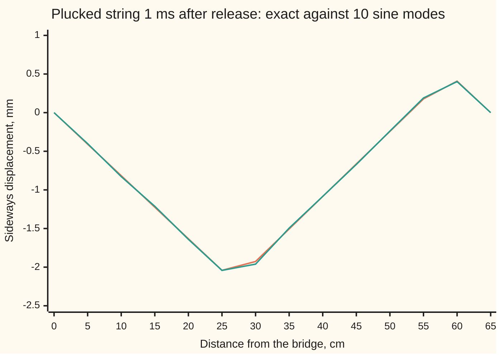

# Weak waves: Galerkin and the energy estimate for a plucked string with a corner

[Syllabus](../../../SYLLABUS.md) → [Partial differential equations](../README.md) → [Weak Solutions and Free Boundaries](../README.md#s06) → Weak waves

---

## General Overview

A guitar's high E string is 65 cm long, from the bridge to the nut. It is tuned to 329.63 Hz, so a ripple runs along it at 428.519 m/s, under a tension of 73.04 N ([Wave energy is conserved, and nothing outruns the wave speed](../05-Waves/02-energy-and-finite-speed.md) works out both numbers). A player pulls it 4 mm sideways at a point 16 cm from the bridge and lets go.

Just before release the string is two straight pieces that meet in a sharp corner. On release the corner splits in two. One corner runs toward the nut and one runs toward the bridge, bounces, and comes back upside down. One millisecond after release the corners sit at 26.85 cm and 58.85 cm.

At a corner the slope jumps, so the string has no bending there. The wave equation balances acceleration against bending at every point. On the corner lines it has nothing to compute with, so the plucked string is not a classical solution (one with two continuous derivatives). [d'Alembert](../05-Waves/01-dalembert-and-characteristics-for-waves.md) called it a weak solution and left it there.

This card makes "weak" precise for any start with finite energy. It then builds the motion without d'Alembert's formula, from sums of sine modes (Galerkin sums), using one fact: each sum keeps its energy exactly. The pluck stores 4.844561 mJ (millijoules). The sum with 160 modes keeps 4.828083 mJ for ever, and at 1 ms it sits 0.444639 µm (root-mean-square) from d'Alembert's answer.

[Wave energy is conserved, and nothing outruns the wave speed](../05-Waves/02-energy-and-finite-speed.md) proved energy conservation, uniqueness and the speed limit for classical solutions. This card proves the first two for weak solutions, and the third in outline.

**A weak solution of the wave equation is a motion with finite energy that satisfies the equation after it is tested against every fixed shape; Galerkin sums keep their energy exactly, that bound makes them converge to a weak solution, and the energy of the difference of two weak solutions stays at zero, so there is only one, and it keeps its energy for ever.**

**What kind of fact this is:** a theorem. Existence, uniqueness and energy conservation for starts with finite energy are proved on this card in Why it works, with the step from bounded sums to a limit in a fold. Finite speed for weak solutions is given in outline with its source. The ideal string is a model: no stiffness, no air drag, small slopes.

### The picture: the string 1 ms after release



Orange: d'Alembert's exact string, three straight pieces with corners at 26.85 cm and 58.85 cm. Green: the Galerkin sum with 10 sine modes. It follows the exact string closely and rounds off each corner. Both checks print every point.

---

## The formula

Notation from earlier cards, one line each. $`u(x, t)`$ is the string's sideways displacement at distance $`x`$ from the bridge and time $`t`$. A prime is a time rate: $`u'`$ is a point's speed, $`u''`$ its acceleration. $`u_x`$ is the slope. The string has mass $`\rho`$ per metre and tension $`T`$ (not a time span; that is $`\tau`$), and the wave speed is $`c = \sqrt{T/\rho}`$.

Three spaces of shapes, from [Sobolev spaces](02-sobolev-spaces-for-pdes.md):

- $`L^2`$: shapes with a finite square integral, $`\lVert w\rVert^2 = \int_0^L w^2\,dx`$. Finite motion energy means the speed $`u'`$ lies here.
- $`H^1_0`$: shapes whose slope has a finite square integral and which are zero at both ends. Finite stretch energy means $`u`$ lies here.
- $`H^{-1}`$: the loads that can be paired with an $`H^1_0`$ shape. A point force is one. The pairing is written $`\langle F, v\rangle`$.

$`(w, v) = \int_0^L w\,v\,dx`$ is the $`L^2`$ product. $`L^2(0, \tau; X)`$ is a motion over the time span $`\tau`$ that sits in the space $`X`$ at each moment, with a finite square integral over time ([Bochner spaces and the weak heat equation](10-bochner-spaces-and-weak-solutions-of-the-heat-equation.md)). Here $`\tau`$ = 1 ms.

The problem. The string obeys $`\rho\,u'' = T u_{xx}`$, is held at $`u = 0`$ at both ends, and starts from shape $`f`$ with speed $`g`$. The data need only finite energy: $`f \in H^1_0`$ and $`g \in L^2`$.

A **weak solution** is a $`u`$ with

```math
u \in L^2(0, \tau; H^1_0), \quad u' \in L^2(0, \tau; L^2), \quad u'' \in L^2(0, \tau; H^{-1}), \qquad \rho\,\langle u'', v\rangle + T\,(u_x, v_x) = 0 \ \text{ for every } v \in H^1_0, \qquad u(0) = f, \ u'(0) = g .
```

**Read it aloud:** the motion has finite stretch energy and finite motion energy at almost every time, its acceleration is at worst a load, and for every fixed test shape $`v`$, mass times acceleration paired with $`v`$ plus tension times slope paired with the slope of $`v`$ adds to zero.

The **energy** is motion plus stretch. The **Galerkin sum** with $`N`$ modes keeps only the first $`N`$ sine shapes:

```math
E(t) = \frac{\rho}{2}\lVert u'\rVert^2 + \frac{T}{2}\lVert u_x\rVert^2 = E(0), \qquad u_N(x, t) = \sum_{k=1}^{N} b_k \cos(\omega_k t)\,\sin\frac{k\pi x}{L}, \qquad \omega_k = \frac{k\pi c}{L} .
```

**Read it aloud:** the energy never changes; the $`N`$-mode sum swings each of its first $`N`$ sine shapes at that shape's own frequency, starting from the share $`b_k`$ of the pluck that the shape carries.

For the pluck, $`E(0) = \tfrac{T}{2}H^2\big(\tfrac1a + \tfrac{1}{L - a}\big)`$ = 4.844561 mJ, and $`b_k = \dfrac{2HL^2\sin(k\pi a/L)}{k^2\pi^2 a(L - a)}`$, so $`b_1`$ = 3.051226 mm.

| Symbol | Plain meaning | In our example | Push it up and the answer… |
| --- | --- | --- | --- |
| $`u`$, $`u'`$, $`u''`$, $`u_x`$ | displacement; speed; acceleration; slope | 4 mm peak at the start | — |
| $`x`$, $`t`$, $`L`$, $`\tau`$ | distance from the bridge; time since release; string length; time span | 0 to 0.65 m; 1 ms; 0.65 m; 1 ms | — |
| $`\rho`$, $`T`$, $`c`$ | mass per metre; tension; wave speed | 0.3978 g/m; 73.04 N; 428.519 m/s | $`T`$: energy rises in proportion |
| $`f`$, $`g`$ | starting shape and starting speed | the triangle; $`g = 0`$ | energy grows as their squares |
| $`a`$, $`H`$ | pluck point; pluck height | 16 cm; 4 mm | $`H`$: energy times 4 per doubling |
| $`L^2`$, $`H^1_0`$, $`H^{-1}`$ | finite-size shapes; finite-slope shapes held at the ends; loads | $`g`$; $`f`$ and $`u(t)`$; $`u''(t)`$ | — |
| $`v`$, $`(w, v)`$, $`\langle F, v\rangle`$ | a test shape; the $`L^2`$ product; a load paired with a shape | a sine-squared bump on 20 to 40 cm | — |
| $`E(t)`$, $`E_N`$ | energy: motion plus stretch; the same for the $`N`$-mode sum | 4.844561 mJ at every time; 4.599981 mJ for 10 modes | — |
| $`N`$, $`u_N`$ | number of modes; the Galerkin sum | 10, 40, 160 | gap shrinks as about $`N^{-1.5}`$ |
| $`k`$, $`b_k`$, $`\omega_k`$, $`d_k(t)`$ | mode number; its share of the pluck; its frequency, rad/s; its amplitude in the sum | $`b_1`$ = 3.051226 mm; $`\omega_1 = 2\pi \times 329.63`$; $`d_k = b_k\cos(\omega_k t)`$ | — |
| $`w`$, $`s`$, $`r`$, $`\varphi`$, $`w_j`$ | in the proofs: the difference of two solutions; a fixed time; a time variable; a time weight; the $`j`$-th sine shape | — | — |
| $`\kappa`$ | a heat diffusivity, used only for the contrast with heat | copper: 1.110e-04 m²/s | heat smooths faster |

### When it holds

- **Finite stretch energy at the start, $`f \in H^1_0`$.** A triangle qualifies. A 4 mm plateau from the bridge to 16 cm does not: its Galerkin sums with 10, 40 and 160 modes hold 0.0234, 0.1096 and 0.4376 J, rising about four-fold each time. There is no bound, and no weak solution in this class.
- **Finite motion energy at the start, $`g \in L^2`$.** A hammer with a finite contact width qualifies. An idealised point blow, all its impulse at one point, does not.
- **Linear, with fixed coefficients.** The proof uses that sums and limits of solutions are solutions. Large swings change the tension and break this.
- **Ends that do no work.** Fixed ends make the boundary terms vanish. A moving bridge would add an end term to every step.
- **Uniqueness only in the energy class.** The proof tests against shapes built from the solution itself. A motion with infinite energy is outside its reach.

---

## Why it works

### Step 0: the idea

Energy is the one size the equation keeps fixed. A Galerkin sum obeys a shrunken copy of the equation, so it keeps its energy too. Every sum then has energy at most 4.844561 mJ, which pins all of them inside one bounded set.

A bounded set of motions holds a sequence that settles in an averaged sense (it converges weakly). The weak form is linear, so it survives that limit. Uniqueness and energy conservation then come from the energy of a difference.

### Step 1: the weak form needs no bending

Multiply $`\rho\,u'' = T u_{xx}`$ by a test shape $`v`$ that is zero at both ends, and integrate along the string. Move one $`x`$-derivative onto $`v`$ by integration by parts. The end terms vanish because $`v`$ is zero there, which gives the weak form above, as on [Weak solutions](01-weak-solutions-and-the-weak-formulation.md).

Only slopes appear now, and the pluck has slopes everywhere: 0.025 on the near piece and −0.008163 on the far piece. The acceleration is no longer asked to be a function. The weak form itself bounds it as a load: $`\lvert\langle u'', v\rangle\rvert \le c^2\lVert u_x\rVert\,\lVert v_x\rVert`$. That is exactly what $`u'' \in H^{-1}`$ means.

The checks test d'Alembert's plucked string against a sine-squared bump $`v`$ on 20 to 40 cm, which holds the corner at 26.85 cm at 1 ms. The second time rate of $`(u, v)`$, taken by centred differences (the values one step either side, minus twice the middle one, over the step squared), is 2353.9970 m²/s² with a 0.02 ms step and 2357.7761 m²/s² with 0.01 ms. The weak form asks for $`-c^2(u_x, v_x)`$ = 2359.0389 m²/s². The gap falls from 0.2137% to 0.0535%, four-fold for a halved step: it is the step's error, and the weak form holds.

### Step 2: the Galerkin sums are separate oscillators

Ask the weak form to hold only for the first $`N`$ sine shapes, and look for $`u_N`$ among their combinations. The sine shapes are orthogonal: different ones have product 0, and so do their slopes. So the $`N`$ equations separate, one per mode:

```math
d_k'' + \omega_k^2\,d_k = 0, \qquad d_k(0) = b_k = \frac{2}{L}\int_0^L f(x)\sin\frac{k\pi x}{L}\,dx, \qquad d_k'(0) = 0 .
```

**Read it aloud:** each mode swings like a mass on a spring at its own frequency, starting from its share of the pluck and at rest.

The start $`b_k`$ is the best $`L^2`$ fit of the pluck by the first $`N`$ shapes. The checks get $`b_1`$ = 3.051225948 mm both by the closed form and by Simpson's rule (a weighted sum of samples).

### Step 3: each sum keeps its energy, and the energy bounds everything

Multiply each mode's equation by $`d_k'`$ and add over the modes. The result is the rate of change of $`E_N`$, the energy of $`u_N`$, and it is 0. So each sum keeps its energy exactly. The checks measure it by quadrature (adding samples along the string) at 0, 0.5 and 1 ms. For 10 modes all three agree with the mode total, 4.5999805222 mJ, to all printed digits.

A sum also never holds more energy than the pluck. Each mode carries its own share, $`\tfrac{TL}{4}(k\pi/L)^2 b_k^2`$, and the shares add up to the whole (the stretch energy is a sum of squares over the modes). So for every $`N`$ and every $`t`$:

```math
\frac{\rho}{2}\lVert u_N'\rVert^2 + \frac{T}{2}\lVert u_{N,x}\rVert^2 = E_N(0) \le E(0), \qquad \lVert u_N''\rVert_{H^{-1}} \le c^2\,\lVert u_{N,x}\rVert .
```

**Read it aloud:** every sum's speed and slope are bounded by the pluck's energy, at all times, and so is its acceleration as a load.

That is the **energy estimate**. It holds with the same bound for every $`N`$, which is what lets the sums settle.

### Step 4: the sums settle on a weak solution

Bounded motions in these spaces have a sequence that converges weakly. Along it, the weak form for each fixed sine shape passes to the limit, because it is linear. Combinations of sine shapes come as close as wanted to any $`H^1_0`$ shape, so the limit passes every test. The starting shape and speed carry over in the same way.

On this string the limit is the full sine series, and the gap shrinks in plain size (the ordinary $`L^2`$ distance, not only in the averaged sense). Quadrature against d'Alembert and the sum of the dropped modes both give 25.543906, 3.372045 and 0.444639 µm at 1 ms, to five digits.

<details>
<summary>Detailed proof: from the bounded sums to a weak solution</summary>

Write $`w_j(x) = \sin(j\pi x/L)`$. For $`j \le N`$, the Galerkin sum satisfies $`\rho\,(u_N'', w_j) + T\,(u_{N,x}, w_{j,x}) = 0`$. Take any $`\varphi`$ with a continuous rate on $`[0, \tau]`$ and $`\varphi(\tau) = 0`$. Multiply by $`\varphi(t)`$, integrate over $`(0, \tau)`$, and move one time rate onto $`\varphi`$:

$`\displaystyle -\rho\int_0^\tau (u_N', w_j)\,\varphi'\,dt + T\int_0^\tau (u_{N,x}, w_{j,x})\,\varphi\,dt = \rho\,(u_N'(0), w_j)\,\varphi(0) .`$

By Step 3, $`u_N`$ is bounded in $`L^2(0, \tau; H^1_0)`$ and $`u_N'`$ in $`L^2(0, \tau; L^2)`$, uniformly in $`N`$. These are Hilbert spaces, so a subsequence converges weakly: $`u_N \rightharpoonup u`$ and $`u_N' \rightharpoonup u'`$. Every term above is a fixed linear functional of $`u_N`$ or $`u_N'`$, so it passes to the limit:

$`\displaystyle -\rho\int_0^\tau (u', w_j)\,\varphi'\,dt + T\int_0^\tau (u_x, w_{j,x})\,\varphi\,dt = \rho\,(g, w_j)\,\varphi(0) .`$

Choosing $`\varphi`$ that vanishes at both ends shows $`\rho\,\langle u'', w_j\rangle + T(u_x, w_{j,x}) = 0`$ in the sense of time distributions, for each $`j`$. Finite combinations of the $`w_j`$ are dense in $`H^1_0`$, and both terms are continuous in $`v`$ on $`H^1_0`$, so the weak form holds for every $`v \in H^1_0`$. The bound $`\lvert\langle u'', v\rangle\rvert \le c^2\lVert u_x\rVert\lVert v_x\rVert`$ puts $`u''`$ in $`L^2(0, \tau; H^{-1})`$.

Comparing the identity for $`u`$ with the one obtained by integrating by parts in time gives $`u'(0) = g`$. The same comparison, made for the identity linking $`(u_N', w_j)`$ to $`(u_N, w_j)`$, gives $`u(0) = f`$, because $`u_N(0)`$, the projection of $`f`$, converges to $`f`$. By Step 5 the limit is unique, so the whole sequence converges, not only a subsequence. This is Evans, section 7.2.2, specialised to one dimension.

</details>

### Step 5: only one weak solution

Let $`w`$ be the difference of two weak solutions with the same start. It is a weak solution that starts still and straight. For a classical solution one would test with $`w'`$ and read off that the energy stays 0. A weak solution's speed need not lie in $`H^1_0`$, so it is not an allowed test shape.

The way round is to test with the integral of $`w`$ backward from a fixed time $`s`$. That shape is one time-integration smoother, so it is allowed. Two integrations by parts then give a sum of two squares equal to zero, so $`w(s) = 0`$.

<details>
<summary>Detailed proof: uniqueness by a backward integral</summary>

Fix $`s`$ in $`(0, \tau)`$. Set $`v(t) = \int_t^s w(r)\,dr`$ for $`t \le s`$ and $`v(t) = 0`$ for $`t > s`$. Then $`v(t) \in H^1_0`$, $`v(s) = 0`$, and $`v' = -w`$ on $`(0, s)`$. Test the weak form for $`w`$ with $`v(t)`$ and integrate from 0 to $`s`$:

$`\displaystyle \int_0^s \Big(\rho\,\langle w'', v\rangle + T\,(w_x, v_x)\Big)\,dt = 0 .`$

Move the time rate in the first term onto $`v`$. The end terms vanish, because $`v(s) = 0`$ and $`w'(0) = 0`$. So the first term becomes $`\int_0^s \rho\,(w', w)\,dt = \tfrac{\rho}{2}\lVert w(s)\rVert^2`$, using $`w(0) = 0`$. In the second, $`w_x = -v_x'`$, so $`T(w_x, v_x) = -\tfrac{T}{2}\tfrac{d}{dt}\lVert v_x\rVert^2`$. It integrates to $`+\tfrac{T}{2}\lVert v_x(0)\rVert^2`$, because $`v(s) = 0`$. Together:

$`\displaystyle \frac{\rho}{2}\lVert w(s)\rVert^2 + \frac{T}{2}\lVert v_x(0)\rVert^2 = 0 .`$

Both terms are squares, so $`w(s) = 0`$. As $`s`$ was any time, $`w = 0`$. This is Evans, section 7.2.2, Theorem 4.

</details>

### Step 6: the weak solution keeps its energy, and so does every difference

Test the weak form with the $`k`$-th sine shape and integrate by parts once: the solution's share $`d_k(t)`$ obeys $`d_k'' + \omega_k^2 d_k = 0`$, whatever the data in $`H^1_0 \times L^2`$. Each share keeps its energy and the shares add up to $`E(t)`$, so the pluck's 4.844561 mJ stays for ever. A general region needs smoothing in time (Lions and Magenes, chapter 3).

Apply the equality to the difference $`u - u_N`$. It is a weak solution too, because each sum is an exact solution here: a sine shape bends in proportion to its own size. It starts with the energy the sum left out. The checks measure its energy at 1 ms by quadrature: 0.244580, 0.065061 and 0.016478 mJ for 10, 40 and 160 modes. These equal the left-out energy at the start. The estimate that bounds the sums also bounds their error, for all time.

### Step 7: no smoothing, unlike heat

Each mode keeps its energy for ever, so energy never drains out of the high modes, which carry the corner. The corner therefore never rounds off. The bending integral $`\int u_{N,xx}^2\,dx`$ measures how much the sum bends. For 10, 40 and 160 modes:

- wave, at release: 0.018380, 0.068759, 0.271625 per metre;
- wave, at 1 ms: 0.008808, 0.034770, 0.134503 per metre;
- the same profile spread by heat in copper for 1 s: 0.015207, 0.020822, 0.020823 per metre.

The wave's bending grows about four-fold for every four-fold $`N`$, at every time, so the limit has no square-integrable bending. Heat damps mode $`k`$ by $`e^{-\kappa (k\pi/L)^2 t}`$, so its sums settle. [Bochner spaces and the weak heat equation](10-bochner-spaces-and-weak-solutions-of-the-heat-equation.md) shows that damping at work; the wave has none. Rough data stay exactly as rough.

### Step 8: finite speed for weak solutions, in outline

[Wave energy is conserved, and nothing outruns the wave speed](../05-Waves/02-energy-and-finite-speed.md) proved the speed limit for classical solutions: the energy in a window shrinking at $`c`$ never rises. For a weak solution, smooth the data: smooth starts come as close as wanted to $`f`$ and $`g`$ in energy. Their classical solutions obey the speed limit. By Step 6 their energy distance to the weak solution stays as small as at the start, so the limit obeys it too.

A single Galerkin sum seems to break it, but does not. Each sum is an exact solution (Step 6). Its start, though, is the $`N`$-mode fit of the triangle, not the triangle. That fit ripples along the whole string, so it is curved at every point, and each ripple moves at once.

At 50 cm the corner arrives at 0.7934 ms. At 0.5 ms d'Alembert's string there is still, at 1.224490 mm, with speed 0. The sums with 10, 40 and 160 modes give speeds there of −0.672989, −0.060639 and 0.017009 m/s. That motion comes from each sum's own rippled start near 50 cm, not from a signal outrunning $`c`$. The ripples shrink as $`N`$ grows; only the limit is still.

---

## Worked numbers, by hand

The string: $`L`$ = 0.65 m, pitch 329.63 Hz, $`\rho`$ = 0.3978 g/m. The pluck: $`H`$ = 4 mm at $`a`$ = 16 cm, released at rest.

| Step | Arithmetic | Value |
| --- | --- | --- |
| wave speed | $`2 \times 0.65 \times 329.63`$ | 428.519 m/s |
| tension | $`\rho c^2 = 0.0003978 \times 428.519^2`$ | 73.04 N |
| slopes of the two pieces | $`4/160`$ and $`-4/490`$ | 0.025000 and −0.008163 |
| energy of the pluck | $`\tfrac{73.04}{2} \times 0.004^2 \times (\tfrac{1}{0.16} + \tfrac{1}{0.49})`$ | 4.844561 mJ |
| first mode's share | $`\dfrac{2 \times 0.004 \times 0.65^2 \sin(\pi \times 0.16/0.65)}{\pi^2 \times 0.16 \times 0.49}`$ | 3.051226 mm |
| corners at 1 ms | $`16 + 42.85`$; $`42.85 - 16`$, after the bridge | 58.85 cm; 26.85 cm |
| energy kept by 10 modes | sum of the first 10 shares | 4.599981 mJ, at every time |
| energy left out | $`4.844561 - 4.599981`$ | 0.244580 mJ |
| RMS gap at 1 ms, $`N`$ = 10, 40, 160 | quadrature against d'Alembert | 25.543906; 3.372045; 0.444639 µm |
| observed order | $`\log(25.543906/3.372045)/\log 4`$ | 1.461 |
| gap with 160 modes | | **0.444639 µm** |

With 160 modes the sum sits less than half a micrometre from the exact string, in root-mean-square terms, and it will stay that close in energy for ever.

### What breaks if you drop a piece

| Mistake | Comes out at | What went wrong |
| --- | --- | --- |
| Start from the 4 mm plateau, outside $`H^1_0`$ | energy 0.0234, 0.1096, 0.4376 J for 10, 40, 160 modes | no energy bound, so no weak solution in this class |
| Expect order 2, because the shares fall as $`1/k^2`$ | 0.099781 µm at 160 modes, not 0.444639 µm | the gap is the root of the sum of the dropped shares squared, $`\sqrt{\sum_{k>N} k^{-4}}`$, which falls as $`N^{-1.5}`$ |
| Expect the wave to smooth, as heat does | bending 0.271625 per metre at 160 modes, still growing with $`N`$ | each mode keeps its energy; nothing drains from the corner |
| Read a sum's early motion as the triangle's | −0.672989 m/s at 50 cm at 0.5 ms with 10 modes | the sum starts from a rippled fit of the triangle, curved everywhere; only the limit starts straight there |

The checks print all four.

---

## Code, from first principles, and it actually runs

The code builds the plucked string twice: by d'Alembert's formula with mirror images past both ends, and by Galerkin sums with 10, 40 and 160 sine modes. Five independent roads check it:

1. **The mode shares:** the closed form for $`b_k`$ against Simpson's rule on the pluck.
2. **Energy:** the closed form, the sum of mode shares with a printed tail bound, and quadrature of each sum at 0, 0.5 and 1 ms.
3. **The gap:** quadrature against d'Alembert, split at the corners, against the sum of the dropped modes.
4. **Stability:** the energy of $`u - u_N`$ at 1 ms against the energy left out at the start.
5. **The weak form:** a test bump's second time rate by centred differences at two steps, against $`-c^2(u_x, v_x)`$.

It also prints the cases where a hypothesis fails: a plateau start, the expected order, smoothing, and early motion.

### Python

```python
# Weak waves on a 65 cm guitar string plucked 4 mm at 16 cm from the bridge.
# Roads: d'Alembert with mirror images; Galerkin sine sums with N = 10, 40, 160 modes;
# energy by closed form, by mode sums and by quadrature; the L2 gap by quadrature and
# by the tail series; the weak form's residual by centred differences in time.
from math import pi, sin, cos, sqrt, exp, log

L, F1 = 0.65, 329.63                   # string length, m; open high E string, Hz
C = 2 * L * F1                         # wave speed, m/s
RHO = 7850 * pi * 0.000127 ** 2        # mass per metre, kg/m: steel wire 0.254 mm across
TEN = RHO * C * C                      # tension, N
A, H, T1 = 0.16, 0.004, 1e-3           # pluck point, m; pluck height, m; time watched, s
KAPPA = 1.110e-4                       # copper's diffusivity, m^2/s, for the heat contrast
NS = (10, 40, 160)

def f(x): return H * x / A if x <= A else H * (L - x) / (L - A)
def df(x): return H / A if x < A else -H / (L - A)
def wrap(s): return (s + L) % (2 * L) - L          # odd mirror images about both ends
def big_f(s): s = wrap(s); return f(s) if s >= 0 else -f(-s)
def big_df(s): return df(abs(wrap(s)))
def u(x, t): return (big_f(x - C * t) + big_f(x + C * t)) / 2
def ux(x, t): return (big_df(x - C * t) + big_df(x + C * t)) / 2
def ut(x, t): return C * (big_df(x + C * t) - big_df(x - C * t)) / 2
def kinks(t, lo=0.0, hi=L):            # where the corners are: x -/+ c t = +/- A + 2 L m
    pts = {lo, hi}
    for s in (A, -A):
        for m in range(-3, 4):
            for x in (s + C * t + 2 * L * m, s - C * t + 2 * L * m):
                if lo < x < hi: pts.add(x)
    return sorted(pts)
def simpson(g, a, b, n):                # ends nudged inward, so a corner is seen from inside
    h, e = (b - a) / n, (b - a) * 1e-12
    return h / 3 * sum((1 if i in (0, n) else 4 if i % 2 else 2) * g(min(max(a + i * h, a + e), b - e))
                       for i in range(n + 1))
def pieces(g, t, n=2000, lo=0.0, hi=L):            # Simpson on each corner-free piece
    p = kinks(t, lo, hi)
    return sum(simpson(g, p[i], p[i + 1], n) for i in range(len(p) - 1))

def kk(k): return k * pi / L
def om(k): return C * kk(k)
def b_closed(k): return 2 * H * L * L * sin(kk(k) * A) / (k * k * pi * pi * A * (L - A))
B = [0.0] + [b_closed(k) for k in range(1, 100001)]
def mode_e(k): return TEN * L / 4 * kk(k) ** 2 * B[k] ** 2   # each mode's energy, J, forever
def galerkin(x, t, n):                 # u_N, its slope and its speed
    s = sx = st = 0.0
    for k in range(1, n + 1):
        ck, sk = cos(om(k) * t), sin(om(k) * t)
        s += B[k] * ck * sin(kk(k) * x); sx += B[k] * ck * kk(k) * cos(kk(k) * x)
        st -= B[k] * om(k) * sk * sin(kk(k) * x)
    return s, sx, st
def trap_energy(n, t, m=1000):         # trapezoid rule: exact for these sine products
    tot = 0.0
    for i in range(m + 1):
        _, sx, st = galerkin(i * L / m, t, n)
        tot += (0.5 if i in (0, m) else 1) * (RHO / 2 * st * st + TEN / 2 * sx * sx)
    return tot * L / m

print(f"string: c = {C:.3f} m/s, rho = {RHO * 1e3:.4f} g/m, tension = {TEN:.2f} N")
E0 = TEN / 2 * H * H * (1 / A + 1 / (L - A))
print(f"pluck: slopes {H / A:.6f} and {-H / (L - A):.6f}; energy (T/2) H^2 (1/a + 1/(L - a)) = {E0 * 1e3:.6f} mJ")
for k in (1, 2, 3):
    bq = 2 / L * (simpson(lambda x: f(x) * sin(kk(k) * x), 0, A, 2000) + simpson(lambda x: f(x) * sin(kk(k) * x), A, L, 2000))
    print(f"b_{k}: closed form {B[k] * 1e3:.9f} mm, Simpson projection {bq * 1e3:.9f} mm")
print(f"corners at 1 ms: " + ", ".join(f"{x * 100:.2f} cm" for x in kinks(T1)[1:-1]))
print(" N | energy kept mJ | at 0 ms by quadrature | at 0.5 ms | at 1 ms | missing mJ")
EN, CONS = {}, []
for n in NS:
    EN[n] = sum(mode_e(k) for k in range(1, n + 1))
    q = [trap_energy(n, t) for t in (0.0, T1 / 2, T1)]
    CONS.append(max(abs(e - EN[n]) for e in q) / EN[n])
    print(f"{n:3d} | {EN[n] * 1e3:.10f} | {q[0] * 1e3:.10f} | {q[1] * 1e3:.10f} | {q[2] * 1e3:.10f} | {(E0 - EN[n]) * 1e3:.6f}")
EALL = sum(mode_e(k) for k in range(1, 100001))
TAIL = TEN * L / 4 * (pi / L) ** 2 * (2 * H * L * L / (pi * pi * A * (L - A))) ** 2 / 100000
print(f"modes 1 to 100000 carry {EALL * 1e3:.6f} mJ; the rest at most {TAIL * 1e6:.4f} uJ")
print(f"first omitted energy terms, modes 11, 41, 161: " + ", ".join(f"{mode_e(n + 1) * 1e6:.4f}" for n in NS) + " uJ")
print(" N | RMS gap at 1 ms, quadrature um | by tail series um | difference energy at 1 ms mJ")
GQ, GT, DE = [], [], []
for n in NS:
    gq = pieces(lambda x: (galerkin(x, T1, n)[0] - u(x, T1)) ** 2, T1)
    gt = L / 2 * sum(B[k] ** 2 * cos(om(k) * T1) ** 2 for k in range(n + 1, 100001))
    de = pieces(lambda x: (lambda g: RHO / 2 * (g[2] - ut(x, T1)) ** 2 + TEN / 2 * (g[1] - ux(x, T1)) ** 2)(galerkin(x, T1, n)), T1)
    GQ.append(sqrt(gq / L)); GT.append(sqrt(gt / L)); DE.append(de)
    print(f"{n:3d} | {GQ[-1] * 1e6:.6f} | {GT[-1] * 1e6:.6f} | {de * 1e3:.6f}")
ORD = [log(GQ[i] / GQ[i + 1]) / log(4) for i in (0, 1)]
ORE = [log(DE[i] / DE[i + 1]) / log(4) / 2 for i in (0, 1)]
print(f"observed order in N: L2 gap {ORD[0]:.3f}, {ORD[1]:.3f}; energy-norm gap {ORE[0]:.3f}, {ORE[1]:.3f}")
V = lambda x: sin(pi * (x - 0.20) / 0.20) ** 2     # test shape on 20 cm to 40 cm
VX = lambda x: pi / 0.20 * sin(2 * pi * (x - 0.20) / 0.20)
mom = lambda t: pieces(lambda x: u(x, t) * V(x), t, 400, 0.20, 0.40)
stiff = C * C * pieces(lambda x: ux(x, T1) * VX(x), T1, 400, 0.20, 0.40)
RES = []
for d in (2e-5, 1e-5):
    acc = (mom(T1 + d) - 2 * mom(T1) + mom(T1 - d)) / (d * d)
    RES.append(abs(acc + stiff) / abs(stiff))
    print(f"weak form at 1 ms, step {d * 1e3:.2f} ms: (u, v)'' = {acc:.4f} m^2/s^2, -c^2 (u_x, v_x) = {-stiff:.4f} m^2/s^2, "
          f"residual {RES[-1] * 100:.4f}%")
XF, TF = 0.50, 0.5e-3
VEL = [galerkin(XF, TF, n)[2] for n in NS]
print(f"finite speed: corner reaches 50 cm at {(XF - A) / C * 1e3:.4f} ms; at 0.5 ms d'Alembert u = {u(XF, TF) * 1e3:.6f} mm, "
      f"u_t = {ut(XF, TF):.6f} m/s")
print("  Galerkin u_t there, N = 10, 40, 160: " + ", ".join(f"{v:.6f}" for v in VEL) + " m/s")
BW0 = [L / 2 * sum(kk(k) ** 4 * B[k] ** 2 for k in range(1, n + 1)) for n in NS]
BW1 = [L / 2 * sum(kk(k) ** 4 * B[k] ** 2 * cos(om(k) * T1) ** 2 for k in range(1, n + 1)) for n in NS]
BH = [L / 2 * sum(kk(k) ** 4 * B[k] ** 2 * exp(-2 * KAPPA * kk(k) ** 2 * 1.0) for k in range(1, n + 1)) for n in NS]
print("bending integral of u_N_xx^2, 1/m, N = 10, 40, 160: wave at 0 ms " + ", ".join(f"{b:.6f}" for b in BW0)
      + "; wave at 1 ms " + ", ".join(f"{b:.6f}" for b in BW1) + "; heat in copper after 1 s " + ", ".join(f"{b:.6f}" for b in BH))
SH = 0.5 * TEN * L / 2
JE = [sum(SH * kk(k) ** 2 * (2 * H / (k * pi) * (1 - cos(kk(k) * A))) ** 2 for k in range(1, n + 1)) for n in NS]
print("wrong: a 4 mm plateau from the bridge to 16 cm (not in H1_0), energy of N = 10, 40, 160: " + ", ".join(f"{e:.4f}" for e in JE) + " J")
print(f"wrong: expect order 2, gap at N = 160 would be {GQ[0] * 1e6 / 256:.6f} um, not {GQ[2] * 1e6:.6f} um")
XS = [0.05 * i for i in range(14)]
print("chart, cm: " + ", ".join(f"{x * 100:.0f}" for x in XS))
print("chart, d'Alembert at 1 ms, mm: " + ", ".join(f"{u(x, T1) * 1e3:.3f}" for x in XS))
print("chart, Galerkin N = 10 at 1 ms, mm: " + ", ".join(f"{galerkin(x, T1, 10)[0] * 1e3:.3f}" for x in XS))
assert all(abs(b_closed(k) - 2 / L * simpson(lambda x: f(x) * sin(kk(k) * x), 0, A, 2000)
           - 2 / L * simpson(lambda x: f(x) * sin(kk(k) * x), A, L, 2000)) < 1e-9 * H for k in (1, 2, 3)), "projection"
assert max(CONS) < 1e-12, "each Galerkin sum must keep its energy to rounding"
assert 0 < E0 - EALL < TAIL, "modes must carry the pluck's energy"
assert all(abs(q - t) < 1e-4 * t for q, t in zip(GQ, GT)), "L2 gap: quadrature against tail series"
assert all(abs(d - (E0 - EN[n])) < 1e-4 * (E0 - EN[n]) for d, n in zip(DE, NS)), "difference keeps its starting energy"
assert all(1.4 < o < 1.6 for o in ORD) and all(0.4 < o < 0.6 for o in ORE), "observed orders 1.5 and 0.5"
assert RES[1] < 1e-3 and 3.5 < RES[0] / RES[1] < 4.5, "weak-form residual must fall as step^2"
assert abs(ut(XF, TF)) < 1e-15 and abs(VEL[2]) < abs(VEL[0]), "the limit is still before the corner arrives"
assert BW0[2] > 3 * BW0[1] > 9 * BW0[0] and BH[2] < 1.01 * BH[1], "the wave never smooths; heat does"
assert JE[2] > 3 * JE[1] > 9 * JE[0], "a jump has no finite energy"
print("ALL CHECKS PASS")
```

**Ran 2026-11-24 on macOS, Python 3.14.10, standard library only. All checks passed. Output, pasted from the run:**

```
string: c = 428.519 m/s, rho = 0.3978 g/m, tension = 73.04 N
pluck: slopes 0.025000 and -0.008163; energy (T/2) H^2 (1/a + 1/(L - a)) = 4.844561 mJ
b_1: closed form 3.051225948 mm, Simpson projection 3.051225948 mm
b_2: closed form 1.091727059 mm, Simpson projection 1.091727059 mm
b_3: closed form 0.355409338 mm, Simpson projection 0.355409338 mm
corners at 1 ms: 26.85 cm, 58.85 cm
 N | energy kept mJ | at 0 ms by quadrature | at 0.5 ms | at 1 ms | missing mJ
 10 | 4.5999805222 | 4.5999805222 | 4.5999805222 | 4.5999805222 | 0.244580
 40 | 4.7794996272 | 4.7794996272 | 4.7794996272 | 4.7794996272 | 0.065061
160 | 4.8280827595 | 4.8280827595 | 4.8280827595 | 4.8280827595 | 0.016478
modes 1 to 100000 carry 4.844534 mJ; the rest at most 0.0529 uJ
first omitted energy terms, modes 11, 41, 161: 27.6047, 0.2573, 0.1715 uJ
 N | RMS gap at 1 ms, quadrature um | by tail series um | difference energy at 1 ms mJ
 10 | 25.543906 | 25.543906 | 0.244580
 40 | 3.372045 | 3.372044 | 0.065061
160 | 0.444639 | 0.444636 | 0.016478
observed order in N: L2 gap 1.461, 1.461; energy-norm gap 0.478, 0.495
weak form at 1 ms, step 0.02 ms: (u, v)'' = 2353.9970 m^2/s^2, -c^2 (u_x, v_x) = 2359.0389 m^2/s^2, residual 0.2137%
weak form at 1 ms, step 0.01 ms: (u, v)'' = 2357.7761 m^2/s^2, -c^2 (u_x, v_x) = 2359.0389 m^2/s^2, residual 0.0535%
finite speed: corner reaches 50 cm at 0.7934 ms; at 0.5 ms d'Alembert u = 1.224490 mm, u_t = 0.000000 m/s
  Galerkin u_t there, N = 10, 40, 160: -0.672989, -0.060639, 0.017009 m/s
bending integral of u_N_xx^2, 1/m, N = 10, 40, 160: wave at 0 ms 0.018380, 0.068759, 0.271625; wave at 1 ms 0.008808, 0.034770, 0.134503; heat in copper after 1 s 0.015207, 0.020822, 0.020823
wrong: a 4 mm plateau from the bridge to 16 cm (not in H1_0), energy of N = 10, 40, 160: 0.0234, 0.1096, 0.4376 J
wrong: expect order 2, gap at N = 160 would be 0.099781 um, not 0.444639 um
chart, cm: 0, 5, 10, 15, 20, 25, 30, 35, 40, 45, 50, 55, 60, 65
chart, d'Alembert at 1 ms, mm: 0.000, -0.408, -0.816, -1.224, -1.633, -2.041, -1.927, -1.506, -1.085, -0.664, -0.243, 0.178, 0.408, 0.000
chart, Galerkin N = 10 at 1 ms, mm: 0.000, -0.401, -0.828, -1.212, -1.640, -2.042, -1.961, -1.495, -1.084, -0.671, -0.239, 0.190, 0.402, 0.000
ALL CHECKS PASS
```

### Rust

```rust
// Weak waves on a 65 cm guitar string plucked 4 mm at 16 cm from the bridge.
// Roads: d'Alembert with mirror images; Galerkin sine sums with N = 10, 40, 160 modes;
// energy by closed form, by mode sums and by quadrature; the L2 gap by quadrature and
// by the tail series; the weak form's residual by centred differences in time.
use std::f64::consts::PI;

const L: f64 = 0.65; const F1: f64 = 329.63; // string length, m; open high E string, Hz
const A: f64 = 0.16; const H: f64 = 0.004; const T1: f64 = 1e-3; // pluck point, m; height, m; time watched, s
const KAPPA: f64 = 1.110e-4; // copper's diffusivity, m^2/s, for the heat contrast
const NS: [usize; 3] = [10, 40, 160];
const KMAX: usize = 100000;

fn nsum<I: Iterator<Item = f64>>(it: I) -> f64 { // compensated sum, as Python's sum() does it
    let (mut s, mut c) = (0.0f64, 0.0f64);
    for x in it {
        let t = s + x;
        c += if s.abs() >= x.abs() { (s - t) + x } else { (x - t) + s }; s = t;
    }
    s + c
}
fn f(x: f64) -> f64 { if x <= A { H * x / A } else { H * (L - x) / (L - A) } }
fn df(x: f64) -> f64 { if x < A { H / A } else { -H / (L - A) } }
fn wrap(s: f64) -> f64 { (s + L).rem_euclid(2.0 * L) - L } // odd mirror images about both ends
fn big_f(s: f64) -> f64 { let s = wrap(s); if s >= 0.0 { f(s) } else { -f(-s) } }
fn big_df(s: f64) -> f64 { df(wrap(s).abs()) }
fn kk(k: usize) -> f64 { k as f64 * PI / L }
fn b_closed(k: usize) -> f64 { 2.0 * H * L * L * (kk(k) * A).sin() / ((k * k) as f64 * PI * PI * A * (L - A)) }
fn simpson(g: &dyn Fn(f64) -> f64, a: f64, b: f64, n: usize) -> f64 { // ends nudged inward
    let (h, e) = ((b - a) / n as f64, (b - a) * 1e-12);
    h / 3.0 * nsum((0..=n).map(|i| {
        let w = if i == 0 || i == n { 1.0 } else if i % 2 == 1 { 4.0 } else { 2.0 };
        w * g((a + i as f64 * h).max(a + e).min(b - e))
    }))
}

struct S { c: f64, rho: f64, ten: f64, b: Vec<f64> }
impl S {
    fn om(&self, k: usize) -> f64 { self.c * kk(k) }
    fn u(&self, x: f64, t: f64) -> f64 { (big_f(x - self.c * t) + big_f(x + self.c * t)) / 2.0 }
    fn ux(&self, x: f64, t: f64) -> f64 { (big_df(x - self.c * t) + big_df(x + self.c * t)) / 2.0 }
    fn ut(&self, x: f64, t: f64) -> f64 { self.c * (big_df(x + self.c * t) - big_df(x - self.c * t)) / 2.0 }
    fn kinks(&self, t: f64, lo: f64, hi: f64) -> Vec<f64> { // x -/+ c t = +/- A + 2 L m
        let mut p = vec![lo, hi];
        for s in [A, -A] {
            for m in -3..4 {
                for x in [s + self.c * t + 2.0 * L * m as f64, s - self.c * t + 2.0 * L * m as f64] {
                    if lo < x && x < hi { p.push(x); }
                }
            }
        }
        p.sort_by(|a, b| a.partial_cmp(b).unwrap()); p.dedup(); p
    }
    fn pieces(&self, g: &dyn Fn(f64) -> f64, t: f64, n: usize, lo: f64, hi: f64) -> f64 {
        let p = self.kinks(t, lo, hi);
        nsum((0..p.len() - 1).map(|i| simpson(g, p[i], p[i + 1], n)))
    }
    fn mode_e(&self, k: usize) -> f64 { self.ten * L / 4.0 * kk(k).powf(2.0) * self.b[k].powf(2.0) }
    fn galerkin(&self, x: f64, t: f64, n: usize) -> (f64, f64, f64) { // u_N, slope, speed
        let (mut s, mut sx, mut st) = (0.0, 0.0, 0.0);
        for k in 1..=n {
            let (ck, sk) = ((self.om(k) * t).cos(), (self.om(k) * t).sin());
            s += self.b[k] * ck * (kk(k) * x).sin();
            sx += self.b[k] * ck * kk(k) * (kk(k) * x).cos();
            st -= self.b[k] * self.om(k) * sk * (kk(k) * x).sin();
        }
        (s, sx, st)
    }
    fn trap_energy(&self, n: usize, t: f64) -> f64 { // trapezoid rule: exact for these sine products
        let m = 1000;
        let mut tot = 0.0;
        for i in 0..=m {
            let (_, sx, st) = self.galerkin(i as f64 * L / m as f64, t, n);
            let w = if i == 0 || i == m { 0.5 } else { 1.0 };
            tot += w * (self.rho / 2.0 * st * st + self.ten / 2.0 * sx * sx);
        }
        tot * L / m as f64
    }
}
fn join(v: &[f64], d: usize) -> String { v.iter().map(|x| format!("{:.*}", d, x)).collect::<Vec<_>>().join(", ") }

fn main() {
    let c = 2.0 * L * F1;
    let rho = 7850.0 * PI * 0.000127f64.powf(2.0);
    let mut b = vec![0.0];
    b.extend((1..=KMAX).map(b_closed));
    let (st, ten) = (S { c, rho, ten: rho * c * c, b }, rho * c * c);
    println!("string: c = {:.3} m/s, rho = {:.4} g/m, tension = {:.2} N", c, rho * 1e3, ten);
    let e0 = ten / 2.0 * H * H * (1.0 / A + 1.0 / (L - A));
    println!("pluck: slopes {:.6} and {:.6}; energy (T/2) H^2 (1/a + 1/(L - a)) = {:.6} mJ", H / A, -H / (L - A), e0 * 1e3);
    let proj = |k: usize| {
        let g = |x: f64| f(x) * (kk(k) * x).sin();
        (simpson(&g, 0.0, A, 2000), simpson(&g, A, L, 2000))
    };
    for k in 1..=3 {
        let (p1, p2) = proj(k); println!("b_{}: closed form {:.9} mm, Simpson projection {:.9} mm", k, st.b[k] * 1e3, 2.0 / L * (p1 + p2) * 1e3);
    }
    let kn = st.kinks(T1, 0.0, L);
    println!("corners at 1 ms: {}", kn[1..kn.len() - 1].iter().map(|x| format!("{:.2} cm", x * 100.0)).collect::<Vec<_>>().join(", "));
    println!(" N | energy kept mJ | at 0 ms by quadrature | at 0.5 ms | at 1 ms | missing mJ");
    let (mut en, mut cons) = (vec![], vec![]);
    for &n in NS.iter() {
        let e = nsum((1..=n).map(|k| st.mode_e(k)));
        let q: Vec<f64> = [0.0, T1 / 2.0, T1].iter().map(|&t| st.trap_energy(n, t)).collect();
        cons.push(q.iter().map(|x| (x - e).abs()).fold(0.0, f64::max) / e);
        en.push(e);
        println!("{:3} | {:.10} | {:.10} | {:.10} | {:.10} | {:.6}", n, e * 1e3, q[0] * 1e3, q[1] * 1e3, q[2] * 1e3, (e0 - e) * 1e3);
    }
    let eall = nsum((1..=KMAX).map(|k| st.mode_e(k)));
    let tail = ten * L / 4.0 * (PI / L).powf(2.0) * (2.0 * H * L * L / (PI * PI * A * (L - A))).powf(2.0) / 100000.0;
    println!("modes 1 to 100000 carry {:.6} mJ; the rest at most {:.4} uJ", eall * 1e3, tail * 1e6);
    let fo: Vec<f64> = NS.iter().map(|&n| st.mode_e(n + 1) * 1e6).collect();
    println!("first omitted energy terms, modes 11, 41, 161: {} uJ", join(&fo, 4));
    println!(" N | RMS gap at 1 ms, quadrature um | by tail series um | difference energy at 1 ms mJ");
    let (mut gqv, mut gtv, mut dev) = (vec![], vec![], vec![]);
    for &n in NS.iter() {
        let gq = st.pieces(&|x: f64| (st.galerkin(x, T1, n).0 - st.u(x, T1)).powf(2.0), T1, 2000, 0.0, L);
        let gt = L / 2.0 * nsum((n + 1..=KMAX).map(|k| st.b[k].powf(2.0) * (st.om(k) * T1).cos().powf(2.0)));
        let de = st.pieces(&|x: f64| {
            let g = st.galerkin(x, T1, n);
            rho / 2.0 * (g.2 - st.ut(x, T1)).powf(2.0) + ten / 2.0 * (g.1 - st.ux(x, T1)).powf(2.0)
        }, T1, 2000, 0.0, L);
        gqv.push((gq / L).sqrt()); gtv.push((gt / L).sqrt()); dev.push(de);
        println!("{:3} | {:.6} | {:.6} | {:.6}", n, (gq / L).sqrt() * 1e6, (gt / L).sqrt() * 1e6, de * 1e3);
    }
    let ord: Vec<f64> = (0..2).map(|i| (gqv[i] / gqv[i + 1]).ln() / 4f64.ln()).collect();
    let ore: Vec<f64> = (0..2).map(|i| (dev[i] / dev[i + 1]).ln() / 4f64.ln() / 2.0).collect();
    println!("observed order in N: L2 gap {:.3}, {:.3}; energy-norm gap {:.3}, {:.3}", ord[0], ord[1], ore[0], ore[1]);
    let v = |x: f64| (PI * (x - 0.20) / 0.20).sin().powf(2.0); // test shape on 20 cm to 40 cm
    let vx = |x: f64| PI / 0.20 * (2.0 * PI * (x - 0.20) / 0.20).sin();
    let mom = |t: f64| st.pieces(&|x: f64| st.u(x, t) * v(x), t, 400, 0.20, 0.40);
    let stiff = c * c * st.pieces(&|x: f64| st.ux(x, T1) * vx(x), T1, 400, 0.20, 0.40);
    let mut res = vec![];
    for d in [2e-5, 1e-5] {
        let acc = (mom(T1 + d) - 2.0 * mom(T1) + mom(T1 - d)) / (d * d);
        res.push((acc + stiff).abs() / stiff.abs());
        println!("weak form at 1 ms, step {:.2} ms: (u, v)'' = {:.4} m^2/s^2, -c^2 (u_x, v_x) = {:.4} m^2/s^2, residual {:.4}%",
                 d * 1e3, acc, -stiff, res[res.len() - 1] * 100.0);
    }
    let (xf, tf) = (0.50, 0.5e-3);
    let vel: Vec<f64> = NS.iter().map(|&n| st.galerkin(xf, tf, n).2).collect();
    println!("finite speed: corner reaches 50 cm at {:.4} ms; at 0.5 ms d'Alembert u = {:.6} mm, u_t = {:.6} m/s",
             (xf - A) / c * 1e3, st.u(xf, tf) * 1e3, st.ut(xf, tf));
    println!("  Galerkin u_t there, N = 10, 40, 160: {} m/s", join(&vel, 6));
    let bend = |n: usize, w: &dyn Fn(usize) -> f64| L / 2.0 * nsum((1..=n).map(|k| kk(k).powf(4.0) * st.b[k].powf(2.0) * w(k)));
    let bw0: Vec<f64> = NS.iter().map(|&n| L / 2.0 * nsum((1..=n).map(|k| kk(k).powf(4.0) * st.b[k].powf(2.0)))).collect();
    let bw1: Vec<f64> = NS.iter().map(|&n| bend(n, &|k| (st.om(k) * T1).cos().powf(2.0))).collect();
    let bh: Vec<f64> = NS.iter().map(|&n| bend(n, &|k| (-2.0 * KAPPA * kk(k).powf(2.0) * 1.0).exp())).collect();
    println!("bending integral of u_N_xx^2, 1/m, N = 10, 40, 160: wave at 0 ms {}; wave at 1 ms {}; heat in copper after 1 s {}",
             join(&bw0, 6), join(&bw1, 6), join(&bh, 6));
    let sh = 0.5 * ten * L / 2.0;
    let je: Vec<f64> = NS.iter().map(|&n| nsum((1..=n).map(|k|
        sh * kk(k).powf(2.0) * (2.0 * H / (k as f64 * PI) * (1.0 - (kk(k) * A).cos())).powf(2.0)))).collect();
    println!("wrong: a 4 mm plateau from the bridge to 16 cm (not in H1_0), energy of N = 10, 40, 160: {} J", join(&je, 4));
    println!("wrong: expect order 2, gap at N = 160 would be {:.6} um, not {:.6} um", gqv[0] * 1e6 / 256.0, gqv[2] * 1e6);
    let xs: Vec<f64> = (0..14).map(|i| 0.05 * i as f64).collect();
    println!("chart, cm: {}", join(&xs.iter().map(|x| x * 100.0).collect::<Vec<_>>(), 0));
    println!("chart, d'Alembert at 1 ms, mm: {}", join(&xs.iter().map(|&x| st.u(x, T1) * 1e3).collect::<Vec<_>>(), 3));
    println!("chart, Galerkin N = 10 at 1 ms, mm: {}", join(&xs.iter().map(|&x| st.galerkin(x, T1, 10).0 * 1e3).collect::<Vec<_>>(), 3));
    assert!((1..=3).all(|k| { let (p1, p2) = proj(k); (b_closed(k) - 2.0 / L * p1 - 2.0 / L * p2).abs() < 1e-9 * H }), "projection");
    assert!(cons.iter().cloned().fold(0.0, f64::max) < 1e-12, "each Galerkin sum must keep its energy to rounding");
    assert!(0.0 < e0 - eall && e0 - eall < tail, "modes must carry the pluck's energy");
    assert!(gqv.iter().zip(&gtv).all(|(q, t)| (q - t).abs() < 1e-4 * t), "L2 gap: quadrature against tail series");
    assert!(dev.iter().zip(&en).all(|(d, e)| (d - (e0 - e)).abs() < 1e-4 * (e0 - e)), "difference keeps its starting energy");
    assert!(ord.iter().all(|&o| 1.4 < o && o < 1.6) && ore.iter().all(|&o| 0.4 < o && o < 0.6), "observed orders 1.5 and 0.5");
    assert!(res[1] < 1e-3 && 3.5 < res[0] / res[1] && res[0] / res[1] < 4.5, "weak-form residual must fall as step^2");
    assert!(st.ut(xf, tf).abs() < 1e-15 && vel[2].abs() < vel[0].abs(), "the limit is still before the corner arrives");
    assert!(bw0[2] > 3.0 * bw0[1] && 3.0 * bw0[1] > 9.0 * bw0[0] && bh[2] < 1.01 * bh[1], "the wave never smooths; heat does");
    assert!(je[2] > 3.0 * je[1] && 3.0 * je[1] > 9.0 * je[0], "a jump has no finite energy");
    println!("ALL CHECKS PASS");
}
```

**Ran 2026-11-24 on macOS, rustc 1.98.1, no crates. All checks passed. Output, pasted from the run:**

```
string: c = 428.519 m/s, rho = 0.3978 g/m, tension = 73.04 N
pluck: slopes 0.025000 and -0.008163; energy (T/2) H^2 (1/a + 1/(L - a)) = 4.844561 mJ
b_1: closed form 3.051225948 mm, Simpson projection 3.051225948 mm
b_2: closed form 1.091727059 mm, Simpson projection 1.091727059 mm
b_3: closed form 0.355409338 mm, Simpson projection 0.355409338 mm
corners at 1 ms: 26.85 cm, 58.85 cm
 N | energy kept mJ | at 0 ms by quadrature | at 0.5 ms | at 1 ms | missing mJ
 10 | 4.5999805222 | 4.5999805222 | 4.5999805222 | 4.5999805222 | 0.244580
 40 | 4.7794996272 | 4.7794996272 | 4.7794996272 | 4.7794996272 | 0.065061
160 | 4.8280827595 | 4.8280827595 | 4.8280827595 | 4.8280827595 | 0.016478
modes 1 to 100000 carry 4.844534 mJ; the rest at most 0.0529 uJ
first omitted energy terms, modes 11, 41, 161: 27.6047, 0.2573, 0.1715 uJ
 N | RMS gap at 1 ms, quadrature um | by tail series um | difference energy at 1 ms mJ
 10 | 25.543906 | 25.543906 | 0.244580
 40 | 3.372045 | 3.372044 | 0.065061
160 | 0.444639 | 0.444636 | 0.016478
observed order in N: L2 gap 1.461, 1.461; energy-norm gap 0.478, 0.495
weak form at 1 ms, step 0.02 ms: (u, v)'' = 2353.9970 m^2/s^2, -c^2 (u_x, v_x) = 2359.0389 m^2/s^2, residual 0.2137%
weak form at 1 ms, step 0.01 ms: (u, v)'' = 2357.7761 m^2/s^2, -c^2 (u_x, v_x) = 2359.0389 m^2/s^2, residual 0.0535%
finite speed: corner reaches 50 cm at 0.7934 ms; at 0.5 ms d'Alembert u = 1.224490 mm, u_t = 0.000000 m/s
  Galerkin u_t there, N = 10, 40, 160: -0.672989, -0.060639, 0.017009 m/s
bending integral of u_N_xx^2, 1/m, N = 10, 40, 160: wave at 0 ms 0.018380, 0.068759, 0.271625; wave at 1 ms 0.008808, 0.034770, 0.134503; heat in copper after 1 s 0.015207, 0.020822, 0.020823
wrong: a 4 mm plateau from the bridge to 16 cm (not in H1_0), energy of N = 10, 40, 160: 0.0234, 0.1096, 0.4376 J
wrong: expect order 2, gap at N = 160 would be 0.099781 um, not 0.444639 um
chart, cm: 0, 5, 10, 15, 20, 25, 30, 35, 40, 45, 50, 55, 60, 65
chart, d'Alembert at 1 ms, mm: 0.000, -0.408, -0.816, -1.224, -1.633, -2.041, -1.927, -1.506, -1.085, -0.664, -0.243, 0.178, 0.408, 0.000
chart, Galerkin N = 10 at 1 ms, mm: 0.000, -0.401, -0.828, -1.212, -1.640, -2.042, -1.961, -1.495, -1.084, -0.671, -0.239, 0.190, 0.402, 0.000
ALL CHECKS PASS
```

### Lean

Lean proves Step 3's energy facts, Step 5 for weak solutions that change continuously in time, and Step 2's shares.

- Suppose $`\rho > 0`$, $`T > 0`$, and $`u_N`$ starts from the $`N`$-mode fits of $`f`$ and $`g`$. Then $`E_N(t) = E_N(0)`$ at every time $`t`$.
- Take the same case. Then $`E_N(0) \le E(0)`$: no sum holds more energy than the start.
- Suppose $`\rho > 0`$, $`T > 0`$, and two weak solutions share the start shape $`f`$ and speed $`g`$. Then they are equal at every time in $`[0, \tau]`$.
- Take $`0 < a < L`$ and any mode $`k \ge 1`$. Then $`b_k = 2HL^2\sin(k\pi a/L)/(k^2\pi^2 a(L - a))`$.
- The slopes of the two pieces are $`4/160 = 1/40`$ and $`-4/490 = -2/245`$.
- The energy factor is $`1/0.16 + 1/0.49 = 1625/196`$ per metre.
- At 1 ms the corners sit at 16 + 42.85 = 58.85 cm and 42.85 − 16 = 26.85 cm.

Steps 4, 6 and 8 and the acceleration bound rest on the proofs above; the measured numbers, on the Python and Rust checks.

```lean
-- Weak waves: every Galerkin sum of the wave equation keeps its energy and never holds more than the start, two weak solutions with the same start are equal, and the plucked string's sine shares have the card's closed form.
import Mathlib.Analysis.InnerProductSpace.Projection.FiniteDimensional
import Mathlib.Analysis.InnerProductSpace.Calculus
import Mathlib.Analysis.SpecialFunctions.Trigonometric.Deriv
import Mathlib.Analysis.SpecialFunctions.Integrals.Basic
import Mathlib.LinearAlgebra.BilinearForm.Basic
import Mathlib.MeasureTheory.Integral.IntervalIntegral.FundThmCalculus

open Real Set

/-- A weak solution of the string's wave equation `ρ u'' = T u_xx` on the time span `[0, τ]`,
held at both ends, with start shape `f` and start speed `g`.
`H` is the space of finite-stretch-energy shapes held at the ends (`H¹₀`), sitting inside the
space `E` of finite-size shapes (`L²`, with the product `(w, v)`) through `ι`; `a v w` is the
stretch form `(v_x, w_x)`, continuous on `H`.
The motion `u` is continuous in `H`, its speed `u'` is continuous in `E`, and its acceleration
`u''(t)` is a load: a continuous linear functional on `H` (an element of `H⁻¹`), given by the
time rate of `(u', v)` for each fixed test shape `v`. For every test shape `v`,
`ρ ⟨u'', v⟩ + T (u_x, v_x) = 0`, and `u(0) = f`, `u'(0) = g`. -/
def IsWeakWaveSolution {E H : Type*} [NormedAddCommGroup E] [InnerProductSpace ℝ E]
    [NormedAddCommGroup H] [NormedSpace ℝ H]
    (ι : H →L[ℝ] E) (a : H →L[ℝ] H →L[ℝ] ℝ) (ρ T τ : ℝ) (f : H) (g : E)
    (u : ℝ → H) (u' : ℝ → E) (u'' : ℝ → (H →L[ℝ] ℝ)) : Prop :=
  ContinuousOn u (Icc 0 τ) ∧ ContinuousOn u' (Icc 0 τ) ∧
  (∀ t ∈ Icc 0 τ, HasDerivWithinAt (fun s => ι (u s)) (u' t) (Icc 0 τ) t) ∧
  (∀ v : H, ∀ t ∈ Icc 0 τ,
    HasDerivWithinAt (fun s => inner ℝ (u' s) (ι v)) (u'' t v) (Icc 0 τ) t) ∧
  (∀ v : H, ∀ t ∈ Icc 0 τ, ρ * u'' t v + T * a (u t) v = 0) ∧
  u 0 = f ∧ u' 0 = g

/-- Product rule for `t ↦ (p t, ι (q t))` when `p` is only continuous but has a derivative
against each fixed test vector, and `q` is differentiable. -/
theorem hasDerivWithinAt_inner_weak {E H : Type*} [NormedAddCommGroup E] [InnerProductSpace ℝ E]
    [NormedAddCommGroup H] [NormedSpace ℝ H] (ι : H →L[ℝ] E)
    {p : ℝ → E} {q : ℝ → H} {q' : H} {L : ℝ} {S : Set ℝ} {x : ℝ}
    (hp : ContinuousWithinAt p S x) (hq : HasDerivWithinAt q q' S x)
    (hw : HasDerivWithinAt (fun s => inner ℝ (p s) (ι (q x))) L S x) :
    HasDerivWithinAt (fun s => inner ℝ (p s) (ι (q s))) (L + inner ℝ (p x) (ι q')) S x := by
  rw [hasDerivWithinAt_iff_tendsto_slope] at hq hw ⊢
  have h2 : Filter.Tendsto (fun s => inner ℝ (p s) (ι (slope q x s))) (nhdsWithin x (S \ {x}))
      (nhds (inner ℝ (p x) (ι q'))) :=
    (hp.mono sdiff_subset).tendsto.inner ((ι.continuous.tendsto q').comp hq)
  refine (hw.add h2).congr' (Filter.Eventually.of_forall fun s => ?_)
  simp only [slope_def_module, map_smul, map_sub, inner_smul_right, inner_sub_right,
    smul_eq_mul]
  ring

#print axioms hasDerivWithinAt_inner_weak

/-- The energy estimate of Step 3, the same for every number of modes.
`E` is the space of shapes with the product `(w, v)`, `V` the finite-dimensional Galerkin space
of the chosen modes, and `a v w` the stretch form `(v_x, w_x)`: symmetric, never negative
(fixed ends do no work), and the modes in `V` bend only into `V` (`a v w = 0` when `v` is in `V`
and `w` is orthogonal to `V`), as the sine shapes do. Mass per metre `ρ` and tension `T` are
positive and fixed. If the Galerkin sum `u_N` stays in `V`, has speed `u_N'` and acceleration
`u_N''`, obeys `ρ (u_N'', v) + T (∂ₓu_N, v_x) = 0` for every `v` in `V`, and starts from the
projections of the start shape `f` and start speed `g`, then at every time its energy
`(ρ/2) ‖u_N'‖² + (T/2) (∂ₓu_N, ∂ₓu_N)` equals its start value, and that is at most the start's
energy `(ρ/2) ‖g‖² + (T/2) (f_x, f_x)`. -/
theorem galerkin_sum_keeps_its_energy_and_never_exceeds_the_start
    {E : Type*} [NormedAddCommGroup E] [InnerProductSpace ℝ E]
    (V : Submodule ℝ E) [FiniteDimensional ℝ V]
    (a : LinearMap.BilinForm ℝ E) (ha_symm : ∀ v w, a v w = a w v)
    (ha_nonneg : ∀ v, 0 ≤ a v v) (hmodes : ∀ v ∈ V, ∀ w ∈ Vᗮ, a v w = 0)
    (ρ T : ℝ) (hρ : 0 < ρ) (hT : 0 < T)
    (f g : E) (u u' u'' : ℝ → E)
    (hV : ∀ t, u t ∈ V)
    (hu : ∀ t, HasDerivAt u (u' t) t)
    (hu' : ∀ t, HasDerivAt u' (u'' t) t)
    (hgalerkin : ∀ t, ∀ v ∈ V, ρ * inner ℝ (u'' t) v + T * a (u t) v = 0)
    (hf : u 0 = V.starProjection f) (hg : u' 0 = V.starProjection g) :
    ∀ t, ρ / 2 * ‖u' t‖ ^ 2 + T / 2 * a (u t) (u t)
          = ρ / 2 * ‖u' 0‖ ^ 2 + T / 2 * a (u 0) (u 0) ∧
        ρ / 2 * ‖u' 0‖ ^ 2 + T / 2 * a (u 0) (u 0) ≤ ρ / 2 * ‖g‖ ^ 2 + T / 2 * a f f := by
  have hPu : ∀ t, V.starProjection (u t) = u t :=
    fun t => Submodule.starProjection_eq_self_iff.mpr (hV t)
  have hV' : ∀ t, u' t ∈ V := by
    intro t
    have h1 : HasDerivAt (fun s => V.starProjection (u s)) (V.starProjection (u' t)) t :=
      (V.starProjection).hasFDerivAt.comp_hasDerivAt t (hu t)
    have h2 : (fun s => V.starProjection (u s)) = u := funext hPu
    rw [h2] at h1
    rw [(hu t).unique h1]
    exact (V.orthogonalProjectionOnto (u' t)).2
  set Pr := V.orthogonalProjectionOnto
  have hPr : ∀ x ∈ V, ((Pr x : V) : E) = x := by
    intro x hx
    have := Submodule.orthogonalProjectionOnto_mem_subspace_eq_self (K := V) ⟨x, hx⟩
    simpa [Pr] using congrArg Subtype.val this
  let B0 : V →ₗ[ℝ] V →ₗ[ℝ] ℝ := a.compl₁₂ V.subtype V.subtype
  let B : V →L[ℝ] V →L[ℝ] ℝ := LinearMap.toContinuousLinearMap
    ((LinearMap.toContinuousLinearMap : (V →ₗ[ℝ] ℝ) ≃ₗ[ℝ] (V →L[ℝ] ℝ)).toLinearMap ∘ₗ B0)
  have hB : ∀ x y : V, B x y = a x y := fun x y => rfl
  have hEa : ∀ t, a (u t) (u t) = B (Pr (u t)) (Pr (u t)) := by
    intro t; rw [hB, hPr _ (hV t)]
  set En : ℝ → ℝ := fun t => ρ / 2 * ‖u' t‖ ^ 2 + T / 2 * a (u t) (u t) with hEn
  have hEn2 : En = fun t => ρ / 2 * ‖u' t‖ ^ 2 + T / 2 * B (Pr (u t)) (Pr (u t)) := by
    funext t; simp only [hEn, hEa]
  have hder : ∀ t, HasDerivAt En 0 t := by
    intro t
    have hd : HasDerivAt (fun s => Pr (u s)) (Pr (u' t)) t := Pr.hasFDerivAt.comp_hasDerivAt t (hu t)
    have hc := hasDerivWithinAt_univ.mp
      (B.hasDerivWithinAt_of_bilinear hd.hasDerivWithinAt hd.hasDerivWithinAt)
    have h3 := ((hu' t).norm_sq.const_mul (ρ / 2)).add (hc.const_mul (T / 2))
    rw [hEn2]
    convert h3 using 1
    rw [hB, hB, hPr _ (hV t), hPr _ (hV' t), ha_symm (u' t) (u t)]
    have := hgalerkin t (u' t) (hV' t)
    rw [real_inner_comm] at this
    linarith
  intro t
  refine ⟨?_, ?_⟩
  · have hdiff : Differentiable ℝ En := fun t => (hder t).differentiableAt
    exact is_const_of_deriv_eq_zero hdiff (fun t => (hder t).deriv) t 0
  · have h1 : ‖u' 0‖ ^ 2 ≤ ‖g‖ ^ 2 := by
      rw [hg]
      have := V.norm_starProjection_apply_le g
      gcongr
    have h2 : a (u 0) (u 0) ≤ a f f := by
      set p := V.starProjection f
      have hp : p ∈ V := (V.orthogonalProjectionOnto f).2
      have hw : f - p ∈ Vᗮ := V.sub_starProjection_mem_orthogonal f
      have hf' : f = p + (f - p) := by abel
      have e1 : a p (f - p) = 0 := hmodes p hp _ hw
      have e2 : a (f - p) p = 0 := by rw [ha_symm]; exact e1
      have : a f f = a p p + a (f - p) (f - p) := by
        conv_lhs => rw [hf']
        simp only [map_add, LinearMap.add_apply, e1, e2]
        ring
      rw [hf, this]
      linarith [ha_nonneg (f - p)]
    nlinarith

/-- Uniqueness, Step 5: with mass per metre `ρ > 0` and tension `T > 0`, a stretch form that is
symmetric and never negative, and `H¹₀` complete and sitting inside `L²` one-to-one, two weak
solutions of the wave equation on `[0, τ]` with the same start shape `f` and start speed `g`
are equal at every time in `[0, τ]`. -/
theorem weak_wave_solution_unique
    {E H : Type*} [NormedAddCommGroup E] [InnerProductSpace ℝ E]
    [NormedAddCommGroup H] [NormedSpace ℝ H] [CompleteSpace H]
    (ι : H →L[ℝ] E) (hι : Function.Injective ι)
    (a : H →L[ℝ] H →L[ℝ] ℝ) (ha_symm : ∀ v w, a v w = a w v) (ha_nonneg : ∀ v, 0 ≤ a v v)
    (ρ T τ : ℝ) (hρ : 0 < ρ) (hT : 0 < T) (f : H) (g : E)
    (u ũ : ℝ → H) (u' ũ' : ℝ → E) (u'' ũ'' : ℝ → (H →L[ℝ] ℝ))
    (hu : IsWeakWaveSolution ι a ρ T τ f g u u' u'')
    (hũ : IsWeakWaveSolution ι a ρ T τ f g ũ ũ' ũ'') :
    ∀ t ∈ Icc 0 τ, u t = ũ t := by
  obtain ⟨hc, hc', hd, hdd, heq, h0, h0'⟩ := hu
  obtain ⟨kc, kc', kd, kdd, keq, k0, k0'⟩ := hũ
  intro s hs
  set w : ℝ → H := fun t => u t - ũ t with hw_def
  set w' : ℝ → E := fun t => u' t - ũ' t with hw'_def
  set w'' : ℝ → (H →L[ℝ] ℝ) := fun t => u'' t - ũ'' t with hw''_def
  have hwc : ContinuousOn w (Icc 0 τ) := hc.sub kc
  have hwc' : ContinuousOn w' (Icc 0 τ) := hc'.sub kc'
  have hwd : ∀ t ∈ Icc 0 τ, HasDerivWithinAt (fun r => ι (w r)) (w' t) (Icc 0 τ) t := by
    intro t ht
    convert (hd t ht).sub (kd t ht) using 1
    funext r; simp only [w, map_sub, Pi.sub_apply]
  have hwdd : ∀ v, ∀ t ∈ Icc 0 τ,
      HasDerivWithinAt (fun r => inner ℝ (w' r) (ι v)) (w'' t v) (Icc 0 τ) t := by
    intro v t ht
    convert (hdd v t ht).sub (kdd v t ht) using 1
    funext r; simp only [w', inner_sub_left, Pi.sub_apply]
  have hweq : ∀ v, ∀ t ∈ Icc 0 τ, ρ * w'' t v + T * a (w t) v = 0 := by
    intro v t ht
    have e1 := heq v t ht
    have e2 := keq v t ht
    simp only [w, w'', map_sub, sub_apply]
    linarith
  have hw0 : w 0 = 0 := by simp [w, h0, k0]
  have hw0' : w' 0 = 0 := by simp [w', h0', k0']
  have hs0 : 0 ≤ s := hs.1
  have hsub : Icc 0 s ⊆ Icc 0 τ := Icc_subset_Icc_right hs.2
  set cl : ℝ → ℝ := fun r => (projIcc 0 s hs0 r : ℝ) with hcl_def
  have hcl : Continuous cl := continuous_subtype_val.comp continuous_projIcc
  have hclmem : ∀ r, cl r ∈ Icc 0 τ := fun r => hsub (projIcc 0 s hs0 r).2
  have hcl_eq : ∀ r ∈ Icc 0 s, cl r = r := fun r hr => by simp [cl, projIcc_of_mem hs0 hr]
  set W : ℝ → H := fun r => w (cl r) with hW_def
  have hW : Continuous W := hwc.comp_continuous hcl hclmem
  set v : ℝ → H := fun t => -∫ r in s..t, W r with hv_def
  have hv : ∀ t, HasDerivAt v (-W t) t :=
    fun t => (hW.integral_hasStrictDerivAt s t).hasDerivAt.neg
  have hvs : v s = 0 := by simp [v]
  set Φ : ℝ → ℝ := fun t =>
    ρ * inner ℝ (w' t) (ι (v t)) + ρ / 2 * ‖ι (w t)‖ ^ 2 - T / 2 * a (v t) (v t) with hΦ_def
  have hΦ : ∀ t ∈ Icc 0 s, HasDerivWithinAt Φ 0 (Icc 0 τ) t := by
    intro t ht
    have ht' := hsub ht
    have hWt : W t = w t := by simp only [W, hcl_eq t ht]
    have h1 := hasDerivWithinAt_inner_weak ι (hwc' t ht') (hv t).hasDerivWithinAt
      (hwdd (v t) t ht')
    have h2 := (hwd t ht').norm_sq
    have h3 := a.hasDerivWithinAt_of_bilinear (hv t).hasDerivWithinAt (hv t).hasDerivWithinAt
      (s := Icc 0 τ)
    have h4 := ((h1.const_mul ρ).add (h2.const_mul (ρ / 2))).sub (h3.const_mul (T / 2))
    convert h4 using 1
    rw [hWt]
    simp only [map_neg, inner_neg_right, neg_apply]
    have e := hweq (v t) t ht'
    have e2 := ha_symm (w t) (v t)
    have e3 := real_inner_comm (w' t) (ι (w t))
    rw [e3, e2]
    rw [e2] at e
    linarith
  have hcont : ContinuousOn Φ (Icc 0 s) := fun t ht => ((hΦ t ht).continuousWithinAt).mono hsub
  have hderiv : ∀ x ∈ Ico 0 s, HasDerivWithinAt Φ 0 (Ici x) x := by
    intro x hx
    refine (hΦ x (Ico_subset_Icc_self hx)).mono_of_mem_nhdsWithin ?_
    exact Filter.mem_of_superset (Icc_mem_nhdsGE (hx.2.trans_le hs.2)) (Icc_subset_Icc_left hx.1)
  have hconst := constant_of_has_deriv_right_zero hcont hderiv s (right_mem_Icc.mpr hs0)
  simp only [Φ, hvs, hw0, hw0', map_zero, inner_zero_right, inner_zero_left, mul_zero,
    norm_zero] at hconst
  have hnn := ha_nonneg (v 0)
  have hsq : ‖ι (w s)‖ ^ 2 = 0 := by
    have : 0 ≤ ‖ι (w s)‖ ^ 2 := by positivity
    nlinarith
  have hz : ι (w s) = ι 0 := by
    rw [map_zero]; exact norm_eq_zero.mp (pow_eq_zero_iff (n := 2) (by norm_num) |>.mp hsq)
  have := hι hz
  exact sub_eq_zero.mp this

/-- The pluck's share of each sine shape, Step 2: for the triangle of height `H` at `a` on a
string of length `L` (`0 < a < L`), and every mode `k ≥ 1`,
`b_k = (2/L) ∫₀ᴸ f(x) sin(kπx/L) dx = 2 H L² sin(kπa/L) / (k² π² a (L − a))`,
the integral split at the corner into its two straight pieces. -/
theorem plucked_string_sine_share (H a L : ℝ) (ha : 0 < a) (haL : a < L) (k : ℕ) (hk : 1 ≤ k) :
    2 / L * ((∫ x in (0 : ℝ)..a, H * x / a * Real.sin (k * π * x / L)) +
        ∫ x in a..L, H * (L - x) / (L - a) * Real.sin (k * π * x / L))
      = 2 * H * L ^ 2 * Real.sin (k * π * a / L) / (k ^ 2 * π ^ 2 * a * (L - a)) := by
  have hL : 0 < L := ha.trans haL
  have hLa : 0 < L - a := sub_pos.mpr haL
  have hk0 : (0 : ℝ) < k := by exact_mod_cast hk
  have hc : (0 : ℝ) < k * π / L := by positivity
  set c : ℝ := k * π / L with hc_def
  have harg : ∀ x : ℝ, (k : ℝ) * π * x / L = c * x := fun x => by rw [hc_def]; ring
  simp only [harg]
  have hlin : ∀ x : ℝ, HasDerivAt (fun x : ℝ => c * x) c x := fun x => by
    simpa using (hasDerivAt_id x).const_mul c
  have hne : c ≠ 0 := hc.ne'
  -- antiderivatives
  have h1 : ∀ x ∈ uIcc (0 : ℝ) a,
      HasDerivAt (fun x => H / a * (-(x * Real.cos (c * x)) / c + Real.sin (c * x) / c ^ 2))
        (H * x / a * Real.sin (c * x)) x := by
    intro x _
    have hs := (hlin x).sin
    have hcos := (hlin x).cos
    have := ((((hasDerivAt_id' x).mul hcos).neg.div_const c).add (hs.div_const (c ^ 2))).const_mul
      (H / a)
    convert this using 1
    field_simp
    ring
  have h2 : ∀ x ∈ uIcc a L,
      HasDerivAt
        (fun x => H / (L - a) * (-((L - x) * Real.cos (c * x)) / c - Real.sin (c * x) / c ^ 2))
        (H * (L - x) / (L - a) * Real.sin (c * x)) x := by
    intro x _
    have hs := (hlin x).sin
    have hcos := (hlin x).cos
    have hLx : HasDerivAt (fun x : ℝ => L - x) (-1) x := by
      simpa using (hasDerivAt_id x).const_sub L
    have := (((hLx.mul hcos).neg.div_const c).sub (hs.div_const (c ^ 2))).const_mul (H / (L - a))
    convert this using 1
    field_simp
    ring
  rw [intervalIntegral.integral_eq_sub_of_hasDerivAt h1
      (Continuous.intervalIntegrable (by fun_prop) _ _),
    intervalIntegral.integral_eq_sub_of_hasDerivAt h2
      (Continuous.intervalIntegrable (by fun_prop) _ _)]
  have hsL : Real.sin (c * L) = 0 := by
    rw [hc_def, div_mul_cancel₀ _ hL.ne']; exact Real.sin_nat_mul_pi k
  simp only [hsL, mul_zero, Real.sin_zero, Real.cos_zero, sub_self, zero_mul, neg_zero, zero_div]
  rw [hc_def]
  field_simp
  ring

-- The two slopes of the pluck: 4 mm over 160 mm, and −4 mm over 490 mm.
example : (4 : ℚ) / 160 = 1 / 40 := by norm_num
example : -(4 : ℚ) / 490 = -2 / 245 := by norm_num

-- The energy factor 1/a + 1/(L − a) with a = 0.16 m and L − a = 0.49 m, in 1/m.
example : 1 / ((16 : ℚ) / 100) + 1 / ((49 : ℚ) / 100) = 1625 / 196 := by norm_num

-- Corners at 1 ms, in hundredths of a centimetre: 1600 + 4285 = 5885 and 4285 − 1600 = 2685.
example : (1600 : ℕ) + 4285 = 5885 ∧ (4285 : ℕ) - 1600 = 2685 := by decide

#print axioms galerkin_sum_keeps_its_energy_and_never_exceeds_the_start
#print axioms weak_wave_solution_unique
#print axioms plucked_string_sine_share
```

**Checked 2026-11-24 on macOS, Lean 4.36.0-rc2, Mathlib v4.36.0-rc2. Every proof is complete and uses only Lean's standard axioms. Output, pasted from the run:**

```
'hasDerivWithinAt_inner_weak' depends on axioms: [propext, Classical.choice, Quot.sound]
'galerkin_sum_keeps_its_energy_and_never_exceeds_the_start' depends on axioms: [propext, Classical.choice, Quot.sound]
'weak_wave_solution_unique' depends on axioms: [propext, Classical.choice, Quot.sound]
'plucked_string_sine_share' depends on axioms: [propext, Classical.choice, Quot.sound]
```

> [!TIP]
> **Try changing**
> - Guess first: pluck twice as hard? Set `A, H, T1 = 0.16, 0.008, 1e-3`. The energy becomes 19.378244 mJ, four times as much. Every gap doubles: 0.889277 µm at 160 modes. The observed order does not move.
> - Guess first: pluck nearer the bridge? Set `A, H, T1 = 0.10, 0.004, 1e-3`. The pieces get steeper, so the energy rises to 6.905701 mJ. The corners at 1 ms move to 32.85 cm and 52.85 cm, and the gap at 160 modes is 0.623217 µm.
> - Guess first: watch at 0.5 ms instead? Set `A, H, T1 = 0.16, 0.004, 0.5e-3`. The left-out energies are unchanged, 0.244580 mJ for 10 modes, because energy does not care about time. But the first observed order is 1.316, and the order assert fails: three values of $`N`$ show a trend, not a law.

---

## The usual mistake

> [!warning]
> **Testing with the speed $`u'`$ to prove uniqueness.** For a classical solution that one line gives energy conservation. A weak solution's speed is only in $`L^2`$, not in $`H^1_0`$, so $`(u_x, u_x')`$ need not exist and the step is not allowed. Use the backward integral of Step 5, or smooth in time first.
>
> - **Expecting smoothing.** The bending of the 160-mode sum is 0.271625 per metre at release and 0.134503 at 1 ms, and it keeps growing with $`N`$. A wave keeps its corners.
> - **Reading a single sum's motion as the pluck's.** The 10-mode sum moves the point at 50 cm at −0.672989 m/s at 0.5 ms, before any corner reaches it. It obeys the speed limit for its own rippled start, which is not the triangle.
> - **Starting outside the energy class.** The 4 mm plateau gives sums holding 0.0234, 0.1096 and 0.4376 J. The energy estimate has nothing to bound.
> - **Quoting the observed order as exact.** It is 1.461 here and 1.316 at 0.5 ms. Both tend to 1.5 as $`N`$ grows, because the shares fall as $`1/k^2`$.

---

## Where you meet it in real life

- **Modal synthesis of instruments.** Sound designers build plucked and struck strings from a few dozen modes, exactly the Galerkin sums here. The energy left out tells them how much brightness they lose: 0.244580 mJ with 10 modes for this pluck.
- **Earthquake simulation.** Seismic waves cross layers of rock whose stiffness jumps. The solution has kinks at every layer, and spectral-element codes solve the weak form, which needs no bending at a kink.
- **Vibration of structures.** Finite element codes for bridges and aircraft panels use the same Galerkin step with local shapes. Good time steppers keep a discrete energy fixed, so their errors stay bounded as here.
- **Struck piano strings.** A hammer gives rough starting speeds. The energy class says which hammer shapes give a well-defined motion and which are idealisations.

> **Say it back**
> A plucked string has a corner, so it has no bending there and is not a classical solution. A weak solution asks only for finite energy and for the equation to hold when tested against fixed shapes, with the acceleration allowed to be a load. Galerkin sums keep their energy exactly and never hold more than the pluck's 4.844561 mJ, so they settle on a weak solution: 0.444639 µm away at 160 modes. Testing with a backward integral shows the solution is unique, and the energy of any difference stays fixed, so errors never grow. Unlike heat, the wave never smooths: the corner travels for ever.

---

## What this builds on

- [Bochner spaces and the weak heat equation](10-bochner-spaces-and-weak-solutions-of-the-heat-equation.md): motions as paths in a space of shapes, and the Galerkin scheme for heat, which this card runs with a second time rate.
- [Weak solutions](01-weak-solutions-and-the-weak-formulation.md): multiply by a test shape and move one derivative across, the step that removes the need for bending.
- [d'Alembert](../05-Waves/01-dalembert-and-characteristics-for-waves.md): the exact plucked string, used here as the answer the Galerkin sums are measured against.
- [Wave energy is conserved, and nothing outruns the wave speed](../05-Waves/02-energy-and-finite-speed.md): energy conservation, uniqueness and the speed limit for classical solutions, which this card extends to weak ones.
- [Reflection](../05-Waves/03-reflection-at-a-wall-and-the-half-line.md): the upside-down mirror images that hold the ends fixed in the d'Alembert road.

## Where this goes next

- [General elliptic operators](12-hopf-lemma-fredholm-alternative-and-the-principal-eigenvalue.md): operators with drift, which are not symmetric, so their modes are not orthogonal and the energy tricks of this card fail; Hopf's lemma, solvability tested against the adjoint's mode, and a positive principal mode take their place.
- [Weyl's law](13-weyls-law.md): how fast the mode frequencies grow in any region, which sets how fast the dropped energy shrinks with $`N`$.

This card leaves open what a weak solution means when the equation itself is nonlinear, such as a string whose tension rises with its stretch, where sums and limits of solutions are no longer solutions.

---

## Sources

Verified 2026-11-24: every link below resolves to the publisher's page, and every DOI was checked against Crossref.

- Evans, Lawrence C. *Partial Differential Equations*, 2nd ed. Graduate Studies in Mathematics 19. American Mathematical Society, 2010. [doi:10.1090/gsm/019](https://doi.org/10.1090/gsm/019). Section 7.2: the weak form of second-order hyperbolic equations, Galerkin existence by energy estimates, and uniqueness by the backward integral.
- Brezis, Haim. *Functional Analysis, Sobolev Spaces and Partial Differential Equations*. Springer, 2011. [doi:10.1007/978-0-387-70914-7](https://doi.org/10.1007/978-0-387-70914-7). Chapter 10: the wave equation with data in $`H^1_0 \times L^2`$, by a second road (semigroups), with conservation of energy.
- Lions, Jacques-Louis, and Enrico Magenes. *Non-Homogeneous Boundary Value Problems and Applications*, vol. I. Springer, 1972. [doi:10.1007/978-3-642-65161-8](https://doi.org/10.1007/978-3-642-65161-8). Chapter 3: second-order evolution equations, and the energy equality for weak solutions by smoothing in time.
