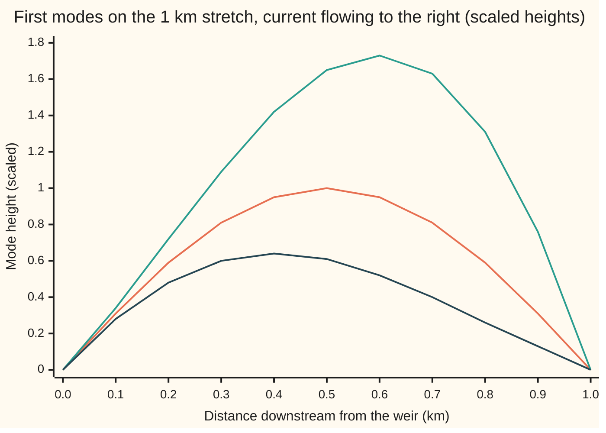

# General elliptic operators: Hopf's lemma, the Fredholm alternative, and a first eigenvalue with a positive mode

[Syllabus](../../../SYLLABUS.md) → [Partial differential equations](../README.md) → [Weak Solutions and Free Boundaries](../README.md#s06) → General elliptic operators

---

## General Overview

A small river runs through a 1 km stretch between a weir upstream and a polluted outfall downstream. Insect larvae live on the riverbed there, and a larva that crosses either end is lost. All the numbers in this story are illustrative.

The larvae wander at random, which spreads them like heat, with a spreading rate (diffusivity) $`\kappa`$ = 10,000 m²/day. The current also carries them downstream, 20 m/day on average. They breed at a net rate $`r`$ per day. The question a river manager asks: **how fast must they breed to keep the stretch populated?**

Without the current, wing 08's [Eigenvalue problems](../../08-Differential%20equations%20and%20dynamics/07-Series%20Solutions%20and%20Boundary%20Problems/08-eigenvalues-and-eigenfunctions.md) answers it: the lowest eigenvalue of a string with fixed ends (the smallest number that allows a nonzero shape) sets the threshold, 0.09870 per day here. The current makes upstream and downstream different. The operator is no longer **symmetric** (movable from one function to the other inside an integral), so the energy tricks of [Helmholtz](../04-Laplace%2C%20Poisson%20and%20Potentials/08-helmholtz-and-eigenfunctions.md) fail.

This card replaces them with three tools:

- **Hopf's lemma**: a positive solution leaves a fixed-zero boundary at a nonzero slope. Larvae really do drain out of both ends.
- **The Fredholm alternative**, in the weak setting: when a problem is not coercive, it decides whether a steady state exists by one test against a second, **adjoint** mode.
- **The principal eigenvalue**: the threshold is 0.10870 per day, and its mode is the only mode that is positive everywhere.

The current raises the threshold by exactly 0.0100 per day, from 0.09870 to 0.10870. The population piles up 0.5981 km down the stretch, but a larva released 0.4019 km down is worth the most. Of the larvae lost, 73.11% leave by the downstream end.

**An elliptic operator with drift has a lowest eigenvalue that is real and simple, with a mode positive inside and sloped at the boundary; a steady state at that eigenvalue exists exactly when the source is balanced against the positive mode of the adjoint operator, not against the operator's own mode.**

**What kind of fact this is:** three theorems. Why it works proves Hopf's lemma, the strong maximum principle and the simplicity of the first eigenvalue, and reduces the weak Fredholm alternative to the compact-operator version on [Fredholm alternative](../../18-Functional%20analysis/03-Bounded%20Operators/09-fredholm-alternative-and-integral-equations.md). The existence of the positive mode is stated with key steps and sources. The river is a model: constant spreading and drift, and growth with no crowding.

### The picture: the mode, its adjoint, and the drift-free shape



Orange (symmetric): $`\sin\pi x`$, the mode with no current. Teal (tallest): the population's shape $`\varphi_1 = e^{x}\sin\pi x`$, pushed downstream, peak at 0.5981 km. Dark (lowest): the adjoint mode $`\varphi_1^* = e^{-x}\sin\pi x`$, the value of a larva released at each point, peak at 0.4019 km. Every curve leaves both ends at a nonzero slope: that is Hopf's lemma.

---

## The formula

**Scaling first.** Measure distance $`x`$ in kilometres from the weir, so the region is $`\Omega = (0, 1)`$ and its boundary $`\partial\Omega`$ is the two ends. Measure time in units of $`T = (1000\ \text{m})^2/\kappa`$ = 100 days, the time spreading needs to cross the stretch. The **Péclet number** ([Convection-diffusion](../03-The%20Heat%20Equation%20in%20Depth/06-convection-diffusion-and-drift.md)) is drift over spreading, $`\mathrm{Pe} = 20 \times 1000 / 10{,}000`$ = 2. In these scaled units, the density $`u(x, t)`$ of larvae obeys $`u_t = u_{xx} - 2u_x + r\,u`$, with $`u = 0`$ at both ends and the growth rate $`r`$ now measured per 100 days.

**The operator.** Move everything but growth to the left. The spreading and the current form the operator

```math
L u = -u'' + 2u', \qquad L^* v = -v'' - 2v', \qquad u(0) = u(1) = 0 .
```

$`L^*`$ is the **adjoint**: the operator with $`\int_0^1 (Lu)\,v\,dx = \int_0^1 u\,(L^*v)\,dx`$ for every pair vanishing at the ends. Integration by parts flips the sign of the first derivative, so the drift reverses. $`L`$ is one case of the general operator of [Maximum principles](../01-Classification%20and%20Well-Posedness/08-maximum-principles.md):

```math
L u = -\sum_{i,j=1}^{d} a_{ij}(x)\,u_{ij} + \sum_{i=1}^{d} b_i(x)\,u_i + c(x)\,u, \qquad \sum_{i,j} a_{ij}\,\xi_i\xi_j \ge \theta\,\lvert\xi\rvert^2 .
```

Here $`a_{ij}`$ is the spreading matrix, with ellipticity constant $`\theta > 0`$; $`b`$ is the drift; $`c`$ is a loss rate. For the river, $`a = 1`$, $`\theta = 1`$, $`b = 2`$, $`c = 0`$.

**The three results, for the river.**

```math
\lambda_k = k^2\pi^2 + 1, \quad \varphi_1 = e^{x}\sin\pi x > 0, \quad \varphi_1^* = e^{-x}\sin\pi x > 0; \qquad \varphi_1'(0) = \pi, \ \ \varphi_1'(1) = -e\pi; \qquad (L - \lambda_1)u = f \ \text{solvable} \iff \int_0^1 f\,\varphi_1^*\,dx = 0 .
```

**Read it aloud:** the operator's numbers are k squared pi squared plus one; the lowest has a mode that is positive inside and leaves both ends at a nonzero slope; and at that number a source can be held steady only if it averages to zero against the adjoint's positive mode.

An **eigenpair** $`(\lambda, \varphi)`$ is a number and a nonzero shape with $`L\varphi = \lambda\varphi`$ and zero ends, as on [Helmholtz](../04-Laplace%2C%20Poisson%20and%20Potentials/08-helmholtz-and-eigenfunctions.md). The **principal eigenvalue** $`\lambda_1`$ is the one with the smallest real part. The population persists exactly when $`r > \lambda_1`$ = 10.869604, which is 0.10870 per day.

| Symbol | Plain meaning | In our example | Push it up and the answer… |
| --- | --- | --- | --- |
| $`x`$, $`\Omega`$, $`\partial\Omega`$, $`n`$ | distance from the weir, km; the stretch $`(0, 1)`$; its two ends; the outward direction at an end | $`n = -1`$ at the weir, $`+1`$ at the outfall | — |
| $`\kappa`$, $`T`$, $`\mathrm{Pe}`$ | spreading rate; time unit (1 km)²/$`\kappa`$; Péclet number | 10,000 m²/day; 100 days; 2 | Pe up: $`\lambda_1 = \pi^2 + \mathrm{Pe}^2/4`$ rises |
| $`u`$, $`f`$, $`r`$ | larva density (scaled); stocking rate, negative for removal (scaled); net breeding rate per $`T`$ | $`f`$ = 1; $`r`$ = 10, 10.8, 12 | $`r \to \lambda_1`$: the steady state runs away |
| $`L`$, $`L^*`$, $`d`$, $`u_i`$, $`u_{ij}`$ | the operator; its adjoint; number of space directions; slope in direction $`i`$; second derivative in $`i`$ and $`j`$ | $`-u'' + 2u'`$; $`-v'' - 2v'`$; $`d = 1`$ | — |
| $`a_{ij}`$, $`\theta`$, $`b`$, $`c`$, $`\xi`$ | spreading matrix; its least weight; drift; loss rate; a direction | 1, 1, 2, 0 | $`b`$ up: the mode tilts downstream |
| $`\lambda_k`$, $`k`$, $`\lambda_1`$ | eigenvalues; their count, $`k`$ = 1, 2, 3, …; the principal one | 10.869604, 40.478418, 89.826440 | — |
| $`\varphi_1`$, $`\varphi_1^*`$ | the principal mode of $`L`$ and of $`L^*`$ | peaks 1.7330 at 0.5981 km and 0.6375 at 0.4019 km | — |
| $`a(u, v)`$, $`\gamma`$, $`K`$, $`H^1_0`$ | the form $`\int (u'v' + 2u'v)`$; Gårding shift; solution operator $`(L + \gamma)^{-1}`$; shapes with zero ends and square-integrable slope | $`a(u, u) = \int u'^2`$; $`\gamma = 0`$ | — |
| $`m`$ | amount removed at 0.75 km for each unit released at 0.25 km | 1.6487 = $`e^{0.5}`$ | — |
| $`x_0`$, $`y`$, $`R`$, $`\rho`$, $`w`$, $`z`$, $`\alpha`$, $`\varepsilon`$, $`M`$ | Hopf proof: the boundary point; centre and radius of a ball touching it; distance from the centre (not a density); the barrier; the comparison function; the barrier's steepness; a small multiple; in Step 2, the minimum value of $`u`$ | in one dimension the ball is an interval | — |
| $`\chi`$, $`s`$, $`g`$, $`q`$ | a second eigenfunction for $`\lambda_1`$; the sliding factor in the simplicity proof; any positive eigenfunction; in Step 5, the shape left after taking out $`e^x`$ | $`e^x\sin 2\pi x`$ is not positive | — |
| $`A`$, $`N`$, $`h`$ | starting slope $`u'(0)`$ for shooting; grid intervals; grid step | $`N`$ = 50, 100, 200 | error falls as $`h^2`$ |

### When it holds

- **Uniformly elliptic up to the boundary, $`\theta > 0`$.** Hopf's barrier needs it. The operator $`-x^2u'' + 2u`$ loses ellipticity at $`x = 0`$, and $`u = x^2`$ then leaves the end with slope 0.
- **Bounded coefficients, smooth enough boundary.** Hopf's lemma needs a ball inside the region touching each boundary point. At a 90° corner of a square, $`u = x_1x_2`$ is harmonic, positive inside and zero on two sides, yet its slope at the corner is 0.
- **A bounded region.** Compactness, and so the Fredholm alternative and a discrete list of eigenvalues, comes from Rellich's theorem, which fails on an endless river.
- **The right adjoint.** Solvability is tested against $`\varphi_1^*`$, not $`\varphi_1`$. With the wrong one, a balanced release scores −1.5601 instead of 0.
- **Positivity needs $`r < \lambda_1`$.** At $`r`$ = 12 a steady state still exists, but it is negative everywhere: minimum −1.2224.

---

## Why it works

### Step 0: a positive solution cannot touch zero gently

A positive solution of an elliptic equation is pushed up from below wherever it is small. So it cannot come down to zero with a flat tangent, inside or at the edge. Inside, that is the strong maximum principle. At the edge, it is Hopf's lemma: the slope there is strictly nonzero. A rubber sheet pressed up by a stone leaves its clamped frame at a definite angle, never flat.

That one fact makes the principal mode positive and its eigenvalue simple. Compactness, through the Fredholm alternative, supplies the solvability test.

### Step 1: Hopf's lemma, by a barrier

**Statement.** Let $`L`$ be uniformly elliptic with bounded coefficients and $`c \ge 0`$. Suppose $`Lu \ge 0`$ in $`\Omega`$, $`u`$ is continuous up to the boundary, and at a boundary point $`x_0`$, $`u(x_0) \le 0`$ and $`u > u(x_0)`$ inside. If a ball inside $`\Omega`$ touches $`\partial\Omega`$ at $`x_0`$, then the outward slope is strictly negative: $`\partial u/\partial n\,(x_0) < 0`$. With $`c = 0`$ the sign condition on $`u(x_0)`$ drops.

**How the proof goes.** In the ring between the touching ball and the ball of half its radius, build a barrier $`w`$ with $`Lw \le 0`$ that is zero on the outer sphere. A small multiple of it fits under $`u - u(x_0)`$ on both spheres, so the weak maximum principle keeps it under in the whole ring. Both vanish at $`x_0`$, so $`u`$ rises inward at least as steeply as the barrier, which rises strictly.

<details>
<summary>Detailed proof: the barrier in the ring</summary>

Put $`\rho = \lvert x - y\rvert`$, with $`B(y, R)`$ inside $`\Omega`$ and touching $`\partial\Omega`$ at $`x_0`$. Take

$`\displaystyle w(x) = e^{-\alpha\rho^2} - e^{-\alpha R^2},`$

which is positive inside the ball and zero on its sphere. Here $`\mathrm{tr}\,a`$, the trace, is the sum of the diagonal entries $`a_{ii}`$. Differentiating twice,

$`\displaystyle Lw = e^{-\alpha\rho^2}\Big(-4\alpha^2\sum_{i,j} a_{ij}(x - y)_i(x - y)_j + 2\alpha\sum_i a_{ii} - 2\alpha\, b\cdot(x - y)\Big) + c\,w \le e^{-\alpha\rho^2}\big(-4\alpha^2\theta\rho^2 + 2\alpha\,\mathrm{tr}\,a + 2\alpha\lvert b\rvert\rho + c\big).`$

On the ring $`R/2 \le \rho \le R`$ the first term is at least $`\alpha^2\theta R^2`$ in size and beats the others once $`\alpha`$ is large, so $`Lw \le 0`$ there.

Let $`z = u(x_0) - u + \varepsilon w`$. Then $`Lz = c\,u(x_0) - Lu + \varepsilon Lw \le 0`$, using $`c \ge 0`$ and $`u(x_0) \le 0`$. On the inner sphere $`u - u(x_0)`$ has a positive minimum, by continuity on a compact set; pick $`\varepsilon`$ so small that $`\varepsilon w`$ stays below it there, so $`z \le 0`$. On the outer sphere $`w = 0`$ and $`u \ge u(x_0)`$, so $`z \le 0`$. The weak maximum principle of [Maximum principles](../01-Classification%20and%20Well-Posedness/08-maximum-principles.md) gives $`z \le 0`$ in the ring.

So $`u - u(x_0) \ge \varepsilon w`$ in the ring, with equality 0 at $`x_0`$. Divide by the distance from $`x_0`$ along $`-n`$ and let it shrink:

$`\displaystyle -\frac{\partial u}{\partial n}(x_0) \ge -\varepsilon\,\frac{\partial w}{\partial n}(x_0) = 2\varepsilon\alpha R\,e^{-\alpha R^2} > 0 .`$

</details>

For the river, $`\varphi_1 = e^x\sin\pi x`$ has $`L\varphi_1 = \lambda_1\varphi_1 \ge 0`$, $`c = 0`$, and a minimum of 0 at each end. Hopf promises nonzero slopes, and they are $`\pi`$ = 3.1416 at the weir and $`-e\pi`$ = −8.5397 at the outfall.

Larvae leave an end at the spreading rate times the slope. In scaled units, births in the stretch, $`\lambda_1\int\varphi_1`$, equal the losses, $`\varphi_1'(0) - \varphi_1'(1) = \pi(1 + e)`$: both are 11.681327. The outfall takes $`e/(1 + e)`$ = 73.11% of the losses.

### Step 2: the strong maximum principle, from Hopf

**Statement.** On a connected region, with $`c \ge 0`$ and $`Lu \ge 0`$, a solution cannot reach a minimum $`\le 0`$ inside unless it is constant. [Maximum principles](../01-Classification%20and%20Well-Posedness/08-maximum-principles.md) stated the mirror image, for a maximum, in its Step 7 and named Hopf's lemma as the proof.

**Proof.** Suppose the minimum $`M \le 0`$ is reached inside, but $`u`$ is not constant. Pick a point where $`u > M`$ that is closer to the set where $`u = M`$ than to $`\partial\Omega`$. Grow a ball around it until it first touches a point $`x_0`$ with $`u(x_0) = M`$. Inside that ball $`u > M`$, so Hopf's lemma gives $`u`$ a nonzero slope at $`x_0`$. But $`x_0`$ is an inside minimum, where every slope is zero: a contradiction.

### Step 3: the Fredholm alternative when the form is not coercive

Multiply $`Lu - \lambda u = f`$ by a test function $`v`$ and integrate by parts, as on [Weak solutions](01-weak-solutions-and-the-weak-formulation.md). The river's form is

```math
a(u, v) - \lambda\int_0^1 u\,v\,dx = \int_0^1 f\,v\,dx \ \text{ for every } v \in H^1_0(0, 1), \qquad a(u, v) = \int_0^1 (u'v' + 2u'v)\,dx .
```

For the general operator, spreading written as a flux's slope (divergence form):

```math
L u = -\sum_{i,j=1}^{d} (a_{ij}\,u_j)_i + \sum_{i=1}^{d} b_i\,u_i + c\,u, \qquad a(u, v) = \int_\Omega \Big(\sum_{i,j} a_{ij}\,u_j\,v_i + \sum_i b_i\,u_i\,v + c\,u\,v\Big)\,dx .
```

It is not symmetric, but it is still bounded, so the trouble is coercivity. Here $`a(u, u) - \lambda\int u^2 = \int u'^2 - \lambda\int u^2`$ stops being coercive at $`\lambda = \pi^2`$ = 9.869604, where $`\sin\pi x`$ makes it zero, so Lax-Milgram covers only $`\lambda < \pi^2`$, which stops short even of $`\lambda_1`$. **Gårding's inequality** (from [Lax-Milgram](03-lax-milgram-and-elliptic-existence.md)) says the form is coercive after a shift: $`a(u, u) + \gamma\int u^2 \ge \tfrac{\theta}{2}\int\lvert\nabla u\rvert^2`$ for some $`\gamma \ge 0`$. For the river, $`\int 2u'u = [u^2]_0^1 = 0`$, so $`a(u, u) = \int u'^2`$ and $`\gamma = 0`$ already works. Then:

1. Lax-Milgram makes $`L + \gamma`$ invertible. Call the inverse $`K`$: it sends a source $`f`$ to the weak solution of $`(L + \gamma)u = f`$, and it is bounded from square-integrable sources into $`H^1_0`$.
2. On a bounded region, $`H^1_0`$ sits compactly inside the square-integrable functions ([Boundary values and compactness](../../18-Functional%20analysis/04-Distributions%20and%20Sobolev%20Spaces/10-trace-and-rellich-kondrachov-in-outline.md)). So $`K`$ is a compact operator.
3. Apply $`K`$ to $`(L + \gamma)u = (\lambda + \gamma)u + f`$. The problem becomes $`u - (\lambda + \gamma)Ku = Kf`$: identity minus compact.
4. The [Fredholm alternative](../../18-Functional%20analysis/03-Bounded%20Operators/09-fredholm-alternative-and-integral-equations.md) for that equation, translated back: **either** $`(L - \lambda)u = 0`$ has only $`u = 0`$, and then every $`f`$ gives exactly one weak solution; **or** it has finitely many independent solutions, $`(L^* - \lambda)v = 0`$ has the same number, and $`f`$ gives a solution exactly when $`\int f\,v = 0`$ for each of them.
5. The values of $`\lambda`$ where the second case happens are the eigenvalues. Because $`K`$ is compact, they are isolated points that can pile up only at infinity. Compactness alone does not promise infinitely many; for the river, the closed form shows they are $`k^2\pi^2 + 1`$.

$`L^*`$ enters in step 4 because the adjoint of $`K`$ is the solution operator of $`L^* + \gamma`$.

**In one dimension the whole alternative can be watched.** Shoot from the weir: start at $`u(0) = 0`$ with any slope $`A`$ and integrate $`(L - \lambda_1)u = f`$ to the outfall. The answer at the outfall is

```math
u(1) = \frac{A}{\pi}\,\varphi_1(1) - \frac{e}{\pi}\int_0^1 f\,\varphi_1^*\,dx = -\frac{e}{\pi}\int_0^1 f\,\varphi_1^*\,dx ,
```

because $`\varphi_1(1) = 0`$. **Read it aloud:** the slope you start with makes no difference at the far end; only the source's score against the adjoint mode does. If the score is not zero, no slope hits $`u(1) = 0`$, so no solution. If it is zero, every slope does: the solutions form a line, one particular solution plus any multiple of $`\varphi_1`$.

For uniform stocking, $`f = 1`$, the score is $`\pi(1 + e^{-1})/(\pi^2 + 1)`$ = 0.395352, so the far end lands at −0.342081 whatever the starting slope. At the critical rate, steady stocking makes the population grow forever.

### Step 4: the principal eigenvalue and its positive mode

**Statement** (Evans, section 6.5.2). Let $`L`$ be uniformly elliptic with smooth coefficients and $`c \ge 0`$ on a bounded, smooth, connected region. Then:

- $`L`$ has a real eigenvalue $`\lambda_1 > 0`$, and every other eigenvalue, even a complex one, has a larger real part;
- its mode $`\varphi_1`$ can be taken positive inside, with $`\partial\varphi_1/\partial n < 0`$ on the boundary;
- $`\lambda_1`$ is simple: every eigenfunction for it is a multiple of $`\varphi_1`$;
- the same holds for $`L^*`$, with the same $`\lambda_1`$ and a positive mode $`\varphi_1^*`$.

**Existence, in outline.** Two facts about the solution operator of $`L`$ drive it. By the weak maximum principle, it turns a nonnegative source into a nonnegative solution. By Rellich, it is compact. Evans builds $`\lambda_1`$ and a nonnegative mode from these two facts plus a fixed-point step: he adds a small positive source, gets nonnegative solutions of any size from Schaefer's fixed-point theorem (a form of Leray-Schauder), scales them to size 1, and lets the source shrink to zero. A grid makes the idea visible: solving again and again, starting from the all-ones vector, converges to a mode with every entry positive, and to $`\lambda_1`$. Berestycki, Nirenberg and Varadhan define $`\lambda_1`$ through the maximum principle alone, on any bounded region (Sources).

**Positive inside, sloped at the edge.** The limit $`\varphi_1 \ge 0`$ is not zero, and $`L\varphi_1 = \lambda_1\varphi_1 \ge 0`$. Step 2 makes it strictly positive inside, and Step 1 gives it a nonzero slope at every boundary point.

**Simple.** Take another real eigenfunction $`\chi`$ for $`\lambda_1`$, positive somewhere (if not, use $`-\chi`$). Slide: look at $`\varphi_1 - s\chi`$ as $`s`$ grows from 0. Because $`\varphi_1`$ is positive inside and strictly sloped at the edge, the difference stays positive for small $`s`$. Stop at the first $`s`$ where it touches zero inside, or flattens to zero slope at an edge point. The difference is still an eigenfunction for $`\lambda_1`$, and nonnegative, so $`L`$ applied to it is $`\ge 0`$. By Steps 1 and 2, it is either zero everywhere or positive inside with strict slopes. The second would let $`s`$ grow further, so it is zero: $`\chi`$ is a multiple of $`\varphi_1`$.

**The only positive mode.** Suppose $`Lg = \lambda g`$ with $`g > 0`$. Pair it with the adjoint's positive mode:

```math
\lambda\int g\,\varphi_1^* = \int (Lg)\,\varphi_1^* = \int g\,(L^*\varphi_1^*) = \lambda_1\int g\,\varphi_1^* .
```

The integral is positive, so $`\lambda = \lambda_1`$. Every higher mode must change sign. For the river, $`e^x\sin 2\pi x`$ changes sign at the middle.

**The same pairing ends the population question.** At $`r = \lambda_1`$, any stocking $`f \ge 0`$ that is not zero has $`\int f\varphi_1^* > 0`$. Step 3 then says no steady state exists. Below $`\lambda_1`$ the steady state is positive: the maximum principle holds for $`L - r`$ exactly when $`r < \lambda_1`$ (Berestycki, Nirenberg and Varadhan). Above it, a steady state may exist, but it cannot be positive.

### Step 5: why the river is solvable by hand

Substitute $`u = e^{x}q`$. Then $`L(e^xq) = e^x(-q'' + q)`$: the drift disappears and leaves $`-q'' + q`$, a symmetric operator. Its eigenpairs are $`k^2\pi^2 + 1`$ and $`\sin k\pi x`$, which gives every formula above. With a drift of size $`b`$ the factor is $`e^{bx/2}`$ and the shift is $`b^2/4`$; for the river, $`b^2/4`$ = 1.000000, which is 0.0100 per day.

The trick needs a drift that is the slope of some function. A swirling drift in two dimensions has no such weight, and only the maximum principle route of Steps 1 to 4 remains. The river lets the two routes check each other.

---

## Worked numbers, by hand

The river: 1 km, spreading 10,000 m²/day, drift 20 m/day, both ends lethal.

| Step | Arithmetic | Value |
| --- | --- | --- |
| time unit | $`T = 1000^2 / 10{,}000`$ | 100 days |
| Péclet number | $`20 \times 1000 / 10{,}000`$ | 2 |
| drift's extra cost | $`b^2/4 = 2^2/4`$ | 1.000000 |
| principal eigenvalue | $`\pi^2 + 1 = 9.869604 + 1`$ | 10.869604 |
| threshold per day | $`10.869604 / 100`$ | 0.10870 per day |
| without the current | $`9.869604 / 100`$ | 0.09870 per day |
| mode's peak | $`1 - \arctan(\pi)/\pi`$ | 0.5981 km |
| adjoint's peak | $`\arctan(\pi)/\pi`$ | 0.4019 km |
| Hopf slopes | $`\pi`$ and $`-e\pi`$ | 3.1416 and −8.5397 |
| share lost downstream | $`e/(1 + e)`$ | 0.7311 |
| score of uniform stocking | $`\pi(1 + e^{-1})/(\pi^2 + 1)`$ | 0.395352 |
| value at 0.25 km and 0.75 km | $`e^{-0.25}\sin(\pi/4)`$, $`e^{-0.75}\sin(3\pi/4)`$ | 0.5507 and 0.3340 |
| **removal that balances 1 released at 0.25 km** | $`m = 0.5507 / 0.3340 = e^{0.5}`$ | **1.6487** |

The stretch stays populated only if larvae breed faster than 0.10870 per day. At exactly that rate, releasing 1 unit at 0.25 km and removing 1.6487 units at 0.75 km gives a steady state; any other ratio does not.

### What breaks if you drop a piece

| Mistake | Comes out at | What went wrong |
| --- | --- | --- |
| Uniform stocking at exactly $`r = \lambda_1`$ | far end −0.342081 for every starting slope; grid peaks 267.5, 1070.3, 4281.2 | The score $`\int f\varphi_1^*`$ = 0.395352 is not 0. No steady state exists, and the grid's answer grows fourfold each time the step halves. |
| Breeding above threshold, $`r`$ = 12 | negative at every inside point, minimum −1.2224 | 12 is not an eigenvalue, so Fredholm gives a solution, but only $`r < \lambda_1`$ gives a positive one. |
| Ellipticity lost at the edge: $`-x^2u'' + 2u`$, $`u = x^2`$ | residual 0.000000; slope at 0: 0.0010 over a step of 0.001, so 0 | The spreading weight $`x^2`$ vanishes at the boundary, so Hopf's barrier cannot be built. |
| Drift left out of the eigenvalue, energy ratio of $`\sin\pi x`$ | 9.869604 | The drift cancels from $`a(u, u)`$, but not from $`L`$. The threshold is 1.000000 higher. |

---

## Code, from first principles, and it actually runs

Three independent roads reach the eigenvalues: the closed form $`k^2\pi^2 + 1`$; shooting, which integrates from the weir by fourth-order Runge-Kutta (RK4) and bisects on $`\lambda`$ until the far end hits zero; and a centred-difference grid, solved by the Thomas algorithm (elimination for a matrix with three diagonals) inside inverse iteration, with Richardson extrapolation. Shooting also checks Hopf's slopes, the Fredholm test through point sources, and the steady states at $`r`$ = 10, 10.8 and 12 against their closed forms. Simpson's rule checks the integrals.

### Python

```python
# L u = -u'' + 2u' on (0, 1), u(0) = u(1) = 0 (scaled): the principal eigenvalue, Hopf's slopes, Fredholm.
# Roads: closed forms; shooting by RK4 with bisection; a finite-difference grid with inverse iteration;
# Simpson integrals; centred-difference residuals.  Standard library only.
import math
PI, E = math.pi, math.e
phi = lambda x: math.exp(x) * math.sin(PI * x)     # L's first mode
phs = lambda x: math.exp(-x) * math.sin(PI * x)    # the adjoint's first mode

def shoot(lam, A, f=0.0, kicks=None, n=4000):  # -u''+2u'-lam u = f + point sources; u(0)=0, u'(0)=A
    kicks = kicks or {}; h = 1.0 / n; u, p, lo, hi = 0.0, A, math.inf, -math.inf
    rhs = lambda u, p: (p, 2 * p - lam * u - f)
    for i in range(n):
        if i in kicks: p -= kicks[i]   # a source of size a makes the slope drop by a
        k1 = rhs(u, p); k2 = rhs(u + h / 2 * k1[0], p + h / 2 * k1[1])
        k3 = rhs(u + h / 2 * k2[0], p + h / 2 * k2[1]); k4 = rhs(u + h * k3[0], p + h * k3[1])
        u += h / 6 * (k1[0] + 2 * k2[0] + 2 * k3[0] + k4[0]); p += h / 6 * (k1[1] + 2 * k2[1] + 2 * k3[1] + k4[1])
        if i < n - 1: lo, hi = min(lo, u), max(hi, u)   # inside points only
    return u, p, lo, hi

def bisect(g, a, b, it=60):
    for _ in range(it):
        m = (a + b) / 2; a, b = (a, m) if g(a) * g(m) <= 0 else (m, b)
    return (a + b) / 2

def simpson(f, a, b, n=2000):
    h = (b - a) / n
    return h / 3 * (f(a) + f(b) + sum((4 if i % 2 else 2) * f(a + i * h) for i in range(1, n)))

def thomas(lo, di, up, r):
    n = len(di); d, r = di[:], r[:]
    for i in range(1, n):
        m = lo[i] / d[i - 1]; d[i] -= m * up[i - 1]; r[i] -= m * r[i - 1]
    x = [0.0] * n; x[-1] = r[-1] / d[-1]
    for i in range(n - 2, -1, -1): x[i] = (r[i] - up[i] * x[i + 1]) / d[i]
    return x

def grid(N, lam):  # centred differences for -u''+2u'-lam u on the N-1 inside points
    h = 1.0 / N
    return [-1 / h**2 - 1 / h] * (N - 1), [2 / h**2 - lam] * (N - 1), [-1 / h**2 + 1 / h] * (N - 1)

def grid_eig(N):  # inverse iteration: the eigenvalue of smallest size and its vector
    lo, di, up = grid(N, 0.0); v = [1.0] * (N - 1)
    for _ in range(80):
        w = thomas(lo, di, up, v); s = max(abs(t) for t in w); v = [t / s for t in w]
    Av = [di[i] * v[i] + (lo[i] * v[i - 1] if i else 0) + (up[i] * v[i + 1] if i < N - 2 else 0) for i in range(N - 1)]
    return sum(a * b for a, b in zip(v, Av)) / sum(a * a for a in v), v

lam = [k * k * PI * PI + 1 for k in (1, 2, 3)]
sh = [bisect(lambda l: shoot(l, 1.0)[0], a, b) for a, b in ((5, 15), (35, 45), (85, 95))]
print("eigenvalues k^2 pi^2 + 1:  " + "  ".join(f"{t:.6f}" for t in lam))
print("by shooting (RK4, bisect): " + "  ".join(f"{t:.6f}" for t in sh))
for a, b in zip(lam, sh): assert abs(a - b) < 1e-6        # closed form against shooting
fd = {N: grid_eig(N) for N in (50, 100, 200)}
l50, l100, l200 = (fd[N][0] for N in (50, 100, 200))
print(f"grid lambda_1, N = 50/100/200: {l50:.6f} {l100:.6f} {l200:.6f}; order {math.log2((l50 - l100) / (l100 - l200)):.3f}; Richardson {(4 * l200 - l100) / 3:.6f}")
assert abs((4 * l200 - l100) / 3 - lam[0]) < 1e-6 and all(t > 0 for t in fd[200][1])   # grid agrees; its mode is positive
print(f"grid mode at N = 200: smallest entry {min(fd[200][1]):.6f} > 0, sign changes 0")
print(f"drift-free -u'': pi^2 = {PI * PI:.6f}; drift adds b^2/4 = {lam[0] - PI * PI:.6f}")
print(f"population: T = 100 days, threshold {lam[0] / 100:.5f} per day, without drift {PI * PI / 100:.5f} per day; the current adds {(lam[0] - PI * PI) / 100:.4f}")
xp, xs = 1 - math.atan(PI) / PI, math.atan(PI) / PI
xpb = bisect(lambda x: math.sin(PI * x) + PI * math.cos(PI * x), 0.3, 0.9)
print(f"peaks: mode at x = {xp:.4f} (bisection {xpb:.4f}), height {phi(xp):.4f}; adjoint at x = {xs:.4f}, height {phs(xs):.4f}")
assert abs(xp - xpb) < 1e-9
print(f"release at {xs:.4f} km instead of 0.25 km: value {phs(xs):.4f} against {phs(0.25):.4f}, ratio {phs(xs) / phs(0.25):.4f}")
hres = lambda g, l, s, h: max(abs(-(g(x + h) - 2 * g(x) + g(x - h)) / h**2 + s * (g(x + h) - g(x - h)) / h - l * g(x)) for x in [0.1 * i for i in range(1, 10)])
r1, r2 = hres(phi, lam[0], 1, 1e-2), hres(phi, lam[0], 1, 5e-3); r3 = hres(phs, lam[0], -1, 5e-3)
print(f"residual of L phi - lambda_1 phi: h = 0.01 {r1:.6f}, h = 0.005 {r2:.6f}, ratio {r1 / r2:.2f}; of L* phi* - lambda_1 phi*: {r3:.6f}")
assert r1 / r2 > 3.9 and r3 < 1e-3
_, pR, _, _ = shoot(lam[0], PI)
print(f"Hopf slopes: phi'(0) = pi = {PI:.4f}; phi'(1) = -e pi = {-E * PI:.4f}, shooting {pR:.4f}")
print(f"share of losses out the downstream end e/(1 + e) = {E / (1 + E):.4f}")
I1 = simpson(phi, 0, 1)
print(f"births = losses: lambda_1 * int phi = {lam[0] * I1:.6f}, phi'(0) - phi'(1) = pi (1 + e) = {PI * (1 + E):.6f}")
assert abs(pR + E * PI) < 1e-6 and abs(lam[0] * I1 - PI * (1 + E)) < 1e-9
J = simpson(phs, 0, 1); Jc = PI * (1 + 1 / E) / (PI * PI + 1)
print(f"Fredholm test for f = 1: int f phi* = {J:.6f} (closed form {Jc:.6f}), not 0: no steady state")
ends = [shoot(lam[0], A, f=1.0)[0] for A in (0.0, 5.0)]
print(f"shooting f = 1 at lambda_1: u(1) = {ends[0]:.6f} with u'(0) = 0, {ends[1]:.6f} with u'(0) = 5; formula -(e/pi) int phi* = {-E / PI * Jc:.6f}")
assert abs(J - Jc) < 1e-12 and all(abs(t + E / PI * Jc) < 1e-8 for t in ends)
big = []
for N in (50, 100, 200):
    lo, di, up = grid(N, lam[0]); big.append(max(abs(t) for t in thomas(lo, di, up, [1.0] * (N - 1))))
print("grid 'solution' of f = 1 at lambda_1, largest |u|, N = 50/100/200: " + " ".join(f"{t:.1f}" for t in big))
assert big[2] / big[1] > 3.5 and big[1] / big[0] > 3.5    # grows like 1/h^2: no limit
m = phs(0.25) / phs(0.75)   # the amount to remove at x = 0.75
print(f"release 1 at x = 0.25, remove m at x = 0.75: phi*(0.25) = {phs(0.25):.4f}, phi*(0.75) = {phs(0.75):.4f}, m = {m:.4f} = e^0.5 {math.exp(0.5):.4f}")
kb, ku = {1000: 1.0, 3000: -m}, {1000: 1.0, 3000: -1.0}   # a source +1 and a sink at x = 0.75
ub = [shoot(lam[0], A, kicks=kb)[0] for A in (0.0, 1.0)]; uu = shoot(lam[0], 0.0, kicks=ku)[0]
print(f"shooting, balanced: |u(1)| = {abs(ub[0]):.12f} and {abs(ub[1]):.12f} for u'(0) = 0, 1; unbalanced m = 1: u(1) = {uu:.6f}, formula {-E / PI * (phs(0.25) - phs(0.75)):.6f}")
assert abs(m - math.exp(0.5)) < 1e-12 and max(abs(t) for t in ub) < 1e-9 and abs(uu + E / PI * (phs(0.25) - phs(0.75))) < 1e-9
print(f"wrong test with L's own mode: phi(0.25) - m phi(0.75) = {phi(0.25) - m * phi(0.75):.4f}")
for l in (10.0, 10.8, 12.0):   # f = 1 below and above lambda_1: Fredholm says one solution each; only one is positive
    u0, u1 = shoot(l, 0.0, f=1.0)[0], shoot(l, 1.0, f=1.0)[0]; A = -u0 / (u1 - u0); _, _, mn, mx = shoot(l, A, f=1.0)
    w = math.sqrt(l - 1); B = (math.exp(-1) / l - math.cos(w) / l) / math.sin(w)
    uc = lambda x: -1 / l + math.exp(x) * (math.cos(w * x) / l + B * math.sin(w * x))
    cmn, cmx = min(uc(i / 4000) for i in range(1, 4000)), max(uc(i / 4000) for i in range(1, 4000))
    sign, ext, cext = ("positive", mx, cmx) if mn > 0 else ("negative", mn, cmn) if mx < 0 else ("mixed", mn, cmn)  # the other extreme is the grid point next to an end
    print(f"f = 1, r = {l:.1f}: slope u'(0) {A:.4f}; {sign} at every inside point, extreme {ext:.4f}; closed form {cext:.4f}")
    assert abs(mn - cmn) < 1e-6 and abs(mx - cmx) < 1e-6 and (mn > 0) == (l < lam[0]) and (mx < 0) == (l > lam[0])
q = lambda x: x * x; h = 1e-3
print(f"degenerate -x^2 u'' + 2u on u = x^2: residual at 0.5 {abs(-0.25 * (q(0.5 + h) - 2 * q(0.5) + q(0.5 - h)) / h**2 + 2 * q(0.5)):.6f}, slope at 0 {(q(h) - q(0)) / h:.4f} -> 0")
ray = simpson(lambda x: (PI * math.cos(PI * x))**2, 0, 1) / simpson(lambda x: math.sin(PI * x)**2, 0, 1)
print(f"energy ratio of sin(pi x), the drift dropped: {ray:.6f}, below lambda_1 = {lam[0]:.6f}")
assert abs(ray - PI * PI) < 1e-9
print(f"try: drift b = 4: lambda_1 = pi^2 + 4 = {PI * PI + 4:.6f}, best release point atan(pi/2)/pi = {math.atan(PI / 2) / PI:.4f}")
print("chart, x       " + " ".join(f"{i / 10:5.1f}" for i in range(11)))
for name, g in (("sin(pi x)", lambda x: math.sin(PI * x)), ("phi      ", phi), ("phi*     ", phs)):
    print(f"chart, {name}" + " ".join(f"{g(i / 10):5.2f}" for i in range(11)))
print("ALL CHECKS PASS")
```

**Ran 2026-11-24 on macOS, Python 3.14.10, standard library only. All checks passed. Output, pasted from the run:**

```
eigenvalues k^2 pi^2 + 1:  10.869604  40.478418  89.826440
by shooting (RK4, bisect): 10.869604  40.478418  89.826440
grid lambda_1, N = 50/100/200: 10.864484 10.868324 10.869284; order 2.000; Richardson 10.869604
grid mode at N = 200: smallest entry 0.009109 > 0, sign changes 0
drift-free -u'': pi^2 = 9.869604; drift adds b^2/4 = 1.000000
population: T = 100 days, threshold 0.10870 per day, without drift 0.09870 per day; the current adds 0.0100
peaks: mode at x = 0.5981 (bisection 0.5981), height 1.7330; adjoint at x = 0.4019, height 0.6375
release at 0.4019 km instead of 0.25 km: value 0.6375 against 0.5507, ratio 1.1577
residual of L phi - lambda_1 phi: h = 0.01 0.002336, h = 0.005 0.000584, ratio 4.00; of L* phi* - lambda_1 phi*: 0.000215
Hopf slopes: phi'(0) = pi = 3.1416; phi'(1) = -e pi = -8.5397, shooting -8.5397
share of losses out the downstream end e/(1 + e) = 0.7311
births = losses: lambda_1 * int phi = 11.681327, phi'(0) - phi'(1) = pi (1 + e) = 11.681327
Fredholm test for f = 1: int f phi* = 0.395352 (closed form 0.395352), not 0: no steady state
shooting f = 1 at lambda_1: u(1) = -0.342081 with u'(0) = 0, -0.342081 with u'(0) = 5; formula -(e/pi) int phi* = -0.342081
grid 'solution' of f = 1 at lambda_1, largest |u|, N = 50/100/200: 267.5 1070.3 4281.2
release 1 at x = 0.25, remove m at x = 0.75: phi*(0.25) = 0.5507, phi*(0.75) = 0.3340, m = 1.6487 = e^0.5 1.6487
shooting, balanced: |u(1)| = 0.000000000000 and 0.000000000000 for u'(0) = 0, 1; unbalanced m = 1: u(1) = -0.187485, formula -0.187485
wrong test with L's own mode: phi(0.25) - m phi(0.75) = -1.5601
f = 1, r = 10.0: slope u'(0) 2.9866; positive at every inside point, extreme 1.5661; closed form 1.5661
f = 1, r = 10.8: slope u'(0) 35.8200; positive at every inside point, extreme 19.6767; closed form 19.6767
f = 1, r = 12.0: slope u'(0) -2.0634; negative at every inside point, extreme -1.2224; closed form -1.2224
degenerate -x^2 u'' + 2u on u = x^2: residual at 0.5 0.000000, slope at 0 0.0010 -> 0
energy ratio of sin(pi x), the drift dropped: 9.869604, below lambda_1 = 10.869604
try: drift b = 4: lambda_1 = pi^2 + 4 = 13.869604, best release point atan(pi/2)/pi = 0.3195
chart, x         0.0   0.1   0.2   0.3   0.4   0.5   0.6   0.7   0.8   0.9   1.0
chart, sin(pi x) 0.00  0.31  0.59  0.81  0.95  1.00  0.95  0.81  0.59  0.31  0.00
chart, phi       0.00  0.34  0.72  1.09  1.42  1.65  1.73  1.63  1.31  0.76  0.00
chart, phi*      0.00  0.28  0.48  0.60  0.64  0.61  0.52  0.40  0.26  0.13  0.00
ALL CHECKS PASS
```

### Rust

```rust
// L u = -u'' + 2u' on (0, 1), u(0) = u(1) = 0 (scaled): the principal eigenvalue, Hopf's slopes, Fredholm.
// Roads: closed forms; shooting by RK4 with bisection; a finite-difference grid with inverse iteration;
// Simpson integrals; centred-difference residuals.  std only.
use std::f64::consts::{E, PI};

fn phi(x: f64) -> f64 { x.exp() * (PI * x).sin() } // L's first mode
fn phs(x: f64) -> f64 { (-x).exp() * (PI * x).sin() } // the adjoint's first mode

// -u''+2u'-lam u = f + point sources; u(0)=0, u'(0)=A; returns u(1), u'(1), inside min and max
fn shoot(lam: f64, a: f64, f: f64, kicks: &[(usize, f64)]) -> (f64, f64, f64, f64) {
    let n = 4000usize; let h = 1.0 / n as f64;
    let (mut u, mut p, mut lo, mut hi) = (0.0f64, a, f64::INFINITY, f64::NEG_INFINITY);
    let rhs = |u: f64, p: f64| (p, 2.0 * p - lam * u - f);
    for i in 0..n {
        for &(j, s) in kicks { if j == i { p -= s; } } // a source of size s makes the slope drop by s
        let k1 = rhs(u, p); let k2 = rhs(u + h / 2.0 * k1.0, p + h / 2.0 * k1.1);
        let k3 = rhs(u + h / 2.0 * k2.0, p + h / 2.0 * k2.1); let k4 = rhs(u + h * k3.0, p + h * k3.1);
        u += h / 6.0 * (k1.0 + 2.0 * k2.0 + 2.0 * k3.0 + k4.0);
        p += h / 6.0 * (k1.1 + 2.0 * k2.1 + 2.0 * k3.1 + k4.1);
        if i < n - 1 { lo = lo.min(u); hi = hi.max(u); } // inside points only
    }
    (u, p, lo, hi)
}

fn bisect(g: &dyn Fn(f64) -> f64, mut a: f64, mut b: f64) -> f64 {
    for _ in 0..60 {
        let m = (a + b) / 2.0;
        if g(a) * g(m) <= 0.0 { b = m; } else { a = m; }
    }
    (a + b) / 2.0
}

fn simpson(f: &dyn Fn(f64) -> f64, a: f64, b: f64) -> f64 {
    let n = 2000; let h = (b - a) / n as f64; let mut s = 0.0;
    for i in 1..n { s += if i % 2 == 1 { 4.0 } else { 2.0 } * f(a + i as f64 * h); }
    h / 3.0 * (f(a) + f(b) + s)
}

fn thomas(lo: &[f64], di: &[f64], up: &[f64], r: &[f64]) -> Vec<f64> {
    let n = di.len(); let mut d = di.to_vec(); let mut r = r.to_vec();
    for i in 1..n { let m = lo[i] / d[i - 1]; d[i] -= m * up[i - 1]; r[i] -= m * r[i - 1]; }
    let mut x = vec![0.0; n]; x[n - 1] = r[n - 1] / d[n - 1];
    for i in (0..n - 1).rev() { x[i] = (r[i] - up[i] * x[i + 1]) / d[i]; }
    x
}

// centred differences for -u''+2u'-lam u on the N-1 inside points
fn grid(nn: usize, lam: f64) -> (Vec<f64>, Vec<f64>, Vec<f64>) {
    let h = 1.0 / nn as f64;
    (vec![-1.0 / (h * h) - 1.0 / h; nn - 1], vec![2.0 / (h * h) - lam; nn - 1], vec![-1.0 / (h * h) + 1.0 / h; nn - 1])
}

fn maxabs(v: &[f64]) -> f64 { v.iter().fold(0.0f64, |m, t| m.max(t.abs())) }

fn grid_eig(nn: usize) -> (f64, Vec<f64>) { // inverse iteration: the eigenvalue of smallest size and its vector
    let (lo, di, up) = grid(nn, 0.0); let mut v = vec![1.0; nn - 1];
    for _ in 0..80 { let w = thomas(&lo, &di, &up, &v); let s = maxabs(&w); v = w.iter().map(|t| t / s).collect(); }
    let av: Vec<f64> = (0..nn - 1).map(|i| di[i] * v[i] + if i > 0 { lo[i] * v[i - 1] } else { 0.0 }
        + if i < nn - 2 { up[i] * v[i + 1] } else { 0.0 }).collect();
    let (mut num, mut den) = (0.0, 0.0);
    for i in 0..nn - 1 { num += v[i] * av[i]; }
    for i in 0..nn - 1 { den += v[i] * v[i]; }
    (num / den, v)
}

fn hres(g: fn(f64) -> f64, l: f64, s: f64, h: f64) -> f64 {
    let mut m = 0.0f64;
    for i in 1..10 {
        let x = 0.1 * i as f64;
        m = m.max((-(g(x + h) - 2.0 * g(x) + g(x - h)) / (h * h) + s * (g(x + h) - g(x - h)) / h - l * g(x)).abs());
    }
    m
}

fn row(v: &[f64], f: impl Fn(f64) -> String, sep: &str) -> String { v.iter().map(|&t| f(t)).collect::<Vec<_>>().join(sep) }

fn main() {
    let lam: Vec<f64> = [1.0, 2.0, 3.0].iter().map(|k: &f64| k * k * PI * PI + 1.0).collect();
    let sh: Vec<f64> = [(5.0, 15.0), (35.0, 45.0), (85.0, 95.0)].iter()
        .map(|&(a, b)| bisect(&|l| shoot(l, 1.0, 0.0, &[]).0, a, b)).collect();
    println!("eigenvalues k^2 pi^2 + 1:  {}", row(&lam, |t| format!("{:.6}", t), "  "));
    println!("by shooting (RK4, bisect): {}", row(&sh, |t| format!("{:.6}", t), "  "));
    for i in 0..3 { assert!((lam[i] - sh[i]).abs() < 1e-6); } // closed form against shooting
    let (l50, _) = grid_eig(50); let (l100, _) = grid_eig(100); let (l200, v200) = grid_eig(200);
    println!("grid lambda_1, N = 50/100/200: {:.6} {:.6} {:.6}; order {:.3}; Richardson {:.6}",
        l50, l100, l200, ((l50 - l100) / (l100 - l200)).log2(), (4.0 * l200 - l100) / 3.0);
    assert!(((4.0 * l200 - l100) / 3.0 - lam[0]).abs() < 1e-6 && v200.iter().all(|&t| t > 0.0)); // grid agrees; mode positive
    println!("grid mode at N = 200: smallest entry {:.6} > 0, sign changes 0", v200.iter().cloned().fold(f64::INFINITY, f64::min));
    println!("drift-free -u'': pi^2 = {:.6}; drift adds b^2/4 = {:.6}", PI * PI, lam[0] - PI * PI);
    println!("population: T = 100 days, threshold {:.5} per day, without drift {:.5} per day; the current adds {:.4}", lam[0] / 100.0, PI * PI / 100.0, (lam[0] - PI * PI) / 100.0);
    let (xp, xs) = (1.0 - PI.atan() / PI, PI.atan() / PI);
    let xpb = bisect(&|x: f64| (PI * x).sin() + PI * (PI * x).cos(), 0.3, 0.9);
    println!("peaks: mode at x = {:.4} (bisection {:.4}), height {:.4}; adjoint at x = {:.4}, height {:.4}", xp, xpb, phi(xp), xs, phs(xs));
    assert!((xp - xpb).abs() < 1e-9);
    println!("release at {:.4} km instead of 0.25 km: value {:.4} against {:.4}, ratio {:.4}", xs, phs(xs), phs(0.25), phs(xs) / phs(0.25));
    let (r1, r2, r3) = (hres(phi, lam[0], 1.0, 1e-2), hres(phi, lam[0], 1.0, 5e-3), hres(phs, lam[0], -1.0, 5e-3));
    println!("residual of L phi - lambda_1 phi: h = 0.01 {:.6}, h = 0.005 {:.6}, ratio {:.2}; of L* phi* - lambda_1 phi*: {:.6}", r1, r2, r1 / r2, r3);
    assert!(r1 / r2 > 3.9 && r3 < 1e-3);
    let pr = shoot(lam[0], PI, 0.0, &[]).1;
    println!("Hopf slopes: phi'(0) = pi = {:.4}; phi'(1) = -e pi = {:.4}, shooting {:.4}", PI, -E * PI, pr);
    println!("share of losses out the downstream end e/(1 + e) = {:.4}", E / (1.0 + E));
    let i1 = simpson(&phi, 0.0, 1.0);
    println!("births = losses: lambda_1 * int phi = {:.6}, phi'(0) - phi'(1) = pi (1 + e) = {:.6}", lam[0] * i1, PI * (1.0 + E));
    assert!((pr + E * PI).abs() < 1e-6 && (lam[0] * i1 - PI * (1.0 + E)).abs() < 1e-9);
    let j = simpson(&phs, 0.0, 1.0); let jc = PI * (1.0 + 1.0 / E) / (PI * PI + 1.0);
    println!("Fredholm test for f = 1: int f phi* = {:.6} (closed form {:.6}), not 0: no steady state", j, jc);
    let ends = [shoot(lam[0], 0.0, 1.0, &[]).0, shoot(lam[0], 5.0, 1.0, &[]).0];
    println!("shooting f = 1 at lambda_1: u(1) = {:.6} with u'(0) = 0, {:.6} with u'(0) = 5; formula -(e/pi) int phi* = {:.6}", ends[0], ends[1], -E / PI * jc);
    assert!((j - jc).abs() < 1e-12 && ends.iter().all(|t| (t + E / PI * jc).abs() < 1e-8));
    let big: Vec<f64> = [50usize, 100, 200].iter().map(|&nn| { let (lo, di, up) = grid(nn, lam[0]); maxabs(&thomas(&lo, &di, &up, &vec![1.0; nn - 1])) }).collect();
    println!("grid 'solution' of f = 1 at lambda_1, largest |u|, N = 50/100/200: {}", row(&big, |t| format!("{:.1}", t), " "));
    assert!(big[2] / big[1] > 3.5 && big[1] / big[0] > 3.5); // grows like 1/h^2: no limit
    let m = phs(0.25) / phs(0.75); // the amount to remove at x = 0.75
    println!("release 1 at x = 0.25, remove m at x = 0.75: phi*(0.25) = {:.4}, phi*(0.75) = {:.4}, m = {:.4} = e^0.5 {:.4}", phs(0.25), phs(0.75), m, 0.5f64.exp());
    let (kb, ku) = ([(1000usize, 1.0), (3000, -m)], [(1000usize, 1.0), (3000, -1.0)]); // a source +1 and a sink at x = 0.75
    let ub = [shoot(lam[0], 0.0, 0.0, &kb).0, shoot(lam[0], 1.0, 0.0, &kb).0]; let uu = shoot(lam[0], 0.0, 0.0, &ku).0;
    println!("shooting, balanced: |u(1)| = {:.12} and {:.12} for u'(0) = 0, 1; unbalanced m = 1: u(1) = {:.6}, formula {:.6}", ub[0].abs(), ub[1].abs(), uu, -E / PI * (phs(0.25) - phs(0.75)));
    assert!((m - 0.5f64.exp()).abs() < 1e-12 && maxabs(&ub) < 1e-9 && (uu + E / PI * (phs(0.25) - phs(0.75))).abs() < 1e-9);
    println!("wrong test with L's own mode: phi(0.25) - m phi(0.75) = {:.4}", phi(0.25) - m * phi(0.75));
    for &l in &[10.0f64, 10.8, 12.0] { // f = 1 below and above lambda_1: Fredholm says one solution each; only one is positive
        let (u0, u1) = (shoot(l, 0.0, 1.0, &[]).0, shoot(l, 1.0, 1.0, &[]).0); let a = -u0 / (u1 - u0);
        let (_, _, mn, mx) = shoot(l, a, 1.0, &[]);
        let w = (l - 1.0).sqrt(); let bb = ((-1.0f64).exp() / l - w.cos() / l) / w.sin();
        let uc = |x: f64| -1.0 / l + x.exp() * ((w * x).cos() / l + bb * (w * x).sin());
        let (mut cmn, mut cmx) = (f64::INFINITY, f64::NEG_INFINITY);
        for i in 1..4000 { let v = uc(i as f64 / 4000.0); cmn = cmn.min(v); cmx = cmx.max(v); }
        let (sign, ext, cext) = if mn > 0.0 { ("positive", mx, cmx) } else if mx < 0.0 { ("negative", mn, cmn) } else { ("mixed", mn, cmn) }; // the other extreme is the grid point next to an end
        println!("f = 1, r = {:.1}: slope u'(0) {:.4}; {} at every inside point, extreme {:.4}; closed form {:.4}", l, a, sign, ext, cext);
        assert!((mn - cmn).abs() < 1e-6 && (mx - cmx).abs() < 1e-6 && (mn > 0.0) == (l < lam[0]) && (mx < 0.0) == (l > lam[0]));
    }
    let q = |x: f64| x * x; let h = 1e-3;
    println!("degenerate -x^2 u'' + 2u on u = x^2: residual at 0.5 {:.6}, slope at 0 {:.4} -> 0",
        (-0.25 * (q(0.5 + h) - 2.0 * q(0.5) + q(0.5 - h)) / (h * h) + 2.0 * q(0.5)).abs(), (q(h) - q(0.0)) / h);
    let ray = simpson(&|x: f64| (PI * (PI * x).cos()).powi(2), 0.0, 1.0) / simpson(&|x: f64| (PI * x).sin().powi(2), 0.0, 1.0);
    println!("energy ratio of sin(pi x), the drift dropped: {:.6}, below lambda_1 = {:.6}", ray, lam[0]);
    assert!((ray - PI * PI).abs() < 1e-9);
    println!("try: drift b = 4: lambda_1 = pi^2 + 4 = {:.6}, best release point atan(pi/2)/pi = {:.4}", PI * PI + 4.0, (PI / 2.0).atan() / PI);
    let xs10: Vec<f64> = (0..11).map(|i| i as f64 / 10.0).collect();
    println!("chart, x       {}", row(&xs10, |t| format!("{:5.1}", t), " "));
    let sinp = |x: f64| (PI * x).sin();
    println!("chart, sin(pi x){}", row(&xs10, |t| format!("{:5.2}", sinp(t)), " "));
    println!("chart, phi      {}", row(&xs10, |t| format!("{:5.2}", phi(t)), " "));
    println!("chart, phi*     {}", row(&xs10, |t| format!("{:5.2}", phs(t)), " "));
    println!("ALL CHECKS PASS");
}
```

**Ran 2026-11-24 on macOS, rustc 1.98.1, no crates. All checks passed. Output, pasted from the run:**

```
eigenvalues k^2 pi^2 + 1:  10.869604  40.478418  89.826440
by shooting (RK4, bisect): 10.869604  40.478418  89.826440
grid lambda_1, N = 50/100/200: 10.864484 10.868324 10.869284; order 2.000; Richardson 10.869604
grid mode at N = 200: smallest entry 0.009109 > 0, sign changes 0
drift-free -u'': pi^2 = 9.869604; drift adds b^2/4 = 1.000000
population: T = 100 days, threshold 0.10870 per day, without drift 0.09870 per day; the current adds 0.0100
peaks: mode at x = 0.5981 (bisection 0.5981), height 1.7330; adjoint at x = 0.4019, height 0.6375
release at 0.4019 km instead of 0.25 km: value 0.6375 against 0.5507, ratio 1.1577
residual of L phi - lambda_1 phi: h = 0.01 0.002336, h = 0.005 0.000584, ratio 4.00; of L* phi* - lambda_1 phi*: 0.000215
Hopf slopes: phi'(0) = pi = 3.1416; phi'(1) = -e pi = -8.5397, shooting -8.5397
share of losses out the downstream end e/(1 + e) = 0.7311
births = losses: lambda_1 * int phi = 11.681327, phi'(0) - phi'(1) = pi (1 + e) = 11.681327
Fredholm test for f = 1: int f phi* = 0.395352 (closed form 0.395352), not 0: no steady state
shooting f = 1 at lambda_1: u(1) = -0.342081 with u'(0) = 0, -0.342081 with u'(0) = 5; formula -(e/pi) int phi* = -0.342081
grid 'solution' of f = 1 at lambda_1, largest |u|, N = 50/100/200: 267.5 1070.3 4281.2
release 1 at x = 0.25, remove m at x = 0.75: phi*(0.25) = 0.5507, phi*(0.75) = 0.3340, m = 1.6487 = e^0.5 1.6487
shooting, balanced: |u(1)| = 0.000000000000 and 0.000000000000 for u'(0) = 0, 1; unbalanced m = 1: u(1) = -0.187485, formula -0.187485
wrong test with L's own mode: phi(0.25) - m phi(0.75) = -1.5601
f = 1, r = 10.0: slope u'(0) 2.9866; positive at every inside point, extreme 1.5661; closed form 1.5661
f = 1, r = 10.8: slope u'(0) 35.8200; positive at every inside point, extreme 19.6767; closed form 19.6767
f = 1, r = 12.0: slope u'(0) -2.0634; negative at every inside point, extreme -1.2224; closed form -1.2224
degenerate -x^2 u'' + 2u on u = x^2: residual at 0.5 0.000000, slope at 0 0.0010 -> 0
energy ratio of sin(pi x), the drift dropped: 9.869604, below lambda_1 = 10.869604
try: drift b = 4: lambda_1 = pi^2 + 4 = 13.869604, best release point atan(pi/2)/pi = 0.3195
chart, x         0.0   0.1   0.2   0.3   0.4   0.5   0.6   0.7   0.8   0.9   1.0
chart, sin(pi x) 0.00  0.31  0.59  0.81  0.95  1.00  0.95  0.81  0.59  0.31  0.00
chart, phi       0.00  0.34  0.72  1.09  1.42  1.65  1.73  1.63  1.31  0.76  0.00
chart, phi*      0.00  0.28  0.48  0.60  0.64  0.61  0.52  0.40  0.26  0.13  0.00
ALL CHECKS PASS
```

### Lean

Lean proves the three results for the river alone: the scaled operator $`L u = -u'' + 2u'`$ on $`(0, 1)`$ with zero ends.

- Take a continuous source $`f`$. Then $`(L - \lambda_1)u = f`$ has a solution with zero ends exactly when $`\int_0^1 f\,\varphi_1^*\,dx = 0`$.
- That solution has a continuous second derivative, and the test covers every such solution.
- Take any $`k \ge 1`$. Then $`e^x\sin k\pi x`$ vanishes at both ends and solves $`L\varphi = (k^2\pi^2 + 1)\varphi`$.
- Both modes, $`\varphi_1`$ and $`\varphi_1^*`$, are positive inside the stretch.
- The adjoint mode vanishes at both ends and solves $`L^*\varphi_1^* = \lambda_1\varphi_1^*`$.
- Hopf's slopes are exact: $`\varphi_1'(0) = \pi`$ and $`\varphi_1'(1) = -e\pi`$.
- Take a solution of $`L u = \lambda_1 u`$ with zero ends and a continuous second derivative. Then $`u`$ is a constant multiple of $`\varphi_1`$.
- Take any $`k \ge 2`$. Then $`e^x\sin k\pi x`$ is negative somewhere inside the stretch.
- The worked numbers hold exactly: $`T`$ = 100 days, the Péclet number is 2, and the drift's extra cost $`b^2/4`$ is 1.

The decimals, the shooting and grid solves, and the steady states at $`r`$ = 10, 10.8 and 12 are left to the Python and Rust checks.

```lean
-- General elliptic operators: for the river operator L u = -u'' + 2u' on (0, 1) with zero ends, this file proves the Fredholm test at the principal eigenvalue pi^2 + 1, the eigenpairs k^2 pi^2 + 1 with positive principal and adjoint modes and Hopf's slopes, and that the principal eigenvalue is simple with the only positive mode.
import Mathlib.Analysis.SpecialFunctions.Trigonometric.Deriv
import Mathlib.Analysis.SpecialFunctions.ExpDeriv
import Mathlib.MeasureTheory.Integral.IntervalIntegral.Basic
import Mathlib.MeasureTheory.Integral.IntervalIntegral.FundThmCalculus
import Mathlib.Analysis.Calculus.ContDiff.Deriv
import Mathlib.Analysis.Calculus.MeanValue

open Real Set

lemma river_hd_sin (c x : ℝ) : HasDerivAt (fun y => sin (c * y)) (c * cos (c * x)) x := by
  have := ((hasDerivAt_id x).const_mul c).sin
  convert this using 1 <;> simp [mul_comm]

lemma river_hd_cos (c x : ℝ) : HasDerivAt (fun y => cos (c * y)) (-(c * sin (c * x))) x := by
  have := ((hasDerivAt_id x).const_mul c).cos
  convert this using 1 <;> simp [mul_comm]

lemma river_hd_expneg (x : ℝ) : HasDerivAt (fun y => exp (-y)) (-exp (-x)) x := by
  have := (hasDerivAt_neg x).exp
  convert this using 1; ring

lemma river_C2 {u : ℝ → ℝ} (hu : ContDiff ℝ 2 u) :
    Differentiable ℝ u ∧ Differentiable ℝ (deriv u) ∧ Continuous (deriv (deriv u)) := by
  have h := contDiff_succ_iff_deriv.mp (show ContDiff ℝ (1 + 1) u from hu)
  refine ⟨h.1, ?_, ?_⟩
  · exact (contDiff_one_iff_deriv.mp h.2.2).1
  · exact (contDiff_one_iff_deriv.mp h.2.2).2

lemma river_of_derivs {u u1 u2 : ℝ → ℝ} (h1 : ∀ x, HasDerivAt u (u1 x) x)
    (h2 : ∀ x, HasDerivAt u1 (u2 x) x) (hc : Continuous u2) :
    ContDiff ℝ 2 u ∧ deriv u = u1 ∧ deriv u1 = u2 := by
  have e1 : deriv u = u1 := funext fun x => (h1 x).deriv
  have e2 : deriv u1 = u2 := funext fun x => (h2 x).deriv
  refine ⟨?_, e1, e2⟩
  rw [show (2 : WithTop ℕ∞) = 1 + 1 from rfl, contDiff_succ_iff_deriv]
  refine ⟨fun x => (h1 x).differentiableAt, by simp, ?_⟩
  rw [e1, contDiff_one_iff_deriv, e2]
  exact ⟨fun x => (h2 x).differentiableAt, hc⟩

lemma river_deriv_es (c : ℝ) :
    deriv (fun y => exp y * sin (c * y)) = fun x => exp x * (sin (c * x) + c * cos (c * x)) := by
  funext x
  have := (hasDerivAt_exp x).fun_mul (river_hd_sin c x)
  rw [this.deriv]; ring

lemma river_deriv_es2 (c : ℝ) :
    deriv (fun x => exp x * (sin (c * x) + c * cos (c * x))) =
      fun x => exp x * ((1 - c ^ 2) * sin (c * x) + 2 * c * cos (c * x)) := by
  funext x
  have := (hasDerivAt_exp x).fun_mul ((river_hd_sin c x).fun_add ((river_hd_cos c x).const_mul c))
  rw [this.deriv]; ring

lemma river_deriv_ens :
    deriv (fun y => exp (-y) * sin (π * y)) =
      fun x => exp (-x) * (π * cos (π * x) - sin (π * x)) := by
  funext x
  have := (river_hd_expneg x).fun_mul (river_hd_sin π x)
  rw [this.deriv]; ring

lemma river_deriv_ens2 :
    deriv (fun x => exp (-x) * (π * cos (π * x) - sin (π * x))) =
      fun x => exp (-x) * ((1 - π ^ 2) * sin (π * x) - 2 * π * cos (π * x)) := by
  funext x
  have := (river_hd_expneg x).fun_mul (((river_hd_cos π x).const_mul π).fun_sub (river_hd_sin π x))
  rw [this.deriv]; ring

#print axioms river_hd_sin
#print axioms river_hd_cos
#print axioms river_hd_expneg
#print axioms river_C2
#print axioms river_of_derivs
#print axioms river_deriv_es
#print axioms river_deriv_es2
#print axioms river_deriv_ens
#print axioms river_deriv_ens2

/-- The Fredholm alternative at the principal eigenvalue, for the river: with a continuous
source `f`, the problem `-u'' + 2u' - (π² + 1) u = f` on `(0, 1)` with `u(0) = u(1) = 0` has a
classical (twice continuously differentiable) solution exactly when the source scores zero
against the adjoint's positive mode: `∫₀¹ f(x) e^{-x} sin(πx) dx = 0`. -/
theorem river_fredholm_alternative_at_principal_eigenvalue (f : ℝ → ℝ) (hf : Continuous f) :
    (∃ u : ℝ → ℝ, ContDiff ℝ 2 u ∧ u 0 = 0 ∧ u 1 = 0 ∧
        ∀ x ∈ Ioo (0 : ℝ) 1,
          -deriv (deriv u) x + 2 * deriv u x - (π ^ 2 + 1) * u x = f x) ↔
      ∫ x in (0 : ℝ)..1, f x * (exp (-x) * sin (π * x)) = 0 := by
  constructor
  · rintro ⟨u, hu, h0, h1, heq⟩
    obtain ⟨hd, hd', hc''⟩ := river_C2 hu
    have hc' : Continuous (deriv u) := hd'.continuous
    set F : ℝ → ℝ := fun x => -deriv u x * (exp (-x) * sin (π * x))
      + u x * (exp (-x) * (π * cos (π * x) - sin (π * x)))
      + 2 * u x * (exp (-x) * sin (π * x)) with hFdef
    have hFc : Continuous F := by
      simp only [hFdef]; fun_prop
    have hF : ∀ x ∈ Ioo (0 : ℝ) 1, HasDerivAt F (f x * (exp (-x) * sin (π * x))) x := by
      intro x hx
      have hv := (river_hd_expneg x).fun_mul (river_hd_sin π x)
      have hv' := (river_hd_expneg x).fun_mul
        (((river_hd_cos π x).const_mul π).fun_sub (river_hd_sin π x))
      have hux := (hd x).hasDerivAt
      have hux' := (hd' x).hasDerivAt
      have := ((hux'.fun_neg.fun_mul hv).fun_add (hux.fun_mul hv')).fun_add
        ((hux.const_mul 2).fun_mul hv)
      convert this using 1
      have e := heq x hx
      linear_combination (-(exp (-x) * sin (π * x))) * e
    have key := intervalIntegral.integral_eq_sub_of_hasDerivAt_of_le zero_le_one
      hFc.continuousOn hF
      ((by fun_prop : Continuous fun x => f x * (exp (-x) * sin (π * x))).intervalIntegrable 0 1)
    rw [key]
    simp [hFdef, h0, h1]
  · intro hI
    set A : ℝ → ℝ := fun x => ∫ t in (0 : ℝ)..x, f t * (exp (-t) * cos (π * t)) with hAdef
    set B : ℝ → ℝ := fun x => ∫ t in (0 : ℝ)..x, f t * (exp (-t) * sin (π * t)) with hBdef
    have hA : ∀ x, HasDerivAt A (f x * (exp (-x) * cos (π * x))) x := fun x =>
      ((by fun_prop : Continuous fun t => f t * (exp (-t) * cos (π * t))).integral_hasStrictDerivAt
        0 x).hasDerivAt
    have hB : ∀ x, HasDerivAt B (f x * (exp (-x) * sin (π * x))) x := fun x =>
      ((by fun_prop : Continuous fun t => f t * (exp (-t) * sin (π * t))).integral_hasStrictDerivAt
        0 x).hasDerivAt
    have hA0 : A 0 = 0 := by simp [hAdef]
    have hB0 : B 0 = 0 := by simp [hBdef]
    have hB1 : B 1 = 0 := hI
    have hAc : Continuous A := continuous_iff_continuousAt.2 fun x => (hA x).continuousAt
    have hBc : Continuous B := continuous_iff_continuousAt.2 fun x => (hB x).continuousAt
    clear_value A B
    have hpi : π ≠ 0 := pi_ne_zero
    set w : ℝ → ℝ := fun x => π⁻¹ * (cos (π * x) * B x - sin (π * x) * A x) with hw
    set w1 : ℝ → ℝ := fun x => -(sin (π * x) * B x + cos (π * x) * A x) with hw1
    set w2 : ℝ → ℝ := fun x => -π * (cos (π * x) * B x - sin (π * x) * A x) - exp (-x) * f x
      with hw2
    have dw : ∀ x, HasDerivAt w (w1 x) x := by
      intro x
      have := (((river_hd_cos π x).fun_mul (hB x)).fun_sub ((river_hd_sin π x).fun_mul (hA x))).const_mul π⁻¹
      convert this using 1
      simp only [hw1]; field_simp; ring
    have dw1 : ∀ x, HasDerivAt w1 (w2 x) x := by
      intro x
      have := (((river_hd_sin π x).fun_mul (hB x)).fun_add ((river_hd_cos π x).fun_mul (hA x))).fun_neg
      convert this using 1
      simp only [hw2]
      linear_combination (exp (-x) * f x) * sin_sq_add_cos_sq (π * x)
    have du : ∀ x, HasDerivAt (fun x => exp x * w x) (exp x * (w x + w1 x)) x := by
      intro x
      have := (hasDerivAt_exp x).fun_mul (dw x)
      convert this using 1; ring
    have du1 : ∀ x, HasDerivAt (fun x => exp x * (w x + w1 x))
        (exp x * (w x + 2 * w1 x + w2 x)) x := by
      intro x
      have := (hasDerivAt_exp x).fun_mul ((dw x).fun_add (dw1 x))
      convert this using 1; ring
    have hc2 : Continuous fun x => exp x * (w x + 2 * w1 x + w2 x) := by
      simp only [hw, hw1, hw2]; fun_prop
    obtain ⟨hC, e1, e2⟩ := river_of_derivs du du1 hc2
    refine ⟨fun x => exp x * w x, hC, ?_, ?_, fun x _ => ?_⟩
    · simp [hw, hA0, hB0]
    · simp [hw, hB1]
    · rw [e1, e2]
      have hex : exp x * exp (-x) = 1 := by rw [← exp_add]; simp
      simp only [hw, hw1, hw2]
      field_simp
      linear_combination π * f x * hex

/-- The river's eigenpairs: for every `k ≥ 1`, `eˣ sin(kπx)` vanishes at both ends and solves
`-φ'' + 2φ' = (k²π² + 1) φ`. The principal mode `eˣ sin(πx)` and the adjoint mode
`e^{-x} sin(πx)` are both positive inside; the adjoint mode solves `-v'' - 2v' = (π² + 1) v`
with zero ends; and the principal mode leaves the ends at Hopf's nonzero slopes
`φ'(0) = π` and `φ'(1) = -eπ`. -/
theorem river_eigenpairs_positive_modes_and_hopf_slopes :
    (∀ k : ℕ, 1 ≤ k →
      (∀ x : ℝ,
        -deriv (deriv fun y => exp y * sin (k * π * y)) x
            + 2 * deriv (fun y => exp y * sin (k * π * y)) x
          = ((k : ℝ) ^ 2 * π ^ 2 + 1) * (exp x * sin (k * π * x))) ∧
      exp 0 * sin (k * π * 0) = 0 ∧ exp 1 * sin (k * π * 1) = 0) ∧
    (∀ x ∈ Ioo (0 : ℝ) 1, 0 < exp x * sin (π * x) ∧ 0 < exp (-x) * sin (π * x)) ∧
    (∀ x : ℝ,
      -deriv (deriv fun y => exp (-y) * sin (π * y)) x
          - 2 * deriv (fun y => exp (-y) * sin (π * y)) x
        = (π ^ 2 + 1) * (exp (-x) * sin (π * x))) ∧
    exp (-0) * sin (π * 0) = 0 ∧ exp (-1) * sin (π * 1) = 0 ∧
    deriv (fun y => exp y * sin (π * y)) 0 = π ∧
    deriv (fun y => exp y * sin (π * y)) 1 = -(exp 1 * π) := by
  refine ⟨fun k _ => ⟨fun x => ?_, by simp, by simp [sin_nat_mul_pi]⟩, fun x hx => ?_, fun x => ?_,
    by simp, by simp, ?_, ?_⟩
  · rw [river_deriv_es, river_deriv_es2]; ring
  · have hs : 0 < sin (π * x) := sin_pos_of_pos_of_lt_pi (by nlinarith [pi_pos, hx.1])
      (by nlinarith [pi_pos, hx.2])
    exact ⟨mul_pos (exp_pos _) hs, mul_pos (exp_pos _) hs⟩
  · rw [river_deriv_ens, river_deriv_ens2]; ring
  · rw [river_deriv_es]; simp
  · rw [river_deriv_es]; simp

/-- The principal eigenvalue `π² + 1` is simple and its mode is the only positive one: every
twice continuously differentiable solution of `-u'' + 2u' = (π² + 1) u` on `(0, 1)` with
`u(0) = u(1) = 0` is a constant multiple of `eˣ sin(πx)` on `[0, 1]`, and every higher mode
`eˣ sin(kπx)` with `k ≥ 2` is negative somewhere inside. -/
theorem river_principal_eigenvalue_simple_and_only_positive_mode :
    (∀ u : ℝ → ℝ, ContDiff ℝ 2 u → u 0 = 0 → u 1 = 0 →
      (∀ x ∈ Ioo (0 : ℝ) 1, -deriv (deriv u) x + 2 * deriv u x = (π ^ 2 + 1) * u x) →
      ∃ c : ℝ, ∀ x ∈ Icc (0 : ℝ) 1, u x = c * (exp x * sin (π * x))) ∧
    (∀ k : ℕ, 2 ≤ k → ∃ x ∈ Ioo (0 : ℝ) 1, exp x * sin (k * π * x) < 0) := by
  constructor
  · intro u hu h0 h1 heq
    obtain ⟨hd, hd', hc''⟩ := river_C2 hu
    have hc' : Continuous (deriv u) := hd'.continuous
    set W : ℝ → ℝ := fun x =>
      exp (-x) * ((deriv u x - u x) * sin (π * x) - π * u x * cos (π * x)) with hWdef
    have hWc : Continuous W := by simp only [hWdef]; fun_prop
    have hW : ∀ x ∈ Ioo (0 : ℝ) 1, HasDerivAt W 0 x := by
      intro x hx
      have hux := (hd x).hasDerivAt
      have hux' := (hd' x).hasDerivAt
      have := (river_hd_expneg x).fun_mul
        (((hux'.fun_sub hux).fun_mul (river_hd_sin π x)).fun_sub
          ((hux.const_mul π).fun_mul (river_hd_cos π x)))
      convert this using 1
      have e := heq x hx
      linear_combination (exp (-x) * sin (π * x)) * e
    have hW0 : W 0 = 0 := by simp [hWdef, h0]
    have hWz : ∀ x ∈ Ioo (0 : ℝ) 1, W x = 0 := by
      intro x hx
      have key := intervalIntegral.integral_eq_sub_of_hasDerivAt_of_le hx.1.le
        hWc.continuousOn (fun y hy => hW y ⟨hy.1, hy.2.trans hx.2⟩)
        (intervalIntegrable_const (c := (0 : ℝ)))
      simp only [intervalIntegral.integral_zero, hW0] at key
      linarith
    have hsin : ∀ x ∈ Ioo (0 : ℝ) 1, 0 < sin (π * x) := fun x hx =>
      sin_pos_of_pos_of_lt_pi (by nlinarith [pi_pos, hx.1]) (by nlinarith [pi_pos, hx.2])
    set q : ℝ → ℝ := fun x => exp (-x) * u x / sin (π * x) with hqdef
    have hq : ∀ x ∈ Ioo (0 : ℝ) 1, HasDerivAt q 0 x := by
      intro x hx
      have hs := (hsin x hx).ne'
      have := ((river_hd_expneg x).fun_mul (hd x).hasDerivAt).fun_div (river_hd_sin π x) hs
      convert this using 1
      have hw := hWz x hx
      simp only [hWdef] at hw
      rw [eq_comm, div_eq_zero_iff]
      left
      linear_combination hw
    have hconst : ∀ x ∈ Ioo (0 : ℝ) 1, q x = q (1 / 2) := fun x hx =>
      isOpen_Ioo.is_const_of_deriv_eq_zero isPreconnected_Ioo
        (fun y hy => (hq y hy).differentiableAt.differentiableWithinAt)
        (fun y hy => (hq y hy).deriv) hx ⟨by norm_num, by norm_num⟩
    refine ⟨q (1 / 2), fun x hx => ?_⟩
    rcases eq_or_lt_of_le hx.1 with h | h
    · subst h; simp [h0]
    rcases eq_or_lt_of_le hx.2 with h' | h'
    · subst h'; simp [h1]
    have hx' : x ∈ Ioo (0 : ℝ) 1 := ⟨h, h'⟩
    have e := hconst x hx'
    have hs := (hsin x hx').ne'
    have hex : exp x * exp (-x) = 1 := by rw [← exp_add]; simp
    rw [← e]
    simp only [hqdef]
    rw [eq_comm, div_mul_eq_mul_div, div_eq_iff hs]
    linear_combination (u x * sin (π * x)) * hex
  · intro k hk
    have hk' : (2 : ℝ) ≤ k := by exact_mod_cast hk
    refine ⟨3 / (2 * k), ⟨by positivity, by rw [div_lt_one (by positivity)]; linarith⟩, ?_⟩
    have harg : (k : ℝ) * π * (3 / (2 * k)) = π / 2 + π := by field_simp; ring
    rw [harg, sin_add_pi, sin_pi_div_two]
    have := exp_pos (3 / (2 * (k : ℝ)))
    linarith

-- The card's whole-number numbers: time unit T = (1000 m)² / κ = 100 days,
-- Péclet number 20 × 1000 / 10,000 = 2, and the drift's extra cost b²/4 = 2²/4 = 1.
example : (1000 : ℝ) ^ 2 / 10000 = 100 := by norm_num
example : (20 : ℝ) * 1000 / 10000 = 2 := by norm_num
example : (2 : ℝ) ^ 2 / 4 = 1 := by norm_num

#print axioms river_fredholm_alternative_at_principal_eigenvalue
#print axioms river_eigenpairs_positive_modes_and_hopf_slopes
#print axioms river_principal_eigenvalue_simple_and_only_positive_mode
```

**Checked 2026-11-24 on macOS, Lean 4.36.0-rc2, Mathlib v4.36.0-rc2. Every proof is complete and uses only Lean's standard axioms. Output, pasted from the run:**

```
'river_hd_sin' depends on axioms: [propext, Classical.choice, Quot.sound]
'river_hd_cos' depends on axioms: [propext, Classical.choice, Quot.sound]
'river_hd_expneg' depends on axioms: [propext, Classical.choice, Quot.sound]
'river_C2' depends on axioms: [propext, Classical.choice, Quot.sound]
'river_of_derivs' depends on axioms: [propext, Classical.choice, Quot.sound]
'river_deriv_es' depends on axioms: [propext, Classical.choice, Quot.sound]
'river_deriv_es2' depends on axioms: [propext, Classical.choice, Quot.sound]
'river_deriv_ens' depends on axioms: [propext, Classical.choice, Quot.sound]
'river_deriv_ens2' depends on axioms: [propext, Classical.choice, Quot.sound]
'river_fredholm_alternative_at_principal_eigenvalue' depends on axioms: [propext, Classical.choice, Quot.sound]
'river_eigenpairs_positive_modes_and_hopf_slopes' depends on axioms: [propext, Classical.choice, Quot.sound]
'river_principal_eigenvalue_simple_and_only_positive_mode' depends on axioms: [propext, Classical.choice, Quot.sound]
```

> [!TIP]
> **Try changing**
> - **Breed closer to the threshold.** Guess first: at $`r`$ = 10.8, just below 10.869604, does the steady density stay small? It does not: the peak is 19.6767, against 1.5661 at $`r`$ = 10, and the starting slope is 35.8200. The density grows like $`1/(\lambda_1 - r)`$.
> - **A faster current.** In the Python `shoot`, change `2 * p` to `4 * p`. Guess first: the threshold becomes $`\pi^2 + 4`$ = 13.869604, and the best release point moves upstream to $`\arctan(\pi/2)/\pi`$ = 0.3195 km. The closed-form asserts then stop the program, because they still assume a drift of 2.
> - **Release at the best point.** Guess first: moving a release from 0.25 km to 0.4019 km raises its value from 0.5507 to 0.6375, a ratio of 1.1577.
> - **Unbalance the release.** Set the removal to 1 instead of $`m`$. Guess first: the far end misses zero by −0.187485, so no steady state exists.

---

## The usual mistake

> [!warning]
> **Testing the source against the operator's own mode.** For a symmetric operator the two modes are the same, so the habit is natural. With drift they differ. The balanced release scores 0 against $`\varphi_1^* = e^{-x}\sin\pi x`$, as it must. Against $`\varphi_1 = e^x\sin\pi x`$ it scores −1.5601, and the test wrongly says no steady state exists.
>
> Smaller traps:
> - **Taking the threshold from the energy.** The drift cancels from $`a(u, u)`$, so the energy ratio's minimum is $`\pi^2`$ = 9.869604. The true threshold is 10.869604.
> - **Reading a solution as a population.** Above the threshold, Fredholm still gives a steady state, but at $`r`$ = 12 it is −1.2224 at its lowest. Only $`r < \lambda_1`$ gives a positive one.
> - **Trusting a grid at an eigenvalue.** At $`r = \lambda_1`$ the grid always returns numbers, because its own eigenvalue sits slightly off 10.869604. They are 267.5, 1070.3 and 4281.2 at $`N`$ = 50, 100 and 200: no limit.
> - **Assuming the peak is in the middle.** The population peaks at 0.5981 km, but the best release point is 0.4019 km.

---

## Where you meet it in real life

- **River ecology.** The "drift paradox": how insects persist while the current carries them away. This card's threshold $`\pi^2 + \mathrm{Pe}^2/4`$ is its one-dimensional form, and the adjoint mode says where breeding matters most.
- **Reactor and epidemic thresholds.** A reactor goes critical, and a disease spreads, when a growth rate passes the principal eigenvalue of a spreading-plus-drift operator. The positive mode is the shape the neutron or case count settles into.
- **Drifting random walkers.** The principal eigenvalue with zero ends is the decay rate of the chance that a drifting random walker has not yet left the region. Its mode is the walker's long-run distribution given survival.
- **Boundary flux.** Hopf's lemma is why heat leaves a held boundary at a nonzero rate wherever the inside is warmer. It also drives uniqueness proofs for problems with a slope condition at the boundary.

> **Say it back**
> A drift makes an elliptic operator non-symmetric, so its energy no longer gives its eigenvalues. Hopf's lemma says a positive solution leaves a zero boundary at a nonzero slope, and the strong maximum principle follows from it. Compactness turns the problem into identity minus compact, and the Fredholm alternative then decides solvability by testing the source against the adjoint's modes. The lowest eigenvalue is real and simple, and its mode is the only one that is positive. For the river, the threshold is $`\pi^2 + 1`$ = 10.869604 in scaled units, 0.10870 per day.

---

## What this builds on

- [Lax-Milgram](03-lax-milgram-and-elliptic-existence.md): the coercive case and Gårding's inequality. This card handles the case past it, where coercivity fails.
- [Sobolev spaces](02-sobolev-spaces-for-pdes.md): the space $`H^1_0`$ of shapes with zero ends where the weak problem lives.
- [Maximum principles](../01-Classification%20and%20Well-Posedness/08-maximum-principles.md): the weak maximum principle used inside Hopf's proof, and the strong form that card stated and this card proves.
- [Helmholtz](../04-Laplace%2C%20Poisson%20and%20Potentials/08-helmholtz-and-eigenfunctions.md): eigenpairs and the Rayleigh quotient for the symmetric case, which drift breaks.
- [Fredholm alternative](../../18-Functional%20analysis/03-Bounded%20Operators/09-fredholm-alternative-and-integral-equations.md): the compact-operator theorem that Step 3 reduces the weak problem to.
- [Boundary values and compactness](../../18-Functional%20analysis/04-Distributions%20and%20Sobolev%20Spaces/10-trace-and-rellich-kondrachov-in-outline.md): Rellich's theorem, which makes the solution operator compact.
- [Elliptic regularity](05-elliptic-regularity-in-outline.md): why the weak eigenfunctions are smooth enough for Hopf's lemma to apply to them.

## Where this goes next

- [Weyl's law](13-weyls-law.md): how many eigenvalues lie below a given size, counted by region size alone.
- [The Fredholm alternative](../07-Nonlinear%20PDE%20and%20Fluids/08-fredholm-alternative-and-compact-operators.md): the same alternative for integral equations with a compact kernel.
- [Reaction-diffusion](../07-Nonlinear%20PDE%20and%20Fluids/05-reaction-diffusion-and-pattern-formation.md): growth plus spreading made nonlinear, where the principal eigenvalue decides whether a small population takes hold.

Other cards on this shelf: [Weak solutions](01-weak-solutions-and-the-weak-formulation.md), [Galerkin](04-galerkin-and-finite-elements.md), [Viscosity solutions](06-viscosity-solutions.md), [Free boundaries](07-free-boundaries-and-the-stefan-problem.md), [The obstacle problem](08-obstacle-problems-and-variational-inequalities.md), [An American option](09-american-options-as-a-free-boundary-problem.md), [Bochner spaces and the weak heat equation](10-bochner-spaces-and-weak-solutions-of-the-heat-equation.md), [Weak waves](11-weak-solutions-of-the-wave-equation.md), [Schauder estimates](14-holder-spaces-and-schauder-estimates.md), [De Giorgi-Nash-Moser](15-de-giorgi-nash-moser.md).

The question this card leaves open: when the stretch has many branches and the current changes along them, how does the threshold depend on the shape of the river network?

---

## Sources

Verified 2026-11-24: every link below resolves to the publisher's page, and each DOI was checked against Crossref for title and first author.

- Hopf, E. "A remark on linear elliptic differential equations of second order." *Proceedings of the American Mathematical Society* 3 (1952): 791–793. [doi:10.1090/S0002-9939-1952-0050126-X](https://doi.org/10.1090/S0002-9939-1952-0050126-X). The boundary-point lemma of Step 1.
- Gilbarg, D., and N. S. Trudinger. *Elliptic Partial Differential Equations of Second Order*. Springer, Classics in Mathematics, 2001. [doi:10.1007/978-3-642-61798-0](https://doi.org/10.1007/978-3-642-61798-0). Chapter 3: Hopf's lemma and the strong maximum principle for operators with drift and loss.
- Evans, L. C. *Partial Differential Equations*, 2nd edition. American Mathematical Society, Graduate Studies in Mathematics 19, 2010. [doi:10.1090/gsm/019](https://doi.org/10.1090/gsm/019). Sections 6.2.3 and 6.5.2: the weak Fredholm alternative and the principal eigenvalue of a non-symmetric operator.
- Berestycki, H., L. Nirenberg and S. R. S. Varadhan. "The principal eigenvalue and maximum principle for second-order elliptic operators in general domains." *Communications on Pure and Applied Mathematics* 47 (1994): 47–92. [doi:10.1002/cpa.3160470105](https://doi.org/10.1002/cpa.3160470105). The principal eigenvalue defined through the maximum principle alone.
- Speirs, D. C., and W. S. C. Gurney. "Population persistence in rivers and estuaries." *Ecology* 82 (2001): 1219–1237. [doi:10.1890/0012-9658(2001)082[1219:PPIRAE]2.0.CO;2](https://doi.org/10.1890/0012-9658(2001)082[1219:PPIRAE]2.0.CO;2). The drift paradox and the persistence threshold for a population in a stream with spreading and drift.
