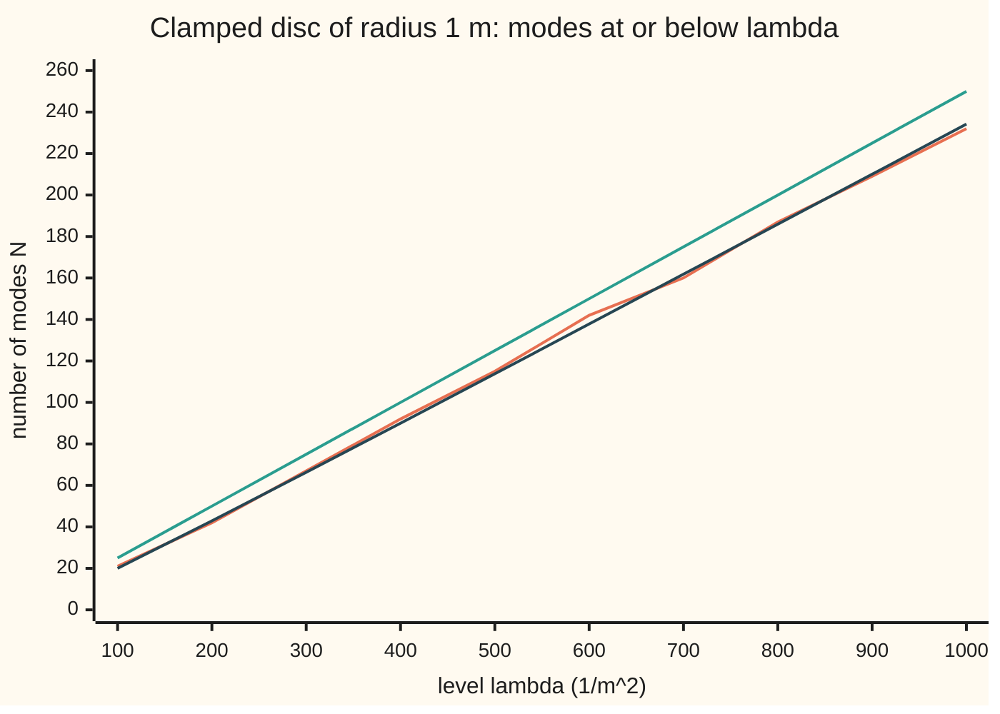
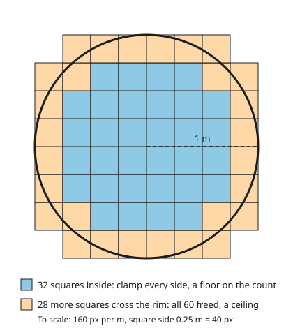

# Weyl's law: a drum's area can be heard in how fast its notes pile up

[Syllabus](../../../SYLLABUS.md) → [Partial differential equations](../README.md) → [Weak Solutions and Free Boundaries](../README.md#s06) → Weyl's law

---

## General Overview

A round rubber sheet 2 m across is clamped all round its rim. It is stretched to 200 N/m (newtons per metre of edge) and weighs 0.5 kg/m², so waves cross it at 20 m/s. Both figures are illustrative. Its lowest note is 7.655 Hz (hertz: vibrations per second). Each note belongs to a **mode**: a shape the sheet can ring in. Below 100.66 Hz the sheet has exactly 232 modes.

Weyl's law measures each mode by its **eigenvalue** λ (lambda), in 1/m²: a mode of frequency f has λ = (2πf/c)², with c the wave speed. The 100.66 Hz limit is λ = 1000 1/m². The sheet's area is written |Ω|, here π m².

Counting those 232 needs the zeros of Bessel functions, which only a disc has. Weyl's law skips all of that. It says the number of modes below a level grows in proportion to the sheet's area, with a fixed constant, whatever the shape. For this sheet the rule gives 250. A small correction for the rim gives 234.19, two away from the true 232.

[Helmholtz](../04-Laplace%2C%20Poisson%20and%20Potentials/08-helmholtz-and-eigenfunctions.md) stated this count and checked it on a rectangle, where every note has a formula. This card proves it for any bounded plane region. The tool is a sandwich: squares that fit inside the region give a floor on the count, squares that cover it give a ceiling, and the two close on the area. The same count then estimates modes for shapes with no formula, such as an L-shaped sheet.

**The number of clamped modes of a plane region with eigenvalue at or below λ is $`N(\lambda) \approx |\Omega|\,\lambda/(4\pi)`$, so the modes pile up at a rate set by the area alone; squares inside and squares around the region squeeze the count onto this line.**

**What kind of fact this is:** a theorem. The leading term is proved on this card in Why it works, for any bounded region whose edge has zero area. The rim correction is a later theorem, stated here with its source and checked on the disc. The 232 is computed, by two independent roads.

### The picture: the count against the law



Orange: the exact count, from the zeros of Bessel functions. Green: Weyl's area term, $`|\Omega|\lambda/(4\pi)`$, a straight line. Dark blue: the area term minus the rim term. The exact count wobbles around the dark blue curve and drifts below the green line by an amount that grows like $`\sqrt{\lambda}`$.

---

## The formula

Notation from earlier cards, one line each. $`\Omega`$ is the region and $`\partial\Omega`$ its edge. The eigenvalues $`\lambda_1 \le \lambda_2 \le \dots`$ of $`-\Delta`$ with a zero edge, and the Rayleigh quotient $`R(w)`$ (stretching energy $`\int|\nabla w|^2`$ over size $`\int w^2`$), come from [Helmholtz](../04-Laplace%2C%20Poisson%20and%20Potentials/08-helmholtz-and-eigenfunctions.md). $`H^1_0(\Omega)`$, the shapes of finite energy that vanish on the edge, comes from [Sobolev spaces](02-sobolev-spaces-for-pdes.md). On the disc, the modes are Bessel patterns with eigenvalues $`j_{m,n}^2`$, where $`j_{m,n}`$ is the $`n`$-th zero of $`J_m`$ ([Drumheads](../05-Waves/08-membranes-and-bessel-modes.md)).

New on this card: the **counting function** $`N(\lambda)`$, the number of eigenvalues at or below a level $`\lambda`$, each repeated as often as it occurs. A **clamped** (Dirichlet) edge holds the sheet at zero. A **free** (Neumann) edge lets it move, with zero slope across the edge.

```math
N(\lambda) = \#\{n : \lambda_n \le \lambda\}, \qquad \lim_{\lambda \to \infty} \frac{N(\lambda)}{\lambda} = \frac{|\Omega|}{4\pi}, \qquad N(\lambda) \approx \frac{|\Omega|\,\lambda}{4\pi} \mp \frac{|\partial\Omega|\,\sqrt{\lambda}}{4\pi}
```

**Read it aloud:** count the eigenvalues up to a level; the count divided by the level tends to the area over 4π; and a finer estimate subtracts the edge length times the square root of the level over 4π for a clamped edge, or adds it for a free edge.

The tool behind the proof is the **min-max principle** in counting form. An "allowed shape" is one in the energy space: $`H^1_0`$ for a clamped edge, $`H^1`$ (finite energy, no edge condition) for a free one.

```math
N(\lambda) = \max\{\dim V : V \text{ a space of allowed shapes with } R(w) \le \lambda \text{ for every } w \ne 0 \text{ in } V\}
```

**Read it aloud:** the number of modes up to a level is the largest number of independent shapes that can all keep their energy ratio at or below that level, together.

| Symbol | Plain meaning | In our example | Push it up and the answer… |
| --- | --- | --- | --- |
| $`\Omega`$, $`\partial\Omega`$ | the region; its edge | disc of radius 1 m; its rim | — |
| $`\lvert\Omega\rvert`$, $`\lvert\partial\Omega\rvert`$ | area, m²; edge length, m | 3.14159 m²; 6.28319 m | more area, more modes |
| $`\lambda`$; $`\lambda_n`$ | the counting level, 1/m²; the n-th eigenvalue | 1000 1/m²; $`\lambda_1`$ = 5.7832 1/m² | higher level, more modes |
| $`k`$ | wavenumber $`\sqrt{\lambda}`$, radians per metre | 31.6228 1/m | — |
| $`N(\lambda)`$; $`N_D`$, $`N_N`$ | modes at or below λ; the clamped and free counts | 232; 266 with a free rim | — |
| $`J_m`$, $`j_{m,n}`$; $`\theta`$ | Bessel function of order m; its n-th zero; angle round the disc (on a square, m and n count the sine humps) | $`j_{0,1}`$ = 2.404826 | — |
| $`R(w)`$, $`V`$ | energy ratio of a shape $`w`$; a space of shapes | — | — |
| $`H^1_0`$, $`H^1`$ | allowed shapes, clamped edge; free edge | — | more shapes, more modes |
| $`s`$; $`Q_i`$; $`a`$, $`b`$ | side of the grid squares, m; one square; how many lie inside, how many meet the region | 0.25 m; 32 inside, 60 meeting, in the picture | smaller squares, tighter limit |
| $`\ell`$ | $`s\sqrt{\lambda}/\pi`$, the lattice radius for one square | 10.0658 for a 1 m square | — |
| $`c`$, $`f`$ | wave speed, m/s; frequency, Hz, $`f = c\sqrt{\lambda}/(2\pi)`$ | 20 m/s; 100.66 Hz at the limit | same count at a higher pitch |

### When it holds

- **The region is bounded.** A strip 1 m wide has 71, 742 and 7448 clamped modes below λ = 1000 1/m² at lengths 1, 10 and 100 m. Its area is infinite, so its count is too.
- **The edge has zero area.** Any piecewise-smooth curve qualifies. The proof needs it so that the squares cut by the edge have a total area that shrinks to 0.
- **The leading term is a limit.** At a finite level the error is of the size of the edge term. On the disc at 1000 1/m² it is 18.00 modes out of 232.
- **The edge term needs more.** Ivrii proved it for a smooth edge on which periodic billiard paths (a ball bouncing round the region forever on a closed loop) form a set of zero measure. The disc qualifies. For the L-shaped sheet below, the two-term value is an estimate, checked against a proved bracket.
- **A free edge needs a reasonable edge.** The clamped proof on this card needs no smoothness of the edge. The free count follows the same law for a piecewise-smooth edge, but a region made of ever-smaller rooms joined by ever-thinner passages can break it.

---

## Why it works

### Step 0: the idea

On a square, every mode is a product of sines, so counting modes is counting whole-number points inside a quarter circle. That count is close to the quarter circle's area, which is proportional to the square's area times λ.

Any other region can be trapped between squares. Clamping extra lines inside a region removes shapes, so it can only lose modes. Freeing lines, so the pieces move independently, adds shapes, so it can only gain modes. Clamp the region along a grid and keep only the squares inside it: a floor. Cover it with squares and free every grid line: a ceiling. Both are sums of square counts, and both tend to the area as the squares shrink.

### Step 1: the min-max principle, as a counting rule

Write any allowed shape as a sum of modes, as [Helmholtz](../04-Laplace%2C%20Poisson%20and%20Potentials/08-helmholtz-and-eigenfunctions.md) does. Its energy ratio is then a weighted average of the eigenvalues it contains.

- **Floor.** The modes with $`\lambda_n \le \lambda`$ span a space of dimension $`N(\lambda)`$. Every shape in it is an average of eigenvalues at or below λ, so $`R(w) \le \lambda`$.
- **Ceiling.** Take any space $`V`$ with more than $`N(\lambda)`$ dimensions. It contains a nonzero shape perpendicular to the first $`N(\lambda)`$ modes. That shape averages only eigenvalues above λ, so its ratio is above λ.

So $`N(\lambda)`$ is exactly the largest dimension of a space with all ratios at or below λ. This is the min-max principle of Courant and Fischer, seeded on [Compact and symmetric](../../18-Functional%20analysis/03-Bounded%20Operators/08-spectral-theorem-for-compact-self-adjoint-operators.md). Its use here is one line: **more allowed shapes, with the same energy, can only raise the count.**

The free-edge problem is the same rule with $`H^1`$ in place of $`H^1_0`$. Starting from the energy picks out the free edge by itself; that is the lesson of [Friedrichs extension](../../18-Functional%20analysis/05-Unbounded%20Operators%20and%20Semigroups/10-friedrichs-extension-and-energy-forms.md). Since $`H^1_0 \subset H^1`$, a free edge always has at least as many modes as a clamped one: on the disc, 266 against 232.

The rule already ranks the disc's lowest eigenvalue. The disc holds a square of side √2 m and sits inside a square of side 2 m. Clamped monotonicity gives 9.8696 ≥ 5.7832 ≥ 4.9348 1/m².

### Step 2: the floor, from squares inside

Lay a grid of squares of side $`s`$ over the plane. Let the squares $`Q_1, \dots, Q_a`$ lie wholly inside $`\Omega`$, with not even a corner on the edge. Take a clamped mode of each square and set it to zero everywhere else. The result is an allowed shape for $`\Omega`$: it has finite energy and vanishes on $`\partial\Omega`$.

Shapes from different squares do not overlap, so energies and sizes add. The clamped modes of all the inner squares therefore give a space of dimension $`\sum_i N_D(Q_i, \lambda)`$, with every ratio at or below λ. By Step 1:

```math
N_\Omega(\lambda) \ge a \cdot N_D(\text{square of side } s, \lambda).
```

### Step 3: the ceiling, from squares around

Now let $`Q_1, \dots, Q_b`$ be all the squares that meet $`\Omega`$. Take any clamped shape on $`\Omega`$ and extend it by zero. On each square separately it has finite energy, so it is an allowed free-edge shape for that square. Its energy and size are the sums over the squares, since the grid lines have zero area.

So $`H^1_0(\Omega)`$ sits inside the larger family "a free shape on each square, chosen independently". That family's modes are just the squares' free modes put together. By Step 1, more shapes can only raise the count:

```math
N_\Omega(\lambda) \le b \cdot N_N(\text{square of side } s, \lambda).
```

<p align="center"></p>

To scale at 160 px per m, with the disc's centre at (210, 210) px and radius 160 px. At λ = 1000 1/m² these 0.25 m squares give 96 ≤ N ≤ 480. That bracket is wide. The proof needs only its limit.

### Step 4: counting one square exactly

A square of side $`s`$ has clamped modes $`\sin(m\pi x/s)\sin(n\pi y/s)`$ with $`m, n \ge 1`$, and free modes $`\cos(m\pi x/s)\cos(n\pi y/s)`$ with $`m, n \ge 0`$. Both have eigenvalue $`\pi^2(m^2 + n^2)/s^2`$. So with $`\ell = s\sqrt{\lambda}/\pi`$, each count is a number of whole-number points with $`m^2 + n^2 \le \ell^2`$. The rectangle's version of this count is on [Helmholtz](../04-Laplace%2C%20Poisson%20and%20Potentials/08-helmholtz-and-eigenfunctions.md); here only the bounds matter:

```math
\frac{\pi\ell^2}{4} - 2\ell - 1 \;\le\; N_D \;\le\; \frac{\pi\ell^2}{4} \;\le\; N_N \;\le\; \frac{\pi\ell^2}{4} + 2\ell + 1, \qquad \frac{\pi\ell^2}{4} = \frac{s^2\lambda}{4\pi}.
```

**Read it aloud:** both counts sit within about twice the lattice radius of the quarter circle's area, which is the square's area times λ over 4π.

<details>
<summary>Detailed proof: the lattice bounds</summary>

Give each clamped point $`(m, n)`$, with $`m, n \ge 1`$ and $`m^2 + n^2 \le \ell^2`$, the unit cell $`[m-1, m] \times [n-1, n]`$. The cell's farthest corner from the origin is $`(m, n)`$, so the cell lies in the quarter disc of radius $`\ell`$. Cells do not overlap, so

$`\displaystyle N_D \le \frac{\pi\ell^2}{4}.`$

Give each free point $`(m, n)`$, with $`m, n \ge 0`$, the cell $`[m, m+1] \times [n, n+1]`$. A point $`(x, y)`$ of the quarter disc lies in the cell of $`(\lfloor x\rfloor, \lfloor y\rfloor)`$, and that lattice point is no farther from the origin, so it is counted. The cells cover the quarter disc, so

$`\displaystyle N_N \ge \frac{\pi\ell^2}{4}.`$

The free points are the clamped points plus the points on the two axes, of which there are $`2\lfloor\ell\rfloor + 1 \le 2\ell + 1`$. So $`N_N = N_D + 2\lfloor\ell\rfloor + 1`$, which gives the two outer bounds.

</details>

For the unit square at λ = 1000 1/m², $`\ell`$ = 10.0658, the area term is 79.58, and the exact counts are 71 clamped and 92 free. Both lie within the slack 2ℓ + 1 = 21.13.

### Step 5: the squeeze

Put Step 4 into Steps 2 and 3, with $`a`$ squares inside and $`b`$ meeting:

```math
a\left(\frac{s^2\lambda}{4\pi} - 2\ell - 1\right) \le N_\Omega(\lambda) \le b\left(\frac{s^2\lambda}{4\pi} + 2\ell + 1\right).
```

Divide by $`\lambda/(4\pi)`$ and let λ grow with $`s`$ fixed. Since $`\ell/\lambda = s/(\pi\sqrt{\lambda})`$ shrinks to 0, the slack disappears:

```math
a s^2 \le \liminf_{\lambda\to\infty} \frac{4\pi N_\Omega(\lambda)}{\lambda} \le \limsup_{\lambda\to\infty} \frac{4\pi N_\Omega(\lambda)}{\lambda} \le b s^2 .
```

Here $`as^2`$ is the area of the inner squares and $`bs^2`$ the area of the covering squares. Now halve $`s`$ again and again. The difference $`(b - a)s^2`$ is the area of squares that touch the edge, which shrinks to 0 when the edge has zero area. Both ends close on $`|\Omega|`$, which proves the law. The order matters: λ grows first, then the squares shrink.

| side s (m) | level λ (1/m²) | 4πN_low/λ | 4πN_high/λ | inner area (m²) | outer area (m²) |
| --- | --- | --- | --- | --- | --- |
| 0.2 | 10000 | 1.6990 | 4.3128 | 2.0800 | 3.5200 |
| 0.1 | 100000 | 2.3911 | 3.9770 | 2.6800 | 3.4400 |
| 0.05 | 1000000 | 2.6860 | 3.5605 | 2.9200 | 3.3100 |
| 0.025 | 10000000 | 2.8864 | 3.4056 | 3.0350 | 3.2325 |

On the disc the bracket closes on π = 3.14159 m² from both sides, as the proof says.

### Step 6: the edge term, stated

Each square count already shows the second term. Half the axis points, about $`\ell`$, separate the free count from the area term, and half separate the clamped count. For a square, $`\ell = |\partial Q|\sqrt{\lambda}/(4\pi)`$ exactly. On the unit square at 1000 1/m² the two-term values are 69.51 clamped and 89.64 free, against the exact 71 and 92.

Physically, a clamped edge wastes a thin strip of the region: no mode can rise much within a fraction of a wavelength of a held edge. A free edge does the opposite. Weyl conjectured the general two-term law in 1913. Ivrii proved it in 1980 under the billiard condition in When it holds. The proof uses tools beyond this wing, so the card states it and checks it: on the disc, 234.19 against 232 clamped, and 265.81 against 266 free.

---

## Worked numbers, by hand

| Step | Arithmetic | Value |
| --- | --- | --- |
| area and rim | π × 1²; 2π × 1 | 3.14159 m²; 6.28319 m |
| wavenumber at the limit | √1000 | k = 31.6228 1/m |
| area term | 3.14159 × 1000 / (4π) | 250.00 |
| rim term | 6.28319 × 31.6228 / (4π) | 15.81 |
| two-term estimate | 250.00 − 15.81 | 234.19 |
| exact count | eigenvalues $`j_{m,n}^2 \le 1000`$, m ≥ 1 counted twice | **232** |
| errors | 250.00 − 232; 234.19 − 232 | +18.00; +2.19 |
| wave speed | √(200 / 0.5) | c = 20.0 m/s |
| frequency at the limit | 20.0 × 31.6228 / (2π) | 100.66 Hz |
| modes per hertz there | π × 31.6228 / 20.0 | 4.967 per Hz |

The sheet has 232 modes below 100.66 Hz. The area alone predicts 250, and the rim correction brings that to 234.19.

The 232 are 121 distinct frequencies: each order m ≥ 1 has a cosine and a sine pattern with the same note. The nearest eigenvalue to the limit is 10.271 1/m² away, so rounding cannot move the count.

**An L-shaped sheet, with no formula.** Join three 1 m squares into an L: area 3 m², edge 8 m. No formula gives its modes, but the sandwich gives a proved bracket, and Weyl's law gives an estimate inside it.

| Road | Arithmetic | Modes at or below 1000 1/m² |
| --- | --- | --- |
| floor from three clamped squares | 3 × 71 | 213 |
| ceiling from three free squares | 3 × 92 | 276 |
| floor and ceiling, fewer cuts: a 2 m × 1 m rectangle plus a square | rectangle count plus 71 or 92 | 217 to 269 |
| area term | 3 × 1000 / (4π) | 238.73 |
| two-term estimate | 238.73 − 8 × 31.6228 / (4π) | 218.60 |

So the L-shaped sheet has about 219 modes below 100.66 Hz, and certainly between 217 and 269. Fewer cut lines give a tighter bracket.

### What breaks if you drop a piece

| Mistake | Comes out at | What went wrong |
| --- | --- | --- |
| Each order m ≥ 1 counted once | 121, not 232 | $`\cos(m\theta)`$ and $`\sin(m\theta)`$ are two modes with one note |
| The rim term added for a clamped rim | 265.81, against 232 | plus is the free rim's sign; the free disc has 266 |
| Squares shrunk with λ held at 1000 | s = 0.125 m: 0 ≤ N ≤ 672 | a 0.125 m square holds no clamped mode below 1000; λ must grow first |
| An unbounded strip 1 m wide | 71, 742, 7448 at lengths 1, 10, 100 m | infinite area: the count has no limit |

The code prints all four.

---

## Code, from first principles, and it actually runs

The script counts the disc's clamped modes by two roads that share no arithmetic. Road 1 builds $`J_m`$ from Bessel's integral by the midpoint rule, then finds each zero by scanning and bisection. Road 2 builds every order from 0 to 31 at once (no $`J_m`$ has a zero below $`m`$) by Miller's backward recurrence (run the three-term recurrence downward from a high order, then scale so that $`J_0 + 2J_2 + 2J_4 + \dots = 1`$), and counts sign changes on a 0.05 grid. Both give 232. The square sandwich is computed at four grid sizes, with each lattice count checked against Step 4's bounds. The free rim uses zeros of $`J_m'`$. No Bessel, root or eigenvalue routine is imported.

### Python

```python
# Weyl's law -- the check behind the card.  Standard library only.
# A round rubber sheet of radius 1 m, clamped at the rim: its modes are -Laplacian
# eigenvalues lambda = j^2 (1/m^2), j a zero of a Bessel function J_m.  Count them below
# lambda = 1000 by two roads: Bessel's integral with bisection, and Miller's backward
# recurrence with sign changes.  Then the square-grid sandwich of Weyl's proof,
# the free rim, an L-shaped sheet with no formula, and what breaks.
import math
PI = math.pi
LAM = 1000.0
X = math.sqrt(LAM)

def J(m, x):                     # Bessel's integral, midpoint rule (exact to rounding here)
    n, total = 160, 0.0
    for i in range(n):
        t = PI * (i + 0.5) / n
        total += math.cos(m * t - x * math.sin(t))
    return total / n

def Jp(m, x):                    # derivative: J_m' = (J_(m-1) - J_(m+1)) / 2
    return -J(1, x) if m == 0 else 0.5 * (J(m - 1, x) - J(m + 1, x))

def zeros(f, m, top):            # scan in steps of 0.1, then bisect each sign change
    out, a = [], max(m, 0.5)
    fa = f(m, a)
    while a < top:
        b = min(a + 0.1, top)
        fb = f(m, b)
        if fa * fb < 0:
            lo, hi = a, b
            for _ in range(55):
                mid = 0.5 * (lo + hi)
                if fa * f(m, mid) <= 0: hi = mid
                else: lo = mid
            out.append(0.5 * (lo + hi))
        a, fa = b, fb
    return out

def count(f, extra):             # modes with multiplicity: m >= 1 counts twice (cos and sin)
    eig, m = [], 0
    while True:
        z = zeros(f, m, X)
        if not z: break
        eig += [x * x for x in z] * (1 if m == 0 else 2)
        m += 1
    return sorted(eig + extra), m - 1

def miller(x, top):              # J_0..J_top at x by backward recurrence, normalised
    start = max(int(x), top) + 60
    a, b, out = 0.0, 1e-30, [0.0] * (start + 1)
    for k in range(start, 0, -1):
        a, b = b, 2 * k / x * b - a
        out[k - 1] = b
        if abs(b) > 1e250: out = [v * 1e-250 for v in out]; a *= 1e-250; b *= 1e-250
    norm = out[0]
    for k in range(2, start + 1, 2): norm += 2 * out[k]
    return [v / norm for v in out[:top + 1]]

def nd(r): return sum(1 for p in range(1, int(r) + 2) for q in range(1, int(r) + 2) if p * p + q * q <= r * r)
def nn(r): return sum(1 for p in range(int(r) + 2) for q in range(int(r) + 2) if p * p + q * q <= r * r)
def rect(a, b, lam, lo): return sum(1 for p in range(lo, int(a * math.sqrt(lam) / PI) + 2) for q in range(lo, int(b * math.sqrt(lam) / PI) + 2) if PI * PI * (p * p / a / a + q * q / b / b) <= lam)
def weyl(area, edge, lam, sign): return area * lam / (4 * PI) + sign * edge * math.sqrt(lam) / (4 * PI)

print(f"clamped disc, radius 1 m, area {PI:.5f} m^2, rim 2 pi = {2 * PI:.5f} m; count lambda <= {LAM:.0f} 1/m^2 (k <= {X:.4f} 1/m)")
eig, mtop = count(J, [])
j01, j11, j21, j02 = zeros(J, 0, 3)[0], zeros(J, 1, 4)[0], zeros(J, 2, 6)[0], zeros(J, 0, 6)[1]
print(f"first zeros: j01 = {j01:.6f}, j11 = {j11:.6f}, j21 = {j21:.6f}, j02 = {j02:.6f}; lambda1 = {j01 ** 2:.4f} 1/m^2")
N1 = len(eig)
distinct = len(set(round(v, 9) for v in eig))
print(f"road 1, Bessel's integral: N(1000) = {N1} modes ({distinct} distinct notes), orders m = 0 to {mtop}")
xs = [0.05 * i for i in range(1, int(X / 0.05) + 1)] + [X]
vals = [miller(x, int(X)) for x in xs]   # every order with a zero below X (j_(m,1) > m)
N2 = sum((1 if m == 0 else 2) * sum(1 for i in range(len(xs) - 1) if vals[i][m] * vals[i + 1][m] < 0) for m in range(int(X) + 1))
print(f"road 2, Miller recurrence on a 0.05 grid: N(1000) = {N2} modes; J_5(20) by both roads: {J(5, 20):.10f} {miller(20, 5)[5]:.10f}")
gap = min(abs(v - LAM) for v in eig)
w1, w2 = weyl(PI, 2 * PI, LAM, 0), weyl(PI, 2 * PI, LAM, -1)
print(f"nearest eigenvalue to the limit is {gap:.3f} 1/m^2 away; Weyl area term {w1:.2f}, rim term {w1 - w2:.2f}, two terms {w2:.2f}; exact {N1}")
print(f"errors: area term {w1 - N1:+.2f}, two terms {w2 - N1:+.2f}; ratio N / area term = {N1 / w1:.4f}")
lams = list(range(100, 1001, 100))
stair = [sum(1 for v in eig if v <= l) for l in lams]
print("chart lambda:", lams)
print("chart exact N:", stair)
print("chart area term: [" + ", ".join(f"{weyl(PI, 0, l, 0):.1f}" for l in lams) + "]")
print("chart two terms: [" + ", ".join(f"{weyl(PI, 2 * PI, l, -1):.1f}" for l in lams) + "]")
c = math.sqrt(200 / 0.5)
print(f"sheet: tension 200 N/m, 0.5 kg/m^2, c = {c:.1f} m/s; first note {c * j01 / (2 * PI):.3f} Hz; limit {c * X / (2 * PI):.2f} Hz; modes per Hz there {2 * PI * PI * c * X / (2 * PI) / c ** 2:.3f}")
print(f"min-max sandwich of lambda1: inner square side sqrt2 {PI * PI:.4f} >= disc {j01 ** 2:.4f} >= covering square side 2 {PI * PI / 2:.4f}")
R = X / PI
print(f"unit square, l = sqrt(1000)/pi = {R:.4f}: N_D = {nd(R)}, N_N = {nn(R)}, area term pi l^2/4 = {PI * R * R / 4:.2f}, slack 2l+1 = {2 * R + 1:.2f}")
print(f"unit square with edge term: clamped {weyl(1, 4, LAM, -1):.2f} (exact {nd(R)}), free {weyl(1, 4, LAM, 1):.2f} (exact {nn(R)})")
def sandwich(s, lam):           # squares inside give a floor, squares meeting the disc a ceiling
    k, inn, out = round(1 / s), 0, 0
    for i in range(-k, k):
        for j in range(-k, k):
            x0, x1, y0, y1 = i * s, (i + 1) * s, j * s, (j + 1) * s
            far = max(x0 * x0, x1 * x1) + max(y0 * y0, y1 * y1)
            near = (0 if x0 <= 0 <= x1 else min(x0 * x0, x1 * x1)) + (0 if y0 <= 0 <= y1 else min(y0 * y0, y1 * y1))
            inn += far < 1
            out += near < 1
    r = s * math.sqrt(lam) / PI
    assert PI * r * r / 4 - 2 * r - 1 <= nd(r) <= PI * r * r / 4 <= nn(r) <= PI * r * r / 4 + 2 * r + 1   # lattice bounds
    return inn, out, inn * nd(r), out * nn(r)
fig = None
for s in (0.5, 0.25, 0.125):
    inn, out, lo, hi = sandwich(s, LAM)
    print(f"disc at lambda 1000, squares of side {s} m: {inn} inside, {out} meeting; {lo} <= N <= {hi}")
    assert lo <= N1 <= hi                                                       # the sandwich holds
    fig = (inn, out) if s == 0.25 else fig
print("squeeze: side s, lambda, 4 pi N_low/lambda, 4 pi N_high/lambda (target area pi = 3.14159)")
sq = []
for s, lam in ((0.2, 10 ** 4), (0.1, 10 ** 5), (0.05, 10 ** 6), (0.025, 10 ** 7)):
    inn, out, lo, hi = sandwich(s, lam)
    sq.append((4 * PI * lo / lam, 4 * PI * hi / lam))
    print(f"  {s:<5} {lam:<8}  {sq[-1][0]:.4f}  {sq[-1][1]:.4f}  (inner area {inn * s * s:.4f}, outer {out * s * s:.4f} m^2)")
assert all(sq[i][0] < sq[i + 1][0] < PI < sq[i + 1][1] < sq[i][1] for i in range(3))   # bracket closes on the area
eigN, _ = count(Jp, [0.0])
NN1 = sum(1 for v in eigN if v <= LAM)
w3 = weyl(PI, 2 * PI, LAM, +1)
print(f"free rim (Neumann, zeros of J_m'): N(1000) = {NN1}; Weyl with + rim term {w3:.2f}")
lsq = (3 * nd(R), 3 * nn(R))
lre = (rect(2, 1, LAM, 1) + nd(R), rect(2, 1, LAM, 0) + nn(R))
wl1, wl2 = weyl(3, 8, LAM, 0), weyl(3, 8, LAM, -1)
print(f"L-shaped sheet, three 1 m squares (area 3 m^2, edge 8 m): squares give {lsq[0]} <= N <= {lsq[1]}")
print(f"  2 m x 1 m rectangle plus a square give {lre[0]} <= N <= {lre[1]}; Weyl {wl1:.2f}, with edge term {wl2:.2f}")
print(f"  as notes: about {wl2:.0f} modes below {c * X / (2 * PI):.2f} Hz on a 3 m^2 L-shaped sheet")
strip = [rect(L, 1, LAM, 1) for L in (1, 10, 100)]
print(f"strip 1 m wide, Dirichlet, lambda <= 1000: length 1, 10, 100 m gives {strip}; unbounded length, unbounded count")
print(f"mistake, m >= 1 counted once: {distinct}; mistake, + rim term on a clamped rim: {w3:.2f} against {N1}")
print(f"figure, side 0.25 m, {fig[0]} squares inside, {fig[1]} meeting; scale 160 px per m, centre (210, 210), radius 160 px")
assert N1 == N2 == 232                                                         # two roads, one count
assert abs(J(5, 20) - miller(20, 5)[5]) < 1e-10                                # two Bessel roads agree
assert abs(j01 - 2.404825557695773) < 1e-9                                   # j01 against its tabulated value
assert abs(miller(j01, 0)[0]) < 1e-9                                          # road 2 vanishes at road 1's zero
assert abs(N1 - w2) < abs(N1 - w1) / 5                                          # rim term helps, clamped
assert abs(NN1 - w3) < 3                                                        # rim term helps, free rim
assert lsq[0] <= lre[0] <= wl2 and wl1 <= lre[1] <= lsq[1]                    # L-shape estimate inside both brackets
assert PI * PI / 2 < j01 ** 2 < PI * PI                                         # domain monotonicity
assert strip[2] > 9 * strip[1] > 81 * strip[0]                                 # count grows with length
print("ALL CHECKS PASS")
```

**Ran 2026-11-24 on macOS, Python 3.14.10, standard library only. All checks passed. Output, pasted from the run:**

```
clamped disc, radius 1 m, area 3.14159 m^2, rim 2 pi = 6.28319 m; count lambda <= 1000 1/m^2 (k <= 31.6228 1/m)
first zeros: j01 = 2.404826, j11 = 3.831706, j21 = 5.135622, j02 = 5.520078; lambda1 = 5.7832 1/m^2
road 1, Bessel's integral: N(1000) = 232 modes (121 distinct notes), orders m = 0 to 25
road 2, Miller recurrence on a 0.05 grid: N(1000) = 232 modes; J_5(20) by both roads: 0.1511697680 0.1511697680
nearest eigenvalue to the limit is 10.271 1/m^2 away; Weyl area term 250.00, rim term 15.81, two terms 234.19; exact 232
errors: area term +18.00, two terms +2.19; ratio N / area term = 0.9280
chart lambda: [100, 200, 300, 400, 500, 600, 700, 800, 900, 1000]
chart exact N: [21, 42, 67, 92, 115, 142, 160, 187, 209, 232]
chart area term: [25.0, 50.0, 75.0, 100.0, 125.0, 150.0, 175.0, 200.0, 225.0, 250.0]
chart two terms: [20.0, 42.9, 66.3, 90.0, 113.8, 137.8, 161.8, 185.9, 210.0, 234.2]
sheet: tension 200 N/m, 0.5 kg/m^2, c = 20.0 m/s; first note 7.655 Hz; limit 100.66 Hz; modes per Hz there 4.967
min-max sandwich of lambda1: inner square side sqrt2 9.8696 >= disc 5.7832 >= covering square side 2 4.9348
unit square, l = sqrt(1000)/pi = 10.0658: N_D = 71, N_N = 92, area term pi l^2/4 = 79.58, slack 2l+1 = 21.13
unit square with edge term: clamped 69.51 (exact 71), free 89.64 (exact 92)
disc at lambda 1000, squares of side 0.5 m: 4 inside, 16 meeting; 60 <= N <= 416
disc at lambda 1000, squares of side 0.25 m: 32 inside, 60 meeting; 96 <= N <= 480
disc at lambda 1000, squares of side 0.125 m: 164 inside, 224 meeting; 0 <= N <= 672
squeeze: side s, lambda, 4 pi N_low/lambda, 4 pi N_high/lambda (target area pi = 3.14159)
  0.2   10000     1.6990  4.3128  (inner area 2.0800, outer 3.5200 m^2)
  0.1   100000    2.3911  3.9770  (inner area 2.6800, outer 3.4400 m^2)
  0.05  1000000   2.6860  3.5605  (inner area 2.9200, outer 3.3100 m^2)
  0.025 10000000  2.8864  3.4056  (inner area 3.0350, outer 3.2325 m^2)
free rim (Neumann, zeros of J_m'): N(1000) = 266; Weyl with + rim term 265.81
L-shaped sheet, three 1 m squares (area 3 m^2, edge 8 m): squares give 213 <= N <= 276
  2 m x 1 m rectangle plus a square give 217 <= N <= 269; Weyl 238.73, with edge term 218.60
  as notes: about 219 modes below 100.66 Hz on a 3 m^2 L-shaped sheet
strip 1 m wide, Dirichlet, lambda <= 1000: length 1, 10, 100 m gives [71, 742, 7448]; unbounded length, unbounded count
mistake, m >= 1 counted once: 121; mistake, + rim term on a clamped rim: 265.81 against 232
figure, side 0.25 m, 32 squares inside, 60 meeting; scale 160 px per m, centre (210, 210), radius 160 px
ALL CHECKS PASS
```

### Rust

```rust
// Weyl's law -- the check behind the card.  Rust std only.
// Same roads as the Python: a 1 m clamped disc, modes lambda = j^2 counted below 1000
// by Bessel's integral and by Miller's recurrence; the square-grid sandwich; what breaks.
use std::f64::consts::PI;
const LAM: f64 = 1000.0;

fn bj(m: usize, x: f64) -> f64 { // Bessel's integral, midpoint rule (exact to rounding here)
    let n = 160;
    let mut total = 0.0;
    for i in 0..n {
        let t = PI * (i as f64 + 0.5) / n as f64;
        total += (m as f64 * t - x * t.sin()).cos();
    }
    total / n as f64
}

fn bjp(m: usize, x: f64) -> f64 { if m == 0 { -bj(1, x) } else { 0.5 * (bj(m - 1, x) - bj(m + 1, x)) } } // J_m'

fn zeros(f: fn(usize, f64) -> f64, m: usize, top: f64) -> Vec<f64> { // scan by 0.1, bisect
    let mut out = vec![];
    let mut a = (m as f64).max(0.5);
    let mut fa = f(m, a);
    while a < top {
        let b = (a + 0.1).min(top);
        let fb = f(m, b);
        if fa * fb < 0.0 {
            let (mut lo, mut hi) = (a, b);
            for _ in 0..55 {
                let mid = 0.5 * (lo + hi);
                if fa * f(m, mid) <= 0.0 { hi = mid } else { lo = mid }
            }
            out.push(0.5 * (lo + hi));
        }
        a = b; fa = fb;
    }
    out
}

fn count(f: fn(usize, f64) -> f64, extra: Vec<f64>, x: f64) -> (Vec<f64>, usize, usize) {
    let (mut eig, mut m, mut once) = (extra, 0, 0); // m >= 1 counts twice (cos and sin)
    loop {
        let z = zeros(f, m, x);
        if z.is_empty() { break; }
        once += z.len();
        for _ in 0..(if m == 0 { 1 } else { 2 }) { for v in &z { eig.push(v * v); } }
        m += 1;
    }
    eig.sort_by(|a, b| a.partial_cmp(b).unwrap());
    (eig, m - 1, once)
}

fn miller(x: f64, top: usize) -> Vec<f64> { // J_0..J_top at x by backward recurrence
    let start = (x as usize).max(top) + 60;
    let (mut a, mut b) = (0.0f64, 1e-30f64);
    let mut out = vec![0.0; start + 1];
    for k in (1..=start).rev() {
        let nb = 2.0 * k as f64 / x * b - a;
        a = b; b = nb; out[k - 1] = b;
        if b.abs() > 1e250 { for v in out.iter_mut() { *v *= 1e-250; } a *= 1e-250; b *= 1e-250; }
    }
    let mut norm = out[0];
    for k in (2..=start).step_by(2) { norm += 2.0 * out[k]; }
    out[..=top].iter().map(|v| v / norm).collect()
}

fn lattice(r: f64, lo: usize) -> usize {
    let top = r as usize + 2;
    (lo..top).map(|p| (lo..top).filter(|q| ((p * p + q * q) as f64) <= r * r).count()).sum()
}
fn nd(r: f64) -> usize { lattice(r, 1) }
fn nn(r: f64) -> usize { lattice(r, 0) }
fn rect(a: f64, b: f64, lam: f64, lo: usize) -> usize {
    let (pt, qt) = ((a * lam.sqrt() / PI) as usize + 2, (b * lam.sqrt() / PI) as usize + 2);
    let mut c = 0;
    for p in lo..pt { for q in lo..qt { let (p, q) = (p as f64, q as f64); if PI * PI * (p * p / a / a + q * q / b / b) <= lam { c += 1; } } }
    c
}
fn weyl(area: f64, edge: f64, lam: f64, sign: f64) -> f64 { area * lam / (4.0 * PI) + sign * edge * lam.sqrt() / (4.0 * PI) }
fn ilist(v: &[usize]) -> String { format!("[{}]", v.iter().map(|x| x.to_string()).collect::<Vec<_>>().join(", ")) }

fn sandwich(s: f64, lam: f64) -> (usize, usize, usize, usize) { // floor and ceiling from squares
    let k = (1.0 / s).round() as i64;
    let (mut inn, mut out) = (0, 0);
    for i in -k..k { for j in -k..k {
        let (x0, x1, y0, y1) = (i as f64 * s, (i + 1) as f64 * s, j as f64 * s, (j + 1) as f64 * s);
        let far = (x0 * x0).max(x1 * x1) + (y0 * y0).max(y1 * y1);
        let nx = if x0 <= 0.0 && 0.0 <= x1 { 0.0 } else { (x0 * x0).min(x1 * x1) };
        let ny = if y0 <= 0.0 && 0.0 <= y1 { 0.0 } else { (y0 * y0).min(y1 * y1) };
        if far < 1.0 { inn += 1; } if nx + ny < 1.0 { out += 1; }
    } }
    let r = s * lam.sqrt() / PI;
    let a = PI * r * r / 4.0;
    assert!(a - 2.0 * r - 1.0 <= nd(r) as f64 && nd(r) as f64 <= a && a <= nn(r) as f64 && nn(r) as f64 <= a + 2.0 * r + 1.0); // lattice bounds
    (inn, out, inn * nd(r), out * nn(r))
}

fn main() {
    let x = LAM.sqrt();
    println!("clamped disc, radius 1 m, area {:.5} m^2, rim 2 pi = {:.5} m; count lambda <= {:.0} 1/m^2 (k <= {:.4} 1/m)", PI, 2.0 * PI, LAM, x);
    let (eig, mtop, distinct) = count(bj, vec![], x);
    let (j01, j11, j21, j02) = (zeros(bj, 0, 3.0)[0], zeros(bj, 1, 4.0)[0], zeros(bj, 2, 6.0)[0], zeros(bj, 0, 6.0)[1]);
    println!("first zeros: j01 = {:.6}, j11 = {:.6}, j21 = {:.6}, j02 = {:.6}; lambda1 = {:.4} 1/m^2", j01, j11, j21, j02, j01 * j01);
    let n1 = eig.len();
    println!("road 1, Bessel's integral: N(1000) = {} modes ({} distinct notes), orders m = 0 to {}", n1, distinct, mtop);
    let mut xs: Vec<f64> = (1..=((x / 0.05) as usize)).map(|i| 0.05 * i as f64).collect();
    xs.push(x);
    let vals: Vec<Vec<f64>> = xs.iter().map(|&t| miller(t, x as usize)).collect(); // every order with a zero below x
    let n2: usize = (0..=x as usize).map(|m| (if m == 0 { 1 } else { 2 }) * (0..xs.len() - 1).filter(|&i| vals[i][m] * vals[i + 1][m] < 0.0).count()).sum();
    println!("road 2, Miller recurrence on a 0.05 grid: N(1000) = {} modes; J_5(20) by both roads: {:.10} {:.10}", n2, bj(5, 20.0), miller(20.0, 5)[5]);
    let gap = eig.iter().map(|v| (v - LAM).abs()).fold(f64::INFINITY, f64::min);
    let (w1, w2) = (weyl(PI, 2.0 * PI, LAM, 0.0), weyl(PI, 2.0 * PI, LAM, -1.0));
    println!("nearest eigenvalue to the limit is {:.3} 1/m^2 away; Weyl area term {:.2}, rim term {:.2}, two terms {:.2}; exact {}", gap, w1, w1 - w2, w2, n1);
    println!("errors: area term {:+.2}, two terms {:+.2}; ratio N / area term = {:.4}", w1 - n1 as f64, w2 - n1 as f64, n1 as f64 / w1);
    let lams: Vec<usize> = (1..=10).map(|i| 100 * i).collect();
    let stair: Vec<usize> = lams.iter().map(|&l| eig.iter().filter(|&&v| v <= l as f64).count()).collect();
    println!("chart lambda: {}", ilist(&lams));
    println!("chart exact N: {}", ilist(&stair));
    let fl = |sign: f64, edge: f64| lams.iter().map(|&l| format!("{:.1}", weyl(PI, edge, l as f64, sign))).collect::<Vec<_>>().join(", ");
    println!("chart area term: [{}]", fl(0.0, 0.0));
    println!("chart two terms: [{}]", fl(-1.0, 2.0 * PI));
    let c = (200.0f64 / 0.5).sqrt();
    println!("sheet: tension 200 N/m, 0.5 kg/m^2, c = {:.1} m/s; first note {:.3} Hz; limit {:.2} Hz; modes per Hz there {:.3}", c, c * j01 / (2.0 * PI), c * x / (2.0 * PI), 2.0 * PI * PI * c * x / (2.0 * PI) / (c * c));
    println!("min-max sandwich of lambda1: inner square side sqrt2 {:.4} >= disc {:.4} >= covering square side 2 {:.4}", PI * PI, j01 * j01, PI * PI / 2.0);
    let r = x / PI;
    println!("unit square, l = sqrt(1000)/pi = {:.4}: N_D = {}, N_N = {}, area term pi l^2/4 = {:.2}, slack 2l+1 = {:.2}", r, nd(r), nn(r), PI * r * r / 4.0, 2.0 * r + 1.0);
    println!("unit square with edge term: clamped {:.2} (exact {}), free {:.2} (exact {})", weyl(1.0, 4.0, LAM, -1.0), nd(r), weyl(1.0, 4.0, LAM, 1.0), nn(r));
    let mut fig = (0, 0);
    for &s in &[0.5, 0.25, 0.125] {
        let (inn, out, lo, hi) = sandwich(s, LAM);
        println!("disc at lambda 1000, squares of side {} m: {} inside, {} meeting; {} <= N <= {}", s, inn, out, lo, hi);
        assert!(lo <= n1 && n1 <= hi); // the sandwich holds
        if s == 0.25 { fig = (inn, out); }
    }
    println!("squeeze: side s, lambda, 4 pi N_low/lambda, 4 pi N_high/lambda (target area pi = 3.14159)");
    let mut sq = vec![];
    for &(s, lam) in &[(0.2, 10000usize), (0.1, 100000), (0.05, 1000000), (0.025, 10000000)] {
        let (inn, out, lo, hi) = sandwich(s, lam as f64);
        sq.push((4.0 * PI * lo as f64 / lam as f64, 4.0 * PI * hi as f64 / lam as f64));
        let l = sq[sq.len() - 1];
        println!("  {:<5} {:<8}  {:.4}  {:.4}  (inner area {:.4}, outer {:.4} m^2)", s, lam, l.0, l.1, inn as f64 * s * s, out as f64 * s * s);
    }
    for i in 0..3 { assert!(sq[i].0 < sq[i + 1].0 && sq[i + 1].0 < PI && PI < sq[i + 1].1 && sq[i + 1].1 < sq[i].1); } // closes on the area
    let (eign, _, _) = count(bjp, vec![0.0], x);
    let nn1 = eign.iter().filter(|&&v| v <= LAM).count();
    let w3 = weyl(PI, 2.0 * PI, LAM, 1.0);
    println!("free rim (Neumann, zeros of J_m'): N(1000) = {}; Weyl with + rim term {:.2}", nn1, w3);
    let lsq = (3 * nd(r), 3 * nn(r));
    let lre = (rect(2.0, 1.0, LAM, 1) + nd(r), rect(2.0, 1.0, LAM, 0) + nn(r));
    let (wl1, wl2) = (weyl(3.0, 8.0, LAM, 0.0), weyl(3.0, 8.0, LAM, -1.0));
    println!("L-shaped sheet, three 1 m squares (area 3 m^2, edge 8 m): squares give {} <= N <= {}", lsq.0, lsq.1);
    println!("  2 m x 1 m rectangle plus a square give {} <= N <= {}; Weyl {:.2}, with edge term {:.2}", lre.0, lre.1, wl1, wl2);
    println!("  as notes: about {:.0} modes below {:.2} Hz on a 3 m^2 L-shaped sheet", wl2, c * x / (2.0 * PI));
    let strip: Vec<usize> = [1.0, 10.0, 100.0].iter().map(|&l| rect(l, 1.0, LAM, 1)).collect();
    println!("strip 1 m wide, Dirichlet, lambda <= 1000: length 1, 10, 100 m gives {}; unbounded length, unbounded count", ilist(&strip));
    println!("mistake, m >= 1 counted once: {}; mistake, + rim term on a clamped rim: {:.2} against {}", distinct, w3, n1);
    println!("figure, side 0.25 m, {} squares inside, {} meeting; scale 160 px per m, centre (210, 210), radius 160 px", fig.0, fig.1);
    assert!(n1 == n2 && n2 == 232); // two roads, one count
    assert!((bj(5, 20.0) - miller(20.0, 5)[5]).abs() < 1e-10); // two Bessel roads agree
    assert!((j01 - 2.404825557695773).abs() < 1e-9); // j01 against its tabulated value
    assert!(miller(j01, 0)[0].abs() < 1e-9); // road 2 vanishes at road 1's zero
    assert!((n1 as f64 - w2).abs() < (n1 as f64 - w1).abs() / 5.0); // rim term helps, clamped
    assert!((nn1 as f64 - w3).abs() < 3.0); // rim term helps, free rim
    assert!(lsq.0 <= lre.0 && (lre.0 as f64) <= wl2 && wl1 <= lre.1 as f64 && lre.1 <= lsq.1); // L inside both
    assert!(PI * PI / 2.0 < j01 * j01 && j01 * j01 < PI * PI); // domain monotonicity
    assert!(strip[2] > 9 * strip[1] && 9 * strip[1] > 81 * strip[0]); // count grows with length
    println!("ALL CHECKS PASS");
}
```

**Ran 2026-11-24 on macOS, rustc 1.98.1, no crates. All checks passed. Output, pasted from the run:**

```
clamped disc, radius 1 m, area 3.14159 m^2, rim 2 pi = 6.28319 m; count lambda <= 1000 1/m^2 (k <= 31.6228 1/m)
first zeros: j01 = 2.404826, j11 = 3.831706, j21 = 5.135622, j02 = 5.520078; lambda1 = 5.7832 1/m^2
road 1, Bessel's integral: N(1000) = 232 modes (121 distinct notes), orders m = 0 to 25
road 2, Miller recurrence on a 0.05 grid: N(1000) = 232 modes; J_5(20) by both roads: 0.1511697680 0.1511697680
nearest eigenvalue to the limit is 10.271 1/m^2 away; Weyl area term 250.00, rim term 15.81, two terms 234.19; exact 232
errors: area term +18.00, two terms +2.19; ratio N / area term = 0.9280
chart lambda: [100, 200, 300, 400, 500, 600, 700, 800, 900, 1000]
chart exact N: [21, 42, 67, 92, 115, 142, 160, 187, 209, 232]
chart area term: [25.0, 50.0, 75.0, 100.0, 125.0, 150.0, 175.0, 200.0, 225.0, 250.0]
chart two terms: [20.0, 42.9, 66.3, 90.0, 113.8, 137.8, 161.8, 185.9, 210.0, 234.2]
sheet: tension 200 N/m, 0.5 kg/m^2, c = 20.0 m/s; first note 7.655 Hz; limit 100.66 Hz; modes per Hz there 4.967
min-max sandwich of lambda1: inner square side sqrt2 9.8696 >= disc 5.7832 >= covering square side 2 4.9348
unit square, l = sqrt(1000)/pi = 10.0658: N_D = 71, N_N = 92, area term pi l^2/4 = 79.58, slack 2l+1 = 21.13
unit square with edge term: clamped 69.51 (exact 71), free 89.64 (exact 92)
disc at lambda 1000, squares of side 0.5 m: 4 inside, 16 meeting; 60 <= N <= 416
disc at lambda 1000, squares of side 0.25 m: 32 inside, 60 meeting; 96 <= N <= 480
disc at lambda 1000, squares of side 0.125 m: 164 inside, 224 meeting; 0 <= N <= 672
squeeze: side s, lambda, 4 pi N_low/lambda, 4 pi N_high/lambda (target area pi = 3.14159)
  0.2   10000     1.6990  4.3128  (inner area 2.0800, outer 3.5200 m^2)
  0.1   100000    2.3911  3.9770  (inner area 2.6800, outer 3.4400 m^2)
  0.05  1000000   2.6860  3.5605  (inner area 2.9200, outer 3.3100 m^2)
  0.025 10000000  2.8864  3.4056  (inner area 3.0350, outer 3.2325 m^2)
free rim (Neumann, zeros of J_m'): N(1000) = 266; Weyl with + rim term 265.81
L-shaped sheet, three 1 m squares (area 3 m^2, edge 8 m): squares give 213 <= N <= 276
  2 m x 1 m rectangle plus a square give 217 <= N <= 269; Weyl 238.73, with edge term 218.60
  as notes: about 219 modes below 100.66 Hz on a 3 m^2 L-shaped sheet
strip 1 m wide, Dirichlet, lambda <= 1000: length 1, 10, 100 m gives [71, 742, 7448]; unbounded length, unbounded count
mistake, m >= 1 counted once: 121; mistake, + rim term on a clamped rim: 265.81 against 232
figure, side 0.25 m, 32 squares inside, 60 meeting; scale 160 px per m, centre (210, 210), radius 160 px
ALL CHECKS PASS
```

### Lean

Lean proves Step 4's lattice bounds for every lattice radius, and Weyl's law for one square of any side, clamped and free.

- Take a lattice radius $`\ell \ge 0`$. Then $`\pi\ell^2/4 - 2\ell - 1 \le N_D \le \pi\ell^2/4`$.
- Take the same $`\ell`$. Then $`\pi\ell^2/4 \le N_N \le \pi\ell^2/4 + 2\ell + 1`$.
- Take the same $`\ell`$. Then the free points are the clamped points plus the axis points: $`N_N = N_D + 2\lfloor\ell\rfloor + 1`$.
- Take a square of side $`s > 0`$, its modes counted as in Step 4. Then $`N_D(\lambda)/\lambda`$ and $`N_N(\lambda)/\lambda`$ both tend to $`s^2/(4\pi)`$ as λ grows.
- Take the unit square at λ = 1000 1/m². Then $`101 \le \ell^2 < 102`$, and the counts are 71 clamped and 92 free.
- Take the 2 m × 1 m rectangle's points at 1000 1/m², those with $`m^2 + 4n^2 \le 405`$. Then it has 146 clamped and 177 free modes.
- The L-shaped sheet's brackets add up: 213 to 276 from three squares, and 217 to 269 from the rectangle plus a square.
- Take the clamped strip 1 m wide and 10 m long, whose points at 1000 1/m² obey $`m^2 + 100n^2 \le 10132`$. Then it holds 742 modes.

The disc's counts, its grid sandwich, the edge term and the rounding to 405 and 10132 are left to the Python and Rust checks.

```lean
-- Weyl's law: on a square, the clamped and free mode counts lie within 2ℓ + 1 of the quarter-circle area πℓ²/4, the free count is the clamped count plus the 2⌊ℓ⌋ + 1 points on the axes, and either count divided by λ tends to the square's area over 4π.
import Mathlib.Analysis.SpecialFunctions.Integrals.Basic
import Mathlib.Analysis.SumIntegralComparisons
import Mathlib.Data.Set.Card
import Mathlib.Analysis.Real.Pi.Bounds
import Mathlib.Algebra.Order.Floor.Semiring
import Mathlib.Order.Filter.AtTopBot.Basic
import Mathlib.Topology.Instances.Real.Lemmas
import Mathlib.Tactic.NormNum

open Real Filter Topology

lemma weyl_integral_unit_quarter : ∫ x in (0:ℝ)..1, √(1 - x ^ 2) = π / 4 := by
  have hc : Continuous fun x : ℝ => √(1 - x ^ 2) := by fun_prop
  have hsplit := intervalIntegral.integral_add_adjacent_intervals
    (hc.intervalIntegrable (μ := MeasureTheory.volume) (-1) 0) (hc.intervalIntegrable (μ := MeasureTheory.volume) 0 1)
  rw [integral_sqrt_one_sub_sq] at hsplit
  have hneg : ∫ x in (-1:ℝ)..0, √(1 - x ^ 2) = ∫ x in (0:ℝ)..1, √(1 - x ^ 2) := by
    have := intervalIntegral.integral_comp_neg (a := (-1:ℝ)) (b := 0) (fun x : ℝ => √(1 - x ^ 2))
    simp only [neg_sq, neg_zero, neg_neg] at this
    exact this
  linarith

#print axioms weyl_integral_unit_quarter

lemma weyl_integral_quarter_disc (ℓ : ℝ) (hℓ : 0 ≤ ℓ) :
    ∫ x in (0:ℝ)..ℓ, √(ℓ ^ 2 - x ^ 2) = π * ℓ ^ 2 / 4 := by
  rcases hℓ.eq_or_lt with h | h
  · subst h; simp
  have hpt : ∀ x : ℝ, √(ℓ ^ 2 - x ^ 2) = ℓ * √(1 - (x / ℓ) ^ 2) := by
    intro x
    have : ℓ ^ 2 - x ^ 2 = ℓ ^ 2 * (1 - (x / ℓ) ^ 2) := by field_simp
    rw [this, Real.sqrt_mul (by positivity), Real.sqrt_sq h.le]
  simp_rw [hpt]
  rw [intervalIntegral.integral_const_mul,
    intervalIntegral.integral_comp_div (fun t : ℝ => √(1 - t ^ 2)) h.ne']
  rw [zero_div, div_self h.ne', weyl_integral_unit_quarter, smul_eq_mul]
  ring

#print axioms weyl_integral_quarter_disc

lemma weyl_nat_le_floor_of_sq (ℓ : ℝ) (hℓ : 0 ≤ ℓ) (a : ℕ) (h : (a : ℝ) ^ 2 ≤ ℓ ^ 2) :
    a ≤ ⌊ℓ⌋₊ := by
  apply Nat.le_floor
  have ha : (0:ℝ) ≤ a := Nat.cast_nonneg a
  nlinarith

#print axioms weyl_nat_le_floor_of_sq

lemma weyl_free_set_eq (ℓ : ℝ) (hℓ : 0 ≤ ℓ) :
    {p : ℕ × ℕ | (p.1 : ℝ) ^ 2 + (p.2 : ℝ) ^ 2 ≤ ℓ ^ 2} =
      ↑((Finset.range (⌊ℓ⌋₊ + 1) ×ˢ Finset.range (⌊ℓ⌋₊ + 1)).filter
        (fun p : ℕ × ℕ => (p.1 : ℝ) ^ 2 + (p.2 : ℝ) ^ 2 ≤ ℓ ^ 2)) := by
  ext p
  simp only [Set.mem_ofPred_eq, Finset.coe_filter, Finset.mem_product, Finset.mem_range]
  constructor
  · intro h
    refine ⟨⟨?_, ?_⟩, h⟩
    · exact Nat.lt_succ_of_le (weyl_nat_le_floor_of_sq ℓ hℓ _ (by nlinarith))
    · exact Nat.lt_succ_of_le (weyl_nat_le_floor_of_sq ℓ hℓ _ (by nlinarith))
  · exact fun h => h.2

#print axioms weyl_free_set_eq

lemma weyl_clamped_set_eq (ℓ : ℝ) (hℓ : 0 ≤ ℓ) :
    {p : ℕ × ℕ | 1 ≤ p.1 ∧ 1 ≤ p.2 ∧ (p.1 : ℝ) ^ 2 + (p.2 : ℝ) ^ 2 ≤ ℓ ^ 2} =
      ↑((Finset.range (⌊ℓ⌋₊ + 1) ×ˢ Finset.range (⌊ℓ⌋₊ + 1)).filter
        (fun p : ℕ × ℕ => 1 ≤ p.1 ∧ 1 ≤ p.2 ∧ (p.1 : ℝ) ^ 2 + (p.2 : ℝ) ^ 2 ≤ ℓ ^ 2)) := by
  ext p
  simp only [Set.mem_ofPred_eq, Finset.coe_filter, Finset.mem_product, Finset.mem_range]
  constructor
  · intro h
    refine ⟨⟨?_, ?_⟩, h⟩
    · exact Nat.lt_succ_of_le (weyl_nat_le_floor_of_sq ℓ hℓ _ (by nlinarith [h.2.2]))
    · exact Nat.lt_succ_of_le (weyl_nat_le_floor_of_sq ℓ hℓ _ (by nlinarith [h.2.2]))
  · exact fun h => h.2

#print axioms weyl_clamped_set_eq

lemma weyl_card_filter_product (s t : Finset ℕ) (R : ℕ × ℕ → Prop) [DecidablePred R] :
    ((s ×ˢ t).filter R).card = ∑ a ∈ s, (t.filter (fun b => R (a, b))).card := by
  rw [Finset.card_filter, Finset.sum_product]
  refine Finset.sum_congr rfl fun a _ => ?_
  rw [Finset.card_filter]

#print axioms weyl_card_filter_product

lemma weyl_box_axes_card (M : ℕ) :
    ((Finset.range (M + 1) ×ˢ Finset.range (M + 1)).filter
      (fun p : ℕ × ℕ => ¬(1 ≤ p.1 ∧ 1 ≤ p.2))).card = 2 * M + 1 := by
  have h := Finset.card_filter_add_card_filter_not
    (s := Finset.range (M + 1) ×ˢ Finset.range (M + 1)) (fun p : ℕ × ℕ => 1 ≤ p.1 ∧ 1 ≤ p.2)
  have hQ : (Finset.range (M + 1) ×ˢ Finset.range (M + 1)).filter
      (fun p : ℕ × ℕ => 1 ≤ p.1 ∧ 1 ≤ p.2) = Finset.Icc 1 M ×ˢ Finset.Icc 1 M := by
    ext p
    simp only [Finset.mem_filter, Finset.mem_product, Finset.mem_range, Finset.mem_Icc]
    omega
  rw [hQ, Finset.card_product, Finset.card_product, Nat.card_Icc, Finset.card_range] at h
  have : (M + 1) * (M + 1) = M * M + (2 * M + 1) := by ring
  simp only [Nat.add_sub_cancel] at h
  omega

#print axioms weyl_box_axes_card

lemma weyl_free_count_eq (ℓ : ℝ) (hℓ : 0 ≤ ℓ) :
    {p : ℕ × ℕ | (p.1 : ℝ) ^ 2 + (p.2 : ℝ) ^ 2 ≤ ℓ ^ 2}.ncard =
      {p : ℕ × ℕ | 1 ≤ p.1 ∧ 1 ≤ p.2 ∧ (p.1 : ℝ) ^ 2 + (p.2 : ℝ) ^ 2 ≤ ℓ ^ 2}.ncard
        + 2 * ⌊ℓ⌋₊ + 1 := by
  rw [weyl_free_set_eq ℓ hℓ, weyl_clamped_set_eq ℓ hℓ, Set.ncard_coe_finset,
    Set.ncard_coe_finset]
  set M := ⌊ℓ⌋₊
  set B := Finset.range (M + 1) ×ˢ Finset.range (M + 1)
  have h := Finset.card_filter_add_card_filter_not
    (s := B.filter (fun p : ℕ × ℕ => (p.1 : ℝ) ^ 2 + (p.2 : ℝ) ^ 2 ≤ ℓ ^ 2))
    (fun p : ℕ × ℕ => 1 ≤ p.1 ∧ 1 ≤ p.2)
  rw [Finset.filter_filter, Finset.filter_filter] at h
  have h1 : B.filter (fun p : ℕ × ℕ => (p.1 : ℝ) ^ 2 + (p.2 : ℝ) ^ 2 ≤ ℓ ^ 2 ∧
      1 ≤ p.1 ∧ 1 ≤ p.2) =
      B.filter (fun p : ℕ × ℕ => 1 ≤ p.1 ∧ 1 ≤ p.2 ∧ (p.1 : ℝ) ^ 2 + (p.2 : ℝ) ^ 2 ≤ ℓ ^ 2) := by
    apply Finset.filter_congr
    intro p _
    tauto
  have hMl : (M : ℝ) ≤ ℓ := Nat.floor_le hℓ
  have h2 : B.filter (fun p : ℕ × ℕ => (p.1 : ℝ) ^ 2 + (p.2 : ℝ) ^ 2 ≤ ℓ ^ 2 ∧
      ¬(1 ≤ p.1 ∧ 1 ≤ p.2)) = B.filter (fun p : ℕ × ℕ => ¬(1 ≤ p.1 ∧ 1 ≤ p.2)) := by
    apply Finset.filter_congr
    intro p hp
    simp only [B, Finset.mem_product, Finset.mem_range] at hp
    constructor
    · exact fun h => h.2
    · intro hq
      refine ⟨?_, hq⟩
      have ha : (p.1 : ℝ) ≤ M := by exact_mod_cast Nat.lt_succ_iff.mp hp.1
      have hb : (p.2 : ℝ) ≤ M := by exact_mod_cast Nat.lt_succ_iff.mp hp.2
      have ha0 : (0:ℝ) ≤ p.1 := Nat.cast_nonneg _
      have hb0 : (0:ℝ) ≤ p.2 := Nat.cast_nonneg _
      rcases Nat.lt_or_ge p.1 1 with h | h
      · have : p.1 = 0 := by omega
        rw [this]; push_cast; nlinarith
      · have : p.2 = 0 := by omega
        rw [this]; push_cast; nlinarith
  rw [h1, h2, weyl_box_axes_card] at h
  omega

#print axioms weyl_free_count_eq

lemma weyl_sqrt_le (ℓ : ℝ) (hℓ : 0 ≤ ℓ) (x : ℝ) : √(ℓ ^ 2 - x ^ 2) ≤ ℓ := by
  calc √(ℓ ^ 2 - x ^ 2) ≤ √(ℓ ^ 2) := Real.sqrt_le_sqrt (by nlinarith [sq_nonneg x])
    _ = ℓ := Real.sqrt_sq hℓ

#print axioms weyl_sqrt_le

lemma weyl_antitone (ℓ : ℝ) (b : ℝ) :
    AntitoneOn (fun x : ℝ => √(ℓ ^ 2 - x ^ 2)) (Set.Icc 0 b) := by
  intro x hx y hy hxy
  exact Real.sqrt_le_sqrt (by nlinarith [hx.1])

#print axioms weyl_antitone

lemma weyl_integral_le_upper (ℓ : ℝ) (hℓ : 0 ≤ ℓ) :
    ∫ x in (0:ℝ)..ℓ, √(ℓ ^ 2 - x ^ 2) ≤ ∫ x in (0:ℝ)..(0 + ((⌊ℓ⌋₊ + 1 : ℕ) : ℝ)), √(ℓ ^ 2 - x ^ 2) := by
  have hc : Continuous fun x : ℝ => √(ℓ ^ 2 - x ^ 2) := by fun_prop
  apply intervalIntegral.integral_mono_interval le_rfl hℓ
  · rw [zero_add]; push_cast; exact (Nat.lt_floor_add_one ℓ).le
  · exact Filter.Eventually.of_forall fun x => Real.sqrt_nonneg _
  · exact hc.intervalIntegrable _ _

#print axioms weyl_integral_le_upper

lemma weyl_integral_ge_lower (ℓ : ℝ) (hℓ : 0 ≤ ℓ) :
    ∫ x in (0:ℝ)..(0 + ((⌊ℓ⌋₊ : ℕ) : ℝ)), √(ℓ ^ 2 - x ^ 2) ≤ ∫ x in (0:ℝ)..ℓ, √(ℓ ^ 2 - x ^ 2) := by
  have hc : Continuous fun x : ℝ => √(ℓ ^ 2 - x ^ 2) := by fun_prop
  apply intervalIntegral.integral_mono_interval le_rfl (by rw [zero_add]; exact Nat.cast_nonneg _)
  · rw [zero_add]; exact Nat.floor_le hℓ
  · exact Filter.Eventually.of_forall fun x => Real.sqrt_nonneg _
  · exact hc.intervalIntegrable _ _

#print axioms weyl_integral_ge_lower

lemma weyl_free_ge (ℓ : ℝ) (hℓ : 0 ≤ ℓ) :
    π * ℓ ^ 2 / 4 ≤ ({p : ℕ × ℕ | (p.1 : ℝ) ^ 2 + (p.2 : ℝ) ^ 2 ≤ ℓ ^ 2}.ncard : ℝ) := by
  rw [weyl_free_set_eq ℓ hℓ, Set.ncard_coe_finset, weyl_card_filter_product, Nat.cast_sum,
    ← weyl_integral_quarter_disc ℓ hℓ]
  set M := ⌊ℓ⌋₊
  have hMl : (M : ℝ) ≤ ℓ := Nat.floor_le hℓ
  refine (weyl_integral_le_upper ℓ hℓ).trans (((weyl_antitone ℓ _).integral_le_sum).trans ?_)
  apply Finset.sum_le_sum
  intro m hm
  rw [zero_add]
  have hm' : (m : ℝ) ≤ ℓ := by
    have : m ≤ M := Nat.lt_succ_iff.mp (Finset.mem_range.mp hm)
    exact (Nat.cast_le.mpr this).trans hMl
  have hm0 : (0:ℝ) ≤ m := Nat.cast_nonneg _
  have hz : 0 ≤ ℓ ^ 2 - (m : ℝ) ^ 2 := by nlinarith
  set K := ⌊√(ℓ ^ 2 - (m : ℝ) ^ 2)⌋₊
  have hsub : Finset.range (K + 1) ⊆ (Finset.range (M + 1)).filter
      (fun n => ((m, n) : ℕ × ℕ).1 ^ 2 + ((((m, n) : ℕ × ℕ).2 : ℕ) : ℝ) ^ 2 ≤ ℓ ^ 2) := by
    intro n hn
    have hnK : n ≤ K := Nat.lt_succ_iff.mp (Finset.mem_range.mp hn)
    have hn1 : (n : ℝ) ≤ √(ℓ ^ 2 - (m : ℝ) ^ 2) :=
      (Nat.cast_le.mpr hnK).trans (Nat.floor_le (Real.sqrt_nonneg _))
    have hn0 : (0:ℝ) ≤ n := Nat.cast_nonneg _
    have hsq := Real.sq_sqrt hz
    have hs0 := Real.sqrt_nonneg (ℓ ^ 2 - (m : ℝ) ^ 2)
    simp only [Finset.mem_filter, Finset.mem_range]
    refine ⟨Nat.lt_succ_of_le (Nat.le_floor ((hn1.trans (weyl_sqrt_le ℓ hℓ _)))), ?_⟩
    nlinarith
  have hcard := Finset.card_le_card hsub
  rw [Finset.card_range] at hcard
  calc √(ℓ ^ 2 - (m : ℝ) ^ 2) ≤ (K : ℝ) + 1 := (Nat.lt_floor_add_one _).le
    _ = ((K + 1 : ℕ) : ℝ) := by push_cast; ring
    _ ≤ _ := by exact_mod_cast hcard

#print axioms weyl_free_ge

lemma weyl_clamped_le (ℓ : ℝ) (hℓ : 0 ≤ ℓ) :
    ({p : ℕ × ℕ | 1 ≤ p.1 ∧ 1 ≤ p.2 ∧ (p.1 : ℝ) ^ 2 + (p.2 : ℝ) ^ 2 ≤ ℓ ^ 2}.ncard : ℝ) ≤
      π * ℓ ^ 2 / 4 := by
  rw [weyl_clamped_set_eq ℓ hℓ, Set.ncard_coe_finset, weyl_card_filter_product, Nat.cast_sum,
    ← weyl_integral_quarter_disc ℓ hℓ, Finset.sum_range_succ']
  set M := ⌊ℓ⌋₊
  have h0 : (Finset.range (M + 1)).filter (fun n => 1 ≤ ((0, n) : ℕ × ℕ).1 ∧ 1 ≤ ((0, n) : ℕ × ℕ).2 ∧
      ((((0, n) : ℕ × ℕ).1 : ℕ) : ℝ) ^ 2 + ((((0, n) : ℕ × ℕ).2 : ℕ) : ℝ) ^ 2 ≤ ℓ ^ 2) = ∅ := by
    ext n; simp
  rw [h0, Finset.card_empty, Nat.cast_zero, add_zero]
  refine le_trans ?_ (((weyl_antitone ℓ _).sum_le_integral).trans (weyl_integral_ge_lower ℓ hℓ))
  apply Finset.sum_le_sum
  intro i _
  rw [zero_add]
  set m := i + 1
  set K := ⌊√(ℓ ^ 2 - ((m : ℕ) : ℝ) ^ 2)⌋₊
  have hsub : (Finset.range (M + 1)).filter (fun n => 1 ≤ ((m, n) : ℕ × ℕ).1 ∧
      1 ≤ ((m, n) : ℕ × ℕ).2 ∧
      ((((m, n) : ℕ × ℕ).1 : ℕ) : ℝ) ^ 2 + ((((m, n) : ℕ × ℕ).2 : ℕ) : ℝ) ^ 2 ≤ ℓ ^ 2) ⊆
      Finset.Icc 1 K := by
    intro n hn
    simp only [Finset.mem_filter, Finset.mem_range] at hn
    simp only [Finset.mem_Icc]
    refine ⟨hn.2.2.1, Nat.le_floor ?_⟩
    have hn0 : (0:ℝ) ≤ n := Nat.cast_nonneg _
    rw [Real.le_sqrt hn0 (by nlinarith [hn.2.2.2, sq_nonneg (n : ℝ)])]
    linarith [hn.2.2.2]
  have hcard := Finset.card_le_card hsub
  rw [Nat.card_Icc, Nat.add_sub_cancel] at hcard
  calc (((Finset.range (M + 1)).filter _).card : ℝ) ≤ (K : ℝ) := by exact_mod_cast hcard
    _ ≤ _ := Nat.floor_le (Real.sqrt_nonneg _)

#print axioms weyl_clamped_le

lemma weyl_tendsto_of_near (s : ℝ) (_hs : 0 < s) (N : ℝ → ℝ)
    (h : ∀ lam : ℝ, 0 < lam →
      π * (s * √lam / π) ^ 2 / 4 - 2 * (s * √lam / π) - 1 ≤ N lam ∧
        N lam ≤ π * (s * √lam / π) ^ 2 / 4 + 2 * (s * √lam / π) + 1) :
    Tendsto (fun lam : ℝ => N lam / lam) atTop (𝓝 (s ^ 2 / (4 * π))) := by
  have hpi := Real.pi_pos
  have hlim : ∀ c : ℝ, Tendsto (fun lam : ℝ => s ^ 2 / (4 * π) + c * (2 * s / π) * (√lam)⁻¹
      + c * lam⁻¹) atTop (𝓝 (s ^ 2 / (4 * π))) := by
    intro c
    have h1 := (tendsto_const_nhds (x := s ^ 2 / (4 * π))).add
      ((tendsto_const_nhds (x := c * (2 * s / π))).mul
        (tendsto_inv_atTop_zero.comp Real.tendsto_sqrt_atTop))
    have h2 := h1.add ((tendsto_const_nhds (x := c)).mul tendsto_inv_atTop_zero)
    simp only [mul_zero, add_zero] at h2
    exact h2
  have key : ∀ c : ℝ, ∀ lam : ℝ, 0 < lam →
      (s ^ 2 / (4 * π) + c * (2 * s / π) * (√lam)⁻¹ + c * lam⁻¹) * lam =
        π * (s * √lam / π) ^ 2 / 4 + c * (2 * (s * √lam / π)) + c := by
    intro c lam hlam
    have ht : 0 < √lam := Real.sqrt_pos.mpr hlam
    have hsq : √lam ^ 2 = lam := Real.sq_sqrt hlam.le
    generalize √lam = t at ht hsq ⊢
    subst hsq
    field_simp
  refine tendsto_of_tendsto_of_tendsto_of_le_of_le' (hlim (-1)) (hlim 1) ?_ ?_
  · filter_upwards [eventually_gt_atTop 0] with lam hlam
    rw [le_div_iff₀ hlam, key (-1) lam hlam]
    linarith [(h lam hlam).1]
  · filter_upwards [eventually_gt_atTop 0] with lam hlam
    rw [div_le_iff₀ hlam, key 1 lam hlam]
    linarith [(h lam hlam).2]

#print axioms weyl_tendsto_of_near

lemma weyl_cond_iff (s : ℝ) (hs : 0 < s) (lam : ℝ) (hlam : 0 < lam) (X : ℝ) :
    π ^ 2 * X / s ^ 2 ≤ lam ↔ X ≤ (s * √lam / π) ^ 2 := by
  have hpi := Real.pi_pos
  have hsq : √lam ^ 2 = lam := Real.sq_sqrt hlam.le
  rw [div_le_iff₀ (by positivity), div_pow, mul_pow, hsq, le_div_iff₀ (by positivity)]
  constructor <;> intro h <;> linarith

#print axioms weyl_cond_iff

/-- The lattice bounds for one square (Step 4). A square of side `s` has clamped modes
`sin(mπx/s) sin(nπy/s)` with `m, n ≥ 1` and free modes `cos(mπx/s) cos(nπy/s)` with `m, n ≥ 0`,
both with eigenvalue `π²(m² + n²)/s²`. With the lattice radius `ℓ = s√λ/π`, the clamped count
`N_D` is the number of whole-number points `(m, n)` with `m, n ≥ 1` and `m² + n² ≤ ℓ²`, and the
free count `N_N` the number with `m, n ≥ 0`. Both lie within `2ℓ + 1` of the quarter-circle area
`πℓ²/4 = s²λ/(4π)`, the clamped count below it and the free count above it:
`πℓ²/4 − 2ℓ − 1 ≤ N_D ≤ πℓ²/4 ≤ N_N ≤ πℓ²/4 + 2ℓ + 1`. -/
theorem square_mode_counts_near_quarter_circle (ℓ : ℝ) (hℓ : 0 ≤ ℓ) :
    π * ℓ ^ 2 / 4 - 2 * ℓ - 1 ≤
        ({p : ℕ × ℕ | 1 ≤ p.1 ∧ 1 ≤ p.2 ∧ (p.1 : ℝ) ^ 2 + (p.2 : ℝ) ^ 2 ≤ ℓ ^ 2}.ncard : ℝ) ∧
      ({p : ℕ × ℕ | 1 ≤ p.1 ∧ 1 ≤ p.2 ∧ (p.1 : ℝ) ^ 2 + (p.2 : ℝ) ^ 2 ≤ ℓ ^ 2}.ncard : ℝ) ≤
        π * ℓ ^ 2 / 4 ∧
      π * ℓ ^ 2 / 4 ≤
        ({p : ℕ × ℕ | (p.1 : ℝ) ^ 2 + (p.2 : ℝ) ^ 2 ≤ ℓ ^ 2}.ncard : ℝ) ∧
      ({p : ℕ × ℕ | (p.1 : ℝ) ^ 2 + (p.2 : ℝ) ^ 2 ≤ ℓ ^ 2}.ncard : ℝ) ≤
        π * ℓ ^ 2 / 4 + 2 * ℓ + 1 := by
  have h2 := weyl_free_count_eq ℓ hℓ
  have h2r : ({p : ℕ × ℕ | (p.1 : ℝ) ^ 2 + (p.2 : ℝ) ^ 2 ≤ ℓ ^ 2}.ncard : ℝ) =
      ({p : ℕ × ℕ | 1 ≤ p.1 ∧ 1 ≤ p.2 ∧ (p.1 : ℝ) ^ 2 + (p.2 : ℝ) ^ 2 ≤ ℓ ^ 2}.ncard : ℝ)
        + 2 * (⌊ℓ⌋₊ : ℝ) + 1 := by
    rw [h2]; push_cast; ring
  have hM : (⌊ℓ⌋₊ : ℝ) ≤ ℓ := Nat.floor_le hℓ
  have hA := weyl_free_ge ℓ hℓ
  have hB := weyl_clamped_le ℓ hℓ
  refine ⟨?_, hB, hA, ?_⟩ <;> linarith

/-- The free points are the clamped points plus the points on the two axes: for a lattice
radius `ℓ ≥ 0`, `N_N = N_D + 2⌊ℓ⌋ + 1`. -/
theorem free_count_eq_clamped_count_add_axis_points (ℓ : ℝ) (hℓ : 0 ≤ ℓ) :
    {p : ℕ × ℕ | (p.1 : ℝ) ^ 2 + (p.2 : ℝ) ^ 2 ≤ ℓ ^ 2}.ncard =
      {p : ℕ × ℕ | 1 ≤ p.1 ∧ 1 ≤ p.2 ∧ (p.1 : ℝ) ^ 2 + (p.2 : ℝ) ^ 2 ≤ ℓ ^ 2}.ncard
        + 2 * ⌊ℓ⌋₊ + 1 := by
  exact weyl_free_count_eq ℓ hℓ

/-- Weyl's law on a square of side `s > 0`: the number of clamped modes with eigenvalue
`π²(m² + n²)/s² ≤ λ`, and likewise the number of free modes, divided by `λ`, tends to the
square's area over `4π`, that is `N(λ)/λ → s²/(4π)` as `λ → ∞`. -/
theorem weyl_law_square (s : ℝ) (hs : 0 < s) :
    Tendsto (fun lam : ℝ =>
        ({p : ℕ × ℕ | 1 ≤ p.1 ∧ 1 ≤ p.2 ∧
            π ^ 2 * ((p.1 : ℝ) ^ 2 + (p.2 : ℝ) ^ 2) / s ^ 2 ≤ lam}.ncard : ℝ) / lam)
        atTop (𝓝 (s ^ 2 / (4 * π))) ∧
      Tendsto (fun lam : ℝ =>
        ({p : ℕ × ℕ | π ^ 2 * ((p.1 : ℝ) ^ 2 + (p.2 : ℝ) ^ 2) / s ^ 2 ≤ lam}.ncard : ℝ) / lam)
        atTop (𝓝 (s ^ 2 / (4 * π))) := by
  have hpi := Real.pi_pos
  constructor
  · apply weyl_tendsto_of_near s hs
    intro lam hlam
    have hℓ : 0 ≤ s * √lam / π := by positivity
    have hset : {p : ℕ × ℕ | 1 ≤ p.1 ∧ 1 ≤ p.2 ∧
        π ^ 2 * ((p.1 : ℝ) ^ 2 + (p.2 : ℝ) ^ 2) / s ^ 2 ≤ lam} =
        {p : ℕ × ℕ | 1 ≤ p.1 ∧ 1 ≤ p.2 ∧
          (p.1 : ℝ) ^ 2 + (p.2 : ℝ) ^ 2 ≤ (s * √lam / π) ^ 2} := by
      ext p; simp only [Set.mem_ofPred_eq, weyl_cond_iff s hs lam hlam]
    rw [hset]
    have := square_mode_counts_near_quarter_circle _ hℓ
    constructor <;> linarith [this.1, this.2.1]
  · apply weyl_tendsto_of_near s hs
    intro lam hlam
    have hℓ : 0 ≤ s * √lam / π := by positivity
    have hset : {p : ℕ × ℕ | π ^ 2 * ((p.1 : ℝ) ^ 2 + (p.2 : ℝ) ^ 2) / s ^ 2 ≤ lam} =
        {p : ℕ × ℕ | (p.1 : ℝ) ^ 2 + (p.2 : ℝ) ^ 2 ≤ (s * √lam / π) ^ 2} := by
      ext p; simp only [Set.mem_ofPred_eq, weyl_cond_iff s hs lam hlam]
    rw [hset]
    have := square_mode_counts_near_quarter_circle _ hℓ
    constructor <;> linarith [this.2.2.1, this.2.2.2]

-- The unit square at λ = 1000 1/m²: ℓ² = 1000/π² lies between 101 and 102, so a point counts
-- exactly when m² + n² ≤ 101.
example : (101 : ℝ) ≤ 1000 / π ^ 2 ∧ 1000 / π ^ 2 < 102 := by
  have h1 := pi_gt_d4
  have h2 := pi_lt_d4
  have hp : 0 < π ^ 2 := by positivity
  constructor
  · rw [le_div_iff₀ hp]; nlinarith
  · rw [div_lt_iff₀ hp]; nlinarith

-- Its clamped count is 71 and its free count 92 (every point has m, n ≤ 10).
example : ((Finset.Icc 1 10 ×ˢ Finset.Icc 1 10).filter
    (fun p : ℕ × ℕ => p.1 ^ 2 + p.2 ^ 2 ≤ 101)).card = 71 := by decide
example : ((Finset.range 11 ×ˢ Finset.range 11).filter
    (fun p : ℕ × ℕ => p.1 ^ 2 + p.2 ^ 2 ≤ 101)).card = 92 := by decide

-- Free = clamped + 2⌊ℓ⌋ + 1 with ⌊ℓ⌋ = 10, and the slack 2ℓ + 1 = 21.13 covers both gaps
-- from the area term 79.58: 79.58 − 71 = 8.58 and 92 − 79.58 = 12.42.
example : (92 : ℕ) = 71 + 2 * 10 + 1 := by norm_num

-- The 2 m × 1 m rectangle at λ = 1000: a mode counts when m²/4 + n² ≤ 1000/π², that is
-- m² + 4n² ≤ 405 (4000/π² is 405.28). Clamped count 146, free count 177.
example : ((Finset.Icc 1 20 ×ˢ Finset.Icc 1 10).filter
    (fun p : ℕ × ℕ => p.1 ^ 2 + 4 * p.2 ^ 2 ≤ 405)).card = 146 := by decide +kernel
example : ((Finset.range 21 ×ˢ Finset.range 11).filter
    (fun p : ℕ × ℕ => p.1 ^ 2 + 4 * p.2 ^ 2 ≤ 405)).card = 177 := by decide +kernel

-- The L-shaped sheet's brackets: three squares give 3 · 71 = 213 to 3 · 92 = 276; the
-- rectangle plus one square give 146 + 71 = 217 to 177 + 92 = 269.
example : 3 * 71 = 213 ∧ 3 * 92 = 276 ∧ 146 + 71 = 217 ∧ 177 + 92 = 269 := by norm_num

-- The 1 m wide clamped strip of length 10 m: m²/100 + n² ≤ 1000/π², that is
-- m² + 100n² ≤ 10132 (100000/π² is 10132.12). It holds 742 modes.
example : ((Finset.Icc 1 100 ×ˢ Finset.Icc 1 10).filter
    (fun p : ℕ × ℕ => p.1 ^ 2 + 100 * p.2 ^ 2 ≤ 10132)).card = 742 := by decide +kernel

#print axioms square_mode_counts_near_quarter_circle
#print axioms free_count_eq_clamped_count_add_axis_points
#print axioms weyl_law_square
```

**Checked 2026-11-24 on macOS, Lean 4.36.0-rc2, Mathlib v4.36.0-rc2. Every proof is complete and uses only Lean's standard axioms. Output, pasted from the run:**

```
'weyl_integral_unit_quarter' depends on axioms: [propext, Classical.choice, Quot.sound]
'weyl_integral_quarter_disc' depends on axioms: [propext, Classical.choice, Quot.sound]
'weyl_nat_le_floor_of_sq' depends on axioms: [propext, Classical.choice, Quot.sound]
'weyl_free_set_eq' depends on axioms: [propext, Classical.choice, Quot.sound]
'weyl_clamped_set_eq' depends on axioms: [propext, Classical.choice, Quot.sound]
'weyl_card_filter_product' depends on axioms: [propext, Classical.choice, Quot.sound]
'weyl_box_axes_card' depends on axioms: [propext, Classical.choice, Quot.sound]
'weyl_free_count_eq' depends on axioms: [propext, Classical.choice, Quot.sound]
'weyl_sqrt_le' depends on axioms: [propext, Classical.choice, Quot.sound]
'weyl_antitone' depends on axioms: [propext, Classical.choice, Quot.sound]
'weyl_integral_le_upper' depends on axioms: [propext, Classical.choice, Quot.sound]
'weyl_integral_ge_lower' depends on axioms: [propext, Classical.choice, Quot.sound]
'weyl_free_ge' depends on axioms: [propext, Classical.choice, Quot.sound]
'weyl_clamped_le' depends on axioms: [propext, Classical.choice, Quot.sound]
'weyl_tendsto_of_near' depends on axioms: [propext, Classical.choice, Quot.sound]
'weyl_cond_iff' depends on axioms: [propext, Classical.choice, Quot.sound]
'square_mode_counts_near_quarter_circle' depends on axioms: [propext, Classical.choice, Quot.sound]
'free_count_eq_clamped_count_add_axis_points' depends on axioms: [propext, Classical.choice, Quot.sound]
'weyl_law_square' depends on axioms: [propext, Classical.choice, Quot.sound]
```

> [!TIP]
> **Try changing**
> - Guess first: set `LAM = 4000.0`. Does the count quadruple? It becomes 972 (the label still reads N(1000)). The area term says 1000.00 and the two-term estimate 968.38. The assert pinned to 232 then stops the run, as it should.
> - Guess first: with `LAM = 4000.0`, how wide is the L-shaped sheet's bracket? The rectangle-plus-square bracket is 907 to 1009, with the two-term estimate 914.67 inside it.
> - Guess first: raise the tension from 200 to 800 N/m. The count stays 232, because it depends on λ only. The limit moves to 201.32 Hz and the first note to 15.310 Hz (the printed label still says 200 N/m).
> - Guess first: in `count`, count each order once instead of twice. The assert comparing the two roads fails: road 1 gives 121 while road 2 still gives 232.

---

## The usual mistake

> [!warning]
> **Reading Weyl's law as an exact count.** It is a limit. At λ = 1000 1/m² the disc's area term says 250, but the true count is 232, 18.00 too many. The error grows like $`\sqrt{\lambda}`$, so use the two-term value for a finite level, and the sandwich when a guarantee is needed.
>
> - **Forgetting the twin modes.** Each order m ≥ 1 gives a cosine and a sine pattern. Counting them once gives 121.
> - **Using the wrong sign on the edge term.** Plus belongs to a free edge. On a clamped disc it gives 265.81 against 232.
> - **Shrinking the squares at a fixed level.** At λ = 1000 1/m², squares of side 0.125 m hold no clamped mode, so the floor is 0. Let λ grow first, then shrink the squares.
> - **Mixing λ and hertz.** The law counts eigenvalues in 1/m². A note in hertz is $`f = c\sqrt{\lambda}/(2\pi)`$, so the count up to a frequency grows like its square.

---

## Where you meet it in real life

- **Panel and plate noise.** Engineers in statistical energy analysis need the number of modes in a frequency band, not each mode. For a membrane that density is the area over 4π per unit of λ: 4.967 modes per hertz near 100.66 Hz on our sheet.
- **Rooms and cavities.** The three-dimensional law counts room modes by volume. Weyl's original paper applied it to light in a cavity, to justify the counting behind the theory of heat radiation for any shape of box.
- **Hearing a drum.** The pile-up rate of the notes gives the area, and the edge term gives the edge length. Kac asked in 1966 how much more of the shape the notes reveal.
- **Estimating before computing.** Before a finite-element run (see [Galerkin](04-galerkin-and-finite-elements.md)), the law says how many modes lie below a frequency, and so how fine a mesh must be to resolve them.

> **Say it back**
> Weyl's law says a region's clamped modes at or below λ number about its area times λ over 4π. The min-max principle turns "more allowed shapes" into "more modes", so clamping lines inside a region lowers the count and freeing them raises it. Squares inside the region, clamped, give a floor; squares covering it, freed, give a ceiling; each square's count is a lattice-point count near its area times λ over 4π. Letting λ grow and then shrinking the squares closes both on the area. On a clamped disc of radius 1 m, 232 modes lie below 1000 1/m², against 250 from the area and 234.19 with the rim term.

---

## What this builds on

- [Sobolev spaces](02-sobolev-spaces-for-pdes.md): the energy spaces $`H^1_0`$ and $`H^1`$, which are the allowed shapes for a clamped and a free edge.
- [General elliptic operators](12-hopf-lemma-fredholm-alternative-and-the-principal-eigenvalue.md): the lowest eigenvalue of an elliptic operator; this card counts all the others.
- [Helmholtz](../04-Laplace%2C%20Poisson%20and%20Potentials/08-helmholtz-and-eigenfunctions.md): eigenvalues, the Rayleigh quotient, the expansion in modes, and the rectangle's count, which this card proves for every region.
- [Drumheads](../05-Waves/08-membranes-and-bessel-modes.md): the disc's modes as Bessel patterns, and the zeros this card counts.
- [Compact and symmetric](../../18-Functional%20analysis/03-Bounded%20Operators/08-spectral-theorem-for-compact-self-adjoint-operators.md): the spectral theorem behind the list of modes, and the seed of the min-max principle.
- [Friedrichs extension](../../18-Functional%20analysis/05-Unbounded%20Operators%20and%20Semigroups/10-friedrichs-extension-and-energy-forms.md): starting from the energy, which gives the free edge without stating it.

---

## Where this goes next

- The next card, [Schauder estimates](14-holder-spaces-and-schauder-estimates.md), turns from counting modes to measuring how smooth a solution is, in Hölder spaces.
- A later shelf, Linear PDE Theory in Depth (planned), takes up Faber-Krahn, which says the disc has the lowest first note of all regions of one area, and Kac's question of whether the notes fix the shape.
- [Cheeger's inequality](../../23-Differential%20geometry%20and%20Lie%20groups/05-Riemannian%20Geometry/15-cheegers-inequality-and-spectral-geometry.md): a low first note forces a thin neck on a curved space.

The question this card leaves open: the notes give the area and the edge length, but do they give the whole shape?

---

## Sources

Verified 2026-11-24: every link below resolves to the publisher's page.

- Weyl, Hermann. "Das asymptotische Verteilungsgesetz der Eigenwerte linearer partieller Differentialgleichungen (mit einer Anwendung auf die Theorie der Hohlraumstrahlung)." *Mathematische Annalen* 71 (1912), 441–479. [DOI 10.1007/BF01456804](https://doi.org/10.1007/BF01456804). The law itself, and its use for radiation in a cavity.
- Courant, R., and D. Hilbert. *Methods of Mathematical Physics*, Vol. 1. Wiley, 1989. [DOI 10.1002/9783527617210](https://doi.org/10.1002/9783527617210). Chapter VI: the min-max principle, and the proof by clamped and free squares used here.
- Ivrii, V. Ya. "Second term of the spectral asymptotic expansion of the Laplace-Beltrami operator on manifolds with boundary." *Functional Analysis and Its Applications* 14 (1980), 98–106. [DOI 10.1007/BF01086550](https://doi.org/10.1007/BF01086550). The edge term, under the billiard condition.
- Kac, Mark. "Can One Hear the Shape of a Drum?" *The American Mathematical Monthly* 73, no. 4 (1966), 1–23. [DOI 10.2307/2313748](https://doi.org/10.2307/2313748). What the notes reveal: area, edge length, and the open question.
- NIST Digital Library of Mathematical Functions, §10.21, "Zeros." [dlmf.nist.gov/10.21](https://dlmf.nist.gov/10.21). The zeros $`j_{m,n}`$ and $`j'_{m,n}`$ of Bessel functions and their properties, used to cross-check the code.
