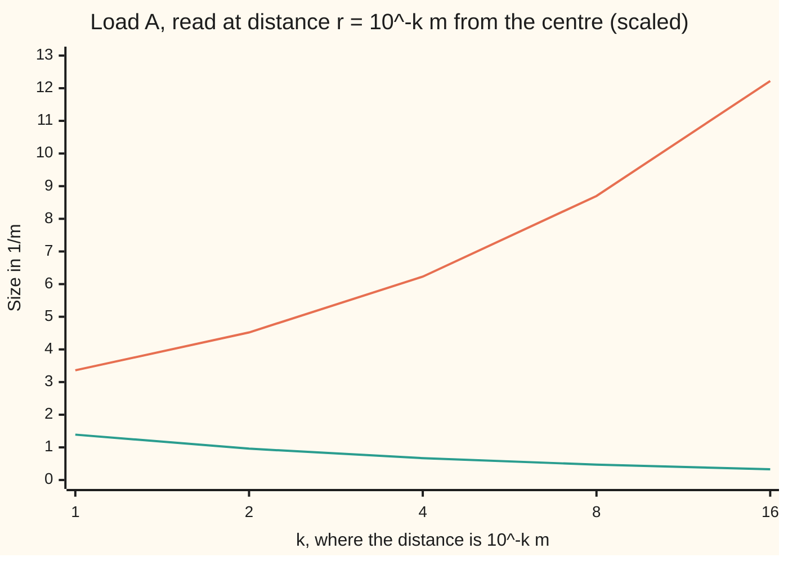

# Schauder estimates: a Hölder source gives a solution with Hölder second derivatives

[Syllabus](../../../SYLLABUS.md) → [Partial differential equations](../README.md) → [Weak Solutions and Free Boundaries](../README.md#s06) → Schauder estimates

---

## General Overview

Take the shelf's rubber sheet, stretched at 200 N/m (newtons per metre of edge, illustrative) over a rounded stone. A load (a pressure, in pascals) presses on it near one point. The **unknown** is the sheet's height $`u`$. The **region** is a disc of radius 0.5 m round that point. The **data** are the load and the height at the rim. The question is about the **bend**: a second derivative of the height, in 1/m, which says how sharply the sheet curves.

Two loads, both fading to zero at the centre, show the difference (scaled formulas, in metres):

- **Load A is continuous but fades very slowly.** Its size is 191.46 Pa at 1 cm from the centre and 93.83 Pa at $`10^{-8}`$ m. Yet the bend grows, from 4.5249 /m to 8.7004 /m, without limit.
- **Load B fades like the square root of the distance.** At 20 cm it is 89.44 Pa. Its bend never exceeds 0.4243 /m on the disc, and changes no faster than 0.6 times the square root of the distance.

Load B is **Hölder continuous**: it changes by at most a constant times a power of the distance. Load A is not. That difference decides whether the bend is bounded.

[Poisson's equation](../04-Laplace%2C%20Poisson%20and%20Potentials/03-poissons-equation-and-the-newtonian-potential.md) and [Harnack and regularity](../04-Laplace%2C%20Poisson%20and%20Potentials/10-harnack-and-regularity-in-outline.md) stated Schauder's Hölder estimates without proof. This card proves them for the Laplacian, carries them to variable coefficients, and uses them to solve equations.

**A Hölder source with exponent $`\alpha`$ between 0 and 1 gives second derivatives that are Hölder with the same $`\alpha`$; this bound, Schauder's estimate, also holds with Hölder coefficients, and walking from the Laplacian to the operator in short steps (the method of continuity) proves a solution exists.**

**What kind of fact this is:** theorems. The potential estimate and the method of continuity are proved on this card in Why it works. The estimates with variable coefficients and up to the boundary are stated, with proofs outlined and sourced (Gilbarg and Trudinger, Chapters 4 and 6). Loads A and B are scaled examples.

### The picture: under load A the source shrinks while the bend grows



Orange: the bend $`u_{xx}`$, rising without limit. Teal: the size of the source, the load divided by the tension, falling to zero. A continuous source, an unbounded bend.

---

## The formula

**The problem.** Reminders from this wing: $`\Omega`$ is the region, $`\partial\Omega`$ its boundary, $`\bar\Omega`$ the two together, $`d`$ the number of space directions, and $`B(x, \rho)`$ the ball of radius $`\rho`$ round $`x`$. The sheet obeys $`-T\,\Delta u = q`$, where $`T`$ is the tension and $`q`$ the load. Dividing by $`T`$ gives the scaled form $`-\Delta u = f`$, with source $`f = q/T`$ in 1/m.

**Hölder spaces.** This card introduces them. The **Hölder constant** of $`f`$ with exponent $`\alpha`$, $`0 < \alpha < 1`$, is the largest ratio of a change in $`f`$ to the distance raised to the power $`\alpha`$:

```math
[f]_{\alpha;\Omega} = \sup_{x \ne y \text{ in } \Omega} \frac{|f(x) - f(y)|}{|x - y|^{\alpha}}, \qquad \lVert u\rVert_{C^{2,\alpha}(\bar\Omega)} = \sup|u| + \sup|\partial u| + \sup|\partial^2 u| + [\partial^2 u]_{\alpha;\Omega}
```

**Read it aloud:** the Hölder constant is the worst ratio of change to distance to the power alpha; the $`C^{2,\alpha}`$ size adds the largest value, slope and bend to the bend's Hölder constant.

$`\partial u`$ means all first derivatives, $`\partial^2 u`$ all second derivatives, and "sup" the largest value or the value approached. The $`C^{\alpha}`$ size is $`\lVert f\rVert_{C^{\alpha}} = \sup|f| + [f]_{\alpha}`$. $`C^{\alpha}`$ and $`C^{2,\alpha}`$ are the functions whose sizes are finite. In general, $`C^{k,\alpha}`$ holds the functions whose derivatives up to order $`k`$ are bounded and whose $`k`$-th derivatives are Hölder with exponent $`\alpha`$.

**Theorem 1, the potential estimate.** Let $`f`$ be in $`C^{\alpha}`$ on the ball $`B(x_0, 2\rho)`$, and let $`w`$ be its Newtonian potential over that ball, $`w = \Phi * f`$, with $`\Phi`$ the point-source potential. Then $`w`$ is in $`C^{2,\alpha}`$ on $`B(x_0, \rho)`$, and

```math
\sup_{B(x_0,\rho)} |\partial^2 w| + \rho^{\alpha}\,[\partial^2 w]_{\alpha;B(x_0,\rho)} \;\le\; C(d, \alpha)\Big(\sup_{B(x_0, 2\rho)} |f| + \rho^{\alpha}\,[f]_{\alpha;B(x_0, 2\rho)}\Big)
```

**Read it aloud:** on the inner ball, the bend and its Hölder constant are at most a fixed multiple of the source and its Hölder constant on the outer ball; the multiple depends only on dimension and exponent.

**Theorem 2, the interior Schauder estimate.** Let $`u`$ in $`C^{2,\alpha}`$ solve $`Lu = f`$ in $`\Omega`$, where

```math
L u = -\sum_{i,j=1}^{d} a_{ij}(x)\,\partial_i\partial_j u + \sum_{i=1}^{d} b_i(x)\,\partial_i u + c(x)\,u, \qquad \sum_{i,j} a_{ij}\,\xi_i\,\xi_j \ge \theta\,|\xi|^2, \qquad \lVert a_{ij}\rVert_{C^\alpha},\ \lVert b_i\rVert_{C^\alpha},\ \lVert c\rVert_{C^\alpha} \le \Lambda
```

Then, for every ball with $`B(x_0, 2\rho)`$ inside $`\Omega`$,

```math
\lVert u\rVert_{C^{2,\alpha}(B(x_0,\rho))} \;\le\; C\,\Big(\sup_{B(x_0,2\rho)} |u| + \lVert f\rVert_{C^{\alpha}(B(x_0,2\rho))}\Big), \qquad C = C(d, \alpha, \theta, \Lambda, \rho)
```

**Read it aloud:** with Hölder coefficients and a push of at least $`\theta`$ in every direction $`\xi`$, the bend is Hölder on the inner ball, bounded by the solution's size and the source's Hölder size.

**Theorem 3, existence.** Let $`\Omega`$ be bounded with a $`C^{2,\alpha}`$ boundary, the coefficients and $`f`$ in $`C^{\alpha}(\bar\Omega)`$, $`c \ge 0`$, and edge values $`g`$ in $`C^{2,\alpha}(\bar\Omega)`$. Then $`Lu = f`$ in $`\Omega`$, $`u = g`$ on $`\partial\Omega`$, has exactly one solution in $`C^{2,\alpha}(\bar\Omega)`$, and

```math
\lVert u\rVert_{C^{2,\alpha}(\bar\Omega)} \le C\,\big(\lVert g\rVert_{C^{2,\alpha}(\bar\Omega)} + \lVert f\rVert_{C^{\alpha}(\bar\Omega)}\big)
```

**Read it aloud:** with a smooth edge and Hölder data there is one classical solution, bounded by the data.

| Symbol | Plain meaning | In our example | Push it up and the answer… |
| --- | --- | --- | --- |
| $`u`$, $`q`$, $`T`$, $`f`$ | height, m; load, Pa; tension, N/m; source $`q/T`$, 1/m | $`T`$ = 200 N/m | larger $`f`$: larger bend |
| $`x`$, $`y`$; $`r`$, $`\varphi`$ | points, or a point's coordinates (as in $`u_{xx}`$); distance from the centre, m; angle | load A on the $`y`$-axis | — |
| $`u_{xx}`$, $`\partial_i\partial_j u`$, $`\partial^2 u`$ | bend along $`x`$, 1/m; second derivative along $`i`$ and $`j`$; all of them | 4.5249 /m at 1 cm | — |
| $`f_1`$, $`f_2`$, $`\ell`$, $`P`$, $`h`$ | load A's source; load B's, $`r^{1/2}`$; $`\ln(1/r)`$; in a fold, $`u_1 = P h`$ | $`f_1`$ = −0.9573 /m at 1 cm | — |
| $`\alpha`$, $`[f]_\alpha`$ | Hölder exponent; Hölder constant | 1/2; $`[f_2]_{1/2}`$ = 1 | larger $`\alpha`$: smoother bend |
| $`C^{\alpha}`$, $`C^{2,\alpha}`$, $`\lVert\cdot\rVert`$ | Hölder functions; with Hölder bend; their sizes | $`w`$ in $`C^{2,1/2}`$ | — |
| $`\Omega`$, $`\partial\Omega`$, $`\bar\Omega`$, $`d`$, $`B(x, \rho)`$, $`k`$ | region; boundary; both; dimension; ball; derivatives counted in $`C^{k,\alpha}`$, or the power in $`10^{-k}`$ m on the chart | disc of 0.5 m; $`d`$ = 2 | — |
| $`\Phi`$, $`\Phi_{ij}`$, $`w`$, $`\rho_0`$ | point-source potential, $`-\ln\lvert x\rvert/(2\pi)`$; its second derivatives; $`\Phi * f`$; a radius holding the source | $`w = -\frac{4}{25}r^{5/2}`$ + constant | — |
| $`L`$, $`a_{ij}`$, $`b_i`$, $`c`$, $`\xi`$ | elliptic operator; its coefficients; a direction | model $`-a\,u''`$ | — |
| $`\theta`$, $`\Lambda`$, $`C`$ | ellipticity constant; bound on the coefficients' Hölder sizes; constants | $`\theta`$ = 1, $`[a]_{1/2} = 2\sqrt2`$ | $`\theta`$ down or $`\Lambda`$ up: $`C`$ grows |
| $`g`$, $`L_t`$, $`a_t`$, $`t`$, $`s`$, $`K`$, $`M`$ | edge values; the path; its model coefficient; path points; uniform constant; size of $`L + \Delta`$ | steps of 0.25 | longer step: no contraction |
| $`\omega(\eta)`$, $`\eta`$, $`\bar x`$, $`z`$ | largest change of $`f`$ over distance $`\eta`$; in a proof, a second point and the midpoint | load A: at least $`2/\sqrt{\ln(1/\eta)}`$ | — |

### When it holds

- **The source is Hölder, $`\alpha > 0`$.** A merely continuous source gives no bound on the bend. Load A's bend grows from 4.5249 /m at 1 cm to 12.2218 /m at $`10^{-16}`$ m.
- **The exponent is below 1.** At $`\alpha = 1`$ (a Lipschitz source, with bounded slope), the bend is continuous but need not be Lipschitz: the proof's far-field sum picks up a logarithm (Step 3).
- **The coefficients are Hölder, for Theorem 2.** Otherwise the freezing error of Step 4 is not small, and the bend's Hölder ratio can blow up.
- **Uniform ellipticity, $`\theta > 0`$.** The constants grow as $`\theta`$ shrinks.
- **For Theorem 3, a $`C^{2,\alpha}`$ boundary and $`c \ge 0`$.** Flattening the boundary must keep the coefficients Hölder. The sign of $`c`$ gives the maximum principle: uniqueness and a size bound.

---

## Why it works

### Step 0: the bend sees only how the source changes

The bend of the Newtonian potential at $`x`$ adds up the bends of point-source potentials, each growing like $`1/r^d`$. Against a constant source that sum diverges, like a logarithm.

But the point-source bend has a pattern. In the plane, $`\partial_x\partial_x\Phi`$ is $`\cos 2\varphi/(2\pi r^2)`$: positive in two directions, negative in two, and zero on average round every circle. So a constant source near $`x`$ contributes nothing. Only the change, $`f(y) - f(x)`$, counts.

A Hölder source changes by at most $`[f]_\alpha\,r^{\alpha}`$ at distance $`r`$. That pays for the singularity: $`r^{\alpha}/r^d`$ is summable over a ball, because $`\alpha > 0`$. The same exponent comes back out because zooming in changes the Hölder ratios of the source and of the bend by the same factor.

### Step 1: why continuity is not enough

Measure a source by $`\omega(\eta)`$, its largest change over a distance $`\eta`$. The bend at distance $`r`$ from a bad point collects, from every shell between $`r`$ and the rim, the change $`\omega(\eta)`$ weighted by $`1/\eta`$. So it behaves like the integral of $`\omega(\eta)/\eta`$ from $`r`$ outward.

- For a Hölder source, $`\omega(\eta) \le [f]_\alpha \eta^{\alpha}`$, and the integral all the way in to the centre is at most $`[f]_\alpha/(\alpha\, 2^{\alpha})`$: finite.
- For load A, $`\omega(\eta)`$ is at least $`2/\sqrt{\ln(1/\eta)}`$, the change from the centre to distance $`\eta`$. The integral of $`1/(\eta\sqrt{\ln(1/\eta)})`$ from $`r`$ to the rim is $`2\sqrt{\ln(1/r)}`$ minus a constant, which grows without limit as $`r \to 0`$.

Load A's bend grows at that same square-root rate. Its height and source are

```math
u_1 = (x^2 - y^2)\sqrt{\ell}, \qquad f_1 = -\Delta u_1 = \cos 2\varphi\,\Big(\frac{2}{\sqrt{\ell}} + \frac{1}{4\,\ell^{3/2}}\Big), \qquad u_{1,xx}(0, r) = 2\sqrt{\ell} + \frac{1}{2\sqrt{\ell}}, \qquad \ell = \ln\frac1r
```

**Read it aloud:** the height is a saddle times the square root of the log of one over the distance; its source fades like one over that square root; its bend on the $`y`$-axis grows like twice that square root.

The source tends to 0, so it is continuous. Its Hölder ratio with $`\alpha = 1/2`$, $`|f_1|/r^{1/2}`$, is 9.6 at 1 cm and 33062310.1 at $`10^{-16}`$ m: no Hölder constant exists. Centred differences on $`u_1`$ confirm the formulas: at 1 cm, bend 4.5249 and $`-\Delta u_1`$ = −0.9572 against −0.9573.

<details>
<summary>Detailed proof: the source and the bend of load A</summary>

Write $`u_1 = P\,h`$ with $`P = x^2 - y^2`$ and $`h(r) = \sqrt{\ell}`$. $`P`$ is harmonic, and $`\nabla P \cdot (x, y)/r = 2P/r`$. The product rule gives

$`\displaystyle \Delta(P h) = P\,\Delta h + 2\,\nabla P\cdot\nabla h = P\Big(h'' + \frac{h'}{r}\Big) + \frac{4 P h'}{r} = P\Big(h'' + \frac{5 h'}{r}\Big).`$

Since $`d\ell/dr = -1/r`$: $`h' = -\frac{1}{2r\sqrt{\ell}}`$ and $`h'' = \frac{1}{2r^2\sqrt{\ell}} - \frac{1}{4 r^2 \ell^{3/2}}`$. So $`h'' + 5h'/r = -\frac{1}{r^2}\big(\frac{2}{\sqrt\ell} + \frac{1}{4\ell^{3/2}}\big)`$, and $`P/r^2 = \cos 2\varphi`$ gives $`f_1`$.

On the $`y`$-axis, $`x = 0`$ and $`P = -r^2`$. Differentiating $`u_1`$ twice in $`x`$ and setting $`x = 0`$ leaves $`u_{1,xx} = 2h - r h'`$, which is $`2\sqrt{\ell} + \frac{1}{2\sqrt{\ell}}`$.

</details>

### Step 2: the formula for the bend, with the change of the source

The cancellation of Step 0 becomes a formula (Gilbarg and Trudinger, Lemma 4.2). Set $`f`$ to 0 outside its region, and let $`B(x, \rho_0)`$ be a ball that holds the whole region. Then

```math
\partial_i\partial_j w(x) = \int_{B(x, \rho_0)} \partial_i\partial_j\Phi(x - y)\,\big(f(y) - f(x)\big)\,dy \;-\; \frac{1}{d}\,f(x)\,[i = j]
```

**Read it aloud:** the bend at $`x`$ adds the point-source bend times the change of the source from its value at $`x`$, minus one $`d`$-th of the source at $`x`$ when both derivatives are in the same direction.

Here $`[i = j]`$ is 1 when $`i = j`$ and 0 otherwise. The proof cuts out a small ball round $`x`$ and applies the divergence theorem to the constant part $`f(x)`$; the sphere term gives the last piece. Summing the $`i = j`$ terms gives $`\Delta w = -f`$, because $`\Delta\Phi = 0`$ away from the source point.

The code sums this formula for load B in polar coordinates round $`x`$. At (0.20 m, 0) it gives $`w_{xx}`$ = −0.268328 /m, the hand value $`-\frac35 r^{1/2}`$. A third road, Gauss's law for the slope, $`w'(r) = -\frac{1}{2\pi r}\int_{B(0,r)} f_2\,dy`$, agrees to six decimals.

### Step 3: the bend is Hölder with the same exponent

Take two points $`x`$ and $`\bar x`$ at distance $`\eta`$. Subtract the formula at the two points. Split the ball round their midpoint into a near part, within $`2\eta`$, and a far part.

- **Near part.** Each point's own term is at most $`[f]_\alpha`$ times the integral of $`|x - y|^{\alpha - d}`$ over a ball of radius $`3\eta`$. That is a constant times $`[f]_\alpha\,\eta^{\alpha}`$.
- **Far part.** The two kernels differ by at most $`\eta`$ times the third derivative of $`\Phi`$, which is of size $`r^{-d-1}`$. Times the change $`[f]_\alpha r^{\alpha}`$, summed over shells beyond $`2\eta`$, this gives a constant times $`\eta\cdot\eta^{\alpha - 1} = \eta^{\alpha}`$. The sum converges far away only because $`\alpha < 1`$.

Both parts are of size $`[f]_\alpha\,\eta^{\alpha}`$, so $`[\partial^2 w]_\alpha \le C(d, \alpha)\,[f]_\alpha`$: Theorem 1. At $`\alpha = 1`$ the far sum becomes $`\eta\ln(1/\eta)`$, not $`\eta`$, so the theorem stops short of 1.

Load B measures the result. On every disc from 0.5 m to 0.0005 m the code finds $`[f_2]_{1/2}`$ = 1.0000 and $`[\partial^2 w]_{1/2}`$ = 0.6000, alike at every scale; Theorem 1 caps the ratio. With exponent 0.6, the bend's ratio from the centre to distance $`\eta`$ is $`0.6\,\eta^{-0.1}`$: 0.7554 at 10 cm, 9.5094 at $`10^{-12}`$ m, growing without bound. The exponent is kept, not gained.

<details>
<summary>Detailed proof: the Hölder bound for the bend</summary>

Let $`\eta = |x - \bar x|`$, $`z`$ the midpoint, $`\Phi_{ij} = \partial_i\partial_j\Phi`$, and $`B_\eta = B(z, 2\eta)`$. Subtracting the formula of Step 2 at $`x`$ and $`\bar x`$ gives five pieces.

1. and 2. $`\int_{B_\eta} \Phi_{ij}(x - y)(f(y) - f(x))\,dy`$ and the same at $`\bar x`$. Since $`|\Phi_{ij}(x - y)| \le C|x - y|^{-d}`$ and $`B_\eta`$ lies in $`B(x, 3\eta)`$, each is at most $`C[f]_\alpha\eta^{\alpha}/\alpha`$.
3. $`\int_{\text{far}} (\Phi_{ij}(x - y) - \Phi_{ij}(\bar x - y))(f(y) - f(x))\,dy`$. By the mean value theorem, $`|\Phi_{ij}(x - y) - \Phi_{ij}(\bar x - y)| \le C\eta|z - y|^{-d-1}`$ when $`|z - y| \ge 2\eta`$. Also $`|x - y| \le \frac32|z - y|`$. So the piece is at most $`C[f]_\alpha\,\eta\int_{2\eta}^{\infty} r^{\alpha - 2}\,dr = C[f]_\alpha\,\eta^{\alpha}/(1 - \alpha)`$.
4. $`(f(\bar x) - f(x))\int_{\text{far}} \Phi_{ij}(\bar x - y)\,dy`$. The integral is a bounded sphere integral, so this is at most $`C[f]_\alpha\eta^{\alpha}`$.
5. $`\frac1d(f(x) - f(\bar x))[i=j]`$, at most $`[f]_\alpha\eta^{\alpha}`$.

Adding gives $`C(d, \alpha)[f]_\alpha\,\eta^{\alpha}`$. The factors $`1/\alpha`$ and $`1/(1 - \alpha)`$ show both end points failing. Full details: Gilbarg and Trudinger, Lemma 4.4.

</details>

### Step 4: variable coefficients, by freezing them at a point

Near a point $`x_0`$, the operator $`L`$ looks like its constant-coefficient copy, $`-\sum a_{ij}(x_0)\,\partial_i\partial_j`$. A linear change of variables, a stretch by the matrix square root of $`(a_{ij}(x_0))`$, turns that copy into $`-\Delta`$. Theorem 1 and Steps 2 and 3 then apply, with constants that depend on $`\theta`$ and $`\Lambda`$ through the stretch.

Move the difference to the source side:

```math
-\sum_{i,j} a_{ij}(x_0)\,\partial_i\partial_j u = f + \sum_{i,j}\big(a_{ij}(x) - a_{ij}(x_0)\big)\,\partial_i\partial_j u - \sum_i b_i\,\partial_i u - c\,u
```

**Read it aloud:** the frozen operator applied to $`u`$ equals the source plus the error made by freezing, minus the lower-order terms.

On a ball of radius $`\rho`$, $`a_{ij}(x) - a_{ij}(x_0)`$ is at most $`\Lambda\rho^{\alpha}`$. So the freezing error's Hölder size is at most $`\Lambda\rho^{\alpha}[\partial^2 u]_\alpha`$ plus a multiple of $`\sup|\partial^2 u|`$. For small $`\rho`$ the first is a small share of the quantity being bounded, and moves to the left side. An interpolation inequality (a derivative is at most a small multiple of the next one plus a large multiple of the size) handles the rest. This gives Theorem 2 (Gilbarg and Trudinger, Theorem 6.2).

Merely continuous coefficients make the error small in size, not in Hölder size. In the model $`-a\,u'' = 1`$ near $`x = 1/2`$, with $`a = 1 + 1/\ln(1/|2x - 1|)`$ (continuous there, but not Hölder), the bend $`-1/a`$ has Hölder ratio 533.9731 at distance $`10^{-8}`$ from the middle.

### Step 5: up to the boundary, in outline

Near a boundary point, a $`C^{2,\alpha}`$ change of variables flattens the boundary and keeps the coefficients Hölder. On a half-ball with zero edge values, an odd reflection and a half-space Theorem 1 give the estimate up to the edge (Gilbarg and Trudinger, Chapter 4 and Theorem 6.6). Covering $`\bar\Omega`$ by finitely many such pieces gives a global bound with $`\sup|u|`$ on the right.

The [Maximum principles](../01-Classification%20and%20Well-Posedness/08-maximum-principles.md) card removes that last term: when $`c \ge 0`$, $`\sup|u| \le \sup|g| + C\sup|f|/\theta`$, with $`C`$ set by the region's size (Gilbarg and Trudinger, Theorem 3.7). That gives the estimate in Theorem 3.

### Step 6: the method of continuity turns the bound into a solution

Subtract the edge values, so $`g = 0`$. Join the Laplacian to $`L`$ by the straight path

```math
L_t = (1 - t)(-\Delta) + t\,L, \qquad 0 \le t \le 1
```

**Read it aloud:** at time 0 the operator is minus the Laplacian; at time 1 it is $`L`$; in between it is the weighted mix.

Every $`L_t`$ has ellipticity at least $`\min(1, \theta)`$ and coefficients of Hölder size at most $`\max(1, \Lambda)`$. So the global estimate holds with one constant $`K`$ for every $`t`$: $`\lVert u\rVert_{C^{2,\alpha}} \le K\lVert L_t u\rVert_{C^{\alpha}}`$.

Now suppose $`L_s`$ can be solved for every source. To solve $`L_t u = f`$, rewrite it as

```math
u = L_s^{-1}\big[f - (t - s)(L_1 - L_0)\,u\big]
```

**Read it aloud:** $`u`$ is what solving with $`L_s`$ returns, fed the source minus the step's share of $`L_1 - L_0`$ applied to $`u`$.

The right side is a map of $`u`$. It shrinks distances by the factor $`|t - s|\,K M`$, where $`M`$ bounds the size of $`L_1 - L_0`$. When that factor is below 1, [Banach's fixed point theorem](../../17-Topology/01-Metric%20Spaces/08-banach-fixed-point-in-metric-spaces.md) gives exactly one fixed point, the solution. So solvability spreads from $`s`$ to every $`t`$ within $`1/(KM)`$. Steps of that length reach $`t = 1`$ from $`t = 0`$, where the Laplacian is solvable (Gilbarg and Trudinger, Theorem 6.14 and its proof). The maximum principle makes the solution unique.

The code runs this on the model $`-a_t\,u'' = 1`$ on $`(0, 1)`$, with $`a = 1 + 2\sqrt{|2x - 1|}`$, between 1 and 3 and Hölder with exponent 1/2. Measured on the bend $`u''`$ in sup size, the factor is at most $`|t - s|\max\,(a - 1)/a_s`$.

| Step | Bound on the factor | Change ratio | Iterations to $`10^{-13}`$ | $`u(1/2)`$, m |
| --- | ---: | ---: | ---: | ---: |
| 0 → 0.25 | 0.5000 | 0.47 | 33 | 0.099460 |
| 0.25 → 0.50 | 0.3333 | 0.31 | 22 | 0.083338 |
| 0.50 → 0.75 | 0.2500 | 0.23 | 18 | 0.072070 |
| 0.75 → 1 | 0.2000 | 0.18 | 16 | 0.063681 |

The change ratio, each change over the one before, still creeps up when a step stops. One step from 0 to 1 has factor bound 2.0000, and the iteration runs away (What breaks, below). The final 0.06368079 m matches a direct solve of the same grid to eight decimals, and the exact integral, 0.06367176 m, to the grid's error. The uniform estimate holds with nothing to spare: at $`t`$ = 1 the bend's Hölder ratio is 2.3570 on a 5 mm grid, but 2.8284 across $`10^{-12}`$ m at $`x = 1/2`$, equal to the one-dimensional bound $`[a]_{1/2}\sup|f|/\theta^2`$.

**Compactness.** Functions bounded in $`C^{2,\alpha}`$ have second derivatives sharing one Hölder bound, so they are equicontinuous. [Arzela-Ascoli](../../17-Topology/01-Metric%20Spaces/09-arzela-ascoli.md) then gives a subsequence converging with two derivatives. Nonlinear existence proofs rely on this.

---

## Worked numbers, by hand

Load A at 1 cm on the $`y`$-axis, then load B at 20 cm on the $`x`$-axis. Tension 200 N/m.

| Step | Arithmetic | Value |
| --- | --- | --- |
| $`\ell = \ln(1/r)`$ at $`r`$ = 0.01 m | $`\ln 100`$ | 4.6052 |
| $`\sqrt{\ell}`$ | $`\sqrt{4.6052}`$ | 2.1460 |
| load A's source, $`\cos 2\varphi = -1`$ | $`-(2/2.1460 + 0.25/4.6052^{1.5})`$ | −0.9573 /m |
| load A | 200 × (−0.9573) | −191.46 Pa |
| Hölder ratio $`\lvert f_1\rvert/r^{1/2}`$, with $`r^{1/2}`$ = 0.1000 | 0.9573 / 0.1000 | 9.6 |
| load A's bend $`u_{xx}`$ | $`2 \times 2.1460 + 0.5/2.1460`$ | **4.5249 /m** |
| load B's source at $`r`$ = 0.2 m | $`0.2^{1/2}`$ | 0.447214 /m |
| load B | 200 × 0.447214 | 89.44 Pa |
| load B's bend $`w_{xx} = -\frac35 r^{1/2}`$ | −0.6 × 0.447214 | **−0.268328 /m** |
| largest bend of load B on the disc | 0.6 × $`\sqrt{0.5}`$ | 0.4243 /m |
| Hölder ratio of the bend to the source | 0.6 / 1 | 0.6 |

Load A's bend grows without limit further in. Load B's is bounded and Hölder, with ratio 0.6, which Theorem 1 caps by $`C(2, 1/2)`$.

### What breaks if you drop a piece

| Mistake | Comes out at | What went wrong |
| --- | --- | --- |
| A continuous source that is not Hölder (load A) | bend 4.5249, 6.2345, 8.7004, 12.2218 /m at $`10^{-2}`$, $`10^{-4}`$, $`10^{-8}`$, $`10^{-16}`$ m; source down to 0.3306 /m | no Hölder constant: the ratio reaches 33062310.1 |
| Expect a better exponent: load B's bend with $`\alpha`$ = 0.6 | 0.7554, 1.1972, 2.3886, 9.5094 from the centre to 10 cm, 1 mm, 1 µm, $`10^{-12}`$ m | grows like $`\eta^{-0.1}`$: the exponent is kept, not gained |
| Walk from $`-\Delta`$ to $`L`$ in one step | change 0.1333, 6.0952, 1985.8520 m after 1, 10, 20 iterations | factor bound 2.0000 is above 1; the map is not a contraction |
| Coefficient only continuous, $`a = 1 + 1/\ln(1/\lvert 2x - 1\rvert)`$ | Hölder ratio of $`u''`$: 2.0358, 10.5073, 533.9731 at $`10^{-2}`$, $`10^{-4}`$, $`10^{-8}`$ | the freezing error is not small in Hölder size |

---

## Code, from first principles, and it actually runs

Three roads reach load B's bend at two points: the hand formula, Step 2's formula summed in polar coordinates, and Gauss's law plus a centred difference. They agree to six decimals. Centred differences check load A's hand formulas. Hölder constants are measured over all pairs of 129 points on shrinking discs. The method of continuity runs step by step with a tridiagonal solver, against a direct solve and an exact integral.

### Python

```python
# Schauder estimates -- the check behind the card.  Standard library only.
# Scaled units: lengths in m, heights in m, tension T = 200 N/m, load q = T*f in Pa.
# Equation -Lap u = f on the disc r < 1/2.  Phi = -(1/2pi) ln|x| is the point-source potential.
from math import log, sqrt, cos, sin, pi
T, R = 200.0, 0.5

# ---- A. a continuous source that is not Hoelder: u1 = (x^2 - y^2) sqrt(ln(1/r)) ----
def u1(x, y): return (x * x - y * y) * sqrt(log(1.0 / sqrt(x * x + y * y)))
def f1(x, y):                       # -Lap u1, worked out by hand on the card
    r2 = x * x + y * y; l = log(1.0 / sqrt(r2))
    return (x * x - y * y) / r2 * (2.0 / sqrt(l) + 0.25 / l ** 1.5)
def bend1(r):                       # u1_xx on the y-axis, by hand
    l = log(1.0 / r); return 2.0 * sqrt(l) + 0.5 / sqrt(l)
print("A. continuous source f1 = -Lap[(x^2 - y^2) sqrt(ln 1/r)], read on the y-axis at distance r")
print("     r (m)   f1 (1/m)   load (Pa)    |f1|/r^0.5  u_xx (1/m)  2 sqrt(ln 1/r)")
for k in (1, 2, 4, 8, 16):
    r = 10.0 ** -k
    print(f"     1e-{k:02d} {f1(0, r):10.4f} {T * f1(0, r):10.2f} {abs(f1(0, r)) / sqrt(r):12.1f} {bend1(r):12.4f} {2 * sqrt(log(1 / r)):14.4f}")
fd = []
for r in (1e-1, 1e-2):
    h = r / 100
    uxx = (u1(h, r) - 2 * u1(0, r) + u1(-h, r)) / h ** 2
    lap = (u1(h, r) + u1(-h, r) + u1(0, r + h) + u1(0, r - h) - 4 * u1(0, r)) / h ** 2
    fd.append((r, uxx, -lap))
    print(f"  centred differences, h = r/100, r = 1e-0{len(fd)}: bend {uxx:.4f}, -Lap u1 {-lap:.4f}")
print(f"  by hand at r = 1e-02: ell {log(100.0):.4f}, sqrt(ell) {sqrt(log(100.0)):.4f}, r^0.5 {sqrt(0.01):.4f}")

# ---- B. a Hoelder source: f2 = r^(1/2); its Newtonian potential on the disc is -(4/25) r^(5/2) + const ----
def f2(x, y): return (x * x + y * y) ** 0.25
def d2w(x, y):                      # (w_xx, w_xy, w_yy) of w = -(4/25) r^(5/2), by hand
    r = sqrt(x * x + y * y)
    if r == 0.0: return (0.0, 0.0, 0.0)
    c, s = x / r, y / r
    return (-sqrt(r) * (0.6 * c * c + 0.4 * s * s), -0.2 * sqrt(r) * c * s, -sqrt(r) * (0.6 * s * s + 0.4 * c * c))
def korn_xx(x, y, n=400):           # road 2: the proof's formula, D11 Phi against f(y) - f(x), polar about x
    fx, tot = f2(x, y), 0.0
    for i in range(n):
        ph = (i + 0.5) * 2 * pi / n; ex, ey = cos(ph), sin(ph)
        b = x * ex + y * ey; L = -b + sqrt(b * b + R * R - x * x - y * y)   # ray length to the rim
        s = sum((f2(x + (j + 0.5) * L / n * ex, y + (j + 0.5) * L / n * ey) - fx) / ((j + 0.5) * L / n) for j in range(n))
        tot += -cos(2 * ph) / (2 * pi) * (s * L / n + fx * log(L))
    return -(tot * 2 * pi / n + fx / 2)
def simpson(g, a, b, n=2000):
    h = (b - a) / n
    return (g(a) + g(b) + sum((4 if i % 2 else 2) * g(a + i * h) for i in range(1, n))) * h / 3
def gauss_slope(r): return -simpson(lambda t: t * t ** 0.5, 0.0, r) / r   # road 3: Gauss's law, w'(r)
print("B. Hoelder source f2 = r^0.5 on the disc r < 0.5, Newtonian potential w")
roads = []
for (x, y) in ((0.2, 0.0), (0.12, 0.16)):
    r, e = sqrt(x * x + y * y), 1e-4
    w2 = (gauss_slope(r + e) - gauss_slope(r - e)) / (2 * e)
    g3 = w2 * x * x / r ** 2 + gauss_slope(r) / r * y * y / r ** 2
    roads.append((d2w(x, y)[0], korn_xx(x, y), g3))
    print(f"  bend w_xx at ({x:.2f}, {y:.2f}): by hand {roads[-1][0]:.6f}, proof's formula {roads[-1][1]:.6f}, Gauss's law {g3:.6f}")
    print(f"     load there {T * f2(x, y):.2f} Pa; -Lap w = w_xx + w_yy by hand {-d2w(x, y)[0] - d2w(x, y)[2]:.6f}, f2 {f2(x, y):.6f}")
def semi(vals, pts, a):             # largest Hoelder quotient over all pairs of sample points
    return max(abs(vals[i] - vals[j]) / sqrt((pts[i][0] - pts[j][0]) ** 2 + (pts[i][1] - pts[j][1]) ** 2) ** a
               for i in range(len(pts)) for j in range(i))
print("  disc radius rho: sup|f2|  [f2]_0.5  sup|D2w|  [D2w]_0.5   (129 sample points)")
disc = []
for rho in (0.5, 0.05, 0.005, 0.0005):
    pts = [(0.0, 0.0)] + [(rho * k / 8 * cos(m * pi / 8), rho * k / 8 * sin(m * pi / 8)) for k in range(1, 9) for m in range(16)]
    D = [d2w(*p) for p in pts]
    sup2 = max(abs(v) for d in D for v in d)
    h5 = max(semi([d[c] for d in D], pts, 0.5) for c in range(3))
    disc.append((rho, semi([f2(*p) for p in pts], pts, 0.5), sup2, h5))
    print(f"  {rho:16.4f} {max(f2(*p) for p in pts):8.4f} {disc[-1][1]:9.4f} {sup2:9.4f} {h5:10.4f}")
q6 = [max(abs(p - q) for p, q in zip(d2w(e, 0.0), d2w(0.0, 0.0))) / e ** 0.6 for e in (0.1, 1e-3, 1e-6, 1e-12)]
print("  exponent 0.6: D2w quotient from the centre to 10 cm, 1 mm, 1 um, 1e-12 m: " + ", ".join(f"{q:.4f}" for q in q6))

# ---- C. method of continuity: -a_t u'' = 1 on (0, 1), u(0) = u(1) = 0, a_t = 1 + t (a - 1) ----
N = 1000; hx = 1.0 / N; X = [i * hx for i in range(N + 1)]
a = [1.0 + 2.0 * sqrt(abs(2 * x - 1)) for x in X]      # Hoelder 1/2, between 1 and 3
def solve(at, g):                   # tridiagonal (Thomas) solve of -at u'' = g by centred differences
    n = N - 1; cp, dp = [0.0] * n, [0.0] * n
    for k in range(n):
        lo = hi = -at[k + 1] / hx ** 2; di = 2 * at[k + 1] / hx ** 2
        m = di - (lo * cp[k - 1] if k else 0.0)
        cp[k] = hi / m; dp[k] = (g[k + 1] - (lo * dp[k - 1] if k else 0.0)) / m
    u = [0.0] * (N + 1)
    for k in range(n - 1, -1, -1): u[k + 1] = dp[k] - (cp[k] * u[k + 2] if k < n - 1 else 0.0)
    return u
def d2(u): return [0.0] + [(u[i + 1] - 2 * u[i] + u[i - 1]) / hx ** 2 for i in range(1, N)] + [0.0]
def step(u, s, t, iters):           # u <- L_s^(-1)[f - (t - s)(L_1 - L_0) u], the contraction of the proof
    at, ch = [1 + s * (ai - 1) for ai in a], []
    for _ in range(iters):
        un = solve(at, [1.0 + (t - s) * (ai - 1) * v for ai, v in zip(a, d2(u))])
        ch.append(max(abs(p - q) for p, q in zip(un, u))); u = un
        if ch[-1] < 1e-13: break
    return u, ch
print("C. method of continuity, -a_t u'' = 1, a = 1 + 2 sqrt|2x - 1|, 1000 grid steps")
u = solve([1.0] * (N + 1), [1.0] * (N + 1)); ts = [0.0, 0.25, 0.5, 0.75, 1.0]
for s, t in zip(ts, ts[1:]):
    qb = (t - s) * max((ai - 1) / (1 + s * (ai - 1)) for ai in a)
    u, ch = step(u, s, t, 100)
    print(f"  step {s:.2f} -> {t:.2f}: bound on the factor {qb:.4f}, change ratio near the end {ch[-2] / ch[-3]:.2f}, {len(ch)} iterations, u(1/2) = {u[N // 2]:.6f} m")
_, big = step(solve([1.0] * (N + 1), [1.0] * (N + 1)), 0.0, 1.0, 20)
print(f"  one step 0 -> 1: bound on the factor {max(ai - 1 for ai in a):.4f}, change after 1, 10, 20 iterations {big[0]:.4f}, {big[9]:.4f}, {big[19]:.4f} m")
ud = solve(a, [1.0] * (N + 1))
exact = simpson(lambda s: (1 - s * s) * s / (2 * (1 + 2 * s)), 0.0, 1.0)  # u(1/2) = int_0^1/2 t/a dt, t = (1 - s^2)/2
print(f"  u(1/2): continuity {u[N // 2]:.8f}, direct solve {ud[N // 2]:.8f}, integral {exact:.8f} m")
sub = list(range(0, N + 1, 5))
for t in (0.25, 0.5, 1.0):
    v = [-1.0 / (1 + t * (a[i] - 1)) for i in sub]
    meas = semi(v, [(X[i], 0.0) for i in sub], 0.5)
    near = (1 - 1 / (1 + t * 2 * sqrt(2e-12))) / sqrt(1e-12)   # x = 1/2 against 1/2 + 1e-12, where |2x - 1| = 2e-12
    print(f"  t = {t:.2f}: [u'']_0.5 quotient on a 5 mm sample {meas:.4f}, pair 1e-12 m apart at x = 1/2 {near:.4f}; bound [a_t]_0.5 * sup|f| / theta^2 = {t * 2 * sqrt(2):.4f}")
    assert meas < near < t * 2 * sqrt(2) < near + 1e-4, "the bound is reached as the pair closes in on x = 1/2"
print("  coefficient a = 1 + 1/ln(1/|2x - 1|), only continuous: [u'']_0.5 quotient at distance d from x = 1/2")
for k in (2, 4, 8):
    d = 10.0 ** -k
    print(f"     d = 1e-{k:02d}: {(1 - 1 / (1 + 1 / log(1 / (2 * d)))) / sqrt(d):.4f}")
print("chart, k in r = 10^-k: 1, 2, 4, 8, 16")
print("chart, bend under f1 (1/m): " + ", ".join(f"{bend1(10.0 ** -k):.2f}" for k in (1, 2, 4, 8, 16)))
print("chart, size of f1 (1/m): " + ", ".join(f"{abs(f1(0, 10.0 ** -k)):.2f}" for k in (1, 2, 4, 8, 16)))

for r, uxx, lap in fd:              # roads agree: hand formulas against centred differences
    assert abs(uxx - bend1(r)) < 1e-3 * bend1(r) and abs(lap - f1(0, r)) < 1e-3 * abs(f1(0, r))
assert bend1(1e-16) > 2.5 * bend1(1e-2) and abs(f1(0, 1e-16)) < abs(f1(0, 1e-2)), "source shrinks, bend grows"
for hand, korn, gauss in roads:
    assert abs(korn - hand) < 1e-5 and abs(gauss - hand) < 1e-6, "three roads to the bend"
assert all(abs(d[3] - 0.6) < 1e-9 for d in disc), "[D2w]_0.5 = 0.6 [f2]_0.5 on every disc"
assert abs(q6[3] / q6[1] - 1e9 ** 0.1) < 1e-9, "[D2w]_0.6 quotient grows like eta^-0.1 without bound: alpha not gained"
assert abs(u[N // 2] - ud[N // 2]) < 1e-11 and abs(ud[N // 2] - exact) < 1e-4, "continuity = direct = integral"
assert big[19] > 1e3 * big[0], "one giant step must diverge"
print("ALL CHECKS PASS")
```

**Ran 2026-11-24 on macOS, Python 3.14.10, standard library only. All checks passed. Output, pasted from the run:**

```
A. continuous source f1 = -Lap[(x^2 - y^2) sqrt(ln 1/r)], read on the y-axis at distance r
     r (m)   f1 (1/m)   load (Pa)    |f1|/r^0.5  u_xx (1/m)  2 sqrt(ln 1/r)
     1e-01    -1.3896    -277.91          4.4       3.3644         3.0349
     1e-02    -0.9573    -191.46          9.6       4.5249         4.2919
     1e-04    -0.6680    -133.59         66.8       6.2345         6.0697
     1e-08    -0.4692     -93.83       4691.5       8.7004         8.5839
     1e-16    -0.3306     -66.12   33062310.1      12.2218        12.1394
  centred differences, h = r/100, r = 1e-01: bend 3.3643, -Lap u1 -1.3895
  centred differences, h = r/100, r = 1e-02: bend 4.5249, -Lap u1 -0.9572
  by hand at r = 1e-02: ell 4.6052, sqrt(ell) 2.1460, r^0.5 0.1000
B. Hoelder source f2 = r^0.5 on the disc r < 0.5, Newtonian potential w
  bend w_xx at (0.20, 0.00): by hand -0.268328, proof's formula -0.268328, Gauss's law -0.268328
     load there 89.44 Pa; -Lap w = w_xx + w_yy by hand 0.447214, f2 0.447214
  bend w_xx at (0.12, 0.16): by hand -0.211085, proof's formula -0.211085, Gauss's law -0.211085
     load there 89.44 Pa; -Lap w = w_xx + w_yy by hand 0.447214, f2 0.447214
  disc radius rho: sup|f2|  [f2]_0.5  sup|D2w|  [D2w]_0.5   (129 sample points)
            0.5000   0.7071    1.0000    0.4243     0.6000
            0.0500   0.2236    1.0000    0.1342     0.6000
            0.0050   0.0707    1.0000    0.0424     0.6000
            0.0005   0.0224    1.0000    0.0134     0.6000
  exponent 0.6: D2w quotient from the centre to 10 cm, 1 mm, 1 um, 1e-12 m: 0.7554, 1.1972, 2.3886, 9.5094
C. method of continuity, -a_t u'' = 1, a = 1 + 2 sqrt|2x - 1|, 1000 grid steps
  step 0.00 -> 0.25: bound on the factor 0.5000, change ratio near the end 0.47, 33 iterations, u(1/2) = 0.099460 m
  step 0.25 -> 0.50: bound on the factor 0.3333, change ratio near the end 0.31, 22 iterations, u(1/2) = 0.083338 m
  step 0.50 -> 0.75: bound on the factor 0.2500, change ratio near the end 0.23, 18 iterations, u(1/2) = 0.072070 m
  step 0.75 -> 1.00: bound on the factor 0.2000, change ratio near the end 0.18, 16 iterations, u(1/2) = 0.063681 m
  one step 0 -> 1: bound on the factor 2.0000, change after 1, 10, 20 iterations 0.1333, 6.0952, 1985.8520 m
  u(1/2): continuity 0.06368079, direct solve 0.06368079, integral 0.06367176 m
  t = 0.25: [u'']_0.5 quotient on a 5 mm sample 0.6734, pair 1e-12 m apart at x = 1/2 0.7071; bound [a_t]_0.5 * sup|f| / theta^2 = 0.7071
  t = 0.50: [u'']_0.5 quotient on a 5 mm sample 1.2856, pair 1e-12 m apart at x = 1/2 1.4142; bound [a_t]_0.5 * sup|f| / theta^2 = 1.4142
  t = 1.00: [u'']_0.5 quotient on a 5 mm sample 2.3570, pair 1e-12 m apart at x = 1/2 2.8284; bound [a_t]_0.5 * sup|f| / theta^2 = 2.8284
  coefficient a = 1 + 1/ln(1/|2x - 1|), only continuous: [u'']_0.5 quotient at distance d from x = 1/2
     d = 1e-02: 2.0358
     d = 1e-04: 10.5073
     d = 1e-08: 533.9731
chart, k in r = 10^-k: 1, 2, 4, 8, 16
chart, bend under f1 (1/m): 3.36, 4.52, 6.23, 8.70, 12.22
chart, size of f1 (1/m): 1.39, 0.96, 0.67, 0.47, 0.33
ALL CHECKS PASS
```

### Rust

```rust
// Schauder estimates -- the same check as holder_spaces_and_schauder_estimates_check.py, in Rust.
// Standard library only, no crates.  Scaled units: lengths in m, heights in m, T = 200 N/m, load q = T*f in Pa.
// Equation -Lap u = f on the disc r < 1/2.  Phi = -(1/2pi) ln|x| is the point-source potential.
use std::f64::consts::PI;
const T: f64 = 200.0; const R: f64 = 0.5; const N: usize = 1000;

// ---- A. a continuous source that is not Hoelder: u1 = (x^2 - y^2) sqrt(ln(1/r)) ----
fn u1(x: f64, y: f64) -> f64 { (x * x - y * y) * (1.0 / (x * x + y * y).sqrt()).ln().sqrt() }
fn f1(x: f64, y: f64) -> f64 {                         // -Lap u1, worked out by hand on the card
    let r2 = x * x + y * y; let l = (1.0 / r2.sqrt()).ln();
    (x * x - y * y) / r2 * (2.0 / l.sqrt() + 0.25 / l.powf(1.5))
}
fn bend1(r: f64) -> f64 { let l = (1.0 / r).ln(); 2.0 * l.sqrt() + 0.5 / l.sqrt() }   // u1_xx on the y-axis

// ---- B. a Hoelder source: f2 = r^(1/2); its Newtonian potential on the disc is -(4/25) r^(5/2) + const ----
fn f2(x: f64, y: f64) -> f64 { (x * x + y * y).powf(0.25) }
fn d2w(x: f64, y: f64) -> [f64; 3] {                   // (w_xx, w_xy, w_yy) of w = -(4/25) r^(5/2), by hand
    let r = (x * x + y * y).sqrt();
    if r == 0.0 { return [0.0, 0.0, 0.0]; }
    let (c, s) = (x / r, y / r);
    [-r.sqrt() * (0.6 * c * c + 0.4 * s * s), -0.2 * r.sqrt() * c * s, -r.sqrt() * (0.6 * s * s + 0.4 * c * c)]
}
fn korn_xx(x: f64, y: f64, n: usize) -> f64 {          // road 2: the proof's formula, polar about x
    let (fx, mut tot) = (f2(x, y), 0.0);
    for i in 0..n {
        let ph = (i as f64 + 0.5) * 2.0 * PI / n as f64; let (ex, ey) = (ph.cos(), ph.sin());
        let b = x * ex + y * ey; let l = -b + (b * b + R * R - x * x - y * y).sqrt();   // ray length to the rim
        let mut s = 0.0;
        for j in 0..n { let rho = (j as f64 + 0.5) * l / n as f64; s += (f2(x + rho * ex, y + rho * ey) - fx) / rho; }
        tot += -(2.0 * ph).cos() / (2.0 * PI) * (s * l / n as f64 + fx * l.ln());
    }
    -(tot * 2.0 * PI / n as f64 + fx / 2.0)
}
fn simpson<F: Fn(f64) -> f64>(g: F, a: f64, b: f64, n: usize) -> f64 {
    let (h, mut s) = ((b - a) / n as f64, 0.0);
    for i in 1..n { s += (if i % 2 == 1 { 4.0 } else { 2.0 }) * g(a + i as f64 * h); }
    (g(a) + g(b) + s) * h / 3.0
}
fn gauss_slope(r: f64) -> f64 { -simpson(|t| t * t.powf(0.5), 0.0, r, 2000) / r }   // road 3: Gauss's law
fn semi(vals: &[f64], pts: &[(f64, f64)], a: f64) -> f64 {   // largest Hoelder quotient over all pairs
    let mut m = f64::NEG_INFINITY;
    for i in 0..pts.len() { for j in 0..i {
        let d = ((pts[i].0 - pts[j].0) * (pts[i].0 - pts[j].0) + (pts[i].1 - pts[j].1) * (pts[i].1 - pts[j].1)).sqrt();
        m = m.max((vals[i] - vals[j]).abs() / d.powf(a));
    } }
    m
}

// ---- C. method of continuity: -a_t u'' = 1 on (0, 1), u(0) = u(1) = 0, a_t = 1 + t (a - 1) ----
fn solve(at: &[f64], g: &[f64], hx: f64) -> Vec<f64> {  // tridiagonal (Thomas) solve of -at u'' = g
    let n = N - 1;
    let (mut cp, mut dp) = (vec![0.0; n], vec![0.0; n]);
    for k in 0..n {
        let (lo, di) = (-at[k + 1] / (hx * hx), 2.0 * at[k + 1] / (hx * hx)); let hi = lo;
        let m = di - if k > 0 { lo * cp[k - 1] } else { 0.0 };
        cp[k] = hi / m;
        dp[k] = (g[k + 1] - if k > 0 { lo * dp[k - 1] } else { 0.0 }) / m;
    }
    let mut u = vec![0.0; N + 1];
    for k in (0..n).rev() { u[k + 1] = dp[k] - if k < n - 1 { cp[k] * u[k + 2] } else { 0.0 }; }
    u
}
fn d2(u: &[f64], hx: f64) -> Vec<f64> {
    let mut v = vec![0.0; N + 1];
    for i in 1..N { v[i] = (u[i + 1] - 2.0 * u[i] + u[i - 1]) / (hx * hx); }
    v
}
fn step(mut u: Vec<f64>, a: &[f64], s: f64, t: f64, iters: usize, hx: f64) -> (Vec<f64>, Vec<f64>) {
    let (at, mut ch): (Vec<f64>, Vec<f64>) = (a.iter().map(|ai| 1.0 + s * (ai - 1.0)).collect(), Vec::new());
    for _ in 0..iters {                                // u <- L_s^(-1)[f - (t - s)(L_1 - L_0) u]
        let g: Vec<f64> = a.iter().zip(d2(&u, hx)).map(|(ai, v)| 1.0 + (t - s) * (ai - 1.0) * v).collect();
        let un = solve(&at, &g, hx);
        ch.push(un.iter().zip(&u).map(|(p, q)| (p - q).abs()).fold(f64::NEG_INFINITY, f64::max)); u = un;
        if *ch.last().unwrap() < 1e-13 { break; }
    }
    (u, ch)
}

fn main() {
    println!("A. continuous source f1 = -Lap[(x^2 - y^2) sqrt(ln 1/r)], read on the y-axis at distance r");
    println!("     r (m)   f1 (1/m)   load (Pa)    |f1|/r^0.5  u_xx (1/m)  2 sqrt(ln 1/r)");
    let ks = [1i32, 2, 4, 8, 16];
    for k in ks {
        let r = 10f64.powf(-k as f64);
        println!("     1e-{:02} {:10.4} {:10.2} {:12.1} {:12.4} {:14.4}", k, f1(0.0, r), T * f1(0.0, r),
                 f1(0.0, r).abs() / r.sqrt(), bend1(r), 2.0 * (1.0 / r).ln().sqrt());
    }
    let mut fd = Vec::new();
    for r in [1e-1, 1e-2] {
        let h = r / 100.0; let uxx = (u1(h, r) - 2.0 * u1(0.0, r) + u1(-h, r)) / (h * h);
        let lap = (u1(h, r) + u1(-h, r) + u1(0.0, r + h) + u1(0.0, r - h) - 4.0 * u1(0.0, r)) / (h * h);
        fd.push((r, uxx, -lap));
        println!("  centred differences, h = r/100, r = 1e-0{}: bend {:.4}, -Lap u1 {:.4}", fd.len(), uxx, -lap);
    }
    println!("  by hand at r = 1e-02: ell {:.4}, sqrt(ell) {:.4}, r^0.5 {:.4}", 100f64.ln(), 100f64.ln().sqrt(), 0.01f64.sqrt());

    println!("B. Hoelder source f2 = r^0.5 on the disc r < 0.5, Newtonian potential w");
    let mut roads = Vec::new();
    for (x, y) in [(0.2f64, 0.0f64), (0.12, 0.16)] {
        let (r, e) = ((x * x + y * y).sqrt(), 1e-4);
        let w2 = (gauss_slope(r + e) - gauss_slope(r - e)) / (2.0 * e);
        let g3 = w2 * x * x / (r * r) + gauss_slope(r) / r * y * y / (r * r);
        roads.push((d2w(x, y)[0], korn_xx(x, y, 400), g3));
        println!("  bend w_xx at ({:.2}, {:.2}): by hand {:.6}, proof's formula {:.6}, Gauss's law {:.6}", x, y, roads[roads.len() - 1].0, roads[roads.len() - 1].1, g3);
        println!("     load there {:.2} Pa; -Lap w = w_xx + w_yy by hand {:.6}, f2 {:.6}", T * f2(x, y),
                 -d2w(x, y)[0] - d2w(x, y)[2], f2(x, y));
    }
    println!("  disc radius rho: sup|f2|  [f2]_0.5  sup|D2w|  [D2w]_0.5   (129 sample points)");
    let mut disc = Vec::new();
    for rho in [0.5f64, 0.05, 0.005, 0.0005] {
        let mut pts = vec![(0.0f64, 0.0f64)];
        for k in 1..9 { for m in 0..16 { let (rr, an) = (rho * k as f64 / 8.0, m as f64 * PI / 8.0); pts.push((rr * an.cos(), rr * an.sin())); } }
        let dd: Vec<[f64; 3]> = pts.iter().map(|p| d2w(p.0, p.1)).collect();
        let sup2 = dd.iter().flat_map(|d| d.iter()).fold(f64::NEG_INFINITY, |m, v| m.max(v.abs()));
        let comp = |c: usize, a: f64| semi(&dd.iter().map(|d| d[c]).collect::<Vec<_>>(), &pts, a);
        let h5 = comp(0, 0.5).max(comp(1, 0.5)).max(comp(2, 0.5));
        let fv: Vec<f64> = pts.iter().map(|p| f2(p.0, p.1)).collect(); let hf = semi(&fv, &pts, 0.5);
        disc.push((rho, hf, sup2, h5));
        println!("  {:16.4} {:8.4} {:9.4} {:9.4} {:10.4}", rho, fv.iter().cloned().fold(f64::NEG_INFINITY, f64::max), hf, sup2, h5);
    }
    let q6: Vec<f64> = [0.1f64, 1e-3, 1e-6, 1e-12].iter().map(|&e| { let (p, q) = (d2w(e, 0.0), d2w(0.0, 0.0));
        (0..3).map(|c| (p[c] - q[c]).abs()).fold(f64::NEG_INFINITY, f64::max) / e.powf(0.6) }).collect();
    println!("  exponent 0.6: D2w quotient from the centre to 10 cm, 1 mm, 1 um, 1e-12 m: {}", q6.iter().map(|q| format!("{:.4}", q)).collect::<Vec<_>>().join(", "));

    let hx = 1.0 / N as f64;
    let xs: Vec<f64> = (0..=N).map(|i| i as f64 * hx).collect();
    let a: Vec<f64> = xs.iter().map(|x| 1.0 + 2.0 * (2.0 * x - 1.0).abs().sqrt()).collect();   // Hoelder 1/2
    let ones = vec![1.0; N + 1]; println!("C. method of continuity, -a_t u'' = 1, a = 1 + 2 sqrt|2x - 1|, 1000 grid steps");
    let (mut u, ts) = (solve(&ones, &ones, hx), [0.0, 0.25, 0.5, 0.75, 1.0]);
    for w in ts.windows(2) {
        let (s, t) = (w[0], w[1]);
        let qb = (t - s) * a.iter().map(|ai| (ai - 1.0) / (1.0 + s * (ai - 1.0))).fold(f64::NEG_INFINITY, f64::max);
        let (un, ch) = step(u, &a, s, t, 100, hx); u = un; let nc = ch.len();
        println!("  step {:.2} -> {:.2}: bound on the factor {:.4}, change ratio near the end {:.2}, {} iterations, u(1/2) = {:.6} m",
                 s, t, qb, ch[nc - 2] / ch[nc - 3], nc, u[N / 2]);
    }
    let (_, big) = step(solve(&ones, &ones, hx), &a, 0.0, 1.0, 20, hx);
    println!("  one step 0 -> 1: bound on the factor {:.4}, change after 1, 10, 20 iterations {:.4}, {:.4}, {:.4} m",
             a.iter().map(|ai| ai - 1.0).fold(f64::NEG_INFINITY, f64::max), big[0], big[9], big[19]);
    let ud = solve(&a, &ones, hx); let exact = simpson(|s| (1.0 - s * s) * s / (2.0 * (1.0 + 2.0 * s)), 0.0, 1.0, 2000);
    println!("  u(1/2): continuity {:.8}, direct solve {:.8}, integral {:.8} m", u[N / 2], ud[N / 2], exact);
    let sub: Vec<usize> = (0..=N).step_by(5).collect();
    for t in [0.25f64, 0.5, 1.0] {
        let v: Vec<f64> = sub.iter().map(|&i| -1.0 / (1.0 + t * (a[i] - 1.0))).collect();
        let p: Vec<(f64, f64)> = sub.iter().map(|&i| (xs[i], 0.0)).collect();
        let (meas, b) = (semi(&v, &p, 0.5), t * 2.0 * 2f64.sqrt());
        let near = (1.0 - 1.0 / (1.0 + t * 2.0 * 2e-12f64.sqrt())) / 1e-12f64.sqrt();   // x = 1/2 against 1/2 + 1e-12
        println!("  t = {:.2}: [u'']_0.5 quotient on a 5 mm sample {:.4}, pair 1e-12 m apart at x = 1/2 {:.4}; bound [a_t]_0.5 * sup|f| / theta^2 = {:.4}", t, meas, near, b);
        assert!(meas < near && near < b && b < near + 1e-4, "the bound is reached as the pair closes in on x = 1/2");
    }
    println!("  coefficient a = 1 + 1/ln(1/|2x - 1|), only continuous: [u'']_0.5 quotient at distance d from x = 1/2");
    for k in [2i32, 4, 8] {
        let d = 10f64.powf(-k as f64); println!("     d = 1e-{:02}: {:.4}", k, (1.0 - 1.0 / (1.0 + 1.0 / (1.0 / (2.0 * d)).ln())) / d.sqrt());
    }
    println!("chart, k in r = 10^-k: 1, 2, 4, 8, 16");
    let b: Vec<String> = ks.iter().map(|&k| format!("{:.2}", bend1(10f64.powf(-k as f64)))).collect();
    println!("chart, bend under f1 (1/m): {}", b.join(", "));
    let fs: Vec<String> = ks.iter().map(|&k| format!("{:.2}", f1(0.0, 10f64.powf(-k as f64)).abs())).collect();
    println!("chart, size of f1 (1/m): {}", fs.join(", "));

    for (r, uxx, lap) in &fd {                         // roads agree: hand formulas against centred differences
        assert!((uxx - bend1(*r)).abs() < 1e-3 * bend1(*r) && (lap - f1(0.0, *r)).abs() < 1e-3 * f1(0.0, *r).abs()); }
    assert!(bend1(1e-16) > 2.5 * bend1(1e-2) && f1(0.0, 1e-16).abs() < f1(0.0, 1e-2).abs(), "source shrinks, bend grows");
    for (hand, korn, gauss) in &roads { assert!((korn - hand).abs() < 1e-5 && (gauss - hand).abs() < 1e-6, "three roads to the bend"); }
    assert!(disc.iter().all(|d| (d.3 - 0.6).abs() < 1e-9), "[D2w]_0.5 = 0.6 [f2]_0.5 on every disc");
    assert!((q6[3] / q6[1] - 1e9f64.powf(0.1)).abs() < 1e-9, "[D2w]_0.6 quotient grows like eta^-0.1 without bound");
    assert!((u[N / 2] - ud[N / 2]).abs() < 1e-11 && (ud[N / 2] - exact).abs() < 1e-4, "continuity = direct = integral");
    assert!(big[19] > 1e3 * big[0], "one giant step must diverge");
    println!("ALL CHECKS PASS");
}
```

**Ran 2026-11-24 on macOS, rustc 1.98.1, no crates. All checks passed. Output, pasted from the run:**

```
A. continuous source f1 = -Lap[(x^2 - y^2) sqrt(ln 1/r)], read on the y-axis at distance r
     r (m)   f1 (1/m)   load (Pa)    |f1|/r^0.5  u_xx (1/m)  2 sqrt(ln 1/r)
     1e-01    -1.3896    -277.91          4.4       3.3644         3.0349
     1e-02    -0.9573    -191.46          9.6       4.5249         4.2919
     1e-04    -0.6680    -133.59         66.8       6.2345         6.0697
     1e-08    -0.4692     -93.83       4691.5       8.7004         8.5839
     1e-16    -0.3306     -66.12   33062310.1      12.2218        12.1394
  centred differences, h = r/100, r = 1e-01: bend 3.3643, -Lap u1 -1.3895
  centred differences, h = r/100, r = 1e-02: bend 4.5249, -Lap u1 -0.9572
  by hand at r = 1e-02: ell 4.6052, sqrt(ell) 2.1460, r^0.5 0.1000
B. Hoelder source f2 = r^0.5 on the disc r < 0.5, Newtonian potential w
  bend w_xx at (0.20, 0.00): by hand -0.268328, proof's formula -0.268328, Gauss's law -0.268328
     load there 89.44 Pa; -Lap w = w_xx + w_yy by hand 0.447214, f2 0.447214
  bend w_xx at (0.12, 0.16): by hand -0.211085, proof's formula -0.211085, Gauss's law -0.211085
     load there 89.44 Pa; -Lap w = w_xx + w_yy by hand 0.447214, f2 0.447214
  disc radius rho: sup|f2|  [f2]_0.5  sup|D2w|  [D2w]_0.5   (129 sample points)
            0.5000   0.7071    1.0000    0.4243     0.6000
            0.0500   0.2236    1.0000    0.1342     0.6000
            0.0050   0.0707    1.0000    0.0424     0.6000
            0.0005   0.0224    1.0000    0.0134     0.6000
  exponent 0.6: D2w quotient from the centre to 10 cm, 1 mm, 1 um, 1e-12 m: 0.7554, 1.1972, 2.3886, 9.5094
C. method of continuity, -a_t u'' = 1, a = 1 + 2 sqrt|2x - 1|, 1000 grid steps
  step 0.00 -> 0.25: bound on the factor 0.5000, change ratio near the end 0.47, 33 iterations, u(1/2) = 0.099460 m
  step 0.25 -> 0.50: bound on the factor 0.3333, change ratio near the end 0.31, 22 iterations, u(1/2) = 0.083338 m
  step 0.50 -> 0.75: bound on the factor 0.2500, change ratio near the end 0.23, 18 iterations, u(1/2) = 0.072070 m
  step 0.75 -> 1.00: bound on the factor 0.2000, change ratio near the end 0.18, 16 iterations, u(1/2) = 0.063681 m
  one step 0 -> 1: bound on the factor 2.0000, change after 1, 10, 20 iterations 0.1333, 6.0952, 1985.8520 m
  u(1/2): continuity 0.06368079, direct solve 0.06368079, integral 0.06367176 m
  t = 0.25: [u'']_0.5 quotient on a 5 mm sample 0.6734, pair 1e-12 m apart at x = 1/2 0.7071; bound [a_t]_0.5 * sup|f| / theta^2 = 0.7071
  t = 0.50: [u'']_0.5 quotient on a 5 mm sample 1.2856, pair 1e-12 m apart at x = 1/2 1.4142; bound [a_t]_0.5 * sup|f| / theta^2 = 1.4142
  t = 1.00: [u'']_0.5 quotient on a 5 mm sample 2.3570, pair 1e-12 m apart at x = 1/2 2.8284; bound [a_t]_0.5 * sup|f| / theta^2 = 2.8284
  coefficient a = 1 + 1/ln(1/|2x - 1|), only continuous: [u'']_0.5 quotient at distance d from x = 1/2
     d = 1e-02: 2.0358
     d = 1e-04: 10.5073
     d = 1e-08: 533.9731
chart, k in r = 10^-k: 1, 2, 4, 8, 16
chart, bend under f1 (1/m): 3.36, 4.52, 6.23, 8.70, 12.22
chart, size of f1 (1/m): 1.39, 0.96, 0.67, 0.47, 0.33
ALL CHECKS PASS
```

### Lean

Lean proves the claims about loads A and B, and checks the method of continuity's factor bounds in exact fractions.

- Load A's source $`f_1 = -\Delta u_1`$ tends to 0 at the centre.
- Take any Hölder constant and any exponent above 0. Then $`f_1`$ is not Hölder with them on the disc of radius 0.5 m, centre removed.
- Load A's bend $`u_{1,xx}(0, r)`$ on the $`y`$-axis grows without limit as $`r`$ shrinks to 0.
- Load B's source $`f_2 = r^{1/2}`$ is Hölder with exponent 1/2 and Hölder constant at most 1, on the whole plane.
- Take any point except the centre. Then $`w = -\frac{4}{25}r^{5/2}`$ solves $`-\Delta w = f_2`$ there.
- Take any point except the centre. Then $`|w_{xx}|`$ and $`|w_{yy}|`$ are at most $`\frac35 r^{1/2}`$.
- Take any constant. Then load B's bend $`w_{xx}`$ is not Hölder on the plane with exponent 0.6 and that constant: the exponent is kept, not gained.
- In exact fractions, the factor bounds for the four steps of 0.25 are 1/2, 1/3, 1/4 and 1/5.
- One step from 0 to 1 has factor bound 2, above 1, so the map is not a contraction.

The measured Hölder constants, Step 2's formula summed in polar coordinates, and the method of continuity's solves are left to the Python and Rust checks.

```lean
-- Schauder estimates: a continuous source that is not Hölder gives an unbounded bend, while the Hölder source r^(1/2) gives a bounded bend whose Hölder exponent is kept, not gained.
import Mathlib.Topology.MetricSpace.Holder
import Mathlib.Analysis.InnerProductSpace.PiL2
import Mathlib.Analysis.SpecialFunctions.Pow.Real
import Mathlib.Analysis.SpecialFunctions.Log.Basic
import Mathlib.Analysis.SpecialFunctions.Sqrt
import Mathlib.Analysis.Calculus.Deriv.Basic
import Mathlib.Order.Filter.AtTopBot.Basic
import Mathlib.Analysis.SpecialFunctions.Pow.Deriv
import Mathlib.Analysis.SpecialFunctions.Pow.Asymptotics

open Filter Topology
open scoped NNReal

namespace Schauder

/-- The plane with its Euclidean distance. -/
abbrev E2 := EuclideanSpace ℝ (Fin 2)

/-- The bend along x: the second partial derivative in the first variable. -/
noncomputable def dxx (u : ℝ → ℝ → ℝ) (x y : ℝ) : ℝ :=
  deriv (fun s => deriv (fun t => u t y) s) x

/-- The bend along y: the second partial derivative in the second variable. -/
noncomputable def dyy (u : ℝ → ℝ → ℝ) (x y : ℝ) : ℝ :=
  deriv (fun s => deriv (fun t => u x t) s) y

/-- Load A's height: u₁ = (x² − y²) √(ln(1/r)), with r = √(x² + y²). -/
noncomputable def u1 (x y : ℝ) : ℝ :=
  (x ^ 2 - y ^ 2) * Real.sqrt (Real.log (1 / Real.sqrt (x ^ 2 + y ^ 2)))

/-- Load A's source f₁ = −Δu₁, read as a function on the Euclidean plane. -/
noncomputable def f1 (p : E2) : ℝ :=
  -(dxx u1 (p 0) (p 1) + dyy u1 (p 0) (p 1))

/-- Load B's source: f₂ = r^(1/2) = (x² + y²)^(1/4). -/
noncomputable def f2 (x y : ℝ) : ℝ := (x ^ 2 + y ^ 2) ^ ((1 : ℝ) / 4)

/-- Load B's Newtonian potential, up to a constant: w = −(4/25) r^(5/2). -/
noncomputable def w (x y : ℝ) : ℝ := -(4 / 25) * (x ^ 2 + y ^ 2) ^ ((5 : ℝ) / 4)

/-- Radial profile of load A. -/
noncomputable def kA (s : ℝ) : ℝ := Real.sqrt (-(Real.log s) / 2)
noncomputable def kA1 (s : ℝ) : ℝ := -1 / (4 * s * kA s)
noncomputable def kA2 (s : ℝ) : ℝ := 1 / (4 * s ^ 2 * kA s) - 1 / (16 * s ^ 2 * kA s ^ 3)

lemma u1_eq_kA (x y : ℝ) : u1 x y = (x ^ 2 - y ^ 2) * kA (x ^ 2 + y ^ 2) := by
  unfold u1 kA
  rw [one_div, Real.log_inv, Real.log_sqrt (by positivity)]
  ring_nf

lemma kA_pos {s : ℝ} (h0 : 0 < s) (h1 : s < 1) : 0 < kA s := by
  unfold kA
  apply Real.sqrt_pos.mpr
  have := Real.log_neg h0 h1
  linarith

lemma hasDerivAt_kA {s : ℝ} (h0 : 0 < s) (h1 : s < 1) : HasDerivAt kA (kA1 s) s := by
  have hk := kA_pos h0 h1
  have hpos : 0 < -(Real.log s) / 2 := by have := Real.log_neg h0 h1; linarith
  have h : HasDerivAt (fun s => -(Real.log s) / 2) (-(s⁻¹) / 2) s :=
    ((Real.hasDerivAt_log h0.ne').neg).div_const 2
  have h2 := h.sqrt hpos.ne'
  unfold kA1
  have e : kA = fun y => √(-Real.log y / 2) := rfl
  rw [e]
  convert h2 using 1
  field_simp
  norm_num

lemma hasDerivAt_kA1 {s : ℝ} (h0 : 0 < s) (h1 : s < 1) : HasDerivAt kA1 (kA2 s) s := by
  have hk := kA_pos h0 h1
  have h : HasDerivAt (fun s => s * kA s) (1 * kA s + s * kA1 s) s :=
    (hasDerivAt_id s).mul (hasDerivAt_kA h0 h1)
  have h2 := (h.inv (by positivity)).const_mul (-1 / 4)
  have he : kA1 = fun s => -1 / 4 * (s * kA s)⁻¹ := by
    funext s; unfold kA1; field_simp
  rw [he]
  convert h2 using 1
  unfold kA2 kA1
  field_simp
  ring

/-- First x-derivative of u1. -/
noncomputable def U1 (y t : ℝ) : ℝ :=
  2 * t * kA (t ^ 2 + y ^ 2) + (t ^ 2 - y ^ 2) * (kA1 (t ^ 2 + y ^ 2) * (2 * t))

lemma hasDerivAt_u1 {t y : ℝ} (h0 : 0 < t ^ 2 + y ^ 2) (h1 : t ^ 2 + y ^ 2 < 1) :
    HasDerivAt (fun t => u1 t y) (U1 y t) t := by
  have hs : HasDerivAt (fun t => t ^ 2 + y ^ 2) (2 * t) t := by
    simpa using (hasDerivAt_pow 2 t).add_const (y ^ 2)
  have hp : HasDerivAt (fun t => t ^ 2 - y ^ 2) (2 * t) t := by
    simpa using (hasDerivAt_pow 2 t).sub_const (y ^ 2)
  have hk := (hasDerivAt_kA h0 h1).comp t hs
  have := hp.mul hk
  have e : (fun t => u1 t y) = (fun t => t ^ 2 - y ^ 2) * kA ∘ fun t => t ^ 2 + y ^ 2 := by
    funext t; simp only [u1_eq_kA, Pi.mul_apply, Function.comp_apply]
  rw [e]
  convert this using 1
  simp only [U1, Function.comp_apply]

lemma hasDerivAt_U1 {t y : ℝ} (h0 : 0 < t ^ 2 + y ^ 2) (h1 : t ^ 2 + y ^ 2 < 1) :
    HasDerivAt (U1 y) (2 * kA (t ^ 2 + y ^ 2) + (10 * t ^ 2 - 2 * y ^ 2) * kA1 (t ^ 2 + y ^ 2)
      + 4 * t ^ 2 * (t ^ 2 - y ^ 2) * kA2 (t ^ 2 + y ^ 2)) t := by
  have hs : HasDerivAt (fun t => t ^ 2 + y ^ 2) (2 * t) t := by
    simpa using (hasDerivAt_pow 2 t).add_const (y ^ 2)
  have hp : HasDerivAt (fun t => t ^ 2 - y ^ 2) (2 * t) t := by
    simpa using (hasDerivAt_pow 2 t).sub_const (y ^ 2)
  have hk := (hasDerivAt_kA h0 h1).comp t hs
  have hk1 := (hasDerivAt_kA1 h0 h1).comp t hs
  have h2t : HasDerivAt (fun t : ℝ => 2 * t) 2 t := by
    simpa using (hasDerivAt_id t).const_mul (2 : ℝ)
  have := (h2t.mul hk).add (hp.mul (hk1.mul h2t))
  convert this using 1
  all_goals (try funext t')
  all_goals (try simp only [U1, Pi.add_apply, Pi.mul_apply, Function.comp_apply])
  all_goals (try ring_nf)

lemma dxx_u1 {x y : ℝ} (h0 : 0 < x ^ 2 + y ^ 2) (h1 : x ^ 2 + y ^ 2 < 1) :
    dxx u1 x y = 2 * kA (x ^ 2 + y ^ 2) + (10 * x ^ 2 - 2 * y ^ 2) * kA1 (x ^ 2 + y ^ 2)
      + 4 * x ^ 2 * (x ^ 2 - y ^ 2) * kA2 (x ^ 2 + y ^ 2) := by
  unfold dxx
  have hc : Continuous (fun t : ℝ => t ^ 2 + y ^ 2) := by fun_prop
  have hopen : IsOpen {t : ℝ | 0 < t ^ 2 + y ^ 2 ∧ t ^ 2 + y ^ 2 < 1} :=
    (isOpen_lt continuous_const hc).inter (isOpen_lt hc continuous_const)
  have hev : (fun s => deriv (fun t => u1 t y) s) =ᶠ[𝓝 x] U1 y := by
    filter_upwards [hopen.mem_nhds ⟨h0, h1⟩] with t ht
    exact (hasDerivAt_u1 ht.1 ht.2).deriv
  rw [hev.deriv_eq, (hasDerivAt_U1 h0 h1).deriv]

lemma dyy_u1_eq (x y : ℝ) : dyy u1 x y = -dxx u1 y x := by
  unfold dyy dxx
  have h1 : (fun t => u1 x t) = fun t => -(u1 t x) := by
    funext t; rw [u1_eq_kA, u1_eq_kA]; ring_nf
  have h2 : (fun s => deriv (fun t => -(u1 t x)) s) = fun s => -deriv (fun t => u1 t x) s := by
    funext s; exact deriv.neg
  rw [h1, h2]
  exact deriv.neg

lemma f1_formula {x y : ℝ} (h0 : 0 < x ^ 2 + y ^ 2) (h1 : x ^ 2 + y ^ 2 < 1) :
    -(dxx u1 x y + dyy u1 x y) = (x ^ 2 - y ^ 2) / (x ^ 2 + y ^ 2) *
      (2 / kA (x ^ 2 + y ^ 2) + 1 / (4 * kA (x ^ 2 + y ^ 2) ^ 3)) := by
  have h0' : 0 < y ^ 2 + x ^ 2 := by linarith
  have h1' : y ^ 2 + x ^ 2 < 1 := by linarith
  rw [dyy_u1_eq, dxx_u1 h0 h1, dxx_u1 h0' h1', add_comm (y ^ 2) (x ^ 2)]
  have hk := kA_pos h0 h1
  unfold kA1 kA2
  field_simp
  ring

lemma sq_add_sq_eq_norm_sq (p : E2) : (p 0) ^ 2 + (p 1) ^ 2 = ‖p‖ ^ 2 := by
  rw [EuclideanSpace.real_norm_sq_eq, Fin.sum_univ_two]

lemma kA_sq (r : ℝ) : kA (r ^ 2) = √(-Real.log r) := by
  unfold kA
  rw [Real.log_pow]
  push_cast
  ring_nf

lemma norm_vec (a b : ℝ) : ‖(!₂[a, b] : E2)‖ = √(a ^ 2 + b ^ 2) := by
  rw [EuclideanSpace.norm_eq, Fin.sum_univ_two]
  simp

lemma f1_on_x_axis {r : ℝ} (h0 : 0 < r) (h1 : r < 1) :
    f1 (!₂[r, 0]) = 2 / kA (r ^ 2) + 1 / (4 * kA (r ^ 2) ^ 3) := by
  unfold f1
  simp only [Matrix.cons_val_zero, Matrix.cons_val_one, Matrix.cons_val_fin_one]
  rw [f1_formula (by positivity) (by nlinarith)]
  have : r ^ 2 ≠ 0 := by positivity
  field_simp
  ring_nf

lemma f1_on_y_axis {r : ℝ} (h0 : 0 < r) (h1 : r < 1) :
    f1 (!₂[0, r]) = -(2 / kA (r ^ 2) + 1 / (4 * kA (r ^ 2) ^ 3)) := by
  unfold f1
  simp only [Matrix.cons_val_zero, Matrix.cons_val_one, Matrix.cons_val_fin_one]
  rw [f1_formula (by positivity) (by nlinarith)]
  have : r ^ 2 ≠ 0 := by positivity
  field_simp
  ring_nf

lemma tendsto_rpow_mul_sqrt_neg_log {α : ℝ} (hα : 0 < α) :
    Tendsto (fun r : ℝ => r ^ α * √(-Real.log r)) (𝓝[>] 0) (𝓝 0) := by
  have h1 : Tendsto (fun r : ℝ => r ^ α) (𝓝[>] 0) (𝓝 0) := by
    have := (Real.continuousAt_rpow_const 0 α (Or.inr hα.le)).tendsto
    rw [Real.zero_rpow hα.ne'] at this
    exact this.mono_left nhdsWithin_le_nhds
  have h2 := tendsto_log_mul_rpow_nhdsGT_zero hα
  have hU : Tendsto (fun r : ℝ => r ^ α - Real.log r * r ^ α) (𝓝[>] 0) (𝓝 0) := by
    simpa using h1.sub h2
  apply squeeze_zero' _ _ hU
  · filter_upwards [self_mem_nhdsWithin] with r hr
    exact mul_nonneg (Real.rpow_nonneg (le_of_lt hr) _) (Real.sqrt_nonneg _)
  · filter_upwards [Ioo_mem_nhdsGT (show (0 : ℝ) < 1 by norm_num)] with r hr
    have hl : 0 ≤ -Real.log r := by have := Real.log_neg hr.1 hr.2; linarith
    have hs : √(-Real.log r) ≤ 1 + -Real.log r := by
      rw [Real.sqrt_le_iff]
      constructor
      · linarith
      · nlinarith
    have hp : 0 ≤ r ^ α := Real.rpow_nonneg hr.1.le _
    nlinarith

/-- First x-derivative of w. -/
noncomputable def W1 (y t : ℝ) : ℝ := -(2 / 5) * t * (t ^ 2 + y ^ 2) ^ ((1 : ℝ) / 4)

lemma hasDerivAt_w (t y : ℝ) : HasDerivAt (fun t => w t y) (W1 y t) t := by
  have hs : HasDerivAt (fun t => t ^ 2 + y ^ 2) (2 * t) t := by
    simpa using (hasDerivAt_pow 2 t).add_const (y ^ 2)
  have h := (hs.rpow_const (p := (5 : ℝ) / 4) (Or.inr (by norm_num))).const_mul (-(4 / 25) : ℝ)
  unfold w W1
  convert h using 1
  rw [show (5 : ℝ) / 4 - 1 = 1 / 4 by norm_num]
  ring

lemma deriv_w (y : ℝ) : deriv (fun t => w t y) = W1 y :=
  funext fun t => (hasDerivAt_w t y).deriv

lemma hasDerivAt_W1 {t y : ℝ} (h : t ^ 2 + y ^ 2 ≠ 0) :
    HasDerivAt (W1 y) (-(2 / 5) * ((t ^ 2 + y ^ 2) ^ ((1 : ℝ) / 4)
      + t * (2 * t * (1 / 4) * (t ^ 2 + y ^ 2) ^ ((1 : ℝ) / 4 - 1)))) t := by
  have hs : HasDerivAt (fun t => t ^ 2 + y ^ 2) (2 * t) t := by
    simpa using (hasDerivAt_pow 2 t).add_const (y ^ 2)
  have h1 := hs.rpow_const (p := (1 : ℝ) / 4) (Or.inl h)
  have h2 := ((hasDerivAt_id t).mul h1).const_mul (-(2 / 5) : ℝ)
  unfold W1
  convert h2 using 1
  · funext t'
    simp only [Pi.mul_apply, id]
    ring
  · simp only [id]
    ring

lemma dxx_w {x y : ℝ} (h : x ^ 2 + y ^ 2 ≠ 0) :
    dxx w x y = -(2 / 5) * (x ^ 2 + y ^ 2) ^ ((1 : ℝ) / 4)
      - (1 / 5) * x ^ 2 * (x ^ 2 + y ^ 2) ^ ((1 : ℝ) / 4) / (x ^ 2 + y ^ 2) := by
  unfold dxx
  rw [deriv_w, (hasDerivAt_W1 h).deriv, Real.rpow_sub_one h]
  field_simp
  ring

lemma dyy_w_eq (x y : ℝ) : dyy w x y = dxx w y x := by
  unfold dyy dxx
  have e : (fun t => w x t) = fun t => w t x := by
    funext t; unfold w; rw [add_comm]
  rw [e]

lemma ne_zero_of_pair {x y : ℝ} (h : (x, y) ≠ (0, 0)) : x ^ 2 + y ^ 2 ≠ 0 := by
  intro hs
  apply h
  have hx : x = 0 := by nlinarith [sq_nonneg x, sq_nonneg y]
  have hy : y = 0 := by nlinarith [sq_nonneg x, sq_nonneg y]
  rw [hx, hy]

lemma abs_sqrt_sub_sqrt_le {a b : ℝ} (ha : 0 ≤ a) (hb : 0 ≤ b) :
    |√a - √b| ≤ √|a - b| := by
  have key : ∀ a b : ℝ, 0 ≤ a → 0 ≤ b → √a - √b ≤ √|a - b| := by
    intro a b ha hb
    have h : √a ≤ √b + √|a - b| := by
      rw [Real.sqrt_le_iff]
      refine ⟨by positivity, ?_⟩
      have e1 := Real.sq_sqrt hb
      have e2 := Real.sq_sqrt (abs_nonneg (a - b))
      have := le_abs_self (a - b)
      have := mul_nonneg (Real.sqrt_nonneg b) (Real.sqrt_nonneg |a - b|)
      nlinarith
    linarith
  rw [abs_le]
  constructor
  · have := key b a hb ha
    rw [abs_sub_comm] at this
    linarith
  · exact key a b ha hb

lemma f2_norm (p : E2) : f2 (p 0) (p 1) = √‖p‖ := by
  unfold f2
  rw [sq_add_sq_eq_norm_sq, Real.sqrt_eq_rpow, ← Real.rpow_natCast,
    ← Real.rpow_mul (norm_nonneg _)]
  norm_num

/-- Continuity of the source is not enough (load A). The source f₁ = −Δu₁ of the height
u₁ = (x² − y²)√(ln(1/r)) tends to 0 at the centre, so it is continuous there; it is not
Hölder with any positive exponent on the punctured disc of radius 1/2; and yet the bend
u₁,ₓₓ(0, r) on the y-axis grows without limit as r shrinks to 0. -/
theorem continuous_source_gives_unbounded_bend :
    Tendsto f1 (𝓝[≠] (0 : E2)) (𝓝 0) ∧
    (∀ C α : ℝ≥0, 0 < α → ¬ HolderOnWith C α f1 (Metric.ball (0 : E2) (1 / 2) \ {0})) ∧
    Tendsto (fun r : ℝ => dxx u1 0 r) (𝓝[>] 0) atTop := by
  refine ⟨?_, ?_, ?_⟩
  · have hK : Tendsto (fun p : E2 => kA (‖p‖ ^ 2)) (𝓝[≠] 0) atTop := by
      simp only [kA_sq]
      exact Real.tendsto_sqrt_atTop.comp (tendsto_neg_atBot_atTop.comp
        (Real.tendsto_log_nhdsGT_zero.comp tendsto_norm_nhdsNE_zero))
    have hg : Tendsto (fun p : E2 => 2 * (kA (‖p‖ ^ 2))⁻¹ + 1 / 4 * ((kA (‖p‖ ^ 2))⁻¹) ^ 3)
        (𝓝[≠] 0) (𝓝 0) := by
      have hi := tendsto_inv_atTop_zero.comp hK
      have h := (hi.const_mul 2).add ((hi.pow 3).const_mul (1 / 4))
      rw [show (2 : ℝ) * 0 + 1 / 4 * 0 ^ 3 = 0 by norm_num] at h
      exact h
    apply squeeze_zero_norm' _ hg
    have hev : ∀ᶠ p in 𝓝[≠] (0 : E2), p ≠ 0 ∧ ‖p‖ < 1 := by
      filter_upwards [self_mem_nhdsWithin,
        nhdsWithin_le_nhds (Metric.ball_mem_nhds (0 : E2) one_pos)] with p hp hb
      exact ⟨hp, by simpa using hb⟩
    filter_upwards [hev] with p hp
    have hs := sq_add_sq_eq_norm_sq p
    have hn : 0 < ‖p‖ := norm_pos_iff.mpr hp.1
    have h0 : 0 < ‖p‖ ^ 2 := by positivity
    have h1 : ‖p‖ ^ 2 < 1 := by nlinarith
    have h0' : 0 < (p 0) ^ 2 + (p 1) ^ 2 := by rw [hs]; exact h0
    have h1' : (p 0) ^ 2 + (p 1) ^ 2 < 1 := by rw [hs]; exact h1
    have hK0 := kA_pos h0 h1
    unfold f1
    rw [f1_formula h0' h1', hs, Real.norm_eq_abs, abs_mul]
    have hq : |((p 0) ^ 2 - (p 1) ^ 2) / ‖p‖ ^ 2| ≤ 1 := by
      rw [abs_div, abs_of_pos h0, div_le_one h0, abs_le]
      constructor <;> nlinarith [sq_nonneg (p 0), sq_nonneg (p 1)]
    have heq : 2 / kA (‖p‖ ^ 2) + 1 / (4 * kA (‖p‖ ^ 2) ^ 3)
        = 2 * (kA (‖p‖ ^ 2))⁻¹ + 1 / 4 * ((kA (‖p‖ ^ 2))⁻¹) ^ 3 := by
      field_simp
    have hnn : 0 ≤ 2 / kA (‖p‖ ^ 2) + 1 / (4 * kA (‖p‖ ^ 2) ^ 3) := by positivity
    rw [abs_of_nonneg hnn, ← heq]
    calc _ ≤ 1 * (2 / kA (‖p‖ ^ 2) + 1 / (4 * kA (‖p‖ ^ 2) ^ 3)) :=
          mul_le_mul_of_nonneg_right hq hnn
      _ = _ := one_mul _
  · intro C α hα hH
    have hα' : (0 : ℝ) < α := NNReal.coe_pos.mpr hα
    have key : ∀ r : ℝ, 0 < r → r < 1 / 2 →
        4 ≤ C * 2 ^ (α : ℝ) * (r ^ (α : ℝ) * √(-Real.log r)) := by
      intro r hr0 hr1
      have hnP : ‖(!₂[r, 0] : E2)‖ = r := by
        rw [norm_vec]; simp [Real.sqrt_sq hr0.le]
      have hnQ : ‖(!₂[0, r] : E2)‖ = r := by
        rw [norm_vec]; simp [Real.sqrt_sq hr0.le]
      have hP : (!₂[r, 0] : E2) ∈ Metric.ball (0 : E2) (1 / 2) \ {0} := by
        refine ⟨by simpa [hnP] using hr1, ?_⟩
        intro h
        have : ‖(!₂[r, 0] : E2)‖ = 0 := by rw [Set.mem_singleton_iff.mp h, norm_zero]
        linarith
      have hQ : (!₂[0, r] : E2) ∈ Metric.ball (0 : E2) (1 / 2) \ {0} := by
        refine ⟨by simpa [hnQ] using hr1, ?_⟩
        intro h
        have : ‖(!₂[0, r] : E2)‖ = 0 := by rw [Set.mem_singleton_iff.mp h, norm_zero]
        linarith
      have hd : dist (!₂[r, 0] : E2) (!₂[0, r]) ≤ 2 * r := by
        have := dist_le_norm_add_norm (!₂[r, 0] : E2) (!₂[0, r])
        rw [hnP, hnQ] at this
        linarith
      have hH' := hH.dist_le_of_le hP hQ hd
      rw [f1_on_x_axis hr0 (by linarith), f1_on_y_axis hr0 (by linarith), Real.dist_eq,
        kA_sq] at hH'
      have hK : 0 < √(-Real.log r) := by
        have := kA_pos (s := r ^ 2) (by positivity) (by nlinarith)
        rwa [kA_sq] at this
      set K := √(-Real.log r)
      have hge : 4 / K ≤ |2 / K + 1 / (4 * K ^ 3) - -(2 / K + 1 / (4 * K ^ 3))| := by
        have : 0 ≤ 1 / (4 * K ^ 3) := by positivity
        have : 0 ≤ 2 / K := by positivity
        rw [abs_of_nonneg (by linarith)]
        have : 4 / K = 2 / K + 2 / K := by ring
        linarith
      have h4 : 4 / K ≤ C * (2 * r) ^ (α : ℝ) := hge.trans hH'
      rw [Real.mul_rpow (by norm_num) hr0.le] at h4
      rw [div_le_iff₀ hK] at h4
      linarith
    have hT : Tendsto (fun r : ℝ => C * 2 ^ (α : ℝ) * (r ^ (α : ℝ) * √(-Real.log r)))
        (𝓝[>] 0) (𝓝 0) := by
      simpa using (tendsto_rpow_mul_sqrt_neg_log hα').const_mul ((C : ℝ) * 2 ^ (α : ℝ))
    have hev : ∀ᶠ r in 𝓝[>] (0 : ℝ),
        4 ≤ C * 2 ^ (α : ℝ) * (r ^ (α : ℝ) * √(-Real.log r)) := by
      filter_upwards [Ioo_mem_nhdsGT (show (0 : ℝ) < 1 / 2 by norm_num)] with r hr
      exact key r hr.1 hr.2
    have := ge_of_tendsto hT hev
    norm_num at this
  · have hK : Tendsto (fun r : ℝ => √(-Real.log r)) (𝓝[>] 0) atTop :=
      Real.tendsto_sqrt_atTop.comp (tendsto_neg_atBot_atTop.comp Real.tendsto_log_nhdsGT_zero)
    apply tendsto_atTop_mono' _ _ hK
    filter_upwards [Ioo_mem_nhdsGT (show (0 : ℝ) < 1 by norm_num)] with r hr
    have h0 : 0 < (0 : ℝ) ^ 2 + r ^ 2 := by have := hr.1; positivity
    have h1 : (0 : ℝ) ^ 2 + r ^ 2 < 1 := by nlinarith [hr.1, hr.2]
    rw [dxx_u1 h0 h1]
    have e : (0 : ℝ) ^ 2 + r ^ 2 = r ^ 2 := by ring
    rw [e]
    have hr2 : 0 < r ^ 2 := by have := hr.1; positivity
    have hr21 : r ^ 2 < 1 := by nlinarith [hr.1, hr.2]
    have hk := kA_pos hr2 hr21
    have hk1 : kA1 (r ^ 2) ≤ 0 := by
      unfold kA1
      apply div_nonpos_of_nonpos_of_nonneg (by norm_num) (by positivity)
    rw [kA_sq] at hk ⊢
    nlinarith [sq_nonneg r]

/-- A Hölder source gives a bounded bend (load B). The source f₂ = r^(1/2) is Hölder with
exponent 1/2 and Hölder constant 1 on the plane; w = −(4/25) r^(5/2) solves −Δw = f₂ away
from the centre; and its bends along x and along y are at most (3/5) r^(1/2) in size. -/
theorem holder_source_gives_bounded_bend :
    HolderWith 1 (1 / 2) (fun p : E2 => f2 (p 0) (p 1)) ∧
    (∀ x y : ℝ, (x, y) ≠ (0, 0) → -(dxx w x y + dyy w x y) = f2 x y) ∧
    (∀ x y : ℝ, (x, y) ≠ (0, 0) →
      |dxx w x y| ≤ 3 / 5 * f2 x y ∧ |dyy w x y| ≤ 3 / 5 * f2 x y) := by
  refine ⟨?_, ?_, ?_⟩
  · intro p q
    rw [edist_dist, edist_dist, ENNReal.coe_one, one_mul,
      ENNReal.ofReal_rpow_of_nonneg dist_nonneg (NNReal.coe_nonneg _)]
    apply ENNReal.ofReal_le_ofReal
    simp only [f2_norm, Real.dist_eq]
    have h1 := abs_sqrt_sub_sqrt_le (norm_nonneg p) (norm_nonneg q)
    have h2 : √|‖p‖ - ‖q‖| ≤ √(dist p q) := by
      apply Real.sqrt_le_sqrt
      rw [dist_eq_norm]
      exact abs_norm_sub_norm_le p q
    rw [Real.sqrt_eq_rpow (dist p q)] at h2
    convert h1.trans h2 using 2
    norm_num
  · intro x y hxy
    have h := ne_zero_of_pair hxy
    have h' : y ^ 2 + x ^ 2 ≠ 0 := by rwa [add_comm]
    rw [dyy_w_eq, dxx_w h, dxx_w h', add_comm (y ^ 2) (x ^ 2)]
    unfold f2
    field_simp
    ring
  · intro x y hxy
    have h := ne_zero_of_pair hxy
    have hpos : 0 < x ^ 2 + y ^ 2 := lt_of_le_of_ne (by positivity) (Ne.symm h)
    have h' : y ^ 2 + x ^ 2 ≠ 0 := by rwa [add_comm]
    have ha : 0 < (x ^ 2 + y ^ 2) ^ ((1 : ℝ) / 4) := Real.rpow_pos_of_pos hpos _
    unfold f2
    rw [dyy_w_eq, dxx_w h, dxx_w h', add_comm (y ^ 2) (x ^ 2)]
    set a := (x ^ 2 + y ^ 2) ^ ((1 : ℝ) / 4)
    have bx : x ^ 2 * a / (x ^ 2 + y ^ 2) ≤ a := by
      rw [div_le_iff₀ hpos]; nlinarith [sq_nonneg y]
    have by' : y ^ 2 * a / (x ^ 2 + y ^ 2) ≤ a := by
      rw [div_le_iff₀ hpos]; nlinarith [sq_nonneg x]
    have bx0 : 0 ≤ x ^ 2 * a / (x ^ 2 + y ^ 2) := by positivity
    have by0 : 0 ≤ y ^ 2 * a / (x ^ 2 + y ^ 2) := by positivity
    have ex : 1 / 5 * x ^ 2 * a / (x ^ 2 + y ^ 2) = 1 / 5 * (x ^ 2 * a / (x ^ 2 + y ^ 2)) := by
      ring
    have ey : 1 / 5 * y ^ 2 * a / (x ^ 2 + y ^ 2) = 1 / 5 * (y ^ 2 * a / (x ^ 2 + y ^ 2)) := by
      ring
    rw [ex, ey]
    constructor <;> rw [abs_le] <;> constructor <;> linarith

/-- The exponent is kept, not gained: load B's source is Hölder with exponent 1/2, but the
bend w_xx of its potential is not Hölder with exponent 0.6 = 3/5 for any constant. -/
theorem bend_keeps_exponent_not_more (C : ℝ≥0) :
    ¬ HolderWith C (3 / 5) (fun p : E2 => dxx w (p 0) (p 1)) := by
  intro hH
  set c : ℝ := (C : ℝ)
  have hc : 0 ≤ c := C.coe_nonneg
  set b : ℝ := 1 / (10 * (c + 1))
  have hb : 0 < b := by positivity
  have hbc : b * (10 * (c + 1)) = 1 := by
    simp only [b]; field_simp
  set r : ℝ := b ^ 10
  have hr : 0 < r := by positivity
  have hnP : ‖(!₂[r, 0] : E2)‖ = r := by
    rw [norm_vec]; simp [Real.sqrt_sq hr.le]
  have hnQ : ‖(!₂[0, r] : E2)‖ = r := by
    rw [norm_vec]; simp [Real.sqrt_sq hr.le]
  have hd : dist (!₂[r, 0] : E2) (!₂[0, r]) ≤ 2 * r := by
    have := dist_le_norm_add_norm (!₂[r, 0] : E2) (!₂[0, r])
    rw [hnP, hnQ] at this
    linarith
  have hH' := hH.dist_le_of_le hd
  simp only [Matrix.cons_val_zero, Matrix.cons_val_one, Matrix.cons_val_fin_one] at hH'
  have h1 : r ^ 2 + (0 : ℝ) ^ 2 ≠ 0 := by positivity
  have h2 : (0 : ℝ) ^ 2 + r ^ 2 ≠ 0 := by positivity
  rw [dxx_w h1, dxx_w h2, Real.dist_eq] at hH'
  have e1 : r ^ 2 + (0 : ℝ) ^ 2 = b ^ 20 := by simp only [r]; ring
  have e2 : (0 : ℝ) ^ 2 + r ^ 2 = b ^ 20 := by simp only [r]; ring
  rw [e1, e2] at hH'
  have ea : (b ^ 20) ^ ((1 : ℝ) / 4) = b ^ 5 := by
    rw [show b ^ 20 = (b ^ 5) ^ (4 : ℕ) by ring, ← Real.rpow_natCast (b ^ 5) 4,
      ← Real.rpow_mul (by positivity)]
    norm_num
  rw [ea] at hH'
  have hr6 : r ^ ((3 : ℝ) / 5) = b ^ 6 := by
    simp only [r]
    rw [← Real.rpow_natCast b 10, ← Real.rpow_mul hb.le]
    norm_num
  have hcoe : (((3 / 5 : ℝ≥0)) : ℝ) = 3 / 5 := by norm_num
  have eb : (2 * r) ^ (((3 / 5 : ℝ≥0)) : ℝ) = 2 ^ ((3 : ℝ) / 5) * b ^ 6 := by
    rw [hcoe, Real.mul_rpow (by norm_num) hr.le, hr6]
  rw [eb] at hH'
  have h2le : (2 : ℝ) ^ ((3 : ℝ) / 5) ≤ 2 := by
    have := Real.rpow_le_rpow_of_exponent_le (show (1 : ℝ) ≤ 2 by norm_num)
      (show (3 : ℝ) / 5 ≤ 1 by norm_num)
    simpa using this
  have hb20 : b ^ 20 ≠ 0 := by positivity
  have hdist : |-(2 / 5) * b ^ 5 - 1 / 5 * r ^ 2 * b ^ 5 / b ^ 20 -
      (-(2 / 5) * b ^ 5 - 1 / 5 * 0 ^ 2 * b ^ 5 / b ^ 20)| = 1 / 5 * b ^ 5 := by
    have : r ^ 2 = b ^ 20 := by simp only [r]; ring
    have e : -(2 / 5) * b ^ 5 - 1 / 5 * r ^ 2 * b ^ 5 / b ^ 20 -
        (-(2 / 5) * b ^ 5 - 1 / 5 * 0 ^ 2 * b ^ 5 / b ^ 20) = -(1 / 5 * b ^ 5) := by
      rw [this]
      field_simp
      ring
    rw [e, abs_neg, abs_of_pos (by positivity)]
  rw [hdist] at hH'
  have hb5 : 0 < b ^ 5 := by positivity
  have hk : 1 / 5 * b ^ 5 ≤ c * 2 * b ^ 6 := by
    calc 1 / 5 * b ^ 5 ≤ c * (2 ^ ((3 : ℝ) / 5) * b ^ 6) := hH'
      _ ≤ c * (2 * b ^ 6) := by gcongr
      _ = c * 2 * b ^ 6 := by ring
  have hk2 : 1 / 5 ≤ c * 2 * b := by
    have e : c * 2 * b ^ 6 = (c * 2 * b) * b ^ 5 := by ring
    rw [e] at hk
    nlinarith
  nlinarith

/-! The card's method-of-continuity table: on the model −a_t u'' = 1 with 1 ≤ a ≤ 3, the
factor bound for a step from s to t is |t − s| · 2 / (1 + 2 s). -/
example : (1 / 4 : ℚ) * 2 / (1 + 2 * 0) = 1 / 2 := by norm_num
example : (1 / 4 : ℚ) * 2 / (1 + 2 * (1 / 4)) = 1 / 3 := by norm_num
example : (1 / 4 : ℚ) * 2 / (1 + 2 * (1 / 2)) = 1 / 4 := by norm_num
example : (1 / 4 : ℚ) * 2 / (1 + 2 * (3 / 4)) = 1 / 5 := by norm_num
/-- One step from 0 to 1: the factor bound is 2, above 1, so the map is not a contraction. -/
example : (1 : ℚ) * 2 / (1 + 2 * 0) = 2 ∧ (1 : ℚ) < 2 := by norm_num

#print axioms u1_eq_kA
#print axioms kA_pos
#print axioms hasDerivAt_kA
#print axioms hasDerivAt_kA1
#print axioms hasDerivAt_u1
#print axioms hasDerivAt_U1
#print axioms dxx_u1
#print axioms dyy_u1_eq
#print axioms f1_formula
#print axioms sq_add_sq_eq_norm_sq
#print axioms kA_sq
#print axioms norm_vec
#print axioms f1_on_x_axis
#print axioms f1_on_y_axis
#print axioms tendsto_rpow_mul_sqrt_neg_log
#print axioms hasDerivAt_w
#print axioms deriv_w
#print axioms hasDerivAt_W1
#print axioms dxx_w
#print axioms dyy_w_eq
#print axioms ne_zero_of_pair
#print axioms abs_sqrt_sub_sqrt_le
#print axioms f2_norm
#print axioms continuous_source_gives_unbounded_bend
#print axioms holder_source_gives_bounded_bend
#print axioms bend_keeps_exponent_not_more

end Schauder
```

**Checked 2026-11-24 on macOS, Lean 4.36.0-rc2, Mathlib v4.36.0-rc2. Every proof is complete and uses only Lean's standard axioms. Output, pasted from the run:**

```
'Schauder.u1_eq_kA' depends on axioms: [propext, Classical.choice, Quot.sound]
'Schauder.kA_pos' depends on axioms: [propext, Classical.choice, Quot.sound]
'Schauder.hasDerivAt_kA' depends on axioms: [propext, Classical.choice, Quot.sound]
'Schauder.hasDerivAt_kA1' depends on axioms: [propext, Classical.choice, Quot.sound]
'Schauder.hasDerivAt_u1' depends on axioms: [propext, Classical.choice, Quot.sound]
'Schauder.hasDerivAt_U1' depends on axioms: [propext, Classical.choice, Quot.sound]
'Schauder.dxx_u1' depends on axioms: [propext, Classical.choice, Quot.sound]
'Schauder.dyy_u1_eq' depends on axioms: [propext, Classical.choice, Quot.sound]
'Schauder.f1_formula' depends on axioms: [propext, Classical.choice, Quot.sound]
'Schauder.sq_add_sq_eq_norm_sq' depends on axioms: [propext, Classical.choice, Quot.sound]
'Schauder.kA_sq' depends on axioms: [propext, Classical.choice, Quot.sound]
'Schauder.norm_vec' depends on axioms: [propext, Classical.choice, Quot.sound]
'Schauder.f1_on_x_axis' depends on axioms: [propext, Classical.choice, Quot.sound]
'Schauder.f1_on_y_axis' depends on axioms: [propext, Classical.choice, Quot.sound]
'Schauder.tendsto_rpow_mul_sqrt_neg_log' depends on axioms: [propext, Classical.choice, Quot.sound]
'Schauder.hasDerivAt_w' depends on axioms: [propext, Classical.choice, Quot.sound]
'Schauder.deriv_w' depends on axioms: [propext, Classical.choice, Quot.sound]
'Schauder.hasDerivAt_W1' depends on axioms: [propext, Classical.choice, Quot.sound]
'Schauder.dxx_w' depends on axioms: [propext, Classical.choice, Quot.sound]
'Schauder.dyy_w_eq' depends on axioms: [propext, Classical.choice, Quot.sound]
'Schauder.ne_zero_of_pair' depends on axioms: [propext, Classical.choice, Quot.sound]
'Schauder.abs_sqrt_sub_sqrt_le' depends on axioms: [propext, Classical.choice, Quot.sound]
'Schauder.f2_norm' depends on axioms: [propext, Classical.choice, Quot.sound]
'Schauder.continuous_source_gives_unbounded_bend' depends on axioms: [propext, Classical.choice, Quot.sound]
'Schauder.holder_source_gives_bounded_bend' depends on axioms: [propext, Classical.choice, Quot.sound]
'Schauder.bend_keeps_exponent_not_more' depends on axioms: [propext, Classical.choice, Quot.sound]
```

> [!TIP]
> **Try changing**
> - **Two long steps instead of four.** Set `ts = [0.0, 0.5, 1.0]`. Guess first: does the walk still reach the answer? The first step's factor bound is exactly 1.0000, so the proof promises nothing. The change ratio is 0.98, and 100 iterations leave $`u(1/2)`$ at 0.083385 m instead of 0.083338 m. The second step recovers, and the end is still 0.063681 m.
> - **Read load A even closer.** Add 32 and 64 to the list `(1, 2, 4, 8, 16)`. Guess first: does the bend level off? No: it is 17.2260 /m at $`10^{-32}`$ m and 24.3200 /m at $`10^{-64}`$ m, still growing like $`2\sqrt{\ln(1/r)}`$.
> - **A finer grid.** Set `N = 4000`. The gap between the grid's $`u(1/2)`$, 0.06367291 m, and the exact 0.06367176 m falls from 9.0e-6 to 1.1e-6 m, about eight times smaller for a step four times shorter.

---

## The usual mistake

> [!warning]
> **Believing a continuous source gives a continuous bend.** Continuity says the source settles, not how fast. The bend adds the source's changes weighted by one over the distance, and load A's slow fade makes that sum infinite: the bend grows from 4.5249 to 12.2218 /m while the source falls. Hölder continuity fixes the rate.
>
> - **Expecting to gain smoothness in the exponent.** A $`C^{1/2}`$ source gives a $`C^{2,1/2}`$ solution, not better. With exponent 0.6, load B's bend has ratio 0.7554 from the centre to 10 cm and 9.5094 to $`10^{-12}`$ m.
> - **Freezing continuous coefficients.** The freezing step needs the coefficients' changes to be small in Hölder size. With $`a = 1 + 1/\ln(1/|2x - 1|)`$ the Hölder ratio of the bend reaches 533.9731.
> - **Taking one big step along the path.** The contraction holds only for steps shorter than $`1/(KM)`$. From $`t`$ = 0 to 1 in one step, the model's iteration grows to 1985.8520 m after 20 rounds.

---

## Where you meet it in real life

- **Tidal forces in gravity.** The tidal tensor is the matrix of second derivatives of the gravitational potential. A Hölder mass density gives a bounded tidal tensor; a merely continuous one may not, as load A shows.
- **Nonlinear elliptic equations.** Minimal surfaces and the Monge–Ampère equation are solved by linearising, freezing coefficients and walking a path in $`t`$. Schauder estimates keep each step under control.
- **Free boundaries.** On [The obstacle problem](08-obstacle-problems-and-variational-inequalities.md), the sheet solves Poisson's equation away from the stone. Schauder estimates give its smoothness there and feed the proofs that the contact edge is smooth (Fernández-Real and Ros-Oton).

> **Say it back**
> The point-source bends cancel round every circle, so the bend of a Newtonian potential sees only how the source changes. A Hölder source changes by at most a power of the distance, so the bend is finite and Hölder with the same exponent. Freezing coefficients carries this to Hölder operators, and flattening carries it to the boundary. The method of continuity walks from the Laplacian to the operator in short contracting steps, so the equation has a classical solution. A merely continuous source can make the bend unbounded.

---

## What this builds on

- [Weak solutions](01-weak-solutions-and-the-weak-formulation.md): the rubber sheet and its equation.
- [Elliptic regularity](05-elliptic-regularity-in-outline.md): the same gain of two derivatives, in square-integrable classes.
- [Poisson's equation](../04-Laplace%2C%20Poisson%20and%20Potentials/03-poissons-equation-and-the-newtonian-potential.md): the Newtonian potential, twice differentiable for a Hölder source.
- [Harnack and regularity](../04-Laplace%2C%20Poisson%20and%20Potentials/10-harnack-and-regularity-in-outline.md): Schauder's estimate stated, and load A's example at the same radii.
- [Maximum principles](../01-Classification%20and%20Well-Posedness/08-maximum-principles.md): the size bound and uniqueness of Steps 5 and 6.
- [Arzela-Ascoli](../../17-Topology/01-Metric%20Spaces/09-arzela-ascoli.md): bounded Hölder families have convergent subsequences.

## Where this goes next

- [De Giorgi-Nash-Moser](15-de-giorgi-nash-moser.md): coefficients that are only bounded and measurable, where freezing fails and a different method still gives Hölder continuity.
- [Leray-Schauder](../07-Nonlinear%20PDE%20and%20Fluids/13-leray-schauder-and-a-priori-bounds.md): uses the $`C^{2,\alpha}`$ bound and its compactness to solve nonlinear equations by a fixed point.
- [Singular integrals](../../20-Harmonic%20analysis/06-Maximal%20Functions%20and%20Beyond/03-singular-integrals-and-the-hilbert-transform-bound.md): the square-integrable and Lp version of Step 2's kernel, which needs only continuous coefficients.

The question this card leaves open: freezing needs Hölder coefficients, yet the two-material wall (the wool-on-brick wall of [Elliptic regularity](05-elliptic-regularity-in-outline.md)) still has a continuous temperature. What smoothness survives when the coefficients may jump?

---

## Sources

Verified 2026-11-24: every link below resolves to the publisher's page.

- Gilbarg, David, and Neil S. Trudinger. *Elliptic Partial Differential Equations of Second Order*. Springer, Classics in Mathematics, 2001. [doi:10.1007/978-3-642-61798-0](https://doi.org/10.1007/978-3-642-61798-0). Lemmas 4.2 and 4.4 (the bend formula and the potential estimate), Theorems 6.2, 6.6 and 6.14 (interior and global estimates, existence), Theorem 3.7 (the size bound).
- Schauder, Juliusz. "Über lineare elliptische Differentialgleichungen zweiter Ordnung." *Mathematische Zeitschrift* 38 (1934): 257–282. [doi:10.1007/BF01170635](https://doi.org/10.1007/BF01170635). The original Hölder estimates for second-order elliptic equations.
- Fernández-Real, Xavier, and Xavier Ros-Oton. *Regularity Theory for Elliptic PDE*. EMS Zurich Lectures in Advanced Mathematics, 2022. [doi:10.4171/zlam/28](https://doi.org/10.4171/zlam/28). Several proofs of the Schauder estimates, and their use on free boundaries.
- Krylov, N. V. *Lectures on Elliptic and Parabolic Equations in Hölder Spaces*. AMS Graduate Studies in Mathematics 12, 1996. [doi:10.1090/gsm/012](https://doi.org/10.1090/gsm/012). Hölder spaces and Schauder theory, from the start.
