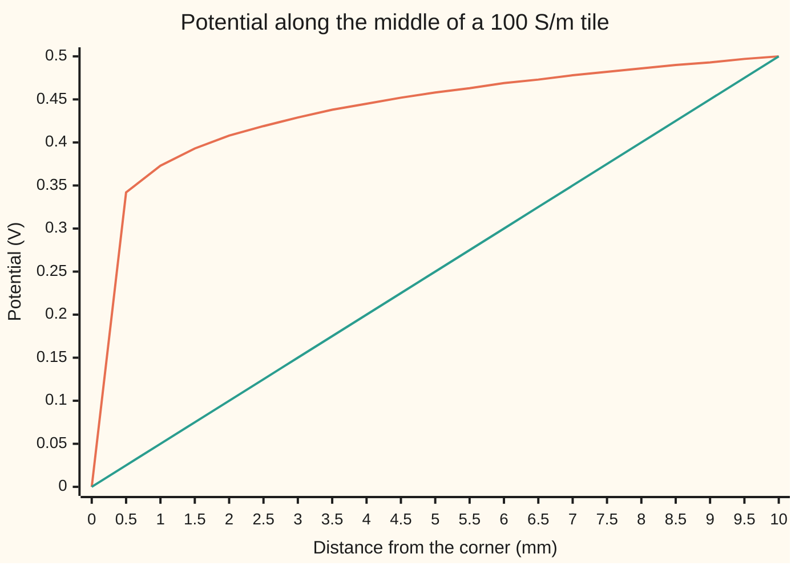
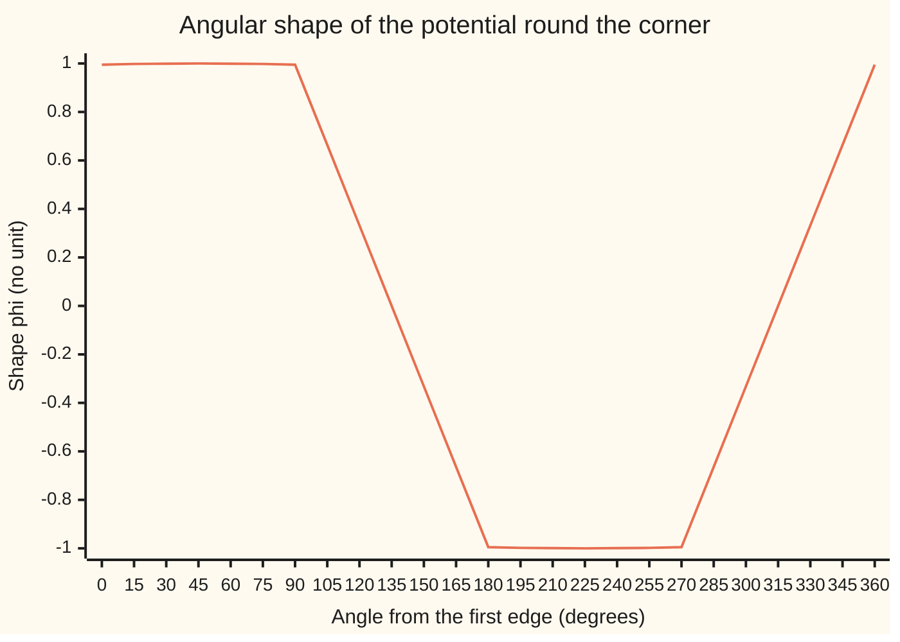

# De Giorgi-Nash-Moser: rough coefficients still give Hölder-continuous solutions

[Syllabus](../../../SYLLABUS.md) → [Partial differential equations](../README.md) → [Weak Solutions and Free Boundaries](../README.md#s06) → De Giorgi-Nash-Moser

---

## General Overview

Take a thin composite sheet made of four square tiles that meet at one corner. Two opposite tiles conduct 100 S/m (siemens per metre, the unit of electrical conductivity), and the other two conduct 1 S/m (illustrative). The **unknown** is the electric potential $`u`$, in volts. The **region** is a disc of radius 1 cm around the corner. The **data** are the rim potential, $`0.5\,\varphi(\theta)`$ V at angle $`\theta`$, with $`\varphi`$ the angular shape of Step 5, between 1 and −1.

[Laplace's equation](../../08-Differential%20equations%20and%20dynamics/10-The%20Classical%20PDEs/07-laplaces-equation-and-harmonic-functions.md) gave smooth settled potentials for free. [Elliptic regularity](05-elliptic-regularity-in-outline.md) kept that smoothness for weak solutions, but only when the conductivity has derivatives. This card asks what survives when the conductivity is only bounded: it may jump anywhere, as often as it likes.

[Lax-Milgram](03-lax-milgram-and-elliptic-existence.md) gives exactly one weak solution. Near the corner it grows like $`r^{0.126902}`$, where $`r`$ is the distance to the corner. That has two faces:

- **It is continuous.** Each time the disc is halved, the spread of potential values inside it shrinks to 0.915796 of what it was.
- **It is far from smooth.** Within 1 µm of the corner the potential still varies by 0.310736 V. A uniform sheet with the same 0.5 V peak at 1 cm, rising in a straight line, varies by 0.0001 V there. On the middle line of a 1 S/m tile, the electric field is 1971.6528 V/cm at 1 µm, against 0.6345 V/cm at 1 cm.

Ennio De Giorgi (1957) and John Nash (1958) proved, independently, that the first face always holds. Jürgen Moser (1960, 1961) found a third proof and a Harnack inequality.

**A weak solution of a divergence-form elliptic equation whose coefficients are only bounded and measurable is still bounded and Hölder continuous, with an exponent fixed by the dimension and the contrast Λ/λ alone, because the energy inequality, applied level by level, forces the spread of values to shrink by a fixed factor each time the ball is halved.**

**What kind of fact this is:** theorems. The Caccioppoli inequality and the iteration lemma are proved in folds in Why it works. The bound on the supremum and the oscillation decay are proved in outline, with their key steps. Moser's Harnack inequality is stated, with its proof outlined and sourced. The checkerboard exponent is derived in full (Kellogg's formula).

### The picture: the potential climbing away from the corner



Orange: the checkerboard sheet, $`0.5\,(r/1\,\text{cm})^{0.126902}`$ V. It reaches 0.342 V only 0.5 mm from the corner, then creeps. Teal: a uniform sheet with the same 0.5 V at 1 cm, a straight line. The orange curve is continuous at the corner but has a vertical tangent there.

---

## The formula

Reminders from this wing: $`\Omega`$ is the region and $`d`$ the number of space directions. $`(a_{ij})`$ is the coefficient matrix from [Elliptic, parabolic, hyperbolic](../01-Classification%20and%20Well-Posedness/04-classification-elliptic-parabolic-hyperbolic.md). The weak form with test function $`v`$ and the space $`H^1_0`$ come from [Sobolev spaces](02-sobolev-spaces-for-pdes.md). $`B(x_0, r)`$ is the ball of radius $`r`$ round $`x_0`$, and $`\lvert B\rvert`$ its volume (in the plane, its area).

This card introduces two bounds on the coefficients: $`\lambda`$, the least push in any direction, and $`\Lambda`$, the greatest (not the Hölder bound $`\Lambda`$ of [Schauder estimates](14-holder-spaces-and-schauder-estimates.md)). The wing's ellipticity constant $`\theta`$ is $`\lambda`$ here, because $`\theta`$ is the polar angle on this card. The Hölder exponent is $`\alpha`$, not Lax-Milgram's coercivity constant. The **oscillation** $`\mathrm{osc}`$ of $`u`$ on a ball is its largest value minus its smallest there.

The equation, in divergence form, with coefficients that are only bounded and measurable:

```math
-\sum_{i,j=1}^{d} \partial_j\big(a_{ij}(x)\,\partial_i u\big) = 0 \ \text{ in } \Omega, \qquad \lambda\,\lvert\xi\rvert^2 \le \sum_{i,j=1}^{d} a_{ij}(x)\,\xi_i\,\xi_j, \qquad \lvert a(x)\,\xi\rvert \le \Lambda\,\lvert\xi\rvert
```

**Read it aloud:** no current is made or lost in any small piece, and the conductivity pushes at least $`\lambda`$ and at most $`\Lambda`$ in every direction $`\xi`$.

A weak solution $`u`$ in $`H^1`$ satisfies $`\int_\Omega \sum a_{ij}\,\partial_i u\,\partial_j v\,dx = 0`$ for every $`v`$ in $`H^1_0(\Omega)`$. Nothing is asked of the coefficients beyond the two bounds.

**De Giorgi-Nash theorem.** If $`B(x_0, r)`$ lies inside $`\Omega`$, then for all $`x`$, $`y`$ in $`B(x_0, r/2)`$

```math
\sup_{B(x_0, r/2)} \lvert u\rvert \le C\,\Big(\frac{1}{\lvert B(x_0, r)\rvert}\int_{B(x_0, r)} u^2\,dx\Big)^{1/2}, \qquad \lvert u(x) - u(y)\rvert \le C\,\Big(\frac{\lvert x - y\rvert}{r}\Big)^{\alpha}\,\sup_{B(x_0, r)} \lvert u\rvert
```

**Read it aloud:** on the half ball, the solution is no bigger than a constant times its root-mean-square size on the whole ball; and two values differ by at most a constant times the distance between them, over $`r`$, to the power $`\alpha`$. The constants $`C`$ and $`\alpha > 0`$ depend only on $`d`$ and $`\Lambda/\lambda`$.

**Moser's Harnack inequality.** If $`u \ge 0`$ in $`B(x_0, 2r)`$, then

```math
\sup_{B(x_0, r)} u \;\le\; C_H\,\inf_{B(x_0, r)} u
```

**Read it aloud:** a solution that is never negative on a ball has its largest value on the half ball at most $`C_H`$ times its smallest, with $`C_H`$ depending only on $`d`$ and $`\Lambda/\lambda`$.

**The checkerboard.** In polar coordinates $`(r, \theta)`$ round the corner, the sheet's solution is

```math
u = V_0\,\Big(\frac{r}{1\ \text{cm}}\Big)^{\alpha}\,\varphi(\theta), \qquad \alpha = \frac{4}{\pi}\arctan\sqrt{\lambda/\Lambda} = \frac{4}{\pi}\arctan 0.1 = 0.126902
```

**Read it aloud:** the potential is a fixed angular shape $`\varphi`$ scaled by the distance to the power $`\alpha`$, and $`\alpha`$ is four over pi times the angle whose tangent is the square root of the low-to-high conductivity ratio.

For the sheet, $`d = 2`$ and $`a_{ij} = k(x)`$ on the diagonal, zero off it, so $`\lambda = 1`$ S/m and $`\Lambda = 100`$ S/m.

| Symbol | Plain meaning | In our example | Push it up and the answer… |
| --- | --- | --- | --- |
| $`u`$, $`u_+`$, $`V_0`$, $`v`$ | electric potential, V; its positive part; its amplitude on the 1 cm circle; a test function | swings ±0.5 V; $`V_0`$ = 0.5 V | every potential scales with $`V_0`$ |
| $`x`$, $`y`$, $`x_0`$, $`\xi`$, $`d`$ | points; a ball's centre; a direction; number of space directions | the corner; $`d`$ = 2 | larger $`d`$: worse constants |
| $`a_{ij}`$, $`k`$ | coefficient matrix; for the sheet, conductivity times the identity | $`k`$ = 100 or 1 S/m | — |
| $`\lambda`$, $`\Lambda`$ | least and greatest push of the coefficients | 1 and 100 S/m; contrast 100 | contrast up: $`\alpha`$ down, $`C_H`$ up |
| $`r`$, $`\theta`$, $`B(x_0, r)`$, $`\lvert B\rvert`$ | distance from the corner; polar angle; ball; its volume | $`r`$ from 1 µm to 1 cm | — |
| $`\alpha`$ | Hölder exponent | 0.126902 | larger: smoother |
| $`\varphi(\theta)`$, $`A`$ | angular shape of the solution, largest value 1; its amplitude on a poor tile | 1 at 45°, −1 at 225°; $`A`$ = 10 | — |
| $`\mathrm{osc}`$ | largest minus smallest value on a ball | 1 V on 1 cm, 0.310736 V on 1 µm | — |
| $`C`$, $`C_H`$ | constants of the theorem and of Harnack | here $`C \ge 1.1934`$, $`C_H \ge 22.7518`$ | — |
| $`\eta`$, $`\ell`$, $`\ell_-`$, $`\ell_+`$, $`w`$ | a cutoff, 1 inside and 0 near the edge; levels; the part of $`u`$ above $`\ell`$, $`w = (u - \ell)_+`$ | $`\eta`$ falls from 1 at 0.5 cm to 0 at 1 cm | — |
| $`h`$, $`j`$, $`\ell_j`$, $`r_j`$, $`Y_j`$ | a ceiling; a step counter; levels rising to $`h`$; radii shrinking to $`r/2`$; the squared excess above $`\ell_j`$ on $`B(x_0, r_j)`$ | illustrative $`Y_0`$ = 2.4414e-04 | — |
| $`b`$, $`\varepsilon`$, $`\gamma`$, $`n`$, $`p`$, $`q`$ | growth factor and extra power in the iteration; the fraction De Giorgi's lemma removes; a count of halvings; powers in Moser's iteration and in $`L^q`$ | illustrative $`b`$ = 4, $`\varepsilon`$ = 1/2; here $`1 - \gamma/2 \ge 0.915796`$ | larger $`\varepsilon`$: faster collapse |

### When it holds

- **Divergence form.** The weak form needs the derivative outside the coefficients. For $`\sum a_{ij}\,\partial_i\partial_j u = 0`$ with rough coefficients there is no weak form; Krylov and Safonov proved Hölder continuity there in 1980 by another road.
- **Uniform ellipticity, $`\lambda > 0`$.** Make the 1 S/m tiles perfect insulators. Then +0.5 V on one conducting tile and −0.5 V on the other carries no current and has zero energy, yet jumps by 1 V at the corner.
- **Bounded contrast $`\Lambda/\lambda`$.** The exponent falls as the contrast grows: 0.012732 at contrast 10,000. No single $`\alpha`$ serves every contrast.
- **One equation, not a system.** In 1968 De Giorgi built an elliptic system in $`d \ge 3`$, with bounded measurable coefficients, whose solution, $`x`$ divided by a power of $`\lvert x\rvert`$ above 1, is unbounded at 0. The proof below uses truncation, $`(u - \ell)_+`$, which has no analogue for vector unknowns.

---

## Why it works

### Step 0: the energy is all there is, so use it at every level

[Elliptic regularity](05-elliptic-regularity-in-outline.md) differentiated the equation. Here that is impossible: a jumping conductivity has no derivative. Only the energy (the integral of $`\sum a_{ij}\,\partial_i u\,\partial_j u`$) is available.

De Giorgi's idea uses two facts about the energy:

1. **Caccioppoli.** The slope of the part of $`u`$ above any level is controlled by its size on a slightly larger ball.
2. **Sobolev.** A function with small slope cannot be large on a large set.

Chained level by level, each level's excess controls the next level's excess raised to a power above 1. Powers above 1 of a small number collapse to zero. That collapse caps $`u`$, and a second use of it squeezes the oscillation.

### Step 1: the Caccioppoli inequality

Take a level $`\ell`$, the excess $`w = (u - \ell)_+`$ (the part of $`u`$ above $`\ell`$, zero elsewhere), and a smooth cutoff $`\eta`$. Then

```math
\int \eta^2\,\lvert\nabla w\rvert^2\,dx \;\le\; \Big(\frac{2\Lambda}{\lambda}\Big)^2 \int \lvert\nabla\eta\rvert^2\,w^2\,dx
```

**Read it aloud:** the slope energy of the excess inside the cutoff is at most a fixed multiple of the excess itself, weighted by how steeply the cutoff falls.

The same holds with $`w = u`$. For a scalar conductivity $`k`$, the weighted form is sharper: $`\int k\,\eta^2\lvert\nabla w\rvert^2 \le 4\int k\,\lvert\nabla\eta\rvert^2 w^2`$.

On the sheet, with $`w = u`$ and $`\eta`$ falling from 1 at 0.5 cm to 0 at 1 cm, the left side is 8.9664 W/m and the right side 440.6582 W/m. These are powers dissipated per metre of sheet thickness. The inequality holds with a wide margin.

<details>
<summary>Detailed proof: test the equation with the solution itself</summary>

Use $`v = \eta^2 w`$ as the test function. It is in $`H^1_0`$ because $`\eta`$ vanishes near the edge, and truncation keeps a function in $`H^1`$.

Where $`w > 0`$, $`\nabla u = \nabla w`$. Where $`w = 0`$, $`v = 0`$. So the weak form reads

$`\displaystyle 0 = \int \eta^2\,a\nabla w\cdot\nabla w\,dx + 2\int \eta\,w\,a\nabla w\cdot\nabla\eta\,dx .`$

Ellipticity makes the first integral at least $`\lambda\int\eta^2\lvert\nabla w\rvert^2`$. The bound $`\Lambda`$ and Cauchy–Schwarz make the second at most

$`\displaystyle 2\Lambda\Big(\int \eta^2\lvert\nabla w\rvert^2\Big)^{1/2}\Big(\int w^2\lvert\nabla\eta\rvert^2\Big)^{1/2} .`$

Move it across, divide by the square root of $`\int\eta^2\lvert\nabla w\rvert^2`$, and square. For a scalar conductivity $`k`$, run the same steps with $`k`$ inside every integral; the ratio $`\Lambda/\lambda`$ then never appears, which gives the factor 4.

</details>

### Step 2: one level up, the excess is smaller to a higher power

Fix a ceiling $`h`$. Take levels $`\ell_j = h(1 - 2^{-j})`$ rising to $`h`$, radii $`r_j = \tfrac{r}{2}(1 + 2^{-j})`$ shrinking to $`r/2`$, and the squared excess $`Y_j = \int_{B(x_0, r_j)} (u - \ell_j)_+^2\,dx`$.

Three inequalities link $`Y_{j+1}`$ to $`Y_j`$:

1. **Caccioppoli**, with a cutoff falling from $`r_j`$ to $`r_{j+1}`$, a slope about $`2^{j}/r`$: the slope energy of the next excess is at most a constant times $`4^j\,Y_j/r^2`$.
2. **Chebyshev**: where $`u > \ell_{j+1}`$, the old excess is at least $`\ell_{j+1} - \ell_j = h\,2^{-j-1}`$. So that set has volume at most $`4^{j+1}\,Y_j/h^2`$.
3. **Sobolev with Hölder's inequality** ([Sobolev and Poincare](../../18-Functional%20analysis/04-Distributions%20and%20Sobolev%20Spaces/09-sobolev-embedding-and-poincare-inequality.md)): a function's square integral is at most a constant times its slope energy times the volume where it is nonzero, to the power $`2/d`$.

Multiplying them gives

```math
Y_{j+1} \;\le\; C\,b^{\,j}\,Y_j^{\,1+\varepsilon}
```

**Read it aloud:** the next excess is at most a constant, times a growth factor to the power $`j`$, times the present excess to a power above 1.

For $`d \ge 3`$, $`\varepsilon = 2/d`$. In the plane, $`H^1_0`$ lies in every $`L^q`$ with $`q`$ finite, which gives $`\varepsilon = 1 - 2/q`$, any value below 1. The constant $`C`$ carries a factor $`h^{-2\varepsilon}`$: a higher ceiling makes it smaller.

### Step 3: the iteration collapses, so the solution is bounded

**The iteration lemma.** If $`Y_{j+1} \le C\,b^{\,j}\,Y_j^{1+\varepsilon}`$ with $`b > 1`$, and $`Y_0 \le C^{-1/\varepsilon}\,b^{-1/\varepsilon^2}`$, then $`Y_j \le Y_0\,b^{-j/\varepsilon}`$, so $`Y_j \to 0`$.

<details>
<summary>Detailed proof: induction on j</summary>

The bound holds at $`j = 0`$. Suppose $`Y_j \le Y_0\,b^{-j/\varepsilon}`$. Then

$`\displaystyle Y_{j+1} \le C\,b^{\,j}\,Y_0^{1+\varepsilon}\,b^{-j(1+\varepsilon)/\varepsilon} = \big(C\,Y_0^{\varepsilon}\big)\,Y_0\,b^{-j/\varepsilon} .`$

The smallness of $`Y_0`$ says $`C\,Y_0^{\varepsilon} \le b^{-1/\varepsilon}`$. So $`Y_{j+1} \le Y_0\,b^{-(j+1)/\varepsilon}`$, the bound at $`j + 1`$.

</details>

With illustrative constants $`C = b = 4`$ and $`\varepsilon = 1/2`$, the threshold is $`4^{-2} \cdot 4^{-4}`$ = 2.4414e-04:

| Start | $`Y_4`$ | $`Y_8`$ | $`Y_{12}`$ |
| --- | ---: | ---: | ---: |
| half the threshold | 1.1148e-10 | 1.0955e-21 | 7.5973e-58 |
| at the threshold | 3.7253e-09 | 5.6843e-14 | 8.6736e-19 |
| twice the threshold | 1.2449e-07 | 2.9495e-06 | 9.9024e+20 |

At the threshold the decay is exactly geometric, a factor $`b^{1/\varepsilon}`$ = 16 per step. Below it, faster. Above it, the bound blows up and says nothing about the real excesses.

So choose the ceiling $`h`$ large enough that $`Y_0`$ is below the threshold; since $`C`$ falls with $`h`$, that is possible with $`h`$ a fixed multiple of the root-mean-square size of $`u_+`$ (the positive part of $`u`$) on the ball. Then $`Y_j \to 0`$ means $`(u - h)_+ = 0`$ on $`B(x_0, r/2)`$: $`u \le h`$ there. The same for $`-u`$ gives the first half of the theorem.

On the sheet, the largest value on the 0.5 cm disc is 0.457898 V and the root-mean-square value on the 1 cm disc is 0.383685 V. Their ratio, 1.1934, is a floor for $`C`$ at contrast 100.

### Step 4: the oscillation shrinks by a fixed factor

**De Giorgi's lemma.** Suppose $`u \le 1`$ on $`B(x_0, r)`$ and $`u \le 0`$ on at least half of it. Then $`u \le 1 - \gamma`$ on $`B(x_0, r/2)`$, with $`\gamma > 0`$ depending only on $`d`$ and $`\Lambda/\lambda`$.

The key is De Giorgi's isoperimetric inequality. For an $`H^1`$ function on a ball and levels $`\ell_- < \ell_+`$:

```math
(\ell_+ - \ell_-)\,\lvert\{u \le \ell_-\}\rvert\,\lvert\{u \ge \ell_+\}\rvert \;\le\; C\,r^{d+1}\int_{\{\ell_- < u < \ell_+\}} \lvert\nabla u\rvert\,dx
```

**Read it aloud:** a function cannot climb from a low level to a high one on large sets without spending slope on the set between them.

The outline:

1. Take levels $`1 - 2^{-j}`$. The set below 0 is fixed at half the ball.
2. Caccioppoli bounds the slope spent between consecutive levels. The isoperimetric inequality then forces the set above level $`1 - 2^{-j}`$ to shrink as $`j`$ grows.
3. After a fixed number of levels, that set is small enough for Step 3's threshold. Step 3 then caps $`u`$ on the half ball, one level lower.

Now rescale any solution so that its values on $`B(x_0, r)`$ run from −1 to 1. Either $`u`$ or $`-u`$ is at most 0 on half the ball, so the lemma lowers one end:

```math
\mathrm{osc}_{B(x_0, r/2)}\, u \;\le\; (1 - \gamma/2)\;\mathrm{osc}_{B(x_0, r)}\, u
```

**Read it aloud:** halving the ball removes at least a fixed fraction of the oscillation.

Repeat $`n`$ times: the oscillation on $`B(x_0, 2^{-n}r)`$ is at most $`(1 - \gamma/2)^n`$ times the first. That is Hölder continuity with $`\alpha = \log_2\big(1/(1 - \gamma/2)\big)`$.

On the sheet, every halving keeps exactly $`2^{-\alpha}`$ = 0.915796 of the oscillation, and every tenfold cut keeps 0.746617:

| Radius | Checkerboard oscillation | Uniform sheet |
| --- | ---: | ---: |
| 1 cm | 1.000000 V | 1.000000 V |
| 1 mm | 0.746617 V | 0.100000 V |
| 0.1 mm | 0.557437 V | 0.010000 V |
| 10 µm | 0.416192 V | 0.001000 V |
| 1 µm | 0.310736 V | 0.000100 V |

### Step 5: why the checkerboard's exponent is 0.126902

In polar coordinates, $`u = r^{\alpha}\varphi(\theta)`$ solves the equation inside one tile exactly when $`\varphi'' + \alpha^2\varphi = 0`$. Across each edge between tiles, two things carry over: the potential, $`\varphi`$, and the current across the edge, $`k\,\varphi'`$.

So the pair $`(\varphi, k\varphi')`$ is passed from tile to tile by a 2-by-2 transfer matrix. The checkerboard repeats after half a turn, and the solution with the smallest positive exponent changes sign there. So half a turn sends the pair to minus itself; a full turn is two half-turns.

The solution that does this:

- On a 100 S/m tile: $`\varphi = \cos\big(\alpha(\theta - 45°)\big)`$, between 0.995037 and 1.
- On a 1 S/m tile: $`\varphi = -10\sin\big(\alpha(\theta - 135°)\big)`$, falling from 0.995037 to −0.995037.

The good conductor is nearly one potential. The whole drop happens across the poor one.

<details>
<summary>Detailed derivation: Kellogg's formula from the two edge conditions</summary>

Write the 1 S/m piece as $`-A\sin(\alpha(\theta - 3\pi/4))`$. At the edge $`\theta = \pi/2`$:

Potential continuous: $`\cos(\alpha\pi/4) = A\sin(\alpha\pi/4)`$, so $`A = \cot(\alpha\pi/4)`$.

Current continuous: $`\Lambda \cdot \alpha\sin(\alpha\pi/4) = \lambda \cdot A\,\alpha\cos(\alpha\pi/4)`$.

Substituting $`A`$ gives

$`\displaystyle \tan^2(\alpha\pi/4) = \lambda/\Lambda, \qquad \alpha = \frac{4}{\pi}\arctan\sqrt{\lambda/\Lambda} .`$

At contrast 100, $`\tan(\alpha\pi/4)`$ = 0.1 and $`A`$ = 10. The other edges follow by the half-turn sign change. Testing with $`\varphi`$ itself gives the energy identity $`\int k\,\varphi'^2\,d\theta = \alpha^2\int k\,\varphi^2\,d\theta`$; both sides are 5.0593 S/m.

</details>



The 100 S/m tiles run from 0° to 90° and from 180° to 270°: flat plateaus. The 1 S/m tiles carry the steep drops.

Any exponent above 0.126902 fails for this solution. So for contrast 100 in the plane, the theorem's $`\alpha`$ can be no larger.

### Step 6: Nash's and Moser's roads, in outline

- **Nash (1958)** worked with the heat equation with rough coefficients. He tracked the moments and the entropy of its fundamental solution and showed that it spreads like a bell curve. Continuity for the parabolic equation, and hence for the elliptic one, followed.
- **Moser (1960)** replaced levels by powers. Testing with powers of $`u`$ gives Caccioppoli for $`\lvert u\rvert^{p/2}`$. Sobolev then raises the integrable power from $`p`$ to $`p\,d/(d-2)`$. Repeating along a geometric sequence of powers, the constants multiply to a finite product: a bound on the supremum.
- **Moser (1961)** ran the same iteration on negative powers, which bounds the infimum from below. The John–Nirenberg inequality applied to $`\log u`$, whose slope Caccioppoli controls, joins the positive and negative powers. The result is the Harnack inequality.

Harnack gives Hölder continuity at once: apply it to $`\sup u - u`$ and to $`u - \inf u`$ on nested balls.

On the sheet, $`u + 0.5`$ V is never negative on the 1 cm disc. On the 0.5 cm disc its largest value is 0.957898 V and its smallest 0.042102 V. Their ratio, 22.7518, is a floor for $`C_H`$ at contrast 100. A uniform sheet gives 3.

---

## Worked numbers, by hand

The checkerboard at contrast 100, $`V_0`$ = 0.5 V on the 1 cm circle.

| Step | Arithmetic | Value |
| --- | --- | --- |
| contrast $`\Lambda/\lambda`$ | 100 ÷ 1 | 100 |
| $`\sqrt{\lambda/\Lambda}`$ | √(1/100) | 0.1 |
| angle whose tangent is 0.1 | arctan 0.1 | 0.099669 rad |
| exponent $`\alpha`$ | 4 ÷ π × 0.099669 | 0.126902 |
| oscillation kept per halving | $`2^{-0.126902}`$ | 0.915796 |
| oscillation kept per tenfold cut | $`10^{-0.126902}`$ | 0.746617 |
| oscillation within 1 µm | 1 V × 0.746617⁴ | 0.310736 V |
| field at 1 cm, poor tile's middle | $`V_0\,\alpha \times 10`$ = 0.5 × 0.126902 × 10 | 0.634510 V/cm |
| field growth from 1 cm to 1 µm | $`(10^4)^{1 - \alpha}`$ = $`(10^4)^{0.873098}`$ | 3107.36 |
| field at 1 µm | 0.634510 × 3107.36 | 1971.6528 V/cm |
| Harnack floor | (1 + 0.915796) ÷ (1 − 0.915796) = 1.915796 ÷ 0.084204 | **22.7518** |

Within a micrometre of the corner the potential still swings by almost a third of a volt. It is continuous, as the theorem promises, but the field there is over three thousand times its value 1 cm away.

### What breaks if you drop a piece

| Mistake | Comes out at | What went wrong |
| --- | --- | --- |
| Expect a bounded field, as for smooth coefficients | 0.6345 V/cm at 1 cm, 1971.6528 V/cm at 1 µm, growing as $`r^{-0.873098}`$ | the coefficients jump, so Hölder is all the theorem gives; no slope bound |
| Let the contrast grow | $`\alpha`$ = 0.012732 at 10,000, 0.000127 at 100,000,000; oscillation within 1 µm 0.889349 V, then 0.998828 V | $`\alpha`$ depends on $`\Lambda/\lambda`$ and tends to 0 |
| Drop ellipticity: insulating tiles, $`\lambda = 0`$ | +0.5 V on one good tile, −0.5 V on the other: a 1 V jump at the corner | the limit of the row above; no continuity at all |
| Start the iteration above its threshold | twice the threshold: $`Y_{12}`$ = 9.9024e+20, not below 8.6736e-19 | the collapse needs $`Y_0`$ small; that is why the ceiling $`h`$ is chosen large |

---

## Code, from first principles, and it actually runs

The code builds the checkerboard solution and checks it by independent roads. The exponent comes from Kellogg's closed form and, separately, from a fourth-order Runge-Kutta (RK4) march of $`(\varphi, k\varphi')`$ across two tiles, with bisection on the half-turn condition; they agree at contrasts 10, 100, 10,000 and 100,000,000. The assembled potential is checked against the equation: a centred-difference Laplacian inside each tile, one-sided currents on both sides of an edge, and the energy identity by Simpson's rule. Oscillation, field and Harnack ratio are sampled on circles and discs and compared with their closed forms. The iteration lemma is run and compared with its exact geometric bound.

### Python

```python
# De Giorgi-Nash-Moser on a checkerboard conductor.  Standard library only.
# Two opposite square tiles conduct 100 S/m, the other two 1 S/m (illustrative).
# Near the shared corner the potential is u = V0 r^a phi(theta).  Roads to a:
# Kellogg's closed form, an RK4 transfer across the tiles found by bisection,
# and the equation's residual by centred differences on the assembled u.
import math
PI = math.pi
HI, LO, V0 = 100.0, 1.0, 0.5        # S/m, S/m, volts on the 1 cm circle

def alpha_closed(c):                 # c = contrast Lambda/lambda >= 1
    return 4 / PI * math.atan(1 / math.sqrt(c))

def half_turn(a, c, n=400):          # RK4 for (phi, k phi') across a hi tile then a lo tile
    cols = []
    for p, q in ((1.0, 0.0), (0.0, 1.0)):
        for k in (c, 1.0):
            h = PI / 2 / n
            for _ in range(n):
                f = lambda p, q: (q / k, -k * a * a * p)
                k1 = f(p, q); k2 = f(p + h / 2 * k1[0], q + h / 2 * k1[1])
                k3 = f(p + h / 2 * k2[0], q + h / 2 * k2[1]); k4 = f(p + h * k3[0], q + h * k3[1])
                p += h / 6 * (k1[0] + 2 * k2[0] + 2 * k3[0] + k4[0])
                q += h / 6 * (k1[1] + 2 * k2[1] + 2 * k3[1] + k4[1])
        cols.append((p, q))
    return cols                      # columns of the half-turn matrix

def alpha_transfer(c):               # smallest a > 0 with trace(half turn) = -2
    g = lambda a: half_turn(a, c)[0][0] + half_turn(a, c)[1][1] + 2
    lo, hi = 1e-4, 1e-4
    while g(hi) > 0: lo, hi = hi, hi * 1.5
    for _ in range(50):
        mid = (lo + hi) / 2
        lo, hi = (mid, hi) if g(mid) > 0 else (lo, mid)
    return (lo + hi) / 2

A = alpha_closed(HI / LO)
AT = alpha_transfer(HI / LO)
COT = 1 / math.tan(A * PI / 4)

def phi(t):                          # angular profile, max 1 at 45 degrees; tiles 0-90 and 180-270 conduct 100
    s = 1.0
    t = t % (2 * PI)
    if t >= PI: t, s = t - PI, -1.0
    if t <= PI / 2: return s * math.cos(A * (t - PI / 4))
    return -s * COT * math.sin(A * (t - 3 * PI / 4))

def dphi(t):                         # its slope, by hand from the same pieces
    s = 1.0
    t = t % (2 * PI)
    if t >= PI: t, s = t - PI, -1.0
    if t <= PI / 2: return -s * A * math.sin(A * (t - PI / 4))
    return -s * COT * A * math.cos(A * (t - 3 * PI / 4))
def kk(t): return HI if (t % PI) < PI / 2 else LO
def u(x, y): return V0 * math.hypot(x, y) ** A * phi(math.atan2(y, x))

print(f"tiles 100 S/m and 1 S/m, contrast Lambda/lambda = {HI / LO:.0f}")
print(f"alpha: Kellogg (4/pi) atan(sqrt(lambda/Lambda)) = {A:.6f}, RK4 transfer + bisection = {AT:.6f}")
assert abs(A - AT) < 1e-7
m = half_turn(A, HI / LO)
p0, q0 = math.cos(A * PI / 4), HI * A * math.sin(A * PI / 4)
p1, q1 = m[0][0] * p0 + m[1][0] * q0, m[0][1] * p0 + m[1][1] * q0
print(f"half turn sends (phi, k phi') = ({p0:.6f}, {q0:.6f}) to ({p1:.6f}, {q1:.6f})")
assert abs(p1 + p0) < 1e-8 and abs(q1 + q0) < 1e-6          # antiperiodic: phi(t + pi) = -phi(t)
print(f"lo-tile amplitude cot(a pi/4) = {COT:.6f}; phi at 90 deg: hi side {p0:.6f}, lo side {COT * math.sin(A * PI / 4):.6f}")
h = 1e-3                                                  # residual of div(k grad u) inside each tile, cm
for deg in (30.0, 120.0):
    x, y = 0.5 * math.cos(math.radians(deg)), 0.5 * math.sin(math.radians(deg))
    lap = (u(x + h, y) + u(x - h, y) + u(x, y + h) + u(x, y - h) - 4 * u(x, y)) / h / h
    print(f"residual at r = 0.5 cm, {deg:.0f} deg: centred Laplacian {lap:+.1e} V/cm2, u = {u(x, y):+.6f} V")
    assert abs(lap) < 1e-4
y0 = 0.5                                                  # flux across the interface x = 0 at y = 0.5 cm
fr = HI * (-3 * u(0, y0) + 4 * u(h, y0) - u(2 * h, y0)) / (2 * h)
fl = LO * (3 * u(0, y0) - 4 * u(-h, y0) + u(-2 * h, y0)) / (2 * h)
print(f"flux k du/dx across x = 0 at y = 0.5 cm: 100 S/m side {fr:.6f}, 1 S/m side {fl:.6f} (S/m)(V/cm)")
assert abs(fr - fl) < 1e-4 * abs(fr)
N = 400                                                    # Simpson over each tile
def simpson(g, a, b):
    s = g(a) + g(b) + sum((4 if i % 2 else 2) * g(a + (b - a) * i / N) for i in range(1, N))
    return s * (b - a) / N / 3
Ip = sum(simpson(lambda t: kk(t + 1e-12) * phi(t) ** 2, j * PI / 2, (j + 1) * PI / 2) for j in range(4))
Id = sum(simpson(lambda t: kk(t + 1e-12) * dphi(t + 1e-12) ** 2, j * PI / 2, (j + 1) * PI / 2) for j in range(4))
print(f"energy identity: int k phi'^2 = {Id:.4f}, a^2 int k phi^2 = {A * A * Ip:.4f}")
assert abs(Id - A * A * Ip) < 1e-9 * Id
lhs = V0 ** 2 * ((0.5 ** (2 * A)) / (2 * A) + simpson(lambda r: 4 * (1 - r) ** 2 * r ** (2 * A - 1), 0.5, 1.0)) * 2 * A * A * Ip
rhs = 4 * V0 ** 2 * 4 * (1 - 0.5 ** (2 * A + 2)) / (2 * A + 2) * Ip
print(f"Caccioppoli, cutoff 1 cm -> 0.5 cm: int k eta^2 |grad u|^2 = {lhs:.4f} <= 4 int k |grad eta|^2 u^2 = {rhs:.4f} W/m")
assert lhs <= rhs
Iq = sum(simpson(lambda t: phi(t) ** 2, j * PI / 2, (j + 1) * PI / 2) for j in range(4))
rms = math.sqrt(V0 ** 2 * Iq / (2 * A + 2) / PI)
print(f"L-infinity bound: sup over 0.5 cm disc {V0 * 0.5 ** A:.6f} V, rms over 1 cm disc {rms:.6f} V, ratio {V0 * 0.5 ** A / rms:.4f}")
print(f"by hand: atan(0.1) = {math.atan(0.1):.6f} rad, 1 - a = {1 - A:.6f}, V0 a cot = {V0 * A * COT:.6f} V/cm, "
      f"1e4^(1-a) = {1e4 ** (1 - A):.2f}, 1 + 2^-a = {1 + 0.5 ** A:.6f}, 1 - 2^-a = {1 - 0.5 ** A:.6f}")
print(f"one halving of the radius keeps 2^-a = {0.5 ** A:.6f} of the oscillation; one tenfold cut keeps {0.1 ** A:.6f}")
for r in (1.0, 0.1, 0.01, 0.001, 0.0001):
    osc = max(u(r * math.cos(math.radians(i / 2)), r * math.sin(math.radians(i / 2))) for i in range(720))
    osc -= min(u(r * math.cos(math.radians(i / 2)), r * math.sin(math.radians(i / 2))) for i in range(720))
    print(f"osc on circle r = {r:.4f} cm: sampled {osc:.6f} V, 2 V0 r^a {2 * V0 * r ** A:.6f} V, uniform sheet {r:.6f} V")
    assert abs(osc - 2 * V0 * r ** A) < 1e-9
for r in (1.0, 0.0001):                                   # field on the 1 S/m tile's bisector
    t, e = 3 * PI / 4, 1e-6
    fd = (u(r * math.cos(t + e), r * math.sin(t + e)) - u(r * math.cos(t - e), r * math.sin(t - e))) / (2 * r * e)
    print(f"field at r = {r:.4f} cm on the 1 S/m bisector: centred diff {abs(fd):.4f}, formula V0 a cot r^(a-1) {V0 * A * COT * r ** (A - 1):.4f} V/cm")
    assert abs(abs(fd) - V0 * A * COT * r ** (A - 1)) < 1e-4 * abs(fd)
smax = max(V0 + u(rr / 100 * math.cos(math.radians(d)), rr / 100 * math.sin(math.radians(d))) for rr in range(51) for d in range(360))
smin = min(V0 + u(rr / 100 * math.cos(math.radians(d)), rr / 100 * math.sin(math.radians(d))) for rr in range(51) for d in range(360))
hc = (1 + 0.5 ** A) / (1 - 0.5 ** A)
print(f"Harnack, v = 0.5 V + u >= 0 on 1 cm disc: on 0.5 cm disc max {smax:.6f}, min {smin:.6f} V, ratio {smax / smin:.4f}, formula {hc:.4f}")
assert abs(smax / smin - hc) < 1e-6 * hc
for c in (1.0, 10.0, 100.0, 1e4, 1e8):
    a1 = alpha_closed(c)
    a2 = alpha_transfer(c) if c > 1 else a1      # contrast 1 is Laplace, u = x: the trace only touches -2
    tr = f"{a2:.6f} transfer" if c > 1 else "Laplace u = x"
    print(f"contrast {c:9.0f}: alpha {a1:.6f} closed, {tr}; Harnack ratio {(1 + 0.5 ** a1) / (1 - 0.5 ** a1):12.4f}; osc at 1 um {0.0001 ** a1:.6f} V")
    assert abs(a1 - a2) < 1e-6
C, B, EPS = 4.0, 4.0, 0.5                                  # iteration lemma, illustrative constants
star = C ** (-1 / EPS) * B ** (-1 / EPS ** 2)
print(f"iteration Y(j+1) = C b^j Y(j)^(1+eps), C = b = 4, eps = 1/2: threshold C^(-1/eps) b^(-1/eps^2) = {star:.4e}, decay there b^(1/eps) = {B ** (1 / EPS):.0f} per step")
for f in (0.5, 1.0, 2.0):
    y, ys = f * star, []
    for j in range(13):
        ys.append(y); y = C * B ** j * y ** (1 + EPS)
    print(f"  start {f:.1f} x threshold: Y0 {ys[0]:.4e}, Y4 {ys[4]:.4e}, Y8 {ys[8]:.4e}, Y12 {ys[12]:.4e}")
    if f == 1.0: assert abs(ys[12] - star * B ** (-12 / EPS)) < 1e-9 * ys[12]
    if f == 2.0: assert ys[12] > ys[0]
    if f == 0.5: assert ys[12] < star * B ** (-12 / EPS)
print("chart r mm:", ", ".join(f"{i / 2:g}" for i in range(21)))
print("chart checkerboard u V:", ", ".join(f"{V0 * (i / 20) ** A:.3f}" for i in range(21)))
print("chart uniform u V:", ", ".join(f"{V0 * i / 20:.3f}" for i in range(21)))
print("chart phi, 0..360 deg by 15:", ", ".join(f"{round(phi(math.radians(15 * i)), 3) + 0.0:.3f}" for i in range(25)))
print("ALL CHECKS PASS")
```

**Ran 2026-11-24 on macOS, Python 3.14.10, standard library only. All checks passed. Output, pasted from the run:**

```
tiles 100 S/m and 1 S/m, contrast Lambda/lambda = 100
alpha: Kellogg (4/pi) atan(sqrt(lambda/Lambda)) = 0.126902, RK4 transfer + bisection = 0.126902
half turn sends (phi, k phi') = (0.995037, 1.262723) to (-0.995037, -1.262723)
lo-tile amplitude cot(a pi/4) = 10.000000; phi at 90 deg: hi side 0.995037, lo side 0.995037
residual at r = 0.5 cm, 30 deg: centred Laplacian +3.8e-07 V/cm2, u = +0.457645 V
residual at r = 0.5 cm, 120 deg: centred Laplacian -6.2e-06 V/cm2, u = +0.152099 V
flux k du/dx across x = 0 at y = 0.5 cm: 100 S/m side 1.156399, 1 S/m side 1.156399 (S/m)(V/cm)
energy identity: int k phi'^2 = 5.0593, a^2 int k phi^2 = 5.0593
Caccioppoli, cutoff 1 cm -> 0.5 cm: int k eta^2 |grad u|^2 = 8.9664 <= 4 int k |grad eta|^2 u^2 = 440.6582 W/m
L-infinity bound: sup over 0.5 cm disc 0.457898 V, rms over 1 cm disc 0.383685 V, ratio 1.1934
by hand: atan(0.1) = 0.099669 rad, 1 - a = 0.873098, V0 a cot = 0.634510 V/cm, 1e4^(1-a) = 3107.36, 1 + 2^-a = 1.915796, 1 - 2^-a = 0.084204
one halving of the radius keeps 2^-a = 0.915796 of the oscillation; one tenfold cut keeps 0.746617
osc on circle r = 1.0000 cm: sampled 1.000000 V, 2 V0 r^a 1.000000 V, uniform sheet 1.000000 V
osc on circle r = 0.1000 cm: sampled 0.746617 V, 2 V0 r^a 0.746617 V, uniform sheet 0.100000 V
osc on circle r = 0.0100 cm: sampled 0.557437 V, 2 V0 r^a 0.557437 V, uniform sheet 0.010000 V
osc on circle r = 0.0010 cm: sampled 0.416192 V, 2 V0 r^a 0.416192 V, uniform sheet 0.001000 V
osc on circle r = 0.0001 cm: sampled 0.310736 V, 2 V0 r^a 0.310736 V, uniform sheet 0.000100 V
field at r = 1.0000 cm on the 1 S/m bisector: centred diff 0.6345, formula V0 a cot r^(a-1) 0.6345 V/cm
field at r = 0.0001 cm on the 1 S/m bisector: centred diff 1971.6528, formula V0 a cot r^(a-1) 1971.6528 V/cm
Harnack, v = 0.5 V + u >= 0 on 1 cm disc: on 0.5 cm disc max 0.957898, min 0.042102 V, ratio 22.7518, formula 22.7518
contrast         1: alpha 1.000000 closed, Laplace u = x; Harnack ratio       3.0000; osc at 1 um 0.000100 V
contrast        10: alpha 0.389964 closed, 0.389964 transfer; Harnack ratio       7.4441; osc at 1 um 0.027551 V
contrast       100: alpha 0.126902 closed, 0.126902 transfer; Harnack ratio      22.7518; osc at 1 um 0.310736 V
contrast     10000: alpha 0.012732 closed, 0.012732 transfer; Harnack ratio     226.6270; osc at 1 um 0.889349 V
contrast 100000000: alpha 0.000127 closed, 0.000127 transfer; Harnack ratio   22661.8008; osc at 1 um 0.998828 V
iteration Y(j+1) = C b^j Y(j)^(1+eps), C = b = 4, eps = 1/2: threshold C^(-1/eps) b^(-1/eps^2) = 2.4414e-04, decay there b^(1/eps) = 16 per step
  start 0.5 x threshold: Y0 1.2207e-04, Y4 1.1148e-10, Y8 1.0955e-21, Y12 7.5973e-58
  start 1.0 x threshold: Y0 2.4414e-04, Y4 3.7253e-09, Y8 5.6843e-14, Y12 8.6736e-19
  start 2.0 x threshold: Y0 4.8828e-04, Y4 1.2449e-07, Y8 2.9495e-06, Y12 9.9024e+20
chart r mm: 0, 0.5, 1, 1.5, 2, 2.5, 3, 3.5, 4, 4.5, 5, 5.5, 6, 6.5, 7, 7.5, 8, 8.5, 9, 9.5, 10
chart checkerboard u V: 0.000, 0.342, 0.373, 0.393, 0.408, 0.419, 0.429, 0.438, 0.445, 0.452, 0.458, 0.463, 0.469, 0.473, 0.478, 0.482, 0.486, 0.490, 0.493, 0.497, 0.500
chart uniform u V: 0.000, 0.025, 0.050, 0.075, 0.100, 0.125, 0.150, 0.175, 0.200, 0.225, 0.250, 0.275, 0.300, 0.325, 0.350, 0.375, 0.400, 0.425, 0.450, 0.475, 0.500
chart phi, 0..360 deg by 15: 0.995, 0.998, 0.999, 1.000, 0.999, 0.998, 0.995, 0.664, 0.332, 0.000, -0.332, -0.664, -0.995, -0.998, -0.999, -1.000, -0.999, -0.998, -0.995, -0.664, -0.332, 0.000, 0.332, 0.664, 0.995
ALL CHECKS PASS
```

### Rust

```rust
// De Giorgi-Nash-Moser on a checkerboard conductor.  Standard library only.
// Two opposite square tiles conduct 100 S/m, the other two 1 S/m (illustrative).
// Near the shared corner the potential is u = V0 r^a phi(theta).  Roads to a:
// Kellogg's closed form, an RK4 transfer across the tiles found by bisection,
// and the equation's residual by centred differences on the assembled u.
use std::f64::consts::PI;
const HI: f64 = 100.0; // S/m
const LO: f64 = 1.0; // S/m
const V0: f64 = 0.5; // volts on the 1 cm circle

fn alpha_closed(c: f64) -> f64 { 4.0 / PI * (1.0 / c.sqrt()).atan() }

fn half_turn(a: f64, c: f64) -> [[f64; 2]; 2] { // RK4 for (phi, k phi') across a hi tile then a lo tile
    let n = 400;
    let mut cols = [[0.0; 2]; 2];
    for (col, start) in [(1.0, 0.0), (0.0, 1.0)].iter().enumerate() {
        let (mut p, mut q) = *start;
        for k in [c, 1.0] {
            let h = PI / 2.0 / n as f64;
            let f = |p: f64, q: f64| (q / k, -k * a * a * p);
            for _ in 0..n {
                let k1 = f(p, q);
                let k2 = f(p + h / 2.0 * k1.0, q + h / 2.0 * k1.1);
                let k3 = f(p + h / 2.0 * k2.0, q + h / 2.0 * k2.1);
                let k4 = f(p + h * k3.0, q + h * k3.1);
                p += h / 6.0 * (k1.0 + 2.0 * k2.0 + 2.0 * k3.0 + k4.0);
                q += h / 6.0 * (k1.1 + 2.0 * k2.1 + 2.0 * k3.1 + k4.1);
            }
        }
        cols[col] = [p, q];
    }
    cols // columns of the half-turn matrix
}

fn alpha_transfer(c: f64) -> f64 { // smallest a > 0 with trace(half turn) = -2
    let g = |a: f64| { let m = half_turn(a, c); m[0][0] + m[1][1] + 2.0 };
    let (mut lo, mut hi) = (1e-4, 1e-4);
    while g(hi) > 0.0 { lo = hi; hi *= 1.5; }
    for _ in 0..50 {
        let mid = (lo + hi) / 2.0;
        if g(mid) > 0.0 { lo = mid } else { hi = mid }
    }
    (lo + hi) / 2.0
}

struct Tiles { a: f64, cot: f64 }
impl Tiles {
    fn phi(&self, t: f64) -> f64 { // angular profile, max 1 at 45 degrees; tiles 0-90 and 180-270 conduct 100
        let (mut t, mut s) = (t.rem_euclid(2.0 * PI), 1.0);
        if t >= PI { t -= PI; s = -1.0; }
        if t <= PI / 2.0 { return s * (self.a * (t - PI / 4.0)).cos(); }
        -s * self.cot * (self.a * (t - 3.0 * PI / 4.0)).sin()
    }
    fn dphi(&self, t: f64) -> f64 { // its slope, by hand from the same pieces
        let (mut t, mut s) = (t.rem_euclid(2.0 * PI), 1.0);
        if t >= PI { t -= PI; s = -1.0; }
        if t <= PI / 2.0 { return -s * self.a * (self.a * (t - PI / 4.0)).sin(); }
        -s * self.cot * self.a * (self.a * (t - 3.0 * PI / 4.0)).cos()
    }
    fn u(&self, x: f64, y: f64) -> f64 { V0 * x.hypot(y).powf(self.a) * self.phi(y.atan2(x)) }
}
fn kk(t: f64) -> f64 { if t.rem_euclid(PI) < PI / 2.0 { HI } else { LO } }

fn simpson<F: Fn(f64) -> f64>(g: F, a: f64, b: f64) -> f64 {
    let n = 400;
    let mut s = g(a) + g(b);
    for i in 1..n { s += (if i % 2 == 1 { 4.0 } else { 2.0 }) * g(a + (b - a) * i as f64 / n as f64); }
    s * (b - a) / n as f64 / 3.0
}
fn pyexp(s: String) -> String { // Rust's 2.4e-4 written as Python's 2.4e-04
    let (m, e) = s.split_at(s.find('e').unwrap());
    let e: i32 = e[1..].parse().unwrap();
    format!("{}e{}{:02}", m, if e < 0 { '-' } else { '+' }, e.abs())
}
fn fe(x: f64) -> String { pyexp(format!("{:.4e}", x)) }

fn main() {
    let a = alpha_closed(HI / LO);
    let at = alpha_transfer(HI / LO);
    let (tl, cot) = (Tiles { a, cot: 1.0 / (a * PI / 4.0).tan() }, 1.0 / (a * PI / 4.0).tan());
    println!("tiles 100 S/m and 1 S/m, contrast Lambda/lambda = {:.0}", HI / LO);
    println!("alpha: Kellogg (4/pi) atan(sqrt(lambda/Lambda)) = {:.6}, RK4 transfer + bisection = {:.6}", a, at);
    assert!((a - at).abs() < 1e-7);
    let m = half_turn(a, HI / LO);
    let (p0, q0) = ((a * PI / 4.0).cos(), HI * a * (a * PI / 4.0).sin());
    let (p1, q1) = (m[0][0] * p0 + m[1][0] * q0, m[0][1] * p0 + m[1][1] * q0);
    println!("half turn sends (phi, k phi') = ({:.6}, {:.6}) to ({:.6}, {:.6})", p0, q0, p1, q1);
    assert!((p1 + p0).abs() < 1e-8 && (q1 + q0).abs() < 1e-6); // antiperiodic: phi(t + pi) = -phi(t)
    println!("lo-tile amplitude cot(a pi/4) = {:.6}; phi at 90 deg: hi side {:.6}, lo side {:.6}", cot, p0, cot * (a * PI / 4.0).sin());
    let h = 1e-3; // residual of div(k grad u) inside each tile, cm
    for deg in [30.0f64, 120.0] {
        let (x, y) = (0.5 * deg.to_radians().cos(), 0.5 * deg.to_radians().sin());
        let lap = (tl.u(x + h, y) + tl.u(x - h, y) + tl.u(x, y + h) + tl.u(x, y - h) - 4.0 * tl.u(x, y)) / h / h;
        println!("residual at r = 0.5 cm, {:.0} deg: centred Laplacian {} V/cm2, u = {:+.6} V", deg, pyexp(format!("{:+.1e}", lap)), tl.u(x, y));
        assert!(lap.abs() < 1e-4);
    }
    let y0 = 0.5; // flux across the interface x = 0 at y = 0.5 cm
    let fr = HI * (-3.0 * tl.u(0.0, y0) + 4.0 * tl.u(h, y0) - tl.u(2.0 * h, y0)) / (2.0 * h);
    let fl = LO * (3.0 * tl.u(0.0, y0) - 4.0 * tl.u(-h, y0) + tl.u(-2.0 * h, y0)) / (2.0 * h);
    println!("flux k du/dx across x = 0 at y = 0.5 cm: 100 S/m side {:.6}, 1 S/m side {:.6} (S/m)(V/cm)", fr, fl);
    assert!((fr - fl).abs() < 1e-4 * fr.abs());
    let q4 = |g: &dyn Fn(f64) -> f64| (0..4).map(|j| simpson(g, j as f64 * PI / 2.0, (j + 1) as f64 * PI / 2.0)).sum::<f64>();
    let ip = q4(&|t| kk(t + 1e-12) * tl.phi(t).powi(2));
    let id = q4(&|t| kk(t + 1e-12) * tl.dphi(t + 1e-12).powi(2));
    println!("energy identity: int k phi'^2 = {:.4}, a^2 int k phi^2 = {:.4}", id, a * a * ip);
    assert!((id - a * a * ip).abs() < 1e-9 * id);
    let lhs = V0.powi(2) * (0.5f64.powf(2.0 * a) / (2.0 * a) + simpson(|r| 4.0 * (1.0 - r).powi(2) * r.powf(2.0 * a - 1.0), 0.5, 1.0)) * 2.0 * a * a * ip;
    let rhs = 4.0 * V0.powi(2) * 4.0 * (1.0 - 0.5f64.powf(2.0 * a + 2.0)) / (2.0 * a + 2.0) * ip;
    println!("Caccioppoli, cutoff 1 cm -> 0.5 cm: int k eta^2 |grad u|^2 = {:.4} <= 4 int k |grad eta|^2 u^2 = {:.4} W/m", lhs, rhs);
    assert!(lhs <= rhs);
    let iq = q4(&|t| tl.phi(t).powi(2));
    let rms = (V0 * V0 * iq / (2.0 * a + 2.0) / PI).sqrt();
    let sup = V0 * 0.5f64.powf(a);
    println!("L-infinity bound: sup over 0.5 cm disc {:.6} V, rms over 1 cm disc {:.6} V, ratio {:.4}", sup, rms, sup / rms);
    println!("by hand: atan(0.1) = {:.6} rad, 1 - a = {:.6}, V0 a cot = {:.6} V/cm, 1e4^(1-a) = {:.2}, 1 + 2^-a = {:.6}, 1 - 2^-a = {:.6}",
        0.1f64.atan(), 1.0 - a, V0 * a * cot, 1e4f64.powf(1.0 - a), 1.0 + 0.5f64.powf(a), 1.0 - 0.5f64.powf(a));
    println!("one halving of the radius keeps 2^-a = {:.6} of the oscillation; one tenfold cut keeps {:.6}", 0.5f64.powf(a), 0.1f64.powf(a));
    for r in [1.0f64, 0.1, 0.01, 0.001, 0.0001] {
        let vals: Vec<f64> = (0..720).map(|i| { let t = (i as f64 / 2.0).to_radians(); tl.u(r * t.cos(), r * t.sin()) }).collect();
        let osc = vals.iter().cloned().fold(f64::MIN, f64::max) - vals.iter().cloned().fold(f64::MAX, f64::min);
        println!("osc on circle r = {:.4} cm: sampled {:.6} V, 2 V0 r^a {:.6} V, uniform sheet {:.6} V", r, osc, 2.0 * V0 * r.powf(a), r);
        assert!((osc - 2.0 * V0 * r.powf(a)).abs() < 1e-9);
    }
    for r in [1.0f64, 0.0001] { // field on the 1 S/m tile's bisector
        let (t, e) = (3.0 * PI / 4.0, 1e-6);
        let fd = (tl.u(r * (t + e).cos(), r * (t + e).sin()) - tl.u(r * (t - e).cos(), r * (t - e).sin())) / (2.0 * r * e);
        let fm = V0 * a * cot * r.powf(a - 1.0);
        println!("field at r = {:.4} cm on the 1 S/m bisector: centred diff {:.4}, formula V0 a cot r^(a-1) {:.4} V/cm", r, fd.abs(), fm);
        assert!((fd.abs() - fm).abs() < 1e-4 * fd.abs());
    }
    let (mut smax, mut smin) = (f64::MIN, f64::MAX);
    for rr in 0..51 {
        for d in 0..360 {
            let t = (d as f64).to_radians();
            let v = V0 + tl.u(rr as f64 / 100.0 * t.cos(), rr as f64 / 100.0 * t.sin());
            smax = smax.max(v); smin = smin.min(v);
        }
    }
    let hc = (1.0 + 0.5f64.powf(a)) / (1.0 - 0.5f64.powf(a));
    println!("Harnack, v = 0.5 V + u >= 0 on 1 cm disc: on 0.5 cm disc max {:.6}, min {:.6} V, ratio {:.4}, formula {:.4}", smax, smin, smax / smin, hc);
    assert!((smax / smin - hc).abs() < 1e-6 * hc);
    for c in [1.0f64, 10.0, 100.0, 1e4, 1e8] {
        let a1 = alpha_closed(c);
        let a2 = if c > 1.0 { alpha_transfer(c) } else { a1 }; // contrast 1 is Laplace, u = x: the trace only touches -2
        let tr = if c > 1.0 { format!("{:.6} transfer", a2) } else { "Laplace u = x".to_string() };
        println!("contrast {:9.0}: alpha {:.6} closed, {}; Harnack ratio {:12.4}; osc at 1 um {:.6} V", c, a1, tr, (1.0 + 0.5f64.powf(a1)) / (1.0 - 0.5f64.powf(a1)), 0.0001f64.powf(a1));
        assert!((a1 - a2).abs() < 1e-6);
    }
    let (cc, b, eps) = (4.0f64, 4.0f64, 0.5f64); // iteration lemma, illustrative constants
    let star = cc.powf(-1.0 / eps) * b.powf(-1.0 / (eps * eps));
    println!("iteration Y(j+1) = C b^j Y(j)^(1+eps), C = b = 4, eps = 1/2: threshold C^(-1/eps) b^(-1/eps^2) = {}, decay there b^(1/eps) = {:.0} per step", fe(star), b.powf(1.0 / eps));
    for f in [0.5f64, 1.0, 2.0] {
        let (mut y, mut ys) = (f * star, Vec::new());
        for j in 0..13 { ys.push(y); y = cc * b.powi(j) * y.powf(1.0 + eps); }
        println!("  start {:.1} x threshold: Y0 {}, Y4 {}, Y8 {}, Y12 {}", f, fe(ys[0]), fe(ys[4]), fe(ys[8]), fe(ys[12]));
        if f == 1.0 { assert!((ys[12] - star * b.powf(-12.0 / eps)).abs() < 1e-9 * ys[12]); }
        if f == 2.0 { assert!(ys[12] > ys[0]); }
        if f == 0.5 { assert!(ys[12] < star * b.powf(-12.0 / eps)); }
    }
    let j = |v: Vec<String>| v.join(", ");
    println!("chart r mm: {}", j((0..21).map(|i| if i % 2 == 0 { format!("{}", i / 2) } else { format!("{:.1}", i as f64 / 2.0) }).collect()));
    println!("chart checkerboard u V: {}", j((0..21).map(|i| format!("{:.3}", V0 * (i as f64 / 20.0).powf(a))).collect()));
    println!("chart uniform u V: {}", j((0..21).map(|i| format!("{:.3}", V0 * i as f64 / 20.0)).collect()));
    println!("chart phi, 0..360 deg by 15: {}", j((0..25).map(|i| format!("{:.3}", (tl.phi((15.0 * i as f64).to_radians()) * 1000.0).round() / 1000.0 + 0.0)).collect()));
    println!("ALL CHECKS PASS");
}
```

**Ran 2026-11-24 on macOS, rustc 1.98.1, no crates. All checks passed. Output, pasted from the run:**

```
tiles 100 S/m and 1 S/m, contrast Lambda/lambda = 100
alpha: Kellogg (4/pi) atan(sqrt(lambda/Lambda)) = 0.126902, RK4 transfer + bisection = 0.126902
half turn sends (phi, k phi') = (0.995037, 1.262723) to (-0.995037, -1.262723)
lo-tile amplitude cot(a pi/4) = 10.000000; phi at 90 deg: hi side 0.995037, lo side 0.995037
residual at r = 0.5 cm, 30 deg: centred Laplacian +3.8e-07 V/cm2, u = +0.457645 V
residual at r = 0.5 cm, 120 deg: centred Laplacian -6.2e-06 V/cm2, u = +0.152099 V
flux k du/dx across x = 0 at y = 0.5 cm: 100 S/m side 1.156399, 1 S/m side 1.156399 (S/m)(V/cm)
energy identity: int k phi'^2 = 5.0593, a^2 int k phi^2 = 5.0593
Caccioppoli, cutoff 1 cm -> 0.5 cm: int k eta^2 |grad u|^2 = 8.9664 <= 4 int k |grad eta|^2 u^2 = 440.6582 W/m
L-infinity bound: sup over 0.5 cm disc 0.457898 V, rms over 1 cm disc 0.383685 V, ratio 1.1934
by hand: atan(0.1) = 0.099669 rad, 1 - a = 0.873098, V0 a cot = 0.634510 V/cm, 1e4^(1-a) = 3107.36, 1 + 2^-a = 1.915796, 1 - 2^-a = 0.084204
one halving of the radius keeps 2^-a = 0.915796 of the oscillation; one tenfold cut keeps 0.746617
osc on circle r = 1.0000 cm: sampled 1.000000 V, 2 V0 r^a 1.000000 V, uniform sheet 1.000000 V
osc on circle r = 0.1000 cm: sampled 0.746617 V, 2 V0 r^a 0.746617 V, uniform sheet 0.100000 V
osc on circle r = 0.0100 cm: sampled 0.557437 V, 2 V0 r^a 0.557437 V, uniform sheet 0.010000 V
osc on circle r = 0.0010 cm: sampled 0.416192 V, 2 V0 r^a 0.416192 V, uniform sheet 0.001000 V
osc on circle r = 0.0001 cm: sampled 0.310736 V, 2 V0 r^a 0.310736 V, uniform sheet 0.000100 V
field at r = 1.0000 cm on the 1 S/m bisector: centred diff 0.6345, formula V0 a cot r^(a-1) 0.6345 V/cm
field at r = 0.0001 cm on the 1 S/m bisector: centred diff 1971.6528, formula V0 a cot r^(a-1) 1971.6528 V/cm
Harnack, v = 0.5 V + u >= 0 on 1 cm disc: on 0.5 cm disc max 0.957898, min 0.042102 V, ratio 22.7518, formula 22.7518
contrast         1: alpha 1.000000 closed, Laplace u = x; Harnack ratio       3.0000; osc at 1 um 0.000100 V
contrast        10: alpha 0.389964 closed, 0.389964 transfer; Harnack ratio       7.4441; osc at 1 um 0.027551 V
contrast       100: alpha 0.126902 closed, 0.126902 transfer; Harnack ratio      22.7518; osc at 1 um 0.310736 V
contrast     10000: alpha 0.012732 closed, 0.012732 transfer; Harnack ratio     226.6270; osc at 1 um 0.889349 V
contrast 100000000: alpha 0.000127 closed, 0.000127 transfer; Harnack ratio   22661.8008; osc at 1 um 0.998828 V
iteration Y(j+1) = C b^j Y(j)^(1+eps), C = b = 4, eps = 1/2: threshold C^(-1/eps) b^(-1/eps^2) = 2.4414e-04, decay there b^(1/eps) = 16 per step
  start 0.5 x threshold: Y0 1.2207e-04, Y4 1.1148e-10, Y8 1.0955e-21, Y12 7.5973e-58
  start 1.0 x threshold: Y0 2.4414e-04, Y4 3.7253e-09, Y8 5.6843e-14, Y12 8.6736e-19
  start 2.0 x threshold: Y0 4.8828e-04, Y4 1.2449e-07, Y8 2.9495e-06, Y12 9.9024e+20
chart r mm: 0, 0.5, 1, 1.5, 2, 2.5, 3, 3.5, 4, 4.5, 5, 5.5, 6, 6.5, 7, 7.5, 8, 8.5, 9, 9.5, 10
chart checkerboard u V: 0.000, 0.342, 0.373, 0.393, 0.408, 0.419, 0.429, 0.438, 0.445, 0.452, 0.458, 0.463, 0.469, 0.473, 0.478, 0.482, 0.486, 0.490, 0.493, 0.497, 0.500
chart uniform u V: 0.000, 0.025, 0.050, 0.075, 0.100, 0.125, 0.150, 0.175, 0.200, 0.225, 0.250, 0.275, 0.300, 0.325, 0.350, 0.375, 0.400, 0.425, 0.450, 0.475, 0.500
chart phi, 0..360 deg by 15: 0.995, 0.998, 0.999, 1.000, 0.999, 0.998, 0.995, 0.664, 0.332, 0.000, -0.332, -0.664, -0.995, -0.998, -0.999, -1.000, -0.999, -0.998, -0.995, -0.664, -0.332, 0.000, 0.332, 0.664, 0.995
ALL CHECKS PASS
```

### Lean

Lean proves three steps of the argument, for all allowed constants: the iteration lemma, the halving step to Hölder, and Kellogg's formula.

- Suppose the excesses $`Y_j`$ are never negative and meet the iteration lemma's two conditions, with $`C > 0`$ and $`\varepsilon > 0`$. Then $`Y_j \le Y_0 b^{-j/\varepsilon}`$ for every $`j`$, so $`Y_j \to 0`$.
- Suppose each halving keeps at most $`1 - \gamma/2`$ of the oscillation, with $`0 < \gamma < 2`$. Then $`\alpha = \log_2(1/(1 - \gamma/2))`$ is positive, and $`n`$ halvings keep at most $`(2^{-n})^{\alpha}`$ of the first oscillation.
- Take conductivities $`0 < \lambda \le \Lambda`$ and the two edge conditions of Step 5. Then the smallest positive $`\alpha`$ meeting both, for some $`A`$, is $`\frac{4}{\pi}\arctan\sqrt{\lambda/\Lambda}`$.
- Take that $`\alpha`$. Then the potential condition forces $`A = \sqrt{\Lambda/\lambda}`$.
- The exact numbers check too: $`\sqrt{1/100} = 0.1`$ and $`A = 10`$ at contrast 100.
- So do the iteration's threshold $`4^{-2} \cdot 4^{-4} = 1/4096`$, its decay of 16 per step, and the uniform sheet's Harnack ratio 3.

The decimals, the RK4 march and every sampled potential, field and oscillation are left to the Python and Rust checks.

```lean
-- De Giorgi-Nash-Moser: De Giorgi's iteration lemma (an excess that controls the next one to a power above 1 collapses to zero once it starts small enough), the oscillation decay that turns a fixed shrink factor per halving into Hölder continuity, and Kellogg's exponent for the checkerboard conductor.
import Mathlib.Analysis.SpecialFunctions.Pow.Real
import Mathlib.Analysis.SpecialFunctions.Log.Base
import Mathlib.Analysis.SpecialFunctions.Trigonometric.Arctan
import Mathlib.Analysis.SpecialFunctions.Sqrt
import Mathlib.Analysis.SpecificLimits.Basic
import Mathlib.Tactic.NormNum.RealSqrt

open Filter Topology Real

/-! Mathlib has no Sobolev space `H¹`, no weak solutions of divergence-form equations and no
De Giorgi theory, so the theorem on boundedness and Hölder continuity of weak solutions is not
stated here. This file states exactly the parts of the card that are elementary facts about
real numbers: the iteration lemma of Step 3, the oscillation-to-Hölder step of Step 4, and
the checkerboard exponent of Step 5 (Kellogg's formula). -/

/-- **De Giorgi's iteration lemma** (Step 3). Let `Y₀, Y₁, …` be nonnegative numbers (squared
excesses) with `Y_{j+1} ≤ C bʲ Y_j^{1+ε}`, where `C > 0`, `b > 1` and `ε > 0`. If the start is
small, `Y₀ ≤ C^{-1/ε} b^{-1/ε²}`, then `Y_j ≤ Y₀ b^{-j/ε}` for every `j`, so `Y_j → 0`. -/
theorem de_giorgi_iteration_lemma {C b ε : ℝ} (hC : 0 < C) (hb : 1 < b) (hε : 0 < ε)
    (Y : ℕ → ℝ) (hY : ∀ j, 0 ≤ Y j)
    (hstep : ∀ j : ℕ, Y (j + 1) ≤ C * b ^ j * Y j ^ (1 + ε))
    (hsmall : Y 0 ≤ C ^ (-1 / ε) * b ^ (-1 / ε ^ 2)) :
    (∀ j : ℕ, Y j ≤ Y 0 * b ^ (-(j : ℝ) / ε)) ∧ Tendsto Y atTop (𝓝 0) := by
  have hb0 : 0 < b := by linarith
  have hL0 : 0 ≤ Y 0 := hY 0
  set D : ℝ := b ^ (-1 / ε) with hD
  have hD0 : 0 < D := Real.rpow_pos_of_pos hb0 _
  have hD1 : D < 1 := Real.rpow_lt_one_of_one_lt_of_neg hb (by
    have : 0 < 1 / ε := by positivity
    rw [neg_div]; linarith)
  have hDε : D ^ ε = b⁻¹ := by
    rw [hD, ← Real.rpow_mul hb0.le]
    have e : -1 / ε * ε = -1 := by field_simp
    rw [e, Real.rpow_neg_one]
  have hkey : C * Y 0 ^ ε ≤ D := by
    have h1 : Y 0 ^ ε ≤ (C ^ (-1 / ε) * b ^ (-1 / ε ^ 2)) ^ ε :=
      Real.rpow_le_rpow hL0 hsmall hε.le
    rw [Real.mul_rpow (by positivity) (by positivity), ← Real.rpow_mul hC.le,
      ← Real.rpow_mul hb0.le] at h1
    have e1 : -1 / ε * ε = -1 := by field_simp
    have e2 : -1 / ε ^ 2 * ε = -1 / ε := by field_simp
    rw [e1, e2, Real.rpow_neg_one] at h1
    calc C * Y 0 ^ ε ≤ C * (C⁻¹ * b ^ (-1 / ε)) := by gcongr
      _ = D := by rw [hD]; field_simp
  have hgeom : ∀ j : ℕ, Y j ≤ Y 0 * D ^ j := by
    intro j
    induction j with
    | zero => simp
    | succ j ih =>
      have hDj : 0 < D ^ j := pow_pos hD0 j
      have h1 : Y j ^ (1 + ε) ≤ (Y 0 * D ^ j) ^ (1 + ε) :=
        Real.rpow_le_rpow (hY j) ih (by linarith)
      have h2 : (Y 0 * D ^ j) ^ (1 + ε) = Y 0 * Y 0 ^ ε * (D ^ j * b⁻¹ ^ j) := by
        rw [Real.mul_rpow hL0 hDj.le, Real.rpow_add' hL0 (by linarith), Real.rpow_one,
          Real.rpow_add hDj, Real.rpow_one, ← Real.rpow_pow_comm hD0.le, hDε]
      calc Y (j + 1) ≤ C * b ^ j * Y j ^ (1 + ε) := hstep j
        _ ≤ C * b ^ j * (Y 0 * D ^ j) ^ (1 + ε) := by gcongr
        _ = (C * Y 0 ^ ε) * (Y 0 * D ^ j) * (b ^ j * b⁻¹ ^ j) := by rw [h2]; ring
        _ = (C * Y 0 ^ ε) * (Y 0 * D ^ j) := by
          rw [← mul_pow, mul_inv_cancel₀ hb0.ne', one_pow, mul_one]
        _ ≤ D * (Y 0 * D ^ j) := by gcongr
        _ = Y 0 * D ^ (j + 1) := by ring
  have hconv : ∀ j : ℕ, b ^ (-(j : ℝ) / ε) = D ^ j := by
    intro j
    rw [hD, ← Real.rpow_natCast, ← Real.rpow_mul hb0.le]
    congr 1
    ring
  refine ⟨fun j => by rw [hconv j]; exact hgeom j, ?_⟩
  have hlim : Tendsto (fun j : ℕ => Y 0 * D ^ j) atTop (𝓝 (Y 0 * 0)) :=
    (tendsto_pow_atTop_nhds_zero_of_lt_one hD0.le hD1).const_mul _
  rw [mul_zero] at hlim
  exact squeeze_zero hY hgeom hlim

/-- **The oscillation shrinks by a fixed factor, so the solution is Hölder** (Step 4). If
halving the ball keeps at most the fraction `1 - γ/2` of the oscillation, with `0 < γ < 2`,
then on the ball of radius `2⁻ⁿ r` the oscillation is at most `(2⁻ⁿ)^α` times the first, with
`α = log₂ (1 / (1 - γ/2)) > 0`. Here `osc n` is the oscillation on `B(x₀, 2⁻ⁿ r)`. -/
theorem oscillation_decay_gives_holder {γ : ℝ} (hγ0 : 0 < γ) (hγ2 : γ < 2) (osc : ℕ → ℝ)
    (hhalve : ∀ n : ℕ, osc (n + 1) ≤ (1 - γ / 2) * osc n) :
    0 < Real.logb 2 (1 / (1 - γ / 2)) ∧
      ∀ n : ℕ, osc n ≤ ((1 / 2 : ℝ) ^ n) ^ Real.logb 2 (1 / (1 - γ / 2)) * osc 0 := by
  set q : ℝ := 1 - γ / 2 with hq
  have hq0 : 0 < q := by rw [hq]; linarith
  have hq1 : q < 1 := by rw [hq]; linarith
  have hinv : 1 < 1 / q := by rw [lt_div_iff₀ hq0]; linarith
  refine ⟨Real.logb_pos (by norm_num) hinv, ?_⟩
  have hpow : ∀ n : ℕ, ((1 / 2 : ℝ) ^ n) ^ Real.logb 2 (1 / q) = q ^ n := by
    intro n
    rw [← Real.rpow_pow_comm (by norm_num), one_div (2 : ℝ), Real.inv_rpow (by norm_num),
      Real.rpow_logb (by norm_num) (by norm_num) (by positivity), one_div, inv_inv]
  intro n
  rw [hpow n]
  induction n with
  | zero => simp
  | succ n ih =>
    calc osc (n + 1) ≤ q * osc n := hhalve n
      _ ≤ q * (q ^ n * osc 0) := mul_le_mul_of_nonneg_left ih hq0.le
      _ = q ^ (n + 1) * osc 0 := by ring

/-- **Kellogg's formula for the checkerboard** (Step 5). With conductivity `Λ` on two opposite
quadrants and `λ` on the other two, `0 < λ ≤ Λ`, the piece `r^α cos(α(θ - π/4))` on a good tile
meets `-A r^α sin(α(θ - 3π/4))` on a poor tile at the edge `θ = π/2` with continuous potential,
`cos(απ/4) = A sin(απ/4)`, and continuous current, `Λ α sin(απ/4) = λ A α cos(απ/4)`. The
smallest positive exponent for which some amplitude `A` does this is
`α = (4/π) arctan √(λ/Λ)`, and the amplitude there is `A = √(Λ/λ)`. -/
theorem checkerboard_exponent_kellogg {lam Lam : ℝ} (hlam : 0 < lam) (hle : lam ≤ Lam) :
    IsLeast {α : ℝ | 0 < α ∧ ∃ A : ℝ,
        Real.cos (α * π / 4) = A * Real.sin (α * π / 4) ∧
        Lam * α * Real.sin (α * π / 4) = lam * (A * α * Real.cos (α * π / 4))}
      (4 / π * Real.arctan (Real.sqrt (lam / Lam))) ∧
    ∀ A : ℝ, Real.cos (4 / π * Real.arctan (Real.sqrt (lam / Lam)) * π / 4) =
        A * Real.sin (4 / π * Real.arctan (Real.sqrt (lam / Lam)) * π / 4) →
      A = Real.sqrt (Lam / lam) := by
  have hLam : 0 < Lam := lt_of_lt_of_le hlam hle
  set s : ℝ := Real.sqrt (lam / Lam) with hsdef
  have hs0 : 0 < s := Real.sqrt_pos.2 (div_pos hlam hLam)
  have hs2 : s ^ 2 = lam / Lam := Real.sq_sqrt (div_pos hlam hLam).le
  have hlam' : Lam * s ^ 2 = lam := by rw [hs2]; field_simp
  have ht : 4 / π * Real.arctan s * π / 4 = Real.arctan s := by
    field_simp [Real.pi_ne_zero]
  have hsin : Real.sin (Real.arctan s) = s * Real.cos (Real.arctan s) := by
    rw [Real.sin_arctan, Real.cos_arctan]; ring
  have hcos : 0 < Real.cos (Real.arctan s) := Real.cos_arctan_pos s
  have hAs : Real.sqrt (Lam / lam) * s = 1 := by
    rw [hsdef, ← Real.sqrt_mul (by positivity)]
    rw [show Lam / lam * (lam / Lam) = 1 by field_simp, Real.sqrt_one]
  have hLs : lam * Real.sqrt (Lam / lam) = Lam * s := by
    calc lam * Real.sqrt (Lam / lam) = Lam * s ^ 2 * Real.sqrt (Lam / lam) := by rw [hlam']
      _ = Lam * s * (Real.sqrt (Lam / lam) * s) := by ring
      _ = Lam * s := by rw [hAs, mul_one]
  refine ⟨⟨⟨?_, Real.sqrt (Lam / lam), ?_, ?_⟩, ?_⟩, ?_⟩
  · have : 0 < Real.arctan s := Real.arctan_pos.2 hs0
    have := Real.pi_pos
    positivity
  · rw [ht, hsin, ← mul_assoc, hAs, one_mul]
  · rw [ht, hsin]
    linear_combination (-(4 / π * Real.arctan s) * Real.cos (Real.arctan s)) * hLs
  · rintro α ⟨hα, A, h1, h2⟩
    by_contra hlt
    rw [not_le] at hlt
    set t : ℝ := α * π / 4 with htdef
    have hpi := Real.pi_pos
    have ht0 : 0 < t := by positivity
    have htl : t < Real.arctan s := by
      calc t = α * π / 4 := rfl
        _ < 4 / π * Real.arctan s * π / 4 := by gcongr
        _ = Real.arctan s := ht
    have htp : t < π / 2 := htl.trans (Real.arctan_lt_pi_div_two s)
    have hct : 0 < Real.cos t := Real.cos_pos_of_mem_Ioo ⟨by linarith, htp⟩
    have htan0 : 0 < Real.tan t := Real.tan_pos_of_pos_of_lt_pi_div_two ht0 htp
    have htan1 : Real.tan t < s := by
      have := Real.tan_lt_tan_of_lt_of_lt_pi_div_two (by linarith) (Real.arctan_lt_pi_div_two s) htl
      rwa [Real.tan_arctan] at this
    have h3 : α * (Lam * Real.sin t ^ 2 - lam * Real.cos t ^ 2) = 0 := by
      linear_combination (Real.sin t) * h2 - (lam * α * Real.cos t) * h1
    have h4 : Lam * Real.sin t ^ 2 = lam * Real.cos t ^ 2 := by
      rcases mul_eq_zero.1 h3 with h | h
      · linarith
      · linarith
    have hsin_t : Real.sin t = Real.tan t * Real.cos t := by
      rw [Real.tan_eq_sin_div_cos]; field_simp
    rw [hsin_t] at h4
    have hc2 : 0 < Real.cos t ^ 2 := by positivity
    have h5 : Lam * Real.tan t ^ 2 = lam := by
      have : (Lam * Real.tan t ^ 2 - lam) * Real.cos t ^ 2 = 0 := by linear_combination h4
      rcases mul_eq_zero.1 this with h | h
      · linarith
      · linarith
    have h6 : Real.tan t ^ 2 < s ^ 2 := by nlinarith
    have := mul_lt_mul_of_pos_left h6 hLam
    linarith
  · intro A hA'
    rw [ht, hsin] at hA'
    have hprod : (A * s - 1) * Real.cos (Real.arctan s) = 0 := by linear_combination -hA'
    have hA1 : A * s = 1 := by
      rcases mul_eq_zero.1 hprod with h | h
      · linarith
      · linarith
    calc A = A * (Real.sqrt (Lam / lam) * s) := by rw [hAs, mul_one]
      _ = Real.sqrt (Lam / lam) * (A * s) := by ring
      _ = Real.sqrt (Lam / lam) := by rw [hA1, mul_one]

/-! The card's exact worked numbers. -/

-- Contrast 100: λ/Λ = 1/100, so √(λ/Λ) = 1/10 and the poor-tile amplitude √(Λ/λ) = 10.
example : Real.sqrt ((1 : ℝ) / 100) = 1 / 10 := by norm_num
example : Real.sqrt ((100 : ℝ) / 1) = 10 := by norm_num

-- Iteration with C = b = 4, ε = 1/2: the threshold C^(-1/ε) b^(-1/ε²) = 4⁻² · 4⁻⁴ = 1/4096,
-- and the decay there is b^(1/ε) = 4² = 16 per step.
example : ((4 : ℚ)⁻¹) ^ 2 * ((4 : ℚ)⁻¹) ^ 4 = 1 / 4096 := by norm_num
example : (4 : ℕ) ^ 2 = 16 := by decide

-- At the threshold the decay is exactly geometric: Y₁ = 4 · 4⁰ · Y₀^(3/2) = Y₀/16 and
-- Y₂ = 4 · 4¹ · Y₁^(3/2) = Y₁/16, using √(1/4096) = 1/64 and √(1/65536) = 1/256.
example : Real.sqrt ((1 : ℝ) / 4096) = 1 / 64 := by norm_num
example : Real.sqrt ((1 : ℝ) / 65536) = 1 / 256 := by norm_num
example : (4 : ℚ) * 4 ^ 0 * ((1 / 4096) * (1 / 64)) = (1 / 4096) / 16 := by norm_num
example : (4 : ℚ) * 4 ^ 1 * ((1 / 65536) * (1 / 256)) = (1 / 65536) / 16 := by norm_num

-- A uniform sheet (α = 1) keeps 1/2 of the oscillation per halving; its Harnack ratio
-- (1 + 1/2)/(1 - 1/2) is 3.
example : ((1 : ℚ) + 1 / 2) / (1 - 1 / 2) = 3 := by norm_num

#print axioms de_giorgi_iteration_lemma
#print axioms oscillation_decay_gives_holder
#print axioms checkerboard_exponent_kellogg
```

**Checked 2026-11-24 on macOS, Lean 4.36.0-rc2, Mathlib v4.36.0-rc2. Every proof is complete and uses only Lean's standard axioms. Output, pasted from the run:**

```
'de_giorgi_iteration_lemma' depends on axioms: [propext, Classical.choice, Quot.sound]
'oscillation_decay_gives_holder' depends on axioms: [propext, Classical.choice, Quot.sound]
'checkerboard_exponent_kellogg' depends on axioms: [propext, Classical.choice, Quot.sound]
```

> [!TIP]
> **Try changing**
> - **A milder contrast.** Change `HI` from 100.0 to 10.0. Guess first: does the exponent rise ten times? No: it rises to 0.389964. The oscillation within 1 µm falls to 0.027551 V, and the Harnack ratio to 7.4441.
> - **A harsher contrast.** Change `HI` to 1e4. Guess first: how big is the field at 1 µm? It is 5661.5815 V/cm, and the oscillation there is 0.889349 V: the sheet is nearly two separate plates.
> - **Almost uniform.** Change `HI` to 2.0. Guess first: is the corner still visible? Yes, but barely: $`\alpha`$ = 0.783653, the oscillation within 1 µm is 0.000733 V against the uniform 0.0001 V, and the Harnack ratio is 3.7721, near the uniform 3.

---

## The usual mistake

> [!warning]
> **Reading "Hölder continuous" as "smooth enough".** The theorem promises continuity with a modulus $`r^{\alpha}`$, nothing more. On the sheet the field near the corner grows without bound: 1971.6528 V/cm at 1 µm, 3107.36 times its value at 1 cm. Schauder-type bounds on the slope need Hölder coefficients, which a jump is not.
>
> - **Treating $`\alpha`$ as a universal number.** It depends on the contrast: 0.126902 at 100, 0.012732 at 10,000. At high contrast a continuous potential can look like a jump: 0.889349 V of swing within 1 µm.
> - **Using it for systems.** Elasticity and other vector equations are not covered. De Giorgi's 1968 example in three or more dimensions has bounded measurable coefficients and an unbounded solution.
> - **Reading the bound on the supremum as "no bigger than the average".** The constant exceeds 1: on the sheet the 0.5 cm disc reaches 0.457898 V while the 1 cm disc's root-mean-square value is 0.383685 V.
> - **Skipping the smallness in the iteration.** Starting at twice the threshold sends $`Y_{12}`$ to 9.9024e+20. The proof must first choose the ceiling high enough.

---

## Where you meet it in real life

- **Composite materials.** Fibre composites, polycrystals and circuit boards have conductivities that jump between phases. The theorem guarantees a continuous potential or temperature whatever the layout. Points where several phases meet concentrate the field like $`r^{\alpha - 1}`$, which is why breakdown and hot spots start there.
- **Groundwater and oil reservoirs.** Darcy flow (pressure-driven flow through rock) has permeability that changes by factors of 10,000 between layers. The pressure stays continuous. Where a fault offsets the layers so that four blocks meet at a point in a checkerboard, $`\alpha`$ there can be near 0.0127: the pressure looks almost like a jump.
- **Finite elements at material junctions.** Kellogg's exponent tells an engineer how finely to grade a mesh where interfaces cross, since the error falls only as fast as $`r^{\alpha}`$ allows.
- **Hilbert's nineteenth problem.** A slope of a minimiser of a smooth convex energy solves a divergence-form equation whose coefficients are known only to be bounded. This theorem makes that slope Hölder continuous; Schauder estimates then bootstrap the minimiser to smooth, and further to analytic.

> **Say it back**
> When the conductivity only stays between $`\lambda`$ and $`\Lambda`$, the equation cannot be differentiated, and only its energy is left. Testing with the part of the solution above a level gives the Caccioppoli inequality; with Sobolev it makes each level's excess a power above 1 of the last, and that collapses to zero, so the solution is bounded. A second round shows the oscillation shrinks by a fixed factor on each halved ball, which is Hölder continuity with an exponent set by $`d`$ and $`\Lambda/\lambda`$. The checkerboard at contrast 100 shows the exponent can be as small as 0.126902, and that the slope can blow up. Moser's Harnack inequality bounds a positive solution's largest value by a fixed multiple of its smallest.

---

## What this builds on

- [Schauder estimates](14-holder-spaces-and-schauder-estimates.md): Hölder spaces, and the smoothness that Hölder coefficients give; this card is what remains when the coefficients are only bounded.
- [Sobolev spaces](02-sobolev-spaces-for-pdes.md): $`H^1`$ and $`H^1_0`$, where the weak solution and its truncations live.
- [Lax-Milgram](03-lax-milgram-and-elliptic-existence.md): the existence of exactly one weak solution with rough coefficients.
- [Elliptic regularity](05-elliptic-regularity-in-outline.md): the smooth-coefficient theory, and the open question this card answers.
- [Harnack and regularity](../04-Laplace%2C%20Poisson%20and%20Potentials/10-harnack-and-regularity-in-outline.md): Harnack's inequality for the Laplacian, proved by the Poisson kernel, which rough coefficients do not have.
- [Sobolev and Poincare](../../18-Functional%20analysis/04-Distributions%20and%20Sobolev%20Spaces/09-sobolev-embedding-and-poincare-inequality.md): the Sobolev inequality that gives Step 2 its extra power $`\varepsilon`$.
- [Maximum principles](../01-Classification%20and%20Well-Posedness/08-maximum-principles.md): bounds by boundary values, and the question of how far they reach for rough coefficients.

## Where this goes next

- [The direct method](../07-Nonlinear%20PDE%20and%20Fluids/10-direct-method-in-the-calculus-of-variations.md): minimisers of convex energies exist as weak solutions; this theorem plus Schauder makes them smooth, which is Hilbert's nineteenth problem.
- [Hilbert's and Smale's lists](../../25-Frontier/06-Algebra%2C%20Logic%20and%20Computation/05-hilbert-and-smale-problems-selected.md): problem 19, settled by De Giorgi in 1957 and Nash in 1958.
- [Calderon-Zygmund decomposition](../../20-Harmonic%20analysis/06-Maximal%20Functions%20and%20Beyond/02-calderon-zygmund-decomposition-in-outline.md): the box-halving argument behind the John–Nirenberg inequality that Moser's Harnack proof uses.

The question this card leaves open: in three or more dimensions, what is the smallest exponent $`\alpha`$ a given contrast can force? In the plane, for a scalar conductivity, Piccinini and Spagnolo proved in 1972 that the checkerboard's exponent is already the worst case.

---

## Sources

Verified 2026-11-24: every link below resolves to the publisher's page.

- Nash, John. "Continuity of Solutions of Parabolic and Elliptic Equations." *American Journal of Mathematics* 80, no. 4 (1958): 931–954. [doi:10.2307/2372841](https://doi.org/10.2307/2372841). Nash's proof, through the heat equation, outlined in Step 6.
- Moser, Jürgen. "On Harnack's theorem for elliptic differential equations." *Communications on Pure and Applied Mathematics* 14, no. 3 (1961): 577–591. [doi:10.1002/cpa.3160140329](https://doi.org/10.1002/cpa.3160140329). The Harnack inequality stated in The formula.
- Gilbarg, David, and Neil S. Trudinger. *Elliptic Partial Differential Equations of Second Order*. Springer, Classics in Mathematics, 2001. [doi:10.1007/978-3-642-61798-0](https://doi.org/10.1007/978-3-642-61798-0). Chapter 8, Sections 8.5 to 8.9: the bound on the supremum, Harnack and the Hölder estimate for weak solutions, by Moser's method.
- Caffarelli, Luis A., and Alexis F. Vasseur. "The De Giorgi method for regularity of solutions of elliptic equations and its applications to fluid dynamics." *Discrete and Continuous Dynamical Systems – S* 3, no. 3 (2010): 409–427. [doi:10.3934/dcdss.2010.3.409](https://doi.org/10.3934/dcdss.2010.3.409). De Giorgi's method of Steps 2 to 4.
- Kellogg, R. Bruce. "On the Poisson equation with intersecting interfaces." *Applicable Analysis* 4, no. 2 (1974): 101–129. [doi:10.1080/00036817408839086](https://doi.org/10.1080/00036817408839086). The corner exponents where interfaces cross, including the checkerboard formula of Step 5.
