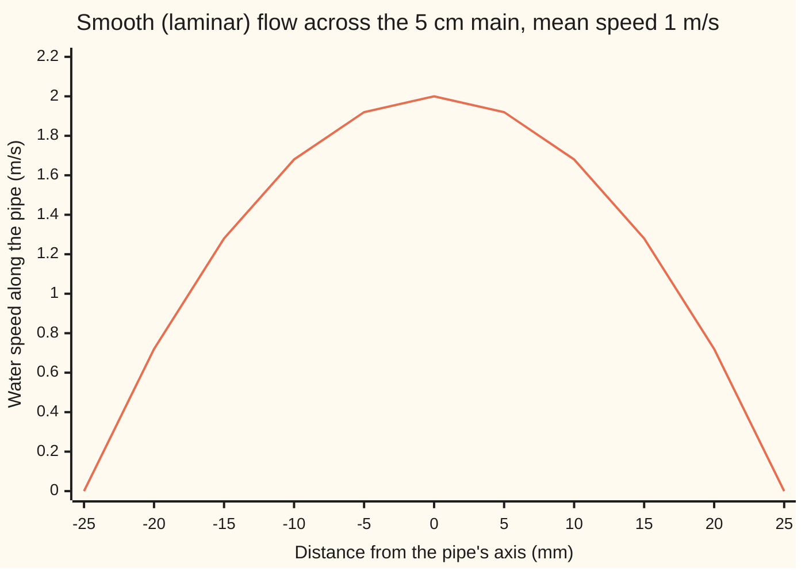

# Navier-Stokes: mass and momentum balance for a moving fluid

[Syllabus](../../../SYLLABUS.md) → [Partial differential equations](../README.md) → [Nonlinear PDE and Fluids](../README.md#s07) → Navier-Stokes

---

## General Overview

Wing 08's heat equation came from a balance: the heat inside a region changes only by what flows through its edge. [Convection-diffusion](../03-The%20Heat%20Equation%20in%20Depth/06-convection-diffusion-and-drift.md) let the flow carry the heat along. This card does the same bookkeeping for a fluid's own mass and its own momentum.

A water main 5 cm across carries water at 20 °C at a mean speed of 1 m per second. That is 1.9635 litres, or 1.9600 kg, of water each second. Mark off one metre of pipe and count what enters and leaves it.

- **Mass:** the same 1.9600 kg/s enters at one end and leaves at the other. Nothing piles up inside.
- **Momentum** (mass times velocity): the water carries momentum in through one end at 2.6133 N (a newton is 1 kg m/s of momentum per second) and out through the other at the same rate. It cancels.
- **Forces:** the pressure on the two ends pushes forward with 0.025173 N. The pipe wall drags back with 0.025173 N. They cancel too.

Write those balances for every region and shrink the region to a point. Out come the **Navier-Stokes equations**: one says the water does not compress, three say Newton's second law holds for every bit of it.

The unknowns are the velocity $`\mathbf u(\mathbf x, t)`$ and the pressure $`p(\mathbf x, t)`$. The region $`\Omega`$ is the inside of the pipe. The data are the water's density and viscosity, the starting velocity, the wall (where the water sticks) and the pressure at the two ends.

The pressure has an unusual job. No law links it to density. It takes whatever value keeps the water from compressing, found from the velocity by its own Poisson equation: an equation that sets the pressure's second derivatives equal to a source built from the velocity.

**Mass balance over every region forces the velocity to have zero divergence (no net outflow at any point); momentum balance over every region, with the Newtonian friction law, gives Newton's law for each parcel; and the pressure is the force that keeps the first true, fixed at each instant by a Poisson equation built from the velocity.**

**What kind of fact this is:** a model, then a theorem inside it. The two balance laws are exact physics. The friction law (stress proportional to the rate of shearing) is a model that fits water very well. Given both, the equations and the pressure's Poisson equation are proved on this card in Why it works. Whether smooth solutions in three dimensions last for all time is unproved as of 2026-11-15.

### The picture: the flow these equations predict for the main



The one line is the speed along the pipe at each distance from the axis: zero at the wall, 2.00 m/s in the middle, a parabola between. This is Poiseuille flow, an exact solution of the equations. It needs only 12.8205 Pa of pressure per metre of pipe.

The real main does not flow like this. Disturbances grow into eddies, and Blasius' empirical friction law (a fit to measurements in smooth pipes) predicts a cost of about 211 Pa per metre. Step 6 says why that is no contradiction.

---

## The formula

Notation first, in words. The divergence $`\nabla\cdot\mathbf u`$ (net outflow per unit volume) and the gradient $`\nabla p`$ come from [Divergence and curl](../../06-Calculus%20and%20analysis/09-Vector%20Calculus/03-divergence-and-curl.md). $`\Delta`$ is the Laplacian, the engineering wing's $`\nabla^2`$. This card introduces the **material derivative** $`D\mathbf u/Dt`$: the rate of change of velocity felt by a parcel (a small blob of water) as it moves with the flow.

Balance over a fixed region $`\Omega`$ with boundary $`\partial\Omega`$ and outward normal $`\mathbf n`$:

```math
\frac{d}{dt}\int_\Omega \rho\,dV = -\oint_{\partial\Omega} \rho\,\mathbf u\cdot\mathbf n\,dS, \qquad \frac{d}{dt}\int_\Omega \rho\,\mathbf u\,dV = -\oint_{\partial\Omega} \rho\,\mathbf u\,(\mathbf u\cdot\mathbf n)\,dS + \oint_{\partial\Omega} \sigma\,\mathbf n\,dS + \int_\Omega \rho\,\mathbf g\,dV
```

The same laws at each point, for water of fixed density:

```math
\nabla\cdot\mathbf u = 0, \qquad \rho\,\frac{D\mathbf u}{Dt} = \rho\left(\frac{\partial \mathbf u}{\partial t} + (\mathbf u\cdot\nabla)\,\mathbf u\right) = -\nabla p + \mu\,\Delta\mathbf u + \rho\,\mathbf g
```

And the pressure's own equation, found from the velocity alone:

```math
-\Delta p = \rho\sum_{i,j} \frac{\partial u_j}{\partial x_i}\,\frac{\partial u_i}{\partial x_j}
```

**Read it aloud:** "Mass in a region changes only by what flows across its edge; momentum changes by what flows across, plus the push of the surrounding water, plus gravity. At a point: the water does not compress, and density times acceleration equals pressure push plus friction plus weight. The pressure solves a Poisson equation built from the velocity's slopes."

| Symbol | Plain meaning | In our example | Push it up and the answer… |
| --- | --- | --- | --- |
| $`\mathbf u = (u_1, u_2, u_3)`$, $`\mathbf x`$, $`t`$ | the water's velocity at place $`\mathbf x = (x_1, x_2, x_3)`$ (also $`x, y, z`$) and time $`t`$, in m/s; $`u_i`$ is its part along $`x_i`$, and $`\partial_j`$ is short for $`\partial/\partial x_j`$ | 2.00 m/s on the pipe's axis, 0 at the wall | the momentum term grows as its square |
| $`p`$ | pressure, in pascals (Pa, N/m²) | falls 12.8205 Pa per metre along the main | — |
| $`\rho`$ | density, mass per cubic metre | 998.207 kg/m³ | Re rises |
| $`\mu`$, $`\nu`$ | viscosity, the water's internal friction, in Pa s; $`\nu = \mu/\rho`$, in m²/s | 1.0016 mPa s; 1.003399 mm²/s | pressure drop rises in proportion, while smooth |
| $`\Omega`$, $`\partial\Omega`$, $`\mathbf n`$, $`dV`$, $`dS`$ | a fixed region; its boundary; the unit vector pointing straight out of it; small pieces of volume and of boundary area | one metre of the main | — |
| $`\sigma`$, $`I`$ | the stress: the force per square metre the surrounding water puts on a surface, as a 3-by-3 matrix; the identity matrix | $`\sigma = -p\,I + \mu(\nabla\mathbf u + \nabla\mathbf u^{\mathsf T})`$ | — |
| $`\mathbf g`$ | gravity's pull per kilogram | absorbed into $`p`$ in a full pipe | — |
| $`D\mathbf u/Dt`$ | the material derivative: the parcel's acceleration, change at a fixed point plus change from moving | 0 in the steady main | — |
| $`V`$, $`D`$, $`R`$, $`r`$ | the mean speed; the bore and its radius; distance from the axis | 1 m/s; 0.05 m; 0.025 m | — |
| $`G`$, $`\tau_w`$, $`Q`$ | pressure drop per metre; the wall's drag per square metre; the flow rate | 12.8205 Pa/m; 0.160256 Pa; 1.9635 L/s | — |
| $`\mathrm{Re}`$ | the Reynolds number $`VD/\nu`$: inertia's size over friction's, no units | 49,830.6 | large values mean a turbulent pipe |
| $`U`$, $`k`$, $`h`$, $`N`$ | the test eddy's speed and wavenumber (Step 5); a grid step and the number of grid points per side | 1 m/s and $`k = \pi/D`$; $`h = 2D/N`$ | — |

### When it holds

- **The water is a continuum.** Each parcel holds enough molecules for density and velocity to be smooth. In a very thin gas the stress law fails.
- **The density is fixed.** That turns mass balance into $`\nabla\cdot\mathbf u = 0`$. It holds far below the speed of sound: excellent at 1 m/s, wrong in a jet engine, where pressure and density are tied by a law of state and pressure has a different job.
- **The fluid is Newtonian.** Stress grows in proportion to the rate of shearing, with one fixed $`\mu`$. Paint, blood at low shear and sewage sludge break this, and the $`\mu\,\Delta\mathbf u`$ term is wrong.
- **One temperature.** $`\mu`$ is taken as fixed. Warm water is less viscous, so use $`\mu`$ at the water's real temperature.
- **"A solution" means a classical one** (all the derivatives the equation uses exist and are continuous). Poiseuille flow is one. In three dimensions, a smooth start is proved to give a classical solution for some time; whether it lasts for all time is unproved; a 2026 claim of blow-up under a specially built outside force is not yet refereed ([The September 2026 Navier-Stokes claim](../../25-Frontier/05-Analysis%20and%20Dynamics/01-navier-stokes-blow-up-claim-2026.md)). The weaker kind that always exists is [Leray's weak solutions](02-leray-weak-solutions-of-navier-stokes.md).

---

## Why it works

### Step 0: balance on every region, then shrink

Pick any fixed region in the water. Mass inside it changes only by crossing the edge. Momentum changes by crossing the edge, by forces on the edge, and by gravity inside.

The [Divergence theorem](../../06-Calculus%20and%20analysis/09-Vector%20Calculus/07-divergence-theorem.md) turns edge integrals into inside integrals. Then each balance reads "the integral of something over the region is zero", for every region, however small. So the something is zero at every point.

The pressure is the one force with no law of its own. Step 5 shows what fixes it.

### Step 1: mass balance gives zero divergence

The mass crossing a small piece $`dS`$ of the edge each second is $`\rho\,\mathbf u\cdot\mathbf n\,dS`$: density times the speed straight out. The divergence theorem gives

```math
\int_\Omega \left(\frac{\partial\rho}{\partial t} + \nabla\cdot(\rho\,\mathbf u)\right) dV = 0 \quad\text{for every } \Omega \quad\Longrightarrow\quad \frac{\partial\rho}{\partial t} + \nabla\cdot(\rho\,\mathbf u) = 0.
```

Water's density is fixed, so $`\nabla\cdot\mathbf u = 0`$: every region gives out as much water as it takes in.

In the main: summing $`\rho\,u`$ over thin rings across each end gives 1.959975 kg/s, the same in and out.

<details>
<summary>Why "zero for every region" forces "zero at every point"</summary>

Suppose the integrand $`f`$ is continuous and $`f(\mathbf x_0) > 0`$ at some point. Then $`f > f(\mathbf x_0)/2`$ on a small ball round $`\mathbf x_0`$, by continuity. Its integral over that ball is positive, not zero. The same goes for $`f(\mathbf x_0) < 0`$. So $`f = 0`$ everywhere. This step needs a continuous integrand, which is why the equations are about classical solutions.

</details>

### Step 2: momentum balance, term by term

Momentum crosses the edge with the water. Each second a piece $`dS`$ lets through mass $`\rho\,\mathbf u\cdot\mathbf n\,dS`$, and each kilogram carries velocity $`\mathbf u`$. So the flux is $`\rho\,\mathbf u\,(\mathbf u\cdot\mathbf n)\,dS`$.

The surrounding water pushes on the piece with force $`\sigma\,\mathbf n\,dS`$. For a Newtonian fluid the stress is

```math
\sigma = -p\,I + \mu\left(\nabla\mathbf u + \nabla\mathbf u^{\mathsf T}\right).
```

The first part is the pressure, pushing straight in on every face. The second is friction, set by how fast neighbouring layers slide; $`\nabla\mathbf u`$ is the matrix of rates $`\partial u_i/\partial x_j`$ and $`\mathsf T`$ swaps its rows and columns.

The divergence theorem turns both edge terms into inside terms, and shrinking the region gives

```math
\frac{\partial(\rho\,\mathbf u)}{\partial t} + \nabla\cdot(\rho\,\mathbf u\,\mathbf u^{\mathsf T}) = \nabla\cdot\sigma + \rho\,\mathbf g.
```

### Step 3: zero divergence tidies both sides

Two simplifications use Step 1's $`\nabla\cdot\mathbf u = 0`$.

- **The flux term.** By the product rule, $`\sum_j \partial_j(u_i u_j) = \sum_j u_j\,\partial_j u_i + u_i\,(\nabla\cdot\mathbf u)`$. The last part is zero, so the flux term is $`\rho\,(\mathbf u\cdot\nabla)\,\mathbf u`$.
- **The friction term.** $`\nabla\cdot\sigma = -\nabla p + \mu\,\Delta\mathbf u + \mu\,\nabla(\nabla\cdot\mathbf u)`$, and the last part is zero. The engineering card [Navier-Stokes](../../13-Engineering%20mathematics/08-Fluids%20and%20Heat/03-navier-stokes-and-the-reynolds-number.md) does this collapse term by term for a single parcel.

What is left is the momentum equation in The formula. The left side is $`\rho\,D\mathbf u/Dt`$: the time change at a fixed point plus the change from moving to where the flow differs. That second part, $`(\mathbf u\cdot\nabla)\,\mathbf u`$, is velocity times its own slope. It makes the equation nonlinear, like Burgers' equation on [Conservation laws](../02-First-Order%20Equations%20and%20Characteristics/02-conservation-laws-and-shocks.md).

### Step 4: check it on the main

In the straight main the water moves only along the pipe, with speed $`u(r) = 2V(1 - r^2/R^2)`$. Nothing changes along the pipe, so the parcel's acceleration $`(\mathbf u\cdot\nabla)\,\mathbf u`$ is zero, and so is $`\nabla\cdot\mathbf u`$. The momentum equation along the pipe becomes

```math
0 = G + \mu\,\Delta u, \qquad \Delta u = \frac{1}{r}\frac{d}{dr}\left(r\,\frac{du}{dr}\right) = -\frac{8V}{R^2}, \qquad G = \frac{8\,\mu V}{R^2} = 12.8205\text{ Pa/m}.
```

The pipe-flow card [Viscosity](../../13-Engineering%20mathematics/08-Fluids%20and%20Heat/02-viscosity-and-pipe-flow.md) derives this parabola from a force balance on a plug. Here it serves only as a test: the code puts the parabola into the Cartesian Laplacian by centred differences and finds a leftover of $`-3.71 \times 10^{-13}`$ N/m³, which is rounding.

The integral form checks too, on one metre of pipe. Pressure on the ends: $`G \times \pi R^2 \times 1\text{ m} = 0.025173`$ N. Wall drag: $`\tau_w \times 2\pi R \times 1\text{ m}`$, with $`\tau_w = 4\mu V/R = 0.160256`$ Pa, also 0.025173 N. The momentum flux, 2.6133 N, enters and leaves unchanged.

### Step 5: the pressure's job

Count unknowns: three velocity parts and the pressure. Count equations: three momentum equations and $`\nabla\cdot\mathbf u = 0`$. But the last one has no time derivative. It does not move anything forward. It is a **constraint**: a rule the velocity must obey at every instant.

The pressure enforces it. Take the divergence of the momentum equation. The time term gives $`\rho\,\partial_t(\nabla\cdot\mathbf u) = 0`$. The friction term gives $`\mu\,\Delta(\nabla\cdot\mathbf u) = 0`$. Gravity is constant and drops out. What is left is

```math
\Delta p = -\rho\,\nabla\cdot\big((\mathbf u\cdot\nabla)\,\mathbf u\big) = -\rho\sum_{i,j} \frac{\partial u_j}{\partial x_i}\,\frac{\partial u_i}{\partial x_j}.
```

That is [Poisson's equation](../04-Laplace%2C%20Poisson%20and%20Potentials/03-poissons-equation-and-the-newtonian-potential.md) with a source built from the velocity's slopes. At a wall, the momentum equation's part along $`\mathbf n`$ gives $`\partial p/\partial n = \mu\,\Delta\mathbf u\cdot\mathbf n`$: a Neumann condition ([Boundary conditions](../01-Classification%20and%20Well-Posedness/03-boundary-conditions-dirichlet-neumann-and-robin.md)). Together they fix $`p`$ up to an added constant, at each instant, from the velocity at that instant.

So pressure is not a property the water carries along. It is a reaction, like a rail's push on a bead: whatever keeps the motion on track. In the main the source is zero, so $`p`$ falls in a straight line, its slope set by the two ends.

**A test with a real pressure field.** The **Taylor-Green eddy** is a checkerboard of eddies that is an exact solution of the equations. Friction makes the whole pattern fade slowly while keeping its shape; the formulas below are its starting instant. Make each eddy 5 cm across, spinning at $`U = 1`$ m/s:

```math
u_1 = U \sin kx\,\cos ky, \qquad u_2 = -U\cos kx\,\sin ky, \qquad p = \frac{\rho U^2}{4}\big(\cos 2kx + \cos 2ky\big), \qquad k = \frac{\pi}{D}.
```

The exact pressure is −499.1035 Pa at each eddy's centre and +499.1035 Pa at the corners where four eddies meet. The low pressure in the core is what bends the water round in a circle. The code recovers it from the velocity alone, two ways:

- **From the momentum equation.** Integrate $`-\rho\,(\mathbf u\cdot\nabla)\,\mathbf u`$ from a corner to a centre (time change and friction cancel for this flow): −998.2069 Pa, against the exact −998.2070 Pa.
- **From the Poisson equation**, solved on a grid with no knowledge of $`p`$: −525.5706, −505.5673 and −500.7101 Pa at the centre with 16, 32 and 64 points a side. The error falls four-fold each time the step halves: observed order 2.0338, then 2.0084.

<details>
<summary>Why the pressure does no work: it redirects, it never adds energy</summary>

Take water in a closed box, with $`\mathbf u\cdot\mathbf n = 0`$ on the walls. The power the pressure puts in is the integral of $`-\mathbf u\cdot\nabla p`$. Integrate by parts:

$`\displaystyle -\int_\Omega \mathbf u\cdot\nabla p\,dV = \int_\Omega p\,(\nabla\cdot\mathbf u)\,dV - \oint_{\partial\Omega} p\,\mathbf u\cdot\mathbf n\,dS = 0 - 0.`$

The first term vanishes because $`\nabla\cdot\mathbf u = 0`$, the second because no water crosses the wall. So the pressure only steers the flow. This is how a constraint force behaves, and it is why the energy count on [The energy inequality, and the gap it leaves in three dimensions](03-energy-inequality-and-the-regularity-question.md) never sees the pressure.

The same fact gives the projection view. Any velocity field splits into a part with zero divergence plus a gradient (the Helmholtz split). The pressure gradient cancels exactly the gradient part of the other forces. A computer code that steps the flow forward does this every step: push the velocity without pressure, then solve a Poisson equation and subtract the gradient. That is the projection method in Sources.

</details>

### Step 6: why the pipe ignores the parabola

Poiseuille flow is an exact classical solution at every speed. But at Re = 49,830.6, disturbances of finite size, from bends, valves and the inlet, grow instead of dying out. The flow that is actually seen is turbulent, and the same equations describe it. The parabola is a solution, but not stable against disturbances of that size. Blasius' empirical friction law predicts about 211 Pa/m, some 16 times the laminar 12.8205 Pa/m.

---

## Worked numbers, by hand

Water at 20 °C, $`\rho`$ = 998.207 kg/m³ and $`\mu`$ = 1.0016 mPa s, at a mean 1 m/s in a 5 cm bore.

| Step | Arithmetic | Value |
| --- | --- | --- |
| $`\nu = \mu/\rho`$ | $`1.0016 \times 10^{-3} / 998.207`$ | 1.003399 mm²/s |
| $`\mathrm{Re} = VD/\nu`$ | $`1 \times 0.05 / (1.003399 \times 10^{-6})`$ | 49,830.6 |
| centre speed | $`2V`$ | 2.0000 m/s |
| flow rate $`Q = \pi R^2 V`$ | $`3.14159 \times 0.025^2 \times 1`$ | 1.9635 L/s |
| mass flux | $`998.207 \times 1.9635 \times 10^{-3}`$ | 1.9600 kg/s |
| momentum flux $`\tfrac43\rho V^2\pi R^2`$ | $`\tfrac43 \times 998.207 \times 1.9635 \times 10^{-3}`$ | 2.6133 N |
| pressure drop $`G = 8\mu V/R^2`$ | $`8 \times 1.0016 \times 10^{-3} / 0.025^2`$ | 12.8205 Pa/m |
| wall drag $`\tau_w = 4\mu V/R`$ | $`4 \times 1.0016 \times 10^{-3} / 0.025`$ | 0.160256 Pa |
| pressure force on 1 m | $`12.8205 \times 1.9635 \times 10^{-3}`$ | 0.025173 N |
| **wall force on 1 m** | $`0.160256 \times 2\pi \times 0.025`$ | **0.025173 N: the balance closes** |

The momentum balance on one metre of main closes exactly: pressure in front equals drag on the wall, and the momentum the water carries passes straight through.

### What breaks if you drop a piece

| Mistake | Comes out at | What went wrong |
| --- | --- | --- |
| Leave the pressure out of the Taylor-Green eddy | $`\nabla\cdot\mathbf u`$ at each corner grows at 7,895.7 per s², reaching 7.8957 per s after 1 ms | Without the constraint force, parcels swell and shrink: water that compresses |
| Flip the sign of the Poisson equation | +505.5673 Pa at the eddy centre (32-point grid; true −499.1035 Pa) | High pressure in the core would fling water outward, not hold it on its circle |
| Drop the friction ($`\mu = 0`$) in the main | 0.0000 Pa/m; the parabola needs 12.8205 Pa/m | With no friction nothing resists steady flow, and the water could not stick to the wall |
| Read 1 m/s as the centre speed | 6.4102 Pa/m | The mean is half the centre speed for a parabola |
| Trust the smooth solution at Re 49,830.6 | 12.8205 Pa/m; Blasius' law predicts about 211 Pa/m | A solution of the equations, but not the stable one: the real flow is turbulent |

---

## Code, from first principles, and it actually runs

The script checks the derivation on the two flows above, by five roads. For the main: the closed-form parabola; the equation's leftover by centred differences at two steps; and the integral balances by summing 2,000 thin rings. For the eddy: the pressure from the momentum equation by Simpson's rule, and from its Poisson equation by a grid solve (successive over-relaxation, a sped-up Gauss-Seidel sweep) at three steps, with the observed order. Every number on the card is printed by both programs.

### Python

```python
# Navier-Stokes derivation -- the check behind the card.  Standard library only.
# Part A: Poiseuille flow in the 5 cm pipe solves the derived equations, and the
# integral balances over a 1 m slug of pipe close.  Part B: a Taylor-Green eddy
# 5 cm across, where the pressure is recovered from the velocity alone, by a
# line integral of the momentum equation and by a grid Poisson solve.
from math import pi, sin, cos, log, sqrt

RHO, MU = 998.207, 1.0016e-3          # water at 20 C: kg/m^3, Pa s
V, D = 1.0, 0.05                       # mean speed m/s, bore m
R = D / 2
NU = MU / RHO

def u_pipe(r): return 2 * V * (1 - (r / R) ** 2)   # Poiseuille profile, m/s
G = 8 * MU * V / R ** 2                              # pressure drop per metre, Pa/m

# ---- road 1: the equation's residual by centred differences, Cartesian x, y ----
def resid(x, y, h):
    f = lambda a, b: u_pipe(sqrt(a * a + b * b))
    lap = (f(x + h, y) + f(x - h, y) + f(x, y + h) + f(x, y - h) - 4 * f(x, y)) / h ** 2
    return G + MU * lap                # -dp/dz + mu * Laplacian(u_z); convection is zero
res1, res2 = resid(0.01, 0.005, 1e-3), resid(0.01, 0.005, 5e-4)

# ---- road 2: integral balances over a 1 m slug, by summing 2000 thin rings ----
n = 2000
rings = [((i + 0.5) * R / n, R / n) for i in range(n)]
Q = sum(u_pipe(r) * 2 * pi * r * dr for r, dr in rings)
mom = sum(RHO * u_pipe(r) ** 2 * 2 * pi * r * dr for r, dr in rings)
h = 1e-6
tau_w = -MU * (u_pipe(R + h) - u_pipe(R - h)) / (2 * h)   # wall shear from the profile's slope
F_p, F_w = G * pi * R ** 2 * 1.0, tau_w * 2 * pi * R * 1.0
Re = V * D / NU
f_bl = 0.3164 * Re ** -0.25                                 # Blasius smooth-pipe friction factor
G_turb = f_bl * RHO * V ** 2 / (2 * D)

print(f"nu (mm^2/s)                      {NU * 1e6:12.6f}")
print(f"Re = V D / nu                    {Re:12.1f}")
print(f"u_max on the axis (m/s)          {u_pipe(0):12.4f}")
print(f"G = 8 mu V / R^2 (Pa/m)          {G:12.4f}")
print(f"residual, h = 1 mm (N/m^3)       {res1:12.2e}")
print(f"residual, h = 0.5 mm (N/m^3)     {res2:12.2e}")
print(f"Q by rings (L/s)                 {Q * 1000:12.6f}")
print(f"Q = pi R^2 V (L/s)               {pi * R * R * V * 1000:12.6f}")
print(f"mass through each end (kg/s)     {RHO * Q:12.6f}")
print(f"momentum flux by rings (N)       {mom:12.6f}")
print(f"momentum flux 4/3 rho V^2 A (N)  {4 / 3 * RHO * V * V * pi * R * R:12.6f}")
print(f"wall shear tau_w (Pa)            {tau_w:12.6f}")
print(f"pressure force on slug (N)       {F_p:12.6f}")
print(f"wall friction on slug (N)        {F_w:12.6f}")
print(f"Blasius f                        {f_bl:12.6f}")
print(f"turbulent drop (Pa/m)            {G_turb:12.4f}")
print(f"turbulent / laminar              {G_turb / G:12.4f}")
print(f"wrong: mu = 0 (Pa/m)             {8 * 0.0 * V / R ** 2:12.4f}")
print(f"wrong: 1 m/s as centre (Pa/m)    {4 * MU * V / R ** 2:12.4f}")
print(f"try: V = 2 m/s (Pa/m), Re        {16 * MU / R ** 2:12.4f} {2 * Re:10.1f}")
print(f"try: D = 10 cm (Pa/m)            {8 * MU * V / 0.05 ** 2:12.4f}")
print("chart, r (mm)  " + " ".join(f"{-25 + 5 * i:5d}" for i in range(11)))
print("chart, u (m/s) " + " ".join(f"{u_pipe((-25 + 5 * i) / 1000):5.2f}" for i in range(11)))

# ---- Part B: Taylor-Green eddy, one eddy 5 cm across, 1 m/s ----
U, k = 1.0, pi / D
def vel(x, y): return U * sin(k * x) * cos(k * y), -U * cos(k * x) * sin(k * y)
def p_exact(x, y): return RHO * U * U / 4 * (cos(2 * k * x) + cos(2 * k * y))
e = 1e-5
def grads(x, y):                       # du/dx, du/dy, dv/dx, dv/dy by centred differences
    (a, _), (b, _) = vel(x + e, y), vel(x - e, y)
    (_, c), (_, d) = vel(x + e, y), vel(x - e, y)
    (a2, c2), (b2, d2) = vel(x, y + e), vel(x, y - e)
    return (a - b) / (2 * e), (a2 - b2) / (2 * e), (c - d) / (2 * e), (c2 - d2) / (2 * e)
def dpdx_dpdy(x, y):                   # momentum equation: grad p = -rho (u . grad) u
    u, v = vel(x, y); ux, uy, vx, vy = grads(x, y)
    return -RHO * (u * ux + v * uy), -RHO * (u * vx + v * vy)
def simpson(f, a, b, m=200):
    s = f(a) + f(b) + sum((4 if i % 2 else 2) * f(a + i * (b - a) / m) for i in range(1, m))
    return s * (b - a) / (3 * m)
dp_line = simpson(lambda x: dpdx_dpdy(x, 0.0)[0], 0, R) + simpson(lambda y: dpdx_dpdy(R, y)[1], 0, R)

def poisson(N, sign=1.0):              # periodic box 2D x 2D, -Lap p = rho * sum d_i u_j d_j u_i
    L = 2 * D; hh = L / N; X = [i * hh for i in range(N)]
    S = [[0.0] * N for _ in range(N)]
    for i in range(N):                 # velocity gradients of the eddy, written out by hand
        for j in range(N):
            cx, sx, cy, sy = cos(k * X[i]), sin(k * X[i]), cos(k * X[j]), sin(k * X[j])
            ux, uy, vx, vy = U * k * cx * cy, -U * k * sx * sy, U * k * sx * sy, -U * k * cx * cy
            S[i][j] = sign * RHO * (ux * ux + 2 * uy * vx + vy * vy)
    P = [[0.0] * N for _ in range(N)]
    w = 2 / (1 + sin(2 * pi / N))
    for sweep in range(5000):
        big = 0.0
        for i in range(N):
            for j in range(N):
                nb = P[(i + 1) % N][j] + P[(i - 1) % N][j] + P[i][(j + 1) % N] + P[i][(j - 1) % N]
                new = (nb + hh * hh * S[i][j]) / 4
                d = w * (new - P[i][j]); P[i][j] += d; big = max(big, abs(d))
        if big < 1e-11: break
    mean = sum(map(sum, P)) / N ** 2
    err = max(abs(P[i][j] - mean - p_exact(X[i], X[j])) for i in range(N) for j in range(N))
    return P[N // 4][N // 4] - mean, err

pc16, err16 = poisson(16)
pc32, err32 = poisson(32)
pc64, err64 = poisson(64)
pc_wrong, _ = poisson(32, -1.0)
divrate = abs(sum(grads(0.0, 0.0)[a] ** 2 for a in (0, 3)) + 2 * grads(0.0, 0.0)[1] * grads(0.0, 0.0)[2])

print(f"TG p at eddy centre, exact (Pa)  {p_exact(R, R):12.4f}")
print(f"TG p at corner, exact (Pa)       {p_exact(0, 0):12.4f}")
print(f"TG centre - corner, exact (Pa)   {p_exact(R, R) - p_exact(0, 0):12.4f}")
print(f"TG centre - corner, line (Pa)    {dp_line:12.4f}")
print(f"TG centre, Poisson N=16 (Pa)     {pc16:12.4f}")
print(f"TG centre, Poisson N=32 (Pa)     {pc32:12.4f}")
print(f"TG centre, Poisson N=64 (Pa)     {pc64:12.4f}")
print(f"TG max error N=16, 32, 64 (Pa)   {err16:12.4f} {err32:10.4f} {err64:10.4f}")
print(f"TG observed order 16-32, 32-64   {log(err16 / err32) / log(2):12.4f} {log(err32 / err64) / log(2):10.4f}")
print(f"wrong: Poisson sign flipped (Pa) {pc_wrong:12.4f}")
print(f"no pressure: d(div u)/dt (1/s^2) {divrate:12.1f}")
print(f"no pressure: div u at 1 ms (1/s) {divrate * 1e-3:12.4f}")

assert abs(Re - 49830.6) < 0.1, "Reynolds number of the house pipe"
assert abs(res1) < 1e-6 * G and abs(res2) < 1e-5 * G, "Poiseuille solves the equation"
assert abs(Q - pi * R * R * V) < 1e-9, "ring sum against the closed-form flow rate"
assert abs(mom - 4 / 3 * RHO * V * V * pi * R * R) < 1e-6, "momentum flux by rings vs formula"
assert abs(F_p - F_w) < 1e-9, "pressure force balances wall friction on the slug"
assert abs(dp_line - (p_exact(R, R) - p_exact(0, 0))) < 1e-4, "pressure from momentum"
assert abs(pc32 - p_exact(R, R)) < 0.02 * RHO, "Poisson pressure at the eddy centre"
assert 1.9 < log(err32 / err64) / log(2) < 2.1, "second-order grid"
assert abs(divrate - 2 * U * U * k * k) < 0.1, "divergence growth without pressure"
print("ALL CHECKS PASS")
```

**Ran 2026-11-15 on macOS, Python 3.14.10, standard library only. All checks passed. Output, pasted from the run:**

```
nu (mm^2/s)                          1.003399
Re = V D / nu                         49830.6
u_max on the axis (m/s)                2.0000
G = 8 mu V / R^2 (Pa/m)               12.8205
residual, h = 1 mm (N/m^3)          -3.71e-13
residual, h = 0.5 mm (N/m^3)        -2.15e-12
Q by rings (L/s)                     1.963496
Q = pi R^2 V (L/s)                   1.963495
mass through each end (kg/s)         1.959975
momentum flux by rings (N)           2.613300
momentum flux 4/3 rho V^2 A (N)      2.613300
wall shear tau_w (Pa)                0.160256
pressure force on slug (N)           0.025173
wall friction on slug (N)            0.025173
Blasius f                            0.021177
turbulent drop (Pa/m)                211.3893
turbulent / laminar                   16.4884
wrong: mu = 0 (Pa/m)                   0.0000
wrong: 1 m/s as centre (Pa/m)          6.4102
try: V = 2 m/s (Pa/m), Re             25.6410    99661.2
try: D = 10 cm (Pa/m)                  3.2051
chart, r (mm)    -25   -20   -15   -10    -5     0     5    10    15    20    25
chart, u (m/s)  0.00  0.72  1.28  1.68  1.92  2.00  1.92  1.68  1.28  0.72  0.00
TG p at eddy centre, exact (Pa)     -499.1035
TG p at corner, exact (Pa)           499.1035
TG centre - corner, exact (Pa)      -998.2070
TG centre - corner, line (Pa)       -998.2069
TG centre, Poisson N=16 (Pa)        -525.5706
TG centre, Poisson N=32 (Pa)        -505.5673
TG centre, Poisson N=64 (Pa)        -500.7101
TG max error N=16, 32, 64 (Pa)        26.4671     6.4638     1.6066
TG observed order 16-32, 32-64         2.0338     2.0084
wrong: Poisson sign flipped (Pa)     505.5673
no pressure: d(div u)/dt (1/s^2)       7895.7
no pressure: div u at 1 ms (1/s)       7.8957
ALL CHECKS PASS
```

### Rust

The same checks, the same inputs, the same printed lines. No crates.

```rust
// Navier-Stokes derivation -- the same check as navier_stokes_derivation_check.py, in Rust.
// Standard library only, no crates.  Part A: Poiseuille flow in the 5 cm pipe solves the
// derived equations, and the integral balances over a 1 m slug close.  Part B: a
// Taylor-Green eddy 5 cm across, its pressure recovered from the velocity alone.
use std::f64::consts::PI;

const RHO: f64 = 998.207; // water at 20 C, kg/m^3
const MU: f64 = 1.0016e-3; // Pa s
const V: f64 = 1.0; // mean speed, m/s
const D: f64 = 0.05; // bore, m
const R: f64 = D / 2.0;
const U: f64 = 1.0; // eddy speed, m/s

fn u_pipe(r: f64) -> f64 { 2.0 * V * (1.0 - (r / R).powi(2)) }
fn g_drop() -> f64 { 8.0 * MU * V / R.powi(2) }

// road 1: the equation's residual by centred differences, Cartesian x, y
fn resid(x: f64, y: f64, h: f64) -> f64 {
    let f = |a: f64, b: f64| u_pipe((a * a + b * b).sqrt());
    let lap = (f(x + h, y) + f(x - h, y) + f(x, y + h) + f(x, y - h) - 4.0 * f(x, y)) / h.powi(2);
    g_drop() + MU * lap
}

fn kk() -> f64 { PI / D }
fn vel(x: f64, y: f64) -> (f64, f64) {
    let k = kk();
    (U * (k * x).sin() * (k * y).cos(), -U * (k * x).cos() * (k * y).sin())
}
fn p_exact(x: f64, y: f64) -> f64 { RHO * U * U / 4.0 * ((2.0 * kk() * x).cos() + (2.0 * kk() * y).cos()) }
const E: f64 = 1e-5;
fn grads(x: f64, y: f64) -> (f64, f64, f64, f64) {
    let ((a, c), (b, d)) = (vel(x + E, y), vel(x - E, y));
    let ((a2, c2), (b2, d2)) = (vel(x, y + E), vel(x, y - E));
    ((a - b) / (2.0 * E), (a2 - b2) / (2.0 * E), (c - d) / (2.0 * E), (c2 - d2) / (2.0 * E))
}
fn dpdx_dpdy(x: f64, y: f64) -> (f64, f64) {
    let (u, v) = vel(x, y);
    let (ux, uy, vx, vy) = grads(x, y);
    (-RHO * (u * ux + v * uy), -RHO * (u * vx + v * vy))
}
fn simpson<F: Fn(f64) -> f64>(f: F, a: f64, b: f64, m: usize) -> f64 {
    let mut s = f(a) + f(b);
    for i in 1..m { s += if i % 2 == 1 { 4.0 } else { 2.0 } * f(a + i as f64 * (b - a) / m as f64); }
    s * (b - a) / (3.0 * m as f64)
}

// periodic box 2D x 2D, -Lap p = rho * sum d_i u_j d_j u_i, solved by SOR
fn poisson(n: usize, sign: f64) -> (f64, f64) {
    let l = 2.0 * D;
    let hh = l / n as f64;
    let k = kk();
    let xs: Vec<f64> = (0..n).map(|i| i as f64 * hh).collect();
    let mut s = vec![vec![0.0; n]; n];
    for i in 0..n {
        for j in 0..n {
            let (cx, sx, cy, sy) = ((k * xs[i]).cos(), (k * xs[i]).sin(), (k * xs[j]).cos(), (k * xs[j]).sin());
            let (ux, uy, vx, vy) = (U * k * cx * cy, -U * k * sx * sy, U * k * sx * sy, -U * k * cx * cy);
            s[i][j] = sign * RHO * (ux * ux + 2.0 * uy * vx + vy * vy);
        }
    }
    let mut p = vec![vec![0.0; n]; n];
    let w = 2.0 / (1.0 + (2.0 * PI / n as f64).sin());
    for _sweep in 0..5000 {
        let mut big: f64 = 0.0;
        for i in 0..n {
            for j in 0..n {
                let nb = p[(i + 1) % n][j] + p[(i + n - 1) % n][j] + p[i][(j + 1) % n] + p[i][(j + n - 1) % n];
                let new = (nb + hh * hh * s[i][j]) / 4.0;
                let d = w * (new - p[i][j]);
                p[i][j] += d;
                big = big.max(d.abs());
            }
        }
        if big < 1e-11 { break; }
    }
    let mut mean = 0.0;
    for row in &p { let rs: f64 = row.iter().sum(); mean += rs; }
    mean /= (n * n) as f64;
    let mut err: f64 = 0.0;
    for i in 0..n { for j in 0..n { err = err.max((p[i][j] - mean - p_exact(xs[i], xs[j])).abs()); } }
    (p[n / 4][n / 4] - mean, err)
}

fn main() {
    let nu = MU / RHO;
    let g = g_drop();
    let (res1, res2) = (resid(0.01, 0.005, 1e-3), resid(0.01, 0.005, 5e-4));
    let n = 2000;
    let (mut q, mut mom) = (0.0, 0.0);
    for i in 0..n {
        let (r, dr) = ((i as f64 + 0.5) * R / n as f64, R / n as f64);
        q += u_pipe(r) * 2.0 * PI * r * dr;
        mom += RHO * u_pipe(r).powi(2) * 2.0 * PI * r * dr;
    }
    let h = 1e-6;
    let tau_w = -MU * (u_pipe(R + h) - u_pipe(R - h)) / (2.0 * h);
    let (f_p, f_w) = (g * PI * R.powi(2) * 1.0, tau_w * 2.0 * PI * R * 1.0);
    let re = V * D / nu;
    let f_bl = 0.3164 * re.powf(-0.25);
    let g_turb = f_bl * RHO * V.powi(2) / (2.0 * D);

    println!("nu (mm^2/s)                      {:12.6}", nu * 1e6);
    println!("Re = V D / nu                    {:12.1}", re);
    println!("u_max on the axis (m/s)          {:12.4}", u_pipe(0.0));
    println!("G = 8 mu V / R^2 (Pa/m)          {:12.4}", g);
    println!("residual, h = 1 mm (N/m^3)       {:>12}", sci(res1));
    println!("residual, h = 0.5 mm (N/m^3)     {:>12}", sci(res2));
    println!("Q by rings (L/s)                 {:12.6}", q * 1000.0);
    println!("Q = pi R^2 V (L/s)               {:12.6}", PI * R * R * V * 1000.0);
    println!("mass through each end (kg/s)     {:12.6}", RHO * q);
    println!("momentum flux by rings (N)       {:12.6}", mom);
    println!("momentum flux 4/3 rho V^2 A (N)  {:12.6}", 4.0 / 3.0 * RHO * V * V * PI * R * R);
    println!("wall shear tau_w (Pa)            {:12.6}", tau_w);
    println!("pressure force on slug (N)       {:12.6}", f_p);
    println!("wall friction on slug (N)        {:12.6}", f_w);
    println!("Blasius f                        {:12.6}", f_bl);
    println!("turbulent drop (Pa/m)            {:12.4}", g_turb);
    println!("turbulent / laminar              {:12.4}", g_turb / g);
    println!("wrong: mu = 0 (Pa/m)             {:12.4}", 8.0 * 0.0 * V / R.powi(2));
    println!("wrong: 1 m/s as centre (Pa/m)    {:12.4}", 4.0 * MU * V / R.powi(2));
    println!("try: V = 2 m/s (Pa/m), Re        {:12.4} {:10.1}", 16.0 * MU / R.powi(2), 2.0 * re);
    println!("try: D = 10 cm (Pa/m)            {:12.4}", 8.0 * MU * V / 0.05f64.powi(2));
    let rs: Vec<String> = (0..11).map(|i| format!("{:5}", -25 + 5 * i)).collect();
    println!("chart, r (mm)  {}", rs.join(" "));
    let us: Vec<String> = (0..11).map(|i| format!("{:5.2}", u_pipe((-25 + 5 * i) as f64 / 1000.0))).collect();
    println!("chart, u (m/s) {}", us.join(" "));

    let dp_line = simpson(|x| dpdx_dpdy(x, 0.0).0, 0.0, R, 200) + simpson(|y| dpdx_dpdy(R, y).1, 0.0, R, 200);
    let (pc16, err16) = poisson(16, 1.0);
    let (pc32, err32) = poisson(32, 1.0);
    let (pc64, err64) = poisson(64, 1.0);
    let (pc_wrong, _) = poisson(32, -1.0);
    let gr = grads(0.0, 0.0);
    let divrate = (gr.0.powi(2) + gr.3.powi(2) + 2.0 * gr.1 * gr.2).abs();
    let k = kk();

    println!("TG p at eddy centre, exact (Pa)  {:12.4}", p_exact(R, R));
    println!("TG p at corner, exact (Pa)       {:12.4}", p_exact(0.0, 0.0));
    println!("TG centre - corner, exact (Pa)   {:12.4}", p_exact(R, R) - p_exact(0.0, 0.0));
    println!("TG centre - corner, line (Pa)    {:12.4}", dp_line);
    println!("TG centre, Poisson N=16 (Pa)     {:12.4}", pc16);
    println!("TG centre, Poisson N=32 (Pa)     {:12.4}", pc32);
    println!("TG centre, Poisson N=64 (Pa)     {:12.4}", pc64);
    println!("TG max error N=16, 32, 64 (Pa)   {:12.4} {:10.4} {:10.4}", err16, err32, err64);
    println!("TG observed order 16-32, 32-64   {:12.4} {:10.4}", (err16 / err32).ln() / 2f64.ln(), (err32 / err64).ln() / 2f64.ln());
    println!("wrong: Poisson sign flipped (Pa) {:12.4}", pc_wrong);
    println!("no pressure: d(div u)/dt (1/s^2) {:12.1}", divrate);
    println!("no pressure: div u at 1 ms (1/s) {:12.4}", divrate * 1e-3);

    assert!((re - 49830.6).abs() < 0.1, "Reynolds number of the house pipe");
    assert!(res1.abs() < 1e-6 * g && res2.abs() < 1e-5 * g, "Poiseuille solves the equation");
    assert!((q - PI * R * R * V).abs() < 1e-9, "ring sum against the closed-form flow rate");
    assert!((mom - 4.0 / 3.0 * RHO * V * V * PI * R * R).abs() < 1e-6, "momentum flux by rings vs formula");
    assert!((f_p - f_w).abs() < 1e-9, "pressure force balances wall friction on the slug");
    assert!((dp_line - (p_exact(R, R) - p_exact(0.0, 0.0))).abs() < 1e-4, "pressure from momentum");
    assert!((pc32 - p_exact(R, R)).abs() < 0.02 * RHO, "Poisson pressure at the eddy centre");
    let ord = (err32 / err64).ln() / 2f64.ln();
    assert!(ord > 1.9 && ord < 2.1, "second-order grid");
    assert!((divrate - 2.0 * U * U * k * k).abs() < 0.1, "divergence growth without pressure");
    println!("ALL CHECKS PASS");
}

// Python's {:.2e} format: two decimals, signed two-digit exponent
fn sci(x: f64) -> String {
    let s = format!("{:.2e}", x);
    let (m, e) = s.split_once('e').unwrap();
    let ev: i32 = e.parse().unwrap();
    format!("{}e{}{:02}", m, if ev < 0 { '-' } else { '+' }, ev.abs())
}
```

**Ran 2026-11-15 on macOS, rustc 1.98.1, no crates. All checks passed. Output, pasted from the run:**

```
nu (mm^2/s)                          1.003399
Re = V D / nu                         49830.6
u_max on the axis (m/s)                2.0000
G = 8 mu V / R^2 (Pa/m)               12.8205
residual, h = 1 mm (N/m^3)          -3.71e-13
residual, h = 0.5 mm (N/m^3)        -2.15e-12
Q by rings (L/s)                     1.963496
Q = pi R^2 V (L/s)                   1.963495
mass through each end (kg/s)         1.959975
momentum flux by rings (N)           2.613300
momentum flux 4/3 rho V^2 A (N)      2.613300
wall shear tau_w (Pa)                0.160256
pressure force on slug (N)           0.025173
wall friction on slug (N)            0.025173
Blasius f                            0.021177
turbulent drop (Pa/m)                211.3893
turbulent / laminar                   16.4884
wrong: mu = 0 (Pa/m)                   0.0000
wrong: 1 m/s as centre (Pa/m)          6.4102
try: V = 2 m/s (Pa/m), Re             25.6410    99661.2
try: D = 10 cm (Pa/m)                  3.2051
chart, r (mm)    -25   -20   -15   -10    -5     0     5    10    15    20    25
chart, u (m/s)  0.00  0.72  1.28  1.68  1.92  2.00  1.92  1.68  1.28  0.72  0.00
TG p at eddy centre, exact (Pa)     -499.1035
TG p at corner, exact (Pa)           499.1035
TG centre - corner, exact (Pa)      -998.2070
TG centre - corner, line (Pa)       -998.2069
TG centre, Poisson N=16 (Pa)        -525.5706
TG centre, Poisson N=32 (Pa)        -505.5673
TG centre, Poisson N=64 (Pa)        -500.7101
TG max error N=16, 32, 64 (Pa)        26.4671     6.4638     1.6066
TG observed order 16-32, 32-64         2.0338     2.0084
wrong: Poisson sign flipped (Pa)     505.5673
no pressure: d(div u)/dt (1/s^2)       7895.7
no pressure: div u at 1 ms (1/s)       7.8957
ALL CHECKS PASS
```

### Lean

Lean proves the claims of Steps 1, 4 and 5 for water filling all of space, and checks the worked numbers.

- Suppose $`\mathbf u`$ and $`p`$ solve the equations everywhere, for all time, $`\mathbf u`$ with three continuous derivatives and $`p`$ with one. Then $`-\Delta p = \rho\sum_{i,j} \partial_i u_j\,\partial_j u_i`$ at every point and time.
- Suppose a quantity $`f`$ on space is continuous and its integral over every cube is zero. Then $`f = 0`$ at every point.
- Take Poiseuille flow in a pipe of any radius $`R > 0`$, with $`G = 8\mu V/R^2`$ and gravity absorbed into $`p`$. Then it solves the Navier-Stokes equations exactly, and the water's speed is zero at the wall.
- Take the same flow and one metre of pipe. Then the pressure force on the ends, $`G\pi R^2`$, equals the wall drag $`2\pi R\,\tau_w`$.
- In the main, $`G`$ is exactly 12.82048 Pa/m and $`\tau_w`$ is exactly 0.160256 Pa.
- Reading 1 m/s as the centre speed gives 6.41024 Pa/m. Twice the speed gives 25.64096 Pa/m, and twice the bore gives 3.20512 Pa/m.
- The Taylor-Green eddy's exact pressure is −499.1035 Pa at a centre and +499.1035 Pa at a corner.

The balances over a region, the ring sums, the eddy's grid solve and Blasius' law are left to the Python and Rust checks.

```lean
-- Navier-Stokes: for water of fixed density and viscosity, a smooth solution of the incompressible Navier-Stokes equations has a pressure that solves the Poisson equation −Δp = ρ Σᵢⱼ ∂ᵢuⱼ ∂ⱼuᵢ, a quantity whose integral is zero over every ball is zero at every point, and Poiseuille flow in a pipe is an exact solution whose end pressure balances the wall's drag.
import Mathlib.Analysis.Calculus.ContDiff.Operations
import Mathlib.Analysis.Calculus.Deriv.Pi
import Mathlib.Analysis.Calculus.Deriv.Prod
import Mathlib.Analysis.Calculus.Deriv.Pow
import Mathlib.Analysis.Calculus.FDeriv.Mul
import Mathlib.MeasureTheory.Function.LocallyIntegrable
import Mathlib.MeasureTheory.Measure.Haar.OfBasis
import Mathlib.Analysis.Calculus.FDeriv.Symmetric
import Mathlib.Analysis.Calculus.Deriv.Basic
import Mathlib.Analysis.SpecialFunctions.Trigonometric.Basic
import Mathlib.MeasureTheory.Integral.Bochner.Set
import Mathlib.MeasureTheory.Measure.Lebesgue.Basic

open Real MeasureTheory

/-! Space is `Fin 3 → ℝ`: a point `x` has coordinates `x 0`, `x 1`, `x 2`. A velocity field that
changes in time is a function `u : ℝ → Space → Space`, time first, and `u t x i` is its part along
axis `i`. A pressure field is a function `p : ℝ → Space → ℝ`. Derivatives are Mathlib's `fderiv` in
space and `deriv` in time; divergence, the convection term (u·∇)u and the Laplacian are spelled
out component by component, exactly as on the card. -/

/-- Points of space, and vectors at a point. -/
abbrev Space := Fin 3 → ℝ

/-- The rate of change of a quantity `f` on space along axis `i` at the point `x`: ∂ᵢf = ∂f/∂xᵢ. -/
noncomputable def pd (i : Fin 3) (f : Space → ℝ) (x : Space) : ℝ :=
  fderiv ℝ f x (Pi.single i 1)

/-- Divergence (net outflow per unit volume): ∇·u = ∂₀u₀ + ∂₁u₁ + ∂₂u₂. -/
noncomputable def divergence (u : Space → Space) (x : Space) : ℝ :=
  ∑ i : Fin 3, pd i (fun y => u y i) x

/-- The Laplacian of a quantity on space: Δf = ∂₀∂₀f + ∂₁∂₁f + ∂₂∂₂f. -/
noncomputable def laplacian (f : Space → ℝ) (x : Space) : ℝ :=
  ∑ j : Fin 3, pd j (pd j f) x

/-- Part `i` of the convection term (u·∇)u: velocity times its own slope, Σⱼ uⱼ ∂ⱼuᵢ. -/
noncomputable def convection (u : Space → Space) (x : Space) (i : Fin 3) : ℝ :=
  ∑ j : Fin 3, u x j * pd j (fun y => u y i) x

/-- The incompressible Navier-Stokes equations for a fluid of fixed density `ρ`, fixed viscosity
`μ` and constant gravity `g`, at every time and every point: the water does not compress,
∇·u = 0, and Newton's law holds for every parcel,
ρ (∂u/∂t + (u·∇)u) = −∇p + μ Δu + ρ g, one equation for each axis `i`. -/
def NavierStokes (ρ μ : ℝ) (g : Space) (u : ℝ → Space → Space) (p : ℝ → Space → ℝ) : Prop :=
  (∀ t x, divergence (u t) x = 0) ∧
  ∀ t x (i : Fin 3),
    ρ * (deriv (fun s => u s x i) t + convection (u t) x i)
      = -pd i (p t) x + μ * laplacian (fun y => u t y i) x + ρ * g i

section NSHelpers
variable {E : Type*} [NormedAddCommGroup E] [NormedSpace ℝ E]

lemma ns_dir_contDiff {m n : WithTop ℕ∞} {G : E → ℝ} (hG : ContDiff ℝ m G) (hmn : n + 1 ≤ m)
    (v : E) : ContDiff ℝ n (fun y => fderiv ℝ G y v) :=
  (hG.fderiv_right hmn).clm_apply contDiff_const

lemma ns_dir_symm {G : E → ℝ} (hG : ContDiff ℝ 2 G) (q v w : E) :
    fderiv ℝ (fun y => fderiv ℝ G y v) q w = fderiv ℝ (fun y => fderiv ℝ G y w) q v := by
  have hd : DifferentiableAt ℝ (fderiv ℝ G) q :=
    ((hG.fderiv_right (m := 1) (by norm_num)).differentiable one_ne_zero) q
  rw [fderiv_clm_apply hd (differentiableAt_const v), fderiv_clm_apply hd (differentiableAt_const w)]
  simp
  exact (hG.contDiffAt.isSymmSndFDerivAt (by rw [minSmoothness_of_isRCLikeNormedField])) w v

lemma ns_pd_slice {G : ℝ × Space → ℝ} {t : ℝ} {x : Space} (hG : DifferentiableAt ℝ G (t, x))
    (j : Fin 3) : pd j (fun y => G (t, y)) x = fderiv ℝ G (t, x) (0, Pi.single j 1) := by
  have h1 : HasFDerivAt (fun y : Space => (t, y))
      ((0 : Space →L[ℝ] ℝ).prod (ContinuousLinearMap.id ℝ Space)) x :=
    (hasFDerivAt_const t x).prodMk (hasFDerivAt_id x)
  have h2 := hG.hasFDerivAt.comp x h1
  show fderiv ℝ (G ∘ fun y => (t, y)) x _ = _
  rw [h2.fderiv]
  rfl

lemma ns_deriv_slice {G : ℝ × Space → ℝ} {t : ℝ} {x : Space} (hG : DifferentiableAt ℝ G (t, x)) :
    deriv (fun s => G (s, x)) t = fderiv ℝ G (t, x) (1, 0) := by
  have h1 : HasDerivAt (fun s : ℝ => (s, x)) (1, 0) t :=
    (hasDerivAt_id t).prodMk (hasDerivAt_const t x)
  exact (hG.hasFDerivAt.comp_hasDerivAt t h1).deriv

lemma ns_pd_contDiff {m n : WithTop ℕ∞} {f : Space → ℝ} (hf : ContDiff ℝ m f) (hmn : n + 1 ≤ m)
    (i : Fin 3) : ContDiff ℝ n (pd i f) :=
  ns_dir_contDiff hf hmn _

lemma ns_pd_comm {f : Space → ℝ} (hf : ContDiff ℝ 2 f) (i j : Fin 3) (x : Space) :
    pd i (pd j f) x = pd j (pd i f) x :=
  ns_dir_symm hf x _ _

lemma ns_pd_sum {ι : Type*} (s : Finset ι) (f : ι → Space → ℝ) (i : Fin 3) (x : Space)
    (h : ∀ k, DifferentiableAt ℝ (f k) x) :
    pd i (fun y => ∑ k ∈ s, f k y) x = ∑ k ∈ s, pd i (f k) x := by
  unfold pd
  rw [fderiv_fun_sum (fun k _ => h k)]
  simp

lemma ns_pd_mul (f g : Space → ℝ) (i : Fin 3) (x : Space)
    (hf : DifferentiableAt ℝ f x) (hg : DifferentiableAt ℝ g x) :
    pd i (fun y => f y * g y) x = f x * pd i g x + g x * pd i f x := by
  unfold pd
  rw [fderiv_fun_mul hf hg]
  simp

lemma ns_pd_zero (i : Fin 3) : pd i (fun _ => (0 : ℝ)) = fun _ => 0 := by
  funext x; unfold pd; simp

lemma ns_pd_lin (a b c : Space → ℝ) (ρ μ k : ℝ) (i : Fin 3) (x : Space)
    (ha : DifferentiableAt ℝ a x) (hb : DifferentiableAt ℝ b x) (hc : DifferentiableAt ℝ c x) :
    pd i (fun y => -ρ * (a y + b y) + μ * c y + k) x
      = -ρ * (pd i a x + pd i b x) + μ * pd i c x := by
  have h : HasFDerivAt (fun y => -ρ * (a y + b y) + μ * c y + k)
      ((-ρ) • (fderiv ℝ a x + fderiv ℝ b x) + μ • fderiv ℝ c x) x :=
    (((ha.hasFDerivAt.add hb.hasFDerivAt).const_mul (-ρ)).add
      (hc.hasFDerivAt.const_mul μ)).add_const k
  unfold pd
  rw [h.fderiv]
  simp
  ring

lemma ns_space_slice {n : WithTop ℕ∞} {G : ℝ × Space → ℝ} (hG : ContDiff ℝ n G) (s : ℝ) :
    ContDiff ℝ n (fun y : Space => G (s, y)) :=
  hG.comp (contDiff_const.prodMk contDiff_id)

lemma ns_time_slice {n : WithTop ℕ∞} {G : ℝ × Space → ℝ} (hG : ContDiff ℝ n G) (x : Space) :
    ContDiff ℝ n (fun s : ℝ => G (s, x)) :=
  hG.comp (contDiff_id.prodMk contDiff_const)

lemma ns_time_deriv_diff {G : ℝ × Space → ℝ} (hG : ContDiff ℝ 2 G) (t : ℝ) :
    Differentiable ℝ (fun y => deriv (fun s => G (s, y)) t) := by
  have hd : ∀ q, DifferentiableAt ℝ G q := hG.differentiable (by norm_num)
  have h1 : (fun y => deriv (fun s => G (s, y)) t) = fun y => fderiv ℝ G (t, y) (1, 0) :=
    funext fun y => ns_deriv_slice (hd _)
  rw [h1]
  exact (ns_space_slice (ns_dir_contDiff (n := 1) hG (by norm_num) _) t).differentiable
    (by norm_num)

lemma ns_pd_time_diff {G : ℝ × Space → ℝ} (hG : ContDiff ℝ 2 G) (x : Space) (j : Fin 3) :
    Differentiable ℝ (fun s => pd j (fun y => G (s, y)) x) := by
  have hd : ∀ q, DifferentiableAt ℝ G q := hG.differentiable (by norm_num)
  have h2 : (fun s => pd j (fun y => G (s, y)) x)
      = fun s => fderiv ℝ G (s, x) (0, Pi.single j 1) :=
    funext fun s => ns_pd_slice (hd _) j
  rw [h2]
  exact (ns_time_slice (ns_dir_contDiff (n := 1) hG (by norm_num) _) x).differentiable
    (by norm_num)

lemma ns_time_space_comm {G : ℝ × Space → ℝ} (hG : ContDiff ℝ 3 G) (t : ℝ) (x : Space)
    (j : Fin 3) :
    pd j (fun y => deriv (fun s => G (s, y)) t) x = deriv (fun s => pd j (fun y => G (s, y)) x) t := by
  have hd : ∀ q, DifferentiableAt ℝ G q := hG.differentiable (by norm_num)
  have hA : ContDiff ℝ 2 (fun q => fderiv ℝ G q (1, 0)) := ns_dir_contDiff hG (by norm_num) _
  have hB : ContDiff ℝ 2 (fun q => fderiv ℝ G q (0, Pi.single j 1)) :=
    ns_dir_contDiff hG (by norm_num) _
  have h1 : (fun y => deriv (fun s => G (s, y)) t) = fun y => fderiv ℝ G (t, y) (1, 0) :=
    funext fun y => ns_deriv_slice (hd _)
  have h2 : (fun s => pd j (fun y => G (s, y)) x)
      = fun s => fderiv ℝ G (s, x) (0, Pi.single j 1) :=
    funext fun s => ns_pd_slice (hd _) j
  rw [h1, h2]
  calc pd j (fun y => fderiv ℝ G (t, y) (1, 0)) x
      = fderiv ℝ (fun q => fderiv ℝ G q (1, 0)) (t, x) (0, Pi.single j 1) :=
        ns_pd_slice (G := fun q => fderiv ℝ G q (1, 0)) (hA.differentiable (by norm_num) _) j
    _ = fderiv ℝ (fun q => fderiv ℝ G q (0, Pi.single j 1)) (t, x) (1, 0) :=
        ns_dir_symm (hG.of_le (by norm_num)) _ _ _
    _ = deriv (fun s => fderiv ℝ G (s, x) (0, Pi.single j 1)) t :=
        (ns_deriv_slice (G := fun q => fderiv ℝ G q (0, Pi.single j 1))
          (hB.differentiable (by norm_num) _)).symm

end NSHelpers

lemma ns_pos_contra (f : Space → ℝ) (hf : Continuous f)
    (h : ∀ x (r : ℝ), 0 < r → ∫ y in Metric.ball x r, f y = 0) (x : Space) : ¬ 0 < f x := by
  intro hx
  obtain ⟨r, hr, hball⟩ := Metric.mem_nhds_iff.1
    (hf.continuousAt.preimage_mem_nhds (Ioi_mem_nhds (by linarith : f x / 2 < f x)))
  have hint : IntegrableOn f (Metric.ball x r) volume :=
    ((hf.continuousOn).integrableOn_compact (isCompact_closedBall x r)).mono_set
      Metric.ball_subset_closedBall
  have hge := setIntegral_ge_of_const_le_real (c := f x / 2) (μ := volume) measurableSet_ball
    measure_ball_lt_top.ne (fun y hy => le_of_lt (hball hy)) hint
  have hpos : 0 < volume.real (Metric.ball x r) :=
    ENNReal.toReal_pos (Metric.measure_ball_pos volume x hr).ne' measure_ball_lt_top.ne
  rw [h x r hr] at hge
  have : 0 < f x / 2 * volume.real (Metric.ball x r) := mul_pos (by linarith) hpos
  linarith

lemma ns_pd_eq_deriv (f : Space → ℝ) (x : Space) (i : Fin 3) (hf : DifferentiableAt ℝ f x) :
    pd i f x = deriv (fun s => f (Function.update x i s)) (x i) := by
  have hf' : HasFDerivAt f (fderiv ℝ f x) (Function.update x i (x i)) := by
    rw [Function.update_eq_self]; exact hf.hasFDerivAt
  exact (hf'.comp_hasDerivAt (x i) (hasDerivAt_update x i (x i))).deriv.symm

#print axioms ns_dir_contDiff
#print axioms ns_dir_symm
#print axioms ns_pd_slice
#print axioms ns_deriv_slice
#print axioms ns_pd_contDiff
#print axioms ns_pd_comm
#print axioms ns_pd_sum
#print axioms ns_pd_mul
#print axioms ns_pd_zero
#print axioms ns_pd_lin
#print axioms ns_space_slice
#print axioms ns_time_slice
#print axioms ns_time_deriv_diff
#print axioms ns_pd_time_diff
#print axioms ns_time_space_comm
#print axioms ns_pos_contra
#print axioms ns_pd_eq_deriv

/-- The pressure's job (Step 5, the card's main claim). Take water of fixed density `ρ` and
fixed viscosity `μ`, under constant gravity `g`, and a classical solution `u`, `p` of the
incompressible Navier-Stokes equations: the velocity smooth enough for the card's step of taking
the divergence of the momentum equation (three times continuously differentiable in space and time
together) and the pressure continuously differentiable. Then at every instant the pressure is
fixed by the velocity at that instant through its own Poisson equation:
−Δp = ρ Σᵢ Σⱼ (∂uⱼ/∂xᵢ)(∂uᵢ/∂xⱼ). -/
theorem pressure_solves_poisson_equation (ρ μ : ℝ) (g : Space)
    (u : ℝ → Space → Space) (p : ℝ → Space → ℝ)
    (hu : ContDiff ℝ 3 (fun q : ℝ × Space => u q.1 q.2))
    (hp : ContDiff ℝ 1 (fun q : ℝ × Space => p q.1 q.2))
    (hNS : NavierStokes ρ μ g u p) :
    ∀ t x, -laplacian (p t) x
      = ρ * ∑ i : Fin 3, ∑ j : Fin 3, pd i (fun y => u t y j) x * pd j (fun y => u t y i) x := by
  intro t x
  obtain ⟨hdiv, hmom⟩ := hNS
  have hFk : ∀ k, ContDiff ℝ 3 (fun q : ℝ × Space => u q.1 q.2 k) := fun k => contDiff_pi.1 hu k
  have hv : ∀ s k, ContDiff ℝ 3 (fun y => u s y k) := fun s k => ns_space_slice (hFk k) s
  have hv2 : ∀ s k, ContDiff ℝ 2 (fun y => u s y k) := fun s k => (hv s k).of_le (by norm_num)
  have hpd2 : ∀ s k i, ContDiff ℝ 2 (pd i (fun y => u s y k)) :=
    fun s k i => ns_pd_contDiff (hv s k) (by norm_num) i
  have hpd1 : ∀ s k i j, ContDiff ℝ 1 (pd j (pd i (fun y => u s y k))) :=
    fun s k i j => ns_pd_contDiff (hpd2 s k i) (by norm_num) j
  have dv : ∀ s k y, DifferentiableAt ℝ (fun y => u s y k) y :=
    fun s k y => (hv s k).differentiable (by norm_num) y
  have dpd : ∀ s k i y, DifferentiableAt ℝ (pd i (fun y => u s y k)) y :=
    fun s k i y => (hpd2 s k i).differentiable (by norm_num) y
  have dpd2 : ∀ s k i j y, DifferentiableAt ℝ (pd j (pd i (fun y => u s y k))) y :=
    fun s k i j y => (hpd1 s k i j).differentiable (by norm_num) y
  have hdivfun : ∀ s, (fun y => ∑ j : Fin 3, pd j (fun y => u s y j) y) = fun _ => 0 := by
    intro s; funext y; exact hdiv s y
  -- the pressure gradient, read off the momentum equation
  have hP : ∀ j, pd j (p t) = fun y => -ρ * (deriv (fun s => u s y j) t + convection (u t) y j)
      + μ * laplacian (fun y => u t y j) y + ρ * g j := by
    intro j; funext y; have := hmom t y j; linarith
  have hDdiff : ∀ j, DifferentiableAt ℝ (fun y => deriv (fun s => u s y j) t) x :=
    fun j => ns_time_deriv_diff (G := fun q : ℝ × Space => u q.1 q.2 j)
      ((hFk j).of_le (by norm_num)) t x
  have hCdiff : ∀ j, DifferentiableAt ℝ (fun y => convection (u t) y j) x := by
    intro j; unfold convection
    exact DifferentiableAt.fun_sum (fun k _ => (dv t k x).mul (dpd t j k x))
  have hLdiff : ∀ j, DifferentiableAt ℝ (fun y => laplacian (fun y => u t y j) y) x := by
    intro j; unfold laplacian
    exact DifferentiableAt.fun_sum (fun k _ => dpd2 t j k k x)
  -- time part: the time derivative of the divergence, which is zero
  have hT : ∑ j : Fin 3, pd j (fun y => deriv (fun s => u s y j) t) x = 0 := by
    have key : ∀ j : Fin 3, pd j (fun y => deriv (fun s => u s y j) t) x
        = deriv (fun s => pd j (fun y => u s y j) x) t :=
      fun j => ns_time_space_comm (G := fun q : ℝ × Space => u q.1 q.2 j) (hFk j) t x j
    rw [Finset.sum_congr rfl (fun j _ => key j)]
    rw [← deriv_fun_sum (fun j _ => ns_pd_time_diff (G := fun q : ℝ × Space => u q.1 q.2 j)
      ((hFk j).of_le (by norm_num)) x j t)]
    have h0 : (fun s => ∑ j : Fin 3, pd j (fun y => u s y j) x) = fun _ => 0 :=
      funext fun s => hdiv s x
    rw [h0]; simp
  -- convection part
  have hz : ∀ k, ∑ j : Fin 3, pd j (pd k (fun y => u t y j)) x = 0 := by
    intro k
    rw [Finset.sum_congr rfl (fun j _ => ns_pd_comm (hv2 t j) j k x)]
    rw [← ns_pd_sum _ (fun j => pd j (fun y => u t y j)) k x (fun j => dpd t j j x)]
    rw [hdivfun t, ns_pd_zero]
  have hCj : ∀ j, pd j (fun y => convection (u t) y j) x
      = ∑ k : Fin 3, (u t x k * pd j (pd k (fun y => u t y j)) x
          + pd k (fun y => u t y j) x * pd j (fun y => u t y k) x) := by
    intro j; unfold convection
    rw [ns_pd_sum _ (fun k y => u t y k * pd k (fun y => u t y j) y) j x
      (fun k => (dv t k x).mul (dpd t j k x))]
    refine Finset.sum_congr rfl (fun k _ => ?_)
    exact ns_pd_mul (fun y => u t y k) (pd k (fun y => u t y j)) j x (dv t k x) (dpd t j k x)
  have hC : ∑ j : Fin 3, pd j (fun y => convection (u t) y j) x
      = ∑ i : Fin 3, ∑ j : Fin 3, pd i (fun y => u t y j) x * pd j (fun y => u t y i) x := by
    rw [Finset.sum_congr rfl (fun j _ => hCj j)]
    have h0 := hz 0
    have h1 := hz 1
    have h2 := hz 2
    simp only [Fin.sum_univ_three] at h0 h1 h2 ⊢
    linear_combination u t x 0 * h0 + u t x 1 * h1 + u t x 2 * h2
  -- viscous part
  have hz2 : ∀ k, ∑ j : Fin 3, pd k (pd k (pd j (fun y => u t y j))) x = 0 := by
    intro k
    have hf : (fun y => ∑ j : Fin 3, pd k (pd j (fun y => u t y j)) y) = fun _ => 0 := by
      funext y
      rw [← ns_pd_sum _ (fun j => pd j (fun y => u t y j)) k y (fun j => dpd t j j y)]
      rw [hdivfun t, ns_pd_zero]
    rw [← ns_pd_sum _ (fun j => pd k (pd j (fun y => u t y j))) k x (fun j => dpd2 t j j k x)]
    rw [hf, ns_pd_zero]
  have hL : ∑ j : Fin 3, pd j (fun y => laplacian (fun y => u t y j) y) x = 0 := by
    have hLj : ∀ j, pd j (fun y => laplacian (fun y => u t y j) y) x
        = ∑ k : Fin 3, pd k (pd k (pd j (fun y => u t y j))) x := by
      intro j; unfold laplacian
      rw [ns_pd_sum _ (fun k => pd k (pd k (fun y => u t y j))) j x (fun k => dpd2 t j k k x)]
      refine Finset.sum_congr rfl (fun k _ => ?_)
      rw [ns_pd_comm (hpd2 t j k) j k x]
      have hf : pd j (pd k (fun y => u t y j)) = pd k (pd j (fun y => u t y j)) :=
        funext (ns_pd_comm (hv2 t j) j k)
      rw [hf]
    rw [Finset.sum_congr rfl (fun j _ => hLj j), Finset.sum_comm]
    exact Finset.sum_eq_zero (fun k _ => hz2 k)
  -- assemble
  have hstep : ∀ j, pd j (pd j (p t)) x
      = -ρ * (pd j (fun y => deriv (fun s => u s y j) t) x
          + pd j (fun y => convection (u t) y j) x)
        + μ * pd j (fun y => laplacian (fun y => u t y j) y) x := by
    intro j
    rw [hP j]
    exact ns_pd_lin (fun y => deriv (fun s => u s y j) t) (fun y => convection (u t) y j)
      (fun y => laplacian (fun y => u t y j) y) ρ μ (ρ * g j) j x (hDdiff j) (hCdiff j) (hLdiff j)
  show -(∑ j : Fin 3, pd j (pd j (p t)) x) = _
  rw [Finset.sum_congr rfl (fun j _ => hstep j)]
  rw [← hC]
  simp only [Fin.sum_univ_three] at hT hL ⊢
  linear_combination ρ * hT - μ * hL

/-- Zero over every region forces zero at every point (Step 1's folded proof). If a quantity `f`
on space is continuous and its integral over every ball is zero, then `f` is zero at every point.
(Balls here are for the distance of `Space`, the largest coordinate difference, so they are cubes;
every cube is a region, so this is the card's statement.) -/
theorem eq_zero_of_integral_ball_eq_zero (f : Space → ℝ) (hf : Continuous f)
    (h : ∀ x (r : ℝ), 0 < r → ∫ y in Metric.ball x r, f y = 0) :
    ∀ x, f x = 0 := by
  intro x
  by_contra hne
  rcases lt_or_gt_of_ne hne with hlt | hgt
  · refine ns_pos_contra (fun y => -f y) hf.neg (fun z r hr => ?_) x (by simpa using hlt)
    rw [integral_neg, h z r hr, neg_zero]
  · exact ns_pos_contra f hf h x hgt

/-- Poiseuille flow in a pipe of radius `R` along axis 2, mean speed `V`: the speed along the pipe
is 2V(1 − r²/R²) at distance r from the axis, and nothing moves across the pipe. -/
noncomputable def poiseuilleVelocity (V R : ℝ) (_t : ℝ) (x : Space) : Space :=
  ![0, 0, 2 * V * (1 - (x 0 ^ 2 + x 1 ^ 2) / R ^ 2)]

/-- Its pressure: `p₀` at the start, falling by `G` pascals per metre along the pipe. -/
def poiseuillePressure (G p₀ : ℝ) (_t : ℝ) (x : Space) : ℝ :=
  p₀ - G * x 2

/-- Poiseuille flow solves the derived equations (Step 4). For water of any density `ρ` and
viscosity `μ` in a pipe of radius `R > 0` at mean speed `V`, with gravity absorbed into the
pressure, the parabola 2V(1 − r²/R²) with the pressure falling G = 8μV/R² per metre is an exact
solution of the incompressible Navier-Stokes equations; the water sticks to the wall (speed zero at
r = R); and on one metre of pipe the pressure force on the ends, G πR², equals the wall's drag,
τ_w · 2πR, where τ_w = −μ du/dr at the wall. -/
theorem poiseuille_solves_navier_stokes (ρ μ V R p₀ : ℝ) (hR : 0 < R) :
    NavierStokes ρ μ 0 (poiseuilleVelocity V R) (poiseuillePressure (8 * μ * V / R ^ 2) p₀) ∧
      (∀ t x, x 0 ^ 2 + x 1 ^ 2 = R ^ 2 → poiseuilleVelocity V R t x = 0) ∧
      (8 * μ * V / R ^ 2) * π * R ^ 2
        = (-μ * deriv (fun r => 2 * V * (1 - r ^ 2 / R ^ 2)) R) * (2 * π * R) := by
  have hR2 : R ^ 2 ≠ 0 := by positivity
  have hv0 : ∀ t x, poiseuilleVelocity V R t x 0 = 0 := by simp [poiseuilleVelocity]
  have hv1 : ∀ t x, poiseuilleVelocity V R t x 1 = 0 := by simp [poiseuilleVelocity]
  have hv2 : ∀ t x, poiseuilleVelocity V R t x 2 = 2 * V * (1 - (x 0 ^ 2 + x 1 ^ 2) / R ^ 2) := by
    simp [poiseuilleVelocity]
  have hw0 : pd 0 (fun y : Space => 2 * V * (1 - (y 0 ^ 2 + y 1 ^ 2) / R ^ 2))
      = fun y => -4 * V * y 0 / R ^ 2 := by
    funext x
    rw [ns_pd_eq_deriv _ _ _ (by fun_prop)]
    simp only [Function.update_self, Function.update_of_ne (by decide : (1 : Fin 3) ≠ 0)]
    have := ((((hasDerivAt_pow 2 (x 0)).add_const (x 1 ^ 2)).div_const (R ^ 2)).const_sub
      1).const_mul (2 * V)
    rw [this.deriv]
    ring
  have hw1 : pd 1 (fun y : Space => 2 * V * (1 - (y 0 ^ 2 + y 1 ^ 2) / R ^ 2))
      = fun y => -4 * V * y 1 / R ^ 2 := by
    funext x
    rw [ns_pd_eq_deriv _ _ _ (by fun_prop)]
    simp only [Function.update_self, Function.update_of_ne (by decide : (0 : Fin 3) ≠ 1)]
    have := ((((hasDerivAt_pow 2 (x 1)).const_add (x 0 ^ 2)).div_const (R ^ 2)).const_sub
      1).const_mul (2 * V)
    rw [this.deriv]
    ring
  have hw2 : pd 2 (fun y : Space => 2 * V * (1 - (y 0 ^ 2 + y 1 ^ 2) / R ^ 2))
      = fun _ => 0 := by
    funext x
    rw [ns_pd_eq_deriv _ _ _ (by fun_prop)]
    simp only [Function.update_of_ne (by decide : (0 : Fin 3) ≠ 2),
      Function.update_of_ne (by decide : (1 : Fin 3) ≠ 2)]
    exact deriv_const _ _
  have hw00 : pd 0 (fun y : Space => -4 * V * y 0 / R ^ 2) = fun _ => -4 * V / R ^ 2 := by
    funext x
    rw [ns_pd_eq_deriv _ _ _ (by fun_prop)]
    simp only [Function.update_self]
    have := ((hasDerivAt_id' (x 0)).const_mul (-4 * V)).div_const (R ^ 2)
    rw [this.deriv]
    ring
  have hw11 : pd 1 (fun y : Space => -4 * V * y 1 / R ^ 2) = fun _ => -4 * V / R ^ 2 := by
    funext x
    rw [ns_pd_eq_deriv _ _ _ (by fun_prop)]
    simp only [Function.update_self]
    have := ((hasDerivAt_id' (x 1)).const_mul (-4 * V)).div_const (R ^ 2)
    rw [this.deriv]
    ring
  have hp0 : ∀ t, pd 0 (poiseuillePressure (8 * μ * V / R ^ 2) p₀ t) = fun _ => 0 := by
    intro t; funext x
    rw [ns_pd_eq_deriv _ _ _ (by unfold poiseuillePressure; fun_prop)]
    simp only [poiseuillePressure, Function.update_of_ne (by decide : (2 : Fin 3) ≠ 0)]
    exact deriv_const _ _
  have hp1 : ∀ t, pd 1 (poiseuillePressure (8 * μ * V / R ^ 2) p₀ t) = fun _ => 0 := by
    intro t; funext x
    rw [ns_pd_eq_deriv _ _ _ (by unfold poiseuillePressure; fun_prop)]
    simp only [poiseuillePressure, Function.update_of_ne (by decide : (2 : Fin 3) ≠ 1)]
    exact deriv_const _ _
  have hp2 : ∀ t, pd 2 (poiseuillePressure (8 * μ * V / R ^ 2) p₀ t)
      = fun _ => -(8 * μ * V / R ^ 2) := by
    intro t; funext x
    rw [ns_pd_eq_deriv _ _ _ (by unfold poiseuillePressure; fun_prop)]
    simp only [poiseuillePressure, Function.update_self]
    have := ((hasDerivAt_id' (x 2)).const_mul (8 * μ * V / R ^ 2)).const_sub p₀
    rw [this.deriv, mul_one]
  refine ⟨⟨?_, ?_⟩, ?_, ?_⟩
  · intro t x
    simp only [divergence, Fin.sum_univ_three, hv0, hv1, hv2, ns_pd_zero, hw2]
    norm_num
  · intro t x i
    have hi : i = 0 ∨ i = 1 ∨ i = 2 := by fin_cases i <;> simp
    rcases hi with rfl | rfl | rfl <;>
      simp only [convection, laplacian, Fin.sum_univ_three, hv0, hv1, hv2, ns_pd_zero, hw0, hw1,
        hw2, hw00, hw11, hp0, hp1, hp2, deriv_const, Pi.zero_apply] <;>
      field_simp <;> ring
  · intro t x hx
    funext i
    fin_cases i <;> simp [poiseuilleVelocity, hx, hR2]
  · have := (((hasDerivAt_pow 2 R).div_const (R ^ 2)).const_sub 1).const_mul (2 * V)
    rw [this.deriv]
    field_simp
    ring

-- Worked numbers by hand, exactly: water at 20 °C, μ = 1.0016 × 10⁻³ Pa s = 10016/10⁷ Pa s,
-- ρ = 998.207 kg/m³ = 998207/1000 kg/m³, mean speed V = 1 m/s, bore 5 cm so R = 25/1000 m.
-- Pressure drop G = 8μV/R² = 12.82048 Pa/m (the card's 12.8205 Pa/m).
example : (8 : ℚ) * (10016 / 10 ^ 7) * 1 / (25 / 1000) ^ 2 = 1282048 / 10 ^ 5 := by norm_num
-- Wall drag τ_w = 4μV/R = 0.160256 Pa.
example : (4 : ℚ) * (10016 / 10 ^ 7) * 1 / (25 / 1000) = 160256 / 10 ^ 6 := by norm_num
-- Reading 1 m/s as the centre speed halves the drop: 4μV/R² = 6.41024 Pa/m (the card's 6.4102).
example : (4 : ℚ) * (10016 / 10 ^ 7) * 1 / (25 / 1000) ^ 2 = 641024 / 10 ^ 5 := by norm_num
-- Twice the speed doubles the drop (25.64096 Pa/m); twice the bore quarters it (3.20512 Pa/m).
example : (8 : ℚ) * (10016 / 10 ^ 7) * 2 / (25 / 1000) ^ 2 = 2564096 / 10 ^ 5 := by norm_num
example : (8 : ℚ) * (10016 / 10 ^ 7) * 1 / (50 / 1000) ^ 2 = 320512 / 10 ^ 5 := by norm_num
-- Taylor-Green eddy, U = 1 m/s: the pressure ρU²/4 (cos 2kx + cos 2ky) is −499.1035 Pa at an
-- eddy's centre (both angles π) and +499.1035 Pa at a corner (both angles 0).
example : (998207 / 1000 : ℝ) * 1 ^ 2 / 4 * (cos π + cos π) = -4991035 / 10000 := by
  rw [cos_pi]; norm_num
example : (998207 / 1000 : ℝ) * 1 ^ 2 / 4 * (cos 0 + cos 0) = 4991035 / 10000 := by
  rw [cos_zero]; norm_num

#print axioms pressure_solves_poisson_equation
#print axioms eq_zero_of_integral_ball_eq_zero
#print axioms poiseuille_solves_navier_stokes
```

**Checked 2026-11-15 on macOS, Lean 4.36.0-rc2, Mathlib v4.36.0-rc2. Every proof is complete and uses only Lean's standard axioms. Output, pasted from the run:**

```
'ns_dir_contDiff' depends on axioms: [propext, Classical.choice, Quot.sound]
'ns_dir_symm' depends on axioms: [propext, Classical.choice, Quot.sound]
'ns_pd_slice' depends on axioms: [propext, Classical.choice, Quot.sound]
'ns_deriv_slice' depends on axioms: [propext, Classical.choice, Quot.sound]
'ns_pd_contDiff' depends on axioms: [propext, Classical.choice, Quot.sound]
'ns_pd_comm' depends on axioms: [propext, Classical.choice, Quot.sound]
'ns_pd_sum' depends on axioms: [propext, Classical.choice, Quot.sound]
'ns_pd_mul' depends on axioms: [propext, Classical.choice, Quot.sound]
'ns_pd_zero' depends on axioms: [propext, Classical.choice, Quot.sound]
'ns_pd_lin' depends on axioms: [propext, Classical.choice, Quot.sound]
'ns_space_slice' depends on axioms: [propext, Classical.choice, Quot.sound]
'ns_time_slice' depends on axioms: [propext, Classical.choice, Quot.sound]
'ns_time_deriv_diff' depends on axioms: [propext, Classical.choice, Quot.sound]
'ns_pd_time_diff' depends on axioms: [propext, Classical.choice, Quot.sound]
'ns_time_space_comm' depends on axioms: [propext, Classical.choice, Quot.sound]
'ns_pos_contra' depends on axioms: [propext, Classical.choice, Quot.sound]
'ns_pd_eq_deriv' depends on axioms: [propext, Classical.choice, Quot.sound]
'pressure_solves_poisson_equation' depends on axioms: [propext, Classical.choice, Quot.sound]
'eq_zero_of_integral_ball_eq_zero' depends on axioms: [propext, Classical.choice, Quot.sound]
'poiseuille_solves_navier_stokes' depends on axioms: [propext, Classical.choice, Quot.sound]
```

> [!TIP]
> **Try changing**
> Guess first, then look at the `try:` lines in the output.
> - **Double the speed to 2 m/s.** Guess the pressure drop for smooth flow. It doubles to 25.6410 Pa/m, because friction grows with speed. Re doubles to 99,661.2, so the real pipe is even further from smooth.
> - **Double the bore to 10 cm.** Guess first: half? The drop falls to 3.2051 Pa/m, a quarter, because $`G`$ goes as $`1/R^2`$ at a fixed mean speed.
> - **Refine the pressure grid.** Halve the step from 32 to 64 points a side. Guess the error. It falls from 6.4638 Pa to 1.6066 Pa, a quarter, as a second-order method should.

---

## The usual mistake

> [!warning]
> **Treating pressure as a property of the water, like temperature.** In a fluid of fixed density there is no law of state for pressure. Pressure is what the constraint $`\nabla\cdot\mathbf u = 0`$ needs, found at each instant from the whole velocity field by a Poisson equation. Leave it out of the Taylor-Green eddy and the water at each corner starts to compress: $`\nabla\cdot\mathbf u`$ grows at 7,895.7 per s².
>
> - **Flipping the Poisson sign.** $`-\Delta p`$ equals the source, not $`+\Delta p`$. Flip it and the eddy's core comes out at +505.5673 Pa on the grid instead of near −499.1035 Pa.
> - **Dropping friction because Re is large.** In the main that leaves 0.0000 Pa/m of pressure drop. A large Re means friction is small in the bulk, not absent at the wall.
> - **Mixing mean and centre speed.** Using 1 m/s as the centre speed gives 6.4102 Pa/m instead of 12.8205 Pa/m.
> - **Believing a solution because it solves the equations.** The parabola solves them exactly, yet the main at Re 49,830.6 is turbulent, and Blasius' empirical law predicts about 211 Pa/m.

---

## Where you meet it in real life

- **Water mains and oil pipelines.** The pressure drop sets pump size.
- **Weather and ocean models.** Each time step pushes the velocity forward, then solves a Poisson equation for the pressure so the air or sea does not compress.
- **Car and aircraft design.** Flow simulations spend much of their time on that pressure solve.
- **Blood in large arteries.** Blood is close to Newtonian there, so these equations, with moving walls, model each heartbeat.
- **Lab-on-a-chip devices.** In channels a fraction of a millimetre wide, Re is small and the parabola really is the flow.

> **Say it back**
> Mass and momentum in any fixed region change only by what crosses the edge, plus the forces. Shrink the region and, for water of fixed density, mass balance says the velocity has zero divergence, and momentum balance says density times the parcel's acceleration equals the pressure push, plus friction, plus weight. Pressure has no law of its own: it is the force that keeps the divergence zero, found at each instant from a Poisson equation. The smooth parabola in the 5 cm main solves all of this exactly, but at Re 49,830.6 the real flow is turbulent.

---

## What this builds on

- [Convection-diffusion](../03-The%20Heat%20Equation%20in%20Depth/06-convection-diffusion-and-drift.md): a quantity carried by a flow while it spreads. Navier-Stokes is that equation for momentum itself, plus pressure.
- [Navier-Stokes](../../13-Engineering%20mathematics/08-Fluids%20and%20Heat/03-navier-stokes-and-the-reynolds-number.md): the same equation built for one parcel, the stress collapsed to $`\mu\,\Delta\mathbf u`$, and the Reynolds number.
- [Divergence and curl](../../06-Calculus%20and%20analysis/09-Vector%20Calculus/03-divergence-and-curl.md): divergence as net outflow per unit volume, the quantity that mass balance sets to zero.
- [Viscosity](../../13-Engineering%20mathematics/08-Fluids%20and%20Heat/02-viscosity-and-pipe-flow.md): the friction law and the parabolic pipe profile used here as a test.

## Where this goes next

- [Leray's weak solutions](02-leray-weak-solutions-of-navier-stokes.md): solutions that exist for all time in three dimensions, at the price of smoothness and, perhaps, uniqueness.
- [Vorticity](04-vorticity-and-the-euler-equations.md): take the curl and the pressure disappears, leaving an equation for the spin.
- [The energy inequality, and the gap it leaves in three dimensions](03-energy-inequality-and-the-regularity-question.md): the energy count that closes in two dimensions and not in three.
- [Navier-Stokes](../../25-Frontier/02-The%20Millennium%20Problems/04-navier-stokes-existence-and-smoothness.md) and [The September 2026 Navier-Stokes claim](../../25-Frontier/05-Analysis%20and%20Dynamics/01-navier-stokes-blow-up-claim-2026.md), on wing 25: the Clay problem statement, and the 2026 claim.

Left open: in three dimensions, does a smooth start always stay smooth, or can the velocity blow up in finite time?

---

## Sources

Verified 2026-11-15: every link below resolves to the publisher's page.

- Batchelor, G. K. *An Introduction to Fluid Dynamics*. Cambridge University Press, 1967; Cambridge Mathematical Library edition, 2000. [doi:10.1017/CBO9780511800955](https://doi.org/10.1017/CBO9780511800955). Chapter 3 derives the balance laws over a region and the Newtonian stress.
- Landau, L. D., and E. M. Lifshitz. *Fluid Mechanics*, 2nd ed. Course of Theoretical Physics, vol. 6. [Elsevier](https://shop.elsevier.com/books/fluid-mechanics/landau/978-0-08-033933-7). A compact derivation of the equations from momentum flux and the stress.
- Chorin, A. J. "Numerical solution of the Navier-Stokes equations." *Mathematics of Computation* 22, no. 104 (1968). [doi:10.1090/S0025-5718-1968-0242392-2](https://doi.org/10.1090/S0025-5718-1968-0242392-2). The projection method: step the velocity, then solve for the pressure that removes the divergence.
- Fefferman, C. L. "Existence and smoothness of the Navier-Stokes equation." Clay Mathematics Institute. [Problem page](https://www.claymath.org/millennium/navier-stokes-equation/). The official statement of the open three-dimensional question.
