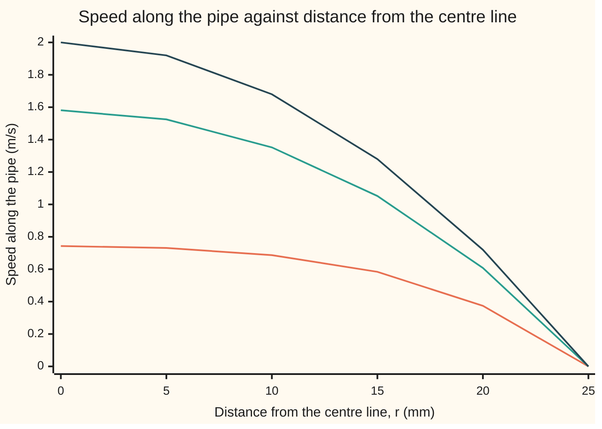
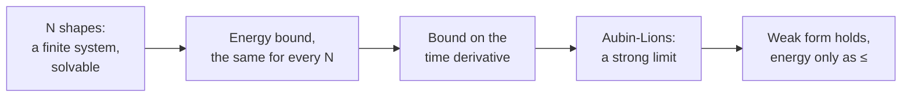

# Leray's weak solutions: they exist in three dimensions, but may not be unique

[Syllabus](../../../SYLLABUS.md) → [Partial differential equations](../README.md) → [Nonlinear PDE and Fluids](../README.md#s07) → Leray's weak solutions

---

## General Overview

Water flows through a straight pipe 5 cm across, at a mean speed of 1 m/s. In the smooth, layered (laminar) state, the water on the centre line moves at 2 m/s and the water at the wall does not move. A pressure drop of 12.8 Pa per metre of pipe pushes it along. This card rounds the water to a density of 1000 kg/m³ and a viscosity of 0.001 Pa s; [Navier-Stokes](01-navier-stokes-derivation.md) keeps more figures, so its numbers differ slightly.

The equations for this water are the Navier-Stokes equations from [Navier-Stokes](01-navier-stokes-derivation.md). The unknowns are the velocity at every point and the pressure. The region is the inside of the pipe. The data are the starting velocity, the pressure drop and the rule that water sticks to the wall.

In 1934 Leray asked a blunt question: for any starting flow with finite kinetic energy, do these equations have a solution for all time? Nobody could prove a smooth (classical) one exists. Leray proved that a weaker kind exists. A **weak solution** satisfies the equations only after they are multiplied by smooth test fields and added up over the pipe, as on [Weak solutions](../06-Weak%20Solutions%20and%20Free%20Boundaries/01-weak-solutions-and-the-weak-formulation.md).

Leray's theorem is a guarantee with four holes. In three dimensions it does not say the solution is unique, it does not say the solution is smooth, it gives energy as an inequality, not a balance, and it gives the pressure only as a rough function, not a smooth one. The holes are the point of this card.

For the pipe, every piece can be checked with numbers. The laminar profile passes the weak form against test bumps: both sides read 0.0062832 N/m. A water column started from rest is built from 1, 2, up to 5 shapes, and its centre speed at 180 s settles on 1.581022 m/s.

This card generalises a wing 08 result. [Separation of variables](../../08-Differential%20equations%20and%20dynamics/10-The%20Classical%20PDEs/04-separation-of-variables-for-the-heat-equation.md) solved the heat equation as a sum of decaying shapes. Start-up flow in a pipe is such a heat equation in the radius, with the Bessel shapes of [Drumheads](../05-Waves/08-membranes-and-bessel-modes.md). Leray's method keeps the idea of a finite list of shapes and adds the nonlinear term.

**For any starting flow with finite kinetic energy, the Navier-Stokes equations in two or three dimensions have at least one weak solution for all time, whose energy never rises above what it started with plus the work done on it; in three dimensions, nobody has proved this solution unique or smooth.**

**What kind of fact this is:** a theorem, proved by Leray in 1934 for all of space and by Hopf in 1951 for a bounded region. This card gives the statement, the key steps of the proof, and a numerical check of each step. The full proof is in the sources. Uniqueness and smoothness of these solutions in three dimensions, with no outside force, are open as of 2026-11-15. With a specially built outside force, two different solutions from one start were proved to exist in 2022.

### The picture: water in the pipe starting from rest



Orange: 60 s after the pressure drop is switched on. Teal: at 180 s. Dark blue: the steady laminar profile, a parabola with 2 m/s on the centre line. At 600 s the centre is at 1.991 m/s, almost steady. Both checks print every point.

The flow is laminar in this picture because the card uses the laminar solution. A real 5 cm pipe at 1 m/s runs at a Reynolds number of about 50,000 (inertia against friction, defined on [Navier-Stokes](01-navier-stokes-derivation.md)). That is far above the range where pipe flow stays laminar, so real water there is turbulent. The laminar profile is still an exact solution of the equations, which is all the checks need.

---

## The formula

Notation from [Navier-Stokes](01-navier-stokes-derivation.md), one line each. $`\mathbf{u}`$ is the velocity (m/s), $`p`$ the pressure (Pa), $`\rho`$ the density, $`\mu`$ the viscosity and $`\nu = \mu/\rho`$ the kinematic viscosity. $`\Omega`$ is the region, here a stretch of pipe that repeats along its length, and $`\partial\Omega`$ is its wall.

The equations, with no slip at the wall:

```math
\rho\Big(\frac{\partial \mathbf{u}}{\partial t} + (\mathbf{u}\cdot\nabla)\mathbf{u}\Big) = -\nabla p + \mu\,\Delta\mathbf{u} + \mathbf{f}, \qquad \nabla\cdot\mathbf{u} = 0, \qquad \mathbf{u} = 0 \ \text{on } \partial\Omega .
```

Here $`\mathbf{f}`$ is an outside force per unit volume. In the repeating pipe, the steady pressure drop $`G`$ acts as this force, $`\mathbf{f} = G\,\mathbf{e}_z`$, where $`\mathbf{e}_z`$ points along the pipe.

A **test field** $`\mathbf{v}`$ is a smooth velocity field that is zero on the wall and has $`\nabla\cdot\mathbf{v} = 0`$ (divergence-free: no water is made or lost anywhere). The **weak form** asks that, for every test field and every time,

```math
\rho\,\frac{d}{dt}\int_\Omega \mathbf{u}\cdot\mathbf{v}\,dx \;+\; \mu\int_\Omega \nabla\mathbf{u}:\nabla\mathbf{v}\,dx \;+\; \rho\, b(\mathbf{u},\mathbf{u},\mathbf{v}) \;=\; \int_\Omega \mathbf{f}\cdot\mathbf{v}\,dx .
```

**Read it aloud:** the rate of change of the flow measured against the test field, plus the friction between the two, plus the carrying term, equals the work rate of the push against the test field.

The two new pieces are the friction product and the carrying term:

```math
\nabla\mathbf{u}:\nabla\mathbf{v} = \sum_{i,j} \frac{\partial u_i}{\partial x_j}\frac{\partial v_i}{\partial x_j}, \qquad b(\mathbf{u},\mathbf{w},\mathbf{v}) = \int_\Omega \big((\mathbf{u}\cdot\nabla)\mathbf{w}\big)\cdot\mathbf{v}\,dx .
```

The pressure has gone. Step 1 shows why.

A **Leray-Hopf weak solution** satisfies the weak form and the **energy inequality**:

```math
\tfrac12\rho\,\lVert\mathbf{u}(t)\rVert^2 + \mu\int_0^t \lVert\nabla\mathbf{u}\rVert^2\,d\tau \;\le\; \tfrac12\rho\,\lVert\mathbf{u}_0\rVert^2 + \int_0^t\!\!\int_\Omega \mathbf{f}\cdot\mathbf{u}\,dx\,d\tau .
```

**Read it aloud:** kinetic energy now, plus all the energy friction has turned to heat, is at most the starting energy plus the work the push has done.

Here $`\tau`$ runs over the past times from 0 to $`t`$, and $`\lVert\mathbf{u}\rVert^2 = \int_\Omega \lvert\mathbf{u}\rvert^2 dx`$, so $`\tfrac12\rho\lVert\mathbf{u}\rVert^2`$ is the kinetic energy.

**Leray's theorem.** Let $`\Omega`$ be all of space, a repeating box, or a bounded region with a reasonable wall, in $`d`$ = 2 or 3 dimensions. Let the start $`\mathbf{u}_0`$ be divergence-free with finite kinetic energy, and let the force be bounded in the sense of the sources. Then, for every end time $`T`$, at least one Leray-Hopf weak solution exists on $`0 \le t \le T`$.

| Symbol | Plain meaning | In our example | Push it up and the answer… |
| --- | --- | --- | --- |
| $`\mathbf{u}`$; $`\mathbf{u}_0`$; $`w(r)`$ | velocity of the water, m/s; its value at the start; its speed along the pipe | laminar: 2 m/s on the centre line, 0 at the wall; start: at rest | — |
| $`\mathbf{v}`$; $`\varphi`$; $`c`$, $`h`$ | test field: smooth, divergence-free, zero on the wall; its profile across the pipe; the profile's centre and half-width | bump A: $`c`$ = 0, $`h`$ = 25 mm; bump B: 15 mm, 8 mm | — |
| $`p`$; $`G`$; $`\mathbf{f}`$, $`\mathbf{e}_z`$ | pressure, Pa; its steady drop per metre of pipe; outside force per volume, N/m³, and the unit arrow along the pipe | $`G`$ = 12.8000 Pa/m; $`\mathbf{f} = G\,\mathbf{e}_z`$ | the water speeds up in proportion |
| $`\rho`$; $`\mu`$; $`\nu`$; Re | density; viscosity; $`\mu/\rho`$; Reynolds number | 1000 kg/m³; 0.001 Pa s; 1.0e-6 m²/s (water near 20 °C, rounded); 50,000 | larger $`\mu`$: same $`G`$ gives slower flow |
| $`U`$; $`U_{\max}`$ | mean speed; centre-line speed | 1 m/s; 2 m/s | $`G`$ rises in proportion |
| $`R`$; $`r`$, $`z`$; $`s`$ | pipe radius; distance from centre line, distance along pipe; $`r/R`$ (in Step 4: position across the diameter, 0 to 1) | 25 mm | — |
| $`\Omega`$, $`\partial\Omega`$; $`d`$ | inside of the pipe, its wall; number of space dimensions | a repeating stretch of pipe; $`d`$ = 3 | — |
| $`b(\mathbf{u},\mathbf{w},\mathbf{v})`$; $`\nabla\mathbf{u}:\nabla\mathbf{v}`$ | carrying term: how $`\mathbf{u}`$ carries a field $`\mathbf{w}`$, measured against $`\mathbf{v}`$; friction product | $`b`$ = 0 for straight pipe flow | — |
| $`\lVert\mathbf{u}\rVert`$, $`\lVert\nabla\mathbf{u}\rVert`$; $`H`$, $`V`$ | root of the integral of the square: size of the flow, size of its shearing; divergence-free fields with finite energy, and those that also have finite shearing and are zero on the wall; $`L^\infty(0, T; H)`$, $`L^2(0, T; V)`$: flows whose energy stays bounded, flows whose shearing squared has a finite time integral | — | — |
| $`t`$; $`T`$; $`\tau`$ | time, s; end time; a past time, inside a time integral | 60 s, 180 s, 600 s | — |
| $`N`$, $`k`$; $`J_0`$, $`J_1`$, $`\lambda_k`$ | number of shapes in a Galerkin approximation; which shape (0 to $`N-1`$), also which zero of $`J_0`$; Bessel functions and the zeros of $`J_0`$ | 1 to 5; 2.404826, 5.520078, … | the approximation settles |
| $`u_n`$, $`n`$; $`C`$ | a wiggle with $`n`$ half-waves; a fixed constant | 1 to 125 half-waves | the wiggle averages nearer to 0 |

### When it holds

- **Test fields are divergence-free.** Then the pressure term drops out. With a test field that leaks, the pressure term for a pressure $`\cos x`$ on the scaled box of Step 2 reads 9.869604 instead of 0, and the pressure has to be found as well.
- **Test fields are zero on the wall.** Then the wall's grip is an edge term that drops out. Test with $`\mathbf{v} = \mathbf{e}_z`$ everywhere and the friction side reads 0 while the push side reads 0.0251327 N/m: that is the wall drag, which the weak form cannot see.
- **The starting flow has finite kinetic energy.** The whole proof runs on the energy bound. A start with infinite energy, such as a point vortex, gives the bound nothing to hold.
- **The fluid is incompressible with constant viscosity.** Water at pipe speeds fits. Gases at high speed, and paints or blood whose viscosity changes with shearing, need other equations.
- **Two or three dimensions.** In two dimensions the same weak solution is unique and smooth. In three, existence is all that is proved.

---

## Why it works

### Step 0: the idea

Leray could not solve the equations directly. So he solved simpler problems whose solutions exist for sure, and took a limit.

The plan has four parts:

1. **Approximate.** Keep only $`N`$ shapes for the flow. The equations become a finite system of ordinary differential equations, which has a solution.
2. **Bound.** Show the kinetic energy of every approximation stays below the same number, whatever $`N`$ is.
3. **Extract a limit.** Bounded sequences have subsequences with limits, but only in a weak sense, in the time-dependent spaces of [Bochner spaces and the weak heat equation](../06-Weak%20Solutions%20and%20Free%20Boundaries/10-bochner-spaces-and-weak-solutions-of-the-heat-equation.md). Upgrade to a strong limit with the Aubin-Lions lemma.
4. **Check the limit.** Show the limit satisfies the weak form and the energy inequality.

Uniqueness never enters. Two different subsequences could have two different limits, and nothing in the plan rules that out.



### Step 1: the weak form, and why the pressure drops out

Take the equation, dot it with a test field $`\mathbf{v}`$, and integrate over the pipe. Integration by parts moves one derivative of $`\Delta\mathbf{u}`$ onto $`\mathbf{v}`$, as on [Weak solutions](../06-Weak%20Solutions%20and%20Free%20Boundaries/01-weak-solutions-and-the-weak-formulation.md). The edge term vanishes because $`\mathbf{v}`$ is zero on the wall.

The pressure term goes the same way:

```math
\int_\Omega \nabla p\cdot\mathbf{v}\,dx = -\int_\Omega p\,(\nabla\cdot\mathbf{v})\,dx = 0 .
```

**Read it aloud:** pressure does no work on a flow that neither makes nor loses water.

So the weak form needs one derivative of $`\mathbf{u}`$ and no pressure at all. The pressure is recovered afterwards, and at first it is known only through its averages against test functions; Step 6 says how much more is known.

**The pipe, checked.** The laminar profile $`w(r) = 2\,(1 - r^2/R^2)`$ m/s is steady, and its carrying term is zero: each bit of water moves straight along the pipe at constant speed. The weak form shrinks to friction against push. Take test fields along the pipe, $`\mathbf{v} = \varphi(r)\,\mathbf{e}_z`$, with $`\varphi(r) = (1 - ((r - c)/h)^2)^3`$ on $`\lvert r - c\rvert < h`$ and zero outside. These are divergence-free, because they do not change along the pipe. They are twice continuously differentiable, not infinitely smooth: the third slope jumps at a bump's edge. That is enough, because the weak form puts one derivative on the test field and the very weak form two.

| Test bump | Centre $`c`$, half-width $`h`$ | Friction side | Push side | Two derivatives on $`\varphi`$ |
| --- | --- | --- | --- | --- |
| A, on the axis | 0 mm, 25 mm | 0.0062832 N/m | 0.0062832 N/m | 0.0062832 N/m |
| B, a ring | 15 mm, 8 mm | 0.0088237 N/m | 0.0088237 N/m | 0.0088237 N/m |

The units are newtons per metre of pipe, because the test field is a pure shape and the integral runs over one cross-section. The last column moves both derivatives onto $`\varphi`$, the very weak form, as a third road.

### Step 2: the energy bound, because carrying does no work

Use the solution itself as the test field, $`\mathbf{v} = \mathbf{u}`$. The first term becomes the rate of change of kinetic energy. The friction term becomes $`\mu\lVert\nabla\mathbf{u}\rVert^2`$. The carrying term vanishes:

```math
b(\mathbf{u},\mathbf{u},\mathbf{u}) = \int_\Omega \mathbf{u}\cdot\nabla\Big(\tfrac12\lvert\mathbf{u}\rvert^2\Big)\,dx = -\tfrac12\int_\Omega (\nabla\cdot\mathbf{u})\,\lvert\mathbf{u}\rvert^2\,dx = 0 .
```

**Read it aloud:** the flow carrying itself around only moves energy from place to place; with no water made or lost, it creates or destroys none.

That leaves the energy balance:

```math
\frac{d}{dt}\Big(\tfrac12\rho\lVert\mathbf{u}\rVert^2\Big) + \mu\lVert\nabla\mathbf{u}\rVert^2 = \int_\Omega \mathbf{f}\cdot\mathbf{u}\,dx .
```

Integrate in time. The kinetic energy stays bounded for all time, and the total shearing $`\int_0^T \lVert\nabla\mathbf{u}\rVert^2 dt`$ is bounded. In the language of the sources, $`\mathbf{u}`$ lies in $`L^\infty(0, T; H) \cap L^2(0, T; V)`$: bounded energy at every time, and square-integrable shearing over time.

**Checked on a swirling cell.** Straight pipe flow has a zero carrying term, so it cannot test this step. The checks use a swirling flow in a repeating square box instead, in scaled units (side $`2\pi`$, speeds near 1). For a divergence-free swirl, $`b(\mathbf{u},\mathbf{u},\mathbf{u})`$ = 0.000000. Add a leaking part, $`0.5\,\nabla\cos x`$, and it becomes −3.701102, which equals $`-\tfrac12\int(\nabla\cdot\mathbf{u})\lvert\mathbf{u}\rvert^2`$ computed separately. The bound depends on the flow being divergence-free.

### Step 3: approximate with N shapes (Galerkin)

The approximation keeps $`N`$ fixed shapes and lets only their amounts change in time. Asking the weak form to hold for those $`N`$ shapes as test fields gives $`N`$ ordinary differential equations. This is the Faedo-Galerkin method, the time-dependent form of [Galerkin](../06-Weak%20Solutions%20and%20Free%20Boundaries/04-galerkin-and-finite-elements.md).

The energy argument of Step 2 works for every $`N`$, because the approximation is tested against itself. So the energy bound is the same for every $`N`$. That uniform bound is what makes a limit possible.

**The pipe, from rest.** Switch on the pressure drop with the water at rest. For straight flow the carrying term is zero, so this is the linear skeleton of Leray's construction. Use the shapes $`(1 - s^2)\,s^{2k}`$ for $`k = 0, \dots, N-1`$, with $`s = r/R`$. The exact answer comes from a separate road, a Bessel series:

```math
w(r, t) = 2\,(1 - s^2) - \sum_{k\ge1} \frac{16\,J_0(\lambda_k s)}{\lambda_k^3\,J_1(\lambda_k)}\,e^{-\lambda_k^2\,\nu t/R^2}\ \ \text{m/s}.
```

**Read it aloud:** the steady parabola, minus the start-up shortfall, built from Bessel shapes that die away at their own rates.

Here $`J_0`$ and $`J_1`$ are Bessel functions, the radial shapes of a drumhead, and $`\lambda_k`$ are the zeros of $`J_0`$. The slowest shortfall fades with time scale $`R^2/(\nu\lambda_1^2)`$ = 108.07 s. Ten terms are used; the first omitted term at the centre, at 180 s, is 6.20e-146 m/s.

| Shapes $`N`$ | Centre speed at 180 s | Gap from the series |
| --- | --- | --- |
| 1 | 1.644721 m/s | 0.063699 m/s |
| 2 | 1.584038 m/s | 0.003016 m/s |
| 3 | 1.581098 m/s | 0.000076 m/s |
| 4 | 1.581023 m/s | 0.000001 m/s |
| 5 | 1.581022 m/s | 0.000000 m/s |
| series | 1.581022 m/s | — |

The approximations settle on the true flow. For the pipe they settle fast, because the answer is smooth. Leray's proof needs no speed at all, only a limit.

### Step 4: the Aubin-Lions lemma, which carries the nonlinear term to the limit

A bound on energy gives only a **weak limit**: averages against each fixed test function converge. That is not enough for a product. A velocity can wiggle faster and faster, average out to zero against every test function, and still keep its square.

The checks show this with a wiggle $`u_n = \sin(n\pi s)`$ m/s across the diameter, where $`s`$ here runs from 0 at one wall to 1 at the other, against a bump $`\varphi(s) = 16\,s^2(1 - s)^2`$:

| Wiggles $`n`$ | $`\lvert\int u_n\varphi\,ds\rvert`$, m/s | $`\int u_n^2\varphi\,ds`$, m²/s² | Slope size $`\lVert du_n/ds\rVert`$, m/s per diameter |
| --- | --- | --- | --- |
| 1 | 0.445544 | 0.389858 | 2.2214 |
| 5 | 0.015710 | 0.266864 | 11.1072 |
| 25 | 0.000132 | 0.266667 | 55.5360 |
| 125 | 0.000001 | 0.266667 | 277.6802 |

The wiggles tend weakly to zero, but their squares tend to 0.266667, not to zero. The carrying term is a product of this kind. If the approximations could wiggle like this, the limit would not satisfy the equations.

The last column shows what rules this out: the slope grows without bound. Leray's approximations have bounded shearing, by Step 2, so they cannot wiggle like this in space. They also cannot wiggle fast in time, because the equation itself bounds their rate of change.

**The Aubin-Lions lemma.** Suppose a sequence of flows $`\mathbf{u}_N`$ on $`0 \le t \le T`$ has:

1. bounded shearing: $`\int_0^T \lVert\nabla\mathbf{u}_N\rVert^2 dt`$ below a fixed number;
2. a bounded time derivative, measured in a weaker size (one that only sees averages against smooth test fields).

Then, on a bounded region, some subsequence converges **strongly**: $`\int_0^T \lVert\mathbf{u}_N - \mathbf{u}\rVert^2 dt \to 0`$. In all of space it converges strongly on every bounded piece, which is enough for the carrying term against each test field.

Why it works, in words. Bounded shearing stops fast wiggles in space. A bounded time derivative stops fast wiggles in time. With both ruled out, the flows lie in a compact set (one where every sequence has a convergent subsequence), so a strong limit exists. The space version of this fact is the Rellich-Kondrachov theorem; the lemma adds time.

For Navier-Stokes in three dimensions, condition 2 holds with the time derivative bounded in the power-$`4/3`$ integral, not the square. That exponent comes from bounding the carrying term with only the energy and shearing bounds.

Strong convergence of one factor and weak convergence of the other is enough for a product. So $`b(\mathbf{u}_N, \mathbf{u}_N, \mathbf{v}) \to b(\mathbf{u}, \mathbf{u}, \mathbf{v})`$ for each test field, and the limit satisfies the weak form.

### Step 5: what survives the limit, and what is lost

The weak form survives, as Step 4 showed. The energy balance does not survive as an equality. Aubin-Lions makes the kinetic energy converge, but the slopes converge only weakly. In a weak limit a size can drop but cannot rise, so the friction total of the limit, $`\mu\int_0^t\lVert\nabla\mathbf{u}\rVert^2 d\tau`$, can be smaller than the limit of the approximations' friction totals. So the balance of Step 2 becomes the inequality ≤.

The wiggles of Step 4 show how, one level up. Take a velocity whose slope is the wiggle: $`-\cos(n\pi s)/(n\pi)`$ m/s. It is never larger than $`1/(n\pi)`$ m/s, so it converges strongly to 0. Its slope still keeps $`\int (du/ds)^2\varphi\,ds`$ = 0.266667, while the limit has no slope at all. Energy may be lost in the limit, perhaps to features smaller than any approximation resolves.

<details>
<summary>Detailed steps: the uniqueness argument, and where it stops in three dimensions</summary>

Let $`\mathbf{u}_1`$ and $`\mathbf{u}_2`$ be two weak solutions from the same start, and let $`\mathbf{w} = \mathbf{u}_1 - \mathbf{u}_2`$ be their difference. Subtract the two weak forms, divide by $`\rho`$, and test with $`\mathbf{w}`$ (in three dimensions this needs more smoothness than a weak solution is known to have, which is already part of the problem). Step 2's cancellation removes one carrying term and leaves

$`\displaystyle \frac{d}{dt}\tfrac12\lVert\mathbf{w}\rVert^2 + \nu\lVert\nabla\mathbf{w}\rVert^2 = -\,b(\mathbf{w},\mathbf{u}_2,\mathbf{w}) .`$

The right side is at most $`\lVert\nabla\mathbf{u}_2\rVert`$ times the square of the power-4 size of $`\mathbf{w}`$. In two dimensions that square is at most a constant times $`\lVert\mathbf{w}\rVert\,\lVert\nabla\mathbf{w}\rVert`$ (Ladyzhenskaya's inequality). Half of it is absorbed by the friction term and the rest gives

$`\displaystyle \frac{d}{dt}\lVert\mathbf{w}\rVert^2 \le C\,\lVert\nabla\mathbf{u}_2\rVert^2\,\lVert\mathbf{w}\rVert^2 ,`$

with $`\int\lVert\nabla\mathbf{u}_2\rVert^2dt`$ finite by the energy bound. Grönwall's inequality (a quantity that starts at 0 and grows at most in proportion to itself stays 0) then gives $`\lVert\mathbf{w}\rVert = 0`$ for all time: the solutions agree.

In three dimensions the square is at most a constant times $`\lVert\mathbf{w}\rVert^{1/2}\lVert\nabla\mathbf{w}\rVert^{3/2}`$. Absorbing the gradient now leaves $`\lVert\nabla\mathbf{u}_2\rVert^4`$, whose time integral the energy bound does not control. The argument stops. If one solution is known to be smoother, for example with $`\int\lVert\nabla\mathbf{u}_2\rVert^4dt`$ finite, it closes: every Leray-Hopf solution equals that smooth one while it lasts (weak-strong uniqueness).

</details>

### Step 6: exactly what the theorem fails to give

| Leray's theorem gives | It does not give, in three dimensions |
| --- | --- |
| a weak solution for all time | that it is the only one |
| bounded energy and total shearing | that the velocity stays bounded, or smooth |
| energy as an inequality | energy as an exact balance |
| velocity that changes continuously in the weak sense | a smooth pressure; the pressure is known only in a weak, integrable class (in all of space or a repeating box, its power-5/3 integral over space and time is finite) |

In two dimensions the same weak solution is unique and, for smooth data, smooth. The energy estimate behind this closes in two dimensions and not in three; the measurement of that gap is on [The energy inequality, and the gap it leaves in three dimensions](03-energy-inequality-and-the-regularity-question.md).

Whether smooth solutions in three dimensions last forever is one of the Clay Millennium Problems. Its statement is on [Navier-Stokes](../../25-Frontier/02-The%20Millennium%20Problems/04-navier-stokes-existence-and-smoothness.md), in wing 25. A 2026 claim of forced blow-up (a smooth flow, driven by a specially built outside force, becoming infinite in finite time) is on [The September 2026 Navier-Stokes claim](../../25-Frontier/05-Analysis%20and%20Dynamics/01-navier-stokes-blow-up-claim-2026.md). This card judges neither.

---

## Worked numbers, by hand

The pipe: radius $`R`$ = 0.025 m, mean speed 1 m/s, water rounded to $`\mu`$ = 0.001 Pa s and $`\rho`$ = 1000 kg/m³. Bump A is $`\varphi = (1 - s^2)^3`$, centred on the axis and reaching the wall.

| Step | Arithmetic | Value |
| --- | --- | --- |
| Reynolds number | 1 × 0.05 ÷ 0.000001 | 50,000 |
| centre speed, laminar | 2 × mean speed | 2 m/s |
| pressure drop, $`G = 4\mu U_{\max}/R^2`$ | 4 × 0.001 × 2 ÷ 0.000625 | 12.8000 Pa/m |
| wall stress, $`2\mu U_{\max}/R`$ | 2 × 0.001 × 2 ÷ 0.025 | 0.1600 Pa |
| wall drag per metre | 0.16 × 2π × 0.025 | 0.0251327 N/m |
| push on the whole cross-section | 12.8 × π × 0.000625 | 0.0251327 N/m |
| friction side for bump A, $`\pi\mu U_{\max}`$ | π × 0.001 × 2 | 0.0062832 N/m |
| push side for bump A, $`G\pi R^2/4`$ | 12.8 × π × 0.000625 ÷ 4 | **0.0062832 N/m** |

The two sides of the weak form agree, so the laminar profile is a weak solution against bump A. The push on the whole cross-section balances the wall drag, 0.0251327 N/m each. That balance is invisible to the weak form, because its test fields are zero at the wall.

The friction side comes from one integral: $`\int_0^1 s^3(1 - s^2)^2\,ds = 1/24`$, so $`\mu \cdot 2U_{\max} \cdot 6 \cdot 2\pi/24 = \pi\mu U_{\max}`$. The push side uses $`\int_0^1 s\,(1 - s^2)^3\,ds = 1/8`$.

### What breaks if you drop a piece

| Mistake | Comes out at | What went wrong |
| --- | --- | --- |
| Test with $`\mathbf{v} = \mathbf{e}_z`$, not zero on the wall | friction 0, push 0.0251327 N/m | The wall drag is an edge term; test fields must vanish at the wall. |
| Use a test field that leaks | pressure term 9.869604, not 0 (scaled box) | The pressure only drops out against divergence-free fields. |
| Put the mean speed into $`4\mu U/R^2`$ | $`G`$ = 6.4000 Pa/m; bump A 0.0062832 against 0.0031416 N/m | That formula needs the centre speed; with the mean it is $`8\mu U/R^2`$. |
| Let the flow leak in the energy step | $`b(\mathbf{u},\mathbf{u},\mathbf{u})`$ = −3.701102, not 0 | The carrying term only does no work on a divergence-free flow. |
| Pass a square through a weak limit | wiggles: 0.266667, limit: 0 | Weak limits do not commute with products; Aubin-Lions is needed. |
| Stop at one Galerkin shape | 1.644721 m/s at 180 s, not 1.581022 | One shape is an approximation; the theorem is about the limit. |

---

## Code, from first principles, and it actually runs

The code checks each step on its own numbers, by separate roads. For the pipe, the weak form is computed three ways: the friction side, the push side, and the very weak form with both derivatives on the test bump, each by Simpson's rule, with a closed form for bump A. On a swirling box, the carrying term is summed on a grid and set against the identity $`-\tfrac12\int(\nabla\cdot\mathbf{u})\lvert\mathbf{u}\rvert^2`$ and against the exact value $`-3\pi^2/8`$. The wiggles show weak but not strong convergence. Start-up flow is solved by Galerkin with 1 to 5 shapes against a Bessel series whose Bessel functions and zeros are built from an integral and bisection.

### Python

```python
# Leray's weak solutions -- the check behind the card. Standard library only.
# Water at 1 m/s mean speed in a 5 cm pipe, written against test functions.
import math

R, U, nu, rho = 0.025, 1.0, 1.0e-6, 1000.0  # radius m, mean speed m/s, m^2/s, kg/m^3
mu, Umax = rho * nu, 2 * U                   # viscosity Pa s; laminar centre speed m/s
G = 4 * mu * Umax / R**2                     # pressure drop per metre, Pa/m
g = G / rho                                  # the same drop per unit mass, m/s^2
print(f"pipe: R = {R*1000:.1f} mm, mean {U:.1f} m/s, centre {Umax:.1f} m/s, Re = {U*2*R/nu:.0f}")
print(f"pressure drop G = {G:.4f} Pa/m, wall stress {2*mu*Umax/R:.4f} Pa")

def simpson(f, a, b, n=4000):
    h = (b - a) / n
    return h / 3 * (f(a) + f(b) + sum((4 if i % 2 else 2) * f(a + i * h) for i in range(1, n)))

def bump(c, h):  # test profile (1 - ((r-c)/h)^2)^3, with its first and second slopes
    def q(r): return (r - c) / h if abs(r - c) < h else 1.0
    f = lambda r: (1 - q(r)**2)**3
    df = lambda r: -6 * q(r) * (1 - q(r)**2)**2 / h
    d2 = lambda r: (-6 * (1 - q(r)**2)**2 + 24 * q(r)**2 * (1 - q(r)**2)) / h**2
    return f, df, d2

w = lambda r, Um=Umax: Um * (1 - (r / R)**2)
dw = lambda r, Um=Umax: -2 * Um * r / R**2
def sides(c, h, GG=G):  # road 1: viscous side; road 2: pressure side; road 3: very weak form
    f, df, d2 = bump(c, h)
    lo, hi = max(0.0, c - h), min(R, c + h)
    a = simpson(lambda r: mu * dw(r) * df(r) * 2 * math.pi * r, lo, hi)
    l = simpson(lambda r: GG * f(r) * 2 * math.pi * r, lo, hi)
    lap = lambda r: d2(r) + (df(r) / r if r > 0 else d2(r))
    vw = simpson(lambda r: -mu * w(r) * lap(r) * 2 * math.pi * r, lo, hi)
    return a, l, vw

for name, c, h in [("A, on the axis", 0.0, R), ("B, a ring", 0.015, 0.008)]:
    a, l, vw = sides(c, h)
    print(f"bump {name}: viscous {a:.7f} N/m, pressure {l:.7f} N/m, very weak {vw:.7f} N/m")
    assert abs(a - l) < 1e-9 and abs(vw - l) < 1e-9
assert abs(sides(0.0, R)[1] - G * math.pi * R**2 / 4) < 1e-12  # closed form for bump A
drag = -mu * (w(R + 1e-6) - w(R - 1e-6)) / 2e-6 * 2 * math.pi * R   # wall stress from the profile's slope
print(f"mistake v = 1: viscous 0.0000000 N/m, pressure {G*math.pi*R**2:.7f} N/m = wall drag {drag:.7f} N/m")
assert abs(G * math.pi * R**2 - drag) < 1e-12
a, l, _ = sides(0.0, R, 4 * mu * U / R**2)
print(f"mistake mean speed in 4 mu U/R^2: G = {4*mu*U/R**2:.4f} Pa/m, bump A {a:.7f} vs {l:.7f} N/m")

# The nonlinear term on a swirling cell, scaled: periodic box of side 2 pi.
def ev(f, x, y): return sum(A * math.sin(kx * x + ky * y + p) for A, kx, ky, p in f)
def d(f, ax): return [(A * (kx, ky)[ax], kx, ky, p + math.pi / 2) for A, kx, ky, p in f]
u1 = [(0.5, 1, 1, 0.0), (0.5, 1, -1, 0.0), (-0.5, 2, 1, 0.0)]   # from psi = sin x sin y + cos(2x+y)/2
u2 = [(-0.5, 1, 1, 0.0), (0.5, 1, -1, 0.0), (1.0, 2, 1, 0.0)]
chi = [(1.0, 1, 0, math.pi / 2)]                                 # cos x: a leaking gradient part
b1, b2 = u1 + [(0.5 * A, k, l_, p) for A, k, l_, p in d(chi, 0)], u2 + [(0.5 * A, k, l_, p) for A, k, l_, p in d(chi, 1)]
n, hb = 32, 2 * math.pi / 32
def box(fun): return sum(fun(i * hb, j * hb) for i in range(n) for j in range(n)) * hb * hb
def bform(a1, a2):
    ds = [d(a1, 0), d(a1, 1), d(a2, 0), d(a2, 1)]
    def f(x, y):
        v1, v2 = ev(a1, x, y), ev(a2, x, y)
        g_ = [ev(t, x, y) for t in ds]
        return v1 * (v1 * g_[0] + v2 * g_[1]) + v2 * (v1 * g_[2] + v2 * g_[3])
    return box(f)
def divsq(a1, a2): return lambda x, y: ev(d(a1, 0), x, y) + ev(d(a2, 1), x, y)
def half_div(a1, a2): return box(lambda x, y: -0.5 * divsq(a1, a2)(x, y) * (ev(a1, x, y)**2 + ev(a2, x, y)**2))
def press(a1, a2): return box(lambda x, y: ev(d(chi, 0), x, y) * ev(a1, x, y) + ev(d(chi, 1), x, y) * ev(a2, x, y))
bu, bb, hdb = bform(u1, u2), bform(b1, b2), half_div(b1, b2)
print(f"box: b(u,u,u) divergence-free {abs(bu):.6f}; leaking {bb:.6f}, by -1/2 int (div u)|u|^2 {hdb:.6f}")
assert abs(bu) < 1e-12 and abs(bb - hdb) < 1e-10 and abs(bb + 3 * math.pi**2 / 8) < 1e-10
pu, pb = press(u1, u2), press(b1, b2)
print(f"box: pressure term divergence-free {abs(pu):.6f}; leaking {pb:.6f} (pi^2 = {math.pi**2:.6f})")
assert abs(pu) < 1e-12 and abs(pb - math.pi**2) < 1e-10

# Weak is not strong: a wiggle across the diameter, s from 0 to 1, size 1 m/s.
phi = lambda s: 16 * s * s * (1 - s)**2
for k in (1, 5, 25, 125):
    lin = simpson(lambda s: math.sin(k * math.pi * s) * phi(s), 0, 1)
    sq = simpson(lambda s: math.sin(k * math.pi * s)**2 * phi(s), 0, 1)
    slope = math.sqrt(simpson(lambda s: (k * math.pi * math.cos(k * math.pi * s))**2, 0, 1))
    print(f"wiggle n = {k:3d}: |int u phi| {abs(lin):.6f}, int u^2 phi {sq:.6f}, slope size {slope:.4f} m/s per diameter")
assert abs(lin) < 1e-4 and abs(sq - 4 / 15) < 1e-4 and abs(slope - 125 * math.pi / math.sqrt(2)) < 1e-6

# Start-up flow: Bessel series against Galerkin with N profiles (1 - s^2) s^(2k).
def J(m, x, M=400): return sum(math.cos(m * (i + .5) * math.pi / M - x * math.sin((i + .5) * math.pi / M)) for i in range(M)) / M
def zero(k):
    a, b = (k - 0.25) * math.pi - 0.5, (k - 0.25) * math.pi + 0.5
    for _ in range(60):
        m = (a + b) / 2
        a, b = (a, m) if J(0, a) * J(0, m) <= 0 else (m, b)
    return (a + b) / 2
lam = [zero(k) for k in range(1, 12)]
def term(k, s, t): return 8 * Umax * J(0, lam[k] * s) / (lam[k]**3 * J(1, lam[k])) * math.exp(-lam[k]**2 * nu * t / R**2)
def series(s, t): return w(s * R) - sum(term(k, s, t) for k in range(10))
print(f"Bessel zeros {lam[0]:.6f}, {lam[1]:.6f}; slowest time R^2/(nu z1^2) = {R*R/nu/lam[0]**2:.2f} s")
def galerkin(N, t, steps=3000):
    M = [[1/(2*(j+k)+2) - 2/(2*(j+k)+4) + 1/(2*(j+k)+6) for k in range(N)] for j in range(N)]
    K = [[(4*j*k/(2*(j+k)) if j*k else 0) - (2*j*(2*k+2) + (2*j+2)*2*k)/(2*(j+k)+2)
          + (2*j+2)*(2*k+2)/(2*(j+k)+4) for k in range(N)] for j in range(N)]
    F = [1/(2*j+2) - 1/(2*j+4) for j in range(N)]
    dt, a, c = t / steps, nu / R**2, [0.0] * N
    for _ in range(steps):  # Crank-Nicolson in time, Gaussian elimination
        A = [[M[i][k] + dt*a/2*K[i][k] for k in range(N)] + [sum((M[i][k] - dt*a/2*K[i][k]) * c[k]
             for k in range(N)) + dt*g*F[i]] for i in range(N)]
        for p in range(N):
            for q in range(p + 1, N):
                f = A[q][p] / A[p][p]
                A[q] = [A[q][r] - f * A[p][r] for r in range(N + 1)]
        for p in reversed(range(N)):
            c[p] = (A[p][N] - sum(A[p][r] * c[r] for r in range(p + 1, N))) / A[p][p]
    return c[0]
ex = series(0, 180)
print(f"centre at 180 s: series {ex:.6f} m/s, first omitted term {abs(term(10, 0, 180)):.2e}")
gal = [galerkin(N, 180) for N in range(1, 6)]
for N, v in enumerate(gal, 1): print(f"  Galerkin N = {N}: {v:.6f} m/s, gap {abs(v-ex):.6f}")
assert abs(gal[-1] - ex) < 1e-6 and abs(gal[0] - ex) > 0.05
assert abs(g * 60 - series(0, 60)) < 0.03   # early on, the centre speeds up at G / rho
for t in (60, 180, 600):
    print(f"chart t = {t:3d} s:", " ".join(f"{series(r/R, t):.3f}" for r in (0, .005, .01, .015, .02, .025)))
print("chart steady:  ", " ".join(f"{w(r):.3f}" for r in (0, .005, .01, .015, .02, .025)))
print("ALL CHECKS PASS")
```

**Ran 2026-11-15 on macOS, Python 3.14.10, standard library only. All checks passed. Output, pasted from the run:**

```
pipe: R = 25.0 mm, mean 1.0 m/s, centre 2.0 m/s, Re = 50000
pressure drop G = 12.8000 Pa/m, wall stress 0.1600 Pa
bump A, on the axis: viscous 0.0062832 N/m, pressure 0.0062832 N/m, very weak 0.0062832 N/m
bump B, a ring: viscous 0.0088237 N/m, pressure 0.0088237 N/m, very weak 0.0088237 N/m
mistake v = 1: viscous 0.0000000 N/m, pressure 0.0251327 N/m = wall drag 0.0251327 N/m
mistake mean speed in 4 mu U/R^2: G = 6.4000 Pa/m, bump A 0.0062832 vs 0.0031416 N/m
box: b(u,u,u) divergence-free 0.000000; leaking -3.701102, by -1/2 int (div u)|u|^2 -3.701102
box: pressure term divergence-free 0.000000; leaking 9.869604 (pi^2 = 9.869604)
wiggle n =   1: |int u phi| 0.445544, int u^2 phi 0.389858, slope size 2.2214 m/s per diameter
wiggle n =   5: |int u phi| 0.015710, int u^2 phi 0.266864, slope size 11.1072 m/s per diameter
wiggle n =  25: |int u phi| 0.000132, int u^2 phi 0.266667, slope size 55.5360 m/s per diameter
wiggle n = 125: |int u phi| 0.000001, int u^2 phi 0.266667, slope size 277.6802 m/s per diameter
Bessel zeros 2.404826, 5.520078; slowest time R^2/(nu z1^2) = 108.07 s
centre at 180 s: series 1.581022 m/s, first omitted term 6.20e-146
  Galerkin N = 1: 1.644721 m/s, gap 0.063699
  Galerkin N = 2: 1.584038 m/s, gap 0.003016
  Galerkin N = 3: 1.581098 m/s, gap 0.000076
  Galerkin N = 4: 1.581023 m/s, gap 0.000001
  Galerkin N = 5: 1.581022 m/s, gap 0.000000
chart t =  60 s: 0.743 0.731 0.687 0.584 0.374 0.000
chart t = 180 s: 1.581 1.525 1.352 1.052 0.608 0.000
chart t = 600 s: 1.991 1.912 1.673 1.275 0.718 0.000
chart steady:   2.000 1.920 1.680 1.280 0.720 0.000
ALL CHECKS PASS
```

### Rust

```rust
// Leray's weak solutions -- the check behind the card. Rust std only, no crates.
// Water at 1 m/s mean speed in a 5 cm pipe, written against test functions.
use std::f64::consts::PI;

const R: f64 = 0.025; // radius, m
const U: f64 = 1.0; // mean speed, m/s
const NU: f64 = 1.0e-6; // kinematic viscosity, m^2/s
const RHO: f64 = 1000.0; // density, kg/m^3
const MU: f64 = RHO * NU; // viscosity, Pa s
const UMAX: f64 = 2.0 * U; // laminar centre speed, m/s

fn simpson(f: &dyn Fn(f64) -> f64, a: f64, b: f64) -> f64 {
    let (n, h) = (4000, (b - a) / 4000.0);
    h / 3.0 * (f(a) + f(b) + (1..n).map(|i| if i % 2 == 1 { 4.0 } else { 2.0 } * f(a + i as f64 * h)).sum::<f64>())
}
fn w(r: f64) -> f64 { UMAX * (1.0 - (r / R).powi(2)) }
fn dw(r: f64) -> f64 { -2.0 * UMAX * r / (R * R) }

// test profile (1 - ((r-c)/h)^2)^3 and its first and second slopes
fn bump(c: f64, h: f64, r: f64) -> (f64, f64, f64) {
    let q = if (r - c).abs() < h { (r - c) / h } else { 1.0 };
    let o = 1.0 - q * q;
    (o.powi(3), -6.0 * q * o * o / h, (-6.0 * o * o + 24.0 * q * q * o) / (h * h))
}
// road 1: viscous side; road 2: pressure side; road 3: very weak form
fn sides(c: f64, h: f64, gg: f64) -> (f64, f64, f64) {
    let (lo, hi) = ((c - h).max(0.0), (c + h).min(R));
    let a = simpson(&|r| MU * dw(r) * bump(c, h, r).1 * 2.0 * PI * r, lo, hi);
    let l = simpson(&|r| gg * bump(c, h, r).0 * 2.0 * PI * r, lo, hi);
    let lap = |r: f64| { let (_, d1, d2) = bump(c, h, r); d2 + if r > 0.0 { d1 / r } else { d2 } };
    let vw = simpson(&|r| -MU * w(r) * lap(r) * 2.0 * PI * r, lo, hi);
    (a, l, vw)
}

// trigonometric fields on the box: terms A sin(kx x + ky y + p)
type Field = Vec<(f64, f64, f64, f64)>;
fn ev(f: &Field, x: f64, y: f64) -> f64 { f.iter().map(|&(a, kx, ky, p)| a * (kx * x + ky * y + p).sin()).sum() }
fn d(f: &Field, ax: usize) -> Field {
    f.iter().map(|&(a, kx, ky, p)| (a * if ax == 0 { kx } else { ky }, kx, ky, p + PI / 2.0)).collect()
}
fn boxsum(fun: &dyn Fn(f64, f64) -> f64) -> f64 {
    let hb = 2.0 * PI / 32.0;
    (0..32).map(|i| (0..32).map(|j| fun(i as f64 * hb, j as f64 * hb)).sum::<f64>()).sum::<f64>() * hb * hb
}
fn bform(a1: &Field, a2: &Field) -> f64 {
    let ds = [d(a1, 0), d(a1, 1), d(a2, 0), d(a2, 1)];
    boxsum(&|x, y| {
        let (v1, v2) = (ev(a1, x, y), ev(a2, x, y));
        let g: Vec<f64> = ds.iter().map(|t| ev(t, x, y)).collect();
        v1 * (v1 * g[0] + v2 * g[1]) + v2 * (v1 * g[2] + v2 * g[3])
    })
}
fn half_div(a1: &Field, a2: &Field) -> f64 {
    let (d1, d2) = (d(a1, 0), d(a2, 1));
    boxsum(&|x, y| -0.5 * (ev(&d1, x, y) + ev(&d2, x, y)) * (ev(a1, x, y).powi(2) + ev(a2, x, y).powi(2)))
}
fn press(a1: &Field, a2: &Field, chi: &Field) -> f64 {
    let (cx, cy) = (d(chi, 0), d(chi, 1));
    boxsum(&|x, y| ev(&cx, x, y) * ev(a1, x, y) + ev(&cy, x, y) * ev(a2, x, y))
}

fn bj(m: f64, x: f64) -> f64 {
    (0..400).map(|i| { let th = (i as f64 + 0.5) * PI / 400.0; (m * th - x * th.sin()).cos() }).sum::<f64>() / 400.0
}
fn zero(k: usize) -> f64 {
    let (mut a, mut b) = ((k as f64 - 0.25) * PI - 0.5, (k as f64 - 0.25) * PI + 0.5);
    for _ in 0..60 {
        let m = (a + b) / 2.0;
        if bj(0.0, a) * bj(0.0, m) <= 0.0 { b = m } else { a = m }
    }
    (a + b) / 2.0
}
fn term(lam: &[f64], k: usize, s: f64, t: f64) -> f64 {
    8.0 * UMAX * bj(0.0, lam[k] * s) / (lam[k].powi(3) * bj(1.0, lam[k])) * (-lam[k] * lam[k] * NU * t / (R * R)).exp()
}
fn series(lam: &[f64], s: f64, t: f64) -> f64 { w(s * R) - (0..10).map(|k| term(lam, k, s, t)).sum::<f64>() }
fn galerkin(n: usize, t: f64, g: f64) -> f64 {
    let steps = 3000;
    let fm = |j: usize, k: usize| { let m = (j + k) as f64; 1.0 / (2.0 * m + 2.0) - 2.0 / (2.0 * m + 4.0) + 1.0 / (2.0 * m + 6.0) };
    let fk = |j: usize, k: usize| {
        let (jf, kf, m) = (j as f64, k as f64, (j + k) as f64);
        (if j * k > 0 { 4.0 * jf * kf / (2.0 * m) } else { 0.0 }) - (2.0 * jf * (2.0 * kf + 2.0) + (2.0 * jf + 2.0) * 2.0 * kf) / (2.0 * m + 2.0)
            + (2.0 * jf + 2.0) * (2.0 * kf + 2.0) / (2.0 * m + 4.0)
    };
    let f: Vec<f64> = (0..n).map(|j| 1.0 / (2.0 * j as f64 + 2.0) - 1.0 / (2.0 * j as f64 + 4.0)).collect();
    let (dt, a) = (t / steps as f64, NU / (R * R));
    let mut c = vec![0.0; n];
    for _ in 0..steps { // Crank-Nicolson in time, Gaussian elimination
        let mut am: Vec<Vec<f64>> = (0..n).map(|i| {
            let mut row: Vec<f64> = (0..n).map(|k| fm(i, k) + dt * a / 2.0 * fk(i, k)).collect();
            row.push((0..n).map(|k| (fm(i, k) - dt * a / 2.0 * fk(i, k)) * c[k]).sum::<f64>() + dt * g * f[i]);
            row
        }).collect();
        for p in 0..n {
            for q in p + 1..n { let fac = am[q][p] / am[p][p]; for r in 0..=n { am[q][r] -= fac * am[p][r]; } }
        }
        for p in (0..n).rev() {
            c[p] = (am[p][n] - (p + 1..n).map(|r| am[p][r] * c[r]).sum::<f64>()) / am[p][p];
        }
    }
    c[0]
}

fn main() {
    let gp = 4.0 * MU * UMAX / (R * R); // pressure drop per metre, Pa/m
    let g = gp / RHO; // per unit mass, m/s^2
    println!("pipe: R = {:.1} mm, mean {:.1} m/s, centre {:.1} m/s, Re = {:.0}", R * 1000.0, U, UMAX, U * 2.0 * R / NU);
    println!("pressure drop G = {:.4} Pa/m, wall stress {:.4} Pa", gp, 2.0 * MU * UMAX / R);
    for (name, c, h) in [("A, on the axis", 0.0, R), ("B, a ring", 0.015, 0.008)] {
        let (a, l, vw) = sides(c, h, gp);
        println!("bump {}: viscous {:.7} N/m, pressure {:.7} N/m, very weak {:.7} N/m", name, a, l, vw);
        assert!((a - l).abs() < 1e-9 && (vw - l).abs() < 1e-9);
    }
    assert!((sides(0.0, R, gp).1 - gp * PI * R * R / 4.0).abs() < 1e-12); // closed form for bump A
    let drag = -MU * (w(R + 1e-6) - w(R - 1e-6)) / 2e-6 * 2.0 * PI * R; // wall stress from the profile's slope
    println!("mistake v = 1: viscous 0.0000000 N/m, pressure {:.7} N/m = wall drag {:.7} N/m", gp * PI * R * R, drag);
    assert!((gp * PI * R * R - drag).abs() < 1e-12);
    let gw = 4.0 * MU * U / (R * R);
    let (a, l, _) = sides(0.0, R, gw);
    println!("mistake mean speed in 4 mu U/R^2: G = {:.4} Pa/m, bump A {:.7} vs {:.7} N/m", gw, a, l);

    // The nonlinear term on a swirling cell, scaled: periodic box of side 2 pi.
    let u1: Field = vec![(0.5, 1.0, 1.0, 0.0), (0.5, 1.0, -1.0, 0.0), (-0.5, 2.0, 1.0, 0.0)];
    let u2: Field = vec![(-0.5, 1.0, 1.0, 0.0), (0.5, 1.0, -1.0, 0.0), (1.0, 2.0, 1.0, 0.0)];
    let chi: Field = vec![(1.0, 1.0, 0.0, PI / 2.0)];
    let mut b1 = u1.clone();
    b1.extend(d(&chi, 0).iter().map(|&(a, k, l, p)| (0.5 * a, k, l, p)));
    let mut b2 = u2.clone();
    b2.extend(d(&chi, 1).iter().map(|&(a, k, l, p)| (0.5 * a, k, l, p)));
    let (bu, bb, hdb) = (bform(&u1, &u2), bform(&b1, &b2), half_div(&b1, &b2));
    println!("box: b(u,u,u) divergence-free {:.6}; leaking {:.6}, by -1/2 int (div u)|u|^2 {:.6}", bu.abs(), bb, hdb);
    assert!(bu.abs() < 1e-12 && (bb - hdb).abs() < 1e-10 && (bb + 3.0 * PI * PI / 8.0).abs() < 1e-10);
    let (pu, pb) = (press(&u1, &u2, &chi), press(&b1, &b2, &chi));
    println!("box: pressure term divergence-free {:.6}; leaking {:.6} (pi^2 = {:.6})", pu.abs(), pb, PI * PI);
    assert!(pu.abs() < 1e-12 && (pb - PI * PI).abs() < 1e-10);

    // Weak is not strong: a wiggle across the diameter, s from 0 to 1, size 1 m/s.
    let phi = |s: f64| 16.0 * s * s * (1.0 - s).powi(2);
    let (mut lin, mut sq, mut slope) = (0.0, 0.0, 0.0);
    for k in [1.0, 5.0, 25.0, 125.0] {
        lin = simpson(&|s| (k * PI * s).sin() * phi(s), 0.0, 1.0);
        sq = simpson(&|s| (k * PI * s).sin().powi(2) * phi(s), 0.0, 1.0);
        slope = simpson(&|s| (k * PI * (k * PI * s).cos()).powi(2), 0.0, 1.0).sqrt();
        println!("wiggle n = {:3}: |int u phi| {:.6}, int u^2 phi {:.6}, slope size {:.4} m/s per diameter", k as i64, lin.abs(), sq, slope);
    }
    assert!(lin.abs() < 1e-4 && (sq - 4.0 / 15.0).abs() < 1e-4 && (slope - 125.0 * PI / 2f64.sqrt()).abs() < 1e-6);

    // Start-up flow: Bessel series against Galerkin with N profiles (1 - s^2) s^(2k).
    let lam: Vec<f64> = (1..12).map(zero).collect();
    println!("Bessel zeros {:.6}, {:.6}; slowest time R^2/(nu z1^2) = {:.2} s", lam[0], lam[1], R * R / NU / (lam[0] * lam[0]));
    let ex = series(&lam, 0.0, 180.0);
    println!("centre at 180 s: series {:.6} m/s, first omitted term {:.2e}", ex, term(&lam, 10, 0.0, 180.0).abs());
    let gal: Vec<f64> = (1..6).map(|n| galerkin(n, 180.0, g)).collect();
    for (i, v) in gal.iter().enumerate() { println!("  Galerkin N = {}: {:.6} m/s, gap {:.6}", i + 1, v, (v - ex).abs()); }
    assert!((gal[4] - ex).abs() < 1e-6 && (gal[0] - ex).abs() > 0.05);
    assert!((g * 60.0 - series(&lam, 0.0, 60.0)).abs() < 0.03); // early on, the centre speeds up at G / rho
    let rs = [0.0, 0.005, 0.01, 0.015, 0.02, 0.025];
    for t in [60.0, 180.0, 600.0] {
        let pts: Vec<String> = rs.iter().map(|r| format!("{:.3}", series(&lam, r / R, t))).collect();
        println!("chart t = {:3} s: {}", t as i64, pts.join(" "));
    }
    let pts: Vec<String> = rs.iter().map(|&r| format!("{:.3}", w(r))).collect();
    println!("chart steady:   {}", pts.join(" "));
    println!("ALL CHECKS PASS");
}
```

**Ran 2026-11-15 on macOS, rustc 1.98.1, no crates. All checks passed. Output, pasted from the run:**

```
pipe: R = 25.0 mm, mean 1.0 m/s, centre 2.0 m/s, Re = 50000
pressure drop G = 12.8000 Pa/m, wall stress 0.1600 Pa
bump A, on the axis: viscous 0.0062832 N/m, pressure 0.0062832 N/m, very weak 0.0062832 N/m
bump B, a ring: viscous 0.0088237 N/m, pressure 0.0088237 N/m, very weak 0.0088237 N/m
mistake v = 1: viscous 0.0000000 N/m, pressure 0.0251327 N/m = wall drag 0.0251327 N/m
mistake mean speed in 4 mu U/R^2: G = 6.4000 Pa/m, bump A 0.0062832 vs 0.0031416 N/m
box: b(u,u,u) divergence-free 0.000000; leaking -3.701102, by -1/2 int (div u)|u|^2 -3.701102
box: pressure term divergence-free 0.000000; leaking 9.869604 (pi^2 = 9.869604)
wiggle n =   1: |int u phi| 0.445544, int u^2 phi 0.389858, slope size 2.2214 m/s per diameter
wiggle n =   5: |int u phi| 0.015710, int u^2 phi 0.266864, slope size 11.1072 m/s per diameter
wiggle n =  25: |int u phi| 0.000132, int u^2 phi 0.266667, slope size 55.5360 m/s per diameter
wiggle n = 125: |int u phi| 0.000001, int u^2 phi 0.266667, slope size 277.6802 m/s per diameter
Bessel zeros 2.404826, 5.520078; slowest time R^2/(nu z1^2) = 108.07 s
centre at 180 s: series 1.581022 m/s, first omitted term 6.20e-146
  Galerkin N = 1: 1.644721 m/s, gap 0.063699
  Galerkin N = 2: 1.584038 m/s, gap 0.003016
  Galerkin N = 3: 1.581098 m/s, gap 0.000076
  Galerkin N = 4: 1.581023 m/s, gap 0.000001
  Galerkin N = 5: 1.581022 m/s, gap 0.000000
chart t =  60 s: 0.743 0.731 0.687 0.584 0.374 0.000
chart t = 180 s: 1.581 1.525 1.352 1.052 0.608 0.000
chart t = 600 s: 1.991 1.912 1.673 1.275 0.718 0.000
chart steady:   2.000 1.920 1.680 1.280 0.720 0.000
ALL CHECKS PASS
```

### Lean

Lean proves Steps 1, 2 and 4 for the pipe, the square box and the bump the checks use, and checks the worked numbers.

- Take any viscosity, centre speed and pipe radius, and a test profile $`\varphi`$ with a continuous slope and $`\varphi(R) = 0`$. Then the laminar profile, pushed by $`G = 4\mu U_{\max}/R^2`$, gives equal friction and push sides.
- Take a two-dimensional flow with continuous slopes on the repeating square box of Step 2, side $`2\pi`$. Then $`b(\mathbf{u},\mathbf{u},\mathbf{u}) = -\tfrac12\int(\nabla\cdot\mathbf{u})\lvert\mathbf{u}\rvert^2`$, which is zero for a divergence-free flow.
- Take the bump $`\varphi(s) = 16\,s^2(1 - s)^2`$ and the wiggles $`u_n`$ of Step 4. Then, as $`n`$ grows, $`\int u_n\varphi\,ds`$ tends to 0, but $`\int u_n^2\varphi\,ds`$ tends to 4/15.
- The worked-numbers table, the mean-speed mistake and the squares' limit of 0.266667 also check, in exact fractions.

Bump B's printed sides, the very weak form, the box's grid sums and the Galerkin start-up are left to the Python and Rust checks.

```lean
-- Leray's weak solutions: the laminar pipe profile passes the weak form against every test bump that vanishes at the wall, the carrying term does no work on a divergence-free periodic flow, and fast wiggles tend weakly to zero while their squares do not.
import Mathlib.MeasureTheory.Integral.IntervalIntegral.IntegrationByParts
import Mathlib.MeasureTheory.Integral.Prod
import Mathlib.MeasureTheory.Measure.Lebesgue.Basic
import Mathlib.Analysis.SpecialFunctions.Trigonometric.Deriv
import Mathlib.Analysis.Calculus.ContDiff.Defs
import Mathlib.Analysis.Calculus.ContDiff.Operations
import Mathlib.Analysis.SpecificLimits.Basic

open MeasureTheory Real Filter Topology

lemma leray_hasDerivAt_x (F : ℝ × ℝ → ℝ) (hF : ContDiff ℝ 1 F) (x y : ℝ) :
    HasDerivAt (fun t => F (t, y)) (fderiv ℝ F (x, y) (1, 0)) x := by
  have h1 := ((hF.differentiable one_ne_zero) (x, y)).hasFDerivAt
  have h2 : HasDerivAt (fun t : ℝ => (t, y)) ((1:ℝ), (0:ℝ)) x :=
    (hasDerivAt_id x).prodMk (hasDerivAt_const x y)
  exact h1.comp_hasDerivAt x h2

lemma leray_hasDerivAt_y (F : ℝ × ℝ → ℝ) (hF : ContDiff ℝ 1 F) (x y : ℝ) :
    HasDerivAt (fun t => F (x, t)) (fderiv ℝ F (x, y) (0, 1)) y := by
  have h1 := ((hF.differentiable one_ne_zero) (x, y)).hasFDerivAt
  have h2 : HasDerivAt (fun t : ℝ => (x, t)) ((0:ℝ), (1:ℝ)) y :=
    (hasDerivAt_const y x).prodMk (hasDerivAt_id y)
  exact h1.comp_hasDerivAt y h2

lemma leray_cont_fderiv_apply (F : ℝ × ℝ → ℝ) (hF : ContDiff ℝ 1 F) (v : ℝ × ℝ) :
    Continuous (fun p => fderiv ℝ F p v) :=
  (hF.continuous_fderiv one_ne_zero).clm_apply continuous_const

lemma leray_box_dy (F : ℝ × ℝ → ℝ) (hF : ContDiff ℝ 1 F)
    (hp : ∀ x y, F (x, y + 2 * π) = F (x, y)) :
    ∫ p in Set.Icc (0:ℝ) (2 * π) ×ˢ Set.Icc (0:ℝ) (2 * π), fderiv ℝ F p (0, 1) = 0 := by
  have hc := leray_cont_fderiv_apply F hF (0, 1)
  rw [Measure.volume_eq_prod, setIntegral_prod]
  · have : ∀ x : ℝ, ∫ y in Set.Icc (0:ℝ) (2 * π), fderiv ℝ F (x, y) (0, 1) = 0 := by
      intro x
      rw [integral_Icc_eq_integral_Ioc, ← intervalIntegral.integral_of_le (by positivity)]
      rw [intervalIntegral.integral_eq_sub_of_hasDerivAt
        (fun y _ => leray_hasDerivAt_y F hF x y)]
      · have := hp x 0
        simp only [zero_add] at this
        rw [this]; ring
      · exact (hc.comp (Continuous.prodMk_right x)).intervalIntegrable _ _
    simp [this]
  · exact (hc.continuousOn).integrableOn_compact (isCompact_Icc.prod isCompact_Icc)

lemma leray_box_dx (F : ℝ × ℝ → ℝ) (hF : ContDiff ℝ 1 F)
    (hp : ∀ x y, F (x + 2 * π, y) = F (x, y)) :
    ∫ p in Set.Icc (0:ℝ) (2 * π) ×ˢ Set.Icc (0:ℝ) (2 * π), fderiv ℝ F p (1, 0) = 0 := by
  have hc := leray_cont_fderiv_apply F hF (1, 0)
  rw [Measure.volume_eq_prod, ← setIntegral_prod_swap, setIntegral_prod]
  · have : ∀ y : ℝ, ∫ x in Set.Icc (0:ℝ) (2 * π), fderiv ℝ F (x, y) (1, 0) = 0 := by
      intro y
      rw [integral_Icc_eq_integral_Ioc, ← intervalIntegral.integral_of_le (by positivity)]
      rw [intervalIntegral.integral_eq_sub_of_hasDerivAt
        (fun x _ => leray_hasDerivAt_x F hF x y)]
      · have := hp 0 y
        simp only [zero_add] at this
        rw [this]; ring
      · exact (hc.comp (Continuous.prodMk_left y)).intervalIntegrable _ _
    simp [this]
  · exact ((hc.comp continuous_swap).continuousOn).integrableOn_compact
      (isCompact_Icc.prod isCompact_Icc)

lemma leray_fderiv_wE (w u₁ u₂ : ℝ × ℝ → ℝ) (hw : ContDiff ℝ 1 w) (h₁ : ContDiff ℝ 1 u₁)
    (h₂ : ContDiff ℝ 1 u₂) (p v : ℝ × ℝ) :
    fderiv ℝ (fun q => w q * ((u₁ q ^ 2 + u₂ q ^ 2) / 2)) p v
      = fderiv ℝ w p v * ((u₁ p ^ 2 + u₂ p ^ 2) / 2)
        + w p * (u₁ p * fderiv ℝ u₁ p v + u₂ p * fderiv ℝ u₂ p v) := by
  have hw' := ((hw.differentiable one_ne_zero) p).hasFDerivAt
  have h₁' := ((h₁.differentiable one_ne_zero) p).hasFDerivAt
  have h₂' := ((h₂.differentiable one_ne_zero) p).hasFDerivAt
  have h := hw'.mul (((h₁'.pow 2).add (h₂'.pow 2)).mul_const (1 / 2 : ℝ))
  have h3 := h.congr_of_eventuallyEq (f₁ := fun q => w q * ((u₁ q ^ 2 + u₂ q ^ 2) / 2))
    (Filter.Eventually.of_forall fun q => by simp only [Pi.mul_apply, Pi.add_apply]; ring)
  rw [h3.fderiv]
  simp
  ring

lemma leray_bump_hasDerivAt (s : ℝ) :
    HasDerivAt (fun s : ℝ => 16 * s ^ 2 * (1 - s) ^ 2) (32 * s * (1 - s) * (1 - 2 * s)) s := by
  have h := (((hasDerivAt_id' s).pow 2).const_mul 16).mul
    (((hasDerivAt_const s (1:ℝ)).sub (hasDerivAt_id' s)).pow 2)
  exact h.congr_deriv (by simp; ring)

lemma leray_bump_deriv_bound (s : ℝ) (hs : s ∈ Set.Ioc (0:ℝ) 1) :
    |32 * s * (1 - s) * (1 - 2 * s)| ≤ 32 := by
  obtain ⟨h0, h1⟩ := hs
  have ha : 0 ≤ s * (1 - s) := by nlinarith
  have hb : s * (1 - s) ≤ 1 := by nlinarith
  have hc : |1 - 2 * s| ≤ 1 := by rw [abs_le]; constructor <;> linarith
  rw [show 32 * s * (1 - s) * (1 - 2 * s) = 32 * (s * (1 - s)) * (1 - 2 * s) by ring,
    abs_mul, abs_mul, abs_of_nonneg ha]
  have := abs_nonneg (1 - 2 * s)
  norm_num
  nlinarith

lemma leray_sin_bump_bound (k : ℝ) (hk : k ≠ 0) :
    |∫ s in (0:ℝ)..1, sin (k * s) * (16 * s ^ 2 * (1 - s) ^ 2)| ≤ 32 / |k| := by
  have he : ∫ s in (0:ℝ)..1, sin (k * s) * (16 * s ^ 2 * (1 - s) ^ 2)
      = ∫ s in (0:ℝ)..1, (16 * s ^ 2 * (1 - s) ^ 2) * sin (k * s) := by
    congr 1; funext s; ring
  have hp := intervalIntegral.integral_mul_deriv_eq_deriv_mul (a := 0) (b := 1)
    (u := fun s : ℝ => 16 * s ^ 2 * (1 - s) ^ 2) (v := fun s => -cos (k * s) / k)
    (u' := fun s => 32 * s * (1 - s) * (1 - 2 * s)) (v' := fun s => sin (k * s))
    (fun s _ => leray_bump_hasDerivAt s)
    (fun s _ => by
      have h := (((hasDerivAt_id' s).const_mul k).cos.neg).div_const k
      exact h.congr_deriv (by field_simp))
    ((by fun_prop : Continuous fun s : ℝ => 32 * s * (1 - s) * (1 - 2 * s)).intervalIntegrable _ _)
    ((by fun_prop : Continuous fun s : ℝ => sin (k * s)).intervalIntegrable _ _)
  rw [he, hp]
  norm_num
  have hb := intervalIntegral.norm_integral_le_of_norm_le_const (a := 0) (b := 1)
    (C := 32 / |k|) (f := fun s => 32 * s * (1 - s) * (1 - 2 * s) * (-cos (k * s) / k))
    (fun s hs => by
      rw [Set.uIoc_of_le zero_le_one] at hs
      rw [Real.norm_eq_abs, abs_mul, abs_div, abs_neg]
      have h1 := leray_bump_deriv_bound s hs
      have h2 := abs_cos_le_one (k * s)
      have hk' : 0 < |k| := abs_pos.mpr hk
      rw [mul_div_assoc']
      apply div_le_div_of_nonneg_right _ hk'.le
      nlinarith [abs_nonneg (32 * s * (1 - s) * (1 - 2 * s)), abs_nonneg (cos (k * s))])
  rw [Real.norm_eq_abs] at hb
  simpa using hb

lemma leray_cos_bump_bound (k : ℝ) (hk : k ≠ 0) :
    |∫ s in (0:ℝ)..1, cos (k * s) * (16 * s ^ 2 * (1 - s) ^ 2)| ≤ 32 / |k| := by
  have he : ∫ s in (0:ℝ)..1, cos (k * s) * (16 * s ^ 2 * (1 - s) ^ 2)
      = ∫ s in (0:ℝ)..1, (16 * s ^ 2 * (1 - s) ^ 2) * cos (k * s) := by
    congr 1; funext s; ring
  have hp := intervalIntegral.integral_mul_deriv_eq_deriv_mul (a := 0) (b := 1)
    (u := fun s : ℝ => 16 * s ^ 2 * (1 - s) ^ 2) (v := fun s => sin (k * s) / k)
    (u' := fun s => 32 * s * (1 - s) * (1 - 2 * s)) (v' := fun s => cos (k * s))
    (fun s _ => leray_bump_hasDerivAt s)
    (fun s _ => by
      have h := (((hasDerivAt_id' s).const_mul k).sin).div_const k
      exact h.congr_deriv (by field_simp))
    ((by fun_prop : Continuous fun s : ℝ => 32 * s * (1 - s) * (1 - 2 * s)).intervalIntegrable _ _)
    ((by fun_prop : Continuous fun s : ℝ => cos (k * s)).intervalIntegrable _ _)
  rw [he, hp]
  norm_num
  have hb := intervalIntegral.norm_integral_le_of_norm_le_const (a := 0) (b := 1)
    (C := 32 / |k|) (f := fun s => 32 * s * (1 - s) * (1 - 2 * s) * (sin (k * s) / k))
    (fun s hs => by
      rw [Set.uIoc_of_le zero_le_one] at hs
      rw [Real.norm_eq_abs, abs_mul, abs_div]
      have h1 := leray_bump_deriv_bound s hs
      have h2 := abs_sin_le_one (k * s)
      have hk' : 0 < |k| := abs_pos.mpr hk
      rw [mul_div_assoc']
      apply div_le_div_of_nonneg_right _ hk'.le
      nlinarith [abs_nonneg (32 * s * (1 - s) * (1 - 2 * s)), abs_nonneg (sin (k * s))])
  rw [Real.norm_eq_abs] at hb
  simpa using hb

lemma leray_bump_integral :
    ∫ s in (0:ℝ)..1, 16 * s ^ 2 * (1 - s) ^ 2 = 8 / 15 := by
  rw [intervalIntegral.integral_eq_sub_of_hasDerivAt
    (f := fun s : ℝ => 16 * s ^ 3 / 3 - 8 * s ^ 4 + 16 * s ^ 5 / 5)]
  · norm_num
  · intro s _
    have h := ((((hasDerivAt_id s).pow 3).const_mul 16).div_const 3).sub
      ((((hasDerivAt_id s).pow 4).const_mul 8)) |>.add
      ((((hasDerivAt_id s).pow 5).const_mul 16).div_const 5)
    convert h using 1
    · funext x; simp
    · simp; ring
  · exact (by fun_prop : Continuous fun s : ℝ => 16 * s ^ 2 * (1 - s) ^ 2).intervalIntegrable _ _

lemma leray_tendsto_of_bound (I : ℕ → ℝ) (c : ℝ) (hc : 0 < c)
    (h : ∀ n : ℕ, 1 ≤ n → |I n| ≤ 32 / |c * n|) : Tendsto I atTop (𝓝 0) := by
  apply squeeze_zero_norm' _ (tendsto_const_div_atTop_nhds_zero_nat (32 / c))
  filter_upwards [eventually_ge_atTop 1] with n hn
  rw [Real.norm_eq_abs]
  have hn' : (0:ℝ) < n := by exact_mod_cast hn
  have := h n hn
  rw [abs_of_pos (mul_pos hc hn')] at this
  rw [div_div]
  exact this

#print axioms leray_hasDerivAt_x
#print axioms leray_hasDerivAt_y
#print axioms leray_cont_fderiv_apply
#print axioms leray_box_dy
#print axioms leray_box_dx
#print axioms leray_fderiv_wE
#print axioms leray_bump_hasDerivAt
#print axioms leray_bump_deriv_bound
#print axioms leray_sin_bump_bound
#print axioms leray_cos_bump_bound
#print axioms leray_bump_integral
#print axioms leray_tendsto_of_bound

/-- The pipe, checked (Step 1). In a pipe of radius `R > 0`, the laminar profile
`w(r) = Umax (1 - r²/R²)` with pressure drop `G = 4 μ Umax / R²` satisfies the weak form
against every test field `v = φ(r) e_z` along the pipe: if `φ` is continuously differentiable
and zero on the wall (`φ R = 0`), the friction side `∫ μ w' φ' 2πr dr` over one cross-section
equals the push side `∫ G φ 2πr dr`. Such test fields are divergence-free because they do not
change along the pipe. -/
theorem laminar_profile_is_weak_solution_against_wall_vanishing_tests
    (R μ Umax : ℝ) (hR : 0 < R) (φ : ℝ → ℝ) (hφ : ContDiff ℝ 1 φ) (hwall : φ R = 0) :
    ∫ r in (0:ℝ)..R,
        μ * deriv (fun s => Umax * (1 - (s / R) ^ 2)) r * deriv φ r * (2 * π * r)
      = ∫ r in (0:ℝ)..R, (4 * μ * Umax / R ^ 2) * φ r * (2 * π * r) := by
  have hR0 : R ≠ 0 := hR.ne'
  have hd : ∀ r, deriv (fun s => Umax * (1 - (s / R) ^ 2)) r = Umax * (-(2 * r / R ^ 2)) := by
    intro r
    have h : HasDerivAt (fun s => Umax * (1 - (s / R) ^ 2))
        (Umax * (0 - (2 * (r / R) ^ (2 - 1) * (1 / R)))) r :=
      (((hasDerivAt_id r).div_const R).pow 2 |>.const_sub 1).const_mul Umax |>.congr_deriv
        (by simp)
    rw [h.deriv]
    have : (r / R) ^ (2 - 1) * (1 / R) = r / R ^ 2 := by
      rw [show (2:ℕ) - 1 = 1 from rfl, pow_one]; field_simp
    rw [mul_assoc 2, this]
    ring
  have hL : ∫ r in (0:ℝ)..R,
        μ * deriv (fun s => Umax * (1 - (s / R) ^ 2)) r * deriv φ r * (2 * π * r)
      = (-(4 * π * μ * Umax / R ^ 2)) * ∫ r in (0:ℝ)..R, r ^ 2 * deriv φ r := by
    rw [← intervalIntegral.integral_const_mul]
    congr 1; funext r
    rw [hd]; field_simp; ring
  have hRt : ∫ r in (0:ℝ)..R, (4 * μ * Umax / R ^ 2) * φ r * (2 * π * r)
      = (4 * π * μ * Umax / R ^ 2) * ∫ r in (0:ℝ)..R, (2 * r) * φ r := by
    rw [← intervalIntegral.integral_const_mul]
    congr 1; funext r
    ring
  have hparts : ∫ r in (0:ℝ)..R, r ^ 2 * deriv φ r
      = R ^ 2 * φ R - 0 ^ 2 * φ 0 - ∫ r in (0:ℝ)..R, (2 * r) * φ r := by
    apply intervalIntegral.integral_mul_deriv_eq_deriv_mul
    · intro x _
      simpa using hasDerivAt_pow 2 x
    · intro x _
      exact ((hφ.differentiable one_ne_zero) x).hasDerivAt
    · exact (by fun_prop : Continuous fun r : ℝ => 2 * r).intervalIntegrable _ _
    · exact (hφ.continuous_deriv le_rfl).intervalIntegrable _ _
  rw [hL, hRt, hparts, hwall]
  ring

/-- The carrying term does no work (Step 2), on the card's repeating square box of side `2π`.
For a continuously differentiable velocity field `u = (u₁, u₂)` that repeats with period `2π`
in each direction, `b(u, u, u) = ∫ ((u·∇)u)·u = -½ ∫ (∇·u) |u|²` over the box. So when the flow
is divergence-free, `b(u, u, u) = 0`, and the energy balance follows. -/
theorem carrying_term_equals_minus_half_divergence_energy
    (u₁ u₂ : ℝ × ℝ → ℝ) (h₁ : ContDiff ℝ 1 u₁) (h₂ : ContDiff ℝ 1 u₂)
    (hp₁x : ∀ x y, u₁ (x + 2 * π, y) = u₁ (x, y)) (hp₁y : ∀ x y, u₁ (x, y + 2 * π) = u₁ (x, y))
    (hp₂x : ∀ x y, u₂ (x + 2 * π, y) = u₂ (x, y)) (hp₂y : ∀ x y, u₂ (x, y + 2 * π) = u₂ (x, y)) :
    ∫ p in Set.Icc (0:ℝ) (2 * π) ×ˢ Set.Icc (0:ℝ) (2 * π),
        ((u₁ p * fderiv ℝ u₁ p (1, 0) + u₂ p * fderiv ℝ u₁ p (0, 1)) * u₁ p
          + (u₁ p * fderiv ℝ u₂ p (1, 0) + u₂ p * fderiv ℝ u₂ p (0, 1)) * u₂ p)
      = -(1 / 2) * ∫ p in Set.Icc (0:ℝ) (2 * π) ×ˢ Set.Icc (0:ℝ) (2 * π),
          (fderiv ℝ u₁ p (1, 0) + fderiv ℝ u₂ p (0, 1)) * (u₁ p ^ 2 + u₂ p ^ 2) := by
  set S := Set.Icc (0:ℝ) (2 * π) ×ˢ Set.Icc (0:ℝ) (2 * π) with hS
  have hSc : IsCompact S := isCompact_Icc.prod isCompact_Icc
  have hE : ContDiff ℝ 1 (fun q => (u₁ q ^ 2 + u₂ q ^ 2) / 2) :=
    ((h₁.pow 2).add (h₂.pow 2)).div_const 2
  have hF₁ : ContDiff ℝ 1 (fun q => u₁ q * ((u₁ q ^ 2 + u₂ q ^ 2) / 2)) := h₁.mul hE
  have hF₂ : ContDiff ℝ 1 (fun q => u₂ q * ((u₁ q ^ 2 + u₂ q ^ 2) / 2)) := h₂.mul hE
  have I₁ := leray_box_dx _ hF₁ (fun x y => by simp only [hp₁x, hp₂x])
  have I₂ := leray_box_dy _ hF₂ (fun x y => by simp only [hp₁y, hp₂y])
  have c₁ := leray_cont_fderiv_apply u₁ h₁ (1, 0)
  have c₂ := leray_cont_fderiv_apply u₁ h₁ (0, 1)
  have c₃ := leray_cont_fderiv_apply u₂ h₂ (1, 0)
  have c₄ := leray_cont_fderiv_apply u₂ h₂ (0, 1)
  have k₁ := h₁.continuous
  have k₂ := h₂.continuous
  have iL : IntegrableOn (fun p => (u₁ p * fderiv ℝ u₁ p (1, 0) + u₂ p * fderiv ℝ u₁ p (0, 1))
      * u₁ p + (u₁ p * fderiv ℝ u₂ p (1, 0) + u₂ p * fderiv ℝ u₂ p (0, 1)) * u₂ p) S :=
    (by fun_prop : Continuous _).continuousOn.integrableOn_compact hSc
  have iR : IntegrableOn (fun p => (1 / 2) * ((fderiv ℝ u₁ p (1, 0) + fderiv ℝ u₂ p (0, 1))
      * (u₁ p ^ 2 + u₂ p ^ 2))) S :=
    (by fun_prop : Continuous _).continuousOn.integrableOn_compact hSc
  have iF₁ : IntegrableOn (fun p => fderiv ℝ (fun q => u₁ q * ((u₁ q ^ 2 + u₂ q ^ 2) / 2)) p
      (1, 0)) S :=
    (leray_cont_fderiv_apply _ hF₁ _).continuousOn.integrableOn_compact hSc
  have iF₂ : IntegrableOn (fun p => fderiv ℝ (fun q => u₂ q * ((u₁ q ^ 2 + u₂ q ^ 2) / 2)) p
      (0, 1)) S :=
    (leray_cont_fderiv_apply _ hF₂ _).continuousOn.integrableOn_compact hSc
  have hsum := integral_add iF₁ iF₂
  rw [I₁, I₂, add_zero] at hsum
  have hsum2 := integral_add iL iR
  have hpt : ∀ p, fderiv ℝ (fun q => u₁ q * ((u₁ q ^ 2 + u₂ q ^ 2) / 2)) p (1, 0)
      + fderiv ℝ (fun q => u₂ q * ((u₁ q ^ 2 + u₂ q ^ 2) / 2)) p (0, 1)
      = ((u₁ p * fderiv ℝ u₁ p (1, 0) + u₂ p * fderiv ℝ u₁ p (0, 1)) * u₁ p
          + (u₁ p * fderiv ℝ u₂ p (1, 0) + u₂ p * fderiv ℝ u₂ p (0, 1)) * u₂ p)
        + (1 / 2) * ((fderiv ℝ u₁ p (1, 0) + fderiv ℝ u₂ p (0, 1)) * (u₁ p ^ 2 + u₂ p ^ 2)) := by
    intro p
    rw [leray_fderiv_wE _ _ _ h₁ h₁ h₂, leray_fderiv_wE _ _ _ h₂ h₁ h₂]
    ring
  simp_rw [hpt] at hsum
  rw [hsum2, integral_const_mul] at hsum
  linarith

/-- Weak is not strong (Step 4). Against the bump `φ(s) = 16 s² (1 - s)²` across the diameter,
the wiggles `sin(nπs)` average to zero as `n` grows, but their squares average to `4/15`
(the card's 0.266667), not to zero. -/
theorem wiggles_converge_weakly_but_not_their_squares :
    Tendsto (fun n : ℕ => ∫ s in (0:ℝ)..1, sin (n * π * s) * (16 * s ^ 2 * (1 - s) ^ 2))
        atTop (𝓝 0) ∧
      Tendsto (fun n : ℕ => ∫ s in (0:ℝ)..1, sin (n * π * s) ^ 2 * (16 * s ^ 2 * (1 - s) ^ 2))
        atTop (𝓝 (4 / 15)) := by
  constructor
  · apply leray_tendsto_of_bound _ π pi_pos
    intro n hn
    have hn' : (0:ℝ) < n := by exact_mod_cast hn
    have := leray_sin_bump_bound (n * π) (mul_pos hn' pi_pos).ne'
    rw [mul_comm (n:ℝ) π] at this ⊢
    exact this
  · have hJ : Tendsto (fun n : ℕ =>
        ∫ s in (0:ℝ)..1, cos ((2 * n * π) * s) * (16 * s ^ 2 * (1 - s) ^ 2)) atTop (𝓝 0) := by
      apply leray_tendsto_of_bound _ (2 * π) (by positivity)
      intro n hn
      have hn' : (0:ℝ) < n := by exact_mod_cast hn
      have := leray_cos_bump_bound (2 * n * π) (by positivity)
      rwa [show (2 * π * n : ℝ) = 2 * n * π by ring]
    have hfun : (fun n : ℕ => ∫ s in (0:ℝ)..1, sin (n * π * s) ^ 2 * (16 * s ^ 2 * (1 - s) ^ 2))
        = fun n : ℕ => 4 / 15 - (1 / 2) *
          ∫ s in (0:ℝ)..1, cos ((2 * n * π) * s) * (16 * s ^ 2 * (1 - s) ^ 2) := by
      funext n
      have e : ∀ s : ℝ, sin (n * π * s) ^ 2 * (16 * s ^ 2 * (1 - s) ^ 2)
          = (1 / 2) * (16 * s ^ 2 * (1 - s) ^ 2)
            - (1 / 2) * (cos ((2 * n * π) * s) * (16 * s ^ 2 * (1 - s) ^ 2)) := by
        intro s
        rw [sin_sq_eq_half_sub, show 2 * (n * π * s) = 2 * n * π * s by ring]
        ring
      simp_rw [e]
      rw [intervalIntegral.integral_sub, intervalIntegral.integral_const_mul,
        intervalIntegral.integral_const_mul, leray_bump_integral]
      · norm_num
      · exact (by fun_prop : Continuous fun s : ℝ =>
          (1 / 2) * (16 * s ^ 2 * (1 - s) ^ 2)).intervalIntegrable _ _
      · exact (by fun_prop : Continuous fun s : ℝ =>
          (1 / 2) * (cos ((2 * n * π) * s) * (16 * s ^ 2 * (1 - s) ^ 2))).intervalIntegrable _ _
    rw [hfun]
    have := (tendsto_const_nhds (x := (4 / 15 : ℝ))).sub (hJ.const_mul (1 / 2))
    rw [mul_zero, sub_zero] at this
    exact this

-- Worked numbers, by hand, in exact fractions (R = 1/40 m, mean speed 1 m/s,
-- centre speed 2 m/s, μ = 1/1000 Pa s, ν = 1/1000000 m²/s).
-- Reynolds number: 1 × 0.05 ÷ 0.000001 = 50,000.
example : (1 * (5 / 100) / (1 / 1000000) : ℚ) = 50000 := by norm_num
-- Pressure drop G = 4 μ Umax / R² = 12.8 Pa/m.
example : (4 * (1 / 1000) * 2 / (1 / 40) ^ 2 : ℚ) = 64 / 5 := by norm_num
-- Wall stress 2 μ Umax / R = 0.16 Pa.
example : (2 * (1 / 1000) * 2 / (1 / 40) : ℚ) = 4 / 25 := by norm_num
-- Wall drag per metre equals the push on the whole cross-section (both 0.008 π N/m).
example : (4 / 25 * 2 * (1 / 40) : ℚ) = 64 / 5 * (1 / 40) ^ 2 := by norm_num
-- Bump A: friction side π μ Umax equals push side G π R² / 4 (both π/500 N/m).
example : ((1 / 1000) * 2 : ℚ) = 64 / 5 * (1 / 40) ^ 2 / 4 := by norm_num
-- Mistake: the mean speed in 4 μ U / R² gives 6.4 Pa/m.
example : (4 * (1 / 1000) * 1 / (1 / 40) ^ 2 : ℚ) = 32 / 5 := by norm_num
-- The squares' limit: half of ∫ φ = 16 · (1/30) = 8/15.
example : (16 * (1 / 30) / 2 : ℚ) = 4 / 15 := by norm_num

#print axioms laminar_profile_is_weak_solution_against_wall_vanishing_tests
#print axioms carrying_term_equals_minus_half_divergence_energy
#print axioms wiggles_converge_weakly_but_not_their_squares
```

**Checked 2026-11-15 on macOS, Lean 4.36.0-rc2, Mathlib v4.36.0-rc2. Every proof is complete and uses only Lean's standard axioms. Output, pasted from the run:**

```
'leray_hasDerivAt_x' depends on axioms: [propext, Classical.choice, Quot.sound]
'leray_hasDerivAt_y' depends on axioms: [propext, Classical.choice, Quot.sound]
'leray_cont_fderiv_apply' depends on axioms: [propext, Classical.choice, Quot.sound]
'leray_box_dy' depends on axioms: [propext, Classical.choice, Quot.sound]
'leray_box_dx' depends on axioms: [propext, Classical.choice, Quot.sound]
'leray_fderiv_wE' depends on axioms: [propext, Classical.choice, Quot.sound]
'leray_bump_hasDerivAt' depends on axioms: [propext, Classical.choice, Quot.sound]
'leray_bump_deriv_bound' depends on axioms: [propext, Classical.choice, Quot.sound]
'leray_sin_bump_bound' depends on axioms: [propext, Classical.choice, Quot.sound]
'leray_cos_bump_bound' depends on axioms: [propext, Classical.choice, Quot.sound]
'leray_bump_integral' depends on axioms: [propext, Classical.choice, Quot.sound]
'leray_tendsto_of_bound' depends on axioms: [propext, Classical.choice, Quot.sound]
'laminar_profile_is_weak_solution_against_wall_vanishing_tests' depends on axioms: [propext, Classical.choice, Quot.sound]
'carrying_term_equals_minus_half_divergence_energy' depends on axioms: [propext, Classical.choice, Quot.sound]
'wiggles_converge_weakly_but_not_their_squares' depends on axioms: [propext, Classical.choice, Quot.sound]
```

> [!TIP]
> **Try changing**
> - Guess first: halve the mean speed. Set `U = 0.5`. The pressure drop halves to 6.4000 Pa/m, the Reynolds number to 25000, and bump A reads 0.0031416 N/m on both sides: the weak form is linear in the push. One shape is now off by 0.031850 m/s at 180 s, so the assert set at 0.05 m/s for the 1 m/s pipe fails.
> - Guess first: move ring B next to the wall. Set its centre and half-width to `0.02, 0.005`. Both sides and the very weak form read 0.0073531 N/m.
> - Guess first: compare the shapes later on. Use 600 s in place of 180 s. One shape is off by only 0.002297 m/s, because the fast parts of the start-up have died away; the assert that one shape is not enough is set for 180 s and fails, as it should.
> - Guess first: wiggle faster. Use 625 wiggles. The average against the bump prints as 0.000000, the square still averages 0.266667, and the slope size grows to 1388.4009 m/s per diameter. The slope assert, written for 125 wiggles, fails, as it should.

---

## The usual mistake

> [!warning]
> **Thinking Leray solved the Navier-Stokes problem.** He proved that a weak solution exists for all time. He did not prove it is the only one, or that it stays smooth. For flows without an outside force in three dimensions, both are still open; the Clay problem asks exactly for the smoothness.
>
> - **Testing with fields that are not zero on the wall.** With $`\mathbf{v} = \mathbf{e}_z`$ the friction side reads 0 and the push side 0.0251327 N/m. The wall drag is an edge term, outside the weak form.
> - **Testing with fields that leak.** The pressure term then stays: 9.869604 on the scaled box, not 0.
> - **Treating a weak limit as a strong one.** Fast wiggles average to zero, yet their square averages 0.266667. A product needs one factor to converge strongly.
> - **Reading the energy inequality as a balance.** A Leray-Hopf solution may lose energy beyond what friction accounts for. In the limit the slopes converge only weakly, and a wiggling slope can keep its weighted square at 0.266667 while the limit's is 0. Only the inequality is proved.

---

## Where you meet it in real life

- **Flow simulation software.** Finite element codes for water, air and blood solve the weak form on this card, with test fields from a finite list of shapes. A scheme built to keep the energy bound of Step 2 cannot let its energy blow up.
- **Testing flow codes.** Laminar pipe flow, with its pressure drop known in closed form (12.8000 Pa/m here, for the rounded water), is a standard test case. A code that cannot reproduce it is not trusted on turbulent flow.
- **Turbulence research.** Direct simulations of turbulence trust that the equations have solutions at all. Leray's theorem is the guarantee, and the energy inequality is the bound the simulations must respect.
- **Mathematical physics.** Leray's 1934 method, approximate, bound, extract a limit, became the standard way to prove existence for nonlinear equations, from elasticity to plasma physics.

> **Say it back**
> Water in a 5 cm pipe obeys the Navier-Stokes equations, but no one can prove a smooth solution exists for all time in three dimensions. Leray multiplied the equations by divergence-free test fields that vanish on the wall, which removes the pressure and needs only one derivative of the velocity. He approximated with finitely many shapes, bounded their energy because the carrying term does no work, and took a limit, with the Aubin-Lions lemma making the nonlinear term converge. The result is a weak solution for all time with energy at most what it started with. In three dimensions nobody knows that it is unique or smooth.

---

## What this builds on

- [Navier-Stokes](01-navier-stokes-derivation.md): the equations, the variables $`\mathbf{u}`$, $`p`$, $`\rho`$, $`\mu`$, $`\nu`$, and the laminar pipe profile.
- [Weak solutions](../06-Weak%20Solutions%20and%20Free%20Boundaries/01-weak-solutions-and-the-weak-formulation.md): multiply by test functions and move derivatives onto them; this card does it for a system with a constraint.
- [Weak derivatives](../../18-Functional%20analysis/04-Distributions%20and%20Sobolev%20Spaces/07-weak-derivatives-and-sobolev-spaces.md): the space $`H^1_0`$ of fields with square-integrable slope, zero on the wall, which becomes $`V`$ here.

## Where this goes next

- [The energy inequality, and the gap it leaves in three dimensions](03-energy-inequality-and-the-regularity-question.md): the next card, which measures why the estimate that gives uniqueness closes in two dimensions and not in three.
- [Navier-Stokes](../../25-Frontier/02-The%20Millennium%20Problems/04-navier-stokes-existence-and-smoothness.md): the Clay Millennium Problem statement in wing 25. The 2026 claim of a forced blow-up has its own card there, [The September 2026 Navier-Stokes claim](../../25-Frontier/05-Analysis%20and%20Dynamics/01-navier-stokes-blow-up-claim-2026.md).

This card proves that weak solutions exist. It leaves open whether, in three dimensions, they are unique and stay smooth.

---

## Sources

Verified 2026-11-15: every link below resolves to the publisher's page, and each DOI was checked against Crossref for title and first author.

- Leray, J. "Sur le mouvement d'un liquide visqueux emplissant l'espace." *Acta Mathematica* 63 (1934): 193–248. [doi:10.1007/BF02547354](https://doi.org/10.1007/BF02547354). The weak solution in all of space, its existence for all time, and the energy inequality.
- Hopf, E. "Über die Anfangswertaufgabe für die hydrodynamischen Grundgleichungen." *Mathematische Nachrichten* 4 (1950–51): 213–231. [doi:10.1002/mana.3210040121](https://doi.org/10.1002/mana.3210040121). Existence in a bounded region with a wall, by Galerkin approximation.
- Temam, R. *Navier-Stokes Equations: Theory and Numerical Analysis*. AMS Chelsea Publishing, 2001. [doi:10.1090/chel/343](https://doi.org/10.1090/chel/343). Chapter III: the weak form, the spaces $`H`$ and $`V`$, the Faedo-Galerkin proof, the compactness step, and uniqueness in two dimensions.
- Simon, J. "Compact sets in the space Lp(0, T; B)." *Annali di Matematica Pura ed Applicata* 146 (1986): 65–96. [doi:10.1007/BF01762360](https://doi.org/10.1007/BF01762360). The Aubin-Lions lemma in its sharp general form.
- Albritton, D., E. Brué, and M. Colombo. "Non-uniqueness of Leray solutions of the forced Navier-Stokes equations." *Annals of Mathematics* 196 (2022): 415–455. [doi:10.4007/annals.2022.196.1.3](https://doi.org/10.4007/annals.2022.196.1.3). Two different Leray-Hopf solutions from one start, with a specially built force.
