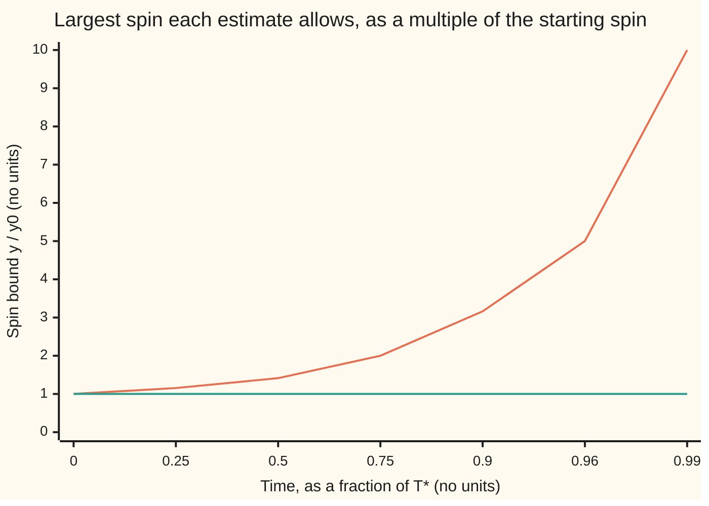

# The energy inequality, and the gap it leaves in three dimensions

[Syllabus](../../../SYLLABUS.md) → [Partial differential equations](../README.md) → [Nonlinear PDE and Fluids](../README.md#s07) → The energy inequality, and the gap it leaves in three dimensions

---

## General Overview

Water runs through a pipe 5 cm across at 1 m/s. Its Reynolds number (inertia against friction, from [Navier-Stokes](01-navier-stokes-derivation.md)) is about 50,000, so the water churns in eddies. As a model, take a repeating 5 cm cell of eddies, the size of the pipe's largest eddies: a cube with no walls, whose pattern repeats in every direction. Inside it, take one stirring pattern: three crossing velocity waves, two of them 1 m/s strong and one $`\sqrt2`$ m/s. That cell of water holds 0.1250 J of kinetic energy.

The Navier-Stokes equations say how the eddy moves. Leray proved that some solution lasts for all time, but only in a weak sense (see [Leray's weak solutions](02-leray-weak-solutions-of-navier-stokes.md)): it may have places where the speed is infinite. Can a smooth eddy really pinch itself into such a point?

The one bound every solution obeys is the **energy inequality**. The kinetic energy left, plus the energy friction has already turned into heat, never exceeds the 0.1250 J the eddy started with. Friction can only drain energy; the stirring itself only moves it around.

That bound settles the question in two dimensions. In a flat repeating cell the spin of the water cannot grow; with walls, such as the pipe's cross-section, it can grow, but only by a bounded amount. Either way the flow stays smooth forever. In three dimensions, spin can be stretched. At the start, stretching raises our eddy's spin 173.0 times faster than friction removes it. The energy bound is too weak to stop that, because a tiny, fast eddy carries very little energy.

**Multiplying the Navier-Stokes equations by the velocity shows that kinetic energy can only drain into heat; in two dimensions that bound also caps the spin, so flows stay smooth forever, but in three dimensions vortex stretching needs a stronger bound than energy gives, and whether smooth flows can blow up is open.**

**What kind of fact this is:** the energy inequality and the two-dimensional result are theorems, derived on this card for smooth flows in a repeating box. Smoothness for all time in three dimensions is an open problem: no proof and no counterexample has been accepted as of 2026-11-15.

This card takes the method of [Energy methods](../01-Classification%20and%20Well-Posedness/07-energy-methods-and-uniqueness.md), multiply by the solution and integrate, from the linear heat equation to a nonlinear one. That method in turn generalises the fixed energy of the vibrating string in wing 08.

### The picture: what each estimate guarantees



Here $`y`$ is the spin (the enstrophy, defined in The formula) and $`y_0`$ its starting value. Orange: the three-dimensional bound. It allows the spin to become infinite at the time $`T^*`$, which for our eddy is about 6e-21 s if a constant $`K`$, whose best value is unknown, is 1; $`T^*`$ scales as $`1/K`$. Green: the two-dimensional bound in a repeating cell. The spin never rises above its start, at any time. The time marks are not evenly spaced: they crowd toward $`T^*`$, where the bound shoots up. Both checks print every point.

---

## The formula

Notation from [Navier-Stokes](01-navier-stokes-derivation.md), one line each. $`\mathbf{u}`$ is the velocity (m/s) and $`p`$ the pressure divided by the density. $`\nu`$ is the kinematic viscosity, about 1.0e-6 m²/s for water near 20 °C. The equations, with no outside force, are

```math
\frac{\partial \mathbf{u}}{\partial t} + (\mathbf{u}\cdot\nabla)\mathbf{u} = -\nabla p + \nu\,\Delta\mathbf{u}, \qquad \nabla\cdot\mathbf{u} = 0 .
```

The region $`\Omega`$ is a **repeating box**: a cube of side $`L`$ = 5 cm in which water leaving one face comes back in at the opposite face. The size of a field $`\mathbf{v}`$ is $`\lVert \mathbf{v}\rVert^2 = \int_\Omega \lvert\mathbf{v}\rvert^2\,dx`$, its square added up over the box.

The **energy** (per unit density) and the **enstrophy** (the total squared velocity gradient, a measure of spin) are

```math
E(t) = \tfrac12\lVert\mathbf{u}(t)\rVert^2, \qquad y(t) = \lVert\nabla\mathbf{u}(t)\rVert^2 .
```

The energy inequality:

```math
E(t) + \nu\int_0^t \lVert\nabla\mathbf{u}(s)\rVert^2\,ds \;\le\; E(0) .
```

**Read it aloud:** the energy now, plus all the energy friction has turned to heat so far, is at most the energy at the start.

For smooth flows it holds with equality. Leray's weak solutions are only known to satisfy the inequality.

The spin budget, one level up:

```math
\frac{dy}{dt} = 2S - 2\nu\,\lVert\Delta\mathbf{u}\rVert^2, \qquad S = \int_\Omega \big((\mathbf{u}\cdot\nabla)\mathbf{u}\big)\cdot\Delta\mathbf{u}\,dx .
```

**Read it aloud:** spin grows at twice the stretching term, minus twice the viscosity times the size of the Laplacian.

In a two-dimensional repeating box $`S`$ is always 0. In three it is not, and the best general bound on it gives

```math
\frac{dy}{dt} \le \frac{K}{\nu^3}\,y^3 \quad\Longrightarrow\quad y(t) \le \frac{y_0}{\sqrt{1 - t/T^*}}, \qquad T^* = \frac{\nu^3}{2K\,y_0^2} .
```

**Read it aloud:** in three dimensions the spin can grow at most like the cube of itself, so the bound holds only until the time $`T^*`$, when it becomes infinite.

| Symbol | Plain meaning | In our example | Push it up and the answer… |
| --- | --- | --- | --- |
| $`\mathbf{u}`$, $`\mathbf{u}_0`$, $`U`$; $`p`$; $`\mathbf{f}`$ | velocity, its value at the start, and its wave amplitude; pressure divided by density; an outside force per unit mass | three waves, $`U`$ = 1 m/s; no force | energy rises as $`U^2`$ |
| $`\nu`$ | kinematic viscosity: how fast friction spreads motion | 1.0e-6 m²/s | $`T^*`$ grows as $`\nu^3`$ |
| $`\Omega`$; $`L`$; $`d`$ | the repeating box; its side; number of space dimensions | 5 cm cube; 0.05 m; 2 or 3 | — |
| $`\lVert\mathbf{v}\rVert^2`$; $`dx`$; $`a`$, $`b`$ | square of a field $`\mathbf{v}`$ added over the box; a small piece of volume; the sizes $`\lVert\nabla\mathbf{u}\rVert`$ and $`\lVert\Delta\mathbf{u}\rVert`$, in the fold | — | — |
| $`E(t)`$, $`E(0)`$; $`\rho`$ | kinetic energy per unit density; the density | 1.2500e-4 m⁵/s², times $`\rho`$ = 1000 kg/m³ gives 0.1250 J | — |
| $`y(t)`$, $`y_0`$ | enstrophy: total squared velocity gradient | 8.8826 m³/s² | $`T^*`$ shrinks as $`1/y_0^2`$ |
| $`S`$ | stretching term: how fast the flow itself raises spin | 62.0126 m³/s³ in 3D; 0 in 2D | spin grows faster |
| $`\boldsymbol{\omega}`$, $`\omega`$; $`D`$ | vorticity $`\nabla\times\mathbf{u}`$, the local spin (an arrow in 3D, a single number in 2D; see [Vorticity](04-vorticity-and-the-euler-equations.md)); strain, the symmetric part of $`\nabla\mathbf{u}`$ | — | — |
| $`K`$, $`K_2`$, $`C`$; $`c`$ | pure numbers from the Sobolev and interpolation inequalities, in 3D and 2D; the number in the small-start theorem | $`K`$ = $`K_2`$ = 1 (illustrative) | $`T^*`$ shrinks |
| $`T^*`$; $`z`$ | time until the 3D bound becomes infinite; the spin bound as a multiple of $`y_0`$ | 6.3370e-21 s for $`K`$ = 1; 1 to 10 in the chart | — |
| $`\mathrm{Re}`$; $`\lambda`$ | Reynolds number $`UL/\nu`$; a zoom factor | 50,000; 10 and 100 | — |
| $`t`$, $`s`$; $`x`$; $`i`$, $`j`$ | time, and a running time (or $`t/T^*`$ in the fold); position; components, 1 to $`d`$ | seconds; metres | — |

### When it holds

- **The flow is smooth.** The derivation integrates by parts, which needs derivatives. For a weak solution only the inequality is proved; the missing energy could be lost at points where the solution is rough.
- **The water is incompressible.** $`\nabla\cdot\mathbf{u} = 0`$ is what makes the stirring term and the pressure term vanish. A squeezing wave breaks it: the stirring term then creates 3.9270 W from nothing.
- **The edges add nothing.** A repeating box, or walls where the water sticks ($`\mathbf{u} = 0`$), kill every edge term. A real pipe has a pump; its work then appears on the right side, as on [Leray's weak solutions](02-leray-weak-solutions-of-navier-stokes.md).
- **No outside force.** A force $`\mathbf{f}`$ adds its work $`\int_0^t\int_\Omega \mathbf{f}\cdot\mathbf{u}\,dx\,ds`$ to the right side.
- **The spin argument needs two dimensions.** In three, $`S`$ is not zero, and the bound on it grows like $`y^3`$.

---

## Why it works

### Step 0: the idea

Multiply the equation by the velocity and add up over the box. Three of the four terms then have a clear meaning. The time term becomes the rate of change of energy. The stirring term and the pressure term only move energy from place to place, so their totals are zero. The friction term is minus a square, so it can only remove energy.

Do the same one level up, multiplying by $`-\Delta\mathbf{u}`$, and you get a budget for spin. In two dimensions the stirring term again totals zero. In three it does not: stirring can stretch a vortex and raise its spin. Energy is the only quantity left to control that, and it turns out to be too weak.

### Step 1: energy can only drain into heat

Take the dot product of the equation with $`\mathbf{u}`$ and integrate over the box. Term by term:

1. **Time term.** $`\mathbf{u}\cdot\partial_t\mathbf{u} = \partial_t(\tfrac12\lvert\mathbf{u}\rvert^2)`$, so it integrates to $`dE/dt`$.
2. **Stirring term.** $`\big((\mathbf{u}\cdot\nabla)\mathbf{u}\big)\cdot\mathbf{u} = \mathbf{u}\cdot\nabla(\tfrac12\lvert\mathbf{u}\rvert^2)`$. Integrated by parts, this becomes $`-\tfrac12\int(\nabla\cdot\mathbf{u})\lvert\mathbf{u}\rvert^2 dx`$, which is 0 because the flow is incompressible.
3. **Pressure term.** $`\int \nabla p\cdot\mathbf{u}\,dx = -\int p\,\nabla\cdot\mathbf{u}\,dx = 0`$ for the same reason.
4. **Friction term.** $`\int \mathbf{u}\cdot\Delta\mathbf{u}\,dx = -\lVert\nabla\mathbf{u}\rVert^2`$, again by parts.

So $`dE/dt = -\nu\lVert\nabla\mathbf{u}\rVert^2 \le 0`$. Integrate from 0 to $`t`$ and the energy inequality appears, as an equality.

The checks test items 2, 3 and 4 on our eddy and on its two-dimensional twin, a flat repeating 5 cm cell stirred by three similar waves. Both stirring totals are zero to 12 digits, both pressure totals too, and $`\int\mathbf{u}\cdot\Delta\mathbf{u}\,dx`$ equals $`-y_0`$.

<details>
<summary>Detailed proof: the energy equality for a smooth flow in a repeating box</summary>

Let $`\mathbf{u}`$ and $`p`$ be smooth and repeat across the box, with $`\nabla\cdot\mathbf{u} = 0`$. For a repeating box, $`\int_\Omega \partial_j g\,dx = 0`$ for every smooth repeating function $`g`$, because the values on opposite faces cancel.

Stirring term, written with indices and summed over $`i`$ and $`j`$:

$`\displaystyle \int_\Omega u_j\,(\partial_j u_i)\,u_i\,dx = \int_\Omega u_j\,\partial_j\big(\tfrac12 u_i u_i\big)\,dx = \int_\Omega \partial_j\big(u_j\,\tfrac12 u_i u_i\big)\,dx - \int_\Omega (\partial_j u_j)\,\tfrac12 u_i u_i\,dx = 0 - 0 .`$

Pressure term: $`\int_\Omega u_i\,\partial_i p\,dx = \int_\Omega \partial_i(u_i p)\,dx - \int_\Omega (\partial_i u_i)\,p\,dx = 0`$.

Friction term: $`\int_\Omega u_i\,\partial_j\partial_j u_i\,dx = \int_\Omega \partial_j(u_i\,\partial_j u_i)\,dx - \int_\Omega (\partial_j u_i)(\partial_j u_i)\,dx = -\lVert\nabla\mathbf{u}\rVert^2`$.

So $`E'(t) = -\nu\lVert\nabla\mathbf{u}(t)\rVert^2`$. Integrating from 0 to $`t`$ gives the energy equality. With walls where $`\mathbf{u} = 0`$, each edge term from the divergence theorem contains a factor of $`\mathbf{u}`$ on the wall and vanishes too.

</details>

### Step 2: weak solutions keep only the inequality

Leray built his solutions as limits of smooth approximations ([Leray's weak solutions](02-leray-weak-solutions-of-navier-stokes.md)). Each approximation satisfies the energy equality. In a weak limit, the size of a field can drop but cannot jump up. Here it is the friction total, the time integral of the squared slopes, that can drop, so the limit keeps "at most". The equality is not proved for these solutions.

The inequality gives two bounds for every time: the energy stays below $`E(0)`$, and

```math
\int_0^\infty y(t)\,dt \;\le\; \frac{E(0)}{\nu} .
```

For our eddy that budget is 125.0 m³/s. The spin may be large, but only for a short total time.

### Step 3: in two dimensions, stirring cannot raise spin

Multiply the equation by $`-\Delta\mathbf{u}`$ and integrate. The same integrations by parts give the spin budget in The formula, with the stretching term $`S`$.

In a flat flow, the vorticity $`\omega`$ is a single number at each point, the spin about the axis out of the plane. It is carried along by the flow like a dye, and spread by friction. In a repeating box, $`S`$ equals $`-\int (\mathbf{u}\cdot\nabla\omega)\,\omega\,dx`$, which is 0 by the same step as the stirring term in Step 1. So

```math
\frac{dy}{dt} = -2\nu\lVert\Delta\mathbf{u}\rVert^2 \le 0 .
```

For the two-dimensional twin of our eddy, $`dy/dt`$ = −6.2342 m²/s³ at the start. The spin never rises, the velocity's slopes stay bounded, and a standard bootstrap (a chain of estimates, each using the last) bounds every higher derivative. The flow stays smooth forever.

### Step 4: in three dimensions, stirring stretches spin

In three dimensions the vorticity $`\boldsymbol{\omega}`$ is an arrow, and a flow that stretches a vortex tube spins it faster, like a skater pulling in her arms. In a repeating box,

```math
S = \int_\Omega \boldsymbol{\omega}\cdot D\,\boldsymbol{\omega}\,dx ,
```

where $`D`$ is the strain, the symmetric part of $`\nabla\mathbf{u}`$. For our eddy the checks find $`S`$ = 62.0126 m³/s³ by both formulas. Friction removes spin at $`2\nu\lVert\Delta\mathbf{u}\rVert^2`$ = 0.7169 m³/s³. Stretching wins by a factor of 173.0.

To bound $`S`$ for every flow, one uses a Sobolev inequality (the size of a field's values is bounded by the size of its slopes) and an interpolation inequality (a middle derivative is bounded by a lower and a higher one). They give $`\lvert S\rvert \le C\,\lVert\nabla\mathbf{u}\rVert^{3/2}\lVert\Delta\mathbf{u}\rVert^{3/2}`$ for a pure number $`C`$. Young's inequality (a product is at most a sum of powers of its factors) then trades the $`\lVert\Delta\mathbf{u}\rVert`$ against the friction term, leaving $`dy/dt \le K y^3/\nu^3`$.

<details>
<summary>Detailed step: from the bound on S to dy/dt ≤ K y³/ν³</summary>

Write $`a = \lVert\nabla\mathbf{u}\rVert`$ and $`b = \lVert\Delta\mathbf{u}\rVert`$, so $`y = a^2`$. Half the spin budget reads $`\tfrac12\,dy/dt = S - \nu b^2 \le C a^{3/2} b^{3/2} - \nu b^2`$.

As a function of $`b`$, the right side is largest where its slope is zero: $`\tfrac32 C a^{3/2} b^{1/2} = 2\nu b`$, so $`b^{1/2} = 3Ca^{3/2}/(4\nu)`$. Putting that back:

$`\displaystyle C a^{3/2} b^{3/2} - \nu b^2 \;\le\; \frac{27\,C^4}{256\,\nu^3}\,a^6 = \frac{27\,C^4}{256\,\nu^3}\,y^3 .`$

So $`dy/dt \le K y^3/\nu^3`$ with $`K = 27C^4/128`$. The best value of $`C`$ is not known in closed form; the card takes $`K`$ = 1, marked illustrative. Every conclusion below holds for any $`K`$.

Solving $`dz/ds = z^3/2`$ with $`z = y/y_0`$ and $`s = t/T^*`$ gives $`z = 1/\sqrt{1 - s}`$, the curve in the chart.

</details>

### Step 5: why the energy budget cannot close the gap

Write the two estimates in the same shape, as a rate times $`y`$:

- **Two dimensions, with walls.** Here $`S`$ is not zero, but the two-dimensional interpolation inequality (Ladyzhenskaya's) gives $`dy/dt \le (K_2\lVert\mathbf{u}\rVert^2 y/\nu^3)\,y`$. The rate contains $`y`$ once. Step 2 bounds $`\int y\,dt`$, so Gronwall's inequality (a rate with a finite total gives finite growth) closes it.
- **Three dimensions.** $`dy/dt \le (K y^2/\nu^3)\,y`$. The rate contains $`y^2`$. Nothing bounds $`\int y^2\,dt`$.

The bound's own solution, $`y = y_0/\sqrt{1 - t/T^*}`$, shows the gap exactly. Stopped $`10^{-6}\,T^*`$ short of $`T^*`$, its $`\int y\,dt`$ is 1.9980 $`y_0T^*`$ and never passes 2 $`y_0T^*`$. Its $`\int y^2\,dt`$ is 13.8155 $`y_0^2T^*`$ and grows without limit as the stop moves closer. For our eddy that blow-up spends 1.1258e-19 m³/s of the 125.0 m³/s the energy allows. The energy inequality cannot tell this curve from a smooth flow.

### Step 6: the same gap, seen by zooming

If $`\mathbf{u}(x, t)`$ solves Navier-Stokes, so does the zoomed flow $`\lambda\,\mathbf{u}(\lambda x, \lambda^2 t)`$: an eddy $`\lambda`$ times smaller, $`\lambda`$ times faster, running $`\lambda^2`$ times quicker. Its energy is multiplied by $`\lambda^{2-d}`$.

| Zoom $`\lambda`$ | Energy ratio, 2D | Energy ratio, 3D | Enstrophy ratio, 3D |
| --- | --- | --- | --- |
| 10 | 1.000000 | 0.100000 | 10.0 |
| 100 | 1.000000 | 0.010000 | 100.0 |

In two dimensions a small copy of an eddy costs as much energy as the original, so the energy bound sees every scale. In three dimensions a copy 100 times smaller and faster costs one-hundredth of the energy. A blow-up would be a cascade of ever smaller, faster eddies, and the energy bound charges almost nothing for it. That is why energy is called **supercritical** in three dimensions: it weakens at small scales, where blow-up would happen.

### Step 7: what is proved, and the open question

| Setting | What is proved | Proved by |
| --- | --- | --- |
| 2D, any finite-energy start | one smooth solution for all time | Leray, 1930s; with walls, Ladyzhenskaya |
| 3D, smooth start | smooth for a short time, at least until $`T^*`$ | the bound above |
| 3D, small start | smooth forever if $`\lVert\mathbf{u}_0\rVert\,\lVert\nabla\mathbf{u}_0\rVert < c\,\nu^2`$, for a pure number $`c`$ | the same bound plus friction; proof in Robinson, Rodrigo and Sadowski |
| 3D, any finite-energy start | a weak solution for all time, with the energy inequality; smooth except on a set of times of total length 0 | Leray, 1934 |
| 3D, suitable weak solutions (weak solutions that also obey a local energy inequality in every small ball) | the rough points in space and time cannot fill even a curve | Caffarelli, Kohn and Nirenberg, 1982 |

For our eddy, $`\lVert\mathbf{u}_0\rVert\,\lVert\nabla\mathbf{u}_0\rVert`$ = 0.0471 m⁴/s², which is 4.7124e10 times $`\nu^2`$. The small-start theorem is far out of reach for real pipe flow.

**The regularity question**, in the repeating-box form of the official problem description. Statement (B): take any smooth, divergence-free starting velocity $`\mathbf{u}_0`$ that repeats across a cube, and no outside force. Then there is a smooth solution $`\mathbf{u}`$, $`p`$ that repeats across the cube and lasts for all $`t \ge 0`$. The prize also accepts the opposite in a weaker form, statement (D): a smooth repeating start and a smooth outside force, repeating across the cube and fading fast in time, for which no such smooth solution exists. A proof of either answers the problem.

The Clay Millennium Prize statement, in full and also for all of space, is on Navier-Stokes (planned) in wing 25.

---

## Worked numbers, by hand

The eddy: three waves in the 5 cm box. Wave 1 moves water along the pipe and varies across it. Wave 2 moves water across the pipe and varies along a diagonal. Wave 3 has amplitude $`\sqrt2`$ m/s and varies along the box's main diagonal. Each wave is perpendicular to its own direction of variation, so the flow is incompressible.

| Step | Arithmetic | Value |
| --- | --- | --- |
| Reynolds number, $`\nu`$ rounded | 1 m/s × 0.05 m / 1.0e-6 m²/s | 50,000 |
| energy | ½ × (½ + ½ + 1) m²/s² × (0.05 m)³ | 1.2500e-4 m⁵/s² |
| in joules | × 1000 kg/m³ | 0.1250 J |
| energy budget for spin | 1.25e-4 / 1.0e-6 | 125.0 m³/s |
| enstrophy | ½ × (1 + 2 + 6) × (2π / 0.05 m)² × (0.05 m)³ | 8.8826 m³/s² |
| stretching, from the checks | 3D; 2D | 62.0126 m³/s³; 0 |
| spin rate at the start | 2 × 62.0126 − 0.7169 | 123.3082 m³/s³ |
| guarantee time, $`K`$ = 1 | (1.0e-6)³ / (2 × 8.8826²) | **6.3370e-21 s** |

In three dimensions the general estimate promises smoothness for only about 6e-21 s (for $`K`$ = 1; the time scales as $`1/K`$), while the eddy turns over in 0.05 s. The guarantee shrinks like $`1/\mathrm{Re}^3`$, and $`\mathrm{Re}^3`$ = 1.2500e14. Computer simulations of eddies like this one show no blow-up; the estimate cannot see that far.

### What breaks if you drop a piece

| Mistake | Comes out at | What went wrong |
| --- | --- | --- |
| Run the 2D Gronwall step in 3D | $`\int y^2\,dt`$ = 4.6052, 9.2103, 13.8155 $`y_0^2T^*`$ at stops $`10^{-2}`$, $`10^{-4}`$, $`10^{-6}\,T^*`$ short | the rate needs $`\int y^2`$, which grows without limit; energy bounds only $`\int y`$ |
| Drop incompressibility | the stirring term makes 3.9270 W from nothing | a squeezing wave has $`\nabla\cdot\mathbf{u} \ne 0`$, so stirring no longer just moves energy |
| Read "closes" as "small" | a flat flow with walls, at the twin's energy: $`y \le y_0\,e^{1.2500\times 10^{19}}`$, a number with about 5.4287e18 digits | Gronwall gives a finite bound, not a useful one |
| Apply the small-start theorem to the pipe | 4.7124e10 $`\nu^2`$ | it needs a pure number times $`\nu^2`$ |

---

## Code, from first principles, and it actually runs

The script builds the eddy and its flat twin from three waves, takes every derivative by hand, and adds products over an 8-point grid, which is exact for these waves. It takes five pairs of independent roads: the stretching term in stirring form and in vorticity-strain form; the zoomed integrals against the rule $`\lambda^{2-d}`$; a Runge-Kutta solution of the 3D bound against $`1/\sqrt{1-s}`$; its integrals against their closed forms; and the squeezing wave's leak against its hand value, $`\pi/800`$ m⁵/s³.

### Python

```python
# The energy inequality, and the gap it leaves in three dimensions -- the check
# behind the card.  Standard library only.  Water (nu = 1.0e-6 m^2/s) in a 5 cm
# periodic cell, the size of the pipe's largest eddies; three crossing velocity
# waves, two of 1 m/s and one of sqrt(2) m/s.
# Every integral is a grid sum of trigonometric products, exact once the grid
# beats the highest frequency; derivatives are taken by hand, mode by mode.
import math
L, U, NU, RHO, K = 0.05, 1.0, 1.0e-6, 1000.0, 1.0   # K: illustrative constant
k0 = 2 * math.pi / L
# (amplitude direction, wave numbers in units of k0, phase); amplitude ⟂ wave numbers
FLOW3 = [((0, 0, 1), (1, 0, 0), 0.0), ((1, 0, 0), (0, 1, 1), 0.0), ((1, -1, 0), (1, 1, 1), -math.pi / 2)]
FLOW2 = [((0, 1, 0), (1, 0, 0), 0.0), ((1, 0, 0), (0, 1, 0), 0.0), ((1, -1, 0), (1, 1, 0), -math.pi / 2)]
SQUEEZE = [((-1, 0, 0), (1, 0, 0), 0.0)] + FLOW3[1:]   # first amplitude along its k: not ⟂

def yn(claim):
    return "yes" if claim else "no"

def e(x, p=4):                     # e-notation with the exponent written as Rust writes it
    m, ex = f"{x:.{p}e}".split("e")
    return f"{m}e{int(ex)}"

def point(flow, x, lam):           # velocity, gradient g[i][m] = du_i/dx_m, Laplacian
    u, g, lap = [0.0] * 3, [[0.0] * 3 for _ in range(3)], [0.0] * 3
    for a, kv, ph in flow:
        q = [lam * k0 * c for c in kv]
        th = sum(q[m] * x[m] for m in range(3)) + ph
        c, s, qq = math.cos(th), math.sin(th), sum(v * v for v in q)
        for i in range(3):
            u[i] += lam * U * a[i] * c
            lap[i] -= lam * U * a[i] * qq * c
            for m in range(3):
                g[i][m] -= lam * U * a[i] * q[m] * s
    return u, g, lap

def integrals(flow, d, lam=1.0, n=8):   # box of side L/lam, flow sped up lam times
    h = L / lam / n
    tot = dict(E=0.0, y=0.0, P=0.0, S=0.0, W=0.0, T=0.0, V=0.0, p=0.0)
    for i in range(n):
        for j in range(n):
            for l in range(n if d == 3 else 1):
                x = (i * h, j * h, l * h)
                u, g, lap = point(flow, x, lam)
                adv = [sum(u[m] * g[c][m] for m in range(3)) for c in range(3)]
                w = [g[2][1] - g[1][2], g[0][2] - g[2][0], g[1][0] - g[0][1]]   # vorticity
                gp = [-k0 * math.sin(k0 * x[0]) * math.cos(k0 * x[1]),           # grad of a test
                      -k0 * math.cos(k0 * x[0]) * math.sin(k0 * x[1]), 0.0]      # pressure
                tot["E"] += 0.5 * sum(v * v for v in u)
                tot["y"] += sum(g[a][b] ** 2 for a in range(3) for b in range(3))
                tot["P"] += sum(v * v for v in lap)
                tot["S"] += sum(adv[c] * lap[c] for c in range(3))
                tot["W"] += sum(w[a] * 0.5 * (g[a][b] + g[b][a]) * w[b] for a in range(3) for b in range(3))
                tot["T"] += sum(adv[c] * u[c] for c in range(3))
                tot["V"] += sum(u[c] * lap[c] for c in range(3))
                tot["p"] += sum(gp[c] * u[c] for c in range(3))
    return {key: v * h ** d for key, v in tot.items()}

r3, r2, bad = integrals(FLOW3, 3), integrals(FLOW2, 2), integrals(SQUEEZE, 3)
Re = U * L / NU
print(f"house: L = {L} m, U = {U} m/s, nu = {e(NU, 1)} m^2/s, Re = UL/nu = {Re:.0f}")
for name, r, unit in (("3D", r3, "m^5/s^2"), ("2D", r2, "m^4/s^2 per m of depth")):
    print(f"{name}: energy E0 = {e(r['E'])} {unit}; enstrophy y0 = {r['y']:.4f}; |lap u|^2 = {r['P']:.1f}")
print(f"3D energy in joules (x rho = 1000 kg/m^3): {RHO * r3['E']:.4f} J; budget E0/nu = {r3['E'] / NU:.1f} m^3/s")
for name, r in (("3D", r3), ("2D", r2)):
    sc = r["y"] * k0 * U                                   # natural size of a cubic term
    print(f"{name}: transport term ~0: {yn(abs(r['T']) < 1e-12 * sc)}; pressure term ~0: "
          f"{yn(abs(r['p']) < 1e-12 * sc)}; int u.lap u = -y0: {yn(abs(r['V'] + r['y']) < 1e-12 * r['y'])}")
print(f"3D stretching S = {r3['S']:.4f} m^3/s^3; as vorticity times strain: {r3['W']:.4f} m^3/s^3")
print(f"2D stretching ~0: {yn(abs(r2['S']) < 1e-12 * r2['y'] * k0 * U)}")
print(f"3D start: dy/dt = 2S - 2 nu |lap u|^2 = {2 * r3['S']:.4f} - {2 * NU * r3['P']:.4f} = "
      f"{2 * r3['S'] - 2 * NU * r3['P']:.4f} m^3/s^3; stretching / damping = {r3['S'] / (NU * r3['P']):.1f}")
print(f"2D start: dy/dt = -2 nu |lap u|^2 = {-2 * NU * r2['P']:.4f} m^2/s^3: never rises")
for lam in (10.0, 100.0):
    for d, flow, r in ((3, FLOW3, r3), (2, FLOW2, r2)):
        z = integrals(flow, d, lam)
        print(f"zoom {lam:.0f}x, {d}D: energy ratio {z['E'] / r['E']:.6f} (rule lam^(2-d) = {lam ** (2 - d):.6f}); "
              f"enstrophy ratio {z['y'] / r['y']:.1f}")
        assert abs(z["E"] / r["E"] - lam ** (2 - d)) < 1e-9
Tstar = NU ** 3 / (2 * K * r3["y"] ** 2)
print(f"3D guarantee T* = nu^3/(2K y0^2) = {e(Tstar)} s; turnover L/U = {L / U} s; Re^3 = {e(Re ** 3)}")
f = lambda z: z ** 3 / 2                                    # dz/ds, z = y/y0, s = t/T*
z, s, hs, Iz, Iz2, marks, out = 1.0, 0.0, 1e-4, 0.0, 0.0, [0.25, 0.5, 0.75, 0.9, 0.96, 0.99], [1.0]
for step in range(9900):
    k1 = f(z); k2 = f(z + hs * k1 / 2); k3 = f(z + hs * k2 / 2); k4 = f(z + hs * k3)
    zn = z + hs * (k1 + 2 * k2 + 2 * k3 + k4) / 6
    Iz += hs * (z + zn) / 2; Iz2 += hs * (z * z + zn * zn) / 2
    z, s = zn, (step + 1) * hs
    if marks and abs(s - marks[0]) < 1e-9:
        out.append(z); marks.pop(0)
exact = [1 / math.sqrt(1 - q) for q in (0, 0.25, 0.5, 0.75, 0.9, 0.96, 0.99)]
print("chart, 3D bound y/y0 at t/T* = 0,0.25,0.5,0.75,0.9,0.96,0.99:", ", ".join(f"{v:.3f}" for v in out))
print("chart, 2D bound y/y0 at the same times:", ", ".join(f"{1.0:.3f}" for v in out))
print(f"to 0.99 T*: int y dt / (y0 T*) = {Iz:.4f} (exact 1.8); int y^2 dt / (y0^2 T*) = {Iz2:.4f} (exact {math.log(100):.4f})")
for dl in (1e-2, 1e-4, 1e-6):
    print(f"cut {e(dl, 0)} T* short: int y = {2 * (1 - math.sqrt(dl)):.4f} y0 T*, int y^2 = {math.log(1 / dl):.4f} y0^2 T*")
print(f"energy allows int y dt up to {r3['E'] / NU:.1f} m^3/s; this blow-up uses {e(2 * r3['y'] * Tstar)} m^3/s")
expo = 2 * K * r2["E"] ** 2 / NU ** 4
print(f"2D with walls: y <= y0 exp({e(expo)}), a number with about {e(expo / math.log(10))} digits")
prod = math.sqrt(2 * r3["E"] * r3["y"])
print(f"small-data test: |u0| |grad u0| = {prod:.4f} m^4/s^2 = {e(prod / NU ** 2)} nu^2")
print(f"mistake, squeezing wave: dE/dt gains -T = {e(-bad['T'])} m^5/s^3 = {-RHO * bad['T']:.4f} W from nothing")
assert all(abs(a - b) < 1e-6 for a, b in zip(out, exact))            # RK4 against 1/sqrt(1-s)
assert abs(Iz - 1.8) < 1e-4 and abs(Iz2 - math.log(100)) < 1e-4       # quadrature against closed form
assert abs(r3["S"] - r3["W"]) < 1e-9 * abs(r3["S"]) and r3["S"] > 1   # two roads to stretching
assert abs(r2["S"]) < 1e-12 * r2["y"] * k0 * U and abs(r3["T"]) < 1e-12 * r3["y"] * k0 * U
assert all(abs(r["p"]) < 1e-12 * r["y"] * k0 * U and abs(r["V"] + r["y"]) < 1e-12 * r["y"]
           for r in (r3, r2))                                    # pressure; int u.lap u = -y0
assert abs(r3["E"] - L ** 3 * U * U) < 1e-15 and abs(r3["y"] - L ** 3 * 4.5 * k0 * k0 * U * U) < 1e-9
assert abs(-bad["T"] - math.pi / 800) < 1e-12                           # the squeeze: pi/800 by hand
print("ALL CHECKS PASS")
```

**Ran 2026-11-15 on macOS, Python 3.14.10, standard library only. All checks passed. Output, pasted from the run:**

```
house: L = 0.05 m, U = 1.0 m/s, nu = 1.0e-6 m^2/s, Re = UL/nu = 50000
3D: energy E0 = 1.2500e-4 m^5/s^2; enstrophy y0 = 8.8826; |lap u|^2 = 358465.5
2D: energy E0 = 2.5000e-3 m^4/s^2 per m of depth; enstrophy y0 = 118.4353; |lap u|^2 = 3117090.9
3D energy in joules (x rho = 1000 kg/m^3): 0.1250 J; budget E0/nu = 125.0 m^3/s
3D: transport term ~0: yes; pressure term ~0: yes; int u.lap u = -y0: yes
2D: transport term ~0: yes; pressure term ~0: yes; int u.lap u = -y0: yes
3D stretching S = 62.0126 m^3/s^3; as vorticity times strain: 62.0126 m^3/s^3
2D stretching ~0: yes
3D start: dy/dt = 2S - 2 nu |lap u|^2 = 124.0251 - 0.7169 = 123.3082 m^3/s^3; stretching / damping = 173.0
2D start: dy/dt = -2 nu |lap u|^2 = -6.2342 m^2/s^3: never rises
zoom 10x, 3D: energy ratio 0.100000 (rule lam^(2-d) = 0.100000); enstrophy ratio 10.0
zoom 10x, 2D: energy ratio 1.000000 (rule lam^(2-d) = 1.000000); enstrophy ratio 100.0
zoom 100x, 3D: energy ratio 0.010000 (rule lam^(2-d) = 0.010000); enstrophy ratio 100.0
zoom 100x, 2D: energy ratio 1.000000 (rule lam^(2-d) = 1.000000); enstrophy ratio 10000.0
3D guarantee T* = nu^3/(2K y0^2) = 6.3370e-21 s; turnover L/U = 0.05 s; Re^3 = 1.2500e14
chart, 3D bound y/y0 at t/T* = 0,0.25,0.5,0.75,0.9,0.96,0.99: 1.000, 1.155, 1.414, 2.000, 3.162, 5.000, 10.000
chart, 2D bound y/y0 at the same times: 1.000, 1.000, 1.000, 1.000, 1.000, 1.000, 1.000
to 0.99 T*: int y dt / (y0 T*) = 1.8000 (exact 1.8); int y^2 dt / (y0^2 T*) = 4.6052 (exact 4.6052)
cut 1e-2 T* short: int y = 1.8000 y0 T*, int y^2 = 4.6052 y0^2 T*
cut 1e-4 T* short: int y = 1.9800 y0 T*, int y^2 = 9.2103 y0^2 T*
cut 1e-6 T* short: int y = 1.9980 y0 T*, int y^2 = 13.8155 y0^2 T*
energy allows int y dt up to 125.0 m^3/s; this blow-up uses 1.1258e-19 m^3/s
2D with walls: y <= y0 exp(1.2500e19), a number with about 5.4287e18 digits
small-data test: |u0| |grad u0| = 0.0471 m^4/s^2 = 4.7124e10 nu^2
mistake, squeezing wave: dE/dt gains -T = 3.9270e-3 m^5/s^3 = 3.9270 W from nothing
ALL CHECKS PASS
```

### Rust

Same numbers, same labels, built with `rustc --edition 2021 -O`.

```rust
// The energy inequality, and the gap it leaves in three dimensions -- the same
// check as the Python, in Rust.  No crates.  Water (nu = 1.0e-6 m^2/s) in a 5 cm
// periodic cell, the size of the pipe's largest eddies; three crossing velocity
// waves, two of 1 m/s and one of sqrt(2) m/s.
// Every integral is a grid sum of trigonometric products, exact once the grid
// beats the highest frequency; derivatives are taken by hand, mode by mode.
use std::f64::consts::PI;
const L: f64 = 0.05; const U: f64 = 1.0; const NU: f64 = 1.0e-6; const RHO: f64 = 1000.0;
const K: f64 = 1.0; // illustrative constant
type Mode = ([f64; 3], [f64; 3], f64); // (amplitude direction, wave numbers / k0, phase)

fn yn(claim: bool) -> &'static str { if claim { "yes" } else { "no" } }
fn e(x: f64, p: usize) -> String { format!("{:.*e}", p, x) }

// returns E, y, |lap u|^2, S, W, T, int u.lap u, pressure term
fn integrals(flow: &[Mode], d: i32, lam: f64) -> [f64; 8] {
    let (n, k0) = (8usize, 2.0 * PI / L);
    let h = L / lam / n as f64;
    let mut t = [0.0f64; 8];
    for i in 0..n { for j in 0..n { for l in 0..(if d == 3 { n } else { 1 }) {
        let x = [i as f64 * h, j as f64 * h, l as f64 * h];
        let (mut u, mut g, mut lap) = ([0.0f64; 3], [[0.0f64; 3]; 3], [0.0f64; 3]);
        for (a, kv, ph) in flow {
            let q: Vec<f64> = kv.iter().map(|c| lam * k0 * c).collect();
            let th = q[0] * x[0] + q[1] * x[1] + q[2] * x[2] + ph;
            let (c, s, qq) = (th.cos(), th.sin(), q.iter().map(|v| v * v).sum::<f64>());
            for i in 0..3 {
                u[i] += lam * U * a[i] * c;
                lap[i] -= lam * U * a[i] * qq * c;
                for m in 0..3 { g[i][m] -= lam * U * a[i] * q[m] * s; }
            }
        }
        let adv: Vec<f64> = (0..3).map(|c| (0..3).map(|m| u[m] * g[c][m]).sum()).collect();
        let w = [g[2][1] - g[1][2], g[0][2] - g[2][0], g[1][0] - g[0][1]]; // vorticity
        let gp = [-k0 * (k0 * x[0]).sin() * (k0 * x[1]).cos(), // grad of a test pressure
                  -k0 * (k0 * x[0]).cos() * (k0 * x[1]).sin(), 0.0];
        t[0] += 0.5 * u.iter().map(|v| v * v).sum::<f64>();
        for a in 0..3 { for b in 0..3 {
            t[1] += g[a][b] * g[a][b];
            t[4] += w[a] * 0.5 * (g[a][b] + g[b][a]) * w[b];
        } }
        for c in 0..3 {
            t[2] += lap[c] * lap[c]; t[3] += adv[c] * lap[c]; t[5] += adv[c] * u[c];
            t[6] += u[c] * lap[c]; t[7] += gp[c] * u[c];
        }
    } } }
    t.map(|v| v * h.powi(d))
}

fn main() {
    let k0 = 2.0 * PI / L;
    let flow3: [Mode; 3] = [([0., 0., 1.], [1., 0., 0.], 0.0), ([1., 0., 0.], [0., 1., 1.], 0.0), ([1., -1., 0.], [1., 1., 1.], -PI / 2.0)];
    let flow2: [Mode; 3] = [([0., 1., 0.], [1., 0., 0.], 0.0), ([1., 0., 0.], [0., 1., 0.], 0.0), ([1., -1., 0.], [1., 1., 0.], -PI / 2.0)];
    let squeeze: [Mode; 3] = [([-1., 0., 0.], [1., 0., 0.], 0.0), flow3[1], flow3[2]]; // first amplitude along its k
    let (r3, r2, bad) = (integrals(&flow3, 3, 1.0), integrals(&flow2, 2, 1.0), integrals(&squeeze, 3, 1.0));
    let re = U * L / NU;
    println!("house: L = {} m, U = {:.1} m/s, nu = {} m^2/s, Re = UL/nu = {:.0}", L, U, e(NU, 1), re);
    for (name, r, unit) in [("3D", r3, "m^5/s^2"), ("2D", r2, "m^4/s^2 per m of depth")] {
        println!("{}: energy E0 = {} {}; enstrophy y0 = {:.4}; |lap u|^2 = {:.1}", name, e(r[0], 4), unit, r[1], r[2]);
    }
    println!("3D energy in joules (x rho = 1000 kg/m^3): {:.4} J; budget E0/nu = {:.1} m^3/s", RHO * r3[0], r3[0] / NU);
    for (name, r) in [("3D", r3), ("2D", r2)] {
        let sc = r[1] * k0 * U; // natural size of a cubic term
        println!("{}: transport term ~0: {}; pressure term ~0: {}; int u.lap u = -y0: {}", name,
                 yn(r[5].abs() < 1e-12 * sc), yn(r[7].abs() < 1e-12 * sc), yn((r[6] + r[1]).abs() < 1e-12 * r[1]));
    }
    println!("3D stretching S = {:.4} m^3/s^3; as vorticity times strain: {:.4} m^3/s^3", r3[3], r3[4]);
    println!("2D stretching ~0: {}", yn(r2[3].abs() < 1e-12 * r2[1] * k0 * U));
    println!("3D start: dy/dt = 2S - 2 nu |lap u|^2 = {:.4} - {:.4} = {:.4} m^3/s^3; stretching / damping = {:.1}",
             2.0 * r3[3], 2.0 * NU * r3[2], 2.0 * r3[3] - 2.0 * NU * r3[2], r3[3] / (NU * r3[2]));
    println!("2D start: dy/dt = -2 nu |lap u|^2 = {:.4} m^2/s^3: never rises", -2.0 * NU * r2[2]);
    for lam in [10.0f64, 100.0] {
        for (d, flow, r) in [(3, &flow3, r3), (2, &flow2, r2)] {
            let z = integrals(flow, d, lam);
            let rule = lam.powi(2 - d);
            println!("zoom {:.0}x, {}D: energy ratio {:.6} (rule lam^(2-d) = {:.6}); enstrophy ratio {:.1}",
                     lam, d, z[0] / r[0], rule, z[1] / r[1]);
            assert!((z[0] / r[0] - rule).abs() < 1e-9);
        }
    }
    let tstar = NU.powi(3) / (2.0 * K * r3[1] * r3[1]);
    println!("3D guarantee T* = nu^3/(2K y0^2) = {} s; turnover L/U = {} s; Re^3 = {}", e(tstar, 4), L / U, e(re.powi(3), 4));
    let f = |z: f64| z * z * z / 2.0; // dz/ds, z = y/y0, s = t/T*
    let (mut z, hs, mut iz, mut iz2) = (1.0f64, 1e-4, 0.0f64, 0.0f64);
    let (mut marks, mut out) = (vec![0.99, 0.96, 0.9, 0.75, 0.5, 0.25], vec![1.0f64]);
    for step in 0..9900 {
        let k1 = f(z); let k2 = f(z + hs * k1 / 2.0); let k3 = f(z + hs * k2 / 2.0); let k4 = f(z + hs * k3);
        let zn = z + hs * (k1 + 2.0 * k2 + 2.0 * k3 + k4) / 6.0;
        iz += hs * (z + zn) / 2.0; iz2 += hs * (z * z + zn * zn) / 2.0;
        z = zn;
        let s = (step + 1) as f64 * hs;
        if let Some(&m) = marks.last() { if (s - m).abs() < 1e-9 { out.push(z); marks.pop(); } }
    }
    let exact: Vec<f64> = [0.0, 0.25, 0.5, 0.75, 0.9, 0.96, 0.99].iter().map(|q: &f64| 1.0 / (1.0 - q).sqrt()).collect();
    let pts: Vec<String> = out.iter().map(|v| format!("{:.3}", v)).collect();
    println!("chart, 3D bound y/y0 at t/T* = 0,0.25,0.5,0.75,0.9,0.96,0.99: {}", pts.join(", "));
    let flat: Vec<String> = out.iter().map(|_| format!("{:.3}", 1.0)).collect();
    println!("chart, 2D bound y/y0 at the same times: {}", flat.join(", "));
    println!("to 0.99 T*: int y dt / (y0 T*) = {:.4} (exact 1.8); int y^2 dt / (y0^2 T*) = {:.4} (exact {:.4})",
             iz, iz2, 100f64.ln());
    for dl in [1e-2f64, 1e-4, 1e-6] {
        println!("cut {} T* short: int y = {:.4} y0 T*, int y^2 = {:.4} y0^2 T*", e(dl, 0), 2.0 * (1.0 - dl.sqrt()), (1.0 / dl).ln());
    }
    println!("energy allows int y dt up to {:.1} m^3/s; this blow-up uses {} m^3/s", r3[0] / NU, e(2.0 * r3[1] * tstar, 4));
    let expo = 2.0 * K * r2[0] * r2[0] / NU.powi(4);
    println!("2D with walls: y <= y0 exp({}), a number with about {} digits", e(expo, 4), e(expo / 10f64.ln(), 4));
    let prod = (2.0 * r3[0] * r3[1]).sqrt();
    println!("small-data test: |u0| |grad u0| = {:.4} m^4/s^2 = {} nu^2", prod, e(prod / (NU * NU), 4));
    println!("mistake, squeezing wave: dE/dt gains -T = {} m^5/s^3 = {:.4} W from nothing", e(-bad[5], 4), -RHO * bad[5]);
    assert!(out.iter().zip(&exact).all(|(a, b)| (a - b).abs() < 1e-6)); // RK4 against 1/sqrt(1-s)
    assert!((iz - 1.8).abs() < 1e-4 && (iz2 - 100f64.ln()).abs() < 1e-4); // quadrature against closed form
    assert!((r3[3] - r3[4]).abs() < 1e-9 * r3[3].abs() && r3[3] > 1.0); // two roads to stretching
    assert!(r2[3].abs() < 1e-12 * r2[1] * k0 * U && r3[5].abs() < 1e-12 * r3[1] * k0 * U);
    assert!([r3, r2].iter().all(|r| r[7].abs() < 1e-12 * r[1] * k0 * U
            && (r[6] + r[1]).abs() < 1e-12 * r[1])); // pressure; int u.lap u = -y0
    assert!((r3[0] - L.powi(3) * U * U).abs() < 1e-15 && (r3[1] - L.powi(3) * 4.5 * k0 * k0 * U * U).abs() < 1e-9);
    assert!((-bad[5] - PI / 800.0).abs() < 1e-12); // the squeeze: pi/800 by hand
    println!("ALL CHECKS PASS");
}
```

**Ran 2026-11-15 on macOS, rustc 1.98.1, no crates. All checks passed. Output, pasted from the run:**

```
house: L = 0.05 m, U = 1.0 m/s, nu = 1.0e-6 m^2/s, Re = UL/nu = 50000
3D: energy E0 = 1.2500e-4 m^5/s^2; enstrophy y0 = 8.8826; |lap u|^2 = 358465.5
2D: energy E0 = 2.5000e-3 m^4/s^2 per m of depth; enstrophy y0 = 118.4353; |lap u|^2 = 3117090.9
3D energy in joules (x rho = 1000 kg/m^3): 0.1250 J; budget E0/nu = 125.0 m^3/s
3D: transport term ~0: yes; pressure term ~0: yes; int u.lap u = -y0: yes
2D: transport term ~0: yes; pressure term ~0: yes; int u.lap u = -y0: yes
3D stretching S = 62.0126 m^3/s^3; as vorticity times strain: 62.0126 m^3/s^3
2D stretching ~0: yes
3D start: dy/dt = 2S - 2 nu |lap u|^2 = 124.0251 - 0.7169 = 123.3082 m^3/s^3; stretching / damping = 173.0
2D start: dy/dt = -2 nu |lap u|^2 = -6.2342 m^2/s^3: never rises
zoom 10x, 3D: energy ratio 0.100000 (rule lam^(2-d) = 0.100000); enstrophy ratio 10.0
zoom 10x, 2D: energy ratio 1.000000 (rule lam^(2-d) = 1.000000); enstrophy ratio 100.0
zoom 100x, 3D: energy ratio 0.010000 (rule lam^(2-d) = 0.010000); enstrophy ratio 100.0
zoom 100x, 2D: energy ratio 1.000000 (rule lam^(2-d) = 1.000000); enstrophy ratio 10000.0
3D guarantee T* = nu^3/(2K y0^2) = 6.3370e-21 s; turnover L/U = 0.05 s; Re^3 = 1.2500e14
chart, 3D bound y/y0 at t/T* = 0,0.25,0.5,0.75,0.9,0.96,0.99: 1.000, 1.155, 1.414, 2.000, 3.162, 5.000, 10.000
chart, 2D bound y/y0 at the same times: 1.000, 1.000, 1.000, 1.000, 1.000, 1.000, 1.000
to 0.99 T*: int y dt / (y0 T*) = 1.8000 (exact 1.8); int y^2 dt / (y0^2 T*) = 4.6052 (exact 4.6052)
cut 1e-2 T* short: int y = 1.8000 y0 T*, int y^2 = 4.6052 y0^2 T*
cut 1e-4 T* short: int y = 1.9800 y0 T*, int y^2 = 9.2103 y0^2 T*
cut 1e-6 T* short: int y = 1.9980 y0 T*, int y^2 = 13.8155 y0^2 T*
energy allows int y dt up to 125.0 m^3/s; this blow-up uses 1.1258e-19 m^3/s
2D with walls: y <= y0 exp(1.2500e19), a number with about 5.4287e18 digits
small-data test: |u0| |grad u0| = 0.0471 m^4/s^2 = 4.7124e10 nu^2
mistake, squeezing wave: dE/dt gains -T = 3.9270e-3 m^5/s^3 = 3.9270 W from nothing
ALL CHECKS PASS
```

The two outputs match line for line.

### Lean

Lean proves the energy equality for every smooth flow in a repeating box, and the three-dimensional spin bound with its totals.

- Take a smooth, incompressible flow in a repeating box, with viscosity $`\nu > 0`$ and no outside force. Then $`E(t) + \nu\int_0^t y(s)\,ds = E(0)`$ at every time $`t`$.
- Suppose the enstrophy obeys $`dy/dt \le K y^3/\nu^3`$, with $`y_0`$, $`K`$ and $`\nu`$ positive. Then $`y(t) \le y_0/\sqrt{1 - t/T^*}`$ at every time before $`T^*`$.
- Take $`0 < \varepsilon < 1`$, and stop the curve $`z = 1/\sqrt{1 - s}`$ at $`s = 1 - \varepsilon`$. Then $`\int z\,ds = 2 - 2\sqrt\varepsilon`$, which stays below 2.
- Take the same stop. Then $`\int z^2\,ds = -\log\varepsilon`$, which grows without limit as $`\varepsilon`$ shrinks.
- In exact fractions, $`\mathrm{Re}`$ = 50,000 and the energy is 1.25e-4 m⁵/s², or 0.125 J.
- The spin budget is 125 m³/s, the enstrophy row's sum is 1 + 2 + 6 = 9, and $`\mathrm{Re}^3`$ = 1.25e14.
- The zoom energy ratio is 0.1 at zoom 10 and 0.01 at zoom 100 in 3D, and 1 in 2D.
- Young's step gives $`K = 27C^4/128`$. On the curve, $`z`$ = 2 at $`s`$ = 3/4, and stopped $`10^{-6}`$ short, $`\int z\,ds`$ = 1.998.

The eddy's stretching term, the two-dimensional spin budget and the zoomed integrals are left to the Python and Rust checks.

```lean
-- The energy inequality, and the gap it leaves in three dimensions: a smooth incompressible flow in a repeating box loses kinetic energy only to friction, a spin that grows at most like its cube stays below y₀/√(1 − t/T*), and that curve has a finite total but an unbounded total square.
import Mathlib.Analysis.Calculus.ContDiff.Defs
import Mathlib.Analysis.Calculus.FDeriv.Basic
import Mathlib.Analysis.Calculus.Deriv.Basic
import Mathlib.Analysis.SpecialFunctions.Sqrt
import Mathlib.Analysis.SpecialFunctions.Log.Basic
import Mathlib.MeasureTheory.Constructions.Pi
import Mathlib.MeasureTheory.Integral.IntervalIntegral.Basic
import Mathlib.MeasureTheory.Integral.DivergenceTheorem
import Mathlib.MeasureTheory.Integral.Prod
import Mathlib.MeasureTheory.Integral.IntervalIntegral.FundThmCalculus
import Mathlib.Analysis.Calculus.MeanValue
import Mathlib.Analysis.SpecialFunctions.Log.Deriv
import Mathlib.Analysis.SpecialFunctions.ExpDeriv
import Mathlib.Analysis.Calculus.ContDiff.Operations
import Mathlib.Analysis.Calculus.FDeriv.Mul
import Mathlib.Analysis.Calculus.Deriv.Prod
import Mathlib.Tactic.LinearCombination

open Real Set MeasureTheory

theorem insertNth_L_eq (L : ℝ) (i : Fin 3) (x : Fin 2 → ℝ) :
    Fin.insertNth i L x = Fin.insertNth i (0 : ℝ) x + L • Pi.single i 1 := by
  funext j
  refine Fin.succAboveCases i ?_ ?_ j
  · simp
  · intro k
    simp [Fin.insertNth_apply_succAbove, Fin.succAbove_ne]

theorem periodic_box_div_integral_zero (L : ℝ) (hL : 0 < L)
    (f : Fin 3 → (Fin 3 → ℝ) → ℝ) (hf : ∀ i, ContDiff ℝ 1 (f i))
    (hper : ∀ i x, f i (x + L • Pi.single i 1) = f i x) :
    ∫ x in Icc (0 : Fin 3 → ℝ) (fun _ => L), ∑ i, fderiv ℝ (f i) x (Pi.single i 1) = 0 := by
  rw [integral_divergence_of_hasFDerivAt_off_countable' (n := 2) (0 : Fin 3 → ℝ) (fun _ => L)
    (fun i => le_of_lt hL) f (fun i x => fderiv ℝ (f i) x) ∅ countable_empty
    (fun i => (hf i).continuous.continuousOn)
    (fun x _ i => ((hf i).differentiable one_ne_zero x).hasFDerivAt)]
  · apply Finset.sum_eq_zero
    intro i _
    rw [sub_eq_zero]
    apply integral_congr_ae
    filter_upwards with x
    simp only [Pi.zero_apply]
    rw [insertNth_L_eq, hper]
  · apply Continuous.integrableOn_Icc
    apply continuous_finsetSum
    intro i _
    exact ((hf i).continuous_fderiv one_ne_zero).clm_apply continuous_const

theorem periodic_flow_energy_rate (ν L : ℝ) (hL : 0 < L)
    (v : (Fin 3 → ℝ) → (Fin 3 → ℝ)) (P : (Fin 3 → ℝ) → ℝ) (w : (Fin 3 → ℝ) → Fin 3 → ℝ)
    (hv : ContDiff ℝ 2 v) (hP : ContDiff ℝ 1 P)
    (hv_per : ∀ x : Fin 3 → ℝ, ∀ j : Fin 3, v (x + L • Pi.single j 1) = v x)
    (hP_per : ∀ x : Fin 3 → ℝ, ∀ j : Fin 3, P (x + L • Pi.single j 1) = P x)
    (h_div : ∀ x : Fin 3 → ℝ, ∑ i : Fin 3, fderiv ℝ (fun z => v z i) x (Pi.single i 1) = 0)
    (h_ns : ∀ x : Fin 3 → ℝ, ∀ i : Fin 3,
      w x i + ∑ j : Fin 3, v x j * fderiv ℝ (fun z => v z i) x (Pi.single j 1)
        = -fderiv ℝ P x (Pi.single i 1)
          + ν * ∑ j : Fin 3,
              fderiv ℝ (fun w => fderiv ℝ (fun z => v z i) w (Pi.single j 1)) x
                (Pi.single j 1)) :
    ∫ x in Icc (0 : Fin 3 → ℝ) (fun _ => L), ∑ i : Fin 3, v x i * w x i
      = -ν * ∫ x in Icc (0 : Fin 3 → ℝ) (fun _ => L),
          ∑ i : Fin 3, ∑ j : Fin 3, (fderiv ℝ (fun z => v z i) x (Pi.single j 1)) ^ 2 := by
  have hvi : ∀ i, ContDiff ℝ 2 (fun z => v z i) := fun i => contDiff_pi.1 hv i
  have hvi1 : ∀ i, ContDiff ℝ 1 (fun z => v z i) := fun i => (hvi i).of_le (by norm_num)
  have hg : ∀ i j, ContDiff ℝ 1 (fun w => fderiv ℝ (fun z => v z i) w (Pi.single j 1)) := by
    intro i j
    exact ((hvi i).fderiv_right (m := 1) (by norm_num)).clm_apply contDiff_const
  set F : Fin 3 → (Fin 3 → ℝ) → ℝ := fun j z =>
    (1 / 2) * (v z j * ∑ i : Fin 3, v z i * v z i) + P z * v z j
      - ν * ∑ i : Fin 3, v z i * fderiv ℝ (fun z => v z i) z (Pi.single j 1) with hF
  have hFc : ∀ j, ContDiff ℝ 1 (F j) := by
    intro j
    simp only [hF]
    apply ContDiff.sub
    · apply ContDiff.add
      · apply contDiff_const.mul
        apply (hvi1 j).mul
        exact ContDiff.sum fun i _ => (hvi1 i).mul (hvi1 i)
      · exact hP.mul (hvi1 j)
    · apply contDiff_const.mul
      exact ContDiff.sum fun i _ => (hvi1 i).mul (hg i j)
  have hFper : ∀ j x, F j (x + L • Pi.single j 1) = F j x := by
    intro j x
    have hgper : ∀ i k, fderiv ℝ (fun z => v z i) (x + L • Pi.single j 1) (Pi.single k 1)
        = fderiv ℝ (fun z => v z i) x (Pi.single k 1) := by
      intro i k
      rw [← fderiv_comp_add_right]
      congr 2
      funext z
      rw [hv_per]
    simp only [hF, hv_per, hP_per, hgper]
  have hdivF := periodic_box_div_integral_zero L hL F hFc hFper
  -- pointwise identity
  have hpt : ∀ x, ∑ i : Fin 3, v x i * w x i
      = -(∑ j, fderiv ℝ (F j) x (Pi.single j 1))
        - ν * ∑ i : Fin 3, ∑ j : Fin 3, (fderiv ℝ (fun z => v z i) x (Pi.single j 1)) ^ 2 := by
    intro x
    have dv : ∀ i, HasFDerivAt (fun z => v z i) (fderiv ℝ (fun z => v z i) x) x :=
      fun i => ((hvi1 i).differentiable one_ne_zero x).hasFDerivAt
    have dg : ∀ i j, HasFDerivAt (fun w => fderiv ℝ (fun z => v z i) w (Pi.single j 1))
        (fderiv ℝ (fun w => fderiv ℝ (fun z => v z i) w (Pi.single j 1)) x) x :=
      fun i j => ((hg i j).differentiable one_ne_zero x).hasFDerivAt
    have dP : HasFDerivAt P (fderiv ℝ P x) x := (hP.differentiable one_ne_zero x).hasFDerivAt
    have dF : ∀ j, HasFDerivAt (F j) ((1 / 2 : ℝ) • (v x j • (∑ i : Fin 3, (v x i • fderiv ℝ (fun z => v z i) x
        + v x i • fderiv ℝ (fun z => v z i) x)) + (∑ i : Fin 3, v x i * v x i) • fderiv ℝ (fun z => v z j) x)
        + (P x • fderiv ℝ (fun z => v z j) x + v x j • fderiv ℝ P x)
        - ν • ∑ i : Fin 3, (v x i • fderiv ℝ (fun w => fderiv ℝ (fun z => v z i) w (Pi.single j 1)) x
          + fderiv ℝ (fun z => v z i) x (Pi.single j 1) • fderiv ℝ (fun z => v z i) x)) x := by
      intro j
      simp only [hF]
      exact (((dv j).mul (HasFDerivAt.sum (u := Finset.univ) fun i _ => (dv i).mul (dv i))).const_mul (1 / 2)
        |>.add (dP.mul (dv j))).sub
        ((HasFDerivAt.sum (u := Finset.univ) fun i _ => (dv i).mul (dg i j)).const_mul ν)
    simp only [fun j => (dF j).fderiv]
    simp only [ContinuousLinearMap.add_apply, ContinuousLinearMap.sub_apply,
      ContinuousLinearMap.smul_apply,
      smul_eq_mul, Fin.sum_univ_three] 
    have h0 := h_ns x 0
    have h1 := h_ns x 1
    have h2 := h_ns x 2
    have hd := h_div x
    simp only [Fin.sum_univ_three] at h0 h1 h2 hd
    linear_combination (v x 0 * h0 + v x 1 * h1 + v x 2 * h2
      + ((1 / 2) * (v x 0 * v x 0 + v x 1 * v x 1 + v x 2 * v x 2) + P x) * hd)
  have hint1 : IntegrableOn (fun x => ∑ j, fderiv ℝ (F j) x (Pi.single j 1))
      (Icc (0 : Fin 3 → ℝ) (fun _ => L)) := by
    apply Continuous.integrableOn_Icc
    exact continuous_finsetSum _ fun j _ =>
      ((hFc j).continuous_fderiv one_ne_zero).clm_apply continuous_const
  have hint2 : IntegrableOn (fun x => ∑ i : Fin 3, ∑ j : Fin 3,
      (fderiv ℝ (fun z => v z i) x (Pi.single j 1)) ^ 2) (Icc (0 : Fin 3 → ℝ) (fun _ => L)) := by
    apply Continuous.integrableOn_Icc
    exact continuous_finsetSum _ fun i _ => continuous_finsetSum _ fun j _ =>
      ((hg i j).continuous).pow 2
  simp_rw [hpt]
  rw [integral_sub, integral_neg, hdivF, integral_const_mul]
  · ring
  · exact hint1.neg
  · exact hint2.const_mul ν

theorem blowup_curve_hasDerivAt (K ν y₀ Tstar : ℝ) (hK : 0 < K) (hν : 0 < ν)
    (hy₀ : 0 < y₀) (hT : Tstar = ν ^ 3 / (2 * K * y₀ ^ 2)) (t : ℝ) (ht : t < Tstar) :
    HasDerivAt (fun s => y₀ / √(1 - s / Tstar)) (K / ν ^ 3 * (y₀ / √(1 - t / Tstar)) ^ 3) t := by
  have hTp : 0 < Tstar := by rw [hT]; positivity
  have hw : 0 < 1 - t / Tstar := by
    have : t / Tstar < 1 := by rw [div_lt_one hTp]; exact ht
    linarith
  have h2 : HasDerivAt (fun s : ℝ => 1 - s / Tstar) (-(1 / Tstar)) t := by
    simpa using ((hasDerivAt_id t).div_const Tstar).const_sub 1
  have h3 := (h2.sqrt hw.ne')
  have hr : 0 < √(1 - t / Tstar) := Real.sqrt_pos.2 hw
  have h4 := (hasDerivAt_const t y₀).div h3 hr.ne'
  convert h4 using 1
  have hsq : √(1 - t / Tstar) ^ 2 = 1 - t / Tstar := Real.sq_sqrt hw.le
  rw [hT]
  rw [hT] at hsq hr
  set r := √(1 - t / (ν ^ 3 / (2 * K * y₀ ^ 2)))
  have : r ^ 3 = r * (1 - t / (ν ^ 3 / (2 * K * y₀ ^ 2))) := by rw [← hsq]; ring
  field_simp
  ring

/-- The energy inequality for a smooth flow, which holds with equality (Step 1 and its
detailed proof). Let `u t x i` be the `i`-th component of the velocity at time `t` and point
`x = (x₀, x₁, x₂)`, and `p t x` the pressure divided by the density, over the times
`0 ≤ t ≤ T`, with kinematic viscosity `ν > 0`. Suppose:
* the flow is smooth: `u` is twice and `p` once continuously differentiable;
* the box repeats: `u` and `p` take the same values at `x` and at `x + L eⱼ` for each
  direction `j`, where `L > 0` is the side of the cube `[0, L]³` (so the edges add nothing);
* the water is incompressible: `∑ᵢ ∂ᵢ uᵢ = 0`;
* there is no outside force: `∂ₜ uᵢ + ∑ⱼ uⱼ ∂ⱼ uᵢ = −∂ᵢ p + ν ∑ⱼ ∂ⱼ∂ⱼ uᵢ` inside the time span.
Then the energy `E(t) = ½ ∫ |u|²` over the cube, plus `ν` times the time integral of the
enstrophy `y(s) = ∫ |∇u|²`, equals the starting energy: `E(t) + ν ∫₀ᵗ y = E(0)`. In
particular `E(t) + ν ∫₀ᵗ y ≤ E(0)`. -/
theorem smooth_periodic_flow_energy_equality (ν L T : ℝ) (hν : 0 < ν) (hL : 0 < L)
    (u : ℝ → (Fin 3 → ℝ) → (Fin 3 → ℝ)) (p : ℝ → (Fin 3 → ℝ) → ℝ)
    (hu : ContDiffOn ℝ 2 (fun q : ℝ × (Fin 3 → ℝ) => u q.1 q.2) (Icc 0 T ×ˢ univ))
    (hp : ContDiffOn ℝ 1 (fun q : ℝ × (Fin 3 → ℝ) => p q.1 q.2) (Icc 0 T ×ˢ univ))
    (hu_per : ∀ t ∈ Icc 0 T, ∀ x : Fin 3 → ℝ, ∀ j : Fin 3,
      u t (x + L • Pi.single j 1) = u t x)
    (hp_per : ∀ t ∈ Icc 0 T, ∀ x : Fin 3 → ℝ, ∀ j : Fin 3,
      p t (x + L • Pi.single j 1) = p t x)
    (h_div : ∀ t ∈ Icc 0 T, ∀ x : Fin 3 → ℝ,
      ∑ i : Fin 3, fderiv ℝ (fun z => u t z i) x (Pi.single i 1) = 0)
    (h_ns : ∀ t ∈ Ioo 0 T, ∀ x : Fin 3 → ℝ, ∀ i : Fin 3,
      deriv (fun s => u s x i) t
          + ∑ j : Fin 3, u t x j * fderiv ℝ (fun z => u t z i) x (Pi.single j 1)
        = -fderiv ℝ (p t) x (Pi.single i 1)
          + ν * ∑ j : Fin 3,
              fderiv ℝ (fun w => fderiv ℝ (fun z => u t z i) w (Pi.single j 1)) x
                (Pi.single j 1)) :
    ∀ t ∈ Icc 0 T,
      (1 / 2) * (∫ x in Icc (0 : Fin 3 → ℝ) (fun _ => L), ∑ i : Fin 3, u t x i ^ 2)
        + ν * ∫ s in (0 : ℝ)..t, ∫ x in Icc (0 : Fin 3 → ℝ) (fun _ => L),
            ∑ i : Fin 3, ∑ j : Fin 3, (fderiv ℝ (fun z => u s z i) x (Pi.single j 1)) ^ 2
      = (1 / 2) * ∫ x in Icc (0 : Fin 3 → ℝ) (fun _ => L), ∑ i : Fin 3, u 0 x i ^ 2 := by
  intro t ht
  rcases eq_or_lt_of_le (ht.1.trans ht.2) with hT0 | hTpos
  · have h0 : t = 0 := le_antisymm (hT0 ▸ ht.2) ht.1
    subst h0
    simp
  set S := Icc 0 T ×ˢ (univ : Set (Fin 3 → ℝ)) with hSdef
  set U : ℝ × (Fin 3 → ℝ) → (Fin 3 → ℝ) := fun q => u q.1 q.2 with hUdef
  have hS : UniqueDiffOn ℝ S := (uniqueDiffOn_Icc hTpos).prod uniqueDiffOn_univ
  set D := fderivWithin ℝ U S with hDdef
  have hUc : ContinuousOn U S := hu.continuousOn
  have hDc : ContinuousOn D S := hu.continuousOn_fderivWithin hS (by norm_num)
  have hslice : ∀ s ∈ Icc 0 T, ContDiff ℝ 2 (u s) := by
    intro s hs
    have := hu.comp (s := univ) (contDiff_prodMk_right s).contDiffOn (fun x _ => ⟨hs, mem_univ x⟩)
    exact contDiffOn_univ.1 this
  have hpslice : ∀ s ∈ Icc 0 T, ContDiff ℝ 1 (p s) := by
    intro s hs
    have := hp.comp (s := univ) (contDiff_prodMk_right s).contDiffOn (fun x _ => ⟨hs, mem_univ x⟩)
    exact contDiffOn_univ.1 this
  have hderiv : ∀ s ∈ Ioo 0 T, ∀ x : Fin 3 → ℝ, ∀ i : Fin 3,
      HasDerivAt (fun s => u s x i) (D (s, x) (1, 0) i) s := by
    intro s hs x i
    have hmem : S ∈ nhds (s, x) := by
      apply Filter.mem_of_superset (prod_mem_nhds (Ioo_mem_nhds hs.1 hs.2) Filter.univ_mem)
      exact prod_mono Ioo_subset_Icc_self subset_rfl
    have hdiff : DifferentiableAt ℝ U (s, x) :=
      ((hu.differentiableOn (by norm_num)) (s, x) (mem_of_mem_nhds hmem)).differentiableAt hmem
    have h1 : HasFDerivAt U (D (s, x)) (s, x) := by
      rw [hDdef, fderivWithin_of_mem_nhds hmem]; exact hdiff.hasFDerivAt
    have h2 : HasDerivAt (fun s : ℝ => (s, x)) ((1 : ℝ), (0 : Fin 3 → ℝ)) s :=
      (hasDerivAt_id s).prodMk (hasDerivAt_const s x)
    have h3 := h1.comp_hasDerivAt s h2
    exact hasDerivAt_pi.1 h3 i
  set Q := Icc (0 : Fin 3 → ℝ) (fun _ => L) with hQdef
  set φ : ℝ × (Fin 3 → ℝ) → ℝ := fun q => ∑ i : Fin 3, U q i * D q (1, 0) i with hφdef
  have hφc : ContinuousOn φ S := by
    apply continuousOn_finsetSum
    intro i _
    apply ContinuousOn.mul
    · exact (continuous_apply i).comp_continuousOn hUc
    · exact (continuous_apply i).comp_continuousOn
        ((ContinuousLinearMap.apply ℝ (Fin 3 → ℝ) ((1 : ℝ), (0 : Fin 3 → ℝ))).continuous.comp_continuousOn hDc)
  have hrate : ∀ s ∈ Ioo 0 T, ∫ x in Q, φ (s, x) = -ν * ∫ x in Q,
      ∑ i : Fin 3, ∑ j : Fin 3, (fderiv ℝ (fun z => u s z i) x (Pi.single j 1)) ^ 2 := by
    intro s hs
    have hs' := Ioo_subset_Icc_self hs
    exact periodic_flow_energy_rate ν L hL (u s) (p s) (fun x i => D (s, x) (1, 0) i)
      (hslice s hs') (hpslice s hs') (hu_per s hs') (hp_per s hs') (h_div s hs')
      (fun x i => by rw [← (hderiv s hs x i).deriv]; exact h_ns s hs x i)
  have ht0 := ht.1
  have hsubS : ∀ s ∈ Icc 0 t, ∀ x, (s, x) ∈ S :=
    fun s hs x => ⟨⟨hs.1, hs.2.trans ht.2⟩, mem_univ x⟩
  have hftc : ∀ x, (1 / 2) * ∑ i : Fin 3, u t x i ^ 2 - (1 / 2) * ∑ i : Fin 3, u 0 x i ^ 2
      = ∫ s in (0 : ℝ)..t, φ (s, x) := by
    intro x
    symm
    have hcx : ContinuousOn (fun s => U (s, x)) (Icc 0 t) :=
      hUc.comp (continuous_id.prodMk continuous_const).continuousOn (fun s hs => hsubS s hs x)
    apply intervalIntegral.integral_eq_sub_of_hasDerivAt_of_le ht0
      (f := fun s => (1 / 2) * ∑ i : Fin 3, u s x i ^ 2)
    · exact continuousOn_const.mul (continuousOn_finsetSum _ fun i _ =>
        ((continuous_apply i).comp_continuousOn hcx).pow 2)
    · intro s hs
      have hs' : s ∈ Ioo 0 T := ⟨hs.1, hs.2.trans_le ht.2⟩
      have := (HasDerivAt.sum (u := Finset.univ) fun i _ => (hderiv s hs' x i).pow 2).const_mul
        (1 / 2 : ℝ)
      convert this using 1
      · funext s; simp
      · rw [Finset.mul_sum]
        apply Finset.sum_congr rfl
        intro i _
        simp only [U]
        push_cast
        ring
    · apply ContinuousOn.intervalIntegrable
      rw [uIcc_of_le ht0]
      exact hφc.comp (continuous_id.prodMk continuous_const).continuousOn (fun s hs => hsubS s hs x)
  have hint : Integrable (Function.uncurry fun (s : ℝ) (x : Fin 3 → ℝ) => φ (s, x))
      ((volume.restrict (Ioc 0 t)).prod (volume.restrict Q)) := by
    rw [Measure.prod_restrict, ← Measure.volume_eq_prod]
    have : IntegrableOn φ (Icc 0 t ×ˢ Q) :=
      (hφc.mono (fun q (hq : q ∈ Icc 0 t ×ˢ Q) => hsubS q.1 hq.1 q.2)).integrableOn_compact
        (isCompact_Icc.prod isCompact_Icc)
    exact this.mono_set (prod_mono Ioc_subset_Icc_self subset_rfl)
  have hsq : ∀ s ∈ Icc 0 T, IntegrableOn (fun x => ∑ i : Fin 3, u s x i ^ 2) Q := by
    intro s hs
    apply Continuous.integrableOn_Icc
    exact continuous_finsetSum _ fun i _ =>
      ((continuous_apply i).comp (hslice s hs).continuous).pow 2
  have hE : (1 / 2) * (∫ x in Q, ∑ i : Fin 3, u t x i ^ 2)
      - (1 / 2) * ∫ x in Q, ∑ i : Fin 3, u 0 x i ^ 2 = ∫ x in Q, ∫ s in (0 : ℝ)..t, φ (s, x) := by
    rw [← integral_const_mul, ← integral_const_mul, ← integral_sub]
    · exact integral_congr_ae (Filter.Eventually.of_forall hftc)
    · exact (hsq t ht).const_mul _
    · exact (hsq 0 ⟨le_rfl, hTpos.le⟩).const_mul _
  have hswap : ∫ x in Q, ∫ s in (0 : ℝ)..t, φ (s, x) = ∫ s in (0 : ℝ)..t, ∫ x in Q, φ (s, x) := by
    simp only [intervalIntegral.integral_of_le ht0]
    exact (integral_integral_swap hint).symm
  have hy : ∫ s in (0 : ℝ)..t, ∫ x in Q, φ (s, x) = -ν * ∫ s in (0 : ℝ)..t, ∫ x in Q,
      ∑ i : Fin 3, ∑ j : Fin 3, (fderiv ℝ (fun z => u s z i) x (Pi.single j 1)) ^ 2 := by
    rw [← intervalIntegral.integral_const_mul]
    simp only [intervalIntegral.integral_of_le ht0]
    rw [integral_Ioc_eq_integral_Ioo, integral_Ioc_eq_integral_Ioo]
    apply setIntegral_congr_fun measurableSet_Ioo
    intro s hs
    exact hrate s ⟨hs.1, hs.2.trans_le ht.2⟩
  linarith

/-- The three-dimensional spin bound (The formula and Step 4). If the enstrophy `y` starts at
`y₀ > 0` and grows at most like its cube, `dy/dt ≤ (K / ν³) y³`, with `K > 0` and viscosity
`ν > 0`, then up to the time `T* = ν³ / (2 K y₀²)` it stays below the solution of the equality
case: `y(t) ≤ y₀ / √(1 − t/T*)` for `0 ≤ t < T*`. -/
theorem enstrophy_le_of_cubic_growth (K ν y₀ Tstar : ℝ) (hK : 0 < K) (hν : 0 < ν)
    (hy₀ : 0 < y₀) (hT : Tstar = ν ^ 3 / (2 * K * y₀ ^ 2))
    (y y' : ℝ → ℝ) (h_start : y 0 = y₀)
    (h_deriv : ∀ t ∈ Ico 0 Tstar, HasDerivAt y (y' t) t)
    (h_rate : ∀ t ∈ Ico 0 Tstar, y' t ≤ K / ν ^ 3 * y t ^ 3) :
    ∀ t ∈ Ico 0 Tstar, y t ≤ y₀ / √(1 - t / Tstar) := by
  intro t₁ ht₁
  set z : ℝ → ℝ := fun s => y₀ / √(1 - s / Tstar) with hz
  have hTp : 0 < Tstar := by rw [hT]; positivity
  have hzd : ∀ s, s < Tstar → HasDerivAt z (K / ν ^ 3 * z s ^ 3) s :=
    fun s hs => blowup_curve_hasDerivAt K ν y₀ Tstar hK hν hy₀ hT s hs
  have hw : ∀ s, s < Tstar → 0 < 1 - s / Tstar := by
    intro s hs
    have : s / Tstar < 1 := by rw [div_lt_one hTp]; exact hs
    linarith
  have hzpos : ∀ s, s < Tstar → 0 < z s := fun s hs => div_pos hy₀ (Real.sqrt_pos.2 (hw s hs))
  have hzmono : ∀ s ∈ Icc 0 t₁, z s ≤ z t₁ := by
    intro s hs
    apply div_le_div_of_nonneg_left hy₀.le (Real.sqrt_pos.2 (hw t₁ ht₁.2))
    apply Real.sqrt_le_sqrt
    have : s / Tstar ≤ t₁ / Tstar := div_le_div_of_nonneg_right hs.2 hTp.le
    linarith
  set M := z t₁
  set a := K / ν ^ 3 with ha
  have hapos : 0 < a := by positivity
  set P := 3 * M ^ 2 + 3 * M + 1
  set C := a * P + 1
  have key : ∀ δ, 0 < δ → δ * exp (C * t₁) ≤ 1 → y t₁ ≤ z t₁ + δ * exp (C * t₁) := by
    intro δ hδ hδ1
    have hsub : ∀ s ∈ Icc 0 t₁, s ∈ Ico 0 Tstar := fun s hs => ⟨hs.1, lt_of_le_of_lt hs.2 ht₁.2⟩
    have hsub' : ∀ s ∈ Ico 0 t₁, s ∈ Ico 0 Tstar := fun s hs => hsub s (Ico_subset_Icc_self hs)
    have hB : ∀ s ∈ Icc 0 t₁, HasDerivAt (fun s => z s + δ * exp (C * s))
        (a * z s ^ 3 + δ * (exp (C * s) * C)) s := by
      intro s hs
      have h1 := hzd s (hsub s hs).2
      have h2 : HasDerivAt (fun s => δ * exp (C * s)) (δ * (exp (C * s) * C)) s := by
        have := ((hasDerivAt_id s).const_mul C).exp
        simpa using this.const_mul δ
      exact h1.add h2
    refine image_le_of_deriv_right_lt_deriv_boundary' (f := y) (f' := y') (a := 0) (b := t₁)
      (B := fun s => z s + δ * exp (C * s)) (B' := fun s => a * z s ^ 3 + δ * (exp (C * s) * C))
      ?_ ?_ ?_ ?_ ?_ ?_ (right_mem_Icc.2 ht₁.1)
    · intro s hs; exact (h_deriv s (hsub s hs)).continuousAt.continuousWithinAt
    · intro s hs; exact (h_deriv s (hsub' s hs)).hasDerivWithinAt
    · rw [h_start]
      have : z 0 = y₀ := by simp [hz]
      rw [this]; simp; positivity
    · intro s hs; exact (hB s hs).continuousAt.continuousWithinAt
    · intro s hs; exact (hB s (Ico_subset_Icc_self hs)).hasDerivWithinAt
    · intro s hs heq
      have hr := h_rate s (hsub' s hs)
      rw [heq] at hr
      set η := δ * exp (C * s)
      have hη0 : 0 < η := by positivity
      have hη1 : η ≤ 1 := by
        refine le_trans ?_ hδ1
        apply mul_le_mul_of_nonneg_left _ hδ.le
        apply exp_le_exp.2
        have : 0 ≤ C := by positivity
        nlinarith [hs.2]
      have hz0 := hzpos s (hsub' s hs).2
      have hzM := hzmono s (Ico_subset_Icc_self hs)
      have hcube : (z s + η) ^ 3 - z s ^ 3 ≤ η * P := by
        have : (z s + η) ^ 3 - z s ^ 3 = η * (3 * z s ^ 2 + 3 * z s * η + η ^ 2) := by ring
        rw [this]
        apply mul_le_mul_of_nonneg_left _ hη0.le
        have h1 : z s ^ 2 ≤ M ^ 2 := by nlinarith
        have h2 : z s * η ≤ M := by nlinarith
        have h3 : η ^ 2 ≤ 1 := by nlinarith
        simp only [P]; nlinarith
      have : a * (z s + η) ^ 3 ≤ a * z s ^ 3 + a * (η * P) := by nlinarith
      have e : δ * (exp (C * s) * C) = a * (η * P) + η := by simp only [η, C]; ring
      rw [e]
      linarith
  apply le_of_forall_pos_le_add
  intro ε hε
  set η₁ := min ε 1
  have hη₁ : 0 < η₁ := lt_min hε one_pos
  have h := key (η₁ * exp (-(C * t₁))) (by positivity) (by
    rw [mul_assoc, ← exp_add]; simp [η₁])
  rw [mul_assoc, ← exp_add, neg_add_cancel, exp_zero, mul_one] at h
  have : η₁ ≤ ε := min_le_left _ _
  show y t₁ ≤ z t₁ + ε
  linarith

/-- Why energy cannot close the gap (Step 5). On the bound's own curve `z(s) = 1/√(1 − s)`
(spin as a multiple of `y₀`, time `s` as a fraction of `T*`), stopped `ε` short of the end,
the total `∫ z` is `2 − 2√ε`, which never reaches 2, while the total square `∫ z²` is
`−log ε`, which grows without limit as `ε` shrinks. -/
theorem blowup_curve_finite_total_unbounded_square (ε : ℝ) (hε₀ : 0 < ε) (hε₁ : ε < 1) :
    (∫ s in (0 : ℝ)..(1 - ε), 1 / √(1 - s)) = 2 - 2 * √ε ∧
      (∫ s in (0 : ℝ)..(1 - ε), (1 / √(1 - s)) ^ 2) = -log ε := by
  have hpos : ∀ s ∈ uIcc (0:ℝ) (1 - ε), 0 < 1 - s := by
    intro s hs
    rw [uIcc_of_le (by linarith)] at hs
    linarith [hs.2]
  constructor
  · have hd : ∀ s ∈ uIcc (0:ℝ) (1 - ε), HasDerivAt (fun s => -2 * √(1 - s)) (1 / √(1 - s)) s := by
      intro s hs
      have h1 := hpos s hs
      have h2 : HasDerivAt (fun s : ℝ => 1 - s) (-1) s := by
        simpa using (hasDerivAt_id s).const_sub 1
      have h3 := (h2.sqrt h1.ne').const_mul (-2)
      convert h3 using 1
      have : 0 < √(1 - s) := Real.sqrt_pos.2 h1
      field_simp
    rw [intervalIntegral.integral_eq_sub_of_hasDerivAt hd]
    · simp
      ring
    · apply ContinuousOn.intervalIntegrable
      intro s hs
      have h1 := hpos s hs
      apply ContinuousAt.continuousWithinAt
      apply ContinuousAt.div continuousAt_const
      · exact (continuous_const.sub continuous_id).sqrt.continuousAt
      · exact (Real.sqrt_pos.2 h1).ne'
  · have hd : ∀ s ∈ uIcc (0:ℝ) (1 - ε), HasDerivAt (fun s => -log (1 - s)) ((1 / √(1 - s)) ^ 2) s := by
      intro s hs
      have h1 := hpos s hs
      have h2 : HasDerivAt (fun s : ℝ => 1 - s) (-1) s := by
        simpa using (hasDerivAt_id s).const_sub 1
      have h3 := (h2.log h1.ne').neg
      convert h3 using 1
      rw [div_pow, Real.sq_sqrt h1.le]
      ring
    rw [intervalIntegral.integral_eq_sub_of_hasDerivAt hd]
    · simp
    · apply ContinuousOn.intervalIntegrable
      intro s hs
      have h1 := hpos s hs
      apply ContinuousAt.continuousWithinAt
      apply ContinuousAt.pow
      apply ContinuousAt.div continuousAt_const
      · exact (continuous_const.sub continuous_id).sqrt.continuousAt
      · exact (Real.sqrt_pos.2 h1).ne'

-- Worked numbers, by hand (exact rationals, SI units).
-- Reynolds number: 1 m/s × 0.05 m / 1.0e-6 m²/s = 50,000.
example : (1 : ℚ) * (5 / 100) / (1 / 10 ^ 6) = 50000 := by norm_num
-- Energy per unit density: ½ × (½ + ½ + 1) m²/s² × (0.05 m)³ = 1.25e-4 m⁵/s².
example : (1 / 2 : ℚ) * (1 / 2 + 1 / 2 + 1) * (5 / 100) ^ 3 = 125 / 10 ^ 6 := by norm_num
-- In joules, times 1000 kg/m³: 0.125 J.
example : (125 / 10 ^ 6 : ℚ) * 1000 = 1 / 8 := by norm_num
-- Energy budget for spin: 1.25e-4 / 1.0e-6 = 125 m³/s.
example : (125 / 10 ^ 6 : ℚ) / (1 / 10 ^ 6) = 125 := by norm_num
-- Enstrophy weights: amplitude² × |k|² over the three waves, 1·1 + 1·2 + 2·3 = 9.
example : 1 * 1 + 1 * 2 + 2 * 3 = 9 := by decide
-- Re³ = 50,000³ = 1.25e14.
example : (50000 : ℕ) ^ 3 = 125000000000000 := by norm_num
-- Zoom energy ratio λ^(2−d) in 3D: 0.1 at λ = 10, 0.01 at λ = 100; 1 in 2D.
example : (10 : ℚ) ^ ((2 : ℤ) - 3) = 1 / 10 ∧ (100 : ℚ) ^ ((2 : ℤ) - 3) = 1 / 100 ∧
    (100 : ℚ) ^ ((2 : ℤ) - 2) = 1 := by norm_num
-- The constant from Young's step: K = 2 × 27 C⁴ / 256 = 27 C⁴ / 128.
example (C : ℚ) : 2 * (27 * C ^ 4 / 256) = 27 * C ^ 4 / 128 := by ring
-- The bound's curve at s = 3/4 of T*: z = 1/√(1 − 3/4) = 2.
example : 1 / √(1 - 3 / 4 : ℝ) = 2 := by
  rw [show (1 - 3 / 4 : ℝ) = (1 / 2) ^ 2 by norm_num, Real.sqrt_sq (by norm_num)]; norm_num
-- Stopped 1e-6 short: ∫ z = 2 − 2√(1e-6) = 1.998.
example : (2 : ℝ) - 2 * √(1 / 10 ^ 6) = 1998 / 1000 := by
  rw [show (1 / 10 ^ 6 : ℝ) = (1 / 1000) ^ 2 by norm_num, Real.sqrt_sq (by norm_num)]; norm_num

#print axioms insertNth_L_eq
#print axioms periodic_box_div_integral_zero
#print axioms periodic_flow_energy_rate
#print axioms blowup_curve_hasDerivAt
#print axioms smooth_periodic_flow_energy_equality
#print axioms enstrophy_le_of_cubic_growth
#print axioms blowup_curve_finite_total_unbounded_square
```

**Checked 2026-11-15 on macOS, Lean 4.36.0-rc2, Mathlib v4.36.0-rc2. Every proof is complete and uses only Lean's standard axioms. Output, pasted from the run:**

```
'insertNth_L_eq' depends on axioms: [propext, Classical.choice, Quot.sound]
'periodic_box_div_integral_zero' depends on axioms: [propext, Classical.choice, Quot.sound]
'periodic_flow_energy_rate' depends on axioms: [propext, Classical.choice, Quot.sound]
'blowup_curve_hasDerivAt' depends on axioms: [propext, Classical.choice, Quot.sound]
'smooth_periodic_flow_energy_equality' depends on axioms: [propext, Classical.choice, Quot.sound]
'enstrophy_le_of_cubic_growth' depends on axioms: [propext, Classical.choice, Quot.sound]
'blowup_curve_finite_total_unbounded_square' depends on axioms: [propext, Classical.choice, Quot.sound]
```

> [!TIP]
> **Try changing**
> - Guess first: what happens to the stretching term if the third wave's phase changes from `-math.pi / 2` to `0.0`? Answer: it drops to 0. The waves no longer line up to stretch spin, and the assert `r3["S"] > 1` stops the run.
> - Guess first: set `NU` to `1.0e-5`, ten times more viscous. $`T^*`$ grows by a factor of 1,000, since it goes as $`\nu^3`$; the damping term grows tenfold. The run still passes.
> - Guess first: give the first wave of `FLOW3` the amplitude `(1, 0, 0)`, along its own direction of variation. The flow is now squeezed. The vorticity form of $`S`$ needs incompressibility, so it no longer matches the stirring form, and the two-roads assert stops the run.
> - Guess first: add `1000.0` to the zoom list. The 3D energy ratio becomes 0.001, while the 2D ratio stays 1.

---

## The usual mistake

> [!warning]
> **"The energy is bounded, so the speed cannot become infinite."** The energy bounds the average of the squared speed over the box, not the speed at any point. Zoom the eddy 100 times: it is 100 times faster and costs 0.010000 of the energy. In three dimensions a spike of speed in a tiny region is cheap.
>
> - **Running the two-dimensional argument in three dimensions.** The 3D rate needs $`\int y^2\,dt`$, and on the bound's own solution it reaches 13.8155 $`y_0^2T^*`$ and keeps growing.
> - **Reading "the estimate closes" as "the bound is small".** With walls, the 2D bound is a number with about 5.4287e18 digits. It proves smoothness, not a useful size.
> - **Calling a Leray solution "the solution".** In three dimensions it is a weak solution, and nobody has proved it unique.

---

## Where you meet it in real life

- **Pipe and duct design.** Engineers balance pump power against friction losses. That balance is the energy equality averaged over the pipe: the power friction burns is $`\rho\nu\lVert\nabla\mathbf{u}\rVert^2`$.
- **Weather and ocean models.** Large-scale flows in the atmosphere and oceans are nearly flat. Models of them use the two-dimensional spin budget: spin is carried along and spread, not stretched.
- **Turbulence simulation.** A code that solves the 3D equations checks its energy budget at every step. If the energy rises with no forcing, the code is wrong.
- **The Clay Millennium Prize.** The open question in Step 7 is one of the seven Millennium Prize Problems, with a prize of one million US dollars.

> **Say it back**
> Multiply Navier-Stokes by the velocity and integrate: stirring and pressure only move energy around, and friction only removes it. So the energy now, plus the heat made so far, never exceeds the starting energy. In two dimensions, in a repeating cell, the same trick one level up shows that spin can never grow; with walls it grows only by a bounded amount. Either way the flow stays smooth forever. In three dimensions, stirring stretches vortices and raises spin, and energy is too weak to stop it because small, fast eddies cost little energy. Whether a smooth three-dimensional flow can blow up is open.

---

## What this builds on

- [Leray's weak solutions](02-leray-weak-solutions-of-navier-stokes.md): the weak solutions in three dimensions, and the energy inequality they satisfy.
- [Navier-Stokes](01-navier-stokes-derivation.md): the equations, incompressibility and the Reynolds number.
- [Energy methods](../01-Classification%20and%20Well-Posedness/07-energy-methods-and-uniqueness.md): multiply by the solution, integrate by parts, and read off a quantity that cannot grow.

## Where this goes next

- Navier-Stokes (planned): the frontier wing's card with the full Clay statement, for all of space and for the repeating box.
- The September 2026 Navier-Stokes claim (planned): a claimed blow-up driven by an outside force, the kind of answer statement (D) and its all-of-space twin allow, set out there and not judged here.
- [Vorticity](04-vorticity-and-the-euler-equations.md): the spin form of the equations, where the stretching term of Step 4 is the main actor.

The question this card leaves open is the regularity problem itself: does every smooth flow in three dimensions stay smooth forever?

---

## Sources

Verified 2026-11-15: every link below resolves to the publisher's page.

- Fefferman, Charles L. "Existence and smoothness of the Navier-Stokes equation." Clay Mathematics Institute, official problem description. [PDF](https://www.claymath.org/wp-content/uploads/2022/06/navierstokes.pdf). The precise statements, in all of space and in the repeating box, and the known results.
- Leray, J. "Sur le mouvement d'un liquide visqueux emplissant l'espace." *Acta Mathematica* 63 (1934): 193–248. [doi:10.1007/BF02547354](https://doi.org/10.1007/BF02547354). Weak solutions for all time, the energy inequality, and the set of rough times.
- Caffarelli, L., R. Kohn and L. Nirenberg. "Partial regularity of suitable weak solutions of the Navier-Stokes equations." *Communications on Pure and Applied Mathematics* 35 (1982): 771–831. [doi:10.1002/cpa.3160350604](https://doi.org/10.1002/cpa.3160350604). The rough points of a suitable weak solution cannot fill a curve.
- Doering, Charles R., and J. D. Gibbon. *Applied Analysis of the Navier-Stokes Equations*. Cambridge University Press, 1995. [doi:10.1017/CBO9780511608803](https://doi.org/10.1017/CBO9780511608803). Energy and enstrophy estimates, why two dimensions closes, and the scaling argument.
- Robinson, James C., José L. Rodrigo and Witold Sadowski. *The Three-Dimensional Navier-Stokes Equations*. Cambridge University Press, 2016. [doi:10.1017/CBO9781139095143](https://doi.org/10.1017/CBO9781139095143). The $`y^3`$ estimate, the small-start theorem and partial regularity, with complete proofs.
