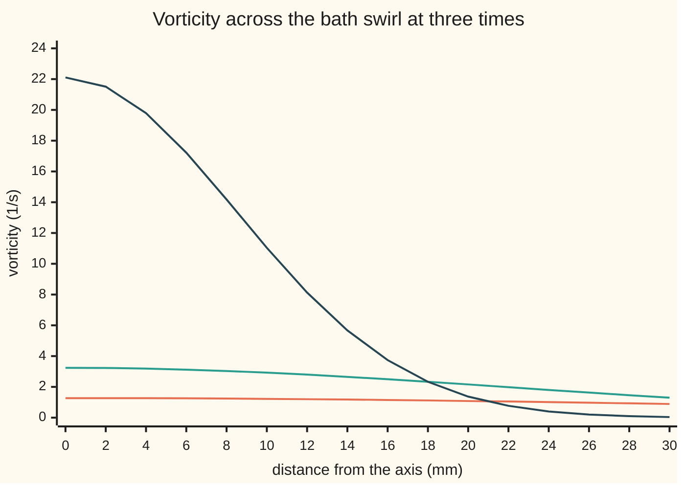
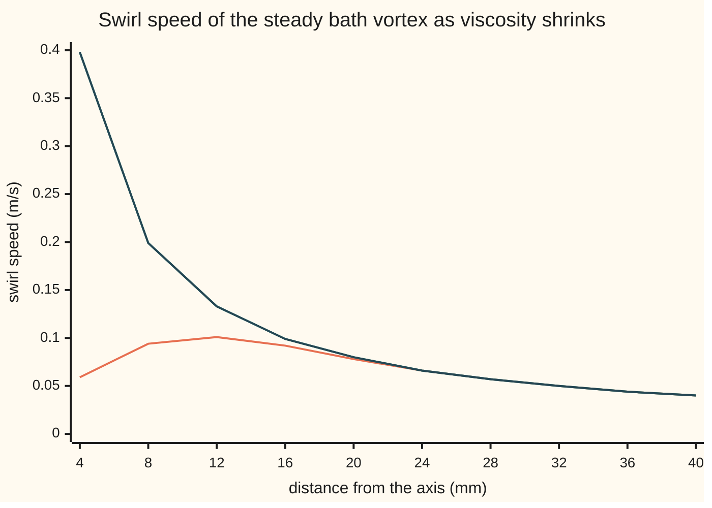

# Vorticity: the spin form of the equations, and the zero-viscosity limit

[Syllabus](../../../SYLLABUS.md) → [Partial differential equations](../README.md) → [Nonlinear PDE and Fluids](../README.md#s07) → Vorticity

---

## General Overview

Pull the plug in a full bath. At first the water turns only lazily, in a broad swirl whose core radius is 50 mm. A few minutes later a tight whirl sits over the plug, its core radius settling at 10 mm, and the water on its axis turns 2.53 times a second. Nobody stirred it harder: the drain gathered the faint swirl that was already there.

The drain pulls water down. Each vertical column of water over the plug gets longer and thinner, like stretched dough. A thinner column of spinning water spins faster, as a skater spins faster with arms pulled in. This is **vortex stretching**, and only three-dimensional flow can do it.

A smoke ring shows the same effect from the side. Blown at 0.4932 m/s with a 50 mm radius, it widens as it nears a wall. Its core gets thinner and spins twice as fast by the time its radius is 100 mm.

This card rewrites the fluid equations in terms of spin. In [Navier-Stokes](01-navier-stokes-derivation.md) the unknowns are velocity and pressure. Here the unknown is the **vorticity**: the curl of the velocity, a measure of local spin ([Divergence and curl](../../06-Calculus%20and%20analysis/09-Vector%20Calculus/03-divergence-and-curl.md)). Pressure drops out. What is left says only three things happen to spin: the flow carries it, the flow stretches and tilts it, and viscosity spreads it.

### The picture: the bath swirl tightening as the plug drains



Orange: the swirl when the plug is pulled, core radius 50 mm. Teal: 25 s later. Dark blue: 100 s later, core radius 12.00 mm, with peak vorticity 22.11 per second. The total spin, the area under each curve weighted by circle size, stays the same: only its spread changes.

The second half of the card asks what viscosity does. Water's viscosity is small, so it is tempting to drop it and use the **Euler equations**: Navier-Stokes with zero viscosity. In the bath, Euler's core never stops shrinking. Viscosity stops it at 10.00 mm. As viscosity shrinks toward zero, the core shrinks too, yet the energy the swirl loses each second does not shrink at all.

**Taking the curl of the fluid equations removes the pressure and leaves one equation for spin, in which the flow carries vorticity, stretches and tilts it in three dimensions, and viscosity spreads it; dropping viscosity gives the Euler equations, whose stretched cores never stop thinning.**

**What kind of fact this is:** the vorticity equation is a theorem, proved on this card in Why it works. The bath swirl is an exact solution of it (the Burgers vortex, proved here too), used as a model of a drain. Whether three-dimensional Euler or Navier-Stokes flows stay smooth for all time is open as of 2026-11-15.

---

## The formula

Notation from [Navier-Stokes](01-navier-stokes-derivation.md): velocity $`\mathbf{u}`$ in m/s, pressure $`p`$, density $`\rho`$, kinematic viscosity $`\nu`$, and $`D/Dt = \partial/\partial t + \mathbf{u}\cdot\nabla`$, the rate of change seen while riding with the fluid. The water is incompressible: $`\nabla\cdot\mathbf{u} = 0`$.

This card introduces the **vorticity** $`\boldsymbol{\omega} = \nabla\times\mathbf{u}`$, in units of 1/s. On this shelf $`\omega`$ is vorticity, not a frequency. It is also not the spin rate called $`\omega`$ on [Divergence and curl](../../06-Calculus%20and%20analysis/09-Vector%20Calculus/03-divergence-and-curl.md): a small blob of fluid spins at half the vorticity.

```math
\frac{D\boldsymbol{\omega}}{Dt} = (\boldsymbol{\omega}\cdot\nabla)\,\mathbf{u} + \nu\,\Delta\boldsymbol{\omega}
```

**Read it aloud:** following the fluid, the spin changes only as the flow stretches or tilts it, and as viscosity spreads it.

Set $`\nu = 0`$ and this is the vorticity form of the **Euler equations**, the equations of a fluid with no viscosity.

In the bath, the flow near the plug is the **Burgers vortex**. Take the axis of the swirl as the $`z`$ axis, pointing toward the plug, and $`r`$ as distance from it. The water flows in at $`-ar/2`$, runs along the axis at $`az`$, and swirls. Its vorticity points along the axis and has the bell shape

```math
\omega(r, t) = \frac{\Gamma}{\pi\,\delta^2}\, e^{-r^2/\delta^2}, \qquad \frac{d(\delta^2)}{dt} = 4\nu - a\,\delta^2
```

**Read it aloud:** the swirl keeps its total spin and its bell shape; the stretching squeezes the bell's width, viscosity widens it, and they balance at a core width of the square root of four nu over a.

| Symbol | Plain meaning | In our example | Push it up and the answer… |
| --- | --- | --- | --- |
| $`\mathbf{u}`$; $`u_r`$, $`u_\theta`$, $`u_z`$ | velocity; its inward, swirling and along-axis parts, m/s | inflow $`-ar/2`$; fastest swirl 0.1016 m/s at 11.21 mm; along axis $`az`$ | — |
| $`r`$, $`\theta`$, $`z`$, $`t`$; $`\mathbf{x}`$ | distance from the swirl's axis; the angle round it, not the angle from a pole; distance along it toward the plug; time since the plug was pulled; any point | 0 to 30 mm; 0 to 200 s | — |
| $`\boldsymbol{\omega}`$, $`\omega`$ | vorticity: the curl of velocity, twice the local spin rate, 1/s | 31.83 1/s on the axis when steady | faster spin |
| $`\nu`$; Re | kinematic viscosity: how fast momentum spreads, m²/s; the Reynolds number, inertia over viscosity | water, about $`10^{-6}`$; Re = 50000 in the house pipe | wider core, lower peak |
| $`p`$, $`\rho`$ | pressure; density | water, 1000 kg/m³; pressure drops out | — |
| $`\Delta`$; $`D/Dt`$ | the Laplacian, $`\partial^2/\partial x^2 + \partial^2/\partial y^2 + \partial^2/\partial z^2`$; the rate of change riding with the fluid | $`\nu\Delta\omega`$ = −1.2732 1/s² on the axis; net change 0 there when steady | — |
| $`a`$ | stretching rate: how fast the drain lengthens a column of water, 1/s | 0.04 (illustrative) | thinner core, higher peak |
| $`\Gamma`$ | circulation: the swirl speed times the length round a circle that holds all the spin, m²/s | 0.01 (illustrative) | every speed scales with it |
| $`\delta`$, $`\delta_0`$; $`s`$ | core radius: where vorticity falls to $`1/e`$ of its peak; its start value; $`s = \delta^2`$ in the proof | $`\delta_0`$ = 50 mm; 10.00 mm when steady | — |
| $`R`$, $`c`$, $`U`$ | a smoke ring's radius, its core radius, its speed | 50 mm, 5 mm, 0.4932 m/s | wider ring: slower |
| $`\omega_\theta`$ | the smoke ring's vorticity, pointing round the ring | 954.9 1/s | — |
| $`T^*`$ | a time at which a smooth solution might stop being smooth | none for the bath | — |

### When it holds

- **Incompressible flow.** The derivation uses $`\nabla\cdot\mathbf{u} = 0`$. In a gas moving near the speed of sound, an extra term appears, and density changes can create spin.
- **Constant density.** Where density varies, as in warm water lying on cold, pressure and density gradients together make new vorticity. The equation gains a term.
- **A smooth flow.** The vorticity equation needs two derivatives of velocity, three with viscosity. Weak solutions, such as [Leray's weak solutions](02-leray-weak-solutions-of-navier-stokes.md), satisfy it only in an averaged sense.
- **The Burgers vortex is a model.** A real drain's inflow is not exactly $`-ar/2`$, and the surface dips into an air core. The model gives the right core size and balance, not the dip.
- **Euler needs no walls, or slip at walls.** Real water sticks to a wall. Setting $`\nu = 0`$ cannot keep that condition, which is why the zero-viscosity limit near a wall is hard.

---

## Why it works

### Step 0: the curl of a gradient is zero, so pressure drops out

Pressure pushes on a blob of fluid through its gradient, and a pure gradient push cannot start a blob spinning: $`\nabla\times\nabla p = 0`$. Gravity is a gradient too. Take the curl of every term of Navier-Stokes, and both disappear. The only work is to rewrite the curl of the inertia term, $`(\mathbf{u}\cdot\nabla)\mathbf{u}`$, so that its meaning shows: carrying plus stretching and tilting.

### Step 1: take the curl

Navier-Stokes, divided by $`\rho`$ and with gravity folded into the pressure, is

```math
\frac{\partial \mathbf{u}}{\partial t} + (\mathbf{u}\cdot\nabla)\,\mathbf{u} = -\frac{1}{\rho}\nabla p + \nu\,\Delta\mathbf{u}
```

A vector identity splits the inertia term into a gradient and a cross product: $`(\mathbf{u}\cdot\nabla)\mathbf{u} = \nabla(\lvert\mathbf{u}\rvert^2/2) - \mathbf{u}\times\boldsymbol{\omega}`$. Take the curl of both sides, and the gradients vanish. The curl of $`\mathbf{u}\times\boldsymbol{\omega}`$ expands into four terms. Two are zero, by incompressibility and because a curl has no divergence. The other two are the carrying term and the stretching term.

<details>
<summary>Detailed proof: the curl of Navier-Stokes is the vorticity equation</summary>

The identity for the inertia term holds component by component: for each $`i`$, $`u_j\,\partial_j u_i = \partial_i(u_j u_j/2) - (\mathbf{u}\times\boldsymbol{\omega})_i`$, with repeated $`j`$ summed. Check it by writing $`(\mathbf{u}\times\boldsymbol{\omega})_i = u_j\,\partial_i u_j - u_j\,\partial_j u_i`$, which is the cross product of $`\mathbf{u}`$ with a curl written out.

So Navier-Stokes reads

$`\displaystyle \frac{\partial \mathbf{u}}{\partial t} - \mathbf{u}\times\boldsymbol{\omega} = -\nabla\left(\frac{p}{\rho} + \frac{|\mathbf{u}|^2}{2}\right) + \nu\,\Delta\mathbf{u}.`$

Take the curl. The curl of a gradient is zero, and the curl commutes with $`\partial/\partial t`$ and with $`\Delta`$:

$`\displaystyle \frac{\partial \boldsymbol{\omega}}{\partial t} - \nabla\times(\mathbf{u}\times\boldsymbol{\omega}) = \nu\,\Delta\boldsymbol{\omega}.`$

The product rule for the curl of a cross product gives

$`\displaystyle \nabla\times(\mathbf{u}\times\boldsymbol{\omega}) = (\boldsymbol{\omega}\cdot\nabla)\mathbf{u} - (\mathbf{u}\cdot\nabla)\boldsymbol{\omega} + \mathbf{u}\,(\nabla\cdot\boldsymbol{\omega}) - \boldsymbol{\omega}\,(\nabla\cdot\mathbf{u}).`$

The last two terms are zero. Substituting,

$`\displaystyle \frac{\partial \boldsymbol{\omega}}{\partial t} + (\mathbf{u}\cdot\nabla)\boldsymbol{\omega} = (\boldsymbol{\omega}\cdot\nabla)\mathbf{u} + \nu\,\Delta\boldsymbol{\omega},`$

which is the formula, since the left side is $`D\boldsymbol{\omega}/Dt`$.

</details>

### Step 2: in two dimensions there is no stretching

In a flat flow, velocity lies in the $`(x, y)`$ plane and does not change with $`z`$. The vorticity then points straight out of the plane, along $`z`$. The stretching term is $`\omega\,\partial\mathbf{u}/\partial z`$, which is zero.

So in two dimensions the equation is $`D\omega/Dt = \nu\Delta\omega`$: vorticity is carried and spread, like heat in a moving fluid. By [Diffusion's maximum principle](../03-The%20Heat%20Equation%20in%20Depth/04-maximum-principle-for-the-heat-equation.md), the largest vorticity can never rise. With $`\nu = 0`$, each blob keeps its vorticity for ever. This bound is why smooth two-dimensional flows, Euler or Navier-Stokes, stay smooth for all time (Majda and Bertozzi, in Sources).

### Step 3: in three dimensions, stretching spins the fluid up

Read $`(\boldsymbol{\omega}\cdot\nabla)\mathbf{u}`$ as "how fast velocity changes along the spin axis". If water ahead along the axis moves faster than water behind, the fluid between is pulled longer, and its vorticity grows at that rate. That is the part of $`(\boldsymbol{\omega}\cdot\nabla)\mathbf{u}`$ along $`\boldsymbol{\omega}`$. The part across $`\boldsymbol{\omega}`$ tilts: it turns the spin axis. Tilting is how a storm's horizontal spin, made by wind that blows faster higher up, is turned upright into a tornado.

The smoke ring shows it in one line. The ring is round and has no swirl about its own axis, so its vorticity $`\omega_\theta`$ points round the ring. For such a flow the stretching term reduces to $`\omega_\theta\,u_r/r`$, and the distance $`r`$ of a fluid particle changes at $`u_r`$. With $`\nu = 0`$:

```math
\frac{D\omega_\theta}{Dt} = \omega_\theta\,\frac{u_r}{r}, \qquad \frac{Dr}{Dt} = u_r \qquad\Longrightarrow\qquad \frac{D}{Dt}\!\left(\frac{\omega_\theta}{r}\right) = 0
```

So $`\omega_\theta/r`$ is carried unchanged. A ring that widens from 50 mm to 100 mm doubles its core vorticity, from 954.9 to 1909.9 1/s.

A second road gives the same answer. The core is a thin tube of fluid. Its circulation stays fixed (Kelvin's theorem, from Saffman in Sources), and its volume, $`2\pi R \cdot \pi c^2`$, stays fixed. Doubling $`R`$ halves $`c^2`$, so the core radius falls from 5 mm to 3.54 mm and the vorticity $`\Gamma/(\pi c^2)`$ doubles.

The ring's speed comes from Kelvin's thin-ring formula, $`U = \frac{\Gamma}{4\pi R}\bigl(\ln(8R/c) - 1/4\bigr)`$, stated here with its source. With the ring's 0.075 m²/s circulation, its own speed falls from 0.4932 m/s at 50 mm to 0.3087 m/s at 100 mm. The formula is for a ring on its own; near a wall, the wall slows it further.

### Step 4: the bath plug, solved exactly

In the bath the vorticity points along the axis, and so does the stretching: the drain lengthens each column at rate $`a`$. So the stretching term is $`a\,\omega`$, and the equation becomes

```math
\frac{\partial \omega}{\partial t} = \underbrace{\frac{ar}{2}\,\frac{\partial \omega}{\partial r}}_{\text{inflow}} + \underbrace{a\,\omega}_{\text{stretching}} + \underbrace{\nu\,\Delta\omega}_{\text{spreading}}
```

Try the bell shape $`\omega = (\Gamma/\pi\delta^2)\,e^{-r^2/\delta^2}`$ with the width $`\delta`$ changing in time. Each term then equals $`\omega`$ times a constant plus $`\omega`$ times a multiple of $`r^2`$. Matching both parts gives one condition, $`d(\delta^2)/dt = 4\nu - a\delta^2`$. Its solution is

```math
\delta^2(t) = \frac{4\nu}{a} + \Bigl(\delta_0^2 - \frac{4\nu}{a}\Bigr)e^{-at}
```

where $`\delta_0`$ is the width at the start. The total spin $`\int\omega\,dA = \Gamma`$ stays fixed, so the peak is $`\Gamma/(\pi\delta^2)`$. The swirl speed follows from Stokes' theorem: $`2\pi r\,u_\theta`$ is the spin inside radius $`r`$, so $`u_\theta = \frac{\Gamma}{2\pi r}\bigl(1 - e^{-r^2/\delta^2}\bigr)`$.

<details>
<summary>Detailed proof: the bell shape solves the bath equation</summary>

Write $`s = \delta^2`$ and $`\omega = (\Gamma/\pi s)\,e^{-r^2/s}`$. Then $`\partial\omega/\partial r = -(2r/s)\,\omega`$, and the Laplacian in the plane is $`\partial^2\omega/\partial r^2 + (1/r)\,\partial\omega/\partial r = (4r^2/s^2 - 4/s)\,\omega`$. Divide the bath equation by $`\omega`$. The left side is

$`\displaystyle \frac{1}{\omega}\frac{\partial\omega}{\partial t} = -\frac{s'}{s} + \frac{r^2 s'}{s^2},`$

and the right side is

$`\displaystyle -\frac{a r^2}{s} + a + \nu\left(\frac{4r^2}{s^2} - \frac{4}{s}\right).`$

The parts without $`r^2`$ match when $`-s'/s = a - 4\nu/s`$. The parts with $`r^2`$ match when $`s'/s^2 = -a/s + 4\nu/s^2`$. Both say $`s' = 4\nu - a s`$. The velocity $`(-ar/2,\ u_\theta,\ az)`$ has divergence $`-a + a = 0`$, and its curl along the axis is $`(1/r)\,d(r u_\theta)/dr = \omega`$, so the flow is incompressible and has this vorticity.

</details>

The steady core, $`\delta = \sqrt{4\nu/a}`$, is where stretching, $`a\omega`$, equals spreading, $`4\nu\omega/\delta^2`$, on the axis.

### Step 5: the zero-viscosity limit

Set $`\nu = 0`$ and the core width obeys $`\delta^2 = \delta_0^2 e^{-at}`$. It shrinks for ever, and the peak grows like $`e^{at}`$. Euler gives no steady whirl at all.

Now keep $`\nu > 0`$ but let it shrink. The steady core is $`\sqrt{4\nu/a}`$, so it thins like $`\sqrt{\nu}`$, and the peak $`\Gamma a/(4\pi\nu)`$ grows like $`1/\nu`$. Outside the core the swirl tends to $`\Gamma/(2\pi r)`$, the Euler **line vortex**, whose spin is all on the axis.

The swirl loses energy to viscosity at $`\rho\nu\int\omega^2\,dA`$ per metre of its length. For the steady core that is

```math
\rho\,\nu\int \omega^2\,dA = \rho\,\nu\,\frac{\Gamma^2 a^2}{16\pi^2\nu^2}\cdot\frac{\pi}{2}\cdot\frac{4\nu}{a} = \frac{\rho\,\Gamma^2 a}{8\pi}
```

The viscosity cancels. However small $`\nu`$ is, the swirl loses 1.592e-04 W per metre. Euler with $`\nu = 0`$ loses nothing. So the limit of the viscous swirl is not a smooth Euler flow: it is a singular line vortex that still loses energy. [Entropy conditions](../02-First-Order%20Equations%20and%20Characteristics/03-entropy-conditions-and-vanishing-viscosity.md) met the same pattern in one dimension, where shrinking viscosity picks a shock that dissipates.

What is proved about the limit:

| Setting | Euler ($`\nu = 0`$) | Navier-Stokes ($`\nu > 0`$) |
| --- | --- | --- |
| Vorticity equation | carried, stretched and tilted | carried, stretched, tilted and spread |
| At a solid wall | the fluid slides along it | the fluid sticks to it |
| Energy of a smooth flow | kept | lost at $`\rho\nu\int\lvert\boldsymbol{\omega}\rvert^2`$, with no walls |
| Bath plug core at 200 s | 0.92 mm and still shrinking | 10.04 mm, settling at 10.00 mm |
| Two dimensions, smooth start | smooth for all time | smooth for all time, and tends to Euler as $`\nu \to 0`$ with no walls |
| Three dimensions, smooth start, all of space | open | open: the Clay problem |

### Step 6: when could a smooth flow break? The Beale-Kato-Majda test

In three dimensions, stretching might pile vorticity up without limit. Beale, Kato and Majda proved that this is the only way a smooth Euler flow can break. If a smooth solution stops being smooth at a time $`T^*`$, then

```math
\int_0^{T^*} \max_{\mathbf{x}}\,|\boldsymbol{\omega}(\mathbf{x}, t)|\,dt = \infty
```

**Read it aloud:** a breakdown needs the largest spin, added up over time, to be infinite.

The inviscid bath's peak grows like $`e^{at}`$. Over the first 100 s its integral is 1706.08. That is large but finite, and it is finite for every end time. The bath model lies outside the theorem, which is about flows of finite energy in all of space, since the model's inflow grows without bound. But it shows the same picture: a finite integral and no breakdown. The bath swirl never breaks in finite time; it thins for ever instead. Whether some smooth three-dimensional flow in all of space does break is open as of 2026-11-15. [The energy inequality, and the gap it leaves in three dimensions](03-energy-inequality-and-the-regularity-question.md) shows why the energy alone cannot rule it out.

---

## Worked numbers, by hand

The steady bath swirl: water, $`\nu = 10^{-6}`$ m²/s, $`a = 0.04`$ 1/s, $`\Gamma = 0.01`$ m²/s.

| Step | Arithmetic | Value |
| --- | --- | --- |
| core width squared | 4 × 10⁻⁶ ÷ 0.04 | 10⁻⁴ m² |
| core radius $`\delta`$ | √(10⁻⁴) | 10.00 mm |
| peak vorticity | 0.01 ÷ (π × 10⁻⁴) | 31.83 1/s |
| spin on the axis | 31.83 ÷ 2, then ÷ 2π | 15.92 rad/s = 2.53 turns/s |
| stretching on the axis | 0.04 × 31.83 | +1.2732 1/s² |
| spreading on the axis | 10⁻⁶ × (−4 × 31.83 ÷ 10⁻⁴) | −1.2732 1/s² |
| inflow on the axis | $`(ar/2)\,\partial\omega/\partial r`$ at $`r = 0`$ | 0 |
| net change | 1.2732 − 1.2732 + 0 | **0: steady, a 10.00 mm core spinning 2.53 turns a second** |
| swirl at 30 mm | 0.01 ÷ (2π × 0.03) | 0.05305 m/s |
| energy lost | 1000 × 0.01² × 0.04 ÷ (8π) | 1.592e-04 W per metre |

The answer means the whirl over the plug is self-sustaining. The drain stretches spin in exactly as fast as viscosity spreads it out, so the core neither widens nor tightens.

### What breaks if you drop a piece

| Mistake | Comes out at | What went wrong |
| --- | --- | --- |
| Drop the stretching term, as in two dimensions | peak 0.405 1/s at 100 s, not 22.11; circulation falls to 0.000183 m²/s | The inflow crowds each ring of water into less area, and only stretching raises its spin to match; without it the circulation drains away |
| Use Euler for the core | 0.124 mm at 300 s, not 10.00 mm | With no viscosity nothing stops the thinning |
| Read vorticity as the spin rate | 5.07 turns/s, not 2.53 | A blob spins at half the vorticity |
| Widen the smoke ring with no stretching | 954.9 1/s, not 1909.9 | The core thins as the ring widens, and spins up |

The checks print every row.

---

## How the swirl tightens as the bath drains

The puzzle: three effects act at once, and two of them fight. Here is one swirl, core radius 50 mm when the plug is pulled, traced with and without viscosity.

| Time | Core, viscous | Peak, viscous | Core, Euler | Peak, Euler |
| ---: | ---: | ---: | ---: | ---: |
| 0 s | 50.00 mm | 1.27 1/s | 50.00 mm | 1.27 1/s |
| 25 s | 31.35 mm | 3.24 1/s | 30.33 mm | 3.46 1/s |
| 50 s | 20.61 mm | 7.49 1/s | 18.39 mm | 9.41 1/s |
| 100 s | 12.00 mm | 22.11 1/s | 6.77 mm | 69.52 1/s |
| 200 s | 10.04 mm | 31.58 1/s | 0.92 mm | 3795.47 1/s |

For 25 s the columns barely differ: viscosity hardly acts on a wide core. By 100 s the viscous core has nearly stopped at 10 mm, while Euler's keeps thinning like $`e^{-at/2}`$.

One force at a time, on the axis of the steady swirl, in 1/s²:

```
stretching   +1.2732  ##########################
spreading    -1.2732  ##########################  (removes)
inflow        0.0000
net           0.0000
```

The combined picture, for the steady swirl at three viscosities:



Orange: water, $`\nu = 10^{-6}`$ m²/s, a 10 mm core. Teal: $`\nu = 10^{-8}`$ m²/s, a 1 mm core. Dark blue: the Euler line vortex $`\Gamma/(2\pi r)`$, hidden under teal, which matches it to three decimals from 4 mm out. Outside the core viscosity changes nothing; inside, it decides everything.

| $`\nu`$, m²/s | core $`\delta`$, mm | peak, 1/s | swirl at 30 mm, m/s | energy lost, W/m |
| ---: | ---: | ---: | ---: | ---: |
| 1e-06 | 10.000 | 31.8 | 0.05305 | 1.592e-04 |
| 1e-07 | 3.162 | 318.3 | 0.05305 | 1.592e-04 |
| 1e-08 | 1.000 | 3183.1 | 0.05305 | 1.592e-04 |
| 1e-09 | 0.316 | 31831.0 | 0.05305 | 1.592e-04 |
| 0 (Euler) | 0 | infinite | 0.05305 | 0 |

---

## Code, from first principles, and it actually runs

Both programs work the bath swirl and the smoke ring, by six roads. The bath's closed form is checked against a radial grid stepped in time by RK4 (the classical fourth-order Runge-Kutta method) at two grid steps, showing second-order accuracy. Its residual (what is left when it is put into the equation) is taken by centred differences at two steps. The axis budget uses a finite-difference Laplacian. The energy loss is a midpoint sum at four viscosities, against $`\rho\Gamma^2 a/(8\pi)`$. The ring's doubling is found three ways: $`\omega_\theta/r`$ kept, core volume kept, and RK4 along one particle.

### Python

```python
# Vorticity and the Euler equations -- the check behind the card.  Standard library only.
# Bath plug: a swirl of circulation G in water, stretched along its axis at rate A
# by the flow into the drain (the Burgers vortex).  Smoke ring: a thin ring that
# widens as it nears a wall.  Roads: closed forms; a radial grid stepped by RK4;
# centred-difference residuals; quadrature; RK4 along a particle of the ring.
import math

NU, A, G, S0, RHO = 1.0e-6, 0.04, 0.01, 2.5e-3, 1000.0  # m^2/s, 1/s, m^2/s, m^2, kg/m^3

def core2(t, nu=NU): return 4 * nu / A + (S0 - 4 * nu / A) * math.exp(-A * t)  # delta^2
def om(r, s, g=G): return g / (math.pi * s) * math.exp(-r * r / s)              # vorticity
def swirl(r, s): return G / (2 * math.pi * r) * (1 - math.exp(-r * r / s))      # u_theta
def sci(v):
    e = math.floor(math.log10(abs(v))); m = v / 10 ** e
    return f"{m:.3f}e{e:+03d}"

def resid(x, y, h, s):               # steady equation u.grad(w) - A w - NU lap(w), centred
    w = lambda X, Y: om(math.hypot(X, Y), s)
    r = math.hypot(x, y); v = swirl(r, s)
    ux, uy = -A * x / 2 - v * y / r, -A * y / 2 + v * x / r
    wx = (w(x + h, y) - w(x - h, y)) / (2 * h); wy = (w(x, y + h) - w(x, y - h)) / (2 * h)
    lap = (w(x + h, y) + w(x - h, y) + w(x, y + h) + w(x, y - h) - 4 * w(x, y)) / h ** 2
    return ux * wx + uy * wy - A * w(x, y) - NU * lap, NU * lap

def grid(dr, T=60.0, dt=0.1, R=0.25):  # w_t = (A r/2) w_r + A w + NU (w_rr + w_r/r)
    n = round(R / dr); w = [om(i * dr, S0) for i in range(n + 1)]
    def rate(w):
        d = [0.0] * (n + 1); d[0] = A * w[0] + 4 * NU * (w[1] - w[0]) / dr ** 2
        for i in range(1, n):
            r = i * dr; wr = (w[i + 1] - w[i - 1]) / (2 * dr)
            d[i] = A * r / 2 * wr + A * w[i] + NU * ((w[i + 1] - 2 * w[i] + w[i - 1]) / dr ** 2 + wr / r)
        return d
    for _ in range(round(T / dt)):
        k1 = rate(w); k2 = rate([a + dt / 2 * b for a, b in zip(w, k1)])
        k3 = rate([a + dt / 2 * b for a, b in zip(w, k2)]); k4 = rate([a + dt * b for a, b in zip(w, k3)])
        w = [a + dt / 6 * (b + 2 * c + 2 * d + e) for a, b, c, d, e in zip(w, k1, k2, k3, k4)]
    err = max(abs(w[i] - om(i * dr, core2(T))) for i in range(n + 1))
    return err, sum(w[i] * 2 * math.pi * i * dr * dr for i in range(1, n))

s = 4 * NU / A; d = math.sqrt(s); w0 = om(0.0, s)
lo, hi = 1.0, 2.0                    # peak swirl where e^x = 1 + 2x, x = r^2/delta^2
for _ in range(60):
    mid = (lo + hi) / 2; lo, hi = (mid, hi) if math.exp(mid) - 1 - 2 * mid < 0 else (lo, mid)
rs = d * math.sqrt(lo); vs = swirl(rs, s)
vscan = max(swirl(0.005 + i * 1e-6, s) for i in range(15001))
print("BATH PLUG, steady: G = 0.01 m^2/s, stretching A = 0.04 1/s, water NU = 1e-6 m^2/s")
print(f"  core radius delta = sqrt(4 NU/A) = {d * 1000:.2f} mm; peak vorticity {w0:.2f} 1/s")
print(f"  water on the axis spins at {w0 / 2:.2f} rad/s = {w0 / (4 * math.pi):.2f} turns/s")
print(f"  fastest swirl {vs:.4f} m/s at r = {rs * 1000:.2f} mm (scan: {vscan:.4f} m/s)")
_, lap0 = resid(1e-9, 0.0, 1e-4, s)
print(f"  budget on the axis, 1/s^2: stretching {A * w0:+.4f}, diffusion {lap0:+.4f}, inflow +0.0000")
r1, _ = resid(0.003, 0.004, 2e-4, s); r2, _ = resid(0.003, 0.004, 1e-4, s)
print(f"  residual at r = 5 mm: {sci(r1)} at h = 0.2 mm, {sci(r2)} at h = 0.1 mm (ratio {r1 / r2:.2f})")
print(f"  circulation 2 pi r u_theta at r = 50 mm: {2 * math.pi * 0.05 * swirl(0.05, s):.6f} m^2/s")

print("DRAINING: core radius 50 mm at the start; t s | delta mm, peak 1/s with NU | Euler (NU = 0)")
for t in (0, 25, 50, 100, 200):
    sn, se = core2(t), S0 * math.exp(-A * t)
    print(f"  {t:3d} | {math.sqrt(sn) * 1000:6.2f} {om(0, sn):7.2f} | {math.sqrt(se) * 1000:6.2f} {om(0, se):8.2f}")
e1, c1 = grid(1e-3); e2, c2 = grid(5e-4)
print(f"  grid at 60 s: peak exact {om(0, core2(60)):.4f} 1/s; max error {sci(e1)} at dr = 1 mm, "
      f"{sci(e2)} at 0.5 mm, order {math.log2(e1 / e2):.2f}")
print(f"  circulation on the grid at 60 s: {c1:.6f} and {c2:.6f} m^2/s (start {G:.6f})")
bkm = G / (math.pi * S0) * (math.exp(A * 100) - 1) / A
quad = sum(om(0, S0 * math.exp(-A * (k + 0.5) * 0.01)) for k in range(10000)) * 0.01
print(f"  Euler: integral of peak vorticity over 0..100 s = {bkm:.2f} (midpoint sum {quad:.2f})")

print("ZERO-VISCOSITY LIMIT, steady: NU m^2/s | delta mm | peak 1/s | swirl at 30 mm m/s | loss W/m")
loss = []
for nu in (1e-6, 1e-7, 1e-8, 1e-9):
    sv = 4 * nu / A; dl = 8 * math.sqrt(sv) / 4000
    p = RHO * nu * sum(om((k + 0.5) * dl, sv) ** 2 * 2 * math.pi * (k + 0.5) * dl * dl for k in range(4000))
    loss.append(p)
    print(f"  {nu:.0e} | {math.sqrt(sv) * 1000:6.3f} | {om(0, sv):9.1f} | {swirl(0.03, sv):.5f} | {sci(p)}")
lv = G / (2 * math.pi * 0.03); pf = RHO * G * G * A / (8 * math.pi)
print(f"  Euler line vortex: swirl at 30 mm {lv:.5f} m/s, loss 0; formula RHO G^2 A/(8 pi) = {sci(pf)} W/m")

print("SMOKE RING in air: radius 50 mm, core 5 mm, circulation 0.075 m^2/s")
GR, R0, C0 = 0.075, 0.05, 0.005
spd = lambda R, c: GR / (4 * math.pi * R) * (math.log(8 * R / c) - 0.25)
wr0 = GR / (math.pi * C0 ** 2); c1r = C0 * math.sqrt(R0 / 0.1)
print(f"  core vorticity {wr0:.1f} 1/s; ring speed {spd(R0, C0):.4f} m/s")
r, w, b, nst = R0, wr0, 1.0, 1000; h = 2 * math.log(2) / b / nst
f = lambda r, w: (b * r / 2, w * (b * r / 2) / r)       # dr/dt = u_r, dw/dt = w u_r / r
for _ in range(nst):
    k1 = f(r, w); k2 = f(r + h / 2 * k1[0], w + h / 2 * k1[1])
    k3 = f(r + h / 2 * k2[0], w + h / 2 * k2[1]); k4 = f(r + h * k3[0], w + h * k3[1])
    r += h / 6 * (k1[0] + 2 * k2[0] + 2 * k3[0] + k4[0]); w += h / 6 * (k1[1] + 2 * k2[1] + 2 * k3[1] + k4[1])
wv = GR / (math.pi * c1r ** 2)
print(f"  widened to 100 mm: w/r kept {wr0 * 0.1 / R0:.1f}; core volume kept {wv:.1f} (core {c1r * 1000:.2f} mm); "
      f"RK4 {w:.1f} 1/s at r = {r * 1000:.2f} mm")
print(f"  ring speed at 100 mm: {spd(0.1, c1r):.4f} m/s")
print(f"PIPE, laminar: wall vorticity 4 U/R = {4 * 1.0 / 0.025:.0f} 1/s; Re = U D/NU = {1.0 * 0.05 / NU:.0f}")

print("MISTAKES")
s100 = core2(100)
print(f"  drop stretching: peak at 100 s {G * math.exp(-A * 100) / (math.pi * s100):.3f} 1/s, "
      f"not {om(0, s100):.2f}; circulation {G * math.exp(-A * 100):.6f} m^2/s")
print(f"  Euler for the core: delta at 300 s {math.sqrt(S0 * math.exp(-A * 300)) * 1000:.3f} mm, "
      f"not {math.sqrt(core2(300)) * 1000:.2f} mm")
print(f"  vorticity read as spin: {w0 / (2 * math.pi):.2f} turns/s, not {w0 / (4 * math.pi):.2f}")
print(f"  ring widened without stretching: {wr0:.1f} 1/s, not {wv:.1f}")
print("chart r mm:    " + ", ".join(str(k) for k in range(0, 31, 2)))
for t in (0, 25, 100):
    print(f"chart w t={t:3d}: " + ", ".join(f"{om(k / 1000, core2(t)):.2f}" for k in range(0, 31, 2)))
print("chart r mm:    " + ", ".join(str(k) for k in range(4, 41, 4)))
for nu in (1e-6, 1e-8):
    print(f"chart u {nu:.0e}: " + ", ".join(f"{swirl(k / 1000, 4 * nu / A):.3f}" for k in range(4, 41, 4)))
print("chart u Euler: " + ", ".join(f"{G / (2 * math.pi * k / 1000):.3f}" for k in range(4, 41, 4)))

assert abs(vs - vscan) < 1e-6 and abs(A * w0 + lap0) < 1e-3 * A * w0  # budget closes on the axis
assert abs(r2) < 0.01 * A * om(0.01, s) and 3.5 < r1 / r2 < 4.5      # closed form solves the PDE
assert e1 < 0.01 and 1.8 < math.log2(e1 / e2) < 2.2 and abs(c2 - G) < 1e-5  # grid agrees
assert abs(quad - bkm) < 1e-3 * bkm
assert all(abs(p - pf) < 1e-6 * pf for p in loss)                   # loss does not vanish
assert abs(w - wv) < 1e-6 * wv and abs(r - 0.1) < 1e-9
print("ALL CHECKS PASS")
```

**Ran 2026-11-15 on macOS, Python 3.14.10, standard library only. All checks passed. Output, pasted from the run:**

```
BATH PLUG, steady: G = 0.01 m^2/s, stretching A = 0.04 1/s, water NU = 1e-6 m^2/s
  core radius delta = sqrt(4 NU/A) = 10.00 mm; peak vorticity 31.83 1/s
  water on the axis spins at 15.92 rad/s = 2.53 turns/s
  fastest swirl 0.1016 m/s at r = 11.21 mm (scan: 0.1016 m/s)
  budget on the axis, 1/s^2: stretching +1.2732, diffusion -1.2732, inflow +0.0000
  residual at r = 5 mm: -1.757e-03 at h = 0.2 mm, -4.394e-04 at h = 0.1 mm (ratio 4.00)
  circulation 2 pi r u_theta at r = 50 mm: 0.010000 m^2/s
DRAINING: core radius 50 mm at the start; t s | delta mm, peak 1/s with NU | Euler (NU = 0)
    0 |  50.00    1.27 |  50.00     1.27
   25 |  31.35    3.24 |  30.33     3.46
   50 |  20.61    7.49 |  18.39     9.41
  100 |  12.00   22.11 |   6.77    69.52
  200 |  10.04   31.58 |   0.92  3795.47
  grid at 60 s: peak exact 10.0185 1/s; max error 7.708e-03 at dr = 1 mm, 1.931e-03 at 0.5 mm, order 2.00
  circulation on the grid at 60 s: 0.009984 and 0.009996 m^2/s (start 0.010000)
  Euler: integral of peak vorticity over 0..100 s = 1706.08 (midpoint sum 1706.08)
ZERO-VISCOSITY LIMIT, steady: NU m^2/s | delta mm | peak 1/s | swirl at 30 mm m/s | loss W/m
  1e-06 | 10.000 |      31.8 | 0.05305 | 1.592e-04
  1e-07 |  3.162 |     318.3 | 0.05305 | 1.592e-04
  1e-08 |  1.000 |    3183.1 | 0.05305 | 1.592e-04
  1e-09 |  0.316 |   31831.0 | 0.05305 | 1.592e-04
  Euler line vortex: swirl at 30 mm 0.05305 m/s, loss 0; formula RHO G^2 A/(8 pi) = 1.592e-04 W/m
SMOKE RING in air: radius 50 mm, core 5 mm, circulation 0.075 m^2/s
  core vorticity 954.9 1/s; ring speed 0.4932 m/s
  widened to 100 mm: w/r kept 1909.9; core volume kept 1909.9 (core 3.54 mm); RK4 1909.9 1/s at r = 100.00 mm
  ring speed at 100 mm: 0.3087 m/s
PIPE, laminar: wall vorticity 4 U/R = 160 1/s; Re = U D/NU = 50000
MISTAKES
  drop stretching: peak at 100 s 0.405 1/s, not 22.11; circulation 0.000183 m^2/s
  Euler for the core: delta at 300 s 0.124 mm, not 10.00 mm
  vorticity read as spin: 5.07 turns/s, not 2.53
  ring widened without stretching: 954.9 1/s, not 1909.9
chart r mm:    0, 2, 4, 6, 8, 10, 12, 14, 16, 18, 20, 22, 24, 26, 28, 30
chart w t=  0: 1.27, 1.27, 1.27, 1.26, 1.24, 1.22, 1.20, 1.18, 1.15, 1.12, 1.08, 1.05, 1.01, 0.97, 0.93, 0.89
chart w t= 25: 3.24, 3.23, 3.19, 3.12, 3.03, 2.93, 2.80, 2.65, 2.50, 2.33, 2.16, 1.98, 1.80, 1.63, 1.46, 1.30
chart w t=100: 22.11, 21.51, 19.79, 17.22, 14.18, 11.04, 8.13, 5.67, 3.74, 2.33, 1.37, 0.77, 0.40, 0.20, 0.10, 0.04
chart r mm:    4, 8, 12, 16, 20, 24, 28, 32, 36, 40
chart u 1e-06: 0.059, 0.094, 0.101, 0.092, 0.078, 0.066, 0.057, 0.050, 0.044, 0.040
chart u 1e-08: 0.398, 0.199, 0.133, 0.099, 0.080, 0.066, 0.057, 0.050, 0.044, 0.040
chart u Euler: 0.398, 0.199, 0.133, 0.099, 0.080, 0.066, 0.057, 0.050, 0.044, 0.040
ALL CHECKS PASS
```

### Rust

```rust
// Vorticity and the Euler equations -- the check behind the card.  std only.
// Bath plug: a swirl of circulation G in water, stretched along its axis at rate A
// by the flow into the drain (the Burgers vortex).  Smoke ring: a thin ring that
// widens as it nears a wall.  Roads: closed forms; a radial grid stepped by RK4;
// centred-difference residuals; quadrature; RK4 along a particle of the ring.
use std::f64::consts::PI;

const NU: f64 = 1.0e-6; // m^2/s
const A: f64 = 0.04; // 1/s
const G: f64 = 0.01; // m^2/s
const S0: f64 = 2.5e-3; // m^2
const RHO: f64 = 1000.0; // kg/m^3

fn core2(t: f64, nu: f64) -> f64 { 4.0 * nu / A + (S0 - 4.0 * nu / A) * (-A * t).exp() }
fn om(r: f64, s: f64) -> f64 { G / (PI * s) * (-r * r / s).exp() }
fn swirl(r: f64, s: f64) -> f64 { G / (2.0 * PI * r) * (1.0 - (-r * r / s).exp()) }
fn sci(v: f64) -> String {
    let e = v.abs().log10().floor() as i32;
    let m = v / 10f64.powi(e);
    format!("{:.3}e{}{:02}", m, if e < 0 { '-' } else { '+' }, e.abs())
}

fn resid(x: f64, y: f64, h: f64, s: f64) -> (f64, f64) {
    let w = |a: f64, b: f64| om(a.hypot(b), s);
    let r = x.hypot(y);
    let v = swirl(r, s);
    let (ux, uy) = (-A * x / 2.0 - v * y / r, -A * y / 2.0 + v * x / r);
    let wx = (w(x + h, y) - w(x - h, y)) / (2.0 * h);
    let wy = (w(x, y + h) - w(x, y - h)) / (2.0 * h);
    let lap = (w(x + h, y) + w(x - h, y) + w(x, y + h) + w(x, y - h) - 4.0 * w(x, y)) / (h * h);
    (ux * wx + uy * wy - A * w(x, y) - NU * lap, NU * lap)
}

fn grid(dr: f64) -> (f64, f64) {
    let (tt, dt, rr) = (60.0, 0.1, 0.25);
    let n = (rr / dr).round() as usize;
    let mut w: Vec<f64> = (0..=n).map(|i| om(i as f64 * dr, S0)).collect();
    let rate = |w: &Vec<f64>| -> Vec<f64> {
        let mut d = vec![0.0; n + 1];
        d[0] = A * w[0] + 4.0 * NU * (w[1] - w[0]) / (dr * dr);
        for i in 1..n {
            let r = i as f64 * dr;
            let wr = (w[i + 1] - w[i - 1]) / (2.0 * dr);
            d[i] = A * r / 2.0 * wr + A * w[i]
                + NU * ((w[i + 1] - 2.0 * w[i] + w[i - 1]) / (dr * dr) + wr / r);
        }
        d
    };
    let add = |w: &Vec<f64>, k: &Vec<f64>, c: f64| -> Vec<f64> {
        w.iter().zip(k).map(|(a, b)| a + c * b).collect()
    };
    for _ in 0..(tt / dt as f64).round() as usize {
        let k1 = rate(&w);
        let k2 = rate(&add(&w, &k1, dt / 2.0));
        let k3 = rate(&add(&w, &k2, dt / 2.0));
        let k4 = rate(&add(&w, &k3, dt));
        w = (0..=n).map(|i| w[i] + dt / 6.0 * (k1[i] + 2.0 * k2[i] + 2.0 * k3[i] + k4[i])).collect();
    }
    let err = (0..=n).map(|i| (w[i] - om(i as f64 * dr, core2(tt, NU))).abs()).fold(0.0, f64::max);
    let circ: f64 = (1..n).map(|i| w[i] * 2.0 * PI * i as f64 * dr * dr).sum();
    (err, circ)
}

fn main() {
    let s = 4.0 * NU / A;
    let d = s.sqrt();
    let w0 = om(0.0, s);
    let (mut lo, mut hi) = (1.0f64, 2.0f64);
    for _ in 0..60 {
        let mid = (lo + hi) / 2.0;
        if mid.exp() - 1.0 - 2.0 * mid < 0.0 { lo = mid } else { hi = mid }
    }
    let rs = d * lo.sqrt();
    let vs = swirl(rs, s);
    let vscan = (0..15001).map(|i| swirl(0.005 + i as f64 * 1e-6, s)).fold(0.0, f64::max);
    println!("BATH PLUG, steady: G = 0.01 m^2/s, stretching A = 0.04 1/s, water NU = 1e-6 m^2/s");
    println!("  core radius delta = sqrt(4 NU/A) = {:.2} mm; peak vorticity {:.2} 1/s", d * 1000.0, w0);
    println!("  water on the axis spins at {:.2} rad/s = {:.2} turns/s", w0 / 2.0, w0 / (4.0 * PI));
    println!("  fastest swirl {:.4} m/s at r = {:.2} mm (scan: {:.4} m/s)", vs, rs * 1000.0, vscan);
    let (_, lap0) = resid(1e-9, 0.0, 1e-4, s);
    println!("  budget on the axis, 1/s^2: stretching {:+.4}, diffusion {:+.4}, inflow +0.0000", A * w0, lap0);
    let (r1, _) = resid(0.003, 0.004, 2e-4, s);
    let (r2, _) = resid(0.003, 0.004, 1e-4, s);
    println!("  residual at r = 5 mm: {} at h = 0.2 mm, {} at h = 0.1 mm (ratio {:.2})", sci(r1), sci(r2), r1 / r2);
    println!("  circulation 2 pi r u_theta at r = 50 mm: {:.6} m^2/s", 2.0 * PI * 0.05 * swirl(0.05, s));

    println!("DRAINING: core radius 50 mm at the start; t s | delta mm, peak 1/s with NU | Euler (NU = 0)");
    for t in [0, 25, 50, 100, 200] {
        let (sn, se) = (core2(t as f64, NU), S0 * (-A * t as f64).exp());
        println!("  {:3} | {:6.2} {:7.2} | {:6.2} {:8.2}", t, sn.sqrt() * 1000.0, om(0.0, sn), se.sqrt() * 1000.0, om(0.0, se));
    }
    let (e1, c1) = grid(1e-3);
    let (e2, c2) = grid(5e-4);
    println!("  grid at 60 s: peak exact {:.4} 1/s; max error {} at dr = 1 mm, {} at 0.5 mm, order {:.2}",
        om(0.0, core2(60.0, NU)), sci(e1), sci(e2), (e1 / e2).log2());
    println!("  circulation on the grid at 60 s: {:.6} and {:.6} m^2/s (start {:.6})", c1, c2, G);
    let bkm = G / (PI * S0) * ((A * 100.0).exp() - 1.0) / A;
    let quad: f64 = (0..10000).map(|k| om(0.0, S0 * (-A * (k as f64 + 0.5) * 0.01).exp())).sum::<f64>() * 0.01;
    println!("  Euler: integral of peak vorticity over 0..100 s = {:.2} (midpoint sum {:.2})", bkm, quad);

    println!("ZERO-VISCOSITY LIMIT, steady: NU m^2/s | delta mm | peak 1/s | swirl at 30 mm m/s | loss W/m");
    let mut loss = Vec::new();
    for (nu, lab) in [(1e-6, "1e-06"), (1e-7, "1e-07"), (1e-8, "1e-08"), (1e-9, "1e-09")] {
        let sv = 4.0 * nu / A;
        let dl = 8.0 * sv.sqrt() / 4000.0;
        let p = RHO * nu * (0..4000).map(|k| {
            let r = (k as f64 + 0.5) * dl;
            om(r, sv).powi(2) * 2.0 * PI * r * dl
        }).sum::<f64>();
        loss.push(p);
        println!("  {} | {:6.3} | {:9.1} | {:.5} | {}", lab, sv.sqrt() * 1000.0, om(0.0, sv), swirl(0.03, sv), sci(p));
    }
    let lv = G / (2.0 * PI * 0.03);
    let pf = RHO * G * G * A / (8.0 * PI);
    println!("  Euler line vortex: swirl at 30 mm {:.5} m/s, loss 0; formula RHO G^2 A/(8 pi) = {} W/m", lv, sci(pf));

    println!("SMOKE RING in air: radius 50 mm, core 5 mm, circulation 0.075 m^2/s");
    let (gr, r0, c0) = (0.075f64, 0.05f64, 0.005f64);
    let spd = |rr: f64, c: f64| gr / (4.0 * PI * rr) * ((8.0 * rr / c).ln() - 0.25);
    let wr0 = gr / (PI * c0 * c0);
    let c1r = c0 * (r0 / 0.1).sqrt();
    println!("  core vorticity {:.1} 1/s; ring speed {:.4} m/s", wr0, spd(r0, c0));
    let (mut r, mut w, b, nst) = (r0, wr0, 1.0f64, 1000);
    let h = 2.0 * 2f64.ln() / b / nst as f64;
    let f = |r: f64, w: f64| (b * r / 2.0, w * (b * r / 2.0) / r);
    for _ in 0..nst {
        let k1 = f(r, w);
        let k2 = f(r + h / 2.0 * k1.0, w + h / 2.0 * k1.1);
        let k3 = f(r + h / 2.0 * k2.0, w + h / 2.0 * k2.1);
        let k4 = f(r + h * k3.0, w + h * k3.1);
        r += h / 6.0 * (k1.0 + 2.0 * k2.0 + 2.0 * k3.0 + k4.0);
        w += h / 6.0 * (k1.1 + 2.0 * k2.1 + 2.0 * k3.1 + k4.1);
    }
    let wv = gr / (PI * c1r * c1r);
    println!("  widened to 100 mm: w/r kept {:.1}; core volume kept {:.1} (core {:.2} mm); RK4 {:.1} 1/s at r = {:.2} mm",
        wr0 * 0.1 / r0, wv, c1r * 1000.0, w, r * 1000.0);
    println!("  ring speed at 100 mm: {:.4} m/s", spd(0.1, c1r));
    println!("PIPE, laminar: wall vorticity 4 U/R = {:.0} 1/s; Re = U D/NU = {:.0}", 4.0 * 1.0 / 0.025, 1.0 * 0.05 / NU);

    println!("MISTAKES");
    let s100 = core2(100.0, NU);
    println!("  drop stretching: peak at 100 s {:.3} 1/s, not {:.2}; circulation {:.6} m^2/s",
        G * (-A * 100.0).exp() / (PI * s100), om(0.0, s100), G * (-A * 100.0).exp());
    println!("  Euler for the core: delta at 300 s {:.3} mm, not {:.2} mm",
        (S0 * (-A * 300.0).exp()).sqrt() * 1000.0, core2(300.0, NU).sqrt() * 1000.0);
    println!("  vorticity read as spin: {:.2} turns/s, not {:.2}", w0 / (2.0 * PI), w0 / (4.0 * PI));
    println!("  ring widened without stretching: {:.1} 1/s, not {:.1}", wr0, wv);
    let join = |v: Vec<String>| v.join(", ");
    println!("chart r mm:    {}", join((0..=30).step_by(2).map(|k| k.to_string()).collect()));
    for t in [0, 25, 100] {
        println!("chart w t={:3}: {}", t, join((0..=30).step_by(2).map(|k| format!("{:.2}", om(k as f64 / 1000.0, core2(t as f64, NU)))).collect()));
    }
    println!("chart r mm:    {}", join((4..=40).step_by(4).map(|k| k.to_string()).collect()));
    for (nu, lab) in [(1e-6, "1e-06"), (1e-8, "1e-08")] {
        println!("chart u {}: {}", lab, join((4..=40).step_by(4).map(|k| format!("{:.3}", swirl(k as f64 / 1000.0, 4.0 * nu / A))).collect()));
    }
    println!("chart u Euler: {}", join((4..=40).step_by(4).map(|k| format!("{:.3}", G / (2.0 * PI * k as f64 / 1000.0))).collect()));

    assert!((vs - vscan).abs() < 1e-6 && (A * w0 + lap0).abs() < 1e-3 * A * w0); // budget closes on the axis
    assert!(r2.abs() < 0.01 * A * om(0.01, s) && 3.5 < r1 / r2 && r1 / r2 < 4.5); // closed form solves the PDE
    assert!(e1 < 0.01 && 1.8 < (e1 / e2).log2() && (e1 / e2).log2() < 2.2 && (c2 - G).abs() < 1e-5); // grid agrees
    assert!((quad - bkm).abs() < 1e-3 * bkm);
    assert!(loss.iter().all(|p| (p - pf).abs() < 1e-6 * pf)); // loss does not vanish
    assert!((w - wv).abs() < 1e-6 * wv && (r - 0.1).abs() < 1e-9);
    println!("ALL CHECKS PASS");
}
```

**Ran 2026-11-15 on macOS, rustc 1.98.1, no crates. All checks passed. Output, pasted from the run:**

```
BATH PLUG, steady: G = 0.01 m^2/s, stretching A = 0.04 1/s, water NU = 1e-6 m^2/s
  core radius delta = sqrt(4 NU/A) = 10.00 mm; peak vorticity 31.83 1/s
  water on the axis spins at 15.92 rad/s = 2.53 turns/s
  fastest swirl 0.1016 m/s at r = 11.21 mm (scan: 0.1016 m/s)
  budget on the axis, 1/s^2: stretching +1.2732, diffusion -1.2732, inflow +0.0000
  residual at r = 5 mm: -1.757e-03 at h = 0.2 mm, -4.394e-04 at h = 0.1 mm (ratio 4.00)
  circulation 2 pi r u_theta at r = 50 mm: 0.010000 m^2/s
DRAINING: core radius 50 mm at the start; t s | delta mm, peak 1/s with NU | Euler (NU = 0)
    0 |  50.00    1.27 |  50.00     1.27
   25 |  31.35    3.24 |  30.33     3.46
   50 |  20.61    7.49 |  18.39     9.41
  100 |  12.00   22.11 |   6.77    69.52
  200 |  10.04   31.58 |   0.92  3795.47
  grid at 60 s: peak exact 10.0185 1/s; max error 7.708e-03 at dr = 1 mm, 1.931e-03 at 0.5 mm, order 2.00
  circulation on the grid at 60 s: 0.009984 and 0.009996 m^2/s (start 0.010000)
  Euler: integral of peak vorticity over 0..100 s = 1706.08 (midpoint sum 1706.08)
ZERO-VISCOSITY LIMIT, steady: NU m^2/s | delta mm | peak 1/s | swirl at 30 mm m/s | loss W/m
  1e-06 | 10.000 |      31.8 | 0.05305 | 1.592e-04
  1e-07 |  3.162 |     318.3 | 0.05305 | 1.592e-04
  1e-08 |  1.000 |    3183.1 | 0.05305 | 1.592e-04
  1e-09 |  0.316 |   31831.0 | 0.05305 | 1.592e-04
  Euler line vortex: swirl at 30 mm 0.05305 m/s, loss 0; formula RHO G^2 A/(8 pi) = 1.592e-04 W/m
SMOKE RING in air: radius 50 mm, core 5 mm, circulation 0.075 m^2/s
  core vorticity 954.9 1/s; ring speed 0.4932 m/s
  widened to 100 mm: w/r kept 1909.9; core volume kept 1909.9 (core 3.54 mm); RK4 1909.9 1/s at r = 100.00 mm
  ring speed at 100 mm: 0.3087 m/s
PIPE, laminar: wall vorticity 4 U/R = 160 1/s; Re = U D/NU = 50000
MISTAKES
  drop stretching: peak at 100 s 0.405 1/s, not 22.11; circulation 0.000183 m^2/s
  Euler for the core: delta at 300 s 0.124 mm, not 10.00 mm
  vorticity read as spin: 5.07 turns/s, not 2.53
  ring widened without stretching: 954.9 1/s, not 1909.9
chart r mm:    0, 2, 4, 6, 8, 10, 12, 14, 16, 18, 20, 22, 24, 26, 28, 30
chart w t=  0: 1.27, 1.27, 1.27, 1.26, 1.24, 1.22, 1.20, 1.18, 1.15, 1.12, 1.08, 1.05, 1.01, 0.97, 0.93, 0.89
chart w t= 25: 3.24, 3.23, 3.19, 3.12, 3.03, 2.93, 2.80, 2.65, 2.50, 2.33, 2.16, 1.98, 1.80, 1.63, 1.46, 1.30
chart w t=100: 22.11, 21.51, 19.79, 17.22, 14.18, 11.04, 8.13, 5.67, 3.74, 2.33, 1.37, 0.77, 0.40, 0.20, 0.10, 0.04
chart r mm:    4, 8, 12, 16, 20, 24, 28, 32, 36, 40
chart u 1e-06: 0.059, 0.094, 0.101, 0.092, 0.078, 0.066, 0.057, 0.050, 0.044, 0.040
chart u 1e-08: 0.398, 0.199, 0.133, 0.099, 0.080, 0.066, 0.057, 0.050, 0.044, 0.040
chart u Euler: 0.398, 0.199, 0.133, 0.099, 0.080, 0.066, 0.057, 0.050, 0.044, 0.040
ALL CHECKS PASS
```

The two outputs match line for line.

### Lean

Lean proves the vorticity equation for any smooth incompressible flow, the bell solution of the bath, and the steady swirl's energy loss.

- Take a flow solving Navier-Stokes with $`\nabla\cdot\mathbf{u} = 0`$ and two derivatives of pressure and velocity, three of velocity with viscosity. Then $`D\boldsymbol{\omega}/Dt = (\boldsymbol{\omega}\cdot\nabla)\mathbf{u} + \nu\Delta\boldsymbol{\omega}`$ at every time and point.
- Take $`\nu = 0`$ and two derivatives of velocity. Then the same equation holds: it is the vorticity form of the Euler equations.
- Take $`s = \delta^2`$ positive at all times, with $`d(\delta^2)/dt = 4\nu - a\delta^2`$. Then the bell shape solves the bath equation of Step 4 at every time and every $`r > 0`$.
- Take the steady core $`\delta^2 = 4\nu/a`$, with $`\nu > 0`$ and $`a > 0`$. Then $`\rho\nu\int\omega^2\,dA = \rho\Gamma^2 a/(8\pi)`$ over the whole plane: the viscosity cancels.
- In exact numbers, the steady core has $`\delta^2 = 10^{-4}`$ m², and the peak vorticity is $`100/\pi`$, about 31.83 1/s.
- On the axis, stretching and spreading have the same size, $`4/\pi`$, about 1.2732 1/s². The energy lost is $`1/(2000\pi)`$, about 1.592e-04 W per metre.
- The smoke ring's core vorticity is $`3000/\pi`$, about 954.9 1/s. Widened to 100 mm with $`c^2`$ halved, its core volume is unchanged and its vorticity doubles to 1909.9 1/s.

The width over time, the bath's velocity field, the smoke ring's law and the grid runs are left to the Python and Rust checks.

```lean
-- Vorticity: taking the curl of the incompressible Navier-Stokes equations removes the pressure and leaves the vorticity equation Dω/Dt = (ω·∇)u + νΔω, the Burgers bell solves the bath plug's spin equation whenever its width obeys d(δ²)/dt = 4ν − aδ², and the steady swirl loses energy at ρΓ²a/(8π) per metre whatever the viscosity.
import Mathlib.Analysis.Calculus.FDeriv.Symmetric
import Mathlib.Analysis.Calculus.Deriv.Basic
import Mathlib.Analysis.SpecialFunctions.Gaussian.FourierTransform
import Mathlib.Analysis.InnerProductSpace.PiL2

open Real MeasureTheory

/-! Space is `Fin 3 → ℝ`: a point `x` has coordinates `x 0`, `x 1`, `x 2`. A velocity field that
changes in time is a function `u : ℝ → Space → Space`, time first, and `u t x i` is its part along
axis `i`. A pressure field is a function `p : ℝ → Space → ℝ`. Derivatives are Mathlib's `fderiv` in
space and `deriv` in time; divergence, curl, the carrying term (u·∇) and the Laplacian are spelled
out component by component, exactly as on the card. -/

/-- Points of space, and vectors at a point. -/
abbrev Space := Fin 3 → ℝ

/-- The rate of change of a quantity `f` on space along axis `i` at the point `x`: ∂ᵢf = ∂f/∂xᵢ. -/
noncomputable def pd (i : Fin 3) (f : Space → ℝ) (x : Space) : ℝ :=
  fderiv ℝ f x (Pi.single i 1)

/-- Divergence (net outflow per unit volume): ∇·u = ∂₀u₀ + ∂₁u₁ + ∂₂u₂. -/
noncomputable def divergence (u : Space → Space) (x : Space) : ℝ :=
  ∑ i : Fin 3, pd i (fun y => u y i) x

/-- The Laplacian of a quantity on space: Δf = ∂₀∂₀f + ∂₁∂₁f + ∂₂∂₂f. -/
noncomputable def laplacian (f : Space → ℝ) (x : Space) : ℝ :=
  ∑ j : Fin 3, pd j (pd j f) x

/-- The vorticity ω = ∇ × u, part `i`: ∂_{i+1} u_{i+2} − ∂_{i+2} u_{i+1}, the axes counted round
0, 1, 2 (so part 0 is ∂₁u₂ − ∂₂u₁, part 1 is ∂₂u₀ − ∂₀u₂, part 2 is ∂₀u₁ − ∂₁u₀). -/
noncomputable def vorticity (u : Space → Space) (x : Space) (i : Fin 3) : ℝ :=
  pd (i + 1) (fun y => u y (i + 2)) x - pd (i + 2) (fun y => u y (i + 1)) x

/-- Part `i` of the carrying term (v·∇)w: the field `v` times the slope of `w`, Σⱼ vⱼ ∂ⱼwᵢ.
With v = u, w = u it is the inertia term of Navier-Stokes; with v = u, w = ω it carries the spin;
with v = ω, w = u it is the stretching and tilting term (ω·∇)u. -/
noncomputable def carry (v w : Space → Space) (x : Space) (i : Fin 3) : ℝ :=
  ∑ j : Fin 3, v x j * pd j (fun y => w y i) x

lemma slice_pd {F : ℝ × Space → ℝ} (hF : Differentiable ℝ F) (j : Fin 3) (t : ℝ) (x : Space) :
    pd j (fun y => F (t, y)) x = fderiv ℝ F (t, x) (0, Pi.single j 1) := by
  have h := (hF (t, x)).hasFDerivAt.comp x ((hasFDerivAt_const t x).prodMk (hasFDerivAt_id x))
  unfold pd
  rw [show (fun y => F (t, y)) = F ∘ Prod.mk t from rfl, h.fderiv]
  simp

lemma slice_deriv {F : ℝ × Space → ℝ} (hF : Differentiable ℝ F) (t : ℝ) (x : Space) :
    deriv (fun s => F (s, x)) t = fderiv ℝ F (t, x) (1, 0) := by
  have h := (hF (t, x)).hasFDerivAt.comp_hasDerivAt t ((hasDerivAt_id t).prodMk (hasDerivAt_const t x))
  exact h.deriv

lemma fderiv_dir {F : ℝ × Space → ℝ} (hF : ContDiff ℝ 2 F) (v w q : ℝ × Space) :
    fderiv ℝ (fun q => fderiv ℝ F q v) q w = fderiv ℝ (fderiv ℝ F) q w v := by
  have hd : Differentiable ℝ (fderiv ℝ F) :=
    (hF.fderiv_right (m := 1) (by norm_num)).differentiable (by norm_num)
  rw [fderiv_clm_apply (hd q) (differentiableAt_const v)]
  simp

lemma dir_comm {F : ℝ × Space → ℝ} (hF : ContDiff ℝ 2 F) (v w q : ℝ × Space) :
    fderiv ℝ (fun q => fderiv ℝ F q v) q w = fderiv ℝ (fun q => fderiv ℝ F q w) q v := by
  rw [fderiv_dir hF, fderiv_dir hF]
  exact (hF.contDiffAt.isSymmSndFDerivAt (by simp)) w v

lemma contDiff_dir {F : ℝ × Space → ℝ} {n : ℕ} (hF : ContDiff ℝ (n + 1) F) (v : ℝ × Space) :
    ContDiff ℝ n (fun q => fderiv ℝ F q v) :=
  (hF.fderiv_right (m := n) le_rfl).clm_apply contDiff_const

lemma curl_algebra (A : Fin 3 → Fin 3 → ℝ) (i : Fin 3) :
    ∑ l : Fin 3, (A l (i + 1) * A (i + 2) l - A l (i + 2) * A (i + 1) l)
      + ∑ j : Fin 3, (A (j + 2) (j + 1) - A (j + 1) (j + 2)) * A i j
      = (A (i + 2) (i + 1) - A (i + 1) (i + 2)) * ∑ l : Fin 3, A l l := by
  fin_cases i <;> simp [Fin.sum_univ_three] <;> ring

#print axioms slice_pd
#print axioms slice_deriv
#print axioms fderiv_dir
#print axioms dir_comm
#print axioms contDiff_dir
#print axioms curl_algebra

/-- The vorticity equation (the card's main claim, Step 1). Take water of constant density `ρ` and
kinematic viscosity `ν`, and a smooth incompressible flow `u` with pressure `p` solving
Navier-Stokes divided by ρ, gravity folded into the pressure:
∂u/∂t + (u·∇)u = −(1/ρ)∇p + νΔu. Smooth means: the velocity has two continuous derivatives in
space and time together, three when there is viscosity, and the pressure two. Then the pressure
drops out, and the vorticity ω = ∇ × u obeys
∂ω/∂t + (u·∇)ω = (ω·∇)u + νΔω, that is Dω/Dt = (ω·∇)u + νΔω, at every time and point.
With ν = 0 this is the vorticity form of the Euler equations. -/
theorem vorticity_equation (ρ ν : ℝ) (u : ℝ → Space → Space) (p : ℝ → Space → ℝ)
    (hu : ContDiff ℝ 2 (fun q : ℝ × Space => u q.1 q.2))
    (hu3 : ν ≠ 0 → ContDiff ℝ 3 (fun q : ℝ × Space => u q.1 q.2))
    (hp : ContDiff ℝ 2 (fun q : ℝ × Space => p q.1 q.2))
    (hdiv : ∀ t x, divergence (u t) x = 0)
    (hNS : ∀ t x (i : Fin 3),
      deriv (fun s => u s x i) t + carry (u t) (u t) x i
        = -(1 / ρ) * pd i (p t) x + ν * laplacian (fun y => u t y i) x) :
    ∀ t x (i : Fin 3),
      deriv (fun s => vorticity (u s) x i) t + carry (u t) (vorticity (u t)) x i
        = carry (vorticity (u t)) (u t) x i + ν * laplacian (fun y => vorticity (u t) y i) x := by
  intro t x i
  let U : Fin 3 → ℝ × Space → ℝ := fun k q => u q.1 q.2 k
  let P : ℝ × Space → ℝ := fun q => p q.1 q.2
  let E : Fin 3 → ℝ × Space := fun j => (0, Pi.single j 1)
  let e0 : ℝ × Space := (1, 0)
  have hU2 : ∀ k, ContDiff ℝ 2 (U k) := fun k => by
    have := (contDiff_apply (𝕜 := ℝ) (F' := fun _ : Fin 3 => ℝ) k).comp hu; exact this
  have hU1 : ∀ k, Differentiable ℝ (U k) := fun k => (hU2 k).differentiable (by norm_num)
  have hDU : ∀ k v, Differentiable ℝ (fun q => fderiv ℝ (U k) q v) := fun k v =>
    (contDiff_dir (n := 1) (hU2 k) v).differentiable (by norm_num)
  have hP1 : Differentiable ℝ P := hp.differentiable (by norm_num)
  have hDP : ∀ v, Differentiable ℝ (fun q => fderiv ℝ P q v) := fun v =>
    (contDiff_dir (n := 1) hp v).differentiable (by norm_num)
  let Lap : Fin 3 → ℝ × Space → ℝ := fun k q =>
    ∑ m : Fin 3, fderiv ℝ (fun q' => fderiv ℝ (U k) q' (E m)) q (E m)
  -- Navier-Stokes as an identity of functions on space-time
  have hNS' : ∀ k, (fun q => fderiv ℝ (U k) q e0 + ∑ l : Fin 3, U l q * fderiv ℝ (U k) q (E l))
      = fun q => -(1 / ρ) * fderiv ℝ P q (E k) + ν * Lap k q := by
    intro k; funext q
    have h := hNS q.1 q.2 k
    have e1 : deriv (fun s => u s q.2 k) q.1 = fderiv ℝ (U k) q e0 := slice_deriv (hU1 k) q.1 q.2
    have e2 : ∀ l, pd l (fun y => u q.1 y k) q.2 = fderiv ℝ (U k) q (E l) := fun l =>
      slice_pd (hU1 k) l q.1 q.2
    have e3 : pd k (p q.1) q.2 = fderiv ℝ P q (E k) := slice_pd hP1 k q.1 q.2
    have e4 : laplacian (fun y => u q.1 y k) q.2 = Lap k q := by
      unfold laplacian
      refine Finset.sum_congr rfl fun m _ => ?_
      have : pd m (fun y => u q.1 y k) = fun y => fderiv ℝ (U k) (q.1, y) (E m) :=
        funext fun y => slice_pd (hU1 k) m q.1 y
      rw [this]
      exact slice_pd (hDU k (E m)) m q.1 q.2
    unfold carry at h
    rw [e1, e3, e4] at h
    simp only [e2] at h
    exact h
  have hL : ∀ k v, fderiv ℝ (fun q => fderiv ℝ (U k) q e0
        + ∑ l : Fin 3, U l q * fderiv ℝ (U k) q (E l)) (t, x) v
      = fderiv ℝ (fun q => fderiv ℝ (U k) q e0) (t, x) v
        + ∑ l : Fin 3, (fderiv ℝ (U l) (t, x) v * fderiv ℝ (U k) (t, x) (E l)
          + U l (t, x) * fderiv ℝ (fun q => fderiv ℝ (U k) q (E l)) (t, x) v) := by
    intro k v
    have hprod : ∀ l, Differentiable ℝ (fun q => U l q * fderiv ℝ (U k) q (E l)) := fun l =>
      (hU1 l).mul (hDU k (E l))
    rw [fderiv_fun_add (hDU k e0 (t, x)) (Differentiable.fun_sum (fun l _ => hprod l) (t, x)),
      fderiv_fun_sum (fun l _ => hprod l (t, x))]
    simp only [ContinuousLinearMap.add_apply, ContinuousLinearMap.sum_apply]
    congr 1
    refine Finset.sum_congr rfl fun l _ => ?_
    rw [fderiv_fun_mul (hU1 l (t, x)) (hDU k (E l) (t, x))]
    simp only [ContinuousLinearMap.add_apply, ContinuousLinearMap.smul_apply, smul_eq_mul]
    ring
  have hR : ∀ k v, fderiv ℝ (fun q => -(1 / ρ) * fderiv ℝ P q (E k) + ν * Lap k q) (t, x) v
      = -(1 / ρ) * fderiv ℝ (fun q => fderiv ℝ P q (E k)) (t, x) v + ν * fderiv ℝ (Lap k) (t, x) v := by
    intro k v
    rcases eq_or_ne ν 0 with h0 | h0
    · subst h0
      simp only [zero_mul, add_zero]
      rw [fderiv_const_mul (hDP _ (t, x))]
      simp
    · have hU3 : ∀ k, ContDiff ℝ 3 (U k) := fun k => by
        have := (contDiff_apply (𝕜 := ℝ) (F' := fun _ : Fin 3 => ℝ) k).comp (hu3 h0); exact this
      have hLap : Differentiable ℝ (Lap k) := Differentiable.fun_sum fun m _ =>
        (contDiff_dir (n := 1) (contDiff_dir (n := 2) (hU3 k) (E m)) (E m)).differentiable
          (by norm_num)
      rw [fderiv_fun_add ((hDP _ (t, x)).const_mul _) ((hLap (t, x)).const_mul _),
        fderiv_const_mul (hDP _ (t, x)), fderiv_const_mul (hLap (t, x))]
      simp
  have hD : ∀ k v, fderiv ℝ (fun q => fderiv ℝ (U k) q e0) (t, x) v
        + ∑ l : Fin 3, (fderiv ℝ (U l) (t, x) v * fderiv ℝ (U k) (t, x) (E l)
          + U l (t, x) * fderiv ℝ (fun q => fderiv ℝ (U k) q (E l)) (t, x) v)
      = -(1 / ρ) * fderiv ℝ (fun q => fderiv ℝ P q (E k)) (t, x) v
        + ν * fderiv ℝ (Lap k) (t, x) v := by
    intro k v; rw [← hL, ← hR, hNS' k]
  have h2 := hD (i + 2) (E (i + 1))
  have h1 := hD (i + 1) (E (i + 2))
  have hPs : fderiv ℝ (fun q => fderiv ℝ P q (E (i + 2))) (t, x) (E (i + 1))
      = fderiv ℝ (fun q => fderiv ℝ P q (E (i + 1))) (t, x) (E (i + 2)) := dir_comm hp _ _ _
  -- the vorticity, written on space-time
  let W : Fin 3 → ℝ × Space → ℝ := fun j q =>
    fderiv ℝ (U (j + 2)) q (E (j + 1)) - fderiv ℝ (U (j + 1)) q (E (j + 2))
  have hW : ∀ j, Differentiable ℝ (W j) := fun j => (hDU _ _).sub (hDU _ _)
  have hWv : ∀ s y j, vorticity (u s) y j = W j (s, y) := by
    intro s y j
    exact congrArg₂ (· - ·) (slice_pd (hU1 (j + 2)) (j + 1) s y)
      (slice_pd (hU1 (j + 1)) (j + 2) s y)
  have hT : deriv (fun s => vorticity (u s) x i) t
      = fderiv ℝ (fun q => fderiv ℝ (U (i + 2)) q e0) (t, x) (E (i + 1))
        - fderiv ℝ (fun q => fderiv ℝ (U (i + 1)) q e0) (t, x) (E (i + 2)) := by
    simp only [hWv]
    rw [slice_deriv (hW i) t x]
    simp only [W]
    rw [fderiv_fun_sub (hDU _ _ _) (hDU _ _ _)]
    simp only [ContinuousLinearMap.sub_apply]
    rw [dir_comm (hU2 _) (E (i + 1)) e0, dir_comm (hU2 _) (E (i + 2)) e0]
  have hC1 : carry (u t) (vorticity (u t)) x i
      = ∑ j : Fin 3, U j (t, x) * (fderiv ℝ (fun q => fderiv ℝ (U (i + 2)) q (E j)) (t, x) (E (i + 1))
          - fderiv ℝ (fun q => fderiv ℝ (U (i + 1)) q (E j)) (t, x) (E (i + 2))) := by
    unfold carry
    refine Finset.sum_congr rfl fun j _ => ?_
    have : pd j (fun y => vorticity (u t) y i) x = fderiv ℝ (W i) (t, x) (E j) := by
      simp only [hWv]; exact slice_pd (hW i) j t x
    rw [this]
    simp only [W]
    rw [fderiv_fun_sub (hDU _ _ _) (hDU _ _ _)]
    simp only [ContinuousLinearMap.sub_apply]
    rw [dir_comm (hU2 _) (E (i + 1)) (E j), dir_comm (hU2 _) (E (i + 2)) (E j)]
  have hC2 : carry (vorticity (u t)) (u t) x i
      = ∑ j : Fin 3, (fderiv ℝ (U (j + 2)) (t, x) (E (j + 1))
          - fderiv ℝ (U (j + 1)) (t, x) (E (j + 2))) * fderiv ℝ (U i) (t, x) (E j) := by
    unfold carry
    refine Finset.sum_congr rfl fun j _ => ?_
    rw [hWv]
    exact congrArg _ (slice_pd (hU1 i) j t x)
  have hdiv' : ∑ l : Fin 3, fderiv ℝ (U l) (t, x) (E l) = 0 := by
    rw [← hdiv t x]
    unfold divergence
    exact Finset.sum_congr rfl fun l _ => (slice_pd (hU1 l) l t x).symm
  -- the viscous part
  have hV : ν * (fderiv ℝ (Lap (i + 2)) (t, x) (E (i + 1)) - fderiv ℝ (Lap (i + 1)) (t, x) (E (i + 2)))
      = ν * laplacian (fun y => vorticity (u t) y i) x := by
    rcases eq_or_ne ν 0 with h0 | h0
    · simp [h0]
    congr 1
    have hU3 : ∀ k, ContDiff ℝ 3 (U k) := fun k => by
      have := (contDiff_apply (𝕜 := ℝ) (F' := fun _ : Fin 3 => ℝ) k).comp (hu3 h0); exact this
    have hDU2 : ∀ k v, ContDiff ℝ 2 (fun q => fderiv ℝ (U k) q v) := fun k v =>
      contDiff_dir (n := 2) (hU3 k) v
    have hDDU : ∀ k v w, Differentiable ℝ (fun q => fderiv ℝ (fun q' => fderiv ℝ (U k) q' v) q w) :=
      fun k v w => (contDiff_dir (n := 1) (hDU2 k v) w).differentiable (by norm_num)
    have hLapD : ∀ k v, fderiv ℝ (Lap k) (t, x) v
        = ∑ m : Fin 3, fderiv ℝ (fun q => fderiv ℝ (fun q' => fderiv ℝ (U k) q' v) q (E m)) (t, x) (E m) := by
      intro k v
      simp only [Lap]
      rw [fderiv_fun_sum (fun m _ => hDDU k (E m) (E m) _)]
      simp only [ContinuousLinearMap.sum_apply]
      refine Finset.sum_congr rfl fun m _ => ?_
      rw [dir_comm (hDU2 k (E m)) (E m) v,
        show (fun q => fderiv ℝ (fun q' => fderiv ℝ (U k) q' (E m)) q v)
          = (fun q => fderiv ℝ (fun q' => fderiv ℝ (U k) q' v) q (E m)) from
          funext fun q => dir_comm (hU2 k) (E m) v q]
    have hWm : ∀ m, (fun q => fderiv ℝ (W i) q (E m))
        = fun q => fderiv ℝ (fun q' => fderiv ℝ (U (i + 2)) q' (E (i + 1))) q (E m)
          - fderiv ℝ (fun q' => fderiv ℝ (U (i + 1)) q' (E (i + 2))) q (E m) := by
      intro m; funext q
      simp only [W]
      rw [fderiv_fun_sub (hDU _ _ _) (hDU _ _ _)]
      rfl
    have hWD : ∀ m, Differentiable ℝ (fun q => fderiv ℝ (W i) q (E m)) := by
      intro m; rw [hWm m]; exact (hDDU _ _ _).sub (hDDU _ _ _)
    rw [show (fun y => vorticity (u t) y i) = fun y => W i (t, y) from funext fun y => hWv t y i]
    unfold laplacian
    have hW2 : ∀ m, pd m (fun y => W i (t, y)) = fun y => fderiv ℝ (W i) (t, y) (E m) :=
      fun m => funext fun y => slice_pd (hW i) m t y
    simp only [hW2]
    rw [Finset.sum_congr rfl fun m _ => slice_pd (hWD m) m t x, hLapD, hLapD,
      ← Finset.sum_sub_distrib]
    refine Finset.sum_congr rfl fun m _ => ?_
    rw [hWm m, fderiv_fun_sub (hDDU _ _ _ _) (hDDU _ _ _ _)]
    simp only [ContinuousLinearMap.sub_apply]
    rfl
  rw [hT, hC1, hC2, ← hV]
  have halg := curl_algebra (fun k l => fderiv ℝ (U k) (t, x) (E l)) i
  simp only [Fin.sum_univ_three] at h1 h2 halg hdiv' ⊢
  linear_combination h2 - h1 - halg
    - (fderiv ℝ (U (i + 2)) (t, x) (E (i + 1)) - fderiv ℝ (U (i + 1)) (t, x) (E (i + 2))) * hdiv'
    - (1 / ρ) * hPs

/-- The Burgers bell: vorticity Γ/(π s) · e^(−r²/s) at distance `r` from the swirl's axis, where
`s = δ²` is the square of the core radius and `Γ` the circulation. -/
noncomputable def bell (Γ s r : ℝ) : ℝ :=
  Γ / (π * s) * exp (-r ^ 2 / s)

/-- The bath plug, solved exactly (Step 4). With stretching rate `a`, viscosity `ν` and
circulation `Γ`, let the squared core radius s(t) = δ(t)² stay positive and obey
d(δ²)/dt = 4ν − aδ². Then the bell ω(r, t) = Γ/(πδ²) e^(−r²/δ²) solves the bath's spin equation
∂ω/∂t = (ar/2) ∂ω/∂r + aω + ν(∂²ω/∂r² + (1/r) ∂ω/∂r) at every time and every distance r > 0
from the axis: inflow, stretching and spreading. -/
theorem burgers_vortex_solves_bath_equation (Γ a ν : ℝ) (s : ℝ → ℝ)
    (hs : ∀ t, HasDerivAt s (4 * ν - a * s t) t) (hpos : ∀ t, 0 < s t) :
    ∀ t r, 0 < r →
      deriv (fun τ => bell Γ (s τ) r) t
        = a * r / 2 * deriv (fun y => bell Γ (s t) y) r + a * bell Γ (s t) r
          + ν * (deriv (deriv (fun y => bell Γ (s t) y)) r
                 + (1 / r) * deriv (fun y => bell Γ (s t) y) r) := by
  intro t r hr
  have hs0 : s t ≠ 0 := (hpos t).ne'
  have hπ : π ≠ 0 := Real.pi_pos.ne'
  unfold bell
  have hq : ∀ y, HasDerivAt (fun y => -y ^ 2 / s t) (-(2 * y) / s t) y := by
    intro y
    have := ((hasDerivAt_pow 2 y).neg).div_const (s t)
    convert this using 1
    · push_cast; ring
  have hd1 : deriv (fun y => Γ / (π * s t) * exp (-y ^ 2 / s t))
      = fun y => Γ / (π * s t) * (exp (-y ^ 2 / s t) * (-(2 * y) / s t)) :=
    funext fun y => ((hq y).exp.const_mul _).deriv
  have hlin : HasDerivAt (fun y => -(2 * y) / s t) (-2 / s t) r := by
    have : HasDerivAt (fun y => -(2 * y) / s t) (-(2 * 1) / s t) r :=
      (((hasDerivAt_id r).const_mul 2).neg).div_const (s t)
    rwa [mul_one] at this
  have hd2 : deriv (fun y => Γ / (π * s t) * (exp (-y ^ 2 / s t) * (-(2 * y) / s t))) r
      = Γ / (π * s t) * (exp (-r ^ 2 / s t) * (-(2 * r) / s t) * (-(2 * r) / s t)
        + exp (-r ^ 2 / s t) * (-2 / s t)) :=
    (((hq r).exp.mul hlin).const_mul (Γ / (π * s t))).deriv
  have ht : HasDerivAt (fun τ => Γ / (π * s τ) * exp (-r ^ 2 / s τ))
      ((0 * (π * s t) - Γ * (π * (4 * ν - a * s t))) / (π * s t) ^ 2 * exp (-r ^ 2 / s t)
        + Γ / (π * s t) * (exp (-r ^ 2 / s t)
          * ((0 * s t - -r ^ 2 * (4 * ν - a * s t)) / s t ^ 2))) t := by
    have h1 := (hasDerivAt_const t Γ).div ((hs t).const_mul π) (mul_ne_zero hπ hs0)
    have h2 := ((hasDerivAt_const t (-r ^ 2)).div (hs t) hs0).exp
    exact h1.mul h2
  rw [ht.deriv, hd1, hd2]
  field_simp
  ring


/-- The zero-viscosity limit does not stop the loss (Step 5). For water of density `ρ`, any
viscosity `ν > 0`, stretching rate `a > 0` and circulation `Γ`, the steady bath swirl has core
δ² = 4ν/a, and it loses energy to viscosity at ρν ∫ ω² dA = ρΓ²a/(8π) per metre of its length,
the integral over the whole plane: the viscosity cancels. -/
theorem steady_swirl_energy_loss (ρ Γ a ν : ℝ) (ha : 0 < a) (hν : 0 < ν) :
    ρ * ν * ∫ x : EuclideanSpace ℝ (Fin 2), bell Γ (4 * ν / a) ‖x‖ ^ 2
      = ρ * Γ ^ 2 * a / (8 * π) := by
  have hs : 0 < 4 * ν / a := by positivity
  have h : ∀ x : EuclideanSpace ℝ (Fin 2), bell Γ (4 * ν / a) ‖x‖ ^ 2
      = (Γ / (π * (4 * ν / a))) ^ 2 * exp (-(2 / (4 * ν / a)) * ‖x‖ ^ 2) := by
    intro x
    unfold bell
    rw [mul_pow, ← Real.exp_nat_mul]
    congr 2
    push_cast
    ring
  simp_rw [h]
  rw [integral_const_mul, GaussianFourier.integral_rexp_neg_mul_sq_norm (by positivity)]
  simp [finrank_euclideanSpace]
  field_simp
  ring

-- Worked numbers by hand, exactly: water ν = 10⁻⁶ m²/s, a = 0.04 = 4/100 1/s, Γ = 0.01 = 1/100 m²/s.
-- Core width squared 4ν/a = 10⁻⁴ m², so the core radius is 10 mm.
example : (4 : ℚ) * (1 / 10 ^ 6) / (4 / 100) = 1 / 10 ^ 4 := by norm_num
-- Peak vorticity Γ/(πδ²) = 100/π 1/s (the card's 31.83 1/s).
example : (1 / 100 : ℝ) / (π * (1 / 10 ^ 4)) = 100 / π := by
  field_simp; norm_num
-- On the axis, stretching aω₀ equals spreading ν · 4ω₀/δ²: both are 4/π 1/s² (the card's 1.2732).
example : (4 / 100 : ℝ) * (100 / π) = (1 / 10 ^ 6) * (4 * (100 / π) / (1 / 10 ^ 4)) := by
  field_simp; norm_num
-- Energy lost ρΓ²a/(8π) with ρ = 1000 kg/m³: 1/(2000π) W per metre (the card's 1.592e-04).
example : (1000 : ℝ) * (1 / 100) ^ 2 * (4 / 100) / (8 * π) = 1 / (2000 * π) := by
  field_simp; norm_num
-- Smoke ring, circulation 0.075 m²/s, core 5 mm: core vorticity Γ/(πc²) = 3000/π 1/s (954.9);
-- widened to radius 100 mm with core c² halved, it doubles to 6000/π 1/s (1909.9).
example : (75 / 1000 : ℝ) / (π * (5 / 1000) ^ 2) = 3000 / π := by
  field_simp; norm_num
example : (75 / 1000 : ℝ) / (π * ((5 / 1000) ^ 2 / 2)) = 2 * (3000 / π) := by
  field_simp; norm_num
-- Its core volume 2πR · πc² is the same at R = 50 mm, c² = 25 mm² and R = 100 mm, c² = 12.5 mm².
example : 2 * π * (50 / 1000) * (π * (25 / 10 ^ 6)) = 2 * π * (100 / 1000) * (π * (25 / 2 / 10 ^ 6)) := by
  ring

#print axioms vorticity_equation
#print axioms burgers_vortex_solves_bath_equation
#print axioms steady_swirl_energy_loss
```

**Checked 2026-11-15 on macOS, Lean 4.36.0-rc2, Mathlib v4.36.0-rc2. Every proof is complete and uses only Lean's standard axioms. Output, pasted from the run:**

```
'slice_pd' depends on axioms: [propext, Classical.choice, Quot.sound]
'slice_deriv' depends on axioms: [propext, Classical.choice, Quot.sound]
'fderiv_dir' depends on axioms: [propext, Classical.choice, Quot.sound]
'dir_comm' depends on axioms: [propext, Classical.choice, Quot.sound]
'contDiff_dir' depends on axioms: [propext, Classical.choice, Quot.sound]
'curl_algebra' depends on axioms: [propext, Classical.choice, Quot.sound]
'vorticity_equation' depends on axioms: [propext, Classical.choice, Quot.sound]
'burgers_vortex_solves_bath_equation' depends on axioms: [propext, Classical.choice, Quot.sound]
'steady_swirl_energy_loss' depends on axioms: [propext, Classical.choice, Quot.sound]
```

> [!TIP]
> **Try changing**
> Guess first, then run it. An assert is a line that stops the program if a number comes out wrong. Some are pinned to this swirl, so expect one to stop it.
> - **Guess first: a stronger drain.** Set `A` to `0.08`. The core shrinks to 7.07 mm, the peak doubles to 63.66 1/s and the fastest swirl rises to 0.1436 m/s; the energy lost doubles to 3.183e-04 W/m. The residual assert stops it, because its tolerance is pinned to the 10 mm core.
> - **Guess first: a time step four times larger.** Set `dt=0.4` in `grid`. The 1 mm grid still works, but the 0.5 mm grid is past its stability limit: its error reaches 5.005e+287. The grid assert stops it.
> - **Guess first: a thinner smoke ring core.** Set `C0` to `0.0025`. The core vorticity rises to 3819.7 1/s and the ring speeds up to 0.5760 m/s, slowing to 0.3500 m/s at 100 mm. Every assert passes: the doubling does not depend on the core size.

---

## The usual mistake

> [!warning]
> **Thinking in two dimensions about a three-dimensional flow.** In a flat flow the largest vorticity can only fall, so a swirl just spreads and fades. Drop the stretching term from the bath and the peak at 100 s is 0.405 1/s, not 22.11, and the swirl's circulation drains away to 0.000183 m²/s. Real whirls over plugs, in tornadoes and in turbulence are made by stretching, helped in a tornado by tilting.
>
> - **Treating zero viscosity as small viscosity.** Euler's core is 0.124 mm at 300 s and still shrinking; the viscous core is 10.00 mm. The energy lost is 1.592e-04 W/m for every small viscosity, and 0 for Euler.
> - **Reading vorticity as a spin rate.** The axis turns at half the vorticity: 2.53 turns/s, not 5.07.
> - **Forgetting the ring stretches.** A smoke ring that widens to 100 mm has core vorticity 1909.9 1/s, not 954.9.

---

## Where you meet it in real life

- **Drains, tornadoes and dust devils.** Each is a column of spin stretched by flow along its axis. The Burgers vortex is the standard first model of the core size.
- **Turbulence.** Stretching passes energy from large eddies to thin tubes of strong spin. Burgers offered his vortex in 1948 as a model of those tubes.
- **Vortex rings.** Rings from a cannon, a volcano vent or a heart valve carry their spin in a core, and slow as they widen near a wall: here their own speed falls from 0.4932 to 0.3087 m/s, and the wall slows them further.
- **Aircraft wing tips.** Each wing sheds a long vortex. Airports space landings so one plane's vortex can spread before the next arrives.
- **Pipes.** In the shelf's house example, water at 1 m/s in a 5 cm pipe, a laminar flow would put vorticity 160 1/s at the wall. At a Reynolds number (Re, the ratio of inertia to viscosity) of 50000, with $`\nu`$ rounded to $`10^{-6}`$ m²/s, the real flow is turbulent, and that wall vorticity is shed as stretched tubes.

> **Say it back**
> Vorticity is the curl of velocity, twice the local spin. Taking the curl of the fluid equations removes pressure and leaves one equation: the flow carries spin, stretching amplifies it, tilting turns its axis, and viscosity spreads it. In two dimensions there is no stretching, so spin can only fade. Over a bath plug, stretching at 0.04 per second balances viscosity in a core 10.00 mm wide, spinning 2.53 turns a second. With zero viscosity, the Euler core thins for ever; as viscosity shrinks, the core thins too, but the energy lost stays 1.592e-04 W per metre.

---

## What this builds on

- [Navier-Stokes](01-navier-stokes-derivation.md): the momentum balance whose curl this card takes, with $`D/Dt`$, $`\nu`$ and incompressibility.
- [Divergence and curl](../../06-Calculus%20and%20analysis/09-Vector%20Calculus/03-divergence-and-curl.md): the curl as circulation per unit area, and twice the spin, which is what vorticity measures.

## Where this goes next

- The Navier-Stokes card on wing 25 (planned): the Clay problem statement and the 2026 blow-up claim.

Related cards earlier on this shelf:

- [The energy inequality, and the gap it leaves in three dimensions](03-energy-inequality-and-the-regularity-question.md): why the energy bound controls spin in two dimensions but not in three, where stretching lives.
- [Leray's weak solutions](02-leray-weak-solutions-of-navier-stokes.md): solutions that exist for all time in three dimensions even if vorticity ever became infinite.

Left open: can stretching in a smooth three-dimensional flow make the largest vorticity infinite in finite time?

---

## Sources

Verified 2026-11-15: every link below resolves to the publisher's page.

- Burgers, J. M. "A mathematical model illustrating the theory of turbulence." *Advances in Applied Mechanics* 1 (1948): 171–199. [doi:10.1016/S0065-2156(08)70100-5](https://doi.org/10.1016/S0065-2156(08)70100-5). The stretched vortex whose core is set by stretching against viscosity.
- Beale, J. T., T. Kato and A. Majda. "Remarks on the breakdown of smooth solutions for the 3-D Euler equations." *Communications in Mathematical Physics* 94 (1984): 61–66. [doi:10.1007/BF01212349](https://doi.org/10.1007/BF01212349). The test that a breakdown needs the time integral of the largest vorticity to be infinite.
- Majda, A. J., and A. L. Bertozzi. *Vorticity and Incompressible Flow.* Cambridge University Press, 2001. [doi:10.1017/CBO9780511613203](https://doi.org/10.1017/CBO9780511613203). The vorticity equation, stretching, global smoothness in two dimensions and the zero-viscosity limit.
- Saffman, P. G. *Vortex Dynamics.* Cambridge University Press, 1993. [doi:10.1017/CBO9780511624063](https://doi.org/10.1017/CBO9780511624063). Kelvin's circulation theorem and the speed of a thin vortex ring.
