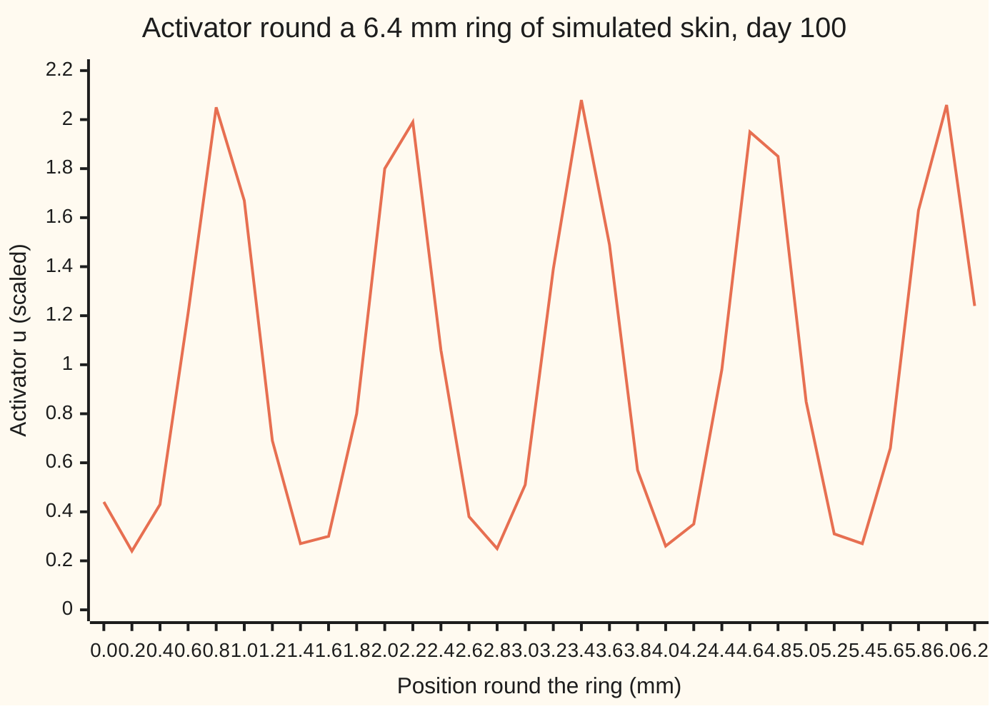
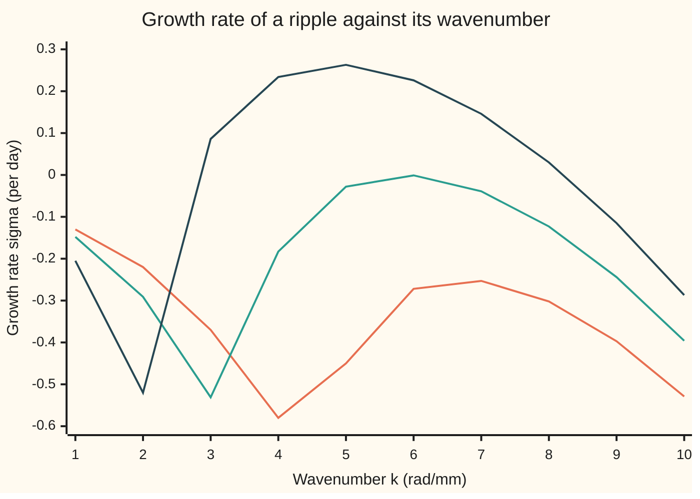

# Reaction-diffusion: spreading plus local growth makes fronts and patterns

[Syllabus](../../../SYLLABUS.md) → [Partial differential equations](../README.md) → [Nonlinear PDE and Fluids](../README.md#s07) → Reaction-diffusion

---

## General Overview

A young fish's skin is simulated in two stages. All constants are illustrative: chosen to be the right kind of size, not measured on a real fish.

**Stage 1: cells spread.** Pigment cells sit on one edge of bare skin. Each cell wanders at random, and the cells multiply until the skin is full. The covered patch does not creep out like a blot of ink. Its edge moves as a **front**: a sharp boundary with a fixed shape that settles to a steady speed, here 0.200 mm a day. At that speed, 5 mm of bare skin takes 25.0 days. The simulated front starts a little slower, and on the code's finest grid it has crossed 5.23 mm by day 30.

**Stage 2: stripes appear.** On the covered skin, two chemical signals are made and used up, and both spread. Their uniform mix is stable when nothing spreads. Yet with spreading switched on, the uniform state breaks up by itself. On a 6.4 mm ring of skin running once round the body, five stripes appear, 1.280 mm apart.

Both stages are **reaction-diffusion**: a quantity that spreads (diffusion) while it is made or used up on the spot (reaction). [The heat kernel](../03-The%20Heat%20Equation%20in%20Depth/01-heat-kernel-and-fundamental-solution.md) showed diffusion alone: a spot spreads as a bell whose width grows like $`\sqrt{t}`$, and it never travels at a speed. [Bifurcations](../../08-Differential%20equations%20and%20dynamics/06-Nonlinear%20Dynamics%20in%20the%20Plane/10-bifurcations-of-equilibria.md) showed a resting state losing stability as a dial turns. This card adds the two together.

As a problem: the **unknowns** are densities, $`u(x, t)`$ for the cells, and $`u`$ and $`v`$ for the two signals. The **region** is a line of skin for the front, and a ring for the stripes. The **data** is the start: a covered edge, or a uniform mix with tiny random ripples.

**Local growth plus spreading sends a front out at the fixed speed $`2\sqrt{rD}`$, and two reacting signals that spread at very different rates can turn a stable uniform state into stripes of a chosen spacing.**

**What kind of fact this is:** two theorems inside a model. The front's minimum speed and the threshold for stripes are proved on this card in Why it works. That a covered edge travels at exactly the minimum speed, with a slow lag, is a theorem stated with its source and checked by the code. The fish skin and its constants are an illustrative model, not measurements.

### The picture: the stripes on day 100



The orange line is the activator on day 100. It started at 1 everywhere, give or take 0.01. Five peaks stand round the ring, 1.280 mm apart: five dark stripes. The ring closes, so the value at 6.4 mm is the value at 0.

---

## The formula

Notation first, in words. A subscript means a rate of change: $`u_t`$ is how fast $`u`$ changes in time, and $`u_{xx}`$ is its bend in space. This card introduces the **reaction** $`f(u)`$, the amount made or used up per day at a point, and the **front speed** $`c^*`$.

A single density that spreads and grows obeys

```math
u_t = D\,u_{xx} + f(u), \qquad \text{Fisher's case: } f(u) = r\,u\,(1 - u)
```

**Read it aloud:** the density changes by spreading, at diffusivity $`D`$, plus growth that is fast when the skin is empty and stops when it is full.

Its front moves at the minimum speed

```math
c^* = 2\sqrt{rD}
```

**Read it aloud:** the front speed is twice the square root of growth rate times diffusivity.

Two signals, an activator $`u`$ and a substrate $`v`$ that the activator feeds on, obey

```math
u_t = D_u\,u_{xx} + f(u, v), \qquad v_t = D_v\,v_{xx} + g(u, v)
```

**Read it aloud:** each signal spreads at its own rate and is made or used up by its own reaction.

A ripple $`\cos(kx)`$ on the uniform state $`(u_0, v_0)`$ grows at the rate $`\sigma(k)`$ (a growth rate here, not the heat kernel's width or a volatility), the larger eigenvalue (the growth rate of the matrix's fastest-growing direction) of

```math
J_k = \begin{pmatrix} f_u - D_u k^2 & f_v \\ g_u & g_v - D_v k^2 \end{pmatrix}
```

The uniform state is stable without spreading, yet some ripple grows with it, exactly when

```math
f_u + g_v < 0, \quad f_u g_v - f_v g_u > 0, \quad D_v f_u + D_u g_v > 2\sqrt{D_u D_v\,(f_u g_v - f_v g_u)}
```

**Read it aloud:** the reactions alone settle back, but the activator must boost itself and the substrate must spread fast enough that the last inequality holds.

| Symbol | Plain meaning | In our example | Push it up and the answer… |
| --- | --- | --- | --- |
| $`u`$, $`v`$ | densities: cells as a share of full cover; or activator and substrate (scaled, illustrative) | front: 1 behind, 0 ahead; stripes: $`u`$ from 0.24 to 2.08 | — |
| $`x`$, $`t`$; $`X(t)`$ | position on the skin, in mm; time, in days; the front's position | front at 6.23 mm on day 30 (finest grid) | — |
| $`D`$, $`D_u`$, $`D_v`$ | diffusivities, how fast each spreads, in mm²/day | 0.01, 0.01, 0.2 | faster front; wider stripes |
| $`r`$ | growth rate of the cells, per day | 1 | faster front |
| $`f`$, $`g`$, $`a`$, $`b`$ | reactions, made minus used per day; the stripe model's two supply constants | $`f = r(a - u + u^2 v)`$, $`g = r(b - u^2 v)`$, $`a = 0.1`$, $`b = 0.9`$ | — |
| $`c`$, $`c^*`$, $`\ell`$ | a front speed; the minimum speed $`2\sqrt{rD}`$; the length scale $`\sqrt{D/r}`$ | $`c^*`$ = 0.200 mm/day; $`\ell`$ = 0.1 mm | — |
| $`U`$, $`\xi`$, $`\mu`$, $`W`$, $`T`$, $`\beta`$ | the front's fixed shape; the moving position $`\xi = x - ct`$; a decay rate of the shape; its slope $`W = U'`$; in the proof, a triangle $`T`$ whose slanted side has slope $`-\beta`$ | $`U`$ = 1 far behind, 0 far ahead; $`\beta = c/2`$ | — |
| $`u_0`$, $`v_0`$, $`J`$ | the uniform state; $`J`$, the matrix of reaction slopes there | 1, 0.9 | — |
| $`f_u`$, $`f_v`$, $`g_u`$, $`g_v`$ | entries of $`J`$: how each reaction changes as each signal rises, per day | 0.80, 1.00, −1.80, −1.00 | larger $`f_u`$: stripes easier |
| $`k`$, $`\Lambda`$, $`L`$, $`n`$ | wavenumber, in rad/mm; stripe spacing $`2\pi/k`$; ring length; stripe count | fastest $`k`$ = 4.867 rad/mm, $`\Lambda`$ = 1.291 mm; $`L`$ = 6.4 mm; $`n`$ = 5 | more stripes |
| $`\sigma(k)`$, $`J_k`$ | growth rate of the ripple $`\cos(kx)`$, per day; the matrix that sets it | 0.263 at the fastest | the ripple grows faster |
| $`d`$, $`d_c`$, $`m`$, $`q`$, $`h`$, $`s`$, $`s_c`$, $`q_c`$, $`k_c`$ | the ratio $`D_v/D_u`$ and its threshold; $`m = d f_u + g_v`$; $`q = (k\ell)^2`$, scaled; $`h(q)`$, the determinant of $`J_k`$ in scaled units; $`s = \sqrt{d}`$ and its threshold $`s_c`$; the first ripple to grow at onset | 20, 8.57; 15.00; unstable $`q`$ 0.0740 to 0.6760; $`s_c`$ = 2.927; first spacing $`2\pi/k_c`$ = 1.075 mm | larger $`d`$: a wider band |

### When it holds

- **The reaction grows fastest per head when the density is small.** Fisher's $`f(u)/u = r(1 - u)`$ is largest at $`u = 0`$. A reaction that needs a crowd to grow, such as $`u^2(1 - u)`$, gives a front whose speed is set by the whole shape, not by $`2\sqrt{rD}`$.
- **The start is zero beyond some point.** A start whose tail thins out slowly, such as $`e^{-x/(2\ell)}`$, runs ahead faster than $`c^*`$, at a speed its tail sets.
- **Constant diffusivities and an unmoving skin.** If the skin grows, the ring lengthens and new stripes are added; the Try changing box shows a 7.7 mm ring with six.
- **A large enough region.** A ring shorter than the shortest unstable spacing, 0.764 mm, holds no ripple that grows. The code shows a 0.7 mm ring staying uniform.
- **Densities, not individuals.** The equations treat cells as a smooth density. Near the front's tip there are only a few cells, and a cell-by-cell model gives a slightly slower front.

---

## Why it works

### Step 0: a front is pulled by its tip, and stripes come from fast-spreading inhibition

At the tip of a front the density is tiny. Crowding does not matter there: each cell grows at the full rate $`r`$. Spreading pushes a thin layer of cells forward, and growth multiplies them. These two effects, both acting on the thin tip, set the speed.

For stripes, the activator boosts itself and eats the substrate. Where the activator rises a little, it burns substrate. If the substrate spreads fast, the hungry spot draws substrate from its neighbours, and they starve. So a high spot grows and suppresses its neighbourhood: short-range boost, long-range suppression. Diffusion, which smooths in the heat kernel card, here creates contrast.

The solutions on this card are **classical**: smooth functions that satisfy the equations at every point. For Fisher's equation with a start between 0 and 1, the classical solution exists, is unique among bounded solutions, and stays between 0 and 1, by a comparison argument built on [Diffusion's maximum principle](../03-The%20Heat%20Equation%20in%20Depth/04-maximum-principle-for-the-heat-equation.md).

### Step 1: a front of fixed shape turns the PDE into an ODE

Look for a front that keeps its shape: $`u(x, t) = U(\xi)`$ with $`\xi = x - ct`$. Then $`u_t = -c\,U'`$ and $`u_{xx} = U''`$, so

```math
D\,U'' + c\,U' + r\,U(1 - U) = 0, \qquad U \to 1 \text{ far behind}, \quad U \to 0 \text{ far ahead}
```

**Read it aloud:** in a frame riding with the front, spreading, motion and growth balance at every point.

### Step 2: the tip forbids any speed below c*

Far ahead, $`U`$ is tiny and $`U(1 - U) \approx U`$. Try $`U = e^{-\mu\xi}`$, a tail that decays at rate $`\mu`$:

```math
D\mu^2 - c\mu + r = 0, \qquad \mu = \frac{c \pm \sqrt{c^2 - 4rD}}{2D}
```

If $`c < 2\sqrt{rD}`$, the square root is of a negative number. Then $`\mu`$ is complex, and the tail behaves like $`e^{-\mathrm{Re}\,\mu\,\xi}\cos(\mathrm{Im}\,\mu\,\xi)`$, where Re and Im are the real and imaginary parts. That swings below zero again and again. A density cannot be negative, so no front exists at that speed. If $`c \ge 2\sqrt{rD}`$, the decay rates are real and the tail can stay positive.

The code checks this by shooting. It starts the shape just below $`U = 1`$ and integrates the ODE forward with RK4 (a fourth-order step-by-step ODE solver):

| Speed $`c`$ | $`c^2 - 4rD`$, scaled | Lowest value of $`U`$ |
| --- | ---: | ---: |
| 0.18 mm/day | −0.76 | $`-1.807 \times 10^{-4}`$: negative, not a density |
| 0.22 mm/day | 0.84 | $`2.168 \times 10^{-18}`$: stays positive |

<details>
<summary>Detailed proof: fronts exist for every c at or above c*</summary>

Scale lengths by $`\ell = \sqrt{D/r}`$ and time by $`1/r`$, so that $`D = r = 1`$ and $`c^* = 2`$. Write the ODE as a system in the plane, with $`W = U'`$:

$`\displaystyle U' = W, \qquad W' = -cW - U(1 - U).`$

The rest points are $`(1, 0)`$, a saddle, and $`(0, 0)`$. For $`c \ge 2`$, the origin's slopes $`-\mu`$ are real and negative: it is a stable node.

Take the triangle $`T`$ of points with $`0 \le U \le 1`$ and $`-\beta U \le W \le 0`$, where $`\beta = c/2`$. Check that no path leaves it, side by side.

- Top side, $`W = 0`$ with $`0 < U < 1`$: $`W' = -U(1 - U) < 0`$, so paths move down, into $`T`$.
- Right side, $`U = 1`$ with $`W < 0`$: $`U' = W < 0`$, so paths move left, into $`T`$.
- Slanted side, $`W = -\beta U`$: the paths cross it inward when $`W + \beta U`$ is rising. There

$`\displaystyle (W + \beta U)' = -cW - U(1 - U) + \beta W = U\big(\beta(c - \beta) - 1 + U\big).`$

With $`\beta = c/2`$ this is $`U(c^2/4 - 1 + U)`$, which is positive when $`c \ge 2`$.

The saddle's unstable path leaves $`(1, 0)`$ with $`W`$ slightly negative, so it starts inside $`T`$. It never leaves. Along it $`U' = W \le 0`$, so $`U`$ only falls, and it must settle at a rest point: the origin. That path is the front $`U(\xi)`$. It runs from 1 to 0, and it stays positive, since $`T`$ meets $`U = 0`$ only at the origin.

For $`c < 2`$ the origin's slopes are complex, and every path near it spirals through $`U < 0`$, as Step 2 showed.

</details>

### Step 3: a covered edge picks the slowest speed, with a lag

Fronts exist at every speed $`c \ge c^*`$. A start that is zero beyond some point has no tail at all, so the tip is as steep as it can be. The tip then grows as slowly as allowed, and the front travels at $`c^*`$.

That statement is a theorem: Kolmogorov, Petrovsky and Piskunov proved it in 1937, and Bramson found the exact lag. In the units of this card, the front sits at

```math
X(t) = c^*\,t - \tfrac{3}{2}\,\ell\,\ln(rt) + \text{a constant}
```

So the speed creeps up to $`c^*`$ slowly. Between day 40 and day 60 the predicted average speed is $`0.200 - \tfrac32 (0.1)\ln(60/40)/20`$ mm/day = 0.1970 mm/day.

The code runs the skin on a grid at three spacings and reads where the density crosses one half:

| Grid spacing | Speed, days 40 to 60 |
| --- | ---: |
| 0.0500 mm | 0.1810 mm/day |
| 0.0250 mm | 0.1927 mm/day |
| 0.0125 mm | 0.1959 mm/day |
| extrapolated to zero spacing | 0.1970 mm/day |

The error falls about fourfold as the spacing halves: observed order 1.87. Extrapolating (Richardson: add a third of the last change) gives 0.1970 mm/day, matching Bramson's 0.1970.

### Step 4: the stripe model's uniform state is stable on its own

The stripe model is Schnakenberg's: activator supply $`a`$, substrate supply $`b`$, and the step $`u + u + v \to u + u + u`$, which turns substrate into activator faster the more activator there is. With $`r`$ = 1 per day:

```math
f(u, v) = a - u + u^2 v, \qquad g(u, v) = b - u^2 v
```

Setting both to zero gives $`u_0 = a + b = 1`$ and $`v_0 = b/(a + b)^2 = 0.9`$. The slopes there are $`f_u = -1 + 2u_0v_0 = 0.80`$, $`f_v = u_0^2 = 1.00`$, $`g_u = -2u_0v_0 = -1.80`$ and $`g_v = -u_0^2 = -1.00`$ per day. The code also gets them by centred differences.

The trace is −0.20 and the determinant 1.00. By [Linearisation](../../08-Differential%20equations%20and%20dynamics/06-Nonlinear%20Dynamics%20in%20the%20Plane/02-linearisation-and-the-jacobian.md), a negative trace and a positive determinant mean the uniform mix, with no spreading, settles back after a nudge. $`f_u > 0`$ says the activator boosts itself; $`g_v < 0`$ says the substrate holds itself in check.

### Step 5: spreading can only destabilise through the determinant

Put a small ripple $`\cos(kx)`$ on the uniform state, in both signals. Each $`u_{xx}`$ turns into $`-k^2`$ times the ripple, so the ripple's two amplitudes obey the linear system with matrix $`J_k`$. The ripple grows if $`J_k`$ has an eigenvalue with positive real part.

Spreading adds $`-D_u k^2`$ and $`-D_v k^2`$ to the diagonal. The trace only falls, so it stays negative. The only way to grow is a negative determinant:

```math
\det J_k = D_u D_v k^4 - (D_v f_u + D_u g_v)\,k^2 + (f_u g_v - f_v g_u)
```

This is a parabola in $`k^2`$, positive at $`k = 0`$. It dips below zero exactly when its middle term is large enough: the third inequality in The formula. That proves the condition.

Two consequences follow at once.

- **Equal spreading never makes stripes.** With $`D_u = D_v = D`$, the middle coefficient is $`D(f_u + g_v)`$, which is negative. The parabola never dips.
- **The threshold.** With $`d = D_v/D_u`$, the condition first holds at $`\sqrt{d_c} = (\sqrt{\det J} + \sqrt{\det J - f_u g_v})/f_u`$ = 2.927, so $`d_c`$ = 8.5676. The substrate must spread at more than 0.0857 mm²/day.

The code finds $`d_c`$ a second way: it scans the determinant over $`k`$ and bisects on $`d`$. The scan gives 8.5676 too. At the threshold, the first ripple to grow has spacing 1.075 mm.

<details>
<summary>Detailed proof: the threshold from the parabola</summary>

Work in scaled units, $`D_u = 1`$, $`D_v = d`$, and write $`q = k^2`$. The determinant is

$`\displaystyle h(q) = d\,q^2 - m\,q + \det J, \qquad m = d f_u + g_v.`$

Since $`h(0) = \det J > 0`$ and $`d > 0`$, $`h`$ is negative for some $`q > 0`$ exactly when $`m > 0`$ and $`m^2 > 4d\det J`$, that is, when $`m > 2\sqrt{d\,\det J}`$.

Put $`s = \sqrt{d}`$. The condition is $`f_u s^2 - 2\sqrt{\det J}\,s + g_v > 0`$. With $`f_u > 0`$ this quadratic in $`s`$ is positive beyond its larger root,

$`\displaystyle s_c = \frac{\sqrt{\det J} + \sqrt{\det J - f_u g_v}}{f_u}.`$

So stripes need $`d > d_c = s_c^2`$. At $`d = d_c`$ the double root of $`h`$ sits at $`q_c = \sqrt{\det J/d_c}`$, the first ripple to grow.

When $`h(q) < 0`$ the eigenvalues of $`J_k`$ are real with opposite signs, so the positive one is the growth rate $`\sigma(k)`$.

</details>

### Step 6: a band of spacings grows, and the fastest one wins

At $`d`$ = 20, $`m`$ = 15.00, and $`h(q) < 0`$ for $`q`$ from 0.0740 to 0.6760 (scaled). In millimetres, ripples with spacing between 0.764 mm and 2.310 mm grow. Scanning $`\sigma(k)`$ finds the fastest at $`k`$ = 4.867 rad/mm: spacing 1.291 mm, growing at 0.2632 per day.



Orange: $`d`$ = 5, every ripple decays. Teal: $`d`$ = 8.57, the threshold, where the curve just touches zero near 6 rad/mm. Dark blue: $`d`$ = 20, where ripples with spacing between 0.764 mm and 2.310 mm grow, fastest at 0.263 per day near 5 rad/mm.

### Step 7: on a ring only whole numbers of stripes fit

Round a ring of length $`L`$, a ripple must close on itself: $`k = 2\pi n/L`$ for a whole number $`n`$. On the 6.4 mm ring, $`L/\Lambda`$ = 6.4/1.291 = 4.96, so $`n`$ = 5 is nearest the fastest. Its wavenumber is 4.909 rad/mm, and the formula gives growth 0.2631 per day. The grid, started from that one ripple at size $`10^{-6}`$, measures 0.2630 per day.

The linear analysis picks the spacing. It cannot say how tall the stripes get: the $`u^2 v`$ term caps them. On a two-dimensional patch of skin the same condition decides whether ripples grow, and the nonlinear terms decide whether they settle as stripes or as spots; this card works the one-dimensional ring, where only stripes fit. The code's full simulation settles at five stripes, the activator running between 0.24 and 2.08.

---

## Worked numbers, by hand

Front first, then stripes, with $`r`$ = 1 per day, $`D = D_u`$ = 0.01 mm²/day and $`D_v`$ = 0.2 mm²/day.

| Step | Arithmetic | Value |
| --- | --- | --- |
| front speed $`c^*`$ | $`2\sqrt{1 \times 0.01}`$ | 0.200 mm/day |
| time to cover 5 mm at full speed | 5 ÷ 0.200 | **25.0 days** |
| uniform state | $`u_0 = 0.1 + 0.9`$; $`v_0 = 0.9/1^2`$ | 1.000, 0.900 |
| slopes $`f_u, f_v, g_u, g_v`$ | $`-1 + 2(1)(0.9)`$; $`1^2`$; $`-2(1)(0.9)`$; $`-1^2`$ | 0.80, 1.00, −1.80, −1.00 per day |
| trace, determinant | $`0.8 - 1`$; $`(0.8)(-1) - (1)(-1.8)`$ | −0.20, 1.00 |
| threshold $`\sqrt{d_c}`$ | $`(\sqrt{1.00} + \sqrt{1.00 + 0.80})/0.80`$ | 2.927 |
| $`d_c`$, and $`D_v`$ needed | $`2.927^2`$; × 0.01 mm²/day | 8.5676; 0.0857 mm²/day |
| $`m`$ at $`d`$ = 20 | $`20 \times 0.8 - 1`$ | 15.00 |
| unstable band $`q`$ | $`(15 \pm \sqrt{15^2 - 4 \times 20 \times 1})/40`$ | 0.0740 to 0.6760 |
| unstable spacings | $`2\pi/\sqrt{q} \times 0.1`$ mm | 0.764 to 2.310 mm |
| fastest spacing (scan) | maximum of $`\sigma`$ | 1.291 mm |
| stripes on the 6.4 mm ring | 6.4 ÷ 1.291 = 4.96, nearest whole | **5 stripes, 1.280 mm apart** |

At full speed the front crosses 5 mm of bare skin in 25.0 days; the simulated front, still just short of full speed, has crossed 5.23 mm by day 30 on the finest grid. The covered skin then breaks into five stripes 1.280 mm apart.

### What breaks if you drop a piece

| Mistake | Comes out at | What went wrong |
| --- | --- | --- |
| Front speed taken as $`\sqrt{rD}`$ | 0.100 mm/day, not 0.200 | the 2 comes from the double root at the tip |
| Spreading without growth | half cover stays at the edge, not 5 mm on; the edge only blurs, by $`\sqrt{2Dt}`$ = 0.707 mm at 25 days | diffusion alone has no speed; growth at the tip is what moves the front |
| Equal spreading, $`d`$ = 1 | departure $`1.861 \times 10^{-7}`$ on day 100: no stripes | the hypothesis $`d > d_c`$ fails; the parabola never dips |
| A 0.7 mm ring at $`d`$ = 20 | departure $`1.785 \times 10^{-7}`$ on day 100: no stripes | the shortest unstable spacing, 0.764 mm, does not fit |

---

## How the stripes grow, day by day

The puzzle: the reactions alone settle back, and spreading alone smooths. Together, they grow ripples. Here is one ripple, $`n`$ = 5 on the ring, under each force alone:

```
                               growth rate, per day (bar: size, 8 marks per 1.0)
reaction alone                 █                                       -0.100
activator spreading alone      ██                                      -0.241
substrate spreading alone      ███████████████████████████████████████ -4.819
all three together             ██                                      +0.263
```

Each force alone shrinks the ripple. Together, the fast-spreading substrate can no longer hold the activator in check on the spot. The activator's self-boost, $`f_u`$ = 0.80 per day, then beats its own spreading loss, 0.241 per day, and the ripple grows.

The full simulation starts from the uniform mix plus random ripples of size 0.01. The largest departure from the uniform state, and the count of peaks, every five days:

| Day | Largest departure | Peaks |
| ---: | ---: | ---: |
| 0 | $`9.989 \times 10^{-3}`$ | 34 |
| 5 | $`8.685 \times 10^{-3}`$ | 5 |
| 10 | $`2.188 \times 10^{-2}`$ | 5 |
| 15 | $`7.455 \times 10^{-2}`$ | 5 |
| 20 | $`2.593 \times 10^{-1}`$ | 5 |
| 25 | $`7.085 \times 10^{-1}`$ | 5 |
| 30 | 1.001 | 5 |
| 35 | 1.076 | 5 |
| 40 | 1.087 | 5 |

By day 5, spreading has erased the short ripples: the departure has even dipped, from 0.009989 to 0.008685, and five broad bumps remain. From day 10 to day 25 they grow steadily, from 0.02188 to 0.7085. After day 30 the $`u^2 v`$ term caps the departure near 1.087.

The front, meanwhile, on the finest grid, from a covered edge at 1 mm:

```
day   position of the front (half cover), 5 marks per mm
10    ████████████                                                  2.44 mm
20    ██████████████████████                                        4.31 mm
30    ███████████████████████████████                               6.23 mm
40    █████████████████████████████████████████                     8.18 mm
50    ███████████████████████████████████████████████████           10.14 mm
60    ████████████████████████████████████████████████████████████  12.10 mm
```

The bars grow by almost the same step each ten days: a steady speed, not the slowing $`\sqrt{t}`$ spread of diffusion alone. The step creeps up toward $`c^*`$ = 0.200 mm/day from below, as Bramson's lag predicts.

---

## Code, from first principles, and it actually runs

The code builds everything itself: its own RK4 step, its own grids and its own SplitMix64 random numbers (a short, fixed recipe for random-looking numbers, seed 7), so Python and Rust print the same digits. It takes these independent roads:

1. **Front speed:** the formula $`2\sqrt{rD}`$; shooting with RK4, which shows a slower front goes negative; and the grid at three spacings, extrapolated and matched to Bramson's lag.
2. **Uniform state:** slopes by hand against centred differences.
3. **Threshold:** the closed form for $`d_c`$ against a scan-and-bisect on the determinant.
4. **Stripes:** the growth-rate formula against one ripple grown on the grid; the stripe count against the fastest-mode prediction.
5. **Failures:** equal spreading and a too-small ring, each staying uniform.

Grid steps: the front grid uses time step 0.4 × spacing² (scaled), and the ring uses 0.2 × spacing²/$`d`$, both inside the explicit scheme's stability limit.

### Python

```python
# Reaction-diffusion on a simulated fish skin: Fisher's front speed and Turing's stripes.
# Illustrative constants: growth r = 1 per day, spreading D = 0.01 mm^2/day.
# Scaled units: length sqrt(D/r) = 0.1 mm, time 1/r = 1 day.
import math
R, D = 1.0, 0.01
ELL = math.sqrt(D / R)  # mm per scaled length unit

def fmt_e(x):
    return "%.3e" % x

# Part 1: Fisher's front, u_t = u_xx + u(1 - u) in scaled units, where c* = 2.
c_mm = 2 * math.sqrt(R * D)
c_star = c_mm / (ELL * R)
print("front speed c* = %.3f mm/day; 5 mm of bare skin covered in %.1f days" % (c_mm, 5.0 / c_mm))
print("wrong: sqrt(rD) = %.3f mm/day; diffusion alone: half cover stays at the edge, blurred by sqrt(2Dt) = %.3f mm at 25 days" % (math.sqrt(R * D), math.sqrt(2 * D * 25)))

def min_shape(c):  # the front shape U(xi) leaving the saddle U = 1 by RK4; returns its lowest value
    mu = (-c + math.sqrt(c * c + 4)) / 2
    U, W, h, low = 1 - 1e-6, -1e-6 * mu, 0.01, 1.0
    F = lambda U, W: (W, -c * W - U * (1 - U))
    for _ in range(10000):
        k1 = F(U, W); k2 = F(U + h / 2 * k1[0], W + h / 2 * k1[1])
        k3 = F(U + h / 2 * k2[0], W + h / 2 * k2[1]); k4 = F(U + h * k3[0], W + h * k3[1])
        U += h / 6 * (k1[0] + 2 * k2[0] + 2 * k3[0] + k4[0]); W += h / 6 * (k1[1] + 2 * k2[1] + 2 * k3[1] + k4[1])
        low = min(low, U)
    return low
for c in (1.8, 2.2):
    print("shape at speed %.2f mm/day: scaled c^2 - 4 = %.2f, lowest density %s" % (c * ELL, c * c - 4, fmt_e(min_shape(c))))
assert min_shape(1.8) < -1e-6 and min_shape(2.2) > 0  # below c* the shape must go negative

def fisher(dx):  # explicit grid on [0, 140], no-flux ends; returns front positions at t = 10..60
    dt, n = 0.4 * dx * dx, int(round(140 / dx)) + 1
    u = [1.0 if i * dx < 10 else 0.0 for i in range(n)]
    per, pos = int(round(10 / dt)), []
    for s in range(1, 6 * per + 1):
        new = u[:]
        for i in range(1, n - 1):
            new[i] = u[i] + dt * ((u[i - 1] - 2 * u[i] + u[i + 1]) / (dx * dx) + u[i] * (1 - u[i]))
        new[0], new[n - 1] = new[1], new[n - 2]
        u = new
        if s % per == 0:
            i = next(j for j in range(n - 1) if u[j] >= 0.5 > u[j + 1])
            pos.append((i + (u[i] - 0.5) / (u[i] - u[i + 1])) * dx)
    return pos
speeds = []
for dx in (0.5, 0.25, 0.125):
    p = fisher(dx)
    speeds.append((p[5] - p[3]) / 20)
    print("grid %.4f mm: speed over days 40-60 = %.4f mm/day" % (dx * ELL, speeds[-1] * ELL))
print("front at days 10..60 (mm): " + " ".join("%.2f" % (x * ELL) for x in p) + "; bare skin crossed by day 30 = %.2f mm" % ((p[2] - 10) * ELL))
order = math.log2((speeds[1] - speeds[0]) / (speeds[2] - speeds[1]))
rich = speeds[2] + (speeds[2] - speeds[1]) / 3
bram = c_star - 1.5 * math.log(60 / 40) / 20
print("observed order %.2f; extrapolated speed %.4f; Bramson c* - 1.5 l ln(60/40)/20 = %.4f mm/day" % (order, rich * ELL, bram * ELL))
assert all(v < c_star for v in speeds) and abs(rich - bram) < 0.003 and 1.7 < order < 2.3

# Part 2: Turing's instability in the Schnakenberg model, u_t = u_xx + f, v_t = d v_xx + g.
A, B = 0.1, 0.9
f = lambda u, v: A - u + u * u * v
g = lambda u, v: B - u * u * v
u0, v0 = A + B, B / ((A + B) * (A + B))
fu, fv, gu, gv = -1 + 2 * u0 * v0, u0 * u0, -2 * u0 * v0, -u0 * u0
h = 1e-4
num = [(f(u0 + h, v0) - f(u0 - h, v0)) / (2 * h), (f(u0, v0 + h) - f(u0, v0 - h)) / (2 * h),
       (g(u0 + h, v0) - g(u0 - h, v0)) / (2 * h), (g(u0, v0 + h) - g(u0, v0 - h)) / (2 * h)]
assert max(abs(x - y) for x, y in zip(num, (fu, fv, gu, gv))) < 1e-8
tr, det = fu + gv, fu * gv - fv * gu
print("uniform state u0 = %.3f, v0 = %.3f; fu fv gu gv = %.2f %.2f %.2f %.2f; trace %.2f, det %.2f" % (u0, v0, fu, fv, gu, gv, tr, det))
assert tr < 0 and det > 0 and abs(f(u0, v0)) + abs(g(u0, v0)) < 1e-12

def sigma(k2, d):  # larger growth rate of the mode cos(kx), per day
    p, q = fu - k2, gv - d * k2
    disc = (p + q) * (p + q) - 4 * (p * q - fv * gu)
    return (p + q + math.sqrt(disc)) / 2 if disc >= 0 else (p + q) / 2
s_c = (math.sqrt(det) + math.sqrt(det - fu * gv)) / fu
d_c = s_c * s_c
lo, hi = 1.0, 20.0  # second road: bisect on the scanned worst determinant
for _ in range(50):
    mid = (lo + hi) / 2
    worst = min((fu - q) * (gv - mid * q) - fv * gu for q in [i * 1e-4 for i in range(1, 15000)])
    lo, hi = (mid, hi) if worst > 0 else (lo, mid)
print("threshold: sqrt(d_c) = %.3f; d_c formula %.4f, scan %.4f; D_v must exceed %.4f mm^2/day" % (s_c, d_c, lo, d_c * D))
assert abs(d_c - lo) < 1e-3
kc = math.sqrt(math.sqrt(det / d_c))
print("first stripe spacing at onset 2 pi/k_c = %.3f mm" % (2 * math.pi / kc * ELL))
d = 20.0
m = fu * d + gv
q1, q2 = [(m + s * math.sqrt(m * m - 4 * d * det)) / (2 * d) for s in (1, -1)]
print("d = 20: m = %.2f; unstable k^2 from %.4f to %.4f (scaled); spacings %.3f to %.3f mm" % (m, q2, q1, 2 * math.pi / math.sqrt(q1) * ELL, 2 * math.pi / math.sqrt(q2) * ELL))
kbest = max((sigma((i * 1e-4) * (i * 1e-4), d), i * 1e-4) for i in range(1, 20000))[1]
print("fastest mode: k = %.3f rad/mm, spacing %.3f mm, growth %.4f per day" % (kbest / ELL, 2 * math.pi / kbest * ELL, sigma(kbest * kbest, d)))
for dd in (5.0, d_c, 20.0):
    print("sigma, d = %.2f, k = 1..10 rad/mm: " % dd + " ".join("%.3f" % sigma((j * ELL) * (j * ELL), dd) for j in range(1, 11)))

def splitmix(seed):
    while True:
        seed = (seed + 0x9E3779B97F4A7C15) & (2 ** 64 - 1)
        z = ((seed ^ (seed >> 30)) * 0xBF58476D1CE4E5B9) & (2 ** 64 - 1)
        z = ((z ^ (z >> 27)) * 0x94D049BB133111EB) & (2 ** 64 - 1)
        yield ((z ^ (z >> 31)) >> 11) / 2 ** 53

def ring(d, L, n, T, start, every=0):  # explicit grid on a ring of skin; returns u, v and a log
    dx = L / n; dt = 0.2 * dx * dx / d
    u, v, log = list(start), [v0] * n, []
    steps = int(round(T / dt)); per = int(round(every / dt)) if every else 0
    for s in range(steps + 1):
        if per and s % per == 0:
            peaks = sum(1 for i in range(n) if u[i] > u[i - 1] and u[i] >= u[(i + 1) % n] and u[i] > u0)
            log.append((round(s * dt), max(abs(x - u0) for x in u), peaks))
        if s == steps: break
        un, vn = [0.0] * n, [0.0] * n
        for i in range(n):
            l, p, uuv = i - 1, (i + 1) % n, u[i] * u[i] * v[i]
            un[i] = u[i] + dt * ((u[l] - 2 * u[i] + u[p]) / (dx * dx) + A - u[i] + uuv)
            vn[i] = v[i] + dt * (d * (v[l] - 2 * v[i] + v[p]) / (dx * dx) + B - uuv)
        u, v = un, vn
    return u, v, log
rng, LR, NR = splitmix(7), 64.0, 128  # ring length (scaled) and grid points
noise = [u0 + 0.01 * (2 * next(rng) - 1) for _ in range(NR)]
u, v, log = ring(20.0, LR, NR, 100.0, noise, every=5)
for t, amp, pk in log[:9]:
    print("day %3d: largest departure %s, peaks %d" % (t, fmt_e(amp), pk))
print("day 100: %d stripes on a %.1f mm ring, spacing %.3f mm; predicted %.2f" % (log[-1][2], LR * ELL, LR * ELL / log[-1][2], LR / (2 * math.pi / kbest)))
assert log[-1][2] == 5 and abs(LR / (2 * math.pi / kbest) - log[-1][2]) < 0.5
print("stripe profile u, every 0.2 mm: " + " ".join("%.2f" % u[i] for i in range(0, NR, 4)))
k5 = 2 * math.pi * 5 / 64  # third road: one small mode grows at sigma(k)
one = [u0 + 1e-6 * math.cos(k5 * i * 0.5) for i in range(128)]
mlog = ring(20.0, 64.0, 128, 20.0, one, every=10)[2]
rate = math.log(mlog[2][1] / mlog[1][1]) / 10
print("mode 5 (k = %.3f rad/mm) grows at %.4f per day on the grid; formula %.4f" % (k5 / ELL, rate, sigma(k5 * k5, d)))
print("mode 5 alone, per day: reaction %.3f; activator spreading %.3f; substrate spreading %.3f; together %.3f" % (sigma(0.0, d), -k5 * k5, -d * k5 * k5, sigma(k5 * k5, d)))
assert abs(rate - sigma(k5 * k5, d)) < 0.003
eq = ring(1.0, 64.0, 128, 100.0, noise[:128])[0]
small = ring(20.0, 7.0, 14, 100.0, noise[:14])[0]
print("equal diffusion d = 1: departure at day 100 = %s" % fmt_e(max(abs(x - u0) for x in eq)))
print("0.7 mm ring, d = 20: departure at day 100 = %s" % fmt_e(max(abs(x - u0) for x in small)))
assert max(abs(x - u0) for x in eq) < 1e-5 and max(abs(x - u0) for x in small) < 1e-5
print("ALL CHECKS PASS")
```

**Ran 2026-11-15 on macOS, Python 3.14.10, standard library only. All checks passed. Output, pasted from the run:**

```
front speed c* = 0.200 mm/day; 5 mm of bare skin covered in 25.0 days
wrong: sqrt(rD) = 0.100 mm/day; diffusion alone: half cover stays at the edge, blurred by sqrt(2Dt) = 0.707 mm at 25 days
shape at speed 0.18 mm/day: scaled c^2 - 4 = -0.76, lowest density -1.807e-04
shape at speed 0.22 mm/day: scaled c^2 - 4 = 0.84, lowest density 2.168e-18
grid 0.0500 mm: speed over days 40-60 = 0.1810 mm/day
grid 0.0250 mm: speed over days 40-60 = 0.1927 mm/day
grid 0.0125 mm: speed over days 40-60 = 0.1959 mm/day
front at days 10..60 (mm): 2.44 4.31 6.23 8.18 10.14 12.10; bare skin crossed by day 30 = 5.23 mm
observed order 1.87; extrapolated speed 0.1970; Bramson c* - 1.5 l ln(60/40)/20 = 0.1970 mm/day
uniform state u0 = 1.000, v0 = 0.900; fu fv gu gv = 0.80 1.00 -1.80 -1.00; trace -0.20, det 1.00
threshold: sqrt(d_c) = 2.927; d_c formula 8.5676, scan 8.5676; D_v must exceed 0.0857 mm^2/day
first stripe spacing at onset 2 pi/k_c = 1.075 mm
d = 20: m = 15.00; unstable k^2 from 0.0740 to 0.6760 (scaled); spacings 0.764 to 2.310 mm
fastest mode: k = 4.867 rad/mm, spacing 1.291 mm, growth 0.2632 per day
sigma, d = 5.00, k = 1..10 rad/mm: -0.130 -0.220 -0.370 -0.580 -0.450 -0.272 -0.253 -0.302 -0.397 -0.529
sigma, d = 8.57, k = 1..10 rad/mm: -0.148 -0.291 -0.531 -0.183 -0.028 -0.001 -0.039 -0.123 -0.244 -0.396
sigma, d = 20.00, k = 1..10 rad/mm: -0.205 -0.520 0.086 0.234 0.263 0.226 0.146 0.030 -0.115 -0.287
day   0: largest departure 9.989e-03, peaks 34
day   5: largest departure 8.685e-03, peaks 5
day  10: largest departure 2.188e-02, peaks 5
day  15: largest departure 7.455e-02, peaks 5
day  20: largest departure 2.593e-01, peaks 5
day  25: largest departure 7.085e-01, peaks 5
day  30: largest departure 1.001e+00, peaks 5
day  35: largest departure 1.076e+00, peaks 5
day  40: largest departure 1.087e+00, peaks 5
day 100: 5 stripes on a 6.4 mm ring, spacing 1.280 mm; predicted 4.96
stripe profile u, every 0.2 mm: 0.44 0.24 0.43 1.21 2.05 1.67 0.69 0.27 0.30 0.80 1.80 1.99 1.06 0.38 0.25 0.51 1.39 2.08 1.49 0.57 0.26 0.35 0.98 1.95 1.85 0.85 0.31 0.27 0.66 1.63 2.06 1.24
mode 5 (k = 4.909 rad/mm) grows at 0.2630 per day on the grid; formula 0.2631
mode 5 alone, per day: reaction -0.100; activator spreading -0.241; substrate spreading -4.819; together 0.263
equal diffusion d = 1: departure at day 100 = 1.861e-07
0.7 mm ring, d = 20: departure at day 100 = 1.785e-07
ALL CHECKS PASS
```

### Rust

```rust
// Reaction-diffusion on a simulated fish skin: Fisher's front speed and Turing's stripes.
// Illustrative constants: growth r = 1 per day, spreading D = 0.01 mm^2/day.
// Scaled units: length sqrt(D/r) = 0.1 mm, time 1/r = 1 day.
const R: f64 = 1.0; // growth per day
const D: f64 = 0.01; // mm^2/day
const A: f64 = 0.1; const B: f64 = 0.9; // Schnakenberg constants

fn fmt_e(x: f64) -> String {
    let s = format!("{:.3e}", x);
    let (m, e) = s.split_once('e').unwrap();
    let e: i32 = e.parse().unwrap();
    format!("{}e{}{:02}", m, if e < 0 { '-' } else { '+' }, e.abs())
}

fn min_shape(c: f64) -> f64 {
    // the front shape U(xi) leaving the saddle U = 1 by RK4; returns its lowest value
    let mu = (-c + (c * c + 4.0).sqrt()) / 2.0;
    let (mut u, mut w, h, mut low) = (1.0 - 1e-6, -1e-6 * mu, 0.01, 1.0f64);
    let f = |u: f64, w: f64| (w, -c * w - u * (1.0 - u));
    for _ in 0..10000 {
        let k1 = f(u, w);
        let k2 = f(u + h / 2.0 * k1.0, w + h / 2.0 * k1.1); let k3 = f(u + h / 2.0 * k2.0, w + h / 2.0 * k2.1);
        let k4 = f(u + h * k3.0, w + h * k3.1);
        u += h / 6.0 * (k1.0 + 2.0 * k2.0 + 2.0 * k3.0 + k4.0); w += h / 6.0 * (k1.1 + 2.0 * k2.1 + 2.0 * k3.1 + k4.1);
        low = low.min(u);
    }
    low
}

fn fisher(dx: f64) -> Vec<f64> {
    // explicit grid on [0, 140], no-flux ends; returns front positions at t = 10..60
    let (dt, n) = (0.4 * dx * dx, (140.0 / dx).round() as usize + 1);
    let mut u: Vec<f64> = (0..n).map(|i| if i as f64 * dx < 10.0 { 1.0 } else { 0.0 }).collect();
    let (per, mut pos) = ((10.0 / dt).round() as usize, Vec::new());
    for s in 1..=6 * per {
        let mut new = u.clone();
        for i in 1..n - 1 {
            new[i] = u[i] + dt * ((u[i - 1] - 2.0 * u[i] + u[i + 1]) / (dx * dx) + u[i] * (1.0 - u[i]));
        }
        new[0] = new[1]; new[n - 1] = new[n - 2]; u = new;
        if s % per == 0 {
            let i = (0..n - 1).find(|&j| u[j] >= 0.5 && 0.5 > u[j + 1]).unwrap();
            pos.push((i as f64 + (u[i] - 0.5) / (u[i] - u[i + 1])) * dx);
        }
    }
    pos
}

struct Jac { fu: f64, fv: f64, gu: f64, gv: f64 }

fn sigma(j: &Jac, k2: f64, d: f64) -> f64 {
    // larger growth rate of the mode cos(kx), per day
    let (p, q) = (j.fu - k2, j.gv - d * k2);
    let disc = (p + q) * (p + q) - 4.0 * (p * q - j.fv * j.gu);
    if disc >= 0.0 { (p + q + disc.sqrt()) / 2.0 } else { (p + q) / 2.0 }
}

struct SplitMix(u64);
impl SplitMix {
    fn next(&mut self) -> f64 {
        self.0 = self.0.wrapping_add(0x9E3779B97F4A7C15);
        let mut z = self.0;
        z = (z ^ (z >> 30)).wrapping_mul(0xBF58476D1CE4E5B9);
        z = (z ^ (z >> 27)).wrapping_mul(0x94D049BB133111EB);
        ((z ^ (z >> 31)) >> 11) as f64 / 9007199254740992.0
    }
}

fn ring(d: f64, l: f64, n: usize, t: f64, start: &[f64], v0: f64, u0: f64, every: f64) -> (Vec<f64>, Vec<(i64, f64, usize)>) {
    // explicit grid on a ring of skin; returns u and a log of (day, largest departure, peaks)
    let dx = l / n as f64; let dt = 0.2 * dx * dx / d;
    let (mut u, mut v, mut log) = (start.to_vec(), vec![v0; n], Vec::new());
    let steps = (t / dt).round() as usize;
    let per = if every > 0.0 { (every / dt).round() as usize } else { 0 };
    for s in 0..=steps {
        if per > 0 && s % per == 0 {
            let peaks = (0..n).filter(|&i| u[i] > u[(i + n - 1) % n] && u[i] >= u[(i + 1) % n] && u[i] > u0).count();
            let amp = u.iter().fold(0.0f64, |a, &x| a.max((x - u0).abs()));
            log.push(((s as f64 * dt).round() as i64, amp, peaks));
        }
        if s == steps { break; }
        let (mut un, mut vn) = (vec![0.0; n], vec![0.0; n]);
        for i in 0..n {
            let (lft, p, uuv) = ((i + n - 1) % n, (i + 1) % n, u[i] * u[i] * v[i]);
            un[i] = u[i] + dt * ((u[lft] - 2.0 * u[i] + u[p]) / (dx * dx) + A - u[i] + uuv);
            vn[i] = v[i] + dt * (d * (v[lft] - 2.0 * v[i] + v[p]) / (dx * dx) + B - uuv);
        }
        u = un; v = vn;
    }
    (u, log)
}

fn main() {
    let (ell, c_mm, pi) = ((D / R).sqrt(), 2.0 * (R * D).sqrt(), std::f64::consts::PI);
    let c_star = c_mm / (ell * R);
    println!("front speed c* = {:.3} mm/day; 5 mm of bare skin covered in {:.1} days", c_mm, 5.0 / c_mm);
    println!("wrong: sqrt(rD) = {:.3} mm/day; diffusion alone: half cover stays at the edge, blurred by sqrt(2Dt) = {:.3} mm at 25 days", (R * D).sqrt(), (2.0 * D * 25.0).sqrt());
    for c in [1.8, 2.2] {
        println!("shape at speed {:.2} mm/day: scaled c^2 - 4 = {:.2}, lowest density {}", c * ell, c * c - 4.0, fmt_e(min_shape(c)));
    }
    assert!(min_shape(1.8) < -1e-6 && min_shape(2.2) > 0.0);
    let (mut speeds, mut p) = (Vec::new(), Vec::new());
    for dx in [0.5, 0.25, 0.125] {
        p = fisher(dx);
        speeds.push((p[5] - p[3]) / 20.0);
        println!("grid {:.4} mm: speed over days 40-60 = {:.4} mm/day", dx * ell, speeds[speeds.len() - 1] * ell);
    }
    let fr: Vec<String> = p.iter().map(|x| format!("{:.2}", x * ell)).collect();
    println!("front at days 10..60 (mm): {}; bare skin crossed by day 30 = {:.2} mm", fr.join(" "), (p[2] - 10.0) * ell);
    let (order, rich) = (((speeds[1] - speeds[0]) / (speeds[2] - speeds[1])).log2(), speeds[2] + (speeds[2] - speeds[1]) / 3.0);
    let bram = c_star - 1.5 * (60.0f64 / 40.0).ln() / 20.0;
    println!("observed order {:.2}; extrapolated speed {:.4}; Bramson c* - 1.5 l ln(60/40)/20 = {:.4} mm/day", order, rich * ell, bram * ell);
    assert!(speeds.iter().all(|&v| v < c_star) && (rich - bram).abs() < 0.003 && order > 1.7 && order < 2.3);
    let (f, g) = (|u: f64, v: f64| A - u + u * u * v, |u: f64, v: f64| B - u * u * v);
    let (u0, v0) = (A + B, B / ((A + B) * (A + B)));
    let j = Jac { fu: -1.0 + 2.0 * u0 * v0, fv: u0 * u0, gu: -2.0 * u0 * v0, gv: -u0 * u0 };
    let h = 1e-4;
    let num = [(f(u0 + h, v0) - f(u0 - h, v0)) / (2.0 * h), (f(u0, v0 + h) - f(u0, v0 - h)) / (2.0 * h),
               (g(u0 + h, v0) - g(u0 - h, v0)) / (2.0 * h), (g(u0, v0 + h) - g(u0, v0 - h)) / (2.0 * h)];
    assert!((0..4).all(|i| (num[i] - [j.fu, j.fv, j.gu, j.gv][i]).abs() < 1e-8));
    let (tr, det) = (j.fu + j.gv, j.fu * j.gv - j.fv * j.gu);
    println!("uniform state u0 = {:.3}, v0 = {:.3}; fu fv gu gv = {:.2} {:.2} {:.2} {:.2}; trace {:.2}, det {:.2}", u0, v0, j.fu, j.fv, j.gu, j.gv, tr, det);
    assert!(tr < 0.0 && det > 0.0 && f(u0, v0).abs() + g(u0, v0).abs() < 1e-12);
    let s_c = (det.sqrt() + (det - j.fu * j.gv).sqrt()) / j.fu; let d_c = s_c * s_c;
    let (mut lo, mut hi) = (1.0f64, 20.0f64); // second road: bisect on the scanned worst determinant
    for _ in 0..50 {
        let mid = (lo + hi) / 2.0;
        let worst = (1..15000).map(|i| { let q = i as f64 * 1e-4; (j.fu - q) * (j.gv - mid * q) - j.fv * j.gu }).fold(f64::INFINITY, f64::min);
        if worst > 0.0 { lo = mid } else { hi = mid }
    }
    println!("threshold: sqrt(d_c) = {:.3}; d_c formula {:.4}, scan {:.4}; D_v must exceed {:.4} mm^2/day", s_c, d_c, lo, d_c * D);
    assert!((d_c - lo).abs() < 1e-3);
    let kc = (det / d_c).sqrt().sqrt();
    println!("first stripe spacing at onset 2 pi/k_c = {:.3} mm", 2.0 * pi / kc * ell);
    let d = 20.0;
    let m = j.fu * d + j.gv;
    let (q1, q2) = ((m + (m * m - 4.0 * d * det).sqrt()) / (2.0 * d), (m - (m * m - 4.0 * d * det).sqrt()) / (2.0 * d));
    println!("d = 20: m = {:.2}; unstable k^2 from {:.4} to {:.4} (scaled); spacings {:.3} to {:.3} mm", m, q2, q1, 2.0 * pi / q1.sqrt() * ell, 2.0 * pi / q2.sqrt() * ell);
    let (mut best, mut kbest) = (f64::NEG_INFINITY, 0.0);
    for i in 1..20000 { let k = i as f64 * 1e-4; let s = sigma(&j, k * k, d); if s >= best { best = s; kbest = k; } }
    println!("fastest mode: k = {:.3} rad/mm, spacing {:.3} mm, growth {:.4} per day", kbest / ell, 2.0 * pi / kbest * ell, sigma(&j, kbest * kbest, d));
    for dd in [5.0, d_c, 20.0] {
        let row: Vec<String> = (1..11).map(|jj| format!("{:.3}", sigma(&j, (jj as f64 * ell) * (jj as f64 * ell), dd))).collect();
        println!("sigma, d = {:.2}, k = 1..10 rad/mm: {}", dd, row.join(" "));
    }
    let (mut rng, lr, nr) = (SplitMix(7), 64.0, 128); // ring length (scaled) and grid points
    let noise: Vec<f64> = (0..nr).map(|_| u0 + 0.01 * (2.0 * rng.next() - 1.0)).collect();
    let (u, log) = ring(20.0, lr, nr, 100.0, &noise, v0, u0, 5.0);
    for &(t, amp, pk) in &log[..9] {
        println!("day {:3}: largest departure {}, peaks {}", t, fmt_e(amp), pk);
    }
    let (last, predicted) = (log[log.len() - 1].2, lr / (2.0 * pi / kbest));
    println!("day 100: {} stripes on a {:.1} mm ring, spacing {:.3} mm; predicted {:.2}", last, lr * ell, lr * ell / last as f64, predicted);
    assert!(last == 5 && (predicted - last as f64).abs() < 0.5);
    let prof: Vec<String> = (0..nr).step_by(4).map(|i| format!("{:.2}", u[i])).collect();
    println!("stripe profile u, every 0.2 mm: {}", prof.join(" "));
    let k5 = 2.0 * pi * 5.0 / 64.0; // third road: one small mode grows at sigma(k)
    let one: Vec<f64> = (0..128).map(|i| u0 + 1e-6 * (k5 * i as f64 * 0.5).cos()).collect();
    let mlog = ring(20.0, 64.0, 128, 20.0, &one, v0, u0, 10.0).1;
    let rate = (mlog[2].1 / mlog[1].1).ln() / 10.0;
    println!("mode 5 (k = {:.3} rad/mm) grows at {:.4} per day on the grid; formula {:.4}", k5 / ell, rate, sigma(&j, k5 * k5, d));
    println!("mode 5 alone, per day: reaction {:.3}; activator spreading {:.3}; substrate spreading {:.3}; together {:.3}", sigma(&j, 0.0, d), -k5 * k5, -d * k5 * k5, sigma(&j, k5 * k5, d));
    assert!((rate - sigma(&j, k5 * k5, d)).abs() < 0.003);
    let dep = |w: &[f64]| w.iter().fold(0.0f64, |a, &x| a.max((x - u0).abs()));
    let (eq, small) = (ring(1.0, 64.0, 128, 100.0, &noise[..128], v0, u0, 0.0).0, ring(20.0, 7.0, 14, 100.0, &noise[..14], v0, u0, 0.0).0);
    println!("equal diffusion d = 1: departure at day 100 = {}", fmt_e(dep(&eq)));
    println!("0.7 mm ring, d = 20: departure at day 100 = {}", fmt_e(dep(&small)));
    assert!(dep(&eq) < 1e-5 && dep(&small) < 1e-5);
    println!("ALL CHECKS PASS");
}
```

**Ran 2026-11-15 on macOS, rustc 1.98.1, no crates. All checks passed. Output, pasted from the run:**

```
front speed c* = 0.200 mm/day; 5 mm of bare skin covered in 25.0 days
wrong: sqrt(rD) = 0.100 mm/day; diffusion alone: half cover stays at the edge, blurred by sqrt(2Dt) = 0.707 mm at 25 days
shape at speed 0.18 mm/day: scaled c^2 - 4 = -0.76, lowest density -1.807e-04
shape at speed 0.22 mm/day: scaled c^2 - 4 = 0.84, lowest density 2.168e-18
grid 0.0500 mm: speed over days 40-60 = 0.1810 mm/day
grid 0.0250 mm: speed over days 40-60 = 0.1927 mm/day
grid 0.0125 mm: speed over days 40-60 = 0.1959 mm/day
front at days 10..60 (mm): 2.44 4.31 6.23 8.18 10.14 12.10; bare skin crossed by day 30 = 5.23 mm
observed order 1.87; extrapolated speed 0.1970; Bramson c* - 1.5 l ln(60/40)/20 = 0.1970 mm/day
uniform state u0 = 1.000, v0 = 0.900; fu fv gu gv = 0.80 1.00 -1.80 -1.00; trace -0.20, det 1.00
threshold: sqrt(d_c) = 2.927; d_c formula 8.5676, scan 8.5676; D_v must exceed 0.0857 mm^2/day
first stripe spacing at onset 2 pi/k_c = 1.075 mm
d = 20: m = 15.00; unstable k^2 from 0.0740 to 0.6760 (scaled); spacings 0.764 to 2.310 mm
fastest mode: k = 4.867 rad/mm, spacing 1.291 mm, growth 0.2632 per day
sigma, d = 5.00, k = 1..10 rad/mm: -0.130 -0.220 -0.370 -0.580 -0.450 -0.272 -0.253 -0.302 -0.397 -0.529
sigma, d = 8.57, k = 1..10 rad/mm: -0.148 -0.291 -0.531 -0.183 -0.028 -0.001 -0.039 -0.123 -0.244 -0.396
sigma, d = 20.00, k = 1..10 rad/mm: -0.205 -0.520 0.086 0.234 0.263 0.226 0.146 0.030 -0.115 -0.287
day   0: largest departure 9.989e-03, peaks 34
day   5: largest departure 8.685e-03, peaks 5
day  10: largest departure 2.188e-02, peaks 5
day  15: largest departure 7.455e-02, peaks 5
day  20: largest departure 2.593e-01, peaks 5
day  25: largest departure 7.085e-01, peaks 5
day  30: largest departure 1.001e+00, peaks 5
day  35: largest departure 1.076e+00, peaks 5
day  40: largest departure 1.087e+00, peaks 5
day 100: 5 stripes on a 6.4 mm ring, spacing 1.280 mm; predicted 4.96
stripe profile u, every 0.2 mm: 0.44 0.24 0.43 1.21 2.05 1.67 0.69 0.27 0.30 0.80 1.80 1.99 1.06 0.38 0.25 0.51 1.39 2.08 1.49 0.57 0.26 0.35 0.98 1.95 1.85 0.85 0.31 0.27 0.66 1.63 2.06 1.24
mode 5 (k = 4.909 rad/mm) grows at 0.2630 per day on the grid; formula 0.2631
mode 5 alone, per day: reaction -0.100; activator spreading -0.241; substrate spreading -4.819; together 0.263
equal diffusion d = 1: departure at day 100 = 1.861e-07
0.7 mm ring, d = 20: departure at day 100 = 1.785e-07
ALL CHECKS PASS
```

### Lean

Lean proves Step 2's front speed and Step 5's stripe condition in general, and checks the worked numbers in exact fractions.

- Take $`D_u > 0`$ and $`D_v > 0`$. Then the reactions alone settle back, yet some ripple grows, exactly when the three inequalities of The formula hold.
- Suppose also that the reactions alone settle back and $`f_u > 0`$. Then the last inequality holds exactly when $`d`$ is above $`d_c = s_c^2`$.
- Take $`r > 0`$ and $`D > 0`$. Then a front of fixed shape, never negative, from 1 far behind to 0 far ahead, exists exactly when $`c \ge c^*`$.
- In exact fractions, $`c^*`$ = 1/5 mm/day, so 5 mm of bare skin takes 25 days. The wrong speed $`\sqrt{rD}`$ is 1/10 mm/day.
- The stripe model's uniform state is $`u_0`$ = 1, $`v_0`$ = 9/10, with $`f_u`$ = 4/5 and $`g_u`$ = −9/5 per day. Its trace is −1/5 and its determinant 1.
- At $`d`$ = 20, $`m`$ = 15 and $`m^2`$ = 225, above $`4d\det J`$ = 80. With equal spreading, $`d`$ = 1, $`m`$ = −1/5.
- At $`d`$ = 9, $`m^2`$ is above $`4d\det J`$; at $`d`$ = 8 it is below. So $`d_c`$ lies between 8 and 9.
- At $`d`$ = 20, the scaled ripple $`q`$ = 1/5 has $`\det J_k`$ = −6/5, below zero.

The grids, the shooting runs, Bramson's lag, the fastest ripple and the stripe count are left to the Python and Rust checks.

```lean
-- Reaction-diffusion: a stable uniform state of two reacting, spreading signals has a growing ripple exactly when Dv fu + Du gv > 2 sqrt(Du Dv det J), and Fisher's equation has a nonnegative front of speed c exactly when c is at least 2 sqrt(r D).
import Mathlib.LinearAlgebra.Eigenspace.Charpoly
import Mathlib.LinearAlgebra.Charpoly.ToMatrix
import Mathlib.LinearAlgebra.Matrix.Charpoly.Coeff
import Mathlib.Analysis.SpecialFunctions.Sqrt
import Mathlib.Analysis.Complex.Basic
import Mathlib.Analysis.Calculus.ContDiff.Defs
import Mathlib.Order.Filter.AtTopBot.Basic
import Mathlib.Tactic.NormNum
import Mathlib.Analysis.Calculus.Deriv.MeanValue
import Mathlib.Analysis.Calculus.ContDiff.Deriv
import Mathlib.Analysis.SpecialFunctions.ExpDeriv
import Mathlib.Analysis.ODE.ExistUnique
import Mathlib.Analysis.Calculus.UniformLimitsDeriv
import Mathlib.Analysis.Calculus.Deriv.Inverse
import Mathlib.Analysis.Calculus.Deriv.CompMul
import Mathlib.Analysis.SpecialFunctions.Log.Deriv
import Mathlib.MeasureTheory.Integral.IntervalIntegral.FundThmCalculus

open Filter Topology

lemma rd_hasEigenvalue_fin_two_iff (a b c d : ℝ) (σ : ℂ) :
    Module.End.HasEigenvalue (Matrix.toLin' ((!![a, b; c, d]).map (fun x : ℝ => (x : ℂ)))) σ ↔
      σ ^ 2 - ((a + d : ℝ) : ℂ) * σ + ((a * d - b * c : ℝ) : ℂ) = 0 := by
  rw [Module.End.hasEigenvalue_iff_isRoot_charpoly, Matrix.charpoly_toLin',
    Matrix.charpoly_fin_two]
  simp [Matrix.trace_fin_two, Matrix.det_fin_two]

lemma rd_exists_pos_root_iff (t d : ℝ) (ht : t < 0) :
    (∃ σ : ℂ, 0 < σ.re ∧ σ ^ 2 - (t : ℂ) * σ + (d : ℂ) = 0) ↔ d < 0 := by
  constructor
  · rintro ⟨σ, hre, hσ⟩
    have h1 := congrArg Complex.re hσ
    have h2 := congrArg Complex.im hσ
    simp [pow_two] at h1 h2
    have hy : σ.im = 0 := by
      by_contra hne
      have : σ.re * 2 - t = 0 := by
        have : σ.im * (σ.re * 2 - t) = 0 := by linarith
        rcases mul_eq_zero.mp this with h | h
        · exact absurd h hne
        · exact h
      linarith
    rw [hy] at h1
    nlinarith
  · intro hd
    set s := Real.sqrt (t ^ 2 - 4 * d) with hs
    have hs2 : s ^ 2 = t ^ 2 - 4 * d := Real.sq_sqrt (by nlinarith)
    have hs0 : 0 ≤ s := Real.sqrt_nonneg _
    refine ⟨(((t + s) / 2 : ℝ) : ℂ), ?_, ?_⟩
    · simp only [Complex.ofReal_re]
      nlinarith
    · have : ((t + s) / 2) ^ 2 - t * ((t + s) / 2) + d = 0 := by nlinarith
      exact_mod_cast this

lemma rd_sub_le_of_deriv_le {f : ℝ → ℝ} (hf : Differentiable ℝ f) {a C : ℝ}
    (h : ∀ x, a < x → deriv f x ≤ C) {x y : ℝ} (hax : a ≤ x) (hxy : x ≤ y) :
    f y - f x ≤ C * (y - x) :=
  (convex_Ici a).image_sub_le_mul_sub_of_deriv_le hf.continuous.continuousOn
    hf.differentiableOn (fun z hz => h z (by rwa [interior_Ici] at hz)) x hax y
    (hax.trans hxy) hxy

lemma rd_le_sub_of_le_deriv {f : ℝ → ℝ} (hf : Differentiable ℝ f) {a C : ℝ}
    (h : ∀ x, a < x → C ≤ deriv f x) {x y : ℝ} (hax : a ≤ x) (hxy : x ≤ y) :
    C * (y - x) ≤ f y - f x :=
  (convex_Ici a).mul_sub_le_image_sub_of_le_deriv hf.continuous.continuousOn
    hf.differentiableOn (fun z hz => h z (by rwa [interior_Ici] at hz)) x hax y
    (hax.trans hxy) hxy

lemma rd_fisher_speed_ge_of_front (D r c : ℝ) (hD : 0 < D) (hr : 0 < r) (U : ℝ → ℝ)
    (hU : ContDiff ℝ 2 U)
    (hode : ∀ ξ, D * deriv (deriv U) ξ + c * deriv U ξ + r * U ξ * (1 - U ξ) = 0)
    (hbot : Tendsto U atBot (𝓝 1)) (htop : Tendsto U atTop (𝓝 0)) (hnn : ∀ ξ, 0 ≤ U ξ) :
    2 * Real.sqrt (r * D) ≤ c := by
  have h2 : ContDiff ℝ (1 + 1) U := hU
  rw [contDiff_succ_iff_deriv] at h2
  have hUd : Differentiable ℝ U := h2.1
  have hU'd : Differentiable ℝ (deriv U) := h2.2.2.differentiable (by norm_num)
  have hUc : Continuous U := hUd.continuous
  by_contra hcon
  rw [not_le] at hcon
  rcases le_or_gt c 0 with hc | hc
  · -- energy argument
    set E : ℝ → ℝ := fun x => D / 2 * (deriv U x) ^ 2 + r * (U x ^ 2 / 2 - U x ^ 3 / 3) with hEdef
    have hE : ∀ x, HasDerivAt E (-c * (deriv U x) ^ 2) x := by
      intro x
      have h1 := (hU'd x).hasDerivAt
      have h0 := (hUd x).hasDerivAt
      have := ((h1.pow 2).const_mul (D / 2)).add
        ((((h0.pow 2).div_const 2).sub ((h0.pow 3).div_const 3)).const_mul r)
      convert this using 1
      simp only [Nat.cast_ofNat]
      linear_combination (-(deriv U x)) * hode x
    have hEmono : Monotone E :=
      monotone_of_hasDerivAt_nonneg hE (fun x => mul_nonneg (by linarith) (sq_nonneg _))
    set F : ℝ → ℝ := fun u => r * (u ^ 2 / 2 - u ^ 3 / 3) with hF
    have hFc : Continuous F := by fun_prop
    have hF1 : F 1 = r / 6 := by simp only [hF]; ring
    have hF0 : F 0 = 0 := by simp only [hF]; ring
    have hFbot : Tendsto (fun x => F (U x)) atBot (𝓝 (r / 6)) := by
      have := (hFc.tendsto 1).comp hbot
      rw [hF1] at this; exact this
    have hFtop : Tendsto (fun x => F (U x)) atTop (𝓝 0) := by
      have := (hFc.tendsto 0).comp htop
      rw [hF0] at this; exact this
    have hElow : ∀ x, r / 6 ≤ E x := by
      intro x
      apply le_of_tendsto hFbot
      rw [eventually_atBot]
      refine ⟨x, fun y hy => ?_⟩
      have := hEmono hy
      have : F (U y) ≤ E y := by
        simp only [hF, hEdef]; nlinarith [sq_nonneg (deriv U y)]
      linarith
    have ev1 : ∀ᶠ x in atTop, F (U x) < r / 12 := hFtop.eventually (gt_mem_nhds (by positivity))
    have ev2 : ∀ᶠ x in atTop, |U x| < 1 / 4 := by
      have := htop.eventually (Metric.ball_mem_nhds (0 : ℝ) (by norm_num : (0 : ℝ) < 1 / 4))
      filter_upwards [this] with x hx
      simpa [Real.dist_eq] using hx
    obtain ⟨N, hN⟩ := eventually_atTop.mp (ev1.and ev2)
    have hd2 : ∀ x, N ≤ x → r / (6 * D) < (deriv U x) ^ 2 := by
      intro x hx
      have h1 := hElow x
      have h2 := (hN x hx).1
      simp only [hF, hEdef] at h1 h2
      rw [div_lt_iff₀ (by positivity)]
      nlinarith
    set L : ℝ := 1 + 2 * D / r with hL
    have hL1 : 1 ≤ L := by
      have : 0 ≤ 2 * D / r := by positivity
      linarith
    obtain ⟨η, hη, hslope⟩ := exists_deriv_eq_slope U (by linarith : N < N + L)
      hUc.continuousOn hUd.differentiableOn
    have hη2 := hd2 η hη.1.le
    rw [hslope, show N + L - N = L by ring, div_pow, lt_div_iff₀ (by positivity)] at hη2
    have hA := (hN (N + L) (by linarith)).2
    have hB := (hN N le_rfl).2
    have hdiff : (U (N + L) - U N) ^ 2 < 1 / 4 := by
      rw [abs_lt] at hA hB; nlinarith
    have hLr : r / (6 * D) * L ^ 2 ≥ 1 / 4 := by
      have hLL : L ≤ L ^ 2 := by nlinarith
      have h2D : 2 * D / r * r = 2 * D := by field_simp
      have : r / (6 * D) * L ≥ 1 / 4 := by
        rw [hL, ge_iff_le, div_mul_eq_mul_div, le_div_iff₀ (by positivity)]
        nlinarith
      have : r / (6 * D) * L ≤ r / (6 * D) * L ^ 2 :=
        mul_le_mul_of_nonneg_left hLL (by positivity)
      linarith
    linarith
  · -- 0 < c < 2 sqrt (r D): oscillation argument
    have hc2 : c ^ 2 < 4 * (r * D) := by
      have h := (Real.lt_sqrt (by linarith : 0 ≤ c / 2)).mp (by linarith : c / 2 < Real.sqrt (r * D))
      nlinarith
    set θ : ℝ := (4 * (r * D) - c ^ 2) / (8 * (r * D)) with hθ
    have hrD : 0 < r * D := mul_pos hr hD
    have hθ0 : 0 < θ := by rw [hθ]; apply div_pos <;> linarith
    have hθ1 : 8 * (r * D) * θ = 4 * (r * D) - c ^ 2 := by rw [hθ]; field_simp
    set α : ℝ := c / (2 * D) with hα
    set κ : ℝ := r / D * (1 - θ) - α ^ 2 with hκ
    have hκ0 : 0 < κ := by
      have : κ = (4 * (r * D) * (1 - θ) - c ^ 2) / (4 * D ^ 2) := by
        rw [hκ, hα]; field_simp; ring
      rw [this]; apply div_pos _ (by positivity); nlinarith
    -- the point M after which U stays below θ
    obtain ⟨A, hA⟩ := eventually_atBot.mp (hbot.eventually (lt_mem_nhds (by nlinarith : θ < 1)))
    obtain ⟨B, hB⟩ := eventually_atTop.mp (htop.eventually (gt_mem_nhds hθ0))
    set S := Set.Icc A B ∩ {x | θ ≤ U x} with hS
    have hAS : A ∈ S := by
      refine ⟨⟨le_rfl, ?_⟩, (hA A le_rfl).le⟩
      by_contra h; rw [not_le] at h
      have := hB A h.le; have := hA A le_rfl; linarith
    have hScpt : IsCompact S := isCompact_Icc.inter_right (isClosed_le continuous_const hUc)
    obtain ⟨M, hMS, hMgr⟩ := hScpt.exists_isGreatest ⟨A, hAS⟩
    have hUM : θ ≤ U M := hMS.2
    have hlt : ∀ x, M < x → U x < θ := by
      intro x hx
      by_contra h; rw [not_lt] at h
      by_cases hxB : x ≤ B
      · have : x ∈ S := ⟨⟨hMS.1.1.trans hx.le, hxB⟩, h⟩
        have := hMgr this; linarith
      · have := hB x (not_le.mp hxB).le; linarith
    -- v = exp (α x) U x
    set v : ℝ → ℝ := fun x => Real.exp (α * x) * U x with hv
    set v' : ℝ → ℝ := fun x => Real.exp (α * x) * (α * U x + deriv U x) with hv'
    have hexp : ∀ x, HasDerivAt (fun x => Real.exp (α * x)) (Real.exp (α * x) * α) x := by
      intro x
      have := ((hasDerivAt_id x).const_mul α).exp
      simpa [mul_comm] using this
    have hvd : ∀ x, HasDerivAt v (v' x) x := by
      intro x
      have := (hexp x).mul (hUd x).hasDerivAt
      convert this using 1
      simp only [hv']; ring
    have hv'd : ∀ x, HasDerivAt v'
        (Real.exp (α * x) * U x * (α ^ 2 - r / D * (1 - U x))) x := by
      intro x
      have := (hexp x).mul ((((hUd x).hasDerivAt).const_mul α).add (hU'd x).hasDerivAt)
      convert this using 1
      have hode' : deriv (deriv U) x = -(c * deriv U x + r * U x * (1 - U x)) / D := by
        field_simp; linarith [hode x]
      simp only [Pi.add_apply]
      rw [hode', hα]
      field_simp
      ring
    have hvD : Differentiable ℝ v := fun x => (hvd x).differentiableAt
    have hv'D : Differentiable ℝ v' := fun x => (hv'd x).differentiableAt
    have hderv : ∀ x, deriv v x = v' x := fun x => (hvd x).deriv
    have hv0 : ∀ x, 0 ≤ v x := fun x => mul_nonneg (Real.exp_pos _).le (hnn x)
    have hv'' : ∀ x, M < x → deriv v' x ≤ -κ * v x := by
      intro x hx
      rw [(hv'd x).deriv]
      have hux := hlt x hx
      have hU0 := hnn x
      have he := Real.exp_pos (α * x)
      simp only [hv, hκ]
      have : α ^ 2 - r / D * (1 - U x) ≤ -(r / D * (1 - θ) - α ^ 2) := by
        have : r / D * (1 - θ) ≤ r / D * (1 - U x) :=
          mul_le_mul_of_nonneg_left (by linarith) (by positivity)
        linarith
      have h3 : 0 ≤ Real.exp (α * x) * U x := mul_nonneg he.le hU0
      nlinarith
    -- Step 1: v' ≥ 0 after M
    have hstep1 : ∀ x, M < x → 0 ≤ v' x := by
      intro x1 hx1
      by_contra hneg; rw [not_le] at hneg
      have hanti : ∀ y, x1 < y → deriv v y ≤ v' x1 := by
        intro y hy
        rw [hderv]
        have := rd_sub_le_of_deriv_le hv'D (a := x1) (C := 0)
          (fun z hz => (hv'' z (by linarith)).trans
            (by nlinarith [hv0 z, hκ0])) le_rfl hy.le
        linarith
      set y := x1 + (v x1 + 1) / (-v' x1) with hy
      have hpos : 0 < (v x1 + 1) / (-v' x1) := div_pos (by linarith [hv0 x1]) (by linarith)
      have := rd_sub_le_of_deriv_le hvD hanti le_rfl (by linarith : x1 ≤ y)
      have hne : v' x1 ≠ 0 := hneg.ne
      have hkey : v' x1 * (y - x1) = -(v x1 + 1) := by
        rw [hy]; field_simp; ring
      have := hv0 y
      linarith
    -- Step 2: v ≥ v M after M
    have hvM : 0 < v M := mul_pos (Real.exp_pos _) (by linarith)
    have hstep2 : ∀ x, M ≤ x → v M ≤ v x := by
      intro x hx
      have := rd_le_sub_of_le_deriv hvD (a := M) (C := 0)
        (fun z hz => by rw [hderv]; exact hstep1 z hz) le_rfl hx
      linarith
    -- Step 3: v' eventually negative
    set x1 := M + 1
    have hb : ∀ z, x1 < z → deriv v' z ≤ -κ * v M := by
      intro z hz
      have := hv'' z (by linarith)
      have := hstep2 z (by linarith)
      nlinarith
    set y := x1 + (v' x1 + 1) / (κ * v M) with hy
    have hp : 0 ≤ (v' x1 + 1) / (κ * v M) :=
      div_nonneg (by linarith [hstep1 x1 (by linarith)]) (by positivity)
    have := rd_sub_le_of_deriv_le hv'D hb le_rfl (by linarith : x1 ≤ y)
    have hne : κ * v M ≠ 0 := by positivity
    have hkey : -κ * v M * (y - x1) = -(v' x1 + 1) := by
      rw [hy]; field_simp; ring
    have := hstep1 y (by linarith)
    linarith

#print axioms rd_hasEigenvalue_fin_two_iff
#print axioms rd_exists_pos_root_iff
#print axioms rd_sub_le_of_deriv_le
#print axioms rd_le_sub_of_le_deriv
#print axioms rd_fisher_speed_ge_of_front

section rd_front_existence

open Set
lemma rd_fence {a b η : ℝ} (hη : 0 ≤ η) {f f' : ℝ → ℝ}
    (hf : ∀ t ∈ Icc a b, HasDerivWithinAt f (f' t) (Icc a b) t) (ha : f a ≤ 0)
    (h : ∀ t ∈ Ico a b, 0 < f t → f' t ≤ η) : ∀ t ∈ Icc a b, f t ≤ η * (t - a) := by
  intro t ht
  have hc : ContinuousOn f (Icc a b) := fun x hx => (hf x hx).continuousWithinAt
  have hd : ∀ x ∈ Ico a b, HasDerivWithinAt f (f' x) (Ici x) x := fun x hx =>
    (hf x (Ico_subset_Icc_self hx)).mono_of_mem_nhdsWithin
      (mem_of_superset (Icc_mem_nhdsGE hx.2) (Icc_subset_Icc_left hx.1))
  apply le_of_forall_pos_le_add
  intro ε hε
  set θ := ε / (b - a + 1) with hθ
  have hba : a ≤ b := ht.1.trans ht.2
  have hθ0 : 0 < θ := div_pos hε (by linarith)
  have key := image_le_of_deriv_right_lt_deriv_boundary hc hd
    (B := fun x => (η + θ) * (x - a) + θ) (B' := fun _ => η + θ)
    (by simp only [sub_self, mul_zero, zero_add]; linarith)
    (fun x => by
      have := (((hasDerivAt_id x).sub_const a).const_mul (η + θ)).add_const θ
      simpa using this)
    (fun x hx hfx => by
      have h1 : 0 < f x := by
        rw [hfx]; have := hx.1; nlinarith
      have := h x hx h1
      linarith) ht
  have : θ * (t - a + 1) ≤ ε := by
    rw [hθ, div_mul_eq_mul_div, div_le_iff₀ (by linarith)]
    have := ht.2; nlinarith
  nlinarith

lemma rd_abs_sqrt_sub_le (x y : ℝ) : |Real.sqrt x - Real.sqrt y| ≤ Real.sqrt |x - y| := by
  have key : ∀ p q : ℝ, Real.sqrt p ≤ Real.sqrt q + Real.sqrt |p - q| := by
    intro p q
    rcases le_total q 0 with hq | hq
    · rw [Real.sqrt_eq_zero'.2 hq, zero_add]
      exact Real.sqrt_le_sqrt ((le_abs_self _).trans' (by linarith))
    · rw [Real.sqrt_le_iff]
      refine ⟨by positivity, ?_⟩
      have h1 := Real.sq_sqrt hq
      have h2 := Real.sq_sqrt (abs_nonneg (p - q))
      have h3 : 0 ≤ Real.sqrt q * Real.sqrt |p - q| := by positivity
      nlinarith [le_abs_self (p - q)]
  rw [abs_le]
  constructor
  · have := key y x; rw [abs_sub_comm] at this; linarith
  · linarith [key x y]

lemma rd_approx_solution (γ δ : ℝ) (hγ : 0 ≤ γ) (hδ : 0 < δ) (hδ1 : δ ≤ 1) :
    ∃ E : ℝ → ℝ, E (-1) = 0 ∧ ∀ t ∈ Icc (-1 : ℝ) 1, HasDerivWithinAt E
      (max t 0 * (1 - t) - γ * (Real.sqrt (2 * max (min (E t) 1) 0 + δ ^ 2) - δ))
      (Icc (-1) 1) t := by
  set f : ℝ → ℝ → ℝ := fun t x =>
    max t 0 * (1 - t) - γ * (Real.sqrt (2 * max (min x 1) 0 + δ ^ 2) - δ) with hfdef
  have hlip : ∀ t, LipschitzWith (Real.toNNReal (γ / δ)) (f t) := by
    intro t
    apply LipschitzWith.of_dist_le_mul
    intro x y
    rw [Real.dist_eq, Real.dist_eq, Real.coe_toNNReal _ (by positivity)]
    set A := 2 * max (min x 1) 0 + δ ^ 2
    set B := 2 * max (min y 1) 0 + δ ^ 2
    have hcl : |max (min x 1) 0 - max (min y 1) 0| ≤ |x - y| :=
      (abs_max_sub_max_le_abs _ _ _).trans ((abs_min_sub_min_le_max _ _ _ _).trans (by simp))
    have hA : δ ≤ Real.sqrt A := Real.le_sqrt_of_sq_le (by simp only [A]; nlinarith [le_max_right (min x 1) 0])
    have hB : δ ≤ Real.sqrt B := Real.le_sqrt_of_sq_le (by simp only [B]; nlinarith [le_max_right (min y 1) 0])
    have hA2 := Real.sq_sqrt (show 0 ≤ A by positivity)
    have hB2 := Real.sq_sqrt (show 0 ≤ B by positivity)
    have hAB : |Real.sqrt A - Real.sqrt B| * (2 * δ) ≤ 2 * |x - y| := by
      have e : |A - B| = |Real.sqrt A - Real.sqrt B| * (Real.sqrt A + Real.sqrt B) := by
        rw [← abs_of_pos (show 0 < Real.sqrt A + Real.sqrt B by linarith), ← abs_mul]
        congr 1; nlinarith
      have e2 : |A - B| = 2 * |max (min x 1) 0 - max (min y 1) 0| := by
        simp only [A, B]; rw [← abs_two, ← abs_mul, abs_two]; congr 1; ring
      calc |Real.sqrt A - Real.sqrt B| * (2 * δ)
          ≤ |Real.sqrt A - Real.sqrt B| * (Real.sqrt A + Real.sqrt B) :=
            mul_le_mul_of_nonneg_left (by linarith) (abs_nonneg _)
        _ = |A - B| := e.symm
        _ ≤ 2 * |x - y| := by rw [e2]; linarith
    have : f t x - f t y = -γ * (Real.sqrt A - Real.sqrt B) := by simp only [hfdef]; ring
    rw [this, abs_mul, abs_neg, abs_of_nonneg hγ, div_mul_eq_mul_div, le_div_iff₀ hδ]
    nlinarith [abs_nonneg (Real.sqrt A - Real.sqrt B)]
  have hbd : ∀ t ∈ Icc (-1 : ℝ) 1, ∀ x, ‖f t x‖ ≤ 2 + 2 * γ := by
    intro t ht x
    have h1 : 0 ≤ max t 0 * (1 - t) := mul_nonneg (le_max_right _ _) (by linarith [ht.2])
    have h2 : max t 0 * (1 - t) ≤ 2 := by
      have : max t 0 ≤ 1 := max_le ht.2 zero_le_one
      nlinarith [ht.1, le_max_right t 0]
    have hm0 : 0 ≤ max (min x 1) 0 := le_max_right _ _
    have hm1 : max (min x 1) 0 ≤ 1 := max_le (min_le_right _ _) zero_le_one
    have h3 : δ ≤ Real.sqrt (2 * max (min x 1) 0 + δ ^ 2) := Real.le_sqrt_of_sq_le (by nlinarith)
    have h4 : Real.sqrt (2 * max (min x 1) 0 + δ ^ 2) ≤ 2 := by
      rw [Real.sqrt_le_left (by norm_num)]; nlinarith
    rw [Real.norm_eq_abs, abs_le]
    simp only [hfdef]
    constructor <;> nlinarith
  have hPL : IsPicardLindelof f (tmin := -1) (tmax := 1) ⟨-1, by norm_num⟩ 0
      (2 * Real.toNNReal (2 + 2 * γ)) 0 (Real.toNNReal (2 + 2 * γ))
      (Real.toNNReal (γ / δ)) :=
    { lipschitzOnWith := fun t _ => (hlip t).lipschitzOnWith
      continuousOn := fun x _ => by simp only [hfdef]; fun_prop
      norm_le := fun t ht x _ => by rw [Real.coe_toNNReal _ (by positivity)]; exact hbd t ht x
      mul_max_le := by
        push_cast
        rw [Real.coe_toNNReal _ (by positivity)]; norm_num; linarith }
  obtain ⟨E, hE0, hE⟩ := hPL.exists_eq_forall_mem_Icc_hasDerivWithinAt₀
  exact ⟨E, hE0, hE⟩

lemma rd_sqrt_clamp_approx (x δ : ℝ) (hδ : 0 < δ) :
    0 ≤ Real.sqrt (2 * min x 1) - (Real.sqrt (2 * max (min x 1) 0 + δ ^ 2) - δ) ∧
    Real.sqrt (2 * min x 1) - (Real.sqrt (2 * max (min x 1) 0 + δ ^ 2) - δ) ≤ δ := by
  have e : Real.sqrt (2 * min x 1) = Real.sqrt (2 * max (min x 1) 0) := by
    rcases le_total (min x 1) 0 with h | h
    · rw [max_eq_right h, mul_zero, Real.sqrt_zero, Real.sqrt_eq_zero'.2 (by linarith)]
    · rw [max_eq_left h]
  rw [e]
  set y := max (min x 1) 0
  have hy : 0 ≤ y := le_max_right _ _
  have h1 : Real.sqrt (2 * y) ≤ Real.sqrt (2 * y + δ ^ 2) :=
    Real.sqrt_le_sqrt (by nlinarith)
  have h2 : Real.sqrt (2 * y + δ ^ 2) ≤ Real.sqrt (2 * y) + δ := by
    rw [Real.sqrt_le_iff]
    refine ⟨by positivity, ?_⟩
    have := Real.sq_sqrt (show 0 ≤ 2 * y by positivity)
    have : 0 ≤ Real.sqrt (2 * y) := Real.sqrt_nonneg _
    nlinarith
  constructor <;> linarith

lemma rd_limit_solution (γ : ℝ) (hγ : 0 ≤ γ) :
    ∃ E : ℝ → ℝ, ContinuousOn E (Icc (-1) 1) ∧
      (∀ t ∈ Ioo (-1 : ℝ) 1,
        HasDerivAt E (max t 0 * (1 - t) - γ * Real.sqrt (2 * min (E t) 1)) t) ∧
      (∀ t ∈ Icc (-1 : ℝ) 1, 0 ≤ E t) ∧ (∀ t ∈ Icc (-1 : ℝ) 0, E t = 0) := by
  set δ : ℕ → ℝ := fun n => 1 / ((n : ℝ) + 1) with hδdef
  have hδ0 : ∀ n, 0 < δ n := fun n => by simp only [hδdef]; positivity
  have hδ1 : ∀ n, δ n ≤ 1 := fun n => by
    simp only [hδdef]; rw [div_le_one (by positivity)]; linarith [n.cast_nonneg (α := ℝ)]
  have hδmono : ∀ n m, n ≤ m → δ m ≤ δ n := fun n m h => by
    simp only [hδdef]
    exact one_div_le_one_div_of_le (by positivity) (by exact_mod_cast Nat.add_le_add_right h 1)
  have hδlim : Tendsto δ atTop (𝓝 0) := tendsto_one_div_add_atTop_nhds_zero_nat
  choose E hE0 hE using fun n => rd_approx_solution γ (δ n) hγ (hδ0 n) (hδ1 n)
  set s : ℕ → ℝ → ℝ := fun n x => Real.sqrt (2 * max (min x 1) 0 + δ n ^ 2) - δ n with hsdef
  set G : ℝ → ℝ := fun x => Real.sqrt (2 * min x 1) with hGdef
  have hE' : ∀ n, ∀ t ∈ Icc (-1 : ℝ) 1,
      HasDerivWithinAt (E n) (max t 0 * (1 - t) - γ * s n (E n t)) (Icc (-1) 1) t := hE
  clear_value s
  clear hE
  have hGs : ∀ n x, 0 ≤ G x - s n x ∧ G x - s n x ≤ δ n := fun n x => by
    rw [hsdef]; exact rd_sqrt_clamp_approx x (δ n) (hδ0 n)
  have hGmono : Monotone G := fun x y h => Real.sqrt_le_sqrt (by
    have := min_le_min_right 1 h; linarith)
  have hGlip : ∀ x y, |G x - G y| ≤ Real.sqrt (2 * |x - y|) := by
    intro x y
    refine (rd_abs_sqrt_sub_le _ _).trans (Real.sqrt_le_sqrt ?_)
    have := (abs_min_sub_min_le_max x 1 y 1).trans (by simp : max |x - y| |(1 : ℝ) - 1| ≤ |x - y|)
    rw [← mul_sub, abs_mul, abs_two]; linarith
  have hs0 : ∀ n x, x ≤ 0 → s n x = 0 := by
    intro n x hx
    simp only [hsdef]
    rw [max_eq_right (min_le_of_left_le hx), mul_zero, zero_add,
      Real.sqrt_sq (hδ0 n).le, sub_self]
  have hsnn : ∀ n x, 0 ≤ s n x := by
    intro n x
    simp only [hsdef]
    have : δ n ≤ Real.sqrt (2 * max (min x 1) 0 + δ n ^ 2) :=
      Real.le_sqrt_of_sq_le (by nlinarith [le_max_right (min x 1) 0])
    linarith
  -- Cauchy estimate
  have hC : ∀ n m, ∀ t ∈ Icc (-1 : ℝ) 1, E n t - E m t ≤ 2 * γ * δ n := by
    intro n m t ht
    have := rd_fence (η := γ * δ n) (by have := hδ0 n; positivity)
      (f := fun t => E n t - E m t)
      (fun t ht => (hE' n t ht).sub (hE' m t ht)) (by simp [hE0])
      (fun t _ hpos => by
        have h1 := hGs n (E n t)
        have h2 := hGs m (E m t)
        have hpos' : 0 < E n t - E m t := hpos
        have h3 := hGmono (show E m t ≤ E n t by linarith)
        nlinarith) t ht
    have : γ * δ n * (t - -1) ≤ 2 * γ * δ n := by
      have := mul_nonneg (mul_nonneg hγ (hδ0 n).le) (show 0 ≤ 1 - t by linarith [ht.2])
      nlinarith
    linarith
  have hC' : ∀ n m, ∀ t ∈ Icc (-1 : ℝ) 1, |E n t - E m t| ≤ 2 * γ * (δ n + δ m) := by
    intro n m t ht
    rw [abs_le]
    have := hC n m t ht; have := hC m n t ht; have := hδ0 n; have := hδ0 m
    constructor <;> nlinarith
  set El : ℝ → ℝ := fun t => limUnder atTop (fun n => E n t) with hEl
  have hlim : ∀ t ∈ Icc (-1 : ℝ) 1, Tendsto (fun n => E n t) atTop (𝓝 (El t)) := by
    intro t ht
    apply CauchySeq.tendsto_limUnder
    apply cauchySeq_of_le_tendsto_0 (fun N => 4 * γ * δ N)
    · intro n m N hn hm
      rw [Real.dist_eq]
      have := hC' n m t ht
      have := hδmono N n hn; have := hδmono N m hm
      nlinarith
    · simpa using hδlim.const_mul (4 * γ)
  have hbd : ∀ n, ∀ t ∈ Icc (-1 : ℝ) 1, |E n t - El t| ≤ 2 * γ * δ n := by
    intro n t ht
    have h1 : Tendsto (fun m => |E n t - E m t|) atTop (𝓝 (|E n t - El t|)) :=
      ((hlim t ht).const_sub (E n t)).abs
    have h2 : Tendsto (fun m => 2 * γ * (δ n + δ m)) atTop (𝓝 (2 * γ * (δ n + 0))) :=
      (hδlim.const_add (δ n)).const_mul (2 * γ)
    rw [add_zero] at h2
    exact le_of_tendsto_of_tendsto' h1 h2 (fun m => hC' n m t ht)
  have hunif : TendstoUniformlyOn E El atTop (Icc (-1) 1) := by
    rw [Metric.tendstoUniformlyOn_iff]
    intro ε hε
    have : ∀ᶠ n in atTop, 2 * γ * δ n < ε := by
      have := hδlim.const_mul (2 * γ)
      rw [mul_zero] at this
      exact this.eventually (gt_mem_nhds hε)
    filter_upwards [this] with n hn t ht
    rw [Real.dist_eq, abs_sub_comm]
    exact (hbd n t ht).trans_lt hn
  have hcont : ContinuousOn El (Icc (-1) 1) :=
    hunif.continuousOn (Eventually.of_forall fun n =>
      (fun t ht => (hE' n t ht).continuousWithinAt : ContinuousOn (E n) _)).frequently
  refine ⟨El, hcont, ?_, ?_, ?_⟩
  · intro t ht
    apply hasDerivAt_of_tendstoUniformlyOn isOpen_Ioo
      (f' := fun n t => max t 0 * (1 - t) - γ * s n (E n t)) _
      (Eventually.of_forall fun n x hx =>
        (hE' n x (Ioo_subset_Icc_self hx)).hasDerivAt (Icc_mem_nhds hx.1 hx.2))
      (fun x hx => hlim x (Ioo_subset_Icc_self hx)) ht
    rw [Metric.tendstoUniformlyOn_iff]
    intro ε hε
    have hb : Tendsto (fun n => γ * (Real.sqrt (2 * (2 * γ * δ n)) + δ n)) atTop
        (𝓝 (γ * (Real.sqrt (2 * (2 * γ * 0)) + 0))) := by
      apply Tendsto.const_mul
      apply Tendsto.add _ hδlim
      exact (Real.continuous_sqrt.tendsto _).comp ((hδlim.const_mul (2 * γ)).const_mul 2)
    simp only [mul_zero, Real.sqrt_zero, add_zero] at hb
    filter_upwards [hb.eventually (gt_mem_nhds hε)] with n hn x hx
    rw [Real.dist_eq]
    have hx' := Ioo_subset_Icc_self hx
    have h1 := hGlip (El x) (E n x)
    have h2 := hGs n (E n x)
    have h3 : Real.sqrt (2 * |El x - E n x|) ≤ Real.sqrt (2 * (2 * γ * δ n)) :=
      Real.sqrt_le_sqrt (by rw [abs_sub_comm]; linarith [hbd n x hx'])
    have : |max x 0 * (1 - x) - γ * G (El x) - (max x 0 * (1 - x) - γ * s n (E n x))|
        ≤ γ * (Real.sqrt (2 * (2 * γ * δ n)) + δ n) := by
      rw [show max x 0 * (1 - x) - γ * G (El x) - (max x 0 * (1 - x) - γ * s n (E n x))
        = -γ * ((G (El x) - G (E n x)) + (G (E n x) - s n (E n x))) by ring,
        abs_mul, abs_neg, abs_of_nonneg hγ]
      apply mul_le_mul_of_nonneg_left _ hγ
      refine (abs_add_le _ _).trans ?_
      rw [abs_of_nonneg h2.1]
      linarith
    exact this.trans_lt hn
  · intro t ht
    apply ge_of_tendsto' (hlim t ht)
    intro n
    have := rd_fence (η := 0) le_rfl (f := fun t => -E n t)
      (fun t ht => (hE' n t ht).neg) (by simp [hE0])
      (fun t ht hpos => by
        have hpos : 0 < -E n t := hpos
        rw [hs0 n _ (by linarith)]
        have : 0 ≤ max t 0 * (1 - t) := mul_nonneg (le_max_right _ _) (by linarith [ht.2])
        linarith) t ht
    simp only [zero_mul] at this
    linarith
  · intro t ht
    have ht' : t ∈ Icc (-1 : ℝ) 1 := ⟨ht.1, ht.2.trans zero_le_one⟩
    apply le_antisymm
    · apply le_of_tendsto' (hlim t ht')
      intro n
      have := rd_fence (η := 0) le_rfl (f := E n) (a := -1) (b := 0)
        (fun t ht => (hE' n t ⟨ht.1, ht.2.trans zero_le_one⟩).mono
          (Icc_subset_Icc_right zero_le_one)) (by simp [hE0])
        (fun t ht _ => by
          rw [max_eq_right ht.2.le, zero_mul, zero_sub]
          have := hsnn n (E n t)
          nlinarith) t ht
      simpa using this
    · apply ge_of_tendsto' (hlim t ht')
      intro n
      have := rd_fence (η := 0) le_rfl (f := fun t => -E n t)
        (fun t ht => (hE' n t ht).neg) (by simp [hE0])
        (fun t ht hpos => by
          have hpos : 0 < -E n t := hpos
          rw [hs0 n _ (by linarith)]
          have : 0 ≤ max t 0 * (1 - t) := mul_nonneg (le_max_right _ _) (by linarith [ht.2])
          linarith) t ht'
      simp only [zero_mul] at this
      linarith

lemma rd_profile (γ : ℝ) (hγ : 2 ≤ γ) : ∃ P : ℝ → ℝ, ∀ u ∈ Ioo (0 : ℝ) 1,
    0 < P u ∧ P u ≤ γ / 2 * u ∧ P u ≤ 1 - u ∧ HasDerivAt P (γ - u * (1 - u) / P u) u := by
  obtain ⟨E, hEc, hEd, hE0, hEz⟩ := rd_limit_solution γ (by linarith)
  have hsub : Icc (-1 / 2 : ℝ) 1 ⊆ Icc (-1) 1 := Icc_subset_Icc_left (by norm_num)
  have hd : ∀ x ∈ Ico (-1 / 2 : ℝ) 1, HasDerivWithinAt E
      (max x 0 * (1 - x) - γ * Real.sqrt (2 * min (E x) 1)) (Ici x) x := fun x hx =>
    (hEd x ⟨by linarith [hx.1], hx.2⟩).hasDerivWithinAt
  have hc : ContinuousOn E (Icc (-1 / 2 : ℝ) 1) := hEc.mono hsub
  have hEm : E (-1 / 2) = 0 := hEz _ ⟨by norm_num, by norm_num⟩
  -- E x ≤ x² / 2
  have h5 : ∀ x ∈ Icc (0 : ℝ) 1, E x ≤ x ^ 2 / 2 := by
    intro x hx
    apply le_of_forall_pos_le_add
    intro θ hθ
    refine image_le_of_deriv_right_lt_deriv_boundary hc hd
      (B := fun x => x ^ 2 / 2 + θ) (B' := fun x => x) (by rw [hEm]; positivity)
      (fun x => by simpa using ((hasDerivAt_pow 2 x).div_const 2).add_const θ) ?_
      ⟨by linarith [hx.1], hx.2⟩
    intro y hy hEy
    rcases le_or_gt y 0 with h | h
    · rw [hEz y ⟨by linarith [hy.1], h⟩] at hEy; nlinarith
    · rw [max_eq_left h.le]
      have := Real.sqrt_nonneg (2 * min (E y) 1)
      have : 0 ≤ γ * Real.sqrt (2 * min (E y) 1) := by positivity
      nlinarith [hy.2]
  -- E x ≤ γ² (1 - x)² / 8
  have h6 : ∀ x ∈ Icc (0 : ℝ) 1, E x ≤ γ ^ 2 * (1 - x) ^ 2 / 8 := by
    intro x hx
    apply le_of_forall_pos_le_add
    intro θ hθ
    refine image_le_of_deriv_right_lt_deriv_boundary hc hd
      (B := fun x => γ ^ 2 * (1 - x) ^ 2 / 8 + θ) (B' := fun x => -(γ ^ 2 * (1 - x) / 4))
      (by rw [hEm]; positivity)
      (fun x => by
        have h1 : HasDerivAt (fun x : ℝ => 1 - x) (-1) x := by
          simpa using (hasDerivAt_id x).const_sub 1
        have := ((h1.pow 2).const_mul (γ ^ 2)).div_const 8 |>.add_const θ
        convert this using 1; norm_num; ring) ?_
      ⟨by linarith [hx.1], hx.2⟩
    intro y hy hEy
    rcases le_or_gt y 0 with h | h
    · rw [hEz y ⟨by linarith [hy.1], h⟩] at hEy; nlinarith
    · rw [max_eq_left h.le]
      have hy1 : E y ≤ 1 := by have := h5 y ⟨h.le, hy.2.le⟩; nlinarith [hy.2]
      rw [min_eq_left hy1]
      have hs : γ * (1 - y) / 2 ≤ Real.sqrt (2 * E y) :=
        Real.le_sqrt_of_sq_le (by rw [hEy]; nlinarith)
      have h1y : 0 < 1 - y := by linarith [hy.2]
      have : γ * (γ * (1 - y) / 2) ≤ γ * Real.sqrt (2 * E y) :=
        mul_le_mul_of_nonneg_left hs (by linarith)
      have hy4 : y < γ ^ 2 / 4 := by nlinarith [hy.2]
      have : y * (1 - y) < γ ^ 2 * (1 - y) / 4 := by nlinarith [mul_pos (sub_pos.2 hy4) h1y]
      nlinarith
  -- E x > 0 inside
  have h7 : ∀ x ∈ Ioo (0 : ℝ) 1, 0 < E x := by
    intro x hx
    by_contra hneg
    have hx0 : E x = 0 := le_antisymm (not_lt.mp hneg) (hE0 x (Ioo_subset_Icc_self
      ⟨by linarith [hx.1], hx.2⟩))
    have hmin : IsLocalMin E x := by
      filter_upwards [Icc_mem_nhds (show (-1 : ℝ) < x by linarith [hx.1]) hx.2] with y hy
      rw [hx0]; exact hE0 y hy
    have := hmin.hasDerivAt_eq_zero (hEd x ⟨by linarith [hx.1], hx.2⟩)
    rw [hx0, min_eq_left zero_le_one, mul_zero, Real.sqrt_zero, mul_zero, sub_zero,
      max_eq_left hx.1.le] at this
    nlinarith [hx.1, hx.2]
  refine ⟨fun u => Real.sqrt (2 * E (1 - u)), fun u hu => ?_⟩
  have hw : 1 - u ∈ Ioo (0 : ℝ) 1 := ⟨by linarith [hu.2], by linarith [hu.1]⟩
  have hwI : 1 - u ∈ Icc (0 : ℝ) 1 := Ioo_subset_Icc_self hw
  have hpos := h7 _ hw
  have hP0 : 0 < Real.sqrt (2 * E (1 - u)) := Real.sqrt_pos.2 (by linarith)
  refine ⟨hP0, ?_, ?_, ?_⟩
  · rw [Real.sqrt_le_iff]
    refine ⟨by nlinarith [hu.1], ?_⟩
    have := h6 _ hwI
    nlinarith
  · rw [Real.sqrt_le_iff]
    refine ⟨by linarith [hu.2], ?_⟩
    have := h5 _ hwI
    nlinarith
  · have hEw := hEd (1 - u) ⟨by linarith [hw.1], hw.2⟩
    have h1 := (hEw.comp u ((hasDerivAt_const u (1 : ℝ)).sub (hasDerivAt_id u))).const_mul 2
    have h2 := h1.sqrt (by simp only [Function.comp]; positivity)
    have hsq : (1 - u) ^ 2 ≤ 1 := by nlinarith [hw.1, hw.2]
    have hE1 : E (1 - u) ≤ 1 := by linarith [h5 _ hwI]
    have e : (E ∘ HSub.hSub 1) u = E (1 - u) := rfl
    rw [e, max_eq_left hw.1.le, min_eq_left hE1] at h2
    refine h2.congr_deriv ?_
    field_simp
    ring

lemma rd_front_normalized (γ : ℝ) (hγ : 2 ≤ γ) : ∃ U : ℝ → ℝ, ContDiff ℝ 2 U ∧
    (∀ ξ, deriv (deriv U) ξ + γ * deriv U ξ + U ξ * (1 - U ξ) = 0) ∧
    Tendsto U atBot (𝓝 1) ∧ Tendsto U atTop (𝓝 0) ∧ ∀ ξ, 0 ≤ U ξ := by
  obtain ⟨P, hP⟩ := rd_profile γ hγ
  have hγ0 : 0 < γ := by linarith
  have hPc : ContinuousOn P (Ioo 0 1) := fun u hu =>
    (hP u hu).2.2.2.continuousAt.continuousWithinAt
  have hinvc : ContinuousOn (fun s => -(P s)⁻¹) (Ioo 0 1) :=
    (hPc.inv₀ (fun u hu => (hP u hu).1.ne')).neg
  have hhalf : (1 / 2 : ℝ) ∈ Ioo (0 : ℝ) 1 := ⟨by norm_num, by norm_num⟩
  set Ξ : ℝ → ℝ := fun u => ∫ s in (1 / 2 : ℝ)..u, -(P s)⁻¹ with hΞdef
  have hΞd : ∀ u ∈ Ioo (0 : ℝ) 1, HasDerivAt Ξ (-(P u)⁻¹) u := by
    intro u hu
    exact intervalIntegral.integral_hasDerivAt_right
      ((hinvc.mono (ordConnected_Ioo.uIcc_subset hhalf hu)).intervalIntegrable)
      (hinvc.stronglyMeasurableAtFilter isOpen_Ioo u hu)
      (hinvc.continuousAt (Ioo_mem_nhds hu.1 hu.2))
  have hΞc : ContinuousOn Ξ (Ioo 0 1) := fun u hu =>
    (hΞd u hu).continuousAt.continuousWithinAt
  have hΞanti : StrictAntiOn Ξ (Ioo 0 1) := by
    apply strictAntiOn_of_deriv_neg (convex_Ioo 0 1) hΞc
    intro x hx
    rw [interior_Ioo] at hx
    rw [(hΞd x hx).deriv]
    exact neg_neg_of_pos (inv_pos.2 (hP x hx).1)
  -- growth bounds
  have hlow : ∀ u ∈ Ioo (0 : ℝ) 1, u ≤ 1 / 2 →
      Ξ (1 / 2) + 2 / γ * Real.log (1 / 2) - 2 / γ * Real.log u ≤ Ξ u := by
    have hg : ∀ u ∈ Ioo (0 : ℝ) 1, HasDerivAt (fun u => Ξ u + 2 / γ * Real.log u)
        (-(P u)⁻¹ + 2 / γ * u⁻¹) u := fun u hu =>
      (hΞd u hu).add ((Real.hasDerivAt_log hu.1.ne').const_mul _)
    have hanti : AntitoneOn (fun u => Ξ u + 2 / γ * Real.log u) (Ioo 0 1) := by
      apply antitoneOn_of_deriv_nonpos (convex_Ioo 0 1)
        (fun u hu => (hg u hu).continuousAt.continuousWithinAt)
      · intro u hu; rw [interior_Ioo] at hu; exact (hg u hu).differentiableAt.differentiableWithinAt
      · intro u hu
        rw [interior_Ioo] at hu
        rw [(hg u hu).deriv]
        obtain ⟨h1, h2, -, -⟩ := hP u hu
        have : 2 / γ * u⁻¹ ≤ (P u)⁻¹ := by
          rw [show 2 / γ * u⁻¹ = (γ / 2 * u)⁻¹ by field_simp]
          exact inv_anti₀ h1 h2
        linarith
    intro u hu hu2
    have := hanti hu hhalf hu2
    simp only at this
    linarith
  have hup : ∀ u ∈ Ioo (0 : ℝ) 1, 1 / 2 ≤ u →
      Ξ u ≤ Ξ (1 / 2) - Real.log (1 / 2) + Real.log (1 - u) := by
    have hg : ∀ u ∈ Ioo (0 : ℝ) 1, HasDerivAt (fun u => Ξ u - Real.log (1 - u))
        (-(P u)⁻¹ + (1 - u)⁻¹) u := by
      intro u hu
      have h1 : HasDerivAt (fun u : ℝ => 1 - u) (-1) u := by
        simpa using (hasDerivAt_id u).const_sub 1
      have := (hΞd u hu).sub ((Real.hasDerivAt_log (by linarith [hu.2] : (1 - u) ≠ 0)).comp u h1)
      exact this.congr_deriv (by ring)
    have hanti : AntitoneOn (fun u => Ξ u - Real.log (1 - u)) (Ioo 0 1) := by
      apply antitoneOn_of_deriv_nonpos (convex_Ioo 0 1)
        (fun u hu => (hg u hu).continuousAt.continuousWithinAt)
      · intro u hu; rw [interior_Ioo] at hu; exact (hg u hu).differentiableAt.differentiableWithinAt
      · intro u hu
        rw [interior_Ioo] at hu
        rw [(hg u hu).deriv]
        obtain ⟨h1, -, h3, -⟩ := hP u hu
        have : (1 - u)⁻¹ ≤ (P u)⁻¹ := inv_anti₀ h1 h3
        linarith
    intro u hu hu2
    have := hanti hhalf hu hu2
    simp only at this
    linarith
  -- surjectivity
  have hsurj : ∀ ξ : ℝ, ∃ u ∈ Ioo (0 : ℝ) 1, Ξ u = ξ := by
    intro ξ
    set K0 := Ξ (1 / 2) + 2 / γ * Real.log (1 / 2)
    set K1 := Ξ (1 / 2) - Real.log (1 / 2)
    set a := min (1 / 2) (Real.exp (-(γ / 2) * |ξ - K0|)) with ha
    set b := 1 - min (1 / 2) (Real.exp (-|ξ - K1|)) with hb
    have ha0 : 0 < a := lt_min (by norm_num) (Real.exp_pos _)
    have ha1 : a ≤ 1 / 2 := min_le_left _ _
    have hb0 : 0 < min (1 / 2 : ℝ) (Real.exp (-|ξ - K1|)) := lt_min (by norm_num) (Real.exp_pos _)
    have hb1 : min (1 / 2 : ℝ) (Real.exp (-|ξ - K1|)) ≤ 1 / 2 := min_le_left _ _
    have haI : a ∈ Ioo (0 : ℝ) 1 := ⟨ha0, by linarith⟩
    have hbI : b ∈ Ioo (0 : ℝ) 1 := ⟨by linarith, by linarith⟩
    have hla : Real.log a ≤ -(γ / 2) * |ξ - K0| := by
      rw [← Real.log_exp (-(γ / 2) * |ξ - K0|)]
      exact Real.log_le_log ha0 (min_le_right _ _)
    have hlb : Real.log (1 - b) ≤ -|ξ - K1| := by
      rw [← Real.log_exp (-|ξ - K1|), hb, sub_sub_cancel]
      exact Real.log_le_log hb0 (min_le_right _ _)
    have hΞa : ξ ≤ Ξ a := by
      have := hlow a haI ha1
      have h2 : 2 / γ * Real.log a ≤ -|ξ - K0| := by
        calc 2 / γ * Real.log a ≤ 2 / γ * (-(γ / 2) * |ξ - K0|) :=
              mul_le_mul_of_nonneg_left hla (by positivity)
          _ = -|ξ - K0| := by field_simp
      have := le_abs_self (ξ - K0)
      linarith
    have hΞb : Ξ b ≤ ξ := by
      have := hup b hbI (by linarith)
      have := neg_abs_le (ξ - K1)
      linarith
    have hab : a ≤ b := by linarith
    obtain ⟨u, hu, hΞu⟩ := intermediate_value_Icc' hab
      (hΞc.mono (ordConnected_Ioo.out haI hbI)) ⟨hΞb, hΞa⟩
    exact ⟨u, ordConnected_Ioo.out haI hbI hu, hΞu⟩
  choose U hU hΞU using hsurj
  have hUlt : ∀ u0 ∈ Ioo (0 : ℝ) 1, ∀ ξ, ξ < Ξ u0 → u0 < U ξ := by
    intro u0 hu0 ξ hξ
    by_contra h
    have := hΞanti.antitoneOn (hU ξ) hu0 (not_lt.mp h)
    rw [hΞU] at this; linarith
  have hUgt : ∀ u0 ∈ Ioo (0 : ℝ) 1, ∀ ξ, Ξ u0 < ξ → U ξ < u0 := by
    intro u0 hu0 ξ hξ
    by_contra h
    have := hΞanti.antitoneOn hu0 (hU ξ) (not_lt.mp h)
    rw [hΞU] at this; linarith
  have hUanti : Antitone U := by
    intro x y hxy
    by_contra h
    have := hΞanti (hU x) (hU y) (not_le.mp h)
    rw [hΞU, hΞU] at this; linarith
  have hUcont : Continuous U := by
    have hm : Monotone (fun ξ => -U ξ) := fun x y h => neg_le_neg (hUanti h)
    have : Continuous (fun ξ => -U ξ) := by
      refine continuous_iff_continuousAt.2 fun ξ => ?_
      refine continuousAt_of_monotoneOn_of_image_mem_nhds (fun x _ y _ h => hm h) univ_mem ?_
      refine mem_of_superset (Ioo_mem_nhds (show -1 < -U ξ by linarith [(hU ξ).2])
        (show -U ξ < 0 by linarith [(hU ξ).1])) ?_
      intro y hy
      refine ⟨Ξ (-y), mem_univ _, ?_⟩
      have hyI : -y ∈ Ioo (0 : ℝ) 1 := ⟨by linarith [hy.2], by linarith [hy.1]⟩
      have := hΞanti.injOn (hU (Ξ (-y))) hyI (hΞU _)
      simp only [this, neg_neg]
    simpa using this.neg
  have hUd : ∀ ξ, HasDerivAt U (-P (U ξ)) ξ := by
    intro ξ
    have := HasDerivAt.of_local_left_inverse hUcont.continuousAt (hΞd (U ξ) (hU ξ))
      (neg_ne_zero.2 (inv_ne_zero (hP _ (hU ξ)).1.ne')) (Eventually.of_forall hΞU)
    simpa [inv_neg, inv_inv] using this
  have hderiv : deriv U = fun ξ => -P (U ξ) := funext fun ξ => (hUd ξ).deriv
  have hUdd : ∀ ξ, HasDerivAt (fun ξ => -P (U ξ)) (γ * P (U ξ) - U ξ * (1 - U ξ)) ξ := by
    intro ξ
    have := ((hP (U ξ) (hU ξ)).2.2.2.comp ξ (hUd ξ)).neg
    refine this.congr_deriv ?_
    have := (hP (U ξ) (hU ξ)).1.ne'
    field_simp
  have hdd : deriv (deriv U) = fun ξ => γ * P (U ξ) - U ξ * (1 - U ξ) := by
    rw [hderiv]; exact funext fun ξ => (hUdd ξ).deriv
  refine ⟨U, ?_, ?_, ?_, ?_, fun ξ => (hU ξ).1.le⟩
  · show ContDiff ℝ (1 + 1) U
    rw [contDiff_succ_iff_deriv]
    refine ⟨fun ξ => (hUd ξ).differentiableAt, by simp, ?_⟩
    rw [contDiff_one_iff_deriv]
    refine ⟨?_, ?_⟩
    · rw [hderiv]; exact fun ξ => (hUdd ξ).differentiableAt
    · rw [hdd]
      have hc1 : Continuous (fun ξ => -P (U ξ)) :=
        continuous_iff_continuousAt.2 fun ξ => (hUdd ξ).continuousAt
      have := (hc1.const_mul (-γ)).sub
        (hUcont.mul ((continuous_const : Continuous fun _ : ℝ => (1 : ℝ)).sub hUcont))
      convert this using 2 with ξ
      simp only [Pi.sub_apply, Pi.mul_apply]
      ring
  · intro ξ
    rw [hdd, hderiv]
    ring
  · rw [tendsto_order]
    constructor
    · intro a ha
      have hu0 : max a (1 / 2) ∈ Ioo (0 : ℝ) 1 :=
        ⟨lt_max_of_lt_right (by norm_num), max_lt ha (by norm_num)⟩
      rw [eventually_atBot]
      exact ⟨Ξ (max a (1 / 2)) - 1, fun ξ hξ =>
        lt_of_le_of_lt (le_max_left _ _) (hUlt _ hu0 ξ (by linarith))⟩
    · intro a ha
      exact Eventually.of_forall fun ξ => (hU ξ).2.trans ha
  · rw [tendsto_order]
    constructor
    · intro a ha
      exact Eventually.of_forall fun ξ => ha.trans (hU ξ).1
    · intro a ha
      have hu0 : min a (1 / 2) ∈ Ioo (0 : ℝ) 1 :=
        ⟨lt_min ha (by norm_num), min_lt_of_right_lt (by norm_num)⟩
      rw [eventually_atTop]
      exact ⟨Ξ (min a (1 / 2)) + 1, fun ξ hξ =>
        lt_of_lt_of_le (hUgt _ hu0 ξ (by linarith)) (min_le_left _ _)⟩

lemma rd_fisher_front_of_speed (D r c : ℝ) (hD : 0 < D) (hr : 0 < r)
    (hc : 2 * Real.sqrt (r * D) ≤ c) : ∃ U : ℝ → ℝ, ContDiff ℝ 2 U ∧
      (∀ ξ, D * deriv (deriv U) ξ + c * deriv U ξ + r * U ξ * (1 - U ξ) = 0) ∧
      Tendsto U atBot (𝓝 1) ∧ Tendsto U atTop (𝓝 0) ∧ ∀ ξ, 0 ≤ U ξ := by
  set k := Real.sqrt (r / D) with hkdef
  have hk : 0 < k := Real.sqrt_pos.2 (div_pos hr hD)
  have hk2 : k ^ 2 = r / D := Real.sq_sqrt (by positivity)
  set s := Real.sqrt (r * D) with hsdef
  have hs0 : 0 ≤ s := Real.sqrt_nonneg _
  have hs2 : s ^ 2 = r * D := Real.sq_sqrt (by positivity)
  have hsk : s * k = r := by
    have h1 : (s * k) ^ 2 = r ^ 2 := by
      rw [mul_pow, hs2, hk2]; field_simp
    nlinarith [mul_nonneg hs0 hk.le]
  set γ := c * k / r with hγdef
  have hγ : 2 ≤ γ := by
    rw [hγdef, le_div_iff₀ hr]
    nlinarith
  obtain ⟨V, hV, hode, hbot, htop, hnn⟩ := rd_front_normalized γ hγ
  have h2 : ContDiff ℝ (1 + 1) V := hV
  rw [contDiff_succ_iff_deriv] at h2
  have hV'd : Differentiable ℝ (deriv V) := h2.2.2.differentiable (by norm_num)
  have hd1 : deriv (fun ξ => V (k * ξ)) = fun ξ => k * deriv V (k * ξ) := by
    funext ξ
    rw [deriv_comp_mul_left, smul_eq_mul]
  have hd2 : deriv (deriv (fun ξ => V (k * ξ))) =
      fun ξ => k ^ 2 * deriv (deriv V) (k * ξ) := by
    rw [hd1]
    funext ξ
    have := ((hV'd (k * ξ)).hasDerivAt.comp ξ ((hasDerivAt_id ξ).const_mul k)).const_mul k
    refine this.deriv.trans ?_
    ring
  refine ⟨fun ξ => V (k * ξ), hV.comp (contDiff_const.mul contDiff_id), ?_, ?_, ?_,
    fun ξ => hnn _⟩
  · intro ξ
    rw [hd2, hd1]
    beta_reduce
    have hDk : D * k ^ 2 = r := by rw [hk2]; field_simp
    have hck : c * k = r * γ := by rw [hγdef]; field_simp
    linear_combination r * hode (k * ξ) + deriv (deriv V) (k * ξ) * hDk +
      deriv V (k * ξ) * hck
  · exact hbot.comp (tendsto_id.const_mul_atBot hk)
  · exact htop.comp (tendsto_id.const_mul_atTop hk)

end rd_front_existence

#print axioms rd_fence
#print axioms rd_abs_sqrt_sub_le
#print axioms rd_approx_solution
#print axioms rd_sqrt_clamp_approx
#print axioms rd_limit_solution
#print axioms rd_profile
#print axioms rd_front_normalized
#print axioms rd_fisher_front_of_speed

/-- Turing's condition for stripes. Two signals `u`, `v` spread at constant diffusivities
`Du > 0`, `Dv > 0` and react with slopes `fu, fv, gu, gv` at the uniform state, so the
matrix of reaction slopes there is `J = !![fu, fv; gu, gv]`. A ripple `cos (k x)` of
wavenumber `k` evolves by the matrix `J_k = !![fu - Du k², fv; gu, gv - Dv k²]`, and it grows
when `J_k` has an eigenvalue with positive real part. The uniform state is stable without
spreading (trace of `J` negative, determinant positive), yet some ripple grows with spreading,
exactly when `fu + gv < 0`, `fu gv - fv gu > 0` and
`Dv fu + Du gv > 2 sqrt (Du Dv (fu gv - fv gu))`. -/
theorem turing_instability_iff (Du Dv fu fv gu gv : ℝ) (hDu : 0 < Du) (hDv : 0 < Dv) :
    (Matrix.trace !![fu, fv; gu, gv] < 0 ∧ 0 < Matrix.det !![fu, fv; gu, gv] ∧
      ∃ k : ℝ, ∃ σ : ℂ, 0 < σ.re ∧
        Module.End.HasEigenvalue
          (Matrix.toLin' ((!![fu - Du * k ^ 2, fv; gu, gv - Dv * k ^ 2]).map
            (fun x : ℝ => (x : ℂ)))) σ) ↔
      (fu + gv < 0 ∧ 0 < fu * gv - fv * gu ∧
        2 * Real.sqrt (Du * Dv * (fu * gv - fv * gu)) < Dv * fu + Du * gv) := by
  simp only [Matrix.trace_fin_two_of, Matrix.det_fin_two_of, rd_hasEigenvalue_fin_two_iff]
  set E := fu * gv - fv * gu with hE
  set s := Real.sqrt (Du * Dv * E) with hs
  have hDD : 0 < Du * Dv := mul_pos hDu hDv
  constructor
  · rintro ⟨htr, hdet, k, σ, hre, hσ⟩
    refine ⟨htr, hdet, ?_⟩
    have hq : 0 ≤ k ^ 2 := sq_nonneg k
    have htk : fu - Du * k ^ 2 + (gv - Dv * k ^ 2) < 0 := by nlinarith
    have hd := (rd_exists_pos_root_iff _ _ htk).mp ⟨σ, hre, hσ⟩
    set q := k ^ 2
    have hs2 : s ^ 2 = Du * Dv * E := Real.sq_sqrt (by positivity)
    have hs0 : 0 ≤ s := Real.sqrt_nonneg _
    have hqpos : 0 < q := by
      rcases hq.lt_or_eq with h | h
      · exact h
      · rw [← h] at hd; nlinarith
    by_contra hcon
    rw [not_lt] at hcon
    nlinarith [sq_nonneg (Du * Dv * q - s), mul_pos hDD hqpos]
  · rintro ⟨htr, hdet, hm⟩
    refine ⟨htr, hdet, ?_⟩
    set m := Dv * fu + Du * gv
    have hs0 : 0 ≤ s := Real.sqrt_nonneg _
    have hs2 : s ^ 2 = Du * Dv * E := Real.sq_sqrt (by positivity)
    have hmpos : 0 < m := by linarith
    set q := m / (2 * (Du * Dv)) with hqdef
    have hq0 : 0 ≤ q := by positivity
    refine ⟨Real.sqrt q, ?_⟩
    rw [Real.sq_sqrt hq0]
    have htk : fu - Du * q + (gv - Dv * q) < 0 := by nlinarith
    apply (rd_exists_pos_root_iff _ _ htk).mpr
    have hq2 : 2 * (Du * Dv) * q = m := by rw [hqdef]; field_simp
    have hlt : 4 * (Du * Dv * E) < m ^ 2 := by nlinarith
    nlinarith

/-- The threshold ratio. With the uniform state stable on its own (`fu + gv < 0`,
`fu gv - fv gu > 0`) and the activator boosting itself (`fu > 0`), Turing's last inequality
holds exactly when the ratio `d = Dv / Du` passes `d_c = s_c²`, where
`s_c = (sqrt (det J) + sqrt (det J - fu gv)) / fu`. -/
theorem turing_threshold_ratio (Du Dv fu fv gu gv : ℝ) (hDu : 0 < Du) (hDv : 0 < Dv)
    (hfu : 0 < fu) (htr : fu + gv < 0) (hdet : 0 < fu * gv - fv * gu) :
    2 * Real.sqrt (Du * Dv * (fu * gv - fv * gu)) < Dv * fu + Du * gv ↔
      ((Real.sqrt (fu * gv - fv * gu) + Real.sqrt (fu * gv - fv * gu - fu * gv)) / fu) ^ 2
        < Dv / Du := by
  set E := fu * gv - fv * gu with hE
  have hgv : gv < 0 := by linarith
  have hF : 0 < E - fu * gv := by nlinarith
  set a := Real.sqrt E
  set b := Real.sqrt (E - fu * gv)
  have ha2 : a ^ 2 = E := Real.sq_sqrt hdet.le
  have hb2 : b ^ 2 = E - fu * gv := Real.sq_sqrt hF.le
  have ha0 : 0 ≤ a := Real.sqrt_nonneg _
  have hb0 : 0 ≤ b := Real.sqrt_nonneg _
  have hab : a < b := by nlinarith
  set x := Real.sqrt (Dv / Du)
  have hx0 : 0 ≤ x := Real.sqrt_nonneg _
  have hx2 : x ^ 2 = Dv / Du := Real.sq_sqrt (by positivity)
  have hDvx : Dv = Du * x ^ 2 := by rw [hx2]; field_simp
  have hsq : Real.sqrt (Du * Dv * E) = Du * x * a := by
    rw [show Du * Dv * E = (Du * x * a) ^ 2 by rw [hDvx]; nlinarith]
    exact Real.sqrt_sq (by positivity)
  rw [hsq, ← hx2, hDvx]
  have hs0 : 0 ≤ (a + b) / fu := by positivity
  rw [sq_lt_sq₀ hs0 hx0, div_lt_iff₀ hfu]
  constructor
  · intro h
    have h1 : 0 < fu * x ^ 2 - 2 * a * x + gv := by nlinarith
    have h2 : 0 < (fu * x - a - b) * (fu * x - a + b) := by nlinarith
    have h3 : 0 < fu * x - a + b := by nlinarith
    nlinarith [(pos_iff_pos_of_mul_pos h2).mpr h3]
  · intro h
    have h3 : 0 < (fu * x - a - b) * (fu * x - a + b) := by
      apply mul_pos <;> nlinarith
    have : 0 < fu * x ^ 2 - 2 * a * x + gv := by
      have : fu * (fu * x ^ 2 - 2 * a * x + gv) = (fu * x - a - b) * (fu * x - a + b) := by
        nlinarith
      nlinarith
    nlinarith

/-- Fisher's minimum front speed. For `u_t = D u_xx + r u (1 - u)` with `D > 0`, `r > 0`,
a front of fixed shape `u = U (x - c t)` that is a density (never negative), full far behind
(`U → 1`) and empty far ahead (`U → 0`) exists exactly when `c ≥ 2 sqrt (r D)`. -/
theorem fisher_front_exists_iff_speed_ge (D r c : ℝ) (hD : 0 < D) (hr : 0 < r) :
    (∃ U : ℝ → ℝ, ContDiff ℝ 2 U ∧
      (∀ ξ, D * deriv (deriv U) ξ + c * deriv U ξ + r * U ξ * (1 - U ξ) = 0) ∧
      Tendsto U atBot (𝓝 1) ∧ Tendsto U atTop (𝓝 0) ∧ ∀ ξ, 0 ≤ U ξ) ↔
      2 * Real.sqrt (r * D) ≤ c := by
  constructor
  · rintro ⟨U, hU, hode, hbot, htop, hnn⟩
    exact rd_fisher_speed_ge_of_front D r c hD hr U hU hode hbot htop hnn
  · intro hc
    exact rd_fisher_front_of_speed D r c hD hr hc

-- Front speed with r = 1 per day, D = 1/100 mm²/day: c* = 2 sqrt(1/100) = 1/5 mm/day,
-- and 5 mm of bare skin takes 5 / (1/5) = 25 days. The wrong speed sqrt(rD) is 1/10 mm/day.
example : 2 * Real.sqrt (1 * (1 / 100)) = 1 / 5 := by
  rw [show (1 : ℝ) * (1 / 100) = (1 / 10) ^ 2 by norm_num, Real.sqrt_sq (by norm_num)]
  norm_num
example : (5 : ℚ) / (1 / 5) = 25 := by norm_num
example : Real.sqrt (1 * (1 / 100)) = 1 / 10 := by
  rw [show (1 : ℝ) * (1 / 100) = (1 / 10) ^ 2 by norm_num, Real.sqrt_sq (by norm_num)]

-- Schnakenberg with a = 1/10, b = 9/10: the uniform state u0 = 1, v0 = 9/10 makes both
-- reactions f = a - u + u² v and g = b - u² v zero.
example : (1 / 10 : ℚ) - 1 + 1 ^ 2 * (9 / 10) = 0 ∧ (9 / 10 : ℚ) - 1 ^ 2 * (9 / 10) = 0 := by
  norm_num
-- Slopes fu = -1 + 2 u0 v0 = 4/5, fv = u0² = 1, gu = -2 u0 v0 = -9/5, gv = -u0² = -1.
example : (-1 : ℚ) + 2 * 1 * (9 / 10) = 4 / 5 ∧ (-2 : ℚ) * 1 * (9 / 10) = -9 / 5 := by norm_num
-- Trace -1/5 and determinant 1.
example : Matrix.trace !![(4 / 5 : ℚ), 1; -9 / 5, -1] = -1 / 5 := by
  simp [Matrix.trace_fin_two_of]; norm_num
example : Matrix.det !![(4 / 5 : ℚ), 1; -9 / 5, -1] = 1 := by
  simp [Matrix.det_fin_two_of]; norm_num
-- At d = 20, m = 20 (4/5) - 1 = 15 and m² = 225 > 4 · 20 · 1 = 80: ripples grow.
example : (20 : ℚ) * (4 / 5) - 1 = 15 ∧ (15 : ℚ) ^ 2 > 4 * 20 * 1 := by norm_num
-- Equal spreading, d = 1: m = 4/5 - 1 = -1/5 < 0, so no ripple grows.
example : (1 : ℚ) * (4 / 5) - 1 = -1 / 5 := by norm_num
-- The threshold d_c = 8.57 lies between 8 and 9: at d = 9, m = 31/5 and m² > 4 · 9;
-- at d = 8, m = 27/5 and m² < 4 · 8.
example : (9 : ℚ) * (4 / 5) - 1 = 31 / 5 ∧ (31 / 5 : ℚ) ^ 2 > 4 * 9 * 1 := by norm_num
example : (8 : ℚ) * (4 / 5) - 1 = 27 / 5 ∧ (27 / 5 : ℚ) ^ 2 < 4 * 8 * 1 := by norm_num
-- At d = 20 the scaled ripple q = k² ℓ² = 1/5 has det J_k = -6/5 < 0: it grows.
example : Matrix.det !![(4 / 5 : ℚ) - 1 / 5, 1; -9 / 5, -1 - 20 * (1 / 5)] = -6 / 5 := by
  simp [Matrix.det_fin_two_of]; norm_num

#print axioms turing_instability_iff
#print axioms turing_threshold_ratio
#print axioms fisher_front_exists_iff_speed_ge
```

**Checked 2026-11-15 on macOS, Lean 4.36.0-rc2, Mathlib v4.36.0-rc2. Every proof is complete and uses only Lean's standard axioms. Output, pasted from the run:**

```
'rd_hasEigenvalue_fin_two_iff' depends on axioms: [propext, Classical.choice, Quot.sound]
'rd_exists_pos_root_iff' depends on axioms: [propext, Classical.choice, Quot.sound]
'rd_sub_le_of_deriv_le' depends on axioms: [propext, Classical.choice, Quot.sound]
'rd_le_sub_of_le_deriv' depends on axioms: [propext, Classical.choice, Quot.sound]
'rd_fisher_speed_ge_of_front' depends on axioms: [propext, Classical.choice, Quot.sound]
'rd_fence' depends on axioms: [propext, Classical.choice, Quot.sound]
'rd_abs_sqrt_sub_le' depends on axioms: [propext, Classical.choice, Quot.sound]
'rd_approx_solution' depends on axioms: [propext, Classical.choice, Quot.sound]
'rd_sqrt_clamp_approx' depends on axioms: [propext, Classical.choice, Quot.sound]
'rd_limit_solution' depends on axioms: [propext, Classical.choice, Quot.sound]
'rd_profile' depends on axioms: [propext, Classical.choice, Quot.sound]
'rd_front_normalized' depends on axioms: [propext, Classical.choice, Quot.sound]
'rd_fisher_front_of_speed' depends on axioms: [propext, Classical.choice, Quot.sound]
'turing_instability_iff' depends on axioms: [propext, Classical.choice, Quot.sound]
'turing_threshold_ratio' depends on axioms: [propext, Classical.choice, Quot.sound]
'fisher_front_exists_iff_speed_ge' depends on axioms: [propext, Classical.choice, Quot.sound]
```

> [!TIP]
> **Try changing**
> Guess first, then run it. Some asserts are pinned to the 6.4 mm ring, so expect one to stop the program.
> - **Slow substrate.** In the line `u, v, log = ring(20.0, LR, NR, ...)`, change `20.0` to `5.0`, below the threshold 8.57. Stripes or not? The largest departure falls to $`1.138 \times 10^{-5}`$ by day 40, and the program stops with a division by zero: there are no stripes to count.
> - **A different start.** Change `splitmix(7)` to `splitmix(2)`. Same five stripes? Six peaks grow first and hold through day 40; by day 100 one has merged away, leaving 5.
> - **A bigger fish.** Change `64.0, 128` to `77.0, 154`: a 7.7 mm ring at the same grid spacing. How many stripes? Six, 1.283 mm apart, against a prediction of 5.96. The spacing holds and the count goes up, as on a growing angelfish, and the assert pinned to five stops the program.

---

## The usual mistake

> [!warning]
> **Thinking diffusion can only smooth a pattern away.** For one quantity, that is true. For two that react, spreading at different rates is what makes the pattern. With equal spreading, $`d`$ = 1, the departure is $`1.861 \times 10^{-7}`$ on day 100: smooth. With $`d`$ = 20, five stripes stand 1.280 mm apart.
>
> Smaller traps:
> - **Dropping the 2 in $`2\sqrt{rD}`$.** That gives 0.100 mm/day, half the true speed.
> - **Expecting the front to spread like $`\sqrt{t}`$.** Without growth the half-cover point never leaves the edge, which only blurs, by $`\sqrt{2Dt}`$ = 0.707 mm in 25 days. With growth the front travels a nearly fixed distance per day, and by day 30 it has crossed 5.23 mm on the finest grid.
> - **Reading $`c^*`$ off a short run.** Even between day 40 and day 60 the front averages 0.1970 mm/day (grid extrapolated), not 0.200. The front's lag behind $`c^*t`$ grows like $`\ln t`$, so its speed falls short of $`c^*`$ by an amount that fades only like $`1/t`$.
> - **Taking the stripe spacing from the threshold.** At $`d_c`$ the first ripple has spacing 1.075 mm. At $`d`$ = 20 the fastest is 1.291 mm, and the ring shows 1.280 mm.

---

## Where you meet it in real life

- **Angelfish skin.** Kondo and Asai watched the stripes of the angelfish *Pomacanthus* as the fish grew. The stripes kept their spacing by splitting and rearranging, and a Turing simulation predicted the rearrangements.
- **Animals invading new ground.** Fisher's equation was written for an advantageous gene spreading through a population. The same equation describes animals or plants spreading into new land: the range edge moves a fixed distance each year.
- **Nerve pulses.** A nerve signal is a front of electrical activity in a reaction-diffusion equation for the membrane voltage. It travels at a fixed speed with a fixed shape.
- **Chemistry in a gel.** Chemists have made Turing patterns in a dish, using reactions in which one chemical is slowed down by binding to the gel.

> **Say it back**
> A reaction-diffusion equation adds local growth or decay to spreading. For a single density that grows fastest when sparse, the tip pulls a front of fixed shape at speed $`2\sqrt{rD}`$: 0.200 mm a day on the simulated skin. Slower fronts are impossible, because their tails go negative. For two signals, spreading can break a stable uniform state when the inhibiting signal spreads fast enough, here more than 8.57 times as fast. The fastest-growing ripple sets the stripe spacing, 1.291 mm, and the ring fits five stripes 1.280 mm apart.

---

## What this builds on

- [The heat kernel](../03-The%20Heat%20Equation%20in%20Depth/01-heat-kernel-and-fundamental-solution.md): diffusion alone, a bell of width $`\sqrt{2Dt}`$. This card adds growth and finds a front moving at a fixed speed instead.
- [Bifurcations](../../08-Differential%20equations%20and%20dynamics/06-Nonlinear%20Dynamics%20in%20the%20Plane/10-bifurcations-of-equilibria.md): a resting state losing stability as a dial turns. Here the dial is the diffusivity ratio $`d`$, and the state loses stability at $`d_c`$ = 8.57 to one spacing of ripple.
- [Linearisation](../../08-Differential%20equations%20and%20dynamics/06-Nonlinear%20Dynamics%20in%20the%20Plane/02-linearisation-and-the-jacobian.md): the matrix of slopes $`J`$ and the trace-and-determinant test used in Steps 4 and 5.
- [Logistic growth](../../08-Differential%20equations%20and%20dynamics/01-Rate%20Equations/07-logistic-growth.md): the reaction $`r\,u(1 - u)`$ on its own, with no spreading.

## Where this goes next

- [Solitons](06-nonlinear-schrodinger-and-solitons-in-outline.md): the next card. Another wave of fixed shape and speed, but held by a balance of steepening and spreading, with no growth or loss.
- [Integral equations](07-integral-equations-fredholm-and-volterra.md): when cells or seeds jump instead of wandering, the spreading term becomes an integral against a kernel.

Related cards met earlier:

- [Navier-Stokes](01-navier-stokes-derivation.md): when the medium flows, a transport term joins the equation, as in reacting flows.
- [Convection-diffusion](../03-The%20Heat%20Equation%20in%20Depth/06-convection-diffusion-and-drift.md): a steady drift added to spreading; with a reaction too, it carries fronts and patterns along.
- [The mountain pass](11-mountain-pass-theorem.md): a solution that is a saddle of the energy, not a minimum.

This card leaves open what happens far from the threshold: the linear analysis picks the spacing, but which pattern of stripes or spots wins in two dimensions, and why?

---

## Sources

Verified 2026-11-15: every link below resolves to the publisher's page.

- Fisher, R. A. "The Wave of Advance of Advantageous Genes." *Annals of Eugenics* 7, no. 4 (1937): 355–369. [doi:10.1111/j.1469-1809.1937.tb02153.x](https://doi.org/10.1111/j.1469-1809.1937.tb02153.x). The front equation and its minimum speed $`2\sqrt{rD}`$.
- Turing, A. M. "The Chemical Basis of Morphogenesis." *Philosophical Transactions of the Royal Society of London B* 237, no. 641 (1952): 37–72. [doi:10.1098/rstb.1952.0012](https://doi.org/10.1098/rstb.1952.0012). Spreading that destabilises a stable uniform state: the idea behind Steps 5 to 7.
- Schnakenberg, J. "Simple Chemical Reaction Systems with Limit Cycle Behaviour." *Journal of Theoretical Biology* 81, no. 3 (1979): 389–400. [doi:10.1016/0022-5193(79)90042-0](https://doi.org/10.1016/0022-5193(79)90042-0). The activator-substrate reactions used for the stripes.
- Kondo, S., and R. Asai. "A Reaction–Diffusion Wave on the Skin of the Marine Angelfish *Pomacanthus*." *Nature* 376 (1995): 765–768. [doi:10.1038/376765a0](https://doi.org/10.1038/376765a0). Stripes that keep their spacing as the fish grows, matched by a Turing simulation.
- Bramson, M. "Convergence of Solutions of the Kolmogorov Equation to Travelling Waves." *Memoirs of the American Mathematical Society* 44, no. 285 (1983). [doi:10.1090/memo/0285](https://doi.org/10.1090/memo/0285). A covered edge travels at $`c^*`$, with the $`\tfrac32 \ln t`$ lag the code checks.
