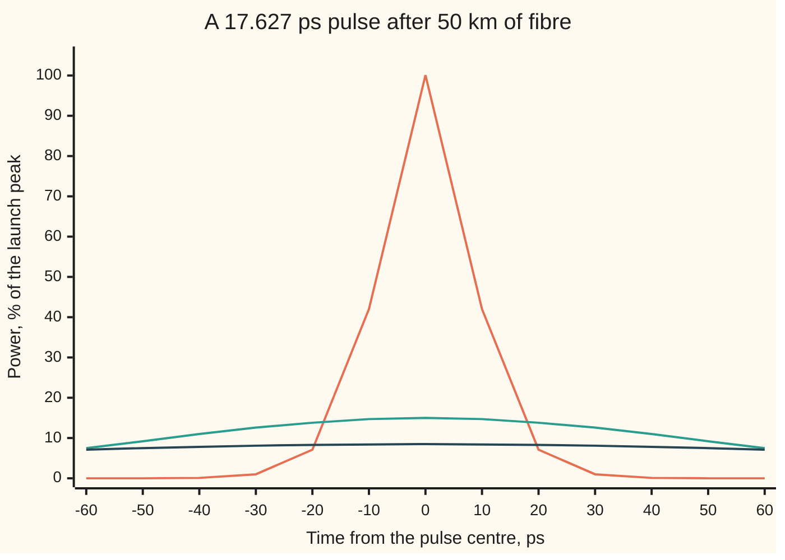
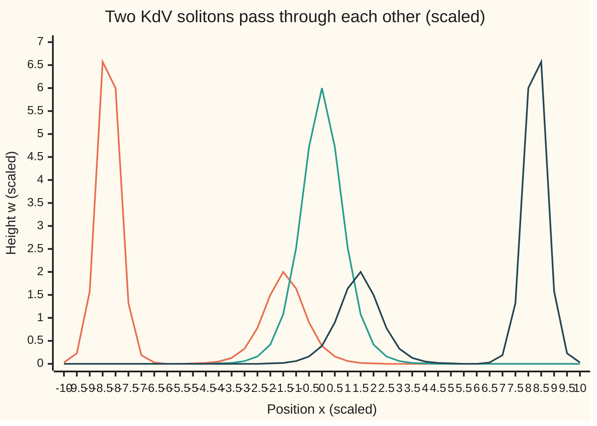

# Solitons: when steepening and spreading balance exactly

[Syllabus](../../../SYLLABUS.md) → [Partial differential equations](../README.md) → [Nonlinear PDE and Fluids](../README.md#s07) → Solitons

---

## General Overview

A laser sends a 17.627 ps light pulse into 50 km of optical fibre (a picosecond, ps, is a millionth of a millionth of a second). The fibre's numbers here are illustrative, close to standard fibre at 1550 nm.

At low power, on the code's grid, the pulse comes out 120.398 ps wide, and its peak power falls to 15.0% of the start. The reason is **dispersion**: each colour in the pulse travels at its own speed, so the colours drift apart ([Dispersion](../05-Waves/06-dispersion-group-velocity-and-kdv-in-outline.md)).

Launch the same pulse at 153.85 mW peak power and the grid shows it coming out 17.619 ps wide: the shape it went in with, to within the grid's error, since the exact soliton keeps its 17.627 ps. At high power the glass's refractive index rises a little with the light's power. That **Kerr effect** squeezes the pulse, and at exactly this power the squeeze cancels the spreading.

Such a self-holding lump is a **soliton**. The same balance holds a hump of water together on a canal, through the Korteweg–de Vries (KdV) equation met on [Dispersion](../05-Waves/06-dispersion-group-velocity-and-kdv-in-outline.md). There the nonlinear effect is steepening: taller water moves faster.

Both equations hide a linear eigenvalue problem whose eigenvalues never change as the wave moves. Each eigenvalue is one soliton, so solitons pass through each other and come out whole.

**A soliton is a pulse in which a nonlinear squeeze, Kerr focusing in fibre or steepening on water, cancels dispersive spreading exactly; the nonlinear Schrödinger and KdV equations carry such pulses because each is secretly a linear eigenvalue problem whose eigenvalues stay fixed, one per soliton.**

**What kind of fact this is:** the fibre equation and KdV are models, approximations that fit well, not laws. Inside them, the one-soliton formulas are theorems, proved here and on [Dispersion](../05-Waves/06-dispersion-group-velocity-and-kdv-in-outline.md) for classical solutions (smooth, fading to zero far from the pulse); in one dimension such a solution is unique for its launch, a known theorem not proved here. The two-soliton formula and the fixed eigenvalues are stated with sources and checked by the code; the full inverse method is outlined only.

### The picture: one pulse after 50 km, three ways



Orange: launched at 153.85 mW, the soliton power; it lies on the launch shape. Teal: a low-power pulse, spread to 120.398 ps. Dark blue: 153.85 mW in fibre of the opposite dispersion sign, spread to 220.134 ps. All three keep their full energy. The points and widths come from the code's grid, at steps of 0.5 ps and 0.1 km, so their last digit can be off by one: the soliton's 100.1 at the centre is grid error, since the exact soliton keeps its launch peak.

---

## The formula

Notation first. $`A(z, t)`$ is the pulse's **envelope**: the slow outline of the light wave, a complex number whose size squared $`|A|^2`$ is the power in watts. $`z`$ is distance along the fibre, in km; $`t`$ is time from the pulse centre, in ps, on a clock that moves with the pulse. Subscripts are rates, as before.

The fibre obeys the **nonlinear Schrödinger equation** (NLS):

```math
i\,A_z - \frac{\beta_2}{2}\,A_{tt} + \gamma\,|A|^2 A = 0, \qquad A = \sqrt{P_0}\;\mathrm{sech}\Big(\frac{t}{T_0}\Big)\,e^{\,i z/(2L_D)}, \qquad P_0 = \frac{|\beta_2|}{\gamma\,T_0^2}, \qquad L_D = \frac{T_0^2}{|\beta_2|}
```

**Read it aloud:** the envelope's change along the fibre balances a dispersion term and a Kerr term; a pulse shaped like sech of t over T-nought, at peak power P-nought, keeps its shape forever and only turns its phase.

Here $`\mathrm{sech} = 1/\cosh`$, a smooth hump. Delete the Kerr term and this is the free Schrödinger equation of [Schrodinger and Klein-Gordon](../05-Waves/07-schrodinger-and-klein-gordon-in-outline.md), with z in place of time and t in place of position. That card's packet spreads; the Kerr term is what stops it.

| Symbol | Plain meaning | In our example | Push it up and the answer… |
| --- | --- | --- | --- |
| $`A`$, $`\lvert A\rvert^2`$ | envelope, in $`\sqrt{\mathrm{W}}`$; power, W | peak 153.85 mW | — |
| $`z`$, $`t`$ | distance along the fibre, km; time from the pulse centre, ps | 0 to 50 km; −60 to 60 ps | — |
| $`\beta_2`$ | dispersion: how much the colours' travel times differ, ps²/km; negative is "anomalous" | −20 ps²/km | more spreading: more power needed |
| $`\gamma`$ | Kerr strength: phase gained per watt per km, 1/(W km) | 1.3 /(W km) | less power needed |
| $`T_0`$, FWHM | width scale; full width at half the peak power, 1.7627 $`T_0`$ | 10 ps; 17.627 ps | less power: $`P_0`$ falls as $`1/T_0^2`$ |
| $`L_D`$ | dispersion length: distance over which spreading matters | 5 km | — |
| $`P_0`$ | soliton peak power | 153.85 mW | — |
| $`u`$, $`\tau`$, $`Z`$ | scaled envelope $`A/\sqrt{P_0}`$; scaled time $`t/T_0`$; scaled distance $`z/L_D`$ | 50 km is Z = 10 | — |
| $`N`$ | launch size: launch peak power is $`N^2 P_0`$ | 1 | more solitons, see Step 4 |
| $`\zeta = i\eta`$, $`v_1`$, $`v_2`$ | eigenvalue and eigenfunction of the hidden linear problem | η = 0.5 | taller, narrower soliton |
| $`w`$, $`x`$, $`\kappa`$ | KdV's scaled water height and position; a bound state's decay rate, the square root of minus its energy | κ = 1 and 2 | taller, faster hump |
| $`\psi`$ | eigenfunction of KdV's hidden problem | — | — |

Three letters clash with earlier cards, said once: τ is scaled time here, not the Schrödinger card's spreading time; w is a water height, not a test function; κ is a bound state's decay rate, not the diffusivity.

### When it holds

- **Anomalous dispersion, $`\beta_2 < 0`$.** Then the Kerr chirp opposes the spreading. With $`\beta_2 > 0`$ the two add, and the pulse spreads to 220.134 ps on the grid, wider than at low power.
- **A slow envelope.** The equation follows the outline, not each light oscillation. Pulses of several picoseconds keep this; much shorter pulses need extra terms, and solitons then slowly shift colour.
- **No loss.** Glass absorbs: a loss of 0.2 dB/km halves the power every 15.05 km. Real links restore the power with amplifiers, so the soliton holds on average.
- **One dimension.** In two or three space dimensions the same Kerr focusing can collapse a beam instead of balancing it.

---

## Why it works

### Step 0: the idea

Two effects act on the pulse. Each one sorts its colours across the pulse; such a sorting is a **chirp**.

- **Dispersion:** in anomalous fibre the higher frequencies run ahead, so they gather at the front and the pulse widens.
- **Kerr:** the brightest part gets the largest phase delay. That lowers the frequency at the rising front and raises it at the falling back: the opposite sorting, so the back catches up.

When the two chirps cancel at every time t, the shape stays. That needs one shape, sech, at one power, $`P_0`$.

### Step 1: each effect alone

At low power only dispersion acts, and the colours drift apart as on [Schrodinger and Klein-Gordon](../05-Waves/07-schrodinger-and-klein-gordon-in-outline.md). After 50 km, ten dispersion lengths, the grid gives a pulse 120.398 ps wide with 15.0% of its peak power.

With no dispersion only Kerr acts. Then $`|A|`$ never changes, and the phase grows by $`\gamma|A|^2`$ per km: 10.000 rad at the peak over 50 km. The shape is untouched; only the chirp grows.

### Step 2: the balance, exactly

Rescale to remove the units. Put $`A = \sqrt{P_0}\,u`$, $`t = T_0\tau`$ and $`z = L_D Z`$. Multiply through by $`L_D/\sqrt{P_0}`$, and every constant becomes 1 (scaled):

```math
i\,u_Z + \tfrac{1}{2}\,u_{\tau\tau} + |u|^2 u = 0, \qquad u = \mathrm{sech}\,\tau \; e^{iZ/2}
```

**Read it aloud:** in scaled units, the change along the fibre plus half the bending plus the Kerr term is zero, and sech tau with a turning phase solves it.

Put the sech into the equation. The bending of sech is $`\mathrm{sech} - 2\,\mathrm{sech}^3`$. Its cubic part cancels the Kerr term exactly. Its linear part is absorbed by the turning phase, 0.100 rad per km.

<details>
<summary>Detailed proof: sech τ e^{iZ/2} solves the scaled equation</summary>

Write $`S = \mathrm{sech}\,\tau`$. Then $`S' = -S\tanh\tau`$ and, using $`\tanh^2 = 1 - S^2`$,

$`\displaystyle S'' = S\tanh^2\tau - S\cdot S^2 = S - 2S^3 .`$

Try $`u = a\,S(b\tau)\,e^{ikZ}`$ with real a, b, k. Then $`i u_Z = -k u`$ and $`u_{\tau\tau} = a b^2 (S - 2S^3) e^{ikZ}`$, so the equation becomes

$`\displaystyle \Big(-k + \frac{b^2}{2}\Big)\,aS + \big(a^2 - b^2\big)\,aS^3 = 0 .`$

Both brackets must vanish: $`b = a`$ and $`k = a^2/2`$. With a = 1 this is $`\mathrm{sech}\,\tau\,e^{iZ/2}`$. Back in units, $`a = 1`$ means $`\gamma P_0 L_D = 1`$, which is $`P_0 = |\beta_2|/(\gamma T_0^2)`$.

</details>

The fold also gives a whole family: $`u = a\,\mathrm{sech}(a\tau)\,e^{ia^2 Z/2}`$. A taller soliton is narrower in proportion, so its peak power times its width squared is fixed. Halving $`T_0`$ to 5 ps needs four times the power, 615.38 mW.

### Step 3: the hidden linear problem (inverse scattering, in outline)

Attach to the pulse, at each distance Z, a linear eigenvalue problem in τ. This is the **Zakharov–Shabat problem**; the pulse u plays the part of a potential:

```math
\frac{dv_1}{d\tau} = -i\zeta\,v_1 + u\,v_2, \qquad \frac{dv_2}{d\tau} = i\zeta\,v_2 - \bar u\,v_1
```

**Read it aloud:** a pair of functions v-one and v-two changes in tau at rates set by a number zeta and by the pulse u; $`\bar u`$ is u with i turned to −i.

A **bound state** is a ζ whose solution fades at both ends; for a pulse at rest, as here, it is ζ = iη with η > 0. Zakharov and Shabat (1972) showed three facts for NLS. Gardner, Greene, Kruskal and Miura (1967) had found the KdV form of facts 2 and 3:

1. NLS is exactly the condition that this problem and a second linear rule for the Z-direction agree. The pair is called a **Lax pair**.
2. Then the bound states do not move as the pulse travels: they are conserved, like energy.
3. Each bound state η is one soliton, $`2\eta\,\mathrm{sech}(2\eta\tau)`$: peak power $`4\eta^2 P_0`$, FWHM 17.627 ps divided by 2η.

The **inverse scattering transform** ([Lax pairs and inverse scattering](16-lax-pairs-and-the-inverse-scattering-transform.md)) makes this a solution method: **scatter** (find the bound states and the wave reflection of the launched pulse), **evolve** (each piece of data changes by a known factor), **invert** (rebuild the pulse by solving a linear integral equation, the Gel'fand–Levitan–Marchenko equation).

The code finds η = 0.500000 for the launched soliton, and still η = 0.500000 after 50 km on the grid; 2η = 1 is its amplitude. That case is easy, because the soliton's shape never changes. The real test of fact 2 is a pulse that does change shape, in Step 4.

### Step 4: what the eigenvalues predict

For a launch $`N\,\mathrm{sech}\,\tau`$, Satsuma and Yajima (1974) found the bound states exactly: $`\eta = N - \tfrac12,\ N - \tfrac32,\ \dots`$, keeping those above zero. So the launch power decides how many solitons come out.

| Launch | N | Bound states η | What comes out |
| --- | --- | --- | --- |
| 24.62 mW | 0.4 | none | no soliton: the pulse spreads away |
| 98.46 mW | 0.8 | 0.30000 | one soliton, 55.38 mW, 29.379 ps; 93.75% of the energy |
| 153.85 mW | 1 | 0.500000 | the launched soliton itself |
| 221.54 mW | 1.2 | 0.70000 | one soliton, 301.54 mW, 12.591 ps; 97.22% of the energy |
| 615.38 mW | 2 | 0.50000 and 1.50000 | two solitons bound together; the pulse breathes every 7.854 km |

The energy not kept leaves as low ripples that spread away. The soliton values in the table hold far down the fibre: at 50 km the ripples have not yet cleared, and the peak still swings about the predicted power. The code measures η for N = 1.2 again after 50 km: 0.69987, unchanged within the grid error.

### Step 5: KdV, the same story on water

The [Dispersion](../05-Waves/06-dispersion-group-velocity-and-kdv-in-outline.md) card outlined KdV for a canal and proved its solitary wave. Move with the long-wave speed and rescale height, position and time, and KdV becomes (scaled):

```math
w_t + 6\,w\,w_x + w_{xxx} = 0, \qquad -\psi'' - w\,\psi = -\kappa^2\,\psi, \qquad w = 2\kappa^2\,\mathrm{sech}^2\!\big(\kappa(x - 4\kappa^2 t)\big)
```

**Read it aloud:** the height changes by steepening plus spreading; its hidden problem is a Schrödinger equation with the wave as the well; each bound state kappa is a hump of height two kappa squared moving at four kappa squared.

The hidden problem is the steady Schrödinger equation with the water hump as an attracting well. Each bound energy $`-\kappa^2`$ is one soliton, and Gardner, Greene, Kruskal and Miura proved these energies stay fixed as w moves.

The code takes the exact two-soliton solution, which starts as one hump $`6\,\mathrm{sech}^2 x`$. Its well has bound states κ = 1 and κ = 2 at t = 0 and again at t = 0.5: two solitons, heights 2 and 8, speeds 4 and 16.

This is what makes such equations special. They are **integrable**: they carry an endless list of conserved quantities. Most nonlinear wave equations have solitary waves but no such list, and their humps lose shape when they collide.

---

## Worked numbers, by hand

The fibre: $`\beta_2`$ = −20 ps²/km, $`\gamma`$ = 1.3 /(W km), $`T_0`$ = 10 ps, all illustrative.

| Step | Arithmetic | Value |
| --- | --- | --- |
| dispersion length | $`L_D = T_0^2/\lvert\beta_2\rvert = 100/20`$ | 5.000 km |
| soliton power | $`P_0 = \lvert\beta_2\rvert/(\gamma T_0^2) = 20/(1.3 \times 100)`$ | **153.85 mW** |
| pulse width | FWHM $`= 2\,\mathrm{arccosh}(\sqrt2)\,T_0 = 1.7627 \times 10`$ | 17.627 ps |
| pulse energy | $`2P_0T_0 = 2 \times 0.15385 \times 10`$ | 3.0769 pJ |
| phase turn | $`1/(2L_D) = 1/10`$ | 0.100 rad/km |
| distance in $`L_D`$ | 50/5 | Z = 10 |
| Kerr phase at the peak | $`\gamma P_0 \times 50 = 1.3 \times 0.15385 \times 50`$ | 10.000 rad |

A 3.0769 pJ pulse at 153.85 mW peak power runs 50 km and arrives 17.627 ps wide: ten dispersion lengths, with no spreading.

### What breaks if you drop a piece

| Mistake | Comes out at | What went wrong |
| --- | --- | --- |
| Launch at low power | FWHM 120.398 ps at 50 km on the grid, not 17.627 ps | no Kerr squeeze: dispersion acts alone |
| Use fibre with $`\beta_2 > 0`$ | FWHM 220.134 ps on the grid, peak 8.5% | the two chirps add instead of cancelling |
| Launch at 221.54 mW, 20% too much amplitude | settles, far down the fibre, to 301.54 mW, 12.591 ps | η = 0.7, not 0.5: a different soliton |
| Launch at 24.62 mW | no soliton at all | below N = 1/2 the well holds no bound state |

The code prints every row.

---

## How it moves

The puzzle: KdV is nonlinear, so two humps should not simply add. Yet two solitons pass through each other unchanged. Follow the exact two-soliton solution.

| Time (scaled) | Tall hump | Short hump |
| --- | --- | --- |
| t = −1 | height 8.0000 at x = −16.2747 | height 2.0000 at x = −3.4507 |
| t = 0 | merged: one hump of height 6.00 at x = 0 | — |
| t = +1 | height 8.0000 at x = 16.2747 | height 2.0000 at x = 3.4507 |

The tall hump overtakes the short one. At the meeting the heights do not add: 8 and 2 make one hump of 6.

The only trace of the collision is a shift. The tall hump ends +0.5493 ahead of steady motion at speed 16, which is ln 3 / 2; the short one ends −1.0986 behind, which is −ln 3. The total $`\int w\,dx`$ is 12.000000 before and after.



Orange: t = −0.5, tall hump behind on the left, short hump ahead. Teal: t = 0, one merged hump of height 6. Dark blue: t = +0.5, the tall hump now ahead. The samples are 0.5 apart, so the tall hump's top, 8, falls between two of them.

---

## Code, from first principles, and it actually runs

The code builds everything itself: complex numbers (a struct in Rust), a tridiagonal solver, RK4 (the classic four-stage step for ordinary equations) and two searches. It reaches the fibre soliton by three independent roads, and KdV's solitons by three more:

1. **The closed form in the equation.** Centred differences of $`\mathrm{sech}\,\tau\,e^{iZ/2}`$ leave a residual that falls by 4.00 when the step halves.
2. **A grid.** Split-step Crank–Nicolson: half a Kerr phase, an implicit dispersion step (one that solves a linear system for the new values), half a Kerr phase. Its error falls by 4.02 when the steps halve, and it reproduces the Gaussian spreading formula of [Schrodinger and Klein-Gordon](../05-Waves/07-schrodinger-and-klein-gordon-in-outline.md).
3. **The hidden eigenvalue.** RK4 shooting on the Zakharov–Shabat problem finds η, before and after 50 km on the grid. Shooting means: integrate from the left end, then adjust η until the solution fades at the right end.
4. **KdV:** the two-soliton formula's residual; its well's bound states by shooting at two times; its mass by a sum.

### Python

```python
# Solitons: a 10 ps pulse in optical fibre, and two KdV humps that pass through each other.
# Roads: the closed-form soliton and its residual; a split-step Crank-Nicolson grid; the
# Zakharov-Shabat eigenvalue problem by RK4 shooting; for KdV, the exact two-soliton formula,
# its residual, and the bound states of its Schrodinger problem by shooting.
from math import cosh, sqrt, log, acosh, floor, log10
from cmath import exp as cexp
B2, GAM, T0 = 20.0, 1.3, 10.0         # |beta2| ps^2/km (anomalous), gamma 1/(W km), T0 ps: illustrative
LD = T0 * T0 / B2                     # dispersion length, km
P0 = B2 / (GAM * T0 * T0)             # soliton peak power, W
def sci(x):                           # e-notation with the same digits in Python and Rust
    e = floor(log10(abs(x))); m = round(x / 10 ** e, 2)
    return f"{m:.2f}e{e:+03d}"
def sech(x): return 1 / cosh(x)
def cn_step(u, h, dz, s):             # Crank-Nicolson for i u_z + (s/2) u_tt = 0, zero at both ends
    n, r = len(u), 1j * s * dz / (4 * h * h)
    d = [u[j] + r * ((u[j-1] if j else 0) - 2 * u[j] + (u[j+1] if j < n - 1 else 0)) for j in range(n)]
    a, b = -r, 1 + 2 * r              # Thomas algorithm, written out
    cp, dp = [a / b] + [0j] * (n - 1), [d[0] / b] + [0j] * (n - 1)
    for j in range(1, n):
        m = b - a * cp[j-1]; cp[j] = a / m; dp[j] = (d[j] - a * dp[j-1]) / m
    for j in range(n - 2, -1, -1): dp[j] -= cp[j] * dp[j+1]
    return dp
def evolve(u, h, dz, steps, s=1, g=1.0):   # Strang splitting: half Kerr phase, dispersion, half Kerr phase
    kerr = lambda u: [v * cexp(0.5j * g * abs(v) ** 2 * dz) for v in u]
    for _ in range(steps): u = kerr(cn_step(kerr(u), h, dz, s))
    return u
def fwhm(xs, p):                      # full width at half maximum, interpolated on the right side
    j0 = max(range(len(p)), key=lambda j: p[j]); half = p[j0] / 2; j = j0
    while p[j+1] > half: j += 1
    return 2 * (xs[j] + (p[j] - half) / (p[j] - p[j+1]) * (xs[j+1] - xs[j]) - xs[j0])
def zs_a(q, h, zeta):                 # Zakharov-Shabat: w1' = q w2, w2' = 2i zeta w2 - conj(q) w1, RK4
    w1, w2 = 1 + 0j, 0j               # q sampled at spacing h; one RK4 step spans 2h
    f = lambda qq, a, b: (qq * b, 2j * zeta * b - qq.conjugate() * a)
    for j in range(0, len(q) - 2, 2):
        H = 2 * h; k1 = f(q[j], w1, w2); k2 = f(q[j+1], w1 + H/2 * k1[0], w2 + H/2 * k1[1])
        k3 = f(q[j+1], w1 + H/2 * k2[0], w2 + H/2 * k2[1]); k4 = f(q[j+2], w1 + H * k3[0], w2 + H * k3[1])
        w1 += H / 6 * (k1[0] + 2 * k2[0] + 2 * k3[0] + k4[0]); w2 += H / 6 * (k1[1] + 2 * k2[1] + 2 * k3[1] + k4[1])
    return w1
def eigen(q, h, guess):               # secant search for a(zeta) = 0 on the imaginary axis
    z0, z1 = guess, guess + 0.01j; f0, f1 = zs_a(q, h, z0), zs_a(q, h, z1)
    for _ in range(40):
        if abs(z1 - z0) < 1e-12: break
        z0, f0, z1 = z1, f1, z1 - f1 * (z1 - z0) / (f1 - f0); f1 = zs_a(q, h, z1)
    return z1.imag
L, h, dz = 60.0, 0.05, 0.02; xs = [-L + j * h for j in range(2401)]   # tau = t/T0 on [-60, 60]; Z step 0.02
print(f"fibre: |beta2| = {B2:.1f} ps^2/km, gamma = {GAM:.1f} /(W km), T0 = {T0:.1f} ps (illustrative)")
print(f"L_D = T0^2/|beta2| = {LD:.3f} km; soliton peak power P0 = {P0*1e3:.2f} mW; FWHM = {2*acosh(sqrt(2)):.4f} T0 = {2*acosh(sqrt(2))*T0:.3f} ps")
print(f"pulse energy 2 P0 T0 = {2*P0*T0:.4f} pJ; soliton phase turns {1/(2*LD):.3f} rad/km")
print(f"Kerr phase at the peak over 50 km: gamma P0 x 50 km = {GAM*P0*50:.3f} rad; loss of 0.2 dB/km halves power every {10*log10(2)/0.2:.2f} km")
res = []                              # road 1: the closed form in the equation, centred differences
for d in (0.01, 0.005):
    U, t, z = lambda t, z: sech(t) * cexp(0.5j * z), 0.7, 0.3
    uz = (U(t, z + d) - U(t, z - d)) / (2 * d); utt = (U(t + d, z) - 2 * U(t, z) + U(t - d, z)) / (d * d)
    res.append(abs(1j * uz + 0.5 * utt + abs(U(t, z)) ** 2 * U(t, z)))
print(f"NLS residual of sech(tau) e^(i z/2): {sci(res[0])} at step 0.01, {sci(res[1])} at 0.005, ratio {res[0]/res[1]:.2f}")
assert 3.9 < res[0] / res[1] < 4.1, "the closed form solves NLS"
errs = []                             # road 2: the grid, at two steps, against the closed form at 1 L_D
for hh, dd in ((0.1, 0.02), (0.05, 0.01)):
    g = [-20 + j * hh for j in range(int(round(40 / hh)) + 1)]
    u = evolve([complex(sech(x)) for x in g], hh, dd, int(round(1 / dd)))
    errs.append(max(abs(v - sech(x) * cexp(0.5j)) for v, x in zip(u, g)))
print(f"grid error at 5 km: {sci(errs[0])} at step 0.1, {sci(errs[1])} at 0.05, ratio {errs[0]/errs[1]:.2f}")
assert 3.8 < errs[0] / errs[1] < 4.2, "grid converges at second order"
start = [complex(sech(x)) for x in xs]
runs = {"soliton": evolve(start, h, dz, 500), "low power": evolve(start, h, dz, 500, g=0.0),
        "normal dispersion": evolve(start, h, dz, 500, s=-1)}
gau = evolve([complex(cexp(-x * x / 2)) for x in xs], h, dz, 500, g=0.0)
rms = sqrt(sum(x * x * abs(v) ** 2 for x, v in zip(xs, gau)) / sum(abs(v) ** 2 for v in gau))
print(f"check on the grid: Gaussian at low power, 50 km: rms width {rms:.5f} T0, formula {sqrt(101/2):.5f} T0")
assert abs(rms - sqrt(101 / 2)) < 1e-3 * rms, "linear spreading matches the closed form"
print(f"at 50 km (10 L_D), launched as a 17.627 ps sech pulse; grid steps {h*T0:.1f} ps and {dz*LD:.1f} km:")
for k, u in runs.items():
    p = [abs(v) ** 2 for v in u]
    print(f"  {k:17s}: peak {max(p):.4f} of start, FWHM {fwhm(xs, p)*T0:7.3f} ps, energy {h * sum(abs(v) ** 2 for v in u):.6f} (start 2)")
sol = runs["soliton"]
dev = max(abs(abs(v) - sech(x)) for v, x in zip(sol, xs))
print(f"  soliton: largest gap from the launched shape {dev:.5f}")
assert dev < 0.01 and abs(h * sum(abs(v) ** 2 for v in sol) - 2) < 1e-9, "the soliton holds its shape and energy"
eta = eigen(start, h, 0.45j); eta50 = eigen(sol, h, 0.45j)          # road 3: the hidden eigenvalue
print(f"Zakharov-Shabat eigenvalue of the soliton: {eta:.6f} at 0 km, {eta50:.6f} at 50 km; amplitude 2 eta = {2*eta:.6f}")
assert abs(eta - 0.5) < 1e-4 and abs(eta50 - 0.5) < 1e-3, "one bound state, amplitude 1"
for N in (1.2, 0.8):                  # launch at the wrong power: N^2 times P0
    q0 = [complex(N * sech(x)) for x in xs]; q50 = evolve(q0, h, dz, 500)
    e0, e50 = eigen(q0, h, (N - 0.55) * 1j), eigen(q50, h, (N - 0.55) * 1j)
    print(f"N = {N}: launch {N*N*P0*1e3:.2f} mW; eta {e0:.5f} at 0 km, {e50:.5f} at 50 km (N - 1/2 = {N-0.5:.1f})")
    print(f"   settles to peak {4*e0*e0*P0*1e3:.2f} mW, FWHM {2*acosh(sqrt(2))*T0/(2*e0):.3f} ps; keeps {4*e0/(2*N*N)*100:.2f}% of the energy")
    assert abs(e0 - (N - 0.5)) < 1e-4 and abs(e50 - e0) < 1e-3, "eigenvalue fixed, at N - 1/2"
a04 = [zs_a([complex(0.4 * sech(x)) for x in xs], h, 1j * k / 100).real for k in range(1, 201)]
print(f"N = 0.4 ({0.16*P0*1e3:.2f} mW): a(i eta) for eta = 0.01..2 stays between {min(a04):.4f} and {max(a04):.4f}: no bound state, no soliton")
assert min(a04) > 0, "below N = 1/2 nothing binds"
for k, u in runs.items():             # chart points: % of the launch peak at t = -60..60 ps
    print(f"chart 50 km {k}, t=-60..60 ps: " + ", ".join(f"{abs(u[1200 + 20 * m]) ** 2 * 100:.1f}" for m in range(-6, 7)))
two = [eigen([complex(2 * sech(x)) for x in xs], h, g) for g in (0.45j, 1.45j)]
print(f"try: N = 2 ({4*P0*1e3:.2f} mW) has eta = {two[0]:.5f} and {two[1]:.5f}; it breathes with period pi/2 L_D = {3.141592653589793/2*LD:.3f} km")
print(f"try: T0 = 5 ps needs P0 = {B2/(GAM*25)*1e3:.2f} mW, L_D = {25/B2:.3f} km; |beta2| = 40 ps^2/km needs P0 = {40/(GAM*T0*T0)*1e3:.2f} mW")
fw = 2 * acosh(sqrt(2))               # mistake: the FWHM, 17.627 ps, put in place of T0
print(f"FWHM used as T0: launch {P0/fw**2*1e3:.2f} mW, N = {1/fw:.4f}, eta = {1/fw-0.5:.4f}, settles to FWHM {fw*T0/(2*(1/fw-0.5)):.1f} ps")
def kdv2(x, t):                       # scaled KdV w_t + 6 w w_x + w_xxx = 0, two solitons kappa = 1, 2
    num = 3 + 4 * cosh(2 * x - 8 * t) + cosh(4 * x - 64 * t)
    return 12 * num / (3 * cosh(x - 28 * t) + cosh(3 * x - 36 * t)) ** 2
res = []                              # KdV road 1: the formula in the equation
for d in (0.004, 0.002):              # time step d/8: the tall hump changes 8 times faster
    x, t, f, e = 0.3, 0.02, kdv2, d / 8
    ut = (f(x, t + e) - f(x, t - e)) / (2 * e); ux = (f(x + d, t) - f(x - d, t)) / (2 * d)
    uxxx = (f(x + 2 * d, t) - 2 * f(x + d, t) + 2 * f(x - d, t) - f(x - 2 * d, t)) / (2 * d ** 3)
    res.append(abs(ut + 6 * f(x, t) * ux + uxxx))
print(f"KdV residual of the two-soliton formula: {sci(res[0])} at step 0.004, {sci(res[1])} at 0.002, ratio {res[0]/res[1]:.2f}")
assert 3.9 < res[0] / res[1] < 4.1, "the two-soliton formula solves KdV"
def bound(t, k):                      # -psi'' - w psi = -k^2 psi; y = psi e^(-k x); y'' = -2k y' - w y, RK4
    y, v, H = 1.0, 0.0, 0.01
    for j in range(4000):
        x = -20 + 16 * t + j * H; f = lambda x, y, v: (v, -2 * k * v - kdv2(x, t) * y)
        a1 = f(x, y, v); a2 = f(x + H/2, y + H/2 * a1[0], v + H/2 * a1[1])
        a3 = f(x + H/2, y + H/2 * a2[0], v + H/2 * a2[1]); a4 = f(x + H, y + H * a3[0], v + H * a3[1])
        y += H / 6 * (a1[0] + 2 * a2[0] + 2 * a3[0] + a4[0]); v += H / 6 * (a1[1] + 2 * a2[1] + 2 * a3[1] + a4[1])
    return y
def bisect(t, lo, hi):
    for _ in range(40):               # keep the half where w(L) changes sign
        mid = (lo + hi) / 2; lo, hi = (mid, hi) if (bound(t, lo) > 0) == (bound(t, mid) > 0) else (lo, mid)
    return (lo + hi) / 2
for t in (0.0, 0.5):
    k1, k2 = bisect(t, 0.5, 1.5), bisect(t, 1.5, 2.5)
    print(f"KdV t = {t}: kappa = {k1:.6f}, {k2:.6f}; heights 2 kappa^2 = {2*k1*k1:.4f}, {2*k2*k2:.4f}; speeds 4 kappa^2 = {4*k1*k1:.4f}, {4*k2*k2:.4f}")
    assert abs(k1 - 1) < 1e-5 and abs(k2 - 2) < 1e-5, "eigenvalues fixed"
def peak(t, lo, hi, g=(sqrt(5) - 1) / 2):    # golden-section search for a local maximum
    for _ in range(80):
        a, b = hi - g * (hi - lo), lo + g * (hi - lo); lo, hi = (lo, b) if kdv2(a, t) > kdv2(b, t) else (a, hi)
    return (lo + hi) / 2
for t in (-1.0, 1.0):
    xt, xs_ = peak(t, 16 * t - 3, 16 * t + 3), peak(t, 4 * t - 3, 4 * t + 3)
    print(f"KdV t = {t:+.0f}: tall hump {kdv2(xt, t):.4f} at x = {xt:.4f}; short hump {kdv2(xs_, t):.4f} at x = {xs_:.4f}")
shift_t, shift_s = 2 * (peak(1, 13, 19) - 16), 2 * (peak(1, 1, 7) - 4)
print(f"shift through the collision: tall {shift_t:+.4f} (ln 3 / 2 = {log(3)/2:.4f}), short {shift_s:+.4f} (-ln 3 = {-log(3):.4f})")
assert abs(shift_t - log(3) / 2) < 1e-4 and abs(shift_s + log(3)) < 1e-4, "phase shifts"
for t in (-0.5, 0.0, 0.5):
    print(f"chart KdV t = {t:+.1f}, x = -10..10 step 0.5: " + ", ".join(f"{kdv2(-10 + 0.5 * j, t):.2f}" for j in range(41)))
mass = [0.01 * sum(kdv2(-30 + 0.01 * j, t) for j in range(6001)) for t in (0.0, 1.0)]
print(f"KdV mass at t = 0 and 1: {mass[0]:.6f}, {mass[1]:.6f} (4 x (1 + 2) = 12)")
assert abs(mass[0] - 12) < 1e-6 and abs(mass[1] - 12) < 1e-6, "mass conserved"
print("ALL CHECKS PASS")
```

**Ran 2026-11-15 on macOS, Python 3.14.10, standard library only. All checks passed. Output, pasted from the run:**

```
fibre: |beta2| = 20.0 ps^2/km, gamma = 1.3 /(W km), T0 = 10.0 ps (illustrative)
L_D = T0^2/|beta2| = 5.000 km; soliton peak power P0 = 153.85 mW; FWHM = 1.7627 T0 = 17.627 ps
pulse energy 2 P0 T0 = 3.0769 pJ; soliton phase turns 0.100 rad/km
Kerr phase at the peak over 50 km: gamma P0 x 50 km = 10.000 rad; loss of 0.2 dB/km halves power every 15.05 km
NLS residual of sech(tau) e^(i z/2): 5.06e-06 at step 0.01, 1.27e-06 at 0.005, ratio 4.00
grid error at 5 km: 1.25e-03 at step 0.1, 3.10e-04 at 0.05, ratio 4.02
check on the grid: Gaussian at low power, 50 km: rms width 7.10128 T0, formula 7.10634 T0
at 50 km (10 L_D), launched as a 17.627 ps sech pulse; grid steps 0.5 ps and 0.1 km:
  soliton          : peak 1.0006 of start, FWHM  17.619 ps, energy 2.000000 (start 2)
  low power        : peak 0.1496 of start, FWHM 120.398 ps, energy 2.000000 (start 2)
  normal dispersion: peak 0.0847 of start, FWHM 220.134 ps, energy 2.000000 (start 2)
  soliton: largest gap from the launched shape 0.00029
Zakharov-Shabat eigenvalue of the soliton: 0.500000 at 0 km, 0.500000 at 50 km; amplitude 2 eta = 1.000000
N = 1.2: launch 221.54 mW; eta 0.70000 at 0 km, 0.69987 at 50 km (N - 1/2 = 0.7)
   settles to peak 301.54 mW, FWHM 12.591 ps; keeps 97.22% of the energy
N = 0.8: launch 98.46 mW; eta 0.30000 at 0 km, 0.30003 at 50 km (N - 1/2 = 0.3)
   settles to peak 55.38 mW, FWHM 29.379 ps; keeps 93.75% of the energy
N = 0.4 (24.62 mW): a(i eta) for eta = 0.01..2 stays between 0.3308 and 0.9241: no bound state, no soliton
chart 50 km soliton, t=-60..60 ps: 0.0, 0.0, 0.1, 1.0, 7.1, 42.0, 100.1, 42.0, 7.1, 1.0, 0.1, 0.0, 0.0
chart 50 km low power, t=-60..60 ps: 7.5, 9.2, 11.0, 12.6, 13.8, 14.7, 15.0, 14.7, 13.8, 12.6, 11.0, 9.2, 7.5
chart 50 km normal dispersion, t=-60..60 ps: 7.1, 7.5, 7.8, 8.1, 8.3, 8.4, 8.5, 8.4, 8.3, 8.1, 7.8, 7.5, 7.1
try: N = 2 (615.38 mW) has eta = 0.50000 and 1.50000; it breathes with period pi/2 L_D = 7.854 km
try: T0 = 5 ps needs P0 = 615.38 mW, L_D = 1.250 km; |beta2| = 40 ps^2/km needs P0 = 307.69 mW
FWHM used as T0: launch 49.51 mW, N = 0.5673, eta = 0.0673, settles to FWHM 131.0 ps
KdV residual of the two-soliton formula: 1.43e-02 at step 0.004, 3.57e-03 at 0.002, ratio 4.00
KdV t = 0.0: kappa = 1.000000, 2.000000; heights 2 kappa^2 = 2.0000, 8.0000; speeds 4 kappa^2 = 4.0000, 16.0000
KdV t = 0.5: kappa = 1.000000, 2.000000; heights 2 kappa^2 = 2.0000, 8.0000; speeds 4 kappa^2 = 4.0000, 16.0000
KdV t = -1: tall hump 8.0000 at x = -16.2747; short hump 2.0000 at x = -3.4507
KdV t = +1: tall hump 8.0000 at x = 16.2747; short hump 2.0000 at x = 3.4507
shift through the collision: tall +0.5493 (ln 3 / 2 = 0.5493), short -1.0986 (-ln 3 = -1.0986)
chart KdV t = -0.5, x = -10..10 step 0.5: 0.03, 0.23, 1.58, 6.57, 6.00, 1.32, 0.19, 0.03, 0.00, 0.00, 0.01, 0.02, 0.05, 0.13, 0.33, 0.78, 1.50, 2.00, 1.64, 0.90, 0.39, 0.16, 0.06, 0.02, 0.01, 0.00, 0.00, 0.00, 0.00, 0.00, 0.00, 0.00, 0.00, 0.00, 0.00, 0.00, 0.00, 0.00, 0.00, 0.00, 0.00
chart KdV t = +0.0, x = -10..10 step 0.5: 0.00, 0.00, 0.00, 0.00, 0.00, 0.00, 0.00, 0.00, 0.00, 0.00, 0.00, 0.00, 0.01, 0.02, 0.06, 0.16, 0.42, 1.08, 2.52, 4.72, 6.00, 4.72, 2.52, 1.08, 0.42, 0.16, 0.06, 0.02, 0.01, 0.00, 0.00, 0.00, 0.00, 0.00, 0.00, 0.00, 0.00, 0.00, 0.00, 0.00, 0.00
chart KdV t = +0.5, x = -10..10 step 0.5: 0.00, 0.00, 0.00, 0.00, 0.00, 0.00, 0.00, 0.00, 0.00, 0.00, 0.00, 0.00, 0.00, 0.00, 0.00, 0.00, 0.01, 0.02, 0.06, 0.16, 0.39, 0.90, 1.64, 2.00, 1.50, 0.78, 0.33, 0.13, 0.05, 0.02, 0.01, 0.00, 0.00, 0.03, 0.19, 1.32, 6.00, 6.57, 1.58, 0.23, 0.03
KdV mass at t = 0 and 1: 12.000000, 12.000000 (4 x (1 + 2) = 12)
ALL CHECKS PASS
```

### Rust

```rust
// Solitons: a 10 ps pulse in optical fibre, and two KdV humps that pass through each other.
// Roads: the closed-form soliton and its residual; a split-step Crank-Nicolson grid; the
// Zakharov-Shabat eigenvalue problem by RK4 shooting; for KdV, the exact two-soliton formula, its residual, and its bound states.
use std::ops::{Add, Div, Mul, Sub};
#[derive(Clone, Copy)] struct C { re: f64, im: f64 }
fn c(re: f64, im: f64) -> C { C { re, im } }
impl Add for C { type Output = C; fn add(self, o: C) -> C { c(self.re + o.re, self.im + o.im) } }
impl Sub for C { type Output = C; fn sub(self, o: C) -> C { c(self.re - o.re, self.im - o.im) } }
impl Mul for C { type Output = C; fn mul(self, o: C) -> C { c(self.re * o.re - self.im * o.im, self.re * o.im + self.im * o.re) } }
impl Div for C { type Output = C; fn div(self, o: C) -> C { let d = o.re * o.re + o.im * o.im; c((self.re * o.re + self.im * o.im) / d, (self.im * o.re - self.re * o.im) / d) } }
impl C { fn abs(self) -> f64 { self.re.hypot(self.im) } fn conj(self) -> C { c(self.re, -self.im) } fn s(self, k: f64) -> C { c(self.re * k, self.im * k) } }
fn cis(a: f64) -> C { c(a.cos(), a.sin()) }
const B2: f64 = 20.0; const GAM: f64 = 1.3; const T0: f64 = 10.0; // |beta2| ps^2/km, gamma 1/(W km), T0 ps: illustrative
fn sci(x: f64) -> String { let e = x.abs().log10().floor() as i32; format!("{:.2}e{:+03}", x / 10f64.powi(e), e) } // same digits as Python
fn sech(x: f64) -> f64 { 1.0 / x.cosh() }
fn cn_step(u: &[C], h: f64, dz: f64, s: f64) -> Vec<C> { // Crank-Nicolson for i u_z + (s/2) u_tt = 0
    let n = u.len(); let r = c(0.0, s * dz / (4.0 * h * h)); let z = c(0.0, 0.0);
    let d: Vec<C> = (0..n).map(|j| u[j] + r * ((if j > 0 { u[j - 1] } else { z }) - u[j].s(2.0) + (if j < n - 1 { u[j + 1] } else { z }))).collect();
    let (a, b) = (r.s(-1.0), c(1.0, 0.0) + r.s(2.0)); // Thomas algorithm, written out
    let (mut cp, mut dp) = (vec![z; n], vec![z; n]); cp[0] = a / b; dp[0] = d[0] / b;
    for j in 1..n { let m = b - a * cp[j - 1]; cp[j] = a / m; dp[j] = (d[j] - a * dp[j - 1]) / m; }
    for j in (0..n - 1).rev() { let t = cp[j] * dp[j + 1]; dp[j] = dp[j] - t; }
    dp
}
fn evolve(u0: &[C], h: f64, dz: f64, steps: usize, s: f64, g: f64) -> Vec<C> { // Strang splitting
    let kerr = |u: Vec<C>| -> Vec<C> { u.iter().map(|&v| v * cis(0.5 * g * v.abs().powi(2) * dz)).collect() };
    let mut u = u0.to_vec(); for _ in 0..steps { u = kerr(cn_step(&kerr(u), h, dz, s)); } u
}
fn fwhm(xs: &[f64], p: &[f64]) -> f64 { // full width at half maximum, interpolated on the right side
    let mut j0 = 0; for j in 0..p.len() { if p[j] > p[j0] { j0 = j; } } let half = p[j0] / 2.0; let mut j = j0;
    while p[j + 1] > half { j += 1; }
    2.0 * (xs[j] + (p[j] - half) / (p[j] - p[j + 1]) * (xs[j + 1] - xs[j]) - xs[j0])
}
fn zs_a(q: &[C], h: f64, zeta: C) -> C { // Zakharov-Shabat: w1' = q w2, w2' = 2i zeta w2 - conj(q) w1, RK4
    let (mut w1, mut w2) = (c(1.0, 0.0), c(0.0, 0.0)); let hh = 2.0 * h;
    let f = |qq: C, a: C, b: C| (qq * b, c(0.0, 2.0) * zeta * b - qq.conj() * a);
    let mut j = 0; while j + 2 < q.len() {
        let k1 = f(q[j], w1, w2); let k2 = f(q[j + 1], w1 + k1.0.s(hh / 2.0), w2 + k1.1.s(hh / 2.0));
        let k3 = f(q[j + 1], w1 + k2.0.s(hh / 2.0), w2 + k2.1.s(hh / 2.0)); let k4 = f(q[j + 2], w1 + k3.0.s(hh), w2 + k3.1.s(hh));
        w1 = w1 + (k1.0 + k2.0.s(2.0) + k3.0.s(2.0) + k4.0).s(hh / 6.0); w2 = w2 + (k1.1 + k2.1.s(2.0) + k3.1.s(2.0) + k4.1).s(hh / 6.0);
        j += 2;
    }
    w1
}
fn eigen(q: &[C], h: f64, guess: f64) -> f64 { // secant search for a(zeta) = 0 on the imaginary axis
    let (mut z0, mut z1) = (c(0.0, guess), c(0.0, guess + 0.01)); let (mut f0, mut f1) = (zs_a(q, h, z0), zs_a(q, h, z1));
    for _ in 0..40 {
        if (z1 - z0).abs() < 1e-12 { break; }
        let z2 = z1 - f1 * (z1 - z0) / (f1 - f0); z0 = z1; f0 = f1; z1 = z2; f1 = zs_a(q, h, z1);
    }
    z1.im
}
fn kdv2(x: f64, t: f64) -> f64 { // scaled KdV w_t + 6 w w_x + w_xxx = 0, two solitons kappa = 1, 2
    let num = 3.0 + 4.0 * (2.0 * x - 8.0 * t).cosh() + (4.0 * x - 64.0 * t).cosh();
    12.0 * num / (3.0 * (x - 28.0 * t).cosh() + (3.0 * x - 36.0 * t).cosh()).powi(2)
}
fn bound(t: f64, k: f64) -> f64 { // -psi'' - w psi = -k^2 psi; y = psi e^(-k x); y'' = -2k y' - w y, RK4
    let (mut y, mut v, hh) = (1.0f64, 0.0f64, 0.01);
    let f = |x: f64, y: f64, v: f64| (v, -2.0 * k * v - kdv2(x, t) * y);
    for j in 0..4000 {
        let x = -20.0 + 16.0 * t + j as f64 * hh;
        let a1 = f(x, y, v); let a2 = f(x + hh / 2.0, y + hh / 2.0 * a1.0, v + hh / 2.0 * a1.1);
        let a3 = f(x + hh / 2.0, y + hh / 2.0 * a2.0, v + hh / 2.0 * a2.1); let a4 = f(x + hh, y + hh * a3.0, v + hh * a3.1);
        y += hh / 6.0 * (a1.0 + 2.0 * a2.0 + 2.0 * a3.0 + a4.0); v += hh / 6.0 * (a1.1 + 2.0 * a2.1 + 2.0 * a3.1 + a4.1);
    }
    y
}
fn bisect(t: f64, mut lo: f64, mut hi: f64) -> f64 {
    for _ in 0..40 { let mid = (lo + hi) / 2.0; if (bound(t, lo) > 0.0) == (bound(t, mid) > 0.0) { lo = mid } else { hi = mid } }
    (lo + hi) / 2.0
}
fn peak(t: f64, mut lo: f64, mut hi: f64) -> f64 { // golden-section search for a local maximum
    let g = (5f64.sqrt() - 1.0) / 2.0;
    for _ in 0..80 { let (a, b) = (hi - g * (hi - lo), lo + g * (hi - lo)); if kdv2(a, t) > kdv2(b, t) { hi = b } else { lo = a } }
    (lo + hi) / 2.0
}
fn main() {
    let ld = T0 * T0 / B2; let p0 = B2 / (GAM * T0 * T0); let fw = 2.0 * 2f64.sqrt().acosh();
    let (l, h, dz) = (60.0, 0.05, 0.02); // tau = t/T0 on [-60, 60]; Z step 0.02
    let xs: Vec<f64> = (0..=((2.0 * l / h) as f64).round() as usize).map(|j| -l + j as f64 * h).collect();
    println!("fibre: |beta2| = {:.1} ps^2/km, gamma = {:.1} /(W km), T0 = {:.1} ps (illustrative)", B2, GAM, T0);
    println!("L_D = T0^2/|beta2| = {:.3} km; soliton peak power P0 = {:.2} mW; FWHM = {:.4} T0 = {:.3} ps", ld, p0 * 1e3, fw, fw * T0);
    println!("pulse energy 2 P0 T0 = {:.4} pJ; soliton phase turns {:.3} rad/km", 2.0 * p0 * T0, 1.0 / (2.0 * ld));
    println!("Kerr phase at the peak over 50 km: gamma P0 x 50 km = {:.3} rad; loss of 0.2 dB/km halves power every {:.2} km", GAM * p0 * 50.0, 10.0 * 2f64.log10() / 0.2);
    let uex = |t: f64, z: f64| cis(0.5 * z).s(sech(t));
    let mut res = vec![]; // road 1: the closed form in the equation, centred differences
    for d in [0.01, 0.005] {
        let (t, z) = (0.7, 0.3); let uz = (uex(t, z + d) - uex(t, z - d)).s(1.0 / (2.0 * d)); let utt = (uex(t + d, z) - uex(t, z).s(2.0) + uex(t - d, z)).s(1.0 / (d * d));
        res.push((c(0.0, 1.0) * uz + utt.s(0.5) + uex(t, z).s(uex(t, z).abs().powi(2))).abs());
    }
    println!("NLS residual of sech(tau) e^(i z/2): {} at step 0.01, {} at 0.005, ratio {:.2}", sci(res[0]), sci(res[1]), res[0] / res[1]);
    assert!(3.9 < res[0] / res[1] && res[0] / res[1] < 4.1, "the closed form solves NLS");
    let mut errs = vec![]; // road 2: the grid, at two steps, against the closed form at 1 L_D
    for (hh, dd) in [(0.1, 0.02), (0.05, 0.01)] {
        let g: Vec<f64> = (0..=((40.0 / hh) as f64).round() as usize).map(|j| -20.0 + j as f64 * hh).collect();
        let u = evolve(&g.iter().map(|&x| c(sech(x), 0.0)).collect::<Vec<C>>(), hh, dd, (1.0 / dd as f64).round() as usize, 1.0, 1.0);
        errs.push(u.iter().zip(&g).map(|(&v, &x)| (v - cis(0.5).s(sech(x))).abs()).fold(0.0, f64::max));
    }
    println!("grid error at 5 km: {} at step 0.1, {} at 0.05, ratio {:.2}", sci(errs[0]), sci(errs[1]), errs[0] / errs[1]);
    assert!(3.8 < errs[0] / errs[1] && errs[0] / errs[1] < 4.2, "grid converges at second order");
    let start: Vec<C> = xs.iter().map(|&x| c(sech(x), 0.0)).collect();
    let runs = [("soliton", evolve(&start, h, dz, 500, 1.0, 1.0)), ("low power", evolve(&start, h, dz, 500, 1.0, 0.0)),
                ("normal dispersion", evolve(&start, h, dz, 500, -1.0, 1.0))];
    let gau = evolve(&xs.iter().map(|&x| c((-x * x / 2.0).exp(), 0.0)).collect::<Vec<C>>(), h, dz, 500, 1.0, 0.0);
    let rms = (xs.iter().zip(&gau).map(|(&x, &v)| x * x * v.abs().powi(2)).sum::<f64>() / gau.iter().map(|v| v.abs().powi(2)).sum::<f64>()).sqrt();
    println!("check on the grid: Gaussian at low power, 50 km: rms width {:.5} T0, formula {:.5} T0", rms, (101.0f64 / 2.0).sqrt());
    assert!((rms - (101.0f64 / 2.0).sqrt()).abs() < 1e-3 * rms, "linear spreading matches the closed form");
    println!("at 50 km (10 L_D), launched as a 17.627 ps sech pulse; grid steps {:.1} ps and {:.1} km:", h * T0, dz * ld);
    let en = |u: &[C]| h * u.iter().map(|v| v.abs().powi(2)).sum::<f64>();
    for (k, u) in &runs {
        let p: Vec<f64> = u.iter().map(|v| v.abs().powi(2)).collect();
        println!("  {:17}: peak {:.4} of start, FWHM {:7.3} ps, energy {:.6} (start 2)", k, p.iter().cloned().fold(0.0, f64::max), fwhm(&xs, &p) * T0, en(u));
    }
    let sol = &runs[0].1; let dev = sol.iter().zip(&xs).map(|(&v, &x)| (v.abs() - sech(x)).abs()).fold(0.0, f64::max);
    println!("  soliton: largest gap from the launched shape {:.5}", dev);
    assert!(dev < 0.01 && (en(sol) - 2.0).abs() < 1e-9, "the soliton holds its shape and energy");
    let (eta, eta50) = (eigen(&start, h, 0.45), eigen(sol, h, 0.45)); // road 3: the hidden eigenvalue
    println!("Zakharov-Shabat eigenvalue of the soliton: {:.6} at 0 km, {:.6} at 50 km; amplitude 2 eta = {:.6}", eta, eta50, 2.0 * eta);
    assert!((eta - 0.5).abs() < 1e-4 && (eta50 - 0.5).abs() < 1e-3, "one bound state, amplitude 1");
    for n in [1.2f64, 0.8] { // launch at the wrong power: N^2 times P0
        let q0: Vec<C> = xs.iter().map(|&x| c(n * sech(x), 0.0)).collect(); let q50 = evolve(&q0, h, dz, 500, 1.0, 1.0);
        let (e0, e50) = (eigen(&q0, h, n - 0.55), eigen(&q50, h, n - 0.55));
        println!("N = {}: launch {:.2} mW; eta {:.5} at 0 km, {:.5} at 50 km (N - 1/2 = {:.1})", n, n * n * p0 * 1e3, e0, e50, n - 0.5);
        println!("   settles to peak {:.2} mW, FWHM {:.3} ps; keeps {:.2}% of the energy", 4.0 * e0 * e0 * p0 * 1e3, fw * T0 / (2.0 * e0), 4.0 * e0 / (2.0 * n * n) * 100.0);
        assert!((e0 - (n - 0.5)).abs() < 1e-4 && (e50 - e0).abs() < 1e-3, "eigenvalue fixed, at N - 1/2");
    }
    let q04: Vec<C> = xs.iter().map(|&x| c(0.4 * sech(x), 0.0)).collect();
    let a04: Vec<f64> = (1..=200).map(|k| zs_a(&q04, h, c(0.0, k as f64 / 100.0)).re).collect();
    let (amin, amax) = (a04.iter().cloned().fold(f64::MAX, f64::min), a04.iter().cloned().fold(f64::MIN, f64::max));
    println!("N = 0.4 ({:.2} mW): a(i eta) for eta = 0.01..2 stays between {:.4} and {:.4}: no bound state, no soliton", 0.16 * p0 * 1e3, amin, amax);
    assert!(amin > 0.0, "below N = 1/2 nothing binds");
    for (k, u) in &runs { // chart points: % of the launch peak at t = -60..60 ps
        let pts: Vec<String> = (-6i32..=6).map(|m| format!("{:.1}", u[(1200 + 20 * m) as usize].abs().powi(2) * 100.0)).collect();
        println!("chart 50 km {}, t=-60..60 ps: {}", k, pts.join(", "));
    }
    let two: Vec<f64> = [0.45, 1.45].iter().map(|&g| eigen(&xs.iter().map(|&x| c(2.0 * sech(x), 0.0)).collect::<Vec<C>>(), h, g)).collect();
    println!("try: N = 2 ({:.2} mW) has eta = {:.5} and {:.5}; it breathes with period pi/2 L_D = {:.3} km", 4.0 * p0 * 1e3, two[0], two[1], std::f64::consts::PI / 2.0 * ld);
    println!("try: T0 = 5 ps needs P0 = {:.2} mW, L_D = {:.3} km; |beta2| = 40 ps^2/km needs P0 = {:.2} mW", B2 / (GAM * 25.0) * 1e3, 25.0 / B2, 40.0 / (GAM * T0 * T0) * 1e3);
    println!("FWHM used as T0: launch {:.2} mW, N = {:.4}, eta = {:.4}, settles to FWHM {:.1} ps", p0 / fw.powi(2) * 1e3, 1.0 / fw, 1.0 / fw - 0.5, fw * T0 / (2.0 * (1.0 / fw - 0.5))); // mistake: FWHM as T0
    let mut res = vec![]; // KdV road 1: the formula in the equation
    for d in [0.004, 0.002] { // time step d/8: the tall hump changes 8 times faster
        let (x, t, e, f) = (0.3, 0.02, d / 8.0, kdv2);
        let ut = (f(x, t + e) - f(x, t - e)) / (2.0 * e); let ux = (f(x + d, t) - f(x - d, t)) / (2.0 * d);
        let uxxx = (f(x + 2.0 * d, t) - 2.0 * f(x + d, t) + 2.0 * f(x - d, t) - f(x - 2.0 * d, t)) / (2.0 * d * d * d);
        res.push((ut + 6.0 * f(x, t) * ux + uxxx).abs());
    }
    println!("KdV residual of the two-soliton formula: {} at step 0.004, {} at 0.002, ratio {:.2}", sci(res[0]), sci(res[1]), res[0] / res[1]);
    assert!(3.9 < res[0] / res[1] && res[0] / res[1] < 4.1, "the two-soliton formula solves KdV");
    for t in [0.0, 0.5] {
        let (k1, k2) = (bisect(t, 0.5, 1.5), bisect(t, 1.5, 2.5));
        println!("KdV t = {:.1}: kappa = {:.6}, {:.6}; heights 2 kappa^2 = {:.4}, {:.4}; speeds 4 kappa^2 = {:.4}, {:.4}", t, k1, k2, 2.0 * k1 * k1, 2.0 * k2 * k2, 4.0 * k1 * k1, 4.0 * k2 * k2);
        assert!((k1 - 1.0).abs() < 1e-5 && (k2 - 2.0).abs() < 1e-5, "eigenvalues fixed");
    }
    for t in [-1.0f64, 1.0] {
        let (xt, xs_) = (peak(t, 16.0 * t - 3.0, 16.0 * t + 3.0), peak(t, 4.0 * t - 3.0, 4.0 * t + 3.0));
        println!("KdV t = {:+.0}: tall hump {:.4} at x = {:.4}; short hump {:.4} at x = {:.4}", t, kdv2(xt, t), xt, kdv2(xs_, t), xs_);
    }
    let (sh_t, sh_s) = (2.0 * (peak(1.0, 13.0, 19.0) - 16.0), 2.0 * (peak(1.0, 1.0, 7.0) - 4.0));
    println!("shift through the collision: tall {:+.4} (ln 3 / 2 = {:.4}), short {:+.4} (-ln 3 = {:.4})", sh_t, 3f64.ln() / 2.0, sh_s, -3f64.ln());
    assert!((sh_t - 3f64.ln() / 2.0).abs() < 1e-4 && (sh_s + 3f64.ln()).abs() < 1e-4, "phase shifts");
    for t in [-0.5f64, 0.0, 0.5] {
        let pts: Vec<String> = (0..41).map(|j| format!("{:.2}", kdv2(-10.0 + 0.5 * j as f64, t))).collect();
        println!("chart KdV t = {:+.1}, x = -10..10 step 0.5: {}", t, pts.join(", "));
    }
    let mass: Vec<f64> = [0.0, 1.0].iter().map(|&t| 0.01 * (0..6001).map(|j| kdv2(-30.0 + 0.01 * j as f64, t)).sum::<f64>()).collect();
    println!("KdV mass at t = 0 and 1: {:.6}, {:.6} (4 x (1 + 2) = 12)", mass[0], mass[1]);
    assert!((mass[0] - 12.0).abs() < 1e-6 && (mass[1] - 12.0).abs() < 1e-6, "mass conserved");
    println!("ALL CHECKS PASS");
}
```

**Ran 2026-11-15 on macOS, rustc 1.98.1, no crates. All checks passed. Output, pasted from the run:**

```
fibre: |beta2| = 20.0 ps^2/km, gamma = 1.3 /(W km), T0 = 10.0 ps (illustrative)
L_D = T0^2/|beta2| = 5.000 km; soliton peak power P0 = 153.85 mW; FWHM = 1.7627 T0 = 17.627 ps
pulse energy 2 P0 T0 = 3.0769 pJ; soliton phase turns 0.100 rad/km
Kerr phase at the peak over 50 km: gamma P0 x 50 km = 10.000 rad; loss of 0.2 dB/km halves power every 15.05 km
NLS residual of sech(tau) e^(i z/2): 5.06e-06 at step 0.01, 1.27e-06 at 0.005, ratio 4.00
grid error at 5 km: 1.25e-03 at step 0.1, 3.10e-04 at 0.05, ratio 4.02
check on the grid: Gaussian at low power, 50 km: rms width 7.10128 T0, formula 7.10634 T0
at 50 km (10 L_D), launched as a 17.627 ps sech pulse; grid steps 0.5 ps and 0.1 km:
  soliton          : peak 1.0006 of start, FWHM  17.619 ps, energy 2.000000 (start 2)
  low power        : peak 0.1496 of start, FWHM 120.398 ps, energy 2.000000 (start 2)
  normal dispersion: peak 0.0847 of start, FWHM 220.134 ps, energy 2.000000 (start 2)
  soliton: largest gap from the launched shape 0.00029
Zakharov-Shabat eigenvalue of the soliton: 0.500000 at 0 km, 0.500000 at 50 km; amplitude 2 eta = 1.000000
N = 1.2: launch 221.54 mW; eta 0.70000 at 0 km, 0.69987 at 50 km (N - 1/2 = 0.7)
   settles to peak 301.54 mW, FWHM 12.591 ps; keeps 97.22% of the energy
N = 0.8: launch 98.46 mW; eta 0.30000 at 0 km, 0.30003 at 50 km (N - 1/2 = 0.3)
   settles to peak 55.38 mW, FWHM 29.379 ps; keeps 93.75% of the energy
N = 0.4 (24.62 mW): a(i eta) for eta = 0.01..2 stays between 0.3308 and 0.9241: no bound state, no soliton
chart 50 km soliton, t=-60..60 ps: 0.0, 0.0, 0.1, 1.0, 7.1, 42.0, 100.1, 42.0, 7.1, 1.0, 0.1, 0.0, 0.0
chart 50 km low power, t=-60..60 ps: 7.5, 9.2, 11.0, 12.6, 13.8, 14.7, 15.0, 14.7, 13.8, 12.6, 11.0, 9.2, 7.5
chart 50 km normal dispersion, t=-60..60 ps: 7.1, 7.5, 7.8, 8.1, 8.3, 8.4, 8.5, 8.4, 8.3, 8.1, 7.8, 7.5, 7.1
try: N = 2 (615.38 mW) has eta = 0.50000 and 1.50000; it breathes with period pi/2 L_D = 7.854 km
try: T0 = 5 ps needs P0 = 615.38 mW, L_D = 1.250 km; |beta2| = 40 ps^2/km needs P0 = 307.69 mW
FWHM used as T0: launch 49.51 mW, N = 0.5673, eta = 0.0673, settles to FWHM 131.0 ps
KdV residual of the two-soliton formula: 1.43e-02 at step 0.004, 3.57e-03 at 0.002, ratio 4.00
KdV t = 0.0: kappa = 1.000000, 2.000000; heights 2 kappa^2 = 2.0000, 8.0000; speeds 4 kappa^2 = 4.0000, 16.0000
KdV t = 0.5: kappa = 1.000000, 2.000000; heights 2 kappa^2 = 2.0000, 8.0000; speeds 4 kappa^2 = 4.0000, 16.0000
KdV t = -1: tall hump 8.0000 at x = -16.2747; short hump 2.0000 at x = -3.4507
KdV t = +1: tall hump 8.0000 at x = 16.2747; short hump 2.0000 at x = 3.4507
shift through the collision: tall +0.5493 (ln 3 / 2 = 0.5493), short -1.0986 (-ln 3 = -1.0986)
chart KdV t = -0.5, x = -10..10 step 0.5: 0.03, 0.23, 1.58, 6.57, 6.00, 1.32, 0.19, 0.03, 0.00, 0.00, 0.01, 0.02, 0.05, 0.13, 0.33, 0.78, 1.50, 2.00, 1.64, 0.90, 0.39, 0.16, 0.06, 0.02, 0.01, 0.00, 0.00, 0.00, 0.00, 0.00, 0.00, 0.00, 0.00, 0.00, 0.00, 0.00, 0.00, 0.00, 0.00, 0.00, 0.00
chart KdV t = +0.0, x = -10..10 step 0.5: 0.00, 0.00, 0.00, 0.00, 0.00, 0.00, 0.00, 0.00, 0.00, 0.00, 0.00, 0.00, 0.01, 0.02, 0.06, 0.16, 0.42, 1.08, 2.52, 4.72, 6.00, 4.72, 2.52, 1.08, 0.42, 0.16, 0.06, 0.02, 0.01, 0.00, 0.00, 0.00, 0.00, 0.00, 0.00, 0.00, 0.00, 0.00, 0.00, 0.00, 0.00
chart KdV t = +0.5, x = -10..10 step 0.5: 0.00, 0.00, 0.00, 0.00, 0.00, 0.00, 0.00, 0.00, 0.00, 0.00, 0.00, 0.00, 0.00, 0.00, 0.00, 0.00, 0.01, 0.02, 0.06, 0.16, 0.39, 0.90, 1.64, 2.00, 1.50, 0.78, 0.33, 0.13, 0.05, 0.02, 0.01, 0.00, 0.00, 0.03, 0.19, 1.32, 6.00, 6.57, 1.58, 0.23, 0.03
KdV mass at t = 0 and 1: 12.000000, 12.000000 (4 x (1 + 2) = 12)
ALL CHECKS PASS
```

### Lean

Lean proves that the fibre soliton, the scaled family and the KdV hump each solve their equation exactly, at every point.

- Suppose $`\beta_2 < 0`$. Then the fibre pulse $`A`$ of the formula above, at peak power $`P_0`$, solves NLS at every distance and time.
- Take any real amplitude $`a`$. Then $`u = a\,\mathrm{sech}(a\tau)\,e^{ia^2 Z/2}`$ solves the scaled equation of Step 2.
- Take any real $`\kappa`$. Then $`w = 2\kappa^2\,\mathrm{sech}^2(\kappa(x - 4\kappa^2 t))`$ solves the scaled KdV equation of Step 5.
- The worked numbers, the bound states and energy shares of Step 4, and the KdV heights and speeds also check exactly.

The grid runs, the eigenvalues found by shooting and the two-soliton collision are left to the Python and Rust checks.

```lean
-- Solitons: the sech pulse at peak power |β₂|/(γ T₀²) solves the fibre's nonlinear Schrödinger equation exactly when β₂ < 0, every scaled pulse a sech(aτ) e^(i a² Z/2) solves the scaled equation, and the hump 2κ² sech²(κ(x − 4κ²t)) solves KdV.
import Mathlib.Analysis.SpecialFunctions.Trigonometric.DerivHyp
import Mathlib.Analysis.SpecialFunctions.ExpDeriv
import Mathlib.Analysis.SpecialFunctions.Sqrt
import Mathlib.Analysis.Calculus.Deriv.Mul
import Mathlib.Analysis.Complex.RealDeriv

open Complex

/-! Notation as on the card. `A z t` is the complex envelope at distance `z` and time `t`;
its power is `‖A z t‖²`. Rates are ordinary derivatives of one variable with the other held
fixed: `A_z` is `deriv (fun z' => A z' t) z`, and `A_tt` is the second derivative in `t`.
`sech = 1 / cosh`, written out since Mathlib has no `sech`. -/

lemma nls_sech_hasDerivAt (C : ℝ) {h : ℝ → ℝ} {h' t : ℝ} (hh : HasDerivAt h h' t) :
    HasDerivAt (fun t => C / Real.cosh (h t))
      (C * (-Real.sinh (h t) / Real.cosh (h t) ^ 2 * h')) t := by
  have hc : Real.cosh (h t) ≠ 0 := (Real.cosh_pos _).ne'
  convert (hasDerivAt_const t C).div hh.cosh hc using 1
  field_simp
  ring

#print axioms nls_sech_hasDerivAt

lemma nls_sech1_hasDerivAt (C : ℝ) {h : ℝ → ℝ} {h' t : ℝ} (hh : HasDerivAt h h' t) :
    HasDerivAt (fun t => C * (-Real.sinh (h t) / Real.cosh (h t) ^ 2 * h'))
      (C * ((1 / Real.cosh (h t) - 2 / Real.cosh (h t) ^ 3) * h' * h')) t := by
  have hc : Real.cosh (h t) ≠ 0 := (Real.cosh_pos _).ne'
  have := ((hh.sinh.neg.div (hh.cosh.pow 2) (pow_ne_zero 2 hc)).mul_const h').const_mul C
  convert this using 1
  simp only [Pi.pow_apply, Pi.neg_apply]
  have e := Real.cosh_sq (h t)
  field_simp
  linear_combination (2 * C * Real.cosh (h t) * h' ^ 2) * e

#print axioms nls_sech1_hasDerivAt

lemma kdv_g0_hasDerivAt (C : ℝ) {h : ℝ → ℝ} {h' t : ℝ} (hh : HasDerivAt h h' t) :
    HasDerivAt (fun t => C / Real.cosh (h t) ^ 2)
      (C * (-2 * Real.sinh (h t) / Real.cosh (h t) ^ 3) * h') t := by
  have hc : Real.cosh (h t) ≠ 0 := (Real.cosh_pos _).ne'
  convert (hasDerivAt_const t C).div (hh.cosh.pow 2) (pow_ne_zero 2 hc) using 1
  simp only [Pi.pow_apply]
  field_simp
  ring

#print axioms kdv_g0_hasDerivAt

lemma kdv_g1_hasDerivAt (C k : ℝ) {h : ℝ → ℝ} {h' t : ℝ} (hh : HasDerivAt h h' t) :
    HasDerivAt (fun t => C * (-2 * Real.sinh (h t) / Real.cosh (h t) ^ 3) * k)
      (C * (4 / Real.cosh (h t) ^ 2 - 6 / Real.cosh (h t) ^ 4) * h' * k) t := by
  have hc : Real.cosh (h t) ≠ 0 := (Real.cosh_pos _).ne'
  have := (((hh.sinh.const_mul (-2)).div (hh.cosh.pow 3) (pow_ne_zero 3 hc)).const_mul C).mul_const k
  convert this using 1
  simp only [Pi.pow_apply]
  have e := Real.cosh_sq (h t)
  field_simp
  linear_combination (6 * C * Real.cosh (h t) ^ 2 * h' * k) * e

#print axioms kdv_g1_hasDerivAt

lemma kdv_g2_hasDerivAt (C k k' : ℝ) {h : ℝ → ℝ} {h' t : ℝ} (hh : HasDerivAt h h' t) :
    HasDerivAt (fun t => C * (4 / Real.cosh (h t) ^ 2 - 6 / Real.cosh (h t) ^ 4) * k * k')
      (C * (-8 * Real.sinh (h t) / Real.cosh (h t) ^ 3
        + 24 * Real.sinh (h t) / Real.cosh (h t) ^ 5) * h' * k * k') t := by
  have hc : Real.cosh (h t) ≠ 0 := (Real.cosh_pos _).ne'
  have := ((((hasDerivAt_const t (4:ℝ)).div (hh.cosh.pow 2) (pow_ne_zero 2 hc)).sub
    ((hasDerivAt_const t (6:ℝ)).div (hh.cosh.pow 4) (pow_ne_zero 4 hc))).const_mul C).mul_const k |>.mul_const k'
  convert this using 1
  simp only [Pi.pow_apply]
  field_simp
  ring

#print axioms kdv_g2_hasDerivAt

/-- The fibre soliton. In fibre with anomalous dispersion, `β₂ < 0`, the pulse
`A = √P₀ · sech(t/T₀) · e^(i z/(2 L_D))`, with peak power `P₀ = |β₂|/(γ T₀²)` and dispersion
length `L_D = T₀²/|β₂|`, solves the nonlinear Schrödinger equation
`i A_z − (β₂/2) A_tt + γ |A|² A = 0` at every distance and time: it keeps its shape and only
turns its phase. -/
theorem sech_pulse_solves_fibre_nls (β₂ γ T₀ : ℝ) (hβ : β₂ < 0) :
    let P₀ : ℝ := |β₂| / (γ * T₀ ^ 2)
    let L_D : ℝ := T₀ ^ 2 / |β₂|
    let A : ℝ → ℝ → ℂ := fun z t =>
      (Real.sqrt P₀ : ℂ) * ((1 / Real.cosh (t / T₀) : ℝ) : ℂ) * cexp (I * ((z / (2 * L_D) : ℝ) : ℂ))
    ∀ z t : ℝ,
      I * deriv (fun z' => A z' t) z
        - ((β₂ / 2 : ℝ) : ℂ) * deriv (fun t' => deriv (fun t'' => A z t'') t') t
        + (γ : ℂ) * (‖A z t‖ : ℂ) ^ 2 * A z t = 0 := by
  intro P₀ L_D A z t
  simp only [A]
  set K : ℂ := (Real.sqrt P₀ : ℂ) with hK
  set E := cexp (I * ((z / (2 * L_D) : ℝ) : ℂ)) with hE
  have hT : ∀ y : ℝ, HasDerivAt (fun y => y / T₀) (1 / T₀) y := fun y =>
    (hasDerivAt_id' y).div_const T₀
  have hZ : HasDerivAt (fun z' => K * ((1 / Real.cosh (t / T₀) : ℝ) : ℂ)
      * cexp (I * ((z' / (2 * L_D) : ℝ) : ℂ)))
      (K * ((1 / Real.cosh (t / T₀) : ℝ) : ℂ) * (E * (I * ((1 / (2 * L_D) : ℝ) : ℂ)))) z := by
    exact (((hasDerivAt_id' z).div_const (2 * L_D)).ofReal_comp.const_mul I).cexp.const_mul _
  have D1 : (fun t' => deriv (fun t'' => K * ((1 / Real.cosh (t'' / T₀) : ℝ) : ℂ) * E) t')
      = fun t' => K * ((1 * (-Real.sinh (t' / T₀) / Real.cosh (t' / T₀) ^ 2 * (1 / T₀)) : ℝ) : ℂ)
          * E :=
    funext fun y => (((nls_sech_hasDerivAt 1 (hT y)).ofReal_comp.const_mul K).mul_const E).deriv
  have D2 := (((nls_sech1_hasDerivAt 1 (hT t)).ofReal_comp.const_mul K).mul_const E).deriv
  rw [hZ.deriv, D1, D2]
  by_cases hP : 0 < P₀
  swap
  · have hs : Real.sqrt P₀ = 0 := Real.sqrt_eq_zero'.mpr (not_lt.mp hP)
    simp [hK, hs]
  have hγT : γ * T₀ ^ 2 ≠ 0 := by
    intro h0
    simp [P₀, h0] at hP
  have hT0 : T₀ ≠ 0 := by
    intro h0; apply hγT; simp [h0]
  have hn : (‖K * ((1 / Real.cosh (t / T₀) : ℝ) : ℂ) * E‖ : ℂ) ^ 2
      = ((P₀ * (1 / Real.cosh (t / T₀)) ^ 2 : ℝ) : ℂ) := by
    rw [norm_mul, norm_mul, hE, mul_comm I, Complex.norm_exp_ofReal_mul_I, mul_one, hK,
      Complex.norm_real, Complex.norm_real, Real.norm_eq_abs, Real.norm_eq_abs,
      abs_of_nonneg (Real.sqrt_nonneg _), ← Complex.ofReal_pow, mul_pow, Real.sq_sqrt hP.le,
      sq_abs]
  rw [hn]
  have hL : (1 / (2 * L_D) : ℝ) = -β₂ / (2 * T₀ ^ 2) := by
    simp only [L_D]
    rw [abs_of_neg hβ]
    have : β₂ ≠ 0 := hβ.ne
    field_simp
  have hγP : γ * P₀ = -β₂ / T₀ ^ 2 := by
    have hγ : γ ≠ 0 := left_ne_zero_of_mul hγT
    simp only [P₀]
    rw [abs_of_neg hβ]
    field_simp
  have hγP' : (γ : ℂ) * (P₀ : ℂ) = -(β₂ : ℂ) / (T₀ : ℂ) ^ 2 := by
    exact_mod_cast hγP
  rw [hL]
  set c := Real.cosh (t / T₀) with hc
  have hc0 : (c : ℂ) ≠ 0 := by exact_mod_cast (Real.cosh_pos _).ne'
  push_cast
  linear_combination (K * (1 / (c : ℂ)) * E * (-(β₂ : ℂ) / (2 * (T₀ : ℂ) ^ 2))) * I_mul_I
    + ((1 / (c : ℂ)) ^ 2 * (K * (1 / (c : ℂ)) * E)) * hγP'

/-- The scaled family (Step 2's fold). In scaled units, for every real amplitude `a`, the pulse
`u = a · sech(aτ) · e^(i a² Z/2)` solves `i u_Z + ½ u_ττ + |u|² u = 0`: a taller soliton is
narrower in proportion. With `a = 1` this is `sech τ · e^(iZ/2)`. -/
theorem scaled_sech_family_solves_nls (a : ℝ) :
    let u : ℝ → ℝ → ℂ := fun Z τ =>
      ((a / Real.cosh (a * τ) : ℝ) : ℂ) * cexp (I * ((a ^ 2 * Z / 2 : ℝ) : ℂ))
    ∀ Z τ : ℝ,
      I * deriv (fun Z' => u Z' τ) Z
        + (1 / 2 : ℂ) * deriv (fun τ' => deriv (fun τ'' => u Z τ'') τ') τ
        + (‖u Z τ‖ : ℂ) ^ 2 * u Z τ = 0 := by
  intro u Z τ
  simp only [u]
  set E := cexp (I * ((a ^ 2 * Z / 2 : ℝ) : ℂ)) with hE
  have hτ : ∀ y : ℝ, HasDerivAt (fun y => a * y) a y := fun y => by
    simpa using (hasDerivAt_id' y).const_mul a
  have hZ : HasDerivAt (fun Z' => ((a / Real.cosh (a * τ) : ℝ) : ℂ)
      * cexp (I * ((a ^ 2 * Z' / 2 : ℝ) : ℂ)))
      (((a / Real.cosh (a * τ) : ℝ) : ℂ) * (E * (I * ((a ^ 2 * 1 / 2 : ℝ) : ℂ)))) Z := by
    exact ((((hasDerivAt_id' Z).const_mul (a ^ 2)).div_const 2).ofReal_comp.const_mul I).cexp.const_mul _
  have D1 : (fun τ' => deriv (fun τ'' => ((a / Real.cosh (a * τ'') : ℝ) : ℂ) * E) τ')
      = fun τ' => ((a * (-Real.sinh (a * τ') / Real.cosh (a * τ') ^ 2 * a) : ℝ) : ℂ) * E :=
    funext fun y => ((nls_sech_hasDerivAt a (hτ y)).ofReal_comp.mul_const E).deriv
  have D2 := ((nls_sech1_hasDerivAt a (hτ τ)).ofReal_comp.mul_const E).deriv
  have hn : (‖((a / Real.cosh (a * τ) : ℝ) : ℂ) * E‖ : ℂ) ^ 2
      = (((a / Real.cosh (a * τ)) ^ 2 : ℝ) : ℂ) := by
    rw [norm_mul, hE, mul_comm I, Complex.norm_exp_ofReal_mul_I, mul_one, Complex.norm_real,
      Real.norm_eq_abs, ← Complex.ofReal_pow, sq_abs]
  rw [hZ.deriv, D1, D2, hn]
  set c := Real.cosh (a * τ) with hc
  have hc0 : (c : ℂ) ≠ 0 := by exact_mod_cast (Real.cosh_pos _).ne'
  push_cast
  linear_combination ((a : ℂ) / c * E * ((a : ℂ) ^ 2 / 2)) * I_mul_I

/-- The KdV soliton (Step 5). For every real `κ`, the hump
`w = 2κ² sech²(κ(x − 4κ²t))`, of height `2κ²` moving at speed `4κ²`, solves the scaled
Korteweg–de Vries equation `w_t + 6 w w_x + w_xxx = 0`. -/
theorem kdv_sech_sq_hump_solves_kdv (κ : ℝ) :
    let w : ℝ → ℝ → ℝ := fun x t => 2 * κ ^ 2 / Real.cosh (κ * (x - 4 * κ ^ 2 * t)) ^ 2
    ∀ x t : ℝ,
      deriv (fun t' => w x t') t + 6 * w x t * deriv (fun x' => w x' t) x
        + deriv (fun x₁ => deriv (fun x₂ => deriv (fun x₃ => w x₃ t) x₂) x₁) x = 0 := by
  intro w x t
  simp only [w]
  have hx : ∀ y : ℝ, HasDerivAt (fun y => κ * (y - 4 * κ ^ 2 * t)) κ y := fun y => by
    simpa using ((hasDerivAt_id' y).sub_const (4 * κ ^ 2 * t)).const_mul κ
  have ht : HasDerivAt (fun s => κ * (x - 4 * κ ^ 2 * s)) (-(4 * κ ^ 3)) t := by
    convert (((hasDerivAt_id' t).const_mul (4 * κ ^ 2)).const_sub x).const_mul κ using 1
    ring
  have d1 : (fun x₂ => deriv (fun x₃ => 2 * κ ^ 2 / Real.cosh (κ * (x₃ - 4 * κ ^ 2 * t)) ^ 2) x₂)
      = fun x₂ => 2 * κ ^ 2 * (-2 * Real.sinh (κ * (x₂ - 4 * κ ^ 2 * t))
          / Real.cosh (κ * (x₂ - 4 * κ ^ 2 * t)) ^ 3) * κ :=
    funext fun y => (kdv_g0_hasDerivAt _ (hx y)).deriv
  have d2 : (fun x₁ => deriv (fun x₂ => 2 * κ ^ 2 * (-2 * Real.sinh (κ * (x₂ - 4 * κ ^ 2 * t))
          / Real.cosh (κ * (x₂ - 4 * κ ^ 2 * t)) ^ 3) * κ) x₁)
      = fun x₁ => 2 * κ ^ 2 * (4 / Real.cosh (κ * (x₁ - 4 * κ ^ 2 * t)) ^ 2
          - 6 / Real.cosh (κ * (x₁ - 4 * κ ^ 2 * t)) ^ 4) * κ * κ :=
    funext fun y => (kdv_g1_hasDerivAt _ _ (hx y)).deriv
  have d0 := (kdv_g0_hasDerivAt (2 * κ ^ 2) (hx x)).deriv
  have d3 := (kdv_g2_hasDerivAt (2 * κ ^ 2) κ κ (hx x)).deriv
  have dt := (kdv_g0_hasDerivAt (2 * κ ^ 2) ht).deriv
  rw [d1, d2, d3, dt, d0]
  have hc : Real.cosh (κ * (x - 4 * κ ^ 2 * t)) ≠ 0 := (Real.cosh_pos _).ne'
  field_simp
  ring

-- Worked numbers, with β₂ = −20 ps²/km, γ = 13/10 per W per km, T₀ = 10 ps (illustrative).
-- Dispersion length L_D = T₀²/|β₂| = 5 km, and 50 km is Z = 10 dispersion lengths.
example : (10 : ℚ) ^ 2 / |(-20 : ℚ)| = 5 := by norm_num
example : (50 : ℚ) / 5 = 10 := by norm_num
-- Phase turn 1/(2 L_D) = 1/10 rad per km.
example : (1 : ℚ) / (2 * 5) = 1 / 10 := by norm_num
-- Kerr phase at the peak over 50 km: γ P₀ · 50 = 10 rad exactly.
example : (13 / 10 : ℚ) * (20 / (13 / 10 * 10 ^ 2)) * 50 = 10 := by norm_num
-- Halving T₀ to 5 ps needs four times the power.
example : (20 : ℚ) / (13 / 10 * 5 ^ 2) = 4 * (20 / (13 / 10 * 10 ^ 2)) := by norm_num
-- Launch N = 4/5: bound state η = N − 1/2 = 3/10, keeping 4η/(2N²) = 15/16 of the energy (93.75%).
example : (4 / 5 : ℚ) - 1 / 2 = 3 / 10 := by norm_num
example : 4 * (3 / 10 : ℚ) / (2 * (4 / 5) ^ 2) = 15 / 16 := by norm_num
-- Launch N = 6/5: η = 7/10, keeping 35/36 of the energy (97.22%).
example : 4 * ((6 / 5 : ℚ) - 1 / 2) / (2 * (6 / 5) ^ 2) = 35 / 36 := by norm_num
-- Launch N = 2: bound states η = 3/2 and 1/2.
example : (2 : ℚ) - 1 / 2 = 3 / 2 ∧ (2 : ℚ) - 3 / 2 = 1 / 2 := by norm_num
-- KdV: bound states κ = 1 and 2 give heights 2κ² = 2 and 8 and speeds 4κ² = 4 and 16.
example : 2 * (1 : ℕ) ^ 2 = 2 ∧ 2 * (2 : ℕ) ^ 2 = 8 ∧ 4 * (1 : ℕ) ^ 2 = 4 ∧ 4 * (2 : ℕ) ^ 2 = 16 := by
  decide
-- The two-soliton solution at t = 0 is one hump of height 6 at x = 0.
example : 12 * (3 + 4 * Real.cosh (2 * 0 - 8 * 0) + Real.cosh (4 * 0 - 64 * 0))
    / (3 * Real.cosh (0 - 28 * 0) + Real.cosh (3 * 0 - 36 * 0)) ^ 2 = 6 := by
  norm_num [Real.cosh_zero]

#print axioms sech_pulse_solves_fibre_nls
#print axioms scaled_sech_family_solves_nls
#print axioms kdv_sech_sq_hump_solves_kdv
```

**Checked 2026-11-15 on macOS, Lean 4.36.0-rc2, Mathlib v4.36.0-rc2. Every proof is complete and uses only Lean's standard axioms. Output, pasted from the run:**

```
'nls_sech_hasDerivAt' depends on axioms: [propext, Classical.choice, Quot.sound]
'nls_sech1_hasDerivAt' depends on axioms: [propext, Classical.choice, Quot.sound]
'kdv_g0_hasDerivAt' depends on axioms: [propext, Classical.choice, Quot.sound]
'kdv_g1_hasDerivAt' depends on axioms: [propext, Classical.choice, Quot.sound]
'kdv_g2_hasDerivAt' depends on axioms: [propext, Classical.choice, Quot.sound]
'sech_pulse_solves_fibre_nls' depends on axioms: [propext, Classical.choice, Quot.sound]
'scaled_sech_family_solves_nls' depends on axioms: [propext, Classical.choice, Quot.sound]
'kdv_sech_sq_hump_solves_kdv' depends on axioms: [propext, Classical.choice, Quot.sound]
```

> [!TIP]
> **Try changing**
> - Guess first: launch at four times the power, N = 2, 615.38 mW, as the `try:` line does with `2 * sech(x)`. How many bound states? Answer: two, η = 0.50000 and 1.50000. The pulse narrows and widens again every 7.854 km.
> - Guess first: halve the pulse to $`T_0`$ = 5 ps: set `T0` to `5.0`. Answer: the soliton needs 615.38 mW, and spreading matters within 1.250 km.
> - Guess first: double $`|\beta_2|`$ to 40 ps²/km: set `B2` to `40.0`. Answer: the soliton needs 307.69 mW, twice as much.
> - Guess first: launch at 98.46 mW, N = 0.8, the `0.8` in `for N in (1.2, 0.8):`. Answer: η = 0.30000, and far down the fibre the pulse settles into a wider 29.379 ps soliton.

---

## The usual mistake

> [!warning]
> **Calling every lump that holds its shape a soliton.** A shape-keeping lump is a solitary wave, and many equations have them. A soliton also survives collisions whole, because its equation has the hidden eigenvalue problem. Add a small extra term to NLS or KdV and the solitary waves usually remain, but collisions shed ripples.
>
> Smaller traps, each with its wrong number:
> - **Putting the FWHM in place of $`T_0`$.** With 17.627 ps in the power formula the launch is 49.51 mW, N = 0.5673. The pulse settles to a weak soliton, η = 0.0673, 131.0 ps wide.
> - **Ignoring the dispersion sign.** At $`\beta_2 > 0`$ the soliton power gives a 220.134 ps smear, not a soliton.
> - **Forgetting loss.** At 0.2 dB/km the power halves every 15.05 km, and a soliton below its power widens to rebalance.

---

## Where you meet it in real life

- **Optical fibre.** Hasegawa and Tappert proposed fibre solitons in 1973. Mollenauer, Stolen and Gordon observed them in 1980, with picosecond pulses in under a kilometre of fibre.
- **Pulse compression.** An N = 2 launch narrows sharply partway through its 7.854 km breathing period; cutting the fibre there gives a shorter pulse.
- **Canals and shallow water.** The 1834 canal hump of [Dispersion](../05-Waves/06-dispersion-group-velocity-and-kdv-in-outline.md) is a KdV soliton. Long internal waves in the ocean, between warm and cold layers, are often modelled the same way.

> **Say it back**
> Dispersion spreads a pulse; a nonlinear effect squeezes it, Kerr focusing in fibre or steepening on water. For a sech-shaped pulse at one power the two cancel at every point, so the pulse keeps its shape: 153.85 mW for our 10 ps fibre pulse. NLS and KdV each hide a linear eigenvalue problem whose eigenvalues stay fixed as the wave moves. Each eigenvalue is a soliton, so the launch power decides how many come out, and solitons pass through each other with only a shift.

---

## What this builds on

- [Dispersion](../05-Waves/06-dispersion-group-velocity-and-kdv-in-outline.md): phase and group velocity, and the KdV equation outlined for a canal, with its solitary wave proved.
- [Schrodinger and Klein-Gordon](../05-Waves/07-schrodinger-and-klein-gordon-in-outline.md): the free Schrödinger equation, whose packets spread without fading. NLS is that equation plus the Kerr term.
- [Conservation laws](../02-First-Order%20Equations%20and%20Characteristics/02-conservation-laws-and-shocks.md): steepening on its own, which crosses characteristics and breaks the wave.

## Where this goes next

- [Integral equations](07-integral-equations-fredholm-and-volterra.md): the inverse step of Step 3 solves a linear integral equation, the Gel'fand–Levitan–Marchenko equation.
Related card, just before this one:

- [Reaction-diffusion](05-reaction-diffusion-and-pattern-formation.md): another balance that holds a shape, there between local growth and diffusion, giving fronts that travel at a fixed speed.
- [The mountain pass](11-mountain-pass-theorem.md): a solution that is a saddle of the energy, not a minimum.
- [Lax pairs and inverse scattering](16-lax-pairs-and-the-inverse-scattering-transform.md): why KdV solitons pass through each other unchanged.
- [Strichartz estimates](../../20-Harmonic%20analysis/07-Multipliers%20and%20Estimates%20for%20PDE/06-strichartz-estimates-and-nonlinear-schrodinger.md): dispersion averaged over time, and when a nonlinear Schrödinger wave exists, scatters or blows up.

The question this card leaves open: real fibre has loss, higher-order dispersion and noise, so how long can a train of solitons carry data before they drift into each other?

---

## Sources

Verified 2026-11-15: every link below resolves to the publisher's page.

- Gardner, Clifford S., John M. Greene, Martin D. Kruskal, and Robert M. Miura. "Method for Solving the Korteweg-deVries Equation." *Physical Review Letters* 19 (1967): 1095–1097. [doi:10.1103/PhysRevLett.19.1095](https://doi.org/10.1103/PhysRevLett.19.1095). The inverse scattering method: KdV's bound states do not change in time.
- Zakharov, V. E., and A. B. Shabat. "Exact Theory of Two-dimensional Self-focusing and One-dimensional Self-modulation of Wave in Nonlinear Media." *Soviet Physics JETP* 34, no. 1 (1972): 62. [Journal page](http://www.jetp.ras.ru/cgi-bin/e/index/e/34/1/p62?a=list). The hidden eigenvalue problem for NLS, used in Step 3.
- Satsuma, Junkichi, and Nobuo Yajima. "Initial Value Problems of One-Dimensional Self-Modulation of Nonlinear Waves in Dispersive Media." *Progress of Theoretical Physics Supplement* 55 (1974): 284–306. [doi:10.1143/PTPS.55.284](https://doi.org/10.1143/PTPS.55.284). The bound states of N sech, used in Step 4.
- Hasegawa, Akira, and Frederick Tappert. "Transmission of Stationary Nonlinear Optical Pulses in Dispersive Dielectric Fibers. I. Anomalous Dispersion." *Applied Physics Letters* 23 (1973): 142–144. [doi:10.1063/1.1654836](https://doi.org/10.1063/1.1654836). The proposal of fibre solitons, and why the dispersion must be anomalous.
- Mollenauer, L. F., R. H. Stolen, and J. P. Gordon. "Experimental Observation of Picosecond Pulse Narrowing and Solitons in Optical Fibers." *Physical Review Letters* 45 (1980): 1095–1098. [doi:10.1103/PhysRevLett.45.1095](https://doi.org/10.1103/PhysRevLett.45.1095). The first observation of fibre solitons.
