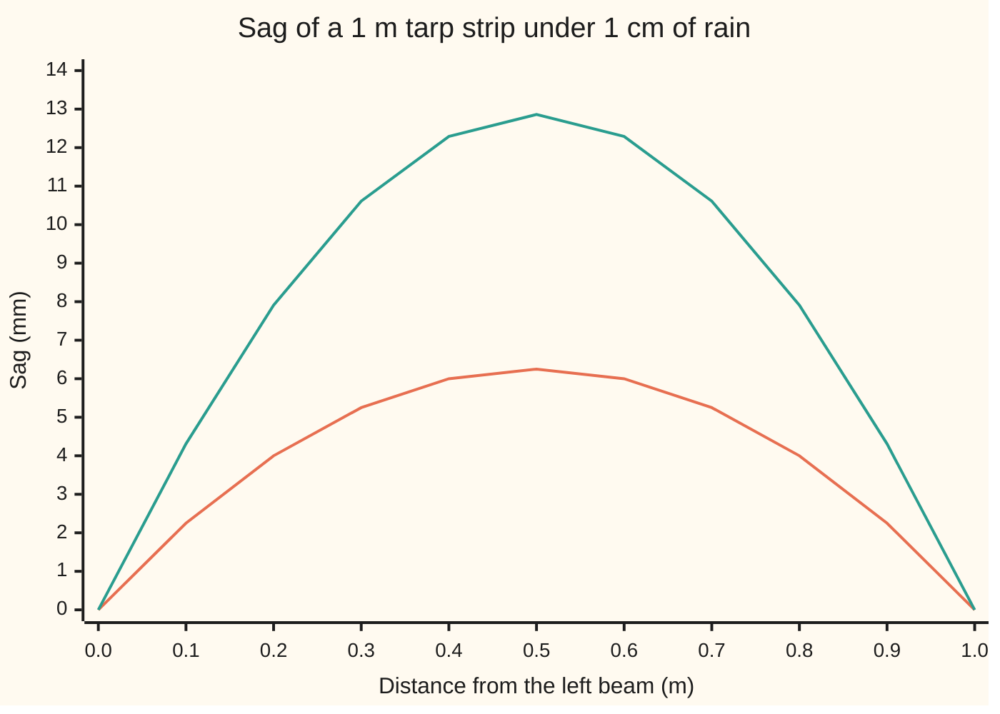

# Integral equations: the unknown sits inside the integral

[Syllabus](../../../SYLLABUS.md) → [Partial differential equations](../README.md) → [Nonlinear PDE and Fluids](../README.md#s07) → Integral equations

---

## General Overview

A flat tarp roof spans 1 m between two beams. Each 1 m wide strip of it hangs like a cable, pulled tight with a tension of 1962 N per metre of width. Rain lies on it 1 cm deep. The tension and the rain depth are illustrative. On its own, that weight of water would sag the middle of the strip by 6.25 mm.

But water runs into the dip. A deeper sag holds more water, and more water sags it further. The two settle together at 12.86 mm, more than twice the first figure. Engineers call this **ponding**, and it brings down real flat roofs.

Wing 08's [Green's function](../../08-Differential%20equations%20and%20dynamics/07-Series%20Solutions%20and%20Boundary%20Problems/10-greens-function-for-a-boundary-problem.md) wrote the sag of a loaded line as an integral of a tent-shaped response against a known load. Here the load depends on the sag itself. So the unknown sag appears on both sides: outside the integral and inside it. An equation of that shape is an **integral equation**, the term used from here on.

This card does three things with the roof:

- It rewrites the boundary problem as an integral equation of the **Fredholm** kind, where the integral runs over the whole span.
- It rewrites the same physics, started from one end, as an equation of the **Volterra** kind, where the integral runs only up to the point being computed.
- It solves both by feeding the answer back in, and shows why the Volterra loop always settles while the Fredholm loop can fail.

**A boundary problem whose load depends on the unknown becomes an integral equation: over the whole span (Fredholm) when the conditions sit at both ends, up to the current point only (Volterra) when they all sit at the start.**

**What kind of fact this is:** a method, with theorems proved on this card in Why it works: the rewrite is equivalent to the boundary problem, the Volterra loop always converges, and the Fredholm loop converges when the feedback is weak enough.

### The picture: rain alone against ponded rain



Lower line (orange): the sag if the water stayed 1 cm deep everywhere. Upper line (green): the ponded sag, where the water fills the dip. Both checks print every point.

---

## The formula

**Unknown, region and data.** The unknown is the sag u(x) in metres, measured downward, at distance x in metres from the left beam. The region is the span from 0 to 1 m. The data are the two beam heights, u(0) = u(1) = 0, and the rain.

A tight strip with small slopes obeys −T u″ = q, as on the wing 08 card: T is the tension per metre of width and q the load per square metre. The water depth at x is the rain depth h₀ plus the sag, so q = ρ g (h₀ + u), with ρ the density of water and g gravity. Divide by T:

```math
-u'' = \lambda\,(h_0 + u), \qquad u(0) = u(1) = 0, \qquad \lambda = \frac{\rho g}{T}
```

The **parameter** λ, read "lambda", measures how strongly the sag feeds back into the load. Here λ = 9810 / 1962 = 5 per square metre.

Treat the whole right side as a load and use the tent G(x, y) from wing 08: the sag at x from a unit load at y. The result is a **Fredholm equation of the second kind**:

```math
u(x) = f(x) + \lambda \int_0^1 K(x, y)\, u(y)\, dy, \qquad K(x, y) = G(x, y) = \min(x, y)\,\bigl(1 - \max(x, y)\bigr)
```

**Read it aloud:** the sag is the sag the rain alone would make, plus λ times the sag that the extra ponded water makes, where that extra water is itself the sag.

Here f(x) = λ h₀ x(1 − x)/2 is the rain-alone sag. The function K(x, y), the **kernel**, says how much the unknown at y pushes on the answer at x.

The same equation, started from the left beam with a known slope s₀ instead of a far-end condition, gives a **Volterra equation of the second kind**:

```math
u(x) = s_0\, x \;-\; \lambda \int_0^x (x - y)\,\bigl(h_0 + u(y)\bigr)\, dy
```

**Read it aloud:** the sag at x is the starting slope carried forward, minus the bending caused by all the water between the left beam and x.

The two kinds side by side:

| | integral runs over the fixed span 0 to 1 | integral runs from 0 up to x |
| --- | --- | --- |
| unknown inside and outside the integral (second kind) | Fredholm, second kind | Volterra, second kind |
| unknown only inside the integral (first kind) | Fredholm, first kind | Volterra, first kind |

A first-kind equation asks: given the sag, find the load that made it. "What breaks" shows why that is dangerous.

| Symbol | Plain meaning | In our example | Push it up and the answer… |
| --- | --- | --- | --- |
| $`x`$, $`y`$ | where the sag is read; where a load sits, in m | 0 to 1 m | — |
| $`u(x)`$ | sag in m, downward; $`u'`$ slope, $`u''`$ bend | 12.86 mm at the middle | — |
| $`T`$ | tension per metre of width, in N/m | 1962 N/m | less sag, weaker feedback |
| $`\rho`$, $`g`$ | water density; gravity | 1000 kg/m³; 9.81 m/s² | stronger feedback |
| $`h_0`$ | rain depth on a flat strip, in m | 0.01 m | sag grows in proportion |
| $`q`$ | load per square metre, in Pa (N/m²) | ρ g h₀ = 98.10 Pa from the rain alone | more sag |
| $`\lambda`$ | feedback parameter ρg/T, per m² | 5 per m² | sag grows, without limit at π² |
| $`f(x)`$ | rain-alone sag, λh₀x(1 − x)/2 | 6.25 mm at the middle | — |
| $`G(x, y)`$, $`K(x, y)`$ | the wing 08 tent; the kernel of an integral equation | the tent of wing 08 | — |
| $`s_0`$ | slope at the left beam | 0.045966 | Volterra far end sags lower (u(1) grows) |
| $`u_n`$, $`d_n`$ | the n-th Picard guess in the Volterra loop; the gap $`u_{n+1} - u_n`$ | gap at the far end after pass 4: 12.2102 µm | — |
| $`M`$, $`R(x)`$ | in the proof folds only: the constant in the bound on the first gap; the remainder in Taylor's formula | $`M = \lambda\,(h_0/2 + s_0/6)`$ | — |

### When it holds

- **Small slopes.** The cable law −T u″ = q needs slopes well below 1. Here the steepest is 0.046, so the error is tiny. At large slopes the cable law gains nonlinear terms, and sags from separate loads no longer add.
- **A level pond over the strip.** The load uses depth h₀ + u everywhere, the standard ponding model. If water runs off the edges or the rain stops, the load is smaller and the model overstates the sag.
- **λ below π², about 9.87 per m².** That means T above 993.96 N/m for a 1 m span. At λ = π² the equation has no solution: the pond deepens without limit, and the roof fails. Just above π², at λ = 12 for example, a solution exists on paper but is upside down, as "What breaks" shows.
- **Conditions at both ends for Fredholm, all at one end for Volterra.** Mix them up and the integral equation answers a different question.
- **The solution meant is classical:** twice continuously differentiable, meeting the equation at every point. For λ not equal to any (nπ)² it is the only one, by the Fredholm alternative.

---

## Why it works

### Step 0: a load you don't know yet is still a load

Green's formula turns any load into a sag. It does not care where the load came from. So write the unknown load λ(h₀ + u) into the formula as if it were known. The unknown u then sits inside the integral, and the differential equation plus both end conditions become one line.

### Step 1: the boundary problem and the Fredholm equation say the same thing

Apply wing 08's result with load λ(h₀ + u): any solution of the boundary problem satisfies the integral equation. In the other direction, the wing 08 card proved that a Green's integral of a continuous load has −u″ equal to that load and zero ends. So a continuous solution of the integral equation solves the boundary problem. Neither form loses or gains a solution.

### Step 2: conditions at one end give a Volterra equation

Start instead from u(0) = 0 and a slope s₀ at the left beam. Integrating u″ twice from 0 to x gives Taylor's formula with its exact remainder:

```math
u(x) = u(0) + u'(0)\,x + \int_0^x (x - y)\, u''(y)\, dy
```

Put u″ = −λ(h₀ + u) inside, and the Volterra equation appears. The integral stops at x: the sag at x depends only on what lies to its left. That is the whole difference between the kinds. Fredholm looks across the full span; Volterra looks only backward.

<details>
<summary>Detailed proof: the repeated integral is the remainder</summary>

Let $`R(x) = \int_0^x (x - y)\, u''(y)\, dy`$. Differentiate under the integral sign: the moving end contributes $`(x - x)\,u''(x) = 0`$, so $`R'(x) = \int_0^x u''(y)\, dy = u'(x) - u'(0)`$. Then $`R''(x) = u''(x)`$, with $`R(0) = 0`$ and $`R'(0) = 0`$.

So $`u(0) + u'(0)\,x + R(x)`$ has the same value, slope and bend as u at 0, and the same bend everywhere. Two functions with equal bend differ by a straight line, here the zero line. Hence the formula.

</details>

### Step 3: solve by feeding the answer back in

Both kinds are solved the same way as [Picard iteration](../../08-Differential%20equations%20and%20dynamics/02-Existence%2C%20Uniqueness%20and%20Sensitivity/01-picard-iteration.md) solved y = y₀ + ∫ f: guess, substitute, repeat.

For Fredholm, start from f and add one pass at a time. The result is the **Neumann series**:

```math
u = f + \lambda G f + \lambda^2 G^2 f + \lambda^3 G^3 f + \cdots
```

Here G f means "the sag that load f makes". Each term is the extra sag caused by the water that the previous term collected.

For Volterra, each pass integrates twice from 0 to x. Just as on the Picard card, the gaps between guesses shrink like a factorial: at most a fixed constant times $`\lambda^n x^{2n+2}/(2n+2)!`$ after n passes. The factorial beats any power of λ, so **the Volterra loop converges for every λ**.

<details>
<summary>Detailed proof: the factorial bound for the Volterra loop</summary>

Let $`d_n = u_{n+1} - u_n`$ be the gap after pass n. Subtracting two passes, $`d_{n+1}(x) = -\lambda \int_0^x (x - y)\, d_n(y)\, dy`$.

The first gap is $`d_0(x) = -\lambda\,(h_0 x^2/2 + s_0 x^3/6)`$, so on the span $`\lvert d_0(x)\rvert \le 2M\, x^2/2!`$ with $`M = \lambda\,(h_0/2 + s_0/6)`$.

The identity

$`\displaystyle \int_0^x (x - y)\,\frac{y^m}{m!}\, dy = \frac{x^{m+2}}{(m+2)!}`$

turns each bound into the next, so by induction

$`\displaystyle \lvert d_n(x)\rvert \le 2M\,\frac{\lambda^n\, x^{2n+2}}{(2n+2)!}.`$

The gaps sum to a finite total, so the guesses settle; the limit solves the equation as in the Picard card's Step 4.

</details>

### Step 4: why the Fredholm loop can fail

The Fredholm integral runs over the whole span every pass, so nothing factorial appears. [Neumann series](../../18-Functional%20analysis/03-Bounded%20Operators/06-neumann-series-and-inverting-close-to-the-identity.md) already met both limits below, 8 and π², on this same tent kernel. Each pass multiplies by λ and by the "size" of G. The plainest size: the largest sag G makes from a unit load spread over the span, which is 1/8 m at the middle. So each term is at most λ/8 times the one before, and the series converges whenever λ/8 < 1. Here λ/8 = 0.625.

That bound is safe but not sharp. The sharp rate comes from the sine shapes. Since −(sin nπx)″ = (nπ)² sin nπx with zero ends, G undoes that: it shrinks sin nπx by exactly 1/(nπ)². The first shape shrinks least, by 1/π². So after a few passes each term is λ/π² times the last: 0.506606 here. The series converges for λ < π² and fails for λ > π². At λ = π² the equation itself has no solution. That is the Fredholm alternative, proved on [The Fredholm alternative](08-fredholm-alternative-and-compact-operators.md).

### Step 5: Volterra solves the boundary problem too, by shooting

The Volterra form needs the start slope s₀, which the boundary problem does not give. The equation is linear, so the answer is s₀ times the march with unit slope and no rain, plus the march with zero slope and the rain. Choose s₀ so the far end lands on 0. This is **shooting**, and it gives a second, independent road to the ponded sag.

---

## Worked numbers, by hand

| Step | Arithmetic | Value |
| --- | --- | --- |
| feedback parameter | λ = 1000 × 9.81 / 1962 | 5 per m² |
| rain-alone sag, middle | λ h₀ / 8 = 5 × 0.01 / 8 | 6.25 mm |
| second Fredholm term, middle | λ² h₀ × 5/384 = 25 × 0.01 × 5/384 | 3.2552 mm |
| sum of 2, 4, 8 terms | add the terms | 9.5052, 11.9986, 12.8030 mm |
| shrink per term | λ/π² = 5 / 9.8696 | 0.506606 |
| closed form: √λ/2 and its cosine | √5 / 2; cos 1.118034 | 1.118034; 0.437451 |
| ponded sag, middle | h₀ (1/0.437451 − 1) | **12.8597 mm** |
| start slope for Volterra | h₀ √λ tan(√λ/2) | 0.045966 |

The closed form solves −u″ = λ(h₀ + u) directly: u = h₀(cos(√λ(x − ½))/cos(√λ/2) − 1). Ponding makes the middle of the strip sag 2.0576 times as far as the rain alone would.

### What breaks if you drop a piece

| Mistake | Comes out at | What went wrong |
| --- | --- | --- |
| Leave the feedback out: Green's formula with the rain alone | 6.25 mm, not 12.86 mm | The load depends on the sag; it belongs inside the integral |
| Volterra march started at the rain-alone slope 0.025 | far end at −7.3766 mm, not 0 | A Volterra equation knows only the left end; the far condition must be met by shooting |
| Fredholm series with the tension cut to 817.5 N/m, λ = 12 | terms grow from 15.0 mm to 4480.8 mm at term 30 | λ above π² = 9.87: each pass multiplies by 12/π², which is more than 1 |
| Recover the load from a measured sag (first kind) | 1 µm of noise in sine shape 49 reads as 46.49 Pa | G shrinks that shape by 4.22 × 10⁻⁵, so undoing it multiplies noise in that shape by (49π)² |

At λ = 12 the equation still has a solution, and Volterra shooting finds it: −72.2834 mm, matching the closed form. The minus sign means the strip bows upward under water, which no real roof does. It is an unstable balance: below the critical tension the real roof ponds until it overflows or tears.

The rain itself loads the strip with ρ g h₀ = 98.10 Pa. A first-kind inversion turns one micrometre of measurement noise into half of that. Recovering loads, images or sources from smoothed data has this problem everywhere.

---

## Code, from first principles, and it actually runs

The code stores every function as a polynomial and integrates it exactly, so no quadrature routine is used for the main roads. It takes three independent roads to the ponded sag: the closed form, the Fredholm series to 30 terms with its tail bound, and Volterra shooting by Picard passes with the factorial bound. It then checks the equation's residual by centred differences at two steps, and prints every number in the "What breaks" table. Simpson's rule, written out, measures how much G shrinks sine shapes 1 and 49.

### Python

```python
# Integral equations -- the check behind the card.  Standard library only.
# A 1 m strip of tarp roof hangs like a cable between two beams; rain ponds
# in its sag.  Roads to the sag: (1) closed form, (2) the Fredholm series,
# (3) Volterra marching from one end, plus the residual of -u'' = lam (h0 + u).
import math

RHO, GRAV, TENS, H0 = 1000.0, 9.81, 1962.0, 0.01  # kg/m^3, m/s^2, N/m, m
LAM = RHO * GRAV / TENS                            # lambda, 1/m^2

# polynomials in x: coefficient lists, lowest power first
def padd(p, q):
    n = max(len(p), len(q))
    return [(p[k] if k < len(p) else 0.0) + (q[k] if k < len(q) else 0.0) for k in range(n)]
def pscale(p, c): return [c * a for a in p]
def pmulx(p): return [0.0] + p
def pint(p): return [0.0] + [a / (k + 1) for k, a in enumerate(p)]  # integral from 0 to x
def peval(p, x):
    s = 0.0
    for a in reversed(p): s = s * x + a
    return s

def green(p):  # (G p)(x) = (1 - x) int_0^x y p(y) dy + x int_x^1 (1 - y) p(y) dy
    a = pint(pmulx(p))
    b = pint(padd(p, pscale(pmulx(p), -1.0)))
    return padd(padd(a, pscale(pmulx(a), -1.0)), padd([0.0, peval(b, 1.0)], pscale(pmulx(b), -1.0)))

def exact(x, lam):  # closed form: -u'' = lam (H0 + u), u(0) = u(1) = 0
    r = math.sqrt(lam)
    return H0 * (math.cos(r * (x - 0.5)) / math.cos(r / 2) - 1.0)

def neumann(lam, n):  # Fredholm: u = f + lam G f + lam^2 G^2 f + ..., n terms
    term = pscale(green([1.0]), lam * H0)
    u, mids = term, [peval(term, 0.5)]
    for _ in range(n - 1):
        term = pscale(green(term), lam)
        u = padd(u, term)
        mids.append(peval(term, 0.5))
    return u, mids

def volterra(s0, h, lam, passes):  # Picard on u = s0 x - lam int_0^x (x - y)(h + u(y)) dy
    u, gaps = [0.0, s0], []
    for _ in range(passes):
        new = padd([0.0, s0], pscale(pint(pint(padd([h], u))), -lam))
        gaps.append(abs(peval(new, 1.0) - peval(u, 1.0)))
        u = new
    return u, gaps

def shoot(lam, passes):  # choose the start slope so the far end lands on 0
    a = volterra(1.0, 0.0, lam, passes)[0]
    b = volterra(0.0, H0, lam, passes)[0]
    s0 = -peval(b, 1.0) / peval(a, 1.0)
    return padd(pscale(a, s0), b), s0

def g_sin(n, x, panels=2000):  # Simpson's rule for int_0^1 G(x, y) sin(n pi y) dy
    def simpson(f, lo, hi):
        w = (hi - lo) / panels
        s = f(lo) + f(hi) + sum((4 if k % 2 else 2) * f(lo + k * w) for k in range(1, panels))
        return s * w / 3
    left = simpson(lambda y: y * (1 - x) * math.sin(n * math.pi * y), 0.0, x)
    return left + simpson(lambda y: x * (1 - y) * math.sin(n * math.pi * y), x, 1.0)

mm = lambda v: 1000.0 * v
r = math.sqrt(LAM)
print(f"lambda = rho g / T = {LAM:.4f} 1/m^2; sqrt(lambda)/2 = {r / 2:.6f}; cos of it = {math.cos(r / 2):.6f}")
print(f"pi^2 = {math.pi ** 2:.4f} 1/m^2; critical tension rho g / pi^2 = {RHO * GRAV / math.pi ** 2:.2f} N/m")
rain, ex = LAM * H0 * 0.5 * 0.5 / 2, exact(0.5, LAM)
print(f"rain alone, no ponding (Green's formula): midpoint sag {mm(rain):.4f} mm")
print(f"road 1, closed form: midpoint sag {mm(ex):.4f} mm, {ex / rain:.4f} times the rain-alone sag")

u_n, mids = neumann(LAM, 30)
print("road 2, Fredholm series, midpoint terms: " + ", ".join(f"{mm(t):.4f}" for t in mids[:5]) + " mm")
for n in (1, 2, 4, 8, 16, 30):
    print(f"  sum of {n:2d} terms: {mm(sum(mids[:n])):.6f} mm")
rate8 = LAM / 8
true_tail, bound_tail = sum(mids[16:]), mids[15] * rate8 / (1 - rate8)
print(f"  tail after 16 terms: true {mm(true_tail) * 1e3:.4f} um, bound with lambda/8 = {rate8:.3f}: {mm(bound_tail) * 1e3:.4f} um")
ratio = mids[29] / mids[28]
print(f"  term ratio {ratio:.6f}; lambda/pi^2 = {LAM / math.pi ** 2:.6f}")

u_v, s0 = shoot(LAM, 14)
slope_cf = H0 * r * math.tan(r / 2)
print(f"road 3, Volterra shooting: start slope {s0:.6f}; closed form {slope_cf:.6f}; Fredholm {u_n[1]:.6f}")
print(f"  midpoint sag {mm(peval(u_v, 0.5)):.6f} mm")
gaps = volterra(s0, H0, LAM, 9)[1]
m0 = LAM * (H0 / 2 + s0 / 6)  # largest first gap on [0, 1]
for n in (2, 4, 6):
    bound = 2 * m0 * LAM ** n / math.factorial(2 * n + 2)
    print(f"  Picard pass {n}: gap at far end {mm(gaps[n]) * 1e3:.4f} um, factorial bound {mm(bound) * 1e3:.4f} um")

res = []
for h in (0.01, 0.005):
    x = 0.3
    d2 = (peval(u_n, x + h) - 2 * peval(u_n, x) + peval(u_n, x - h)) / h ** 2
    res.append(-d2 - LAM * (H0 + peval(u_n, x)))
    print(f"residual of -u'' - lambda (h0 + u) at x = 0.3 m, step {h} m: {res[-1] * 1e6:.4f}e-6 1/m")

print("what breaks:")
far = peval(volterra(LAM * H0 / 2, H0, LAM, 14)[0], 1.0)
print(f"  Volterra started at the rain-alone slope {LAM * H0 / 2:.4f}: far end at {mm(far):.4f} mm, not 0")
lam_hi = 12.0
_, mids_hi = neumann(lam_hi, 30)
print(f"  tension {RHO * GRAV / lam_hi:.1f} N/m (lambda 12): Fredholm terms {mm(mids_hi[0]):.4f} mm, then {mm(mids_hi[29]):.1f} mm at term 30")
u_hi, _ = shoot(lam_hi, 20)
print(f"  same tension, Volterra shooting: midpoint {mm(peval(u_hi, 0.5)):.4f} mm; closed form {mm(exact(0.5, lam_hi)):.4f} mm")
shrink = [g_sin(n, 0.5) / math.sin(n * math.pi / 2) for n in (1, 49)]
print(f"  G shrinks mode 1 by {shrink[0]:.6f} (1/pi^2 = {1 / math.pi ** 2:.6f}), mode 49 by {shrink[1] * 1e5:.4f}e-5 (1/(49 pi)^2 = {1e5 / (49 * math.pi) ** 2:.4f}e-5)")
fake = TENS * 1e-6 / shrink[1]
print(f"  first kind: 1 um of sag noise in mode 49 reads as {fake:.2f} Pa of load; the rain is {RHO * GRAV * H0:.2f} Pa")

xs = [k / 10 for k in range(11)]
print("chart rain alone (mm): " + ", ".join(f"{mm(LAM * H0 * x * (1 - x) / 2):.2f}" for x in xs))
print("chart ponded (mm):     " + ", ".join(f"{mm(exact(x, LAM)):.2f}" for x in xs))
worst = max(max(abs(peval(u_n, x) - exact(x, LAM)), abs(peval(u_v, x) - exact(x, LAM))) for x in xs)

assert abs(peval(u_n, 0.5) - ex) < 1e-9            # Fredholm series meets the closed form
assert abs(peval(u_v, 0.5) - ex) < 1e-9            # Volterra shooting meets the closed form
assert worst < 1e-9                                 # ... at every chart point
assert abs(s0 - slope_cf) < 1e-9 and abs(u_n[1] - slope_cf) < 1e-9
assert abs(ratio - LAM / math.pi ** 2) < 1e-6      # series shrinks at lambda/pi^2 per term
assert true_tail <= bound_tail                      # the lambda/8 tail bound holds
assert all(gaps[n] <= 2 * m0 * LAM ** n / math.factorial(2 * n + 2) for n in range(9))
assert abs(res[0]) < 1e-4 and 3.5 < res[0] / res[1] < 4.5  # residual falls like step^2
assert abs(shrink[0] - 1 / math.pi ** 2) < 1e-9 and abs(shrink[1] * (49 * math.pi) ** 2 - 1) < 1e-6
assert mids_hi[29] > 100 * mids_hi[0]               # lambda > pi^2: the series blows up
assert abs(peval(u_hi, 0.5) - exact(0.5, lam_hi)) < 1e-9
print("ALL CHECKS PASS")
```

**Ran 2026-11-15 on macOS, Python 3.14.10, standard library only. All checks passed. Output, pasted from the run:**

```
lambda = rho g / T = 5.0000 1/m^2; sqrt(lambda)/2 = 1.118034; cos of it = 0.437451
pi^2 = 9.8696 1/m^2; critical tension rho g / pi^2 = 993.96 N/m
rain alone, no ponding (Green's formula): midpoint sag 6.2500 mm
road 1, closed form: midpoint sag 12.8597 mm, 2.0576 times the rain-alone sag
road 2, Fredholm series, midpoint terms: 6.2500, 3.2552, 1.6547, 0.8386, 0.4249 mm
  sum of  1 terms: 6.250000 mm
  sum of  2 terms: 9.505208 mm
  sum of  4 terms: 11.998567 mm
  sum of  8 terms: 12.802971 mm
  sum of 16 terms: 12.859446 mm
  sum of 30 terms: 12.859692 mm
  tail after 16 terms: true 0.2461 um, bound with lambda/8 = 0.625: 0.3995 um
  term ratio 0.506606; lambda/pi^2 = 0.506606
road 3, Volterra shooting: start slope 0.045966; closed form 0.045966; Fredholm 0.045966
  midpoint sag 12.859692 mm
  Picard pass 2: gap at far end 2876.1286 um, factorial bound 4396.1519 um
  Picard pass 4: gap at far end 12.2102 um, factorial bound 21.8063 um
  Picard pass 6: gap at far end 0.0117 um, factorial bound 0.0227 um
residual of -u'' - lambda (h0 + u) at x = 0.3 m, step 0.01 m: -4.2941e-6 1/m
residual of -u'' - lambda (h0 + u) at x = 0.3 m, step 0.005 m: -1.0736e-6 1/m
what breaks:
  Volterra started at the rain-alone slope 0.0250: far end at -7.3766 mm, not 0
  tension 817.5 N/m (lambda 12): Fredholm terms 15.0000 mm, then 4480.8 mm at term 30
  same tension, Volterra shooting: midpoint -72.2834 mm; closed form -72.2834 mm
  G shrinks mode 1 by 0.101321 (1/pi^2 = 0.101321), mode 49 by 4.2200e-5 (1/(49 pi)^2 = 4.2200e-5)
  first kind: 1 um of sag noise in mode 49 reads as 46.49 Pa of load; the rain is 98.10 Pa
chart rain alone (mm): 0.00, 2.25, 4.00, 5.25, 6.00, 6.25, 6.00, 5.25, 4.00, 2.25, 0.00
chart ponded (mm):     0.00, 4.31, 7.91, 10.61, 12.29, 12.86, 12.29, 10.61, 7.91, 4.31, 0.00
ALL CHECKS PASS
```

### Rust

```rust
// Integral equations -- the check behind the card.  Rust std only, no crates.
// A 1 m strip of tarp roof hangs like a cable between two beams; rain ponds
// in its sag.  Roads to the sag: (1) closed form, (2) the Fredholm series,
// (3) Volterra marching from one end, plus the residual of -u'' = lam (h0 + u).
use std::f64::consts::PI;

const RHO: f64 = 1000.0; // kg/m^3
const GRAV: f64 = 9.81; // m/s^2
const TENS: f64 = 1962.0; // N/m
const H0: f64 = 0.01; // m

// polynomials in x: coefficient lists, lowest power first
fn padd(p: &[f64], q: &[f64]) -> Vec<f64> {
    let n = p.len().max(q.len());
    (0..n).map(|k| p.get(k).copied().unwrap_or(0.0) + q.get(k).copied().unwrap_or(0.0)).collect()
}
fn pscale(p: &[f64], c: f64) -> Vec<f64> { p.iter().map(|a| c * a).collect() }
fn pmulx(p: &[f64]) -> Vec<f64> { let mut v = vec![0.0]; v.extend_from_slice(p); v }
fn pint(p: &[f64]) -> Vec<f64> {
    let mut v = vec![0.0];
    v.extend(p.iter().enumerate().map(|(k, a)| a / (k as f64 + 1.0)));
    v
}
fn peval(p: &[f64], x: f64) -> f64 { p.iter().rev().fold(0.0, |s, a| s * x + a) }

// (G p)(x) = (1 - x) int_0^x y p(y) dy + x int_x^1 (1 - y) p(y) dy
fn green(p: &[f64]) -> Vec<f64> {
    let a = pint(&pmulx(p));
    let b = pint(&padd(p, &pscale(&pmulx(p), -1.0)));
    let left = padd(&a, &pscale(&pmulx(&a), -1.0));
    let right = padd(&[0.0, peval(&b, 1.0)], &pscale(&pmulx(&b), -1.0));
    padd(&left, &right)
}

fn exact(x: f64, lam: f64) -> f64 { // closed form: -u'' = lam (H0 + u), u(0) = u(1) = 0
    let r = lam.sqrt();
    H0 * ((r * (x - 0.5)).cos() / (r / 2.0).cos() - 1.0)
}

fn neumann(lam: f64, n: usize) -> (Vec<f64>, Vec<f64>) { // Fredholm series, n terms
    let mut term = pscale(&green(&[1.0]), lam * H0);
    let (mut u, mut mids) = (term.clone(), vec![peval(&term, 0.5)]);
    for _ in 0..n - 1 {
        term = pscale(&green(&term), lam);
        u = padd(&u, &term);
        mids.push(peval(&term, 0.5));
    }
    (u, mids)
}

// Picard on u = s0 x - lam int_0^x (x - y)(h + u(y)) dy
fn volterra(s0: f64, h: f64, lam: f64, passes: usize) -> (Vec<f64>, Vec<f64>) {
    let (mut u, mut gaps) = (vec![0.0, s0], vec![]);
    for _ in 0..passes {
        let new = padd(&[0.0, s0], &pscale(&pint(&pint(&padd(&[h], &u))), -lam));
        gaps.push((peval(&new, 1.0) - peval(&u, 1.0)).abs());
        u = new;
    }
    (u, gaps)
}

fn shoot(lam: f64, passes: usize) -> (Vec<f64>, f64) { // start slope that lands the far end on 0
    let a = volterra(1.0, 0.0, lam, passes).0;
    let b = volterra(0.0, H0, lam, passes).0;
    let s0 = -peval(&b, 1.0) / peval(&a, 1.0);
    (padd(&pscale(&a, s0), &b), s0)
}

fn simpson(f: &dyn Fn(f64) -> f64, lo: f64, hi: f64, panels: usize) -> f64 {
    let w = (hi - lo) / panels as f64;
    let mut s = f(lo) + f(hi);
    for k in 1..panels { s += if k % 2 == 1 { 4.0 } else { 2.0 } * f(lo + k as f64 * w); }
    s * w / 3.0
}
fn g_sin(n: f64, x: f64) -> f64 { // Simpson's rule for int_0^1 G(x, y) sin(n pi y) dy
    simpson(&|y: f64| y * (1.0 - x) * (n * PI * y).sin(), 0.0, x, 2000)
        + simpson(&|y: f64| x * (1.0 - y) * (n * PI * y).sin(), x, 1.0, 2000)
}
fn fact(n: usize) -> f64 { (1..=n).fold(1.0, |p, k| p * k as f64) }
fn mm(v: f64) -> f64 { 1000.0 * v }
fn join(v: &[f64], d: usize) -> String { v.iter().map(|x| format!("{:.*}", d, x)).collect::<Vec<_>>().join(", ") }

fn main() {
    let lam = RHO * GRAV / TENS;
    let r = lam.sqrt();
    println!("lambda = rho g / T = {:.4} 1/m^2; sqrt(lambda)/2 = {:.6}; cos of it = {:.6}", lam, r / 2.0, (r / 2.0).cos());
    println!("pi^2 = {:.4} 1/m^2; critical tension rho g / pi^2 = {:.2} N/m", PI.powi(2), RHO * GRAV / PI.powi(2));
    let (rain, ex) = (lam * H0 * 0.5 * 0.5 / 2.0, exact(0.5, lam));
    println!("rain alone, no ponding (Green's formula): midpoint sag {:.4} mm", mm(rain));
    println!("road 1, closed form: midpoint sag {:.4} mm, {:.4} times the rain-alone sag", mm(ex), ex / rain);

    let (u_n, mids) = neumann(lam, 30);
    let first: Vec<f64> = mids[..5].iter().map(|&t| mm(t)).collect();
    println!("road 2, Fredholm series, midpoint terms: {} mm", join(&first, 4));
    for n in [1, 2, 4, 8, 16, 30] {
        println!("  sum of {:2} terms: {:.6} mm", n, mm(mids[..n].iter().sum()));
    }
    let rate8 = lam / 8.0;
    let (true_tail, bound_tail): (f64, f64) = (mids[16..].iter().sum(), mids[15] * rate8 / (1.0 - rate8));
    println!("  tail after 16 terms: true {:.4} um, bound with lambda/8 = {:.3}: {:.4} um", mm(true_tail) * 1e3, rate8, mm(bound_tail) * 1e3);
    let ratio = mids[29] / mids[28];
    println!("  term ratio {:.6}; lambda/pi^2 = {:.6}", ratio, lam / PI.powi(2));

    let (u_v, s0) = shoot(lam, 14);
    let slope_cf = H0 * r * (r / 2.0).tan();
    println!("road 3, Volterra shooting: start slope {:.6}; closed form {:.6}; Fredholm {:.6}", s0, slope_cf, u_n[1]);
    println!("  midpoint sag {:.6} mm", mm(peval(&u_v, 0.5)));
    let gaps = volterra(s0, H0, lam, 9).1;
    let m0 = lam * (H0 / 2.0 + s0 / 6.0); // largest first gap on [0, 1]
    let bound = |n: usize| 2.0 * m0 * lam.powf(n as f64) / fact(2 * n + 2);
    for n in [2, 4, 6] {
        println!("  Picard pass {}: gap at far end {:.4} um, factorial bound {:.4} um", n, mm(gaps[n]) * 1e3, mm(bound(n)) * 1e3);
    }

    let mut res = vec![];
    for h in [0.01, 0.005] {
        let x = 0.3;
        let d2 = (peval(&u_n, x + h) - 2.0 * peval(&u_n, x) + peval(&u_n, x - h)) / (h * h);
        res.push(-d2 - lam * (H0 + peval(&u_n, x)));
        println!("residual of -u'' - lambda (h0 + u) at x = 0.3 m, step {} m: {:.4}e-6 1/m", h, res[res.len() - 1] * 1e6);
    }

    println!("what breaks:");
    let far = peval(&volterra(lam * H0 / 2.0, H0, lam, 14).0, 1.0);
    println!("  Volterra started at the rain-alone slope {:.4}: far end at {:.4} mm, not 0", lam * H0 / 2.0, mm(far));
    let lam_hi = 12.0;
    let (_, mids_hi) = neumann(lam_hi, 30);
    println!("  tension {:.1} N/m (lambda 12): Fredholm terms {:.4} mm, then {:.1} mm at term 30", RHO * GRAV / lam_hi, mm(mids_hi[0]), mm(mids_hi[29]));
    let (u_hi, _) = shoot(lam_hi, 20);
    println!("  same tension, Volterra shooting: midpoint {:.4} mm; closed form {:.4} mm", mm(peval(&u_hi, 0.5)), mm(exact(0.5, lam_hi)));
    let shrink: Vec<f64> = [1.0, 49.0].iter().map(|&n| g_sin(n, 0.5) / (n * PI / 2.0).sin()).collect();
    println!("  G shrinks mode 1 by {:.6} (1/pi^2 = {:.6}), mode 49 by {:.4}e-5 (1/(49 pi)^2 = {:.4}e-5)",
        shrink[0], 1.0 / PI.powi(2), shrink[1] * 1e5, 1e5 / (49.0 * PI).powi(2));
    let fake = TENS * 1e-6 / shrink[1];
    println!("  first kind: 1 um of sag noise in mode 49 reads as {:.2} Pa of load; the rain is {:.2} Pa", fake, RHO * GRAV * H0);

    let xs: Vec<f64> = (0..11).map(|k| k as f64 / 10.0).collect();
    let rain_pts: Vec<f64> = xs.iter().map(|&x| mm(lam * H0 * x * (1.0 - x) / 2.0)).collect();
    let pond_pts: Vec<f64> = xs.iter().map(|&x| mm(exact(x, lam))).collect();
    println!("chart rain alone (mm): {}", join(&rain_pts, 2));
    println!("chart ponded (mm):     {}", join(&pond_pts, 2));
    let worst = xs.iter().map(|&x| (peval(&u_n, x) - exact(x, lam)).abs().max((peval(&u_v, x) - exact(x, lam)).abs())).fold(0.0, f64::max);

    assert!((peval(&u_n, 0.5) - ex).abs() < 1e-9); // Fredholm series meets the closed form
    assert!((peval(&u_v, 0.5) - ex).abs() < 1e-9); // Volterra shooting meets the closed form
    assert!(worst < 1e-9); // ... at every chart point
    assert!((s0 - slope_cf).abs() < 1e-9 && (u_n[1] - slope_cf).abs() < 1e-9);
    assert!((ratio - lam / PI.powi(2)).abs() < 1e-6); // series shrinks at lambda/pi^2 per term
    assert!(true_tail <= bound_tail); // the lambda/8 tail bound holds
    assert!((0..9).all(|n| gaps[n] <= bound(n)));
    assert!(res[0].abs() < 1e-4 && res[0] / res[1] > 3.5 && res[0] / res[1] < 4.5); // residual falls like step^2
    assert!((shrink[0] - 1.0 / PI.powi(2)).abs() < 1e-9 && (shrink[1] * (49.0 * PI).powi(2) - 1.0).abs() < 1e-6);
    assert!(mids_hi[29] > 100.0 * mids_hi[0]); // lambda > pi^2: the series blows up
    assert!((peval(&u_hi, 0.5) - exact(0.5, lam_hi)).abs() < 1e-9);
    println!("ALL CHECKS PASS");
}
```

**Ran 2026-11-15 on macOS, rustc 1.98.1, no crates. All checks passed. Output, pasted from the run:**

```
lambda = rho g / T = 5.0000 1/m^2; sqrt(lambda)/2 = 1.118034; cos of it = 0.437451
pi^2 = 9.8696 1/m^2; critical tension rho g / pi^2 = 993.96 N/m
rain alone, no ponding (Green's formula): midpoint sag 6.2500 mm
road 1, closed form: midpoint sag 12.8597 mm, 2.0576 times the rain-alone sag
road 2, Fredholm series, midpoint terms: 6.2500, 3.2552, 1.6547, 0.8386, 0.4249 mm
  sum of  1 terms: 6.250000 mm
  sum of  2 terms: 9.505208 mm
  sum of  4 terms: 11.998567 mm
  sum of  8 terms: 12.802971 mm
  sum of 16 terms: 12.859446 mm
  sum of 30 terms: 12.859692 mm
  tail after 16 terms: true 0.2461 um, bound with lambda/8 = 0.625: 0.3995 um
  term ratio 0.506606; lambda/pi^2 = 0.506606
road 3, Volterra shooting: start slope 0.045966; closed form 0.045966; Fredholm 0.045966
  midpoint sag 12.859692 mm
  Picard pass 2: gap at far end 2876.1286 um, factorial bound 4396.1519 um
  Picard pass 4: gap at far end 12.2102 um, factorial bound 21.8063 um
  Picard pass 6: gap at far end 0.0117 um, factorial bound 0.0227 um
residual of -u'' - lambda (h0 + u) at x = 0.3 m, step 0.01 m: -4.2941e-6 1/m
residual of -u'' - lambda (h0 + u) at x = 0.3 m, step 0.005 m: -1.0736e-6 1/m
what breaks:
  Volterra started at the rain-alone slope 0.0250: far end at -7.3766 mm, not 0
  tension 817.5 N/m (lambda 12): Fredholm terms 15.0000 mm, then 4480.8 mm at term 30
  same tension, Volterra shooting: midpoint -72.2834 mm; closed form -72.2834 mm
  G shrinks mode 1 by 0.101321 (1/pi^2 = 0.101321), mode 49 by 4.2200e-5 (1/(49 pi)^2 = 4.2200e-5)
  first kind: 1 um of sag noise in mode 49 reads as 46.49 Pa of load; the rain is 98.10 Pa
chart rain alone (mm): 0.00, 2.25, 4.00, 5.25, 6.00, 6.25, 6.00, 5.25, 4.00, 2.25, 0.00
chart ponded (mm):     0.00, 4.31, 7.91, 10.61, 12.29, 12.86, 12.29, 10.61, 7.91, 4.31, 0.00
ALL CHECKS PASS
```

The residual falls from −4.2941 to −1.0736 millionths per metre as the step halves: a factor of 4, as centred differences should. The Picard gaps sit under their factorial bound at every pass.

### Lean

Lean proves Steps 1 and 2 for every classical sag, and the closed form below π², and checks the worked numbers.

- Take a classical sag $`u`$ on the 1 m span. Then $`-u'' = \lambda\,(h_0 + u)`$ with zero ends holds exactly when the Fredholm equation holds. Neither form loses or gains a solution.
- Take a classical sag $`u`$ and a start slope $`s_0`$. Then the equation with $`u(0) = 0`$ and $`u'(0) = s_0`$ holds exactly when the Volterra equation holds.
- Take $`0 \le \lambda < \pi^2`$. Then the closed form from the worked numbers is a classical solution of the boundary problem, zero ends included.
- The worked numbers also check in exact fractions: $`\lambda = 5`$ per m², both midpoint terms and the 98.10 Pa rain load. So do the shrink $`\lambda/8 = 0.625`$ and $`\lambda = 12`$ at 817.5 N/m.

The Neumann series converging, the factorial bound, shooting and the first-kind noise are left to the Python and Rust checks.

```lean
-- Integral equations: a classical sag solves the ponding boundary problem exactly when it solves the Fredholm equation with the tent kernel, it solves the problem started from one end exactly when it solves the Volterra equation, and below λ = π² the cosine formula is a solution.
import Mathlib.Analysis.Calculus.ContDiff.Basic
import Mathlib.Analysis.Calculus.Deriv.Basic
import Mathlib.MeasureTheory.Integral.IntervalIntegral.FundThmCalculus
import Mathlib.Analysis.SpecialFunctions.Trigonometric.Deriv
import Mathlib.Analysis.SpecialFunctions.Sqrt
import Mathlib.Analysis.Calculus.MeanValue

open Real Set

noncomputable section

/-- The wing 08 tent `G(x, y) = min(x, y) (1 − max(x, y))` on the 1 m span: the sag at `x`
from a unit load at `y`, with both ends held at 0. It is the kernel `K(x, y)` here. -/
def greenKernel (x y : ℝ) : ℝ := min x y * (1 - max x y)

/-- The rain-alone sag `f(x) = λ h₀ x (1 − x) / 2`. -/
def rainSag (lam h0 x : ℝ) : ℝ := lam * h0 * x * (1 - x) / 2

/-- The card's closed form for the ponded sag,
`u(x) = h₀ (cos(√λ (x − ½)) / cos(√λ / 2) − 1)`. -/
def pondedSag (lam h0 x : ℝ) : ℝ := h0 * (Real.cos (√lam * (x - 1 / 2)) / Real.cos (√lam / 2) - 1)

lemma deriv_eqOn_of_eqOn_Icc {u V W : ℝ → ℝ} (hu : Differentiable ℝ u)
    (heq : EqOn u V (Icc 0 1)) (hV : ∀ x, HasDerivAt V (W x) x) :
    EqOn (deriv u) W (Icc 0 1) := by
  intro x hx
  have h1 : HasDerivWithinAt u (W x) (Icc 0 1) x :=
    (hV x).hasDerivWithinAt.congr heq (heq hx)
  have h2 : HasDerivWithinAt u (deriv u x) (Icc 0 1) x := (hu x).hasDerivAt.hasDerivWithinAt
  exact (uniqueDiffOn_Icc zero_lt_one x hx).eq_deriv _ h2 h1

#print axioms deriv_eqOn_of_eqOn_Icc

lemma affine_of_deriv2_zero {w w' : ℝ → ℝ} (hw : ∀ x, HasDerivAt w (w' x) x)
    (hw' : ∀ x ∈ Icc (0:ℝ) 1, HasDerivAt w' 0 x) :
    ∀ x ∈ Icc (0:ℝ) 1, w x = w 0 + w' 0 * x := by
  have hc : ∀ x ∈ Icc (0:ℝ) 1, w' x = w' 0 :=
    constant_of_has_deriv_right_zero
      (fun x hx => (hw' x hx).continuousAt.continuousWithinAt)
      (fun x hx => (hw' x (Ico_subset_Icc_self hx)).hasDerivWithinAt)
  have hg := constant_of_has_deriv_right_zero (f := fun x => w x - w' 0 * x) (a := 0) (b := 1)
    (fun x _ => ((hw x).continuousAt.sub (continuousAt_const.mul continuousAt_id)).continuousWithinAt)
    (fun x hx => by
      have := (hw x).sub ((hasDerivAt_id x).const_mul (w' 0))
      rw [hc x (Ico_subset_Icc_self hx)] at this
      have e : w' 0 - w' 0 * 1 = 0 := by ring
      rw [e] at this
      exact this.hasDerivWithinAt)
  intro x hx
  have := hg x hx
  simp at this
  linarith

#print axioms affine_of_deriv2_zero

/-- **Boundary problem = Fredholm equation.** For a classical (twice continuously
differentiable) sag `u`, the ponding boundary problem `−u'' = λ (h₀ + u)` on `[0, 1]` with
`u(0) = u(1) = 0` holds exactly when `u` solves the Fredholm equation of the second kind
`u(x) = f(x) + λ ∫₀¹ G(x, y) u(y) dy` on `[0, 1]`, where `f` is the rain-alone sag and `G`
is the tent kernel. Neither form loses or gains a solution. -/
theorem boundary_problem_iff_fredholm_equation (lam h0 : ℝ) (u : ℝ → ℝ)
    (hu : ContDiff ℝ 2 u) :
    ((∀ x ∈ Icc (0 : ℝ) 1, -deriv (deriv u) x = lam * (h0 + u x)) ∧ u 0 = 0 ∧ u 1 = 0) ↔
      ∀ x ∈ Icc (0 : ℝ) 1,
        u x = rainSag lam h0 x + lam * ∫ y in (0 : ℝ)..1, greenKernel x y * u y := by
  have hu2 := contDiff_succ_iff_deriv.mp (show ContDiff ℝ (1 + 1) u from hu)
  have hud : Differentiable ℝ u := hu2.1
  have hu'd : Differentiable ℝ (deriv u) :=
    (contDiff_succ_iff_deriv.mp (show ContDiff ℝ (0 + 1) (deriv u) by simpa using hu2.2.2)).1
  have huc : Continuous u := hud.continuous
  have hyu : Continuous fun y => y * u y := continuous_id.mul huc
  have h1u : Continuous fun y => (1 - y) * u y := (continuous_const.sub continuous_id).mul huc
  set A : ℝ → ℝ := fun x => ∫ y in (0:ℝ)..x, y * u y
  set B : ℝ → ℝ := fun x => ∫ y in (0:ℝ)..x, (1 - y) * u y
  set C : ℝ := ∫ y in (0:ℝ)..1, (1 - y) * u y with hC
  set W : ℝ → ℝ := fun x => rainSag lam h0 x + lam * ((1 - x) * A x + x * (C - B x)) with hW
  set W' : ℝ → ℝ := fun x => lam * h0 * (1 - 2 * x) / 2 + lam * (C - B x - A x) with hW'
  have hA : ∀ x, HasDerivAt A (x * u x) x := fun x => (hyu.integral_hasStrictDerivAt 0 x).hasDerivAt
  have hB : ∀ x, HasDerivAt B ((1 - x) * u x) x :=
    fun x => (h1u.integral_hasStrictDerivAt 0 x).hasDerivAt
  have hWd : ∀ x, HasDerivAt W (W' x) x := by
    intro x
    have hr : HasDerivAt (fun x => rainSag lam h0 x) (lam * h0 * (1 - 2 * x) / 2) x := by
      have h := (((hasDerivAt_id' x).const_mul (lam * h0)).mul
        ((hasDerivAt_id' x).const_sub 1)).div_const 2
      unfold rainSag
      convert h using 1
      ring
    have h := hr.add (((((hasDerivAt_id' x).const_sub 1).mul (hA x)).add
      ((hasDerivAt_id' x).mul ((hB x).const_sub C))).const_mul lam)
    convert h using 1
    simp only [hW']; ring
  have hW'd : ∀ x, HasDerivAt W' (-lam * h0 - lam * u x) x := by
    intro x
    have h := ((((hasDerivAt_id' x).const_mul 2).const_sub 1).const_mul (lam * h0) |>.div_const
      2).add ((((hB x).const_sub C).sub (hA x)).const_mul lam)
    convert h using 1
    ring
  have hsplit : ∀ x ∈ Icc (0:ℝ) 1,
      (∫ y in (0 : ℝ)..1, greenKernel x y * u y) = (1 - x) * A x + x * (C - B x) := by
    intro x hx
    have hcont : Continuous fun y => greenKernel x y * u y := by
      unfold greenKernel; fun_prop
    rw [← intervalIntegral.integral_add_adjacent_intervals (b := x)
      (hcont.intervalIntegrable 0 x) (hcont.intervalIntegrable x 1)]
    have e1 : (∫ y in (0:ℝ)..x, greenKernel x y * u y) = ∫ y in (0:ℝ)..x, (1 - x) * (y * u y) := by
      apply intervalIntegral.integral_congr
      intro y hy
      rw [uIcc_of_le hx.1] at hy
      simp only [greenKernel, min_eq_right hy.2, max_eq_left hy.2]; ring
    have e2 : (∫ y in x..1, greenKernel x y * u y) = ∫ y in x..1, x * ((1 - y) * u y) := by
      apply intervalIntegral.integral_congr
      intro y hy
      rw [uIcc_of_le hx.2] at hy
      simp only [greenKernel, min_eq_left hy.1, max_eq_right hy.1]; ring
    rw [e1, e2, intervalIntegral.integral_const_mul, intervalIntegral.integral_const_mul,
      ← intervalIntegral.integral_interval_sub_left (h1u.intervalIntegrable 0 1)
        (h1u.intervalIntegrable 0 x)]
  have hW0 : W 0 = 0 := by simp [hW, A, B, rainSag]
  have hW1 : W 1 = 0 := by simp [hW, B, rainSag, hC]
  constructor
  · rintro ⟨hode, h0u, h1u'⟩ x hx
    have key := affine_of_deriv2_zero (w := fun x => u x - W x) (w' := fun x => deriv u x - W' x)
      (fun x => (hud x).hasDerivAt.sub (hWd x))
      (fun x hx => by
        have h := (hu'd x).hasDerivAt.sub (hW'd x)
        have e : deriv (deriv u) x - (-lam * h0 - lam * u x) = 0 := by
          have := hode x hx; linarith
        rw [e] at h
        exact h)
    have k1 := key 1 ⟨zero_le_one, le_refl _⟩
    have kx := key x hx
    simp only [h0u, hW0, h1u', hW1, sub_self, zero_add, mul_one] at k1 kx
    rw [hsplit x hx]
    rw [← k1, zero_mul] at kx
    have : u x = W x := by linarith
    rw [this]
  · intro h
    have heq : EqOn u W (Icc 0 1) := fun x hx => by rw [h x hx, hsplit x hx]
    have hd1 := deriv_eqOn_of_eqOn_Icc hud heq hWd
    have hd2 := deriv_eqOn_of_eqOn_Icc hu'd hd1 hW'd
    refine ⟨fun x hx => ?_, ?_, ?_⟩
    · rw [hd2 hx]; ring
    · rw [heq ⟨le_refl _, zero_le_one⟩, hW0]
    · rw [heq ⟨zero_le_one, le_refl _⟩, hW1]

/-- **Conditions at one end give a Volterra equation.** For a classical sag `u`, the same
equation `−u'' = λ (h₀ + u)` on `[0, 1]`, started from the left beam with `u(0) = 0` and slope
`u'(0) = s₀`, holds exactly when `u` solves the Volterra equation of the second kind
`u(x) = s₀ x − λ ∫₀ˣ (x − y) (h₀ + u(y)) dy` on `[0, 1]`: the integral stops at `x`. -/
theorem initial_problem_iff_volterra_equation (lam h0 s0 : ℝ) (u : ℝ → ℝ)
    (hu : ContDiff ℝ 2 u) :
    ((∀ x ∈ Icc (0 : ℝ) 1, -deriv (deriv u) x = lam * (h0 + u x)) ∧ u 0 = 0 ∧
        deriv u 0 = s0) ↔
      ∀ x ∈ Icc (0 : ℝ) 1, u x = s0 * x - lam * ∫ y in (0 : ℝ)..x, (x - y) * (h0 + u y) := by
  have hu2 := contDiff_succ_iff_deriv.mp (show ContDiff ℝ (1 + 1) u from hu)
  have hud : Differentiable ℝ u := hu2.1
  have hu'd : Differentiable ℝ (deriv u) :=
    (contDiff_succ_iff_deriv.mp (show ContDiff ℝ (0 + 1) (deriv u) by simpa using hu2.2.2)).1
  set g : ℝ → ℝ := fun y => h0 + u y with hg
  have hgc : Continuous g := continuous_const.add hud.continuous
  have hyg : Continuous fun y => y * g y := continuous_id.mul hgc
  set G1 : ℝ → ℝ := fun x => ∫ y in (0:ℝ)..x, g y
  set G2 : ℝ → ℝ := fun x => ∫ y in (0:ℝ)..x, y * g y
  set V : ℝ → ℝ := fun x => s0 * x - lam * (x * G1 x - G2 x) with hV
  set V' : ℝ → ℝ := fun x => s0 - lam * G1 x with hV'
  have hG1 : ∀ x, HasDerivAt G1 (g x) x := fun x => (hgc.integral_hasStrictDerivAt 0 x).hasDerivAt
  have hG2 : ∀ x, HasDerivAt G2 (x * g x) x :=
    fun x => (hyg.integral_hasStrictDerivAt 0 x).hasDerivAt
  have hVd : ∀ x, HasDerivAt V (V' x) x := by
    intro x
    have h := ((hasDerivAt_id' x).const_mul s0).sub
      ((((hasDerivAt_id' x).mul (hG1 x)).sub (hG2 x)).const_mul lam)
    convert h using 1
    simp only [hV']; ring
  have hV'd : ∀ x, HasDerivAt V' (-lam * g x) x := by
    intro x
    have h := ((hG1 x).const_mul lam).const_sub s0
    convert h using 1
    ring
  have hrep : ∀ x, (∫ y in (0 : ℝ)..x, (x - y) * (h0 + u y)) = x * G1 x - G2 x := by
    intro x
    have e : (fun y => (x - y) * (h0 + u y)) = fun y => x * g y - y * g y := by
      funext y; simp only [hg]; ring
    rw [e, intervalIntegral.integral_sub
      ((show Continuous fun y => x * g y by fun_prop).intervalIntegrable 0 x)
      (hyg.intervalIntegrable 0 x), intervalIntegral.integral_const_mul]
  have hV0 : V 0 = 0 := by simp [hV, G1, G2]
  have hV'0 : V' 0 = s0 := by simp [hV', G1]
  constructor
  · rintro ⟨hode, h0u, h0d⟩ x hx
    have key := affine_of_deriv2_zero (w := fun x => u x - V x) (w' := fun x => deriv u x - V' x)
      (fun x => (hud x).hasDerivAt.sub (hVd x))
      (fun x hx => by
        have h := (hu'd x).hasDerivAt.sub (hV'd x)
        have e : deriv (deriv u) x - -lam * g x = 0 := by
          have := hode x hx; simp only [hg]; linarith
        rw [e] at h
        exact h) x hx
    simp only [h0u, hV0, h0d, hV'0, sub_self, zero_mul, add_zero] at key
    rw [hrep]
    linarith
  · intro h
    have heq : EqOn u V (Icc 0 1) := fun x hx => by rw [h x hx, hrep]
    have hd1 := deriv_eqOn_of_eqOn_Icc hud heq hVd
    have hd2 := deriv_eqOn_of_eqOn_Icc hu'd hd1 hV'd
    have h0mem : (0:ℝ) ∈ Icc (0:ℝ) 1 := ⟨le_refl _, zero_le_one⟩
    refine ⟨fun x hx => ?_, ?_, ?_⟩
    · rw [hd2 hx]; simp only [hg]; ring
    · rw [heq h0mem, hV0]
    · rw [hd1 h0mem, hV'0]

/-- **The ponded sag in closed form.** With the feedback parameter `λ = ρg/T` below `π²`,
the sag `u(x) = h₀ (cos(√λ (x − ½)) / cos(√λ / 2) − 1)` is a classical solution of the
ponding boundary problem: `−u'' = λ (h₀ + u)` on `[0, 1]` and `u(0) = u(1) = 0`. -/
theorem ponded_sag_solves_boundary_problem (lam h0 : ℝ) (hlam0 : 0 ≤ lam)
    (hlam : lam < π ^ 2) :
    ContDiff ℝ 2 (pondedSag lam h0) ∧
      (∀ x ∈ Icc (0 : ℝ) 1,
        -deriv (deriv (pondedSag lam h0)) x = lam * (h0 + pondedSag lam h0 x)) ∧
      pondedSag lam h0 0 = 0 ∧ pondedSag lam h0 1 = 0 := by
  set s := √lam with hs
  set c := Real.cos (s / 2) with hc
  have hs0 : 0 ≤ s := Real.sqrt_nonneg _
  have hsπ : s < π := by
    rw [hs, Real.sqrt_lt' Real.pi_pos]; exact hlam
  have hcpos : 0 < c := Real.cos_pos_of_mem_Ioo ⟨by linarith [Real.pi_pos], by linarith⟩
  have hss : s * s = lam := Real.mul_self_sqrt hlam0
  have hP : pondedSag lam h0 = fun x => h0 * (Real.cos (s * (x - 1/2)) / c - 1) := rfl
  have hd1 : ∀ x, HasDerivAt (pondedSag lam h0) (h0 * (-(Real.sin (s * (x - 1/2)) * s) / c)) x := by
    intro x
    have h := (((((hasDerivAt_id' x).sub_const (1/2 : ℝ)).const_mul s).cos.div_const c).sub_const
      1).const_mul h0
    rw [hP]
    convert h using 1
    ring
  have hd2 : ∀ x, HasDerivAt (fun x => h0 * (-(Real.sin (s * (x - 1/2)) * s) / c))
      (h0 * (-(Real.cos (s * (x - 1/2)) * s * s) / c)) x := by
    intro x
    have h := (((((hasDerivAt_id' x).sub_const (1/2 : ℝ)).const_mul s).sin.mul_const
      s).fun_neg.div_const c).const_mul h0
    convert h using 1
    ring
  have hD1 : deriv (pondedSag lam h0) = fun x => h0 * (-(Real.sin (s * (x - 1/2)) * s) / c) :=
    funext fun x => (hd1 x).deriv
  refine ⟨?_, ?_, ?_, ?_⟩
  · rw [hP]; fun_prop
  · intro x _
    rw [hD1, (hd2 x).deriv, hP]
    rw [← hss]
    field_simp
    ring
  · rw [hP]
    have : s * (0 - 1/2) = -(s/2) := by ring
    simp only
    rw [this, Real.cos_neg, ← hc, div_self hcpos.ne']; ring
  · rw [hP]
    have : s * (1 - 1/2) = s/2 := by ring
    simp only
    rw [this, ← hc, div_self hcpos.ne']; ring

/-! The card's roof: ρ = 1000 kg/m³, g = 981/100 m/s², T = 1962 N/m, h₀ = 1/100 m. -/

-- The feedback parameter λ = ρ g / T is exactly 5 per m².
example : (1000 : ℚ) * (981 / 100) / 1962 = 5 := by norm_num

-- The rain-alone sag at the middle, λ h₀ (½)(1 − ½)/2 = λ h₀ / 8, is 1/160 m = 6.25 mm.
example : (5 : ℚ) * (1 / 100) * (1 / 2) * (1 - 1 / 2) / 2 = 1 / 160 := by norm_num
example : (1000 : ℚ) * (1 / 160) = 25 / 4 := by norm_num

-- The second Fredholm term at the middle, λ² h₀ · 5/384, is 5/1536 m (3.2552 mm).
example : (5 : ℚ) ^ 2 * (1 / 100) * (5 / 384) = 5 / 1536 := by norm_num

-- The rain load ρ g h₀ is 981/10 Pa (98.10 Pa).
example : (1000 : ℚ) * (981 / 100) * (1 / 100) = 981 / 10 := by norm_num

-- The safe shrink per Fredholm term, λ / 8, is 5/8, below 1.
example : (5 : ℚ) / 8 < 1 := by norm_num

-- Cutting the tension to 817.5 N/m raises λ to exactly 12 per m².
example : (1000 : ℚ) * (981 / 100) / (8175 / 10) = 12 := by norm_num

#print axioms boundary_problem_iff_fredholm_equation
#print axioms initial_problem_iff_volterra_equation
#print axioms ponded_sag_solves_boundary_problem
```

**Checked 2026-11-15 on macOS, Lean 4.36.0-rc2, Mathlib v4.36.0-rc2. Every proof is complete and uses only Lean's standard axioms. Output, pasted from the run:**

```
'deriv_eqOn_of_eqOn_Icc' depends on axioms: [propext, Classical.choice, Quot.sound]
'affine_of_deriv2_zero' depends on axioms: [propext, Classical.choice, Quot.sound]
'boundary_problem_iff_fredholm_equation' depends on axioms: [propext, Classical.choice, Quot.sound]
'initial_problem_iff_volterra_equation' depends on axioms: [propext, Classical.choice, Quot.sound]
'ponded_sag_solves_boundary_problem' depends on axioms: [propext, Classical.choice, Quot.sound]
```

> [!TIP]
> **Try changing**
> - Guess first: how much of the sag do the first two Fredholm terms catch? Print the partial sums. Two terms give 9.5052 mm, under three quarters of 12.8597 mm; 16 terms are within 0.2461 µm.
> - Guess first: if the tension falls to 817.5 N/m, does the Fredholm series still settle? Set `lam_hi` as given. It does not: term 30 is 4480.8 mm. The Volterra march still converges, to −72.2834 mm.
> - Guess first: if the Volterra march starts at the rain-alone slope, where does the far end land? Pass 0.025 as the slope. It lands at −7.3766 mm: the minus sign puts the far end 7.3766 mm above the beam, not on it.
> - Guess first: is noise in sine shape 1 as dangerous as in shape 49? Read `shrink[0]` beside `shrink[1]`. G shrinks shape 1 by only 0.101321, that is 1/π², so undoing it multiplies noise by π² = 9.8696, not by (49π)².

---

## The usual mistake

> [!warning]
> **Calling every equation with an integral "Fredholm".** The kind is set by the limits, not by the look. An upper limit of x makes it Volterra, and Volterra loops always converge by the factorial bound. A fixed span makes it Fredholm, and the loop converges only while λ times the size of the kernel stays below 1: here λ below π². Treating a Fredholm equation as if it were Volterra hides the ponding limit at 993.96 N/m.
>
> - **Dropping the feedback term.** Green's formula with a fixed load gives 6.25 mm, half the real 12.86 mm sag.
> - **Trusting the λ/8 bound as the limit.** It proves convergence only below λ = 8; the true limit is π² ≈ 9.87, as the term ratio 0.506606 shows.
> - **Marching a Volterra equation with a guessed start slope.** The far end misses: −7.3766 mm from a slope of 0.025.
> - **Solving a first-kind equation as if it were second kind.** Inverting the smoothing turns 1 µm of noise into 46.49 Pa of false load.

---

## Where you meet it in real life

- **Flat roofs.** Structural codes check ponding with this same feedback: the deflection adds water, and the design must keep the feedback below its critical value.
- **Potential theory and boundary elements.** Fredholm built his 1903 theory to solve Laplace's equation by placing an unknown layer of dipoles (a double layer) on the boundary ([Layer potentials](14-layer-potentials-and-boundary-integral-equations.md)). Boundary element software still solves that second-kind equation.
- **Imaging and inverse problems.** Deblurring a photo or reading a scan solves a first-kind equation. The noise blow-up in "What breaks" is why such problems need regularization.
- **Materials with memory.** In a viscoelastic material, today's stress depends on the whole strain history up to now: a Volterra integral, solved forward in time.
- **Prices that jump.** An option's value under sudden price jumps obeys an equation with an integral over jump sizes: [When prices jump](09-partial-integro-differential-equations-for-jumps.md).

> **Say it back**
> When a load depends on the unknown, Green's formula puts the unknown inside its own integral. Conditions at both ends give a Fredholm equation, whose integral covers the whole span. Conditions all at one end give a Volterra equation, whose integral stops at the current point. Volterra loops always converge, because each pass integrates over a growing piece and the gaps shrink like a factorial. Fredholm loops converge only while the feedback stays under its limit, here λ below π², which for the tarp roof means a tension above 993.96 N/m.

---

## What this builds on

- [Green's function](../04-Laplace%2C%20Poisson%20and%20Potentials/04-greens-functions-and-the-representation-formula.md): the poke response G(x, y) in a region with x and y both points, and its symmetry, which makes the Fredholm kernel here symmetric.
- [Green's function](../../08-Differential%20equations%20and%20dynamics/07-Series%20Solutions%20and%20Boundary%20Problems/10-greens-function-for-a-boundary-problem.md): the tent min(x, y)(1 − max(x, y)) and the proof that its integral against a load solves −u″ = load with zero ends.
- [Fredholm alternative](../../18-Functional%20analysis/03-Bounded%20Operators/09-fredholm-alternative-and-integral-equations.md): for a compact kernel, either the equation has exactly one solution for every right side, or the equation with no forcing has a nonzero solution.
- [Picard iteration](../../08-Differential%20equations%20and%20dynamics/02-Existence%2C%20Uniqueness%20and%20Sensitivity/01-picard-iteration.md): the model Volterra equation y = y₀ + ∫ f, and the factorial bound on the gaps quoted in Step 3.

---

## Where this goes next

- [The Fredholm alternative](08-fredholm-alternative-and-compact-operators.md): what happens exactly at λ = π², and why the kernels of boundary problems behave like big matrices.
- [When prices jump](09-partial-integro-differential-equations-for-jumps.md): a pricing equation with both derivatives and an integral of the unknown, checked by Merton's series.
- [Layer potentials](14-layer-potentials-and-boundary-integral-equations.md): turn a boundary-value problem into an integral equation on the boundary.
- [Boundary elements](15-boundary-element-methods.md): solve Laplace's equation with unknowns only on the boundary.
- [Lax pairs and inverse scattering](16-lax-pairs-and-the-inverse-scattering-transform.md): why KdV solitons pass through each other unchanged.

The other cards on this shelf treat the fluid equations: [Navier-Stokes](01-navier-stokes-derivation.md), [Leray's weak solutions](02-leray-weak-solutions-of-navier-stokes.md), [The energy inequality, and the gap it leaves in three dimensions](03-energy-inequality-and-the-regularity-question.md), [Vorticity](04-vorticity-and-the-euler-equations.md), [Reaction-diffusion](05-reaction-diffusion-and-pattern-formation.md) and [Solitons](06-nonlinear-schrodinger-and-solitons-in-outline.md).

This card leaves one question open: at the critical value λ = π², when does the forced equation still have a solution, and how many?

---

## Sources

Verified 2026-11-15: every link below resolves to the publisher's page.

- Fredholm, I. "Sur une classe d'équations fonctionnelles." *Acta Mathematica* 27 (1903). [doi:10.1007/BF02421317](https://doi.org/10.1007/BF02421317). The founding paper: second-kind equations over a fixed interval, solved by a determinant theory.
- Kress, R. *Linear Integral Equations*, 3rd ed. Springer, 2014. [doi:10.1007/978-1-4614-9593-2](https://doi.org/10.1007/978-1-4614-9593-2). Fredholm and Volterra equations, the Neumann series, and why first-kind equations are ill-posed.
- Courant, R., and D. Hilbert. *Methods of Mathematical Physics*, vol. 1. Wiley, 1989. [doi:10.1002/9783527617210](https://doi.org/10.1002/9783527617210). Turning boundary problems into integral equations through Green's function, and the sine eigenfunctions of the kernel.
- Sawyer, D. A. "Ponding of rainwater on flexible roof systems." *Journal of the Structural Division* 93, no. 1 (1967). [doi:10.1061/JSDEAG.0001575](https://doi.org/10.1061/JSDEAG.0001575). The ponding model behind the example: load equal to water depth plus deflection, and the critical stiffness.
