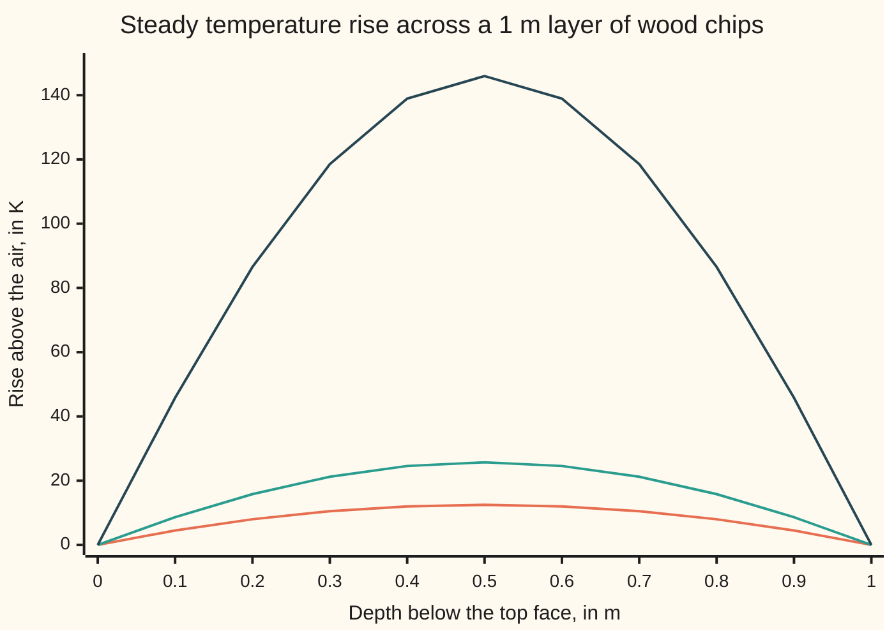

# The Fredholm alternative: either exactly one solution, or extra free ones

[Syllabus](../../../SYLLABUS.md) → [Partial differential equations](../README.md) → [Nonlinear PDE and Fluids](../README.md#s07) → The Fredholm alternative

---

## General Overview

A layer of damp wood chips is 1 m deep. Its top and bottom faces sit at air temperature. Slow decay inside gives off 25 W/m³ of heat. The decay also speeds up as the chips warm: every kelvin of warming adds another 1.25 W/m³. The chips conduct heat poorly, at k = 0.25 W/(m K) (here k is thermal conductivity, not a wavenumber). All four numbers are illustrative.

Without the extra heat, the middle of the layer would settle 12.500 K above the air. With it, the warming makes heat, that heat spreads and warms the layer again, and so on, round after round. The rounds shrink, each about half the one before, and the middle settles at 25.719 K. Make the layer thicker than 1.405 m and the rounds stop shrinking. Just past that thickness a steady temperature still exists on paper, but it is colder than the air and unstable. It is never reached, and the pile runs away.

Wing 08 met the edge of this behaviour on a string: [Eigenvalue problems](../../08-Differential%20equations%20and%20dynamics/07-Series%20Solutions%20and%20Boundary%20Problems/08-eigenvalues-and-eigenfunctions.md) showed that only special values allow a nonzero solution with zero ends. This card says what those special values do to a problem with a source. The unknown is the temperature rise u(x) across the layer. The region is the 1 m between the faces. The data is the heat source, with zero rise at both faces. The steady balance becomes an equation with the unknown under an integral, and one theorem sorts every case.

**For an integral equation of the second kind with a compact kernel, either the equation with no source has only the zero solution, and then every source gives exactly one solution, or it has finitely many free solutions, and then a source can be balanced only if it is perpendicular to them, and the answer is fixed only up to adding them.**

**What kind of fact this is:** a theorem, the Fredholm alternative. Why it works proves it for this symmetric kernel from the kernel's own modes. The general compact case is stated with its source and proved on [Fredholm alternative](../../18-Functional%20analysis/03-Bounded%20Operators/09-fredholm-alternative-and-integral-equations.md). The linear heat release is a model: real self-heating speeds up exponentially with temperature, and the straight-line rule is its first approximation.

### The picture: the layer's steady warming at three strengths of self-heating



Caption: λ is the self-heating strength divided by the conductivity. The lowest line has no self-heating (λ = 0), with 12.50 K in the middle. The middle line is the layer on this card (λ = 5 1/m²), with 25.72 K. The top line has λ = 9 1/m², close to the critical 9.8696 1/m², with 145.96 K. As λ nears the critical value, the profile grows without bound and takes the shape of one sine arch.

---

## The formula

Notation from earlier cards, in one line each. The kernel K(x, y) and the parameter λ come from [Integral equations](07-integral-equations-fredholm-and-volterra.md): an integral equation of the second kind is $`u - \lambda K u = f`$, where $`(Ku)(x) = \int K(x,y)\,u(y)\,dy`$ blends the unknown's values with weights $`K(x, y)`$. The inner product $`\langle g, h\rangle = \int_0^1 g\,h\,dx`$ comes from [L2 as a Hilbert space](../../10-Measure%20and%20integration/07-Sizes%20of%20Functions/06-l2-as-a-hilbert-space.md); two functions are **perpendicular** when it is 0. An eigenpair $`\lambda_n, \varphi_n`$ of $`-d^2/dx^2`$ is a number and a nonzero shape with $`-\varphi_n'' = \lambda_n\varphi_n`$ ([Helmholtz](../04-Laplace%2C%20Poisson%20and%20Potentials/08-helmholtz-and-eigenfunctions.md)).

The steady heat balance, scaled by k, and the integral equation it becomes:

```math
-u'' = q + \lambda u,\ \ u(0) = u(1) = 0 \quad\Longleftrightarrow\quad u(x) - \lambda\int_0^1 K(x,y)\,u(y)\,dy = f(x), \qquad K(x,y) = \min(x,y)\,\bigl(1 - \max(x,y)\bigr).
```

**Read it aloud:** the warming equals the warming from the base heat alone, plus the self-heating's own heat spread out by the smoothing kernel.

Here $`q = Q_0/k`$ = 100 K/m², $`\lambda = \beta/k`$ = 5 1/m², and $`f = Kq = 50\,x(1 - x)`$ K, the rise with no self-heating.

The **Neumann series** solves it round by round:

```math
u = f + \lambda K f + \lambda^2 K^2 f + \lambda^3 K^3 f + \cdots, \qquad \text{converging when } |\lambda| < \lambda_1 = \pi^2 .
```

**Read it aloud:** the base warming, then the warming its heat causes, then the warming that causes, added up.

The kernel in its own modes, and the solution in them:

```math
K(x,y) = \sum_{n=1}^{\infty}\frac{\varphi_n(x)\,\varphi_n(y)}{\lambda_n}, \qquad \varphi_n = \sqrt{2}\,\sin(n\pi x),\quad \lambda_n = n^2\pi^2; \qquad u = \sum_{n=1}^{\infty}\frac{f_n}{1 - \lambda/\lambda_n}\,\varphi_n,\quad f_n = \langle f, \varphi_n\rangle .
```

**Read it aloud:** the kernel is a stack of sine shapes, each weighted by one over its eigenvalue; each mode of the answer is the same mode of the source, divided by one minus λ over that mode's eigenvalue.

The **Fredholm alternative** for this kernel:

```math
\lambda \ne \lambda_n \text{ for all } n:\ \ \text{exactly one } u; \qquad \lambda = \lambda_m:\ \ \text{a solution exists} \iff \langle f, \varphi_m\rangle = 0, \ \text{and then } u + c\,\varphi_m \text{ solves too, for every } c .
```

**Read it aloud:** away from the special values the answer exists and is unique; at a special value it exists only if the source misses that mode, and then any amount of the mode can be added.

| Symbol | Plain meaning | In our example | Push it up and the answer… |
| --- | --- | --- | --- |
| $`x`$, $`y`$; $`L`$ | depth below the top face, m; layer thickness | 0 to 1 m; L = 1 m | thicker layer: closer to runaway |
| $`u(x)`$; $`u_n`$ | steady temperature rise above the air, K; its share in mode n | 25.719 K in the middle | — |
| $`k`$, $`Q_0`$, $`\beta`$ | conductivity W/(m K); base heat W/m³; extra heat per kelvin, W/(m³ K) | 0.25; 25; 1.25 | more β: hotter, then runaway at 2.4674 |
| $`q`$ | scaled base heat, $`Q_0/k`$, K/m² | 100 K/m² | every rise grows in proportion |
| $`\lambda`$ | scaled self-heating, $`\beta/k`$, 1/m² | 5 1/m² | hotter; no steady state at π² |
| $`K(x,y)`$, $`K`$ | the smoothing kernel, m, and the operator it defines | K(0.5, 0.5) = 0.2500 m | — |
| $`f`$; $`f_n`$, $`\langle\cdot,\cdot\rangle`$ | the rise with no self-heating, $`Kq`$, K; its share in mode n; the inner product | 12.500 K in the middle | — |
| $`\lambda_n`$, $`\varphi_n`$; $`\mu_n`$ | eigenpairs of $`-d^2/dx^2`$ with zero ends; K's eigenvalues, $`1/\lambda_n`$ | λ₁ = 9.8696 1/m², √2 sin(πx) | — |
| $`r`$ | round (generation) of the Neumann series | 0 to 20 | each round is about 0.5066 of the last |
| $`c`$ | amount of the free mode at the critical λ | 0 or 5 K | shifts the answer, still a solution |
| $`h`$ | grid step of the check's fourth road | 0.05 m and 0.025 m | coarser: larger error |

### When it holds

- **The kernel is compact.** Here $`\iint K^2 = 1/90`$, finite, which makes K compact (it squeezes bounded sets of inputs into nearly finite-dimensional sets of outputs). If K were the identity, u − λu = f at λ = 1 would have every function as a free solution: infinitely many, not finitely many.
- **The Neumann series needs λ below λ₁.** At λ = 12 1/m² the partial sums reach 453 K and 3562 K by rounds 10 and 20. The alternative still gives exactly one answer, −60.236 K in the middle.
- **The kernel is symmetric, K(x, y) = K(y, x).** Then the test is against its own free modes. A kernel without this symmetry is tested against the free solutions of the adjoint equation (the same sum with x and y swapped).
- **The source has finite energy, $`\int f^2 < \infty`$.** The solution is then unique in L2. Here f is smooth, so u is also a classical solution: twice differentiable, with the equation holding at every point.
- **The heat release is linear in the warming.** Real self-heating grows faster than a straight line, so the linear model only marks where trouble starts, not what happens after.

---

## Why it works

### Step 0: the idea

A symmetric compact kernel acts like a diagonal matrix once the input is written in the kernel's own modes. In each mode, the equation is one line: $`u_n(1 - \lambda/\lambda_n) = f_n`$. Either you can divide by $`1 - \lambda/\lambda_n`$, or it is zero.

If it is never zero, every mode has one answer, and so does the whole equation. If it is zero for some mode, that mode's line reads 0 = f_n. Then either f_n = 0 and $`u_n`$ is free, or f_n ≠ 0 and no u exists. Those are the two branches of the alternative.

### Step 1: from the layer to the integral equation

The steady heat balance is $`-k\,u'' = Q_0 + \beta u`$. Divide by k: $`-u'' = q + \lambda u`$, zero at both faces.

[Green's function](../../08-Differential%20equations%20and%20dynamics/07-Series%20Solutions%20and%20Boundary%20Problems/10-greens-function-for-a-boundary-problem.md) solves any problem of the form "minus the second derivative equals a source, with zero ends" by applying K to the source. Its kernel is the tent $`K(x,y) = \min(x,y)\,(1 - \max(x,y))`$. Here the source is the whole right-hand side, $`q + \lambda u`$, so

```math
u = Kq + \lambda K u = f + \lambda K u .
```

For the uniform source, $`f = Kq = q\,x(1 - x)/2`$, which is 12.500 K in the middle. That is the bottom line of the picture.

### Step 2: the Neumann series counts rounds of self-heating

Substitute the equation into itself: $`u = f + \lambda K(f + \lambda K u)`$, and so on. Round 0 is the base warming. Round 1 is the warming caused by round 0's extra heat. Each round is λK applied to the round before. This is the series that [Integral equations](07-integral-equations-fredholm-and-volterra.md) summed for a ponding roof, with the same kernel, the same λ = 5 1/m² and a source of the same shape, so every round here is that card's round, rescaled.

[Neumann series](../../18-Functional%20analysis/03-Bounded%20Operators/06-neumann-series-and-inverting-close-to-the-identity.md) proves that the series converges when λ times the size of K is below 1, with the error shrinking by that factor each round. On L2 the size of this K is its largest eigenvalue, $`1/\lambda_1 = 1/\pi^2`$. So the series converges for λ below π² = 9.8696 1/m².

In the middle of the layer, rounds 0 to 6 are:

```
round 0  ######################### 12.500 K
round 1  #############              6.510 K
round 2  #######                    3.309 K
round 3  ###                        1.677 K
round 4  ##                         0.850 K
round 5  #                          0.430 K
round 6                             0.218 K
```

Their running totals are 12.500, 19.010, 22.320 and 23.997 K after rounds 0 to 3, then 25.277 K after round 5 and 25.705 K after round 10. After round 20 the total is 25.719 K, and the first round left out is 8.10e-06 K. The ratio of rounds 20 and 19 is 0.5066, which is 5/9.8696: the series itself reveals λ₁.

### Step 3: the kernel in its own modes

Two facts about K make the rest work.

1. **K is symmetric:** swapping x and y leaves min(x, y)(1 − max(x, y)) unchanged.
2. **K is compact.** Its squared Hilbert-Schmidt norm, $`\iint K^2\,dx\,dy`$, is 1/90 = 0.011111, a finite number. A kernel with a finite Hilbert-Schmidt norm is compact, as [Compact operators](../../18-Functional%20analysis/03-Bounded%20Operators/05-compact-operators.md) proves.

The spectral theorem for compact symmetric operators, proved on [Compact and symmetric](../../18-Functional%20analysis/03-Bounded%20Operators/08-spectral-theorem-for-compact-self-adjoint-operators.md), then gives an orthonormal set of modes (each of length 1, each pair perpendicular) with $`K\varphi_n = \mu_n\varphi_n`$. Here the modes are known: $`-\varphi_n'' = n^2\pi^2\varphi_n`$ with zero ends, and K undoes $`-d^2/dx^2`$. So $`\mu_n = 1/\lambda_n = 1/(n^2\pi^2)`$.

**Mercer's theorem** says that for a continuous symmetric kernel with no negative eigenvalues, the mode sum equals the kernel at every point. The checks test it three ways:

- **At (0.5, 0.5):** the kernel is 0.2500. The sum up to n = 1, 9 and 99 gives 0.20264, 0.23990 and 0.24899, with the tail below 0.00205.
- **At (0.3, 0.7):** the kernel is 0.0900. The sums give 0.13263, 0.08991 and 0.09000.
- **Along the diagonal:** $`\int_0^1 K(x,x)\,dx`$ = 0.166667 = 1/6, and $`\sum 1/\lambda_n`$ up to 1000 gives 0.166565, with the tail below 0.000101. The squares match too: $`\sum 1/\lambda_n^2`$ = 0.011111 = 1/90.

### Step 4: the equation in modes gives the alternative

Take the inner product of $`u - \lambda K u = f`$ with $`\varphi_n`$. Symmetry moves K onto $`\varphi_n`$, where it acts as $`1/\lambda_n`$:

```math
u_n - \frac{\lambda}{\lambda_n}\,u_n = f_n, \qquad u_n = \langle u, \varphi_n\rangle .
```

For the uniform source, $`f_n = q\,\langle 1, \varphi_n\rangle/\lambda_n`$, which is $`2\sqrt{2}\,q/(n\pi\lambda_n)`$ for odd n and 0 for even n. In the middle of the layer the mode sum becomes

```math
u(0.5) = \sum_{n \text{ odd}} \frac{4q\,\sin(n\pi/2)}{n\pi\,(n^2\pi^2 - \lambda)} .
```

Summed up to n = 1, 3, 11 and 101, it gives 26.1467, 25.6404, 25.7158 and 25.7194 K. The next term is 1.2e-05 K. The closed form of the differential equation gives 25.719 K, and so does the Neumann series: three roads, one answer.

<details>
<summary>Detailed proof: the alternative for a compact symmetric kernel</summary>

Let K be compact and symmetric on L2(0, 1), with orthonormal eigenfunctions $`\varphi_n`$ and nonzero eigenvalues $`\mu_n \to 0`$ (the spectral theorem). For our kernel the eigenfunctions are complete: every function in L2 is the sum of its modes. The only alternative would be a nonzero function that K sends to 0, and none exists, because if Ku = 0 then u = −(Ku)'' = 0.

Write $`\lambda_n = 1/\mu_n`$. The equation $`u - \lambda Ku = f`$ splits into one line for each n:

$`\displaystyle \Bigl(1 - \frac{\lambda}{\lambda_n}\Bigr)\,u_n = f_n .`$

Case 1: λ equals no $`\lambda_n`$. Since $`\lambda_n \to \infty`$, the factors $`1 - \lambda/\lambda_n`$ tend to 1, and none is 0, so their sizes have a smallest value above 0. Then $`u_n = f_n/(1 - \lambda/\lambda_n)`$, and the sum of the $`u_n^2`$ is at most a fixed multiple of the sum of the $`f_n^2`$, which is finite. So u lies in L2. It is the only solution, since each $`u_n`$ was forced.

Case 2: λ equals one or more $`\lambda_n`$. Because $`\lambda_n \to \infty`$, only finitely many n have $`\lambda_n = \lambda`$. For each of those n the line reads $`0 = f_n`$. So a solution needs $`f_n = 0`$ for each of them. When that holds, the other coefficients are fixed as in Case 1, and the coefficients of those finitely many modes are free. The free solutions are their combinations, $`c\,\varphi_n`$ summed over those n.

The adjoint of a symmetric K is K itself, so "perpendicular to the free solutions of the adjoint equation" is "$`f_n = 0`$ for every n with $`\lambda_n = \lambda`$". For a kernel that is compact but not symmetric, the same statement holds with the adjoint's free solutions, and the dimension of both free spaces is equal. Fredholm proved it in 1903 (Sources); Kress gives a modern proof.

</details>

### Step 5: reading the free solutions at the critical value

Set λ = π², the first special value. The free solution is $`\varphi_1 = \sqrt{2}\,\sin(\pi x)`$: one sine arch. It solves the equation with no source at all. Physically, the layer's self-heating exactly replaces the heat lost through its faces.

The test for a source is $`\int_0^1 q(x)\,\sin(\pi x)\,dx = 0`$. (It is the same as $`\langle f, \varphi_1\rangle = 0`$, because $`\langle Kq, \varphi_1\rangle = \langle q, \varphi_1\rangle/\lambda_1`$.)

- **Uniform base heat fails the test.** $`\int_0^1 100\,\sin(\pi x)\,dx`$ = 63.662 K/m, which is 2q/π. No steady state exists. The Neumann partial sums in the middle reach 141.45, 270.46 and 528.47 K by rounds 10, 20 and 40. Each round adds between 12.500 K and 12.901 K, rising toward 4q/π³ = 12.901 K, so the sum never settles.
- **A cosine source passes.** Let $`q = 100\cos(\pi x)`$ K/m²: heat put in near the top face and the same amount taken out near the bottom. Its test integral is 0.000. The solutions are $`u = -(50/\pi)\,x\sin(\pi x) + c\,\sin(\pi x)`$ for every c. At c = 0 the middle sits at −7.958 K. At c = 5 it sits at −2.958 K. Both leave a residual $`u - \pi^2 Ku - Kq`$ of 3.2e-09 and 3.4e-09 at x = 0.3, which is quadrature error only.
- **At the second special value, λ₂ = 4π², the uniform source passes.** Its test against $`\sin(2\pi x)`$ is 0.000, because the second mode is positive on one half and negative on the other. The free solution there is $`\sin(2\pi x)`$.

Time says which c the layer picks. In the heat equation for the layer, mode n decays at a rate proportional to $`\lambda_n - \lambda`$. At λ = π² the first mode neither grows nor decays. So the layer keeps whatever amount of $`\sin(\pi x)`$ it started with: the free c is set by the starting state, not by the steady equation. Above π² the first mode grows, which is why the steady answer −60.236 K at λ = 12 1/m² is never reached.

---

## Worked numbers, by hand

| Step | Arithmetic | Value |
| --- | --- | --- |
| scaled base heat | 25 / 0.25 | q = 100 K/m² |
| scaled self-heating | 1.25 / 0.25 | λ = 5 1/m² |
| critical value | π² | λ₁ = 9.8696 1/m² |
| critical self-heating | 0.25 × 9.8696 | 2.4674 W/(m³ K) |
| critical thickness | π × √(0.25 / 1.25) | 1.405 m |
| round 0, middle | 100 × 0.5 × 0.5 / 2 | 12.500 K |
| round 1, middle | 5 × 100 × 5/384 | 6.510 K |
| rounds 0 to 2 | 12.500 + 6.510 + 3.309 | 22.320 K |
| shrink factor per round | 5 / 9.8696 | 0.5066 |
| closed form, middle | 100 × (1 / cos(√5 / 2) − 1) / 5 | **25.719 K** |

The self-heating roughly doubles the middle's warming, from 12.500 K to 25.719 K. The layer's λ is 0.5066 of the critical value, and a layer 1.405 m thick would have no steady state at all.

### What breaks if you drop a piece

| Mistake | Comes out at | What went wrong |
| --- | --- | --- |
| Neumann series at λ = 12 1/m², above π² | 453 K, then 3562 K, by rounds 10 and 20 | each round grows by 12/π² = 1.216; the unique answer, −60.236 K, needs the mode sum |
| Uniform source at the critical λ = π² | 141.45, 270.46, 528.47 K, without end | the source fails the test: 63.662 K/m against sin(πx) |
| Calling the cosine-source answer unique | −7.958 K and −2.958 K in the middle, both residual about 3e-09 | the free mode c sin(πx) can be added |
| Dropping the self-heating | 12.500 K, not 25.719 K | only round 0 of the series |

The code prints all four.

---

## Code, from first principles, and it actually runs

The script reaches the middle temperature by four roads that share no arithmetic. Road 1 is the closed form of the differential equation. Road 2 is the Neumann series, with K applied exactly to polynomials by integrating twice. Road 3 is the mode sum. Road 4 is a grid: the integral by the trapezoid rule at steps 0.05 m and 0.025 m, a linear solve by Gaussian elimination, the observed order and Richardson extrapolation (4 × fine − coarse, all over 3). The critical value π² is found twice more: from the grid kernel's top eigenvalue by power iteration (applying the grid's K over and over until the vector's growth factor settles), and from the ratio of Neumann rounds. Mercer's sums are asserted against the kernel at two points, its trace and its squared Hilbert-Schmidt norm, each within its tail bound or quadrature error. At the critical value, the cosine source's solutions are checked in the integral equation itself by Simpson's rule. No quadrature, solver or eigenvalue routine is imported.

### Python

```python
# Fredholm alternative -- the check behind the card.  Standard library only.
# A 1 m layer of damp wood chips, both faces held at air temperature, heated
# by 25 W/m^3 plus 1.25 W/m^3 per kelvin of warming; k = 0.25 W/(m K).  All
# illustrative.  Scaled by k: u = f + lam K u, f = K q, q = 100 K/m^2,
# lam = 5 1/m^2, kernel K(x, y) = min(x, y) (1 - max(x, y)) on 0 <= x, y <= 1 m.
import math
PI = math.pi
KC, Q0, BETA = 0.25, 25.0, 1.25
q, lam = Q0 / KC, BETA / KC
L1 = PI * PI                              # lowest eigenvalue n^2 pi^2 of -u''

def kern(x, y): return min(x, y) * (1 - max(x, y))
def total(xs):                            # plain left-to-right sum, as in the Rust
    s = 0.0
    for v in xs: s += v
    return s
def closed(lv, x):                        # road 1: -u'' = q + lv u, u(0) = u(1) = 0
    if lv == 0: return q * x * (1 - x) / 2
    s = math.sqrt(lv)
    return q * (math.cos(s * (x - 0.5)) / math.cos(s / 2) - 1) / lv
def apply_k(p):                           # K on a polynomial: -w'' = p, w(0) = w(1) = 0
    w = [0.0, 0.0] + [-p[k] / ((k + 1) * (k + 2)) for k in range(len(p))]
    w[1] = -total(w)
    return w
def peval(p, x):
    v = 0.0
    for c in reversed(p): v = v * x + c
    return v
def neumann(lv, qpoly, nmax, x=0.5):      # road 2: u = f + lv K f + lv^2 K^2 f + ...
    t, terms = apply_k(qpoly), []
    for _ in range(nmax + 1):
        terms.append(peval(t, x))
        t = [lv * c for c in apply_k(t)]
    return terms
def partial(terms, n): return total(terms[:n + 1])
def modes(lv, x, nmax):                   # road 3: sum of <q, phi_n> phi_n(x) / (lam_n - lv)
    return total(4 * q * math.sin(n * PI * x) / (n * PI * (n * n * L1 - lv)) for n in range(1, nmax + 1, 2))
def nystrom(lv, n):                       # road 4: trapezoid grid, Gaussian elimination
    h = 1.0 / n
    xs = [i * h for i in range(1, n)]
    a = [[(1.0 if i == j else 0.0) - lv * h * kern(xi, xj) for j, xj in enumerate(xs)] + [closed(0, xi)]
         for i, xi in enumerate(xs)]
    m = n - 1
    for c in range(m):
        p = max(range(c, m), key=lambda r: abs(a[r][c]))
        a[c], a[p] = a[p], a[c]
        for r in range(c + 1, m):
            f = a[r][c] / a[c][c]
            for k in range(c, m + 1): a[r][k] -= f * a[c][k]
    u = [0.0] * m
    for r in range(m - 1, -1, -1):
        u[r] = (a[r][m] - total(a[r][k] * u[k] for k in range(r + 1, m))) / a[r][r]
    return u[n // 2 - 1]                  # the node x = 0.5 m
def power(n, iters):                      # top eigenvalue of the grid's K, then 1/mu
    h = 1.0 / n
    xs = [i * h for i in range(1, n)]
    v, mu = [1.0] * len(xs), 0.0
    for _ in range(iters):
        w = [h * total(kern(xi, xj) * vj for xj, vj in zip(xs, v)) for xi in xs]
        mu = math.sqrt(total(c * c for c in w)) / math.sqrt(total(c * c for c in v))
        v = w
    return 1 / mu
def simpson(f, lo, hi, panels):
    h = (hi - lo) / panels
    return h / 3 * total((1 if i in (0, panels) else 4 if i % 2 else 2) * f(lo + i * h) for i in range(panels + 1))
def kint(g, x):                           # (K g)(x) by Simpson, split at the kink y = x
    return simpson(lambda y: kern(x, y) * g(y), 0, x, 200) + simpson(lambda y: kern(x, y) * g(y), x, 1, 200)

u5 = closed(lam, 0.5)
print(f"layer 1 m, k = {KC} W/(m K): q = {q:.0f} K/m^2, lam = {lam:.0f} 1/m^2, critical lam_1 = pi^2 = {L1:.4f} 1/m^2")
print(f"critical beta = k pi^2 = {KC * L1:.4f} W/(m^3 K); critical thickness at beta = {BETA}: {PI * math.sqrt(KC / BETA):.3f} m")
print(f"middle rise: no reaction {closed(0, 0.5):.3f} K; with reaction, closed form {u5:.3f} K")
terms = neumann(lam, [q], 40)
print("Neumann generations r = 0 to 6 at the middle, K: " + ", ".join(f"{t:.3f}" for t in terms[:7]))
print("  partial sums r = 0, 1, 2, 3, 5, 10, 20: " + ", ".join(f"{partial(terms, n):.3f}" for n in (0, 1, 2, 3, 5, 10, 20)))
print(f"  first omitted term after r = 20: {terms[21]:.2e} K; ratio of terms 20 to 19: {terms[20] / terms[19]:.4f} = lam/{lam * terms[19] / terms[20]:.4f}")
m5 = [modes(lam, 0.5, n) for n in (1, 3, 11, 101)]
print("mode sum at the middle, odd n up to 1, 3, 11, 101: " + ", ".join(f"{v:.4f}" for v in m5) + f"; next term {4 * q / (103 * PI * (103 * 103 * L1 - lam)):.1e} K")
ny = [nystrom(lam, n) for n in (20, 40)]
order, rich = math.log2((ny[0] - u5) / (ny[1] - u5)), (4 * ny[1] - ny[0]) / 3
print(f"grid at h = 0.05, 0.025 m: {ny[0]:.4f}, {ny[1]:.4f} K; observed order {order:.2f}; Richardson {rich:.4f} K")
pw = [power(n, 60) for n in (20, 40)]
print(f"lam_1 from the grid's top eigenvalue at h = 0.05, 0.025 m: {pw[0]:.4f}, {pw[1]:.4f} 1/m^2")
print("kernel in its own modes, K(x, y) = sum 2 sin(n pi x) sin(n pi y) / (n^2 pi^2):")
mer = []
for x, y in ((0.5, 0.5), (0.3, 0.7)):
    ps = [total(2 * math.sin(n * PI * x) * math.sin(n * PI * y) / (n * n * L1) for n in range(1, N + 1)) for N in (1, 9, 99)]
    mer.append(abs(ps[-1] - kern(x, y)))
    print(f"  K({x}, {y}) = {kern(x, y):.4f}; N = 1, 9, 99: " + ", ".join(f"{v:.5f}" for v in ps) + f"; tail < {2 / (L1 * 99):.5f}")
tr = simpson(lambda x: kern(x, x), 0, 1, 100)
h2 = total(kern((i + 0.5) / 400, (j + 0.5) / 400) ** 2 for i in range(400) for j in range(400)) / 160000
inv1, inv2 = total(1 / (n * n * L1) for n in range(1, 1001)), total(1 / (n * n * L1) ** 2 for n in range(1, 1001))
print(f"  trace: int K(x,x) dx = {tr:.6f}; sum 1/lam_n, n <= 1000: {inv1:.6f}, tail < {1 / (1000 * L1):.6f}")
print(f"  Hilbert-Schmidt: int int K^2 = {h2:.6f}; sum 1/lam_n^2, n <= 1000: {inv2:.6f}; 1/90 = {1 / 90:.6f}")
print("at the critical lam = pi^2, uniform q = 100 K/m^2:")
s1 = simpson(lambda x: q * math.sin(PI * x), 0, 1, 200)
s2 = simpson(lambda x: q * math.sin(2 * PI * x), 0, 1, 200)
print(f"  int q sin(pi x) dx = {s1:.3f} K/m (2q/pi = {2 * q / PI:.3f}); against sin(2 pi x): {abs(s2):.3f}")
tc = neumann(L1, [q], 40)
print("  partial sums r = 10, 20, 40: " + ", ".join(f"{partial(tc, n):.2f}" for n in (10, 20, 40)) + f" K; each term tends to 4q/pi^3 = {4 * q / PI ** 3:.3f} K")
qc = lambda y: q * math.cos(PI * y)
print(f"cosine source q = 100 cos(pi x): int q sin(pi x) dx = {abs(simpson(lambda x: qc(x) * math.sin(PI * x), 0, 1, 200)):.3f}")
res = []
for c in (0.0, 5.0):
    uc = lambda y, c=c: -(q / (2 * PI)) * y * math.sin(PI * y) + c * math.sin(PI * y)
    res.append(uc(0.3) - L1 * kint(uc, 0.3) - kint(qc, 0.3))
    print(f"  c = {c:.0f}: u(0.5) = {uc(0.5):.3f} K, residual of u - pi^2 K u - K q at x = 0.3: {abs(res[-1]):.1e}")
e12 = closed(12, 0.5)
t12 = neumann(12, [q], 20)
print(f"above critical, lam = 12: closed form {e12:.3f} K, mode sum {modes(12, 0.5, 101):.3f} K, Neumann r = 10, 20: {partial(t12, 10):.0f}, {partial(t12, 20):.0f}, ratio 12/pi^2 = {12 / L1:.3f}")
print("chart x = 0, 0.1, ..., 1 m, rise in K:")
for lv in (0, 5, 9):
    print(f"  lam = {lv}: " + ", ".join(f"{closed(lv, i / 10):.2f}" for i in range(11)))
need = [next((n for n in range(200) if abs(partial(neumann(lv, [q], 200), n) - closed(lv, 0.5)) < 0.01), 200) for lv in (5, 9)]
print(f"try: lam = 8 middle {closed(8, 0.5):.2f} K; within 0.01 K from round r = {need[0]} (lam = 5), {need[1]} (lam = 9); thickness at beta = 2.0: {PI * math.sqrt(KC / 2.0):.3f} m")
assert abs(partial(terms, 40) - u5) < 1e-9 and abs(m5[-1] - u5) < 1e-5     # three roads meet
assert abs(rich - u5) < 1e-3 and 1.9 < order < 2.1                          # grid, second order
assert all(abs(p - L1) < 0.03 for p in pw) and abs(lam * terms[19] / terms[20] - L1) < 1e-3
assert abs(tr - 1 / 6) < 1e-9 and abs(h2 - 1 / 90) < 1e-6                     # trace and K^2 by quadrature
assert max(mer) < 2 / (99 * L1) and 0 < tr - inv1 < 1 / (1000 * L1) and abs(inv2 - h2) < 1e-6  # Mercer's mode sums
assert abs(s1 - 2 * q / PI) < 1e-6 and partial(tc, 40) > 3 * partial(tc, 10)  # no steady state
assert abs(min(tc) - closed(0, 0.5)) < 1e-9 and max(tc) < 4 * q / PI ** 3 + 1e-9  # rounds lie in 12.500 to 12.901 K
assert max(abs(r) for r in res) < 1e-6 and abs(e12 - modes(12, 0.5, 2001)) < 1e-4 and abs(partial(t12, 20)) > 1e3
print("ALL CHECKS PASS")
```

**Ran 2026-11-15 on macOS, Python 3.14.10, standard library only. All checks passed. Output, pasted from the run:**

```
layer 1 m, k = 0.25 W/(m K): q = 100 K/m^2, lam = 5 1/m^2, critical lam_1 = pi^2 = 9.8696 1/m^2
critical beta = k pi^2 = 2.4674 W/(m^3 K); critical thickness at beta = 1.25: 1.405 m
middle rise: no reaction 12.500 K; with reaction, closed form 25.719 K
Neumann generations r = 0 to 6 at the middle, K: 12.500, 6.510, 3.309, 1.677, 0.850, 0.430, 0.218
  partial sums r = 0, 1, 2, 3, 5, 10, 20: 12.500, 19.010, 22.320, 23.997, 25.277, 25.705, 25.719
  first omitted term after r = 20: 8.10e-06 K; ratio of terms 20 to 19: 0.5066 = lam/9.8696
mode sum at the middle, odd n up to 1, 3, 11, 101: 26.1467, 25.6404, 25.7158, 25.7194; next term 1.2e-05 K
grid at h = 0.05, 0.025 m: 25.7743, 25.7331 K; observed order 2.00; Richardson 25.7193 K
lam_1 from the grid's top eigenvalue at h = 0.05, 0.025 m: 9.8493, 9.8645 1/m^2
kernel in its own modes, K(x, y) = sum 2 sin(n pi x) sin(n pi y) / (n^2 pi^2):
  K(0.5, 0.5) = 0.2500; N = 1, 9, 99: 0.20264, 0.23990, 0.24899; tail < 0.00205
  K(0.3, 0.7) = 0.0900; N = 1, 9, 99: 0.13263, 0.08991, 0.09000; tail < 0.00205
  trace: int K(x,x) dx = 0.166667; sum 1/lam_n, n <= 1000: 0.166565, tail < 0.000101
  Hilbert-Schmidt: int int K^2 = 0.011111; sum 1/lam_n^2, n <= 1000: 0.011111; 1/90 = 0.011111
at the critical lam = pi^2, uniform q = 100 K/m^2:
  int q sin(pi x) dx = 63.662 K/m (2q/pi = 63.662); against sin(2 pi x): 0.000
  partial sums r = 10, 20, 40: 141.45, 270.46, 528.47 K; each term tends to 4q/pi^3 = 12.901 K
cosine source q = 100 cos(pi x): int q sin(pi x) dx = 0.000
  c = 0: u(0.5) = -7.958 K, residual of u - pi^2 K u - K q at x = 0.3: 3.2e-09
  c = 5: u(0.5) = -2.958 K, residual of u - pi^2 K u - K q at x = 0.3: 3.4e-09
above critical, lam = 12: closed form -60.236 K, mode sum -60.236 K, Neumann r = 10, 20: 453, 3562, ratio 12/pi^2 = 1.216
chart x = 0, 0.1, ..., 1 m, rise in K:
  lam = 0: 0.00, 4.50, 8.00, 10.50, 12.00, 12.50, 12.00, 10.50, 8.00, 4.50, 0.00
  lam = 5: 0.00, 8.62, 15.81, 21.22, 24.58, 25.72, 24.58, 21.22, 15.81, 8.62, 0.00
  lam = 9: 0.00, 45.81, 86.53, 118.53, 138.95, 145.96, 138.95, 118.53, 86.53, 45.81, 0.00
try: lam = 8 middle 67.66 K; within 0.01 K from round r = 11 (lam = 5), 103 (lam = 9); thickness at beta = 2.0: 1.111 m
ALL CHECKS PASS
```

### Rust

Same numbers, same labels, built with `rustc --edition 2021 -O`.

```rust
// Fredholm alternative -- the same check as the Python, in Rust.  No crates.
// A 1 m layer of damp wood chips, both faces held at air temperature, heated
// by 25 W/m^3 plus 1.25 W/m^3 per kelvin of warming; k = 0.25 W/(m K).  All
// illustrative.  Scaled by k: u = f + lam K u, f = K q, q = 100 K/m^2,
// lam = 5 1/m^2, kernel K(x, y) = min(x, y) (1 - max(x, y)) on 0 <= x, y <= 1 m.
use std::f64::consts::PI;
const KC: f64 = 0.25;
const Q0: f64 = 25.0;
const BETA: f64 = 1.25;
const Q: f64 = Q0 / KC;
const L1: f64 = PI * PI; // lowest eigenvalue n^2 pi^2 of -u''

fn kern(x: f64, y: f64) -> f64 { x.min(y) * (1.0 - x.max(y)) }
fn total<I: Iterator<Item = f64>>(xs: I) -> f64 { let mut s = 0.0; for v in xs { s += v; } s }
fn closed(lv: f64, x: f64) -> f64 { // road 1: -u'' = q + lv u, u(0) = u(1) = 0
    if lv == 0.0 { return Q * x * (1.0 - x) / 2.0; }
    let s = lv.sqrt();
    Q * ((s * (x - 0.5)).cos() / (s / 2.0).cos() - 1.0) / lv
}
fn apply_k(p: &[f64]) -> Vec<f64> { // K on a polynomial: -w'' = p, w(0) = w(1) = 0
    let mut w = vec![0.0, 0.0];
    for k in 0..p.len() { w.push(-p[k] / (((k + 1) * (k + 2)) as f64)); }
    w[1] = -total(w.iter().cloned());
    w
}
fn peval(p: &[f64], x: f64) -> f64 { let mut v = 0.0; for c in p.iter().rev() { v = v * x + c; } v }
fn neumann(lv: f64, nmax: usize) -> Vec<f64> { // road 2: u = f + lv K f + lv^2 K^2 f + ...
    let mut t = apply_k(&[Q]);
    let mut terms = vec![];
    for _ in 0..=nmax {
        terms.push(peval(&t, 0.5));
        t = apply_k(&t).iter().map(|c| lv * c).collect();
    }
    terms
}
fn partial(terms: &[f64], n: usize) -> f64 { total(terms[..=n].iter().cloned()) }
fn modes(lv: f64, x: f64, nmax: usize) -> f64 { // road 3: sum <q, phi_n> phi_n(x) / (lam_n - lv)
    total((1..=nmax).step_by(2).map(|n| { let n = n as f64;
        4.0 * Q * (n * PI * x).sin() / (n * PI * (n * n * L1 - lv)) }))
}
fn nystrom(lv: f64, n: usize) -> f64 { // road 4: trapezoid grid, Gaussian elimination
    let h = 1.0 / n as f64;
    let xs: Vec<f64> = (1..n).map(|i| i as f64 * h).collect();
    let m = n - 1;
    let mut a: Vec<Vec<f64>> = (0..m).map(|i| {
        let mut row: Vec<f64> = (0..m).map(|j| (if i == j { 1.0 } else { 0.0 }) - lv * h * kern(xs[i], xs[j])).collect();
        row.push(closed(0.0, xs[i])); row }).collect();
    for c in 0..m {
        let mut p = c;
        for r in c..m { if a[r][c].abs() > a[p][c].abs() { p = r; } }
        a.swap(c, p);
        for r in c + 1..m {
            let f = a[r][c] / a[c][c];
            for k in c..=m { a[r][k] -= f * a[c][k]; }
        }
    }
    let mut u = vec![0.0; m];
    for r in (0..m).rev() { u[r] = (a[r][m] - total((r + 1..m).map(|k| a[r][k] * u[k]))) / a[r][r]; }
    u[n / 2 - 1] // the node x = 0.5 m
}
fn power(n: usize, iters: usize) -> f64 { // top eigenvalue of the grid's K, then 1/mu
    let h = 1.0 / n as f64;
    let xs: Vec<f64> = (1..n).map(|i| i as f64 * h).collect();
    let (mut v, mut mu) = (vec![1.0; xs.len()], 0.0);
    for _ in 0..iters {
        let w: Vec<f64> = xs.iter().map(|&xi| h * total(xs.iter().zip(v.iter()).map(|(&xj, &vj)| kern(xi, xj) * vj))).collect();
        mu = total(w.iter().map(|c| c * c)).sqrt() / total(v.iter().map(|c| c * c)).sqrt();
        v = w;
    }
    1.0 / mu
}
fn simpson<F: Fn(f64) -> f64>(f: F, lo: f64, hi: f64, panels: usize) -> f64 {
    let h = (hi - lo) / panels as f64;
    h / 3.0 * total((0..=panels).map(|i| (if i == 0 || i == panels { 1.0 } else if i % 2 == 1 { 4.0 } else { 2.0 }) * f(lo + i as f64 * h)))
}
fn kint<F: Fn(f64) -> f64>(g: &F, x: f64) -> f64 { // (K g)(x) by Simpson, split at the kink y = x
    simpson(|y| kern(x, y) * g(y), 0.0, x, 200) + simpson(|y| kern(x, y) * g(y), x, 1.0, 200)
}
fn sci(v: f64, d: usize) -> String { // Python-style e-notation: 8.10e-06
    let s = format!("{:.*e}", d, v);
    let (m, e) = s.split_once('e').unwrap();
    let e: i32 = e.parse().unwrap();
    format!("{}e{}{:02}", m, if e < 0 { '-' } else { '+' }, e.abs())
}
fn join(v: &[f64], d: usize) -> String { v.iter().map(|x| format!("{:.*}", d, x)).collect::<Vec<_>>().join(", ") }

fn main() {
    let lam = BETA / KC;
    let u5 = closed(lam, 0.5);
    println!("layer 1 m, k = {} W/(m K): q = {:.0} K/m^2, lam = {:.0} 1/m^2, critical lam_1 = pi^2 = {:.4} 1/m^2", KC, Q, lam, L1);
    println!("critical beta = k pi^2 = {:.4} W/(m^3 K); critical thickness at beta = {}: {:.3} m", KC * L1, BETA, PI * (KC / BETA).sqrt());
    println!("middle rise: no reaction {:.3} K; with reaction, closed form {:.3} K", closed(0.0, 0.5), u5);
    let terms = neumann(lam, 40);
    println!("Neumann generations r = 0 to 6 at the middle, K: {}", join(&terms[..7], 3));
    let ps: Vec<f64> = [0, 1, 2, 3, 5, 10, 20].iter().map(|&n| partial(&terms, n)).collect();
    println!("  partial sums r = 0, 1, 2, 3, 5, 10, 20: {}", join(&ps, 3));
    println!("  first omitted term after r = 20: {} K; ratio of terms 20 to 19: {:.4} = lam/{:.4}", sci(terms[21], 2), terms[20] / terms[19], lam * terms[19] / terms[20]);
    let m5: Vec<f64> = [1, 3, 11, 101].iter().map(|&n| modes(lam, 0.5, n)).collect();
    println!("mode sum at the middle, odd n up to 1, 3, 11, 101: {}; next term {} K", join(&m5, 4), sci(4.0 * Q / (103.0 * PI * (103.0 * 103.0 * L1 - lam)), 1));
    let ny = [nystrom(lam, 20), nystrom(lam, 40)];
    let (order, rich) = (((ny[0] - u5) / (ny[1] - u5)).log2(), (4.0 * ny[1] - ny[0]) / 3.0);
    println!("grid at h = 0.05, 0.025 m: {:.4}, {:.4} K; observed order {:.2}; Richardson {:.4} K", ny[0], ny[1], order, rich);
    let pw = [power(20, 60), power(40, 60)];
    println!("lam_1 from the grid's top eigenvalue at h = 0.05, 0.025 m: {:.4}, {:.4} 1/m^2", pw[0], pw[1]);
    println!("kernel in its own modes, K(x, y) = sum 2 sin(n pi x) sin(n pi y) / (n^2 pi^2):");
    let mut mer = vec![];
    for &(x, y) in &[(0.5, 0.5), (0.3, 0.7)] {
        let ps: Vec<f64> = [1usize, 9, 99].iter().map(|&nn| total((1..=nn).map(|n| { let n = n as f64;
            2.0 * (n * PI * x).sin() * (n * PI * y).sin() / (n * n * L1) }))).collect();
        mer.push((ps[2] - kern(x, y)).abs());
        println!("  K({}, {}) = {:.4}; N = 1, 9, 99: {}; tail < {:.5}", x, y, kern(x, y), join(&ps, 5), 2.0 / (L1 * 99.0));
    }
    let tr = simpson(|x| kern(x, x), 0.0, 1.0, 100);
    let h2 = total((0..400).flat_map(|i| (0..400).map(move |j| { let v = kern((i as f64 + 0.5) / 400.0, (j as f64 + 0.5) / 400.0); v * v }))) / 160000.0;
    let inv = |p: i32| total((1..=1000).map(|n| 1.0 / ((n * n) as f64 * L1).powi(p)));
    println!("  trace: int K(x,x) dx = {:.6}; sum 1/lam_n, n <= 1000: {:.6}, tail < {:.6}", tr, inv(1), 1.0 / (1000.0 * L1));
    println!("  Hilbert-Schmidt: int int K^2 = {:.6}; sum 1/lam_n^2, n <= 1000: {:.6}; 1/90 = {:.6}", h2, inv(2), 1.0 / 90.0);
    println!("at the critical lam = pi^2, uniform q = 100 K/m^2:");
    let s1 = simpson(|x| Q * (PI * x).sin(), 0.0, 1.0, 200);
    let s2 = simpson(|x| Q * (2.0 * PI * x).sin(), 0.0, 1.0, 200);
    println!("  int q sin(pi x) dx = {:.3} K/m (2q/pi = {:.3}); against sin(2 pi x): {:.3}", s1, 2.0 * Q / PI, s2.abs());
    let tc = neumann(L1, 40);
    println!("  partial sums r = 10, 20, 40: {} K; each term tends to 4q/pi^3 = {:.3} K",
        [10, 20, 40].iter().map(|&n| format!("{:.2}", partial(&tc, n))).collect::<Vec<_>>().join(", "), 4.0 * Q / PI.powf(3.0));
    let qc = |y: f64| Q * (PI * y).cos();
    println!("cosine source q = 100 cos(pi x): int q sin(pi x) dx = {:.3}", simpson(|x| qc(x) * (PI * x).sin(), 0.0, 1.0, 200).abs());
    let mut res = vec![];
    for &c in &[0.0, 5.0] {
        let uc = |y: f64| -(Q / (2.0 * PI)) * y * (PI * y).sin() + c * (PI * y).sin();
        res.push(uc(0.3) - L1 * kint(&uc, 0.3) - kint(&qc, 0.3));
        println!("  c = {:.0}: u(0.5) = {:.3} K, residual of u - pi^2 K u - K q at x = 0.3: {}", c, uc(0.5), sci(res[res.len() - 1].abs(), 1));
    }
    let e12 = closed(12.0, 0.5);
    let t12 = neumann(12.0, 20);
    println!("above critical, lam = 12: closed form {:.3} K, mode sum {:.3} K, Neumann r = 10, 20: {:.0}, {:.0}, ratio 12/pi^2 = {:.3}", e12, modes(12.0, 0.5, 101), partial(&t12, 10), partial(&t12, 20), 12.0 / L1);
    println!("chart x = 0, 0.1, ..., 1 m, rise in K:");
    for &lv in &[0.0, 5.0, 9.0] {
        let pts: Vec<f64> = (0..11).map(|i| closed(lv, i as f64 / 10.0)).collect();
        println!("  lam = {}: {}", lv, join(&pts, 2));
    }
    let need: Vec<usize> = [5.0, 9.0].iter().map(|&lv| { let t = neumann(lv, 200);
        (0..200).find(|&n| (partial(&t, n) - closed(lv, 0.5)).abs() < 0.01).unwrap_or(200) }).collect();
    println!("try: lam = 8 middle {:.2} K; within 0.01 K from round r = {} (lam = 5), {} (lam = 9); thickness at beta = 2.0: {:.3} m", closed(8.0, 0.5), need[0], need[1], PI * (KC / 2.0).sqrt());
    assert!((partial(&terms, 40) - u5).abs() < 1e-9 && (m5[3] - u5).abs() < 1e-5); // three roads meet
    assert!((rich - u5).abs() < 1e-3 && 1.9 < order && order < 2.1); // grid, second order
    assert!(pw.iter().all(|p| (p - L1).abs() < 0.03) && (lam * terms[19] / terms[20] - L1).abs() < 1e-3);
    assert!((tr - 1.0 / 6.0).abs() < 1e-9 && (h2 - 1.0 / 90.0).abs() < 1e-6); // trace and K^2 by quadrature
    assert!(mer.iter().all(|&d| d < 2.0 / (99.0 * L1)) && 0.0 < tr - inv(1) && tr - inv(1) < 1.0 / (1000.0 * L1) && (inv(2) - h2).abs() < 1e-6); // Mercer's mode sums
    assert!((s1 - 2.0 * Q / PI).abs() < 1e-6 && partial(&tc, 40) > 3.0 * partial(&tc, 10)); // no steady state
    let (tmin, tmax) = (tc.iter().cloned().fold(f64::MAX, f64::min), tc.iter().cloned().fold(f64::MIN, f64::max));
    assert!((tmin - closed(0.0, 0.5)).abs() < 1e-9 && tmax < 4.0 * Q / PI.powf(3.0) + 1e-9); // rounds lie in 12.500 to 12.901 K
    assert!(res.iter().all(|r| r.abs() < 1e-6) && (e12 - modes(12.0, 0.5, 2001)).abs() < 1e-4 && partial(&t12, 20).abs() > 1e3);
    println!("ALL CHECKS PASS");
}
```

**Ran 2026-11-15 on macOS, rustc 1.98.1, no crates. All checks passed. Output, pasted from the run:**

```
layer 1 m, k = 0.25 W/(m K): q = 100 K/m^2, lam = 5 1/m^2, critical lam_1 = pi^2 = 9.8696 1/m^2
critical beta = k pi^2 = 2.4674 W/(m^3 K); critical thickness at beta = 1.25: 1.405 m
middle rise: no reaction 12.500 K; with reaction, closed form 25.719 K
Neumann generations r = 0 to 6 at the middle, K: 12.500, 6.510, 3.309, 1.677, 0.850, 0.430, 0.218
  partial sums r = 0, 1, 2, 3, 5, 10, 20: 12.500, 19.010, 22.320, 23.997, 25.277, 25.705, 25.719
  first omitted term after r = 20: 8.10e-06 K; ratio of terms 20 to 19: 0.5066 = lam/9.8696
mode sum at the middle, odd n up to 1, 3, 11, 101: 26.1467, 25.6404, 25.7158, 25.7194; next term 1.2e-05 K
grid at h = 0.05, 0.025 m: 25.7743, 25.7331 K; observed order 2.00; Richardson 25.7193 K
lam_1 from the grid's top eigenvalue at h = 0.05, 0.025 m: 9.8493, 9.8645 1/m^2
kernel in its own modes, K(x, y) = sum 2 sin(n pi x) sin(n pi y) / (n^2 pi^2):
  K(0.5, 0.5) = 0.2500; N = 1, 9, 99: 0.20264, 0.23990, 0.24899; tail < 0.00205
  K(0.3, 0.7) = 0.0900; N = 1, 9, 99: 0.13263, 0.08991, 0.09000; tail < 0.00205
  trace: int K(x,x) dx = 0.166667; sum 1/lam_n, n <= 1000: 0.166565, tail < 0.000101
  Hilbert-Schmidt: int int K^2 = 0.011111; sum 1/lam_n^2, n <= 1000: 0.011111; 1/90 = 0.011111
at the critical lam = pi^2, uniform q = 100 K/m^2:
  int q sin(pi x) dx = 63.662 K/m (2q/pi = 63.662); against sin(2 pi x): 0.000
  partial sums r = 10, 20, 40: 141.45, 270.46, 528.47 K; each term tends to 4q/pi^3 = 12.901 K
cosine source q = 100 cos(pi x): int q sin(pi x) dx = 0.000
  c = 0: u(0.5) = -7.958 K, residual of u - pi^2 K u - K q at x = 0.3: 3.2e-09
  c = 5: u(0.5) = -2.958 K, residual of u - pi^2 K u - K q at x = 0.3: 3.4e-09
above critical, lam = 12: closed form -60.236 K, mode sum -60.236 K, Neumann r = 10, 20: 453, 3562, ratio 12/pi^2 = 1.216
chart x = 0, 0.1, ..., 1 m, rise in K:
  lam = 0: 0.00, 4.50, 8.00, 10.50, 12.00, 12.50, 12.00, 10.50, 8.00, 4.50, 0.00
  lam = 5: 0.00, 8.62, 15.81, 21.22, 24.58, 25.72, 24.58, 21.22, 15.81, 8.62, 0.00
  lam = 9: 0.00, 45.81, 86.53, 118.53, 138.95, 145.96, 138.95, 118.53, 86.53, 45.81, 0.00
try: lam = 8 middle 67.66 K; within 0.01 K from round r = 11 (lam = 5), 103 (lam = 9); thickness at beta = 2.0: 1.111 m
ALL CHECKS PASS
```

### Lean

Lean proves the alternative for any compact symmetric K, the Neumann series for small λ, and the sine modes of the tent kernel.

- Take a compact symmetric $`K`$, and suppose $`u - \lambda K u = 0`$ has only $`u = 0`$. Then every source gives exactly one solution.
- Take the same $`K`$, and suppose $`u - \lambda K u = 0`$ has nonzero solutions. Then the free solutions are the combinations of finitely many shapes.
- In that case, a source has a solution exactly when it is perpendicular to every free solution.
- In that case, take one solution $`u`$ of $`u - \lambda K u = f`$. Then another function solves it exactly when its difference from $`u`$ is a free solution.
- Suppose $`|\lambda|`$ times the size of $`K`$ is below 1. Then $`u - \lambda K u = f`$ has a solution, and every solution is the sum of the Neumann series.
- Take the tent kernel, a whole number $`n \ge 1`$ and a depth $`x`$ from 0 to 1 m. Then $`K`$ sends $`\sin(n\pi y)`$ to $`\sin(n\pi x)/(n^2\pi^2)`$.
- The kernel is symmetric: $`K(x, y) = K(y, x)`$.
- The kernel values are $`K(0.5, 0.5)`$ = 0.25 m and $`K(0.3, 0.7)`$ = 0.09 m.
- The scaled numbers are q = 100 K/m² and λ = 5 1/m².
- In the middle, round 0 is 12.5 K and round 1 is 625/96 K, about 6.510 K.

The kernel's size 1/π², Mercer's sums, the critical-value cases and the decimals are left to the Python and Rust checks.

```lean
-- The Fredholm alternative: for a compact symmetric operator K on a real Hilbert space, u - λKu = f has exactly one answer for every f when u - λKu = 0 has only u = 0, and otherwise the free answers form a finite-dimensional space, f has an answer exactly when it is perpendicular to them, and the answer is fixed only up to adding them.
import Mathlib.Analysis.InnerProductSpace.Adjoint
import Mathlib.Analysis.Normed.Operator.Compact.Basic
import Mathlib.Analysis.SpecialFunctions.Trigonometric.Basic
import Mathlib.MeasureTheory.Integral.IntervalIntegral.Basic
import Mathlib.Topology.Algebra.InfiniteSum.Basic
import Mathlib.Tactic.NormNum
import Mathlib.Analysis.Normed.Operator.Compact.FredholmAlternative
import Mathlib.Analysis.InnerProductSpace.Spectrum
import Mathlib.Analysis.SpecificLimits.Normed
import Mathlib.Analysis.SpecialFunctions.Integrals.Basic

open scoped InnerProductSpace

theorem fredholm_helper_surj {X : Type*} [NormedAddCommGroup X] [NormedSpace ℝ X]
    [CompleteSpace X] (K : X →L[ℝ] X) (hK : IsCompactOperator K) (lam : ℝ)
    (hinj : ∀ v : X, v - lam • K v = 0 → v = 0) (f : X) : ∃ u : X, u - lam • K u = f := by
  rcases eq_or_ne lam 0 with rfl | hlam
  · exact ⟨f, by simp⟩
  have hμ : lam⁻¹ ≠ 0 := inv_ne_zero hlam
  rcases hK.hasEigenvalue_or_mem_resolventSet hμ with hev | hres
  · exfalso
    obtain ⟨v, hv⟩ := hev.exists_hasEigenvector
    have hKv : K v = lam⁻¹ • v := Module.End.mem_eigenspace_iff.mp hv.1
    apply hv.2
    apply hinj
    rw [hKv, smul_smul, mul_inv_cancel₀ hlam, one_smul, sub_self]
  · rw [spectrum.mem_resolventSet_iff, ContinuousLinearMap.isUnit_iff_bijective] at hres
    obtain ⟨u, hu⟩ := hres.2 (lam⁻¹ • f)
    refine ⟨u, ?_⟩
    have hu' : lam⁻¹ • u - K u = lam⁻¹ • f := by simpa [Algebra.algebraMap_eq_smul_one] using hu
    calc u - lam • K u = lam • (lam⁻¹ • u - K u) := by
          rw [smul_sub, smul_smul, mul_inv_cancel₀ hlam, one_smul]
      _ = f := by rw [hu', smul_smul, mul_inv_cancel₀ hlam, one_smul]

#print axioms fredholm_helper_surj

/-- The Fredholm alternative for a compact symmetric kernel. Let K be a compact, symmetric
(self-adjoint) operator on a real Hilbert space, such as L2(0, 1), and let λ be a number. Look at
the second-kind equation u - λKu = f. Either u - λKu = 0 has only the answer u = 0, and then every
source f gives exactly one answer u; or u - λKu = 0 has nonzero answers, these free answers form a
finite-dimensional space, a source f can be balanced exactly when f is perpendicular to every
free answer, and then any two answers differ by a free answer. -/
theorem fredholm_alternative_compact_symmetric {E : Type*} [NormedAddCommGroup E]
    [InnerProductSpace ℝ E] [CompleteSpace E] (K : E →L[ℝ] E) (hK : IsCompactOperator K)
    (hsym : IsSelfAdjoint K) (lam : ℝ) :
    (LinearMap.ker (((1 : E →L[ℝ] E) - lam • K : E →L[ℝ] E) : E →ₗ[ℝ] E) = ⊥ ∧
        ∀ f : E, ∃! u : E, u - lam • K u = f) ∨
      (LinearMap.ker (((1 : E →L[ℝ] E) - lam • K : E →L[ℝ] E) : E →ₗ[ℝ] E) ≠ ⊥ ∧
        FiniteDimensional ℝ
          (LinearMap.ker (((1 : E →L[ℝ] E) - lam • K : E →L[ℝ] E) : E →ₗ[ℝ] E)) ∧
        (∀ f : E, (∃ u : E, u - lam • K u = f) ↔
          ∀ v : E, v - lam • K v = 0 → ⟪v, f⟫_ℝ = 0) ∧
        ∀ f u w : E, u - lam • K u = f →
          (w - lam • K w = f ↔ (w - u) - lam • K (w - u) = 0)) := by
  set N := LinearMap.ker (((1 : E →L[ℝ] E) - lam • K : E →L[ℝ] E) : E →ₗ[ℝ] E) with hN
  have hmemN : ∀ v, v ∈ N ↔ v - lam • K v = 0 := by
    intro v; simp [hN]
  have hS : ∀ x y : E, ⟪K x, y⟫_ℝ = ⟪x, K y⟫_ℝ := fun x y => hsym.isSymmetric x y
  have hdiff : ∀ u w : E, (w - u) - lam • K (w - u) = (w - lam • K w) - (u - lam • K u) := by
    intro u w; rw [map_sub, smul_sub]; abel
  have hlast : ∀ f u w : E, u - lam • K u = f →
      (w - lam • K w = f ↔ (w - u) - lam • K (w - u) = 0) := by
    intro f u w hu
    rw [hdiff, hu, sub_eq_zero]
  by_cases hinj : ∀ v : E, v - lam • K v = 0 → v = 0
  · left
    refine ⟨?_, fun f => ?_⟩
    · rw [eq_bot_iff]
      intro v hv
      rw [hmemN] at hv
      simp [hinj v hv]
    · obtain ⟨u, hu⟩ := fredholm_helper_surj K hK lam hinj f
      refine ⟨u, hu, fun w hw => ?_⟩
      have := hinj _ ((hlast f u w hu).mp hw)
      exact sub_eq_zero.mp this
  · right
    push Not at hinj
    obtain ⟨v₀, hv₀, hv₀ne⟩ := hinj
    have hlam : lam ≠ 0 := by
      rintro rfl
      simp at hv₀
      exact hv₀ne hv₀
    refine ⟨?_, ?_, fun f => ?_, hlast⟩
    · intro hbot
      have : v₀ ∈ N := (hmemN v₀).mpr hv₀
      rw [hbot] at this
      exact hv₀ne ((Submodule.mem_bot ℝ).mp this)
    · have hle : N ≤ Module.End.eigenspace (K : E →ₗ[ℝ] E) lam⁻¹ := by
        intro v hv
        rw [hmemN] at hv
        rw [Module.End.mem_eigenspace_iff]
        have : v = lam • K v := sub_eq_zero.mp hv
        change K v = lam⁻¹ • v
        conv_rhs => rw [this]
        rw [smul_smul, inv_mul_cancel₀ hlam, one_smul]
      have := ContinuousLinearMap.finite_dimensional_eigenspace hK lam⁻¹ (inv_ne_zero hlam)
      exact Submodule.finiteDimensional_of_le hle
    · constructor
      · rintro ⟨u, rfl⟩ v hv
        rw [inner_sub_right, real_inner_smul_right, ← hS, ← real_inner_smul_left,
          ← inner_sub_left, hv, inner_zero_left]
      · intro hf
        set M : Submodule ℝ E := Nᗮ with hM
        have hfM : f ∈ M := by
          rw [Submodule.mem_orthogonal]
          intro v hv
          exact hf v ((hmemN v).mp hv)
        have hKN : ∀ v ∈ N, K v ∈ N := by
          intro v hv
          rw [hmemN] at hv ⊢
          rw [← map_smul, ← map_sub, hv, map_zero]
        have hinv : ∀ m ∈ M, K m ∈ M := by
          intro m hm
          rw [Submodule.mem_orthogonal] at hm ⊢
          intro v hv
          rw [← hS]
          exact hm _ (hKN v hv)
        let K' : M →L[ℝ] M := K.restrict hinv
        have hK' : IsCompactOperator K' := hK.restrict' hinv
        have hinj' : ∀ m : M, m - lam • K' m = 0 → m = 0 := by
          intro m hm
          have hm' : (m : E) - lam • K (m : E) = 0 := by
            have := congrArg (fun z : M => (z : E)) hm
            simpa [K'] using this
          have h1 : (m : E) ∈ N := (hmemN _).mpr hm'
          have h2 : ⟪(m : E), (m : E)⟫_ℝ = 0 :=
            (Submodule.mem_orthogonal _ _).mp m.2 _ h1
          ext
          simpa using h2
        obtain ⟨u, hu⟩ := fredholm_helper_surj K' hK' lam hinj' ⟨f, hfM⟩
        refine ⟨(u : E), ?_⟩
        have := congrArg (fun z : M => (z : E)) hu
        simpa [K'] using this

/-- The Neumann series. If |λ| times the size of K is below 1 (for the tent kernel, whose size is
1/π², this is |λ| < π²), then u - λKu = f has an answer, and every answer is the sum of the rounds
f + λKf + λ²K²f + ⋯. -/
theorem neumann_series_solves {E : Type*} [NormedAddCommGroup E] [NormedSpace ℝ E]
    [CompleteSpace E] (K : E →L[ℝ] E) (lam : ℝ) (h : |lam| * ‖K‖ < 1) (f : E) :
    (∃ u : E, u - lam • K u = f) ∧
      ∀ u : E, u - lam • K u = f → HasSum (fun r : ℕ => ((lam • K) ^ r) f) u := by
  set A : E →L[ℝ] E := lam • K with hA
  have hAn : ‖A‖ < 1 := by
    calc ‖A‖ ≤ ‖lam‖ * ‖K‖ := ContinuousLinearMap.opNorm_smul_le _ _
      _ = |lam| * ‖K‖ := by rw [Real.norm_eq_abs]
      _ < 1 := h
  have hs := summable_geometric_of_norm_lt_one hAn
  have h1 := mul_neg_geom_series A hAn
  have h2 := geom_series_mul_neg A hAn
  have key : ∀ u : E, u - lam • K u = (1 - A) u := by
    intro u; simp [hA]
  have hsum : HasSum (fun r : ℕ => (A ^ r) f) ((∑' i : ℕ, A ^ i) f) :=
    hs.hasSum.mapL (ContinuousLinearMap.apply ℝ E f)
  refine ⟨⟨(∑' i : ℕ, A ^ i) f, ?_⟩, ?_⟩
  · rw [key, ← mul_apply_eq_comp, h1, one_apply_eq_self]
  · intro u hu
    have : u = (∑' i : ℕ, A ^ i) f := by
      rw [← hu, key, ← mul_apply_eq_comp, h2, one_apply_eq_self]
    rw [this]; exact hsum

/-- The smoothing kernel of the layer: Green's function of -d²/dx² on [0, 1] with zero ends,
K(x, y) = min(x, y) (1 - max(x, y)). -/
noncomputable def tent (x y : ℝ) : ℝ := min x y * (1 - max x y)

/-- The kernel in its own modes. The tent kernel sends sin(nπy) to sin(nπx)/(n²π²): each sine
shape is a mode of K, with eigenvalue 1/λ_n where λ_n = n²π². -/
theorem tent_kernel_mode (n : ℕ) (x : ℝ) (hx : x ∈ Set.Icc (0 : ℝ) 1) :
    ∫ y in (0 : ℝ)..1, tent x y * Real.sin (n * Real.pi * y) =
      Real.sin (n * Real.pi * x) / ((n : ℝ) ^ 2 * Real.pi ^ 2) := by
  obtain ⟨hx0, hx1⟩ := hx
  rcases Nat.eq_zero_or_pos n with rfl | hn
  · simp
  set a : ℝ := n * Real.pi with ha
  have ha0 : a ≠ 0 := by
    have : (0 : ℝ) < n := by exact_mod_cast hn
    positivity
  have hsa : Real.sin a = 0 := Real.sin_nat_mul_pi n
  have hc : Continuous fun y : ℝ => tent x y * Real.sin (a * y) := by
    unfold tent; fun_prop
  have hint : ∀ p q : ℝ, IntervalIntegrable (fun y : ℝ => tent x y * Real.sin (a * y))
      MeasureTheory.volume p q := fun p q => hc.intervalIntegrable p q
  rw [← intervalIntegral.integral_add_adjacent_intervals (hint 0 x) (hint x 1)]
  have e1 : ∫ y in (0 : ℝ)..x, tent x y * Real.sin (a * y) =
      ∫ y in (0 : ℝ)..x, (1 - x) * (y * Real.sin (a * y)) := by
    apply intervalIntegral.integral_congr
    intro y hy
    rw [Set.uIcc_of_le hx0] at hy
    simp only [tent, min_eq_right hy.2, max_eq_left hy.2]
    ring
  have e2 : ∫ y in x..1, tent x y * Real.sin (a * y) =
      ∫ y in x..1, x * ((1 - y) * Real.sin (a * y)) := by
    apply intervalIntegral.integral_congr
    intro y hy
    rw [Set.uIcc_of_le hx1] at hy
    simp only [tent, min_eq_left hy.1, max_eq_right hy.1]
    ring
  rw [e1, e2, intervalIntegral.integral_const_mul, intervalIntegral.integral_const_mul]
  have G : ∀ p q : ℝ, ∫ y in p..q, y * Real.sin (a * y) =
      (Real.sin (a * q) / a ^ 2 - q * Real.cos (a * q) / a) -
        (Real.sin (a * p) / a ^ 2 - p * Real.cos (a * p) / a) := by
    intro p q
    apply intervalIntegral.integral_eq_sub_of_hasDerivAt
    · intro y _
      have h1 : HasDerivAt (fun y => Real.sin (a * y)) (Real.cos (a * y) * a) y := by
        simpa using ((hasDerivAt_id y).const_mul a).sin
      have h2 : HasDerivAt (fun y => Real.cos (a * y)) (-Real.sin (a * y) * a) y := by
        simpa using ((hasDerivAt_id y).const_mul a).cos
      have h3 : HasDerivAt (fun y => Real.sin (a * y) / a ^ 2 - y * Real.cos (a * y) / a)
          (Real.cos (a * y) * a / a ^ 2 - (1 * Real.cos (a * y) + y * (-Real.sin (a * y) * a)) / a)
          y := (h1.div_const (a ^ 2)).sub (((hasDerivAt_id' y).mul h2).div_const a)
      convert h3 using 1
      field_simp
      ring
    · exact (by fun_prop : Continuous fun y : ℝ => y * Real.sin (a * y)).intervalIntegrable _ _
  have H : ∀ p q : ℝ, ∫ y in p..q, (1 - y) * Real.sin (a * y) =
      (-(1 - q) * Real.cos (a * q) / a - Real.sin (a * q) / a ^ 2) -
        (-(1 - p) * Real.cos (a * p) / a - Real.sin (a * p) / a ^ 2) := by
    intro p q
    apply intervalIntegral.integral_eq_sub_of_hasDerivAt
    · intro y _
      have h1 : HasDerivAt (fun y => Real.sin (a * y)) (Real.cos (a * y) * a) y := by
        simpa using ((hasDerivAt_id y).const_mul a).sin
      have h2 : HasDerivAt (fun y => Real.cos (a * y)) (-Real.sin (a * y) * a) y := by
        simpa using ((hasDerivAt_id y).const_mul a).cos
      have h0 : HasDerivAt (fun y : ℝ => -(1 - y)) (-(-1)) y :=
        ((hasDerivAt_id' y).const_sub 1).neg
      have h3 : HasDerivAt (fun y => -(1 - y) * Real.cos (a * y) / a - Real.sin (a * y) / a ^ 2)
          ((-(-1) * Real.cos (a * y) + -(1 - y) * (-Real.sin (a * y) * a)) / a -
            Real.cos (a * y) * a / a ^ 2) y :=
        ((h0.mul h2).div_const a).sub (h1.div_const (a ^ 2))
      convert h3 using 1
      field_simp
      ring
    · exact (by fun_prop : Continuous fun y : ℝ => (1 - y) * Real.sin (a * y)).intervalIntegrable _ _
  rw [G, H]
  simp only [mul_one, mul_zero, hsa, Real.sin_zero, Real.cos_zero]
  field_simp
  ring

-- The kernel is symmetric: K(x, y) = K(y, x).
example (x y : ℝ) : tent x y = tent y x := by
  simp only [tent, min_comm, max_comm]

-- Kernel values from the symbol table and Step 3: K(0.5, 0.5) = 1/4 m, K(0.3, 0.7) = 9/100 m.
example : min (1 / 2 : ℚ) (1 / 2) * (1 - max (1 / 2 : ℚ) (1 / 2)) = 1 / 4 := by norm_num
example : min (3 / 10 : ℚ) (7 / 10) * (1 - max (3 / 10 : ℚ) (7 / 10)) = 9 / 100 := by norm_num

-- Scaling: q = Q₀/k = 25 / (1/4) = 100 K/m², λ = β/k = (5/4) / (1/4) = 5 1/m².
example : (25 : ℚ) / (1 / 4) = 100 := by norm_num
example : ((5 / 4 : ℚ)) / (1 / 4) = 5 := by norm_num

-- Round 0 in the middle: f(1/2) = 100 × (1/2) × (1 - 1/2) / 2 = 25/2 = 12.5 K.
example : (100 : ℚ) * (1 / 2) * (1 - 1 / 2) / 2 = 25 / 2 := by norm_num

-- Round 1 in the middle: 5 × 100 × 5/384 = 625/96 K (about 6.510 K).
example : (5 : ℚ) * 100 * (5 / 384) = 625 / 96 := by norm_num

#print axioms fredholm_alternative_compact_symmetric
#print axioms neumann_series_solves
#print axioms tent_kernel_mode
```

**Checked 2026-11-15 on macOS, Lean 4.36.0-rc2, Mathlib v4.36.0-rc2. Every proof is complete and uses only Lean's standard axioms. Output, pasted from the run:**

```
'fredholm_helper_surj' depends on axioms: [propext, Classical.choice, Quot.sound]
'fredholm_alternative_compact_symmetric' depends on axioms: [propext, Classical.choice, Quot.sound]
'neumann_series_solves' depends on axioms: [propext, Classical.choice, Quot.sound]
'tent_kernel_mode' depends on axioms: [propext, Classical.choice, Quot.sound]
```

> [!TIP]
> **Try changing**
> - Guess first: raise the extra heat to β = 2.0 W/(m³ K), so λ = 8 1/m². Set `BETA = 2.0`. The middle settles at 67.66 K, more than double 25.719 K.
> - Guess first: how many Neumann rounds bring the middle within 0.01 K? At λ = 5 the running total is within 0.01 K from round 11 on; at λ = 9 only from round 103, because each round shrinks only by 9/9.8696.
> - Guess first: how thick may the layer be at β = 2.0 W/(m³ K)? The critical thickness is π√(k/β) = 1.111 m, down from 1.405 m.
> - Guess first: does the uniform source pass the test at λ₂ = 4π²? Yes: its integral against sin(2πx) is 0.000, so a steady state exists there, with sin(2πx) free.

---

## The usual mistake

> [!warning]
> **Treating the edge of the Neumann series as the edge of solvability.** The series converges only for λ below π², but the equation has exactly one solution for every λ except n²π². At λ = 12 1/m² the series runs to 3562 K by round 20, yet the answer exists: −60.236 K in the middle, from the mode sum. What fails at λ = 12 is the physics: the layer heats without limit in time, so that steady state is never reached.
>
> - **Forgetting the free mode.** At λ = π² with the cosine source, −7.958 K and −2.958 K in the middle both solve the equation. A unique answer needs one more condition, such as the starting state.
> - **Testing against the wrong function.** The test is against the free solutions of the adjoint equation. For this symmetric kernel those are the free modes themselves; for a kernel that is not symmetric they differ.
> - **Calling a large but finite answer "no solution".** At λ = 9 1/m² the middle is 145.96 K: hot, but a true steady state. Only at exactly 9.8696 1/m² does the uniform source fail, with 63.662 K/m against sin(πx).
> - **Dropping the self-heating.** The middle reads 12.500 K instead of 25.719 K: round 0 alone.

---

## Where you meet it in real life

- **Self-heating stores.** Wood chips, coal, hay and grain warm themselves. The critical size of a pile, past which no steady state is ever reached, is the first special value of this kind of problem; here 1.405 m.
- **Nuclear reactors.** A reactor is critical when the neutron balance has a free solution, the flux shape that sustains itself. Below critical, a neutron source gives exactly one steady flux, built up in generations like the Neumann rounds.
- **Insulated rooms.** With every wall insulated, a steady temperature exists only if the heat sources add up to zero, and then only up to an added constant ([Boundary conditions](../01-Classification%20and%20Well-Posedness/03-boundary-conditions-dirichlet-neumann-and-robin.md)). That is the alternative at λ = 0, with the constant as the free mode.
- **Forcing at resonance.** A structure pushed at one of its natural frequencies has a steady response only if the push is perpendicular to that mode. Engineers check this test before they place a motor or a load.

> **Say it back**
> The steady balance of a self-heating layer becomes u − λKu = f, with the smoothing kernel min(x, y)(1 − max(x, y)). Below λ₁ = π² the Neumann series adds up rounds of self-heating, and here the middle settles at 25.719 K. The kernel is compact and symmetric, so it is a sum of its sine modes, and in each mode the equation is one line, u_n(1 − λ/λ_n) = f_n. If no factor is zero there is exactly one answer; if one is, the source must be perpendicular to that mode, and any amount of the mode can be added. A uniform source fails that test at π², so a layer 1.405 m thick has no steady state.

---

## What this builds on

- [Integral equations](07-integral-equations-fredholm-and-volterra.md): the kernel K(x, y), the parameter λ and the second-kind equation.
- [L2 as a Hilbert space](../../10-Measure%20and%20integration/07-Sizes%20of%20Functions/06-l2-as-a-hilbert-space.md): the inner product and perpendicularity used in every test.
- [Compact operators](../../18-Functional%20analysis/03-Bounded%20Operators/05-compact-operators.md): why a kernel with a finite Hilbert-Schmidt norm squeezes bounded sets.
- [Fredholm alternative](../../18-Functional%20analysis/03-Bounded%20Operators/09-fredholm-alternative-and-integral-equations.md): the general statement for compact kernels, tested against the adjoint.
- [Neumann series](../../18-Functional%20analysis/03-Bounded%20Operators/06-neumann-series-and-inverting-close-to-the-identity.md): convergence of the rounds and the error bound.
- [Compact and symmetric](../../18-Functional%20analysis/03-Bounded%20Operators/08-spectral-theorem-for-compact-self-adjoint-operators.md): the spectral theorem behind the kernel's mode expansion.

---

## Where this goes next

- The next card, [When prices jump](09-partial-integro-differential-equations-for-jumps.md), puts the unknown under an integral inside a PDE, and sums jumps round by round in the same way.
- [Reaction-diffusion](05-reaction-diffusion-and-pattern-formation.md): what the self-heating does when the reaction is not linear and the layer is not steady.
- [Leray-Schauder](13-leray-schauder-and-a-priori-bounds.md): an a priori bound is enough to prove a solution exists.
- [Layer potentials](14-layer-potentials-and-boundary-integral-equations.md): turn a boundary-value problem into an integral equation on the boundary.
- [Lax pairs and inverse scattering](16-lax-pairs-and-the-inverse-scattering-transform.md): why KdV solitons pass through each other unchanged.

The linear model says only where a steady state stops existing. What does the true, exponential heat release do past that point: does the layer settle somewhere hotter, or run away?

---

## Sources

Verified 2026-11-15: every link below resolves to the publisher's page.

- Fredholm, Ivar. "Sur une classe d'équations fonctionnelles." *Acta Mathematica* 27 (1903), 365–390. [DOI 10.1007/BF02421317](https://doi.org/10.1007/BF02421317). The original statement and proof of the alternative.
- Mercer, J. "Functions of positive and negative type, and their connection with the theory of integral equations." *Philosophical Transactions of the Royal Society A* 209 (1909), 415–446. [DOI 10.1098/rsta.1909.0016](https://doi.org/10.1098/rsta.1909.0016). The mode expansion of a positive symmetric kernel.
- Kress, Rainer. *Linear Integral Equations*, 3rd ed. Springer, 2014. [DOI 10.1007/978-1-4614-9593-2](https://doi.org/10.1007/978-1-4614-9593-2). Compact operators, the Neumann series and the alternative with the adjoint, in modern form.
- Courant, R., and D. Hilbert. *Methods of Mathematical Physics*, Vol. 1. Wiley-VCH, 1989. [DOI 10.1002/9783527617210](https://doi.org/10.1002/9783527617210). Integral equations with symmetric kernels, their eigenfunctions, and the link to boundary problems.
