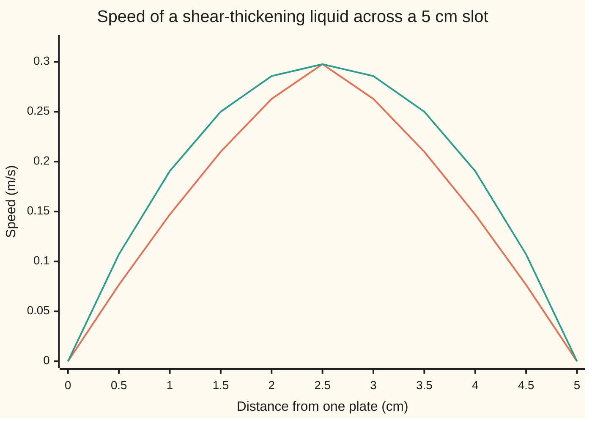
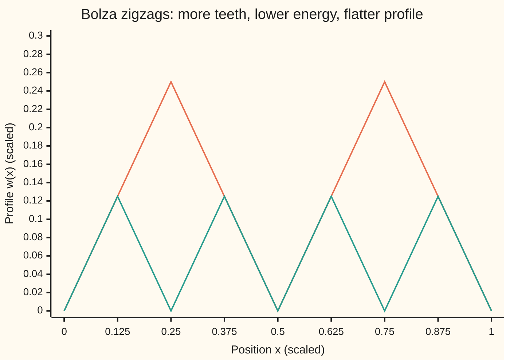

# The direct method: minimise, take a weak limit, and check the energy cannot jump up

[Syllabus](../../../SYLLABUS.md) → [Partial differential equations](../README.md) → [Nonlinear PDE and Fluids](../README.md#s07) → The direct method

---

## General Overview

The shelf's house example is water at 1 m/s in a 5 cm pipe. Keep the 5 cm, but change the liquid and the shape. Two flat plates stand 5 cm apart. Between them flows a thick suspension, like cornstarch in water, that gets stiffer the faster it is sheared. A pressure drop of 1600 Pa per metre pushes it along. All the numbers are illustrative.

Water would flow in a parabola. This liquid does not: its internal friction grows with the cube of the shear rate, so its law is nonlinear. Its steady speed profile peaks at **0.2976 m/s** in the middle of the gap, and it carries **8.504 litres per second** through each metre of slot width.

How is that profile found? The liquid settles where one energy is least. For water, [Dirichlet's principle](../04-Laplace%2C%20Poisson%20and%20Potentials/06-dirichlet-principle-and-variational-form.md) proved that the least-energy shape exists and solves Laplace's equation. [Lax-Milgram](../06-Weak%20Solutions%20and%20Free%20Boundaries/03-lax-milgram-and-elliptic-existence.md) did it again for any linear problem with a bounded, coercive form. Neither works here, because this energy is not quadratic. This card proves existence for nonlinear energies.

The tool is the **direct method**. It has three moves.

1. **Minimise.** Take any list of speed profiles whose energies fall toward the least possible value.
2. **Take a weak limit.** Show that the list stays bounded, so a sub-list settles in the weak sense: every averaged measurement of it settles.
3. **Check that the energy cannot jump up.** Show that the limit's energy is no more than the limit of the energies. Then the limit is a minimiser.

The third move needs the energy to be **convex** in the slope: the energy of an average of two slopes is at most the average of their energies. Bolza's energy breaks this, and the card shows what goes wrong. Zigzags drive its energy to 0, but no profile reaches 0.

**If an energy grows fast enough in the slope to bound every profile with bounded energy, lives on a reflexive Sobolev space, and is convex in the slope, then a minimiser exists, and it is a weak solution of the energy's Euler-Lagrange equation.**

**What kind of fact this is:** a theorem (Tonelli's existence theorem in the form used for PDEs), proved on this card in Why it works for the slot and in outline for a general region. The power-law liquid is a model: real suspensions follow a power law only over a limited range of shear rates.

### The picture: the speed across the gap



Orange: the minimiser of this card, $`u(x) = \tfrac34[(\tfrac12)^{4/3} - |x - \tfrac12|^{4/3}]`$ in scaled units. Teal: a parabola with the same 0.2976 m/s peak, the shape water would take. The liquid's profile is more pointed in the middle, where its curvature is infinite, and lower near the plates.

---

## The formula

**The problem.** The unknown is the speed $`u(x)`$, in m/s, at distance $`x`$ across the gap. The region is the gap, $`0 < x < d`$ with $`d`$ = 0.05 m. The data are the push $`F`$ = 1600 Pa/m and the no-slip condition: the liquid does not move at the plates, $`u(0) = u(d) = 0`$.

The liquid is a **power-law fluid** of index 3: its shear stress is $`m\,(u')^3`$, where $`u'`$ is the shear rate in 1/s and $`m`$ = 0.01 Pa s³ is its consistency. Force balance on a thin layer gives $`-(m\,u'^3)' = F`$.

**Scaling.** Measure $`x`$ in units of $`d`$, and speed in units of $`U = (F d^4/m)^{1/3}`$ = 1.0000 m/s. The equation becomes $`-(u'^3)' = 1`$ on $`0 < x < 1`$, with $`u(0) = u(1) = 0`$. Everything below is in these scaled units, and since $`U`$ = 1 m/s, a scaled speed reads directly in m/s.

**The energy.** For any profile $`w`$ that is zero at both ends,

```math
J(w) = \int_0^1 \Big(\tfrac14\,w'(x)^4 - w(x)\Big)\,dx .
```

**Read it aloud:** the energy is the friction cost, a quarter of the fourth power of the slope, minus the work done by the push.

**The space.** Profiles live in $`W^{1,4}_0(0,1)`$: functions zero at both ends whose weak slope (the slope in the integrated sense of [Sobolev spaces](../06-Weak%20Solutions%20and%20Free%20Boundaries/02-sobolev-spaces-for-pdes.md)) has a finite fourth-power integral. Its size is $`\|w'\|_4 = (\int_0^1 w'^4\,dx)^{1/4}`$. This is the $`p = 4`$ case of $`W^{1,p}_0`$, the $`H^1_0`$ of the Sobolev card with the square replaced by the $`p`$-th power.

**The minimiser and its equation.** The minimiser $`u`$ satisfies the **weak form** of the Euler-Lagrange equation:

```math
\int_0^1 u'(x)^3\,v'(x)\,dx = \int_0^1 v(x)\,dx \quad \text{for every } v \in W^{1,4}_0(0,1), \qquad \text{the weak form of } -\big(u'^3\big)' = 1 .
```

**Read it aloud:** for every allowed nudge $`v`$, the friction's response to the nudge balances the push's work on it.

The operator $`(|u'|^{p-2}u')'`$ is the **p-Laplacian**; at $`p = 2`$ it is the ordinary second derivative, and here $`p = 4`$. The unique solution is

```math
u(x) = \tfrac34\Big[\big(\tfrac12\big)^{4/3} - \big|x - \tfrac12\big|^{4/3}\Big], \qquad u\big(\tfrac12\big) = 0.297638, \qquad J(u) = -\tfrac{9}{28}\big(\tfrac12\big)^{4/3} = -0.127559 .
```

**Bolza's energy**, the counterexample, on the same space:

```math
B(w) = \int_0^1 \Big[\big(w'(x)^2 - 1\big)^2 + w(x)^2\Big]\,dx .
```

**Read it aloud:** a cost for any slope other than plus or minus 1, plus a cost for being away from zero.

| Symbol | Plain meaning | In our example | Push it up and the answer… |
| --- | --- | --- | --- |
| $`x`$ | position across the gap, scaled by $`d`$ | 0 to 1 | — |
| $`u(x)`$, $`u'`$; $`c`$ | speed, scaled by $`U`$; its slope, the shear rate; the flux $`u'^3`$ at $`x = 0`$, in $`u'^3 = c - x`$ | peak 0.297638; $`u'(0)`$ = 0.793701; $`c = \tfrac12`$ | — |
| $`d`$; $`F`$ | width of the gap; push: pressure drop per metre | 0.05 m; 1600 Pa/m | peak grows as $`d^{4/3}`$ and as $`F^{1/3}`$: 0.7500 m/s at 10 cm, 0.3750 m/s at 3200 Pa/m |
| $`m`$; $`U`$ | the liquid's consistency; the speed scale $`(F d^4/m)^{1/3}`$ | 0.01 Pa s³; 1.0000 m/s | stiffer liquid, slower flow |
| $`J(w)`$; $`J_*`$ | energy of profile $`w`$; its least value | $`J_*`$ = −0.127559 | — |
| $`\xi`$; $`t`$ | a slope value; the size $`\Vert w'\Vert_4`$ of a profile's slope | $`t`$ = 0.64219 for the minimiser | — |
| $`p`$ | power of the slope in the energy | 4 | $`p = 1`$ loses reflexivity; $`p = 2`$ is linear |
| $`u_k`$; $`g`$ | the $`k`$-th profile in a minimising list; a measurement weight | Newton steps from a parabola; $`g = u'^3`$ | — |
| $`v`$; $`s`$ | a test nudge, zero at both ends; its amount | $`\sin(\pi x)`$, $`s = \pm 0.1`$ | — |
| $`B(w)`$; $`n`$ | Bolza's energy; number of zigzag teeth | $`B = 1/(12n^2)`$ | more teeth, lower energy, never 0 |
| $`\Omega`$; $`L(x, z, \xi)`$; $`\alpha`$, $`\beta`$; $`A`$, $`\varphi`$ | in the fold: a bounded region, of size $`\lvert\Omega\rvert`$ and boundary $`\partial\Omega`$; a general integrand of position, value $`z`$ and slope $`\xi`$; the coercivity constants; a constant slope matrix, and a smooth wiggle zero on $`\partial\Omega`$ | $`\Omega = (0, 1)`$, $`L = \tfrac14\xi^4 - z`$ | — |
| $`h`$, $`N`$ | grid step $`1/N`$ and number of grid cells | $`N`$ = 16, 32, 64 | finer grid, closer peak |

### When it holds

- **Coercive: the energy controls the size.** Here $`J(w) \ge \tfrac14 t^4 - t`$ with $`t = \|w'\|_4`$, so the energy is at least −0.7500 and $`J(w) \le 0`$ forces $`t \le`$ 1.5874. Drop the fixed ends and a constant profile $`w = 10`$ has energy −10.0000: the energy falls without end.
- **Reflexive space: $`1 < p < \infty`$.** Then bounded lists have weakly settling sub-lists. At $`p = 1`$, an energy like $`\int (|w'| + w^2)`$ with $`w(0) = 0`$, $`w(1) = 1`$ can be pushed to 1.000333 by a steep ramp at the end, but the value 1 needs a jump, which no $`W^{1,1}`$ function has.
- **Convex in the slope.** $`\tfrac14\xi^4`$ is convex. Bolza's $`(\xi^2 - 1)^2`$ is not: at slope 0 it is 1, but the average of its values at slopes +1 and −1 is 0. Zigzags exploit the gap, and no minimiser exists.
- **The integrand is smooth with controlled growth in the slope.** Then the minimiser is a weak solution of its Euler-Lagrange equation. Without growth control the derivative of $`J`$ may not exist.
- **Strictly convex: one minimiser.** $`\tfrac14\xi^4`$ is strictly convex, so the minimiser is unique. A convex but flat integrand can have many minimisers.

---

## Why it works

### Step 0: the idea

A continuous function on a closed bounded interval attains its least value. The proof takes points whose values fall to the least value, extracts a convergent sub-list, and uses continuity at the limit.

Copy that proof in a space of functions. Two things break. A bounded list of functions need not have a convergent sub-list in the usual sense, so convergence is weakened until it does. Then the energy is no longer continuous for that weak convergence, so continuity is weakened to "the energy cannot jump up". Convexity is exactly what makes that weaker property hold.

### Step 1: minimise, and bound the list (coercivity)

The energy has a floor. A profile zero at $`x = 0`$ satisfies $`|w(x)| \le \int_0^1 |w'|\,dx \le \|w'\|_4`$; the last step is Hölder's inequality on an interval of length 1. So the push's work is at most $`t = \|w'\|_4`$, and

```math
J(w) \ \ge\ \tfrac14\,t^4 - t \ \ge\ -\tfrac34 .
```

**Read it aloud:** friction grows like the fourth power of the slope, the push's work only like the first power, so the energy has a floor at −0.75.

So the least value $`J_* = \inf J`$ is a real number. Take a **minimising sequence**: profiles $`u_1, u_2, \ldots`$ with $`J(u_k) \to J_*`$. After the first few, $`J(u_k) \le J(0) = 0`$. Then $`\tfrac14 t^4 \le t`$, so $`\|u_k'\|_4 \le 4^{1/3}`$ = 1.5874. The list is bounded. This is **coercivity**: bounded energy forces bounded size.

On a general region $`\Omega`$ in several dimensions, the Poincaré inequality from [Sobolev spaces](../06-Weak%20Solutions%20and%20Free%20Boundaries/02-sobolev-spaces-for-pdes.md) plays the part of the bound $`|w| \le \|w'\|_4`$.

### Step 2: take a weak limit (compactness)

$`W^{1,4}_0`$ is **reflexive**: it equals the dual of its own dual, as [Reflexive spaces](../../18-Functional%20analysis/01-Normed%20and%20Banach%20Spaces/10-reflexive-spaces-and-the-second-dual.md) defines. That card proves the key consequence: every bounded list has a sub-list that converges **weakly**. Weak convergence means that every measurement settles: $`\int u_k'\,g \to \int u'\,g`$ for every $`g`$ with $`\int |g|^{4/3} < \infty`$ ([Weak convergence](../../18-Functional%20analysis/02-Hilbert%20Spaces/09-weak-convergence-and-banach-alaoglu.md)). The sizes need not settle.

The profiles themselves converge in the ordinary sense, too. Hölder's inequality gives $`|u_k(x) - u_k(y)| \le 1.5874\,|x - y|^{3/4}`$ for every $`k`$. So the list is equally continuous, and a sub-list converges uniformly. In more dimensions this is Rellich's theorem ([Boundary values and compactness](../../18-Functional%20analysis/04-Distributions%20and%20Sobolev%20Spaces/10-trace-and-rellich-kondrachov-in-outline.md)). The limit $`u`$ is still zero at both ends.

### Step 3: the energy cannot jump up (weak lower semicontinuity)

A convex function lies above each of its tangent lines ([Convex functions](../../15-Optimization/01-Convexity/03-convex-functions-and-their-tests.md)). For $`\tfrac14\xi^4`$, whose slope is $`\xi^3`$, that reads $`\tfrac14 a^4 \ge \tfrac14 b^4 + b^3(a - b)`$. Put $`a = u_k'(x)`$, $`b = u'(x)`$ and integrate:

```math
\int_0^1 \tfrac14 u_k'^4\,dx \ \ge\ \int_0^1 \tfrac14 u'^4\,dx + \int_0^1 u'^3\,(u_k' - u')\,dx .
```

The last integral is a measurement of $`u_k' - u'`$ against $`g = u'^3`$, which has $`\int |g|^{4/3} = \int u'^4 < \infty`$. Weak convergence sends it to 0. The push's work $`\int u_k`$ tends to $`\int u`$ by uniform convergence. So

```math
J(u) \ \le\ \liminf_{k\to\infty} J(u_k) = J_* .
```

**Read it aloud:** the limit's energy is at most the lowest value the list's energies keep returning to, which is the least value.

This property is **weak lower semicontinuity**. Since $`J(u) \ge J_*`$ by definition, $`J(u) = J_*`$: the limit is a minimiser.

The energy may drop in a weak limit. Add zigzag wiggles of slope ±0.5 to the minimiser, with 4, 16 and 64 teeth. The wiggles shrink to nothing, so the list converges weakly to $`u`$. Its energies are 0.038430, 0.032310 and 0.030488, settling at 0.029807. The limit's energy, −0.127559, is far lower. Convexity allows this drop and forbids a rise.

<details>
<summary>The general theorem, and where Morrey's condition enters</summary>

Let $`\Omega`$ be a bounded region, $`1 < p < \infty`$, and $`J(w) = \int_\Omega L(x, w, \nabla w)\,dx`$ on $`W^{1,p}_0(\Omega)`$ for scalar $`w`$. Suppose:

1. **Coercive:** $`L(x, z, \xi) \ge \alpha|\xi|^p - \beta`$ with $`\alpha > 0`$.
2. **Convex** in $`\xi`$ for each fixed $`x`$ and $`z`$, and $`L`$ bounded below and continuous.

Then $`J`$ has a minimiser (Evans, section 8.2).

The proof follows Steps 1 to 3. The general lower semicontinuity step uses Rellich's theorem to make $`u_k \to u`$ strongly in $`L^p`$, then Egorov's theorem to make the convergence uniform away from a small set. On the rest, the tangent-line inequality applies with $`\nabla u_k`$ and $`\nabla u`$, just as in Step 3.

For vector-valued $`w`$, such as the displacement of an elastic body, convexity is too strong to hold for real materials. Morrey (1952) found the exact condition, **quasiconvexity**: the energy of a constant slope matrix $`A`$ is never beaten by wiggling around it,

$`\displaystyle \int_{\Omega} L(A + \nabla\varphi)\,dx \ \ge\ |\Omega|\,L(A) \quad \text{for every smooth } \varphi \text{ zero on } \partial\Omega .`$

Ball (1976) proved existence for rubber-like materials through polyconvexity, a stronger but checkable form.

</details>

### Step 4: Bolza's energy, where Step 3 fails

Bolza's integrand $`(\xi^2 - 1)^2`$ is not convex. Its tangent line at slope 0 is the constant 1, but the integrand is 0 at slopes ±1, below that line.

Take a zigzag with $`n`$ teeth: slope +1 then −1, each for $`1/(2n)`$, height $`1/(2n)`$. Its slope term is 0 everywhere. Its $`w^2`$ term integrates to $`1/(12n^2)`$:

| teeth $`n`$ | $`B`$ by quadrature | $`B = 1/(12n^2)`$ | measurement $`\int w'\,x\,dx`$ |
| --- | --- | --- | --- |
| 1 | 8.333e-02 | 8.333e-02 | −0.2500 |
| 10 | 8.333e-04 | 8.333e-04 | −0.0250 |
| 100 | 8.333e-06 | 8.333e-06 | −0.0025 |

So the least value is 0. But $`B(w) = 0`$ needs $`w = 0`$ everywhere and $`|w'| = 1`$ almost everywhere, which contradict each other. No minimiser exists.

The zigzags are a perfectly good minimising list. They are bounded, $`\|w'\|_4 = 1`$. They converge weakly to $`w = 0`$: the measurement in the last column falls to 0. The slopes flip between +1 and −1 ever faster and average to 0. So Steps 1 and 2 work. Step 3 fails: $`B(0)`$ = 1.0000, far above the limit of the energies, 0. The energy jumped up.



Orange: the zigzag with 2 teeth. Teal: 4 teeth. Each doubling of the teeth halves the height and divides the energy by 4. The list flattens toward $`w = 0`$, whose energy is 1.

The repair is **relaxation**: replace the integrand by its convex envelope, the largest convex function below it. For Bolza that is $`((\xi^2 - 1)_+)^2`$, which is 0 for $`|\xi| \le 1`$; its value at slope 0 is 0.0000. The relaxed energy is convex, its minimiser is $`w = 0`$ with energy 0, and that is exactly where the zigzags go.

### Step 5: the minimiser solves the equation, weakly

Nudge the minimiser by an amount $`s`$: $`j(s) = J(u + s\,v)`$ for a test nudge $`v`$ in $`W^{1,4}_0`$. Then $`j`$ is least at $`s = 0`$, so $`j'(0) = 0`$. Differentiating under the integral gives the weak form in The formula. This is the argument of [The Euler-Lagrange equation](../../08-Differential%20equations%20and%20dynamics/12-Calculus%20of%20Variations%20and%20Optimal%20Control/01-functionals-and-the-euler-lagrange-equation.md), now applied to a function that is only known to lie in a Sobolev space.

Solve it. The weak form says $`u'^3`$ has weak slope −1, so $`u'^3 = c - x`$. The ends give $`\int_0^1 u'\,dx = 0`$, and the cube root is odd and increasing, so $`c = \tfrac12`$. Then $`u' = (\tfrac12 - x)^{1/3}`$, the slope at the plates is $`(\tfrac12)^{1/3}`$ = 0.793701, and integrating gives the formula for $`u`$.

**Unique.** If $`u_1`$ and $`u_2`$ were two minimisers with different slopes, their average would have strictly lower energy, because $`\tfrac14\xi^4`$ is strictly convex. So the minimiser is unique.

**Weak, not classical.** $`u'^3 = \tfrac12 - x`$ is smooth, but $`u'' = -\tfrac13|x - \tfrac12|^{-2/3}`$. It is −7.181 at 0.01 from the middle and −154.720 at 0.0001, and infinite at the middle. So $`u`$ has no second derivative at $`x = \tfrac12`$, and the equation $`-(u'^3)' = 1`$ holds for the flux $`u'^3`$, not term by term. For the p-Laplacian, the best general smoothness is a Hölder-continuous slope (results of Uraltseva, DiBenedetto and Lewis); for $`p = 2`$, [Elliptic regularity](../06-Weak%20Solutions%20and%20Free%20Boundaries/05-elliptic-regularity-in-outline.md) gives more, and [De Giorgi-Nash-Moser](../06-Weak%20Solutions%20and%20Free%20Boundaries/15-de-giorgi-nash-moser.md) gives Hölder continuity even with rough coefficients.

**Bolza's Euler-Lagrange equation is not enough.** $`w = 0`$ solves it, with energy 1.0000. A solution of the Euler-Lagrange equation is a candidate, not a proof of least energy. Convexity turns the candidate into the minimiser.

---

## Worked numbers, by hand

| Step | Arithmetic | Value |
| --- | --- | --- |
| speed scale | $`(1600 \times 0.05^4 / 0.01)^{1/3}`$ | $`U`$ = 1.0000 m/s |
| slope at the plates | $`u'(0)^3 = \tfrac12`$ | 0.793701 |
| a power that appears three times | $`(\tfrac12)^{4/3}`$ | 0.396850 |
| peak speed | $`0.75 \times 0.396850`$ | 0.297638, so 0.2976 m/s |
| area under the profile | $`\tfrac37 \times 0.396850`$ | 0.170079 |
| flow per metre of slot width | $`0.170079 \times 0.05 \text{ m} \times 1 \text{ m/s}`$ | 8.504 L/s |
| least energy | $`-\tfrac{9}{28} \times 0.396850`$ | −0.127559 |
| size of the slope | $`0.170079^{1/4}`$, below the bound 1.5874 | 0.64219 |
| **answer** | peak speed of the minimiser | **0.2976 m/s at mid-gap** |

The liquid moves fastest in the middle, at 0.2976 m/s. The direct method guarantees a least-energy profile exists, and strict convexity makes this one the only one.

### What breaks if you drop a piece

| Mistake | Comes out at | What went wrong |
| --- | --- | --- |
| Drop the fixed ends (no coercivity) | $`J(\text{constant } 10)`$ = −10.0000, and lower for larger constants | the energy has no floor, so there is no least value |
| Let slopes cost only $`\lvert w'\rvert`$ ($`p = 1`$, not reflexive) | 1.033333, 1.003333, 1.000333 for ramps of width 0.1, 0.01, 0.001 | the least value 1 needs a jump at $`x = 1`$, outside $`W^{1,1}`$ |
| Drop convexity (Bolza) | 8.333e-02, 8.333e-04, 8.333e-06 for 1, 10, 100 teeth | the weak limit $`w = 0`$ has energy 1.0000: the energy jumped up |
| Trust the Euler-Lagrange equation alone (Bolza) | $`w = 0`$ solves it, with energy 1.0000 | a zigzag with 10 teeth has 8.333e-04 |

The code prints all four.

---

## Code, from first principles, and it actually runs

The script reaches the minimiser by three roads. Road 1 is the closed form, checked against Simpson's rule for its area and energy. Road 2 is the direct method itself on a grid of $`N`$ cells: Newton steps on the grid energy, each step halved until the energy does not rise, solved with a tridiagonal (Thomas) elimination written out. Its result is checked against the grid's own Euler-Lagrange equation solved by hand. The grid peaks at $`N`$ = 16, 32 and 64 approach 0.297638 with observed order about 1.3, not 2, because of the cusp at the middle. Road 3 checks the Euler-Lagrange equation weakly against two test nudges and by centred differences, and checks that two rivals cost more. The code also measures the wiggled lists, Bolza's zigzags, the $`p = 1`$ ramps and the missing ends. No integrator, solver or minimiser is imported.

### Python

```python
# The direct method -- the check behind the card.  Standard library only.
# A shear-thickening liquid (power-law index 3) flows between two plates 5 cm
# apart, pushed by 1600 Pa/m; consistency 0.01 Pa s^3 (illustrative).  Scaled
# (x by the gap, u by the speed scale) the flow minimises
# J(u) = int_0^1 (u'^4/4 - u) dx with u(0) = u(1) = 0.  Then Bolza's energy
# B(u) = int_0^1 ((u'^2 - 1)^2 + u^2) dx, which has no minimiser.
import math

def cbrt(t): return math.copysign(abs(t) ** (1.0 / 3.0), t)
def sci(v):                                   # 1.234e-05 in both languages
    if v == 0: return "0.000e+00"
    e = math.floor(math.log10(abs(v))); m = v / 10 ** e
    if abs(m) >= 9.9995: m, e = m / 10, e + 1
    return f"{m:.3f}e{'-' if e < 0 else '+'}{abs(e):02d}"
def simpson(f, a, b, n=2000):
    h = (b - a) / n; s = f(a) + f(b)
    for i in range(1, n): s += (4 if i % 2 else 2) * f(a + i * h)
    return s * h / 3

D, MC, F = 0.05, 0.01, 1600.0                 # gap m, consistency Pa s^3, push Pa/m
U = (F * D ** 4 / MC) ** (1 / 3)              # speed scale, m/s
C = 2 ** (-4 / 3)
def u(x): return 0.75 * (C - abs(x - 0.5) ** (4 / 3))
def up(x): return cbrt(0.5 - x)                # u' ; u'^3 = 1/2 - x
peak, area, jmin = 0.75 * C, 3 / 7 * C, -9 / 28 * C
print(f"speed scale U = {U:.4f} m/s; peak {peak:.6f} -> {peak * U:.4f} m/s at mid-gap")
print(f"(1/2)^(4/3) = {C:.6f}; slope at the plates u'(0) = {up(0):.6f}; int u'^2 = {1.2 * 2 ** (-5 / 3):.6f}")
q4 = simpson(lambda x: up(x) ** 4, 0, 0.5) * 2
qa = simpson(u, 0, 0.5) * 2
print(f"int u = {area:.6f} (quadrature {qa:.6f}); int u'^4 = {q4:.6f}; flow {area * D * U * 1000:.3f} L/s per m")
print(f"J(min) = {jmin:.6f} (quadrature {q4 / 4 - qa:.6f}); norm of u' in L^4 = {area ** 0.25:.5f}")
assert abs(qa - area) < 1e-9 and abs(q4 - area) < 1e-6 and abs(q4 / 4 - qa - jmin) < 1e-6
print(f"coercivity: J >= t^4/4 - t >= {-0.75:.4f}; J <= 0 forces t <= {4 ** (1 / 3):.4f}")
assert q4 ** 0.25 <= 4 ** (1 / 3) and q4 / 4 - qa >= -0.75

# Road 2: the direct method on a grid -- Newton steps that only ever lower the energy.
def energy(v, h): return sum(h * ((v[i + 1] - v[i]) / h) ** 4 / 4 - h * v[i + 1] for i in range(len(v) - 1))
def grid(N):
    h = 1 / N; v = [(i * h) * (1 - i * h) for i in range(N + 1)]; hist = [energy(v, h)]
    for it in range(200):
        s = [(v[i + 1] - v[i]) / h for i in range(N)]
        g = [s[j - 1] ** 3 - s[j] ** 3 - h for j in range(1, N)]
        a = [3 * (s[j - 1] ** 2 + s[j] ** 2) / h for j in range(1, N)]
        b = [-3 * s[j] ** 2 / h for j in range(1, N - 1)]
        cp, dp = [0.0] * (N - 1), [0.0] * (N - 1)        # Thomas solve of H d = g
        for j in range(N - 1):
            den = a[j] - (b[j - 1] * cp[j - 1] if j else 0)
            cp[j] = b[j] / den if j < N - 2 else 0
            dp[j] = (g[j] - (b[j - 1] * dp[j - 1] if j else 0)) / den
        d = dp[:]
        for j in range(N - 3, -1, -1): d[j] -= cp[j] * d[j + 1]
        t, e0 = 1.0, hist[-1]
        while True:
            w = [0.0] + [v[j + 1] - t * d[j] for j in range(N - 1)] + [0.0]
            if energy(w, h) <= e0 or t < 1e-12: break
            t /= 2
        v = w; hist.append(energy(v, h))
        assert hist[-1] <= hist[-2] + 1e-15            # the energy never rises
        if max(abs(x) for x in d) * t < 1e-13: break
    return v, hist
def exact_grid(N):                             # discrete Euler-Lagrange, solved by hand
    h = 1 / N; v = [0.0]
    for i in range(N): v.append(v[-1] + h * cbrt(0.5 - (i + 0.5) * h))
    return v
v16, hist = grid(16)
print("grid N=16, energy by Newton step:", " ".join(f"{e:.6f}" for e in hist[:7]), f"... {len(hist) - 1} steps")
errs = []
for N in (16, 32, 64):
    v, _ = grid(N); ve = exact_grid(N)
    gap = max(abs(p - q) for p, q in zip(v, ve)); errs.append(abs(v[N // 2] - peak))
    print(f"grid N={N}: peak {v[N // 2]:.6f}, energy {energy(v, 1 / N):.6f}, peak error {sci(errs[-1])}, Newton = exact grid to 1e-12")
    assert gap < 1e-12 and errs[-1] < 0.01
print(f"observed order: {math.log2(errs[0] / errs[1]):.3f}, {math.log2(errs[1] / errs[2]):.3f}")
assert errs[2] < errs[1] < errs[0]

# Road 3: the Euler-Lagrange equation, weakly and by differences, and rivals cost more.
for k in (1, 3):
    v = lambda x: math.sin(k * math.pi * x); dv = lambda x: k * math.pi * math.cos(k * math.pi * x)
    r = simpson(lambda x: up(x) ** 3 * dv(x) - v(x), 0, 0.5) + simpson(lambda x: up(x) ** 3 * dv(x) - v(x), 0.5, 1)
    print(f"weak form with v = sin({k} pi x): |int (u'^3 v' - v)| below 1e-10")
    assert abs(r) < 1e-10
for hd in (0.01, 0.005):
    x = 0.25; fl = lambda y: ((u(y + hd / 2) - u(y - hd / 2)) / hd) ** 3
    res = -(fl(x + hd / 2) - fl(x - hd / 2)) / hd - 1
    print(f"-(u'^3)' - 1 at x = 0.25 by differences, step {hd}: {sci(res)}")
    assert abs(res) < 1e-3
def J(f, df): return simpson(lambda x: df(x) ** 4 / 4 - f(x), 0, 0.5) + simpson(lambda x: df(x) ** 4 / 4 - f(x), 0.5, 1)
for t in (0.1, -0.1):
    gp = J(lambda x: u(x) + t * math.sin(math.pi * x), lambda x: up(x) + t * math.pi * math.cos(math.pi * x)) - jmin
    print(f"rival u + ({t:+.1f}) sin(pi x): energy higher by {gp:.6f}")
    assert gp > 0
for dd in (0.01, 0.0001):                      # u'' = -(1/3)|x - 1/2|^(-2/3) blows up at the middle
    fd = (up(0.5 - dd + dd / 100) - up(0.5 - dd - dd / 100)) / (dd / 50)
    print(f"u'' at {dd} from the middle: {fd:.3f} by differences, {-(dd ** (-2 / 3)) / 3:.3f} by formula")
    assert abs(fd + dd ** (-2 / 3) / 3) < 1e-3 * dd ** (-2 / 3)

# Weak lower semicontinuity: wiggles of slope +-0.5 shrink to nothing, energy drops.
A = 0.5
lim = jmin + 1.5 * A * A * 1.2 * 2 ** (-5 / 3) + A ** 4 / 4
for n in (4, 16, 64):
    tot = 0.0
    for i in range(2 * n):                     # exact: int_a^b u'^k = 3/(k+3) (u'(a)^(k+3) - u'(b)^(k+3))
        a0, b0, sg = i / (2 * n), (i + 1) / (2 * n), 1 if i % 2 == 0 else -1
        I = [3 / (k + 3) * (up(a0) ** (k + 3) - up(b0) ** (k + 3)) for k in range(5)]  # u = (3/4)(C - u'^4)
        tot += sum(math.comb(4, k) * (sg * A) ** (4 - k) * I[k] for k in range(5)) / 4 - 0.75 * (C * I[0] - I[4]) - A * I[0] ** 2 / 2
    print(f"u + zigzag, slope +-{A}, {n} teeth: energy {tot:.6f}")
print(f"limit of those energies {lim:.6f} >= energy of the limit {jmin:.6f}")
assert abs(tot - lim) < 0.01 * A and tot > jmin

# Bolza: zigzags of slope +-1 and n teeth; B = 1/(12 n^2) -> 0, never reached.
def bolza(s, w): return (s * s - 1) ** 2 + w * w
for n in (1, 10, 100):
    bq = sum(simpson(lambda x: bolza(1.0, x - i / (2 * n) if i % 2 == 0 else (i + 1) / (2 * n) - x),
                     i / (2 * n), (i + 1) / (2 * n), 2) for i in range(2 * n))
    print(f"Bolza zigzag n={n}: B = {sci(bq)} (formula {sci(1 / (12 * n * n))}); measurement int u' x dx = {-1 / (4 * n):.4f}")
    assert abs(bq - 1 / (12 * n * n)) < 1e-12
print(f"Bolza at the limit u = 0: B = {simpson(lambda x: bolza(0.0, 0.0), 0, 1):.4f}; convexified integrand at slope 0: {max(0.0, 0.0 - 1) ** 2:.4f}")
for e in (0.1, 0.01, 0.001):                    # slopes cost only |u'|: ramp of width e to u(1) = 1
    r = simpson(lambda x: 1 / e + ((x - 1 + e) / e) ** 2, 1 - e, 1, 2)
    print(f"p = 1, int (|u'| + u^2), ramp width {e}: {r:.6f} (formula {1 + e / 3:.6f})")
    assert abs(r - 1 - e / 3) < 1e-12
print(f"no fixed ends, J(constant 10) = {simpson(lambda x: 0.0 ** 4 / 4 - 10.0, 0, 1):.4f}")
pk = lambda f, d: 0.75 * C * (f * d ** 4 / MC) ** (1 / 3)
print(f"try: push 3200 Pa/m -> peak {pk(3200, D):.4f} m/s; gap 10 cm -> peak {pk(F, 0.1):.4f} m/s;"
      f" grid N=128 peak error {sci(abs(grid(128)[0][64] - peak))}; wiggle slope 1 -> limit {jmin + 1.5 * 1.2 * 2 ** (-5 / 3) + 0.25:.6f}")
print("chart, minimiser:", " ".join(f"{u(i / 10):.4f}" for i in range(11)))
print("chart, parabola of equal peak:", " ".join(f"{4 * peak * (i / 10) * (1 - i / 10):.4f}" for i in range(11)))
print("chart, zigzag n=2:", " ".join(f"{min(i % 4, 4 - i % 4) / 8:.4f}" for i in range(9)))
print("chart, zigzag n=4:", " ".join(f"{(i % 2) / 8:.4f}" for i in range(9)))
print("ALL CHECKS PASS")
```

**Ran 2026-11-24 on macOS, Python 3.14.10, standard library only. All checks passed. Output, pasted from the run:**

```
speed scale U = 1.0000 m/s; peak 0.297638 -> 0.2976 m/s at mid-gap
(1/2)^(4/3) = 0.396850; slope at the plates u'(0) = 0.793701; int u'^2 = 0.377976
int u = 0.170079 (quadrature 0.170079); int u'^4 = 0.170079; flow 8.504 L/s per m
J(min) = -0.127559 (quadrature -0.127559); norm of u' in L^4 = 0.64219
coercivity: J >= t^4/4 - t >= -0.7500; J <= 0 forces t <= 1.5874
grid N=16, energy by Newton step: -0.116665 -0.120478 -0.126076 -0.127331 -0.127357 -0.127357 -0.127357 ... 8 steps
grid N=16: peak 0.298971, energy -0.127357, peak error 1.333e-03, Newton = exact grid to 1e-12
grid N=32: peak 0.298179, energy -0.127506, peak error 5.417e-04, Newton = exact grid to 1e-12
grid N=64: peak 0.297856, energy -0.127545, peak error 2.181e-04, Newton = exact grid to 1e-12
observed order: 1.299, 1.312
weak form with v = sin(1 pi x): |int (u'^3 v' - v)| below 1e-10
weak form with v = sin(3 pi x): |int (u'^3 v' - v)| below 1e-10
-(u'^3)' - 1 at x = 0.25 by differences, step 0.01: 4.447e-05
-(u'^3)' - 1 at x = 0.25 by differences, step 0.005: 1.111e-05
rival u + (+0.1) sin(pi x): energy higher by 0.046739
rival u + (-0.1) sin(pi x): energy higher by 0.027973
u'' at 0.01 from the middle: -7.182 by differences, -7.181 by formula
u'' at 0.0001 from the middle: -154.722 by differences, -154.720 by formula
u + zigzag, slope +-0.5, 4 teeth: energy 0.038430
u + zigzag, slope +-0.5, 16 teeth: energy 0.032310
u + zigzag, slope +-0.5, 64 teeth: energy 0.030488
limit of those energies 0.029807 >= energy of the limit -0.127559
Bolza zigzag n=1: B = 8.333e-02 (formula 8.333e-02); measurement int u' x dx = -0.2500
Bolza zigzag n=10: B = 8.333e-04 (formula 8.333e-04); measurement int u' x dx = -0.0250
Bolza zigzag n=100: B = 8.333e-06 (formula 8.333e-06); measurement int u' x dx = -0.0025
Bolza at the limit u = 0: B = 1.0000; convexified integrand at slope 0: 0.0000
p = 1, int (|u'| + u^2), ramp width 0.1: 1.033333 (formula 1.033333)
p = 1, int (|u'| + u^2), ramp width 0.01: 1.003333 (formula 1.003333)
p = 1, int (|u'| + u^2), ramp width 0.001: 1.000333 (formula 1.000333)
no fixed ends, J(constant 10) = -10.0000
try: push 3200 Pa/m -> peak 0.3750 m/s; gap 10 cm -> peak 0.7500 m/s; grid N=128 peak error 8.735e-05; wiggle slope 1 -> limit 0.689405
chart, minimiser: 0.0000 0.0766 0.1470 0.2099 0.2628 0.2976 0.2628 0.2099 0.1470 0.0766 0.0000
chart, parabola of equal peak: 0.0000 0.1071 0.1905 0.2500 0.2857 0.2976 0.2857 0.2500 0.1905 0.1071 0.0000
chart, zigzag n=2: 0.0000 0.1250 0.2500 0.1250 0.0000 0.1250 0.2500 0.1250 0.0000
chart, zigzag n=4: 0.0000 0.1250 0.0000 0.1250 0.0000 0.1250 0.0000 0.1250 0.0000
ALL CHECKS PASS
```

### Rust

```rust
// The direct method -- the check behind the card.  std only, no crates.
// A shear-thickening liquid (power-law index 3) flows between two plates 5 cm
// apart, pushed by 1600 Pa/m; consistency 0.01 Pa s^3 (illustrative).  Scaled
// (x by the gap, u by the speed scale) the flow minimises
// J(u) = int_0^1 (u'^4/4 - u) dx with u(0) = u(1) = 0.  Then Bolza's energy
// B(u) = int_0^1 ((u'^2 - 1)^2 + u^2) dx, which has no minimiser.
use std::f64::consts::PI;

fn cbrt(t: f64) -> f64 { t.abs().powf(1.0 / 3.0).copysign(t) }
fn sci(v: f64) -> String { // 1.234e-05 in both languages
    if v == 0.0 { return "0.000e+00".to_string(); }
    let mut e = v.abs().log10().floor() as i32;
    let mut m = v / 10f64.powf(e as f64);
    if m.abs() >= 9.9995 { m /= 10.0; e += 1; }
    format!("{:.3}e{}{:02}", m, if e < 0 { "-" } else { "+" }, e.abs())
}
fn simpson(f: &dyn Fn(f64) -> f64, a: f64, b: f64, n: usize) -> f64 {
    let h = (b - a) / n as f64;
    let mut s = f(a) + f(b);
    for i in 1..n { s += (if i % 2 == 1 { 4.0 } else { 2.0 }) * f(a + i as f64 * h); }
    s * h / 3.0
}
fn cc() -> f64 { 2f64.powf(-4.0 / 3.0) }
fn u(x: f64) -> f64 { 0.75 * (cc() - (x - 0.5).abs().powf(4.0 / 3.0)) }
fn up(x: f64) -> f64 { cbrt(0.5 - x) } // u' ; u'^3 = 1/2 - x
fn energy(v: &[f64], h: f64) -> f64 {
    let mut s = 0.0;
    for i in 0..v.len() - 1 { s += h * ((v[i + 1] - v[i]) / h).powf(4.0) / 4.0 - h * v[i + 1]; }
    s
}
fn grid(n: usize) -> (Vec<f64>, Vec<f64>) { // direct method: Newton steps that only lower the energy
    let h = 1.0 / n as f64;
    let mut v: Vec<f64> = (0..=n).map(|i| (i as f64 * h) * (1.0 - i as f64 * h)).collect();
    let mut hist = vec![energy(&v, h)];
    for _ in 0..200 {
        let s: Vec<f64> = (0..n).map(|i| (v[i + 1] - v[i]) / h).collect();
        let g: Vec<f64> = (1..n).map(|j| s[j - 1].powf(3.0) - s[j].powf(3.0) - h).collect();
        let a: Vec<f64> = (1..n).map(|j| 3.0 * (s[j - 1].powf(2.0) + s[j].powf(2.0)) / h).collect();
        let b: Vec<f64> = (1..n - 1).map(|j| -3.0 * s[j].powf(2.0) / h).collect();
        let (mut cp, mut dp) = (vec![0.0; n - 1], vec![0.0; n - 1]); // Thomas solve of H d = g
        for j in 0..n - 1 {
            let den = a[j] - if j > 0 { b[j - 1] * cp[j - 1] } else { 0.0 };
            cp[j] = if j < n - 2 { b[j] / den } else { 0.0 };
            dp[j] = (g[j] - if j > 0 { b[j - 1] * dp[j - 1] } else { 0.0 }) / den;
        }
        let mut d = dp.clone();
        for j in (0..n - 2).rev() { d[j] -= cp[j] * d[j + 1]; }
        let (mut t, e0) = (1.0, *hist.last().unwrap());
        let mut w;
        loop {
            w = vec![0.0];
            for j in 0..n - 1 { w.push(v[j + 1] - t * d[j]); }
            w.push(0.0);
            if energy(&w, h) <= e0 || t < 1e-12 { break; }
            t /= 2.0;
        }
        v = w;
        hist.push(energy(&v, h));
        assert!(hist[hist.len() - 1] <= hist[hist.len() - 2] + 1e-15); // the energy never rises
        if d.iter().fold(0.0f64, |m, x| m.max(x.abs())) * t < 1e-13 { break; }
    }
    (v, hist)
}
fn exact_grid(n: usize) -> Vec<f64> { // discrete Euler-Lagrange, solved by hand
    let h = 1.0 / n as f64;
    let mut v = vec![0.0];
    for i in 0..n { let last = v[v.len() - 1]; v.push(last + h * cbrt(0.5 - (i as f64 + 0.5) * h)); }
    v
}
fn bolza(s: f64, w: f64) -> f64 { (s * s - 1.0).powf(2.0) + w * w }
fn line(v: Vec<f64>) -> String { v.iter().map(|x| format!("{:.4}", x)).collect::<Vec<_>>().join(" ") }

fn main() {
    let (dg, mc, f) = (0.05f64, 0.01f64, 1600.0f64); // gap m, consistency Pa s^3, push Pa/m
    let uu = (f * dg.powf(4.0) / mc).powf(1.0 / 3.0); // speed scale, m/s
    let c = cc();
    let (peak, area, jmin) = (0.75 * c, 3.0 / 7.0 * c, -9.0 / 28.0 * c);
    println!("speed scale U = {:.4} m/s; peak {:.6} -> {:.4} m/s at mid-gap", uu, peak, peak * uu);
    println!("(1/2)^(4/3) = {:.6}; slope at the plates u'(0) = {:.6}; int u'^2 = {:.6}", c, up(0.0), 1.2 * 2f64.powf(-5.0 / 3.0));
    let q4 = simpson(&|x| up(x).powf(4.0), 0.0, 0.5, 2000) * 2.0;
    let qa = simpson(&u, 0.0, 0.5, 2000) * 2.0;
    println!("int u = {:.6} (quadrature {:.6}); int u'^4 = {:.6}; flow {:.3} L/s per m", area, qa, q4, area * dg * uu * 1000.0);
    println!("J(min) = {:.6} (quadrature {:.6}); norm of u' in L^4 = {:.5}", jmin, q4 / 4.0 - qa, area.powf(0.25));
    assert!((qa - area).abs() < 1e-9 && (q4 - area).abs() < 1e-6 && (q4 / 4.0 - qa - jmin).abs() < 1e-6);
    println!("coercivity: J >= t^4/4 - t >= {:.4}; J <= 0 forces t <= {:.4}", -0.75, 4f64.powf(1.0 / 3.0));
    assert!(q4.powf(0.25) <= 4f64.powf(1.0 / 3.0) && q4 / 4.0 - qa >= -0.75);

    let (_, hist) = grid(16);
    let first: Vec<String> = hist.iter().take(7).map(|e| format!("{:.6}", e)).collect();
    println!("grid N=16, energy by Newton step: {} ... {} steps", first.join(" "), hist.len() - 1);
    let mut errs = vec![];
    for n in [16usize, 32, 64] {
        let (v, _) = grid(n);
        let ve = exact_grid(n);
        let gap = v.iter().zip(ve.iter()).fold(0.0f64, |m, (p, q)| m.max((p - q).abs()));
        errs.push((v[n / 2] - peak).abs());
        println!("grid N={}: peak {:.6}, energy {:.6}, peak error {}, Newton = exact grid to 1e-12", n, v[n / 2], energy(&v, 1.0 / n as f64), sci(errs[errs.len() - 1]));
        assert!(gap < 1e-12 && errs[errs.len() - 1] < 0.01);
    }
    println!("observed order: {:.3}, {:.3}", (errs[0] / errs[1]).log2(), (errs[1] / errs[2]).log2());
    assert!(errs[2] < errs[1] && errs[1] < errs[0]);

    for k in [1.0f64, 3.0] { // the Euler-Lagrange equation, weakly
        let g = |x: f64| up(x).powf(3.0) * (k * PI * (k * PI * x).cos()) - (k * PI * x).sin();
        let r = simpson(&g, 0.0, 0.5, 2000) + simpson(&g, 0.5, 1.0, 2000);
        println!("weak form with v = sin({} pi x): |int (u'^3 v' - v)| below 1e-10", k);
        assert!(r.abs() < 1e-10);
    }
    for hd in [0.01f64, 0.005] { // and by differences
        let x = 0.25;
        let fl = |y: f64| ((u(y + hd / 2.0) - u(y - hd / 2.0)) / hd).powf(3.0);
        let res = -(fl(x + hd / 2.0) - fl(x - hd / 2.0)) / hd - 1.0;
        println!("-(u'^3)' - 1 at x = 0.25 by differences, step {}: {}", hd, sci(res));
        assert!(res.abs() < 1e-3);
    }
    for t in [0.1f64, -0.1] { // rivals cost more
        let g = |x: f64| (up(x) + t * PI * (PI * x).cos()).powf(4.0) / 4.0 - (u(x) + t * (PI * x).sin());
        let gp = simpson(&g, 0.0, 0.5, 2000) + simpson(&g, 0.5, 1.0, 2000) - jmin;
        println!("rival u + ({:+.1}) sin(pi x): energy higher by {:.6}", t, gp);
        assert!(gp > 0.0);
    }
    for dd in [0.01f64, 0.0001] { // u'' = -(1/3)|x - 1/2|^(-2/3) blows up at the middle
        let fd = (up(0.5 - dd + dd / 100.0) - up(0.5 - dd - dd / 100.0)) / (dd / 50.0);
        println!("u'' at {} from the middle: {:.3} by differences, {:.3} by formula", dd, fd, -(dd.powf(-2.0 / 3.0)) / 3.0);
        assert!((fd + dd.powf(-2.0 / 3.0) / 3.0).abs() < 1e-3 * dd.powf(-2.0 / 3.0));
    }

    let a = 0.5f64; // weak lower semicontinuity: wiggles shrink to nothing, energy drops
    let lim = jmin + 1.5 * a * a * 1.2 * 2f64.powf(-5.0 / 3.0) + a.powf(4.0) / 4.0;
    let mut tot = 0.0;
    for n in [4usize, 16, 64] {
        tot = 0.0;
        for i in 0..2 * n { // exact: int_a^b u'^k = 3/(k+3) (u'(a)^(k+3) - u'(b)^(k+3)); u = (3/4)(C - u'^4)
            let (a0, b0, sg) = (i as f64 / (2 * n) as f64, (i + 1) as f64 / (2 * n) as f64, if i % 2 == 0 { 1.0 } else { -1.0 });
            let ii: Vec<f64> = (0..5).map(|k| 3.0 / (k as f64 + 3.0) * (up(a0).powf(k as f64 + 3.0) - up(b0).powf(k as f64 + 3.0))).collect();
            let e4: f64 = (0..5).map(|k| [1.0, 4.0, 6.0, 4.0, 1.0][k] * (sg * a).powf(4.0 - k as f64) * ii[k]).sum();
            tot += e4 / 4.0 - 0.75 * (c * ii[0] - ii[4]) - a * ii[0].powf(2.0) / 2.0;
        }
        println!("u + zigzag, slope +-{}, {} teeth: energy {:.6}", a, n, tot);
    }
    println!("limit of those energies {:.6} >= energy of the limit {:.6}", lim, jmin);
    assert!((tot - lim).abs() < 0.01 * a && tot > jmin);

    for n in [1usize, 10, 100] { // Bolza: zigzags of slope +-1, B = 1/(12 n^2) -> 0
        let mut bq = 0.0;
        for i in 0..2 * n {
            let (lo, hi) = (i as f64 / (2 * n) as f64, (i + 1) as f64 / (2 * n) as f64);
            bq += simpson(&|x| bolza(1.0, if i % 2 == 0 { x - lo } else { hi - x }), lo, hi, 2);
        }
        let nf = n as f64;
        println!("Bolza zigzag n={}: B = {} (formula {}); measurement int u' x dx = {:.4}", n, sci(bq), sci(1.0 / (12.0 * nf * nf)), -1.0 / (4.0 * nf));
        assert!((bq - 1.0 / (12.0 * nf * nf)).abs() < 1e-12);
    }
    println!("Bolza at the limit u = 0: B = {:.4}; convexified integrand at slope 0: {:.4}", simpson(&|_| bolza(0.0, 0.0), 0.0, 1.0, 2000), (0.0f64).max(0.0 - 1.0).powf(2.0));
    for e in [0.1f64, 0.01, 0.001] { // slopes cost only |u'|: ramp of width e to u(1) = 1
        let r = simpson(&|x| 1.0 / e + ((x - 1.0 + e) / e).powf(2.0), 1.0 - e, 1.0, 2);
        println!("p = 1, int (|u'| + u^2), ramp width {}: {:.6} (formula {:.6})", e, r, 1.0 + e / 3.0);
        assert!((r - 1.0 - e / 3.0).abs() < 1e-12);
    }
    println!("no fixed ends, J(constant 10) = {:.4}", simpson(&|_| 0f64.powf(4.0) / 4.0 - 10.0, 0.0, 1.0, 2000));
    let pk = |f: f64, d: f64| 0.75 * c * (f * d.powf(4.0) / mc).powf(1.0 / 3.0);
    println!("try: push 3200 Pa/m -> peak {:.4} m/s; gap 10 cm -> peak {:.4} m/s; grid N=128 peak error {}; wiggle slope 1 -> limit {:.6}",
             pk(3200.0, dg), pk(f, 0.1), sci((grid(128).0[64] - peak).abs()), jmin + 1.5 * 1.2 * 2f64.powf(-5.0 / 3.0) + 0.25);
    println!("chart, minimiser: {}", line((0..11).map(|i| u(i as f64 / 10.0)).collect()));
    println!("chart, parabola of equal peak: {}", line((0..11).map(|i| 4.0 * peak * (i as f64 / 10.0) * (1.0 - i as f64 / 10.0)).collect()));
    println!("chart, zigzag n=2: {}", line((0..9).map(|i: i32| (i % 4).min(4 - i % 4) as f64 / 8.0).collect()));
    println!("chart, zigzag n=4: {}", line((0..9).map(|i: i32| (i % 2) as f64 / 8.0).collect()));
    println!("ALL CHECKS PASS");
}
```

**Ran 2026-11-24 on macOS, rustc 1.98.1, no crates. All checks passed. Output, pasted from the run:**

```
speed scale U = 1.0000 m/s; peak 0.297638 -> 0.2976 m/s at mid-gap
(1/2)^(4/3) = 0.396850; slope at the plates u'(0) = 0.793701; int u'^2 = 0.377976
int u = 0.170079 (quadrature 0.170079); int u'^4 = 0.170079; flow 8.504 L/s per m
J(min) = -0.127559 (quadrature -0.127559); norm of u' in L^4 = 0.64219
coercivity: J >= t^4/4 - t >= -0.7500; J <= 0 forces t <= 1.5874
grid N=16, energy by Newton step: -0.116665 -0.120478 -0.126076 -0.127331 -0.127357 -0.127357 -0.127357 ... 8 steps
grid N=16: peak 0.298971, energy -0.127357, peak error 1.333e-03, Newton = exact grid to 1e-12
grid N=32: peak 0.298179, energy -0.127506, peak error 5.417e-04, Newton = exact grid to 1e-12
grid N=64: peak 0.297856, energy -0.127545, peak error 2.181e-04, Newton = exact grid to 1e-12
observed order: 1.299, 1.312
weak form with v = sin(1 pi x): |int (u'^3 v' - v)| below 1e-10
weak form with v = sin(3 pi x): |int (u'^3 v' - v)| below 1e-10
-(u'^3)' - 1 at x = 0.25 by differences, step 0.01: 4.447e-05
-(u'^3)' - 1 at x = 0.25 by differences, step 0.005: 1.111e-05
rival u + (+0.1) sin(pi x): energy higher by 0.046739
rival u + (-0.1) sin(pi x): energy higher by 0.027973
u'' at 0.01 from the middle: -7.182 by differences, -7.181 by formula
u'' at 0.0001 from the middle: -154.722 by differences, -154.720 by formula
u + zigzag, slope +-0.5, 4 teeth: energy 0.038430
u + zigzag, slope +-0.5, 16 teeth: energy 0.032310
u + zigzag, slope +-0.5, 64 teeth: energy 0.030488
limit of those energies 0.029807 >= energy of the limit -0.127559
Bolza zigzag n=1: B = 8.333e-02 (formula 8.333e-02); measurement int u' x dx = -0.2500
Bolza zigzag n=10: B = 8.333e-04 (formula 8.333e-04); measurement int u' x dx = -0.0250
Bolza zigzag n=100: B = 8.333e-06 (formula 8.333e-06); measurement int u' x dx = -0.0025
Bolza at the limit u = 0: B = 1.0000; convexified integrand at slope 0: 0.0000
p = 1, int (|u'| + u^2), ramp width 0.1: 1.033333 (formula 1.033333)
p = 1, int (|u'| + u^2), ramp width 0.01: 1.003333 (formula 1.003333)
p = 1, int (|u'| + u^2), ramp width 0.001: 1.000333 (formula 1.000333)
no fixed ends, J(constant 10) = -10.0000
try: push 3200 Pa/m -> peak 0.3750 m/s; gap 10 cm -> peak 0.7500 m/s; grid N=128 peak error 8.735e-05; wiggle slope 1 -> limit 0.689405
chart, minimiser: 0.0000 0.0766 0.1470 0.2099 0.2628 0.2976 0.2628 0.2099 0.1470 0.0766 0.0000
chart, parabola of equal peak: 0.0000 0.1071 0.1905 0.2500 0.2857 0.2976 0.2857 0.2500 0.1905 0.1071 0.0000
chart, zigzag n=2: 0.0000 0.1250 0.2500 0.1250 0.0000 0.1250 0.2500 0.1250 0.0000
chart, zigzag n=4: 0.0000 0.1250 0.0000 0.1250 0.0000 0.1250 0.0000 0.1250 0.0000
ALL CHECKS PASS
```

### Lean

Lean proves the direct method on any reflexive space, and the slot and Bolza facts for profiles with a continuous or bounded slope.

- Take an energy on a reflexive space that is coercive, convex, and cannot jump up in ordinary limits. Then it has a minimiser $`u`$.
- At that minimiser $`u`$, the energy along every nudge has slope 0, wherever that slope exists.
- Take the profile $`u`$ of The formula. Then $`u`$ has a continuous slope, is zero at both plates, and peaks at $`\tfrac34(\tfrac12)^{4/3}`$ at mid-gap.
- Its energy is exactly $`J(u) = -\tfrac{9}{28}(\tfrac12)^{4/3}`$.
- Take any profile $`w`$ with a continuous slope, zero at both plates. Then $`J(w) \ge J(u)`$, with equality only when $`w = u`$ on the whole gap.
- Take any test nudge $`v`$ with a continuous slope, zero at both plates. Then $`\int_0^1 u'^3\,v'\,dx = \int_0^1 v\,dx`$, the weak form.
- Take any number of teeth $`n \ge 1`$. Then a zigzag with slopes ±1, zero at both ends, has Bolza's energy $`B = 1/(12n^2)`$ exactly.
- Take any profile $`w`$ with a bounded slope, zero at both ends. Then $`B(w) > 0`$, so no such profile reaches the least value 0.

The grids, the wiggled lists, the $`p = 1`$ ramps and the residuals by differences are left to the Python and Rust checks.

```lean
-- The direct method: a coercive, convex, lower semicontinuous energy on a reflexive space has a minimiser at which every directional derivative is 0, the slot energy ∫(¼u'⁴ − u) has the single minimiser ¾[(½)^(4/3) − |x − ½|^(4/3)] solving its Euler-Lagrange equation weakly, and Bolza's energy has zigzags with energy 1/(12n²) but no profile with energy 0.
import Mathlib.Analysis.Normed.Module.DoubleDual
import Mathlib.Analysis.Convex.Function
import Mathlib.Topology.Semicontinuity.Basic
import Mathlib.Topology.EMetricSpace.Lipschitz
import Mathlib.Analysis.Calculus.ContDiff.Defs
import Mathlib.Analysis.Calculus.Deriv.Basic
import Mathlib.Analysis.SpecialFunctions.Pow.Real
import Mathlib.MeasureTheory.Integral.IntervalIntegral.Basic
import Mathlib.Analysis.LocallyConvex.WeakSpace
import Mathlib.Analysis.Normed.Module.WeakDual
import Mathlib.Analysis.Calculus.LocalExtr.Basic
import Mathlib.Analysis.InnerProductSpace.NormPow
import Mathlib.Analysis.SpecialFunctions.Integrals.Basic
import Mathlib.MeasureTheory.Integral.IntervalIntegral.IntegrationByParts
import Mathlib.MeasureTheory.Integral.IntervalIntegral.FundThmCalculus
import Mathlib.Topology.MetricSpace.HausdorffDistance
import Mathlib.Analysis.Calculus.Deriv.Shift
import Mathlib.MeasureTheory.Integral.IntervalIntegral.Periodic
import Mathlib.Analysis.Calculus.FDeriv.Measurable

lemma bolza_intervalIntegrable {w : ℝ → ℝ} {K : NNReal} (hw : LipschitzWith K w) (a b : ℝ) :
    IntervalIntegrable (fun x => ((deriv w x) ^ 2 - 1) ^ 2 + w x ^ 2) MeasureTheory.volume a b := by
  have hc : Continuous w := hw.continuous
  refine IntervalIntegrable.add ?_ ((hc.pow 2).intervalIntegrable a b)
  have hm : Measurable (deriv w) := measurable_deriv w
  have hb : ∀ x, ‖((deriv w x) ^ 2 - 1) ^ 2‖ ≤ ((K : ℝ) ^ 2 + 1) ^ 2 := by
    intro x
    have h1 : ‖deriv w x‖ ≤ K := norm_deriv_le_of_lipschitz hw
    rw [Real.norm_eq_abs] at h1 ⊢
    rw [abs_of_nonneg (sq_nonneg _)]
    have hd2 : deriv w x ^ 2 ≤ (K : ℝ) ^ 2 := sq_le_sq' (abs_le.mp h1).1 (abs_le.mp h1).2
    have hd0 : 0 ≤ deriv w x ^ 2 := sq_nonneg _
    have hK0 : 0 ≤ (K : ℝ) ^ 2 := sq_nonneg _
    exact sq_le_sq' (by linarith) (by linarith)
  have hmeas : ∀ μ : MeasureTheory.Measure ℝ,
      MeasureTheory.AEStronglyMeasurable (fun x => ((deriv w x) ^ 2 - 1) ^ 2) μ :=
    fun μ => (((hm.pow_const 2).sub_const 1).pow_const 2).aestronglyMeasurable
  exact ⟨MeasureTheory.IntegrableOn.of_bound measure_Ioc_lt_top (hmeas _) _
      (Filter.Eventually.of_forall hb),
    MeasureTheory.IntegrableOn.of_bound measure_Ioc_lt_top (hmeas _) _
      (Filter.Eventually.of_forall hb)⟩

#print axioms bolza_intervalIntegrable

lemma bolza_zigzag (n : ℕ) (hn : 0 < n) : ∃ w : ℝ → ℝ, LipschitzWith 1 w ∧ w 0 = 0 ∧ w 1 = 0 ∧
      (∫ x in (0 : ℝ)..1, ((deriv w x) ^ 2 - 1) ^ 2 + w x ^ 2) = 1 / (12 * (n : ℝ) ^ 2) := by
  have hnR : (0 : ℝ) < n := by exact_mod_cast hn
  set h : ℝ := 1 / (n : ℝ) with hh
  have hpos : 0 < h := by positivity
  set S : Set ℝ := Set.range (fun k : ℤ => (k : ℝ) / n) with hS
  have hmemS : ∀ k : ℤ, (k : ℝ) / n ∈ S := fun k => ⟨k, rfl⟩
  have h0S : (0 : ℝ) ∈ S := by simpa using hmemS 0
  have hhS : h ∈ S := by simpa [hh] using hmemS 1
  set w : ℝ → ℝ := fun x => Metric.infDist x S with hw
  have hlip : LipschitzWith 1 w := Metric.lipschitz_infDist_pt S
  have hw0 : w 0 = 0 := Metric.infDist_zero_of_mem h0S
  have hw1 : w 1 = 0 := Metric.infDist_zero_of_mem (by simpa [hnR.ne'] using hmemS n)
  have hSshift : (fun x => x + h) '' S = S := by
    ext y
    constructor
    · rintro ⟨_, ⟨k, rfl⟩, rfl⟩
      exact ⟨k + 1, by simp only [hh]; push_cast; ring⟩
    · rintro ⟨k, rfl⟩
      exact ⟨((k - 1 : ℤ) : ℝ) / n, hmemS _, by simp only [hh]; push_cast; ring⟩
  have hper : Function.Periodic w h := by
    intro x
    have hiso : Isometry (fun x : ℝ => x + h) :=
      Isometry.of_dist_eq (fun x y => dist_add_right x y h)
    have := Metric.infDist_image hiso (x := x) (t := S)
    rw [hSshift] at this
    exact this
  have hform : ∀ t ∈ Set.Icc 0 h, w t = min t (h - t) := by
    intro t ht
    apply le_antisymm
    · apply le_min
      · have := Metric.infDist_le_dist_of_mem (x := t) h0S
        rw [Real.dist_eq, sub_zero, abs_of_nonneg ht.1] at this
        exact this
      · have := Metric.infDist_le_dist_of_mem (x := t) hhS
        rw [Real.dist_eq, abs_of_nonpos (by linarith [ht.2])] at this
        linarith
    · by_contra hlt
      push Not at hlt
      obtain ⟨y, ⟨k, rfl⟩, hy⟩ := (Metric.infDist_lt_iff ⟨0, h0S⟩).mp hlt
      rw [Real.dist_eq] at hy
      rcases le_or_gt k 0 with hk | hk
      · have h1 : (k : ℝ) / n ≤ 0 :=
          div_nonpos_of_nonpos_of_nonneg (by exact_mod_cast hk) hnR.le
        have h2 := lt_of_lt_of_le hy (min_le_left _ _)
        have h3 := le_abs_self (t - k / n)
        linarith
      · have hk1 : (1 : ℝ) ≤ k := by exact_mod_cast hk
        have h1 : h ≤ (k : ℝ) / n := by
          rw [hh]; exact div_le_div_of_nonneg_right hk1 hnR.le
        have h2 := lt_of_lt_of_le hy (min_le_right _ _)
        have h3 := neg_abs_le (t - k / n)
        linarith
  have hd1 : ∀ t ∈ Set.Ioo 0 (h / 2), deriv w t = 1 := by
    intro t ht
    have heq : w =ᶠ[nhds t] id := by
      filter_upwards [Ioo_mem_nhds ht.1 ht.2] with y hy
      rw [hform y ⟨hy.1.le, by linarith [hy.2]⟩, min_eq_left (by linarith [hy.2])]
      rfl
    rw [heq.deriv_eq]
    simp
  have hd2 : ∀ t ∈ Set.Ioo (h / 2) h, deriv w t = -1 := by
    intro t ht
    have heq : w =ᶠ[nhds t] fun y => h - y := by
      filter_upwards [Ioo_mem_nhds ht.1 ht.2] with y hy
      rw [hform y ⟨by linarith [hy.1], hy.2.le⟩, min_eq_right (by linarith [hy.1])]
    rw [heq.deriv_eq]
    simp
  have hint := fun a b => bolza_intervalIntegrable hlip a b
  have hA : (∫ x in (0 : ℝ)..h / 2, ((deriv w x) ^ 2 - 1) ^ 2 + w x ^ 2)
      = ∫ x in (0 : ℝ)..h / 2, x ^ 2 := by
    apply intervalIntegral.integral_congr_Ioo_of_le (by linarith)
    intro x hx
    simp only
    rw [hd1 x hx, hform x ⟨hx.1.le, by linarith [hx.2]⟩, min_eq_left (by linarith [hx.2])]
    ring
  have hB : (∫ x in h / 2..h, ((deriv w x) ^ 2 - 1) ^ 2 + w x ^ 2)
      = ∫ x in h / 2..h, (h - x) ^ 2 := by
    apply intervalIntegral.integral_congr_Ioo_of_le (by linarith)
    intro x hx
    simp only
    rw [hd2 x hx, hform x ⟨by linarith [hx.1], hx.2.le⟩, min_eq_right (by linarith [hx.1])]
    ring
  have hB' : (∫ x in h / 2..h, (h - x) ^ 2) = ∫ x in (0 : ℝ)..h / 2, x ^ 2 := by
    rw [intervalIntegral.integral_comp_sub_left (fun x : ℝ => x ^ 2) h,
      show h - h = 0 by ring, show h - h / 2 = h / 2 by ring]
  have hcell : (∫ x in (0 : ℝ)..h, ((deriv w x) ^ 2 - 1) ^ 2 + w x ^ 2) = h ^ 3 / 12 := by
    rw [← intervalIntegral.integral_add_adjacent_intervals (hint 0 (h / 2)) (hint (h / 2) h),
      hA, hB, hB', integral_pow]
    ring
  have hdper : ∀ x, deriv w (x + h) = deriv w x := by
    intro x
    rw [← deriv_comp_add_const]
    congr 1
    funext y
    exact hper y
  have hHper : Function.Periodic (fun x => ((deriv w x) ^ 2 - 1) ^ 2 + w x ^ 2) h := by
    intro x
    simp only [hdper x, hper x]
  have h1eq : (0 : ℝ) + (n : ℤ) • h = 1 := by
    rw [zsmul_eq_mul, hh]
    push_cast
    field_simp
    norm_num
  have := hHper.intervalIntegral_add_zsmul_eq (n : ℤ) 0 hint
  rw [h1eq, zero_add, hcell] at this
  refine ⟨w, hlip, hw0, hw1, ?_⟩
  rw [this, zsmul_eq_mul, hh]
  push_cast
  field_simp

#print axioms bolza_zigzag

/-- The direct method (Tonelli's existence theorem, in abstract form). Let `E` be a reflexive
real normed space: every element of the dual of its dual comes from a point of `E`. Let the
energy `J` be coercive (every set where the energy is at most `c` is bounded), convex, and
lower semicontinuous. Then `J` has a minimiser `u`, and `u` solves the Euler-Lagrange equation:
nudging `u` along any direction `v`, the energy `s ↦ J (u + s • v)` has slope 0 at `s = 0`
whenever that slope exists. -/
theorem direct_method_exists_minimiser
    {E : Type*} [NormedAddCommGroup E] [NormedSpace ℝ E]
    (hrefl : Function.Surjective (NormedSpace.inclusionInDoubleDual ℝ E))
    (J : E → ℝ) (hcoer : ∀ c : ℝ, Bornology.IsBounded {w : E | J w ≤ c})
    (hconv : ConvexOn ℝ Set.univ J) (hlsc : LowerSemicontinuous J) :
    ∃ u : E, (∀ w : E, J u ≤ J w) ∧
      ∀ v : E, ∀ d : ℝ, HasDerivAt (fun s : ℝ => J (u + s • v)) d 0 → d = 0 := by
  obtain ⟨u, hu⟩ : ∃ u : E, ∀ w, J u ≤ J w := by
    let e := toWeakSpace ℝ E
    let J' : WeakSpace ℝ E → ℝ := fun x => J (e.symm x)
    have hpre : ∀ c, J' ⁻¹' Set.Iic c = e '' {w : E | J w ≤ c} := by
      intro c
      ext x
      constructor
      · intro hx
        exact ⟨e.symm x, hx, by simp⟩
      · rintro ⟨w, hw, rfl⟩
        simpa [J'] using hw
    have hclosed : ∀ c, IsClosed (e '' {w : E | J w ≤ c}) := by
      intro c
      have hS : IsClosed {w : E | J w ≤ c} := hlsc.isClosed_preimage c
      have hSc : Convex ℝ {w : E | J w ≤ c} := by
        have := hconv.convex_le c
        simpa using this
      have := hSc.toWeakSpace_closure ℝ
      rw [hS.closure_eq] at this
      rw [this]
      exact isClosed_closure
    have hlsc' : LowerSemicontinuous J' := by
      rw [lowerSemicontinuous_iff_isClosed_preimage]
      intro c
      rw [hpre c]
      exact hclosed c
    obtain ⟨R, hR⟩ := (hcoer (J 0)).subset_closedBall 0
    let g : WeakDual ℝ (StrongDual ℝ E) → WeakSpace ℝ E :=
      fun φ => e (Function.surjInv hrefl (WeakDual.toStrongDual φ))
    have hg : Continuous g := by
      refine WeakBilin.continuous_of_continuous_eval _ (fun f => ?_)
      have : (fun φ => (topDualPairing ℝ E).flip (g φ) f) = fun φ : WeakDual ℝ (StrongDual ℝ E) => φ f := by
        funext φ
        have h := Function.surjInv_eq hrefl (WeakDual.toStrongDual φ)
        have h2 := congrArg (fun ψ => ψ f) h
        exact h2
      rw [this]
      exact WeakBilin.eval_continuous _ f
    have hK : IsCompact (WeakDual.toStrongDual ⁻¹' Metric.closedBall (0 : StrongDual ℝ (StrongDual ℝ E)) R) :=
      WeakDual.isCompact_closedBall 0 R
    have hsub : e '' {w : E | J w ≤ J 0} ⊆ g '' (WeakDual.toStrongDual ⁻¹' Metric.closedBall 0 R) := by
      rintro _ ⟨w, hw, rfl⟩
      refine ⟨StrongDual.toWeakDual (NormedSpace.inclusionInDoubleDual ℝ E w), ?_, ?_⟩
      · have : ‖NormedSpace.inclusionInDoubleDual ℝ E w‖ ≤ R :=
          (NormedSpace.double_dual_bound ℝ E w).trans (by simpa using hR hw)
        show NormedSpace.inclusionInDoubleDual ℝ E w ∈ Metric.closedBall 0 R
        rw [Metric.mem_closedBall]
        exact (le_of_eq (dist_zero_right (NormedSpace.inclusionInDoubleDual ℝ E w))).trans this
      · have hinj : Function.Injective (NormedSpace.inclusionInDoubleDual ℝ E) :=
          (NormedSpace.inclusionInDoubleDualLi (E := E) ℝ).injective
        simp only [g]
        congr 1
        apply hinj
        exact Function.surjInv_eq hrefl _
    have hcpt : IsCompact (e '' {w : E | J w ≤ J 0}) :=
      (hK.image hg).of_isClosed_subset (hclosed _) hsub
    have h0 : e 0 ∈ e '' {w : E | J w ≤ J 0} :=
      Set.mem_image_of_mem e (by show J 0 ≤ J 0; exact le_rfl)
    obtain ⟨a, ha, hmin⟩ := LowerSemicontinuousOn.exists_isMinOn
      ⟨e 0, h0⟩ hcpt (hlsc'.lowerSemicontinuousOn _)
    refine ⟨e.symm a, fun w => ?_⟩
    by_cases hw : J w ≤ J 0
    · have := hmin (Set.mem_image_of_mem e (show w ∈ {w : E | J w ≤ J 0} from hw))
      change J (e.symm a) ≤ J (e.symm (e w)) at this
      rwa [LinearEquiv.symm_apply_apply] at this
    · have := hmin h0
      change J (e.symm a) ≤ J (e.symm (e 0)) at this
      rw [LinearEquiv.symm_apply_apply] at this
      linarith
  refine ⟨u, hu, fun v d hd => ?_⟩
  have hmin : IsLocalMin (fun s : ℝ => J (u + s • v)) 0 :=
    Filter.Eventually.of_forall (fun s => by simpa using hu (u + s • v))
  exact hmin.hasDerivAt_eq_zero hd

/-- The shear-thickening liquid in the slot, in scaled units. The profile
`u(x) = ¾[(½)^(4/3) − |x − ½|^(4/3)]` is continuously differentiable, is zero at both plates and
peaks at `¾ (½)^(4/3)` in the middle. Its energy `J(u) = ∫₀¹ (¼u'⁴ − u) dx` is
`−(9/28)(½)^(4/3)`. Every other continuously differentiable profile `w` with `w(0) = w(1) = 0`
has energy at least `J(u)`, and equal energy only if `w = u` on `[0, 1]`. And `u` is a weak
solution of the Euler-Lagrange equation `−(u'³)' = 1`: `∫₀¹ u'³ v' dx = ∫₀¹ v dx` for every such
test nudge `v`. -/
theorem power_law_slot_unique_minimiser (u : ℝ → ℝ)
    (hu : u = fun x => 3 / 4 * ((1 / 2 : ℝ) ^ (4 / 3 : ℝ) - |x - 1 / 2| ^ (4 / 3 : ℝ))) :
    ContDiff ℝ 1 u ∧ u 0 = 0 ∧ u 1 = 0 ∧ u (1 / 2) = 3 / 4 * (1 / 2 : ℝ) ^ (4 / 3 : ℝ) ∧
      (∫ x in (0 : ℝ)..1, (deriv u x) ^ 4 / 4 - u x) = -9 / 28 * (1 / 2 : ℝ) ^ (4 / 3 : ℝ) ∧
      (∀ w : ℝ → ℝ, ContDiff ℝ 1 w → w 0 = 0 → w 1 = 0 →
        (∫ x in (0 : ℝ)..1, (deriv u x) ^ 4 / 4 - u x)
          ≤ ∫ x in (0 : ℝ)..1, (deriv w x) ^ 4 / 4 - w x) ∧
      (∀ w : ℝ → ℝ, ContDiff ℝ 1 w → w 0 = 0 → w 1 = 0 →
        (∫ x in (0 : ℝ)..1, (deriv w x) ^ 4 / 4 - w x)
          = (∫ x in (0 : ℝ)..1, (deriv u x) ^ 4 / 4 - u x) →
        ∀ x ∈ Set.Icc (0 : ℝ) 1, w x = u x) ∧
      (∀ v : ℝ → ℝ, ContDiff ℝ 1 v → v 0 = 0 → v 1 = 0 →
        (∫ x in (0 : ℝ)..1, (deriv u x) ^ 3 * deriv v x) = ∫ x in (0 : ℝ)..1, v x) := by
  set D : ℝ → ℝ := fun x => -(|x - 1 / 2| ^ ((4 / 3 : ℝ) - 2) * (x - 1 / 2)) with hD
  have hderiv : ∀ x, HasDerivAt u (D x) x := by
    intro x
    have h1 := (hasDerivAt_abs_rpow (x - 1 / 2) (show (1 : ℝ) < 4 / 3 by norm_num)).comp x
      ((hasDerivAt_id x).sub_const (1 / 2))
    have h2 := (h1.const_sub ((1 / 2 : ℝ) ^ (4 / 3 : ℝ))).const_mul (3 / 4 : ℝ)
    rw [hu]
    refine h2.congr_deriv ?_
    simp only [hD]
    ring
  have hdu : deriv u = D := funext fun x => (hderiv x).deriv
  have hcont_u : ContDiff ℝ 1 u := by
    rw [hu]
    have : ContDiff ℝ 1 (fun x : ℝ => ‖x - 1 / 2‖ ^ (4 / 3 : ℝ)) :=
      (contDiff_id.sub contDiff_const).norm_rpow (by norm_num)
    simp only [Real.norm_eq_abs] at this
    exact contDiff_const.mul (contDiff_const.sub this)
  have hDcont : Continuous D := by rw [← hdu]; exact hcont_u.continuous_deriv le_rfl
  have hucont : Continuous u := hcont_u.continuous
  have hu0 : u 0 = 0 := by rw [hu]; norm_num
  have hu1 : u 1 = 0 := by rw [hu]; norm_num
  have hD3 : ∀ x, D x ^ 3 = 1 / 2 - x := by
    intro x
    by_cases ht : x - 1 / 2 = 0
    · simp only [D, ht]
      simp
      linarith
    · have hpos : 0 < |x - 1 / 2| := abs_pos.mpr ht
      have key : (|x - 1 / 2| ^ ((4 / 3 : ℝ) - 2)) ^ (3 : ℕ) = ((x - 1 / 2) ^ 2)⁻¹ := by
        rw [← Real.rpow_natCast, ← Real.rpow_mul hpos.le]
        rw [show ((4 / 3 : ℝ) - 2) * ((3 : ℕ) : ℝ) = -((2 : ℕ) : ℝ) by norm_num,
          Real.rpow_neg hpos.le, Real.rpow_natCast, sq_abs]
      simp only [D]
      rw [neg_pow, mul_pow, key]
      field_simp
      ring
  have hD4 : ∀ x, D x ^ 4 = |x - 1 / 2| ^ (4 / 3 : ℝ) := by
    intro x
    by_cases ht : x - 1 / 2 = 0
    · simp only [D, ht]
      simp
    · have hpos : 0 < |x - 1 / 2| := abs_pos.mpr ht
      have key : (|x - 1 / 2| ^ ((4 / 3 : ℝ) - 2)) ^ (4 : ℕ) * (x - 1 / 2) ^ 4
          = |x - 1 / 2| ^ (4 / 3 : ℝ) := by
        have h4 : (x - 1 / 2) ^ 4 = |x - 1 / 2| ^ (4 : ℕ) := by
          rw [pow_abs, abs_of_nonneg (by positivity)]
        rw [← Real.rpow_natCast (|x - 1 / 2| ^ ((4 / 3 : ℝ) - 2)) 4, ← Real.rpow_mul hpos.le,
          h4, ← Real.rpow_natCast (|x - 1 / 2|) 4, ← Real.rpow_add hpos]
        norm_num
      simp only [D]
      rw [neg_pow, mul_pow, key]
      norm_num
  have hEL : ∀ v : ℝ → ℝ, ContDiff ℝ 1 v → v 0 = 0 → v 1 = 0 →
      (∫ x in (0 : ℝ)..1, (deriv u x) ^ 3 * deriv v x) = ∫ x in (0 : ℝ)..1, v x := by
    intro v hv hv0 hv1
    have hvd : ∀ x, HasDerivAt v (deriv v x) x := fun x =>
      ((hv.differentiable one_ne_zero) x).hasDerivAt
    have hvc : Continuous (deriv v) := hv.continuous_deriv le_rfl
    have hcongr : (fun x => (deriv u x) ^ 3 * deriv v x) = fun x => (1 / 2 - x) * deriv v x := by
      funext x; rw [hdu, hD3]
    rw [hcongr]
    have hibp := intervalIntegral.integral_mul_deriv_eq_deriv_mul (a := 0) (b := 1)
      (u := fun x => 1 / 2 - x) (u' := fun _ => -1) (v := v) (v' := deriv v)
      (fun x _ => by simpa using (hasDerivAt_id x).const_sub (1 / 2 : ℝ)) (fun x _ => hvd x)
      intervalIntegrable_const (hvc.intervalIntegrable 0 1)
    rw [hibp, hv0, hv1]
    simp
  have hΦ : ∀ a b : ℝ, a ^ 4 / 4 - b ^ 4 / 4 - b ^ 3 * (a - b)
      = (a - b) ^ 2 * ((a + b) ^ 2 + 2 * b ^ 2) / 4 := by intro a b; ring
  have hΦnn : ∀ a b : ℝ, 0 ≤ a ^ 4 / 4 - b ^ 4 / 4 - b ^ 3 * (a - b) := by
    intro a b; rw [hΦ]; positivity
  have hgap : ∀ w : ℝ → ℝ, ContDiff ℝ 1 w → w 0 = 0 → w 1 = 0 →
      (∫ x in (0 : ℝ)..1, (deriv w x) ^ 4 / 4 - w x) - (∫ x in (0 : ℝ)..1, (deriv u x) ^ 4 / 4 - u x)
        = ∫ x in (0 : ℝ)..1,
            ((deriv w x) ^ 4 / 4 - (D x) ^ 4 / 4 - (D x) ^ 3 * (deriv w x - D x)) := by
    intro w hw hw0 hw1
    have hwc : Continuous (deriv w) := hw.continuous_deriv le_rfl
    have hwcont : Continuous w := hw.continuous
    have hv : ContDiff ℝ 1 (fun x => w x - u x) := hw.sub hcont_u
    have hEL' := hEL (fun x => w x - u x) hv (by simp [hw0, hu0]) (by simp [hw1, hu1])
    have hdv : deriv (fun x => w x - u x) = fun x => deriv w x - D x := by
      funext x
      exact ((((hw.differentiable one_ne_zero) x).hasDerivAt).sub (hderiv x)).deriv
    rw [hdv, hdu] at hEL'
    rw [hdu]
    have hB : (∫ x in (0 : ℝ)..1, ((D x) ^ 3 * (deriv w x - D x) - (w x - u x))) = 0 := by
      rw [intervalIntegral.integral_sub (by apply Continuous.intervalIntegrable; fun_prop)
        (by apply Continuous.intervalIntegrable; fun_prop), hEL', sub_self]
    have hsplit : (∫ x in (0 : ℝ)..1,
        ((deriv w x) ^ 4 / 4 - (D x) ^ 4 / 4 - (D x) ^ 3 * (deriv w x - D x)))
        = (∫ x in (0 : ℝ)..1, (((deriv w x) ^ 4 / 4 - w x) - ((D x) ^ 4 / 4 - u x)))
          - ∫ x in (0 : ℝ)..1, ((D x) ^ 3 * (deriv w x - D x) - (w x - u x)) := by
      rw [← intervalIntegral.integral_sub (by apply Continuous.intervalIntegrable; fun_prop)
        (by apply Continuous.intervalIntegrable; fun_prop)]
      congr 1
      funext x
      ring
    rw [hsplit, hB, sub_zero]
    exact (intervalIntegral.integral_sub
      (by apply Continuous.intervalIntegrable; fun_prop)
      (by apply Continuous.intervalIntegrable; fun_prop)).symm
  have hval : (∫ x in (0 : ℝ)..1, (deriv u x) ^ 4 / 4 - u x)
      = -9 / 28 * (1 / 2 : ℝ) ^ (4 / 3 : ℝ) := by
    have hAc : Continuous (fun x : ℝ => |x| ^ (4 / 3 : ℝ)) :=
      continuous_abs.rpow_const (fun _ => Or.inr (by norm_num))
    have hpt : (fun x => (deriv u x) ^ 4 / 4 - u x)
        = fun x => |x - 1 / 2| ^ (4 / 3 : ℝ) - 3 / 4 * (1 / 2 : ℝ) ^ (4 / 3 : ℝ) := by
      funext x
      rw [hdu, hD4, hu]
      ring
    have hA2 : IntervalIntegrable (fun x : ℝ => |x - 1 / 2| ^ (4 / 3 : ℝ)) MeasureTheory.volume 0 1 :=
      (hAc.comp (continuous_id.sub continuous_const)).intervalIntegrable _ _
    rw [hpt, intervalIntegral.integral_sub hA2 intervalIntegrable_const,
      intervalIntegral.integral_const]
    have hA : (∫ x in (0 : ℝ)..1, |x - 1 / 2| ^ (4 / 3 : ℝ))
        = 3 / 7 * (1 / 2 : ℝ) ^ (4 / 3 : ℝ) := by
      rw [intervalIntegral.integral_comp_sub_right (fun x => |x| ^ (4 / 3 : ℝ))]
      rw [← intervalIntegral.integral_add_adjacent_intervals (b := 0)
        (hAc.intervalIntegrable _ _) (hAc.intervalIntegrable _ _)]
      have hneg := intervalIntegral.integral_comp_neg (a := 0) (b := 1 / 2)
        (fun x : ℝ => |x| ^ (4 / 3 : ℝ))
      simp only [abs_neg, neg_zero] at hneg
      have hpos : (∫ x in (0 : ℝ)..1 / 2, |x| ^ (4 / 3 : ℝ))
          = ∫ x in (0 : ℝ)..1 / 2, x ^ (4 / 3 : ℝ) := by
        apply intervalIntegral.integral_congr
        intro x hx
        rw [Set.uIcc_of_le (by norm_num)] at hx
        simp only [abs_of_nonneg hx.1]
      rw [integral_rpow (Or.inl (by norm_num))] at hpos
      rw [Real.rpow_add_one (by norm_num), Real.zero_rpow (by norm_num)] at hpos
      norm_num at hneg hpos ⊢
      rw [← hneg, hpos]
      ring
    rw [hA]
    norm_num
    ring
  refine ⟨hcont_u, hu0, hu1, ?_, hval, ?_, ?_, hEL⟩
  · rw [hu]; norm_num
  · intro w hw hw0 hw1
    have := hgap w hw hw0 hw1
    have hnn : 0 ≤ ∫ x in (0 : ℝ)..1,
        ((deriv w x) ^ 4 / 4 - (D x) ^ 4 / 4 - (D x) ^ 3 * (deriv w x - D x)) :=
      intervalIntegral.integral_nonneg (by norm_num) (fun x _ => hΦnn _ _)
    linarith
  · intro w hw hw0 hw1 heq x hx
    have hwc : Continuous (deriv w) := hw.continuous_deriv le_rfl
    have hgap0 := hgap w hw hw0 hw1
    rw [heq, sub_self] at hgap0
    have hzero : ∀ y ∈ Set.Icc (0 : ℝ) 1, deriv w y = D y := by
      intro y hy
      by_contra hne
      have hposy : 0 < deriv w y ^ 4 / 4 - D y ^ 4 / 4 - D y ^ 3 * (deriv w y - D y) := by
        rw [hΦ]
        have h1 : 0 < (deriv w y - D y) ^ 2 := by
          have : deriv w y - D y ≠ 0 := sub_ne_zero.mpr hne
          positivity
        have h2 : 0 < (deriv w y + D y) ^ 2 + 2 * D y ^ 2 := by
          by_contra h2
          push Not at h2
          have hb : D y = 0 := by nlinarith [sq_nonneg (deriv w y + D y), sq_nonneg (D y)]
          have ha : deriv w y = 0 := by
            rw [hb] at h2; nlinarith [sq_nonneg (deriv w y)]
          exact hne (by rw [ha, hb])
        positivity
      have := intervalIntegral.integral_pos (by norm_num : (0 : ℝ) < 1)
        (f := fun x => (deriv w x) ^ 4 / 4 - (D x) ^ 4 / 4 - (D x) ^ 3 * (deriv w x - D x))
        (by apply Continuous.continuousOn; fun_prop) (fun x _ => hΦnn _ _) ⟨y, hy, hposy⟩
      linarith
    have hftc := intervalIntegral.integral_eq_sub_of_hasDerivAt (a := 0) (b := x)
      (f := fun y => w y - u y) (f' := fun y => deriv w y - D y)
      (fun y _ => (((hw.differentiable one_ne_zero) y).hasDerivAt).sub (hderiv y))
      ((hwc.sub hDcont).intervalIntegrable 0 x)
    have hint0 : (∫ y in (0 : ℝ)..x, (deriv w y - D y)) = 0 := by
      rw [intervalIntegral.integral_congr (g := fun _ => (0 : ℝ)) ?_]
      · simp
      · intro y hy
        rw [Set.uIcc_of_le hx.1] at hy
        simp [hzero y ⟨hy.1, hy.2.trans hx.2⟩]
    rw [hint0] at hftc
    simp only [hw0, hu0, sub_zero] at hftc
    linarith

/-- Bolza's energy `B(w) = ∫₀¹ [(w'² − 1)² + w²] dx` has no minimiser. For every number of teeth
`n ≥ 1` there is a zigzag profile with slopes ±1, zero at both ends, whose energy is exactly
`1/(12n²)`, so the energy can be pushed as close to 0 as you like. But no Lipschitz profile with
`w(0) = w(1) = 0` has energy 0. -/
theorem bolza_energy_has_no_minimiser :
    (∀ n : ℕ, 0 < n → ∃ w : ℝ → ℝ, LipschitzWith 1 w ∧ w 0 = 0 ∧ w 1 = 0 ∧
      (∫ x in (0 : ℝ)..1, ((deriv w x) ^ 2 - 1) ^ 2 + w x ^ 2) = 1 / (12 * (n : ℝ) ^ 2)) ∧
    (∀ w : ℝ → ℝ, (∃ K, LipschitzWith K w) → w 0 = 0 → w 1 = 0 →
      0 < ∫ x in (0 : ℝ)..1, ((deriv w x) ^ 2 - 1) ^ 2 + w x ^ 2) := by
  refine ⟨bolza_zigzag, ?_⟩
  rintro w ⟨K, hK⟩ hw0 hw1
  have hint := bolza_intervalIntegrable hK 0 1
  have hc := hK.continuous
  by_cases hex : ∃ x0 ∈ Set.Icc (0 : ℝ) 1, w x0 ≠ 0
  · obtain ⟨x0, hx0, hne⟩ := hex
    have hpos : 0 < ∫ x in (0 : ℝ)..1, w x ^ 2 :=
      intervalIntegral.integral_pos (by norm_num) (hc.pow 2).continuousOn
        (fun x _ => sq_nonneg _)
        ⟨x0, hx0, lt_of_le_of_ne (sq_nonneg _) (Ne.symm (pow_ne_zero 2 hne))⟩
    have hle : (∫ x in (0 : ℝ)..1, w x ^ 2)
        ≤ ∫ x in (0 : ℝ)..1, ((deriv w x) ^ 2 - 1) ^ 2 + w x ^ 2 :=
      intervalIntegral.integral_mono_on (by norm_num) ((hc.pow 2).intervalIntegrable 0 1) hint
        (fun x _ => by nlinarith [sq_nonneg ((deriv w x) ^ 2 - 1)])
    linarith
  · push Not at hex
    have h1 : (∫ x in (0 : ℝ)..1, ((deriv w x) ^ 2 - 1) ^ 2 + w x ^ 2)
        = ∫ x in (0 : ℝ)..1, (1 : ℝ) := by
      apply intervalIntegral.integral_congr_Ioo_of_le (by norm_num)
      intro x hx
      have heq : w =ᶠ[nhds x] fun _ => (0 : ℝ) := by
        filter_upwards [Ioo_mem_nhds hx.1 hx.2] with y hy
        exact hex y ⟨hy.1.le, hy.2.le⟩
      simp only [heq.deriv_eq, deriv_const, hex x ⟨hx.1.le, hx.2.le⟩]
      norm_num
    rw [h1]
    simp

-- The speed scale (F d⁴ / m)^(1/3) with F = 1600 Pa/m, d = 0.05 m, m = 0.01 Pa s³: F d⁴ / m = 1.
example : (1600 : ℚ) * (1 / 20) ^ 4 / (1 / 100) = 1 := by norm_num

-- Coercivity: t⁴/4 − t is never below −3/4, the energy's floor.
example (t : ℝ) : -3 / 4 ≤ t ^ 4 / 4 - t := by
  nlinarith [sq_nonneg (t - 1), sq_nonneg (t + 1), mul_nonneg (sq_nonneg (t - 1)) (sq_nonneg (t + 1))]

-- Bolza's integrand (ξ² − 1)² is not convex: it is 1 at slope 0 but 0 at slopes +1 and −1.
example : ((0 : ℤ) ^ 2 - 1) ^ 2 = 1 ∧ ((1 : ℤ) ^ 2 - 1) ^ 2 = 0 ∧ ((-1 : ℤ) ^ 2 - 1) ^ 2 = 0 := by
  decide

-- Zigzag with n teeth: 2n half-teeth of width 1/(2n), each adding (1/(2n))³/3, total 1/(12n²),
-- for n = 1, 10, 100.
example : (2 * 1 : ℚ) * (1 / (2 * 1)) ^ 3 / 3 = 1 / 12 ∧
    (2 * 10 : ℚ) * (1 / (2 * 10)) ^ 3 / 3 = 1 / 1200 ∧
    (2 * 100 : ℚ) * (1 / (2 * 100)) ^ 3 / 3 = 1 / 120000 := by norm_num

-- The p = 1 ramps of width e have energy 1 + e/3: 31/30, 301/300, 3001/3000 at e = 1/10, 1/100, 1/1000.
example : (1 : ℚ) + (1 / 10) / 3 = 31 / 30 ∧ (1 : ℚ) + (1 / 100) / 3 = 301 / 300 ∧
    (1 : ℚ) + (1 / 1000) / 3 = 3001 / 3000 := by norm_num

#print axioms direct_method_exists_minimiser
#print axioms power_law_slot_unique_minimiser
#print axioms bolza_energy_has_no_minimiser
```

**Checked 2026-11-24 on macOS, Lean 4.36.0-rc2, Mathlib v4.36.0-rc2. Every proof is complete and uses only Lean's standard axioms. Output, pasted from the run:**

```
'bolza_intervalIntegrable' depends on axioms: [propext, Classical.choice, Quot.sound]
'bolza_zigzag' depends on axioms: [propext, Classical.choice, Quot.sound]
'direct_method_exists_minimiser' depends on axioms: [propext, Classical.choice, Quot.sound]
'power_law_slot_unique_minimiser' depends on axioms: [propext, Classical.choice, Quot.sound]
'bolza_energy_has_no_minimiser' depends on axioms: [propext, Classical.choice, Quot.sound]
```

> [!TIP]
> **Try changing**
> - Guess first: double the push to 3200 Pa/m. Does the peak speed double? Set `F = 3200.0`. It rises only by the cube root of 2, to 0.3750 m/s.
> - Guess first: widen the gap to 10 cm. Set `D = 0.1`. The peak rises by $`2^{4/3}`$ to 0.7500 m/s.
> - Guess first: refine the grid to $`N`$ = 128. The peak error falls to 8.735e-05, again by a factor of about $`2^{1.3}`$, not 4.
> - Guess first: wiggle with slope ±1 instead of ±0.5. Set `A = 1.0`. The wiggled energies settle at 0.689405, still above the minimiser's −0.127559.

---

## The usual mistake

> [!warning]
> **Assuming a least value is reached.** An energy with a floor has a greatest lower bound, but a minimiser is a profile that reaches it. Bolza's zigzags get within 8.333e-06 of 0, and still no profile has energy 0. Existence needs all three moves: a bounded minimising list, a weak limit, and an energy that cannot jump up.
>
> Smaller traps:
> - **Expecting the energy to pass to the weak limit.** It can drop. The wiggled lists settle at 0.029807, while their limit has −0.127559. Only the inequality survives.
> - **Calling the minimiser a classical solution.** It is a weak solution. Its second derivative is −154.720 at 0.0001 from the middle and does not exist at the middle.
> - **Expecting second-order accuracy from a grid.** The cusp slows the grid's peak error to order 1.299 and 1.312, not 2: 1.333e-03, 5.417e-04, 2.181e-04.
> - **Working in $`W^{1,1}`$.** Energies with linear growth, $`p = 1`$, lose reflexivity. The ramps' energies 1.033333, 1.003333, 1.000333 head for a jump that no $`W^{1,1}`$ profile has.

---

## Where you meet it in real life

- **Non-Newtonian flow.** Paint, blood and polymer melts thin under shear ($`p < 2`$); dense suspensions thicken ($`p > 2`$). Their steady flows in slots and pipes are p-Laplacian problems, and the direct method is how their existence is proved. [Navier-Stokes](01-navier-stokes-derivation.md) covers the Newtonian case.
- **Rubber and elastic solids.** Ball's existence theorem for nonlinear elasticity is a direct method in which convexity is replaced by polyconvexity.
- **Crystal microstructure.** Shape-memory alloys have double-well energies like Bolza's. They form finer and finer twinned layers, the zigzags of Step 4, and relaxation predicts their average behaviour.
- **Image cleaning.** Total-variation denoising minimises an energy with $`p = 1`$. It must allow jumps, the edges in a picture, so it works in a larger space than $`W^{1,1}`$.
- **Finite elements.** Minimising the energy over grid shapes, as Road 2 does, is the nonlinear version of [Galerkin](../06-Weak%20Solutions%20and%20Free%20Boundaries/04-galerkin-and-finite-elements.md).

> **Say it back**
> The direct method proves that an energy has a minimiser. Take a list of profiles whose energies fall to the least value. Coercivity keeps the list bounded, and reflexivity gives a sub-list that converges weakly. Convexity in the slope makes the energy unable to jump up in that limit, so the limit is a minimiser, and nudging it gives the Euler-Lagrange equation in weak form. For the liquid in the 5 cm slot this gives one profile, peaking at 0.2976 m/s; for Bolza's non-convex energy zigzags get as close to 0 as you like and nothing reaches it.

---

## What this builds on

- [Dirichlet's principle](../04-Laplace%2C%20Poisson%20and%20Potentials/06-dirichlet-principle-and-variational-form.md): the quadratic case, least energy equals Laplace's equation, and Hilbert's direct method in words; this card is that method as a theorem for nonlinear energies.
- [Sobolev spaces](../06-Weak%20Solutions%20and%20Free%20Boundaries/02-sobolev-spaces-for-pdes.md): $`H^1_0`$ and the Poincaré inequality, which become $`W^{1,p}_0`$ and the coercivity bound of Step 1.
- [Lax-Milgram](../06-Weak%20Solutions%20and%20Free%20Boundaries/03-lax-milgram-and-elliptic-existence.md): existence for linear problems; the direct method covers the nonlinear ones that Lax-Milgram cannot.
- [The Euler-Lagrange equation](../../08-Differential%20equations%20and%20dynamics/12-Calculus%20of%20Variations%20and%20Optimal%20Control/01-functionals-and-the-euler-lagrange-equation.md): the nudge argument of Step 5, and a grid direct method on a route.
- [Convex functions](../../15-Optimization/01-Convexity/03-convex-functions-and-their-tests.md): the tangent-line test that powers Step 3.
- [Reflexive spaces](../../18-Functional%20analysis/01-Normed%20and%20Banach%20Spaces/10-reflexive-spaces-and-the-second-dual.md): why bounded lists in $`W^{1,p}`$, $`1 < p < \infty`$, have weakly settling sub-lists.
- [Weak convergence](../../18-Functional%20analysis/02-Hilbert%20Spaces/09-weak-convergence-and-banach-alaoglu.md): what "every measurement settles" means, and why sizes can drop in the limit.
- [Boundary values and compactness](../../18-Functional%20analysis/04-Distributions%20and%20Sobolev%20Spaces/10-trace-and-rellich-kondrachov-in-outline.md): Rellich's theorem for the strong convergence of the profiles, and traces for the boundary values.

---

## Where this goes next

- [The mountain pass](11-mountain-pass-theorem.md): when an energy has no minimum, its solutions can be saddle points; this card's compactness becomes the Palais-Smale condition.
- [Monotone operators](12-monotone-operators-and-minty-browder.md): solves the p-Laplacian with a drift term, which has no energy, from the monotonicity of $`\xi \mapsto |\xi|^{p-2}\xi`$.
- [Leray-Schauder](13-leray-schauder-and-a-priori-bounds.md): existence by a fixed point and bounds, without setting up any energy or contraction.

The question this card leaves open: when a minimiser is only a weak solution, how smooth is it, and where can it fail to be smooth?

---

## Sources

Verified 2026-11-24: every link below resolves to the publisher's page.

- Evans, Lawrence C. *Partial Differential Equations*, 2nd ed. American Mathematical Society, 2010. [doi:10.1090/gsm/019](https://doi.org/10.1090/gsm/019). Chapter 8, sections 8.1 and 8.2: coercivity, weak lower semicontinuity and existence of minimisers, the general theorem of the fold.
- Dacorogna, Bernard. *Introduction to the Calculus of Variations*, 3rd ed. Imperial College Press, 2014. [doi:10.1142/p967](https://doi.org/10.1142/p967). Chapter 3: the direct method for existence, with Bolza's example and relaxation.
- Struwe, Michael. *Variational Methods: Applications to Nonlinear Partial Differential Equations and Hamiltonian Systems*, 4th ed. Springer, 2008. [doi:10.1007/978-3-540-74013-1](https://doi.org/10.1007/978-3-540-74013-1). Chapter I: the direct method for nonlinear PDEs, including the p-Laplacian.
- Morrey, Charles B. "Quasi-convexity and the lower semicontinuity of multiple integrals." *Pacific Journal of Mathematics* 2, no. 1 (1952): 25–53. [doi:10.2140/pjm.1952.2.25](https://doi.org/10.2140/pjm.1952.2.25). The exact condition for lower semicontinuity with vector-valued unknowns.
- Ball, John M. "Convexity conditions and existence theorems in nonlinear elasticity." *Archive for Rational Mechanics and Analysis* 63, no. 4 (1976): 337–403. [doi:10.1007/BF00279992](https://doi.org/10.1007/BF00279992). Polyconvexity and the existence of equilibria for rubber-like solids.
