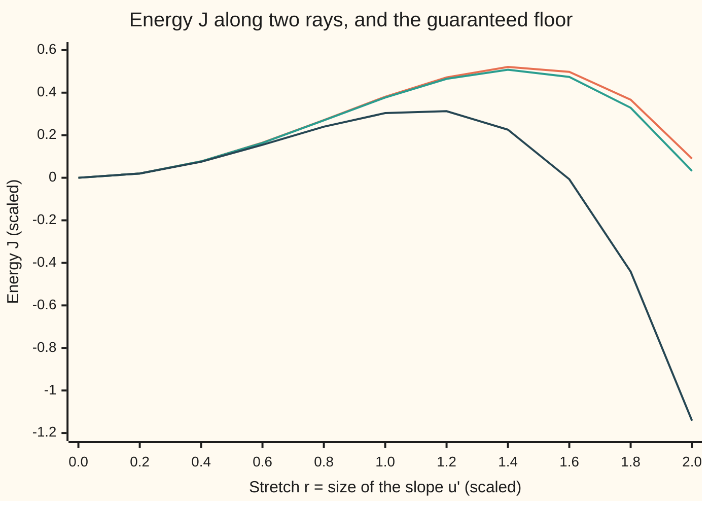

# The mountain pass: a solution that is a saddle of the energy, not a minimum

[Syllabus](../../../SYLLABUS.md) → [Partial differential equations](../README.md) → [Nonlinear PDE and Fluids](../README.md#s07) → The mountain pass

---

## General Overview

Wing 08 found the modes of the linear problem $`-u'' = \lambda u`$ on a 1 m string held at 0 at both ends: the first is $`\sin \pi x`$ with $`\lambda = \pi^2`$ ([Eigenvalue problems](../../08-Differential%20equations%20and%20dynamics/07-Series%20Solutions%20and%20Boundary%20Problems/08-eigenvalues-and-eigenfunctions.md)). Stretched to $`(0, \pi)`$, the first mode is $`\sin x`$ with $`\lambda = 1`$. This card replaces $`\lambda u`$ by a cube and asks again for a nonzero solution.

An illustrative scaled rod runs from $`x = 0`$ to $`x = \pi`$, with both ends held cold. The **unknown** $`u(x)`$ is its temperature excess over the ends. The rod releases heat at the rate $`u^3`$, so hotter spots burn faster, while heat also spreads along it. A steady state balances the two:

```math
-u'' = u^3 \ \text{ on } (0, \pi), \qquad u(0) = u(\pi) = 0 .
```

The **region** is $`(0, \pi)`$ and the **data** is zero temperature at both ends. The cold rod, $`u = 0`$, is one steady state. Is there a hot one?

There is: one arch $`u^*`$ with peak 1.180341 at the middle. It is a threshold, not a resting place. Start the rod at 0.9 times the arch and it cools back to 0. Start it at 1.1 times and it runs away, passing 10 by scaled time 0.782 on a 50-point grid.

Behind this is the **energy** $`J(u)`$, a number attached to every temperature profile. The cold rod sits in a valley of $`J`$, and far away $`J`$ falls below 0. Any route from the valley to that lowland crosses a ridge. Its lowest crossing is a **mountain pass**, a saddle of $`J`$, and the hot arch is that saddle.

**When the energy has a valley at 0 ringed by higher ground, and lower ground somewhere beyond the ring, the lowest pass over the ring is a critical point, and so a solution, provided a compactness condition (Palais–Smale) stops the search from escaping to infinity.**

**What kind of fact this is:** a theorem (Ambrosetti and Rabinowitz, 1973), proved on this card in Why it works with the deformation lemma in outline, and applied in full to $`-u'' = u^3`$. The closed form for the pass height uses Gauss's lemniscate identity, stated without proof and checked by the code to nine digits. The rod is an illustrative scaled model.

### The picture: the energy along two straight roads out of the valley



Orange: $`J`$ along multiples of $`\sin x`$, peak $`\pi/6 = 0.523599`$. Teal: along multiples of the solution $`u^*`$, peak $`c = 0.508157`$, the pass height. Dark: the floor $`r^2/2 - (\pi/16)\,r^4`$, which no profile goes below. It peaks at $`1/\pi = 0.318310`$ at $`r = 1.128379`$: the ring of higher ground.

---

## The formula

A profile $`u`$ lives in $`H^1_0(0, \pi)`$: profiles with square-integrable slope, zero at both ends ([Sobolev spaces](../06-Weak%20Solutions%20and%20Free%20Boundaries/02-sobolev-spaces-for-pdes.md)). Its **stretch** is $`\lVert u'\rVert = \big(\int_0^\pi (u')^2\,dx\big)^{1/2}`$. The energy whose stationary points solve the equation ([The Euler-Lagrange equation](../../08-Differential%20equations%20and%20dynamics/12-Calculus%20of%20Variations%20and%20Optimal%20Control/01-functionals-and-the-euler-lagrange-equation.md)) is

```math
J(u) = \frac12\int_0^\pi (u')^2\,dx \;-\; \frac14\int_0^\pi u^4\,dx .
```

**Read it aloud:** half the squared slope added along the rod (a cost), minus a quarter of the temperature to the fourth power (a reward).

The derivative of $`J`$ at $`u`$ in a direction $`v`$ is $`J'(u)[v] = \int u'v' - \int u^3 v`$. It is zero for every $`v`$ exactly when $`u`$ is a weak solution of $`-u'' = u^3`$.

A **path** is a continuous family of profiles $`u_s`$, $`s`$ from 0 to 1, starting at $`u_0 = 0`$ and ending at the far profile $`u_1 = 2\sin x`$, where $`J(u_1) = -1.570796 < 0`$. The theorem:

```math
J \in C^1 \text{ satisfies Palais–Smale, and } c = \inf_{\text{paths}} \ \max_{0 \le s \le 1} J(u_s) \ \ge\ \beta > 0 \quad\Longrightarrow\quad J'(u^*) = 0 \ \text{ for some } u^* \text{ with } J(u^*) = c .
```

**Read it aloud:** for an energy with a continuous derivative that satisfies Palais–Smale (Step 3), take the lowest of the highest points over all paths from the valley to the far profile; if it clears the ring, some profile at that height is a solution.

Here the pass height has a closed form. $`g = \mathrm{agm}(1, \sqrt2)`$ is the arithmetic-geometric mean: replace the two numbers by their ordinary mean and the square root of their product, and repeat until they agree.

```math
c = \min_{u \ne 0} \frac{\big(\int (u')^2\big)^2}{4\int u^4} = \frac{\pi}{3g^4} = 0.508157, \qquad u^*(\pi/2) = \frac{\sqrt2}{g} = 1.180341 .
```

**Read it aloud:** the pass height is the lowest peak over all straight rays out of the valley, and equals $`\pi`$ over $`3g^4`$.

| Symbol | Plain meaning | In our example | Push it up and the answer… |
| --- | --- | --- | --- |
| $`x`$, $`u(x)`$, $`u'`$ | position along the rod; temperature excess; its slope (all scaled) | $`0 \le x \le \pi`$ | — |
| $`J(u)`$; $`C^1`$ | energy of a profile: conduction cost minus heat reward; having a continuous derivative | $`J(0) = 0`$, $`J(2\sin x) = -1.570796`$ | — |
| $`\lVert u'\rVert`$, $`r`$ | stretch: the size of the slope | $`r = 1.128379`$ on the ring | larger $`r`$: the quartic term wins, $`J`$ falls |
| $`t`$; $`\tau`$ | multiplier along a ray $`t\,v`$; scaled time in the heat flow | peak of $`t\sin x`$ at $`t = 1.154701`$; runaway by $`\tau = 0.782`$ | past $`t = 1.632993`$, $`J(t\sin x) < 0`$ |
| $`r_0`$, $`\beta`$ | radius of the ring and the energy guaranteed on it | $`2/\sqrt\pi = 1.128379`$, $`1/\pi = 0.318310`$ | — |
| $`u_s`$, $`u_1`$ | a path of profiles, $`s`$ from 0 to 1; its far end | $`u_1 = 2\sin x`$ | — |
| $`c`$ | pass height: the lowest highest point over all paths (not a wave speed here) | 0.508157 | — |
| $`u^*`$, $`a`$, $`K`$, $`g`$ | the positive solution (classical, unique among positive ones); its peak; the lemniscate integral $`\int_0^1 ds/\sqrt{1-s^4}`$; $`\mathrm{agm}(1, \sqrt2)`$ | $`a = 1.180341`$, $`u^{*\prime}(0) = 0.985144`$, $`g = 1.198140`$ | — |
| $`J'(u)[v]`$, $`u_n`$; $`\varepsilon`$, $`\delta`$, $`\eta`$ | derivative of $`J`$ in direction $`v`$; a sequence of profiles; band half-width, least slope in the band, deformation map | $`J'(u^*) = 0`$ | — |
| $`f(u)`$, $`F(u)`$ | reaction (heat release) and its antiderivative, $`F' = f`$ | $`u^3`$, $`u^4/4`$ | — |
| $`\lambda`$; $`u^+`$, $`u^-`$; $`C`$, $`R`$, $`w`$ | a linear mode's eigenvalue; positive and negative parts of $`u`$; bounds on energy and stretch, and a difference of two profiles, in the proofs | $`\lambda = 1`$ for $`\sin x`$ | — |
| $`d`$, $`2^*`$, $`h`$ | dimension; critical exponent $`2d/(d-2)`$; grid step | $`d = 1`$; $`h`$ = 0.0616 to 0.0156 | larger $`d`$: $`2^*`$ falls to 4 at $`d = 4`$ |

### When it holds

- **A strict valley at 0, ringed by higher ground.** Here $`J \ge 1/\pi`$ at stretch $`r_0`$. With $`2u + u^3`$ in place of $`u^3`$, $`J(0.1\sin x) = -0.007883`$, and no positive solution exists.
- **Lower ground beyond the ring.** This needs faster-than-linear growth. With $`u/2`$ instead, $`J(t\sin x) = \pi t^2/8 > 0`$ for every $`t`$, and 0 is the only solution.
- **The Palais–Smale condition** (Step 3). Without it the search can escape to infinity: $`x^2 + (1-x)^3 y^2`$ has the mountain shape but one critical point.
- **Growth below the Sobolev critical exponent $`2^*`$.** The quartic term needs $`4 < 2^*`$, true for $`d \le 3`$. In $`d = 4`$, $`u^3`$ is exactly critical, and on a ball there is no positive solution with zero boundary values (Pohozaev's identity; Evans, chapter 9).
- **$`J`$ continuously differentiable on a complete space.** True on $`H^1_0`$ in one dimension ([Sobolev and Poincare](../../18-Functional%20analysis/04-Distributions%20and%20Sobolev%20Spaces/09-sobolev-embedding-and-poincare-inequality.md)).

---

## Why it works

### Step 0: if no pass point existed, every path could be pushed lower

Suppose no profile at height $`c`$ is a critical point. Then near height $`c`$ the ground tilts everywhere. Slide every path downhill for a short while. Paths that peaked just above $`c`$ now peak below it, contradicting the definition of $`c`$.

Two things could spoil this. The tilt could fade on profiles far out, so the slide stalls: Palais–Smale forbids that. And the slide could move the endpoints: the ring keeps both well below $`c`$, so the slide leaves them alone.

### Step 1: the ring of higher ground

A profile held at both ends cannot be hot without a slope. From $`u(x) = \int_0^x u'`$ and the Cauchy–Schwarz inequality, $`u(x)^2 \le x\int_0^x (u')^2`$. From the right end, $`u(x)^2 \le (\pi - x)\int_x^\pi (u')^2`$. Combining the two:

```math
u(x)^2 \le \frac{x(\pi - x)}{\pi}\,\lVert u'\rVert^2 \le \frac{\pi}{4}\,\lVert u'\rVert^2 .
```

The Poincare inequality on $`(0, \pi)`$ gives $`\int u^2 \le \lVert u'\rVert^2`$, with constant 1 because the first mode $`\sin x`$ has $`\lambda = 1`$. So $`\int u^4 \le \max u^2 \int u^2 \le (\pi/4)\lVert u'\rVert^4`$, and with $`r = \lVert u'\rVert`$:

```math
J(u) \ \ge\ \frac{r^2}{2} - \frac{\pi}{16}\,r^4 .
```

This floor peaks at $`r_0^2 = 4/\pi`$ with height $`\beta = 1/\pi = 0.318310`$. So every profile with stretch $`r_0 = 1.128379`$ has energy at least 0.318310, and $`u = 0`$ is a strict valley. On the ring, the code finds 0.443111 for $`\sin x`$, 0.624525 for $`\sin 2x`$ and 0.437230 for $`u^*`$, each rescaled.

### Step 2: the far lowland, and a first bound on the pass

Along the ray $`t\sin x`$, $`\int (u')^2 = \pi t^2/2`$ and $`\int u^4 = 3\pi t^4/8`$, so

```math
J(t\sin x) = \frac{\pi t^2}{4} - \frac{3\pi t^4}{32} .
```

Its derivative vanishes at $`t^2 = 4/3`$, where the height is $`\pi/3 - \pi/6 = \pi/6 = 0.523599`$. It is back to 0 at $`t = 1.632993`$, and $`J(2\sin x) = -1.570796`$. The straight road from 0 to $`2\sin x`$ is one path, so $`c \le \pi/6`$.

Every path must cross the sphere of stretch $`r_0`$, because its stretch runs continuously from 0 to $`\lVert 2\cos x\rVert = 2.506628`$. There $`J \ge \beta`$, so $`c \ge 1/\pi`$. The pass height is trapped: $`0.318310 \le c \le 0.523599`$.

### Step 3: the Palais–Smale condition, and why this energy has it

A **Palais–Smale sequence** is a list of profiles $`u_n`$ with bounded energies whose derivative size, $`\lVert J'(u_n)\rVert = \sup_{\lVert v'\rVert = 1} J'(u_n)[v]`$, tends to 0. The **Palais–Smale condition** asks that every such list have a convergent subsequence. A list can fail by running off to infinity, or, in $`H^1_0`$, by oscillating ever faster.

For our $`J`$ both escapes are blocked. The identity

```math
J(u) - \tfrac14 J'(u)[u] = \tfrac14\,\lVert u'\rVert^2
```

turns bounded energy and small derivative into bounded stretch. It works because $`u\,f(u) = u^4 = 4F(u)`$ with $`4 > 2`$: the **Ambrosetti–Rabinowitz condition**, the precise meaning of "superlinear". And a bounded list in $`H^1_0`$ has a uniformly convergent subsequence ([Boundary values and compactness](../../18-Functional%20analysis/04-Distributions%20and%20Sobolev%20Spaces/10-trace-and-rellich-kondrachov-in-outline.md)); the equation upgrades that to convergence in stretch.

<details>
<summary>Detailed proof: every Palais–Smale sequence of this J has a convergent subsequence</summary>

Let $`J(u_n) \le C`$ and $`\varepsilon_n = \lVert J'(u_n)\rVert \to 0`$. Then $`J'(u_n)[u_n] \ge -\varepsilon_n \lVert u_n'\rVert`$, so

$`\displaystyle \tfrac14\lVert u_n'\rVert^2 = J(u_n) - \tfrac14 J'(u_n)[u_n] \le C + \tfrac14\varepsilon_n\lVert u_n'\rVert .`$

A quadratic in $`\lVert u_n'\rVert`$ bounded by a linear one is bounded: the stretch stays below some $`R`$.

By the Rellich–Kondrachov theorem, a subsequence (still called $`u_n`$) converges uniformly on $`[0, \pi]`$ to some $`u`$, and $`u_n'`$ converges weakly. Now test the derivative at two terms against their difference $`w = u_n - u_m`$:

$`\displaystyle \lVert u_n' - u_m'\rVert^2 = \big(J'(u_n) - J'(u_m)\big)[w] + \int_0^\pi (u_n^3 - u_m^3)\,w\,dx .`$

The first term is at most $`(\varepsilon_n + \varepsilon_m)\,2R \to 0`$. The second is at most $`\pi\,\max\lvert u_n^3 - u_m^3\rvert\,\max\lvert w\rvert`$, which tends to 0 by uniform convergence. So $`u_n'`$ is a Cauchy sequence, and $`u_n \to u`$ in $`H^1_0`$.

</details>

### Step 4: the deformation lemma, in outline

The slide of Step 0, made precise. If no critical point has height in $`[c - 2\varepsilon_0, c + 2\varepsilon_0]`$, Palais–Smale gives $`\delta > 0`$ with $`\lVert J'(u)\rVert \ge \delta`$ in that band. Otherwise a list with $`\lVert J'(u_n)\rVert \to 0`$ would converge to a critical point inside it.

Flow every profile along a direction where $`J`$ falls at rate at least $`\delta`$, switched off smoothly outside the band. For small $`\varepsilon`$, this map $`\eta`$ carries $`\{J \le c + \varepsilon\}`$ into $`\{J \le c - \varepsilon\}`$ and fixes every profile with $`J \le c - 2\varepsilon_0`$. The direction is a **pseudo-gradient**, a locally Lipschitz field close to $`-J'`$; Struwe (chapter II) builds it.

<details>
<summary>Detailed proof: the mountain pass theorem from the deformation lemma</summary>

Assume $`J`$ is continuously differentiable on a Hilbert space, satisfies Palais–Smale, has $`J(0) = 0`$, has $`J \ge \beta > 0`$ on the sphere of radius $`r_0`$, and has $`J(u_1) \le 0`$ at some $`u_1`$ outside that sphere.

Step 2's argument shows $`c \ge \beta`$. Suppose $`c`$ is not a critical value. Then some $`\varepsilon_0 < \beta/2`$ leaves no critical value in $`[c - 2\varepsilon_0, c + 2\varepsilon_0]`$. Otherwise critical points with heights tending to $`c`$ would form a Palais–Smale sequence, and its limit would be a critical point at height $`c`$.

Take the deformation $`\eta`$ of Step 4 for some $`\varepsilon \le \varepsilon_0`$. It fixes both endpoints: $`J(0) = 0`$ and $`J(u_1) \le 0`$, while $`c - 2\varepsilon_0 > c - \beta \ge 0`$.

Pick a path $`u_s`$ whose maximum is below $`c + \varepsilon`$; one exists by the definition of $`c`$. Then $`\eta(u_s)`$ is again a path from 0 to $`u_1`$, and its maximum is at most $`c - \varepsilon`$. That is lower than the lowest possible maximum, a contradiction. So $`c`$ is a critical value. Palais–Smale makes the set of critical points at height $`c`$ nonempty and compact.

</details>

### Step 5: the pass point is the positive solution

The theorem gives a critical point $`u^*`$ with $`J(u^*) = c > 0`$, so $`u^* \ne 0`$: a weak solution. In one dimension $`u^*`$ is continuous, so $`u^{*\prime\prime} = -u^{*3}`$ is too, and $`u^*`$ is a classical solution.

For a positive one, rerun the argument with $`(u^+)^3`$, the cube of the positive part. Testing with the negative part $`u^-`$ gives $`u^- = 0`$, and the strong maximum principle gives $`u > 0`$ inside.

There is only one positive solution. Multiplying $`-u'' = u^3`$ by $`u'`$ gives the conserved quantity $`(u')^2/2 + u^4/4 = a^4/4`$, with $`a`$ the peak. The distance from 0 to the peak is then $`\sqrt2\,K/a`$, with $`K = \int_0^1 ds/\sqrt{1 - s^4}`$. Setting it to $`\pi/2`$ fixes $`a`$. So shooting finds the pass point ([Shooting](../../08-Differential%20equations%20and%20dynamics/07-Series%20Solutions%20and%20Boundary%20Problems/06-the-shooting-method.md)).

### Step 6: the pass height is the lowest peak over rays

At a solution, testing with $`u`$ itself gives $`\int (u')^2 = \int u^4`$; the code finds 2.032628 for both. Along any ray $`t v`$, $`J`$ peaks at $`(\int (v')^2)^2 / (4\int v^4)`$, at the point where that equality holds. Call the nonzero profiles with $`\int (u')^2 = \int u^4`$ the **ridge**: every ray peaks on it.

Every path crosses the ridge: near 0 the left side wins (Step 1), and at $`u_1`$ the right side wins, since $`J(u_1) < 0`$ forces $`\int u_1^4 > 2\int (u_1')^2`$. So every path peaks at least as high as the lowest ray peak. Conversely, a ray out to where $`J`$ is far below 0, joined to $`u_1`$ through ground where $`J < 0`$, is a path whose peak is the ray's peak. The lowest ray peak is attained (direct method) by a profile that can be taken positive, since $`\lvert u\rvert`$ has the energy of $`u`$; it is the arch. Hence the minimum formula, and $`\sin x`$, peaking at 0.523599, gives only an upper bound.

<details>
<summary>Detailed proof: the closed form through the arithmetic-geometric mean</summary>

From the conserved quantity, $`u' = \sqrt{(a^4 - u^4)/2}`$ on the rising half. The half-length is

$`\displaystyle \frac{\pi}{2} = \int_0^a \frac{\sqrt2\,du}{\sqrt{a^4 - u^4}} = \frac{\sqrt2}{a}\,K .`$

Gauss's lemniscate identity (1799) is $`K = \pi/(2g)`$. So $`a = 2\sqrt2 K/\pi = \sqrt2/g = 1.180341`$, and the starting slope is $`u^{*\prime}(0) = a^2/\sqrt2 = \sqrt2/g^2 = 0.985144`$.

For the energy, $`\int_0^\pi (u')^2\,dx = 2\int_0^a u'\,du = \sqrt2\,a^3 \int_0^1 \sqrt{1 - s^4}\,ds`$. Integrating by parts, $`\int_0^1 s^4/\sqrt{1-s^4}\,ds = \tfrac12\int_0^1\sqrt{1-s^4}\,ds`$, so $`\int_0^1\sqrt{1-s^4}\,ds = \tfrac23 K`$. Then

$`\displaystyle c = \tfrac14\int_0^\pi (u^{*\prime})^2\,dx = \frac{\sqrt2\,a^3 K}{6} = \frac{\pi}{3g^4} = 0.508157 .`$

</details>

### Step 7: why the solution is not a minimum

$`J`$ has no minimum: $`J(3\sin x) = -16.787886`$, and $`J(t\sin x) \to -\infty`$. The direct method, which finds minimisers ([The direct method](10-direct-method-in-the-calculus-of-variations.md)), has nothing to find.

At $`u^*`$ itself, $`J`$ falls along its own ray: $`J(0.9\,u^*) = 0.489813`$ and $`J(1.1\,u^*) = 0.485747`$, both below $`c`$. Across the ray it rises: $`J(u^* \pm 0.1\sin 3x)`$ is 0.563828 and 0.563708. Down one way, up the other: a saddle, with exactly one downhill direction ([The second variation](../../08-Differential%20equations%20and%20dynamics/12-Calculus%20of%20Variations%20and%20Optimal%20Control/09-second-variation-and-free-endpoints.md)).

---

## Worked numbers, by hand

| Step | Arithmetic | Value |
| --- | --- | --- |
| ray $`t\sin x`$: slope term | $`\tfrac12 \int t^2\cos^2 x = \pi t^2/4`$ | $`0.785398\,t^2`$ |
| ray $`t\sin x`$: heat term | $`\tfrac14 \int t^4\sin^4 x = 3\pi t^4/32`$ | $`0.294524\,t^4`$ |
| peak of the ray | $`t^2 = 4/3`$, $`t = 2/\sqrt3`$ | 1.154701 |
| height of the peak | $`\pi/3 - \pi/6`$ | 0.523599 |
| ray back to 0 | $`t^2 = 8/3`$ | 1.632993 |
| far profile $`2\sin x`$ | $`\pi - 3\pi/2`$ | −1.570796 |
| ring radius | $`r_0 = 2/\sqrt\pi`$ | 1.128379 |
| ring height | $`2/\pi - 1/\pi`$ | 0.318310 |
| arithmetic-geometric mean | $`1, \sqrt2 \to 1.207107, 1.189207 \to \dots`$ | 1.198140 |
| peak of $`u^*`$ | $`\sqrt2/g`$ | 1.180341 |
| **pass height** | $`\pi/(3g^4) = 3.141593/6.182325`$ | **0.508157** |

The hot arch costs 0.508157 in energy: 2.95% below the $`\sin x`$ ray's peak and 59.6% above the ring's guarantee. It is the smallest energy barrier between the cold rod and runaway.

### What breaks if you drop a piece

| Mistake | Comes out at | What went wrong |
| --- | --- | --- |
| Drop the superlinear growth: $`-u'' = u/2`$ | $`J(2\sin x) = 1.570796 > 0`$ | No far lowland; the only solution is 0, since $`1/2`$ is below the first mode's $`\lambda = 1`$. |
| Drop the ring: $`-u'' = 2u + u^3`$ | $`J(0.1\sin x) = -0.007883`$ | 0 is no longer a valley. Testing against $`\sin x`$ shows no positive solution exists. |
| Drop Palais–Smale: $`x^2 + (1-x)^3y^2`$ on the plane | at $`(1.001, 816.905)`$: height 1.001334, slope 1.634e-06 | Valley at the origin, $`(4, 1)`$ at −11. The $`y`$-slope $`2(1-x)^3 y`$ vanishes only at $`x = 1`$, where the $`x`$-slope is 2, or at $`y = 0`$, forcing $`x = 0`$. The only critical point is the origin; the search escapes at height 1. |
| Take one ray's peak as the pass height | 0.523599 instead of 0.508157 | One path gives only an upper bound; $`c`$ is the lowest peak over all paths. |

---

## The saddle in time: ignition or fade

Now let the rod evolve: $`\partial u/\partial\tau = u'' + u^3`$, ends at 0, with $`\tau`$ the scaled time ($`t`$ already scales the rays). Along this flow $`J`$ changes at the rate $`-\int (\partial u/\partial\tau)^2`$, so it never rises. Every profile on the ridge, the set where $`\int (u')^2 = \int u^4`$ (Step 6), has $`J \ge c`$. So a start with energy below $`c`$ never crosses the ridge.

The code starts at 0.9 and 1.1 times the grid solution with 50 interior points ($`h = 0.061600`$, time step 0.001, inside the explicit limit $`h^2/2`$). Peak temperature:

| Time $`\tau`$ | 0 | 0.25 | 0.5 | 0.75 | 1.0 | 1.25 | 1.5 | 1.75 | 2.0 |
| --- | --- | --- | --- | --- | --- | --- | --- | --- | --- |
| from $`0.9\,u^*`$ | 1.0615 | 0.9896 | 0.9022 | 0.7977 | 0.6835 | 0.5696 | 0.4643 | 0.3725 | 0.2956 |
| from $`1.1\,u^*`$ | 1.2974 | 1.4218 | 1.7254 | 4.1438 | — | — | — | — | — |

From 1.1 the peak reaches 10.7582 at $`\tau = 0.782`$, and the run stops. Both starts have energy below $`c`$: 0.489813 and 0.485747. The first lies on the valley side of the ridge and fades. The second lies on the far side and runs downhill into the lowland, blowing up in finite time. The arch sits on the ridge between them.

---

## Code, from first principles, and it actually runs

Three roads to the pass height. Road 1 shoots: fourth-order Runge–Kutta (RK4) from $`u(0) = 0`$, bisection on the slope until $`u(\pi) = 0`$, Simpson's rule for the energy. Road 2 is the closed form through the arithmetic-geometric mean. Road 3 minimises the ray peak on finite-difference grids at three steps, by repeatedly solving $`-w'' = v^3`$ (tridiagonal Thomas method) and rescaling. The script also checks the ring, the saddle, the broken hypotheses and the heat flow.

### Python

```python
# Mountain pass check: -u'' = u^3 on (0, pi), u(0) = u(pi) = 0, energy J(u) = 1/2 int u'^2 - 1/4 int u^4.
# Standard library only.  Three roads to the pass level c: shooting by RK4, the AGM closed form, a grid minimax.
import math
PI = math.pi

def simpson(f, h):  # composite Simpson on an even number of intervals, plain loops
    n = len(f) - 1; s = f[0] + f[n]
    for i in range(1, n, 2): s += 4.0 * f[i]
    for i in range(2, n, 2): s += 2.0 * f[i]
    return s * h / 3.0

def shoot(s, n=2000):  # RK4 for u' = p, p' = -u^3 from u = 0, p = s; returns grid values of u and p
    h = PI / n; u, p = 0.0, s; us, ps = [u], [p]
    for _ in range(n):
        k1u, k1p = p, -u * u * u
        a = u + 0.5 * h * k1u; k2u, k2p = p + 0.5 * h * k1p, -a * a * a
        a = u + 0.5 * h * k2u; k3u, k3p = p + 0.5 * h * k2p, -a * a * a
        a = u + h * k3u; k4u, k4p = p + h * k3p, -a * a * a
        u += h * (k1u + 2.0 * k2u + 2.0 * k3u + k4u) / 6.0
        p += h * (k1p + 2.0 * k2p + 2.0 * k3p + k4p) / 6.0
        us.append(u); ps.append(p)
    return us, ps

def tri_solve(r, h):  # (-w[i-1] + 2 w[i] - w[i+1]) / h^2 = r[i], w = 0 beyond both ends (Thomas)
    n = len(r); c = [0.0] * n; d = [0.0] * n; c[0] = -0.5; d[0] = r[0] * h * h / 2.0
    for i in range(1, n):
        m = 2.0 + c[i - 1]; c[i] = -1.0 / m; d[i] = (r[i] * h * h + d[i - 1]) / m
    w = [0.0] * n; w[n - 1] = d[n - 1]
    for i in range(n - 2, -1, -1): w[i] = d[i] - c[i] * w[i + 1]
    return w

def ground(n, iters=120):  # grid minimax: minimise A^2/(4B) over shapes by v <- L^-1(v^3), rescaled
    h = PI / (n + 1); v = [math.sin((i + 1) * h) for i in range(n)]; m = 1.0
    for _ in range(iters):
        w = tri_solve([x * x * x for x in v], h); m = max(w); v = [x / m for x in w]
    va = [0.0] + v + [0.0]; A = 0.0; B = 0.0
    for i in range(n + 1): A += (va[i + 1] - va[i]) ** 2 / h
    for x in v: B += h * x ** 4
    return A * A / (4.0 * B), 1.0 / math.sqrt(m), v, h

# ---- the ray t sin x: J = pi t^2/4 - 3 pi t^4/32 ----
ray = lambda t: PI * t * t / 4.0 - 3.0 * PI * t ** 4 / 32.0
ts = 2.0 / math.sqrt(3.0); n = 2000; hx = PI / n; xs = [i * hx for i in range(n + 1)]
jq = simpson([0.5 * (ts * math.cos(x)) ** 2 - 0.25 * (ts * math.sin(x)) ** 4 for x in xs], hx)
print(f"ray t sin x: peak at t = {ts:.6f}, J = {ray(ts):.6f} (pi/6 = {PI / 6:.6f}), by Simpson {jq:.6f}")
print(f"ray t sin x: J back to 0 at t = {math.sqrt(8.0 / 3.0):.6f}; J(2 sin x) = {ray(2.0):.6f}; J(3 sin x) = {ray(3.0):.6f}")
assert abs(jq - PI / 6) < 1e-9 and abs(ray(ts) - jq) < 1e-9; assert ray(2.0) < 0

# ---- the ring of mountains: J >= r^2/2 - (pi/16) r^4 >= 1/pi on |u'| = r = 2/sqrt(pi) ----
rho = 2.0 / math.sqrt(PI); alpha = 1.0 / PI
print(f"ring: radius |u'| = {rho:.6f}, guaranteed height 1/pi = {alpha:.6f}")

# ---- road 1: shooting.  bisect on the starting slope s until u(pi) = 0 ----
lo, hi = 0.5, 1.5
for _ in range(60):
    mid = 0.5 * (lo + hi)
    lo, hi = (mid, hi) if shoot(mid)[0][-1] > 0.0 else (lo, mid)
s = 0.5 * (lo + hi); us, ps = shoot(s)
amp = max(us); A1 = simpson([p * p for p in ps], hx); B1 = simpson([u ** 4 for u in us], hx)
J1 = 0.5 * A1 - 0.25 * B1
print(f"road 1 shooting: slope u'(0) = {s:.9f}, height u(pi/2) = {amp:.9f}, J = {J1:.9f}")
print(f"  int u'^2 = {A1:.9f}, int u^4 = {B1:.9f} (equal for a solution)")

# ---- road 2: closed form through the arithmetic-geometric mean M = AGM(1, sqrt 2) ----
a, g = 1.0, math.sqrt(2.0)
for _ in range(8): a, g = 0.5 * (a + g), math.sqrt(a * g)
M = a; c2 = PI / (3.0 * M ** 4)
print(f"road 2 AGM: M = {M:.9f}, slope sqrt2/M^2 = {math.sqrt(2.0) / M ** 2:.9f}, height sqrt2/M = {math.sqrt(2.0) / M:.9f}, c = pi/(3M^4) = {c2:.9f}")
assert abs(J1 - c2) < 1e-9 and abs(amp - math.sqrt(2.0) / M) < 1e-7 and abs(s - math.sqrt(2.0) / M ** 2) < 1e-9
assert abs(A1 - B1) < 1e-8 and alpha < c2 < PI / 6
print(f"by hand: pi/4 = {PI / 4:.6f}, 3pi/32 = {3 * PI / 32:.6f}, |2 cos x| = {2 * math.sqrt(PI / 2):.6f}, agm step 1: {(1 + math.sqrt(2.0)) / 2:.6f}, {math.sqrt(math.sqrt(2.0)):.6f}, 3g^4 = {3 * M ** 4:.6f}")
print(f"by hand: c is {100 * (1 - c2 / (PI / 6)):.2f}% below pi/6 and {100 * (c2 / alpha - 1):.1f}% above 1/pi; f(4, 1) = {16 + (1 - 4) ** 3:.0f}; 2* = 2d/(d-2) = {2 * 3 / (3 - 2):.0f} at d = 3, {2 * 4 / (4 - 2):.0f} at d = 4")

# ---- road 3: grid minimax of A^2/(4B), at three steps ----
errs = []
for nn in (50, 100, 200):
    ch, ah, _, h = ground(nn); errs.append(ch - c2)
    print(f"road 3 grid: h = {h:.6f}, c_h = {ch:.9f}, height {ah:.6f}, error {ch - c2:.3e}")
order = math.log(errs[0] / errs[1]) / math.log(2.0); order2 = math.log(errs[1] / errs[2]) / math.log(2.0)
print(f"  observed order {order:.3f}, then {order2:.3f}")
assert abs(errs[2]) < 3e-5 and 1.9 < order2 < 2.1

# ---- the shape on the sphere |u'| = rho: J = rho^2/2 - rho^4 B/(4A^2) for three test shapes ----
for name, A, B in (("sin x", PI / 2, 3 * PI / 8), ("sin 2x", 2 * PI, 3 * PI / 8), ("u*", A1, B1)):
    j = rho ** 2 / 2 - rho ** 4 * B / (4 * A * A)
    print(f"on the ring: {name:6s} J = {j:.6f}"); assert j >= alpha
print(f"lower bound r^2/2 - (pi/16) r^4 at r = rho: {rho ** 2 / 2 - PI / 16 * rho ** 4:.6f}")

# ---- the solution is a saddle: down along its own ray, up across it ----
for t in (0.9, 1.1): print(f"J({t} u*) = {A1 * (t * t / 2 - t ** 4 / 4):.6f}  (below c)")
for e in (0.1, -0.1):
    jj = simpson([0.5 * (ps[i] + 3 * e * math.cos(3 * xs[i])) ** 2 - 0.25 * (us[i] + e * math.sin(3 * xs[i])) ** 4 for i in range(n + 1)], hx)
    print(f"J(u* {e:+.1f} sin 3x) = {jj:.6f}  (above c)"); assert jj > J1
assert A1 * (0.81 / 2 - 0.6561 / 4) < J1 and A1 * (1.21 / 2 - 1.4641 / 4) < J1

# ---- the chart: J against the stretch r = |u'| along both rays, and the lower bound ----
rs = [0.2 * k for k in range(11)]
print("chart sin x:", ", ".join(f"{r * r / 2 - r ** 4 * 3 / (8 * PI):.3f}" for r in rs))
print("chart u*   :", ", ".join(f"{r * r / 2 - r ** 4 / (4 * A1):.3f}" for r in rs))
print("chart bound:", ", ".join(f"{r * r / 2 - PI / 16 * r ** 4:.3f}" for r in rs))

# ---- what breaks ----
print(f"drop the growth, -u'' = u/2: J(2 sin x) = {PI * 4 / 8:.6f} > 0, no far valley")
jl = PI * 0.01 / 4 - PI * 0.01 / 2 - 3 * PI * 1e-4 / 32
print(f"drop the ring, -u'' = 2u + u^3: J(0.1 sin x) = {jl:.6e} < 0 next to u = 0"); assert jl < 0
for sm in (0.1, 0.01, 0.001):  # f = x^2 + (1-x)^3 y^2: only critical point is the origin
    x = 1 + sm; y = math.sqrt(2 * x / (3 * sm * sm)); f = x * x + (1 - x) ** 3 * y * y
    gr = math.hypot(2 * x - 3 * (1 - x) ** 2 * y * y, 2 * (1 - x) ** 3 * y)
    print(f"drop Palais-Smale: s = {sm}, point ({x:.3f}, {y:.3f}), f = {f:.6f}, |grad f| = {gr:.3e}")
assert gr < 1e-4 and abs(f - 1) < 1e-2 and y > 800

# ---- how it moves: u_t = u_xx + u^3 from fac times the grid solution (N = 50, dt = 0.001), up to t = 2 ----
_, ah, v, h = ground(50); dt = 0.001
def flow(fac, steps=2000):
    u = [fac * ah * x for x in v]; line = []; k = 0
    while k < steps and max(u) <= 10.0:
        if k % 250 == 0: line.append(f"{max(u):.4f}")
        ua = [0.0] + u + [0.0]
        u = [u[i] + dt * ((ua[i] - 2 * ua[i + 1] + ua[i + 2]) / (h * h) + u[i] ** 3) for i in range(len(u))]
        k += 1
    return line, k * dt, max(u)
for fac in (0.9, 1.1):
    line, te, pk = flow(fac)
    print(f"heat flow from {fac} u*, peak every 0.25: {', '.join(line)}; ends t = {te:.3f}, peak {pk:.4f}")
    assert (pk < 0.3) if fac < 1 else (te < 2.0)

# ---- try changing ----
for fac in (0.99, 1.01):
    _, te, pk = flow(fac, 4000); print(f"try: heat flow from {fac} u* ends t = {te:.3f}, peak {pk:.4f}")
w = [math.sin(x) - 0.05 * math.sin(3 * x) for x in xs]; wp = [math.cos(x) - 0.15 * math.cos(3 * x) for x in xs]
A3 = simpson([q * q for q in wp], hx); B3 = simpson([q ** 4 for q in w], hx)
print(f"try: ray of sin x - 0.05 sin 3x peaks at {A3 * A3 / (4 * B3):.6f}"); assert A3 * A3 / (4 * B3) >= J1
print(f"try: solutions with 1 and 2 interior zeros have J = 16c = {16 * c2:.6f} and 81c = {81 * c2:.6f}")
lo, hi = 0.5, 1.5
for _ in range(60):
    mid = 0.5 * (lo + hi)
    lo, hi = (mid, hi) if shoot(mid, 20)[0][-1] > 0.0 else (lo, mid)
u20, p20 = shoot(0.5 * (lo + hi), 20)
print(f"try: shooting with 20 RK4 steps: J = {simpson([0.5 * p * p - 0.25 * u ** 4 for u, p in zip(u20, p20)], PI / 20):.9f}")
print("ALL CHECKS PASS")
```

**Ran 2026-11-24 on macOS, Python 3.14.10, standard library only. All checks passed. Output, pasted from the run:**

```
ray t sin x: peak at t = 1.154701, J = 0.523599 (pi/6 = 0.523599), by Simpson 0.523599
ray t sin x: J back to 0 at t = 1.632993; J(2 sin x) = -1.570796; J(3 sin x) = -16.787886
ring: radius |u'| = 1.128379, guaranteed height 1/pi = 0.318310
road 1 shooting: slope u'(0) = 0.985143946, height u(pi/2) = 1.180340599, J = 0.508157112
  int u'^2 = 2.032628448, int u^4 = 2.032628448 (equal for a solution)
road 2 AGM: M = 1.198140235, slope sqrt2/M^2 = 0.985143946, height sqrt2/M = 1.180340599, c = pi/(3M^4) = 0.508157112
by hand: pi/4 = 0.785398, 3pi/32 = 0.294524, |2 cos x| = 2.506628, agm step 1: 1.207107, 1.189207, 3g^4 = 6.182325
by hand: c is 2.95% below pi/6 and 59.6% above 1/pi; f(4, 1) = -11; 2* = 2d/(d-2) = 6 at d = 3, 4 at d = 4
road 3 grid: h = 0.061600, c_h = 0.507788868, height 1.179464, error -3.682e-04
road 3 grid: h = 0.031105, c_h = 0.508063215, height 1.180117, error -9.390e-05
road 3 grid: h = 0.015630, c_h = 0.508133403, height 1.180284, error -2.371e-05
  observed order 1.972, then 1.986
on the ring: sin x  J = 0.443111
on the ring: sin 2x J = 0.624525
on the ring: u*     J = 0.437230
lower bound r^2/2 - (pi/16) r^4 at r = rho: 0.318310
J(0.9 u*) = 0.489813  (below c)
J(1.1 u*) = 0.485747  (below c)
J(u* +0.1 sin 3x) = 0.563828  (above c)
J(u* -0.1 sin 3x) = 0.563708  (above c)
chart sin x: 0.000, 0.020, 0.077, 0.165, 0.271, 0.381, 0.472, 0.521, 0.498, 0.367, 0.090
chart u*   : 0.000, 0.020, 0.077, 0.164, 0.270, 0.377, 0.465, 0.508, 0.474, 0.329, 0.032
chart bound: 0.000, 0.020, 0.075, 0.155, 0.240, 0.304, 0.313, 0.226, -0.007, -0.441, -1.142
drop the growth, -u'' = u/2: J(2 sin x) = 1.570796 > 0, no far valley
drop the ring, -u'' = 2u + u^3: J(0.1 sin x) = -7.883434e-03 < 0 next to u = 0
drop Palais-Smale: s = 0.1, point (1.100, 8.563), f = 1.136667, |grad f| = 1.713e-02
drop Palais-Smale: s = 0.01, point (1.010, 82.057), f = 1.013367, |grad f| = 1.641e-04
drop Palais-Smale: s = 0.001, point (1.001, 816.905), f = 1.001334, |grad f| = 1.634e-06
heat flow from 0.9 u*, peak every 0.25: 1.0615, 0.9896, 0.9022, 0.7977, 0.6835, 0.5696, 0.4643, 0.3725; ends t = 2.000, peak 0.2956
heat flow from 1.1 u*, peak every 0.25: 1.2974, 1.4218, 1.7254, 4.1438; ends t = 0.782, peak 10.7582
try: heat flow from 0.99 u* ends t = 4.000, peak 0.1329
try: heat flow from 1.01 u* ends t = 1.820, peak 10.6718
try: ray of sin x - 0.05 sin 3x peaks at 0.508442
try: solutions with 1 and 2 interior zeros have J = 16c = 8.130514 and 81c = 41.160726
try: shooting with 20 RK4 steps: J = 0.508182278
ALL CHECKS PASS
```

### Rust

```rust
// Mountain pass check: -u'' = u^3 on (0, pi), u(0) = u(pi) = 0, energy J(u) = 1/2 int u'^2 - 1/4 int u^4.
// std only.  Three roads to the pass level c: shooting by RK4, the AGM closed form, a grid minimax.
use std::f64::consts::PI;

fn simpson(f: &[f64], h: f64) -> f64 {
    let n = f.len() - 1; let mut s = f[0] + f[n];
    for i in (1..n).step_by(2) { s += 4.0 * f[i]; }
    for i in (2..n).step_by(2) { s += 2.0 * f[i]; }
    s * h / 3.0
}

fn shoot(s: f64, n: usize) -> (Vec<f64>, Vec<f64>) {
    let h = PI / n as f64;
    let (mut u, mut p) = (0.0f64, s);
    let (mut us, mut ps) = (vec![u], vec![p]);
    for _ in 0..n {
        let (k1u, k1p) = (p, -u * u * u);
        let a = u + 0.5 * h * k1u; let (k2u, k2p) = (p + 0.5 * h * k1p, -a * a * a);
        let a = u + 0.5 * h * k2u; let (k3u, k3p) = (p + 0.5 * h * k2p, -a * a * a);
        let a = u + h * k3u; let (k4u, k4p) = (p + h * k3p, -a * a * a);
        u += h * (k1u + 2.0 * k2u + 2.0 * k3u + k4u) / 6.0;
        p += h * (k1p + 2.0 * k2p + 2.0 * k3p + k4p) / 6.0;
        us.push(u); ps.push(p);
    }
    (us, ps)
}

fn tri_solve(r: &[f64], h: f64) -> Vec<f64> {
    let n = r.len(); let (mut c, mut d) = (vec![0.0; n], vec![0.0; n]);
    c[0] = -0.5; d[0] = r[0] * h * h / 2.0;
    for i in 1..n { let m = 2.0 + c[i - 1]; c[i] = -1.0 / m; d[i] = (r[i] * h * h + d[i - 1]) / m; }
    let mut w = vec![0.0; n]; w[n - 1] = d[n - 1];
    for i in (0..n - 1).rev() { w[i] = d[i] - c[i] * w[i + 1]; }
    w
}

fn ground(n: usize, iters: usize) -> (f64, f64, Vec<f64>, f64) {
    let h = PI / (n + 1) as f64;
    let mut v: Vec<f64> = (0..n).map(|i| ((i + 1) as f64 * h).sin()).collect();
    let mut m = 1.0;
    for _ in 0..iters {
        let cube: Vec<f64> = v.iter().map(|x| x * x * x).collect();
        let w = tri_solve(&cube, h);
        m = w.iter().cloned().fold(f64::MIN, f64::max);
        v = w.iter().map(|x| x / m).collect();
    }
    let mut va = vec![0.0]; va.extend(v.iter()); va.push(0.0);
    let (mut a, mut b) = (0.0, 0.0);
    for i in 0..=n { a += (va[i + 1] - va[i]).powi(2) / h; }
    for x in &v { b += h * x.powi(4); }
    (a * a / (4.0 * b), 1.0 / m.sqrt(), v, h)
}

fn sci(x: f64, p: usize) -> String { // Python-style e-notation: two-digit exponent with sign
    let s = format!("{:.*e}", p, x);
    let (m, e) = s.split_at(s.find('e').unwrap());
    let ev: i32 = e[1..].parse().unwrap();
    format!("{}e{}{:02}", m, if ev < 0 { "-" } else { "+" }, ev.abs())
}

fn maxv(v: &[f64]) -> f64 { v.iter().cloned().fold(f64::MIN, f64::max) }

fn main() {
    let ray = |t: f64| PI * t * t / 4.0 - 3.0 * PI * t.powi(4) / 32.0;
    let ts = 2.0 / 3f64.sqrt();
    let n = 2000usize; let hx = PI / n as f64;
    let xs: Vec<f64> = (0..=n).map(|i| i as f64 * hx).collect();
    let jq = simpson(&xs.iter().map(|x| 0.5 * (ts * x.cos()).powi(2) - 0.25 * (ts * x.sin()).powi(4)).collect::<Vec<_>>(), hx);
    println!("ray t sin x: peak at t = {:.6}, J = {:.6} (pi/6 = {:.6}), by Simpson {:.6}", ts, ray(ts), PI / 6.0, jq);
    println!("ray t sin x: J back to 0 at t = {:.6}; J(2 sin x) = {:.6}; J(3 sin x) = {:.6}", (8.0f64 / 3.0).sqrt(), ray(2.0), ray(3.0));
    assert!((jq - PI / 6.0).abs() < 1e-9 && (ray(ts) - jq).abs() < 1e-9); assert!(ray(2.0) < 0.0);

    let rho = 2.0 / PI.sqrt(); let alpha = 1.0 / PI;
    println!("ring: radius |u'| = {:.6}, guaranteed height 1/pi = {:.6}", rho, alpha);

    let (mut lo, mut hi) = (0.5f64, 1.5f64);
    for _ in 0..60 { let mid = 0.5 * (lo + hi); if *shoot(mid, n).0.last().unwrap() > 0.0 { lo = mid } else { hi = mid } }
    let s = 0.5 * (lo + hi); let (us, ps) = shoot(s, n);
    let amp = maxv(&us);
    let a1 = simpson(&ps.iter().map(|p| p * p).collect::<Vec<_>>(), hx);
    let b1 = simpson(&us.iter().map(|u| u.powi(4)).collect::<Vec<_>>(), hx);
    let j1 = 0.5 * a1 - 0.25 * b1;
    println!("road 1 shooting: slope u'(0) = {:.9}, height u(pi/2) = {:.9}, J = {:.9}", s, amp, j1);
    println!("  int u'^2 = {:.9}, int u^4 = {:.9} (equal for a solution)", a1, b1);

    let (mut a, mut g) = (1.0f64, 2f64.sqrt());
    for _ in 0..8 { let an = 0.5 * (a + g); g = (a * g).sqrt(); a = an; }
    let mm = a; let c2 = PI / (3.0 * mm.powi(4));
    println!("road 2 AGM: M = {:.9}, slope sqrt2/M^2 = {:.9}, height sqrt2/M = {:.9}, c = pi/(3M^4) = {:.9}", mm, 2f64.sqrt() / mm.powi(2), 2f64.sqrt() / mm, c2);
    assert!((j1 - c2).abs() < 1e-9 && (amp - 2f64.sqrt() / mm).abs() < 1e-7 && (s - 2f64.sqrt() / mm.powi(2)).abs() < 1e-9);
    assert!((a1 - b1).abs() < 1e-8 && alpha < c2 && c2 < PI / 6.0);
    println!("by hand: pi/4 = {:.6}, 3pi/32 = {:.6}, |2 cos x| = {:.6}, agm step 1: {:.6}, {:.6}, 3g^4 = {:.6}", PI / 4.0, 3.0 * PI / 32.0, 2.0 * (PI / 2.0).sqrt(), (1.0 + 2f64.sqrt()) / 2.0, 2f64.sqrt().sqrt(), 3.0 * mm.powi(4));
    println!("by hand: c is {:.2}% below pi/6 and {:.1}% above 1/pi; f(4, 1) = {:.0}; 2* = 2d/(d-2) = {:.0} at d = 3, {:.0} at d = 4", 100.0 * (1.0 - c2 / (PI / 6.0)), 100.0 * (c2 / alpha - 1.0), 16.0 + (1.0f64 - 4.0).powi(3), 2.0 * 3.0 / (3.0 - 2.0), 2.0 * 4.0 / (4.0 - 2.0));

    let mut errs = vec![];
    for nn in [50usize, 100, 200] {
        let (ch, ah, _, h) = ground(nn, 120); errs.push(ch - c2);
        println!("road 3 grid: h = {:.6}, c_h = {:.9}, height {:.6}, error {}", h, ch, ah, sci(ch - c2, 3));
    }
    let order = (errs[0] / errs[1]).ln() / 2f64.ln(); let order2 = (errs[1] / errs[2]).ln() / 2f64.ln();
    println!("  observed order {:.3}, then {:.3}", order, order2);
    assert!(errs[2].abs() < 3e-5 && 1.9 < order2 && order2 < 2.1);

    for (name, aa, bb) in [("sin x", PI / 2.0, 3.0 * PI / 8.0), ("sin 2x", 2.0 * PI, 3.0 * PI / 8.0), ("u*", a1, b1)] {
        let j = rho.powi(2) / 2.0 - rho.powi(4) * bb / (4.0 * aa * aa);
        println!("on the ring: {:6} J = {:.6}", name, j); assert!(j >= alpha);
    }
    println!("lower bound r^2/2 - (pi/16) r^4 at r = rho: {:.6}", rho.powi(2) / 2.0 - PI / 16.0 * rho.powi(4));

    for t in [0.9f64, 1.1] { println!("J({} u*) = {:.6}  (below c)", t, a1 * (t * t / 2.0 - t.powi(4) / 4.0)); }
    for e in [0.1f64, -0.1] {
        let f: Vec<f64> = (0..=n).map(|i| 0.5 * (ps[i] + 3.0 * e * (3.0 * xs[i]).cos()).powi(2) - 0.25 * (us[i] + e * (3.0 * xs[i]).sin()).powi(4)).collect();
        let jj = simpson(&f, hx);
        println!("J(u* {:+.1} sin 3x) = {:.6}  (above c)", e, jj); assert!(jj > j1);
    }
    assert!(a1 * (0.81 / 2.0 - 0.6561 / 4.0) < j1 && a1 * (1.21 / 2.0 - 1.4641 / 4.0) < j1);

    let rs: Vec<f64> = (0..11).map(|k| 0.2 * k as f64).collect();
    let row = |f: &dyn Fn(f64) -> f64| rs.iter().map(|&r| format!("{:.3}", f(r))).collect::<Vec<_>>().join(", ");
    println!("chart sin x: {}", row(&|r| r * r / 2.0 - r.powi(4) * 3.0 / (8.0 * PI)));
    println!("chart u*   : {}", row(&|r| r * r / 2.0 - r.powi(4) / (4.0 * a1)));
    println!("chart bound: {}", row(&|r| r * r / 2.0 - PI / 16.0 * r.powi(4)));

    println!("drop the growth, -u'' = u/2: J(2 sin x) = {:.6} > 0, no far valley", PI * 4.0 / 8.0);
    let jl = PI * 0.01 / 4.0 - PI * 0.01 / 2.0 - 3.0 * PI * 1e-4 / 32.0;
    println!("drop the ring, -u'' = 2u + u^3: J(0.1 sin x) = {} < 0 next to u = 0", sci(jl, 6)); assert!(jl < 0.0);
    let (mut gr, mut f, mut y) = (0.0, 0.0, 0.0);
    for sm in [0.1f64, 0.01, 0.001] {
        let x = 1.0 + sm; y = (2.0 * x / (3.0 * sm * sm)).sqrt(); f = x * x + (1.0 - x).powi(3) * y * y;
        gr = (2.0 * x - 3.0 * (1.0 - x).powi(2) * y * y).hypot(2.0 * (1.0 - x).powi(3) * y);
        println!("drop Palais-Smale: s = {}, point ({:.3}, {:.3}), f = {:.6}, |grad f| = {}", sm, x, y, f, sci(gr, 3));
    }
    assert!(gr < 1e-4 && (f - 1.0).abs() < 1e-2 && y > 800.0);

    // how it moves: u_t = u_xx + u^3 from fac times the grid solution (N = 50, dt = 0.001)
    let (_, ah, v, h) = ground(50, 120); let dt = 0.001;
    let flow = |fac: f64, steps: usize| -> (Vec<String>, f64, f64) {
        let mut u: Vec<f64> = v.iter().map(|x| fac * ah * x).collect();
        let mut line = vec![]; let mut k = 0;
        while k < steps && maxv(&u) <= 10.0 {
            if k % 250 == 0 { line.push(format!("{:.4}", maxv(&u))); }
            let mut ua = vec![0.0]; ua.extend(u.iter()); ua.push(0.0);
            u = (0..u.len()).map(|i| u[i] + dt * ((ua[i] - 2.0 * ua[i + 1] + ua[i + 2]) / (h * h) + u[i].powi(3))).collect();
            k += 1;
        }
        (line, k as f64 * dt, maxv(&u))
    };
    for fac in [0.9f64, 1.1] {
        let (line, te, pk) = flow(fac, 2000);
        println!("heat flow from {} u*, peak every 0.25: {}; ends t = {:.3}, peak {:.4}", fac, line.join(", "), te, pk);
        assert!(if fac < 1.0 { pk < 0.3 } else { te < 2.0 });
    }

    // try changing
    for fac in [0.99f64, 1.01] { let (_, te, pk) = flow(fac, 4000); println!("try: heat flow from {} u* ends t = {:.3}, peak {:.4}", fac, te, pk); }
    let w: Vec<f64> = xs.iter().map(|x| x.sin() - 0.05 * (3.0 * x).sin()).collect();
    let wp: Vec<f64> = xs.iter().map(|x| x.cos() - 0.15 * (3.0 * x).cos()).collect();
    let a3 = simpson(&wp.iter().map(|q| q * q).collect::<Vec<_>>(), hx);
    let b3 = simpson(&w.iter().map(|q| q.powi(4)).collect::<Vec<_>>(), hx);
    println!("try: ray of sin x - 0.05 sin 3x peaks at {:.6}", a3 * a3 / (4.0 * b3)); assert!(a3 * a3 / (4.0 * b3) >= j1);
    println!("try: solutions with 1 and 2 interior zeros have J = 16c = {:.6} and 81c = {:.6}", 16.0 * c2, 81.0 * c2);
    let (mut lo, mut hi) = (0.5f64, 1.5f64);
    for _ in 0..60 { let mid = 0.5 * (lo + hi); if *shoot(mid, 20).0.last().unwrap() > 0.0 { lo = mid } else { hi = mid } }
    let (u20, p20) = shoot(0.5 * (lo + hi), 20);
    let f20: Vec<f64> = (0..=20).map(|i| 0.5 * p20[i] * p20[i] - 0.25 * u20[i].powi(4)).collect();
    println!("try: shooting with 20 RK4 steps: J = {:.9}", simpson(&f20, PI / 20.0));
    println!("ALL CHECKS PASS");
}
```

**Ran 2026-11-24 on macOS, rustc 1.98.1, no crates. All checks passed. Output, pasted from the run:**

```
ray t sin x: peak at t = 1.154701, J = 0.523599 (pi/6 = 0.523599), by Simpson 0.523599
ray t sin x: J back to 0 at t = 1.632993; J(2 sin x) = -1.570796; J(3 sin x) = -16.787886
ring: radius |u'| = 1.128379, guaranteed height 1/pi = 0.318310
road 1 shooting: slope u'(0) = 0.985143946, height u(pi/2) = 1.180340599, J = 0.508157112
  int u'^2 = 2.032628448, int u^4 = 2.032628448 (equal for a solution)
road 2 AGM: M = 1.198140235, slope sqrt2/M^2 = 0.985143946, height sqrt2/M = 1.180340599, c = pi/(3M^4) = 0.508157112
by hand: pi/4 = 0.785398, 3pi/32 = 0.294524, |2 cos x| = 2.506628, agm step 1: 1.207107, 1.189207, 3g^4 = 6.182325
by hand: c is 2.95% below pi/6 and 59.6% above 1/pi; f(4, 1) = -11; 2* = 2d/(d-2) = 6 at d = 3, 4 at d = 4
road 3 grid: h = 0.061600, c_h = 0.507788868, height 1.179464, error -3.682e-04
road 3 grid: h = 0.031105, c_h = 0.508063215, height 1.180117, error -9.390e-05
road 3 grid: h = 0.015630, c_h = 0.508133403, height 1.180284, error -2.371e-05
  observed order 1.972, then 1.986
on the ring: sin x  J = 0.443111
on the ring: sin 2x J = 0.624525
on the ring: u*     J = 0.437230
lower bound r^2/2 - (pi/16) r^4 at r = rho: 0.318310
J(0.9 u*) = 0.489813  (below c)
J(1.1 u*) = 0.485747  (below c)
J(u* +0.1 sin 3x) = 0.563828  (above c)
J(u* -0.1 sin 3x) = 0.563708  (above c)
chart sin x: 0.000, 0.020, 0.077, 0.165, 0.271, 0.381, 0.472, 0.521, 0.498, 0.367, 0.090
chart u*   : 0.000, 0.020, 0.077, 0.164, 0.270, 0.377, 0.465, 0.508, 0.474, 0.329, 0.032
chart bound: 0.000, 0.020, 0.075, 0.155, 0.240, 0.304, 0.313, 0.226, -0.007, -0.441, -1.142
drop the growth, -u'' = u/2: J(2 sin x) = 1.570796 > 0, no far valley
drop the ring, -u'' = 2u + u^3: J(0.1 sin x) = -7.883434e-03 < 0 next to u = 0
drop Palais-Smale: s = 0.1, point (1.100, 8.563), f = 1.136667, |grad f| = 1.713e-02
drop Palais-Smale: s = 0.01, point (1.010, 82.057), f = 1.013367, |grad f| = 1.641e-04
drop Palais-Smale: s = 0.001, point (1.001, 816.905), f = 1.001334, |grad f| = 1.634e-06
heat flow from 0.9 u*, peak every 0.25: 1.0615, 0.9896, 0.9022, 0.7977, 0.6835, 0.5696, 0.4643, 0.3725; ends t = 2.000, peak 0.2956
heat flow from 1.1 u*, peak every 0.25: 1.2974, 1.4218, 1.7254, 4.1438; ends t = 0.782, peak 10.7582
try: heat flow from 0.99 u* ends t = 4.000, peak 0.1329
try: heat flow from 1.01 u* ends t = 1.820, peak 10.6718
try: ray of sin x - 0.05 sin 3x peaks at 0.508442
try: solutions with 1 and 2 interior zeros have J = 16c = 8.130514 and 81c = 41.160726
try: shooting with 20 RK4 steps: J = 0.508182278
ALL CHECKS PASS
```

Roads 1 and 2 agree to nine digits: 0.508157112. Road 3 settles toward them at order 1.986, with error −2.371e-05 at $`h = 0.015630`$.

### Lean

Lean proves the mountain pass theorem in full, on any Hilbert space, and the energy along the ray $`t\sin x`$ exactly.

- Suppose $`J(0) = 0`$, $`J \ge \beta > 0`$ on the sphere of radius $`r_0`$, and $`J(u_1) \le 0`$ beyond it. Then every path from 0 to $`u_1`$ peaks at least $`\beta`$ high, so $`c \ge \beta`$.
- Suppose also that $`J`$ is continuously differentiable and satisfies Palais–Smale. Then some $`u^*`$ with $`J(u^*) = c`$ has $`J'(u^*) = 0`$.
- Take any $`t`$. Then $`J(t\sin x)`$, with slope $`t\cos x`$, integrates exactly to $`\pi t^2/4 - 3\pi t^4/32`$.
- Take any $`t`$. Then $`J(t\sin x) \le \pi/6`$, with equality at $`t = 2/\sqrt3`$.
- At $`t = 2`$ the ray's energy is below 0.
- The plane example $`x^2 + (1-x)^3 y^2`$ is −11 at $`(4, 1)`$.
- The critical exponent $`2^*`$ is 6 at $`d = 3`$ and 4 at $`d = 4`$.
- The Try changing factors are $`2^4 = 16`$ and $`3^4 = 81`$.

The arch, its height $`c = 0.508157`$, the ring's 0.318310 and the heat flow are left to the Python and Rust checks.

```lean
-- The mountain pass: an energy with a valley at 0 ringed by higher ground, lower ground beyond the ring and the Palais-Smale condition has a critical point at the pass height, and along the ray t sin x the energy is pi t^2/4 - 3 pi t^4/32 with peak pi/6.
import Mathlib.Analysis.InnerProductSpace.Basic
import Mathlib.Analysis.Calculus.ContDiff.Defs
import Mathlib.Analysis.Calculus.FDeriv.Basic
import Mathlib.Analysis.SpecialFunctions.Integrals.Basic
import Mathlib.Analysis.SpecialFunctions.Pow.Real
import Mathlib.Topology.Path
import Mathlib.Analysis.InnerProductSpace.Dual
import Mathlib.Analysis.Calculus.MeanValue
import Mathlib.Topology.ContinuousMap.Compact

open Filter Topology

theorem mp_unif_near_compact {α β : Type*} [PseudoMetricSpace α] [PseudoMetricSpace β]
    {K : Set α} (hK : IsCompact K) {f : α → β} (hf : Continuous f) {ε : ℝ} (hε : 0 < ε) :
    ∃ η > 0, ∀ x ∈ K, ∀ z, dist z x < η → dist (f z) (f x) < ε := by
  obtain ⟨η, hη, h⟩ := lebesgue_number_lemma_of_metric hK
    (c := fun i : α => f ⁻¹' Metric.ball (f i) (ε / 2))
    (fun i => Metric.isOpen_ball.preimage hf)
    (fun x _ => Set.mem_iUnion.2 ⟨x, by simp [hε]⟩)
  refine ⟨η, hη, fun x hx z hz => ?_⟩
  obtain ⟨i, hi⟩ := h x hx
  have h1 : f z ∈ Metric.ball (f i) (ε / 2) := hi (Metric.mem_ball.2 hz)
  have h2 : f x ∈ Metric.ball (f i) (ε / 2) := hi (Metric.mem_ball_self hη)
  rw [Metric.mem_ball] at h1 h2
  calc dist (f z) (f x) ≤ dist (f z) (f i) + dist (f x) (f i) := dist_triangle_right _ _ _
    _ < ε := by linarith

#print axioms mp_unif_near_compact

theorem mp_ekeland {X : Type*} [MetricSpace X] [CompleteSpace X] (Φ : X → ℝ) (hΦ : Continuous Φ)
    (b : ℝ) (hb : ∀ x, b ≤ Φ x) (ε : ℝ) (hε : 0 < ε) (x₀ : X) :
    ∃ x, Φ x ≤ Φ x₀ ∧ ∀ y, Φ x ≤ Φ y + ε * dist y x := by
  classical
  set S : X → Set X := fun x => {y | Φ y + ε * dist y x ≤ Φ x} with hS
  have S_refl : ∀ x, x ∈ S x := fun x => by simp [hS]
  have S_trans : ∀ x y z, y ∈ S x → z ∈ S y → z ∈ S x := by
    intro x y z hy hz
    simp only [hS, Set.mem_ofPred_eq] at *
    have := dist_triangle z y x
    nlinarith
  have S_closed : ∀ x, IsClosed (S x) := fun x =>
    isClosed_le (by fun_prop) continuous_const
  have step : ∀ (x : X) (n : ℕ), ∃ x' ∈ S x, ∀ y ∈ S x, Φ x' ≤ Φ y + 1 / ((n : ℝ) + 1) := by
    intro x n
    have hne : (Φ '' S x).Nonempty := ⟨Φ x, x, S_refl x, rfl⟩
    have hbdd : BddBelow (Φ '' S x) := ⟨b, by rintro _ ⟨y, -, rfl⟩; exact hb y⟩
    have hlt : sInf (Φ '' S x) < sInf (Φ '' S x) + 1 / ((n : ℝ) + 1) := by
      have : (0:ℝ) < 1 / ((n : ℝ) + 1) := by positivity
      linarith
    obtain ⟨_, ⟨x', hx', rfl⟩, hx'lt⟩ := exists_lt_of_csInf_lt hne hlt
    refine ⟨x', hx', fun y hy => ?_⟩
    have := csInf_le hbdd ⟨y, hy, rfl⟩
    linarith
  choose nxt hnxtS hnxt using step
  let u : ℕ → X := fun n => Nat.rec x₀ (fun k xk => nxt xk k) n
  have hu0 : u 0 = x₀ := rfl
  have husucc : ∀ n, u (n + 1) = nxt (u n) n := fun n => rfl
  have hmono : ∀ n m, n ≤ m → u m ∈ S (u n) := by
    intro n m hnm
    induction m, hnm using Nat.le_induction with
    | base => exact S_refl _
    | succ m _ ih => rw [husucc]; exact S_trans _ _ _ ih (hnxtS _ _)
  have hdiam : ∀ n m, n + 1 ≤ m → ε * dist (u m) (u (n+1)) ≤ 1 / ((n : ℝ) + 1) := by
    intro n m hnm
    have h1 := hmono (n+1) m hnm
    have h2 := hnxt (u n) n (u m) (S_trans _ _ _ (hnxtS _ _) (husucc n ▸ h1))
    rw [← husucc] at h2
    simp only [hS, Set.mem_ofPred_eq] at h1
    linarith
  have hcauchy : CauchySeq u := by
    rw [Metric.cauchySeq_iff']
    intro δ hδ
    obtain ⟨n, hn⟩ := exists_nat_one_div_lt (show 0 < δ * ε by positivity)
    refine ⟨n + 1, fun m hm => ?_⟩
    have := hdiam n m hm
    by_contra hcon
    push Not at hcon
    nlinarith
  obtain ⟨xb, hxb⟩ := cauchySeq_tendsto_of_complete hcauchy
  have hxbS : ∀ n, xb ∈ S (u n) := fun n =>
    (S_closed _).mem_of_tendsto hxb (eventually_atTop.2 ⟨n, fun m hm => hmono n m hm⟩)
  refine ⟨xb, ?_, ?_⟩
  · have := hxbS 0
    simp only [hS, Set.mem_ofPred_eq, hu0] at this
    nlinarith [dist_nonneg (x := xb) (y := x₀)]
  · intro y
    by_contra hcon
    push Not at hcon
    have hyS : ∀ n, y ∈ S (u n) := fun n =>
      S_trans _ _ _ (hxbS n) (by simp only [hS, Set.mem_ofPred_eq]; linarith)
    have key : ∀ n : ℕ, Φ xb ≤ Φ y + 1 / ((n : ℝ) + 1) := by
      intro n
      have h1 := hnxt (u n) n y (hyS n)
      have h2 := hxbS (n+1)
      rw [husucc] at h2
      simp only [hS, Set.mem_ofPred_eq] at h2
      nlinarith [dist_nonneg (x := xb) (y := nxt (u n) n)]
    have hlt : Φ y < Φ xb := by nlinarith [dist_nonneg (x := y) (y := xb)]
    obtain ⟨n, hn⟩ := exists_nat_one_div_lt (sub_pos.2 hlt)
    linarith [key n]

#print axioms mp_ekeland

theorem mp_sup_continuous {E : Type*} [NormedAddCommGroup E] (J : E → ℝ) (hJ : Continuous J) :
    Continuous (fun f : C(unitInterval, E) => ⨆ s, J (f s)) := by
  have hsup : Continuous (fun f : C(unitInterval, ℝ) => ⨆ s, f s) := by
    refine (LipschitzWith.of_le_add fun f g => ?_).continuous
    have hg : BddAbove (Set.range g) := (isCompact_range g.continuous).bddAbove
    refine ciSup_le fun s => ?_
    have h1 : f s - g s ≤ dist f g := by
      have := ContinuousMap.dist_apply_le_dist (f := f) (g := g) s
      rw [Real.dist_eq] at this
      linarith [le_abs_self (f s - g s)]
    have h2 : g s ≤ ⨆ s, g s := le_ciSup hg s
    linarith
  exact hsup.comp (ContinuousMap.continuous_postcomp ⟨J, hJ⟩)

#print axioms mp_sup_continuous

theorem mp_deform {E : Type*} [NormedAddCommGroup E] [InnerProductSpace ℝ E] [CompleteSpace E]
    (J : E → ℝ) (hJ : ContDiff ℝ 1 J) (γ : C(unitInterval, E)) (M ε δ₀ : ℝ)
    (hM : ∀ s, J (γ s) ≤ M) (hMpos : 0 < M) (hε : 0 < ε) (hδ₀ : 0 < δ₀)
    (h0 : J (γ 0) ≤ 0) (h1 : J (γ 1) ≤ 0)
    (hgrad : ∀ s, M - δ₀ ≤ J (γ s) → 2 * ε ≤ ‖fderiv ℝ J (γ s)‖) :
    ∃ γ' : C(unitInterval, E), γ' 0 = γ 0 ∧ γ' 1 = γ 1 ∧ ∃ t > 0,
      (∀ s, ‖γ' s - γ s‖ ≤ t) ∧ ∀ s, J (γ' s) ≤ M - 3 / 2 * t * ε := by
  have hJd : Differentiable ℝ J := hJ.differentiable one_ne_zero
  have hJ' : Continuous (fderiv ℝ J) := hJ.continuous_fderiv one_ne_zero
  have hJc : Continuous J := hJ.continuous
  obtain ⟨η, hη, hηprop⟩ := mp_unif_near_compact (isCompact_range γ.continuous) hJ' (half_pos hε)
  set t := min (η / 2) (min (δ₀ / (3 * ε)) (M / (6 * ε))) with ht
  have htpos : 0 < t := lt_min (half_pos hη) (lt_min (by positivity) (by positivity))
  have htη : t < η := by have := min_le_left (η / 2) (min (δ₀ / (3 * ε)) (M / (6 * ε))); linarith
  have htδ : 3 * t * ε ≤ δ₀ := by
    have h := (min_le_right (η / 2) _).trans (min_le_left (δ₀ / (3 * ε)) (M / (6 * ε)))
    rw [← ht, le_div_iff₀ (by positivity)] at h
    linarith
  have htM : 3 * t * ε ≤ M / 2 := by
    have h := (min_le_right (η / 2) _).trans (min_le_right (δ₀ / (3 * ε)) (M / (6 * ε)))
    rw [← ht, le_div_iff₀ (by positivity)] at h
    linarith
  set g : unitInterval → E := fun s => (InnerProductSpace.toDual ℝ E).symm (fderiv ℝ J (γ s))
    with hg_def
  set ρ : unitInterval → ℝ := fun s => min 1 (max 0 (2 * J (γ s) / M)) with hρ_def
  set m : unitInterval → ℝ := fun s => max ‖g s‖ (2 * ε) with hm_def
  set w : unitInterval → E := fun s => (ρ s / m s) • g s with hw_def
  have hg : Continuous g :=
    (InnerProductSpace.toDual ℝ E).symm.continuous.comp (hJ'.comp γ.continuous)
  have hρ : Continuous ρ := by
    simp only [hρ_def]; fun_prop
  have hmpos : ∀ s, 0 < m s := fun s => lt_max_of_lt_right (by positivity)
  have hm : Continuous m := (continuous_norm.comp hg).max continuous_const
  have hw : Continuous w := (hρ.div hm fun s => (hmpos s).ne').smul hg
  let γ' : C(unitInterval, E) := ⟨fun s => γ s - t • w s, γ.continuous.sub (continuous_const.smul hw)⟩
  have hγ' : ∀ s, γ' s = γ s - t • w s := fun s => rfl
  have hρ01 : ∀ s, 0 ≤ ρ s ∧ ρ s ≤ 1 := fun s =>
    ⟨le_min zero_le_one (le_max_left _ _), min_le_left _ _⟩
  have hρ0 : ∀ s, J (γ s) ≤ 0 → ρ s = 0 := by
    intro s hs
    have : 2 * J (γ s) / M ≤ 0 := div_nonpos_of_nonpos_of_nonneg (by linarith) hMpos.le
    simp only [hρ_def, max_eq_left this, min_eq_right zero_le_one]
  have hgn : ∀ s, ‖g s‖ = ‖fderiv ℝ J (γ s)‖ := fun s => LinearIsometryEquiv.norm_map _ _
  have hg_apply : ∀ s v, fderiv ℝ J (γ s) v = inner ℝ (g s) v := fun s v =>
    (InnerProductSpace.toDual_symm_apply).symm
  have hwn : ∀ s, ‖w s‖ ≤ 1 := by
    intro s
    rw [hw_def, norm_smul, Real.norm_eq_abs, abs_div, abs_of_nonneg (hρ01 s).1,
      abs_of_pos (hmpos s)]
    have h1 : ‖g s‖ ≤ m s := le_max_left _ _
    calc ρ s / m s * ‖g s‖ ≤ ρ s / m s * m s :=
          mul_le_mul_of_nonneg_left h1 (div_nonneg (hρ01 s).1 (hmpos s).le)
      _ = ρ s := div_mul_cancel₀ _ (hmpos s).ne'
      _ ≤ 1 := (hρ01 s).2
  have hdw : ∀ s, fderiv ℝ J (γ s) (w s) = ρ s / m s * ‖g s‖ ^ 2 := by
    intro s
    rw [hg_apply, hw_def, inner_smul_right, real_inner_self_eq_norm_sq]
  have hdw_nonneg : ∀ s, 0 ≤ ρ s / m s * ‖g s‖ ^ 2 := fun s =>
    mul_nonneg (div_nonneg (hρ01 s).1 (hmpos s).le) (sq_nonneg _)
  refine ⟨γ', ?_, ?_, t, htpos, ?_, ?_⟩
  · rw [hγ', hw_def]; simp only; rw [hρ0 0 h0]; simp
  · rw [hγ', hw_def]; simp only; rw [hρ0 1 h1]; simp
  · intro s
    rw [hγ', sub_sub_cancel_left, norm_neg, norm_smul, Real.norm_eq_abs, abs_of_pos htpos]
    calc t * ‖w s‖ ≤ t * 1 := mul_le_mul_of_nonneg_left (hwn s) htpos.le
      _ = t := mul_one t
  · intro s
    have hdisp : γ' s - γ s = -(t • w s) := by rw [hγ']; abel
    have hnd : ‖γ' s - γ s‖ ≤ t := by
      rw [hdisp, norm_neg, norm_smul, Real.norm_eq_abs, abs_of_pos htpos]
      calc t * ‖w s‖ ≤ t * 1 := mul_le_mul_of_nonneg_left (hwn s) htpos.le
        _ = t := mul_one t
    have hmem : γ' s ∈ Metric.ball (γ s) η := by
      rw [Metric.mem_ball, dist_eq_norm]; linarith
    have mvt := Convex.norm_image_sub_le_of_norm_fderiv_le' (𝕜 := ℝ) (f := J)
      (s := Metric.ball (γ s) η) (φ := fderiv ℝ J (γ s)) (C := ε / 2)
      (fun z _ => hJd z)
      (fun z hz => by
        have := hηprop (γ s) ⟨s, rfl⟩ z (Metric.mem_ball.1 hz)
        rw [dist_eq_norm] at this
        exact this.le)
      (convex_ball _ _) (Metric.mem_ball_self hη) hmem
    have lin : fderiv ℝ J (γ s) (γ' s - γ s) = -(t * (ρ s / m s * ‖g s‖ ^ 2)) := by
      rw [hdisp, map_neg, map_smul, hdw, smul_eq_mul]
    rw [lin] at mvt
    have key : J (γ' s) ≤ J (γ s) - t * (ρ s / m s * ‖g s‖ ^ 2) + ε / 2 * t := by
      have h1 := le_abs_self (J (γ' s) - J (γ s) - -(t * (ρ s / m s * ‖g s‖ ^ 2)))
      rw [← Real.norm_eq_abs] at h1
      have h2 : ε / 2 * ‖γ' s - γ s‖ ≤ ε / 2 * t :=
        mul_le_mul_of_nonneg_left hnd (by positivity)
      linarith
    by_cases hcase : J (γ s) ≤ M - 3 * t * ε
    · have := mul_nonneg htpos.le (hdw_nonneg s)
      nlinarith
    · push Not at hcase
      have hg2 : 2 * ε ≤ ‖g s‖ := by rw [hgn]; exact hgrad s (by linarith)
      have hρ1 : ρ s = 1 := by
        have : 1 ≤ 2 * J (γ s) / M := by
          rw [le_div_iff₀ hMpos]; linarith
        simp only [hρ_def]
        rw [max_eq_right (by linarith), min_eq_left this]
      have hms : m s = ‖g s‖ := max_eq_left hg2
      have hgpos : 0 < ‖g s‖ := by linarith
      have hval : ρ s / m s * ‖g s‖ ^ 2 = ‖g s‖ := by
        rw [hρ1, hms]; field_simp
      rw [hval] at key
      nlinarith [hM s]

#print axioms mp_deform

/-- The mountain pass theorem (Ambrosetti and Rabinowitz). Let `J` be a continuously
differentiable energy on a real Hilbert space that satisfies the Palais-Smale condition: every
sequence with bounded energies whose derivative tends to 0 has a convergent subsequence. Suppose
`J 0 = 0`, `J ≥ β > 0` on the sphere of radius `r₀ > 0` (the ring), and `J u₁ ≤ 0` at some `u₁`
outside that sphere (the lower ground). Then the pass height `c`, the lowest over all paths from
`0` to `u₁` of the highest energy on the path, satisfies `c ≥ β`, and some `u` has `J u = c` and
`J' u = 0`: the pass height is a critical value. -/
theorem mountain_pass_critical_point
    {E : Type*} [NormedAddCommGroup E] [InnerProductSpace ℝ E] [CompleteSpace E]
    (J : E → ℝ) (hJ : ContDiff ℝ 1 J)
    (hPS : ∀ u : ℕ → E, (∃ C : ℝ, ∀ n, |J (u n)| ≤ C) →
      Tendsto (fun n => ‖fderiv ℝ J (u n)‖) atTop (𝓝 0) →
      ∃ φ : ℕ → ℕ, StrictMono φ ∧ ∃ v : E, Tendsto (u ∘ φ) atTop (𝓝 v))
    (h0 : J 0 = 0) (r₀ β : ℝ) (hr₀ : 0 < r₀) (hβ : 0 < β)
    (hring : ∀ u : E, ‖u‖ = r₀ → β ≤ J u)
    (u₁ : E) (hu₁ : r₀ < ‖u₁‖) (hJu₁ : J u₁ ≤ 0) :
    β ≤ (⨅ γ : Path (0 : E) u₁, ⨆ s, J (γ s)) ∧
      ∃ u : E, J u = (⨅ γ : Path (0 : E) u₁, ⨆ s, J (γ s)) ∧ fderiv ℝ J u = 0 := by
  have hJc : Continuous J := hJ.continuous
  have hJ' : Continuous (fderiv ℝ J) := hJ.continuous_fderiv one_ne_zero
  have hbdd : ∀ γ : Path (0 : E) u₁, BddAbove (Set.range fun s => J (γ s)) :=
    fun γ => (isCompact_range (hJc.comp γ.continuous)).bddAbove
  have hne : Nonempty (Path (0 : E) u₁) :=
    ⟨{ toFun := fun s => (s : ℝ) • u₁, continuous_toFun := by fun_prop,
       source' := by simp, target' := by simp }⟩
  have hβ_le : ∀ γ : Path (0 : E) u₁, β ≤ ⨆ s, J (γ s) := by
    intro γ
    have hcont : Continuous fun s => ‖γ s‖ := continuous_norm.comp γ.continuous
    have hmem : r₀ ∈ Set.Icc ‖γ 0‖ ‖γ 1‖ := by
      rw [γ.source, γ.target, norm_zero]; exact ⟨hr₀.le, hu₁.le⟩
    obtain ⟨s, hs⟩ := intermediate_value_univ 0 1 hcont hmem
    exact (hring _ hs).trans (le_ciSup (hbdd γ) s)
  set c := ⨅ γ : Path (0 : E) u₁, ⨆ s, J (γ s) with hc
  have hβc : β ≤ c := le_ciInf hβ_le
  have hcbdd : BddBelow (Set.range fun γ : Path (0 : E) u₁ => ⨆ s, J (γ s)) :=
    ⟨β, by rintro _ ⟨γ, rfl⟩; exact hβ_le γ⟩
  refine ⟨hβc, ?_⟩
  have hX : IsClosed {f : C(unitInterval, E) | f 0 = 0 ∧ f 1 = u₁} :=
    (isClosed_eq (continuous_eval_const (0 : unitInterval)) continuous_const).inter
      (isClosed_eq (continuous_eval_const (1 : unitInterval)) continuous_const)
  haveI : CompleteSpace {f : C(unitInterval, E) | f 0 = 0 ∧ f 1 = u₁} := hX.completeSpace_coe
  let toPath : {f : C(unitInterval, E) | f 0 = 0 ∧ f 1 = u₁} → Path (0 : E) u₁ := fun f =>
    { toContinuousMap := f.1, source' := f.2.1, target' := f.2.2 }
  let Φ : {f : C(unitInterval, E) | f 0 = 0 ∧ f 1 = u₁} → ℝ := fun f => ⨆ s, J (f.1 s)
  have hΦc : Continuous Φ := (mp_sup_continuous J hJc).comp continuous_subtype_val
  have hΦc_le : ∀ f, c ≤ Φ f := fun f => ciInf_le hcbdd (toPath f)
  have almost : ∀ ε > 0, ∃ u, c - ε ≤ J u ∧ J u ≤ c + ε ∧ ‖fderiv ℝ J u‖ < 2 * ε := by
    intro ε hε
    obtain ⟨γ₀, hγ₀⟩ := exists_lt_of_ciInf_lt (show c < c + ε by linarith)
    let x₀ : {f : C(unitInterval, E) | f 0 = 0 ∧ f 1 = u₁} :=
      ⟨γ₀.toContinuousMap, γ₀.source, γ₀.target⟩
    obtain ⟨xb, hxb0, hxb⟩ := mp_ekeland Φ hΦc c hΦc_le ε hε x₀
    set M := Φ xb with hM
    have hMc : c ≤ M := hΦc_le xb
    have hMlt : M < c + ε := lt_of_le_of_lt hxb0 hγ₀
    have hMbdd : ∀ s, J (xb.1 s) ≤ M := fun s => le_ciSup (hbdd (toPath xb)) s
    by_contra hcon
    push Not at hcon
    have hgrad : ∀ s, M - ε ≤ J (xb.1 s) → 2 * ε ≤ ‖fderiv ℝ J (xb.1 s)‖ := by
      intro s hs
      exact hcon _ (by linarith) (by linarith [hMbdd s])
    obtain ⟨γ', hγ'0, hγ'1, t, ht, hdist, hval⟩ := mp_deform J hJ xb.1 M ε ε hMbdd
      (by linarith) hε hε (by rw [xb.2.1, h0]) (by rw [xb.2.2]; exact hJu₁) hgrad
    let y : {f : C(unitInterval, E) | f 0 = 0 ∧ f 1 = u₁} :=
      ⟨γ', by rw [hγ'0]; exact xb.2.1, by rw [hγ'1]; exact xb.2.2⟩
    have hΦy : Φ y ≤ M - 3 / 2 * t * ε := ciSup_le hval
    have hd : dist y xb ≤ t := by
      rw [Subtype.dist_eq, ContinuousMap.dist_le ht.le]
      intro s; rw [dist_eq_norm]; exact hdist s
    have := hxb y
    nlinarith
  choose u hu1 hu2 hu3 using fun n : ℕ => almost (1 / ((n : ℝ) + 1)) Nat.one_div_pos_of_nat
  have hsmall : ∀ n : ℕ, 1 / ((n : ℝ) + 1) ≤ 1 := fun n => by
    rw [div_le_one (by positivity)]; linarith [(Nat.cast_nonneg n : (0 : ℝ) ≤ n)]
  have hbddJ : ∃ C : ℝ, ∀ n, |J (u n)| ≤ C := ⟨|c| + 1, fun n => by
    rw [abs_le]
    constructor
    · linarith [hu1 n, hsmall n, neg_abs_le c]
    · linarith [hu2 n, hsmall n, le_abs_self c]⟩
  have hlim0 : Tendsto (fun n : ℕ => 2 * (1 / ((n : ℝ) + 1))) atTop (𝓝 0) := by
    simpa using (tendsto_one_div_add_atTop_nhds_zero_nat (𝕜 := ℝ)).const_mul 2
  have hgrad0 : Tendsto (fun n => ‖fderiv ℝ J (u n)‖) atTop (𝓝 0) :=
    squeeze_zero (fun n => norm_nonneg _) (fun n => (hu3 n).le) hlim0
  obtain ⟨φ, hφ, v, hv⟩ := hPS u hbddJ hgrad0
  have hφt : Tendsto (fun n => 1 / ((φ n : ℝ) + 1)) atTop (𝓝 0) :=
    (tendsto_one_div_add_atTop_nhds_zero_nat (𝕜 := ℝ)).comp hφ.tendsto_atTop
  have hJv1 : Tendsto (fun n => J (u (φ n))) atTop (𝓝 (J v)) :=
    (hJc.tendsto v).comp hv
  have hJv2 : Tendsto (fun n => J (u (φ n))) atTop (𝓝 c) := by
    have hl : Tendsto (fun n => c - 1 / ((φ n : ℝ) + 1)) atTop (𝓝 c) := by
      simpa using (tendsto_const_nhds (x := c)).sub hφt
    have hr : Tendsto (fun n => c + 1 / ((φ n : ℝ) + 1)) atTop (𝓝 c) := by
      simpa using (tendsto_const_nhds (x := c)).add hφt
    exact tendsto_of_tendsto_of_tendsto_of_le_of_le hl hr (fun n => hu1 (φ n)) (fun n => hu2 (φ n))
  have hD1 : Tendsto (fun n => fderiv ℝ J (u (φ n))) atTop (𝓝 (fderiv ℝ J v)) :=
    (hJ'.tendsto v).comp hv
  have hD2 : Tendsto (fun n => fderiv ℝ J (u (φ n))) atTop (𝓝 0) := by
    rw [tendsto_zero_iff_norm_tendsto_zero]
    exact hgrad0.comp hφ.tendsto_atTop
  exact ⟨v, tendsto_nhds_unique hJv1 hJv2, tendsto_nhds_unique hD1 hD2⟩

/-- The energy `J(u) = ½∫(u')² − ¼∫u⁴` on `(0, π)` along the ray `u = t sin x` equals
`π t²/4 − 3π t⁴/32`. -/
theorem energy_along_sine_ray (t : ℝ) :
    ∫ x in (0 : ℝ)..Real.pi, ((1 / 2) * (t * Real.cos x) ^ 2 - (1 / 4) * (t * Real.sin x) ^ 4)
      = Real.pi * t ^ 2 / 4 - 3 * Real.pi * t ^ 4 / 32 := by
  have h1 : ∀ x : ℝ, (1 / 2) * (t * Real.cos x) ^ 2 - (1 / 4) * (t * Real.sin x) ^ 4
      = (t ^ 2 / 2) * Real.cos x ^ 2 - (t ^ 4 / 4) * Real.sin x ^ (2 * 2) := by
    intro x; ring
  simp_rw [h1]
  rw [intervalIntegral.integral_sub, intervalIntegral.integral_const_mul,
    intervalIntegral.integral_const_mul, integral_cos_sq, integral_sin_pow_even]
  · simp [Finset.prod_range_succ]
    ring
  · exact (Continuous.intervalIntegrable (by fun_prop) _ _)
  · exact (Continuous.intervalIntegrable (by fun_prop) _ _)

/-- Along the ray `t sin x` the energy `π t²/4 − 3π t⁴/32` never exceeds `π/6`, reaches `π/6`
at `t = 2/√3`, and is below 0 at `t = 2`; so the pass height is at most `π/6`. -/
theorem sine_ray_peak_is_pi_div_six :
    (∀ t : ℝ, Real.pi * t ^ 2 / 4 - 3 * Real.pi * t ^ 4 / 32 ≤ Real.pi / 6) ∧
      Real.pi * (2 / Real.sqrt 3) ^ 2 / 4 - 3 * Real.pi * (2 / Real.sqrt 3) ^ 4 / 32
        = Real.pi / 6 ∧
      Real.pi * 2 ^ 2 / 4 - 3 * Real.pi * 2 ^ 4 / 32 < 0 := by
  refine ⟨fun t => ?_, ?_, ?_⟩
  · nlinarith [mul_nonneg Real.pi_pos.le (sq_nonneg (t ^ 2 - 4 / 3))]
  · have h3 : Real.sqrt 3 ^ 2 = 3 := Real.sq_sqrt (by norm_num)
    have h4 : (2 / Real.sqrt 3) ^ 2 = 4 / 3 := by rw [div_pow, h3]; norm_num
    have h5 : (2 / Real.sqrt 3) ^ 4 = 16 / 9 := by
      rw [show (4:ℕ) = 2 * 2 from rfl, pow_mul, h4]; norm_num
    rw [h4, h5]; ring
  · nlinarith [Real.pi_pos]

-- The landscape without Palais-Smale: f(x, y) = x² + (1 − x)³ y² is −11 at (4, 1).
example : (4 : ℤ) ^ 2 + (1 - 4) ^ 3 * 1 ^ 2 = -11 := by norm_num

-- The critical exponent 2* = 2d/(d − 2): 6 at d = 3, 4 at d = 4.
example : (2 * 3 : ℚ) / (3 - 2) = 6 ∧ (2 * 4 : ℚ) / (4 - 2) = 4 := by norm_num

-- The arches k u*(k x) with one and two interior zeros have energy k⁴ c: 16 c and 81 c.
example : (2 : ℕ) ^ 4 = 16 ∧ (3 : ℕ) ^ 4 = 81 := by decide

#print axioms mountain_pass_critical_point
#print axioms energy_along_sine_ray
#print axioms sine_ray_peak_is_pi_div_six
```

**Checked 2026-11-24 on macOS, Lean 4.36.0-rc2, Mathlib v4.36.0-rc2. Every proof is complete and uses only Lean's standard axioms. Output, pasted from the run:**

```
'mp_unif_near_compact' depends on axioms: [propext, Classical.choice, Quot.sound]
'mp_ekeland' depends on axioms: [propext, Classical.choice, Quot.sound]
'mp_sup_continuous' depends on axioms: [propext, Classical.choice, Quot.sound]
'mp_deform' depends on axioms: [propext, Classical.choice, Quot.sound]
'mountain_pass_critical_point' depends on axioms: [propext, Classical.choice, Quot.sound]
'energy_along_sine_ray' depends on axioms: [propext, Classical.choice, Quot.sound]
'sine_ray_peak_is_pi_div_six' depends on axioms: [propext, Classical.choice, Quot.sound]
```

> [!TIP]
> **Try changing**
> - Guess first: does a ray closer to the arch peak lower? The `try` block uses $`\sin x - 0.05\sin 3x`$: its ray peaks at **0.508442**, near $`c = 0.508157`$ but not below.
> - Guess first: does a start 1% from the arch decide quickly? From 0.99 the peak is **0.1329** at $`\tau = 4`$; from 1.01 it passes 10 at $`\tau = 1.820`$. Nearer the ridge, the flow hesitates longer.
> - Guess first: are there higher solutions? $`k\,u^*(kx)`$ for $`k = 2, 3`$ has one and two interior zeros, with $`J = 16c =`$ **8.130514** and $`81c =`$ **41.160726**. The pass picks the lowest.
> - Guess first: how many RK4 steps does shooting need? Set 20 steps: $`J`$ = **0.508182278**, off in the fifth digit.

---

## The usual mistake

> [!warning]
> **Treating the solution as a minimum of the energy.** It is a saddle. $`J`$ has no minimum: $`J(3\sin x) = -16.787886`$, and further out it falls without limit. A method that only goes downhill returns to $`u = 0`$ or runs off to minus infinity, exactly as the heat flow does from 0.9 and 1.1 times the arch.
>
> Smaller traps:
> - **Reading the ring height as the pass height.** The ring guarantees $`c \ge 0.318310`$; the true pass is 0.508157.
> - **Reading one path's peak as the pass height.** The $`\sin x`$ ray peaks at 0.523599. That is an upper bound only.
> - **Trusting the mountain shape without compactness.** $`x^2 + (1-x)^3 y^2`$ has a valley and a lowland but no pass point: its slope is 1.634e-06 at $`(1.001, 816.905)`$ as the point escapes.
> - **Forgetting the dimension.** $`u^3`$ is fine in three dimensions, where $`2^*`$ = 6 is above the power 4 of $`\int u^4`$. In four, $`2^*`$ = 4: exactly critical, and the ball has no positive solution.

---

## Where you meet it in real life

- **Chemical reactions.** The activation energy is the mountain pass between the reactant and product valleys. The nudged elastic band method finds it by relaxing a chain of molecular shapes: the inf–max over paths, done numerically.
- **Ignition.** A reacting slab whose heat release outruns conduction has a cold state and an unstable hot threshold, like the rod here. The threshold says how big a hot spot must be to ignite.
- **Standing waves.** Ground states of the nonlinear Schrodinger equation solve an equation like $`-u'' + u = u^3`$ and are found as mountain passes; the [Solitons](06-nonlinear-schrodinger-and-solitons-in-outline.md) card follows them.
- **Snap-through.** A shallow arch or a bottle cap snaps between two stable shapes over an energy barrier, again a pass.

> **Say it back**
> The energy of $`-u'' = u^3`$ has a valley at $`u = 0`$, ringed by ground at least $`1/\pi`$ high, and falls below 0 far away. The pass height $`c`$ is the lowest highest point over all paths from the valley to the lowland. If $`c`$ were not a critical value, a downhill deformation would lower every path; Palais–Smale makes that deformation work. Here the pass point is the unique positive arch, with $`c = \pi/(3g^4) = 0.508157`$. It is a saddle, not a minimum, and in time it is the threshold between fading and runaway.

---

## What this builds on

- [The direct method](10-direct-method-in-the-calculus-of-variations.md): finds solutions as minimisers by compactness. This card needs the same compactness when there is no minimum.
- [Sobolev spaces](../06-Weak%20Solutions%20and%20Free%20Boundaries/02-sobolev-spaces-for-pdes.md): the space $`H^1_0`$ where the profiles live and $`J`$ is defined.
- [Reaction-diffusion](05-reaction-diffusion-and-pattern-formation.md): a spreading quantity with local growth $`f(u)`$. The arch here is a steady state of such an equation, with $`f(u) = u^3`$.
- [Sobolev and Poincare](../../18-Functional%20analysis/04-Distributions%20and%20Sobolev%20Spaces/09-sobolev-embedding-and-poincare-inequality.md): the bounds behind the ring in Step 1, and continuity of one-dimensional $`H^1`$ functions.
- [Boundary values and compactness](../../18-Functional%20analysis/04-Distributions%20and%20Sobolev%20Spaces/10-trace-and-rellich-kondrachov-in-outline.md): Rellich–Kondrachov, which turns bounded Palais–Smale sequences into convergent ones.
- [Saddle points](../../15-Optimization/03-Constrained%20Optimisation/06-saddle-points-and-minimax.md): the finite-dimensional minimax picture, for comparison with the inf–max over paths.
- [Solitons](06-nonlinear-schrodinger-and-solitons-in-outline.md): steady profiles of the nonlinear Schrodinger equation, whose ground states are passes like this one.

---

## Where this goes next

- [Monotone operators](12-monotone-operators-and-minty-browder.md): the next card. Minty's trick solves nonlinear equations that have no energy to minimise or cross.
- [Leray-Schauder](13-leray-schauder-and-a-priori-bounds.md): existence by a topological fixed-point argument and bounds proved in advance, for equations with no energy at all.

The question this card leaves open: the arches with one and two interior zeros, at $`16c`$ and $`81c`$, are also critical points; which minimax over richer families than paths finds each one?

---

## Sources

Verified 2026-11-24: every link below resolves to the publisher's page.

- Ambrosetti, Antonio, and Paul H. Rabinowitz. "Dual variational methods in critical point theory and applications." *Journal of Functional Analysis* 14 (1973): 349–381. [doi:10.1016/0022-1236(73)90051-7](https://doi.org/10.1016/0022-1236(73)90051-7). The mountain pass theorem and its use for superlinear elliptic equations.
- Palais, Richard S., and Stephen Smale. "A generalized Morse theory." *Bulletin of the American Mathematical Society* 70 (1964): 165–172. [doi:10.1090/S0002-9904-1964-11062-4](https://doi.org/10.1090/S0002-9904-1964-11062-4). The compactness condition that now carries their names.
- Brezis, Haim, and Louis Nirenberg. "Remarks on finding critical points." *Communications on Pure and Applied Mathematics* 44 (1991): 939–963. [doi:10.1002/cpa.3160440808](https://doi.org/10.1002/cpa.3160440808). Deformation and minimax arguments, and the role of compactness.
- Evans, Lawrence C. *Partial Differential Equations*, 2nd ed. American Mathematical Society, Graduate Studies in Mathematics 19, 2010. [doi:10.1090/gsm/019](https://doi.org/10.1090/gsm/019). Section 8.5: the mountain pass theorem with the deformation lemma and the application to $`-\Delta u = f(u)`$; chapter 9: Pohozaev's identity.
- Struwe, Michael. *Variational Methods: Applications to Nonlinear Partial Differential Equations and Hamiltonian Systems*, 4th ed. Springer, 2008. [doi:10.1007/978-3-540-74013-1](https://doi.org/10.1007/978-3-540-74013-1). Chapter II: Palais–Smale, pseudo-gradient fields, the deformation lemma and minimax methods.
