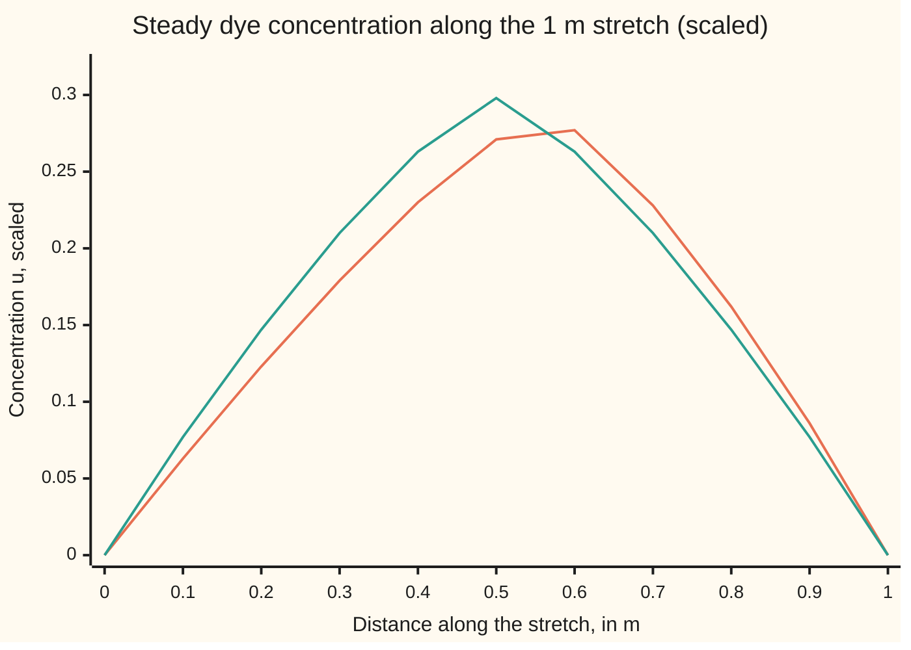

# Monotone operators: Minty's trick solves nonlinear equations that have no energy

[Syllabus](../../../SYLLABUS.md) → [Partial differential equations](../README.md) → [Nonlinear PDE and Fluids](../README.md#s07) → Monotone operators

---

## General Overview

Take the shelf's pipe: water at 1 m/s in a 5 cm pipe. Along a 1 m stretch, a tracer dye is fed into the water at an even rate. The flow carries the dye downstream. Mixing spreads it out. At both ends of the stretch the excess dye is drawn off, so it is zero there.

The mixing on this card is nonlinear: the dye flux (the amount crossing a point each second) grows as the cube of the slope of the concentration. Steep slopes mix much harder than gentle ones. This cube law is illustrative. In scaled units (speed, mixing constant and feed rate all set to 1), the steady concentration $`u(x)`$ along the stretch obeys

```math
-\bigl((u')^3\bigr)' + u' = 1 \quad \text{on } 0 < x < 1, \qquad u(0) = u(1) = 0 .
```

The unknown is $`u`$. The region is the 1 m stretch. The data are the even feed (the 1 on the right) and the zero ends. Wing 08 solved linear two-point problems of this kind by integrating twice; this card proves when a nonlinear one has exactly one solution.

The answer: the concentration peaks at 0.2876 (scaled units), 0.5604 m along the stretch. The flow pushes the peak 6 cm downstream of the middle. Without the flow, the peak would be 0.2976, exactly in the middle.

Why is this hard? [The direct method](10-direct-method-in-the-calculus-of-variations.md) solves an equation by minimising an **energy**: a number attached to each candidate function, whose lowest point solves the equation. The drift term $`u'`$ (the flow carrying dye) has no energy. Take a closed loop of candidate functions and add up the operator's push along it: that total is the **work**. For the drift it is 8.378. An energy would give 0. So there is nothing to minimise.

The rescue is a sign condition instead of an energy. Push two candidates through the left-hand side. Their difference always points the same way as the difference of the candidates. That is **monotonicity**, and it is enough.

**On a reflexive space, a monotone, coercive, hemicontinuous operator hits every target, energy or not: Minty's trick proves that the weak limit of Galerkin answers solves the equation.**

**What kind of fact this is:** a theorem, the Minty–Browder theorem. Why it works proves it for separable spaces and operators that map bounded sets to bounded sets, which covers the example. The general statement is cited (Browder 1963, Zeidler). The existence, uniqueness and closed form of the pipe's solution are proved on this card. The cube mixing law is a model, chosen to show the method.

### The picture: the dye profile with and without the flow



Caption: the orange line is the pipe with the flow (drift on): it peaks at 0.2876, at 0.5604 m. The teal line is the same mixing with no flow: it is symmetric, with peak 0.2976 at 0.5 m. Only the teal problem has an energy.

---

## The formula

Notation from earlier cards, in one line each. The **dual** $`X^*`$ of a normed space $`X`$ is the set of its continuous linear measurements, and $`\langle g, v\rangle`$ is measurement $`g`$ read at $`v`$ ([Dual spaces](../../18-Functional%20analysis/01-Normed%20and%20Banach%20Spaces/09-dual-spaces-and-lp-duality.md)). $`X`$ is **reflexive** when it is exactly the dual of its dual ([Reflexive spaces](../../18-Functional%20analysis/01-Normed%20and%20Banach%20Spaces/10-reflexive-spaces-and-the-second-dual.md)). A sequence **converges weakly**, $`u_m \rightharpoonup u`$, when every measurement settles: $`\langle g, u_m\rangle \to \langle g, u\rangle`$ for each $`g`$ ([Weak convergence](../../18-Functional%20analysis/02-Hilbert%20Spaces/09-weak-convergence-and-banach-alaoglu.md)).

This card introduces three conditions on an operator $`A : X \to X^*`$ (a rule that turns each function into a measurement):

- **Monotone:** $`\langle Au - Av,\, u - v\rangle \ge 0`$ for all $`u, v`$. Strictly monotone: $`> 0`$ whenever $`u \ne v`$.
- **Coercive:** $`\langle Au, u\rangle / \lVert u\rVert \to \infty`$ as $`\lVert u\rVert \to \infty`$. Far out, $`A`$ pushes back harder than any fixed target.
- **Hemicontinuous:** for all $`u, v, w`$, the number $`\langle A(u + r v), w\rangle`$ depends continuously on the real number $`r`$. Continuity along straight lines only.

The theorem:

```math
X \text{ reflexive},\ A : X \to X^* \text{ monotone, coercive, hemicontinuous} \;\Longrightarrow\; \text{for every } f \in X^* \text{ there is } u \in X \text{ with } \langle Au, v\rangle = \langle f, v\rangle \ \text{for all } v \in X .
```

**Read it aloud:** if pushing harder always moves the output the same way as the input, and pushing far enough outruns any target, then every target is hit; if the push is strict, it is hit exactly once.

For the pipe, $`X = W^{1,4}_0(0,1)`$: functions with zero ends whose slope has finite $`\int_0^1 (u')^4\,dx`$, with norm $`\lVert u\rVert = \bigl(\int_0^1 (u')^4\,dx\bigr)^{1/4}`$. The operator and the target, in weak form with test function $`v`$:

```math
\langle Au, v\rangle = \int_0^1 (u')^3\,v'\,dx + \int_0^1 u'\,v\,dx, \qquad \langle f, v\rangle = \int_0^1 v\,dx .
```

**Read it aloud:** the mixing flux tested against the slope of $`v`$, plus the drift tested against $`v`$ itself, must equal the feed tested against $`v`$.

| Symbol | Plain meaning | In our example | Push it up and the answer… |
| --- | --- | --- | --- |
| $`u(x)`$ | dye concentration above the inflow level, scaled | peak 0.2876 | (the unknown) |
| $`x`$ | distance along the stretch | 0 to 1 m; peak at 0.5604 m | |
| $`A`$ | the operator: mixing plus drift, as a measurement | $`-((u')^3)' + u'`$ | |
| $`f`$ | the target: the even feed | 1 | |
| $`X,\ X^*`$ | the space of candidates and its dual | $`W^{1,4}_0(0,1)`$ and its dual | |
| $`\langle g, v\rangle,\ \chi`$ | measurement $`g`$ read at the function $`v`$; $`\chi`$ is the weak limit of the measurements $`Au_m`$ | $`\int_0^1 v\,dx`$ for the feed; $`\chi = f`$ | |
| $`r`$ | a real number moving along a straight line in $`X`$ | in hemicontinuity | |
| $`z,\ z_0,\ z_1,\ G(z)`$ | the slope $`u'`$ used as a coordinate (called `t` in the code), its inlet and outlet values, and distance as a function of slope | $`z_0`$ = 0.6485, $`z_1`$ = −0.8993 | a steeper slope mixes much harder: flux $`z^3`$ |
| $`c`$ | constant from integrating once (not a wave speed) | −0.2727 | |
| $`w_k,\ X_m,\ u_m,\ \xi,\ F`$; $`V_h,\ u_h,\ h`$ | Galerkin: basis functions, the span of the first $`m`$, its answer, the answer's coefficients and the equations $`F(\xi) = 0`$; for hat functions, the space, its answer and the mesh step | $`h`$ = 1/40 to 1/1280 m | smaller $`h`$, error falls about as $`h^{0.94}`$ |
| $`u_m \rightharpoonup u`$ | weak convergence: every measurement settles | Galerkin answers to $`u`$ | |
| $`\ell(a),\ E`$ | a closed loop of candidates, $`a`$ from 0 to $`2\pi`$; an energy, whose loop work would be 0 | $`\cos a\,\sin \pi x + \sin a\,\sin 2\pi x`$; drift work 8.378 | |

### When it holds

- **Reflexive space.** Bounded Galerkin answers must have a weakly convergent subsequence. In a non-reflexive space such as $`W^{1,1}`$ (slope merely integrable), bounded sequences can lose their limit, and the method has nothing to pass to.
- **Monotone.** Without it, Minty's trick cannot identify the limit, and uniqueness goes too: $`x^3 - 3x = 0`$ has three solutions, −1.732051, 0 and 1.732051.
- **Coercive.** Without it, the Galerkin answers need not stay bounded. The monotone, continuous map $`\arctan x`$ never reaches 2: it stays below $`\pi/2`$ = 1.570796.
- **Hemicontinuous.** Without it, the last step of the proof fails. The monotone, coercive map $`x + [x \ge 0]`$ (the bracket is 1 when true, 0 when false) is −0.001 at $`x`$ = −0.001 and 1 at $`x = 0`$, so it skips the target 0.5.
- **Strict monotonicity for uniqueness.** Plain monotone operators can have a whole segment of solutions. The pipe's operator is strict, because $`(a^3 - b^3)(a - b) > 0`$ whenever $`a \ne b`$.

---

## Why it works

### Step 0: the idea

On the real line, a continuous increasing function that runs off to $`\pm\infty`$ takes every value. That is the intermediate value theorem. Minty–Browder is the same fact in infinite dimensions.

The difficulty is the limit. Approximate solutions are easy to build in finitely many dimensions, and they stay bounded. In infinite dimensions, bounded only buys weak convergence, and weak limits do not pass through nonlinear terms. Monotonicity is what passes instead: an inequality survives a weak limit when an equation does not.

### Step 1: the pipe's operator is monotone, coercive and has no energy

Take two candidates $`u`$ and $`v`$. Then

```math
\langle Au - Av,\, u - v\rangle = \int_0^1 \bigl((u')^3 - (v')^3\bigr)(u' - v')\,dx + \int_0^1 (u' - v')(u - v)\,dx .
```

The first integral is never negative, because $`a^3 - b^3`$ has the sign of $`a - b`$. The second is $`\tfrac12 (u - v)^2`$ evaluated between the ends, which is 0 because both functions vanish at both ends. For $`u = x(1 - x)`$ and $`v = \tfrac14 \sin \pi x`$ the code finds 0.009079956 and 0.000000000. So $`A`$ is strictly monotone.

Testing $`A`$ against $`u`$ itself gives $`\langle Au, u\rangle = \int_0^1 (u')^4\,dx = \lVert u\rVert^4`$, since the drift part is again 0. Divided by $`\lVert u\rVert`$ that is $`\lVert u\rVert^3`$, which runs off to infinity. So $`A`$ is coercive. Along a line, $`\langle A(u + r v), w\rangle`$ is a cubic polynomial in $`r`$, so $`A`$ is hemicontinuous.

**No energy.** If $`A`$ were the derivative of an energy $`E`$, the work $`\int \langle A(\ell(a)), \ell'(a)\rangle\,da`$ around any closed loop $`\ell`$ would be $`E`$ at the end minus $`E`$ at the start: 0. Take $`\ell(a) = \cos a\,\sin \pi x + \sin a\,\sin 2\pi x`$. The mixing part does work 0, as a derivative must. The drift part does work $`8\pi/3`$ = 8.378. So no energy exists, and the direct method has nothing to minimise.

<details>
<summary>Detailed proof: the drift's loop work is exactly 8π/3</summary>

Write $`p = \sin \pi x`$ and $`q = \sin 2\pi x`$ (not the mesh step $`h`$). The drift part of $`\langle A\ell, \ell'\rangle`$ is $`\int_0^1 (\ell)_x\,\ell'(a)\,dx`$, where $`(\ell)_x`$ is the slope in $`x`$ and $`\ell'(a) = -\sin a\, p + \cos a\, q`$. Expand. The terms $`\int p' p`$ and $`\int q' q`$ are 0, since each is half a square evaluated between zero ends. The cross terms are

$`\displaystyle \int_0^1 p' q\,dx = \pi \int_0^1 \cos \pi x\,\sin 2\pi x\,dx = \frac{4}{3}, \qquad \int_0^1 q' p\,dx = -\frac{4}{3} .`$

So the integrand is $`\tfrac43(\cos^2 a + \sin^2 a) = \tfrac43`$ at every $`a`$, and the loop work is $`\tfrac43 \cdot 2\pi = 8\pi/3`$.

The mixing part is the derivative of $`E(u) = \tfrac14 \int_0^1 (u')^4\,dx`$, so its loop work is $`E(\ell(2\pi)) - E(\ell(0)) = 0`$.

</details>

### Step 2: Galerkin answers exist in every finite dimension

Pick $`w_1, w_2, \dots`$ whose finite combinations come as close as we like to every element of $`X`$ (this needs $`X`$ separable, which $`W^{1,4}_0`$ is). In $`X_m`$, the span of the first $`m`$, look for $`u_m`$ with

```math
\langle Au_m, w_k\rangle = \langle f, w_k\rangle \quad \text{for } k = 1, \dots, m .
```

Write $`u_m = \sum_j \xi_j w_j`$. Then the $`m`$ equations say $`F(\xi) = 0`$ for a continuous map $`F`$ of $`\mathbb{R}^m`$ to itself. Coercivity gives $`F(\xi)\cdot\xi = \langle Au_m - f, u_m\rangle > 0`$ on a large sphere $`|\xi| = R`$. A continuous map that points outward on a sphere has a zero inside it. That is the **acute-angle lemma**, a corollary of Brouwer's fixed-point theorem ([Brouwer and Borsuk-Ulam](../../17-Topology/04-Homotopy/08-brouwer-and-borsuk-ulam.md)).

<details>
<summary>Detailed proof: the acute-angle lemma from Brouwer</summary>

Suppose $`F`$ is continuous on the ball $`|\xi| \le R`$, $`F(\xi)\cdot\xi > 0`$ on the sphere $`|\xi| = R`$, and $`F`$ has no zero in the ball. Then

$`\displaystyle g(\xi) = -R\,\frac{F(\xi)}{|F(\xi)|}`$

is continuous and maps the ball into its own sphere. By Brouwer, $`g`$ has a fixed point $`\xi^*`$. It lies on the sphere, so $`|\xi^*| = R`$, and

$`\displaystyle R^2 = \xi^*\cdot\xi^* = \xi^*\cdot g(\xi^*) = -R\,\frac{F(\xi^*)\cdot\xi^*}{|F(\xi^*)|} < 0 ,`$

which is impossible. So $`F`$ has a zero. For continuity of $`F`$: a monotone hemicontinuous operator is continuous from finite-dimensional subspaces into the weak-star topology (Zeidler); for the pipe, $`F`$ is a polynomial in $`\xi`$.

</details>

### Step 3: a uniform bound, and a weak limit

Test the Galerkin equations with $`u_m`$ itself: $`\langle Au_m, u_m\rangle = \langle f, u_m\rangle \le \lVert f\rVert\,\lVert u_m\rVert`$. Coercivity then caps $`\lVert u_m\rVert`$ by one number for every $`m`$.

For the pipe this is explicit. $`\lVert u\rVert^4 = \int_0^1 u\,dx \le \lVert u\rVert`$, so $`\lVert u\rVert \le 1`$. The checks find $`\int (u')^4 = \int u`$ = 0.163393832 for the true solution, so $`\lVert u\rVert`$ = 0.635783.

If $`A`$ maps bounded sets to bounded sets (true for the pipe: $`\lVert Au\rVert_{X^*} \le \lVert u\rVert^3 + \lVert u\rVert`$), the measurements $`Au_m`$ are bounded too. $`X`$ is reflexive, and so is $`X^*`$. So a subsequence has $`u_m \rightharpoonup u`$ in $`X`$ and $`Au_m \rightharpoonup \chi`$ in $`X^*`$, for some measurement $`\chi`$. Passing to the limit in the Galerkin equations gives $`\langle \chi, w_k\rangle = \langle f, w_k\rangle`$ for every $`k`$, so $`\chi = f`$.

The open question is whether $`\chi = Au`$. Weak convergence alone cannot say. Slopes that flip between 2 and 0 ever faster converge weakly to the slope 1, yet their cubes converge weakly to 4, not to $`1^3 = 1`$. Tested against $`x`$, the cube of the limit gives 0.5 and the limit of the cubes gives 2.0.

### Step 4: Minty's trick

Fix any competitor $`v`$ in $`X`$. Monotonicity gives, for every $`m`$,

```math
0 \le \langle Au_m - Av,\, u_m - v\rangle = \langle Au_m, u_m\rangle - \langle Au_m, v\rangle - \langle Av, u_m - v\rangle .
```

Each term on the right now has a limit. The first is $`\langle f, u_m\rangle`$ by the Galerkin equations, which tends to $`\langle f, u\rangle`$. This is the key move: a product of two weakly converging things, whose limit is known only because the equation names it. The other two terms are a fixed measurement read on a weakly converging sequence, or the reverse. In the limit,

```math
\langle f - Av,\, u - v\rangle \ge 0 \quad \text{for every } v \in X .
```

**Read it aloud:** the target minus what $`A`$ does at any competitor points the same way as the step from the competitor to the limit.

### Step 5: hemicontinuity turns the inequality into the equation

Put $`v = u - r w`$, with $`r > 0`$ and any $`w`$. Divide by $`r`$: $`\langle f - A(u - r w), w\rangle \ge 0`$. Let $`r \to 0`$. Hemicontinuity gives $`\langle f - Au, w\rangle \ge 0`$ for every $`w`$. Replace $`w`$ by $`-w`$ to get the reverse inequality. So $`\langle Au, w\rangle = \langle f, w\rangle`$ for all $`w`$: $`u`$ solves the equation.

**Uniqueness.** If $`u`$ and $`\tilde u`$ both solve it, then $`\langle Au - A\tilde u,\, u - \tilde u\rangle = 0`$. Strict monotonicity forces $`u = \tilde u`$. So the pipe has exactly one weak solution in $`W^{1,4}_0`$, and the whole Galerkin sequence converges to it, not just a subsequence.

### Step 6: the pipe's solution in closed form

Integrate the equation once from 0 to $`x`$:

```math
(u')^3 = u - x - c, \qquad c = -\,u'(0)^3 .
```

Use the slope $`z = u'`$ as the coordinate. Differentiating gives $`3z^2\,z' = z - 1`$, so $`dx = 3z^2\,dz/(z - 1)`$, and

```math
x = G(z) - G(z_0), \qquad G(z) = 3\Bigl(\tfrac12 z^2 + z + \ln(1 - z)\Bigr), \qquad u = z^3 + c + x .
```

**Read it aloud:** distance along the stretch is a known function of the slope, and the concentration follows from the slope and the distance.

Two conditions fix the inlet slope $`z_0`$. The outlet slope $`z_1`$ must give $`u(1) = 0`$, so $`z_1^3 = z_0^3 - 1`$. And the stretch must be 1 m long: $`G(z_1) - G(z_0) = 1`$. That is one equation for $`z_0`$, solved by bisection. The peak is where the slope is 0: at $`x = -G(z_0)`$, with height $`u = -G(z_0) + c`$.

This solution has a continuous slope, and its flux $`(u')^3`$ is differentiable, so the equation holds at every point. But $`z' = (z - 1)/(3z^2)`$ is infinite where $`z = 0`$: $`u''`$ blows up at the peak. The solution is not twice differentiable there. That one point is what slows the grid roads in the code.

---

## Worked numbers, by hand

| Step | Arithmetic | Value |
| --- | --- | --- |
| inlet slope $`z_0 = u'(0)`$ | bisection on $`G(z_1) - G(z_0) = 1`$ | 0.648514 |
| constant $`c`$ | $`-z_0^3 = -0.648514^3`$ | −0.272745 |
| outlet slope $`z_1 = u'(1)`$ | $`\sqrt[3]{0.272745 - 1}`$ | −0.899281 |
| $`G(z_0)`$ | $`3(0.210285 + 0.648514 + \ln 0.351486)`$ | −0.560357 |
| $`G(z_1)`$ | $`3(0.404353 - 0.899281 + \ln 1.899281)`$ | 0.439643 |
| length check | $`0.439643 - (-0.560357)`$ | 1.000000 m |
| peak position | $`-G(z_0)`$ | 0.560357 m |
| peak height | $`0.560357 - 0.272745`$ | **0.287612** |
| no-flow peak | $`\tfrac34 (1/2)^{4/3}`$ | 0.297638 |
| a priori bound | $`\int (u')^4 = \int u`$ = 0.163394, so $`\lVert u\rVert = 0.163394^{1/4}`$ | 0.635783 ≤ 1 |

The flow carries the peak 0.0604 m, about 6 cm, downstream of the middle. It also lowers the peak by 0.0100, because the flow sweeps dye toward the outlet, where it is drawn off.

### What breaks if you drop a piece

| Mistake | Comes out at | What went wrong |
| --- | --- | --- |
| Minimise the energy $`\int (\tfrac14 (u')^4 - u)\,dx`$, ignoring the drift | peak 0.297638 at 0.5 m (right: 0.287612 at 0.560357 m) | That energy belongs to the no-flow problem. The drift has none: its loop work is 8.377580, not 0 |
| Take the weak limit of $`(u_m')^3`$ to be the cube of the weak limit | 0.5 (right: 2.0) | Weak limits do not pass through a cube. Slopes flipping between 2 and 0 have weak limit 1, but their cubes have weak limit 4 |
| Drop coercivity: solve $`\arctan x = 2`$ | no solution: $`\arctan(10^6)`$ = 1.570795, below $`\pi/2`$ = 1.570796 | Monotone and continuous, but it flattens out and never reaches the target |
| Drop hemicontinuity: solve $`x + [x \ge 0] = 0.5`$ | no solution: −0.001 just left of 0, then 1.000 at 0 | Monotone and coercive, but the jump skips the target |
| Drop monotonicity: solve $`x^3 - 3x = 0`$ | three solutions: −1.732051, 0, 1.732051 | Coercive and continuous, so a solution exists, but uniqueness is gone |

---

## Code, from first principles, and it actually runs

The code solves the pipe by **three independent roads**. Road 1 is the closed form from Step 6: one bisection for the inlet slope. Road 2 is shooting: RK4 (the classical fourth-order Runge–Kutta stepper) on $`u' = \sqrt[3]{u - x - c}`$ from $`u(0) = 0`$, with bisection on $`c`$ until $`u(1) = 0`$. Road 3 is Galerkin on hat functions at six mesh steps, solved by Newton's method. Then the code checks the a priori identity $`\int (u')^4 = \int u`$ two ways, monotonicity on one pair, the loop work $`8\pi/3`$, the weak-limit failure of the cube, and the three one-dimensional failures. No imported routine solves an equation, integrates or finds a root.

### Python

```python
# Monotone operators and Minty-Browder -- the check behind the card.  Standard library only.
# Problem (scaled): -((u')^3)' + u' = 1 on 0 < x < 1, u(0) = u(1) = 0.  Three roads to u:
# a closed form after integrating once, RK4 shooting, and Galerkin on hat functions.
from math import log, pi, sin, cos, atan

def cbrt(y): return y ** (1 / 3) if y >= 0 else -((-y) ** (1 / 3))
def G(t): return 3 * (t * t / 2 + t + log(1 - t))      # along the solution x = G(t) - G(t0), t = u'

def bisect(f, lo, hi, n=80):                            # root of f between lo and hi (f changes sign)
    flo = f(lo)
    for _ in range(n):
        mid = (lo + hi) / 2
        fm = f(mid)
        if (fm > 0) == (flo > 0): lo, flo = mid, fm
        else: hi = mid
    return (lo + hi) / 2

def simpson(f, a, b, n=2000):
    h = (b - a) / n
    return h / 3 * (f(a) + f(b) + sum((4 if i % 2 else 2) * f(a + i * h) for i in range(1, n)))

# ---- road 1: integrate once, (u')^3 = u - x - c; separate variables; one equation for t0 = u'(0)
t0 = bisect(lambda s: G(cbrt(s ** 3 - 1)) - G(s) - 1, 0.0, 0.999)
t1, c = cbrt(t0 ** 3 - 1), -t0 ** 3
xpk = -G(t0); upk = xpk + c                             # the peak sits where t = u' = 0
def u_exact(x):
    if x <= 0 or x >= 1: return 0.0
    t = bisect(lambda s: G(s) - G(t0) - x, t1, t0)
    return t ** 3 + c + x
dxdt = lambda t: 3 * t * t / (1 - t)                    # |dx/dt|: integrate over x by integrating over t
energy = simpson(lambda t: t ** 4 * dxdt(t), t1, t0)    # int (u')^4 dx
mass = simpson(lambda t: (t ** 3 + c + G(t) - G(t0)) * dxdt(t), t1, t0)   # int u dx
print(f"road 1 closed form: u'(0) = {t0:.9f}, u'(1) = {t1:.9f}, c = {c:.9f}")
print(f"  G(u'(0)) = {G(t0):.6f}, G(u'(1)) = {G(t1):.6f}, difference = {G(t1) - G(t0):.6f} m")
print(f"  by hand: z0^2/2 = {t0 * t0 / 2:.6f}, 1 - z0 = {1 - t0:.6f}, z1^2/2 = {t1 * t1 / 2:.6f}, 1 - z1 = {1 - t1:.6f}")
print(f"  peak u = {upk:.9f} at x = {xpk:.9f} m")
print(f"  test with u: int (u')^4 = {energy:.9f}, int u = {mass:.9f}, ||u'||_4 = {energy ** 0.25:.6f}")

# ---- road 2: shooting.  u' = cbrt(u - x - c) by RK4 from u(0) = 0; bisect on c until u(1) = 0
def shoot(cc, n):
    h, u = 1 / n, 0.0
    f = lambda x, u: cbrt(u - x - cc)
    for i in range(n):
        x = i * h
        k1 = f(x, u); k2 = f(x + h / 2, u + h / 2 * k1); k3 = f(x + h / 2, u + h / 2 * k2); k4 = f(x + h, u + h * k3)
        u += h * (k1 + 2 * k2 + 2 * k3 + k4) / 6
    return u
shots = [bisect(lambda cc: shoot(cc, n), -1.0, 0.0, 60) for n in (1000, 4000)]
for n, cs in zip((1000, 4000), shots): print(f"road 2 shooting, {n} RK4 steps: c = {cs:.9f}, |error| = {abs(cs - c):.1e}")
print(f"  error ratio, 1000 to 4000 steps: {abs(shots[0] - c) / abs(shots[1] - c):.1f}")

# ---- road 3: Galerkin on hat functions, drift strength b; Newton's method with a tridiagonal solve
def galerkin(N, b=1.0):
    h = 1 / N
    U = [x * (1 - x) for x in (i * h for i in range(N + 1))]
    for _ in range(60):
        s = [(U[e + 1] - U[e]) / h for e in range(N)]
        R = [s[i - 1] ** 3 - s[i] ** 3 + b * (U[i + 1] - U[i - 1]) / 2 - h for i in range(1, N)]
        lo = [-3 * s[i - 1] ** 2 / h - b / 2 for i in range(1, N)]
        di = [3 * (s[i - 1] ** 2 + s[i] ** 2) / h for i in range(1, N)]
        up = [-3 * s[i] ** 2 / h + b / 2 for i in range(1, N)]
        m = N - 1
        for i in range(1, m):                           # elimination, then back substitution
            w = lo[i] / di[i - 1]; di[i] -= w * up[i - 1]; R[i] -= w * R[i - 1]
        d = [0.0] * m
        d[m - 1] = R[m - 1] / di[m - 1]
        for i in range(m - 2, -1, -1): d[i] = (R[i] - up[i] * d[i + 1]) / di[i]
        for i in range(m): U[i + 1] -= d[i]
        if max(abs(v) for v in d) < 1e-14: break
    return U
u0 = lambda x: 0.75 * (0.5 ** (4 / 3) - abs(0.5 - x) ** (4 / 3))   # no drift: the energy case, by hand
Ns, errs = (40, 80, 160, 320, 640, 1280), []
for N in Ns:
    U = galerkin(N)
    errs.append(max(abs(U[i] - u_exact(i / N)) for i in range(1, N)))
    k = max(range(N + 1), key=lambda i: U[i])
    print(f"road 3 Galerkin h = 1/{N:<4d}: max node error {errs[-1]:.3e}, top node u = {U[k]:.6f} at x = {k / N:.6f} m")
print(f"  overall order from h = 1/80 to 1/1280: {log(errs[1] / errs[-1]) / log(16):.3f}")
print(f"  error ratios: 1/80 to 1/160 {errs[1] / errs[2]:.1f}, 1/320 to 1/640 {errs[3] / errs[4]:.1f}")
sh = [(U[i + 1] - U[i]) * 1280 for i in range(1280)]
print(f"  h = 1/1280 tested with u_h: int (u_h')^4 = {sum(v ** 4 for v in sh) / 1280:.9f}, int u_h = {sum(U) / 1280:.9f}")
U0 = galerkin(80, 0.0)
e0 = max(abs(U0[i] - u0(i / 80)) for i in range(1, 80))
print(f"no drift: peak u = {u0(0.5):.9f} at x = 0.5 m; Galerkin h = 1/80 max node error {e0:.3e}")
print(f"  the flow moves the peak {xpk - 0.5:.4f} m downstream and lowers it by {u0(0.5) - upk:.4f}")
xs = [i / 10 for i in range(11)]
print(f"{'chart x (m)':<17}" + " ".join(f"{x:5.1f}" for x in xs))
print(f"{'chart with drift':<17}" + " ".join(f"{u_exact(x):5.3f}" for x in xs))
print(f"{'chart no drift':<17}" + " ".join(f"{u0(x):5.3f}" for x in xs))

# ---- monotone: u = x(1 - x), v = sin(pi x)/4.  <Au - Av, u - v> = cubic part + drift part
du, dv = (lambda x: 1 - 2 * x), (lambda x: pi * cos(pi * x) / 4)
mono_cube = simpson(lambda x: (du(x) ** 3 - dv(x) ** 3) * (du(x) - dv(x)), 0, 1)
mono_drift = simpson(lambda x: (du(x) - dv(x)) * (x * (1 - x) - sin(pi * x) / 4), 0, 1)
print(f"monotone check: cubic part {mono_cube:.9f}, drift part {abs(mono_drift):.9f}")

# ---- no energy: work of A around the loop g(s) = cos(s) sin(pi x) + sin(s) sin(2 pi x), 0 <= s <= 2 pi
M, cube, drift = 200, 0.0, 0.0
for j in range(M):                                      # trapezoid in s: very accurate for a periodic integrand
    s = 2 * pi * j / M
    dg = lambda x: cos(s) * pi * cos(pi * x) + sin(s) * 2 * pi * cos(2 * pi * x)
    gs = lambda x: -sin(s) * sin(pi * x) + cos(s) * sin(2 * pi * x)
    dgs = lambda x: -sin(s) * pi * cos(pi * x) + cos(s) * 2 * pi * cos(2 * pi * x)
    cube += simpson(lambda x: dg(x) ** 3 * dgs(x), 0, 1, 400) * 2 * pi / M
    drift += simpson(lambda x: dg(x) * gs(x), 0, 1, 400) * 2 * pi / M
print(f"loop work: cubic part {abs(cube):.9f}, drift part = {drift:.9f}, 8 pi/3 = {8 * pi / 3:.9f}")

# ---- why a weak limit needs Minty: slopes w_m = 2 on the first half of each of m periods, else 0
for m in (10, 1000):
    w, n = (lambda x: 2.0 if (x * m) % 1 < 0.5 else 0.0), 20000
    a = sum(w((i + 0.5) / n) * (i + 0.5) / n for i in range(n)) / n
    b = sum(w((i + 0.5) / n) ** 3 * (i + 0.5) / n for i in range(n)) / n
    print(f"m = {m}: int w_m x dx = {a:.6f} (1/2 - 1/(4m) = {0.5 - 0.25 / m:.6f}), int w_m^3 x dx = {b:.6f}")
print(f"weak limit w = 1: int 1^3 x dx = {0.5:.6f}; limit of int w_m^3 x dx = {2.0:.6f} = 4 x 0.5")

# ---- what breaks: one-dimensional operators, each missing one hypothesis
print(f"not coercive: arctan(x) = 2 has no root; arctan(1e6) = {atan(1e6):.6f}, pi/2 = {pi / 2:.6f}")
jump = lambda x: x + (1.0 if x >= 0 else 0.0)
print(f"not hemicontinuous: x + [x >= 0] = 0.5 has no root; value {jump(-1e-3):.6f} at x = -0.001, {jump(0.0):.6f} at 0")
roots = [round(bisect(lambda x: x ** 3 - 3 * x, a, b), 6) + 0.0 for a, b in ((-2.5, -1.0), (-1.0, 1.2), (1.0, 2.5))]
print("not monotone: x^3 - 3x = 0 has roots " + ", ".join(f"{r:.6f}" for r in roots))

assert abs(energy - mass) < 1e-9, "testing with u: int (u')^4 must equal int u"
assert abs(U[k] - upk) < 2e-5 and abs(k / 1280 - xpk) < 2 / 1280, "Galerkin top node lands on the closed-form peak"
assert all(abs(cs - c) < 1e-4 for cs in shots), "shooting lands on the closed form's c"
assert errs[-1] < 2e-5 and errs[0] > errs[1] > errs[-1], "Galerkin settles on the closed form"
assert e0 < 2e-4, "Galerkin without drift lands on the energy case's formula"
assert mono_cube > 0 and abs(mono_drift) < 1e-9, "monotone: cubic part positive, drift part zero"
assert abs(drift - 8 * pi / 3) < 1e-8 and abs(cube) < 1e-8, "loop work: drift 8 pi/3, cubic part 0"
assert abs(b - (2 - 1 / m)) < 1e-9, "weak limit of the cubes is 2, not the cube of the weak limit"
print("ALL CHECKS PASS")
```

**Ran 2026-11-24 on macOS, Python 3.14.10, standard library only. All checks passed. Output, pasted from the run:**

```
road 1 closed form: u'(0) = 0.648513581, u'(1) = -0.899281208, c = -0.272745269
  G(u'(0)) = -0.560357, G(u'(1)) = 0.439643, difference = 1.000000 m
  by hand: z0^2/2 = 0.210285, 1 - z0 = 0.351486, z1^2/2 = 0.404353, 1 - z1 = 1.899281
  peak u = 0.287611809 at x = 0.560357078 m
  test with u: int (u')^4 = 0.163393832, int u = 0.163393832, ||u'||_4 = 0.635783
road 2 shooting, 1000 RK4 steps: c = -0.272751894, |error| = 6.6e-06
road 2 shooting, 4000 RK4 steps: c = -0.272746476, |error| = 1.2e-06
  error ratio, 1000 to 4000 steps: 5.5
road 3 Galerkin h = 1/40  : max node error 1.771e-03, top node u = 0.287764 at x = 0.550000 m
road 3 Galerkin h = 1/80  : max node error 2.076e-04, top node u = 0.287589 at x = 0.562500 m
road 3 Galerkin h = 1/160 : max node error 1.479e-04, top node u = 0.287479 at x = 0.562500 m
road 3 Galerkin h = 1/320 : max node error 1.082e-04, top node u = 0.287648 at x = 0.559375 m
road 3 Galerkin h = 1/640 : max node error 2.861e-05, top node u = 0.287588 at x = 0.560937 m
road 3 Galerkin h = 1/1280: max node error 1.521e-05, top node u = 0.287618 at x = 0.560156 m
  overall order from h = 1/80 to 1/1280: 0.943
  error ratios: 1/80 to 1/160 1.4, 1/320 to 1/640 3.8
  h = 1/1280 tested with u_h: int (u_h')^4 = 0.163395068, int u_h = 0.163395068
no drift: peak u = 0.297637697 at x = 0.5 m; Galerkin h = 1/80 max node error 1.625e-04
  the flow moves the peak 0.0604 m downstream and lowers it by 0.0100
chart x (m)        0.0   0.1   0.2   0.3   0.4   0.5   0.6   0.7   0.8   0.9   1.0
chart with drift 0.000 0.063 0.123 0.179 0.230 0.271 0.277 0.228 0.162 0.086 0.000
chart no drift   0.000 0.077 0.147 0.210 0.263 0.298 0.263 0.210 0.147 0.077 0.000
monotone check: cubic part 0.009079956, drift part 0.000000000
loop work: cubic part 0.000000000, drift part = 8.377580408, 8 pi/3 = 8.377580410
m = 10: int w_m x dx = 0.475000 (1/2 - 1/(4m) = 0.475000), int w_m^3 x dx = 1.900000
m = 1000: int w_m x dx = 0.499750 (1/2 - 1/(4m) = 0.499750), int w_m^3 x dx = 1.999000
weak limit w = 1: int 1^3 x dx = 0.500000; limit of int w_m^3 x dx = 2.000000 = 4 x 0.5
not coercive: arctan(x) = 2 has no root; arctan(1e6) = 1.570795, pi/2 = 1.570796
not hemicontinuous: x + [x >= 0] = 0.5 has no root; value -0.001000 at x = -0.001, 1.000000 at 0
not monotone: x^3 - 3x = 0 has roots -1.732051, 0.000000, 1.732051
ALL CHECKS PASS
```

Three roads agree. Shooting lands within $`10^{-5}`$ of the closed form's $`c`$. RK4's usual fourth-order accuracy is lost here, because the cube root has an infinite slope at the peak. Galerkin's largest node error falls from 1.771e-03 at $`h`$ = 1/40 to 1.521e-05 at $`h`$ = 1/1280, an overall order of 0.943 from 1/80 to 1/1280. The fall is uneven, because the peak, where $`u''`$ is infinite, sits at a different place between nodes on each mesh. The theorem promises convergence, not a rate.

### Rust

The same checks with the same labels, in Rust with no crates. The output is identical.

```rust
// Monotone operators and Minty-Browder -- the same check as the Python file, in Rust.  std only, no crates.
// Problem (scaled): -((u')^3)' + u' = 1 on 0 < x < 1, u(0) = u(1) = 0.  Three roads to u:
// a closed form after integrating once, RK4 shooting, and Galerkin on hat functions.
use std::f64::consts::PI;

fn cbrt(y: f64) -> f64 { if y >= 0.0 { y.powf(1.0 / 3.0) } else { -(-y).powf(1.0 / 3.0) } }
fn g_of(t: f64) -> f64 { 3.0 * (t * t / 2.0 + t + (1.0 - t).ln()) }   // x = G(t) - G(t0) along the solution

fn bisect<F: Fn(f64) -> f64>(f: F, mut lo: f64, mut hi: f64, n: usize) -> f64 {
    let mut flo = f(lo);
    for _ in 0..n {
        let mid = (lo + hi) / 2.0;
        let fm = f(mid);
        if (fm > 0.0) == (flo > 0.0) { lo = mid; flo = fm; } else { hi = mid; }
    }
    (lo + hi) / 2.0
}

fn simpson<F: Fn(f64) -> f64>(f: F, a: f64, b: f64, n: usize) -> f64 {
    let h = (b - a) / n as f64;
    let mut acc = 0.0;
    for i in 1..n { acc += if i % 2 == 1 { 4.0 } else { 2.0 } * f(a + i as f64 * h); }
    h / 3.0 * (f(a) + f(b) + acc)
}

fn sci(v: f64, p: usize) -> String {                                   // Python-style e-notation: 6.6e-06
    let s = format!("{:.*e}", p, v);
    let (m, e) = s.split_once('e').unwrap();
    let e: i32 = e.parse().unwrap();
    format!("{}e{}{:02}", m, if e < 0 { '-' } else { '+' }, e.abs())
}

fn shoot(cc: f64, n: usize) -> f64 {
    let (h, mut u) = (1.0 / n as f64, 0.0);
    let f = |x: f64, u: f64| cbrt(u - x - cc);
    for i in 0..n {
        let x = i as f64 * h;
        let k1 = f(x, u); let k2 = f(x + h / 2.0, u + h / 2.0 * k1);
        let k3 = f(x + h / 2.0, u + h / 2.0 * k2); let k4 = f(x + h, u + h * k3);
        u += h * (k1 + 2.0 * k2 + 2.0 * k3 + k4) / 6.0;
    }
    u
}

fn galerkin(n: usize, b: f64) -> Vec<f64> {                           // hats, drift strength b, Newton
    let h = 1.0 / n as f64;
    let mut u: Vec<f64> = (0..=n).map(|i| { let x = i as f64 * h; x * (1.0 - x) }).collect();
    for _ in 0..60 {
        let s: Vec<f64> = (0..n).map(|e| (u[e + 1] - u[e]) / h).collect();
        let mut r: Vec<f64> = (1..n).map(|i| s[i - 1].powi(3) - s[i].powi(3) + b * (u[i + 1] - u[i - 1]) / 2.0 - h).collect();
        let lo: Vec<f64> = (1..n).map(|i| -3.0 * s[i - 1] * s[i - 1] / h - b / 2.0).collect();
        let mut di: Vec<f64> = (1..n).map(|i| 3.0 * (s[i - 1] * s[i - 1] + s[i] * s[i]) / h).collect();
        let up: Vec<f64> = (1..n).map(|i| -3.0 * s[i] * s[i] / h + b / 2.0).collect();
        let m = n - 1;
        for i in 1..m { let w = lo[i] / di[i - 1]; di[i] -= w * up[i - 1]; r[i] -= w * r[i - 1]; }
        let mut d = vec![0.0; m];
        d[m - 1] = r[m - 1] / di[m - 1];
        for i in (0..m - 1).rev() { d[i] = (r[i] - up[i] * d[i + 1]) / di[i]; }
        for i in 0..m { u[i + 1] -= d[i]; }
        if d.iter().fold(0.0_f64, |a, v| a.max(v.abs())) < 1e-14 { break; }
    }
    u
}

fn main() {
    // ---- road 1: integrate once, separate variables, one equation for t0 = u'(0)
    let t0 = bisect(|s| g_of(cbrt(s.powi(3) - 1.0)) - g_of(s) - 1.0, 0.0, 0.999, 80);
    let (t1, c) = (cbrt(t0.powi(3) - 1.0), -t0.powi(3));
    let xpk = -g_of(t0); let upk = xpk + c;
    let u_exact = |x: f64| -> f64 {
        if x <= 0.0 || x >= 1.0 { return 0.0; }
        let t = bisect(|s| g_of(s) - g_of(t0) - x, t1, t0, 80);
        t.powi(3) + c + x
    };
    let dxdt = |t: f64| 3.0 * t * t / (1.0 - t);
    let energy = simpson(|t| t.powi(4) * dxdt(t), t1, t0, 2000);
    let mass = simpson(|t| (t.powi(3) + c + g_of(t) - g_of(t0)) * dxdt(t), t1, t0, 2000);
    println!("road 1 closed form: u'(0) = {:.9}, u'(1) = {:.9}, c = {:.9}", t0, t1, c);
    println!("  G(u'(0)) = {:.6}, G(u'(1)) = {:.6}, difference = {:.6} m", g_of(t0), g_of(t1), g_of(t1) - g_of(t0));
    println!("  by hand: z0^2/2 = {:.6}, 1 - z0 = {:.6}, z1^2/2 = {:.6}, 1 - z1 = {:.6}", t0 * t0 / 2.0, 1.0 - t0, t1 * t1 / 2.0, 1.0 - t1);
    println!("  peak u = {:.9} at x = {:.9} m", upk, xpk);
    println!("  test with u: int (u')^4 = {:.9}, int u = {:.9}, ||u'||_4 = {:.6}", energy, mass, energy.powf(0.25));

    // ---- road 2: shooting by RK4, bisect on c until u(1) = 0
    let shots: Vec<f64> = [1000usize, 4000].iter().map(|&n| bisect(|cc| shoot(cc, n), -1.0, 0.0, 60)).collect();
    for (n, cs) in [1000, 4000].iter().zip(&shots) {
        println!("road 2 shooting, {} RK4 steps: c = {:.9}, |error| = {}", n, cs, sci((cs - c).abs(), 1));
    }
    println!("  error ratio, 1000 to 4000 steps: {:.1}", (shots[0] - c).abs() / (shots[1] - c).abs());

    // ---- road 3: Galerkin on hat functions
    let ns = [40usize, 80, 160, 320, 640, 1280];
    let mut errs = Vec::new();
    let (mut u, mut kk) = (Vec::new(), 0);
    for &n in &ns {
        u = galerkin(n, 1.0);
        errs.push((1..n).map(|i| (u[i] - u_exact(i as f64 / n as f64)).abs()).fold(0.0_f64, f64::max));
        let mut k = 0;
        for i in 0..=n { if u[i] > u[k] { k = i; } }
        kk = k;
        println!("road 3 Galerkin h = 1/{:<4}: max node error {}, top node u = {:.6} at x = {:.6} m",
                 n, sci(errs[errs.len() - 1], 3), u[k], k as f64 / n as f64);
    }
    println!("  overall order from h = 1/80 to 1/1280: {:.3}", (errs[1] / errs[5]).ln() / 16f64.ln());
    println!("  error ratios: 1/80 to 1/160 {:.1}, 1/320 to 1/640 {:.1}", errs[1] / errs[2], errs[3] / errs[4]);
    let sh: Vec<f64> = (0..1280).map(|i| (u[i + 1] - u[i]) * 1280.0).collect();
    println!("  h = 1/1280 tested with u_h: int (u_h')^4 = {:.9}, int u_h = {:.9}",
             sh.iter().map(|v| v.powi(4)).sum::<f64>() / 1280.0, u.iter().sum::<f64>() / 1280.0);
    let u0 = |x: f64| 0.75 * (0.5f64.powf(4.0 / 3.0) - (0.5 - x).abs().powf(4.0 / 3.0));
    let uz = galerkin(80, 0.0);
    let e0 = (1..80).map(|i| (uz[i] - u0(i as f64 / 80.0)).abs()).fold(0.0_f64, f64::max);
    println!("no drift: peak u = {:.9} at x = 0.5 m; Galerkin h = 1/80 max node error {}", u0(0.5), sci(e0, 3));
    println!("  the flow moves the peak {:.4} m downstream and lowers it by {:.4}", xpk - 0.5, u0(0.5) - upk);
    let xs: Vec<f64> = (0..11).map(|i| i as f64 / 10.0).collect();
    let row = |f: &dyn Fn(f64) -> String| xs.iter().map(|&x| f(x)).collect::<Vec<_>>().join(" ");
    println!("{:<17}{}", "chart x (m)", row(&|x| format!("{:5.1}", x)));
    println!("{:<17}{}", "chart with drift", row(&|x| format!("{:5.3}", u_exact(x))));
    println!("{:<17}{}", "chart no drift", row(&|x| format!("{:5.3}", u0(x))));

    // ---- monotone: u = x(1 - x), v = sin(pi x)/4
    let du = |x: f64| 1.0 - 2.0 * x;
    let dv = |x: f64| PI * (PI * x).cos() / 4.0;
    let mono_cube = simpson(|x| (du(x).powi(3) - dv(x).powi(3)) * (du(x) - dv(x)), 0.0, 1.0, 2000);
    let mono_drift = simpson(|x| (du(x) - dv(x)) * (x * (1.0 - x) - (PI * x).sin() / 4.0), 0.0, 1.0, 2000);
    println!("monotone check: cubic part {:.9}, drift part {:.9}", mono_cube, mono_drift.abs());

    // ---- no energy: work of A around the loop g(s) = cos(s) sin(pi x) + sin(s) sin(2 pi x)
    let (mm, mut cube, mut drift) = (200, 0.0, 0.0);
    for j in 0..mm {
        let s = 2.0 * PI * j as f64 / mm as f64;
        let dg = |x: f64| s.cos() * PI * (PI * x).cos() + s.sin() * 2.0 * PI * (2.0 * PI * x).cos();
        let gs = |x: f64| -s.sin() * (PI * x).sin() + s.cos() * (2.0 * PI * x).sin();
        let dgs = |x: f64| -s.sin() * PI * (PI * x).cos() + s.cos() * 2.0 * PI * (2.0 * PI * x).cos();
        cube += simpson(|x| dg(x).powi(3) * dgs(x), 0.0, 1.0, 400) * 2.0 * PI / mm as f64;
        drift += simpson(|x| dg(x) * gs(x), 0.0, 1.0, 400) * 2.0 * PI / mm as f64;
    }
    println!("loop work: cubic part {:.9}, drift part = {:.9}, 8 pi/3 = {:.9}", cube.abs(), drift, 8.0 * PI / 3.0);

    // ---- why a weak limit needs Minty: slopes 2 on the first half of each of m periods, else 0
    let mut b_last = 0.0;
    for m in [10.0f64, 1000.0] {
        let w = |x: f64| if (x * m) % 1.0 < 0.5 { 2.0 } else { 0.0 };
        let n = 20000;
        let a = (0..n).map(|i| { let x = (i as f64 + 0.5) / n as f64; w(x) * x }).sum::<f64>() / n as f64;
        let b = (0..n).map(|i| { let x = (i as f64 + 0.5) / n as f64; w(x).powi(3) * x }).sum::<f64>() / n as f64;
        println!("m = {}: int w_m x dx = {:.6} (1/2 - 1/(4m) = {:.6}), int w_m^3 x dx = {:.6}", m, a, 0.5 - 0.25 / m, b);
        b_last = b;
    }
    println!("weak limit w = 1: int 1^3 x dx = {:.6}; limit of int w_m^3 x dx = {:.6} = 4 x 0.5", 0.5, 2.0);

    // ---- what breaks: one-dimensional operators, each missing one hypothesis
    println!("not coercive: arctan(x) = 2 has no root; arctan(1e6) = {:.6}, pi/2 = {:.6}", 1e6f64.atan(), PI / 2.0);
    let jump = |x: f64| x + if x >= 0.0 { 1.0 } else { 0.0 };
    println!("not hemicontinuous: x + [x >= 0] = 0.5 has no root; value {:.6} at x = -0.001, {:.6} at 0", jump(-1e-3), jump(0.0));
    let roots: Vec<String> = [(-2.5, -1.0), (-1.0, 1.2), (1.0, 2.5)].iter()
        .map(|&(a, b)| (bisect(|x| x.powi(3) - 3.0 * x, a, b, 80) * 1e6).round() / 1e6 + 0.0)
        .map(|r| format!("{:.6}", r)).collect();
    println!("not monotone: x^3 - 3x = 0 has roots {}", roots.join(", "));

    assert!((energy - mass).abs() < 1e-9, "testing with u: int (u')^4 must equal int u");
    assert!((u[kk] - upk).abs() < 2e-5 && (kk as f64 / 1280.0 - xpk).abs() < 2.0 / 1280.0, "Galerkin top node lands on the closed-form peak");
    assert!(shots.iter().all(|cs| (cs - c).abs() < 1e-4), "shooting lands on the closed form's c");
    assert!(errs[5] < 2e-5 && errs[0] > errs[1] && errs[1] > errs[5], "Galerkin settles on the closed form");
    assert!(e0 < 2e-4, "Galerkin without drift lands on the energy case's formula");
    assert!(mono_cube > 0.0 && mono_drift.abs() < 1e-9, "monotone: cubic part positive, drift part zero");
    assert!((drift - 8.0 * PI / 3.0).abs() < 1e-8 && cube.abs() < 1e-8, "loop work: drift 8 pi/3, cubic part 0");
    assert!((b_last - (2.0 - 1.0 / 1000.0)).abs() < 1e-9, "weak limit of the cubes is 2, not the cube of the weak limit");
    println!("ALL CHECKS PASS");
}
```

**Ran 2026-11-24 on macOS, rustc 1.98.1, no crates. All checks passed. Output, pasted from the run:**

```
road 1 closed form: u'(0) = 0.648513581, u'(1) = -0.899281208, c = -0.272745269
  G(u'(0)) = -0.560357, G(u'(1)) = 0.439643, difference = 1.000000 m
  by hand: z0^2/2 = 0.210285, 1 - z0 = 0.351486, z1^2/2 = 0.404353, 1 - z1 = 1.899281
  peak u = 0.287611809 at x = 0.560357078 m
  test with u: int (u')^4 = 0.163393832, int u = 0.163393832, ||u'||_4 = 0.635783
road 2 shooting, 1000 RK4 steps: c = -0.272751894, |error| = 6.6e-06
road 2 shooting, 4000 RK4 steps: c = -0.272746476, |error| = 1.2e-06
  error ratio, 1000 to 4000 steps: 5.5
road 3 Galerkin h = 1/40  : max node error 1.771e-03, top node u = 0.287764 at x = 0.550000 m
road 3 Galerkin h = 1/80  : max node error 2.076e-04, top node u = 0.287589 at x = 0.562500 m
road 3 Galerkin h = 1/160 : max node error 1.479e-04, top node u = 0.287479 at x = 0.562500 m
road 3 Galerkin h = 1/320 : max node error 1.082e-04, top node u = 0.287648 at x = 0.559375 m
road 3 Galerkin h = 1/640 : max node error 2.861e-05, top node u = 0.287588 at x = 0.560937 m
road 3 Galerkin h = 1/1280: max node error 1.521e-05, top node u = 0.287618 at x = 0.560156 m
  overall order from h = 1/80 to 1/1280: 0.943
  error ratios: 1/80 to 1/160 1.4, 1/320 to 1/640 3.8
  h = 1/1280 tested with u_h: int (u_h')^4 = 0.163395068, int u_h = 0.163395068
no drift: peak u = 0.297637697 at x = 0.5 m; Galerkin h = 1/80 max node error 1.625e-04
  the flow moves the peak 0.0604 m downstream and lowers it by 0.0100
chart x (m)        0.0   0.1   0.2   0.3   0.4   0.5   0.6   0.7   0.8   0.9   1.0
chart with drift 0.000 0.063 0.123 0.179 0.230 0.271 0.277 0.228 0.162 0.086 0.000
chart no drift   0.000 0.077 0.147 0.210 0.263 0.298 0.263 0.210 0.147 0.077 0.000
monotone check: cubic part 0.009079956, drift part 0.000000000
loop work: cubic part 0.000000000, drift part = 8.377580408, 8 pi/3 = 8.377580410
m = 10: int w_m x dx = 0.475000 (1/2 - 1/(4m) = 0.475000), int w_m^3 x dx = 1.900000
m = 1000: int w_m x dx = 0.499750 (1/2 - 1/(4m) = 0.499750), int w_m^3 x dx = 1.999000
weak limit w = 1: int 1^3 x dx = 0.500000; limit of int w_m^3 x dx = 2.000000 = 4 x 0.5
not coercive: arctan(x) = 2 has no root; arctan(1e6) = 1.570795, pi/2 = 1.570796
not hemicontinuous: x + [x >= 0] = 0.5 has no root; value -0.001000 at x = -0.001, 1.000000 at 0
not monotone: x^3 - 3x = 0 has roots -1.732051, 0.000000, 1.732051
ALL CHECKS PASS
```

### Lean

Lean proves the Minty–Browder theorem on every reflexive space, not only separable ones, and the cube law's sign condition.

- Take a reflexive space $`X`$ and a monotone, coercive, hemicontinuous operator $`A : X \to X^*`$. Then every target $`f`$ is hit: some $`u`$ has $`\langle Au, v\rangle = \langle f, v\rangle`$ for all $`v`$.
- Suppose, in addition, that $`A`$ is strictly monotone. Then each target is hit by exactly one $`u`$.
- Take two slopes $`a \ne b`$. Then $`(a^3 - b^3)(a - b) > 0`$, the inequality that makes the pipe's operator strict.
- Lean also checks the exact arithmetic behind the weak-limit numbers: 0.475 and 1.9 for 10 flips, 0.49975 and 1.999 for 1000.

The pipe itself is left to the Python and Rust checks: its closed form, shooting, Galerkin convergence and the loop work 8.378.

```lean
-- Monotone operators: on a reflexive real normed space, a monotone, coercive, hemicontinuous operator into the dual hits every target, exactly once when it is strictly monotone, and the pipe's cube flux is strictly monotone.
import Mathlib.Analysis.Normed.Module.DoubleDual
import Mathlib.Analysis.LocallyConvex.Separation
import Mathlib.Algebra.BigOperators.Intervals
import Mathlib.Tactic.NormNum

open Filter NormedSpace

theorem mb_quad_nonneg {ι : Type*} [Fintype ι] (M : ι → ι → ℝ)
    (hM : ∀ i j, 0 ≤ M i j + M j i) (μ : ι → ℝ) (hμ : ∀ i, 0 ≤ μ i) :
    0 ≤ ∑ i, μ i * ∑ j, M i j * μ j := by
  have h1 : ∑ i, μ i * ∑ j, M i j * μ j = ∑ i, ∑ j, M i j * μ i * μ j := by
    refine Finset.sum_congr rfl fun i _ => ?_
    rw [Finset.mul_sum]; refine Finset.sum_congr rfl fun j _ => ?_; ring
  have h2 : ∑ i, ∑ j, M i j * μ i * μ j = ∑ i, ∑ j, M j i * μ i * μ j := by
    rw [Finset.sum_comm]
    refine Finset.sum_congr rfl fun i _ => Finset.sum_congr rfl fun j _ => ?_; ring
  have h3 : 0 ≤ ∑ i, ∑ j, (M i j + M j i) * μ i * μ j :=
    Finset.sum_nonneg fun i _ => Finset.sum_nonneg fun j _ =>
      mul_nonneg (mul_nonneg (hM i j) (hμ i)) (hμ j)
  have h4 : ∑ i, ∑ j, (M i j + M j i) * μ i * μ j
      = ∑ i, ∑ j, M i j * μ i * μ j + ∑ i, ∑ j, M j i * μ i * μ j := by
    rw [← Finset.sum_add_distrib]
    refine Finset.sum_congr rfl fun i _ => ?_
    rw [← Finset.sum_add_distrib]
    refine Finset.sum_congr rfl fun j _ => ?_; ring
  linarith

theorem mb_matrix {ι : Type*} [Fintype ι] [Nonempty ι] (M : ι → ι → ℝ)
    (hM : ∀ i j, 0 ≤ M i j + M j i) :
    ∃ w : ι → ℝ, (∀ j, 0 ≤ w j) ∧ ∑ j, w j = 1 ∧ ∀ i, 0 ≤ ∑ j, M i j * w j := by
  classical
  by_contra hne
  push Not at hne
  let S : Set (ι → ℝ) := {w | (∀ j, 0 ≤ w j) ∧ ∑ j, w j = 1}
  have hSconv : Convex ℝ S := by
    refine fun f hf g hg a b ha hb hab => ⟨fun x => ?_, ?_⟩
    · simp only [Pi.add_apply, Pi.smul_apply, smul_eq_mul]
      exact add_nonneg (mul_nonneg ha (hf.1 x)) (mul_nonneg hb (hg.1 x))
    · simp_rw [Pi.add_apply, Pi.smul_apply]
      rw [Finset.sum_add_distrib, ← Finset.smul_sum, ← Finset.smul_sum, hf.2, hg.2, smul_eq_mul,
        smul_eq_mul, mul_one, mul_one, hab]
  have hScl : IsClosed S := by
    have : S = (⋂ x, {f : ι → ℝ | 0 ≤ f x}) ∩ {f | ∑ x, f x = 1} := by
      ext f; simp [S]
    rw [this]
    apply IsClosed.inter
    · exact isClosed_iInter fun i ↦ isClosed_le continuous_const (continuous_apply i)
    · exact isClosed_eq (by fun_prop) continuous_const
  have hSsub : S ⊆ Set.Icc 0 1 := by
    intro f hf
    refine ⟨fun i => hf.1 i, fun i => ?_⟩
    have := Finset.single_le_sum (fun j _ => hf.1 j) (Finset.mem_univ i)
    simpa [hf.2] using this
  have hScpt : IsCompact S := IsCompact.of_isClosed_subset isCompact_Icc hScl hSsub
  let L : (ι → ℝ) →ₗ[ℝ] (ι → ℝ) :=
    { toFun := fun w i => ∑ j, M i j * w j
      map_add' := fun x y => by
        funext i; simp only [Pi.add_apply, mul_add, Finset.sum_add_distrib]
      map_smul' := fun c x => by
        funext i; simp only [Pi.smul_apply, smul_eq_mul, RingHom.id_apply, Finset.mul_sum]
        refine Finset.sum_congr rfl fun j _ => ?_; ring }
  have hL : ∀ w i, L w i = ∑ j, M i j * w j := fun w i => rfl
  have hLc : Continuous L := LinearMap.continuous_of_finiteDimensional L
  have hdisj : Disjoint (L '' S) (Set.Ici 0) := by
    rw [Set.disjoint_left]
    rintro _ ⟨w, hw, rfl⟩ hp
    obtain ⟨i, hi⟩ := hne w hw.1 hw.2
    have := hp i
    rw [Pi.zero_apply, hL] at this
    linarith
  obtain ⟨f, u, v, hfu, huv, hfv⟩ := geometric_hahn_banach_compact_closed
    (hSconv.linear_image L) (hScpt.image hLc) (convex_Ici 0) isClosed_Ici hdisj
  set μ : ι → ℝ := fun i => f fun j => if i = j then 1 else 0 with hμdef
  have hf : ∀ x, f x = ∑ i, x i * μ i := fun x => by
    have := LinearMap.pi_apply_eq_sum_univ f.toLinearMap x
    simpa [smul_eq_mul] using this
  have hv : v < 0 := by simpa using hfv 0 (Set.mem_Ici.mpr le_rfl)
  have hμ : ∀ i, 0 ≤ μ i := by
    intro i
    by_contra hneg
    push Not at hneg
    have hmem : (v / μ i) • (fun j => if i = j then (1:ℝ) else 0) ∈ Set.Ici (0 : ι → ℝ) := by
      intro j
      have : 0 ≤ v / μ i := div_nonneg_of_nonpos hv.le hneg.le
      rcases eq_or_ne i j with rfl | hij
      · simpa using this
      · simp [hij]
    have h := hfv _ hmem
    rw [map_smul, smul_eq_mul] at h
    have : v / μ i * μ i = v := div_mul_cancel₀ v hneg.ne
    change v < v / μ i * μ i at h
    linarith
  obtain ⟨i0⟩ := ‹Nonempty ι›
  set T := ∑ i, μ i with hT
  have hT0 : 0 ≤ T := Finset.sum_nonneg fun i _ => hμ i
  rcases hT0.lt_or_eq with hTpos | hTz
  · have hwS : T⁻¹ • μ ∈ S := by
      refine ⟨fun j => ?_, ?_⟩
      · simp only [Pi.smul_apply, smul_eq_mul]; exact mul_nonneg (inv_nonneg.mpr hT0) (hμ j)
      · simp only [Pi.smul_apply, smul_eq_mul]
        rw [← Finset.mul_sum, ← hT, inv_mul_cancel₀ hTpos.ne']
    have h1 := hfu _ ⟨_, hwS, rfl⟩
    rw [map_smul, map_smul, smul_eq_mul, hf] at h1
    have hq := mb_quad_nonneg M hM μ hμ
    have : ∑ i, L μ i * μ i = ∑ i, μ i * ∑ j, M i j * μ j := by
      refine Finset.sum_congr rfl fun i _ => ?_
      rw [hL]; ring
    rw [this] at h1
    have : 0 ≤ T⁻¹ * ∑ i, μ i * ∑ j, M i j * μ j := mul_nonneg (inv_nonneg.mpr hT0) hq
    linarith
  · have hμ0 : ∀ i, μ i = 0 := fun i =>
      (Finset.sum_eq_zero_iff_of_nonneg (fun j _ => hμ j)).mp hTz.symm i (Finset.mem_univ i)
    have hwS : (fun j => if i0 = j then (1:ℝ) else 0) ∈ S := by
      refine ⟨fun j => ?_, ?_⟩
      · by_cases h : i0 = j <;> simp [h]
      · simp
    have h1 := hfu _ ⟨_, hwS, rfl⟩
    rw [hf] at h1
    simp only [hμ0, mul_zero, Finset.sum_const_zero] at h1
    linarith

theorem mb_finite_vi {X : Type*} [NormedAddCommGroup X] [NormedSpace ℝ X]
    (A : X → StrongDual ℝ X)
    (hmono : ∀ u v : X, 0 ≤ (A u - A v) (u - v))
    (R : ℝ) (hR : 0 ≤ R) (s : Finset X) (hs : ∀ v ∈ s, ‖v‖ ≤ R) :
    ∃ u : X, ‖u‖ ≤ R ∧ ∀ v ∈ s, A v u ≤ A v v := by
  classical
  rcases isEmpty_or_nonempty s with hE | hN
  · refine ⟨0, by simpa using hR, fun v hv => (hE.false ⟨v, hv⟩).elim⟩
  · let M : s → s → ℝ := fun i j => A i.1 (i.1 - j.1)
    have hM : ∀ i j, 0 ≤ M i j + M j i := fun i j => by
      have := hmono i.1 j.1
      simp only [M, sub_apply] at this ⊢
      have e : A j.1 (j.1 - i.1) = - A j.1 (i.1 - j.1) := by
        rw [← map_neg, neg_sub]
      rw [e]; linarith
    obtain ⟨w, hw0, hw1, hwM⟩ := mb_matrix M hM
    refine ⟨∑ j, w j • j.1, ?_, ?_⟩
    · have hconv := (convex_closedBall (0 : X) R).sum_mem (t := Finset.univ) (w := w) (z := fun j => j.1)
        (fun j _ => hw0 j) hw1 (fun j _ => by simpa using hs j.1 j.2)
      simpa using hconv
    · intro v hv
      have h := hwM ⟨v, hv⟩
      simp only [M, map_sub] at h
      have e : ∑ j : s, (A v v - A v j.1) * w j = A v v - A v (∑ j, w j • j.1) := by
        rw [map_sum]
        simp only [map_smul, smul_eq_mul, sub_mul, Finset.sum_sub_distrib, ← Finset.mul_sum, hw1]
        ring_nf
        refine congrArg _ (Finset.sum_congr rfl fun j _ => ?_); ring
      linarith

theorem mb_core {X : Type*} [NormedAddCommGroup X] [NormedSpace ℝ X]
    (hrefl : Function.Surjective (inclusionInDoubleDual ℝ X))
    (A : X → StrongDual ℝ X)
    (hmono : ∀ u v : X, 0 ≤ (A u - A v) (u - v))
    (R : ℝ) (hR : ∀ u : X, R ≤ ‖u‖ → 0 < A u u)
    (hhemi : ∀ u v w : X, Continuous fun r : ℝ => A (u + r • v) w) :
    ∃ u : X, ∀ v : X, A u v = 0 := by
  have hR0 : 0 < R := by
    by_contra h
    have := hR 0 (by simpa using not_lt.mp h)
    simp at this
  -- Step 1: Minty's variational inequality on the ball, via weak-* compactness.
  obtain ⟨u, hu, hvi⟩ : ∃ u : X, ‖u‖ ≤ R ∧ ∀ v : X, ‖v‖ ≤ R → A v u ≤ A v v := by
    let K : Set (WeakDual ℝ (StrongDual ℝ X)) :=
      WeakDual.toStrongDual ⁻¹' Metric.closedBall 0 R
    have hK : IsCompact K := WeakDual.isCompact_closedBall 0 R
    let t : {v : X // ‖v‖ ≤ R} → Set (WeakDual ℝ (StrongDual ℝ X)) :=
      fun v => {Φ | Φ (A v.1) ≤ A v.1 v.1}
    have htc : ∀ v, IsClosed (t v) := fun v =>
      isClosed_le (WeakDual.eval_continuous (A v.1)) continuous_const
    have hfip : ∀ s : Finset {v : X // ‖v‖ ≤ R}, (K ∩ ⋂ i ∈ s, t i).Nonempty := by
      intro s
      classical
      obtain ⟨u, hu, hu'⟩ := mb_finite_vi A hmono R hR0.le (s.image Subtype.val)
        (by intro v hv; obtain ⟨w, _, rfl⟩ := Finset.mem_image.mp hv; exact w.2)
      refine ⟨StrongDual.toWeakDual (inclusionInDoubleDual ℝ X u), ?_, ?_⟩
      · show WeakDual.toStrongDual (StrongDual.toWeakDual (inclusionInDoubleDual ℝ X u)) ∈
          Metric.closedBall 0 R
        rw [StrongDual.toStrongDual_toWeakDual, Metric.mem_closedBall]
        exact (dist_zero_right (E := StrongDual ℝ (StrongDual ℝ X)) _).trans_le
          ((double_dual_bound ℝ X u).trans hu)
      · simp only [Set.mem_iInter]
        intro i hi
        exact hu' i.1 (Finset.mem_image_of_mem _ hi)
    obtain ⟨Φ, hΦK, hΦt⟩ := hK.inter_iInter_nonempty t htc hfip
    obtain ⟨u, hJu⟩ := hrefl (WeakDual.toStrongDual Φ)
    refine ⟨u, ?_, fun v hv => ?_⟩
    · rw [← (inclusionInDoubleDualLi ℝ).norm_map u]
      change ‖inclusionInDoubleDual ℝ X u‖ ≤ R
      rw [hJu]
      have : WeakDual.toStrongDual Φ ∈ Metric.closedBall (0 : StrongDual ℝ (StrongDual ℝ X)) R :=
        hΦK
      rw [Metric.mem_closedBall] at this
      exact (dist_zero_right (E := StrongDual ℝ (StrongDual ℝ X)) _).symm.trans_le this
    · have h := Set.mem_iInter.mp hΦt ⟨v, hv⟩
      calc A v u = inclusionInDoubleDual ℝ X u (A v) := rfl
        _ = Φ (A v) := by rw [hJu]; rfl
        _ ≤ A v v := h
  -- Step 2: Minty's trick along segments inside the ball.
  have hball : ∀ w : X, ‖w‖ ≤ R → 0 ≤ A u (w - u) := by
    intro w hw
    have hcont := hhemi u (w - u) (w - u)
    have hev : ∀ᶠ r in nhdsWithin (0:ℝ) (Set.Ioi 0), 0 ≤ A (u + r • (w - u)) (w - u) := by
      filter_upwards [Ioo_mem_nhdsGT (show (0:ℝ) < 1 by norm_num)] with r hr
      have hmem : u + r • (w - u) ∈ Metric.closedBall (0:X) R :=
        (convex_closedBall (0:X) R).add_smul_sub_mem (by simpa using hu) (by simpa using hw)
          ⟨hr.1.le, hr.2.le⟩
      have h := hvi _ (by simpa using hmem)
      have e : A (u + r • (w - u)) (u + r • (w - u)) - A (u + r • (w - u)) u
          = r * A (u + r • (w - u)) (w - u) := by
        rw [← map_sub, add_sub_cancel_left, map_smul, smul_eq_mul]
      have : 0 ≤ r * A (u + r • (w - u)) (w - u) := by linarith
      exact (mul_nonneg_iff_of_pos_left hr.1).mp this
    have ht : Tendsto (fun r : ℝ => A (u + r • (w - u)) (w - u)) (nhdsWithin 0 (Set.Ioi 0))
        (nhds (A (u + (0:ℝ) • (w - u)) (w - u))) :=
      (hcont.tendsto 0).mono_left nhdsWithin_le_nhds
    have := ge_of_tendsto ht hev
    simpa using this
  have huu : A u u ≤ 0 := by
    have := hball 0 (by simpa using hR0.le)
    rw [zero_sub, map_neg] at this
    linarith
  have hlt : ‖u‖ < R := by
    by_contra h
    push Not at h
    have := hR u h
    linarith
  refine ⟨u, fun z => ?_⟩
  set δ := (R - ‖u‖) / (‖z‖ + 1) with hδ
  have hδpos : 0 < δ := div_pos (by linarith) (by positivity)
  have hδz : δ * ‖z‖ ≤ R - ‖u‖ := by
    have : δ * (‖z‖ + 1) = R - ‖u‖ := div_mul_cancel₀ _ (by positivity)
    nlinarith [norm_nonneg z]
  have hnz : ‖δ • z‖ = δ * ‖z‖ := by rw [norm_smul, Real.norm_of_nonneg hδpos.le]
  have h1 := hball (u + δ • z) (by
    calc ‖u + δ • z‖ ≤ ‖u‖ + ‖δ • z‖ := norm_add_le _ _
      _ ≤ R := by linarith)
  have h2 := hball (u - δ • z) (by
    calc ‖u - δ • z‖ ≤ ‖u‖ + ‖δ • z‖ := norm_sub_le _ _
      _ ≤ R := by linarith)
  rw [add_sub_cancel_left, map_smul, smul_eq_mul] at h1
  rw [sub_sub_cancel_left, map_neg, map_smul, smul_eq_mul] at h2
  have h3 : 0 ≤ A u z := (mul_nonneg_iff_of_pos_left hδpos).mp h1
  have h4 : A u z ≤ 0 := by nlinarith
  linarith

/-- The Minty-Browder theorem: let `X` be a reflexive real normed space (the reading map
`J : X → X''` is onto) and let `A : X → X*` be monotone (`⟨Au - Av, u - v⟩ ≥ 0`), coercive
(`⟨Au, u⟩ / ‖u‖ → ∞` as `‖u‖ → ∞`) and hemicontinuous (`r ↦ ⟨A(u + r v), w⟩` is continuous).
Then for every target `f` in the dual `X*` there is a `u` in `X` with `⟨Au, v⟩ = ⟨f, v⟩`
for all `v`. -/
theorem minty_browder_surjective
    {X : Type*} [NormedAddCommGroup X] [NormedSpace ℝ X]
    (hrefl : Function.Surjective (inclusionInDoubleDual ℝ X))
    (A : X → StrongDual ℝ X)
    (hmono : ∀ u v : X, 0 ≤ (A u - A v) (u - v))
    (hcoer : Tendsto (fun u : X => A u u / ‖u‖) (Bornology.cobounded X) atTop)
    (hhemi : ∀ u v w : X, Continuous fun r : ℝ => A (u + r • v) w) :
    ∀ f : StrongDual ℝ X, ∃ u : X, ∀ v : X, A u v = f v := by
  intro f
  have hev := hcoer.eventually_gt_atTop ‖f‖
  rw [← comap_norm_atTop, Filter.eventually_comap, Filter.eventually_atTop] at hev
  obtain ⟨N, hN⟩ := hev
  have hR : ∀ u : X, max N 1 ≤ ‖u‖ → 0 < (A u - f) u := by
    intro u hu
    have hpos : 0 < ‖u‖ := lt_of_lt_of_le one_pos ((le_max_right _ _).trans hu)
    have h := hN ‖u‖ ((le_max_left _ _).trans hu) u rfl
    rw [lt_div_iff₀ hpos] at h
    have hf : f u ≤ ‖f‖ * ‖u‖ := (le_abs_self _).trans (f.le_opNorm u)
    rw [sub_apply]
    linarith
  obtain ⟨u, hu⟩ := mb_core hrefl (fun u => A u - f) (fun u v => by simpa using hmono u v)
    (max N 1) hR (fun u v w => by
      simp only [sub_apply]; exact (hhemi u v w).sub continuous_const)
  exact ⟨u, fun v => by have := hu v; rw [sub_apply] at this; linarith⟩

/-- Exactly once: if in addition `A` is strictly monotone (`⟨Au - Av, u - v⟩ > 0` whenever
`u ≠ v`), then for every target `f` there is exactly one `u` with `⟨Au, v⟩ = ⟨f, v⟩` for all `v`. -/
theorem minty_browder_unique_of_strict_mono
    {X : Type*} [NormedAddCommGroup X] [NormedSpace ℝ X]
    (hrefl : Function.Surjective (inclusionInDoubleDual ℝ X))
    (A : X → StrongDual ℝ X)
    (hstrict : ∀ u v : X, u ≠ v → 0 < (A u - A v) (u - v))
    (hcoer : Tendsto (fun u : X => A u u / ‖u‖) (Bornology.cobounded X) atTop)
    (hhemi : ∀ u v w : X, Continuous fun r : ℝ => A (u + r • v) w) :
    ∀ f : StrongDual ℝ X, ∃! u : X, ∀ v : X, A u v = f v := by
  intro f
  have hmono : ∀ u v : X, 0 ≤ (A u - A v) (u - v) := fun u v => by
    rcases eq_or_ne u v with rfl | h
    · simp
    · exact (hstrict u v h).le
  obtain ⟨u, hu⟩ := minty_browder_surjective hrefl A hmono hcoer hhemi f
  refine ⟨u, hu, fun y hy => ?_⟩
  by_contra hne
  have h := hstrict y u hne
  rw [sub_apply, hy, hu] at h
  simp at h

/-- The pipe's mixing flux is strictly monotone: `(a³ - b³)(a - b) > 0` whenever `a ≠ b`,
so the cube of the slope always moves the same way as the slope. -/
theorem cube_flux_strict_mono (a b : ℝ) (h : a ≠ b) : 0 < (a ^ 3 - b ^ 3) * (a - b) := by
  have h1 : 0 < (a - b) ^ 2 := by
    have : a - b ≠ 0 := sub_ne_zero.mpr h
    positivity
  have h2 : 0 < a ^ 2 + a * b + b ^ 2 := by
    by_contra hle
    push Not at hle
    have ha : a = 0 := by nlinarith [sq_nonneg (a + b), sq_nonneg a, sq_nonneg b]
    have hb : b = 0 := by nlinarith [sq_nonneg (a + b), sq_nonneg a, sq_nonneg b]
    exact h (ha.trans hb.symm)
  have e : (a ^ 3 - b ^ 3) * (a - b) = (a - b) ^ 2 * (a ^ 2 + a * b + b ^ 2) := by ring
  rw [e]
  exact mul_pos h1 h2

-- Slopes 2 and 0: the monotone pairing (2³ - 0³)(2 - 0) = 16 is positive.
example : ((2 : ℤ) ^ 3 - 0 ^ 3) * (2 - 0) = 16 := by norm_num

-- Weak limit of slopes 2 and 0 is 1, with cube 1; the average of their cubes is 4, not 1.
example : ((2 : ℚ) ^ 3 + 0 ^ 3) / 2 = 4 ∧ ((2 + 0 : ℚ) / 2) ^ 3 = 1 := by norm_num

-- Slopes flipping 10 times: ∫ w x dx = Σ over the 10 periods of the steps of x², which is
-- 1/2 - 1/(4·10) = 19/40 = 0.475; the cubes give 4 times that, 19/10 = 1.9.
example : (∑ k ∈ Finset.range 10, (((k : ℚ) / 10 + 1 / 20) ^ 2 - ((k : ℚ) / 10) ^ 2)) = 19 / 40 := by
  norm_num [Finset.sum_range_succ]
example : (1 / 2 - 1 / (4 * 10) : ℚ) = 19 / 40 ∧ 4 * (19 / 40 : ℚ) = 19 / 10 := by norm_num

-- Slopes flipping 1000 times: 1/2 - 1/4000 = 0.49975, and 4 times that is 1.999.
example : (1 / 2 - 1 / (4 * 1000) : ℚ) = 1999 / 4000 ∧ 4 * (1999 / 4000 : ℚ) = 1999 / 1000 := by
  norm_num

-- In the limit, the cube of the weak limit tested against x gives 1/2; the limit of the cubes gives 4 · 1/2 = 2.
example : (1 : ℚ) ^ 3 * (1 / 2) = 1 / 2 ∧ (4 : ℚ) * (1 / 2) = 2 := by norm_num

-- Not hemicontinuous: x + [x ≥ 0] jumps from 0 to 1 at x = 0, skipping the target 1/2.
example : (0 : ℚ) + 1 = 1 ∧ (0 : ℚ) < 1 / 2 ∧ (1 / 2 : ℚ) < 1 := by norm_num

-- Not monotone: x³ - 3x vanishes at x = 0 (the other two roots are ±√3).
example : (0 : ℤ) ^ 3 - 3 * 0 = 0 := by norm_num

#print axioms mb_quad_nonneg
#print axioms mb_matrix
#print axioms mb_finite_vi
#print axioms mb_core
#print axioms minty_browder_surjective
#print axioms minty_browder_unique_of_strict_mono
#print axioms cube_flux_strict_mono
```

**Checked 2026-11-24 on macOS, Lean 4.36.0-rc2, Mathlib v4.36.0-rc2. Every proof is complete and uses only Lean's standard axioms. Output, pasted from the run:**

```
'mb_quad_nonneg' depends on axioms: [propext, Classical.choice, Quot.sound]
'mb_matrix' depends on axioms: [propext, Classical.choice, Quot.sound]
'mb_finite_vi' depends on axioms: [propext, Classical.choice, Quot.sound]
'mb_core' depends on axioms: [propext, Classical.choice, Quot.sound]
'minty_browder_surjective' depends on axioms: [propext, Classical.choice, Quot.sound]
'minty_browder_unique_of_strict_mono' depends on axioms: [propext, Classical.choice, Quot.sound]
'cube_flux_strict_mono' depends on axioms: [propext, Classical.choice, Quot.sound]
```

> [!TIP]
> **Try changing**
> - Guess first: does four times as many RK4 steps cut the shooting error 256-fold, as fourth order promises? Compare the `1000` and `4000` lines. The error falls from 6.6e-06 to 1.2e-06, only about 5.5-fold, because of the cube root at the peak.
> - Guess first: where is the peak with no flow? Read the `no drift` line, from `galerkin(80, 0.0)`. The peak sits at 0.5 m, and the Galerkin nodes match the energy case's formula, with peak 0.297638, to 1.625e-04.
> - Guess first: halving the mesh step from 1/80 to 1/160, does the Galerkin error halve? It falls only from 2.076e-04 to 1.479e-04. From 1/320 to 1/640 it falls from 1.082e-04 to 2.861e-05.
> - Guess first: with slopes flipping 10 times instead of 1000, how far is $`\int w_m^3 x\,dx`$ from 2? It is 1.900000: still four times $`\int w_m x\,dx`$ = 0.475000, never the cube of the limit.

---

## The usual mistake

> [!warning]
> **Passing a nonlinear term through a weak limit.** Galerkin answers converge only weakly, and $`(u_m')^3`$ need not converge to $`(u')^3`$. Slopes flipping between 2 and 0 have weak limit 1, but their cubes tested against $`x`$ give 2.0, not 0.5. Minty's trick never takes that limit. It takes the limit of an inequality, then recovers the equation from hemicontinuity.
>
> Smaller traps:
> - **Assuming every elliptic equation has an energy.** A first-order drift term breaks the symmetry. The pipe's loop work is 8.378, not 0, so no energy exists and the direct method does not apply.
> - **Forgetting coercivity.** A monotone operator can flatten out. $`\arctan x`$ stays below 1.570796 and never hits 2.
> - **Expecting uniqueness without monotonicity.** Coercive and continuous gives existence in one dimension, not uniqueness: $`x^3 - 3x = 0`$ has three solutions.
> - **Reading a rate into the theorem.** Minty–Browder gives existence and uniqueness, not a speed. Here the Galerkin error falls by only 1.4 from $`h`$ = 1/80 to 1/160, then by 3.8 from 1/320 to 1/640.

---

## Where you meet it in real life

- **Non-Newtonian flow.** Paints, slurries and cornstarch in water have a stress that is a power of the shear rate. Their steady flow equations are $`p`$-Laplacian equations, like the pipe's cube law, and monotonicity is how their solutions are proved to exist.
- **Glaciers.** Ice creeps with strain rate roughly the cube of stress (Glen's flow law). Its flow equations are monotone in the same way, and ice-sheet models rely on this for a well-posed problem.
- **Electrical networks.** Minty came to monotone operators from networks of nonlinear resistors, where current through each element grows with voltage across it. Monotonicity guarantees one steady operating point.
- **Convex optimisation.** The gradient of a convex cost is monotone. Proximal and splitting algorithms used in machine learning and signal processing are built on monotone operator theory.
- **Fluids.** The steady Navier–Stokes equations are not monotone, because their convection term is quadratic. They need compactness instead, as in [Leray's weak solutions](02-leray-weak-solutions-of-navier-stokes.md).

> **Say it back**
> Some nonlinear equations, like dye carried by a flow and mixed by a cube law, have no energy, so there is nothing to minimise. Monotonicity replaces the energy: the operator always pushes in the direction of the step. Galerkin builds answers in finite dimensions by Brouwer, coercivity bounds them, and reflexivity gives a weak limit. Minty's trick passes an inequality to that limit, and hemicontinuity turns it into the equation. For the pipe, the one solution peaks at 0.2876, 6 cm downstream of the middle.

---

## What this builds on

- [The direct method](10-direct-method-in-the-calculus-of-variations.md): solving by minimising an energy, the road that fails here because the drift has no energy.
- [Galerkin](../06-Weak%20Solutions%20and%20Free%20Boundaries/04-galerkin-and-finite-elements.md): the space $`V_h`$ of hat functions, used in Step 2 and in road 3.
- [Reflexive spaces](../../18-Functional%20analysis/01-Normed%20and%20Banach%20Spaces/10-reflexive-spaces-and-the-second-dual.md): why bounded Galerkin answers have a weakly convergent subsequence.
- [Weak convergence](../../18-Functional%20analysis/02-Hilbert%20Spaces/09-weak-convergence-and-banach-alaoglu.md): what "every measurement settles" means, and why a weak limit can lose information.
- [Dual spaces](../../18-Functional%20analysis/01-Normed%20and%20Banach%20Spaces/09-dual-spaces-and-lp-duality.md): the measurements $`X^*`$ where the operator takes its values, and $`L^4`$ paired with $`L^{4/3}`$.
- [Brouwer and Borsuk-Ulam](../../17-Topology/04-Homotopy/08-brouwer-and-borsuk-ulam.md): the fixed-point theorem behind the acute-angle lemma.

---

## Where this goes next

- The next card, [Leray-Schauder](13-leray-schauder-and-a-priori-bounds.md), proves existence by a topological fixed point and a priori bounds, for equations that are not monotone at all.

Monotonicity gives one solution for every target; which nonlinear equations without monotonicity or an energy still have a solution, and how many?

---

## Sources

Verified 2026-11-24: every link below resolves to the publisher's page.

- Minty, George J. "Monotone (nonlinear) operators in Hilbert space." *Duke Mathematical Journal* 29 (1962), 341–346. [DOI 10.1215/S0012-7094-62-02933-2](https://doi.org/10.1215/S0012-7094-62-02933-2). The monotonicity trick and surjectivity in Hilbert space.
- Minty, George J. "Monotone networks." *Proceedings of the Royal Society of London A* 257 (1960), 194–212. [DOI 10.1098/rspa.1960.0144](https://doi.org/10.1098/rspa.1960.0144). Networks of nonlinear resistors, where monotone operators began.
- Browder, Felix E. "Nonlinear elliptic boundary value problems." *Bulletin of the American Mathematical Society* 69 (1963), 862–875. [DOI 10.1090/S0002-9904-1963-11068-X](https://doi.org/10.1090/S0002-9904-1963-11068-X). The theorem on reflexive Banach spaces, applied to nonlinear elliptic equations.
- Evans, Lawrence C. *Partial Differential Equations*, 2nd ed. AMS Graduate Studies in Mathematics 19, 2010. [DOI 10.1090/gsm/019](https://doi.org/10.1090/gsm/019). Section 9.1: monotonicity methods for quasilinear elliptic equations, with Galerkin and Minty's trick.
- Zeidler, Eberhard. *Nonlinear Functional Analysis and its Applications II/B: Nonlinear Monotone Operators*. Springer, 1990. [DOI 10.1007/978-1-4612-0981-2](https://doi.org/10.1007/978-1-4612-0981-2). The main theorem on monotone operators in full generality, with the acute-angle lemma and quasilinear elliptic examples.
