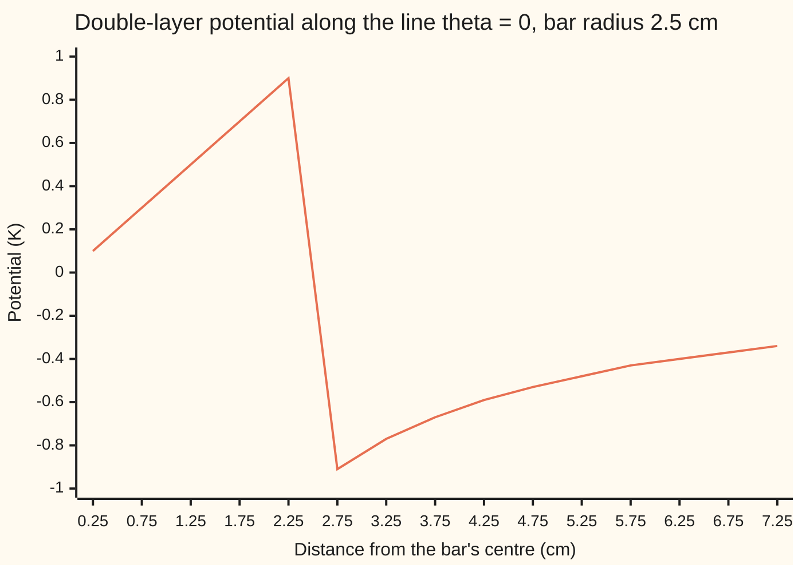

# Layer potentials: turn a boundary-value problem into an integral equation on the boundary

[Syllabus](../../../SYLLABUS.md) → [Partial differential equations](../README.md) → [Nonlinear PDE and Fluids](../README.md#s07) → Layer potentials

---

## General Overview

Water flows at 1 m/s across a round steel bar 5 cm thick, lying across the stream. Two questions about it share one method.

- **The flow.** How fast does the water pass over the top of the bar? In ideal flow (no friction, no swirl), 2.000 m/s: twice the stream speed. Two and a half centimetres above the surface it has dropped to 1.250 m/s.
- **The heat.** Suppose the bar's rim runs 1 K above its average temperature on one side and 1 K below on the other, varying as the cosine of the angle (illustrative numbers). Then halfway from the centre to the warm side, the steady temperature is 0.500 K above the average.

Wing 08's [Laplace's equation](../../08-Differential%20equations%20and%20dynamics/10-The%20Classical%20PDEs/07-laplaces-equation-and-harmonic-functions.md) solved such problems on a disc by separating variables, which needs a round region. This card's method works for any smooth shape. On the circle its answers are exact, so it can be checked there.

The idea: spread an unknown layer of point sources over the rim. The potential of such a layer obeys Laplace's equation everywhere off the rim, for free. Only the rim condition is left to match. So a problem over a whole region, even the infinite region outside the bar, becomes an equation on a curve: one dimension less, and finite.

As a problem: the **unknown** is a harmonic function $`u`$ (one with $`\Delta u = 0`$), the temperature inside or the flow potential outside. The **region** is the inside of the bar's cross-section, or everything outside it. The **data** is the rim temperature, or the rate at which the flow crosses the rim. The solutions here are classical: twice differentiable, with $`\Delta u = 0`$ at every point off the rim.

**Write the unknown harmonic function as the potential of an unknown layer of sources (or of source pairs) on the boundary; a layer of source pairs jumps by its full strength as you cross the boundary, and its value on the boundary sits exactly halfway; that half turns the boundary condition into a second-kind integral equation on the boundary, which the Fredholm alternative then settles.**

**What kind of fact this is:** theorems and a method. The jump relations and the uniqueness of the boundary equation are theorems, proved on this card for any twice-differentiable rim, with Kress (Sources) for the details. Ideal flow past the bar is a model, and "When it holds" says where real water departs from it.

### The picture: a layer of source pairs on the rim, and its jump



Caption: one line, the double-layer potential of the density $`\mu = -2\cos\theta`$ K, summed by quadrature with 4000 rim points, at equal steps of 0.5 cm. Inside the bar (left of 2.5 cm) it equals the temperature $`r\cos\theta`$ and climbs towards the rim value 1 K. Outside it is $`-\cos\theta/r`$ and rises from −1 K. Stepping out through the rim, the potential changes by the density there, $`\mu = -2`$ K at $`\theta = 0`$: a drop of 2 K. That is the jump relation.

---

## The formula

Notation from earlier cards, one line each. $`\Omega`$ is the region, $`\partial\Omega`$ its boundary curve, $`n`$ the outward unit normal and $`\partial u/\partial n`$ the outward slope ([Boundary conditions](../01-Classification%20and%20Well-Posedness/03-boundary-conditions-dirichlet-neumann-and-robin.md)). $`\Phi`$ is the fundamental solution, the potential of one unit point source; in the plane $`\Phi(x) = -\ln|x|/(2\pi)`$ ([The fundamental solution](../04-Laplace%2C%20Poisson%20and%20Potentials/02-fundamental-solution-of-the-laplacian.md)). A kernel $`K(x, y)`$ and a second-kind equation come from [Integral equations](07-integral-equations-fredholm-and-volterra.md).

Lengths are scaled by the bar's radius $`a`$ = 2.5 cm, so the rim is the unit circle (scaled). A point $`x`$ sits at distance $`r`$ from the centre and angle $`\theta`$; $`y`$ is a point on the rim, and $`ds_y`$ is a short piece of rim length there.

This card introduces two **layer potentials**. A density is a strength per unit length spread over the rim.

```math
S\sigma(x) = \oint_{\partial\Omega} \Phi(x - y)\,\sigma(y)\,ds_y, \qquad D\mu(x) = \oint_{\partial\Omega} \frac{\partial \Phi(x - y)}{\partial n_y}\,\mu(y)\,ds_y .
```

**Read it aloud:** the single layer adds up point sources of strength $`\sigma`$ along the rim; the double layer adds up source pairs (a source and a sink very close together across the rim, called dipoles) of strength $`\mu`$.

On the rim itself the same integrals define two boundary operators: $`K\mu`$, the double layer read at a rim point, and $`K'\sigma`$, the slope of the single layer along the normal at that rim point, with kernel $`\partial\Phi(x - y)/\partial n_x`$. $`K'`$ is the adjoint of $`K`$ (its kernel with $`x`$ and $`y`$ swapped).

The **jump relations**, with "−" for the limit from inside and "+" for the limit from outside:

```math
D\mu_{\mp} = K\mu \mp \tfrac12\mu, \qquad S\sigma_{-} = S\sigma_{+}, \qquad \Bigl(\frac{\partial S\sigma}{\partial n}\Bigr)_{\mp} = K'\sigma \pm \tfrac12\sigma .
```

**Read it aloud:** stepping out through the rim, the double layer changes by its own density (outside limit minus inside limit is $`\mu`$), and it sits exactly halfway between its two limits on the rim; the single layer is continuous, but its outward slope drops by its density.

Set each limit equal to the data, and the four classical problems become four second-kind equations on the rim:

| Problem | Write $`u`$ as | Equation on the rim | On the unit circle |
| --- | --- | --- | --- |
| Interior Dirichlet: $`u = g`$ given | $`D\mu`$ | $`-\tfrac12\mu + K\mu = g`$ | always one solution |
| Exterior Dirichlet | $`D\mu`$ | $`\tfrac12\mu + K\mu = g`$ | constants are lost: add a constant to $`u`$ |
| Interior Neumann: $`\partial u/\partial n = h`$ given | $`S\sigma`$ | $`\tfrac12\sigma + K'\sigma = h`$ | solvable only if $`\oint h\,ds = 0`$ |
| Exterior Neumann | $`S\sigma`$ | $`-\tfrac12\sigma + K'\sigma = h`$ | one $`\sigma`$; $`u`$ decays only if $`\oint h\,ds = 0`$ |

On a circle both kernels are one constant, which makes every row solvable by hand:

```math
\frac{\partial \Phi(x - y)}{\partial n_y} = \frac{\partial \Phi(x - y)}{\partial n_x} = -\frac{1}{4\pi} = -0.079577 \qquad \text{for } x \ne y \text{ both on the unit circle} .
```

**Read it aloud:** on a circle, every rim point feels every other rim point's source pair equally, at minus one over four pi.

| Symbol | Plain meaning | In our example | Push it up and the answer… |
| --- | --- | --- | --- |
| $`a`$, $`U`$, $`\nu`$ | bar radius; stream speed; water's viscosity | 2.5 cm; 1 m/s; 1e-6 m²/s | lengths scale with $`a`$, speeds with $`U`$; the Reynolds number falls |
| $`x`$, $`r`$, $`\theta`$ | a point off the rim; its scaled distance from the centre; its angle from the line $`\theta = 0`$ | $`r`$ = 0.5, $`\theta = 0`$ | — |
| $`y`$, $`ds_y`$, $`n`$ | a rim point; a short piece of rim; the outward unit normal | unit circle; $`n = y`$ | — |
| $`\Phi`$ | potential of a unit point source in the plane, $`-\ln\lvert x\rvert/(2\pi)`$ | — | — |
| $`\sigma`$, $`S\sigma`$ | single-layer density (sources per length); its potential | $`\sigma = 2\cos\theta`$ | the potential grows in proportion |
| $`\mu`$, $`D\mu`$ | double-layer density (source pairs per length); its potential | $`\mu = -2\cos\theta`$ K | the potential grows in proportion |
| $`K`$, $`K'`$ | the double layer read on the rim; the single layer's normal slope on the rim | both multiply by $`-1/(4\pi)`$ on the circle | — |
| $`g`$ | Dirichlet data: the rim value | $`\cos\theta`$ K | the temperature inside rises with it |
| $`h`$ | Neumann data: the outward slope on the rim | $`-\cos\theta`$ for the flow (scaled) | — |
| $`u`$, $`\phi`$ | the harmonic function sought; the flow's velocity potential | $`r\cos\theta`$ K inside; $`\cos\theta/r`$ outside | — |
| $`N`$ | rim points in the quadrature or the Nyström solve | 16; 4000; 40000 | smaller error |
| $`k`$ | wavenumber, in the Helmholtz outline only | — | — |

### When it holds

- **A smooth rim.** The jump relations in this form are proved here for a twice-differentiable rim, whose curvature varies continuously, so that $`K`$ and $`K'`$ have bounded, continuous kernels; a merely continuous tangent is not enough. At a corner the rim value $`K1`$ is minus the inside angle over $`2\pi`$, not $`-\tfrac12`$, and $`K`$ is no longer compact.
- **Continuous densities.** Then $`D\mu`$ has limits from both sides at every rim point. For a rougher density the limits hold only on average, through the boundary trace of [Sobolev spaces](../06-Weak%20Solutions%20and%20Free%20Boundaries/02-sobolev-spaces-for-pdes.md).
- **Constant coefficients.** A layer potential needs a known fundamental solution. If the conductivity varies from place to place, there is none in closed form, and a grid or Galerkin must fill the region, as [Finite elements](../../13-Engineering%20mathematics/08-Fluids%20and%20Heat/09-finite-element-method-in-outline.md) does.
- **Behaviour at infinity, for the exterior problems.** In the plane, a single layer with total strength $`\oint\sigma\,ds \neq 0`$ grows like $`\ln r`$. A leaking bar with $`h = 1`$ gives $`u = \ln r`$: 0.693 at $`r = 2`$ and 2.303 at $`r = 10`$, without limit.
- **Ideal flow, for the water.** The flow model ignores viscosity. At this bar the Reynolds number $`2aU/\nu`$ is 50000 (with $`\nu`$ = 1e-6 m²/s for water). Real water separates from the downstream side and leaves a wake, so the ideal surface speeds are only a rough guide even on the upstream face, the 2.000 m/s over the top is not reached, and the ideal model predicts zero drag, which is false.

---

## Why it works

### Step 0: harmonic functions are already layer potentials

Green's identities (proved on [Green's function](../04-Laplace%2C%20Poisson%20and%20Potentials/04-greens-functions-and-the-representation-formula.md)) give the **representation formula** with $`\Phi`$ in place of $`G`$. Any harmonic $`u`$ inside $`\Omega`$ satisfies

```math
u(x) = S\Bigl(\frac{\partial u}{\partial n}\Bigr)(x) - D(u)(x), \qquad x \text{ inside } \Omega .
```

So every harmonic function is a single layer of its rim slopes minus a double layer of its rim values. The trouble is that a Dirichlet problem knows only the values, and a Neumann problem only the slopes. The method drops one of the two layers, keeps the other with an unknown density, and fits that density to the data.

### Step 1: a layer's potential is harmonic off the rim

For a fixed rim point $`y`$, $`\Phi(x - y)`$ is harmonic in $`x`$ away from $`y`$, and so is its derivative along $`n_y`$. A weighted sum of harmonic functions is harmonic. So $`S\sigma`$ and $`D\mu`$ solve Laplace's equation off the rim, inside and outside at once.

### Step 2: the double layer of a constant counts the enclosed source

Take $`\mu = 1`$. Then $`D1(x)`$ is the outward flux of $`\Phi(\cdot - x)`$'s gradient through the rim, which by the divergence theorem counts how much of the point source at $`x`$ the rim encloses (Gauss's lemma):

```math
D1(x) = -1 \ \ (x \text{ inside}), \qquad K1(x) = -\tfrac12 \ \ (x \text{ on a smooth rim}), \qquad D1(x) = 0 \ \ (x \text{ outside}) .
```

The checks print −1.000000 at $`r = 0.5`$ and 0.000000 at $`r = 2`$. On the rim a smooth curve looks like a straight line close up, so it encloses half of the source.

### Step 3: subtract the value at the crossing point, and the jump appears

Fix a rim point $`x_0`$ and write

```math
D\mu(x) = \oint_{\partial\Omega} \frac{\partial \Phi(x - y)}{\partial n_y}\,\bigl(\mu(y) - \mu(x_0)\bigr)\,ds_y \; + \; \mu(x_0)\,D1(x) .
```

The first integral is continuous as $`x`$ crosses the rim at $`x_0`$, because the factor $`\mu(y) - \mu(x_0)`$ vanishes exactly where the kernel is strongest. The second term jumps from $`-\mu(x_0)`$ inside to 0 outside. With $`K1 = -\tfrac12`$ on the rim, the two limits are $`K\mu - \tfrac12\mu`$ from inside and $`K\mu + \tfrac12\mu`$ from outside. They differ by $`\mu`$.

The single layer has a weaker singularity ($`\ln`$, not $`1/|x - y|`$), so $`S\sigma`$ is continuous. Its normal slope is a double-layer-like integral with $`n_x`$ in place of $`n_y`$, and the same subtraction gives the jump $`K'\sigma \pm \tfrac12\sigma`$.

<details>
<summary>Detailed proof: why the first integral is continuous</summary>

Let the rim be twice continuously differentiable and $`\mu`$ continuous. Near $`x_0`$, parametrise the rim by arc length $`s`$ from $`x_0`$. For $`x`$ on the normal line through $`x_0`$ at signed distance $`t`$, the kernel is

$`\displaystyle \frac{\partial \Phi(x - y)}{\partial n_y} = \frac{1}{2\pi}\,\frac{(x - y)\cdot n_y}{|x - y|^2},`$

and on a twice differentiable rim $`|(x - y)\cdot n_y| \le |t| + C s^2`$ while $`|x - y|^2 \ge c\,(t^2 + s^2)`$ for small $`s`$, with constants $`C, c > 0`$ fixed by the curvature.

Split the rim into the arc $`|s| < \delta`$ and the rest. On the rest, the integrand is continuous in $`x`$ near $`x_0`$, so that part is continuous. On the short arc, bound the integral by the largest value of $`|\mu(y) - \mu(x_0)|`$ there, call it $`m(\delta)`$, times

$`\displaystyle \int_{-\delta}^{\delta} \frac{|t| + C s^2}{2\pi c\,(t^2 + s^2)}\,ds \le \frac{1}{2c} + \frac{C\delta}{\pi c},`$

a bound that does not depend on $`t`$. Since $`m(\delta) \to 0`$ as $`\delta \to 0`$, the short arc contributes as little as we like, uniformly in $`x`$. So the first integral is continuous across the rim. This is the proof in Kress (Sources, chapter 6), written for the plane.

</details>

### Step 4: on the circle the kernel is a constant, and the equation solves by hand

For $`x`$ and $`y`$ on the unit circle, $`n_y = y`$, $`|y| = 1`$ and $`|x - y|^2 = 2 - 2\,x\cdot y`$. So

```math
\frac{(x - y)\cdot y}{|x - y|^2} = \frac{x\cdot y - 1}{2 - 2\,x\cdot y} = -\frac12, \qquad \text{so the kernel is } -\frac{1}{4\pi} .
```

Then $`K\mu`$ is $`-1/(4\pi)`$ times the total of $`\mu`$ around the rim. For a density with average zero, $`K\mu = 0`$. The interior Dirichlet equation $`-\tfrac12\mu + K\mu = \cos\theta`$ then gives $`\mu = -2\cos\theta`$. The density is proportional to the data; its sign comes from the convention $`-\Delta\Phi = \delta`$.

To evaluate $`D\mu`$ at an inside point at distance $`r`$, the same algebra with $`|x| = r`$ gives

```math
\frac{(x - y)\cdot y}{|x - y|^2} = -\frac12 - \frac{1 - r^2}{2\,|x - y|^2} .
```

The second term is $`-\pi`$ times the Poisson kernel $`(1 - r^2)/(2\pi|x - y|^2)`$ of [The Poisson formula](../../07-Complex%20analysis/07-Conformal%20Maps%20and%20Harmonic%20Functions/06-poisson-integral-formula.md). So for a density with average zero, $`D\mu = -\tfrac12 \times`$ (the Poisson integral of $`\mu`$). The Poisson integral of $`-2\cos\theta`$ is $`-2r\cos\theta`$, and $`D\mu = r\cos\theta`$: the temperature. It is 0.500 K at $`r = 0.5`$ on the warm side.

The single layer works the same way, using the expansion of $`\ln|x - y|`$ in powers of $`r`$ (inside) or $`1/r`$ (outside). For $`\sigma = 2\cos\theta`$, $`S\sigma = r\cos\theta`$ inside and $`\cos\theta/r`$ outside. It is continuous at $`r = 1`$, and its outward slope drops from $`+\cos\theta`$ to $`-\cos\theta`$: a drop of $`2\cos\theta = \sigma`$.

### Step 5: the flow past the bar is an exterior Neumann problem

Ideal flow has a velocity potential $`\phi`$ with velocity $`\nabla\phi`$ and $`\Delta\phi = 0`$. Write $`\phi = Ua\,(r\cos\theta + u)`$. The first part is the undisturbed stream. The disturbance $`u`$ must decay far away and cancel the stream's flow into the bar, so on the rim $`\partial u/\partial n = -\cos\theta`$ (scaled).

The exterior Neumann equation $`-\tfrac12\sigma + K'\sigma = -\cos\theta`$ gives $`\sigma = 2\cos\theta`$, and Step 4 gives $`u = \cos\theta/r`$. The full potential is $`Ua\,(r + 1/r)\cos\theta`$. On the rim, the speed is $`2U|\sin\theta|`$: 2.000 m/s over the top, 0 at the front and back. At $`r = 2`$, 5 cm from the centre, it is 1.250 m/s over the top and 0.750 m/s in front.

### Step 6: compact plus a multiple of the identity, so the Fredholm alternative applies

On a smooth rim the kernels of $`K`$ and $`K'`$ are continuous: the singularity cancels, as Step 4 shows on the circle, and near the diagonal the kernel tends to minus the curvature over $`4\pi`$. A continuous kernel on a closed curve gives a compact operator ([Compact operators](../../18-Functional%20analysis/03-Bounded%20Operators/05-compact-operators.md)). So each rim operator is $`\pm\tfrac12 I`$ plus a compact operator, which has Fredholm index 0 ([Fredholm index](../../18-Functional%20analysis/03-Bounded%20Operators/15-fredholm-operators-and-the-index.md)): it is onto exactly when it is one-to-one. [The Fredholm alternative](08-fredholm-alternative-and-compact-operators.md) then says what happens when it is not.

On the circle every operator has only two eigenvalues: one on constant densities and one on densities with average zero.

| Rim operator | On average-zero densities | On constants | What follows |
| --- | --- | --- | --- |
| $`-\tfrac12 I + K`$ (interior Dirichlet) | $`-\tfrac12`$ | $`-1`$ | invertible: one $`\mu`$ for every $`g`$ |
| $`\tfrac12 I + K`$ (exterior Dirichlet) | $`\tfrac12`$ | 0 | constants are free: $`D1 = 0`$ outside |
| $`\tfrac12 I + K'`$ (interior Neumann) | $`\tfrac12`$ | 0 | needs $`\oint h\,ds = 0`$; $`\sigma`$ fixed up to a constant |
| $`-\tfrac12 I + K'`$ (exterior Neumann) | $`-\tfrac12`$ | $`-1`$ | invertible, but $`\oint\sigma\,ds = -\oint h\,ds`$ |

The interior Neumann row is the Fredholm alternative at work. The adjoint $`\tfrac12 I + K`$ has the constants as free solutions, so $`h`$ must be perpendicular to them: $`\oint h\,ds = 0`$. Physically, a bar reaches a steady temperature only if as much heat leaves as enters. Every row of the 16-point matrix sums to 0.000000. The test integral is 6.283185 for $`h = 1`$ (no solution) and 0.000000 for $`h = \cos\theta`$, where $`\sigma = 2\cos\theta + c`$ works for every $`c`$.

The exterior Neumann problem shows the same one-dimensional obstruction from the other side. Its rim equation always has one solution. But $`S\sigma`$ behaves like $`-(\oint\sigma\,ds)\ln r/(2\pi)`$ far away, so $`u`$ decays only if $`\oint\sigma\,ds = 0`$, which is $`\oint h\,ds = 0`$. The flow past the bar passes ($`h = -\cos\theta`$ has total 0). A bar leaking water evenly through its surface does not: its potential grows like $`\ln r`$.

<details>
<summary>Detailed proof: the interior Dirichlet equation is one-to-one on any smooth rim</summary>

Suppose $`-\tfrac12\mu + K\mu = 0`$ and let $`w = D\mu`$. Its inside limit on the rim is 0, so $`w = 0`$ inside, by the maximum principle for harmonic functions.

The normal slope of a double layer is continuous across the rim (the Lyapunov–Tauber theorem; Kress, chapter 6). So $`w`$ outside has zero normal slope on the rim. Far away, $`w`$ falls like $`1/r`$, because the kernel $`\partial\Phi/\partial n_y`$ does. Green's first identity on the region between the rim and a large circle of radius $`R`$ gives

$`\displaystyle \int |\nabla w|^2\,dA = \oint_{|x| = R} w\,\frac{\partial w}{\partial r}\,ds - \oint_{\partial\Omega} w\,\frac{\partial w}{\partial n}\,ds .`$

The rim term is 0. The far term is at most a constant times $`R \cdot R^{-1} \cdot R^{-2}`$, which tends to 0. So $`\nabla w = 0`$ outside, $`w`$ is constant there, and since it tends to 0, $`w = 0`$. Then $`\mu = w_+ - w_- = 0`$ by the jump relation. The operator is one-to-one, and by index 0 it is onto.

</details>

### Step 7: on any other shape, solve the rim equation numerically

On a non-circular rim the kernel is not constant, so the equation is solved by the **Nyström method**: replace the rim integral by the trapezoid rule on $`N`$ equally spaced parameter points, and solve the $`N`$ by $`N`$ linear system. For a smooth periodic integrand the trapezoid rule converges faster than any power of $`1/N`$.

The checks take a flattened pipe, an oval of semi-axes 2.5 cm and 1.5 cm, with rim data $`x^2 - y^2`$ (scaled). Its exact solution is $`u = x^2 - y^2`$, which is 0.21 at the point (0.5, 0.2). The errors at $`N`$ = 8, 16 and 32 are 4.4e-02, 1.8e-03 and 4.4e-06. Each doubling of $`N`$ squares the error, roughly. At $`N`$ = 64 the error is below 1e-10. With $`K'`$ in place of $`K`$, the exterior Neumann equation for the rim slopes of $`x/(x^2 + y^2)`$ gives 0.600000 at (1.5, 0.5) at $`N`$ = 64, the exact value. This is the use of the whole card: [Boundary elements](15-boundary-element-methods.md) builds on it for real shapes.

### Step 8: waves, in outline

For waves, $`\Delta u + k^2 u = 0`$ with wavenumber $`k`$ ([Helmholtz](../04-Laplace%2C%20Poisson%20and%20Potentials/08-helmholtz-and-eigenfunctions.md)). $`\Phi`$ becomes the outgoing fundamental solution, a Hankel function with the same logarithmic singularity, so the same jumps hold. One new failure appears: the exterior equations break down at the wavenumbers of the bar's own interior modes. Burton and Miller (Sources) cured this by mixing the single- and double-layer equations with a complex weight.

---

## Worked numbers, by hand

The interior Dirichlet problem on the bar, rim temperature $`g = \cos\theta`$ K, read at $`r = 0.5`$, $`\theta = 0`$.

| Step | Arithmetic | Value |
| --- | --- | --- |
| 1. Kernel on the circle | $`(x - y)\cdot y/\lvert x - y\rvert^2 = -1/2`$, over $`2\pi`$ | −0.079577 |
| 2. $`K\mu`$ for average-zero $`\mu`$ | $`-0.079577 \times \oint\mu\,ds = -0.079577 \times 0`$ | 0 |
| 3. Rim equation | $`-\tfrac12\mu + 0 = \cos\theta`$ | $`\mu = -2\cos\theta`$ K |
| 4. At $`\theta = 0`$, 90°, 180° | $`-2\cos\theta`$ | −2.000, 0.000, 2.000 K |
| 5. Nyström, 16 points | solves the 16 by 16 system | the same, to 1e-12 |
| 6. Inside, $`D\mu`$ | $`-\tfrac12 \times`$ Poisson integral of $`-2\cos\theta`$ $`= r\cos\theta = 0.5 \times 1`$ | 0.500 K |
| 7. By quadrature, 4000 points | the double-layer sum at (0.5, 0) | 0.500000 K |
| 8. Answer | | **0.500 K above the average** |

Halfway from the centre to the warm side, the bar sits 0.500 K above its average temperature. At $`r = 0.9`$, $`\theta = 60°`$ the same layer gives 0.450000 K, and at $`r = 0.3`$, $`\theta = 135°`$ it gives −0.212132 K, both equal to $`r\cos\theta`$.

The jump, read along $`\theta = 0`$ with 40000 rim points:

| $`r`$ | 0.9 | 0.99 | 0.999 | on the rim | 1.001 | 1.01 | 1.1 |
| --- | --- | --- | --- | --- | --- | --- | --- |
| $`D\mu`$ (K) | 0.900000 | 0.990000 | 0.999000 | $`K\mu`$ = 0.000000 | −0.999001 | −0.990099 | −0.909091 |

The limits are 1 from inside and −1 from outside. The rim value 0 sits halfway, as $`K\mu \mp \tfrac12\mu`$ says. For the single layer $`\sigma = 2\cos\theta`$, the slopes at $`r`$ = 0.999 and 1.001 are 1.000000 and −0.998003, a drop of 1.998003, close to $`\sigma(0) = 2`$.

### What breaks if you drop a piece

| Mistake | Comes out at | What went wrong |
| --- | --- | --- |
| Flip the jump's sign: solve $`+\tfrac12\mu + K\mu = g`$ inside | $`u`$ = −0.500000 K at $`r = 0.5`$, the right size with the wrong sign | that is the exterior limit, so the density is $`+2\cos\theta`$ |
| Drop the jump: set the rim value $`K\mu`$ equal to $`g`$ | no solution, as $`K\mu`$ is constant on the circle; the true layer reads 0.000000 K on the rim, not 1 K | the rim value is the average of the two sides, not the inside limit; the equation $`K\mu = g`$ is of the first kind |
| Use a pure double layer outside, with data $`g = 1`$ | $`D1`$ = −1.000000 inside, 0.000000 outside | $`\tfrac12 I + K`$ kills constants; add a constant to $`u`$ |
| Ask for a decaying flow around a leaking bar, $`h = 1`$ | $`\sigma`$ = −1, $`u = \ln r`$: 0.693147 at $`r = 2`$, 2.302585 at $`r = 10`$ | the total outflow is not 0, so a two-dimensional source's potential grows without limit |
| Solve the first-kind equation $`S\sigma = 1`$ on the unit circle | $`S1`$ = 0.000000 inside; on a circle of radius 2 it is −1.386294 $`= -2\ln 2`$ | $`S`$ has a free solution when the rim's size (its logarithmic capacity) is 1 in the chosen unit: a first-kind equation can fail for a reason that depends on units |

---

## Code, from first principles, and it actually runs

Both programs write out the kernels, the trapezoid rule and Gaussian elimination, and import nothing that knows the answer. They take four roads: the closed form from the constant circle kernel, a Nyström solve of the rim equation, the potential summed by quadrature against a known harmonic function, and the jumps read from both sides of the rim. The oval, with no closed-form density, checks the method where it is needed, for both $`K`$ and $`K'`$.

### Python

```python
# Layer potentials -- the check behind the card.  Standard library only.
# A 5 cm steel bar lies across a stream of water at 1 m/s.  Lengths are scaled
# by its radius a = 2.5 cm, so its rim is the unit circle.  Roads: (1) the
# closed form from the constant circle kernel, (2) a Nystrom solve of the
# boundary equation, (3) the potential summed by quadrature against a known
# harmonic function, (4) the jumps read off near the rim from both sides.
import math
TAU, A_M, U = 2 * math.pi, 0.025, 1.0      # 2 pi; bar radius in m; stream in m/s

def fx(v): return 0.0 if abs(v) < 5e-7 else v       # no "-0.000000"
def show(label, *vals): print(label + "," + ",".join(" %.6f" % fx(v) for v in vals))

def circle(t):                    # point, outward unit normal, speed |gamma'|, curvature
    return (math.cos(t), math.sin(t)), (math.cos(t), math.sin(t)), 1.0, 1.0
def oval(t, b=0.6):               # flattened pipe: semi-axes 2.5 cm and 1.5 cm
    J = math.sqrt(math.sin(t) ** 2 + (b * math.cos(t)) ** 2)
    return (math.cos(t), b * math.sin(t)), (b * math.cos(t) / J, math.sin(t) / J), J, b / J ** 3

def dk(x, y, ny):                 # double-layer kernel: d Phi(x - y) / d n_y
    dx, dy = x[0] - y[0], x[1] - y[1]
    return (dx * ny[0] + dy * ny[1]) / (dx * dx + dy * dy) / TAU
def sk(x, y): return -math.log(math.hypot(x[0] - y[0], x[1] - y[1])) / TAU

def nodes(curve, N): return [(TAU * j / N,) + curve(TAU * j / N) for j in range(N)]
def dlayer(curve, N, mu, x): return sum(dk(x, y, n) * mu(t) * J * TAU / N for t, y, n, J, k in nodes(curve, N))
def slayer(curve, N, sig, x): return sum(sk(x, y) * sig(t) * J * TAU / N for t, y, n, J, k in nodes(curve, N))

def nystrom(curve, N, half, adjoint=False):   # matrix of half*I + K  (or + K')
    nd = nodes(curve, N); A = [[0.0] * N for _ in range(N)]
    for i, (ti, xi, ni, Ji, ki) in enumerate(nd):
        for j, (tj, yj, nj, Jj, kj) in enumerate(nd):
            kern = -kj / (2 * TAU) if i == j else (dk(yj, xi, ni) if adjoint else dk(xi, yj, nj))
            A[i][j] = kern * Jj * TAU / N + (half if i == j else 0.0)
    return A, nd
def solve(A, b):                  # Gaussian elimination with partial pivoting
    n = len(b); M = [row[:] + [b[i]] for i, row in enumerate(A)]
    for c in range(n):
        p = max(range(c, n), key=lambda r: abs(M[r][c])); M[c], M[p] = M[p], M[c]
        for r in range(c + 1, n):
            f = M[r][c] / M[c][c]
            for k in range(c, n + 1): M[r][k] -= f * M[c][k]
    x = [0.0] * n
    for r in range(n - 1, -1, -1):
        x[r] = (M[r][n] - sum(M[r][k] * x[k] for k in range(r + 1, n))) / M[r][r]
    return x
def at(r, th): return (r * math.cos(th), r * math.sin(th))

print("kernel on the circle: double layer, adjoint, -1/(4 pi)")
x0, y0 = circle(0.3)[0], circle(2.1)
show("kernel,theta=0.3,phi=2.1", dk(x0, y0[0], y0[1]), dk(y0[0], x0, circle(0.3)[1]), -1 / (2 * TAU))
assert abs(dk(x0, y0[0], y0[1]) + 1 / (2 * TAU)) < 1e-12

print("interior Dirichlet: rim temperature cos(theta) K")
A, nd = nystrom(circle, 16, -0.5)
mu = solve(A, [math.cos(t) for t, *_ in nd])
show("Nystrom N=16: mu at theta=0, 90, 180 deg", mu[0], mu[4], mu[8])
assert max(abs(m + 2 * math.cos(t)) for m, (t, *_) in zip(mu, nd)) < 1e-12   # closed form -2 cos
MU = lambda t: -2 * math.cos(t)
for r, deg in [(0.5, 0), (0.9, 60), (0.3, 135)]:
    u = dlayer(circle, 4000, MU, at(r, math.radians(deg)))
    show("u at r=%.1f, %d deg: layer, r cos(theta)" % (r, deg), u, r * math.cos(math.radians(deg)))
    assert abs(u - r * math.cos(math.radians(deg))) < 1e-9

print("jump of the double layer along theta=0 (N=40000)")
for r in [0.9, 0.99, 0.999, 1.001, 1.01, 1.1]:
    show("D mu at r=%.3f" % r, dlayer(circle, 40000, MU, at(r, 0.0)))
onrim = sum(-1 / (2 * TAU) * MU(t) * TAU / 4000 for t in [TAU * j / 4000 for j in range(4000)])
show("on the rim: K mu, then K mu - mu/2 and K mu + mu/2", onrim, onrim + 1, onrim - 1)
assert abs(dlayer(circle, 40000, MU, at(1.001, 0)) - dlayer(circle, 40000, MU, at(0.999, 0)) + 2) < 3e-3

print("chart: D mu along theta=0, distance in cm")
rs = [0.1 + 0.2 * i for i in range(15)]           # equal steps of 0.5 cm, none on the rim
print("chart,cm," + ",".join(" %.2f" % (2.5 * r) for r in rs))
print("chart,K," + ",".join(" %.2f" % fx(dlayer(circle, 4000, MU, at(r, 0))) for r in rs))

print("single layer, sigma = 2 cos(theta): inside r cos, outside cos/r")
SG = lambda t: 2 * math.cos(t)
show("S sigma at r=0.5 and r=2, theta=0", slayer(circle, 4000, SG, at(0.5, 0)), slayer(circle, 4000, SG, at(2, 0)))
assert abs(slayer(circle, 4000, SG, at(2, 0)) - 0.5) < 1e-9
h = 1e-4
din = (slayer(circle, 40000, SG, at(0.999 + h, 0)) - slayer(circle, 40000, SG, at(0.999 - h, 0))) / (2 * h)
dout = (slayer(circle, 40000, SG, at(1.001 + h, 0)) - slayer(circle, 40000, SG, at(1.001 - h, 0))) / (2 * h)
show("slope at r=0.999 and r=1.001, jump", din, dout, din - dout)
assert abs(din - dout - 2) < 3e-3

print("flow past the bar: exterior Neumann, d u/dn = -cos(theta)")
A, nd = nystrom(circle, 16, -0.5, adjoint=True)
sg = solve(A, [-math.cos(t) for t, *_ in nd])
show("Nystrom N=16: sigma at theta=0, 90 deg", sg[0], sg[4])
assert max(abs(s - 2 * math.cos(t)) for s, (t, *_) in zip(sg, nd)) < 1e-12
def speed(r, th):                 # m/s, centred differences of U a (r cos + S sigma)
    phi = lambda rr, tt: U * A_M * (rr * math.cos(tt) + slayer(circle, 4000, SG, at(rr, tt)))
    vr = (phi(r + h, th) - phi(r - h, th)) / (2 * h * A_M)
    vt = (phi(r, th + h) - phi(r, th - h)) / (2 * h * r * A_M)
    return math.hypot(vr, vt)
show("speed m/s at 5 cm from centre, top and front", speed(2, math.pi / 2), speed(2, math.pi))
assert abs(speed(2, math.pi / 2) - U * (1 + 1 / 4)) < 1e-6
show("surface speed m/s at the top, 2U; Reynolds number 2aU/nu", 2 * U, 2 * A_M * U / 1e-6)

print("interior Neumann: (I/2 + K') sigma = h, Fredholm alternative")
A, nd = nystrom(circle, 16, 0.5, adjoint=True)
show("row sum of the matrix (kills constants)", max(abs(sum(row)) for row in A))
show("test integral of h=1 and h=cos", TAU, sum(math.cos(t) * TAU / 16 for t, *_ in nd))
for c in [0.0, 0.7]:
    res = max(abs(sum(A[i][j] * (2 * math.cos(nd[j][0]) + c) for j in range(16)) - math.cos(nd[i][0])) for i in range(16))
    assert res < 1e-12
show("sigma = 2cos + 0.7 also solves h=cos; u at r=0.5", slayer(circle, 4000, lambda t: SG(t) + 0.7, at(0.5, 0)))

print("what breaks")
show("jump sign flipped: mu = +2cos, u at r=0.5", dlayer(circle, 4000, lambda t: 2 * math.cos(t), at(0.5, 0)))
show("jump dropped: rim value K mu with mu=-2cos", onrim)
show("double layer of 1: inside, outside r=2", dlayer(circle, 4000, lambda t: 1.0, at(0.5, 0)), dlayer(circle, 4000, lambda t: 1.0, at(2, 0)))
A, nd = nystrom(circle, 16, -0.5, adjoint=True)
leak = solve(A, [1.0] * 16)
show("leaky bar h=1: sigma, u at r=2 and r=10, ln r", leak[0], slayer(circle, 4000, lambda t: -1.0, at(2, 0)), slayer(circle, 4000, lambda t: -1.0, at(10, 0)), math.log(10))
assert abs(slayer(circle, 4000, lambda t: -1.0, at(10, 0)) - math.log(10)) < 1e-9
big = lambda t: ((2 * math.cos(t), 2 * math.sin(t)), (math.cos(t), math.sin(t)), 2.0, 0.5)
show("first kind, S of 1 inside radius 1 and radius 2", slayer(circle, 4000, lambda t: 1.0, at(0.5, 0)), slayer(big, 4000, lambda t: 1.0, at(0.5, 0)), -2 * math.log(2))
assert abs(slayer(big, 4000, lambda t: 1.0, at(0.5, 0)) + 2 * math.log(2)) < 1e-9   # needs the weight J = 2

print("flattened pipe (oval 2.5 x 1.5 cm): rim data x^2 - y^2, u at (0.5, 0.2)")
for N in [8, 16, 32, 64]:
    A, nd = nystrom(oval, N, -0.5)
    m = solve(A, [y[0] ** 2 - y[1] ** 2 for t, y, *_ in nd])
    u = sum(dk((0.5, 0.2), y, n) * m[j] * J * TAU / N for j, (t, y, n, J, k) in enumerate(nd))
    if N < 64: print("oval, N=%d, u=%.6f, error=%.1e" % (N, u, abs(u - 0.21)))
assert abs(u - 0.21) < 1e-10
A, nd = nystrom(oval, 64, -0.5, adjoint=True)       # exterior Neumann with K': u = x / (x^2 + y^2) outside
sg = solve(A, [((y[1] ** 2 - y[0] ** 2) * n[0] - 2 * y[0] * y[1] * n[1]) / (y[0] ** 2 + y[1] ** 2) ** 2 for t, y, n, J, k in nd])
ue = sum(sk((1.5, 0.5), y) * sg[j] * J * TAU / 64 for j, (t, y, n, J, k) in enumerate(nd))
show("oval, exterior Neumann N=64: S sigma at (1.5, 0.5), x/(x^2+y^2)", ue, 1.5 / (1.5 ** 2 + 0.5 ** 2))
assert abs(ue - 0.6) < 1e-9
print("ALL CHECKS PASS")
```

**Ran 2026-11-24 on macOS, Python 3.14.10, standard library only. All checks passed. Output, pasted from the run:**

```
kernel on the circle: double layer, adjoint, -1/(4 pi)
kernel,theta=0.3,phi=2.1, -0.079577, -0.079577, -0.079577
interior Dirichlet: rim temperature cos(theta) K
Nystrom N=16: mu at theta=0, 90, 180 deg, -2.000000, 0.000000, 2.000000
u at r=0.5, 0 deg: layer, r cos(theta), 0.500000, 0.500000
u at r=0.9, 60 deg: layer, r cos(theta), 0.450000, 0.450000
u at r=0.3, 135 deg: layer, r cos(theta), -0.212132, -0.212132
jump of the double layer along theta=0 (N=40000)
D mu at r=0.900, 0.900000
D mu at r=0.990, 0.990000
D mu at r=0.999, 0.999000
D mu at r=1.001, -0.999001
D mu at r=1.010, -0.990099
D mu at r=1.100, -0.909091
on the rim: K mu, then K mu - mu/2 and K mu + mu/2, 0.000000, 1.000000, -1.000000
chart: D mu along theta=0, distance in cm
chart,cm, 0.25, 0.75, 1.25, 1.75, 2.25, 2.75, 3.25, 3.75, 4.25, 4.75, 5.25, 5.75, 6.25, 6.75, 7.25
chart,K, 0.10, 0.30, 0.50, 0.70, 0.90, -0.91, -0.77, -0.67, -0.59, -0.53, -0.48, -0.43, -0.40, -0.37, -0.34
single layer, sigma = 2 cos(theta): inside r cos, outside cos/r
S sigma at r=0.5 and r=2, theta=0, 0.500000, 0.500000
slope at r=0.999 and r=1.001, jump, 1.000000, -0.998003, 1.998003
flow past the bar: exterior Neumann, d u/dn = -cos(theta)
Nystrom N=16: sigma at theta=0, 90 deg, 2.000000, 0.000000
speed m/s at 5 cm from centre, top and front, 1.250000, 0.750000
surface speed m/s at the top, 2U; Reynolds number 2aU/nu, 2.000000, 50000.000000
interior Neumann: (I/2 + K') sigma = h, Fredholm alternative
row sum of the matrix (kills constants), 0.000000
test integral of h=1 and h=cos, 6.283185, 0.000000
sigma = 2cos + 0.7 also solves h=cos; u at r=0.5, 0.500000
what breaks
jump sign flipped: mu = +2cos, u at r=0.5, -0.500000
jump dropped: rim value K mu with mu=-2cos, 0.000000
double layer of 1: inside, outside r=2, -1.000000, 0.000000
leaky bar h=1: sigma, u at r=2 and r=10, ln r, -1.000000, 0.693147, 2.302585, 2.302585
first kind, S of 1 inside radius 1 and radius 2, 0.000000, -1.386294, -1.386294
flattened pipe (oval 2.5 x 1.5 cm): rim data x^2 - y^2, u at (0.5, 0.2)
oval, N=8, u=0.253749, error=4.4e-02
oval, N=16, u=0.211786, error=1.8e-03
oval, N=32, u=0.209996, error=4.4e-06
oval, exterior Neumann N=64: S sigma at (1.5, 0.5), x/(x^2+y^2), 0.600000, 0.600000
ALL CHECKS PASS
```

### Rust

```rust
// Layer potentials -- the check behind the card.  Rust std only, no crates.
// A 5 cm steel bar lies across a stream of water at 1 m/s.  Lengths are scaled
// by its radius a = 2.5 cm, so its rim is the unit circle.  Roads: (1) the
// closed form from the constant circle kernel, (2) a Nystrom solve of the
// boundary equation, (3) the potential summed by quadrature against a known
// harmonic function, (4) the jumps read off near the rim from both sides.
use std::f64::consts::PI;
const TAU: f64 = 2.0 * PI; const A_M: f64 = 0.025; const U: f64 = 1.0; // 2 pi; bar radius in m; stream in m/s
type P = (f64, f64);
type Node = (f64, P, P, f64, f64); // t, point, outward unit normal, speed, curvature

fn fx(v: f64) -> f64 { if v.abs() < 5e-7 { 0.0 } else { v } }
fn show(label: &str, vals: &[f64]) {
    println!("{},{}", label, vals.iter().map(|v| format!(" {:.6}", fx(*v))).collect::<Vec<_>>().join(","));
}
fn sci(v: f64) -> String { // Python's "%.1e"
    let s = format!("{:.1e}", v); let (m, e) = s.split_once('e').unwrap(); let e: i32 = e.parse().unwrap();
    format!("{}e{}{:02}", m, if e < 0 { '-' } else { '+' }, e.abs())
}
fn circle(t: f64) -> (P, P, f64, f64) { ((t.cos(), t.sin()), (t.cos(), t.sin()), 1.0, 1.0) }
fn big(t: f64) -> (P, P, f64, f64) { ((2.0 * t.cos(), 2.0 * t.sin()), (t.cos(), t.sin()), 2.0, 0.5) }
fn oval(t: f64) -> (P, P, f64, f64) {
    let b = 0.6;
    let j = (t.sin().powi(2) + (b * t.cos()).powi(2)).sqrt();
    ((t.cos(), b * t.sin()), (b * t.cos() / j, t.sin() / j), j, b / j.powi(3))
}
fn dk(x: P, y: P, ny: P) -> f64 {
    let (dx, dy) = (x.0 - y.0, x.1 - y.1);
    (dx * ny.0 + dy * ny.1) / (dx * dx + dy * dy) / TAU
}
fn sk(x: P, y: P) -> f64 { -((x.0 - y.0).hypot(x.1 - y.1)).ln() / TAU }
fn nodes(c: fn(f64) -> (P, P, f64, f64), n: usize) -> Vec<Node> {
    (0..n).map(|j| { let t = TAU * j as f64 / n as f64; let (p, q, s, k) = c(t); (t, p, q, s, k) }).collect()
}
fn dlayer(c: fn(f64) -> (P, P, f64, f64), n: usize, mu: &dyn Fn(f64) -> f64, x: P) -> f64 {
    nodes(c, n).iter().map(|&(t, y, ny, j, _)| dk(x, y, ny) * mu(t) * j * TAU / n as f64).sum()
}
fn slayer(c: fn(f64) -> (P, P, f64, f64), n: usize, sig: &dyn Fn(f64) -> f64, x: P) -> f64 {
    nodes(c, n).iter().map(|&(t, y, _, j, _)| sk(x, y) * sig(t) * j * TAU / n as f64).sum()
}
fn nystrom(c: fn(f64) -> (P, P, f64, f64), n: usize, half: f64, adjoint: bool) -> (Vec<Vec<f64>>, Vec<Node>) {
    let nd = nodes(c, n);
    let mut a = vec![vec![0.0; n]; n];
    for (i, &(_, xi, ni, _, _)) in nd.iter().enumerate() {
        for (j, &(_, yj, nj, jj, kj)) in nd.iter().enumerate() {
            let kern = if i == j { -kj / (2.0 * TAU) } else if adjoint { dk(yj, xi, ni) } else { dk(xi, yj, nj) };
            a[i][j] = kern * jj * TAU / n as f64 + if i == j { half } else { 0.0 };
        }
    }
    (a, nd)
}
fn solve(a: &[Vec<f64>], b: &[f64]) -> Vec<f64> {
    let n = b.len();
    let mut m: Vec<Vec<f64>> = a.iter().enumerate().map(|(i, r)| { let mut v = r.clone(); v.push(b[i]); v }).collect();
    for c in 0..n {
        let p = (c..n).fold(c, |p, r| if m[r][c].abs() > m[p][c].abs() { r } else { p });
        m.swap(c, p);
        for r in c + 1..n {
            let f = m[r][c] / m[c][c];
            for k in c..=n { m[r][k] -= f * m[c][k]; }
        }
    }
    let mut x = vec![0.0; n];
    for r in (0..n).rev() {
        x[r] = (m[r][n] - (r + 1..n).map(|k| m[r][k] * x[k]).sum::<f64>()) / m[r][r];
    }
    x
}
fn at(r: f64, th: f64) -> P { (r * th.cos(), r * th.sin()) }

fn main() {
    println!("kernel on the circle: double layer, adjoint, -1/(4 pi)");
    let ((x0, n0, _, _), (y0, m0, _, _)) = (circle(0.3), circle(2.1));
    show("kernel,theta=0.3,phi=2.1", &[dk(x0, y0, m0), dk(y0, x0, n0), -1.0 / (2.0 * TAU)]);
    assert!((dk(x0, y0, m0) + 1.0 / (2.0 * TAU)).abs() < 1e-12);

    println!("interior Dirichlet: rim temperature cos(theta) K");
    let (a, nd) = nystrom(circle, 16, -0.5, false);
    let mu = solve(&a, &nd.iter().map(|n| n.0.cos()).collect::<Vec<_>>());
    show("Nystrom N=16: mu at theta=0, 90, 180 deg", &[mu[0], mu[4], mu[8]]);
    assert!(mu.iter().zip(&nd).all(|(m, n)| (m + 2.0 * n.0.cos()).abs() < 1e-12));
    let mu_f = |t: f64| -2.0 * t.cos();
    for (r, deg) in [(0.5, 0), (0.9, 60), (0.3, 135)] {
        let th = (deg as f64).to_radians();
        let u = dlayer(circle, 4000, &mu_f, at(r, th));
        show(&format!("u at r={:.1}, {} deg: layer, r cos(theta)", r, deg), &[u, r * th.cos()]);
        assert!((u - r * th.cos()).abs() < 1e-9);
    }

    println!("jump of the double layer along theta=0 (N=40000)");
    for r in [0.9, 0.99, 0.999, 1.001, 1.01, 1.1] {
        show(&format!("D mu at r={:.3}", r), &[dlayer(circle, 40000, &mu_f, at(r, 0.0))]);
    }
    let onrim: f64 = (0..4000).map(|j| -1.0 / (2.0 * TAU) * mu_f(TAU * j as f64 / 4000.0) * TAU / 4000.0).sum();
    show("on the rim: K mu, then K mu - mu/2 and K mu + mu/2", &[onrim, onrim + 1.0, onrim - 1.0]);
    assert!((dlayer(circle, 40000, &mu_f, at(1.001, 0.0)) - dlayer(circle, 40000, &mu_f, at(0.999, 0.0)) + 2.0).abs() < 3e-3);

    println!("chart: D mu along theta=0, distance in cm");
    let rs: Vec<f64> = (0..15).map(|i| 0.1 + 0.2 * i as f64).collect(); // equal steps of 0.5 cm, none on the rim
    let cm: Vec<String> = rs.iter().map(|r| format!(" {:.2}", 2.5 * r)).collect();
    println!("chart,cm,{}", cm.join(","));
    let kv: Vec<String> = rs.iter().map(|&r| format!(" {:.2}", fx(dlayer(circle, 4000, &mu_f, at(r, 0.0))))).collect();
    println!("chart,K,{}", kv.join(","));

    println!("single layer, sigma = 2 cos(theta): inside r cos, outside cos/r");
    let sg_f = |t: f64| 2.0 * t.cos();
    let s2 = slayer(circle, 4000, &sg_f, at(2.0, 0.0));
    show("S sigma at r=0.5 and r=2, theta=0", &[slayer(circle, 4000, &sg_f, at(0.5, 0.0)), s2]);
    assert!((s2 - 0.5).abs() < 1e-9);
    let h = 1e-4;
    let din = (slayer(circle, 40000, &sg_f, at(0.999 + h, 0.0)) - slayer(circle, 40000, &sg_f, at(0.999 - h, 0.0))) / (2.0 * h);
    let dout = (slayer(circle, 40000, &sg_f, at(1.001 + h, 0.0)) - slayer(circle, 40000, &sg_f, at(1.001 - h, 0.0))) / (2.0 * h);
    show("slope at r=0.999 and r=1.001, jump", &[din, dout, din - dout]);
    assert!((din - dout - 2.0).abs() < 3e-3);

    println!("flow past the bar: exterior Neumann, d u/dn = -cos(theta)");
    let (a, nd) = nystrom(circle, 16, -0.5, true);
    let sg = solve(&a, &nd.iter().map(|n| -n.0.cos()).collect::<Vec<_>>());
    show("Nystrom N=16: sigma at theta=0, 90 deg", &[sg[0], sg[4]]);
    assert!(sg.iter().zip(&nd).all(|(s, n)| (s - 2.0 * n.0.cos()).abs() < 1e-12));
    let speed = |r: f64, th: f64| -> f64 {
        let phi = |rr: f64, tt: f64| U * A_M * (rr * tt.cos() + slayer(circle, 4000, &sg_f, at(rr, tt)));
        let vr = (phi(r + h, th) - phi(r - h, th)) / (2.0 * h * A_M);
        let vt = (phi(r, th + h) - phi(r, th - h)) / (2.0 * h * r * A_M);
        vr.hypot(vt)
    };
    show("speed m/s at 5 cm from centre, top and front", &[speed(2.0, PI / 2.0), speed(2.0, PI)]);
    assert!((speed(2.0, PI / 2.0) - U * (1.0 + 0.25)).abs() < 1e-6);
    show("surface speed m/s at the top, 2U; Reynolds number 2aU/nu", &[2.0 * U, 2.0 * A_M * U / 1e-6]);

    println!("interior Neumann: (I/2 + K') sigma = h, Fredholm alternative");
    let (a, nd) = nystrom(circle, 16, 0.5, true);
    let rowmax = a.iter().map(|r| r.iter().sum::<f64>().abs()).fold(0.0, f64::max);
    show("row sum of the matrix (kills constants)", &[rowmax]);
    let tc: f64 = nd.iter().map(|n| n.0.cos() * TAU / 16.0).sum();
    show("test integral of h=1 and h=cos", &[TAU, tc]);
    for c in [0.0, 0.7] {
        assert!((0..16).all(|i| ((0..16).map(|j| a[i][j] * (2.0 * nd[j].0.cos() + c)).sum::<f64>() - nd[i].0.cos()).abs() < 1e-12));
    }
    show("sigma = 2cos + 0.7 also solves h=cos; u at r=0.5", &[slayer(circle, 4000, &|t: f64| sg_f(t) + 0.7, at(0.5, 0.0))]);

    println!("what breaks");
    show("jump sign flipped: mu = +2cos, u at r=0.5", &[dlayer(circle, 4000, &|t: f64| 2.0 * t.cos(), at(0.5, 0.0))]);
    show("jump dropped: rim value K mu with mu=-2cos", &[onrim]);
    let (one, minus) = (|_t: f64| 1.0, |_t: f64| -1.0);
    show("double layer of 1: inside, outside r=2", &[dlayer(circle, 4000, &one, at(0.5, 0.0)), dlayer(circle, 4000, &one, at(2.0, 0.0))]);
    let (a, _) = nystrom(circle, 16, -0.5, true);
    let leak = solve(&a, &[1.0; 16]);
    let u10 = slayer(circle, 4000, &minus, at(10.0, 0.0));
    show("leaky bar h=1: sigma, u at r=2 and r=10, ln r", &[leak[0], slayer(circle, 4000, &minus, at(2.0, 0.0)), u10, 10f64.ln()]);
    assert!((u10 - 10f64.ln()).abs() < 1e-9);
    show("first kind, S of 1 inside radius 1 and radius 2", &[slayer(circle, 4000, &one, at(0.5, 0.0)), slayer(big, 4000, &one, at(0.5, 0.0)), -2.0 * 2f64.ln()]);
    assert!((slayer(big, 4000, &one, at(0.5, 0.0)) + 2.0 * 2f64.ln()).abs() < 1e-9); // needs the weight J = 2

    println!("flattened pipe (oval 2.5 x 1.5 cm): rim data x^2 - y^2, u at (0.5, 0.2)");
    let mut u = 0.0;
    for n in [8, 16, 32, 64] {
        let (a, nd) = nystrom(oval, n, -0.5, false);
        let m = solve(&a, &nd.iter().map(|q| q.1 .0 * q.1 .0 - q.1 .1 * q.1 .1).collect::<Vec<_>>());
        u = nd.iter().enumerate().map(|(j, q)| dk((0.5, 0.2), q.1, q.2) * m[j] * q.3 * TAU / n as f64).sum();
        if n < 64 { println!("oval, N={}, u={:.6}, error={}", n, u, sci((u - 0.21).abs())); }
    }
    assert!((u - 0.21).abs() < 1e-10);
    let (a, nd) = nystrom(oval, 64, -0.5, true); // exterior Neumann with K': u = x / (x^2 + y^2) outside
    let sg = solve(&a, &nd.iter().map(|q| { let (x, y, n) = (q.1 .0, q.1 .1, q.2); ((y * y - x * x) * n.0 - 2.0 * x * y * n.1) / (x * x + y * y).powi(2) }).collect::<Vec<_>>());
    let ue: f64 = nd.iter().enumerate().map(|(j, q)| sk((1.5, 0.5), q.1) * sg[j] * q.3 * TAU / 64.0).sum();
    show("oval, exterior Neumann N=64: S sigma at (1.5, 0.5), x/(x^2+y^2)", &[ue, 1.5 / (1.5f64.powi(2) + 0.5f64.powi(2))]);
    assert!((ue - 0.6).abs() < 1e-9);
    println!("ALL CHECKS PASS");
}
```

**Ran 2026-11-24 on macOS, rustc 1.98.1, no crates. All checks passed. Output, pasted from the run:**

```
kernel on the circle: double layer, adjoint, -1/(4 pi)
kernel,theta=0.3,phi=2.1, -0.079577, -0.079577, -0.079577
interior Dirichlet: rim temperature cos(theta) K
Nystrom N=16: mu at theta=0, 90, 180 deg, -2.000000, 0.000000, 2.000000
u at r=0.5, 0 deg: layer, r cos(theta), 0.500000, 0.500000
u at r=0.9, 60 deg: layer, r cos(theta), 0.450000, 0.450000
u at r=0.3, 135 deg: layer, r cos(theta), -0.212132, -0.212132
jump of the double layer along theta=0 (N=40000)
D mu at r=0.900, 0.900000
D mu at r=0.990, 0.990000
D mu at r=0.999, 0.999000
D mu at r=1.001, -0.999001
D mu at r=1.010, -0.990099
D mu at r=1.100, -0.909091
on the rim: K mu, then K mu - mu/2 and K mu + mu/2, 0.000000, 1.000000, -1.000000
chart: D mu along theta=0, distance in cm
chart,cm, 0.25, 0.75, 1.25, 1.75, 2.25, 2.75, 3.25, 3.75, 4.25, 4.75, 5.25, 5.75, 6.25, 6.75, 7.25
chart,K, 0.10, 0.30, 0.50, 0.70, 0.90, -0.91, -0.77, -0.67, -0.59, -0.53, -0.48, -0.43, -0.40, -0.37, -0.34
single layer, sigma = 2 cos(theta): inside r cos, outside cos/r
S sigma at r=0.5 and r=2, theta=0, 0.500000, 0.500000
slope at r=0.999 and r=1.001, jump, 1.000000, -0.998003, 1.998003
flow past the bar: exterior Neumann, d u/dn = -cos(theta)
Nystrom N=16: sigma at theta=0, 90 deg, 2.000000, 0.000000
speed m/s at 5 cm from centre, top and front, 1.250000, 0.750000
surface speed m/s at the top, 2U; Reynolds number 2aU/nu, 2.000000, 50000.000000
interior Neumann: (I/2 + K') sigma = h, Fredholm alternative
row sum of the matrix (kills constants), 0.000000
test integral of h=1 and h=cos, 6.283185, 0.000000
sigma = 2cos + 0.7 also solves h=cos; u at r=0.5, 0.500000
what breaks
jump sign flipped: mu = +2cos, u at r=0.5, -0.500000
jump dropped: rim value K mu with mu=-2cos, 0.000000
double layer of 1: inside, outside r=2, -1.000000, 0.000000
leaky bar h=1: sigma, u at r=2 and r=10, ln r, -1.000000, 0.693147, 2.302585, 2.302585
first kind, S of 1 inside radius 1 and radius 2, 0.000000, -1.386294, -1.386294
flattened pipe (oval 2.5 x 1.5 cm): rim data x^2 - y^2, u at (0.5, 0.2)
oval, N=8, u=0.253749, error=4.4e-02
oval, N=16, u=0.211786, error=1.8e-03
oval, N=32, u=0.209996, error=4.4e-06
oval, exterior Neumann N=64: S sigma at (1.5, 0.5), x/(x^2+y^2), 0.600000, 0.600000
ALL CHECKS PASS
```

### Lean

Lean proves the circle algebra of Step 4 and the one rim density for $`\cos\theta`$, and checks the worked numbers.

- Take two different points $`x`$ and $`y`$ on the unit circle. Then the double-layer kernel and its adjoint both equal $`-1/(4\pi)`$.
- Take a rim point $`y`$ and a point $`x`$ inside the circle, with $`r = |x|`$. Then $`(x - y)\cdot y/|x - y|^2 = -\tfrac12 - (1 - r^2)/(2|x - y|^2)`$.
- Take a continuous density $`\mu`$ on the unit circle and the constant kernel. Then $`-\tfrac12\mu + K\mu = \cos\theta`$ holds exactly when $`\mu = -2\cos\theta`$.
- The worked numbers also check exactly: 1.250 m/s over the top and 0.750 m/s in front, at 5 cm. So do the Reynolds number 50000 and 0.500 K at $`r = 0.5`$.

The jump relations, the Nyström solves, the oval's errors and the Neumann rows are left to the Python and Rust checks.

```lean
-- Layer potentials: on the unit circle the double-layer kernel and its adjoint are the constant -1/(4π), inside the circle the kernel splits into -1/(4π) plus a multiple of the Poisson kernel, and the interior Dirichlet rim equation with data cos θ has exactly one continuous solution, μ = -2 cos θ.
import Mathlib.Analysis.InnerProductSpace.PiL2
import Mathlib.Analysis.SpecialFunctions.Integrals.Basic

open Real RealInnerProductSpace

/-- On the unit circle the double-layer kernel is one constant. For two different points
`x` and `y` on the unit circle, with outward normals `n_y = y` and `n_x = x`, the kernel
`∂Φ(x - y)/∂n_y = (x - y)·n_y / (2π |x - y|²)` and its adjoint
`(y - x)·n_x / (2π |x - y|²)` both equal `-1/(4π)`. -/
theorem double_layer_kernel_const_on_unit_circle (x y : EuclideanSpace ℝ (Fin 2))
    (hx : ‖x‖ = 1) (hy : ‖y‖ = 1) (hxy : x ≠ y) :
    ⟪x - y, y⟫ / (2 * π * ‖x - y‖ ^ 2) = -1 / (4 * π) ∧
      ⟪y - x, x⟫ / (2 * π * ‖x - y‖ ^ 2) = -1 / (4 * π) := by
  have hD : ‖x - y‖ ^ 2 = ‖x‖ ^ 2 - 2 * ⟪x, y⟫ + ‖y‖ ^ 2 := norm_sub_sq_real x y
  have hne : ‖x - y‖ ^ 2 ≠ 0 := by
    have : ‖x - y‖ ≠ 0 := by rwa [norm_ne_zero_iff, sub_ne_zero]
    positivity
  have h1 : ⟪x - y, y⟫ = ⟪x, y⟫ - ‖y‖ ^ 2 := by
    rw [inner_sub_left, real_inner_self_eq_norm_sq]
  have h2 : ⟪y - x, x⟫ = ⟪x, y⟫ - ‖x‖ ^ 2 := by
    rw [inner_sub_left, real_inner_self_eq_norm_sq, real_inner_comm]
  have hpi : π ≠ 0 := pi_ne_zero
  rw [hx] at hD h2
  rw [hy] at hD h1
  constructor
  · rw [div_eq_div_iff (by positivity) (by positivity), h1]
    rw [hD]; ring
  · rw [div_eq_div_iff (by positivity) (by positivity), h2]
    rw [hD]; ring

/-- Inside the unit circle the double-layer kernel splits into the rim constant plus a
Poisson-kernel term: for a rim point `y` and a point `x` inside the circle,
`(x - y)·y / |x - y|² = -1/2 - (1 - |x|²) / (2 |x - y|²)`. -/
theorem double_layer_kernel_inside_unit_circle (x y : EuclideanSpace ℝ (Fin 2))
    (hx : ‖x‖ < 1) (hy : ‖y‖ = 1) :
    ⟪x - y, y⟫ / ‖x - y‖ ^ 2 = -1 / 2 - (1 - ‖x‖ ^ 2) / (2 * ‖x - y‖ ^ 2) := by
  have hD : ‖x - y‖ ^ 2 = ‖x‖ ^ 2 - 2 * ⟪x, y⟫ + ‖y‖ ^ 2 := norm_sub_sq_real x y
  have hxy : x ≠ y := by
    rintro rfl; linarith
  have hne : ‖x - y‖ ^ 2 ≠ 0 := by
    have : ‖x - y‖ ≠ 0 := by rwa [norm_ne_zero_iff, sub_ne_zero]
    positivity
  have h1 : ⟪x - y, y⟫ = ⟪x, y⟫ - ‖y‖ ^ 2 := by
    rw [inner_sub_left, real_inner_self_eq_norm_sq]
  rw [hy] at hD h1
  rw [h1]
  generalize ‖x - y‖ ^ 2 = D at hD hne ⊢
  field_simp
  linear_combination (1 : ℝ) * hD

/-- The interior Dirichlet equation on the unit circle, `-½ μ + K μ = g` with the constant
kernel `-1/(4π)` and rim temperature `g = cos θ`, has exactly one continuous solution:
the density `μ = -2 cos θ`. -/
theorem circle_interior_dirichlet_unique_solution (μ : ℝ → ℝ) (hμ : Continuous μ) :
    (∀ t, -(1 / 2) * μ t + ∫ s in (0 : ℝ)..2 * π, (-1 / (4 * π)) * μ s = cos t) ↔
      ∀ t, μ t = -2 * cos t := by
  clear hμ
  have hpi : π ≠ 0 := pi_ne_zero
  constructor
  · intro h
    set c := ∫ s in (0 : ℝ)..2 * π, (-1 / (4 * π)) * μ s with hc
    have hμeq : ∀ t, μ t = 2 * c - 2 * cos t := by
      intro t; have := h t; linarith
    have hfun : μ = fun t => 2 * c - 2 * cos t := funext hμeq
    have hint : c = -c := by
      conv_lhs => rw [hc, hfun]
      rw [intervalIntegral.integral_const_mul, intervalIntegral.integral_sub,
        intervalIntegral.integral_const, intervalIntegral.integral_const_mul, integral_cos]
      · simp only [sin_two_pi, sin_zero, smul_eq_mul]
        field_simp
        ring
      · exact intervalIntegrable_const
      · exact (continuous_const.mul continuous_cos).intervalIntegrable _ _
    have hc0 : c = 0 := by linarith
    intro t; rw [hμeq t, hc0]; ring
  · intro h t
    have hfun : μ = fun t => -2 * cos t := funext h
    rw [hfun, intervalIntegral.integral_const_mul, intervalIntegral.integral_const_mul,
      integral_cos]
    simp

/-- The card's flow numbers, with stream speed 1 m/s: the speed over the top at twice the
bar's radius is `U (1 + 1/r²)` with `r = 2`, which is 5/4 m/s (1.250 m/s). -/
example : (1 : ℚ) * (1 + 1 / 2 ^ 2) = 5 / 4 := by norm_num

/-- The speed in front of the bar at `r = 2` is `U (1 - 1/r²)`, which is 3/4 m/s (0.750 m/s). -/
example : (1 : ℚ) * (1 - 1 / 2 ^ 2) = 3 / 4 := by norm_num

/-- The Reynolds number `2 a U / ν` with `a = 25/1000` m, `U = 1` m/s and `ν = 1/10⁶` m²/s
is 50000. -/
example : (2 : ℚ) * (25 / 1000) * 1 / (1 / 10 ^ 6) = 50000 := by norm_num

/-- The temperature `r cos θ` at `r = 1/2`, `θ = 0` is 1/2 K (0.500 K). -/
example : (1 / 2 : ℝ) * cos 0 = 1 / 2 := by simp

#print axioms double_layer_kernel_const_on_unit_circle
#print axioms double_layer_kernel_inside_unit_circle
#print axioms circle_interior_dirichlet_unique_solution
```

**Checked 2026-11-24 on macOS, Lean 4.36.0-rc2, Mathlib v4.36.0-rc2. Every proof is complete and uses only Lean's standard axioms. Output, pasted from the run:**

```
'double_layer_kernel_const_on_unit_circle' depends on axioms: [propext, Classical.choice, Quot.sound]
'double_layer_kernel_inside_unit_circle' depends on axioms: [propext, Classical.choice, Quot.sound]
'circle_interior_dirichlet_unique_solution' depends on axioms: [propext, Classical.choice, Quot.sound]
```

> [!TIP]
> **Try changing**
> - Guess first: how small is the oval's error at $`N`$ = 64 and 128? Change the list to `[8, 16, 32, 64, 128]` and print every row. It is 4.5e-12 at 64 and prints as 0.0e+00 at 128: rounding, not the method, now limits it.
> - Guess first: what does the double layer read at $`r = 0.9999`$ with 4000 rim points instead of 40000? Add `0.9999` to the jump loop and change `40000` to `4000`. It reads about 5.07 instead of 0.9999: the kernel's peak is narrower than the gap between rim points. Even 40000 points give 1.04.
> - Guess first: what is the surface speed with a stream of 2 m/s? Set `U = 2.0`. Every speed doubles: 4 m/s over the top. Ideal flow is linear in $`U`$.
> - Guess first: does a flatter oval converge as fast? Set `b=0.3` in `oval`, read at (0.5, 0.1), where the exact value is 0.24. The errors at $`N`$ = 8, 16, 32, 64 are 6.8e-02, 1.0e-02, 7.3e-04 and 5.8e-07: still fast, but slower, because the ends curve more sharply.

---

## The usual mistake

> [!warning]
> **Treating the rim value of a layer potential as its limit from inside.** On the rim the double layer equals $`K\mu`$, the average of its two one-sided limits, not either of them. Setting $`K\mu = g`$ gives a first-kind equation, which here has no solution (the true layer's rim value is 0.000000 K, not 1 K). The $`\mp\tfrac12\mu`$ is the whole method: it turns an ill-posed first-kind equation into a well-posed second-kind one.
>
> Smaller traps:
> - **Mixing sign conventions.** Some books use $`\Phi = +\ln\lvert x\rvert/(2\pi)`$, and every jump sign flips. Mixing the two gives −0.500000 K where 0.500000 K is right.
> - **A pure double layer outside.** It cannot make a constant: $`D1`$ = 0.000000 at $`r = 2`$.
> - **Forgetting the far field in the plane.** A single layer with nonzero total grows like $`\ln r`$: 2.302585 at $`r = 10`$ for the leaking bar.

---

## Where you meet it in real life

- **Ship and aircraft design.** Panel methods spread source and dipole layers over a hull or wing and solve for the ideal flow around it.
- **Electrostatics.** The charge on a metal part is a single layer. Capacitance software solves for it on the surface alone, with no mesh in the air.
- **Sonar and antenna scattering.** The Helmholtz version, with the Burton–Miller fix, computes how a submarine hull or a radar dish scatters waves into an infinite region.
- **Fredholm's own problem.** Fredholm built his 1903 theory to solve exactly the interior Dirichlet problem by a double layer, as [Integral equations](07-integral-equations-fredholm-and-volterra.md) notes.

> **Say it back**
> A layer potential spreads unknown sources (single layer) or source pairs (double layer) over the boundary, so its potential solves Laplace's equation off the boundary for free. Crossing the boundary, the double layer jumps by its density, and the single layer's slope does the same. Setting the right one-sided limit equal to the data gives a second-kind equation on the boundary: one half of the density plus a compact operator. The Fredholm alternative then says there is exactly one solution, or a one-dimensional obstruction, as for the Neumann problems. On the circle the kernel is a constant, the rim temperature cos θ needs the density −2 cos θ, and the temperature inside is r cos θ.

---

## What this builds on

- [The fundamental solution](../04-Laplace%2C%20Poisson%20and%20Potentials/02-fundamental-solution-of-the-laplacian.md): $`\Phi`$, the potential of one point source, which every layer adds up.
- [Green's function](../04-Laplace%2C%20Poisson%20and%20Potentials/04-greens-functions-and-the-representation-formula.md): Green's identities and the representation formula, which say every harmonic function is already a sum of two layers.
- [Integral equations](07-integral-equations-fredholm-and-volterra.md): the kernel, the second-kind form, and Fredholm's double layer named in words.
- [The Fredholm alternative](08-fredholm-alternative-and-compact-operators.md): exactly one solution, or free solutions plus a test against the adjoint's free solutions.
- [Compact operators](../../18-Functional%20analysis/03-Bounded%20Operators/05-compact-operators.md): why a continuous kernel on a closed curve gives a compact operator.
- [Fredholm index](../../18-Functional%20analysis/03-Bounded%20Operators/15-fredholm-operators-and-the-index.md): why identity plus compact is onto exactly when it is one-to-one.

## Where this goes next

- The next card, [Boundary elements](15-boundary-element-methods.md): the rim equation solved on real shapes with panels, and how its cost and accuracy compare with a finite-element mesh of the whole region.

The question this card leaves open: at a corner the jump is no longer one half and the operator is no longer compact, so what replaces the Fredholm theory on a polygon?

---

## Sources

Verified 2026-11-24: every link below resolves to the publisher's page.

- Fredholm, Ivar. "Sur une classe d'équations fonctionnelles." *Acta Mathematica* 27 (1903), 365–390. [DOI 10.1007/BF02421317](https://doi.org/10.1007/BF02421317). The second-kind theory, built to solve the Dirichlet problem by a double layer.
- Kress, Rainer. *Linear Integral Equations*, 3rd ed. Springer, 2014. [DOI 10.1007/978-1-4614-9593-2](https://doi.org/10.1007/978-1-4614-9593-2). Chapter 6, potential theory: the jump relations, the four boundary equations and their uniqueness proofs.
- Folland, Gerald B. *Introduction to Partial Differential Equations*, 2nd ed. Princeton University Press, 1995. [Publisher page](https://press.princeton.edu/books/hardcover/9780691043616/introduction-to-partial-differential-equations). Chapter 3: layer potentials and the Fredholm treatment of the Dirichlet and Neumann problems.
- Atkinson, Kendall E. *The Numerical Solution of Integral Equations of the Second Kind*. Cambridge University Press, 1997. [DOI 10.1017/CBO9780511626340](https://doi.org/10.1017/CBO9780511626340). The Nyström method and its fast convergence on smooth closed curves.
- Burton, A. J., and G. F. Miller. "The application of integral equation methods to the numerical solution of some exterior boundary-value problems." *Proceedings of the Royal Society A* 323 (1971), 201–210. [DOI 10.1098/rspa.1971.0097](https://doi.org/10.1098/rspa.1971.0097). The combined equation that removes false failures for waves.
