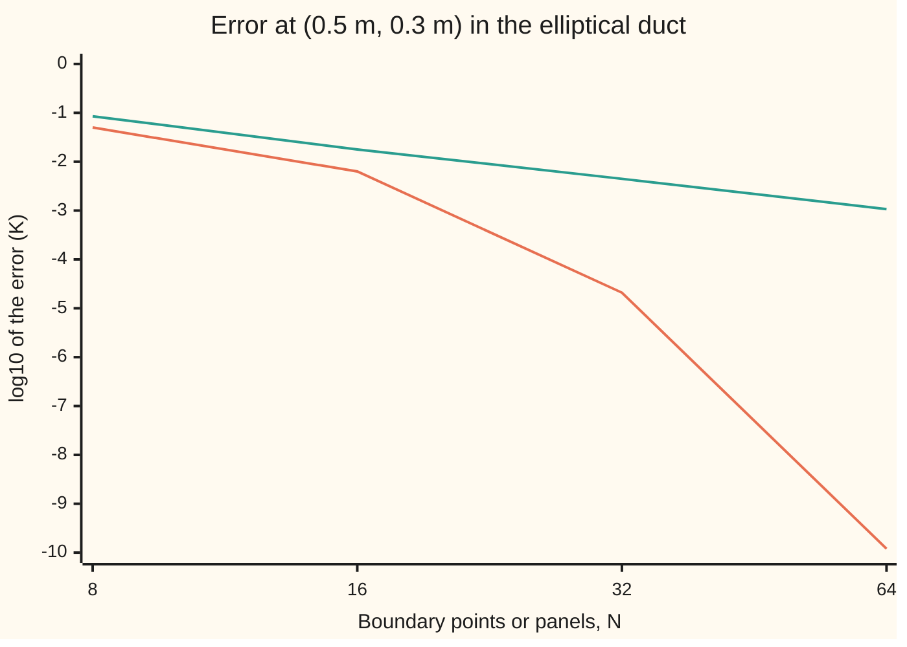

# Boundary elements: solve Laplace's equation with unknowns only on the boundary

[Syllabus](../../../SYLLABUS.md) → [Partial differential equations](../README.md) → [Nonlinear PDE and Fluids](../README.md#s07) → Boundary elements

---

## General Overview

A large duct has an elliptical cross-section 4 m wide and 2 m tall: semi-axes 2 m and 1 m. It is packed solid, and heating and cooling lines in its wall hold the wall at a temperature that varies around it. Measured in kelvin above the surrounding ground, with $`x`$ and $`y`$ in metres from the centre, the wall temperature is $`g = x^2 - y^2`$ (illustrative). That is 4 K at the two narrow ends and −1 K at the top and bottom.

Once everything settles, what is the temperature at the point (0.5 m, 0.3 m)? For this wall data the exact answer is known, $`u = x^2 - y^2`$ everywhere inside, so it is $`0.25 - 0.09 = 0.16`$ K. That exact answer is the yardstick. The methods below never use it; they only use the wall values.

Wing 08's [Laplace's equation](../../08-Differential%20equations%20and%20dynamics/10-The%20Classical%20PDEs/07-laplaces-equation-and-harmonic-functions.md) solved such problems on a disc by separating variables. [Layer potentials](14-layer-potentials-and-boundary-integral-equations.md) turned the problem on any smooth shape into an equation on the rim alone. This card solves that rim equation by computer, on the ellipse, and compares the cost with filling the whole region with a grid.

The idea in plain words:

- Put $`N`$ points on the wall. At each, an unknown number says how strong a layer of source pairs is there.
- Every source pair's temperature field already obeys Laplace's equation inside. So only the wall condition is left to match: $`N`$ equations in $`N`$ unknowns.
- Solve that $`N`$ by $`N`$ system once. Then the temperature at any inside point is a sum of $`N`$ terms.

With 64 wall points, the answer is 0.160000 K, off by 1.2e-10 K. On a harder test temperature, 32 wall points are off by 3.8e-06 K; a grid filling the cross-section with 10029 unknowns is off by 5.4e-05 K.

As a problem: the **unknown** is the steady temperature $`u`$, a harmonic function ($`\Delta u = 0`$) inside the ellipse. The **region** is the inside of the ellipse. The **data** is the wall temperature $`g`$ (a Dirichlet condition). The solution is classical and unique: twice differentiable inside, continuous up to the wall.

**A boundary element method writes the solution as a layer potential with an unknown density on the boundary, replaces the boundary integral by a sum over $`N`$ boundary points or panels, and solves the resulting dense $`N`$ by $`N`$ system; on a smooth boundary the trapezoid-rule version converges exponentially fast, so a few dozen boundary unknowns can beat a grid of thousands.**

**What kind of fact this is:** a method, resting on theorems. That the trapezoid rule is exact on low waves is proved on this card. That its error then falls exponentially, and that the Nyström method inherits that rate, are theorems stated with their sources. The panel order, the GMRES step counts and the grid comparison are measured by the checks.

### The picture: error against the number of boundary points



Caption: the orange line is Nyström with the trapezoid rule; its slope steepens at every doubling, the mark of exponential convergence. The teal line is $`N`$ flat panels with collocation; it falls by a steady 0.6 per doubling, a power of $`N`$ (the error divides by 4 when $`N`$ doubles).

---

## The formula

Notation from earlier cards, one line each. $`\Omega`$ is the region and $`\partial\Omega`$ its boundary curve, here called the rim. $`n`$ is the outward unit normal. $`\Phi(x) = -\ln|x|/(2\pi)`$ is the potential of a unit point source in the plane ([The fundamental solution](../04-Laplace%2C%20Poisson%20and%20Potentials/02-fundamental-solution-of-the-laplacian.md)). From [Layer potentials](14-layer-potentials-and-boundary-integral-equations.md): the double-layer potential $`D\mu`$ of a density $`\mu`$ on the rim, and the rim operator $`K`$ (the double layer read on the rim itself).

The interior Dirichlet problem, written as a double layer, is the second-kind rim equation

```math
-\tfrac12\,\mu(x) + \oint_{\partial\Omega} \frac{\partial \Phi(x - y)}{\partial n_y}\,\mu(y)\,ds_y = g(x) \quad (x \text{ on the rim}), \qquad u(x) = \oint_{\partial\Omega} \frac{\partial \Phi(x - y)}{\partial n_y}\,\mu(y)\,ds_y \quad (x \text{ inside}).
```

**Read it aloud:** find the density for which minus half of it, plus its double layer read on the rim, equals the wall temperature at every rim point; the temperature inside is then that density's double layer.

Describe the rim by the angle-like parameter $`t`$ from 0 to $`2\pi`$: the point $`\gamma(t) = (a\cos t,\ b\sin t)`$, with semi-axes $`a`$ = 2 m and $`b`$ = 1 m. Its speed $`J(t) = |\gamma'(t)|`$ turns $`dt`$ into length, $`ds = J\,dt`$. Take $`N`$ equal steps, $`t_j = 2\pi j/N`$, and the trapezoid rule gives every node the weight $`w_j = J(t_j)\,2\pi/N`$. The **Nyström method** asks the equation to hold at the nodes themselves:

```math
-\tfrac12\,\mu_l + \sum_{j=0}^{N-1} k_{lj}\,w_j\,\mu_j = g(\gamma(t_l)), \qquad k_{lj} = \frac{(\gamma_l - \gamma_j)\cdot n_j}{2\pi\,|\gamma_l - \gamma_j|^2}\ (l \ne j), \qquad k_{ll} = -\frac{\chi_l}{4\pi} .
```

**Read it aloud:** at each node, minus half the density there, plus every node's density weighted by how strongly its source pair is felt here, equals the wall temperature here; a node's pull on itself is minus its curvature over four pi.

Here $`\chi_l`$ is the rim's curvature at node $`l`$ (one over the radius of the circle that fits the rim there); on the ellipse $`\chi = ab/J^3`$. The answer inside is then a sum: $`u(x) \approx \sum_j \partial\Phi(x - \gamma_j)/\partial n_j\; w_j\,\mu_j`$.

The **panel method** (the boundary element method in its textbook form) instead joins the nodes by $`N`$ straight panels and takes $`\mu`$ constant on each. It matches, at each panel's midpoint, the wall temperature at the true rim point whose parameter is halfway between the panel's ends. A straight panel's double layer has an exact short form, because the kernel times $`ds_y`$ is the small angle that the piece $`ds_y`$ fills, seen from $`x`$:

```math
\int_{\text{panel } j} \frac{\partial \Phi(x - y)}{\partial n_y}\,ds_y = -\frac{\alpha_j(x)}{2\pi} ,
```

**Read it aloud:** a straight strip of unit source pairs, seen from a point, contributes minus the angle it fills in that point's view, over two pi.

Here $`\alpha_j(x)`$ is the angle that panel $`j`$ subtends at $`x`$.

| Symbol | Plain meaning | In our example | Push it up and the answer… |
| --- | --- | --- | --- |
| $`\Omega`$, $`\partial\Omega`$, $`a`$, $`b`$ | the region and its rim; the ellipse's semi-axes | 2 m, 1 m | the region grows; $`u`$ at a fixed point does not change, since $`u = x^2 - y^2`$ |
| $`x`$, $`y`$ | a point inside or on the rim; a rim point being summed over | $`x`$ = (0.5, 0.3) m | — |
| $`g`$, $`u`$ | wall temperature (the Dirichlet data); steady temperature inside | $`x^2 - y^2`$ K: 4 K at the ends, −1 K top and bottom; $`u`$ = 0.16 K at $`x`$ | $`u`$ grows in proportion to $`g`$ |
| $`\Phi`$, $`D`$, $`K`$, $`I`$ | point-source potential; double layer; double layer read on the rim (earlier cards); the identity | $`\Phi = -\ln\lvert x\rvert/(2\pi)`$ | — |
| $`t`$, $`\gamma(t)`$, $`J`$, $`s`$ | rim parameter; the rim point it names; the rim's speed, length per unit of $`t`$; arc length | $`\gamma(0)`$ = (2, 0) m with $`J`$ = 1 m; $`\gamma(\pi/2)`$ = (0, 1) m with $`J`$ = 2 m | a larger $`J`$ gives its node more weight |
| $`n`$, $`n_j`$, $`\chi`$ | outward unit normal, and its value at node $`j`$; curvature of the rim, $`ab/J^3`$ | (1, 0) and 2 per m at (2, 0) m | a larger self-pull $`k_{ll}`$ |
| $`\mu`$, $`\mu_j`$ | double-layer density; its value at node $`j`$ | −5.994153 K at node 0 when $`N`$ = 8 | $`u`$ grows in proportion |
| $`N`$, $`w_j`$ | boundary nodes or panels; trapezoid weight $`J(t_j)\,2\pi/N`$ at node $`j`$ | 8 to 256; 0.785398 m at node 0 when $`N`$ = 8 | error falls: exponentially (Nyström), as $`N^{-2}`$ (panels) |
| $`k_{lj}`$, $`l`$ | matrix kernel: node $`j`$'s pull felt at node $`l`$; the row index | −0.031831 per m for $`l`$ = 0, $`j`$ = 2, $`N`$ = 8 | — |
| $`\alpha_j(x)`$ | angle panel $`j`$ subtends at $`x`$ | all panels' angles add to $`2\pi`$ at an inside point | — |
| $`h`$, $`d`$ | grid step; distance from the rim to a point being read | $`h`$ = 0.1, 0.05, 0.025 m; $`d`$ = 0.25 to 0.02 m | larger $`h`$: grid error grows as $`h^2`$; smaller $`d`$: summed $`u`$ fails |
| $`m`$, $`z`$, $`\rho`$, $`i`$ | wave number; root of unity $`e^{2\pi i m/N}`$; decay rate of wave amplitudes; the imaginary unit | — | larger $`\rho`$: faster convergence |

### When it holds

- **A known fundamental solution.** The method needs $`\Phi`$ in closed form, so the material must be uniform and the equation linear. If the conductivity varies from place to place, there is no such $`\Phi`$, and a grid or [Finite elements](../../16-Numerical%20analysis/07-PDE%20Solvers/07-finite-elements-galerkin-and-hat-functions.md) must fill the region.
- **A smooth rim, for the exponential rate.** The trapezoid rule is exponentially accurate only for a smooth periodic integrand. At a corner the kernel is singular, the rate drops to a power, and the panels must be crowded towards the corner.
- **Evaluation points away from the rim.** The kernel peaks sharply near the rim. With 64 nodes, a point 2 cm from the end of the duct comes out wrong by 2.2 K on a true 3.9204 K.
- **The right sign of the jump.** Inside, the rim equation has $`-\tfrac12`$. With $`+\tfrac12`$ the exact operator kills constants, so every row of the matrix adds to zero (within 1e-12 at $`N`$ = 32): the matrix is singular and has no reliable answer.
- **A dense matrix that fits.** All $`N^2`$ entries are nonzero. Storage grows as $`N^2`$ and elimination as $`N^3`$; large problems need GMRES with a fast matrix product instead.

---

## Why it works

### Step 0: the region drops out, so only the rim is discretised

The double layer $`D\mu`$ is harmonic off the rim for every density (proved on [Layer potentials](14-layer-potentials-and-boundary-integral-equations.md)). So the equation $`\Delta u = 0`$ is satisfied exactly, for free, at every inside point. The only approximation left is on the rim: replace one integral around a closed curve by a finite sum. The error of the whole method is the error of that sum.

### Step 1: the trapezoid rule is exact on low waves

On a closed curve the integrand is periodic in $`t`$. Write it as a sum of waves $`e^{imt}`$, with $`i`$ the imaginary unit and $`m`$ a whole number (its Fourier series). The trapezoid rule with $`N`$ equal steps adds the values $`e^{imt_j}`$, $`t_j = 2\pi j/N`$. These are the powers of the $`N`$-th root of unity $`e^{2\pi i m/N}`$, and

```math
\frac{2\pi}{N}\sum_{j=0}^{N-1} e^{2\pi i\,m j/N} = \begin{cases} 2\pi & \text{if } N \text{ divides } m,\\ 0 & \text{otherwise.} \end{cases}
```

**Read it aloud:** the $`N`$ equally spaced points of a wave add to zero, unless the wave fits a whole number of times between neighbouring points.

The true integral of $`e^{imt}`$ is $`2\pi`$ for $`m = 0`$ and 0 otherwise. So the rule is exact for every wave with $`|m| < N`$.

<details>
<summary>Detailed proof: the sum of the powers of a root of unity</summary>

Let $`z = e^{2\pi i m/N}`$. If $`N`$ divides $`m`$, then $`z = 1`$ and the sum is $`N`$ ones, so the rule gives $`2\pi`$.

Otherwise $`z \ne 1`$, and the geometric sum is

$`\displaystyle \sum_{j=0}^{N-1} z^j = \frac{z^N - 1}{z - 1} = \frac{e^{2\pi i m} - 1}{z - 1} = 0 ,`$

since $`e^{2\pi i m} = 1`$ for every whole number $`m`$. The true integral of $`e^{imt}`$ over a full period is 0 for $`m \ne 0`$. So rule and integral agree on every wave except the multiples of $`N`$ other than 0.

</details>

### Step 2: so the error is only the high waves, and they are tiny

The rule's error is the sum of the integrand's wave amplitudes at $`m = \pm N, \pm 2N, \dots`$ (times $`2\pi`$). For an integrand that is smooth and analytic (a convergent power series near every point), those amplitudes fall like $`e^{-\rho |m|}`$ for some $`\rho > 0`$. The error then falls like $`e^{-\rho N}`$: exponentially. Trefethen and Weideman (Sources) give the full proof and the size of $`\rho`$, which shrinks as the curve's nearest complex singularity comes close.

The ellipse, its normal, its speed and the double-layer kernel are all analytic in $`t`$. On a smooth rim the kernel even stays bounded on the diagonal: it tends to $`-\chi/(4\pi)`$, minus the curvature over four pi. So the integrand is smooth, and the rule is exponentially accurate.

### Step 3: the Nyström solve inherits the rule's accuracy

The exact operator $`-\tfrac12 I + K`$ is one-to-one and onto (proved on [Layer potentials](14-layer-potentials-and-boundary-integral-equations.md), through [The Fredholm alternative](08-fredholm-alternative-and-compact-operators.md)). Atkinson (Sources, chapters 4 and 7) proves that its Nyström version is then invertible for all large $`N`$, with a bound on its inverse that does not grow with $`N`$. So the error in $`\mu`$ is at most a fixed constant times the quadrature error on the true density. The same rule then sums $`u`$ inside.

The error at (0.5 m, 0.3 m) is 5.0e-02, 6.3e-03, 2.1e-05 and 1.2e-10 K at $`N`$ = 8, 16, 32 and 64. Each doubling does far more than the last. For a second test temperature $`e^x\cos y`$ K the errors are 2.7e-03, 3.8e-06 and 1.6e-11 at $`N`$ = 16, 32, 64.

### Step 4: the diagonal needs the curvature

At $`x = y`$ the formula for $`k_{lj}`$ reads 0 over 0. The limit along the rim is $`-\chi/(4\pi)`$, and leaving it out costs a lot. With the diagonal set to zero, the error is 2.2e-04 at $`N`$ = 32 and 1.2e-04 at $`N`$ = 64. That is a power of $`N`$, and a million times worse than 1.2e-10.

A quick test of the matrix: the double layer of a constant density 1 is −1 at every inside point (Gauss's lemma, from [Layer potentials](14-layer-potentials-and-boundary-integral-equations.md)), so each row of $`-\tfrac12 I + K`$ should add to −1. With 8 nodes, row 0 adds to −1.000152.

### Step 5: panels converge only as a power

Flat panels replace the curved rim by a polygon and the smooth density by a step function. Neither error shrinks exponentially. Measured, the error falls as $`N^{-2}`$: 2.6e-04 K at $`N`$ = 128 and 6.5e-05 K at $`N`$ = 256, an observed order of 2.01.

Panels still matter because they fit any surface that can be cut into flat pieces: a wing, a hull, a machine part with edges. Nyström needs one smooth parameter running round the whole rim. Sauter and Schwab (Sources) give the error theory for panels, corners included.

**Galerkin in outline.** Instead of matching the wall temperature at one point per panel, Galerkin multiplies the rim equation by each panel's basis function and integrates, as [Finite elements](../../16-Numerical%20analysis/07-PDE%20Solvers/07-finite-elements-galerkin-and-hat-functions.md) does in the region. Each entry costs a double integral; in return the error theory is cleaner.

### Step 6: the dense system, and why GMRES needs only a few steps

Every node feels every other node, so all $`N^2`$ matrix entries are nonzero. Gaussian elimination costs about $`2N^3/3`$ operations ([LU with partial pivoting](../../16-Numerical%20analysis/03-Numerical%20Linear%20Algebra/02-lu-decomposition-and-pivoting.md)).

GMRES ([Sparse storage and Krylov methods](../../16-Numerical%20analysis/03-Numerical%20Linear%20Algebra/10-sparse-matrices-and-krylov-methods.md)) needs only products of the matrix with vectors, $`N^2`$ operations each. For a second-kind equation it needs few of them. $`K`$ is compact, so most of its eigenvalues crowd near 0, and the matrix's crowd near $`-\tfrac12`$. GMRES clears a crowded cluster in a few steps. The checks reach a relative residual of 1e-10 in 6 steps at $`N`$ = 16, 32, 64 and 128: the count does not grow with $`N`$.

**Fast multipole methods in outline.** Far from a cluster of nodes, the cluster's combined field is smooth, so a short multipole expansion can stand in for it ([The Laplacian in round coordinates, and the modes it splits into](../04-Laplace%2C%20Poisson%20and%20Potentials/07-laplacian-in-polar-and-spherical-coordinates.md) builds such expansions). Greengard and Rokhlin (Sources) arranged the clusters in a tree, so one product costs about $`N`$ operations, not $`N^2`$. With the GMRES step count flat, the whole solve costs about $`N`$.

### Step 7: close to the rim, the sum stops resolving the kernel

At a point a distance $`d`$ inside the rim, the kernel is a spike of width about $`d`$. The trapezoid sum resolves it only if the node spacing is smaller than $`d`$. With 64 nodes the spacing at the duct's end is 0.098175 m. Along the long axis, the error at the points $`(2 - d, 0)`$ is:

| Distance $`d`$ from the rim | 0.25 m | 0.10 m | 0.05 m | 0.02 m |
| --- | --- | --- | --- | --- |
| True $`u`$ (K) | 3.0625 | 3.6100 | 3.8025 | 3.9204 |
| Error with $`N`$ = 64 (K) | 4.1e-11 | 4.6e-03 | 2.1e-01 | 2.2e+00 |

The density is the same in every case; only the final sum fails. The cures: interpolate $`\mu`$ to a finer set of rim nodes for near-rim points, or use a quadrature built for the spike.

### Step 8: exterior problems, the main reason engineers use it

A grid must end somewhere, but the air around an aircraft, the sea around a hull and the soil around a buried pipe are infinite. A boundary method needs only the surface, and $`\Phi`$ already behaves correctly far away, so the condition at infinity is built in. [Layer potentials](14-layer-potentials-and-boundary-integral-equations.md) solved the flow past a bar this way. Waves use the [Helmholtz](../04-Laplace%2C%20Poisson%20and%20Potentials/08-helmholtz-and-eigenfunctions.md) fundamental solution instead.

### Step 9: the grid on the same region

The comparison grid is the 5-point [Finite differences on a grid](../../16-Numerical%20analysis/07-PDE%20Solvers/02-finite-differences-consistency-stability-and-convergence.md) scheme with step $`h`$. Near the curved wall, an arm of the stencil is shortened to end exactly on the wall (the Shortley–Weller rule; Sources), and the system is solved by over-relaxed Gauss–Seidel sweeps.

On $`x^2 - y^2`$ the grid gives 0.160000 K at $`h`$ = 0.1 m, with no error at all. The 5-point stencil is exact on quadratics. So the duct's own data cannot rank the methods, and the comparison uses the second test temperature $`e^x\cos y`$ K, whose true value at (0.5 m, 0.3 m) is 1.575084 K.

| Method | Unknowns | Matrix entries stored | Error (K) |
| --- | --- | --- | --- |
| Nyström, $`N`$ = 16 | 16 | $`16^2`$, dense | 2.7e-03 |
| Nyström, $`N`$ = 32 | 32 | 1024, dense | 3.8e-06 |
| Grid, $`h`$ = 0.1 m | 617 | 2969, sparse | 8.1e-04 |
| Grid, $`h`$ = 0.05 m | 2497 | 12249, sparse | 2.1e-04 |
| Grid, $`h`$ = 0.025 m | 10029 | 49669, sparse | 5.4e-05 |

The grid's observed order is 1.97: halving $`h`$ divides its error by 4 and multiplies its unknowns by 4. Its finest run, 10029 unknowns and 1138 sweeps, is still less accurate than Nyström with 32 unknowns: 5.4e-05 K against 3.8e-06 K. For the counting alone: a grid whose step equals the rim spacing (rim length 9.688448 m over $`N`$) has 71 unknowns at $`N`$ = 32 and 275 at $`N`$ = 64. That is about four times per doubling, so a grid grows like $`N^2`$ where the rim grows like $`N`$.

The trade is not one-sided: the grid's matrix is sparse and gives $`u`$ at every grid point at once, while each boundary-method value inside is a further sum of $`N`$ terms.

---

## Worked numbers, by hand

The Nyström matrix with $`N`$ = 8 nodes, row 0, for the duct. Node 0 is at (2, 0) m, where $`J = 1`$ m, $`n = (1, 0)`$ and $`\chi = 2`$ per m. Node 2 is at (0, 1) m, where $`J = 2`$ m and $`n = (0, 1)`$.

| Step | Arithmetic | Value |
| --- | --- | --- |
| 1. Target | $`0.5^2 - 0.3^2 = 0.25 - 0.09`$ | 0.16 K |
| 2. Weight at node 0 | $`J\,2\pi/N = 1 \times 2\pi/8`$ | 0.785398 m |
| 3. Weight at node 2 | $`2 \times 2\pi/8`$ | 1.570796 m |
| 4. Kernel, node 2 felt at node 0 | $`(2 - 0,\ 0 - 1)\cdot(0, 1) / (2\pi \times 5) = -1/(10\pi)`$ | −0.031831 per m |
| 5. Entry (0, 2) | $`-0.031831 \times 1.570796`$ | −0.050000 |
| 6. Self-pull at node 0 | $`-\chi/(4\pi) \times w_0 = -(2/4\pi) \times 0.785398`$ | −0.125000 |
| 7. Entry (0, 0) | $`-0.5 - 0.125`$ | −0.625000 |
| 8. Row 0 total | all eight entries | −1.000152, close to the exact −1 |
| 9. Data at nodes 0 and 2 | $`g(2, 0) = 4`$, $`g(0, 1) = -1`$ | 4.000000, −1.000000 K |
| 10. Solve the 8 by 8 system | elimination | $`\mu_0`$ = −5.994153 K |
| 11. Sum $`u`$ at (0.5, 0.3), $`N`$ = 8 | $`\sum_j k(x, \gamma_j)\,w_j\,\mu_j`$ | error 5.0e-02 K |
| 12. Same with $`N`$ = 64 | | **0.160000 K, error 1.2e-10 K** |

Sixty-four numbers on the wall fix the duct's temperature at (0.5 m, 0.3 m) to within 1.2e-10 K: 0.16 K above the ground.

### What breaks if you drop a piece

| Mistake | Comes out at | What went wrong |
| --- | --- | --- |
| Set the diagonal $`k_{ll}`$ to 0 | error 2.2e-04 K at $`N`$ = 32, 1.2e-04 K at $`N`$ = 64 | the curvature term is part of a smooth integrand; dropping it leaves an error that falls only as a power |
| Read $`u`$ 2 cm from the end with the same 64 nodes | 3.9204 K true, error 2.2e+00 K | the kernel's spike is narrower than the 0.098175 m node spacing |
| Flip the jump: $`+\tfrac12 I + K`$ inside | every row adds to 0 within 1e-12 at $`N`$ = 32: singular | that is the exterior operator, which kills constants |
| Test the grid only on $`x^2 - y^2`$ | 0.160000 K, exact, at $`h`$ = 0.1 m | the stencil is exact on quadratics; on $`e^x\cos y`$ the same grid is off by 8.1e-04 K |

---

## Code, from first principles, and it actually runs

Both programs write out the rim, the kernels, the trapezoid rule, the panel angles, Gaussian elimination, GMRES and the grid's sweeps, and import nothing that knows the answer. They take four independent roads to the temperature at (0.5 m, 0.3 m): Nyström with the trapezoid rule, flat-panel collocation, a finite-difference grid on the same region, and GMRES against elimination, all measured against the exact harmonic function. The finest grid takes a few seconds in Python.

### Python

```python
# Boundary elements -- the check behind the card.  Standard library only.
# A heated duct: the inside of an ellipse with semi-axes 2 m and 1 m, rim
# temperature g = x^2 - y^2 (degrees above ambient), exact u = x^2 - y^2.
# Roads: (1) Nystrom with the trapezoid rule, (2) flat-panel collocation,
# (3) a finite-difference grid on the same region, (4) GMRES against
# elimination, all read against the exact harmonic function at (0.5, 0.3).
import math
TAU, A, B, PX = 2 * math.pi, 2.0, 1.0, (0.5, 0.3)
G1 = lambda x, y: x * x - y * y                   # the duct's rim temperature
G2 = lambda x, y: math.exp(x) * math.cos(y)       # a second test, not a polynomial
def ell(t):                       # rim point, outward unit normal, speed, curvature
    J = math.sqrt(A * A * math.sin(t) ** 2 + B * B * math.cos(t) ** 2)
    return (A * math.cos(t), B * math.sin(t)), (B * math.cos(t) / J, A * math.sin(t) / J), J, A * B / (J * J * J)
def dk(x, y, n):                  # double-layer kernel d Phi(x - y)/d n_y
    dx, dy = x[0] - y[0], x[1] - y[1]
    return (dx * n[0] + dy * n[1]) / (dx * dx + dy * dy) / TAU
def solve(M0, b):                 # Gaussian elimination with partial pivoting
    n = len(b); M = [row[:] + [b[i]] for i, row in enumerate(M0)]
    for c in range(n):
        p = max(range(c, n), key=lambda r: abs(M[r][c])); M[c], M[p] = M[p], M[c]
        for r in range(c + 1, n):
            f = M[r][c] / M[c][c]
            for k in range(c, n + 1): M[r][k] -= f * M[c][k]
    x = [0.0] * n
    for r in range(n - 1, -1, -1): x[r] = (M[r][n] - sum(M[r][k] * x[k] for k in range(r + 1, n))) / M[r][r]
    return x

def nystrom(N, g, half=-0.5, diag=True):   # matrix of half*I + K, the data, the nodes
    nd = [ell(TAU * j / N) for j in range(N)]; M = [[0.0] * N for _ in range(N)]
    for i, (xi, ni, Ji, ki) in enumerate(nd):
        for j, (yj, nj, Jj, kj) in enumerate(nd):
            kern = (-kj / (2 * TAU) if diag else 0.0) if i == j else dk(xi, yj, nj)
            M[i][j] = kern * Jj * TAU / N + (half if i == j else 0.0)
    return M, [g(*p) for p, *_ in nd], nd
def ny_eval(nd, mu, x): return sum(dk(x, y, n) * m * J * TAU / len(nd) for (y, n, J, k), m in zip(nd, mu))
def ny_u(N, g, x=PX, **kw):
    M, b, nd = nystrom(N, g, **kw); return ny_eval(nd, solve(M, b), x)

def angle(x, p, q):               # signed angle that the panel p -> q subtends at x
    ax, ay, bx, by = p[0] - x[0], p[1] - x[1], q[0] - x[0], q[1] - x[1]
    return math.atan2(ax * by - ay * bx, ax * bx + ay * by)
def panel_u(N, g, x=PX):          # N flat panels, constant density, midpoint collocation
    V = [ell(TAU * j / N)[0] for j in range(N + 1)]
    mid = [((V[j][0] + V[j + 1][0]) / 2, (V[j][1] + V[j + 1][1]) / 2) for j in range(N)]
    M = [[-0.5 if i == j else -angle(mid[i], V[j], V[j + 1]) / TAU for j in range(N)] for i in range(N)]
    mu = solve(M, [g(*ell(TAU * (j + 0.5) / N)[0]) for j in range(N)])   # data read on the true rim
    return sum(-angle(x, V[j], V[j + 1]) / TAU * mu[j] for j in range(N))

def gmres(M, b, tol=1e-10):       # GMRES from zero: steps to reach relative residual tol
    n = len(b); beta = math.sqrt(sum(v * v for v in b)); Q = [[v / beta for v in b]]; H = []
    for k in range(1, n + 1):
        w = [sum(M[i][j] * Q[-1][j] for j in range(n)) for i in range(n)]; h = []
        for q in Q:
            c = sum(a * e for a, e in zip(w, q)); h.append(c); w = [a - c * e for a, e in zip(w, q)]
        h.append(math.sqrt(sum(v * v for v in w))); H.append(h); Q.append([v / h[-1] for v in w])
        HH = [[H[c][r] if r < len(H[c]) else 0.0 for c in range(k)] for r in range(k + 1)]
        y = solve([[sum(HH[r][a] * HH[r][c] for r in range(k + 1)) for c in range(k)] for a in range(k)],
                  [beta * HH[0][a] for a in range(k)])   # least squares by its normal equations
        x = [sum(Q[c][i] * y[c] for c in range(k)) for i in range(n)]
        res = math.sqrt(sum((b[i] - sum(M[i][j] * x[j] for j in range(n))) ** 2 for i in range(n))) / beta
        if res < tol: return k, x

def inside(i, j, h): return (i * h / A) * (i * h / A) + (j * h / B) * (j * h / B) < 1 - 1e-12
def grid_pts(h):
    I, Jm = int(A / h) + 1, int(B / h) + 1
    return [(i, j) for i in range(-I, I + 1) for j in range(-Jm, Jm + 1) if inside(i, j, h)]
def grid_u(h, g, omega):          # 5-point grid, Shortley-Weller arms at the curved rim, SOR
    pts = grid_pts(h); u = {p: 0.0 for p in pts}; arms = {}; nnz = len(pts)
    for (i, j) in pts:
        a = []
        for di, dj in ((1, 0), (-1, 0), (0, 1), (0, -1)):
            if inside(i + di, j + dj, h): a.append((h, (i + di, j + dj), 0.0)); nnz += 1; continue
            x0, y0 = i * h, j * h      # distance s to the rim along this arm: a quadratic in s
            qa, qb = di * di / (A * A) + dj * dj / (B * B), 2 * (x0 * di / (A * A) + y0 * dj / (B * B))
            qc = x0 * x0 / (A * A) + y0 * y0 / (B * B) - 1
            s = (-qb + math.sqrt(qb * qb - 4 * qa * qc)) / (2 * qa)
            a.append((s, None, g(x0 + s * di, y0 + s * dj)))
        arms[(i, j)] = a
    for sweep in range(1, 100000):
        change = 0.0
        for p in pts:
            (sE, pE, vE), (sW, pW, vW), (sN, pN, vN), (sS, pS, vS) = arms[p]
            wE, wW, wN, wS = 1 / (sE * (sE + sW)), 1 / (sW * (sE + sW)), 1 / (sN * (sN + sS)), 1 / (sS * (sN + sS))
            new = (wE * (u[pE] if pE else vE) + wW * (u[pW] if pW else vW) + wN * (u[pN] if pN else vN)
                   + wS * (u[pS] if pS else vS)) / (wE + wW + wN + wS)
            change = max(change, abs(new - u[p])); u[p] += omega * (new - u[p])
        if change < 1e-13: break
    return u[(round(PX[0] / h), round(PX[1] / h))], len(pts), nnz, sweep

e, lg = lambda v: "%.1e" % v, lambda v: "%.2f" % math.log10(v)
print("duct: ellipse 2 m by 1 m, rim temperature x^2 - y^2 K, read at (0.5, 0.3) m")
print("exact u = 0.25 - 0.09 = %.6f K" % G1(*PX))
M, b, nd = nystrom(8, G1); n0, n2 = nd[0], nd[2]
print("N=8, row 0 of -I/2 + K:" + ",".join(" %.6f" % v for v in M[0]))
print("N=8, row 0 adds up to %.6f (the double layer of 1 is -1 inside)" % sum(M[0]))
print("N=8, data at nodes 0 and 2: %.6f, %.6f; weight at node 0: %.6f" % (b[0], b[2], TAU / 8))
print("N=8, node 2 weight %.6f; kernel from node 2 at node 0 %.6f; node 0 curvature %.6f, self-pull %.6f; N=64 spacing at node 0 %.6f m"
      % (n2[2] * TAU / 8, dk(n0[0], n2[0], n2[1]), n0[3], -n0[3] / (2 * TAU) * n0[2] * TAU / 8, n0[2] * TAU / 64))
mu = solve(M, b); print("N=8, density mu at nodes 0, 1, 2: %.6f, %.6f, %.6f" % tuple(mu[:3]))
ny, pa = {}, {}
for N in [8, 16, 32, 64]:
    ny[N], pa[N] = abs(ny_u(N, G1) - 0.16), abs(panel_u(N, G1) - 0.16)
    print("N=%d: Nystrom error %s K, panels error %s K" % (N, e(ny[N]), e(pa[N])))
for N in [128, 256]: pa[N] = abs(panel_u(N, G1) - 0.16); print("N=%d: panels error %s K" % (N, e(pa[N])))
print("panel order, log2 of the error ratio from 128 to 256: %.2f" % math.log2(pa[128] / pa[256]))
print("Nystrom N=64 gives u = %.6f K" % ny_u(64, G1))
assert ny[64] < 1e-9 and ny[32] < 1e-4 < ny[16]       # exponential: each doubling far more than 4x
assert 1.9 < math.log2(pa[128] / pa[256]) < 2.1        # panels: a power, error / 4 per doubling
print("chart,N, 8, 16, 32, 64")
print("chart,log10 error Nystrom," + ",".join(" " + lg(ny[N]) for N in [8, 16, 32, 64]))
print("chart,log10 error panels," + ",".join(" " + lg(pa[N]) for N in [8, 16, 32, 64]))

ex = math.exp(0.5) * math.cos(0.3); print("second test: rim data e^x cos y, exact u at (0.5, 0.3) = %.6f" % ex)
for N in [16, 32, 64]: print("Nystrom N=%d: error %s" % (N, e(abs(ny_u(N, G2) - ex))))
for N in [16, 32, 64, 128]:
    M, b, nd = nystrom(N, G2); k, x = gmres(M, b)
    print("GMRES N=%d: %d steps to residual 1e-10" % (N, k))
assert k <= 10 and abs(ny_eval(nd, x, PX) - ny_eval(nd, solve(M, b), PX)) < 1e-9   # GMRES = elimination
P = sum(ell(TAU * j / 1000)[2] * TAU / 1000 for j in range(1000))
print("rim length %.6f m; dense matrix N=32: %d entries" % (P, 32 * 32))
gr = {}
for h, om in [(0.1, 1.7), (0.05, 1.8), (0.025, 1.9)]:
    v, n, nnz, sw = grid_u(h, G2, om); gr[h] = abs(v - ex)
    print("grid h=%.3f m: %d unknowns, %d nonzeros, %d sweeps, error %s" % (h, n, nnz, sw, e(gr[h])))
print("grid order, log2 of the error ratio from h=0.05 to 0.025: %.2f" % math.log2(gr[0.05] / gr[0.025]))
assert 1.8 < math.log2(gr[0.05] / gr[0.025]) < 2.2 and gr[0.025] > 10 * abs(ny_u(32, G2) - ex)
v = grid_u(0.1, G1, 1.7)[0]; print("grid h=0.1 on x^2 - y^2: u = %.6f K, exact on quadratics" % v)
assert abs(v - 0.16) < 1e-11
for N in [32, 64]: print("grid with spacing = rim length / %d: %d unknowns" % (N, len(grid_pts(P / N))))

print("near the rim, N=64, points (2 - d, 0): error in K, against the exact (2 - d)^2")
for d in [0.25, 0.1, 0.05, 0.02]:
    x = (2 - d, 0.0); print("d=%.2f m: u exact %.4f, error %s" % (d, x[0] * x[0], e(abs(ny_u(64, G1, x) - x[0] * x[0]))))
assert abs(ny_u(64, G1, (1.98, 0.0)) - 1.98 * 1.98) > 1.0
print("what breaks")
for N in [32, 64]: print("curvature diagonal dropped, N=%d: error %s" % (N, e(abs(ny_u(N, G1, diag=False) - 0.16))))
assert abs(ny_u(64, G1, diag=False) - 0.16) > 1e5 * ny[64]
M = nystrom(32, G1, half=0.5)[0]
print("sign flipped, +I/2 + K, N=32: every row sums to 0 within 1e-12: %s" % ("yes" if max(abs(sum(r)) for r in M) < 1e-12 else "no"))
print("ALL CHECKS PASS")
```

**Ran 2026-11-24 on macOS, Python 3.14.10, standard library only. All checks passed. Output, pasted from the run:**

```
duct: ellipse 2 m by 1 m, rim temperature x^2 - y^2 K, read at (0.5, 0.3) m
exact u = 0.25 - 0.09 = 0.160000 K
N=8, row 0 of -I/2 + K: -0.625000, -0.086845, -0.050000, -0.035106, -0.031250, -0.035106, -0.050000, -0.086845
N=8, row 0 adds up to -1.000152 (the double layer of 1 is -1 inside)
N=8, data at nodes 0 and 2: 4.000000, -1.000000; weight at node 0: 0.785398
N=8, node 2 weight 1.570796; kernel from node 2 at node 0 -0.031831; node 0 curvature 2.000000, self-pull -0.125000; N=64 spacing at node 0 0.098175 m
N=8, density mu at nodes 0, 1, 2: -5.994153, -1.499771, 2.994611
N=8: Nystrom error 5.0e-02 K, panels error 8.5e-02 K
N=16: Nystrom error 6.3e-03 K, panels error 1.8e-02 K
N=32: Nystrom error 2.1e-05 K, panels error 4.4e-03 K
N=64: Nystrom error 1.2e-10 K, panels error 1.1e-03 K
N=128: panels error 2.6e-04 K
N=256: panels error 6.5e-05 K
panel order, log2 of the error ratio from 128 to 256: 2.01
Nystrom N=64 gives u = 0.160000 K
chart,N, 8, 16, 32, 64
chart,log10 error Nystrom, -1.30, -2.20, -4.68, -9.92
chart,log10 error panels, -1.07, -1.75, -2.35, -2.97
second test: rim data e^x cos y, exact u at (0.5, 0.3) = 1.575084
Nystrom N=16: error 2.7e-03
Nystrom N=32: error 3.8e-06
Nystrom N=64: error 1.6e-11
GMRES N=16: 6 steps to residual 1e-10
GMRES N=32: 6 steps to residual 1e-10
GMRES N=64: 6 steps to residual 1e-10
GMRES N=128: 6 steps to residual 1e-10
rim length 9.688448 m; dense matrix N=32: 1024 entries
grid h=0.100 m: 617 unknowns, 2969 nonzeros, 242 sweeps, error 8.1e-04
grid h=0.050 m: 2497 unknowns, 12249 nonzeros, 624 sweeps, error 2.1e-04
grid h=0.025 m: 10029 unknowns, 49669 nonzeros, 1138 sweeps, error 5.4e-05
grid order, log2 of the error ratio from h=0.05 to 0.025: 1.97
grid h=0.1 on x^2 - y^2: u = 0.160000 K, exact on quadratics
grid with spacing = rim length / 32: 71 unknowns
grid with spacing = rim length / 64: 275 unknowns
near the rim, N=64, points (2 - d, 0): error in K, against the exact (2 - d)^2
d=0.25 m: u exact 3.0625, error 4.1e-11
d=0.10 m: u exact 3.6100, error 4.6e-03
d=0.05 m: u exact 3.8025, error 2.1e-01
d=0.02 m: u exact 3.9204, error 2.2e+00
what breaks
curvature diagonal dropped, N=32: error 2.2e-04
curvature diagonal dropped, N=64: error 1.2e-04
sign flipped, +I/2 + K, N=32: every row sums to 0 within 1e-12: yes
ALL CHECKS PASS
```

### Rust

```rust
// Boundary elements -- the check behind the card.  Rust std only, no crates.
// A heated duct: the inside of an ellipse with semi-axes 2 m and 1 m, rim
// temperature g = x^2 - y^2 (degrees above ambient), exact u = x^2 - y^2.
// Roads: (1) Nystrom with the trapezoid rule, (2) flat-panel collocation,
// (3) a finite-difference grid on the same region, (4) GMRES against
// elimination, all read against the exact harmonic function at (0.5, 0.3).
use std::{collections::HashMap, f64::consts::PI};
const TAU: f64 = 2.0 * PI; const A: f64 = 2.0; const B: f64 = 1.0; const PX: P = (0.5, 0.3);
type P = (f64, f64); type Mat = Vec<Vec<f64>>; type F = fn(f64, f64) -> f64;
type Node = (P, P, f64, f64); // rim point, outward unit normal, speed, curvature
fn g1(x: f64, y: f64) -> f64 { x * x - y * y } fn g2(x: f64, y: f64) -> f64 { x.exp() * y.cos() } // duct; second test
fn ell(t: f64) -> Node {
    let j = (A * A * t.sin().powi(2) + B * B * t.cos().powi(2)).sqrt();
    ((A * t.cos(), B * t.sin()), (B * t.cos() / j, A * t.sin() / j), j, A * B / (j * j * j))
}
fn dk(x: P, y: P, n: P) -> f64 { let (dx, dy) = (x.0 - y.0, x.1 - y.1); (dx * n.0 + dy * n.1) / (dx * dx + dy * dy) / TAU }
fn solve(m0: &[Vec<f64>], b: &[f64]) -> Vec<f64> { // Gaussian elimination with partial pivoting
    let n = b.len();
    let mut m: Mat = m0.iter().enumerate().map(|(i, r)| { let mut v = r.clone(); v.push(b[i]); v }).collect();
    for c in 0..n {
        let p = (c..n).fold(c, |p, r| if m[r][c].abs() > m[p][c].abs() { r } else { p });
        m.swap(c, p);
        for r in c + 1..n { let f = m[r][c] / m[c][c]; for k in c..=n { m[r][k] -= f * m[c][k]; } }
    }
    let mut x = vec![0.0; n];
    for r in (0..n).rev() { x[r] = (m[r][n] - (r + 1..n).map(|k| m[r][k] * x[k]).sum::<f64>()) / m[r][r]; }
    x
}
fn nystrom(n: usize, g: F, half: f64, diag: bool) -> (Mat, Vec<f64>, Vec<Node>) { // half*I + K, data, nodes
    let nd: Vec<Node> = (0..n).map(|j| ell(TAU * j as f64 / n as f64)).collect();
    let mut m = vec![vec![0.0; n]; n];
    for (i, &(xi, _, _, _)) in nd.iter().enumerate() {
        for (j, &(yj, nj, jj, kj)) in nd.iter().enumerate() {
            let kern = if i == j { if diag { -kj / (2.0 * TAU) } else { 0.0 } } else { dk(xi, yj, nj) };
            m[i][j] = kern * jj * TAU / n as f64 + if i == j { half } else { 0.0 };
        }
    }
    let b = nd.iter().map(|q| g(q.0 .0, q.0 .1)).collect(); (m, b, nd)
}
fn ny_eval(nd: &[Node], mu: &[f64], x: P) -> f64 { nd.iter().zip(mu).map(|(q, m)| dk(x, q.0, q.1) * m * q.2 * TAU / nd.len() as f64).sum() }
fn ny_x(n: usize, g: F, x: P, half: f64, diag: bool) -> f64 { let (m, b, nd) = nystrom(n, g, half, diag); ny_eval(&nd, &solve(&m, &b), x) }
fn ny_u(n: usize, g: F) -> f64 { ny_x(n, g, PX, -0.5, true) }
fn angle(x: P, p: P, q: P) -> f64 { // signed angle that the panel p -> q subtends at x
    let (ax, ay, bx, by) = (p.0 - x.0, p.1 - x.1, q.0 - x.0, q.1 - x.1); (ax * by - ay * bx).atan2(ax * bx + ay * by)
}
fn panel_u(n: usize, g: F) -> f64 { // N flat panels, constant density, midpoint collocation
    let v: Vec<P> = (0..=n).map(|j| ell(TAU * j as f64 / n as f64).0).collect();
    let mid: Vec<P> = (0..n).map(|j| ((v[j].0 + v[j + 1].0) / 2.0, (v[j].1 + v[j + 1].1) / 2.0)).collect();
    let m: Mat = (0..n).map(|i| (0..n).map(|j| if i == j { -0.5 } else { -angle(mid[i], v[j], v[j + 1]) / TAU }).collect()).collect();
    let b: Vec<f64> = (0..n).map(|j| { let p = ell(TAU * (j as f64 + 0.5) / n as f64).0; g(p.0, p.1) }).collect();
    let mu = solve(&m, &b); (0..n).map(|j| -angle(PX, v[j], v[j + 1]) / TAU * mu[j]).sum()
}
fn gmres(m: &[Vec<f64>], b: &[f64], tol: f64) -> (usize, Vec<f64>) { // GMRES from zero
    let n = b.len(); let beta = b.iter().map(|v| v * v).sum::<f64>().sqrt();
    let mut q: Mat = vec![b.iter().map(|v| v / beta).collect()]; let mut hs: Mat = vec![];
    for k in 1..=n {
        let last = q.last().unwrap().clone(); let mut h = vec![];
        let mut w: Vec<f64> = (0..n).map(|i| (0..n).map(|j| m[i][j] * last[j]).sum()).collect();
        for qq in &q {
            let c: f64 = w.iter().zip(qq).map(|(a, e)| a * e).sum(); h.push(c);
            w = w.iter().zip(qq).map(|(a, e)| a - c * e).collect();
        }
        let nw = w.iter().map(|v| v * v).sum::<f64>().sqrt(); h.push(nw); hs.push(h); q.push(w.iter().map(|v| v / nw).collect());
        let hh: Mat = (0..=k).map(|r| (0..k).map(|c| if r < hs[c].len() { hs[c][r] } else { 0.0 }).collect()).collect();
        let nm: Mat = (0..k).map(|a| (0..k).map(|c| (0..=k).map(|r| hh[r][a] * hh[r][c]).sum()).collect()).collect();
        let y = solve(&nm, &(0..k).map(|a| beta * hh[0][a]).collect::<Vec<_>>()); // normal equations
        let x: Vec<f64> = (0..n).map(|i| (0..k).map(|c| q[c][i] * y[c]).sum()).collect();
        let res = (0..n).map(|i| (b[i] - (0..n).map(|j| m[i][j] * x[j]).sum::<f64>()).powi(2)).sum::<f64>().sqrt() / beta;
        if res < tol { return (k, x); }
    }
    panic!("GMRES did not converge")
}
fn inside(i: i64, j: i64, h: f64) -> bool { let (a, b) = (i as f64 * h / A, j as f64 * h / B); a * a + b * b < 1.0 - 1e-12 }
fn grid_pts(h: f64) -> Vec<(i64, i64)> {
    let (ii, jm) = ((A / h) as i64 + 1, (B / h) as i64 + 1);
    (-ii..=ii).flat_map(|i| (-jm..=jm).map(move |j| (i, j))).filter(|&(i, j)| inside(i, j, h)).collect()
}
fn grid_u(h: f64, g: F, omega: f64) -> (f64, usize, usize, usize) { // 5-point grid, Shortley-Weller arms, SOR
    let pts = grid_pts(h); let idx: HashMap<(i64, i64), usize> = pts.iter().enumerate().map(|(k, &p)| (p, k)).collect();
    let (mut u, mut nnz, mut arms) = (vec![0.0; pts.len()], pts.len(), vec![]);
    for &(i, j) in &pts {
        let mut a: Vec<(f64, Option<usize>, f64)> = vec![];
        for (di, dj) in [(1i64, 0i64), (-1, 0), (0, 1), (0, -1)] {
            if inside(i + di, j + dj, h) { a.push((h, Some(idx[&(i + di, j + dj)]), 0.0)); nnz += 1; continue; }
            let (x0, y0, fi, fj) = (i as f64 * h, j as f64 * h, di as f64, dj as f64); // distance s to the rim
            let (qa, qb) = (fi * fi / (A * A) + fj * fj / (B * B), 2.0 * (x0 * fi / (A * A) + y0 * fj / (B * B)));
            let qc = x0 * x0 / (A * A) + y0 * y0 / (B * B) - 1.0;
            let s = (-qb + (qb * qb - 4.0 * qa * qc).sqrt()) / (2.0 * qa);
            a.push((s, None, g(x0 + s * fi, y0 + s * fj)));
        }
        arms.push(a);
    }
    let mut sweep = 0;
    for sw in 1..100000 {
        sweep = sw; let mut change: f64 = 0.0;
        for k in 0..pts.len() {
            let a = &arms[k]; let val = |t: &(f64, Option<usize>, f64)| match t.1 { Some(p) => u[p], None => t.2 };
            let (se, sw_, sn, ss) = (a[0].0, a[1].0, a[2].0, a[3].0);
            let (we, ww, wn, ws) = (1.0 / (se * (se + sw_)), 1.0 / (sw_ * (se + sw_)), 1.0 / (sn * (sn + ss)), 1.0 / (ss * (sn + ss)));
            let new = (we * val(&a[0]) + ww * val(&a[1]) + wn * val(&a[2]) + ws * val(&a[3])) / (we + ww + wn + ws);
            change = change.max((new - u[k]).abs()); u[k] += omega * (new - u[k]);
        }
        if change < 1e-13 { break; }
    }
    (u[idx[&((PX.0 / h).round() as i64, (PX.1 / h).round() as i64)]], pts.len(), nnz, sweep)
}
fn e(v: f64) -> String { // Python's "%.1e"
    let s = format!("{:.1e}", v); let (m, x) = s.split_once('e').unwrap(); let x: i32 = x.parse().unwrap();
    format!("{}e{}{:02}", m, if x < 0 { '-' } else { '+' }, x.abs())
}
fn row(v: &[f64], f: fn(f64) -> String) -> String { v.iter().map(|x| format!(" {}", f(*x))).collect::<Vec<_>>().join(",") }

fn main() {
    println!("duct: ellipse 2 m by 1 m, rim temperature x^2 - y^2 K, read at (0.5, 0.3) m");
    println!("exact u = 0.25 - 0.09 = {:.6} K", g1(PX.0, PX.1));
    let (m, b, nd) = nystrom(8, g1, -0.5, true); let (n0, n2) = (nd[0], nd[2]);
    println!("N=8, row 0 of -I/2 + K:{}", row(&m[0], |v| format!("{:.6}", v)));
    println!("N=8, row 0 adds up to {:.6} (the double layer of 1 is -1 inside)", m[0].iter().sum::<f64>());
    println!("N=8, data at nodes 0 and 2: {:.6}, {:.6}; weight at node 0: {:.6}", b[0], b[2], TAU / 8.0);
    println!("N=8, node 2 weight {:.6}; kernel from node 2 at node 0 {:.6}; node 0 curvature {:.6}, self-pull {:.6}; N=64 spacing at node 0 {:.6} m",
             n2.2 * TAU / 8.0, dk(n0.0, n2.0, n2.1), n0.3, -n0.3 / (2.0 * TAU) * n0.2 * TAU / 8.0, n0.2 * TAU / 64.0);
    let mu = solve(&m, &b); println!("N=8, density mu at nodes 0, 1, 2: {:.6}, {:.6}, {:.6}", mu[0], mu[1], mu[2]);
    let (mut ny, mut pa) = (HashMap::new(), HashMap::new());
    for n in [8, 16, 32, 64] {
        ny.insert(n, (ny_u(n, g1) - 0.16).abs()); pa.insert(n, (panel_u(n, g1) - 0.16).abs());
        println!("N={}: Nystrom error {} K, panels error {} K", n, e(ny[&n]), e(pa[&n]));
    }
    for n in [128, 256] { pa.insert(n, (panel_u(n, g1) - 0.16).abs()); println!("N={}: panels error {} K", n, e(pa[&n])); }
    let order = (pa[&128] / pa[&256]).log2();
    println!("panel order, log2 of the error ratio from 128 to 256: {:.2}", order);
    println!("Nystrom N=64 gives u = {:.6} K", ny_u(64, g1));
    assert!(ny[&64] < 1e-9 && ny[&32] < 1e-4 && 1e-4 < ny[&16] && 1.9 < order && order < 2.1); // exponential; a power
    let lg = |v: f64| format!("{:.2}", v.log10()); println!("chart,N, 8, 16, 32, 64");
    println!("chart,log10 error Nystrom,{}", row(&[8, 16, 32, 64].map(|n| ny[&n]), lg));
    println!("chart,log10 error panels,{}", row(&[8, 16, 32, 64].map(|n| pa[&n]), lg));

    let ex = 0.5f64.exp() * 0.3f64.cos(); println!("second test: rim data e^x cos y, exact u at (0.5, 0.3) = {:.6}", ex);
    for n in [16, 32, 64] { println!("Nystrom N={}: error {}", n, e((ny_u(n, g2) - ex).abs())); }
    let mut last = (0, 0.0, 0.0);
    for n in [16, 32, 64, 128] {
        let (m, b, nd) = nystrom(n, g2, -0.5, true); let (k, x) = gmres(&m, &b, 1e-10);
        println!("GMRES N={}: {} steps to residual 1e-10", n, k);
        last = (k, ny_eval(&nd, &x, PX), ny_eval(&nd, &solve(&m, &b), PX));
    }
    assert!(last.0 <= 10 && (last.1 - last.2).abs() < 1e-9); // GMRES = elimination
    let p: f64 = (0..1000).map(|j| ell(TAU * j as f64 / 1000.0).2 * TAU / 1000.0).sum();
    println!("rim length {:.6} m; dense matrix N=32: {} entries", p, 32 * 32);
    let mut gr = vec![];
    for (h, om) in [(0.1, 1.7), (0.05, 1.8), (0.025, 1.9)] {
        let (v, n, nnz, sw) = grid_u(h, g2, om); gr.push((v - ex).abs());
        println!("grid h={:.3} m: {} unknowns, {} nonzeros, {} sweeps, error {}", h, n, nnz, sw, e(gr[gr.len() - 1]));
    }
    let go = (gr[1] / gr[2]).log2(); println!("grid order, log2 of the error ratio from h=0.05 to 0.025: {:.2}", go);
    assert!(1.8 < go && go < 2.2 && gr[2] > 10.0 * (ny_u(32, g2) - ex).abs());
    let v = grid_u(0.1, g1, 1.7).0; println!("grid h=0.1 on x^2 - y^2: u = {:.6} K, exact on quadratics", v); assert!((v - 0.16).abs() < 1e-11);
    for n in [32, 64] { println!("grid with spacing = rim length / {}: {} unknowns", n, grid_pts(p / n as f64).len()); }

    println!("near the rim, N=64, points (2 - d, 0): error in K, against the exact (2 - d)^2");
    for d in [0.25, 0.1, 0.05, 0.02] {
        let x: P = (2.0 - d, 0.0);
        println!("d={:.2} m: u exact {:.4}, error {}", d, x.0 * x.0, e((ny_x(64, g1, x, -0.5, true) - x.0 * x.0).abs()));
    }
    assert!((ny_x(64, g1, (1.98, 0.0), -0.5, true) - 1.98 * 1.98).abs() > 1.0);
    println!("what breaks");
    for n in [32, 64] { println!("curvature diagonal dropped, N={}: error {}", n, e((ny_x(n, g1, PX, -0.5, false) - 0.16).abs())); }
    assert!((ny_x(64, g1, PX, -0.5, false) - 0.16).abs() > 1e5 * ny[&64]);
    let ok = nystrom(32, g1, 0.5, true).0.iter().map(|r| r.iter().sum::<f64>().abs()).fold(0.0, f64::max) < 1e-12;
    println!("sign flipped, +I/2 + K, N=32: every row sums to 0 within 1e-12: {}", if ok { "yes" } else { "no" });
    println!("ALL CHECKS PASS");
}
```

**Ran 2026-11-24 on macOS, rustc 1.98.1, no crates. All checks passed. Output, pasted from the run:**

```
duct: ellipse 2 m by 1 m, rim temperature x^2 - y^2 K, read at (0.5, 0.3) m
exact u = 0.25 - 0.09 = 0.160000 K
N=8, row 0 of -I/2 + K: -0.625000, -0.086845, -0.050000, -0.035106, -0.031250, -0.035106, -0.050000, -0.086845
N=8, row 0 adds up to -1.000152 (the double layer of 1 is -1 inside)
N=8, data at nodes 0 and 2: 4.000000, -1.000000; weight at node 0: 0.785398
N=8, node 2 weight 1.570796; kernel from node 2 at node 0 -0.031831; node 0 curvature 2.000000, self-pull -0.125000; N=64 spacing at node 0 0.098175 m
N=8, density mu at nodes 0, 1, 2: -5.994153, -1.499771, 2.994611
N=8: Nystrom error 5.0e-02 K, panels error 8.5e-02 K
N=16: Nystrom error 6.3e-03 K, panels error 1.8e-02 K
N=32: Nystrom error 2.1e-05 K, panels error 4.4e-03 K
N=64: Nystrom error 1.2e-10 K, panels error 1.1e-03 K
N=128: panels error 2.6e-04 K
N=256: panels error 6.5e-05 K
panel order, log2 of the error ratio from 128 to 256: 2.01
Nystrom N=64 gives u = 0.160000 K
chart,N, 8, 16, 32, 64
chart,log10 error Nystrom, -1.30, -2.20, -4.68, -9.92
chart,log10 error panels, -1.07, -1.75, -2.35, -2.97
second test: rim data e^x cos y, exact u at (0.5, 0.3) = 1.575084
Nystrom N=16: error 2.7e-03
Nystrom N=32: error 3.8e-06
Nystrom N=64: error 1.6e-11
GMRES N=16: 6 steps to residual 1e-10
GMRES N=32: 6 steps to residual 1e-10
GMRES N=64: 6 steps to residual 1e-10
GMRES N=128: 6 steps to residual 1e-10
rim length 9.688448 m; dense matrix N=32: 1024 entries
grid h=0.100 m: 617 unknowns, 2969 nonzeros, 242 sweeps, error 8.1e-04
grid h=0.050 m: 2497 unknowns, 12249 nonzeros, 624 sweeps, error 2.1e-04
grid h=0.025 m: 10029 unknowns, 49669 nonzeros, 1138 sweeps, error 5.4e-05
grid order, log2 of the error ratio from h=0.05 to 0.025: 1.97
grid h=0.1 on x^2 - y^2: u = 0.160000 K, exact on quadratics
grid with spacing = rim length / 32: 71 unknowns
grid with spacing = rim length / 64: 275 unknowns
near the rim, N=64, points (2 - d, 0): error in K, against the exact (2 - d)^2
d=0.25 m: u exact 3.0625, error 4.1e-11
d=0.10 m: u exact 3.6100, error 4.6e-03
d=0.05 m: u exact 3.8025, error 2.1e-01
d=0.02 m: u exact 3.9204, error 2.2e+00
what breaks
curvature diagonal dropped, N=32: error 2.2e-04
curvature diagonal dropped, N=64: error 1.2e-04
sign flipped, +I/2 + K, N=32: every row sums to 0 within 1e-12: yes
ALL CHECKS PASS
```

### Lean

Lean proves Step 1 for every $`N`$: the trapezoid rule is exact on low waves. It also checks the worked numbers.

- Take $`N`$ equal steps and a whole number $`m`$ with $`|m| < N`$. Then the trapezoid rule gives exactly the integral of $`e^{imt}`$ over a full period.
- Take $`N`$ at least 1 and any whole number $`m`$. Then the displayed sum is $`2\pi`$ when $`N`$ divides $`m`$, and 0 otherwise.
- Take a whole number $`m`$ from 0 up to $`N - 1`$. Then the rule is also exact on $`\cos mt`$ and $`\sin mt`$.
- The exact temperature at (0.5 m, 0.3 m) is $`0.25 - 0.09 = 0.16`$ K.
- The rim data at nodes 0 and 2 are 4 K and −1 K.
- In worked step 4, the dot product is −1 and the squared distance is 5.
- The dense matrix has 256 entries for 16 unknowns and 1024 for 32.
- The grid with $`h`$ = 0.1 m has 617 points inside the ellipse.

The exponential rate, the Nyström and panel errors, GMRES and the grid's accuracy are left to the Python and Rust checks.

```lean
-- Boundary elements: the trapezoid rule with N equal steps round a closed curve integrates every wave e^(imt) with |m| < N exactly, because the N-th roots of unity add to zero.
import Mathlib.Analysis.SpecialFunctions.Integrals.Basic
import Mathlib.Analysis.SpecialFunctions.Complex.Circle
import Mathlib.Algebra.Field.GeomSum
import Mathlib.Data.Int.Interval
import Mathlib.Tactic.NormNum

open Real

/-- Helper: the root-of-unity sum, proved here so the first theorem can use it. -/
theorem root_of_unity_wave_sum_aux (N : ℕ) (hN : 0 < N) (m : ℤ) :
    (2 * π / N : ℂ) * ∑ j ∈ Finset.range N,
        Complex.exp (2 * π * Complex.I * m * j / N) =
      if (N : ℤ) ∣ m then (2 * π : ℂ) else 0 := by
  have hN' : (N : ℂ) ≠ 0 := by exact_mod_cast hN.ne'
  have hpow : ∀ j : ℕ, Complex.exp (2 * π * Complex.I * m * j / N)
      = Complex.exp (2 * π * Complex.I * m / N) ^ j := by
    intro j
    rw [← Complex.exp_nat_mul]
    congr 1
    ring
  simp_rw [hpow]
  split_ifs with h
  · obtain ⟨q, rfl⟩ := h
    have h1 : Complex.exp (2 * π * Complex.I * ((N * q : ℤ) : ℂ) / N) = 1 := by
      have : 2 * π * Complex.I * ((N * q : ℤ) : ℂ) / N = (q : ℂ) * (2 * π * Complex.I) := by
        push_cast
        field_simp
      rw [this, Complex.exp_int_mul_two_pi_mul_I]
    rw [h1]
    simp only [one_pow, Finset.sum_const, Finset.card_range, nsmul_eq_mul, mul_one]
    field_simp
  · have hz : Complex.exp (2 * π * Complex.I * m / N) ≠ 1 := by
      intro hz
      rw [Complex.exp_eq_one_iff] at hz
      obtain ⟨n, hn⟩ := hz
      apply h
      refine ⟨n, ?_⟩
      have hpi : (π : ℂ) ≠ 0 := by exact_mod_cast Real.pi_ne_zero
      field_simp at hn
      exact_mod_cast hn
    have hzN : Complex.exp (2 * π * Complex.I * m / N) ^ N = 1 := by
      rw [← Complex.exp_nat_mul]
      have : (N : ℂ) * (2 * π * Complex.I * m / N) = (m : ℂ) * (2 * π * Complex.I) := by
        field_simp
      rw [this, Complex.exp_int_mul_two_pi_mul_I]
    rw [geom_sum_eq hz, hzN]
    simp

#print axioms root_of_unity_wave_sum_aux

/-- The card's Step 1: on a closed curve, the trapezoid rule with `N` equal steps
`t_j = 2πj/N` (every weight `2π/N`) gives exactly the true integral over a full period
of the wave `e^(imt)`, for every whole number `m` with `|m| < N`. -/
theorem trapezoid_rule_exact_on_low_waves (N : ℕ) (m : ℤ) (hm : |m| < (N : ℤ)) :
    (2 * π / N : ℂ) * ∑ j ∈ Finset.range N,
        Complex.exp (Complex.I * m * (2 * π * j / N)) =
      ∫ t in (0 : ℝ)..(2 * π), Complex.exp (Complex.I * m * t) := by
  have hN : 0 < N := by
    have : (0 : ℤ) < N := lt_of_le_of_lt (abs_nonneg m) hm
    exact_mod_cast this
  have key := root_of_unity_wave_sum_aux N hN m
  have harg : ∀ j : ℕ, Complex.I * m * (2 * π * j / N) = 2 * π * Complex.I * m * j / N := by
    intro j; ring
  simp_rw [harg]
  rw [key]
  by_cases hm0 : m = 0
  · subst hm0
    simp
  · have hnd : ¬ (N : ℤ) ∣ m := by
      intro hd
      have := Int.le_of_dvd (abs_pos.mpr hm0) ((dvd_abs _ _).mpr hd)
      omega
    simp only [hnd, ↓reduceIte]
    have hc : Complex.I * m ≠ 0 := by
      simp [Complex.I_ne_zero, hm0]
    rw [integral_exp_mul_complex hc]
    have : Complex.I * m * ((2 * π : ℝ) : ℂ) = (m : ℂ) * (2 * π * Complex.I) := by
      push_cast; ring
    rw [this, Complex.exp_int_mul_two_pi_mul_I]
    simp

/-- The card's displayed sum: `2π/N` times the sum of the powers `e^(2πimj/N)`,
`j = 0, …, N - 1`, of an `N`-th root of unity is `2π` when `N` divides `m` and `0`
otherwise. -/
theorem root_of_unity_wave_sum (N : ℕ) (hN : 0 < N) (m : ℤ) :
    (2 * π / N : ℂ) * ∑ j ∈ Finset.range N,
        Complex.exp (2 * π * Complex.I * m * j / N) =
      if (N : ℤ) ∣ m then (2 * π : ℂ) else 0 := by
  exact root_of_unity_wave_sum_aux N hN m

/-- The same fact for real waves: with `N` equal steps over a full period, the trapezoid
rule integrates `cos kt` and `sin kt` exactly for every whole number `k < N`. -/
theorem trapezoid_rule_exact_on_cos_sin (N k : ℕ) (hk : k < N) :
    (2 * π / N) * ∑ j ∈ Finset.range N, Real.cos (k * (2 * π * j / N)) =
        ∫ t in (0 : ℝ)..(2 * π), Real.cos (k * t) ∧
      (2 * π / N) * ∑ j ∈ Finset.range N, Real.sin (k * (2 * π * j / N)) =
        ∫ t in (0 : ℝ)..(2 * π), Real.sin (k * t) := by
  have hN : 0 < N := by omega
  have hN' : (N : ℝ) ≠ 0 := by exact_mod_cast hN.ne'
  by_cases hk0 : k = 0
  · subst hk0
    simp
    field_simp
  · have hkR : (k : ℝ) ≠ 0 := by exact_mod_cast hk0
    have key := root_of_unity_wave_sum_aux N hN k
    have hnd : ¬ (N : ℤ) ∣ (k : ℤ) := by
      intro hd
      have := Int.le_of_dvd (by omega) hd
      omega
    simp only [hnd, ↓reduceIte] at key
    have hsum : ∑ j ∈ Finset.range N, Complex.exp (((k * (2 * π * j / N) : ℝ) : ℂ) * Complex.I) = 0 := by
      have h2 : (2 * π / N : ℂ) ≠ 0 := by
        have hpi : (π : ℂ) ≠ 0 := by exact_mod_cast Real.pi_ne_zero
        have : (N : ℂ) ≠ 0 := by exact_mod_cast hN.ne'
        simp [hpi, this]
      have := (mul_eq_zero.mp key).resolve_left h2
      rw [← this]
      apply Finset.sum_congr rfl
      intro j _
      congr 1
      push_cast
      ring
    have hre := congrArg Complex.re hsum
    have him := congrArg Complex.im hsum
    rw [Complex.re_sum] at hre
    rw [Complex.im_sum] at him
    simp only [Complex.exp_ofReal_mul_I_re, Complex.zero_re] at hre
    simp only [Complex.exp_ofReal_mul_I_im, Complex.zero_im] at him
    rw [hre, him, intervalIntegral.integral_comp_mul_left (fun t => Real.cos t) hkR,
      intervalIntegral.integral_comp_mul_left (fun t => Real.sin t) hkR,
      integral_cos, integral_sin]
    have h1 : (k : ℝ) * (2 * π) = ((2 * k : ℕ) : ℝ) * π := by push_cast; ring
    refine ⟨?_, ?_⟩
    · simp only [mul_zero, mul_comm (k : ℝ) 0, zero_mul]
      rw [h1, Real.sin_nat_mul_pi]
      simp
    · simp only [mul_zero]
      rw [Real.cos_nat_mul_two_pi]
      simp

-- The duct's exact temperature at (0.5 m, 0.3 m): 0.25 - 0.09 = 0.16 K, in exact fractions.
example : ((1 : ℚ) / 2) ^ 2 - (3 / 10) ^ 2 = 4 / 25 := by norm_num

-- The rim data g = x^2 - y^2 at node 0, (2, 0) m, and node 2, (0, 1) m: 4 K and -1 K.
example : (2 : ℤ) ^ 2 - 0 ^ 2 = 4 ∧ (0 : ℤ) ^ 2 - 1 ^ 2 = -1 := by norm_num

-- Worked step 4: node 2 seen from node 0, (2 - 0, 0 - 1) · (0, 1) = -1 over |(2, -1)|^2 = 5.
example : (2 - 0 : ℤ) * 0 + (0 - 1) * 1 = -1 ∧ (2 - 0 : ℤ) ^ 2 + (0 - 1) ^ 2 = 5 := by norm_num

-- The dense matrices: 16^2 = 256 entries for 16 unknowns, 1024 for 32.
example : (16 : ℕ) ^ 2 = 256 ∧ (32 : ℕ) ^ 2 = 1024 := by norm_num

-- The grid with h = 0.1 m: the point (ih, jh) is inside the ellipse 2 m by 1 m exactly when
-- i^2 + 4j^2 < 400, and there are 617 such grid points (the card's 617 unknowns).
set_option maxRecDepth 100000 in
example : ((Finset.Icc (-21 : ℤ) 21 ×ˢ Finset.Icc (-11 : ℤ) 11).filter
    (fun p => p.1 ^ 2 + 4 * p.2 ^ 2 < 400)).card = 617 := by decide

#print axioms trapezoid_rule_exact_on_low_waves
#print axioms root_of_unity_wave_sum
#print axioms trapezoid_rule_exact_on_cos_sin
```

**Checked 2026-11-24 on macOS, Lean 4.36.0-rc2, Mathlib v4.36.0-rc2. Every proof is complete and uses only Lean's standard axioms. Output, pasted from the run:**

```
'root_of_unity_wave_sum_aux' depends on axioms: [propext, Classical.choice, Quot.sound]
'trapezoid_rule_exact_on_low_waves' depends on axioms: [propext, Classical.choice, Quot.sound]
'root_of_unity_wave_sum' depends on axioms: [propext, Classical.choice, Quot.sound]
'trapezoid_rule_exact_on_cos_sin' depends on axioms: [propext, Classical.choice, Quot.sound]
```

> [!TIP]
> **Try changing**
> - Guess first: how many panels match Nyström's 64-node error? Add 512 to the panel list. The error is 1.6e-05 K, still far above 1.2e-10 K: at order 2, each doubling of the panels buys only a factor of 4.
> - Guess first: does more nodes fix the near-rim error? Read the point 2 cm from the end with `ny_u(128, G1, (1.98, 0.0))`. The error drops from 2.2 K to 4.7e-01 K: better, but the spike still needs nodes closer together than 2 cm.
> - Guess first: does a looser GMRES tolerance save much? Call `gmres(M, b, 1e-6)`. It takes 5 steps instead of 6 at both $`N`$ = 32 and 128: the step count barely depends on the tolerance or on $`N`$.
> - Guess first: what happens in a flatter duct? Set `B = 0.5` and print `ny_u(N, G1)` for $`N`$ = 32, 64, 128 (the asserts then stop the full run). The point (0.5, 0.3) now sits close to the top wall, where the nodes are widest apart. The errors at $`N`$ = 32, 64 and 128 are 5.0e-03, 1.8e-03 and 1.3e-06 K: the near-rim effect from Step 7, until the spacing falls below the distance.

---

## The usual mistake

> [!warning]
> **Reading the temperature close to the wall with the same sum that solved for the density.** The density is accurate, but the kernel near the wall is a spike narrower than the node spacing. With 64 nodes the error is 4.1e-11 K at 25 cm from the end and 2.2e+00 K at 2 cm, on a true 3.9204 K. Near-wall points need a finer copy of the rim or a special quadrature.
>
> Smaller traps:
> - **Dropping the diagonal.** The self-pull $`-\chi/(4\pi)`$ is not optional. Without it the error at $`N`$ = 64 is 1.2e-04 K instead of 1.2e-10 K.
> - **The wrong sign of the jump.** $`+\tfrac12 I + K`$ is the exterior operator; inside, its rows add to 0 (within 1e-12 at $`N`$ = 32) and the matrix is singular.
> - **Judging a grid on a quadratic.** The 5-point stencil is exact on $`x^2 - y^2`$, so the grid gives 0.160000 K with no error. On $`e^x\cos y`$ the same grid is off by 8.1e-04 K.
> - **Counting unknowns only.** The boundary matrix is dense: 1024 entries for 32 unknowns, each a kernel evaluation.

---

## Where you meet it in real life

- **Aircraft and ship design.** Panel methods cover a wing or a hull with flat panels of sources and source pairs and solve for the ideal flow around it, with no mesh in the air or water.
- **Acoustics and sonar.** The [Helmholtz](../04-Laplace%2C%20Poisson%20and%20Potentials/08-helmholtz-and-eigenfunctions.md) version computes how sound scatters off a submarine hull or radiates from a loudspeaker into open space.
- **Chip design.** Capacitance extraction finds the charge on thousands of wires by single layers on their surfaces, accelerated by fast multipole or similar methods.
- **Buried pipes and foundations.** Heat loss from a pipe into the ground and the stress around a tunnel are exterior problems where the ground is effectively infinite.

> **Say it back**
> A boundary element method writes the temperature as a layer of source pairs on the wall, so Laplace's equation holds inside for free and only the wall is discretised. With the trapezoid rule on a smooth closed wall, the error falls exponentially: 1.2e-10 K with 64 nodes in the elliptical duct. With flat panels it falls as $`N^{-2}`$, but panels fit any surface, edges and corners included. The matrix is dense, so GMRES with a fast product replaces elimination for large $`N`$; for this second-kind equation it needs 6 steps whatever $`N`$ is. The method needs a known fundamental solution, and the potential must be read away from the wall or with special care.

---

## What this builds on

- [Layer potentials](14-layer-potentials-and-boundary-integral-equations.md): the double layer, its jump, and the second-kind rim equation solved here, with the proof that it has exactly one solution.
- [Green's function](../04-Laplace%2C%20Poisson%20and%20Potentials/04-greens-functions-and-the-representation-formula.md): Green's identities and the representation formula, which say every harmonic function is a sum of rim layers.
- [Integral equations](07-integral-equations-fredholm-and-volterra.md): the kernel and the second-kind form, which make the discrete system well behaved.
- [Trapezoid, midpoint and Simpson](../../16-Numerical%20analysis/05-Quadrature/01-newton-cotes-and-composite-rules.md): the trapezoid rule, which on a closed curve becomes exponentially accurate.
- [Finite elements](../../16-Numerical%20analysis/07-PDE%20Solvers/07-finite-elements-galerkin-and-hat-functions.md): the region-filling method that boundary elements are measured against, and the Galerkin idea behind the panel version.
- [Sparse storage and Krylov methods](../../16-Numerical%20analysis/03-Numerical%20Linear%20Algebra/10-sparse-matrices-and-krylov-methods.md): GMRES, which solves the dense system with a handful of matrix products.

## Where this goes next

- [Lax pairs and inverse scattering](16-lax-pairs-and-the-inverse-scattering-transform.md): the shelf's next card, where a soliton is rebuilt by solving another linear integral equation, the Gelfand–Levitan–Marchenko equation.
- [Singular integrals](../../20-Harmonic%20analysis/06-Maximal%20Functions%20and%20Beyond/03-singular-integrals-and-the-hilbert-transform-bound.md): the kernels that appear when the rim has corners or when the normal slope of a double layer is needed, and why they still give bounded operators.

The question this card leaves open: on a rim with corners, where the kernel is singular and the operator is no longer compact, how should the panels be graded so that the error still falls fast?

---

## Sources

Verified 2026-11-24: every link below resolves to the publisher's page.

- Atkinson, Kendall E. *The Numerical Solution of Integral Equations of the Second Kind*. Cambridge University Press, 1997. [DOI 10.1017/CBO9780511626340](https://doi.org/10.1017/CBO9780511626340). The Nyström method, its stability bound and its convergence on smooth closed curves.
- Sauter, Stefan A., and Christoph Schwab. *Boundary Element Methods*. Springer, 2011. [DOI 10.1007/978-3-540-68093-2](https://doi.org/10.1007/978-3-540-68093-2). Panel discretisations, Galerkin and collocation, and their error theory, corners included.
- Trefethen, Lloyd N., and J. A. C. Weideman. "The exponentially convergent trapezoidal rule." *SIAM Review* 56 (2014), 385–458. [DOI 10.1137/130932132](https://doi.org/10.1137/130932132). Why the trapezoid rule on a periodic analytic integrand converges exponentially, and at what rate.
- Greengard, Leslie, and Vladimir Rokhlin. "A fast algorithm for particle simulations." *Journal of Computational Physics* 73 (1987), 325–348. [DOI 10.1016/0021-9991(87)90140-9](https://doi.org/10.1016/0021-9991(87)90140-9). The fast multipole method, which makes a dense potential product cost about $`N`$.
- Shortley, G. H., and R. Weller. "The numerical solution of Laplace's equation." *Journal of Applied Physics* 9 (1938), 334–348. [DOI 10.1063/1.1710426](https://doi.org/10.1063/1.1710426). The shortened-arm stencil used by the comparison grid at the curved wall.
