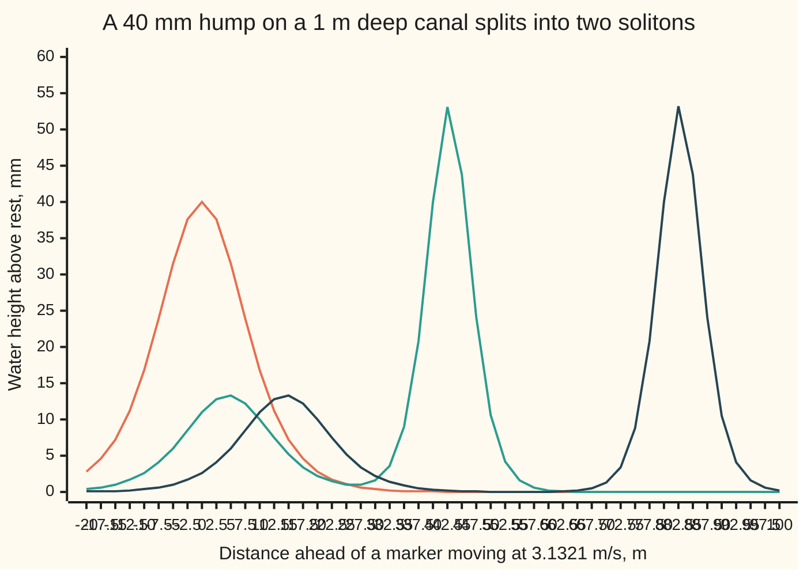

# Lax pairs and inverse scattering: why KdV solitons pass through each other unchanged

[Syllabus](../../../SYLLABUS.md) → [Partial differential equations](../README.md) → [Nonlinear PDE and Fluids](../README.md#s07) → Lax pairs and inverse scattering

---

## General Overview

A canal is 1 m deep. A smooth hump of water, 40.00 mm high and a few tens of metres long, starts along it. The numbers are illustrative, inside the range where the long-wave equation of Korteweg and de Vries (KdV) holds.

Follow the hump on a marker that moves at the long-wave speed, 3.1321 m/s. After 957.8 s the marker has moved 3000.0 m. The hump is gone. In its place are two humps: one 53.33 mm high, 82.75 m ahead of the marker, and one 13.33 mm high, 14.51 m ahead. The taller one is taller than the start, and the two keep pulling apart.

Why two humps, and why those heights? Treat the water hump as a well in Schrödinger's equation. That well holds exactly two trapped states, and their energies never change while the water moves. Each energy fixes one hump's height and speed.

A **Lax pair** proves the energies fixed. It is two linear operators whose commutator, the difference between applying them in the two orders, is KdV. The **inverse scattering transform** then solves KdV exactly by three linear steps. On wing 08, [Separation of variables](../../08-Differential%20equations%20and%20dynamics/10-The%20Classical%20PDEs/04-separation-of-variables-for-the-heat-equation.md) split a linear equation into modes that evolve independently. Inverse scattering does the same for a nonlinear equation.

**KdV makes the Schrödinger operator of the wave change only by a commutator, so its eigenvalues stay fixed; each fixed eigenvalue is one soliton, and a linear integral equation rebuilds the wave at any time, so solitons come out of every collision whole.**

**What kind of fact this is:** KdV is a model for long, low water waves, not a law. Inside it, three results are theorems proved on this card in Why it works. They hold for smooth solutions that fade fast at both ends: the Lax pair identity, the fixed eigenvalues, and, given the inverse step, the exact two-soliton formula. The inverse step for general data, the Gel'fand–Levitan–Marchenko equation, is a theorem stated here with its sources; its derivation is not given.

### The picture: one hump becomes two



Orange: the start, a 40.00 mm hump. Teal: halfway, at scaled time 0.25. Dark blue: 957.8 s later (scaled time 0.5), two separate humps. The samples are 2.5 m apart, so the tall hump's top, 53.33 mm at 82.75 m, falls between two of them. The curves come from the exact two-soliton formula built on this card.

---

## The formula

All maths below is **scaled** (units removed). On the canal, x counts 10 m steps ahead of the marker, t counts steps of a time unit $`T`$, and the water height is $`\eta = -Hu`$ for a height unit $`H`$. Subscripts are rates: $`u_t`$ is the rate of change in time.

The two units come from the canal's KdV on [Dispersion](../05-Waves/06-dispersion-group-velocity-and-kdv-in-outline.md), Step 5, for the height $`\eta`$ on depth $`h_0`$. Seen from the marker, its $`c_0\eta_x`$ term drops out. Put in $`\eta = -Hu`$: each rate in x brings a factor 1/(10 m) and each rate in t a factor $`1/T`$, and the equation becomes

```math
u_t - \frac{3c_0\,HT}{2h_0 \times 10\ \mathrm{m}}\,u\,u_x + \frac{c_0h_0^2\,T}{6 \times (10\ \mathrm{m})^3}\,u_{xxx} = 0
```

**Read it aloud:** the scaled wave changes in time by steepening and spreading terms, whose sizes are set by the two units.

Choosing $`T = 6\,(10\ \mathrm{m})^3/(c_0h_0^2)`$ = 1915.65 s makes the spreading coefficient 1. Then $`H = 2h_0^3/(3\,(10\ \mathrm{m})^2)`$ = 6.6667 mm makes the steepening coefficient 6. The checks test both units against Dispersion's solitary wave, which outruns $`c_0`$ by $`c_0`$ times its height over twice the depth: 0.0835 m/s for the 53.33 mm soliton, from either road.

Here $`\partial_x`$ means "take the rate in x of whatever follows", and $`\mathrm{sech} = 1/\cosh`$, a smooth hump.

The equation, its Lax pair, and the start:

```math
u_t - 6\,u\,u_x + u_{xxx} = 0 \iff L_t = [B, L] = BL - LB, \qquad L = -\partial_x^2 + u, \qquad B = -4\,\partial_x^3 + 6\,u\,\partial_x + 3\,u_x, \qquad u(x, 0) = -6\,\mathrm{sech}^2 x
```

**Read it aloud:** KdV holds exactly when the Schrödinger operator L, with the wave u as its potential, changes in time by its commutator with a second operator B.

The scattering data of L, how they move, and the wave rebuilt from them when nothing is reflected:

```math
\kappa_n(t) = \kappa_n(0), \qquad c_n(t) = c_n(0)\,e^{4\kappa_n^3 t}, \qquad R(k, t) = R(k, 0)\,e^{8ik^3 t}, \qquad u(x, t) = -2\,\partial_x^2 \ln\det\big(I + A\big), \qquad A_{mn} = \frac{c_m c_n\, e^{-(\kappa_m + \kappa_n)x}}{\kappa_m + \kappa_n}
```

**Read it aloud:** the bound-state rates kappa never change, each norming constant grows at its own exponential rate, and the reflection only turns its phase. When there is no reflection, the wave is minus twice the second rate of the log of one determinant.

| Symbol | Plain meaning | In our example | Push it up and the answer… |
| --- | --- | --- | --- |
| $`u(x, t)`$ | the wave; minus the water height in units of 6.6667 mm | start $`-6\,\mathrm{sech}^2 x`$, 40.00 mm | more bound states, more solitons |
| $`x`$, $`t`$, $`x_0`$ | scaled position and time; a soliton's centre | t from 0 to 0.5 | — |
| $`L`$, $`B`$ | the Schrödinger operator $`L\psi = -\psi'' + u\psi`$, with u as its potential; its partner operator, antisymmetric, so it only turns L | — | — |
| $`[B, L]`$ | the commutator $`BL - LB`$ | equals $`6uu_x - u_{xxx}`$, a plain multiplication | — |
| $`\psi`$, $`E`$, $`\alpha`$ | an eigenfunction and eigenvalue: $`L\psi = E\psi`$; in a fold, the number with $`\psi_t - B\psi = \alpha\psi`$ | E = −4 and −1; α = 0 | — |
| $`\kappa_n`$, $`N`$, $`\ell`$ | a bound state's decay rate, with $`E = -\kappa_n^2`$; the number of bound states; the size of a $`-\ell(\ell + 1)\,\mathrm{sech}^2 x`$ well | κ = 2 and 1; N = 2; ℓ = 2 | a deeper (depth $`2\kappa^2`$), faster (speed $`4\kappa^2`$) soliton |
| $`c_n`$ | norming constant: $`\psi_n \approx c_n e^{-\kappa_n x}`$ far right, when $`\int \psi_n^2\,dx = 1`$ | $`c^2`$ = 12 (κ = 2) and 6 (κ = 1) | that soliton sits further right |
| $`k`$, $`R(k)`$ | wavenumber of a passing wave; the share of it reflected | R = 0 at every k | ripples that spread away |
| $`F`$, $`K(x, y)`$, $`b_n`$ | data function and unknown kernel of the Gel'fand–Levitan–Marchenko (GLM) equation; in a fold, the unknown numbers in K | $`F(s) = 6e^{-s} + 12e^{-2s}`$ at t = 0 | — |
| $`A`$, $`I`$, $`\tau`$, $`v_n`$ | the N × N matrix above, the identity matrix, $`\tau = \det(I + A)`$, and $`v_n = c_n e^{-\kappa_n x}`$ | $`\tau = (1 + e^{-2x})^3`$ at t = 0 | — |
| $`\eta`$, $`T`$, $`H`$ | water height; the time unit and height unit of the scaling, $`\eta = -Hu`$ | 40.00 mm at the start; 1915.65 s; 6.6667 mm | — |
| $`h_0`$, $`c_0`$, $`g`$, $`h`$ | canal depth; long-wave speed $`\sqrt{g h_0}`$; the pull of gravity; the code's grid step | 1 m; 3.1321 m/s; 9.81 m/s²; 0.1 and 0.05 | — |

Three letters clash with earlier cards, said once. κ is a decay rate here, not wing 08's diffusivity. L is the Schrödinger operator, not wing 11's generator. u is minus the wave w of [Solitons](06-nonlinear-schrodinger-and-solitons-in-outline.md), so a hump of water is a dip in u: a well that can trap states.

### When it holds

- **A smooth wave that fades fast at both ends.** The data need $`\int (1 + \lvert x\rvert)\,\lvert u\rvert\,dx`$ finite. A wave that tends to a different level on each side, such as a bore, has no such data, and the theory changes.
- **Exactly KdV.** Add friction or a slope of the bed and the Lax pair is gone. The eigenvalues then drift, and colliding humps shed ripples.
- **No reflection, for the determinant formula.** It is exact only when $`R = 0`$. The start $`-5\,\mathrm{sech}^2 x`$ reflects 5.2721% of a wave's amplitude at k = 1, and the determinant formula misses the ripples that this carries.
- **The whole line.** On a closed loop the spectrum of L is a set of bands, not single points, and a different theory applies.
- **Long, low waves.** The canal hump is 40.00 mm on 1 m of water, and many depths long. A hump comparable to the depth breaks KdV's assumptions before any of this matters.

---

## Why it works

### Step 0: the idea

Turn a matrix by a rotation and its eigenvalues stay the same. If $`L(t) = U(t)\,L(0)\,U(t)^{-1}`$ for some invertible U, then $`L(t)`$ and $`L(0)`$ share their eigenvalues.

Differentiate that and you get $`L_t = [B, L]`$ with $`B = U_t U^{-1}`$. So an equation of the form $`L_t = [B, L]`$ is a flow that only turns L. Lax's discovery (1968) was that KdV is such a flow, with L the Schrödinger operator of the wave itself.

### Step 1: KdV is a commutator

Apply $`[B, L]`$ to a test function f and collect terms. The second-rate terms cancel. The first-rate terms cancel. What is left multiplies f by $`6uu_x - u_{xxx}`$.

$`L_t`$ is multiplication by $`u_t`$, since only u changes. So $`L_t = [B, L]`$ says exactly $`u_t = 6uu_x - u_{xxx}`$: KdV.

<details>
<summary>Detailed proof: the commutator is multiplication by 6uu_x − u_xxx</summary>

Write primes for rates in x. Expand each piece on a test function f:

$`\displaystyle [-4\partial^3, u]f = -4\big(u'''f + 3u''f' + 3u'f''\big), \qquad [6u\partial, -\partial^2]f = 6u''f' + 12u'f''`$

$`\displaystyle [6u\partial, u]f = 6uu'f, \qquad [3u', -\partial^2]f = 3u'''f + 6u''f'`$

The other two pieces, $`[-4\partial^3, -\partial^2]`$ and $`[3u', u]`$, are zero. Add up. The $`f''`$ terms give $`-12u' + 12u' = 0`$. The $`f'`$ terms give $`-12u'' + 6u'' + 6u'' = 0`$. The f terms give $`-4u''' + 6uu' + 3u''' = 6uu' - u'''`$.

</details>

The code checks this exactly. It applies both sides to integer polynomials and finds 0 nonzero coefficients left. With $`3u\,\partial_x`$ in B in place of $`6u\,\partial_x`$, the leftover at x = 1 is −180.

### Step 2: the eigenvalues stay fixed

Take a bound state, $`L\psi = E\psi`$ with $`\int\psi^2\,dx = 1`$. Differentiate in t, then replace $`L_t`$ by $`BL - LB`$:

```math
(L - E)\,(\psi_t - B\psi) = E_t\,\psi
```

**Read it aloud:** L minus E, applied to the gap between psi's actual change and B applied to psi, gives the eigenvalue's rate times psi.

Take the inner product of both sides with ψ. L is self-adjoint: it equals its own adjoint, its mirror across the inner product, on its natural domain ([Unbounded operators](../../18-Functional%20analysis/05-Unbounded%20Operators%20and%20Semigroups/01-unbounded-operators-and-domains.md)). So the left side is $`\langle (L - E)\psi, \psi_t - B\psi \rangle = 0`$. That leaves $`E_t = 0`$.

The code measures it. The grid operator for the start, at step h = 0.05, has E = −4.000476 and −1.000924. A numerical KdV solve carries u to t = 0.5, and the same grid operator on the result gives −4.008169 and −0.997643. The drift, −0.007692, is numerical error: the solve's, plus the grid operator's own error on the narrower profile at t = 0.5. Both are second order, so at h = 0.1 the drift is −0.031666, four times larger.

### Step 3: the scattering data of the start

L's spectrum has two parts, as on [Schrodinger's equation](../../13-Engineering%20mathematics/09-Quantum%20Mechanics%20in%20Outline/03-schrodinger-equation-and-the-particle-in-a-box.md). Below zero sit the **bound states**, trapped in the well. Above zero, waves $`e^{-ikx}`$ come in and are partly reflected, by the amount $`R(k)`$. The **scattering data** are the list $`\kappa_n`$, $`c_n`$ and the function $`R(k)`$.

For a well $`-\ell(\ell + 1)\,\mathrm{sech}^2 x`$ the bound states are $`\kappa = \ell, \ell - 1, \dots`$ down to above zero. Our well has $`\ell(\ell + 1) = 6`$, so ℓ = 2 and κ = 2 and 1. The eigenfunctions are $`\mathrm{sech}^2 x`$ for κ = 2 and $`\tanh x\,\mathrm{sech}\,x`$ for κ = 1.

When ℓ is a whole number, the well reflects nothing: $`R(k) = 0`$ for every k. The code confirms 0.000000 at k = 0.5 and k = 1 by integrating the equation through the well. Such a start is **reflectionless**, and it turns into solitons with no ripples left over.

### Step 4: how the data move

The data at a later time follow from the data now, with no nonlinear equation to solve. The fold below shows that a bound state obeys $`\psi_t = B\psi`$. Far to the right $`u`$ is zero, so B is just $`-4\partial_x^3`$. Put $`\psi = c\,e^{-\kappa x}`$ into $`\psi_t = -4\psi_{xxx}`$:

```math
\dot c\, e^{-\kappa x} = 4\kappa^3\, c\, e^{-\kappa x} \quad\Longrightarrow\quad c(t) = c(0)\, e^{4\kappa^3 t}
```

**Read it aloud:** the norming constant grows at four kappa cubed per unit time.

The same argument for passing waves gives $`R(k, t) = R(k, 0)\,e^{8ik^3 t}`$: the reflection keeps its size and turns its phase.

<details>
<summary>Detailed proof: a normalized bound state obeys ψ_t = Bψ</summary>

From Step 2, $`(L - E)(\psi_t - B\psi) = 0`$. A bound state of this L is simple: one shape per eigenvalue. So $`\psi_t - B\psi = \alpha\psi`$ for some number α.

B is antisymmetric: $`\langle Bf, g\rangle = -\langle f, Bg\rangle`$, by moving rates across with integration by parts, since $`6u\partial_x + 3u_x = 3(u\partial_x + \partial_x u)`$. So $`\langle \psi, B\psi\rangle = 0`$ for a real ψ.

Keep $`\int\psi^2\,dx = 1`$ for all t. Then

$`\displaystyle 0 = \frac{d}{dt}\int \psi^2\,dx = 2\langle\psi, \psi_t\rangle = 2\langle \psi, B\psi\rangle + 2\alpha = 2\alpha .`$

So α = 0 and $`\psi_t = B\psi`$.

</details>

### Step 5: rebuild the wave

The inverse step rebuilds u from its data by a linear integral equation, found by Gel'fand, Levitan and Marchenko for the inverse problem of quantum scattering:

```math
K(x, y) + F(x + y) + \int_x^{\infty} K(x, z)\, F(z + y)\, dz = 0 \quad (y > x), \qquad F(s) = \sum_n c_n^2\, e^{-\kappa_n s} + \frac{1}{2\pi}\int R(k)\, e^{iks}\, dk, \qquad u(x) = -2\,\frac{d}{dx} K(x, x)
```

**Read it aloud:** for each position x, solve a linear equation in y for the kernel K; its value on the diagonal, differentiated, gives the wave.

For each x this is an integral equation of the second kind, as on [Integral equations](07-integral-equations-fredholm-and-volterra.md). With R = 0, each term of $`F(z + y)`$ is a product, $`c_n^2 e^{-\kappa_n z}\,e^{-\kappa_n y}`$. So for any function f, the double integral of $`F(z + y)\,f(z)\,f(y)`$ over $`z, y > x`$ is $`\sum_n c_n^2 \big(\int_x^\infty e^{-\kappa_n z} f(z)\,dz\big)^2 \ge 0`$. The difference f of two solutions satisfies $`f(y) + \int_x^\infty f(z)\,F(z + y)\,dz = 0`$. Multiply by f(y) and integrate: $`\int f^2\,dy \le 0`$, so f = 0, and the equation has at most one solution. [The Fredholm alternative](08-fredholm-alternative-and-compact-operators.md) turns that into exactly one. Its derivation, from the way L's solutions depend on u, is in Drazin and Johnson (Sources).

With no reflection, F is a sum of exponentials. Then K is too, and the integral equation collapses to an N × N linear system. Its answer is the determinant formula of The formula.

<details>
<summary>Detailed proof: with R = 0 the GLM equation gives u = −2 (ln det(I + A))''</summary>

Put $`v_n = c_n e^{-\kappa_n x}`$. With R = 0, $`F(x + y) = \sum_n c_n v_n\, e^{-\kappa_n y}`$. Try $`K(x, y) = \sum_n b_n(x)\, c_n e^{-\kappa_n y}`$ with unknown numbers $`b_n`$ at each x. The integral is

$`\displaystyle \int_x^\infty K(x, z) F(z + y)\,dz = \sum_n c_n e^{-\kappa_n y} \sum_m A_{nm} b_m , \qquad A_{nm} = \frac{v_n v_m}{\kappa_n + \kappa_m} .`$

So the equation holds for every y exactly when $`(I + A)\,b = -v`$. Then $`K(x, x) = \sum_n b_n v_n = -v^{\mathsf T}(I + A)^{-1} v`$.

Each entry of A has rate $`A_{nm}' = -v_n v_m`$. Jacobi's formula for the rate of a determinant, $`(\ln\det M)' = \mathrm{tr}(M^{-1}M')`$, then gives

$`\displaystyle K(x, x) = \mathrm{tr}\big((I + A)^{-1} A'\big) = \frac{d}{dx}\ln\det(I + A) , \qquad u = -2\,\frac{d^2}{dx^2}\ln\det(I + A) .`$

For one bound state this is $`u = -2\kappa^2\,\mathrm{sech}^2\big(\kappa(x - x_0)\big)`$ with $`e^{2\kappa x_0} = c^2/(2\kappa)`$. Since $`c^2`$ grows as $`e^{8\kappa^3 t}`$, the centre $`x_0`$ moves at $`4\kappa^2`$: the soliton.

</details>

The code solves the GLM equation a second way, as a linear system on a Simpson-rule grid in y, with no use of the determinant. At x = 0, t = 0 it gives −5.999872 with 400 intervals against the exact −6, and its error falls with order 3.96, as Simpson's rule predicts. At the deep dip at t = 0.5 it gives −7.999890 against the determinant's −7.999972.

### Step 6: why solitons come out whole

The rates $`8\kappa_n^3`$ in $`c_n^2`$ differ: 8 for κ = 1 and 64 for κ = 2. Near $`x = 4\kappa_n^2\,t`$ at a late time, one term of τ dominates on each side, and the wave there is a single soliton of depth $`2\kappa_n^2`$ and speed $`4\kappa_n^2`$.

So, late on, the wave is a train of N solitons, one per fixed eigenvalue, ordered by speed. Before a collision the same N solitons appear in the opposite order. Nothing else can come out, because the eigenvalues cannot change. The only trace of a collision is a shift in position, worked on [Solitons](06-nonlinear-schrodinger-and-solitons-in-outline.md).

The fixed eigenvalues also give KdV an endless list of conserved quantities. For reflectionless data the first three are sums of odd powers of κ:

```math
\int u\,dx = -4\sum_n \kappa_n, \qquad \int u^2\,dx = \frac{16}{3}\sum_n \kappa_n^3, \qquad \int \Big(u^3 + \frac{u_x^2}{2}\Big)\,dx = -\frac{32}{5}\sum_n \kappa_n^5
```

**Read it aloud:** the area, the energy and the next integral are each fixed multiples of the first, third and fifth powers of the kappas, summed.

With R ≠ 0, each gains a term from R(k). Miura, Gardner and Kruskal (1968) proved that the list never ends: one conserved integral for each odd power. Such an equation is called **integrable**.

---

## Worked numbers, by hand

The start $`u = -6\,\mathrm{sech}^2 x`$, and the data at t = 0.5.

| Step | Arithmetic | Value |
| --- | --- | --- |
| well's size | $`\ell(\ell + 1) = 6`$ | ℓ = 2 |
| bound states | κ = ℓ, ℓ − 1 | κ = 2 and 1 |
| soliton depths | $`2\kappa^2`$ | 8 and 2 |
| soliton speeds | $`4\kappa^2`$ | 16 and 4 |
| norming constant, κ = 2 | $`\mathrm{sech}^4 x \approx 16e^{-4x}`$, $`\int\mathrm{sech}^4 = 4/3`$, so 16 ÷ 4/3 | $`c_2^2`$ = 12 |
| norming constant, κ = 1 | $`\tanh^2\mathrm{sech}^2 \approx 4e^{-2x}`$, $`\int = 2/3`$, so 4 ÷ 2/3 | $`c_1^2`$ = 6 |
| matrix at t = 0 | $`A_{11} = 6/2`$, $`A_{22} = 12/4`$, $`A_{12}^2 = 72/9`$, with $`y = e^{-2x}`$ | 3y, 3y², 8y³ |
| determinant at t = 0 | $`1 + 3y + 3y^2 + (9 - 8)y^3`$ | $`(1 + y)^3`$ |
| the wave back | $`-2 \times 3 \times (\ln(1 + e^{-2x}))'' = -6\,\mathrm{sech}^2 x`$ | the start, as it must be |
| data at t = 0.5 | $`\ln c_1^2 = \ln 6 + 8 \times 0.5`$; $`\ln c_2^2 = \ln 12 + 64 \times 0.5`$ | 5.7918 and 34.4849 |
| dips at t = 0.5 | lowest points of $`-2(\ln\tau)''`$ | **u = −8.0000 at x = 8.2747; u = −2.0000 at x = 1.4507** |
| on the canal | × 6.6667 mm and × 10 m | 53.33 mm at 82.75 m; 13.33 mm at 14.51 m |

So 957.8 s after the start, the 40.00 mm hump has become a 53.33 mm soliton and a 13.33 mm soliton 68.24 m apart: one for each bound state of the well.

### What breaks if you drop a piece

| Mistake | Comes out at | What went wrong |
| --- | --- | --- |
| Add the two solitons, as for a linear equation | depth 10.0000 at x = 0, t = 0, not 6 | KdV is nonlinear; the solitons combine through the determinant, not by adding |
| Use $`3u\,\partial_x`$ in B | the leftover $`[B, L] - (6uu_x - u_{xxx})`$ is −180 at x = 1 on the test polynomials | the commutator keeps rate terms, so it is not a multiplication and KdV does not follow |
| Run the norming constants backwards, $`e^{-4\kappa^3 t}`$ | deep dip at x = −8.2747 at t = 0.5, moving the wrong way | the sign of B fixes the direction of travel |
| Drop the $`6uu_x`$ term | deepest u −4.3299 at t = 0.5, and no solitons | without steepening, the hump only spreads |
| Start from $`-5\,\mathrm{sech}^2 x`$, not reflectionless | κ = 1.79129 and 0.79129, depths 6.4174 and 1.2523, plus ripples | ℓ is not whole, so $`R \neq 0`$: the hypothesis of the determinant formula fails |

The code prints every row.

---

## How it moves

The puzzle: KdV is nonlinear, so its solution at t = 0.5 should need the whole history in between. Yet the scattering data jump straight there.

| Scaled time | $`\ln c_1^2`$ | $`\ln c_2^2`$ | Deep dip | Shallow dip |
| --- | --- | --- | --- | --- |
| 0 | 1.7918 | 2.4849 | one dip, u = −6.0000 at x = 0.0000 | the same dip |
| 0.25 | 3.7918 | 18.4849 | u = −7.9886 at x = 4.2745 | u = −2.0000 at x = 0.4507 |
| 0.5 | 5.7918 | 34.4849 | u = −8.0000 at x = 8.2747 | u = −2.0000 at x = 1.4507 |

Each logarithm climbs in a straight line, at its own rate $`8\kappa^3`$:

```
ln c1^2 rate, kappa = 1   |####                               8
ln c2^2 rate, kappa = 2   |################################  64
```

The κ never move at all. The chart in General Overview shows the result: the deep soliton leaves at speed 16, the shallow one at speed 4. At t = 0.25 the deep dip still reads −7.9886, not −8, because the two have not fully separated.

---

## Code, from first principles, and it actually runs

The code writes everything itself: polynomial arithmetic, a Sturm count (counting a matrix's eigenvalues below a level from the signs in its elimination), RK4 (the classic four-stage step for ordinary equations), Gaussian elimination and a golden-section search. It takes six roads:

1. **The Lax identity in exact integers**, on test polynomials.
2. **The bound states by a Sturm count** at two grid steps, extrapolated to κ = 2.00000 and 1.00000; the norming constants from the eigenfunctions, normalized by a sum.
3. **The reflection** by RK4 through the well, against the exact formula for $`\mathrm{sech}^2`$ wells.
4. **The GLM equation as a linear system**, against the determinant formula, and the determinant against the textbook two-soliton formula, $`u = -12\,(3 + 4\cosh(2x - 8t) + \cosh(4x - 64t))/(3\cosh(x - 28t) + \cosh(3x - 36t))^2`$.
5. **A numerical KdV solve** with no scattering theory in it: centred differences and RK4. Its error at t = 0.5 is 0.8883 at h = 0.1 and 0.2157 at h = 0.05, order 2.04; combining the two (Richardson extrapolation) leaves 0.0438.
6. **The spectrum and conserved integrals on that solve**, against their t = 0 values and against κ.

### Python

```python
# Lax pairs and inverse scattering: KdV u_t - 6 u u_x + u_xxx = 0 from u(x, 0) = -6 sech^2 x (scaled).
# Roads: the Lax identity on exact integer polynomials; bound states by a Sturm count at t = 0 and on a
# KdV solve; the Gel'fand-Levitan-Marchenko (GLM) equation as a determinant and as a Simpson-rule
# linear system; the textbook two-soliton formula; conserved integrals against kappa. Units: scaled.
import math
def pmul(p, q): return [sum(p[i] * q[k - i] for i in range(len(p)) if 0 <= k - i < len(q)) for k in range(len(p) + len(q) - 1)]
def pder(p): return [i * p[i] for i in range(1, len(p))] or [0]
def sc(c, p): return [c * a for a in p]
def padd(*ps): return [sum(p[i] for p in ps if i < len(p)) for i in range(max(map(len, ps)))]
def opL(u, f): return padd(sc(-1, pder(pder(f))), pmul(u, f))
def opB(u, f, a): return padd(sc(-4, pder(pder(pder(f)))), sc(a, pmul(u, pder(f))), sc(3, pmul(pder(u), f)))
def lax_left(u, f, a):  # [B, L] f - (6 u u_x - u_xxx) f, an exact integer polynomial
    k = padd(sc(6, pmul(u, pder(u))), sc(-1, pder(pder(pder(u)))))
    return padd(opB(u, opL(u, f), a), sc(-1, opL(u, opB(u, f, a))), sc(-1, pmul(k, f)))
U, F = [1, 2, -3, 0, 1], [2, -1, 4, 1]
good, bad = lax_left(U, F, 6), lax_left(U, F, 3)
print(f"Lax identity, B = -4 d3 + 6u d + 3u_x: {sum(c != 0 for c in good)} nonzero coefficients left")
print(f"  with 3u d in B instead: leftover at x = 1 is {sum(bad)}, not 0")
assert all(c == 0 for c in good) and sum(bad) != 0
def tau(x, t, s=1):  # det(I + A) built from the scattering data c1^2 = 6 e^{8t}, c2^2 = 12 e^{64t}
    e = [(1, 0), (3 * math.exp(8 * s * t), -2), (3 * math.exp(64 * s * t), -4), (math.exp(72 * s * t), -6)]
    return [sum(a * p ** m * math.exp(p * x) for a, p in e) for m in (0, 1, 2)]
def u_ist(x, t, s=1):
    T, T1, T2 = tau(x, t, s); return -2 * (T2 * T - T1 * T1) / (T * T)
def u_book(x, t):
    return -12 * (3 + 4 * math.cosh(2*x - 8*t) + math.cosh(4*x - 64*t)) / (3 * math.cosh(x - 28*t) + math.cosh(3*x - 36*t)) ** 2
def gold(f, a, b):  # golden-section search for a minimum
    g = (math.sqrt(5) - 1) / 2
    for _ in range(90):
        c, d = b - g * (b - a), a + g * (b - a); a, b = (a, d) if f(c) < f(d) else (c, b)
    return (a + b) / 2
def below(u, h, E):  # Sturm count: eigenvalues of the grid operator -D2 + u below E
    n, d = 0, 1.0
    for j, uj in enumerate(u):
        d = 2 / h**2 + uj - E - ((1 / h**4) / d if j else 0.0); n += d < 0
    return n
def eig(u, h, k):  # k-th lowest eigenvalue by bisection on the count
    lo, hi = -10.0, 0.0
    for _ in range(60):
        m = (lo + hi) / 2
        if below(u, h, m) >= k: hi = m
        else: lo = m
    return (lo + hi) / 2
def grid(h): return [-20 + i * h for i in range(round(40 / h))]
def wells(A, h): return [eig([-A / math.cosh(x)**2 for x in grid(h)], h, k) for k in (1, 2)]
def kdv(h, nl=1.0):  # periodic method of lines on [-20, 20), RK4, dt = 0.83 h^3, to t = 0.5
    xs = grid(h); N = len(xs); u = [-6 / math.cosh(x)**2 for x in xs]
    n = 2 * round(0.3 / h**3); dt = 0.5 / n
    def f(v): return [nl * 6 * v[j] * (v[(j+1) % N] - v[j-1]) / (2*h)
                      - (v[(j+2) % N] - 2*v[(j+1) % N] + 2*v[j-1] - v[j-2]) / (2*h**3) for j in range(N)]
    for _ in range(n):
        k1 = f(u); k2 = f([a + dt/2*b for a, b in zip(u, k1)]); k3 = f([a + dt/2*b for a, b in zip(u, k2)])
        k4 = f([a + dt*b for a, b in zip(u, k3)])
        u = [a + dt/6*(b + 2*c + 2*d + e) for a, b, c, d, e in zip(u, k1, k2, k3, k4)]
    return xs, u
E = {h: wells(6, h) for h in (0.1, 0.05)}
print("bound states of L = -d2/dx2 + u at t = 0, grid on [-20, 20]:")
for h in (0.1, 0.05):
    print(f"  h = {h:.2f}: {below([-6 / math.cosh(x)**2 for x in grid(h)], h, 0.0)} below zero, E = {E[h][0]:.6f}, {E[h][1]:.6f}")
kap = [math.sqrt(-(4 * E[0.05][k] - E[0.1][k]) / 3) for k in (0, 1)]
print(f"  extrapolated: kappa = {kap[0]:.5f}, {kap[1]:.5f}; depths 2 kappa^2 = {2*kap[0]**2:.4f}, {2*kap[1]**2:.4f}; speeds 4 kappa^2 = {4*kap[0]**2:.4f}, {4*kap[1]**2:.4f}")
assert abs(kap[0] - 2) < 1e-4 and abs(kap[1] - 1) < 1e-4
xq = [-20 + i * 0.01 for i in range(4001)]; c2 = []
for k, psi in ((2, lambda x: 1 / math.cosh(x)**2), (1, lambda x: math.sinh(x) / math.cosh(x)**2)):
    r = max(abs(-(psi(x+1e-3) - 2*psi(x) + psi(x-1e-3)) / 1e-6 - 6 / math.cosh(x)**2 * psi(x) + k*k*psi(x)) for x in (-1.3, 0.4, 2.2))
    c2.append(psi(10.0)**2 * math.exp(2 * k * 10.0) / (sum(psi(x)**2 for x in xq) * 0.01)); assert r < 1e-4
print(f"norming constants c^2 at t = 0: {c2[0]:.6f} (kappa = 2), {c2[1]:.6f} (kappa = 1)")
assert abs(c2[0] - 12) < 1e-6 and abs(c2[1] - 6) < 1e-6
def refl(A, k, X=12.0, n=2400):  # |R(k)| for u = -A sech^2 x, RK4 from x = X back to -X
    hh = 2 * X / n; x = X
    def g(x, y): V = -A / math.cosh(x)**2 - k * k; return [y[1], V * y[0], y[3], V * y[2]]
    y = [math.cos(k*X), -k*math.sin(k*X), math.sin(k*X), k*math.cos(k*X)]
    for _ in range(n):
        k1 = g(x, y); k2 = g(x - hh/2, [a - hh/2*b for a, b in zip(y, k1)])
        k3 = g(x - hh/2, [a - hh/2*b for a, b in zip(y, k2)]); k4 = g(x - hh, [a - hh*b for a, b in zip(y, k3)])
        y = [a - hh/6*(b + 2*c + 2*d + e) for a, b, c, d, e in zip(y, k1, k2, k3, k4)]; x -= hh
    P, P1, Q, Q1 = y
    return math.hypot(P - Q1/k, Q + P1/k) / math.hypot(P + Q1/k, Q - P1/k)
def refl_formula(A, k):
    l = (-1 + math.sqrt(1 + 4 * A)) / 2; s = math.sin(math.pi * l)**2
    return math.sqrt(s / (math.sinh(math.pi * k)**2 + s))
for A in (6, 5):
    r = [refl(A, k) for k in (0.5, 1.0)]
    print(f"u = -{A} sech^2 x: |R| at k = 0.5, 1 by RK4 {r[0]:.6f}, {r[1]:.6f}; formula {refl_formula(A, 0.5):.6f}, {refl_formula(A, 1.0):.6f}")
    assert abs(r[1] - refl_formula(A, 1.0)) < 1e-6
def glm(x, t, n):  # K(x, x) from K(x,y) + F(x+y) + int_x^inf K(x,z) F(z+y) dz = 0, Simpson on [x, x+20]
    Fn = lambda s: 6 * math.exp(8*t - s) + 12 * math.exp(64*t - 2*s)
    hh = 20 / n; ys = [x + i * hh for i in range(n + 1)]
    w = [hh / 3 * (1 if i in (0, n) else 4 if i % 2 else 2) for i in range(n + 1)]
    M = [[(i == j) + w[j] * Fn(ys[j] + ys[i]) for j in range(n + 1)] + [-Fn(x + ys[i])] for i in range(n + 1)]
    for c in range(n + 1):
        p = max(range(c, n + 1), key=lambda r: abs(M[r][c])); M[c], M[p] = M[p], M[c]
        for r in range(c + 1, n + 1):
            f = M[r][c] / M[c][c]; Mr, Mc = M[r], M[c]
            for j in range(c, n + 2): Mr[j] -= f * Mc[j]
    s = [0.0] * (n + 1)
    for r in range(n, -1, -1): s[r] = (M[r][n + 1] - sum(M[r][j] * s[j] for j in range(r + 1, n + 1))) / M[r][r]
    return s[0]
def u_glm(x, t, n): return -(glm(x + 1e-3, t, n) - glm(x - 1e-3, t, n)) / 1e-3
xd = gold(lambda x: u_ist(x, 0.5), 6, 11); xs_ = gold(lambda x: u_ist(x, 0.5), -1, 4)
g = [u_glm(0.0, 0.0, n) for n in (200, 400)] + [u_glm(xd, 0.5, 400)]
print(f"GLM as a linear system: u(0, 0) = {g[0]:.6f} (n = 200), {g[1]:.6f} (n = 400), order {math.log2((g[0] + 6) / (g[1] + 6)):.2f}; u({xd:.4f}, 0.5) = {g[2]:.6f}")
print(f"  GLM determinant: u(0, 0) = {u_ist(0, 0):.6f}, u({xd:.4f}, 0.5) = {u_ist(xd, 0.5):.6f}")
assert abs(g[1] + 6) < 1e-3 and abs(g[2] - u_ist(xd, 0.5)) < 1e-3
dev = max(abs(u_ist(x / 10, t) - u_book(x / 10, t)) for x in range(-100, 201) for t in (0.0, 0.25, 0.5))
assert dev < 1e-12; print("  determinant against the textbook two-soliton formula: max gap under 1e-12")
print("scattering data in time:  t   ln c1^2   ln c2^2   deep dip   shallow dip")
for t in (0.0, 0.25, 0.5):
    a = gold(lambda x: u_ist(x, t), 16 * t - 2, 16 * t + 2); b = gold(lambda x: u_ist(x, t), -1, 4)
    print(f"  {t:.2f}  {math.log(6) + 8*t:.4f}  {math.log(12) + 64*t:.4f}  x = {round(a, 4) + 0.0:.4f}, u = {u_ist(a, t):.4f}  x = {round(b, 4) + 0.0:.4f}, u = {u_ist(b, t):.4f}")
runs = {h: kdv(h) for h in (0.1, 0.05)}
err = {h: max(abs(a - u_ist(x, 0.5)) for x, a in zip(runs[h][0], runs[h][1])) for h in runs}
rich = max(abs((4 * a - b) / 3 - u_ist(x, 0.5)) for x, a, b in zip(runs[0.05][0][::2], runs[0.05][1][::2], runs[0.1][1]))
print(f"KdV solve to t = 0.5, max error: h = 0.1 {err[0.1]:.4f}, h = 0.05 {err[0.05]:.4f}, order {math.log2(err[0.1] / err[0.05]):.2f}; extrapolated {rich:.4f}")
assert err[0.05] < 0.3 and rich < 0.05
for h in (0.1, 0.05):
    e = [eig(runs[h][1], h, k) for k in (1, 2)]
    print(f"  bound states on the solve, h = {h:.2f}, t = 0.5: E = {e[0]:.6f}, {e[1]:.6f}; drift from t = 0: {e[0] - E[h][0]:.6f}, {e[1] - E[h][1]:.6f}")
    assert abs(e[0] - E[h][0]) < 0.05 * h / 0.1 and abs(e[1] - E[h][1]) < 0.05 * h / 0.1
def ints(u, h):
    N = len(u); return [sum(u) * h, sum(a * a for a in u) * h, sum(u[j]**3 + ((u[(j+1) % N] - u[j-1]) / (2*h))**2 / 2 for j in range(N)) * h]
I0, I5 = ints([-6 / math.cosh(x)**2 for x in grid(0.05)], 0.05), ints(runs[0.05][1], 0.05)
K = [-4 * sum(kap), 16 / 3 * sum(k**3 for k in kap), -32 / 5 * sum(k**5 for k in kap)]
for name, a, b, c in zip(("int u", "int u^2", "int u^3 + u_x^2/2"), I0, I5, K):
    print(f"conserved {name}: grid t = 0 {a:.4f}, solve t = 0.5 {b:.4f}, from kappa {c:.3f}"); assert abs(b - c) < 0.01 * abs(c)
lin = min(kdv(0.1, 0.0)[1]); w5 = wells(5, 0.05); w5b = wells(5, 0.1)
k5 = [math.sqrt(-(4 * w5[k] - w5b[k]) / 3) for k in (0, 1)]; l5 = (-1 + math.sqrt(21)) / 2
print(f"what breaks: two separate solitons added, at x = 0, t = 0: {-8 / math.cosh(0)**2 - 2:.4f}, not -6")
print(f"  c_n run backwards: deep dip at x = {gold(lambda x: u_ist(x, 0.5, -1), -11, -6):.4f}; no 6 u u_x term: deepest u {lin:.4f} at t = 0.5")
print(f"  start -5 sech^2 x: kappa = {k5[0]:.5f}, {k5[1]:.5f} (exact {l5:.5f}, {l5 - 1:.5f}); depths {2*k5[0]**2:.4f}, {2*k5[1]**2:.4f}")
assert abs(k5[0] - l5) < 1e-4 and abs(k5[1] - l5 + 1) < 1e-4
h0, Lu = 1.0, 10.0; c0 = math.sqrt(9.81 * h0); T, H = 6 * Lu**3 / (c0 * h0**2), 2000 * h0**3 / (3 * Lu**2)  # make KdV's coefficients 1, -6
print(f"canal {h0:.0f} m deep, length unit {Lu:.0f} m: c0 = {c0:.4f} m/s, time unit T = 6 (10 m)^3 / (c0 h0^2) = {T:.2f} s, height unit H = 2 h0^3 / (3 (10 m)^2) = {H:.4f} mm")
print(f"  start {6 * H:.2f} mm; solitons {8 * H:.2f} mm, {2 * H:.2f} mm, extra speeds {16 * Lu / T:.4f}, {4 * Lu / T:.4f} m/s (c0 a / 2h0 for height a: {c0 * 8 * H / 2000 / h0:.4f}); t = 0.5 is {T / 2:.1f} s")
assert abs(16 * Lu / T - c0 * 8 * H / 2000 / h0) < 1e-12 and abs(4 * Lu / T - c0 * 2 * H / 2000 / h0) < 1e-12   # Dispersion's solitary-wave speed
print(f"  at t = 0.5 the marker has moved {c0 * T / 2:.1f} m; humps {10 * xd:.2f} m and {10 * xs_:.2f} m ahead of it, gap {10 * (xd - xs_):.2f} m")
print("chart: water height in mm at 2.5 m steps from -20 m to 100 m, t = 0, 0.25, 0.5:")
for t in (0.0, 0.25, 0.5): print("  " + ", ".join(f"{-u_ist(-2 + i / 4, t) * H:.1f}" for i in range(49)))
print("ALL CHECKS PASS")
```

**Ran 2026-11-24 on macOS, Python 3.14.10, standard library only. All checks passed. Output, pasted from the run:**

```
Lax identity, B = -4 d3 + 6u d + 3u_x: 0 nonzero coefficients left
  with 3u d in B instead: leftover at x = 1 is -180, not 0
bound states of L = -d2/dx2 + u at t = 0, grid on [-20, 20]:
  h = 0.10: 2 below zero, E = -4.001909, -1.003707
  h = 0.05: 2 below zero, E = -4.000476, -1.000924
  extrapolated: kappa = 2.00000, 1.00000; depths 2 kappa^2 = 8.0000, 2.0000; speeds 4 kappa^2 = 16.0000, 4.0000
norming constants c^2 at t = 0: 12.000000 (kappa = 2), 6.000000 (kappa = 1)
u = -6 sech^2 x: |R| at k = 0.5, 1 by RK4 0.000000, 0.000000; formula 0.000000, 0.000000
u = -5 sech^2 x: |R| at k = 0.5, 1 by RK4 0.256104, 0.052721; formula 0.256104, 0.052721
GLM as a linear system: u(0, 0) = -5.998021 (n = 200), -5.999872 (n = 400), order 3.96; u(8.2747, 0.5) = -7.999890
  GLM determinant: u(0, 0) = -6.000000, u(8.2747, 0.5) = -7.999972
  determinant against the textbook two-soliton formula: max gap under 1e-12
scattering data in time:  t   ln c1^2   ln c2^2   deep dip   shallow dip
  0.00  1.7918  2.4849  x = 0.0000, u = -6.0000  x = 0.0000, u = -6.0000
  0.25  3.7918  18.4849  x = 4.2745, u = -7.9886  x = 0.4507, u = -2.0000
  0.50  5.7918  34.4849  x = 8.2747, u = -8.0000  x = 1.4507, u = -2.0000
KdV solve to t = 0.5, max error: h = 0.1 0.8883, h = 0.05 0.2157, order 2.04; extrapolated 0.0438
  bound states on the solve, h = 0.10, t = 0.5: E = -4.033575, -0.990055; drift from t = 0: -0.031666, 0.013652
  bound states on the solve, h = 0.05, t = 0.5: E = -4.008169, -0.997643; drift from t = 0: -0.007692, 0.003280
conserved int u: grid t = 0 -12.0000, solve t = 0.5 -12.0000, from kappa -12.000
conserved int u^2: grid t = 0 48.0000, solve t = 0.5 48.0861, from kappa 48.000
conserved int u^3 + u_x^2/2: grid t = 0 -211.2456, solve t = 0.5 -212.6704, from kappa -211.200
what breaks: two separate solitons added, at x = 0, t = 0: -10.0000, not -6
  c_n run backwards: deep dip at x = -8.2747; no 6 u u_x term: deepest u -4.3299 at t = 0.5
  start -5 sech^2 x: kappa = 1.79129, 0.79129 (exact 1.79129, 0.79129); depths 6.4174, 1.2523
canal 1 m deep, length unit 10 m: c0 = 3.1321 m/s, time unit T = 6 (10 m)^3 / (c0 h0^2) = 1915.65 s, height unit H = 2 h0^3 / (3 (10 m)^2) = 6.6667 mm
  start 40.00 mm; solitons 53.33 mm, 13.33 mm, extra speeds 0.0835, 0.0209 m/s (c0 a / 2h0 for height a: 0.0835); t = 0.5 is 957.8 s
  at t = 0.5 the marker has moved 3000.0 m; humps 82.75 m and 14.51 m ahead of it, gap 68.24 m
chart: water height in mm at 2.5 m steps from -20 m to 100 m, t = 0, 0.25, 0.5:
  2.8, 4.6, 7.2, 11.2, 16.8, 23.9, 31.5, 37.6, 40.0, 37.6, 31.5, 23.9, 16.8, 11.2, 7.2, 4.6, 2.8, 1.7, 1.1, 0.6, 0.4, 0.2, 0.1, 0.1, 0.1, 0.0, 0.0, 0.0, 0.0, 0.0, 0.0, 0.0, 0.0, 0.0, 0.0, 0.0, 0.0, 0.0, 0.0, 0.0, 0.0, 0.0, 0.0, 0.0, 0.0, 0.0, 0.0, 0.0, 0.0
  0.4, 0.6, 1.0, 1.7, 2.6, 4.1, 6.0, 8.5, 11.0, 12.8, 13.3, 12.2, 10.0, 7.5, 5.2, 3.4, 2.2, 1.5, 1.0, 1.0, 1.6, 3.6, 9.0, 20.8, 40.0, 53.1, 43.8, 24.1, 10.6, 4.2, 1.6, 0.6, 0.2, 0.1, 0.0, 0.0, 0.0, 0.0, 0.0, 0.0, 0.0, 0.0, 0.0, 0.0, 0.0, 0.0, 0.0, 0.0, 0.0
  0.1, 0.1, 0.1, 0.2, 0.4, 0.6, 1.0, 1.7, 2.6, 4.1, 6.0, 8.5, 11.0, 12.8, 13.3, 12.2, 10.0, 7.5, 5.2, 3.4, 2.2, 1.4, 0.9, 0.5, 0.3, 0.2, 0.1, 0.1, 0.0, 0.0, 0.0, 0.0, 0.0, 0.1, 0.2, 0.5, 1.3, 3.4, 8.8, 20.8, 40.0, 53.2, 43.8, 24.1, 10.5, 4.1, 1.6, 0.6, 0.2
ALL CHECKS PASS
```

### Rust

```rust
// Lax pairs and inverse scattering: KdV u_t - 6 u u_x + u_xxx = 0 from u(x, 0) = -6 sech^2 x (scaled).
// Roads: the Lax identity on exact integer polynomials; bound states by a Sturm count at t = 0 and on a
// KdV solve; the Gel'fand-Levitan-Marchenko (GLM) equation as a determinant and as a Simpson-rule
// linear system; the textbook two-soliton formula; conserved integrals against kappa. Units: scaled.
fn pmul(p: &[i64], q: &[i64]) -> Vec<i64> {
    let mut r = vec![0; p.len() + q.len() - 1];
    for (i, a) in p.iter().enumerate() { for (j, b) in q.iter().enumerate() { r[i + j] += a * b; } }
    r
}
fn pder(p: &[i64]) -> Vec<i64> { if p.len() < 2 { vec![0] } else { (1..p.len()).map(|i| i as i64 * p[i]).collect() } }
fn sc(c: i64, p: &[i64]) -> Vec<i64> { p.iter().map(|a| c * a).collect() }
fn padd(ps: &[Vec<i64>]) -> Vec<i64> {
    let n = ps.iter().map(|p| p.len()).max().unwrap();
    (0..n).map(|i| ps.iter().map(|p| if i < p.len() { p[i] } else { 0 }).sum()).collect()
}
fn op_l(u: &[i64], f: &[i64]) -> Vec<i64> { padd(&[sc(-1, &pder(&pder(f))), pmul(u, f)]) }
fn op_b(u: &[i64], f: &[i64], a: i64) -> Vec<i64> {
    padd(&[sc(-4, &pder(&pder(&pder(f)))), sc(a, &pmul(u, &pder(f))), sc(3, &pmul(&pder(u), f))])
}
fn lax_left(u: &[i64], f: &[i64], a: i64) -> Vec<i64> { // [B, L] f - (6 u u_x - u_xxx) f, exact
    let k = padd(&[sc(6, &pmul(u, &pder(u))), sc(-1, &pder(&pder(&pder(u))))]);
    padd(&[op_b(u, &op_l(u, f), a), sc(-1, &op_l(u, &op_b(u, f, a))), sc(-1, &pmul(&k, f))])
}
fn tau(x: f64, t: f64, s: f64) -> [f64; 3] { // det(I + A) from c1^2 = 6 e^{8t}, c2^2 = 12 e^{64t}
    let e = [(1.0, 0.0), (3.0 * (8.0 * s * t).exp(), -2.0), (3.0 * (64.0 * s * t).exp(), -4.0), ((72.0 * s * t).exp(), -6.0)];
    [0, 1, 2].map(|m| e.iter().map(|&(a, p): &(f64, f64)| a * p.powi(m) * (p * x).exp()).sum())
}
fn u_ist(x: f64, t: f64, s: f64) -> f64 { let [a, b, c] = tau(x, t, s); -2.0 * (c * a - b * b) / (a * a) }
fn u_book(x: f64, t: f64) -> f64 {
    -12.0 * (3.0 + 4.0 * (2.0 * x - 8.0 * t).cosh() + (4.0 * x - 64.0 * t).cosh())
        / ((x - 28.0 * t).cosh() * 3.0 + (3.0 * x - 36.0 * t).cosh()).powi(2)
}
fn gold(f: &dyn Fn(f64) -> f64, mut a: f64, mut b: f64) -> f64 { // golden-section search for a minimum
    let g = (5f64.sqrt() - 1.0) / 2.0;
    for _ in 0..90 { let (c, d) = (b - g * (b - a), a + g * (b - a)); if f(c) < f(d) { b = d } else { a = c } }
    (a + b) / 2.0
}
fn below(u: &[f64], h: f64, e: f64) -> usize { // Sturm count: eigenvalues of -D2 + u below e
    let (mut n, mut d) = (0, 1.0);
    for (j, &uj) in u.iter().enumerate() {
        d = 2.0 / (h * h) + uj - e - if j > 0 { (1.0 / h.powi(4)) / d } else { 0.0 }; if d < 0.0 { n += 1; }
    }
    n
}
fn eig(u: &[f64], h: f64, k: usize) -> f64 {
    let (mut lo, mut hi) = (-10.0, 0.0);
    for _ in 0..60 { let m = (lo + hi) / 2.0; if below(u, h, m) >= k { hi = m } else { lo = m } }
    (lo + hi) / 2.0
}
fn sech2(x: f64) -> f64 { 1.0 / x.cosh().powi(2) }
fn grid(h: f64) -> Vec<f64> { (0..(40.0 / h).round() as usize).map(|i| -20.0 + i as f64 * h).collect() }
fn wells(a: f64, h: f64) -> [f64; 2] { let u: Vec<f64> = grid(h).iter().map(|&x| -a * sech2(x)).collect(); [eig(&u, h, 1), eig(&u, h, 2)] }
fn kdv(h: f64, nl: f64) -> (Vec<f64>, Vec<f64>) { // periodic method of lines, RK4, dt = 0.83 h^3, to t = 0.5
    let xs = grid(h); let nn = xs.len(); let mut u: Vec<f64> = xs.iter().map(|&x| -6.0 * sech2(x)).collect();
    let n = 2 * (0.3 / h.powi(3)).round() as usize; let dt = 0.5 / n as f64;
    let f = |v: &Vec<f64>| -> Vec<f64> { (0..nn).map(|j| { let (p, p2, m, m2) = ((j + 1) % nn, (j + 2) % nn, (j + nn - 1) % nn, (j + nn - 2) % nn);
        nl * 6.0 * v[j] * (v[p] - v[m]) / (2.0 * h) - (v[p2] - 2.0 * v[p] + 2.0 * v[m] - v[m2]) / (2.0 * h.powi(3)) }).collect() };
    let add = |a: &Vec<f64>, b: &Vec<f64>, c: f64| -> Vec<f64> { a.iter().zip(b).map(|(x, y)| x + c * y).collect() };
    for _ in 0..n {
        let k1 = f(&u); let k2 = f(&add(&u, &k1, dt / 2.0)); let k3 = f(&add(&u, &k2, dt / 2.0)); let k4 = f(&add(&u, &k3, dt));
        u = (0..nn).map(|i| u[i] + dt / 6.0 * (k1[i] + 2.0 * k2[i] + 2.0 * k3[i] + k4[i])).collect();
    }
    (xs, u)
}
fn refl(a: f64, k: f64) -> f64 { // |R(k)| for u = -a sech^2 x, RK4 from x = 12 back to -12
    let (xx, n) = (12.0, 2400); let hh = 2.0 * xx / n as f64; let mut x = xx;
    let g = |x: f64, y: &[f64; 4]| { let v = -a * sech2(x) - k * k; [y[1], v * y[0], y[3], v * y[2]] };
    let st = |y: &[f64; 4], d: &[f64; 4], c: f64| [y[0] - c * d[0], y[1] - c * d[1], y[2] - c * d[2], y[3] - c * d[3]];
    let mut y = [(k * xx).cos(), -k * (k * xx).sin(), (k * xx).sin(), k * (k * xx).cos()];
    for _ in 0..n {
        let k1 = g(x, &y); let k2 = g(x - hh / 2.0, &st(&y, &k1, hh / 2.0));
        let k3 = g(x - hh / 2.0, &st(&y, &k2, hh / 2.0)); let k4 = g(x - hh, &st(&y, &k3, hh));
        for i in 0..4 { y[i] -= hh / 6.0 * (k1[i] + 2.0 * k2[i] + 2.0 * k3[i] + k4[i]); } x -= hh;
    }
    let [p, p1, q, q1] = y; (p - q1 / k).hypot(q + p1 / k) / (p + q1 / k).hypot(q - p1 / k)
}
fn refl_formula(a: f64, k: f64) -> f64 {
    let l = (-1.0 + (1.0 + 4.0 * a).sqrt()) / 2.0; let s = (std::f64::consts::PI * l).sin().powi(2);
    (s / ((std::f64::consts::PI * k).sinh().powi(2) + s)).sqrt()
}
fn glm(x: f64, t: f64, n: usize) -> f64 { // K(x, x) from the GLM equation, Simpson rule on [x, x + 20]
    let fnn = |s: f64| 6.0 * (8.0 * t - s).exp() + 12.0 * (64.0 * t - 2.0 * s).exp();
    let hh = 20.0 / n as f64; let ys: Vec<f64> = (0..=n).map(|i| x + i as f64 * hh).collect();
    let w: Vec<f64> = (0..=n).map(|i| hh / 3.0 * if i == 0 || i == n { 1.0 } else if i % 2 == 1 { 4.0 } else { 2.0 }).collect();
    let mut m: Vec<Vec<f64>> = (0..=n).map(|i| { let mut r: Vec<f64> = (0..=n).map(|j| (if i == j { 1.0 } else { 0.0 }) + w[j] * fnn(ys[j] + ys[i])).collect(); r.push(-fnn(x + ys[i])); r }).collect();
    for c in 0..=n {
        let mut p = c; for r in c..=n { if m[r][c].abs() > m[p][c].abs() { p = r; } } m.swap(c, p);
        for r in c + 1..=n { let f = m[r][c] / m[c][c]; for j in c..n + 2 { let v = m[c][j]; m[r][j] -= f * v; } }
    }
    let mut s = vec![0.0; n + 1];
    for r in (0..=n).rev() { let mut acc = 0.0; for j in r + 1..=n { acc += m[r][j] * s[j]; } s[r] = (m[r][n + 1] - acc) / m[r][r]; }
    s[0]
}
fn u_glm(x: f64, t: f64, n: usize) -> f64 { -(glm(x + 1e-3, t, n) - glm(x - 1e-3, t, n)) / 1e-3 }
fn ints(u: &[f64], h: f64) -> [f64; 3] {
    let nn = u.len(); let mut r = [0.0; 3];
    for j in 0..nn { let ux = (u[(j + 1) % nn] - u[(j + nn - 1) % nn]) / (2.0 * h); r[0] += u[j]; r[1] += u[j] * u[j]; r[2] += u[j].powi(3) + ux * ux / 2.0; }
    [r[0] * h, r[1] * h, r[2] * h]
}
fn main() {
    let (uu, ff) = ([1, 2, -3, 0, 1], [2, -1, 4, 1]);
    let (good, bad) = (lax_left(&uu, &ff, 6), lax_left(&uu, &ff, 3)); let bad1: i64 = bad.iter().sum();
    println!("Lax identity, B = -4 d3 + 6u d + 3u_x: {} nonzero coefficients left", good.iter().filter(|&&c| c != 0).count());
    println!("  with 3u d in B instead: leftover at x = 1 is {}, not 0", bad1);
    assert!(good.iter().all(|&c| c == 0) && bad1 != 0);
    let hs = [0.1, 0.05]; let e: Vec<[f64; 2]> = hs.iter().map(|&h| wells(6.0, h)).collect();
    println!("bound states of L = -d2/dx2 + u at t = 0, grid on [-20, 20]:");
    for (i, &h) in hs.iter().enumerate() {
        let u: Vec<f64> = grid(h).iter().map(|&x| -6.0 * sech2(x)).collect();
        println!("  h = {:.2}: {} below zero, E = {:.6}, {:.6}", h, below(&u, h, 0.0), e[i][0], e[i][1]);
    }
    let kap: Vec<f64> = (0..2).map(|k| (-(4.0 * e[1][k] - e[0][k]) / 3.0).sqrt()).collect();
    println!("  extrapolated: kappa = {:.5}, {:.5}; depths 2 kappa^2 = {:.4}, {:.4}; speeds 4 kappa^2 = {:.4}, {:.4}", kap[0], kap[1], 2.0 * kap[0].powi(2), 2.0 * kap[1].powi(2), 4.0 * kap[0].powi(2), 4.0 * kap[1].powi(2));
    assert!((kap[0] - 2.0).abs() < 1e-4 && (kap[1] - 1.0).abs() < 1e-4);
    let psis: [(f64, fn(f64) -> f64); 2] = [(2.0, |x| sech2(x)), (1.0, |x| x.sinh() / x.cosh().powi(2))]; let mut c2 = vec![];
    for (k, psi) in psis {
        let r = [-1.3, 0.4, 2.2].iter().map(|&x| (-(psi(x + 1e-3) - 2.0 * psi(x) + psi(x - 1e-3)) / 1e-6 - 6.0 * sech2(x) * psi(x) + k * k * psi(x)).abs()).fold(0.0, f64::max);
        let norm: f64 = (0..4001).map(|i| psi(-20.0 + i as f64 * 0.01).powi(2)).sum::<f64>() * 0.01;
        c2.push(psi(10.0).powi(2) * (2.0 * k * 10.0).exp() / norm); assert!(r < 1e-4);
    }
    println!("norming constants c^2 at t = 0: {:.6} (kappa = 2), {:.6} (kappa = 1)", c2[0], c2[1]);
    assert!((c2[0] - 12.0).abs() < 1e-6 && (c2[1] - 6.0).abs() < 1e-6);
    for a in [6.0, 5.0] {
        let r = [refl(a, 0.5), refl(a, 1.0)];
        println!("u = -{} sech^2 x: |R| at k = 0.5, 1 by RK4 {:.6}, {:.6}; formula {:.6}, {:.6}", a, r[0], r[1], refl_formula(a, 0.5), refl_formula(a, 1.0));
        assert!((r[1] - refl_formula(a, 1.0)).abs() < 1e-6);
    }
    let xd = gold(&|x| u_ist(x, 0.5, 1.0), 6.0, 11.0); let xs_ = gold(&|x| u_ist(x, 0.5, 1.0), -1.0, 4.0);
    let g = [u_glm(0.0, 0.0, 200), u_glm(0.0, 0.0, 400), u_glm(xd, 0.5, 400)];
    println!("GLM as a linear system: u(0, 0) = {:.6} (n = 200), {:.6} (n = 400), order {:.2}; u({:.4}, 0.5) = {:.6}", g[0], g[1], ((g[0] + 6.0) / (g[1] + 6.0)).log2(), xd, g[2]);
    println!("  GLM determinant: u(0, 0) = {:.6}, u({:.4}, 0.5) = {:.6}", u_ist(0.0, 0.0, 1.0), xd, u_ist(xd, 0.5, 1.0));
    assert!((g[1] + 6.0).abs() < 1e-3 && (g[2] - u_ist(xd, 0.5, 1.0)).abs() < 1e-3);
    let mut dev: f64 = 0.0;
    for x in -100..=200 { for t in [0.0, 0.25, 0.5] { dev = dev.max((u_ist(x as f64 / 10.0, t, 1.0) - u_book(x as f64 / 10.0, t)).abs()); } }
    assert!(dev < 1e-12); println!("  determinant against the textbook two-soliton formula: max gap under 1e-12");
    println!("scattering data in time:  t   ln c1^2   ln c2^2   deep dip   shallow dip");
    for t in [0.0, 0.25, 0.5] {
        let a = gold(&|x| u_ist(x, t, 1.0), 16.0 * t - 2.0, 16.0 * t + 2.0); let b = gold(&|x| u_ist(x, t, 1.0), -1.0, 4.0);
        println!("  {:.2}  {:.4}  {:.4}  x = {:.4}, u = {:.4}  x = {:.4}, u = {:.4}", t, 6f64.ln() + 8.0 * t, 12f64.ln() + 64.0 * t, (a * 1e4).round() / 1e4 + 0.0, u_ist(a, t, 1.0), (b * 1e4).round() / 1e4 + 0.0, u_ist(b, t, 1.0));
    }
    let runs: Vec<(Vec<f64>, Vec<f64>)> = hs.iter().map(|&h| kdv(h, 1.0)).collect();
    let err: Vec<f64> = runs.iter().map(|(xs, u)| xs.iter().zip(u).map(|(&x, &a)| (a - u_ist(x, 0.5, 1.0)).abs()).fold(0.0, f64::max)).collect();
    let rich = (0..runs[0].0.len()).map(|i| ((4.0 * runs[1].1[2 * i] - runs[0].1[i]) / 3.0 - u_ist(runs[1].0[2 * i], 0.5, 1.0)).abs()).fold(0.0, f64::max);
    println!("KdV solve to t = 0.5, max error: h = 0.1 {:.4}, h = 0.05 {:.4}, order {:.2}; extrapolated {:.4}", err[0], err[1], (err[0] / err[1]).log2(), rich);
    assert!(err[1] < 0.3 && rich < 0.05);
    for (i, &h) in hs.iter().enumerate() {
        let ee = [eig(&runs[i].1, h, 1), eig(&runs[i].1, h, 2)];
        println!("  bound states on the solve, h = {:.2}, t = 0.5: E = {:.6}, {:.6}; drift from t = 0: {:.6}, {:.6}", h, ee[0], ee[1], ee[0] - e[i][0], ee[1] - e[i][1]);
        assert!((ee[0] - e[i][0]).abs() < 0.05 * h / 0.1 && (ee[1] - e[i][1]).abs() < 0.05 * h / 0.1);
    }
    let i0 = ints(&grid(0.05).iter().map(|&x| -6.0 * sech2(x)).collect::<Vec<f64>>(), 0.05); let i5 = ints(&runs[1].1, 0.05);
    let kk = [-4.0 * (kap[0] + kap[1]), 16.0 / 3.0 * (kap[0].powi(3) + kap[1].powi(3)), -32.0 / 5.0 * (kap[0].powi(5) + kap[1].powi(5))];
    for (i, name) in ["int u", "int u^2", "int u^3 + u_x^2/2"].iter().enumerate() {
        println!("conserved {}: grid t = 0 {:.4}, solve t = 0.5 {:.4}, from kappa {:.3}", name, i0[i], i5[i], kk[i]); assert!((i5[i] - kk[i]).abs() < 0.01 * kk[i].abs());
    }
    let lin = kdv(0.1, 0.0).1.iter().cloned().fold(f64::MAX, f64::min); let (w5, w5b) = (wells(5.0, 0.05), wells(5.0, 0.1));
    let k5: Vec<f64> = (0..2).map(|k| (-(4.0 * w5[k] - w5b[k]) / 3.0).sqrt()).collect(); let l5 = (-1.0 + 21f64.sqrt()) / 2.0;
    println!("what breaks: two separate solitons added, at x = 0, t = 0: {:.4}, not -6", -8.0 * sech2(0.0) - 2.0);
    println!("  c_n run backwards: deep dip at x = {:.4}; no 6 u u_x term: deepest u {:.4} at t = 0.5", gold(&|x| u_ist(x, 0.5, -1.0), -11.0, -6.0), lin);
    println!("  start -5 sech^2 x: kappa = {:.5}, {:.5} (exact {:.5}, {:.5}); depths {:.4}, {:.4}", k5[0], k5[1], l5, l5 - 1.0, 2.0 * k5[0].powi(2), 2.0 * k5[1].powi(2));
    assert!((k5[0] - l5).abs() < 1e-4 && (k5[1] - l5 + 1.0).abs() < 1e-4);
    let (h0, lu) = (1.0f64, 10.0f64); let c0 = (9.81 * h0).sqrt(); let (tt, hu) = (6.0 * lu.powi(3) / (c0 * h0 * h0), 2000.0 * h0.powi(3) / (3.0 * lu * lu)); // make KdV's coefficients 1, -6
    println!("canal {:.0} m deep, length unit {:.0} m: c0 = {:.4} m/s, time unit T = 6 (10 m)^3 / (c0 h0^2) = {:.2} s, height unit H = 2 h0^3 / (3 (10 m)^2) = {:.4} mm", h0, lu, c0, tt, hu);
    println!("  start {:.2} mm; solitons {:.2} mm, {:.2} mm, extra speeds {:.4}, {:.4} m/s (c0 a / 2h0 for height a: {:.4}); t = 0.5 is {:.1} s", 6.0 * hu, 8.0 * hu, 2.0 * hu, 16.0 * lu / tt, 4.0 * lu / tt, c0 * 8.0 * hu / 2000.0 / h0, tt / 2.0);
    assert!((16.0 * lu / tt - c0 * 8.0 * hu / 2000.0 / h0).abs() < 1e-12 && (4.0 * lu / tt - c0 * 2.0 * hu / 2000.0 / h0).abs() < 1e-12); // Dispersion's solitary-wave speed
    println!("  at t = 0.5 the marker has moved {:.1} m; humps {:.2} m and {:.2} m ahead of it, gap {:.2} m", c0 * tt / 2.0, 10.0 * xd, 10.0 * xs_, 10.0 * (xd - xs_));
    println!("chart: water height in mm at 2.5 m steps from -20 m to 100 m, t = 0, 0.25, 0.5:");
    for t in [0.0, 0.25, 0.5] { println!("  {}", (0..49).map(|i| format!("{:.1}", -u_ist(-2.0 + i as f64 / 4.0, t, 1.0) * hu)).collect::<Vec<_>>().join(", ")); }
    println!("ALL CHECKS PASS");
}
```

**Ran 2026-11-24 on macOS, rustc 1.98.1, no crates. All checks passed. Output, pasted from the run:**

```
Lax identity, B = -4 d3 + 6u d + 3u_x: 0 nonzero coefficients left
  with 3u d in B instead: leftover at x = 1 is -180, not 0
bound states of L = -d2/dx2 + u at t = 0, grid on [-20, 20]:
  h = 0.10: 2 below zero, E = -4.001909, -1.003707
  h = 0.05: 2 below zero, E = -4.000476, -1.000924
  extrapolated: kappa = 2.00000, 1.00000; depths 2 kappa^2 = 8.0000, 2.0000; speeds 4 kappa^2 = 16.0000, 4.0000
norming constants c^2 at t = 0: 12.000000 (kappa = 2), 6.000000 (kappa = 1)
u = -6 sech^2 x: |R| at k = 0.5, 1 by RK4 0.000000, 0.000000; formula 0.000000, 0.000000
u = -5 sech^2 x: |R| at k = 0.5, 1 by RK4 0.256104, 0.052721; formula 0.256104, 0.052721
GLM as a linear system: u(0, 0) = -5.998021 (n = 200), -5.999872 (n = 400), order 3.96; u(8.2747, 0.5) = -7.999890
  GLM determinant: u(0, 0) = -6.000000, u(8.2747, 0.5) = -7.999972
  determinant against the textbook two-soliton formula: max gap under 1e-12
scattering data in time:  t   ln c1^2   ln c2^2   deep dip   shallow dip
  0.00  1.7918  2.4849  x = 0.0000, u = -6.0000  x = 0.0000, u = -6.0000
  0.25  3.7918  18.4849  x = 4.2745, u = -7.9886  x = 0.4507, u = -2.0000
  0.50  5.7918  34.4849  x = 8.2747, u = -8.0000  x = 1.4507, u = -2.0000
KdV solve to t = 0.5, max error: h = 0.1 0.8883, h = 0.05 0.2157, order 2.04; extrapolated 0.0438
  bound states on the solve, h = 0.10, t = 0.5: E = -4.033575, -0.990055; drift from t = 0: -0.031666, 0.013652
  bound states on the solve, h = 0.05, t = 0.5: E = -4.008169, -0.997643; drift from t = 0: -0.007692, 0.003280
conserved int u: grid t = 0 -12.0000, solve t = 0.5 -12.0000, from kappa -12.000
conserved int u^2: grid t = 0 48.0000, solve t = 0.5 48.0861, from kappa 48.000
conserved int u^3 + u_x^2/2: grid t = 0 -211.2456, solve t = 0.5 -212.6704, from kappa -211.200
what breaks: two separate solitons added, at x = 0, t = 0: -10.0000, not -6
  c_n run backwards: deep dip at x = -8.2747; no 6 u u_x term: deepest u -4.3299 at t = 0.5
  start -5 sech^2 x: kappa = 1.79129, 0.79129 (exact 1.79129, 0.79129); depths 6.4174, 1.2523
canal 1 m deep, length unit 10 m: c0 = 3.1321 m/s, time unit T = 6 (10 m)^3 / (c0 h0^2) = 1915.65 s, height unit H = 2 h0^3 / (3 (10 m)^2) = 6.6667 mm
  start 40.00 mm; solitons 53.33 mm, 13.33 mm, extra speeds 0.0835, 0.0209 m/s (c0 a / 2h0 for height a: 0.0835); t = 0.5 is 957.8 s
  at t = 0.5 the marker has moved 3000.0 m; humps 82.75 m and 14.51 m ahead of it, gap 68.24 m
chart: water height in mm at 2.5 m steps from -20 m to 100 m, t = 0, 0.25, 0.5:
  2.8, 4.6, 7.2, 11.2, 16.8, 23.9, 31.5, 37.6, 40.0, 37.6, 31.5, 23.9, 16.8, 11.2, 7.2, 4.6, 2.8, 1.7, 1.1, 0.6, 0.4, 0.2, 0.1, 0.1, 0.1, 0.0, 0.0, 0.0, 0.0, 0.0, 0.0, 0.0, 0.0, 0.0, 0.0, 0.0, 0.0, 0.0, 0.0, 0.0, 0.0, 0.0, 0.0, 0.0, 0.0, 0.0, 0.0, 0.0, 0.0
  0.4, 0.6, 1.0, 1.7, 2.6, 4.1, 6.0, 8.5, 11.0, 12.8, 13.3, 12.2, 10.0, 7.5, 5.2, 3.4, 2.2, 1.5, 1.0, 1.0, 1.6, 3.6, 9.0, 20.8, 40.0, 53.1, 43.8, 24.1, 10.6, 4.2, 1.6, 0.6, 0.2, 0.1, 0.0, 0.0, 0.0, 0.0, 0.0, 0.0, 0.0, 0.0, 0.0, 0.0, 0.0, 0.0, 0.0, 0.0, 0.0
  0.1, 0.1, 0.1, 0.2, 0.4, 0.6, 1.0, 1.7, 2.6, 4.1, 6.0, 8.5, 11.0, 12.8, 13.3, 12.2, 10.0, 7.5, 5.2, 3.4, 2.2, 1.4, 0.9, 0.5, 0.3, 0.2, 0.1, 0.1, 0.0, 0.0, 0.0, 0.0, 0.0, 0.1, 0.2, 0.5, 1.3, 3.4, 8.8, 20.8, 40.0, 53.2, 43.8, 24.1, 10.5, 4.1, 1.6, 0.6, 0.2
ALL CHECKS PASS
```

The conserved integrals agree to the solve's accuracy: $`\int u^2`$ is 48.0861 on the solve against 48.000 from κ, and the third is −212.6704 against −211.200. On the start's own grid the third reads −211.2456, so most of the gap is the solve's error.

### Lean

Lean proves Step 1 for every smooth wave, Step 2 for continuous operators such as matrices, and the single soliton for every κ.

- Take a wave u that is smooth in x at each time. Then KdV holds at every x exactly when $`L_t f = BLf - LBf`$ for every smooth test function f.
- Take a self-adjoint L(t) with $`L_t = BL - LB`$, for continuous operators L and B, such as matrices. Then each eigenvalue E(t) with a nonzero eigenvector ψ(t), both differentiable in t, never changes.
- Take any κ and any centre $`x_0`$. Then $`u = -2\kappa^2\,\mathrm{sech}^2\big(\kappa(x - 4\kappa^2 t - x_0)\big)`$ solves KdV at every time and place.
- The worked numbers check in exact arithmetic: $`\ell(\ell + 1) = 6`$ at ℓ = 2, depths 8 and 2, and speeds 16 and 4.
- For the norming constants, 16 ÷ 4/3 = 12 and 4 ÷ 2/3 = 6.
- The matrix coefficients at t = 0 are 6/2 = 3, 12/4 = 3 and 72/9 = 8.
- Take $`y = e^{-2x}`$. Then $`(1 + 3y)(1 + 3y^2) - 8y^3 = (1 + y)^3`$ for every y.
- The rates $`8\kappa^3`$ of $`\ln c^2`$ are 8 for κ = 1 and 64 for κ = 2.
- For the conserved integrals from κ = 2 and 1, −4(2 + 1) = −12 and (16/3)(2³ + 1³) = 48.

The bound states of $`-6\,\mathrm{sech}^2 x`$, the reflection, GLM and the KdV solve are left to the Python and Rust checks.

```lean
-- Lax pairs and inverse scattering: KdV holds exactly when the Schrödinger operator L = −∂² + u changes by the commutator [B, L], such a flow keeps every eigenvalue of a self-adjoint L fixed, and each one-soliton −2κ² sech²(κ(x − 4κ²t − x₀)) solves KdV.
import Mathlib.Analysis.Calculus.ContDiff.Basic
import Mathlib.Analysis.Calculus.Deriv.Mul
import Mathlib.Analysis.Calculus.MeanValue
import Mathlib.Analysis.InnerProductSpace.Symmetric
import Mathlib.Analysis.SpecialFunctions.Trigonometric.Deriv
import Mathlib.Analysis.SpecialFunctions.Trigonometric.DerivHyp
import Mathlib.Tactic

open scoped ContDiff

/-- The Schrödinger operator with potential `v`: `(L f)(x) = −f''(x) + v(x) f(x)`. -/
noncomputable def schrL (v f : ℝ → ℝ) : ℝ → ℝ :=
  fun x => -deriv (deriv f) x + v x * f x

/-- Lax's partner operator: `(B f)(x) = −4 f'''(x) + 6 v(x) f'(x) + 3 v'(x) f(x)`. -/
noncomputable def laxB (v f : ℝ → ℝ) : ℝ → ℝ :=
  fun x => -4 * deriv (deriv (deriv f)) x + 6 * v x * deriv f x + 3 * deriv v x * f x

lemma lax_smooth_deriv (g : ℝ → ℝ) (hg : ContDiff ℝ ∞ g) : ContDiff ℝ ∞ (deriv g) :=
  (contDiff_infty_iff_deriv.mp hg).2

#print axioms lax_smooth_deriv

lemma lax_deriv_add (a b : ℝ → ℝ) (ha : ContDiff ℝ ∞ a) (hb : ContDiff ℝ ∞ b) :
    deriv (fun x => a x + b x) = fun x => deriv a x + deriv b x := by
  funext x
  exact deriv_add (ha.differentiable (by simp) x) (hb.differentiable (by simp) x)

#print axioms lax_deriv_add

lemma lax_deriv_mul (a b : ℝ → ℝ) (ha : ContDiff ℝ ∞ a) (hb : ContDiff ℝ ∞ b) :
    deriv (fun x => a x * b x) = fun x => deriv a x * b x + a x * deriv b x := by
  funext x
  exact deriv_mul (ha.differentiable (by simp) x) (hb.differentiable (by simp) x)

#print axioms lax_deriv_mul

lemma lax_deriv_neg (a : ℝ → ℝ) : deriv (fun x => -a x) = fun x => -deriv a x := by
  funext x
  exact deriv.fun_neg

#print axioms lax_deriv_neg

lemma lax_commutator (v f : ℝ → ℝ) (hv : ContDiff ℝ ∞ v) (hf : ContDiff ℝ ∞ f) (x : ℝ) :
    laxB v (schrL v f) x - schrL v (laxB v f) x
      = (6 * v x * deriv v x - deriv (deriv (deriv v)) x) * f x := by
  obtain ⟨f1, e1⟩ : ∃ g, deriv f = g := ⟨_, rfl⟩
  have s1 : ContDiff ℝ ∞ f1 := e1 ▸ lax_smooth_deriv f hf
  obtain ⟨f2, e2⟩ : ∃ g, deriv f1 = g := ⟨_, rfl⟩
  have s2 : ContDiff ℝ ∞ f2 := e2 ▸ lax_smooth_deriv f1 s1
  obtain ⟨f3, e3⟩ : ∃ g, deriv f2 = g := ⟨_, rfl⟩
  have s3 : ContDiff ℝ ∞ f3 := e3 ▸ lax_smooth_deriv f2 s2
  obtain ⟨f4, e4⟩ : ∃ g, deriv f3 = g := ⟨_, rfl⟩
  have s4 : ContDiff ℝ ∞ f4 := e4 ▸ lax_smooth_deriv f3 s3
  obtain ⟨f5, e5⟩ : ∃ g, deriv f4 = g := ⟨_, rfl⟩
  obtain ⟨v1, d1⟩ : ∃ g, deriv v = g := ⟨_, rfl⟩
  have t1 : ContDiff ℝ ∞ v1 := d1 ▸ lax_smooth_deriv v hv
  obtain ⟨v2, d2⟩ : ∃ g, deriv v1 = g := ⟨_, rfl⟩
  have t2 : ContDiff ℝ ∞ v2 := d2 ▸ lax_smooth_deriv v1 t1
  obtain ⟨v3, d3⟩ : ∃ g, deriv v2 = g := ⟨_, rfl⟩
  have t3 : ContDiff ℝ ∞ v3 := d3 ▸ lax_smooth_deriv v2 t2
  unfold schrL laxB
  simp only [e1, e2, d1]
  simp (disch := fun_prop) only [lax_deriv_add, lax_deriv_mul, lax_deriv_neg,
    deriv_const_mul_field', e1, e2, e3, e4, e5, d1, d2, d3]
  ring

#print axioms lax_commutator


lemma sol_affine (G G' : ℝ → ℝ) (hG : ∀ z, HasDerivAt G (G' z) z) (C a b : ℝ) :
    deriv (fun y => C * G (a * y + b)) = fun y => C * a * G' (a * y + b) := by
  funext y
  have hθ : HasDerivAt (fun y => a * y + b) a y := by
    simpa using ((hasDerivAt_id y).const_mul a).add_const b
  have := ((hG _).comp y hθ).const_mul C
  exact this.deriv.trans (by ring)

#print axioms sol_affine

lemma sol_d0 (z : ℝ) : HasDerivAt (fun z => 1 / Real.cosh z ^ 2)
    (-2 * Real.sinh z / Real.cosh z ^ 3) z := by
  have hc : Real.cosh z ≠ 0 := (Real.cosh_pos z).ne'
  have := ((Real.hasDerivAt_cosh z).fun_pow 2).fun_inv (pow_ne_zero 2 hc)
  convert this using 1
  · funext w; simp [one_div]
  · field_simp; ring

#print axioms sol_d0

lemma sol_d1 (z : ℝ) : HasDerivAt (fun z => -2 * Real.sinh z / Real.cosh z ^ 3)
    (-2 / Real.cosh z ^ 2 + 6 * Real.sinh z ^ 2 / Real.cosh z ^ 4) z := by
  have hc : Real.cosh z ≠ 0 := (Real.cosh_pos z).ne'
  have := ((Real.hasDerivAt_sinh z).const_mul (-2)).div ((Real.hasDerivAt_cosh z).fun_pow 3)
    (pow_ne_zero 3 hc)
  convert this using 1
  field_simp; ring

#print axioms sol_d1

lemma sol_d2 (z : ℝ) : HasDerivAt
    (fun z => -2 / Real.cosh z ^ 2 + 6 * Real.sinh z ^ 2 / Real.cosh z ^ 4)
    (16 * Real.sinh z / Real.cosh z ^ 3 - 24 * Real.sinh z ^ 3 / Real.cosh z ^ 5) z := by
  have hc : Real.cosh z ≠ 0 := (Real.cosh_pos z).ne'
  have h1 := ((hasDerivAt_const z (-2 : ℝ)).div ((Real.hasDerivAt_cosh z).fun_pow 2)
    (pow_ne_zero 2 hc))
  have h2 := (((Real.hasDerivAt_sinh z).fun_pow 2).const_mul 6).div ((Real.hasDerivAt_cosh z).fun_pow 4)
    (pow_ne_zero 4 hc)
  convert h1.add h2 using 1
  field_simp; ring

#print axioms sol_d2


/-- **KdV is a Lax equation.** Let the wave `u t x` be smooth in `x` at every time `t`. At a
time `t`, KdV `u_t − 6 u u_x + u_xxx = 0` holds at every point `x` exactly when the Schrödinger
operator `L = −∂² + u` changes in time by its commutator with `B = −4∂³ + 6u∂ + 3u_x`:
`L_t f = B (L f) − L (B f)` for every smooth test function `f`. -/
theorem kdv_iff_lax_equation (u : ℝ → ℝ → ℝ) (hu : ∀ t, ContDiff ℝ ∞ (u t)) (t : ℝ) :
    (∀ x, deriv (fun s => u s x) t - 6 * u t x * deriv (u t) x
        + deriv (deriv (deriv (u t))) x = 0) ↔
    (∀ f : ℝ → ℝ, ContDiff ℝ ∞ f → ∀ x,
        deriv (fun s => schrL (u s) f x) t
          = laxB (u t) (schrL (u t) f) x - schrL (u t) (laxB (u t) f) x) := by
  have time : ∀ (f : ℝ → ℝ) (x : ℝ),
      deriv (fun s => schrL (u s) f x) t = deriv (fun s => u s x) t * f x := by
    intro f x
    simp only [schrL]
    rw [deriv_const_add, deriv_mul_const_field]
  constructor
  · intro h f hf x
    rw [time, lax_commutator (u t) f (hu t) hf x]
    have := h x
    congr 1
    linarith
  · intro h x
    have := h (fun _ => 1) contDiff_const x
    rw [time, lax_commutator (u t) _ (hu t) contDiff_const x] at this
    simp only [mul_one] at this
    linarith

/-- **A Lax flow keeps the eigenvalues fixed.** Let `L(t)` be self-adjoint and change in time by
a commutator, `L_t = B L − L B`. If `ψ(t)` is a nonzero eigenvector, `L(t) ψ(t) = E(t) ψ(t)`,
with `ψ` and `E` differentiable in time, then the eigenvalue `E(t)` never changes. -/
theorem lax_flow_eigenvalue_const {V : Type*} [NormedAddCommGroup V] [InnerProductSpace ℝ V]
    (L B : ℝ → V →L[ℝ] V) (ψ : ℝ → V) (E : ℝ → ℝ)
    (hL : ∀ t, HasDerivAt L (B t * L t - L t * B t) t)
    (hsymm : ∀ t, ((L t : V →L[ℝ] V) : V →ₗ[ℝ] V).IsSymmetric)
    (hψ : Differentiable ℝ ψ) (hE : Differentiable ℝ E)
    (heig : ∀ t, L t (ψ t) = E t • ψ t) (hne : ∀ t, ψ t ≠ 0) :
    ∀ t, E t = E 0 := by
  intro t
  have key : ∀ s, deriv E s = 0 := by
    intro s
    have h1 : HasDerivAt (fun r => L r (ψ r))
        ((B s * L s - L s * B s) (ψ s) + L s (deriv ψ s)) s :=
      (hL s).clm_apply (hψ s).hasDerivAt
    have h2 : HasDerivAt (fun r => E r • ψ r) (E s • deriv ψ s + deriv E s • ψ s) s :=
      (hE s).hasDerivAt.smul (hψ s).hasDerivAt
    have hfun : (fun r => L r (ψ r)) = fun r => E r • ψ r := funext heig
    rw [hfun] at h1
    have heq := h1.unique h2
    have hi := congrArg (fun v => inner ℝ v (ψ s)) heq
    simp only [sub_apply, mul_apply_eq_comp, inner_add_left,
      inner_sub_left, real_inner_smul_left] at hi
    have s1 := hsymm s (B s (ψ s)) (ψ s)
    have s2 := hsymm s (deriv ψ s) (ψ s)
    simp only [ContinuousLinearMap.coe_coe] at s1 s2
    rw [s1, s2, heig s, map_smul, real_inner_smul_left, real_inner_smul_right,
      real_inner_smul_right] at hi
    have hpos : inner ℝ (ψ s) (ψ s) ≠ 0 := inner_self_ne_zero.mpr (hne s)
    have : deriv E s * inner ℝ (ψ s) (ψ s) = 0 := by linarith
    exact (mul_eq_zero.mp this).resolve_right hpos
  exact is_const_of_deriv_eq_zero hE key t 0


/-- **Each bound state is a soliton.** For every decay rate `κ` and centre `x₀`, the wave
`u(t, x) = −2κ² sech²(κ(x − 4κ²t − x₀))`, of depth `2κ²` and speed `4κ²`, solves KdV
`u_t − 6 u u_x + u_xxx = 0` at every time and place. -/
theorem kdv_one_soliton (κ x₀ t x : ℝ) :
    let u : ℝ → ℝ → ℝ := fun s y => -2 * κ ^ 2 / Real.cosh (κ * (y - 4 * κ ^ 2 * s - x₀)) ^ 2
    deriv (fun s => u s x) t - 6 * u t x * deriv (u t) x + deriv (deriv (deriv (u t))) x = 0 := by
  intro u
  have e0 : u t = fun y => (-2 * κ ^ 2) * (fun z => 1 / Real.cosh z ^ 2)
      (κ * y + -(κ * (4 * κ ^ 2 * t + x₀))) := by
    funext y
    simp only [u]
    rw [show κ * y + -(κ * (4 * κ ^ 2 * t + x₀)) = κ * (y - 4 * κ ^ 2 * t - x₀) by ring]
    ring
  have et : (fun s => u s x) = fun s => (-2 * κ ^ 2) * (fun z => 1 / Real.cosh z ^ 2)
      ((-4 * κ ^ 3) * s + κ * (x - x₀)) := by
    funext s
    simp only [u]
    rw [show (-4 * κ ^ 3) * s + κ * (x - x₀) = κ * (x - 4 * κ ^ 2 * s - x₀) by ring]
    ring
  have d1 := sol_affine _ _ sol_d0 (-2 * κ ^ 2) κ (-(κ * (4 * κ ^ 2 * t + x₀)))
  have d2 := sol_affine _ _ sol_d1 (-2 * κ ^ 2 * κ) κ (-(κ * (4 * κ ^ 2 * t + x₀)))
  have d3 := sol_affine _ _ sol_d2 (-2 * κ ^ 2 * κ * κ) κ (-(κ * (4 * κ ^ 2 * t + x₀)))
  have dt := sol_affine _ _ sol_d0 (-2 * κ ^ 2) (-4 * κ ^ 3) (κ * (x - x₀))
  rw [et, dt, e0, d1, d2, d3]
  beta_reduce
  rw [show (-4 * κ ^ 3) * t + κ * (x - x₀) = κ * x + -(κ * (4 * κ ^ 2 * t + x₀)) by ring]
  set θ := κ * x + -(κ * (4 * κ ^ 2 * t + x₀))
  have hc : Real.cosh θ ≠ 0 := (Real.cosh_pos θ).ne'
  have hq := Real.cosh_sq θ
  field_simp
  linear_combination (-48 * κ ^ 5 * Real.sinh θ) * hq

-- The well −6 sech² x has size ℓ(ℓ + 1) = 6 with ℓ = 2, so bound states κ = 2 and κ = 1.
example : (2 : ℕ) * (2 + 1) = 6 := by norm_num
-- Soliton depths 2κ² = 8 and 2; speeds 4κ² = 16 and 4.
example : 2 * (2 : ℕ) ^ 2 = 8 ∧ 2 * (1 : ℕ) ^ 2 = 2 := by norm_num
example : 4 * (2 : ℕ) ^ 2 = 16 ∧ 4 * (1 : ℕ) ^ 2 = 4 := by norm_num
-- Norming constants: c₂² = 16 ÷ 4/3 = 12 and c₁² = 4 ÷ 2/3 = 6.
example : (16 : ℚ) / (4 / 3) = 12 ∧ (4 : ℚ) / (2 / 3) = 6 := by norm_num
-- Matrix entries at t = 0: A₁₁ = 6/2 = 3, A₂₂ = 12/4 = 3, A₁₂² = 72/9 = 8.
example : (6 : ℚ) / 2 = 3 ∧ (12 : ℚ) / 4 = 3 ∧ (6 * 12 : ℚ) / (1 + 2) ^ 2 = 8 := by norm_num
-- The determinant at t = 0, with y = e^(−2x): (1 + 3y)(1 + 3y²) − 8y³ = (1 + y)³.
example (y : ℚ) : (1 + 3 * y) * (1 + 3 * y ^ 2) - 8 * y ^ 3 = (1 + y) ^ 3 := by ring
-- Growth rates 8κ³ of ln c²: 8 for κ = 1 and 64 for κ = 2.
example : 8 * (1 : ℕ) ^ 3 = 8 ∧ 8 * (2 : ℕ) ^ 3 = 64 := by norm_num
-- Conserved integrals from κ = 2, 1: ∫u = −4(2 + 1) = −12 and ∫u² = (16/3)(2³ + 1³) = 48.
example : -4 * ((2 : ℚ) + 1) = -12 ∧ (16 / 3 : ℚ) * (2 ^ 3 + 1 ^ 3) = 48 := by norm_num

#print axioms kdv_iff_lax_equation
#print axioms lax_flow_eigenvalue_const
#print axioms kdv_one_soliton
```

**Checked 2026-11-24 on macOS, Lean 4.36.0-rc2, Mathlib v4.36.0-rc2. Every proof is complete and uses only Lean's standard axioms. Output, pasted from the run:**

```
'lax_smooth_deriv' depends on axioms: [propext, Classical.choice, Quot.sound]
'lax_deriv_add' depends on axioms: [propext, Classical.choice, Quot.sound]
'lax_deriv_mul' depends on axioms: [propext, Classical.choice, Quot.sound]
'lax_deriv_neg' depends on axioms: [propext, Classical.choice, Quot.sound]
'lax_commutator' depends on axioms: [propext, Classical.choice, Quot.sound]
'sol_affine' depends on axioms: [propext, Classical.choice, Quot.sound]
'sol_d0' depends on axioms: [propext, Classical.choice, Quot.sound]
'sol_d1' depends on axioms: [propext, Classical.choice, Quot.sound]
'sol_d2' depends on axioms: [propext, Classical.choice, Quot.sound]
'kdv_iff_lax_equation' depends on axioms: [propext, Classical.choice, Quot.sound]
'lax_flow_eigenvalue_const' depends on axioms: [propext, Classical.choice, Quot.sound]
'kdv_one_soliton' depends on axioms: [propext, Classical.choice, Quot.sound]
```

> [!TIP]
> **Try changing**
> - Guess first: is the well $`-12\,\mathrm{sech}^2 x`$ reflectionless? Change `for A in (6, 5):` to `for A in (2, 12):`. Answer: yes, |R| = 0.000000 for both, since ℓ = 1 and ℓ = 3 are whole numbers. The second start would split into three solitons, κ = 3, 2 and 1.
> - Guess first: where are the dips at t = 1? Change `for t in (0.0, 0.25, 0.5):`, the line after `scattering data in time`, to `for t in (0.0, 0.25, 0.5, 1.0):`. Answer: x = 16.2747 and 3.4507: from t = 0.5 each has moved 8 and 2, at speeds 16 and 4.
> - Guess first: what happens with a time step twice as long? Change `0.3` in `n = 2 * round(0.3 / h**3)` to `0.15`. Answer: the solve blows up and prints nan, and the next assert stops the script. The longer step is beyond RK4's stability limit for the grid's u_xxx term, which shrinks as the cube of h.

---

## The usual mistake

> [!warning]
> **Reading the solitons off the starting shape.** The start is 6 deep, yet it holds a soliton 8 deep and one 2 deep. Neither is visible at t = 0, and they do not add to the start: two separate solitons laid on top of each other would be 10.0000 deep. The solitons are the eigenvalues of L, and only the spectrum shows them.
>
> Smaller traps, each with its wrong number:
> - **Running the data the wrong way.** With $`e^{-4\kappa^3 t}`$ the deep dip ends at x = −8.2747 at t = 0.5, travelling backwards.
> - **Using the determinant formula on a reflecting start.** For $`-5\,\mathrm{sech}^2 x`$ it would keep only the solitons of depth 6.4174 and 1.2523 and lose the ripples: that well reflects 5.2721% of a wave's amplitude at k = 1.
> - **Taking grid drift for a real change.** On the solve the lower eigenvalue moves by −0.007692 at h = 0.05 and by −0.031666 at h = 0.1. A real change would not shrink fourfold when the step halves.

---

## Where you meet it in real life

- **Canals and the ocean.** Long low waves in channels, and long internal waves between warm and cold ocean layers, are modelled by KdV; their humps sort themselves by height.
- **The discovery.** Zabusky and Kruskal (1965) ran KdV on a computer, saw humps pass through each other whole, and named them solitons. Gardner, Greene, Kruskal and Miura found the inverse scattering method two years later.
- **Optical fibre.** The fibre equation of [Solitons](06-nonlinear-schrodinger-and-solitons-in-outline.md) has its own Lax pair, whose eigenvalues count the solitons in a laser pulse.
- **Testing numerical codes.** Exact multi-soliton solutions are a standard test for wave solvers, as for the KdV solve on this card.

> **Say it back**
> KdV is the condition that the Schrödinger operator with the wave as its potential changes only by a commutator. A commutator flow only turns the operator, so its eigenvalues stay fixed. Each bound state κ becomes one soliton, depth 2κ² and speed 4κ², and the −6 sech² start holds κ = 2 and 1. The data move by simple exponentials, and a linear integral equation rebuilds the wave at any time. Because the eigenvalues cannot change, the same solitons come out of every collision, shifted but whole.

---

## What this builds on

- [Solitons](06-nonlinear-schrodinger-and-solitons-in-outline.md): the soliton balance, the two-soliton collision and its shifts, and inverse scattering in outline, which this card carries out.
- [Dispersion](../05-Waves/06-dispersion-group-velocity-and-kdv-in-outline.md): KdV for a canal, with its solitary wave proved.
- [Unbounded operators](../../18-Functional%20analysis/05-Unbounded%20Operators%20and%20Semigroups/01-unbounded-operators-and-domains.md): operators with domains, and the adjoint, used in Step 2 to prove the eigenvalues fixed.
- [Schrodinger's equation](../../13-Engineering%20mathematics/09-Quantum%20Mechanics%20in%20Outline/03-schrodinger-equation-and-the-particle-in-a-box.md): bound states and energy levels; L is its operator, with the wave as the well.
- [Integral equations](07-integral-equations-fredholm-and-volterra.md): equations of the second kind, the form of the GLM equation.
- [The Fredholm alternative](08-fredholm-alternative-and-compact-operators.md): why the GLM equation has exactly one solution.
- [Separation of variables](../../08-Differential%20equations%20and%20dynamics/10-The%20Classical%20PDEs/04-separation-of-variables-for-the-heat-equation.md): linear modes that evolve independently, the idea inverse scattering extends.

## Where this goes next

- [Fourier inversion](../../20-Harmonic%20analysis/02-The%20Fourier%20Transform/04-fourier-inversion-theorem.md): for a small wave, R(k) is close to a multiple of the wave's Fourier transform, so inverse scattering is a nonlinear Fourier transform and GLM is its inversion.
- [Symplectic form](../../23-Differential%20geometry%20and%20Lie%20groups/04-Differential%20Forms/10-symplectic-form-and-hamiltonian-flow.md): KdV is a Hamiltonian flow, and its endless conserved integrals make it integrable in that sense.

The question this card leaves open: when R ≠ 0, how fast do the ripples fade, and how is the long-time shape read off the data?

---

## Sources

Verified 2026-11-24: every link below resolves to the publisher's page.

- Gardner, Clifford S., John M. Greene, Martin D. Kruskal, and Robert M. Miura. "Method for Solving the Korteweg-deVries Equation." *Physical Review Letters* 19 (1967): 1095–1097. [doi:10.1103/PhysRevLett.19.1095](https://doi.org/10.1103/PhysRevLett.19.1095). The inverse scattering method: fixed bound states, the time rule for the data, and the GLM step.
- Lax, Peter D. "Integrals of Nonlinear Equations of Evolution and Solitary Waves." *Communications on Pure and Applied Mathematics* 21 (1968): 467–490. [doi:10.1002/cpa.3160210503](https://doi.org/10.1002/cpa.3160210503). The Lax pair and the proof that the eigenvalues are fixed.
- Miura, Robert M., Clifford S. Gardner, and Martin D. Kruskal. "Korteweg-de Vries Equation and Generalizations. II. Existence of Conservation Laws and Constants of Motion." *Journal of Mathematical Physics* 9 (1968): 1204–1209. [doi:10.1063/1.1664701](https://doi.org/10.1063/1.1664701). The endless list of conserved integrals.
- Zabusky, N. J., and M. D. Kruskal. "Interaction of 'Solitons' in a Collisionless Plasma and the Recurrence of Initial States." *Physical Review Letters* 15 (1965): 240–243. [doi:10.1103/PhysRevLett.15.240](https://doi.org/10.1103/PhysRevLett.15.240). The numerical discovery of solitons passing through each other.
- Drazin, P. G., and R. S. Johnson. *Solitons: An Introduction*. Cambridge University Press, 1989. [doi:10.1017/CBO9781139172059](https://doi.org/10.1017/CBO9781139172059). A textbook account of the scattering data, the GLM equation and its derivation, and reflectionless solutions.
