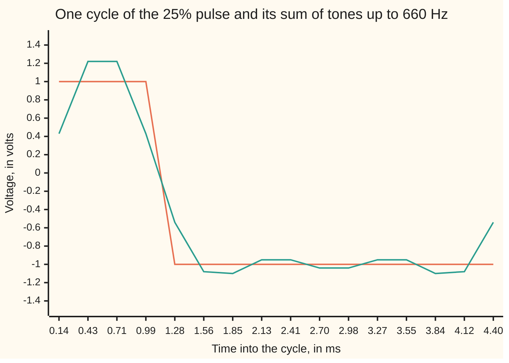

# Fourier coefficients: each wave's share, read off by an integral that ignores the rest

[Syllabus](../../../SYLLABUS.md) → [Harmonic analysis](../README.md) → [Fourier Series in Depth](../README.md#s01) → Fourier coefficients

---

## General Overview

A warning siren's oscillator switches between +1 volt and −1 volt 440 times a second. Two switches make one cycle, so the wave repeats 220 times a second. One cycle lasts 1/220 s = 4.545 ms. This is the same square wave as on the differential-equations wing's [Fourier series](../../08-Differential%20equations%20and%20dynamics/09-Fourier%20Series/01-fourier-series-and-orthogonality.md) card.

Now narrow the pulse. The oscillator stays at +1 V for the first quarter of each cycle (1.136 ms) and at −1 V for the rest (3.409 ms). Chip-sound generators and synthesisers offer this "25% pulse". It sounds thinner and more nasal than the square wave on the same note.

The ear hears a different mix of pure tones at 220, 440, 660 Hz and on up. This card finds the size and the timing of each tone from the wave alone. The tool is one integral per tone: multiply the wave by that tone, average over a cycle, and every other tone averages to zero.

The 25% pulse holds a 220 Hz tone of amplitude 0.900 V, which peaks 0.568 ms into the cycle, in the middle of the high part. It holds a 440 Hz tone of 0.637 V. It holds no 880 Hz tone at all.

**Each Fourier coefficient is the inner product of the signal with one complex wave, and because the waves are orthonormal (perpendicular, each of length 1) that inner product reads off exactly that wave's share and ignores all the others.**

**What kind of fact this is:** the coefficient formula and the inner product are definitions; that the waves are orthonormal, and what follows from it, are theorems proved on this card in Why it works. Whether the full series adds back up to the signal is a separate question, answered on [Dirichlet's theorem](04-pointwise-and-uniform-convergence.md) and [Convergence in energy](05-l2-convergence-and-riesz-fischer.md).

### The picture: the 25% pulse and its first three tones



The first line is the pulse: +1 V for 1.136 ms, then −1 V. The second line is the average level, −0.5 V, plus the tones at 220, 440 and 660 Hz, each with the size and timing this card computes. Three tones already trace the pulse's shape.

The loudness of each tone, for the square wave and for the 25% pulse, each `#` worth 0.05 V:

```
220 Hz   square  #########################  1.273240
         pulse   ##################         0.900316
440 Hz   square                             0.000000
         pulse   #############              0.636620
660 Hz   square  ########                   0.424413
         pulse   ######                     0.300105
880 Hz   square                             0.000000
         pulse                              0.000000
1100 Hz  square  #####                      0.254648
         pulse   ####                       0.180063
1320 Hz  square                             0.000000
         pulse   ####                       0.212207
1540 Hz  square  ####                       0.181891
         pulse   ###                        0.128617
1760 Hz  square                             0.000000
         pulse                              0.000000
```

The square wave has only odd multiples of 220 Hz. The 25% pulse has even ones too, but every fourth multiple (880, 1760 Hz) is missing. Why it works explains both gaps.

---

## The formula

Notation first, in words. Time $`t`$ is in seconds and the period $`P`$ is the length of one cycle, here $`1/220`$ s. The phase $`x = 2\pi t/P`$ is the position inside the cycle in radians; one cycle is any stretch of length $`2\pi`$, and the formulas below use $`-\pi`$ to $`\pi`$. The letter $`i`$ is the imaginary unit, $`i^2 = -1`$, and $`e_n(x) = e^{inx}`$ is the complex wave that turns $`n`$ times per cycle. A bar, as in $`\bar z`$, is the complex conjugate (flip the sign of the imaginary part), never a mean.

This card introduces three pieces of notation used on the rest of the wing. The **Fourier coefficient** $`\hat f(n)`$ is wing 07's $`c_n`$ under a new name. The **inner product on the circle** $`\langle f, g\rangle`$ is the average over one cycle of $`f`$ times the conjugate of $`g`$. The **length** $`\|f\|_2`$ is the square root of $`\langle f, f\rangle`$.

```math
\hat f(n) \;=\; \frac{1}{P}\int_0^P f(t)\, e^{-2\pi i n t/P}\, dt \;=\; \frac{1}{2\pi}\int_{-\pi}^{\pi} f(x)\, e^{-inx}\, dx \;=\; \langle f, e_n\rangle
```

**Read it aloud:** the share of wave n is the signal's average over one cycle after the signal is turned back n times per cycle; it is the inner product of the signal with wave n.

The inner product, the length and the fact that makes the formula work:

```math
\langle f, g\rangle = \frac{1}{2\pi}\int_{-\pi}^{\pi} f(x)\,\overline{g(x)}\, dx, \qquad \|f\|_2 = \sqrt{\langle f, f\rangle}, \qquad \langle e_m, e_n\rangle = \begin{cases} 1 & m = n \\ 0 & m \ne n \end{cases}
```

**Read it aloud:** the inner product averages one signal times the conjugate of the other; every wave has length 1, and two different waves are perpendicular.

The inner product is linear in its first slot, $`f`$. Wing 13's bra-ket notation is linear in the other slot, so the two differ by a conjugate.

The real form sits beside the complex form. For a real signal and $`n \ge 1`$:

```math
a_n = 2\,\mathrm{Re}\,\hat f(n), \qquad b_n = -2\,\mathrm{Im}\,\hat f(n), \qquad \hat f(n) = \frac{a_n - i\,b_n}{2}, \qquad \hat f(0) = \frac{a_0}{2}
```

**Read it aloud:** the cosine share is twice the real part, the sine share is minus twice the imaginary part, and the zeroth coefficient is the signal's average.

For the 25% pulse, worked in Why it works:

```math
\hat f(0) = -\tfrac12, \qquad \hat f(n) = \frac{1 - e^{-i\pi n/2}}{i\pi n} \quad (n \ne 0), \qquad \hat f(1) = \frac{1 - i}{\pi} = 0.318310 - 0.318310\,i
```

| Symbol | Plain meaning | In our example | Push it up and the answer… |
| --- | --- | --- | --- |
| $`t`$, $`P`$ | time in seconds; the period, one cycle | $`P = 1/220`$ s = 4.545455 ms | a longer period lowers every tone's pitch; the coefficients do not change |
| $`x`$ | phase: position in the cycle, in radians | $`x = 2\pi \times 220 \times t`$ | the pattern repeats every $`2\pi`$ |
| $`f`$ | the signal, in volts | +1 V for 1.136 ms, then −1 V | every coefficient grows in proportion |
| $`n`$, $`m`$, $`k`$ | whole numbers: turns per cycle; $`k = m - n`$ in Step 2 | n = 1, 2, 3: 220, 440, 660 Hz | higher pitch, n × 220 Hz |
| $`i`$, $`e_n`$ | the imaginary unit; the wave $`e^{inx}`$ | $`e_1`$ turns once in 4.545 ms | — |
| $`\hat f(n)`$, $`c_n`$ | wave n's share: two names, one number | $`\hat f(1) = 0.318310 - 0.318310i`$ | that tone gets louder |
| $`\langle f, g\rangle`$, $`\bar z`$ | average of f times conjugate g; conjugate | $`\langle e_1, e_1\rangle = 1`$, $`\langle e_1, e_2\rangle = 0`$ | — |
| $`\Vert f\Vert_2`$ | length: root of the average of $`\lvert f\rvert^2`$ | $`\Vert f\Vert_2 = 1`$ V | — |
| $`a_n`$, $`b_n`$ | cosine and sine shares, real form | $`a_1 = b_1 = 0.636620`$ | the tone's crest moves earlier (a) or later (b) |
| $`d`$, $`h`$ | duty: fraction of the cycle spent high; $`h`$, the 0-or-1 V pulse with $`f = 2h - 1`$ | 0.25 (square wave: 0.5) | the average rises; missing tones move |
| $`S_N`$ | the waves from $`-N`$ to $`N`$, each times its share, added | $`S_3`$ is the chart's second line | — |

### When it holds

- **The signal repeats with period $`P`$.** Then one cycle carries everything. A non-repeating signal needs the transform of the next shelf: [The Fourier transform of an absolutely integrable signal, and why it fades at infinity](../02-The%20Fourier%20Transform/01-fourier-transform-on-l1-and-riemann-lebesgue.md).
- **The average of $`\lvert f\rvert`$ over a cycle is finite.** This is "absolutely integrable", and it is exactly what the integral needs. $`1/\lvert x\rvert`$ fails: its average grows without limit as the cut around 0 shrinks (2.563186, then 4.761992).
- **Whole numbers of turns over exactly one period.** Orthogonality needs both. A wave at 1.5 turns has inner product 0.636620 with the wave at 1 turn, not 0, so shares leak into each other.
- **Equals sign not claimed.** The coefficients exist for every absolutely integrable signal. Whether their series adds back to $`f`$, and in what sense, is the subject of later cards on this shelf.

---

## Why it works

### Step 0: perpendicular directions answer one question each

Picture three perpendicular rulers in a room. The position of a point along one ruler does not depend on the other two. Read it off by a dot product with that ruler alone.

Signals behave the same way. Each wave $`e_n`$ is one ruler, and the inner product is the dot product. Because the rulers are perpendicular and each has length 1, the inner product of a signal with $`e_n`$ reads off exactly the amount of $`e_n`$ in it.

### Step 1: the inner product on the circle

Sample two signals at many phases, multiply each value of the first by the conjugate of the second, and average. In the limit this is the integral in the formula, divided by $`2\pi`$. The conjugate on $`g`$ makes $`\langle f, f\rangle`$ the average of $`\lvert f\rvert^2`$, which is never negative. So $`\|f\|_2`$ is a true length.

The factor $`1/2\pi`$ makes two things clean:

- The constant signal 1 has length 1.
- $`\langle f, 1\rangle`$ is the plain average of $`f`$ over a cycle: $`-0.5`$ V for the pulse.

This inner product is the one of [L2 as a Hilbert space](../../10-Measure%20and%20integration/07-Sizes%20of%20Functions/06-l2-as-a-hilbert-space.md), with the measure taken as length divided by $`2\pi`$, so the whole cycle has total weight 1.

### Step 2: the waves are orthonormal

Take whole numbers $`m`$ and $`n`$, and let $`k = m - n`$. Then $`e_m(x)\,\overline{e_n(x)} = e^{ikx}`$. If $`k = 0`$ this is 1, and its average is 1.

If $`k \ne 0`$, the antiderivative $`e^{ikx}/(ik)`$ takes the same value $`(-1)^k/(ik)`$ at both ends, $`x = \pm\pi`$. So the integral is 0. The wave turns a whole number of times and points every way equally often.

```math
\langle e_m, e_n\rangle = \frac{1}{2\pi}\int_{-\pi}^{\pi} e^{i(m-n)x}\, dx = \begin{cases} 1 & m = n \\ 0 & m \ne n \end{cases}
```

The complex-analysis wing's [Fourier series](../../07-Complex%20analysis/08-Transforms%20in%20Outline/01-fourier-series-in-complex-form.md) card does the same computation as an average. The check computes all 49 inner products for $`m, n`$ from $`-3`$ to $`3`$. The largest gap from 1 on the diagonal and 0 off it prints as 0.000000.

### Step 3: what orthonormality buys

Three facts follow from Step 2 alone, with no calculus. Let $`g`$ be a finite sum of waves, $`g = \sum_{\lvert m\rvert \le N} c_m e_m`$.

1. **Isolation.** The inner product is linear in its first slot, so $`\langle g, e_n\rangle = \sum c_m \langle e_m, e_n\rangle = c_n`$. Every other wave contributes 0. This is the "integral that ignores the rest" in the title.
2. **Pythagoras.** The squared length is the sum of the squared shares, $`\|g\|_2^2 = \sum \lvert c_m\rvert^2`$, as for perpendicular sides of a box.
3. **Uniqueness.** If a finite sum of waves is the zero signal, every share is $`\langle 0, e_n\rangle = 0`$. So a signal built from finitely many waves is built in only one way.

Check on the pulse: take $`S_3`$, its waves from $`-3`$ to $`3`$. Its squared length by direct integration is 0.902959. The sum of its seven squared shares is 0.902959. The pulse itself has $`\|f\|_2^2 = 1`$, since $`\lvert f\rvert = 1`$ everywhere. The rest of the power belongs to the higher tones.

<details>
<summary>Detailed proof: Pythagoras from orthonormality</summary>

Expand the length of $`g = \sum_{\lvert m\rvert \le N} c_m e_m`$, using linearity in the first slot and conjugate-linearity in the second:

$`\displaystyle \|g\|_2^2 = \langle g, g\rangle = \sum_{\lvert m\rvert \le N}\sum_{\lvert n\rvert \le N} c_m\,\overline{c_n}\,\langle e_m, e_n\rangle.`$

By Step 2 every term with $`m \ne n`$ is 0, and every term with $`m = n`$ is $`c_m \overline{c_m} = \lvert c_m\rvert^2`$. So

$`\displaystyle \|g\|_2^2 = \sum_{\lvert m\rvert \le N} \lvert c_m\rvert^2.`$

Uniqueness is the case $`g = 0`$: then the sum of the $`\lvert c_m\rvert^2`$ is 0, so each $`c_m`$ is 0.

</details>

### Step 4: every absolutely integrable signal has coefficients

For a general signal $`f`$, define $`\hat f(n) = \langle f, e_n\rangle`$ even when $`f`$ is not a finite sum of waves. The integral exists when the average of $`\lvert f\rvert`$ is finite, because $`\lvert e^{-inx}\rvert = 1`$:

```math
\lvert \hat f(n)\rvert \le \frac{1}{2\pi}\int_{-\pi}^{\pi} \lvert f(x)\rvert\, dx
```

**Read it aloud:** no share can be bigger than the signal's average size.

For the pulse the right side is 1 V. The largest share is $`\lvert\hat f(0)\rvert = 0.5`$ V. This bound needs no square-integrability, so the coefficients exist on the larger space of absolutely integrable signals. Isolation then says: if $`f`$ is a sum of waves, $`\hat f(n)`$ is the share of $`e_n`$. If it is not, $`\hat f(n)`$ is still well defined, and [Partial sums are the best fit](02-best-approximation-and-bessels-inequality.md) shows it gives the closest sum of waves to any signal of finite power.

### Step 5: real and complex side by side

Euler's formula gives $`e^{-inx} = \cos nx - i \sin nx`$. Put it into the coefficient formula:

```math
\hat f(n) = \frac{1}{2\pi}\int_{-\pi}^{\pi} f(x)\cos nx\, dx \;-\; i\,\frac{1}{2\pi}\int_{-\pi}^{\pi} f(x)\sin nx\, dx = \frac{a_n}{2} - i\,\frac{b_n}{2}.
```

The real form divides by $`\pi`$, not $`2\pi`$, so $`a_n`$ and $`b_n`$ are twice the real and minus twice the imaginary part. For a real signal, $`\hat f(-n)`$ is the conjugate of $`\hat f(n)`$. The pair $`n`$, $`-n`$ adds to one real tone of amplitude $`2\lvert\hat f(n)\rvert`$.

The real waves $`1`$, $`\sqrt2\cos nx`$ and $`\sqrt2 \sin nx`$ are also orthonormal for this inner product. The $`\sqrt2`$ is the price of using real waves: each one carries the share of two complex waves.

### Step 6: any period

Change variable from time to phase: $`x = 2\pi t/P`$, so $`dx/(2\pi) = dt/P`$. The average over $`-\pi \le x < \pi`$ becomes the average over one period in seconds. Because $`f`$ repeats, any stretch of length $`P`$ gives the same answer, for example $`0 \le t < P`$.

The coefficients are in volts and do not depend on $`P`$. The period only sets the pitch of tone $`n`$: $`n/P`$ hertz.

### Step 7: the 25% pulse

Write the pulse as $`f = 2h - 1`$, where $`h`$ is 1 V during the first quarter-cycle and 0 V after. The constant $`-1`$ has a share only at $`n = 0`$, by Step 2. For $`n \ne 0`$:

```math
\hat f(n) = \frac{2}{2\pi}\int_0^{\pi/2} e^{-inx}\, dx = \frac{1}{\pi}\cdot\frac{1 - e^{-i\pi n/2}}{in} = \frac{1 - e^{-i\pi n/2}}{i\pi n}.
```

At $`n = 0`$ the share is the average, $`0.25 \times 1 + 0.75 \times (-1) = -0.5`$ V.

When $`n`$ is a multiple of 4, $`e^{-i\pi n/2} = 1`$, so $`\hat f(n) = 0`$. The tone at $`4 \times 220 = 880`$ Hz turns exactly once during the high part, and its average over that part is 0. That is the missing bar.

For a pulse with duty $`d`$, the same steps give $`\hat f(n) = (1 - e^{-2\pi i n d})/(i\pi n)`$. At $`d = 1/2`$ this is $`2/(i\pi n)`$ for odd $`n`$ and 0 for even $`n`$. So $`b_n = 4/(\pi n)`$, the square wave's known answer: 1.273240, 0.424413, 0.254648. The code gets the same three values from the sine integrals directly.

---

## Worked numbers, by hand

The 25% pulse: +1 V for $`0 \le t < 1.136`$ ms, −1 V for the rest of the 4.545 ms cycle.

| Step | Arithmetic | Value |
| --- | --- | --- |
| period | $`1/220`$ s | 4.545455 ms |
| average, $`\hat f(0)`$ | $`0.25 \times 1 + 0.75 \times (-1)`$ | −0.500000 V |
| $`e^{-i\pi/2}`$ | a quarter-turn clockwise | $`-i`$ |
| $`\hat f(1)`$ | $`(1 + i)/(i\pi) = (1 - i)/\pi`$ | 0.318310 − 0.318310i |
| $`a_1`$, $`b_1`$ | $`2 \times 0.318310`$, $`-2 \times (-0.318310)`$ | 0.636620, 0.636620 |
| 220 Hz amplitude | $`2\lvert\hat f(1)\rvert = 2\sqrt2/\pi`$ | 0.900316 V |
| 220 Hz crest | angle $`-\pi/4`$, an eighth of a cycle: $`4.545455/8`$ | 0.568182 ms |
| $`\hat f(2)`$ | $`(1 - (-1))/(2i\pi) = -i/\pi`$ | −0.318310i |
| $`\hat f(3)`$ | $`(1 - i)/(3i\pi) = -(1 + i)/(3\pi)`$ | −0.106103 − 0.106103i |
| $`\hat f(4)`$ | $`(1 - 1)/(4i\pi)`$ | **0: no 880 Hz tone** |

The 220 Hz tone in the pulse is 0.900 V high and peaks at 0.568 ms, in the middle of the 1.136 ms high part. The 880 Hz tone is absent because it turns exactly once while the pulse is high.

### What breaks if you drop a piece

| Mistake | Comes out at | What went wrong |
| --- | --- | --- |
| Divide the complex formula by $`\pi`$, not $`2\pi`$ | $`\lvert\hat f(1)\rvert`$ = 0.900316, not 0.450158 | That is the real form's factor; the complex share is half a tone |
| Multiply by $`e^{+inx}`$, not $`e^{-inx}`$ | $`b_1`$ = −0.636620, not 0.636620 | This reads off $`\hat f(-n)`$, the conjugate: the tone's timing is mirrored |
| Average the square wave over 4 ms, not one 4.545 ms period | $`a_1`$ = 0.247611, $`b_1`$ = 1.348827, not 0 and 1.273240 | Not a whole number of cycles, so the waves are no longer orthogonal |
| Use a wave of 1.5 turns per cycle | $`\langle e^{1.5ix}, e_1\rangle`$ = 0.636620, not 0 | Orthogonality needs whole numbers of turns |
| Signal $`1/\lvert x\rvert`$, not absolutely integrable | average outside a cut of 0.001: 2.563186; of 0.000001: 4.761992 | No limit, so $`\hat f(0)`$ does not exist |

---

## Code, from first principles, and it actually runs

The code computes every coefficient on the card by four independent roads. The closed form of Step 7 is coded on its own. The defining integral is a midpoint sum at two step counts, 400 and 4,000 slices, and the error falls by a factor of 100. The real integrals for $`a_n`$ and $`b_n`$ are computed separately and compared with the complex form. The square wave's known $`4/(\pi n)`$ serves as an outside check. Orthonormality is checked as a 7 by 7 table of inner products, and Pythagoras by integrating $`\lvert S_3\rvert^2`$ directly. The 4 ms window's shares come from their exact integral, checked by a midpoint sum at 440 and 4,400 slices, with the jump on a slice edge.

### Python

```python
# Fourier coefficients and orthogonality -- the check behind the card.
# Standard library only. Complex numbers are Python's own; every integral is
# a midpoint sum written out, and every closed form is coded separately.
import math, cmath

PI = math.pi
F = 220.0              # cycles a second: the siren flips 440 times a second
P = 1.0 / F            # one period, in seconds

def fx(x):             # print x to 6 decimals, never "-0.000000"
    return f"{(0.0 if abs(x) < 5e-7 else x):.6f}"

def cx(z):
    return f"{fx(z.real)} {'-' if z.imag < -5e-7 else '+'} {fx(abs(z.imag))}i"

def pulse(t, d):       # +1 V for the first fraction d of each period, -1 V after
    return 1.0 if (t / P) % 1.0 < d else -1.0

def coef_t(sig, n, M, T=P, nu=None):
    # (1/T) * integral over [0, T) of sig(t) e^(-2 pi i nu t) dt, M midpoint slices
    nu = n / P if nu is None else nu
    h = T / M
    s = sum(sig((k + 0.5) * h) * cmath.exp(-2j * PI * nu * (k + 0.5) * h) for k in range(M))
    return s * h / T

def coef_exact(n, d):  # closed form for the pulse of duty d
    if n == 0:
        return complex(2 * d - 1, 0)
    return (1 - cmath.exp(-2j * PI * n * d)) / (1j * PI * n)

def real_ab(sig, n, M):  # a_n, b_n from their own real integrals over one period
    h = P / M
    a = sum(sig((k + .5) * h) * math.cos(2 * PI * n * (k + .5) * h / P) for k in range(M))
    b = sum(sig((k + .5) * h) * math.sin(2 * PI * n * (k + .5) * h / P) for k in range(M))
    return 2 * a * h / P, 2 * b * h / P

print(f"period P = 1/220 s = {fx(P * 1000)} ms; flips a second = {2 * F:.0f}")

# ---- road check: the square wave, b_n = 4/(pi n) for odd n ----
sq = lambda t: pulse(t, 0.5)
print("square wave n, b_n numeric, 4/(pi n)")
for n in (1, 2, 3, 5):
    a, b = real_ab(sq, n, 40000)
    want = 4 / (PI * n) if n % 2 else 0.0
    print(f"  {n} {fx(b)} {fx(want)}  a_n {fx(a)}")
    assert abs(b - want) < 1e-5 and abs(a) < 1e-9

# ---- orthonormality: <e_m, e_n> = (1/2pi) int e^(imx) e^(-inx) dx ----
def inner(m, n, M=4000):
    h = 2 * PI / M      # x runs over -pi <= x < pi
    xs = [-PI + (k + .5) * h for k in range(M)]
    return sum(cmath.exp(1j * m * x) * cmath.exp(-1j * n * x) for x in xs) * h / (2 * PI)
worst = max(abs(inner(m, n) - (1 if m == n else 0)) for m in range(-3, 4) for n in range(-3, 4))
print(f"gram matrix n = -3..3: largest gap from identity {fx(worst)}")
assert worst < 1e-9
leak = inner(1.5, 1, 200000)
print(f"<e^(1.5ix), e^(ix)> = {cx(leak)} (closed form 2/pi = {fx(2 / PI)})")
assert abs(leak - 2 / PI) < 1e-6

# ---- the worked signal: 25% pulse, +1 V for 1.136 ms, -1 V for 3.409 ms ----
D = 0.25
print(f"pulse high for {fx(D * P * 1000)} ms, low for {fx((1 - D) * P * 1000)} ms")
print("n, Hz, c_n closed form, error at M=400, error at M=4000")
for n in range(0, 9):
    c = coef_exact(n, D)
    e1, e2 = abs(coef_t(lambda t: pulse(t, D), n, 400) - c), abs(coef_t(lambda t: pulse(t, D), n, 4000) - c)
    print(f"  {n} {n * 220} {cx(c)} {e1:.9f} {e2:.9f}")
    assert e2 < e1 / 50 or e1 < 1e-12
    assert e2 < 1e-6
print("n, a_n, b_n from real integrals, 2 Re c_n, -2 Im c_n, amplitude 2|c_n|")
for n in (1, 2, 3, 4):
    a, b = real_ab(lambda t: pulse(t, D), n, 4000)
    c = coef_exact(n, D)
    print(f"  {n} {fx(a)} {fx(b)} {fx(2 * c.real)} {fx(-2 * c.imag)} {fx(2 * abs(c))}")
    assert abs(a - 2 * c.real) < 1e-6 and abs(b + 2 * c.imag) < 1e-6
c1 = coef_exact(1, D)
peak = -cmath.phase(c1) / (2 * PI) * P * 1000
print(f"220 Hz share: |c_1| = {fx(abs(c1))}, 2 sin(pi d)/pi = {fx(2 * math.sin(PI * D) / PI)}, crest at t = {fx(peak)} ms")
assert abs(abs(c1) - 2 * math.sin(PI * D) / PI) < 1e-12 and abs(peak - D * P * 1000 / 2) < 1e-9

# ---- Pythagoras on a finite sum: ||S_3||^2 = sum |c_n|^2 ----
cs = {n: coef_exact(n, D) for n in range(-3, 4)}
S3 = lambda x: sum(cs[n] * cmath.exp(1j * n * x) for n in cs)
M = 4000
norm2 = sum(abs(S3(2 * PI * (k + .5) / M)) ** 2 for k in range(M)) / M
shares = sum(abs(c) ** 2 for c in cs.values())
print(f"||S_3||^2 by integral {fx(norm2)}, sum of |c_n|^2 {fx(shares)}, ||f||^2 = 1")
assert abs(norm2 - shares) < 1e-9 and shares < 1

# ---- what breaks ----
print(f"1/pi in the complex formula: |c_1| = {fx(2 * abs(c1))}, right {fx(abs(c1))}")
cp = coef_exact(-1, D)   # e^(+inx) reads off c_(-n), the conjugate
print(f"e^(+ix) instead of e^(-ix): b_1 = {fx(-2 * cp.imag)}, right {fx(-2 * c1.imag)}")
W = 0.004               # a 4 ms window: not a whole number of periods
wT = 2 * PI * F * W     # exact over [0, W): a_1 = -2 sin(wT)/wT, b_1 = 2 (3 + cos wT)/wT
aw, bw = -2 * math.sin(wT) / wT, 2 * (3 + math.cos(wT)) / wT
cw = [coef_t(sq, 1, M, T=W, nu=F) for M in (440, 4400)]   # the jump at P/2 lands on a slice edge
ew = [abs(complex(2 * c.real, -2 * c.imag) - complex(aw, bw)) for c in cw]
print(f"square wave over 4 ms: a_1 = {fx(aw)}, b_1 = {fx(bw)}, right 0, {fx(4 / PI)}")
print(f"  4 ms window, midpoint error at M=440 {ew[0]:.9f}, at M=4400 {ew[1]:.9f}")
assert ew[1] < ew[0] / 50 and ew[1] < 1e-6
assert abs(-2 * cw[1].imag - 4 / PI) > 0.05
for eps in (1e-3, 1e-6):
    print(f"1/|x| mean, cut at {eps:.6f}: (1/pi) log(pi/eps) = {fx(math.log(PI / eps) / PI)}")
print(f"on-off 0..1 V wave: mean {fx(0.5)}, b_1 = {fx(2 / PI)}, right for +-1 V {fx(4 / PI)}")
print(f"12.5% pulse: c_0 = {fx(coef_exact(0, .125).real)}, |c_8| = {fx(abs(coef_exact(8, .125)))}, |c_4| = {fx(abs(coef_exact(4, .125)))}")

# ---- pictures ----
print("chart t ms: " + " ".join(f"{(k + .5) * P * 1000 / 16:.2f}" for k in range(16)))
print("chart pulse: " + " ".join(f"{pulse((k + .5) * P / 16, D):.0f}" for k in range(16)))
print("chart S_3: " + " ".join(f"{S3(2 * PI * (k + .5) / 16).real:.2f}" for k in range(16)))
for n in range(1, 9):
    aq = 4 / (PI * n) if n % 2 else 0.0
    ap = 2 * abs(coef_exact(n, D))
    print(f"bars {n * 220} Hz square {fx(aq)} pulse {fx(ap)}")
print("ALL CHECKS PASS")
```

**Ran 2026-11-15 on macOS, Python 3.14.10, standard library only. All checks passed. Output, pasted from the run:**

```
period P = 1/220 s = 4.545455 ms; flips a second = 440
square wave n, b_n numeric, 4/(pi n)
  1 1.273240 1.273240  a_n 0.000000
  2 0.000000 0.000000  a_n 0.000000
  3 0.424413 0.424413  a_n 0.000000
  5 0.254648 0.254648  a_n 0.000000
gram matrix n = -3..3: largest gap from identity 0.000000
<e^(1.5ix), e^(ix)> = 0.636620 + 0.000000i (closed form 2/pi = 0.636620)
pulse high for 1.136364 ms, low for 3.409091 ms
n, Hz, c_n closed form, error at M=400, error at M=4000
  0 0 -0.500000 + 0.000000i 0.000000000 0.000000000
  1 220 0.318310 - 0.318310i 0.000004628 0.000000046
  2 440 0.000000 - 0.318310i 0.000013090 0.000000131
  3 660 -0.106103 - 0.106103i 0.000013885 0.000000139
  4 880 0.000000 + 0.000000i 0.000000000 0.000000000
  5 1100 0.063662 - 0.063662i 0.000023144 0.000000231
  6 1320 0.000000 - 0.106103i 0.000039280 0.000000393
  7 1540 -0.045473 - 0.045473i 0.000032407 0.000000324
  8 1760 0.000000 + 0.000000i 0.000000000 0.000000000
n, a_n, b_n from real integrals, 2 Re c_n, -2 Im c_n, amplitude 2|c_n|
  1 0.636620 0.636620 0.636620 0.636620 0.900316
  2 0.000000 0.636620 0.000000 0.636620 0.636620
  3 -0.212207 0.212207 -0.212207 0.212207 0.300105
  4 0.000000 0.000000 0.000000 0.000000 0.000000
220 Hz share: |c_1| = 0.450158, 2 sin(pi d)/pi = 0.450158, crest at t = 0.568182 ms
||S_3||^2 by integral 0.902959, sum of |c_n|^2 0.902959, ||f||^2 = 1
1/pi in the complex formula: |c_1| = 0.900316, right 0.450158
e^(+ix) instead of e^(-ix): b_1 = -0.636620, right 0.636620
square wave over 4 ms: a_1 = 0.247611, b_1 = 1.348827, right 0, 1.273240
  4 ms window, midpoint error at M=440 0.000009023, at M=4400 0.000000090
1/|x| mean, cut at 0.001000: (1/pi) log(pi/eps) = 2.563186
1/|x| mean, cut at 0.000001: (1/pi) log(pi/eps) = 4.761992
on-off 0..1 V wave: mean 0.500000, b_1 = 0.636620, right for +-1 V 1.273240
12.5% pulse: c_0 = -0.750000, |c_8| = 0.000000, |c_4| = 0.159155
chart t ms: 0.14 0.43 0.71 0.99 1.28 1.56 1.85 2.13 2.41 2.70 2.98 3.27 3.55 3.84 4.12 4.40
chart pulse: 1 1 1 1 -1 -1 -1 -1 -1 -1 -1 -1 -1 -1 -1 -1
chart S_3: 0.43 1.22 1.22 0.43 -0.54 -1.08 -1.10 -0.95 -0.95 -1.04 -1.04 -0.95 -0.95 -1.10 -1.08 -0.54
bars 220 Hz square 1.273240 pulse 0.900316
bars 440 Hz square 0.000000 pulse 0.636620
bars 660 Hz square 0.424413 pulse 0.300105
bars 880 Hz square 0.000000 pulse 0.000000
bars 1100 Hz square 0.254648 pulse 0.180063
bars 1320 Hz square 0.000000 pulse 0.212207
bars 1540 Hz square 0.181891 pulse 0.128617
bars 1760 Hz square 0.000000 pulse 0.000000
ALL CHECKS PASS
```

### Rust

```rust
// Fourier coefficients and orthogonality -- the check behind the card.
// std only. A complex number is a small struct; every integral is a midpoint
// sum written out, and every closed form is coded separately.
use std::f64::consts::PI;

#[derive(Clone, Copy)]
struct C { re: f64, im: f64 }
impl C {
    fn new(re: f64, im: f64) -> C { C { re, im } }
    fn cis(a: f64) -> C { C::new(a.cos(), a.sin()) }         // e^(ia)
    fn add(self, o: C) -> C { C::new(self.re + o.re, self.im + o.im) }
    fn sub(self, o: C) -> C { C::new(self.re - o.re, self.im - o.im) }
    fn mul(self, o: C) -> C { C::new(self.re * o.re - self.im * o.im, self.re * o.im + self.im * o.re) }
    fn scale(self, s: f64) -> C { C::new(self.re * s, self.im * s) }
    fn div(self, o: C) -> C { let d = o.re * o.re + o.im * o.im; self.mul(C::new(o.re, -o.im)).scale(1.0 / d) }
    fn abs(self) -> f64 { self.re.hypot(self.im) }
    fn phase(self) -> f64 { self.im.atan2(self.re) }
}

const F: f64 = 220.0; // cycles a second: the siren flips 440 times a second
const P: f64 = 1.0 / F; // one period, in seconds

fn fx(x: f64) -> String { format!("{:.6}", if x.abs() < 5e-7 { 0.0 } else { x }) }
fn cx(z: C) -> String {
    format!("{} {} {}i", fx(z.re), if z.im < -5e-7 { "-" } else { "+" }, fx(z.im.abs()))
}

// +1 V for the first fraction d of each period, -1 V after
fn pulse(t: f64, d: f64) -> f64 { if (t / P).rem_euclid(1.0) < d { 1.0 } else { -1.0 } }

// (1/T) * integral over [0, T) of sig(t) e^(-2 pi i nu t) dt, M midpoint slices
fn coef_t(sig: &dyn Fn(f64) -> f64, nu: f64, m: usize, t_len: f64) -> C {
    let h = t_len / m as f64;
    let mut s = C::new(0.0, 0.0);
    for k in 0..m {
        let t = (k as f64 + 0.5) * h;
        s = s.add(C::cis(-2.0 * PI * nu * t).scale(sig(t)));
    }
    s.scale(h / t_len)
}

fn coef_exact(n: i64, d: f64) -> C {
    if n == 0 { return C::new(2.0 * d - 1.0, 0.0); }
    let nf = n as f64;
    C::new(1.0, 0.0).sub(C::cis(-2.0 * PI * nf * d)).div(C::new(0.0, PI * nf))
}

// a_n, b_n from their own real integrals over one period
fn real_ab(sig: &dyn Fn(f64) -> f64, n: f64, m: usize) -> (f64, f64) {
    let h = P / m as f64;
    let (mut a, mut b) = (0.0, 0.0);
    for k in 0..m {
        let t = (k as f64 + 0.5) * h;
        a += sig(t) * (2.0 * PI * n * t / P).cos();
        b += sig(t) * (2.0 * PI * n * t / P).sin();
    }
    (2.0 * a * h / P, 2.0 * b * h / P)
}

// <e_m, e_n> = (1/2pi) int e^(imx) e^(-inx) dx over -pi <= x < pi
fn inner(m: f64, n: f64, mm: usize) -> C {
    let h = 2.0 * PI / mm as f64;
    let mut s = C::new(0.0, 0.0);
    for k in 0..mm {
        let x = -PI + (k as f64 + 0.5) * h;
        s = s.add(C::cis(m * x).mul(C::cis(-n * x)));
    }
    s.scale(h / (2.0 * PI))
}

fn main() {
    println!("period P = 1/220 s = {} ms; flips a second = {:.0}", fx(P * 1000.0), 2.0 * F);

    // ---- road check: the square wave, b_n = 4/(pi n) for odd n ----
    let sq = |t: f64| pulse(t, 0.5);
    println!("square wave n, b_n numeric, 4/(pi n)");
    for n in [1i64, 2, 3, 5] {
        let (a, b) = real_ab(&sq, n as f64, 40000);
        let want = if n % 2 == 1 { 4.0 / (PI * n as f64) } else { 0.0 };
        println!("  {} {} {}  a_n {}", n, fx(b), fx(want), fx(a));
        assert!((b - want).abs() < 1e-5 && a.abs() < 1e-9);
    }

    // ---- orthonormality ----
    let mut worst: f64 = 0.0;
    for m in -3..4 {
        for n in -3..4 {
            let id = if m == n { 1.0 } else { 0.0 };
            worst = worst.max(inner(m as f64, n as f64, 4000).sub(C::new(id, 0.0)).abs());
        }
    }
    println!("gram matrix n = -3..3: largest gap from identity {}", fx(worst));
    assert!(worst < 1e-9);
    let leak = inner(1.5, 1.0, 200000);
    println!("<e^(1.5ix), e^(ix)> = {} (closed form 2/pi = {})", cx(leak), fx(2.0 / PI));
    assert!(leak.sub(C::new(2.0 / PI, 0.0)).abs() < 1e-6);

    // ---- the worked signal: 25% pulse ----
    let d = 0.25;
    let pl = |t: f64| pulse(t, d);
    println!("pulse high for {} ms, low for {} ms", fx(d * P * 1000.0), fx((1.0 - d) * P * 1000.0));
    println!("n, Hz, c_n closed form, error at M=400, error at M=4000");
    for n in 0..9i64 {
        let c = coef_exact(n, d);
        let e1 = coef_t(&pl, n as f64 / P, 400, P).sub(c).abs();
        let e2 = coef_t(&pl, n as f64 / P, 4000, P).sub(c).abs();
        println!("  {} {} {} {:.9} {:.9}", n, n * 220, cx(c), e1, e2);
        assert!(e2 < e1 / 50.0 || e1 < 1e-12);
        assert!(e2 < 1e-6);
    }
    println!("n, a_n, b_n from real integrals, 2 Re c_n, -2 Im c_n, amplitude 2|c_n|");
    for n in 1..5i64 {
        let (a, b) = real_ab(&pl, n as f64, 4000);
        let c = coef_exact(n, d);
        println!("  {} {} {} {} {} {}", n, fx(a), fx(b), fx(2.0 * c.re), fx(-2.0 * c.im), fx(2.0 * c.abs()));
        assert!((a - 2.0 * c.re).abs() < 1e-6 && (b + 2.0 * c.im).abs() < 1e-6);
    }
    let c1 = coef_exact(1, d);
    let peak = -c1.phase() / (2.0 * PI) * P * 1000.0;
    println!("220 Hz share: |c_1| = {}, 2 sin(pi d)/pi = {}, crest at t = {} ms", fx(c1.abs()), fx(2.0 * (PI * d).sin() / PI), fx(peak));
    assert!((c1.abs() - 2.0 * (PI * d).sin() / PI).abs() < 1e-12 && (peak - d * P * 1000.0 / 2.0).abs() < 1e-9);

    // ---- Pythagoras on a finite sum ----
    let cs: Vec<(i64, C)> = (-3..4).map(|n| (n, coef_exact(n, d))).collect();
    let s3 = |x: f64| cs.iter().fold(C::new(0.0, 0.0), |acc, &(n, c)| acc.add(c.mul(C::cis(n as f64 * x))));
    let mm = 4000;
    let mut norm2 = 0.0;
    for k in 0..mm { norm2 += s3(2.0 * PI * (k as f64 + 0.5) / mm as f64).abs().powi(2); }
    norm2 /= mm as f64;
    let shares: f64 = cs.iter().map(|&(_, c)| c.abs().powi(2)).sum();
    println!("||S_3||^2 by integral {}, sum of |c_n|^2 {}, ||f||^2 = 1", fx(norm2), fx(shares));
    assert!((norm2 - shares).abs() < 1e-9 && shares < 1.0);

    // ---- what breaks ----
    println!("1/pi in the complex formula: |c_1| = {}, right {}", fx(2.0 * c1.abs()), fx(c1.abs()));
    let cp = coef_exact(-1, d); // e^(+inx) reads off c_(-n), the conjugate
    println!("e^(+ix) instead of e^(-ix): b_1 = {}, right {}", fx(-2.0 * cp.im), fx(-2.0 * c1.im));
    let w = 0.004; // a 4 ms window: not a whole number of periods
    let wt = 2.0 * PI * F * w; // exact over [0, W): a_1 = -2 sin(wT)/wT, b_1 = 2 (3 + cos wT)/wT
    let (aw, bw) = (-2.0 * wt.sin() / wt, 2.0 * (3.0 + wt.cos()) / wt);
    let cw: Vec<C> = [440usize, 4400].iter().map(|&m| coef_t(&sq, F, m, w)).collect(); // the jump at P/2 lands on a slice edge
    let ew: Vec<f64> = cw.iter().map(|c| C::new(2.0 * c.re - aw, -2.0 * c.im - bw).abs()).collect();
    println!("square wave over 4 ms: a_1 = {}, b_1 = {}, right 0, {}", fx(aw), fx(bw), fx(4.0 / PI));
    println!("  4 ms window, midpoint error at M=440 {:.9}, at M=4400 {:.9}", ew[0], ew[1]);
    assert!(ew[1] < ew[0] / 50.0 && ew[1] < 1e-6);
    assert!((-2.0 * cw[1].im - 4.0 / PI).abs() > 0.05);
    for eps in [1e-3f64, 1e-6] {
        println!("1/|x| mean, cut at {:.6}: (1/pi) log(pi/eps) = {}", eps, fx((PI / eps).ln() / PI));
    }
    println!("on-off 0..1 V wave: mean {}, b_1 = {}, right for +-1 V {}", fx(0.5), fx(2.0 / PI), fx(4.0 / PI));
    println!("12.5% pulse: c_0 = {}, |c_8| = {}, |c_4| = {}", fx(coef_exact(0, 0.125).re),
             fx(coef_exact(8, 0.125).abs()), fx(coef_exact(4, 0.125).abs()));

    // ---- pictures ----
    let ts: Vec<String> = (0..16).map(|k| format!("{:.2}", (k as f64 + 0.5) * P * 1000.0 / 16.0)).collect();
    println!("chart t ms: {}", ts.join(" "));
    let ps: Vec<String> = (0..16).map(|k| format!("{:.0}", pulse((k as f64 + 0.5) * P / 16.0, d))).collect();
    println!("chart pulse: {}", ps.join(" "));
    let ss: Vec<String> = (0..16).map(|k| format!("{:.2}", s3(2.0 * PI * (k as f64 + 0.5) / 16.0).re)).collect();
    println!("chart S_3: {}", ss.join(" "));
    for n in 1..9i64 {
        let aq = if n % 2 == 1 { 4.0 / (PI * n as f64) } else { 0.0 };
        println!("bars {} Hz square {} pulse {}", n * 220, fx(aq), fx(2.0 * coef_exact(n, d).abs()));
    }
    println!("ALL CHECKS PASS");
}
```

**Ran 2026-11-15 on macOS, rustc 1.98.1, no crates. All checks passed. Output, pasted from the run:**

```
period P = 1/220 s = 4.545455 ms; flips a second = 440
square wave n, b_n numeric, 4/(pi n)
  1 1.273240 1.273240  a_n 0.000000
  2 0.000000 0.000000  a_n 0.000000
  3 0.424413 0.424413  a_n 0.000000
  5 0.254648 0.254648  a_n 0.000000
gram matrix n = -3..3: largest gap from identity 0.000000
<e^(1.5ix), e^(ix)> = 0.636620 + 0.000000i (closed form 2/pi = 0.636620)
pulse high for 1.136364 ms, low for 3.409091 ms
n, Hz, c_n closed form, error at M=400, error at M=4000
  0 0 -0.500000 + 0.000000i 0.000000000 0.000000000
  1 220 0.318310 - 0.318310i 0.000004628 0.000000046
  2 440 0.000000 - 0.318310i 0.000013090 0.000000131
  3 660 -0.106103 - 0.106103i 0.000013885 0.000000139
  4 880 0.000000 + 0.000000i 0.000000000 0.000000000
  5 1100 0.063662 - 0.063662i 0.000023144 0.000000231
  6 1320 0.000000 - 0.106103i 0.000039280 0.000000393
  7 1540 -0.045473 - 0.045473i 0.000032407 0.000000324
  8 1760 0.000000 + 0.000000i 0.000000000 0.000000000
n, a_n, b_n from real integrals, 2 Re c_n, -2 Im c_n, amplitude 2|c_n|
  1 0.636620 0.636620 0.636620 0.636620 0.900316
  2 0.000000 0.636620 0.000000 0.636620 0.636620
  3 -0.212207 0.212207 -0.212207 0.212207 0.300105
  4 0.000000 0.000000 0.000000 0.000000 0.000000
220 Hz share: |c_1| = 0.450158, 2 sin(pi d)/pi = 0.450158, crest at t = 0.568182 ms
||S_3||^2 by integral 0.902959, sum of |c_n|^2 0.902959, ||f||^2 = 1
1/pi in the complex formula: |c_1| = 0.900316, right 0.450158
e^(+ix) instead of e^(-ix): b_1 = -0.636620, right 0.636620
square wave over 4 ms: a_1 = 0.247611, b_1 = 1.348827, right 0, 1.273240
  4 ms window, midpoint error at M=440 0.000009023, at M=4400 0.000000090
1/|x| mean, cut at 0.001000: (1/pi) log(pi/eps) = 2.563186
1/|x| mean, cut at 0.000001: (1/pi) log(pi/eps) = 4.761992
on-off 0..1 V wave: mean 0.500000, b_1 = 0.636620, right for +-1 V 1.273240
12.5% pulse: c_0 = -0.750000, |c_8| = 0.000000, |c_4| = 0.159155
chart t ms: 0.14 0.43 0.71 0.99 1.28 1.56 1.85 2.13 2.41 2.70 2.98 3.27 3.55 3.84 4.12 4.40
chart pulse: 1 1 1 1 -1 -1 -1 -1 -1 -1 -1 -1 -1 -1 -1 -1
chart S_3: 0.43 1.22 1.22 0.43 -0.54 -1.08 -1.10 -0.95 -0.95 -1.04 -1.04 -0.95 -0.95 -1.10 -1.08 -0.54
bars 220 Hz square 1.273240 pulse 0.900316
bars 440 Hz square 0.000000 pulse 0.636620
bars 660 Hz square 0.424413 pulse 0.300105
bars 880 Hz square 0.000000 pulse 0.000000
bars 1100 Hz square 0.254648 pulse 0.180063
bars 1320 Hz square 0.000000 pulse 0.212207
bars 1540 Hz square 0.181891 pulse 0.128617
bars 1760 Hz square 0.000000 pulse 0.000000
ALL CHECKS PASS
```

### Lean

Lean proves orthonormality and isolation for all whole numbers, and the 25% pulse's coefficients for every $`n`$.

- Take whole numbers $`m`$ and $`n`$. Then $`\langle e_m, e_n\rangle`$ is 1 when $`m = n`$ and 0 when $`m \ne n`$.
- Take a finite sum of waves, $`g = \sum c_m e_m`$, over any finite set of whole numbers. Then $`\langle g, e_n\rangle = c_n`$ if $`e_n`$ is in the sum, and 0 if not.
- Take the 25% pulse. Then $`\hat f(0) = -1/2`$, and $`\hat f(n) = (1 - e^{-i\pi n/2})/(i\pi n)`$ for every $`n \ne 0`$.
- The counts also check: 440 flips a second make 220 cycles, and the missing tones sit at 880 Hz and 1760 Hz.

Pythagoras, the bound on each share, the real form, the square wave and the decimals are left to the Python and Rust checks.

```lean
-- Fourier coefficients: the waves e^(inx) are orthonormal for the inner product (1/2π) ∫ f ḡ over one cycle, so the coefficient of a finite sum of waves reads off exactly that wave's share, and the 25% pulse has coefficients -1/2 at n = 0 and (1 - e^(-iπn/2))/(iπn) otherwise.
import Mathlib.MeasureTheory.Integral.IntervalIntegral.Basic
import Mathlib.Analysis.SpecialFunctions.Complex.Circle
import Mathlib.Analysis.SpecialFunctions.Trigonometric.Basic
import Mathlib.Tactic.NormNum
import Mathlib.Analysis.SpecialFunctions.Integrals.Basic

open MeasureTheory Complex Real

/-! Conventions, as on the card.
* One cycle is `-π ≤ x ≤ π`; the wave that turns `n` times per cycle is `e_n(x) = e^(inx)`.
* Inner product on the circle: `⟨f, g⟩ = (1/(2π)) ∫ f(x) * conj (g x) dx` over `[-π, π]`.
* Fourier coefficient: `f̂(n) = ⟨f, e_n⟩ = (1/(2π)) ∫ f(x) e^(-inx) dx`.
* The 25% pulse is `+1` for `0 ≤ x < π/2` and `-1` on the rest of the cycle. -/


/-- Helper: `e^(kπi) = e^(-kπi)` for every whole number `k`. -/
lemma fourier_exp_int_pi_symm (k : ℤ) :
    cexp ((k : ℂ) * I * π) = cexp ((k : ℂ) * I * (-π : ℝ)) := by
  have h := exp_int_mul_two_pi_mul_I k
  rw [show (k : ℂ) * I * π = (k : ℂ) * I * ((-π : ℝ) : ℂ) + k * (2 * π * I) by push_cast; ring,
    Complex.exp_add, h, mul_one]

/-- Helper: `∫_{-π}^{π} e^(ikx) dx` is `2π` when `k = 0` and `0` otherwise. -/
lemma fourier_integral_exp_int (k : ℤ) :
    (∫ x in (-π)..π, cexp ((k : ℂ) * x * I)) = if k = 0 then (2 * π : ℂ) else 0 := by
  split_ifs with hk
  · subst hk
    simp only [Int.cast_zero, zero_mul, Complex.exp_zero, intervalIntegral.integral_const,
      sub_neg_eq_add, real_smul]
    push_cast; ring
  · have hc : (k : ℂ) * I ≠ 0 := mul_ne_zero (by exact_mod_cast hk) I_ne_zero
    have := integral_exp_mul_complex (a := -π) (b := π) hc
    simp only [mul_right_comm _ _ I] at this ⊢
    rw [this, fourier_exp_int_pi_symm, sub_self, zero_div]

/-- Helper: a wave times the conjugate of another is the wave of the difference. -/
lemma fourier_wave_mul_conj (m n : ℤ) (x : ℝ) :
    cexp ((m : ℂ) * x * I) * (starRingEnd ℂ) (cexp ((n : ℂ) * x * I)) =
      cexp (((m - n : ℤ) : ℂ) * x * I) := by
  rw [← Complex.exp_conj, ← Complex.exp_add]
  congr 1
  simp only [map_mul, map_intCast, Complex.conj_ofReal, Complex.conj_I]
  push_cast; ring

/-- Isolation: if a signal is a finite sum of waves, `g = Σ_{m ∈ s} c_m e^(imx)`, then its inner
product with the wave `e_n` over one cycle, `(1/(2π)) ∫ g(x) conj(e^(inx)) dx`, is exactly the
share `c_n` of that wave (and `0` if `e_n` is not in the sum): every other wave contributes 0. -/
theorem inner_product_reads_off_share (s : Finset ℤ) (c : ℤ → ℂ) (n : ℤ) :
    (1 / (2 * π) * ∫ x in (-π)..π,
        (∑ m ∈ s, c m * cexp ((m : ℂ) * x * I)) * (starRingEnd ℂ) (cexp ((n : ℂ) * x * I))) =
      if n ∈ s then c n else 0 := by
  have hint : ∀ m ∈ s, IntervalIntegrable
      (fun x : ℝ => c m * cexp (((m - n : ℤ) : ℂ) * x * I)) volume (-π) π := by
    intro m _
    apply Continuous.intervalIntegrable
    fun_prop
  have hfun : (fun x : ℝ => (∑ m ∈ s, c m * cexp ((m : ℂ) * x * I)) *
      (starRingEnd ℂ) (cexp ((n : ℂ) * x * I))) =
      fun x : ℝ => ∑ m ∈ s, c m * cexp (((m - n : ℤ) : ℂ) * x * I) := by
    funext x
    rw [Finset.sum_mul]
    refine Finset.sum_congr rfl fun m _ => ?_
    rw [mul_assoc, fourier_wave_mul_conj]
  rw [hfun]
  rw [intervalIntegral.integral_finsetSum hint]
  simp_rw [intervalIntegral.integral_const_mul, fourier_integral_exp_int, sub_eq_zero,
    mul_ite, mul_zero]
  rw [Finset.sum_ite_eq']
  have hpi : (π : ℂ) ≠ 0 := by exact_mod_cast Real.pi_ne_zero
  split_ifs
  · field_simp
  · simp

/-- Orthonormality: for whole numbers `m` and `n`, the inner product of the waves `e^(imx)` and
`e^(inx)` over one cycle is `1` when `m = n` and `0` when `m ≠ n`. -/
theorem waves_orthonormal (m n : ℤ) :
    (1 / (2 * π) * ∫ x in (-π)..π,
        cexp ((m : ℂ) * x * I) * (starRingEnd ℂ) (cexp ((n : ℂ) * x * I))) =
      if m = n then 1 else 0 := by
  simp_rw [fourier_wave_mul_conj, fourier_integral_exp_int, sub_eq_zero]
  have hpi : (π : ℂ) ≠ 0 := by exact_mod_cast Real.pi_ne_zero
  split_ifs
  · field_simp
  · simp

/-- The 25% pulse, `+1` for `0 ≤ x < π/2` and `-1` on the rest of the cycle `[-π, π]`, has
average `f̂(0) = -1/2` and coefficient `f̂(n) = (1 - e^(-iπn/2))/(iπn)` for every `n ≠ 0`. -/
theorem quarter_pulse_coeff (n : ℤ) :
    (1 / (2 * π) * ∫ x in (-π)..π,
        ((if 0 ≤ x ∧ x < π / 2 then 1 else -1 : ℝ) : ℂ) * cexp (-((n : ℂ) * x) * I)) =
      if n = 0 then -1 / 2 else (1 - cexp (-((π : ℂ) * n / 2) * I)) / (I * π * n) := by
  set E : ℝ → ℂ := fun x => cexp (-((n : ℂ) * x) * I) with hE
  set f : ℝ → ℂ := fun x =>
    ((if 0 ≤ x ∧ x < π / 2 then 1 else -1 : ℝ) : ℂ) * cexp (-((n : ℂ) * x) * I) with hf
  have hEc : Continuous E := by rw [hE]; fun_prop
  have hpi := Real.pi_pos
  have h1 : Set.EqOn f (fun x => -E x) (Set.Ioo (-π) 0) := by
    intro x hx
    simp only [hf, hE]
    have hcond : ¬(0 ≤ x ∧ x < π / 2) := by intro h; linarith [h.1, hx.2]
    simp only [hcond, ↓reduceIte]
    push_cast; ring
  have h2 : Set.EqOn f E (Set.Ioo 0 (π / 2)) := by
    intro x hx
    simp only [hf, hE]
    have hcond : 0 ≤ x ∧ x < π / 2 := ⟨hx.1.le, hx.2⟩
    simp only [hcond, and_self, ↓reduceIte]
    push_cast; ring
  have h3 : Set.EqOn f (fun x => -E x) (Set.Ioo (π / 2) π) := by
    intro x hx
    simp only [hf, hE]
    have hcond : ¬(0 ≤ x ∧ x < π / 2) := by intro h; linarith [h.2, hx.1]
    simp only [hcond, ↓reduceIte]
    push_cast; ring
  have le1 : -π ≤ 0 := by linarith
  have le2 : (0 : ℝ) ≤ π / 2 := by linarith
  have le3 : π / 2 ≤ π := by linarith
  have i1 : IntervalIntegrable f volume (-π) 0 := by
    refine (hEc.neg.intervalIntegrable (-π) 0).congr_uIoo ?_
    rw [Set.uIoo_of_le le1]; exact fun x hx => (h1 hx).symm
  have i2 : IntervalIntegrable f volume 0 (π / 2) := by
    refine (hEc.intervalIntegrable 0 (π / 2)).congr_uIoo ?_
    rw [Set.uIoo_of_le le2]; exact fun x hx => (h2 hx).symm
  have i3 : IntervalIntegrable f volume (π / 2) π := by
    refine (hEc.neg.intervalIntegrable (π / 2) π).congr_uIoo ?_
    rw [Set.uIoo_of_le le3]; exact fun x hx => (h3 hx).symm
  have hsplit : (∫ x in (-π)..π, f x) =
      -(∫ x in (-π)..0, E x) + (∫ x in (0 : ℝ)..(π / 2), E x) - ∫ x in (π / 2)..π, E x := by
    rw [← intervalIntegral.integral_add_adjacent_intervals (i1.trans i2) i3,
      ← intervalIntegral.integral_add_adjacent_intervals i1 i2,
      intervalIntegral.integral_congr_Ioo_of_le le1 h1,
      intervalIntegral.integral_congr_Ioo_of_le le2 h2,
      intervalIntegral.integral_congr_Ioo_of_le le3 h3,
      intervalIntegral.integral_neg, intervalIntegral.integral_neg]
    ring
  rw [hsplit]
  have hpiC : (π : ℂ) ≠ 0 := by exact_mod_cast Real.pi_ne_zero
  split_ifs with hn
  · subst hn
    simp only [hE, Int.cast_zero, zero_mul, neg_zero, Complex.exp_zero,
      intervalIntegral.integral_const, real_smul]
    push_cast
    field_simp
    ring
  · set c : ℂ := -((n : ℂ) * I) with hc
    have hc0 : c ≠ 0 := neg_ne_zero.mpr (mul_ne_zero (by exact_mod_cast hn) I_ne_zero)
    have hEx : E = fun x : ℝ => cexp (c * x) := by
      funext x; simp only [hE, hc]; ring_nf
    have hsym : cexp (c * (π : ℝ)) = cexp (c * ((-π : ℝ) : ℂ)) := by
      convert fourier_exp_int_pi_symm (-n) using 2 <;> simp only [hc] <;> push_cast <;> ring
    have hh : c * ((π / 2 : ℝ) : ℂ) = -((π : ℂ) * n / 2) * I := by
      simp only [hc]; push_cast; ring
    rw [hEx, integral_exp_mul_complex hc0, integral_exp_mul_complex hc0,
      integral_exp_mul_complex hc0, hh, ← hsym]
    simp only [Complex.ofReal_zero, mul_zero, Complex.exp_zero]
    have hn' : (n : ℂ) ≠ 0 := by exact_mod_cast hn
    simp only [hc]
    field_simp
    ring_nf

/-- The tones are whole multiples of 220 Hz: the siren's 440 flips a second are 220 cycles,
and the missing tones of the 25% pulse, `n = 4` and `n = 8`, sit at 880 Hz and 1760 Hz. -/
example : 440 / 2 = 220 ∧ 2 * 220 = 440 ∧ 4 * 220 = 880 ∧ 8 * 220 = 1760 := by
  norm_num

/-- Among `n = 1, ..., 8`, the multiples of 4 (where `e^(-iπn/2) = 1`, so the pulse's share
is 0) are exactly `4` and `8`; the check's orthonormality table for `m, n` from `-3` to `3`
has `7 × 7 = 49` entries. -/
example : (Finset.Icc 1 8).filter (fun n => n % 4 = 0) = {4, 8} ∧ 7 * 7 = 49 := by
  decide

#print axioms fourier_exp_int_pi_symm
#print axioms fourier_integral_exp_int
#print axioms fourier_wave_mul_conj
#print axioms inner_product_reads_off_share
#print axioms waves_orthonormal
#print axioms quarter_pulse_coeff
```

**Checked 2026-11-15 on macOS, Lean 4.36.0-rc2, Mathlib v4.36.0-rc2. Every proof is complete and uses only Lean's standard axioms. Output, pasted from the run:**

```
'fourier_exp_int_pi_symm' depends on axioms: [propext, Classical.choice, Quot.sound]
'fourier_integral_exp_int' depends on axioms: [propext, Classical.choice, Quot.sound]
'fourier_wave_mul_conj' depends on axioms: [propext, Classical.choice, Quot.sound]
'inner_product_reads_off_share' depends on axioms: [propext, Classical.choice, Quot.sound]
'waves_orthonormal' depends on axioms: [propext, Classical.choice, Quot.sound]
'quarter_pulse_coeff' depends on axioms: [propext, Classical.choice, Quot.sound]
```

> [!TIP]
> **Try changing**
> - Guess first: which tones vanish for a 12.5% pulse? Set `D = 0.125`. The average falls to −0.750000 V, every eighth tone vanishes ($`\lvert\hat f(8)\rvert`$ = 0.000000), and the 880 Hz tone returns, with share $`\lvert\hat f(4)\rvert`$ = 0.159155. The line `12.5% pulse` in the output above already prints these.
> - Guess first: what does `D = 0.5` give? The square wave: $`b_1, b_3, b_5`$ = 1.273240, 0.424413, 0.254648, every even share 0, and $`\lvert\hat f(1)\rvert`$ = 0.636620.
> - Guess first: set the window `W = P` in the "what breaks" block. The mistake disappears: $`b_1`$ = 1.273240 and $`a_1`$ = 0.000000. The assert that guards the mistake now fails, as it should.

---

## The usual mistake

> [!warning]
> **Reading $`\lvert\hat f(n)\rvert`$ as the tone's amplitude.** For a real signal, each tone is split evenly between wave $`n`$ and wave $`-n`$. The 220 Hz tone in the pulse has amplitude $`2\lvert\hat f(1)\rvert`$ = 0.900316 V, not 0.450158 V. A spectrum read straight from $`\lvert\hat f(n)\rvert`$ is half as loud as the real signal at every $`n \ge 1`$. The average, $`\hat f(0)`$, is not doubled.
>
> Smaller traps:
> - **An on-off wave is not the siren.** Between 0 V and 1 V the average is 0.500000 V and $`b_1`$ = 0.636620, half the 1.273240 of the ±1 V wave. Switching 440 times a second means ±1 V and 220 cycles a second.
> - **$`a_0`$ is twice the average.** The pulse has $`a_0 = -1`$ but averages −0.5 V. The real form writes $`a_0/2`$ so that one formula serves every $`a_n`$; $`\hat f(0)`$ is the average directly.
> - **A window that is not one period.** Averaging the square wave over 4 ms gives $`a_1`$ = 0.247611 where the answer is 0.
> - **Swapping the slots.** With $`e^{+inx}`$, the sine share flips sign: $`b_1`$ = −0.636620. The tone's crest lands at the wrong time.

---

## Where you meet it in real life

- **Synthesisers and chip sound.** A pulse-width control changes the duty, and with it which tones are present. A 25% pulse lacks every fourth harmonic, which is part of its thin sound.
- **Power-quality meters.** Electricity meters on factory supplies measure the current's harmonics of 50 or 60 Hz. They average over a whole number of cycles, so the waves stay orthogonal and each harmonic reads cleanly.
- **Instrument tuners and spectrum analysers.** They report the sizes of the tones in a note. Each size is a sampled version of this card's integral: the discrete Fourier transform, taught on wing 13.
- **Image and audio compression.** JPEG and MP3 use orthonormal cosine waves. Each coefficient is one inner product, and dropping small ones removes little energy, by Pythagoras.
- **Heat on a ring.** Fourier used these coefficients in 1822 to solve heat flow. Each wave decays at its own rate, so the starting temperature's shares tell the whole future.

> **Say it back**
> The siren's pulse repeats every 4.545 ms, and it holds a pure tone at each multiple of 220 Hz. Each tone's share is the inner product of the signal with one complex wave: an average over one cycle. The waves are orthonormal: each has length 1 and any two are perpendicular. So the inner product with one wave reads off that wave's share and ignores the rest. The real shares $`a_n`$, $`b_n`$ and the complex share $`\hat f(n)`$ hold the same information, and a tone's amplitude is twice $`\lvert\hat f(n)\rvert`$.

---

## What this builds on

- [Fourier series](../../08-Differential%20equations%20and%20dynamics/09-Fourier%20Series/01-fourier-series-and-orthogonality.md): the sine and cosine orthogonality integrals, each coefficient as a dot product with one wave, and the square wave's $`4/(\pi n)`$. This card uses that answer as its check.
- [Fourier series](../../07-Complex%20analysis/08-Transforms%20in%20Outline/01-fourier-series-in-complex-form.md): the complex form, $`c_n`$ as an average against $`e^{-inx}`$, and the partner coefficients that turn arrows into sines and cosines.
- [L2 as a Hilbert space](../../10-Measure%20and%20integration/07-Sizes%20of%20Functions/06-l2-as-a-hilbert-space.md): inner products, lengths and perpendicular drops for functions. This card's inner product is one case of that card's.

## Where this goes next

- [Partial sums are the best fit](02-best-approximation-and-bessels-inequality.md): the coefficients give the closest sum of waves to any signal of finite power, and the shares' squares never add to more than the signal's power.
- [Dirichlet and Fejer kernels](03-dirichlet-and-fejer-kernels.md): a partial sum written as the signal smeared by one fixed shape.
- [Smoothness shows in the tail](06-decay-of-coefficients-and-smoothness.md): why the square wave's shares fall like $`1/n`$ and how smoother signals do better.

Other cards on this shelf: [Dirichlet's theorem](04-pointwise-and-uniform-convergence.md), [Convergence in energy](05-l2-convergence-and-riesz-fischer.md), [Differentiating a series term by term](07-term-by-term-differentiation-and-integration.md), [The Gibbs overshoot and the cure](08-gibbs-and-summability.md) and [Carleson's theorem in outline](09-carleson-in-outline.md).

The question this card leaves open: the average and three tones gave 0.902959 of the pulse's power of 1; do the shares of all the tones add to exactly 1, and does their sum rebuild the pulse?

---

## Sources

Verified 2026-11-15: every link below resolves to the publisher's page.

- Fourier, Joseph. *Théorie analytique de la chaleur* (1822). Cambridge University Press reprint, 2009. [doi:10.1017/CBO9780511693229](https://doi.org/10.1017/CBO9780511693229). Fourier's use of the coefficients on arbitrary functions, to solve heat flow.
- Stein, Elias M., and Rami Shakarchi. *Fourier Analysis: An Introduction*. Princeton University Press, 2003. [Publisher page](https://press.princeton.edu/books/hardcover/9780691113845/fourier-analysis). Coefficients of integrable functions on the circle with the $`1/2\pi`$ convention, and orthonormality of the exponentials.
- Katznelson, Yitzhak. *An Introduction to Harmonic Analysis*, 3rd ed. Cambridge University Press, 2004. [doi:10.1017/CBO9781139165372](https://doi.org/10.1017/CBO9781139165372). Fourier coefficients of integrable functions, the bound by the average of $`\lvert f\rvert`$, and uniqueness.
- Körner, T. W. *Fourier Analysis*. Cambridge University Press, 1988. [doi:10.1017/CBO9781107049949](https://doi.org/10.1017/CBO9781107049949). Worked examples and applications of the coefficients, including signals and heat.
