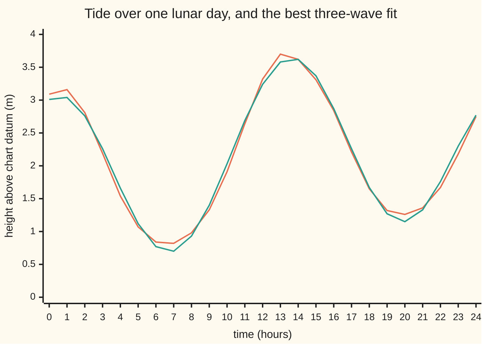

# Partial sums are the best fit: least squares in function space, and Bessel's inequality

[Syllabus](../../../SYLLABUS.md) → [Harmonic analysis](../README.md) → [Fourier Series in Depth](../README.md#s01) → Partial sums are the best fit

---

## General Overview

A harbour tide gauge logs the water height above chart datum (the zero level printed on sea charts) for one lunar day: 24.84 hours, the time the Moon takes to come back over the same spot. The record rises and falls twice, with one high water taller than the other. A storm surge adds a 0.40 m bump at hour 16.37. The record on this card is illustrative: it is built from a stated formula, written out in the code.

A harbour master wants a short summary of the day: a mean level plus three pure waves. The waves repeat once, twice and three times per lunar day. Tide tables call them the diurnal, semidiurnal and terdiurnal tides. That summary has seven numbers: the mean, and a size and a timing for each wave.

Which seven numbers fit best? Score a fit by its misses: square the gap between record and fit at every moment, then average over the day. The answer is the Fourier partial sum: the mean and the first three Fourier coefficients, each read off the record by its own integral ([Fourier coefficients](01-fourier-coefficients-and-orthogonality.md)). Its average squared miss is 0.006365 m², a typical miss of 7.98 cm. No other choice of seven numbers does better.

The same accounting gives a cap. The energies of the kept waves never add up to more than the record's own energy. That cap is **Bessel's inequality**. It forces the coefficients of every signal with finite energy to shrink to zero.

**The partial sum of degree N is the closest trigonometric polynomial of degree N to the signal in mean square, because its leftover is perpendicular to every wave it kept; so the kept energies can never exceed the total, which is Bessel's inequality.**

**What kind of fact this is:** a theorem, proved on this card in Why it works. The tide record is illustrative.

### The picture: the record and its three-wave fit



Orange: the record, hourly. Green: the partial sum with the mean and three waves. The fit follows the two tides closely. It cannot follow the small six-hourly ripple (a shallow-water tide, four cycles a day) or the sharp corners of the surge.

---

## The formula

Notation first, in words.

- The record is $`h`$, a height in metres. It is a function of the **phase** $`x`$, an angle from $`-\pi`$ to $`\pi`$ radians that covers one lunar day. Hour $`t`$ sits at $`x = -\pi + 2\pi t / 24.84`$.
- From [Fourier coefficients](01-fourier-coefficients-and-orthogonality.md): $`\hat h(n) = \frac{1}{2\pi}\int_{-\pi}^{\pi} h(x)\,e^{-inx}\,dx`$ is the share of harmonic $`n`$, for each whole number $`n`$, negative ones included. The circle's inner product is $`\langle f, g\rangle = \frac{1}{2\pi}\int_{-\pi}^{\pi} f\,\bar g\,dx`$, and the size $`\|f\|_2`$ is the square root of $`\langle f, f\rangle`$. So $`\|h\|_2^2`$ is the average of the squared height over the day.
- New on this card: a **trigonometric polynomial of degree $`N`$** is any mix $`P(x) = \sum_{|n|\le N} p_n e^{inx}`$ of the harmonics from $`-N`$ to $`N`$, with any complex amounts $`p_n`$. A real one is a mean plus $`N`$ waves.
- The **partial sum** $`S_N h`$ is the one whose amounts are the coefficients: $`p_n = \hat h(n)`$.

Best fit and Bessel's inequality:

```math
\|h - P\|_2^2 \;=\; \|h - S_N h\|_2^2 \;+\; \sum_{|n|\le N} \big|\hat h(n) - p_n\big|^2 \;\ge\; \|h - S_N h\|_2^2
```

```math
\sum_{|n|\le N} |\hat h(n)|^2 \;\le\; \|h\|_2^2, \qquad\text{so}\qquad \sum_{n=-\infty}^{\infty} |\hat h(n)|^2 \;\le\; \|h\|_2^2 \quad\text{and}\quad \hat h(n) \to 0 .
```

**Read it aloud:** any rival fit misses by the partial sum's miss plus the squared distance between its amounts and the coefficients, so the partial sum wins; and the squared coefficients, added up, never exceed the signal's mean square, so they must die away.

In real form, with the cosine and sine amounts $`a_n`$ and $`b_n`$ of wings 07 and 08, $`\hat h(n) = (a_n - i\,b_n)/2`$ for $`n \ge 1`$. The pair $`\pm n`$ together holds $`e_n = |\hat h(n)|^2 + |\hat h(-n)|^2 = (a_n^2 + b_n^2)/2`$: half the wave's amplitude squared. The mean holds $`e_0 = \hat h(0)^2`$. Here $`e_n`$ is an energy, not the wave $`e^{inx}`$ that [Fourier coefficients](01-fourier-coefficients-and-orthogonality.md) calls $`e_n`$.

| Symbol | Plain meaning | In our example | Push it up and the answer… |
| --- | --- | --- | --- |
| $`h`$, $`x`$ | the record, as a function of phase $`x`$ in radians | one lunar day of tide, metres | the leftover grows with the square of the record's size |
| $`t`$ | time, hours from the start of the record | 0 to 24.84 h | — |
| $`N`$ | the degree: how many waves the fit keeps | 3 | the leftover never grows: 0.006365, then 0.000954 m² at $`N = 4`$ |
| $`\hat h(n)`$ | the share of harmonic $`n`$ | mean 2.138197 m; semidiurnal amplitude $`2\lvert\hat h(2)\rvert`$ = 1.199932 m | its square is added to the Bessel sum |
| $`a_n`$, $`b_n`$ | cosine and sine amounts of wave $`n`$ | $`a_2`$ = 1.077118 m, $`b_2`$ = 0.528821 m | — |
| $`e_n`$ | energy of wave $`n`$: its share of the mean square | $`e_2`$ = 0.719918 m² | — |
| $`S_N h`$ | the partial sum: mean plus the first $`N`$ waves, with the coefficients as amounts | the green line above | — |
| $`P`$, $`p_n`$ | any rival trigonometric polynomial of degree $`N`$, and its amounts | the tide-table fit, 12.06 cm typical miss | each step of $`p_n`$ away from $`\hat h(n)`$ adds its square to the miss |
| $`e^{inx}`$, $`i`$ | harmonic $`n`$ as a complex wave, $`\cos nx + i \sin nx`$; $`i`$ is the imaginary unit | $`n = 2`$: two cycles a lunar day | — |
| $`m`$, $`k`$, $`u`$, $`v`$ | proof helpers: other harmonic numbers, and the two pieces of a miss | used in Why it works | — |
| $`\langle f, g\rangle`$, $`\lVert f\rVert_2`$ | the circle's inner product and size, both with $`1/2\pi`$ | $`\lVert h\rVert_2^2`$ = 5.389658 m² | — |
| $`\lVert h - S_N h\rVert_2^2`$ | the leftover: mean square miss of the best fit | 0.006365 m², or 7.98 cm typical | — |

### When it holds

- **The waves are perpendicular unit vectors.** The harmonics $`e^{inx}`$ are, for the $`1/2\pi`$ inner product. For a skewed pair, such as $`\sqrt2\cos x`$ and $`\sqrt2\cos(x - 0.5)`$, the "Bessel sum" for $`\sqrt2\cos x`$ is 1.7702 against an energy of 1.0000.
- **For the waves to match the tide, the window is a whole lunar day.** The theorem holds on any window; only the fit suffers. Over 24.00 h the tide is no longer a whole number of the window's cycles, and the best fit by 24 h harmonics misses by 11.20 cm, not 7.98 cm.
- **Misses are scored in mean square.** The partial sum is not the fit with the smallest worst miss. Its largest miss is 12.4 cm, at hour 9.92.
- **The signal has finite energy.** $`\|h\|_2^2`$ must be finite. If it is infinite, Bessel's inequality says nothing.
- **Bessel is an inequality.** Equality, Parseval's identity, needs a complete family of waves. With the even harmonics only, the Bessel sum stops 0.092159 m² short.

---

## Why it works

[Parseval's identity](../../08-Differential%20equations%20and%20dynamics/09-Fourier%20Series/03-parsevals-identity.md) already splits a signal into its partial sum plus a perpendicular leftover, and proves the best-fit property in its fold. This card restates that proof in the circle's notation and spends its effort on what follows from it.

### Step 0: fitting is dropping a perpendicular

Treat each signal as an arrow, with $`\langle f, g\rangle`$ as the dot product. The trigonometric polynomials of degree $`N`$ form a flat space through the origin. The closest point of a flat space to an arrow is the foot of the perpendicular ([Projection](../../03-Algebra/06-Dot%20Products%20and%20Best%20Fits/02-orthogonal-projection.md)). On [L2 as a Hilbert space](../../10-Measure%20and%20integration/07-Sizes%20of%20Functions/06-l2-as-a-hilbert-space.md), the same holds for functions. So the best fit is the projection. The work is to show that the projection is the partial sum.

### Step 1: the harmonics are perpendicular unit arrows

For two whole numbers $`m \ne n`$, $`\langle e^{imx}, e^{inx}\rangle = \frac{1}{2\pi}\int_{-\pi}^{\pi} e^{i(m-n)x}\,dx = 0`$. For $`m = n`$ it is 1. [Fourier coefficients](01-fourier-coefficients-and-orthogonality.md) proves both. So the harmonics are an **orthonormal** family: perpendicular, each of size 1. And $`\hat h(n) = \langle h, e^{inx}\rangle`$: each coefficient is the shadow of $`h`$ on one harmonic.

### Step 2: the leftover is perpendicular to every kept wave

Take $`|n| \le N`$. Then $`\langle S_N h, e^{inx}\rangle = \hat h(n)`$, because only the $`n`$-th term of $`S_N h`$ survives Step 1. So

```math
\langle h - S_N h,\; e^{inx}\rangle \;=\; \hat h(n) - \hat h(n) \;=\; 0 .
```

The leftover $`h - S_N h`$ is perpendicular to every harmonic the fit kept, and so to every trigonometric polynomial of degree $`N`$.

### Step 3: Pythagoras against any rival

Let $`P`$ be any rival of degree $`N`$. Split its miss into two pieces:

```math
h - P \;=\; \big(h - S_N h\big) \;+\; \big(S_N h - P\big).
```

The second piece is a trigonometric polynomial of degree $`N`$, so Step 2 makes it perpendicular to the first. Squared sizes of perpendicular pieces add. The second piece has amounts $`\hat h(n) - p_n`$, and Step 1 adds their squares too. That gives the first formula. The extra term is zero only when every $`p_n = \hat h(n)`$. So the partial sum is the best fit, and the only one.

<details>
<summary>Detailed proof: expanding the squared size</summary>

Write $`u = h - S_N h`$ and $`v = S_N h - P`$. Then

$`\displaystyle \|u + v\|_2^2 = \|u\|_2^2 + \langle u, v\rangle + \langle v, u\rangle + \|v\|_2^2 .`$

Here $`v = \sum_{|n|\le N} (\hat h(n) - p_n)\,e^{inx}`$. The inner product is linear in its first slot and conjugate-linear in its second, so

$`\displaystyle \langle u, v\rangle = \sum_{|n|\le N} \overline{(\hat h(n) - p_n)}\,\langle u, e^{inx}\rangle = 0`$

by Step 2, and $`\langle v, u\rangle`$ is its conjugate, also zero. Finally Step 1 gives

$`\displaystyle \|v\|_2^2 = \sum_{|m|\le N}\sum_{|n|\le N} (\hat h(m) - p_m)\,\overline{(\hat h(n) - p_n)}\,\langle e^{imx}, e^{inx}\rangle = \sum_{|n|\le N} |\hat h(n) - p_n|^2 .`$

</details>

### Step 4: Bessel's inequality is the rival "zero"

Take the rival $`P = 0`$, the fit that says nothing. Step 3 gives

```math
\|h\|_2^2 \;=\; \|h - S_N h\|_2^2 \;+\; \sum_{|n|\le N} |\hat h(n)|^2 .
```

The leftover is never negative, so the Bessel sum never exceeds $`\|h\|_2^2`$. This holds for every $`N`$. The partial sums of a series of non-negative terms that stay below a fixed cap converge. So the full sum over all $`n`$ is finite and at most $`\|h\|_2^2`$.

The tide, with $`N = 3`$: 5.389658 = 0.006365 + 5.383293, in m².

### Step 5: what Bessel buys beyond the fit

Three consequences, none of which needs the signal to be smooth or continuous.

1. **The coefficients tend to zero.** The whole series converges, so its tail beyond $`N`$ shrinks to zero. Each later $`|\hat h(n)|^2`$ sits inside that tail. So $`\hat h(n) \to 0`$ as a list of numbers, for every signal with finite energy. This is the square-integrable form of the Riemann–Lebesgue lemma.
2. **A free bound on any later wave.** The energy of wave $`n`$ is at most what is left after $`n - 1`$ waves: $`e_n \le \|h\|_2^2 - \sum_{|k| \le n-1} |\hat h(k)|^2`$. For the tide, wave 100 has amplitude 0.082863 mm, under a bound of 0.302938 mm.
3. **It holds for any orthonormal family, complete or not.** Steps 2 to 4 used only Step 1. With the even harmonics alone the sum stops at 5.297499 m², short of 5.389658 m² by the odd waves' energy, 0.092159 m². When equality holds for every signal, the family is complete: that is Parseval's identity, on [Convergence in energy](05-l2-convergence-and-riesz-fischer.md).

How fast the coefficients fall is a separate question, and depends on smoothness: [Smoothness shows in the tail](06-decay-of-coefficients-and-smoothness.md). Bessel only says that they fall.

---

## Worked numbers, by hand

The record's mean square, then the Bessel sum, wave by wave, from the coefficient table in the output.

| Step | Arithmetic | Value |
| --- | --- | --- |
| mean square of the record | $`\lVert h\rVert_2^2`$, by quadrature and by closed form | 5.389658 m² |
| mean level | $`\hat h(0)`$ = 2.138197 m, squared | $`e_0`$ = 4.571887 m² |
| diurnal wave | amplitude 0.423824 m; $`0.423824^2/2`$ | $`e_1`$ = 0.089813 m² |
| semidiurnal wave | amplitude 1.199932 m; $`1.199932^2/2`$ | $`e_2`$ = 0.719918 m² |
| terdiurnal wave | amplitude 0.057871 m; $`0.057871^2/2`$ | $`e_3`$ = 0.001675 m² |
| Bessel sum, $`N = 3`$ | 4.571887 + 0.089813 + 0.719918 + 0.001675 | 5.383293 m² ≤ 5.389658 m² |
| leftover | 5.389658 − 5.383293 | **0.006365 m²** |
| typical miss | $`\sqrt{0.006365}`$ m | 7.98 cm |

The best seven numbers explain all but 0.006365 m² of the record's mean square. Integrated directly, the squared miss of the green curve averages 0.006365 m² too.

The same budget as bars, scaled so the mean level fills 40 characters:

```
mean level     ████████████████████████████████████████  4.571887
diurnal        █                                         0.089813
semidiurnal    ██████                                    0.719918
terdiurnal                                               0.001675
leftover                                                 0.006365
```

Now the rivals. Each is a trigonometric polynomial of degree 3, scored by direct integration. The Pythagoras column is the leftover 0.006365 plus the squared distance of its amounts from the coefficients. The two columns agree, as Step 3 says.

| Rival fit | Mean square miss, integrated | Pythagoras | Typical miss |
| --- | --- | --- | --- |
| partial sum $`S_3 h`$ | 0.006365 m² | 0.006365 m² | 7.98 cm |
| semidiurnal wave made 5% larger | 0.008165 m² | 0.008165 m² | 9.04 cm |
| tide-table waves, surge ignored | 0.014535 m² | 0.014535 m² | 12.06 cm |
| passes exactly through 7 readings, 3.55 h apart | 0.012669 m² | 0.012669 m² | 11.26 cm |

Two hundred random rivals, each amount moved by up to 5 cm, do no better: the best of them misses by 0.006811 m², against 0.006365 m² for the partial sum, on the same coarse grid.

### What breaks if you drop a piece

| Mistake | Comes out at | What went wrong |
| --- | --- | --- |
| Skewed pair $`\sqrt2\cos x`$, $`\sqrt2\cos(x - 0.5)`$ in place of perpendicular harmonics | "Bessel sum" 1.7702 against energy 1.0000 | The two shadows share a part, so it is counted twice. Bessel needs an orthonormal family. |
| Record cut at 24.00 h, not a whole lunar day | leftover 0.012549 m², 11.20 cm; semidiurnal 1.1607 m, not 1.1999 m | The tide no longer fits a whole number of times, so its energy leaks into other harmonics. |
| Fit forced through 7 readings | 0.012669 m², 11.26 cm | Hitting the samples is not the same as fitting the whole record. The surge and the ripple bend the seven values. |
| Tide-table constants used as the fit | 0.014535 m², 12.06 cm | The right waves for an average day are the wrong fit for this day. The surge shifts the mean and the waves. |

---

## Code, from first principles, and it actually runs

The scripts build the record from its formula and compute every coefficient by an integral written out as a sum over 12,000 points. The 24.00 h window does not repeat, so its integrals use Simpson's rule instead, at 6,000 and 12,000 cells. They reach the answer by four independent roads. First, the coefficients by integration, checked against their closed form. Second, the least-squares problem solved by brute force: the 7-by-7 system of normal equations, solved by elimination, which knows nothing of orthogonality. Third, Pythagoras: each rival's miss integrated directly against the leftover plus its distance from the coefficients. Fourth, the mean square three ways: integrated, in closed form, and as the Parseval sum to $`n`$ = 100,000. Random rivals come from a SplitMix64 generator, seed 20261115, written out in both languages. In the output, `E` is the mean square $`\lVert h\rVert_2^2`$ and `B_n` is the Bessel sum up to harmonic $`n`$.

### Python

```python
# Best approximation and Bessel's inequality: three harmonics fitted to a tide record.
# Standard library only. Every number on the card is printed here.
from math import pi, cos, sin, sqrt

DAY, M, N = 24.84, 12000, 3          # lunar day (hours), quadrature points, degree of the fit
SURGE, X0, W = 0.40, 1.0, 0.6        # storm surge: peak (m), centre and half-width (radians)
WAVES = ((1, 0.35, 0.9), (2, 1.20, 0.4), (4, 0.15, 0.8))   # (harmonic, amplitude m, phase rad)

def tide(x):                         # illustrative record: height above chart datum, metres
    h = 2.10 + SURGE * max(0.0, 1.0 - abs(x - X0) / W)
    for n, amp, ph in WAVES:
        h += amp * cos(n * x - ph)
    return h

def mean(v): return sum(v) / len(v)  # (1/2pi) times the integral over one cycle
def simpson(v):                      # the same average by Simpson's rule, both ends included: for a window that does not repeat
    m = len(v) - 1; return sum(x * (1 if k in (0, m) else 4 - 2 * (k % 2 == 0)) for k, x in enumerate(v)) / (3 * m)
def grid(m): return [-pi + 2 * pi * k / m for k in range(m)]
def coeffs(xs, hs, deg, avg=mean):   # road 1: [mean, a_1, b_1, ...] by quadrature
    c = [avg(hs)]
    for n in range(1, deg + 1):
        c += [2 * avg([h * cos(n * x) for x, h in zip(xs, hs)]),
              2 * avg([h * sin(n * x) for x, h in zip(xs, hs)])]
    return c
def evaluate(c, x):
    return c[0] + sum(c[2 * n - 1] * cos(n * x) + c[2 * n] * sin(n * x) for n in range(1, len(c) // 2 + 1))
def excess(c, d):                    # sum of |h^(n) - c_n|^2 over |n| <= N, in real form
    return (c[0] - d[0]) ** 2 + sum((c[i] - d[i]) ** 2 for i in range(1, len(c))) / 2

def closed(n):                       # road 2: the coefficients in closed form
    if n == 0: return 2.10 + SURGE * W / (2 * pi), 0.0
    k = (SURGE / pi) * 2 * (1 - cos(n * W)) / (n * n * W)
    a, b = k * cos(n * X0), k * sin(n * X0)
    for nn, amp, ph in WAVES:
        if n == nn: a, b = a + amp * cos(ph), b + amp * sin(ph)
    return a, b

xs = grid(M); hs = [tide(x) for x in xs]
E = mean([h * h for h in hs])        # ||h||^2: mean square height by quadrature
tri = SURGE * W / (2 * pi)           # ||h||^2 in closed form: constant, waves, surge, cross terms
E_closed = 2.10 ** 2 + sum(a * a / 2 for _, a, _ in WAVES) + SURGE * SURGE * W / (3 * pi) + 2 * 2.10 * tri
for n, amp, ph in WAVES:
    k = (SURGE / pi) * 2 * (1 - cos(n * W)) / (n * n * W)
    E_closed += amp * k * cos(n * X0 - ph)
energy = [closed(0)[0] ** 2] + [(a * a + b * b) / 2 for a, b in (closed(n) for n in range(1, 100001))]
bessel, run = [], 0.0
for e in energy:
    run += e; bessel.append(run)     # bessel[N] = sum over |n| <= N of |h^(n)|^2
print(f"record: lunar day {DAY} h, {M} points, surge {SURGE:.2f} m at {(X0 + pi) * DAY / (2 * pi):.2f} h")
print(f"||h||^2 (m^2): quadrature {E:.9f}  closed form {E_closed:.9f}  Parseval to n=100000 {bessel[-1]:.9f}")
c = coeffs(xs, hs, max(N, 4))
print(" n    a_n(m)    b_n(m)  ampl.(m)  closed  energy e_n  Bessel B_n  leftover")
for n in range(5):
    a, b = (c[0], 0.0) if n == 0 else (c[2 * n - 1], c[2 * n])
    amp = abs(a) if n == 0 else sqrt(a * a + b * b)
    ca, cb = closed(n)
    print(f"{n:2d} {a:9.6f} {b:9.6f} {amp:9.6f} {sqrt(ca * ca + cb * cb):7.4f} {energy[n]:11.6f}"
          f" {bessel[n]:11.6f} {E_closed - bessel[n]:9.6f}")
    assert abs(a - ca) < 1e-7 and abs(b - cb) < 1e-7, "quadrature against closed form"
best = c[:2 * N + 1]
left = mean([(h - evaluate(best, x)) ** 2 for x, h in zip(xs, hs)])
print(f"best fit leftover: direct {left:.6f} m^2, E - B_{N} {E - bessel[N]:.6f} m^2, rms {100 * sqrt(left):.2f} cm")

# road 3: least squares by brute force, normal equations solved by elimination
basis = [lambda x: 1.0] + [f for n in range(1, N + 1)
                          for f in (lambda x, n=n: cos(n * x), lambda x, n=n: sin(n * x))]
cols = [[f(x) for x in xs] for f in basis]
G = [[mean([u * v for u, v in zip(ci, cj)]) for cj in cols] + [mean([u * h for u, h in zip(ci, hs)])]
     for ci in cols]
for i in range(len(G)):
    p = max(range(i, len(G)), key=lambda r: abs(G[r][i])); G[i], G[p] = G[p], G[i]
    for r in range(len(G)):
        if r != i:
            f = G[r][i] / G[i][i]; G[r] = [u - f * v for u, v in zip(G[r], G[i])]
ls = [G[i][-1] / G[i][i] for i in range(len(G))]
gap = max(abs(u - v) for u, v in zip(ls, best))
print(f"least squares by elimination: {' '.join(f'{v:.4f}' for v in ls)}; largest gap {gap:.12f}")

table = [2.10, 0.35 * cos(0.9), 0.35 * sin(0.9), 1.20 * cos(0.4), 1.20 * sin(0.4)] + [0.0] * (2 * N - 4)
nodes = grid(7); vals = [tide(x) for x in nodes]
interp = coeffs(nodes, vals, N)      # passes through 7 readings, 3.55 h apart
nudged = best[:]; nudged[3] *= 1.05; nudged[4] *= 1.05
for name, d in (("tide table", table), ("through 7 readings", interp), ("semidiurnal +5%", nudged)):
    direct = mean([(h - evaluate(d, x)) ** 2 for x, h in zip(xs, hs)])
    print(f"{name:<19} leftover {direct:.6f}  Pythagoras {left + excess(best, d):.6f}  rms {100 * sqrt(direct):.2f} cm")
    assert abs(direct - left - excess(best, d)) < 1e-9, "Pythagoras for the rival"
    assert direct > left, "the partial sum beats the rival"
s, lows = 20261115, []               # SplitMix64, seed 20261115: random rivals
def rnd():
    global s
    s = (s + 0x9E3779B97F4A7C15) & (2 ** 64 - 1); z = s
    z = ((z ^ (z >> 30)) * 0xBF58476D1CE4E5B9) & (2 ** 64 - 1)
    z = ((z ^ (z >> 27)) * 0x94D049BB133111EB) & (2 ** 64 - 1)
    return ((z ^ (z >> 31)) >> 11) / 2.0 ** 53
coarse = grid(1200); hc = [tide(x) for x in coarse]; lc = mean([(h - evaluate(best, x)) ** 2 for x, h in zip(coarse, hc)])
for _ in range(200):
    d = [v + 0.05 * (2 * rnd() - 1) for v in best]
    lows.append(mean([(h - evaluate(d, x)) ** 2 for x, h in zip(coarse, hc)]))
print(f"200 random rivals within 5 cm: best of them {min(lows):.6f}, fit {lc:.6f} (coarse grid)")
assert min(lows) > lc, "no rival beats the partial sum"
miss = max(range(M), key=lambda k: abs(hs[k] - evaluate(best, xs[k])))
print(f"largest miss {100 * (hs[miss] - evaluate(best, xs[miss])):.1f} cm at {(xs[miss] + pi) * DAY / (2 * pi):.2f} h;"
      f" at the surge peak record {tide(X0):.3f} m, fit {evaluate(best, X0):.3f} m")
u1 = [sqrt(2) * cos(x) for x in xs]; u2 = [sqrt(2) * cos(x - 0.5) for x in xs]
skew = mean([u * u for u in u1]) ** 2 + mean([u * v for u, v in zip(u1, u2)]) ** 2
print(f"breaks: skewed pair cos x, cos(x - 0.5): 'Bessel sum' {skew:.4f} against energy {mean([u * u for u in u1]):.4f}")
assert skew > 1.5, "Bessel needs an orthonormal family"
l24 = []                             # a 24.00 h window does not repeat: Simpson's rule at two cut-offs
for m24 in (M // 2, M):
    x24 = [-pi + 2 * pi * (24.0 * k / m24) / DAY for k in range(m24 + 1)]; h24 = [tide(x) for x in x24]
    c24 = coeffs([-pi + 2 * pi * k / m24 for k in range(m24 + 1)], h24, N, simpson)
    l24.append(simpson([h * h for h in h24]) - excess(c24, [0.0] * (2 * N + 1)))
    print(f"breaks: 24.00 h window, {m24} cells, leftover {l24[-1]:.6f} m^2 (rms {100 * sqrt(l24[-1]):.2f} cm), semidiurnal {sqrt(c24[3] ** 2 + c24[4] ** 2):.4f} m")
assert abs(l24[0] - l24[1]) < 1e-8 and l24[1] > left, "the 24 h leftover has settled, and is worse than a lunar day's"
for n in (10, 100, 1000):
    bound = sqrt(2 * (E_closed - bessel[n - 1]))
    print(f"n = {n:4d}: amplitude {2000 * sqrt(energy[n] / 2):.6f} mm, Bessel bound {1000 * bound:.6f} mm, left after n {E_closed - bessel[n]:.12f}")
    assert energy[n] <= E_closed - bessel[n - 1], "Bessel caps each later coefficient"
even = sum(energy[n] for n in range(0, 100001, 2))
print(f"even harmonics only: Bessel sum {even:.6f} < {E_closed:.6f}; gap {E_closed - even:.6f} m^2")
print("chart hours  " + " ".join(f"{t:5d}" for t in range(25)))
for name, f in (("chart record", tide), ("chart fit   ", lambda x: evaluate(best, x))):
    print(name + " " + " ".join(f"{f(-pi + 2 * pi * t / DAY):5.2f}" for t in range(25)))
assert abs(E - E_closed) < 1e-7, "quadrature against closed form for ||h||^2"
assert abs(bessel[-1] - E_closed) < 1e-10, "Parseval sum against closed form for ||h||^2"
assert abs(left - (E - bessel[N])) < 1e-7, "leftover equals energy minus Bessel sum"
assert gap < 1e-9, "brute-force least squares lands on the Fourier coefficients"
print("ALL CHECKS PASS")
```

**Ran 2026-11-15 on macOS, Python 3.14.10, standard library only. All checks passed. Output, pasted from the run:**

```
record: lunar day 24.84 h, 12000 points, surge 0.40 m at 16.37 h
||h||^2 (m^2): quadrature 5.389658221  closed form 5.389658226  Parseval to n=100000 5.389658226
 n    a_n(m)    b_n(m)  ampl.(m)  closed  energy e_n  Bessel B_n  leftover
 0  2.138197  0.000000  2.138197  2.1382    4.571887    4.571887  0.817771
 1  0.257616  0.336543  0.423824  0.4238    0.089813    4.661701  0.727958
 2  1.077118  0.528821  1.199932  1.1999    0.719918    5.381619  0.008040
 3 -0.057292  0.008167  0.057871  0.0579    0.001675    5.383293  0.006365
 4  0.074382  0.072726  0.104028  0.1040    0.005411    5.388704  0.000954
best fit leftover: direct 0.006365 m^2, E - B_3 0.006365 m^2, rms 7.98 cm
least squares by elimination: 2.1382 0.2576 0.3365 1.0771 0.5288 -0.0573 0.0082; largest gap 0.000000000000
tide table          leftover 0.014535  Pythagoras 0.014535  rms 12.06 cm
through 7 readings  leftover 0.012669  Pythagoras 0.012669  rms 11.26 cm
semidiurnal +5%     leftover 0.008165  Pythagoras 0.008165  rms 9.04 cm
200 random rivals within 5 cm: best of them 0.006811, fit 0.006365 (coarse grid)
largest miss -12.4 cm at 9.92 h; at the surge peak record 2.663 m, fit 2.651 m
breaks: skewed pair cos x, cos(x - 0.5): 'Bessel sum' 1.7702 against energy 1.0000
breaks: 24.00 h window, 6000 cells, leftover 0.012549 m^2 (rms 11.20 cm), semidiurnal 1.1607 m
breaks: 24.00 h window, 12000 cells, leftover 0.012549 m^2 (rms 11.20 cm), semidiurnal 1.1607 m
n =   10: amplitude 0.169043 mm, Bessel bound 7.746966 mm, left after n 0.000029993451
n =  100: amplitude 0.082863 mm, Bessel bound 0.302938 mm, left after n 0.000000042453
n = 1000: amplitude 0.000848 mm, Bessel bound 0.009511 mm, left after n 0.000000000045
even harmonics only: Bessel sum 5.297499 < 5.389658; gap 0.092159 m^2
chart hours      0     1     2     3     4     5     6     7     8     9    10    11    12    13    14    15    16    17    18    19    20    21    22    23    24
chart record  3.09  3.16  2.81  2.19  1.54  1.07  0.84  0.82  0.98  1.33  1.91  2.64  3.32  3.70  3.62  3.31  2.84  2.21  1.65  1.32  1.26  1.36  1.67  2.18  2.75
chart fit     3.01  3.04  2.76  2.26  1.66  1.12  0.77  0.70  0.93  1.40  2.03  2.69  3.24  3.58  3.62  3.37  2.87  2.26  1.67  1.27  1.15  1.33  1.76  2.30  2.77
ALL CHECKS PASS
```

### Rust

```rust
// Best approximation and Bessel's inequality: three harmonics fitted to a tide record.
// Rust std only. Prints exactly what the Python check prints.
use std::f64::consts::PI;

const DAY: f64 = 24.84; const M: usize = 12000; const N: usize = 3;
const SURGE: f64 = 0.40; const X0: f64 = 1.0; const W: f64 = 0.6;
const WAVES: [(usize, f64, f64); 3] = [(1, 0.35, 0.9), (2, 1.20, 0.4), (4, 0.15, 0.8)];

fn tide(x: f64) -> f64 { // illustrative record: height above chart datum, metres
    let mut h = 2.10 + SURGE * f64::max(0.0, 1.0 - (x - X0).abs() / W);
    for &(n, amp, ph) in WAVES.iter() { h += amp * (n as f64 * x - ph).cos(); }
    h
}
fn fsum(v: &[f64]) -> f64 { // compensated sum, the same one Python's sum() uses
    let (mut s, mut c) = (0.0f64, 0.0f64);
    for &x in v {
        let t = s + x;
        if s.abs() >= x.abs() { c += (s - t) + x; } else { c += (x - t) + s; }
        s = t;
    }
    if c != 0.0 && c.is_finite() { s += c; }
    s
}
fn mean(v: &[f64]) -> f64 { fsum(v) / v.len() as f64 }
fn simpson(v: &[f64]) -> f64 { let m = v.len() - 1; fsum(&v.iter().enumerate().map(|(k, x)| x * if k == 0 || k == m { 1.0 } else if k % 2 == 1 { 4.0 } else { 2.0 }).collect::<Vec<_>>()) / (3 * m) as f64 }
fn grid(m: usize) -> Vec<f64> { (0..m).map(|k| -PI + 2.0 * PI * k as f64 / m as f64).collect() }
fn coeffs(xs: &[f64], hs: &[f64], deg: usize, avg: &dyn Fn(&[f64]) -> f64) -> Vec<f64> { // road 1: by quadrature
    let mut c = vec![avg(hs)];
    for n in 1..=deg {
        let nf = n as f64;
        c.push(2.0 * avg(&xs.iter().zip(hs).map(|(x, h)| h * (nf * x).cos()).collect::<Vec<_>>()));
        c.push(2.0 * avg(&xs.iter().zip(hs).map(|(x, h)| h * (nf * x).sin()).collect::<Vec<_>>()));
    }
    c
}
fn evaluate(c: &[f64], x: f64) -> f64 {
    let t: Vec<f64> = (1..=c.len() / 2).map(|n| c[2 * n - 1] * (n as f64 * x).cos() + c[2 * n] * (n as f64 * x).sin()).collect();
    c[0] + fsum(&t)
}
fn excess(c: &[f64], d: &[f64]) -> f64 {
    let t: Vec<f64> = (1..c.len()).map(|i| (c[i] - d[i]) * (c[i] - d[i])).collect();
    (c[0] - d[0]) * (c[0] - d[0]) + fsum(&t) / 2.0
}
fn kfac(n: usize) -> f64 { (SURGE / PI) * 2.0 * (1.0 - (n as f64 * W).cos()) / ((n * n) as f64 * W) }
fn closed(n: usize) -> (f64, f64) { // road 2: the coefficients in closed form
    if n == 0 { return (2.10 + SURGE * W / (2.0 * PI), 0.0); }
    let k = kfac(n);
    let (mut a, mut b) = (k * (n as f64 * X0).cos(), k * (n as f64 * X0).sin());
    for &(nn, amp, ph) in WAVES.iter() { if n == nn { a += amp * ph.cos(); b += amp * ph.sin(); } }
    (a, b)
}
fn ms(xs: &[f64], hs: &[f64], d: &[f64]) -> f64 {
    mean(&xs.iter().zip(hs).map(|(x, h)| { let r = h - evaluate(d, *x); r * r }).collect::<Vec<_>>())
}
struct Rng(u64);
impl Rng {
    fn next(&mut self) -> f64 { // SplitMix64
        self.0 = self.0.wrapping_add(0x9E3779B97F4A7C15); let mut z = self.0;
        z = (z ^ (z >> 30)).wrapping_mul(0xBF58476D1CE4E5B9);
        z = (z ^ (z >> 27)).wrapping_mul(0x94D049BB133111EB);
        ((z ^ (z >> 31)) >> 11) as f64 / 9007199254740992.0
    }
}

fn main() {
    let xs = grid(M); let hs: Vec<f64> = xs.iter().map(|&x| tide(x)).collect();
    let e = mean(&hs.iter().map(|h| h * h).collect::<Vec<_>>());
    let tri = SURGE * W / (2.0 * PI);
    let mut e_closed = 2.10 * 2.10 + fsum(&WAVES.iter().map(|w| w.1 * w.1 / 2.0).collect::<Vec<_>>())
        + SURGE * SURGE * W / (3.0 * PI) + 2.0 * 2.10 * tri;
    for &(n, amp, ph) in WAVES.iter() { e_closed += amp * kfac(n) * (n as f64 * X0 - ph).cos(); }
    let c0 = closed(0).0; let mut energy = vec![c0 * c0];
    for n in 1..=100000 { let (a, b) = closed(n); energy.push((a * a + b * b) / 2.0); }
    let mut bessel = Vec::new(); let mut run = 0.0;
    for &en in energy.iter() { run += en; bessel.push(run); }
    println!("record: lunar day {} h, {} points, surge {:.2} m at {:.2} h", DAY, M, SURGE, (X0 + PI) * DAY / (2.0 * PI));
    println!("||h||^2 (m^2): quadrature {:.9}  closed form {:.9}  Parseval to n=100000 {:.9}", e, e_closed, bessel[100000]);
    let c = coeffs(&xs, &hs, N.max(4), &mean);
    println!(" n    a_n(m)    b_n(m)  ampl.(m)  closed  energy e_n  Bessel B_n  leftover");
    for n in 0..5 {
        let (a, b) = if n == 0 { (c[0], 0.0) } else { (c[2 * n - 1], c[2 * n]) };
        let amp = if n == 0 { a.abs() } else { (a * a + b * b).sqrt() };
        let (ca, cb) = closed(n);
        println!("{:2} {:9.6} {:9.6} {:9.6} {:7.4} {:11.6} {:11.6} {:9.6}", n, a, b, amp,
                 (ca * ca + cb * cb).sqrt(), energy[n], bessel[n], e_closed - bessel[n]);
        assert!((a - ca).abs() < 1e-7 && (b - cb).abs() < 1e-7, "quadrature against closed form");
    }
    let best: Vec<f64> = c[..2 * N + 1].to_vec();
    let left = ms(&xs, &hs, &best);
    println!("best fit leftover: direct {:.6} m^2, E - B_{} {:.6} m^2, rms {:.2} cm", left, N, e - bessel[N], 100.0 * left.sqrt());

    // road 3: least squares by brute force, normal equations solved by elimination
    let mut cols: Vec<Vec<f64>> = vec![vec![1.0; M]];
    for n in 1..=N {
        cols.push(xs.iter().map(|x| (n as f64 * x).cos()).collect());
        cols.push(xs.iter().map(|x| (n as f64 * x).sin()).collect());
    }
    let mut g: Vec<Vec<f64>> = cols.iter().map(|ci| {
        let mut row: Vec<f64> = cols.iter().map(|cj| mean(&ci.iter().zip(cj).map(|(u, v)| u * v).collect::<Vec<_>>())).collect();
        row.push(mean(&ci.iter().zip(&hs).map(|(u, h)| u * h).collect::<Vec<_>>())); row }).collect();
    let k = g.len();
    for i in 0..k {
        let mut p = i;
        for r in i..k { if g[r][i].abs() > g[p][i].abs() { p = r; } }
        g.swap(i, p);
        for r in 0..k {
            if r != i {
                let f = g[r][i] / g[i][i]; let gi = g[i].clone();
                g[r] = g[r].iter().zip(&gi).map(|(u, v)| u - f * v).collect();
            }
        }
    }
    let ls: Vec<f64> = (0..k).map(|i| g[i][k] / g[i][i]).collect();
    let gap = ls.iter().zip(&best).map(|(u, v)| (u - v).abs()).fold(0.0f64, f64::max);
    println!("least squares by elimination: {}; largest gap {:.12}",
             ls.iter().map(|v| format!("{:.4}", v)).collect::<Vec<_>>().join(" "), gap);

    let mut table = vec![2.10, 0.35 * 0.9f64.cos(), 0.35 * 0.9f64.sin(), 1.20 * 0.4f64.cos(), 1.20 * 0.4f64.sin()]; table.resize(2 * N + 1, 0.0);
    let nodes = grid(7); let vals: Vec<f64> = nodes.iter().map(|&x| tide(x)).collect();
    let interp = coeffs(&nodes, &vals, N, &mean);
    let mut nudged = best.clone(); nudged[3] *= 1.05; nudged[4] *= 1.05;
    for (name, d) in [("tide table", table), ("through 7 readings", interp), ("semidiurnal +5%", nudged)] {
        let direct = ms(&xs, &hs, &d);
        println!("{:<19} leftover {:.6}  Pythagoras {:.6}  rms {:.2} cm", name, direct, left + excess(&best, &d), 100.0 * direct.sqrt());
        assert!((direct - left - excess(&best, &d)).abs() < 1e-9, "Pythagoras for the rival");
        assert!(direct > left, "the partial sum beats the rival");
    }
    let mut rng = Rng(20261115);
    let coarse = grid(1200); let hc: Vec<f64> = coarse.iter().map(|&x| tide(x)).collect();
    let lc = ms(&coarse, &hc, &best);
    let mut low = f64::INFINITY;
    for _ in 0..200 {
        let d: Vec<f64> = best.iter().map(|v| v + 0.05 * (2.0 * rng.next() - 1.0)).collect();
        low = low.min(ms(&coarse, &hc, &d));
    }
    println!("200 random rivals within 5 cm: best of them {:.6}, fit {:.6} (coarse grid)", low, lc);
    assert!(low > lc, "no rival beats the partial sum");
    let mut miss = 0; for kk in 0..M { if (hs[kk] - evaluate(&best, xs[kk])).abs() > (hs[miss] - evaluate(&best, xs[miss])).abs() { miss = kk; } }
    println!("largest miss {:.1} cm at {:.2} h; at the surge peak record {:.3} m, fit {:.3} m",
             100.0 * (hs[miss] - evaluate(&best, xs[miss])), (xs[miss] + PI) * DAY / (2.0 * PI), tide(X0), evaluate(&best, X0));
    let u1: Vec<f64> = xs.iter().map(|x| 2f64.sqrt() * x.cos()).collect();
    let u2: Vec<f64> = xs.iter().map(|x| 2f64.sqrt() * (x - 0.5).cos()).collect();
    let n11 = mean(&u1.iter().map(|u| u * u).collect::<Vec<_>>());
    let n12 = mean(&u1.iter().zip(&u2).map(|(u, v)| u * v).collect::<Vec<_>>());
    let skew = n11 * n11 + n12 * n12;
    println!("breaks: skewed pair cos x, cos(x - 0.5): 'Bessel sum' {:.4} against energy {:.4}", skew, n11);
    assert!(skew > 1.5, "Bessel needs an orthonormal family");
    let l24: Vec<f64> = [M / 2, M].iter().map(|&m24| { // a 24.00 h window does not repeat: Simpson's rule at two cut-offs
        let (y24, h24): (Vec<f64>, Vec<f64>) = (0..=m24).map(|kk| (-PI + 2.0 * PI * kk as f64 / m24 as f64, tide(-PI + 2.0 * PI * (24.0 * kk as f64 / m24 as f64) / DAY))).unzip();
        let c24 = coeffs(&y24, &h24, N, &simpson); let l = simpson(&h24.iter().map(|h| h * h).collect::<Vec<_>>()) - excess(&c24, &vec![0.0; 2 * N + 1]);
        println!("breaks: 24.00 h window, {} cells, leftover {:.6} m^2 (rms {:.2} cm), semidiurnal {:.4} m", m24, l, 100.0 * l.sqrt(), (c24[3] * c24[3] + c24[4] * c24[4]).sqrt()); l }).collect();
    assert!((l24[0] - l24[1]).abs() < 1e-8 && l24[1] > left, "the 24 h leftover has settled, and is worse than a lunar day's");
    for n in [10usize, 100, 1000] {
        let bound = (2.0 * (e_closed - bessel[n - 1])).sqrt();
        println!("n = {:4}: amplitude {:.6} mm, Bessel bound {:.6} mm, left after n {:.12}",
                 n, 2000.0 * (energy[n] / 2.0).sqrt(), 1000.0 * bound, e_closed - bessel[n]);
        assert!(energy[n] <= e_closed - bessel[n - 1], "Bessel caps each later coefficient");
    }
    let even = fsum(&(0..=100000).step_by(2).map(|n| energy[n]).collect::<Vec<_>>());
    println!("even harmonics only: Bessel sum {:.6} < {:.6}; gap {:.6} m^2", even, e_closed, e_closed - even);
    println!("chart hours  {}", (0..25).map(|t| format!("{:5}", t)).collect::<Vec<_>>().join(" "));
    let at = |t: usize| -PI + 2.0 * PI * t as f64 / DAY;
    println!("chart record {}", (0..25).map(|t| format!("{:5.2}", tide(at(t)))).collect::<Vec<_>>().join(" "));
    println!("chart fit    {}", (0..25).map(|t| format!("{:5.2}", evaluate(&best, at(t)))).collect::<Vec<_>>().join(" "));
    assert!((e - e_closed).abs() < 1e-7, "quadrature against closed form for ||h||^2");
    assert!((bessel[100000] - e_closed).abs() < 1e-10, "Parseval sum against closed form for ||h||^2");
    assert!((left - (e - bessel[N])).abs() < 1e-7, "leftover equals energy minus Bessel sum");
    assert!(gap < 1e-9, "brute-force least squares lands on the Fourier coefficients");
    println!("ALL CHECKS PASS");
}
```

**Ran 2026-11-15 on macOS, rustc 1.98.1, no crates. All checks passed. Output, pasted from the run:**

```
record: lunar day 24.84 h, 12000 points, surge 0.40 m at 16.37 h
||h||^2 (m^2): quadrature 5.389658221  closed form 5.389658226  Parseval to n=100000 5.389658226
 n    a_n(m)    b_n(m)  ampl.(m)  closed  energy e_n  Bessel B_n  leftover
 0  2.138197  0.000000  2.138197  2.1382    4.571887    4.571887  0.817771
 1  0.257616  0.336543  0.423824  0.4238    0.089813    4.661701  0.727958
 2  1.077118  0.528821  1.199932  1.1999    0.719918    5.381619  0.008040
 3 -0.057292  0.008167  0.057871  0.0579    0.001675    5.383293  0.006365
 4  0.074382  0.072726  0.104028  0.1040    0.005411    5.388704  0.000954
best fit leftover: direct 0.006365 m^2, E - B_3 0.006365 m^2, rms 7.98 cm
least squares by elimination: 2.1382 0.2576 0.3365 1.0771 0.5288 -0.0573 0.0082; largest gap 0.000000000000
tide table          leftover 0.014535  Pythagoras 0.014535  rms 12.06 cm
through 7 readings  leftover 0.012669  Pythagoras 0.012669  rms 11.26 cm
semidiurnal +5%     leftover 0.008165  Pythagoras 0.008165  rms 9.04 cm
200 random rivals within 5 cm: best of them 0.006811, fit 0.006365 (coarse grid)
largest miss -12.4 cm at 9.92 h; at the surge peak record 2.663 m, fit 2.651 m
breaks: skewed pair cos x, cos(x - 0.5): 'Bessel sum' 1.7702 against energy 1.0000
breaks: 24.00 h window, 6000 cells, leftover 0.012549 m^2 (rms 11.20 cm), semidiurnal 1.1607 m
breaks: 24.00 h window, 12000 cells, leftover 0.012549 m^2 (rms 11.20 cm), semidiurnal 1.1607 m
n =   10: amplitude 0.169043 mm, Bessel bound 7.746966 mm, left after n 0.000029993451
n =  100: amplitude 0.082863 mm, Bessel bound 0.302938 mm, left after n 0.000000042453
n = 1000: amplitude 0.000848 mm, Bessel bound 0.009511 mm, left after n 0.000000000045
even harmonics only: Bessel sum 5.297499 < 5.389658; gap 0.092159 m^2
chart hours      0     1     2     3     4     5     6     7     8     9    10    11    12    13    14    15    16    17    18    19    20    21    22    23    24
chart record  3.09  3.16  2.81  2.19  1.54  1.07  0.84  0.82  0.98  1.33  1.91  2.64  3.32  3.70  3.62  3.31  2.84  2.21  1.65  1.32  1.26  1.36  1.67  2.18  2.75
chart fit     3.01  3.04  2.76  2.26  1.66  1.12  0.77  0.70  0.93  1.40  2.03  2.69  3.24  3.58  3.62  3.37  2.87  2.26  1.67  1.27  1.15  1.33  1.76  2.30  2.77
ALL CHECKS PASS
```

### Lean

Lean proves the best-fit formula, Bessel's inequality and the shrinking coefficients, for every signal with finite energy and every degree $`N`$.

- Take a signal $`h`$ with finite energy and any trigonometric polynomial $`P`$ of degree $`N`$. Then $`\|h - P\|_2^2`$ equals the leftover plus $`\sum_{|n|\le N} |\hat h(n) - p_n|^2`$.
- Take any rival of degree $`N`$. Then the partial sum misses by no more than it does.
- Take a signal $`h`$ with finite energy. Then $`\sum_{|n|\le N} |\hat h(n)|^2 \le \|h\|_2^2`$ for every degree $`N`$.
- Take the same signal. Then the full sum of $`|\hat h(n)|^2`$ over all $`n`$ is finite and at most $`\|h\|_2^2`$.
- Take the same signal. Then $`\hat h(n) \to 0`$ as $`|n|`$ grows.

The tide numbers, the rival fits, the 24.00 h window and the even-harmonics shortfall are left to the Python and Rust checks.

```lean
-- Partial sums are the best fit: the Fourier partial sum of degree N is the closest trigonometric polynomial of degree N to a finite-energy signal in mean square, and so the coefficients obey Bessel's inequality and tend to zero.
import Mathlib.Analysis.Fourier.AddCircle

open MeasureTheory Filter Topology AddCircle

noncomputable section

variable {T : ℝ} [hT : Fact (0 < T)]

/-- The inner product of the `n`-th Fourier monomial with `h` is the `n`-th Fourier coefficient. -/
theorem inner_fourierLp_eq_fourierCoeff (h : Lp ℂ 2 (haarAddCircle (T := T))) (n : ℤ) :
    inner ℂ (fourierLp (T := T) 2 n) h = fourierCoeff h n := by
  rw [← fourierBasis_repr, fourierBasis.repr_apply_apply, coe_fourierBasis]

/-- **Partial sums are the best fit.** Let `h` be a signal of finite energy on the circle
(an element of `L²`, with the normalised measure, so `‖h‖²` is the mean square), `N` a degree,
and `P = ∑_{|n| ≤ N} p n • e^{inx}` any trigonometric polynomial of degree `N`. Then the mean
square miss of `P` equals the miss of the partial sum `S_N h = ∑_{|n| ≤ N} ĥ(n) • e^{inx}` plus
`∑_{|n| ≤ N} |ĥ(n) - p n|²`; in particular the partial sum misses by no more than `P`. -/
theorem partial_sum_is_best_mean_square_fit (h : Lp ℂ 2 (haarAddCircle (T := T))) (N : ℕ)
    (p : ℤ → ℂ) :
    ‖h - ∑ n ∈ Finset.Icc (-(N : ℤ)) N, p n • fourierLp (T := T) 2 n‖ ^ 2 =
        ‖h - ∑ n ∈ Finset.Icc (-(N : ℤ)) N, fourierCoeff h n • fourierLp (T := T) 2 n‖ ^ 2 +
          ∑ n ∈ Finset.Icc (-(N : ℤ)) N, ‖fourierCoeff h n - p n‖ ^ 2 ∧
      ‖h - ∑ n ∈ Finset.Icc (-(N : ℤ)) N, fourierCoeff h n • fourierLp (T := T) 2 n‖ ≤
        ‖h - ∑ n ∈ Finset.Icc (-(N : ℤ)) N, p n • fourierLp (T := T) 2 n‖ := by
  set s := Finset.Icc (-(N : ℤ)) N
  set c := fun n : ℤ => fourierCoeff h n with hc
  have ho : Orthonormal ℂ (fourierLp (T := T) 2) := orthonormal_fourier
  set e := fourierLp (T := T) 2
  have key : h - ∑ n ∈ s, p n • e n =
      (h - ∑ n ∈ s, c n • e n) + ∑ n ∈ s, (c n - p n) • e n := by
    simp only [sub_smul, Finset.sum_sub_distrib]
    abel
  have orth : inner ℂ (h - ∑ n ∈ s, c n • e n) (∑ n ∈ s, (c n - p n) • e n) = 0 := by
    rw [inner_sum]
    refine Finset.sum_eq_zero fun i hi => ?_
    rw [inner_smul_right, inner_sub_left, ho.inner_left_sum c hi, ← inner_conj_symm,
      inner_fourierLp_eq_fourierCoeff]
    simp [c]
  have hQ : ‖∑ n ∈ s, (c n - p n) • e n‖ ^ 2 = ∑ n ∈ s, ‖c n - p n‖ ^ 2 := by
    rw [@norm_sq_eq_re_inner ℂ, ho.inner_sum, map_sum]
    refine Finset.sum_congr rfl fun i _ => ?_
    rw [RCLike.conj_mul]
    norm_cast
  have eq1 : ‖h - ∑ n ∈ s, p n • e n‖ ^ 2 =
      ‖h - ∑ n ∈ s, c n • e n‖ ^ 2 + ∑ n ∈ s, ‖c n - p n‖ ^ 2 := by
    rw [key, ← hQ]
    simp only [sq]
    exact norm_add_sq_eq_norm_sq_add_norm_sq_of_inner_eq_zero _ _ orth
  refine ⟨eq1, ?_⟩
  have hnn : 0 ≤ ∑ n ∈ s, ‖c n - p n‖ ^ 2 := Finset.sum_nonneg fun _ _ => by positivity
  have : ‖h - ∑ n ∈ s, c n • e n‖ ^ 2 ≤ ‖h - ∑ n ∈ s, p n • e n‖ ^ 2 := by
    rw [eq1]; linarith
  exact (sq_le_sq₀ (norm_nonneg _) (norm_nonneg _)).mp this

/-- **Bessel's inequality.** For a signal `h` of finite energy on the circle, the kept energies
`∑_{|n| ≤ N} |ĥ(n)|²` never exceed the mean square `‖h‖²`, for every degree `N`; so the full sum
of `|ĥ(n)|²` over all whole numbers `n` converges and is at most `‖h‖²`. -/
theorem bessels_inequality (h : Lp ℂ 2 (haarAddCircle (T := T))) :
    (∀ N : ℕ, ∑ n ∈ Finset.Icc (-(N : ℤ)) N, ‖fourierCoeff h n‖ ^ 2 ≤ ‖h‖ ^ 2) ∧
      Summable (fun n : ℤ => ‖fourierCoeff h n‖ ^ 2) ∧
      ∑' n : ℤ, ‖fourierCoeff h n‖ ^ 2 ≤ ‖h‖ ^ 2 := by
  have ho : Orthonormal ℂ (fourierLp (T := T) 2) := orthonormal_fourier
  have hc : ∀ n : ℤ, ‖fourierCoeff h n‖ ^ 2 = ‖inner ℂ (fourierLp (T := T) 2 n) h‖ ^ 2 := by
    intro n; rw [inner_fourierLp_eq_fourierCoeff]
  simp_rw [hc]
  exact ⟨fun N => ho.sum_inner_products_le h, ho.inner_products_summable h,
    ho.tsum_inner_products_le h⟩

/-- **The coefficients tend to zero.** For every signal `h` of finite energy on the circle,
`ĥ(n) → 0` as `|n| → ∞` (the square-integrable form of the Riemann–Lebesgue lemma). -/
theorem fourier_coefficients_tend_to_zero (h : Lp ℂ 2 (haarAddCircle (T := T))) :
    Tendsto (fun n : ℤ => fourierCoeff h n) cofinite (𝓝 0) := by
  have hs : Summable (fun n : ℤ => ‖fourierCoeff h n‖ ^ 2) := (bessels_inequality h).2.1
  have h1 : Tendsto (fun n : ℤ => ‖fourierCoeff h n‖ ^ 2) cofinite (𝓝 0) :=
    hs.tendsto_cofinite_zero
  have h2 : Tendsto (fun n : ℤ => ‖fourierCoeff h n‖) cofinite (𝓝 0) := by
    have := (Real.continuous_sqrt.tendsto 0).comp h1
    simp only [Function.comp_def, Real.sqrt_sq (norm_nonneg _), Real.sqrt_zero] at this
    exact this
  exact tendsto_zero_iff_norm_tendsto_zero.mpr h2

end

#print axioms inner_fourierLp_eq_fourierCoeff
#print axioms partial_sum_is_best_mean_square_fit
#print axioms bessels_inequality
#print axioms fourier_coefficients_tend_to_zero
```

**Checked 2026-11-15 on macOS, Lean 4.36.0-rc2, Mathlib v4.36.0-rc2. Every proof is complete and uses only Lean's standard axioms. Output, pasted from the run:**

```
'inner_fourierLp_eq_fourierCoeff' depends on axioms: [propext, Classical.choice, Quot.sound]
'partial_sum_is_best_mean_square_fit' depends on axioms: [propext, Classical.choice, Quot.sound]
'bessels_inequality' depends on axioms: [propext, Classical.choice, Quot.sound]
'fourier_coefficients_tend_to_zero' depends on axioms: [propext, Classical.choice, Quot.sound]
```

> [!TIP]
> **Try changing**
> - Guess first: one more wave, how much better? Set `N = 4`. The leftover falls from 0.006365 to 0.000954 m², the $`n = 4`$ row of the table. The fourth wave catches the six-hourly ripple.
> - Guess first: ten waves? Set `N = 10`. The leftover is 0.000030 m², the value "left after n" prints at $`n = 10`$. The coefficients already found do not change: adding a wave never moves the earlier ones.
> - Guess first: does a whole lunar day matter? In the line that builds `h24`, change `24.0` to `24.84`. The window becomes a whole lunar day, and the leftover drops from 0.012549 back to 0.006365 m². The assert that guards the mistake then stops the run, as it should.

---

## The usual mistake

> [!warning]
> **Reading "best fit" as "best at every moment".** The partial sum wins on the average squared miss, and only there. Its typical miss is 7.98 cm, but its largest miss is 12.4 cm, at hour 9.92. A fit that cut that worst miss would lose on the average.
>
> Smaller traps:
> - **Fitting through the readings.** A fit that passes exactly through 7 readings feels exact. Over the whole day it misses by 11.26 cm, against 7.98 cm.
> - **Adding shares from skewed functions.** Shadows on functions that are not perpendicular overlap. Take the signal $`\sqrt2\cos x`$ and the skewed pair $`\sqrt2\cos x`$, $`\sqrt2\cos(x - 0.5)`$: the squared shadows add to 1.7702, more than the energy 1.0000.
> - **Fitting a window that is not a whole cycle.** Over 24.00 h the semidiurnal amplitude comes out at 1.1607 m, not 1.1999 m, and the miss rises to 11.20 cm.
> - **Reading Bessel as an equality.** The Bessel sum can fall short forever. With even harmonics only it stops 0.092159 m² short.

---

## Where you meet it in real life

- **Tide prediction.** Harbour authorities fit dozens of tidal waves to long gauge records by least squares, then predict tides years ahead. With waves that fit the record a whole number of times, the least-squares amounts are exactly the Fourier coefficients, as on this card.
- **Power quality.** Meters on electrical grids split a voltage into its harmonics. Bessel's inequality guarantees that the harmonic energies they report never add up to more than the total measured.
- **Audio and image compression.** A coder keeps the largest coefficients and drops the rest. The best-fit property says the kept coefficients need no adjusting, and the energy of the dropped ones is exactly the mean square error.
- **Climate records.** The seasonal cycle in a temperature series is often summarised by its mean plus the first two or three yearly harmonics, the best such summary in mean square.
- **Proofs in analysis.** "The coefficients tend to zero" is the first fact used in most convergence proofs for Fourier series, including the one on [Dirichlet's theorem](04-pointwise-and-uniform-convergence.md).

> **Say it back**
> To fit a signal with a mean plus N waves, take the Fourier coefficients as the amounts. The leftover is perpendicular to every kept wave, so any other choice adds its squared distance to the miss. Taking the rival "zero" shows that the kept energies never exceed the total: Bessel's inequality. So the coefficients of any finite-energy signal shrink to zero. For the tide, three waves leave 0.006365 m², a typical miss of 7.98 cm.

---

## What this builds on

- [Fourier coefficients](01-fourier-coefficients-and-orthogonality.md): the coefficient $`\hat h(n)`$, the $`1/2\pi`$ inner product, and the orthogonality of the harmonics used in Step 1.
- [Projection](../../03-Algebra/06-Dot%20Products%20and%20Best%20Fits/02-orthogonal-projection.md): the closest point is the foot of a perpendicular, and the leftover is at right angles. Step 0 is this fact for functions.
- [L2 as a Hilbert space](../../10-Measure%20and%20integration/07-Sizes%20of%20Functions/06-l2-as-a-hilbert-space.md): functions with finite energy have lengths and angles, and best fits on closed subspaces are perpendicular drops.
- [Parseval's identity](../../08-Differential%20equations%20and%20dynamics/09-Fourier%20Series/03-parsevals-identity.md): the energy split for a sawtooth, with the same best-fit proof in real form, and the equality that Bessel only bounds.

## Where this goes next

- [Dirichlet and Fejer kernels](03-dirichlet-and-fejer-kernels.md): the next card writes the partial sum as the signal smeared by a fixed shape, which is how its behaviour at each point is studied.
- [Convergence in energy](05-l2-convergence-and-riesz-fischer.md): when the leftover shrinks to zero, Bessel becomes Parseval's equality, and every square-summable list of coefficients comes from a signal.
- [Smoothness shows in the tail](06-decay-of-coefficients-and-smoothness.md): Bessel says the coefficients fall to zero; that card says how fast, from how smooth the signal is.

The question this card leaves open: the leftover never grows as $`N`$ rises, but does it always fall all the way to zero?

---

## Sources

Verified 2026-11-15: every link below resolves to the publisher's page.

- Stein, Elias M., and Rami Shakarchi. *Fourier Analysis: An Introduction*. Princeton University Press, 2003. [Publisher page](https://press.princeton.edu/books/hardcover/9780691113845/fourier-analysis). Chapter 3, mean-square convergence of Fourier series: the best-approximation lemma and Bessel's inequality.
- Katznelson, Yitzhak. *An Introduction to Harmonic Analysis*, 3rd ed. Cambridge University Press, 2004. [doi:10.1017/CBO9781139165372](https://doi.org/10.1017/CBO9781139165372). Fourier series on the circle in $`L^2`$, Bessel's inequality and the decay of coefficients.
- Pawlowicz, Rich, Bob Beardsley, and Steve Lentz. "Classical tidal harmonic analysis including error estimates in MATLAB using T_TIDE." *Computers & Geosciences* 28, no. 8 (2002): 929–937. [doi:10.1016/S0098-3004(02)00013-4](https://doi.org/10.1016/S0098-3004(02)00013-4). Tidal harmonic analysis as a least-squares fit of waves to a gauge record.
