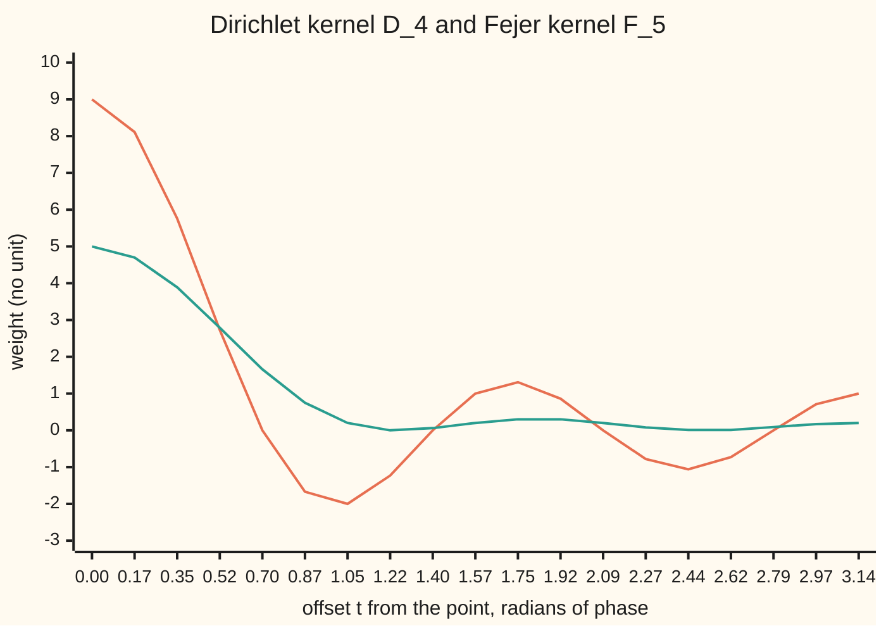

# Dirichlet and Fejer kernels: a partial sum is the signal smeared by a fixed shape

[Syllabus](../../../SYLLABUS.md) → [Harmonic analysis](../README.md) → [Fourier Series in Depth](../README.md#s01) → Dirichlet and Fejer kernels

---

## General Overview

A siren plays a square wave: +1 volt, then −1 volt, 220 cycles a second, so it switches 440 times a second. A digital synthesiser cannot store every harmonic. Say it keeps nine Fourier coefficients: the constant, and a cosine and a sine for each of the first four harmonics.

There are two ways to rebuild the sound from those nine numbers. The **partial sum** uses all nine at full strength. The **running average** (also called the Fejér mean) averages the first five partial sums. That gives the nine coefficients tapered weights: 1 on the constant, then 0.8, 0.6, 0.4, 0.2 on harmonics 1 to 4.

Each rebuild turns out to be the same operation. Slide a fixed shape along the signal. At each point, take the signal's weighted average with that shape as the weights. For the partial sum the shape is the **Dirichlet kernel**. For the running average it is the **Fejér kernel**. A **kernel** is the weighting shape in such an average.

The two shapes differ in one decisive way. The Dirichlet kernel dips below zero, so some of the signal is counted with a minus sign. That lets the nine-term partial sum reach 1.2004 V on the siren, and 1.8801 V on a worse ±1 V signal. The Fejér kernel never goes negative, so the running average stays between −1 V and +1 V.

**A partial sum of a Fourier series is the signal smeared by the Dirichlet kernel, which swings negative and grows in total size; the running average of partial sums is the signal smeared by the Fejér kernel, which is never negative and always has total size 1.**

**What kind of fact this is:** two identities and two size facts, all proved on this card in Why it works; the code checks them on nine terms.

### The picture: the two kernels for nine terms

Both kernels are even: their value at −t equals their value at t. So the chart shows offsets t from 0 to π only.



Orange: the Dirichlet kernel $`D_4`$, peak 9, lowest −2.0391 at t = 1.0028 (the chart's sample at t = 1.05, which is π/3, reads −2.00). Green: the Fejér kernel $`F_5`$, peak 5, never below 0. Both have average value 1 over a full cycle.

---

## The formula

Notation first, in words.

- $`\hat f(n)`$ is the n-th Fourier coefficient of a signal $`f`$: the average of $`f(x)e^{-inx}`$ over one cycle, with the factor $`1/2\pi`$ ([Fourier coefficients](01-fourier-coefficients-and-orthogonality.md)). Here $`i`$ is the imaginary unit and $`x`$ is phase in radians, from −π to π.
- $`S_N f(x)`$ is the **partial sum**: the tones $`\hat f(n)e^{inx}`$ for $`n`$ from $`-N`$ to $`N`$, added up. That is $`2N+1`$ terms; nine for $`N = 4`$.
- $`\sigma_N f`$ is the **running average**: $`(S_0 f + S_1 f + \dots + S_{N-1} f)/N`$, the mean of the first $`N`$ partial sums.
- **Convolution on the circle**, written $`f * g`$, is the smearing: at each $`x`$, average $`f(x-t)`$ with weights $`g(t)`$ over one cycle.

```math
(f * g)(x) = \frac{1}{2\pi}\int_{-\pi}^{\pi} f(x-t)\,g(t)\,dt
```

**Read it aloud:** to smear f by g at the point x, look a distance t back from x, weight what you see by g of t, and average over one full cycle.

The card's two identities:

```math
S_N f = f * D_N, \qquad D_N(t) = \sum_{k=-N}^{N} e^{ikt} = \frac{\sin\big((N+\tfrac12)t\big)}{\sin(t/2)}
```

```math
\sigma_N f = f * F_N, \qquad F_N(t) = \sum_{|k|<N}\Big(1-\frac{|k|}{N}\Big)e^{ikt} = \frac{1}{N}\left(\frac{\sin(Nt/2)}{\sin(t/2)}\right)^{2}
```

**Read it aloud:** the partial sum is the signal smeared by the Dirichlet kernel, which keeps every tone up to N at full weight; the running average is the signal smeared by the Fejér kernel, which tapers tone k down to 1 minus k over N.

At $`t = 0`$ the fractions read 0/0; there the kernels take their peak values, $`2N+1`$ and $`N`$.

The size facts, with $`L_N`$ the **total size** of the Dirichlet kernel (the average of its absolute value):

```math
\frac{1}{2\pi}\int_{-\pi}^{\pi} D_N = \frac{1}{2\pi}\int_{-\pi}^{\pi} F_N = 1, \qquad F_N \ge 0, \qquad L_N = \frac{1}{2\pi}\int_{-\pi}^{\pi}\lvert D_N\rvert \;>\; \frac{4}{\pi^2}\sum_{k=1}^{N}\frac1k
```

**Read it aloud:** both kernels average to 1; the Fejér kernel is never negative; the Dirichlet kernel's total size grows without limit, at least as fast as 4 over pi squared times the sum of 1 over k.

| Symbol | Plain meaning | In our example | Push it up and the answer… |
| --- | --- | --- | --- |
| $`f`$ | the signal, in volts | the ±1 V siren | — |
| $`x`$ | phase: position in the cycle, in radians | π/4 | — |
| $`t`$, $`y`$, $`u`$ | offset from the point x, in radians of phase (not seconds); stand-in positions inside integrals | 0 to π on the chart | — |
| $`k`$, $`n`$, $`m`$, $`j`$ | whole-number counters; tone $`k`$ is $`e^{ikt}`$ | −4 to 4 | — |
| $`\hat f(n)`$, $`b_k`$, $`i`$ | the n-th Fourier coefficient; $`b_k`$ is the sine coefficient of wing 08; $`i`$ is the imaginary unit | $`b_k = 4/(\pi k)`$ for odd k | — |
| $`N`$ | how many harmonics (partial sum) or partial sums (average) | 4 for $`D_4`$, 5 for $`F_5`$ | taller, narrower kernels |
| $`S_N f`$ | the partial sum | 1.2004 V at x = π/4 | the siren's peak settles near 1.179 V |
| $`\sigma_N f`$ | the running average of $`S_0 f, \dots, S_{N-1} f`$ | 0.8403 V at x = π/4 | climbs toward 1 V, never past |
| $`f * g`$ | convolution on the circle, the smearing | — | — |
| $`D_N`$ | the Dirichlet kernel | peak 9, lowest −2.0391 | taller peak, more negative lobes |
| $`F_N`$ | the Fejér kernel | peak 5, lowest 0 | taller, narrower, still ≥ 0 |
| $`L_N`$ | total size of $`D_N`$: average of $`\lvert D_N\rvert`$ | 1.8801 | grows like $`(4/\pi^2)\ln N`$ |

### When it holds

- **The signal repeats every 2π and has finite area under $`\lvert f\rvert`$ over one cycle.** Then every coefficient exists and both convolutions make sense. Without it, $`\hat f(n)`$ itself is undefined.
- **Finitely many tones.** Swapping "sum of averages" for "average of sums" is free for a finite sum. For the full infinite series it is exactly the hard question, answered on [Dirichlet's theorem](04-pointwise-and-uniform-convergence.md).
- **The same $`1/2\pi`$ in the coefficient and the convolution.** Drop it from the convolution and the siren's partial sum at π/4 comes out 7.5425 V instead of 1.2004 V.
- **The average starts at $`S_0`$.** $`F_N`$ averages $`S_0`$ to $`S_{N-1}`$, so $`F_5`$ uses the same nine coefficients as $`D_4`$. Start the count elsewhere and the weights are no longer $`1 - \lvert k\rvert/N`$.

---

## Why it works

### Step 0: a sum of averages is an average of a sum

Each coefficient $`\hat f(n)`$ is an average of the signal, weighted by one tone. A partial sum adds a few of these averages, each multiplied by its tone at $`x`$. Adding finitely many weighted averages of the same signal gives one weighted average, whose weights are the sum of the separate weights.

So a partial sum is a single weighted average of the signal. The weight given to the signal at $`x - t`$ depends only on the offset $`t`$, not on $`x`$. One fixed shape slides along the signal. That shape is the kernel.

### Step 1: the partial sum is a convolution with $`D_N`$

Write each coefficient as its integral, with $`y`$ as the stand-in position. Move the finite sum inside the integral:

```math
S_N f(x) = \sum_{n=-N}^{N}\frac{1}{2\pi}\int_{-\pi}^{\pi} f(y)\,e^{-iny}\,dy\;e^{inx} = \frac{1}{2\pi}\int_{-\pi}^{\pi} f(y)\sum_{n=-N}^{N} e^{in(x-y)}\,dy.
```

The inner sum is $`D_N(x-y)`$. Put $`t = x - y`$. Because everything repeats every 2π, the integral over any full cycle is the same, so $`S_N f(x) = (f * D_N)(x)`$.

The closed form comes from the convergence card's fold ([Convergence](../../08-Differential%20equations%20and%20dynamics/09-Fourier%20Series/02-convergence-jumps-and-gibbs.md)). In one line: pair $`e^{ikt}`$ with $`e^{-ikt}`$ to get $`D_N = 1 + 2\sum_{k=1}^{N}\cos kt`$. Multiply by $`\sin(t/2)`$. The product-to-sum rule ([Trig identities](../../05-Geometry%20and%20trig/03-Trigonometry/03-trig-identities.md)) turns each $`2\sin(t/2)\cos kt`$ into $`\sin((k+\tfrac12)t) - \sin((k-\tfrac12)t)`$. The constant term's $`\sin(t/2)`$ cancels the first $`-\sin(t/2)`$, and the sum telescopes, each term cancelling part of the next, to $`\sin((N+\tfrac12)t)`$.

### Step 2: the running average is a convolution with $`F_N`$

Convolution is linear: the average of $`f * D_0, \dots, f * D_{N-1}`$ is $`f`$ smeared by the average of the kernels. So $`\sigma_N f = f * F_N`$ with

```math
F_N = \frac{1}{N}\big(D_0 + D_1 + \dots + D_{N-1}\big).
```

**The tapered weights.** Tone $`e^{ikt}`$ appears in $`D_m`$ whenever $`m \ge \lvert k\rvert`$. Among $`D_0`$ to $`D_{N-1}`$ that is $`N - \lvert k\rvert`$ of them. Divide by $`N`$: its weight is $`1 - \lvert k\rvert/N`$. For $`F_5`$ the weights on $`\lvert k\rvert = 0, 1, 2, 3, 4`$ are 1, 0.8, 0.6, 0.4, 0.2.

### Step 3: the Fejér kernel's closed form, from the Dirichlet kernel

The Parseval card used this formula without deriving it ([Parseval's identity](../../08-Differential%20equations%20and%20dynamics/09-Fourier%20Series/03-parsevals-identity.md)). It takes one more telescope.

From Step 1, $`\sin(t/2)\,D_m(t) = \sin((m+\tfrac12)t)`$. Multiply by $`\sin(t/2)`$ again and use the product-to-sum rule:

```math
2\sin(t/2)\,\sin\big((m+\tfrac12)t\big) = \cos(mt) - \cos\big((m+1)t\big).
```

Add this for $`m = 0`$ to $`N-1`$. The middle terms cancel, leaving $`1 - \cos(Nt) = 2\sin^2(Nt/2)`$. So

```math
2\sin^2(t/2)\,\big(D_0 + \dots + D_{N-1}\big) = 2\sin^2(Nt/2), \qquad F_N(t) = \frac{1}{N}\,\frac{\sin^2(Nt/2)}{\sin^2(t/2)}.
```

A square divided by a square is never negative. That is the whole reason the running average behaves.

### Step 4: both kernels average to 1

Every tone $`e^{ikt}`$ with $`k \ne 0`$ averages to 0 over a cycle. Only the constant tone survives, and both kernels give it weight 1. So both average to exactly 1. Smearing a steady 1 V signal returns 1 V.

### Step 5: total size: fixed for Fejér, growing for Dirichlet

The **total size** of a kernel is the average of its absolute value. It bounds the output: if the signal stays between −1 V and +1 V, the smeared signal stays within ± (total size) volts.

- **Fejér.** $`F_N \ge 0`$, so its absolute value is itself. Total size 1, for every $`N`$. The running average never leaves the signal's range.
- **Dirichlet.** Averaged over a cycle, the part of $`D_4`$ above zero is 1.44004 and the part below is 0.44004. Their difference is the signed average, 1. Their sum is the total size, $`L_4 = 1.44004 + 0.44004 = 1.8801`$.

The bound is reached. Take the ±1 V signal that is +1 where $`D_4`$ is positive and −1 where it is negative, flipping at phases $`2\pi j/9`$. At $`x = 0`$ every piece of the smear adds with a plus sign, and $`S_4 f(0) = L_4 = 1.8801`$ V.

As $`N`$ grows, $`L_N`$ grows without limit: 1.8801, 2.4065, 2.9590, 3.5185 for $`N`$ = 4, 16, 64, 256.

<details>
<summary>Detailed proof: the bounds on the Dirichlet kernel's total size</summary>

By evenness, $`L_N = \frac{1}{\pi}\int_0^{\pi}\lvert D_N(t)\rvert\,dt`$.

**Lower bound.** On $`0 < t \le \pi`$, $`\sin(t/2) \le t/2`$, so $`\lvert D_N(t)\rvert \ge 2\lvert\sin((N+\tfrac12)t)\rvert/t`$. Substitute $`u = (N+\tfrac12)t`$:

$`\displaystyle L_N \ge \frac{2}{\pi}\int_0^{(N+\frac12)\pi}\frac{\lvert\sin u\rvert}{u}\,du \ge \frac{2}{\pi}\sum_{k=1}^{N}\frac{1}{k\pi}\int_{(k-1)\pi}^{k\pi}\lvert\sin u\rvert\,du = \frac{4}{\pi^2}\sum_{k=1}^{N}\frac1k.`$

Each $`\int\lvert\sin u\rvert`$ over a span of π is 2. The sum $`1 + \tfrac12 + \dots + \tfrac1N`$ exceeds $`\ln(N+1)`$, so $`L_N`$ is unbounded.

**Upper bound.** $`\lvert D_N\rvert \le 2N+1`$ everywhere (nine tones of size 1 at most, for $`N = 4`$). Also $`\sin(t/2) \ge t/\pi`$ on $`[0, \pi]`$, because sine bends down, so $`\lvert D_N(t)\rvert \le \pi/t`$. Use the first bound up to $`t = \pi/(2N+1)`$ and the second after:

$`\displaystyle L_N \le \frac{1}{\pi}\Big(\pi + \int_{\pi/(2N+1)}^{\pi}\frac{\pi}{t}\,dt\Big) = 1 + \ln(2N+1).`$

For $`N = 4`$: $`0.8443 < 1.8801 < 3.1972`$.

</details>

### Step 6: where the weight sits

Weight far from the point blurs the answer. Look beyond $`\lvert t\rvert = \pi/2`$, a quarter cycle away.

- **Fejér.** There $`\sin^2(t/2) \ge \tfrac12`$, so $`F_N(t) \le 2/N`$. The share of its weight out there is at most $`1/N`$. Measured: 0.0756, 0.0064, 0.00064 for $`N`$ = 5, 50, 500. It drains away.
- **Dirichlet.** Its absolute value out there does not drain. It settles near 0.3572 for large $`N`$. Its lobes only cancel each other, and a signal that changes sign in step with them undoes the cancelling.

This is the difference that makes the Fejér averages converge for every continuous signal, proved on [The Gibbs overshoot and the cure](08-gibbs-and-summability.md).

---

## Worked numbers, by hand

The nine coefficients of the ±1 V siren: only $`b_1 = 4/\pi`$ and $`b_3 = 4/(3\pi)`$ are not zero. The point is $`x = \pi/4`$, where $`\sin x = \sin 3x = 0.7071`$.

| Step | Arithmetic | Value |
| --- | --- | --- |
| peak of $`D_4`$ | nine tones, each 1 at t = 0 | 9 |
| peak of $`F_5`$ | $`1 + 2(0.8 + 0.6 + 0.4 + 0.2)`$ | 5 |
| $`D_4`$ at t = π/3 | $`\sin(3\pi/2)/\sin(\pi/6) = -1/0.5`$ | −2 |
| $`F_5`$ at t = π/3 | $`(\sin(5\pi/6)/\sin(\pi/6))^2/5 = 1/5`$ | 0.2 |
| first zero of $`D_4`$ | $`2\pi/9`$ rad; ÷ (2π × 220) s | 0.6981 rad, 0.505 ms |
| first zero of $`F_5`$ | $`2\pi/5`$ rad; ÷ (2π × 220) s | 1.2566 rad, 0.909 ms |
| $`S_4`$ at π/4 | $`(4/\pi)(0.7071 + 0.7071/3)`$ | 1.2004 V |
| $`\sigma_5`$ at π/4 | $`(4/\pi)(0.8 \times 0.7071 + 0.4 \times 0.7071/3)`$ | 0.8403 V |
| total size of $`F_5`$ | never negative, average 1 | 1 |
| **total size of $`D_4`$** | part above zero 1.44004 + part below 0.44004 | **1.8801** |

With the same nine tones, a ±1 V signal can push the partial sum to 1.8801 V; the running average can never leave ±1 V. The price is width: the Fejér kernel's first zero is 0.909 ms out, against 0.505 ms, so it blurs each switch of the siren over almost twice the time.

### What breaks if you drop a piece

| Mistake | Comes out at | What went wrong |
| --- | --- | --- |
| Drop the $`1/2\pi`$ from the convolution | $`S_4`$ at π/4 = 7.5425 V, not 1.2004 V | The kernel's average is then 2π, not 1 |
| Drop the $`1/N`$ from $`F_5`$ | peak 25, average 5, $`\sigma_5`$ = 4.2015 V | That is the sum of five partial sums, not their mean |
| Treat the partial sum as a plain average of the signal | expect at most 1 V; the worst ±1 V signal gives 1.8801 V | $`D_4`$ is negative in places; its total size is 1.8801, not 1 |
| Add tones to cure the partial sum's overshoot | siren peaks 1.2004, 1.1803, 1.1791 V for tones up to 4, 16, 64 | The negative lobes stay; Gibbs's overshoot settles near 0.179 V. The averages stay at 0.8821, 0.9642, 0.9903 V |

The last row is the hypothesis that matters. Positivity is what keeps the averages in range. The partial sums lack it, and their overshoot never shrinks.

---

## Code, from first principles, and it actually runs

The code computes both kernels from their closed forms and checks them against independent roads. It takes five roads:

1. Each closed form against the plain sum of tones; the Fejér kernel also against the mean of $`D_0`$ to $`D_4`$ and against the tapered weights.
2. The siren's $`S_4`$ and $`\sigma_5`$ at π/4 by coefficients, against the convolution integral at two cell counts, and $`S_4`$ against the calculus value $`8\sqrt2/(3\pi)`$.
3. The total size $`L_N`$ by integration at two cell counts, against the proved lower and upper bounds.
4. The worst ±1 V signal: its partial sum at 0 from its own exact coefficients, against $`L_4`$.
5. The Dirichlet kernel's far weight against its limit $`(4/\pi^2)\ln(1/\tan(\pi/8))`$, and Fejér's against the bound $`1/N`$.

Integrals use three-point Gauss–Legendre rules written out (each cell is sampled at three fixed points with fixed weights), with cell edges placed on the kernel's zeros and on the square wave's jumps. The far-weight integrals are the exception: they use $`200N`$ equal cells, whose edges miss some zeros.

### Python

```python
# Dirichlet and Fejer kernels -- the check behind the card.  Standard library only;
# math gives sin, cos, log and pi.  Nine coefficients, k = -4..4: the partial sum S_4
# smears with D_4, its running average sigma_5 = (S_0 + ... + S_4)/5 smears with F_5.
from math import sin, cos, log, pi, sqrt

def D_sum(N, t): return 1 + 2 * sum(cos(k * t) for k in range(1, N + 1))
def D(N, t): return 2 * N + 1 if t % (2 * pi) == 0 else sin((N + 0.5) * t) / sin(t / 2)
def F_avg(N, t): return sum(D_sum(k, t) for k in range(N)) / N    # mean of D_0..D_(N-1)
def F_taper(N, t): return 1 + 2 * sum((1 - k / N) * cos(k * t) for k in range(1, N))  # tapered
def F(N, t): return N if t % (2 * pi) == 0 else (sin(N * t / 2) / sin(t / 2)) ** 2 / N

def gauss(g, a, b, M):              # 3-point Gauss-Legendre on each of M cells of (a, b)
    h, r = (b - a) / M, sqrt(0.6) / 2
    return h * sum(5 / 18 * (g(c - r * h) + g(c + r * h)) + 4 / 9 * g(c)
                   for c in (a + (j + 0.5) * h for j in range(M)))

# ---- the kernels: closed form against the sum of tones ----
for t in (0.3, 1.0, 2.5):
    assert abs(D(4, t) - D_sum(4, t)) < 1e-12
    assert abs(F(5, t) - F_avg(5, t)) < 1e-12 and abs(F(5, t) - F_taper(5, t)) < 1e-12
print("weights on the nine tones, |k| = 0..4: Dirichlet 1 1 1 1 1; Fejer",
      " ".join(f"{1 - k / 5:.1f}" for k in range(5)))
print(f"peak at t = 0: D_4 = {D(4, 0.0):.0f}, F_5 = {F(5, 0.0):.0f}")
print(f"first zero: D_4 at 2pi/9 = {2 * pi / 9:.4f} rad, F_5 at 2pi/5 = {2 * pi / 5:.4f} rad")
print(f"siren, 220 cycles a second: {1000 / (9 * 220):.3f} ms and {1000 / (5 * 220):.3f} ms")
dmin, tmin = min((D(4, 0.8 + j * 1e-5), 0.8 + j * 1e-5) for j in range(50001))
print(f"lowest value: D_4 = {dmin:.4f} at t = {tmin:.4f} rad; F_5 = 0 at its zeros")
assert -2.1 < dmin < D(4, pi / 3) < -1.99           # dips below -2, its value at pi/3
for M in (360, 720):
    a = gauss(lambda t: D(4, t), -pi, pi, M) / (2 * pi)
    b = gauss(lambda t: F(5, t), -pi, pi, M) / (2 * pi)
    print(f"signed area / 2pi, M = {M}: D_4 {a:.10f}, F_5 {b:.10f}")
    assert abs(a - 1) < 1e-12 and abs(b - 1) < 1e-12

# ---- total size: L_N = (1/2pi) * area of |D_N|; cells end on the zeros 2 pi j/(2N+1) ----
def L(N, m): return gauss(lambda t: abs(D(N, t)), 0, pi, (2 * N + 1) * m) / pi
for N in (4, 16, 64, 256):
    l1, l2 = L(N, 40), L(N, 80)
    low = 4 / pi ** 2 * sum(1 / k for k in range(1, N + 1)); up = 1 + log(2 * N + 1)
    print(f"L_{N}: {l1:.6f} ({40 * (2 * N + 1)} cells), {l2:.6f} ({80 * (2 * N + 1)});"
          f" lower {low:.4f} ratio {l2 / low:.3f}; upper {up:.4f}")
    assert abs(l1 - l2) < 1e-6 and low < l2 < up
L4 = L(4, 80)
neg = (L4 - 1) / 2                                  # |D| area minus signed area = 2 x negative part
print(f"D_4: positive part {1 + neg:.5f}, negative part {neg:.5f}; F_5: 1 and 0")

# ---- the worst +-1 V signal for nine terms: f(y) = sign of D_4(y), switching at 2 pi j/9 ----
cuts = [0] + [2 * pi * j / 9 for j in range(1, 5)] + [pi]
def fhat(k):            # exact coefficient of the even +-1 signal, (1/pi) * integral over (0, pi)
    s = 0.0
    for j in range(5):
        a, b = cuts[j], cuts[j + 1]
        s += (-1) ** j * ((b - a) if k == 0 else (sin(k * b) - sin(k * a)) / k)
    return s / pi
worst = fhat(0) + 2 * sum(fhat(k) for k in range(1, 5))
print(f"worst signal: S_4 at x = 0 by its coefficients {worst:.6f} V; by L_4 {L4:.6f} V")
assert abs(worst - L4) < 1e-9

# ---- the siren: +-1 V square wave, b_k = 4/(pi k) for odd k ----
def S_sq(N, x): return 4 / pi * sum(sin(k * x) / k for k in range(1, N + 1, 2))
def sig_sq(N, x): return 4 / pi * sum((1 - k / N) * sin(k * x) / k for k in range(1, N, 2))
def sq(x): return 1.0 if (x % (2 * pi)) < pi else -1.0
x0 = pi / 4
print(f"siren at x = pi/4: sin x = sin 3x = {sin(x0):.4f}")
for M in (3600, 7200):                             # the jumps fall on cell edges
    c1 = gauss(lambda t: sq(x0 - t) * D(4, t), -pi, pi, M) / (2 * pi)
    c2 = gauss(lambda t: sq(x0 - t) * F(5, t), -pi, pi, M) / (2 * pi)
    print(f"at x = pi/4, by convolution, M = {M}: S_4 {c1:.6f} V, sigma_5 {c2:.6f} V")
print(f"at x = pi/4, by coefficients: S_4 {S_sq(4, x0):.6f} V, sigma_5 {sig_sq(5, x0):.6f} V")
assert abs(c1 - S_sq(4, x0)) < 1e-6 and abs(c2 - sig_sq(5, x0)) < 1e-6
assert abs(S_sq(4, x0) - 8 * sqrt(2) / (3 * pi)) < 1e-12           # peak by calculus
grid = [pi * j / 4000 for j in range(1, 4000)]
for N in (4, 16, 64):
    K = (N + 1) // 2                                # odd harmonics kept; first peak pi/(2K)
    pS = S_sq(N, pi / (2 * K)); pF = max(sig_sq(N + 1, x) for x in grid)
    print(f"square wave, tones up to {N}: S peak {pS:.4f} V at x = {pi / (2 * K):.4f};"
          f" sigma_{N + 1} highest {pF:.4f} V")
    assert pS > 1.17 and pF < 1
assert abs(S_sq(64, pi / 64) - 1.178980) < 1e-3      # Gibbs limit (2/pi) Si(pi)

# ---- far weight: share of each kernel's size beyond |t| = pi/2 ----
lim = 4 / pi ** 2 * -log(sqrt(2) - 1)          # (1/pi) int (2/pi)/sin(t/2), pi/2..pi; tan(pi/8)
for N in (5, 50, 500):
    fF = gauss(lambda t: F(N, t), pi / 2, pi, 200 * N) / pi
    fD = gauss(lambda t: abs(D(N, t)), pi / 2, pi, 200 * N) / pi
    print(f"beyond pi/2, N = {N}: F_N {fF:.6f}, bound 1/N {1 / N:.4f}, ratio {fF * N:.3f};"
          f" |D_N| {fD:.4f}")
    assert fF <= 1 / N
print(f"|D_N| beyond pi/2 tends to (4/pi^2) ln(1/tan(pi/8)) = {lim:.4f}")
assert abs(fD - lim) < 1e-3                         # Dirichlet's far weight never dies

# ---- what breaks ----
print(f"break, drop 1/2pi: S_4 at pi/4 = {2 * pi * S_sq(4, x0):.4f} V")
print(f"break, drop 1/N in F_5: peak {5 * F(5, 0.0):.0f}, area {5 * b:.0f},"
      f" sigma_5 at pi/4 = {5 * sig_sq(5, x0):.4f} V")

# ---- chart points, t = 0 .. pi in steps of pi/18 ----
def two(v): return f"{0.0 if abs(v) < 0.005 else v:.2f}"   # no "-0.00" at the zeros
ts = [pi * j / 18 for j in range(19)]
print("chart t:", " ".join(two(t) for t in ts))
print("chart D_4:", " ".join(two(D(4, t)) for t in ts))
print("chart F_5:", " ".join(two(F(5, t)) for t in ts))
print("ALL CHECKS PASS")
```

**Ran 2026-11-15 on macOS, Python 3.14.10, standard library only. All checks passed. Output, pasted from the run:**

```
weights on the nine tones, |k| = 0..4: Dirichlet 1 1 1 1 1; Fejer 1.0 0.8 0.6 0.4 0.2
peak at t = 0: D_4 = 9, F_5 = 5
first zero: D_4 at 2pi/9 = 0.6981 rad, F_5 at 2pi/5 = 1.2566 rad
siren, 220 cycles a second: 0.505 ms and 0.909 ms
lowest value: D_4 = -2.0391 at t = 1.0028 rad; F_5 = 0 at its zeros
signed area / 2pi, M = 360: D_4 1.0000000000, F_5 1.0000000000
signed area / 2pi, M = 720: D_4 1.0000000000, F_5 1.0000000000
L_4: 1.880081 (360 cells), 1.880081 (720); lower 0.8443 ratio 2.227; upper 3.1972
L_16: 2.406523 (1320 cells), 2.406523 (2640); lower 1.3702 ratio 1.756; upper 4.4965
L_64: 2.959040 (5160 cells), 2.959040 (10320); lower 1.9226 ratio 1.539; upper 5.8598
L_256: 3.518520 (20520 cells), 3.518520 (41040); lower 2.4821 ratio 1.418; upper 7.2403
D_4: positive part 1.44004, negative part 0.44004; F_5: 1 and 0
worst signal: S_4 at x = 0 by its coefficients 1.880081 V; by L_4 1.880081 V
siren at x = pi/4: sin x = sin 3x = 0.7071
at x = pi/4, by convolution, M = 3600: S_4 1.200422 V, sigma_5 0.840295 V
at x = pi/4, by convolution, M = 7200: S_4 1.200422 V, sigma_5 0.840295 V
at x = pi/4, by coefficients: S_4 1.200422 V, sigma_5 0.840295 V
square wave, tones up to 4: S peak 1.2004 V at x = 0.7854; sigma_5 highest 0.8821 V
square wave, tones up to 16: S peak 1.1803 V at x = 0.1963; sigma_17 highest 0.9642 V
square wave, tones up to 64: S peak 1.1791 V at x = 0.0491; sigma_65 highest 0.9903 V
beyond pi/2, N = 5: F_N 0.075587, bound 1/N 0.2000, ratio 0.378; |D_N| 0.3404
beyond pi/2, N = 50: F_N 0.006369, bound 1/N 0.0200, ratio 0.318; |D_N| 0.3591
beyond pi/2, N = 500: F_N 0.000637, bound 1/N 0.0020, ratio 0.318; |D_N| 0.3574
|D_N| beyond pi/2 tends to (4/pi^2) ln(1/tan(pi/8)) = 0.3572
break, drop 1/2pi: S_4 at pi/4 = 7.5425 V
break, drop 1/N in F_5: peak 25, area 5, sigma_5 at pi/4 = 4.2015 V
chart t: 0.00 0.17 0.35 0.52 0.70 0.87 1.05 1.22 1.40 1.57 1.75 1.92 2.09 2.27 2.44 2.62 2.79 2.97 3.14
chart D_4: 9.00 8.11 5.76 2.73 0.00 -1.67 -2.00 -1.23 0.00 1.00 1.31 0.86 0.00 -0.78 -1.06 -0.73 0.00 0.71 1.00
chart F_5: 5.00 4.70 3.89 2.79 1.66 0.75 0.20 0.00 0.06 0.20 0.30 0.30 0.20 0.08 0.01 0.01 0.09 0.17 0.20
ALL CHECKS PASS
```

### Rust

```rust
// Dirichlet and Fejer kernels -- the check behind the card.  std only.
// Nine coefficients, k = -4..4: the partial sum S_4 smears with D_4, its running
// average sigma_5 = (S_0 + ... + S_4)/5 smears with F_5.  Same roads as the Python.
use std::f64::consts::PI;

fn d_sum(n: usize, t: f64) -> f64 { 1.0 + 2.0 * (1..=n).map(|k| (k as f64 * t).cos()).sum::<f64>() }
fn d(n: usize, t: f64) -> f64 {
    if t % (2.0 * PI) == 0.0 { (2 * n + 1) as f64 } else { ((n as f64 + 0.5) * t).sin() / (t / 2.0).sin() }
}
fn f_avg(n: usize, t: f64) -> f64 { (0..n).map(|k| d_sum(k, t)).sum::<f64>() / n as f64 } // mean of D_0..D_(n-1)
fn f_taper(n: usize, t: f64) -> f64 {                                                   // tapered
    1.0 + 2.0 * (1..n).map(|k| (1.0 - k as f64 / n as f64) * (k as f64 * t).cos()).sum::<f64>()
}
fn f(n: usize, t: f64) -> f64 {
    if t % (2.0 * PI) == 0.0 { n as f64 } else { ((n as f64 * t / 2.0).sin() / (t / 2.0).sin()).powi(2) / n as f64 }
}
fn gauss(g: &dyn Fn(f64) -> f64, a: f64, b: f64, m: usize) -> f64 { // 3-point Gauss-Legendre per cell
    let (h, r) = ((b - a) / m as f64, 0.6f64.sqrt() / 2.0);
    h * (0..m).map(|j| {
        let c = a + (j as f64 + 0.5) * h;
        5.0 / 18.0 * (g(c - r * h) + g(c + r * h)) + 4.0 / 9.0 * g(c)
    }).sum::<f64>()
}
fn l(n: usize, m: usize) -> f64 { gauss(&|t| d(n, t).abs(), 0.0, PI, (2 * n + 1) * m) / PI }
fn s_sq(n: usize, x: f64) -> f64 {
    4.0 / PI * (1..=n).step_by(2).map(|k| (k as f64 * x).sin() / k as f64).sum::<f64>()
}
fn sig_sq(n: usize, x: f64) -> f64 {
    4.0 / PI * (1..n).step_by(2).map(|k| (1.0 - k as f64 / n as f64) * (k as f64 * x).sin() / k as f64).sum::<f64>()
}
fn sq(x: f64) -> f64 { if x.rem_euclid(2.0 * PI) < PI { 1.0 } else { -1.0 } }
fn two(v: f64) -> String { format!("{:.2}", if v.abs() < 0.005 { 0.0 } else { v }) }

fn main() {
    // ---- the kernels: closed form against the sum of tones ----
    for t in [0.3, 1.0, 2.5] {
        assert!((d(4, t) - d_sum(4, t)).abs() < 1e-12);
        assert!((f(5, t) - f_avg(5, t)).abs() < 1e-12 && (f(5, t) - f_taper(5, t)).abs() < 1e-12);
    }
    let w: Vec<String> = (0..5).map(|k| format!("{:.1}", 1.0 - k as f64 / 5.0)).collect();
    println!("weights on the nine tones, |k| = 0..4: Dirichlet 1 1 1 1 1; Fejer {}", w.join(" "));
    println!("peak at t = 0: D_4 = {:.0}, F_5 = {:.0}", d(4, 0.0), f(5, 0.0));
    println!("first zero: D_4 at 2pi/9 = {:.4} rad, F_5 at 2pi/5 = {:.4} rad", 2.0 * PI / 9.0, 2.0 * PI / 5.0);
    println!("siren, 220 cycles a second: {:.3} ms and {:.3} ms", 1000.0 / (9.0 * 220.0), 1000.0 / (5.0 * 220.0));
    let (mut dmin, mut tmin) = (f64::INFINITY, 0.0);
    for j in 0..50001 {
        let t = 0.8 + j as f64 * 1e-5;
        if d(4, t) < dmin { dmin = d(4, t); tmin = t; }
    }
    println!("lowest value: D_4 = {:.4} at t = {:.4} rad; F_5 = 0 at its zeros", dmin, tmin);
    assert!(-2.1 < dmin && dmin < d(4, PI / 3.0) && d(4, PI / 3.0) < -1.99);
    let mut b = 0.0;
    for m in [360, 720] {
        let a = gauss(&|t| d(4, t), -PI, PI, m) / (2.0 * PI);
        b = gauss(&|t| f(5, t), -PI, PI, m) / (2.0 * PI);
        println!("signed area / 2pi, M = {}: D_4 {:.10}, F_5 {:.10}", m, a, b);
        assert!((a - 1.0).abs() < 1e-12 && (b - 1.0).abs() < 1e-12);
    }

    // ---- total size: L_N = (1/2pi) * area of |D_N|; cells end on the zeros 2 pi j/(2N+1) ----
    for n in [4usize, 16, 64, 256] {
        let (l1, l2) = (l(n, 40), l(n, 80));
        let low = 4.0 / (PI * PI) * (1..=n).map(|k| 1.0 / k as f64).sum::<f64>();
        let up = 1.0 + ((2 * n + 1) as f64).ln();
        println!("L_{}: {:.6} ({} cells), {:.6} ({}); lower {:.4} ratio {:.3}; upper {:.4}",
                 n, l1, 40 * (2 * n + 1), l2, 80 * (2 * n + 1), low, l2 / low, up);
        assert!((l1 - l2).abs() < 1e-6 && low < l2 && l2 < up);
    }
    let l4 = l(4, 80);
    let neg = (l4 - 1.0) / 2.0;
    println!("D_4: positive part {:.5}, negative part {:.5}; F_5: 1 and 0", 1.0 + neg, neg);

    // ---- the worst +-1 V signal for nine terms: f(y) = sign of D_4(y), switching at 2 pi j/9 ----
    let cuts = [0.0, 2.0 * PI / 9.0, 4.0 * PI / 9.0, 6.0 * PI / 9.0, 8.0 * PI / 9.0, PI];
    let fhat = |k: usize| -> f64 {
        let mut s = 0.0;
        for j in 0..5 {
            let (a, bb) = (cuts[j], cuts[j + 1]);
            let sign = if j % 2 == 0 { 1.0 } else { -1.0 };
            s += sign * if k == 0 { bb - a } else { ((k as f64 * bb).sin() - (k as f64 * a).sin()) / k as f64 };
        }
        s / PI
    };
    let worst = fhat(0) + 2.0 * (1..5).map(|k| fhat(k)).sum::<f64>();
    println!("worst signal: S_4 at x = 0 by its coefficients {:.6} V; by L_4 {:.6} V", worst, l4);
    assert!((worst - l4).abs() < 1e-9);

    // ---- the siren: +-1 V square wave, b_k = 4/(pi k) for odd k ----
    let x0 = PI / 4.0;
    println!("siren at x = pi/4: sin x = sin 3x = {:.4}", x0.sin());
    let (mut c1, mut c2) = (0.0, 0.0);
    for m in [3600, 7200] {
        c1 = gauss(&|t| sq(x0 - t) * d(4, t), -PI, PI, m) / (2.0 * PI);
        c2 = gauss(&|t| sq(x0 - t) * f(5, t), -PI, PI, m) / (2.0 * PI);
        println!("at x = pi/4, by convolution, M = {}: S_4 {:.6} V, sigma_5 {:.6} V", m, c1, c2);
    }
    println!("at x = pi/4, by coefficients: S_4 {:.6} V, sigma_5 {:.6} V", s_sq(4, x0), sig_sq(5, x0));
    assert!((c1 - s_sq(4, x0)).abs() < 1e-6 && (c2 - sig_sq(5, x0)).abs() < 1e-6);
    assert!((s_sq(4, x0) - 8.0 * 2f64.sqrt() / (3.0 * PI)).abs() < 1e-12);
    for n in [4usize, 16, 64] {
        let k = (n + 1) / 2;
        let p_s = s_sq(n, PI / (2 * k) as f64);
        let p_f = (1..4000).map(|j| sig_sq(n + 1, PI * j as f64 / 4000.0)).fold(f64::NEG_INFINITY, f64::max);
        println!("square wave, tones up to {}: S peak {:.4} V at x = {:.4}; sigma_{} highest {:.4} V",
                 n, p_s, PI / (2 * k) as f64, n + 1, p_f);
        assert!(p_s > 1.17 && p_f < 1.0);
    }
    assert!((s_sq(64, PI / 64.0) - 1.178980).abs() < 1e-3);

    // ---- far weight: share of each kernel's size beyond |t| = pi/2 ----
    let lim = 4.0 / (PI * PI) * -(2f64.sqrt() - 1.0).ln();
    let mut fd = 0.0;
    for n in [5usize, 50, 500] {
        let ff = gauss(&|t| f(n, t), PI / 2.0, PI, 200 * n) / PI;
        fd = gauss(&|t| d(n, t).abs(), PI / 2.0, PI, 200 * n) / PI;
        println!("beyond pi/2, N = {}: F_N {:.6}, bound 1/N {:.4}, ratio {:.3}; |D_N| {:.4}",
                 n, ff, 1.0 / n as f64, ff * n as f64, fd);
        assert!(ff <= 1.0 / n as f64);
    }
    println!("|D_N| beyond pi/2 tends to (4/pi^2) ln(1/tan(pi/8)) = {:.4}", lim);
    assert!((fd - lim).abs() < 1e-3);

    // ---- what breaks ----
    println!("break, drop 1/2pi: S_4 at pi/4 = {:.4} V", 2.0 * PI * s_sq(4, x0));
    println!("break, drop 1/N in F_5: peak {:.0}, area {:.0}, sigma_5 at pi/4 = {:.4} V",
             5.0 * f(5, 0.0), 5.0 * b, 5.0 * sig_sq(5, x0));

    // ---- chart points, t = 0 .. pi in steps of pi/18 ----
    let ts: Vec<f64> = (0..19).map(|j| PI * j as f64 / 18.0).collect();
    let row = |g: &dyn Fn(f64) -> f64| ts.iter().map(|&t| two(g(t))).collect::<Vec<_>>().join(" ");
    println!("chart t: {}", row(&|t| t));
    println!("chart D_4: {}", row(&|t| d(4, t)));
    println!("chart F_5: {}", row(&|t| f(5, t)));
    println!("ALL CHECKS PASS");
}
```

**Ran 2026-11-15 on macOS, rustc 1.98.1, no crates. All checks passed. Output, pasted from the run:**

```
weights on the nine tones, |k| = 0..4: Dirichlet 1 1 1 1 1; Fejer 1.0 0.8 0.6 0.4 0.2
peak at t = 0: D_4 = 9, F_5 = 5
first zero: D_4 at 2pi/9 = 0.6981 rad, F_5 at 2pi/5 = 1.2566 rad
siren, 220 cycles a second: 0.505 ms and 0.909 ms
lowest value: D_4 = -2.0391 at t = 1.0028 rad; F_5 = 0 at its zeros
signed area / 2pi, M = 360: D_4 1.0000000000, F_5 1.0000000000
signed area / 2pi, M = 720: D_4 1.0000000000, F_5 1.0000000000
L_4: 1.880081 (360 cells), 1.880081 (720); lower 0.8443 ratio 2.227; upper 3.1972
L_16: 2.406523 (1320 cells), 2.406523 (2640); lower 1.3702 ratio 1.756; upper 4.4965
L_64: 2.959040 (5160 cells), 2.959040 (10320); lower 1.9226 ratio 1.539; upper 5.8598
L_256: 3.518520 (20520 cells), 3.518520 (41040); lower 2.4821 ratio 1.418; upper 7.2403
D_4: positive part 1.44004, negative part 0.44004; F_5: 1 and 0
worst signal: S_4 at x = 0 by its coefficients 1.880081 V; by L_4 1.880081 V
siren at x = pi/4: sin x = sin 3x = 0.7071
at x = pi/4, by convolution, M = 3600: S_4 1.200422 V, sigma_5 0.840295 V
at x = pi/4, by convolution, M = 7200: S_4 1.200422 V, sigma_5 0.840295 V
at x = pi/4, by coefficients: S_4 1.200422 V, sigma_5 0.840295 V
square wave, tones up to 4: S peak 1.2004 V at x = 0.7854; sigma_5 highest 0.8821 V
square wave, tones up to 16: S peak 1.1803 V at x = 0.1963; sigma_17 highest 0.9642 V
square wave, tones up to 64: S peak 1.1791 V at x = 0.0491; sigma_65 highest 0.9903 V
beyond pi/2, N = 5: F_N 0.075587, bound 1/N 0.2000, ratio 0.378; |D_N| 0.3404
beyond pi/2, N = 50: F_N 0.006369, bound 1/N 0.0200, ratio 0.318; |D_N| 0.3591
beyond pi/2, N = 500: F_N 0.000637, bound 1/N 0.0020, ratio 0.318; |D_N| 0.3574
|D_N| beyond pi/2 tends to (4/pi^2) ln(1/tan(pi/8)) = 0.3572
break, drop 1/2pi: S_4 at pi/4 = 7.5425 V
break, drop 1/N in F_5: peak 25, area 5, sigma_5 at pi/4 = 4.2015 V
chart t: 0.00 0.17 0.35 0.52 0.70 0.87 1.05 1.22 1.40 1.57 1.75 1.92 2.09 2.27 2.44 2.62 2.79 2.97 3.14
chart D_4: 9.00 8.11 5.76 2.73 0.00 -1.67 -2.00 -1.23 0.00 1.00 1.31 0.86 0.00 -0.78 -1.06 -0.73 0.00 0.71 1.00
chart F_5: 5.00 4.70 3.89 2.79 1.66 0.75 0.20 0.00 0.06 0.20 0.30 0.30 0.20 0.08 0.01 0.01 0.09 0.17 0.20
ALL CHECKS PASS
```

### Lean

Lean proves the card's two identities, both closed forms and the size facts, for every N.

- Take a signal that repeats every 2π, with finite area under $`\lvert f\rvert`$ over one cycle. Then $`S_N f = f * D_N`$ and $`\sigma_N f = f * F_N`$ at every point.
- Take any t where $`\sin(t/2) \ne 0`$. Then $`D_N(t)`$ and $`F_N(t)`$ equal their closed forms from The formula.
- At $`t = 0`$ the kernels take their peak values, $`2N+1`$ and $`N`$. The Fejér kernel is the mean of $`D_0`$ to $`D_{N-1}`$.
- The Dirichlet kernel averages to 1 over a cycle. The Fejér kernel is real and never negative.
- Take $`N \ge 1`$. Then the Fejér kernel averages to 1 over a cycle, and its total size is 1.
- Take the Dirichlet kernel's total size $`L_N`$. Then $`L_N > \frac{4}{\pi^2}\sum_{k=1}^{N}\frac1k`$ and $`L_N \le 1 + \ln(2N+1)`$. So $`L_N`$ grows without limit.
- The hand table's kernel values check too: peaks 9 and 5, and −2 and 0.2 at t = π/3. So do the Fejér weights 1, 0.8, 0.6, 0.4, 0.2.

The siren's voltages, the measured sizes $`L_N`$, the worst signal and the far weight are left to the Python and Rust checks.

```lean
-- Dirichlet and Fejer kernels: for a 2π-periodic signal integrable over one cycle, the Fourier partial sum is the signal smeared by the Dirichlet kernel sin((N+1/2)t)/sin(t/2) and the running average of partial sums is the signal smeared by the Fejér kernel (1/N)(sin(Nt/2)/sin(t/2))², which is never negative and has total size 1, while the Dirichlet kernel's total size exceeds (4/π²)(1 + 1/2 + ⋯ + 1/N) and grows without limit.
import Mathlib
import Mathlib.Analysis.SpecialFunctions.Integrals.Basic
import Mathlib.Analysis.SpecialFunctions.Log.Basic
import Mathlib.Analysis.SpecialFunctions.Trigonometric.Basic
import Mathlib.Order.Filter.AtTopBot.Basic

open Real Finset Filter MeasureTheory

namespace DirichletFejer

/-- The n-th Fourier coefficient on the circle, with the factor `1/2π`:
`f̂(n) = (1/2π) ∫_{−π}^{π} f(y) e^{−iny} dy`. -/
noncomputable def coeff (f : ℝ → ℂ) (n : ℤ) : ℂ :=
  (1 / (2 * π)) * ∫ y in (-π)..π, f y * Complex.exp (-((n : ℂ) * y) * Complex.I)

/-- The partial sum `S_N f(x) = ∑_{n=−N}^{N} f̂(n) e^{inx}` (2N + 1 tones). -/
noncomputable def partialSum (f : ℝ → ℂ) (N : ℕ) (x : ℝ) : ℂ :=
  ∑ n ∈ Icc (-(N : ℤ)) N, coeff f n * Complex.exp ((n : ℂ) * x * Complex.I)

/-- The running average `σ_N f = (S_0 f + S_1 f + ⋯ + S_{N−1} f)/N`. -/
noncomputable def runningAverage (f : ℝ → ℂ) (N : ℕ) (x : ℝ) : ℂ :=
  (1 / (N : ℂ)) * ∑ m ∈ range N, partialSum f m x

/-- Convolution on the circle: `(f * g)(x) = (1/2π) ∫_{−π}^{π} f(x − t) g(t) dt`. -/
noncomputable def circConv (f g : ℝ → ℂ) (x : ℝ) : ℂ :=
  (1 / (2 * π)) * ∫ t in (-π)..π, f (x - t) * g t

/-- The Dirichlet kernel `D_N(t) = ∑_{k=−N}^{N} e^{ikt}`. -/
noncomputable def dirichlet (N : ℕ) (t : ℝ) : ℂ :=
  ∑ k ∈ Icc (-(N : ℤ)) N, Complex.exp ((k : ℂ) * t * Complex.I)

/-- The Fejér kernel `F_N(t) = ∑_{|k|<N} (1 − |k|/N) e^{ikt}`, tone k tapered to `1 − |k|/N`. -/
noncomputable def fejer (N : ℕ) (t : ℝ) : ℂ :=
  ∑ k ∈ Ioo (-(N : ℤ)) N,
    (((1 - |(k : ℝ)| / N : ℝ)) : ℂ) * Complex.exp ((k : ℂ) * t * Complex.I)

/-- The total size of the Dirichlet kernel: `L_N = (1/2π) ∫_{−π}^{π} |D_N(t)| dt`. -/
noncomputable def totalSize (N : ℕ) : ℝ :=
  (1 / (2 * π)) * ∫ t in (-π)..π, ‖dirichlet N t‖

/-- Splitting off the two outer terms of a symmetric integer range. -/
theorem sum_Icc_succ_symm {M : Type*} [AddCommMonoid M] (a : ℤ → M) (n : ℕ) :
    ∑ k ∈ Icc (-((n + 1 : ℕ) : ℤ)) ((n + 1 : ℕ) : ℤ), a k =
      ∑ k ∈ Icc (-(n : ℤ)) n, a k + a ((n + 1 : ℕ) : ℤ) + a (-((n + 1 : ℕ) : ℤ)) := by
  have hset : Icc (-((n + 1 : ℕ) : ℤ)) ((n + 1 : ℕ) : ℤ) =
      insert (-((n + 1 : ℕ) : ℤ)) (insert ((n + 1 : ℕ) : ℤ) (Icc (-(n : ℤ)) n)) := by
    ext k; simp only [mem_Icc, mem_insert]; push_cast; omega
  rw [hset, sum_insert, sum_insert]
  · abel
  · simp only [mem_Icc]; push_cast; omega
  · simp only [mem_insert, mem_Icc]; push_cast; omega
#print axioms sum_Icc_succ_symm

/-- The real Dirichlet kernel `1 + 2 ∑_{j=1}^{N} cos(jt)`. -/
noncomputable def dirR (N : ℕ) (t : ℝ) : ℝ :=
  1 + 2 * ∑ j ∈ range N, Real.cos ((j + 1 : ℝ) * t)

theorem dirR_succ (N : ℕ) (t : ℝ) :
    dirR (N + 1) t = dirR N t + 2 * Real.cos ((N + 1 : ℝ) * t) := by
  simp only [dirR, sum_range_succ]; ring
#print axioms dirR_succ

theorem dirichlet_eq_dirR (N : ℕ) (t : ℝ) : dirichlet N t = (dirR N t : ℂ) := by
  induction N with
  | zero => simp [dirichlet, dirR]
  | succ n ih =>
    rw [dirichlet, sum_Icc_succ_symm, ← dirichlet, ih, dirR_succ]
    push_cast
    rw [add_assoc, Complex.two_cos]
    congr 3; ring
#print axioms dirichlet_eq_dirR

theorem dirR_mul_sin (N : ℕ) (t : ℝ) :
    dirR N t * Real.sin (t / 2) = Real.sin ((N + 1 / 2) * t) := by
  induction N with
  | zero => simp [dirR]; ring_nf
  | succ n ih =>
    rw [dirR_succ, add_mul, ih]
    have h1 : ((n + 1 : ℕ) + 1 / 2 : ℝ) * t = (n + 1 : ℝ) * t + t / 2 := by push_cast; ring
    have h2 : ((n : ℝ) + 1 / 2) * t = (n + 1 : ℝ) * t - t / 2 := by ring
    rw [h1, h2, Real.sin_add, Real.sin_sub]; ring
#print axioms dirR_mul_sin

theorem sum_dirR_mul_sin_sq (N : ℕ) (t : ℝ) :
    (∑ m ∈ range N, dirR m t) * Real.sin (t / 2) ^ 2 = Real.sin (N * t / 2) ^ 2 := by
  induction N with
  | zero => simp
  | succ n ih =>
    rw [sum_range_succ, add_mul, ih, pow_two (Real.sin (t / 2)), ← mul_assoc, dirR_mul_sin]
    set c := ((n : ℝ) + 1 / 2) * t / 2
    set d := t / 4
    have e1 : ((n + 1 : ℕ) : ℝ) * t / 2 = c + d := by simp only [c, d]; push_cast; ring
    have e2 : (n : ℝ) * t / 2 = c - d := by simp only [c, d]; ring
    have e3 : ((n : ℝ) + 1 / 2) * t = 2 * c := by simp only [c]; ring
    have e4 : t / 2 = 2 * d := by simp only [d]; ring
    rw [e1, e2, e3, e4, Real.sin_add, Real.sin_sub, Real.sin_two_mul, Real.sin_two_mul]
    ring
#print axioms sum_dirR_mul_sin_sq

/-- Summing the symmetric partial sums of any sequence gives the triangular weights. -/
theorem sum_range_sum_Icc (a : ℤ → ℂ) (N : ℕ) :
    ∑ m ∈ range N, ∑ k ∈ Icc (-(m : ℤ)) m, a k =
      ∑ k ∈ Ioo (-(N : ℤ)) N, (((N : ℝ) - |(k : ℝ)| : ℝ) : ℂ) * a k := by
  induction N with
  | zero => simp
  | succ n ih =>
    rw [sum_range_succ, ih]
    have hset : Ioo (-((n + 1 : ℕ) : ℤ)) ((n + 1 : ℕ) : ℤ) = Icc (-(n : ℤ)) n := by
      ext k; simp only [mem_Ioo, mem_Icc]; push_cast; omega
    have hsub : ∑ k ∈ Ioo (-(n : ℤ)) n, (((n : ℝ) - |(k : ℝ)| : ℝ) : ℂ) * a k =
        ∑ k ∈ Icc (-(n : ℤ)) n, (((n : ℝ) - |(k : ℝ)| : ℝ) : ℂ) * a k := by
      apply sum_subset
      · intro k; simp only [mem_Ioo, mem_Icc]; omega
      · intro k hk hk'
        simp only [mem_Ioo, mem_Icc] at hk hk'
        have : |(k : ℝ)| = n := by
          rcases (show k = n ∨ k = -n by omega) with h | h
          · simp [h]
          · simp [h]
        simp [this]
    rw [hset, hsub, ← sum_add_distrib]
    apply sum_congr rfl
    intro k _
    push_cast; ring
#print axioms sum_range_sum_Icc

theorem mean_sum_Icc (a : ℤ → ℂ) (N : ℕ) :
    (1 / (N : ℂ)) * ∑ m ∈ range N, ∑ k ∈ Icc (-(m : ℤ)) m, a k =
      ∑ k ∈ Ioo (-(N : ℤ)) N, (((1 - |(k : ℝ)| / N : ℝ)) : ℂ) * a k := by
  rw [sum_range_sum_Icc, mul_sum]
  apply sum_congr rfl
  intro k hk
  have hN : (N : ℝ) ≠ 0 := by
    simp only [mem_Ioo] at hk
    have : (0 : ℤ) < N := by omega
    exact_mod_cast this.ne'
  rw [← mul_assoc]
  congr 1
  have hN' : (N : ℂ) ≠ 0 := by exact_mod_cast hN
  push_cast
  rw [one_div_mul_eq_div, sub_div, div_self hN']
#print axioms mean_sum_Icc

theorem fejer_eq_mean (N : ℕ) (t : ℝ) :
    fejer N t = (1 / (N : ℂ)) * ∑ m ∈ range N, dirichlet m t := by
  simp only [dirichlet]
  rw [mean_sum_Icc, fejer]
#print axioms fejer_eq_mean

/-- The real Fejér kernel. -/
noncomputable def fejR (N : ℕ) (t : ℝ) : ℝ := (1 / N) * ∑ m ∈ range N, dirR m t

theorem fejer_eq_fejR (N : ℕ) (t : ℝ) : fejer N t = (fejR N t : ℂ) := by
  rw [fejer_eq_mean, fejR]
  simp only [dirichlet_eq_dirR]
  push_cast; ring
#print axioms fejer_eq_fejR

theorem dirR_zero_right (N : ℕ) : dirR N 0 = 2 * N + 1 := by
  simp [dirR]; ring

theorem dirR_of_sin_eq_zero (N : ℕ) (t : ℝ) (h : Real.sin (t / 2) = 0) :
    dirR N t = 2 * N + 1 := by
  obtain ⟨n, hn⟩ := Real.sin_eq_zero_iff.mp h
  have hc : ∀ j : ℕ, Real.cos ((j + 1 : ℝ) * t) = 1 := by
    intro j
    have : (j + 1 : ℝ) * t = (((j + 1 : ℕ) : ℤ) * n : ℤ) * (2 * π) := by
      have ht : t = 2 * (n * π) := by linarith
      rw [ht]; push_cast; ring
    rw [this, Real.cos_int_mul_two_pi]
  simp [dirR, hc]; ring
#print axioms dirR_zero_right
#print axioms dirR_of_sin_eq_zero

theorem sum_dirR_zero (N : ℕ) : ∑ m ∈ range N, dirR m 0 = (N : ℝ) ^ 2 := by
  induction N with
  | zero => simp
  | succ n ih => rw [sum_range_succ, ih, dirR_zero_right]; push_cast; ring
#print axioms sum_dirR_zero

theorem fejR_nonneg (N : ℕ) (t : ℝ) : 0 ≤ fejR N t := by
  rw [fejR]
  apply mul_nonneg (by positivity)
  by_cases h : Real.sin (t / 2) = 0
  · apply sum_nonneg; intro m _; rw [dirR_of_sin_eq_zero m t h]; positivity
  · have hpos : 0 < Real.sin (t / 2) ^ 2 := by positivity
    have := sum_dirR_mul_sin_sq N t
    nlinarith [sq_nonneg (Real.sin (N * t / 2))]
#print axioms fejR_nonneg

/-- Smearing a signal by a trigonometric polynomial multiplies its Fourier coefficients
by the polynomial's coefficients. -/
theorem circConv_trig (f : ℝ → ℂ) (hper : Function.Periodic f (2 * π))
    (hint : IntervalIntegrable f volume (-π) π) (s : Finset ℤ) (c : ℤ → ℂ) (x : ℝ) :
    circConv f (fun t => ∑ k ∈ s, c k * Complex.exp ((k : ℂ) * t * Complex.I)) x =
      ∑ k ∈ s, c k * (coeff f k * Complex.exp ((k : ℂ) * x * Complex.I)) := by
  set K : ℝ → ℂ := fun t => ∑ k ∈ s, c k * Complex.exp ((k : ℂ) * t * Complex.I) with hK
  have hKper : Function.Periodic K (2 * π) := by
    intro t
    simp only [hK]
    apply sum_congr rfl
    intro k _
    congr 1
    have : (k : ℂ) * ((t + 2 * π : ℝ) : ℂ) * Complex.I =
        (k : ℂ) * t * Complex.I + k * (2 * π * Complex.I) := by push_cast; ring
    rw [this, Complex.exp_add, Complex.exp_int_mul_two_pi_mul_I, mul_one]
  set g : ℝ → ℂ := fun y => f y * K (x - y) with hg
  have hgper : Function.Periodic g (2 * π) := by
    intro y
    simp only [hg]
    rw [hper y, show x - (y + 2 * π) = (x - y) - 2 * π by ring, hKper.sub_eq]
  have step1 : ∫ t in (-π)..π, f (x - t) * K t = ∫ y in (-π)..π, g y := by
    have : ∫ t in (-π)..π, f (x - t) * K t = ∫ t in (-π)..π, g (x - t) := by
      simp only [hg, sub_sub_cancel]
    rw [this, intervalIntegral.integral_comp_sub_left,
      show x - -π = (x - π) + 2 * π by ring, hgper.intervalIntegral_add_eq (x - π) (-π),
      show -π + 2 * π = π by ring]
  have hterm : ∀ k : ℤ, IntervalIntegrable
      (fun y => f y * Complex.exp (-((k : ℂ) * y) * Complex.I)) volume (-π) π := by
    intro k
    apply hint.mul_continuousOn
    apply Continuous.continuousOn
    fun_prop
  have step2 : ∫ y in (-π)..π, g y = ∑ k ∈ s, c k * Complex.exp ((k : ℂ) * x * Complex.I) *
      ∫ y in (-π)..π, f y * Complex.exp (-((k : ℂ) * y) * Complex.I) := by
    have : ∀ y, g y = ∑ k ∈ s, c k * Complex.exp ((k : ℂ) * x * Complex.I) *
        (f y * Complex.exp (-((k : ℂ) * y) * Complex.I)) := by
      intro y
      simp only [hg, hK, mul_sum]
      apply sum_congr rfl
      intro k _
      have : Complex.exp ((k : ℂ) * ((x - y : ℝ) : ℂ) * Complex.I) =
          Complex.exp ((k : ℂ) * x * Complex.I) * Complex.exp (-((k : ℂ) * y) * Complex.I) := by
        rw [← Complex.exp_add]; congr 1; push_cast; ring
      rw [this]; ring
    simp only [this]
    rw [intervalIntegral.integral_finsetSum]
    · apply sum_congr rfl
      intro k _
      rw [intervalIntegral.integral_const_mul]
    · intro k _
      exact (hterm k).const_mul _
  unfold circConv
  rw [step1, step2, mul_sum]
  apply sum_congr rfl
  intro k _
  simp only [coeff]
  ring
#print axioms circConv_trig

theorem continuous_dirR (N : ℕ) : Continuous (dirR N) := by
  unfold dirR; fun_prop
#print axioms continuous_dirR

theorem dirR_neg (N : ℕ) (t : ℝ) : dirR N (-t) = dirR N t := by
  simp only [dirR, mul_neg, Real.cos_neg]
#print axioms dirR_neg

theorem integral_cos_int_mul (j : ℕ) : ∫ t in (-π)..π, Real.cos ((j + 1 : ℝ) * t) = 0 := by
  have hc : ((j : ℝ) + 1) ≠ 0 := by positivity
  rw [intervalIntegral.integral_comp_mul_left (f := Real.cos) hc, integral_cos]
  have : ((j : ℝ) + 1) * π = ((j + 1 : ℕ) : ℝ) * π := by push_cast; ring
  rw [mul_neg, Real.sin_neg, this, Real.sin_nat_mul_pi]; simp
#print axioms integral_cos_int_mul

theorem integral_dirR (N : ℕ) : ∫ t in (-π)..π, dirR N t = 2 * π := by
  unfold dirR
  rw [intervalIntegral.integral_add, intervalIntegral.integral_const_mul,
    intervalIntegral.integral_finsetSum]
  · simp only [integral_cos_int_mul, sum_const_zero, mul_zero, add_zero,
      intervalIntegral.integral_const, smul_eq_mul, mul_one]
    ring
  · intro j _; apply Continuous.intervalIntegrable; fun_prop
  · apply Continuous.intervalIntegrable; fun_prop
  · apply Continuous.intervalIntegrable; fun_prop
#print axioms integral_dirR

theorem totalSize_eq (N : ℕ) : totalSize N = (1 / π) * ∫ t in (0 : ℝ)..π, |dirR N t| := by
  have hn : ∀ t, ‖dirichlet N t‖ = |dirR N t| := by
    intro t; rw [dirichlet_eq_dirR, Complex.norm_real, Real.norm_eq_abs]
  have hint : ∀ a b : ℝ, IntervalIntegrable (fun t => |dirR N t|) volume a b :=
    fun a b => ((continuous_dirR N).abs).intervalIntegrable a b
  unfold totalSize
  simp only [hn]
  rw [← intervalIntegral.integral_add_adjacent_intervals (hint (-π) 0) (hint 0 π)]
  have hneg : ∫ t in (-π)..0, |dirR N t| = ∫ t in (0 : ℝ)..π, |dirR N t| := by
    have := intervalIntegral.integral_comp_neg (a := 0) (b := π) (fun t => |dirR N t|)
    simp only [dirR_neg, neg_zero] at this
    rw [this]
  rw [hneg]
  field_simp
  ring
#print axioms totalSize_eq

theorem abs_dirR_le (N : ℕ) (t : ℝ) : |dirR N t| ≤ 2 * N + 1 := by
  unfold dirR
  calc |1 + 2 * ∑ j ∈ range N, Real.cos ((j + 1 : ℝ) * t)|
      ≤ |(1 : ℝ)| + |2 * ∑ j ∈ range N, Real.cos ((j + 1 : ℝ) * t)| := abs_add_le _ _
    _ = 1 + 2 * |∑ j ∈ range N, Real.cos ((j + 1 : ℝ) * t)| := by
        rw [abs_mul]; norm_num
    _ ≤ 1 + 2 * ∑ j ∈ range N, |Real.cos ((j + 1 : ℝ) * t)| := by
        gcongr; exact abs_sum_le_sum_abs _ _
    _ ≤ 1 + 2 * ∑ j ∈ range N, (1 : ℝ) := by
        gcongr with j; exact Real.abs_cos_le_one _
    _ = 2 * N + 1 := by simp; ring
#print axioms abs_dirR_le

theorem abs_dirR_mul_sin (N : ℕ) (t : ℝ) (h : 0 ≤ Real.sin (t / 2)) :
    |dirR N t| * Real.sin (t / 2) = |Real.sin ((N + 1 / 2) * t)| := by
  rw [← dirR_mul_sin, abs_mul, abs_of_nonneg h]
#print axioms abs_dirR_mul_sin

theorem abs_dirR_le_pi_div (N : ℕ) (t : ℝ) (ht : 0 < t) (htπ : t ≤ π) :
    |dirR N t| ≤ π * t⁻¹ := by
  have hs : 2 / π * (t / 2) ≤ Real.sin (t / 2) :=
    Real.mul_le_sin (by linarith) (by linarith)
  have hs0 : 0 ≤ Real.sin (t / 2) := le_trans (by positivity) hs
  have h1 := abs_dirR_mul_sin N t hs0
  have h2 : |Real.sin ((N + 1 / 2) * t)| ≤ 1 := Real.abs_sin_le_one _
  have h3 := mul_le_mul_of_nonneg_left hs (abs_nonneg (dirR N t))
  have h4 : |dirR N t| * t = π * (|dirR N t| * (2 / π * (t / 2))) := by
    field_simp
  rw [← div_eq_mul_inv, le_div_iff₀ ht, h4]
  nlinarith [Real.pi_pos]
#print axioms abs_dirR_le_pi_div

theorem integral_abs_dirR_le (N : ℕ) :
    ∫ t in (0 : ℝ)..π, |dirR N t| ≤ π * (1 + Real.log (2 * N + 1)) := by
  set a := π / (2 * N + 1) with ha
  have hN : (0 : ℝ) < 2 * N + 1 := by positivity
  have ha0 : 0 < a := by positivity
  have haπ : a ≤ π := by
    rw [ha, div_le_iff₀ hN]; nlinarith [Real.pi_pos, (Nat.cast_nonneg N : (0 : ℝ) ≤ N)]
  have hint : ∀ a b : ℝ, IntervalIntegrable (fun t => |dirR N t|) volume a b :=
    fun a b => ((continuous_dirR N).abs).intervalIntegrable a b
  rw [← intervalIntegral.integral_add_adjacent_intervals (hint 0 a) (hint a π)]
  have e1 : ∫ t in (0 : ℝ)..a, |dirR N t| ≤ π := by
    calc ∫ t in (0 : ℝ)..a, |dirR N t| ≤ ∫ t in (0 : ℝ)..a, (2 * N + 1 : ℝ) := by
          apply intervalIntegral.integral_mono_on ha0.le (hint 0 a) (by simp)
          intro t _; exact abs_dirR_le N t
      _ = π := by
          rw [intervalIntegral.integral_const, smul_eq_mul, ha]; field_simp; ring
  have e2 : ∫ t in a..π, |dirR N t| ≤ π * Real.log (2 * N + 1) := by
    have hinv : IntervalIntegrable (fun t : ℝ => π * t⁻¹) volume a π := by
      apply IntervalIntegrable.const_mul
      apply intervalIntegral.intervalIntegrable_inv
      · intro t ht
        rw [Set.uIcc_of_le haπ] at ht
        exact (lt_of_lt_of_le ha0 ht.1).ne'
      · exact continuousOn_id
    calc ∫ t in a..π, |dirR N t| ≤ ∫ t in a..π, π * t⁻¹ := by
          apply intervalIntegral.integral_mono_on haπ (hint a π) hinv
          intro t ht
          exact abs_dirR_le_pi_div N t (lt_of_lt_of_le ha0 ht.1) ht.2
      _ = π * Real.log (2 * N + 1) := by
          rw [intervalIntegral.integral_const_mul, integral_inv_of_pos ha0 Real.pi_pos, ha]
          congr 2
          field_simp
  linarith
#print axioms integral_abs_dirR_le

theorem integral_abs_sin_period (k : ℕ) :
    ∫ u in (k * π)..((k + 1 : ℕ) * π), |Real.sin u| = 2 := by
  have hper : Function.Periodic (fun u => |Real.sin u|) π := by
    intro u; simp [Real.sin_add_pi]
  have : ((k + 1 : ℕ) : ℝ) * π = k * π + π := by push_cast; ring
  rw [this, hper.intervalIntegral_add_eq (k * π) 0, zero_add]
  have hcongr : ∫ u in (0 : ℝ)..π, |Real.sin u| = ∫ u in (0 : ℝ)..π, Real.sin u := by
    apply intervalIntegral.integral_congr
    intro u hu
    rw [Set.uIcc_of_le Real.pi_pos.le] at hu
    exact abs_of_nonneg (Real.sin_nonneg_of_nonneg_of_le_pi hu.1 hu.2)
  rw [hcongr, integral_sin]; simp; norm_num
#print axioms integral_abs_sin_period

theorem integral_abs_sin_scaled (N k : ℕ) :
    ∫ t in (k * π / (N + 1 / 2))..((k + 1 : ℕ) * π / (N + 1 / 2)),
      |Real.sin ((N + 1 / 2) * t)| = 2 / (N + 1 / 2) := by
  have hc : ((N : ℝ) + 1 / 2) ≠ 0 := by positivity
  rw [intervalIntegral.integral_comp_mul_left (f := fun u => |Real.sin u|) hc]
  rw [mul_div_cancel₀ _ hc, mul_div_cancel₀ _ hc, integral_abs_sin_period, smul_eq_mul]
  field_simp
#print axioms integral_abs_sin_scaled

theorem sum_Icc_one_div (N : ℕ) :
    ∑ k ∈ Icc 1 N, (1 / (k : ℝ)) = ∑ i ∈ range N, (1 / ((i : ℝ) + 1)) := by
  induction N with
  | zero => simp
  | succ n ih =>
    rw [Finset.sum_Icc_succ_top (by omega), ih, sum_range_succ]; push_cast; ring
#print axioms sum_Icc_one_div

theorem integral_abs_dirR_gt (N : ℕ) :
    4 / π * ∑ k ∈ Icc 1 N, (1 / (k : ℝ)) < ∫ t in (0 : ℝ)..π, |dirR N t| := by
  have hc : (0 : ℝ) < N + 1 / 2 := by positivity
  set b : ℕ → ℝ := fun k => k * π / (N + 1 / 2) with hb
  have hint : ∀ a b : ℝ, IntervalIntegrable (fun t => |dirR N t|) volume a b :=
    fun a b => ((continuous_dirR N).abs).intervalIntegrable a b
  have hb0 : b 0 = 0 := by simp [hb]
  have hbN : b N < π := by
    simp only [hb]; rw [div_lt_iff₀ hc]; nlinarith [Real.pi_pos]
  have hbmono : ∀ k, b k ≤ b (k + 1) := by
    intro k; simp only [hb]; gcongr; linarith
  rw [← intervalIntegral.integral_add_adjacent_intervals (hint 0 (b N)) (hint (b N) π)]
  rw [← hb0, ← intervalIntegral.sum_integral_adjacent_intervals (fun k _ => hint _ _)]
  -- each piece
  have piece : ∀ k ∈ range N, 4 / π * (1 / ((k : ℝ) + 1)) ≤ ∫ t in b k..b (k + 1), |dirR N t| := by
    intro k hk
    have hkN : k + 1 ≤ N := by simpa using hk
    have hk1 : (0 : ℝ) < k + 1 := by positivity
    have hbk1 : b (k + 1) ≤ b N := by
      simp only [hb]; gcongr
    set C : ℝ := 2 * (N + 1 / 2) / ((k + 1) * π) with hC
    have hpt : ∀ t ∈ Set.Icc (b k) (b (k + 1)),
        C * |Real.sin ((N + 1 / 2) * t)| ≤ |dirR N t| := by
      intro t ht
      have ht0 : 0 ≤ t := le_trans (by simp only [hb]; positivity) ht.1
      rcases ht0.eq_or_lt with h0 | h0
      · subst h0; simp
      have htπ : t < π := lt_of_le_of_lt (ht.2.trans hbk1) hbN
      have hs0 : 0 < Real.sin (t / 2) :=
        Real.sin_pos_of_pos_of_lt_pi (by linarith) (by linarith)
      have hsle : Real.sin (t / 2) ≤ t / 2 := Real.sin_le (by linarith)
      have h1 := abs_dirR_mul_sin N t hs0.le
      have htb : t ≤ (k + 1) * π / (N + 1 / 2) := by
        have := ht.2; simp only [hb] at this; push_cast at this; exact this
      have h2 : |Real.sin ((N + 1 / 2) * t)| ≤ |dirR N t| * ((k + 1) * π / (N + 1 / 2) / 2) := by
        rw [← h1]
        apply mul_le_mul_of_nonneg_left _ (abs_nonneg _)
        linarith
      calc C * |Real.sin ((N + 1 / 2) * t)|
          ≤ C * (|dirR N t| * ((k + 1) * π / (N + 1 / 2) / 2)) := by
            apply mul_le_mul_of_nonneg_left h2; positivity
        _ = |dirR N t| := by
            simp only [hC]; field_simp
    calc 4 / π * (1 / ((k : ℝ) + 1))
        = C * (2 / (N + 1 / 2)) := by simp only [hC]; field_simp; ring
      _ = ∫ t in b k..b (k + 1), C * |Real.sin ((N + 1 / 2) * t)| := by
          rw [intervalIntegral.integral_const_mul]
          simp only [hb]
          rw [integral_abs_sin_scaled]
      _ ≤ ∫ t in b k..b (k + 1), |dirR N t| := by
          apply intervalIntegral.integral_mono_on (hbmono k) _ (hint _ _) hpt
          apply Continuous.intervalIntegrable; fun_prop
  have hsum : 4 / π * ∑ k ∈ Icc 1 N, (1 / (k : ℝ)) ≤
      ∑ k ∈ range N, ∫ t in b k..b (k + 1), |dirR N t| := by
    rw [sum_Icc_one_div, mul_sum]
    exact sum_le_sum piece
  have hlast : 0 < ∫ t in b N..π, |dirR N t| := by
    apply intervalIntegral.intervalIntegral_pos_of_pos_on (hint _ _) _ hbN
    intro t ht
    have ht0 : 0 < t := lt_of_le_of_lt (by simp only [hb]; positivity) ht.1
    have hs0 : 0 < Real.sin (t / 2) :=
      Real.sin_pos_of_pos_of_lt_pi (by linarith) (by linarith [ht.2])
    have h1 := abs_dirR_mul_sin N t hs0.le
    have hne : Real.sin ((N + 1 / 2) * t) ≠ 0 := by
      intro h
      obtain ⟨n, hn⟩ := Real.sin_eq_zero_iff.mp h
      have hlo : (N : ℝ) * π < n * π := by
        rw [hn]
        have := ht.1; simp only [hb] at this; rw [div_lt_iff₀ hc] at this; linarith
      have hhi : (n : ℝ) * π < (N + 1) * π := by
        rw [hn]; nlinarith [ht.2, Real.pi_pos]
      have h3 : ((N : ℤ) : ℝ) < n := by
        have := lt_of_mul_lt_mul_right hlo Real.pi_pos.le; exact_mod_cast this
      have h4 : (n : ℝ) < ((N + 1 : ℤ) : ℝ) := by
        have := lt_of_mul_lt_mul_right hhi Real.pi_pos.le; push_cast; exact this
      have h5 : (N : ℤ) < n := by exact_mod_cast h3
      have h6 : n < N + 1 := by exact_mod_cast h4
      omega
    have : 0 < |dirR N t| * Real.sin (t / 2) := by rw [h1]; exact abs_pos.mpr hne
    exact pos_of_mul_pos_left this hs0.le
  linarith
#print axioms integral_abs_dirR_gt

/-- The card's two identities. If a signal repeats every 2π and has finite area under `|f|`
over one cycle, then for every number of tones N and every point x, the partial sum is the
signal smeared by the Dirichlet kernel, `S_N f = f * D_N`, and the running average of the first
N partial sums is the signal smeared by the Fejér kernel, `σ_N f = f * F_N`. -/
theorem partial_sum_and_running_average_are_kernel_smears (f : ℝ → ℂ)
    (hper : Function.Periodic f (2 * π)) (hint : IntervalIntegrable f volume (-π) π)
    (N : ℕ) (x : ℝ) :
    partialSum f N x = circConv f (dirichlet N) x ∧
      runningAverage f N x = circConv f (fejer N) x := by
  have hD : ∀ m : ℕ, dirichlet m =
      fun (t : ℝ) => ∑ k ∈ Icc (-(m : ℤ)) m, (1 : ℂ) * Complex.exp ((k : ℂ) * t * Complex.I) := by
    intro m; funext t; simp [dirichlet]
  have hS : ∀ m : ℕ, partialSum f m x = circConv f (dirichlet m) x := by
    intro m
    rw [hD, circConv_trig f hper hint]
    simp [partialSum]
  refine ⟨hS N, ?_⟩
  have hF : fejer N = fun (t : ℝ) => ∑ k ∈ Ioo (-(N : ℤ)) N,
      (((1 - |(k : ℝ)| / N : ℝ)) : ℂ) * Complex.exp ((k : ℂ) * t * Complex.I) := rfl
  rw [hF, circConv_trig f hper hint, runningAverage]
  simp only [partialSum]
  rw [mean_sum_Icc]

/-- The closed forms. Where `sin(t/2) ≠ 0`, `D_N(t) = sin((N+½)t)/sin(t/2)` and
`F_N(t) = (1/N)(sin(Nt/2)/sin(t/2))²`; at `t = 0` the kernels take their peak values `2N + 1`
and `N`; and the Fejér kernel is the mean of the Dirichlet kernels `D_0, …, D_{N−1}`. -/
theorem dirichlet_and_fejer_closed_forms (N : ℕ) (t : ℝ) :
    (Real.sin (t / 2) ≠ 0 →
      dirichlet N t = ((Real.sin ((N + 1 / 2) * t) / Real.sin (t / 2) : ℝ) : ℂ) ∧
      fejer N t = (((1 / N) * (Real.sin (N * t / 2) / Real.sin (t / 2)) ^ 2 : ℝ) : ℂ)) ∧
    dirichlet N 0 = 2 * N + 1 ∧ fejer N 0 = N ∧
    fejer N t = (1 / (N : ℂ)) * ∑ m ∈ range N, dirichlet m t := by
  refine ⟨fun h => ⟨?_, ?_⟩, ?_, ?_, fejer_eq_mean N t⟩
  · rw [dirichlet_eq_dirR, eq_div_of_mul_eq h (dirR_mul_sin N t)]
  · rw [fejer_eq_fejR, fejR, div_pow,
      eq_div_of_mul_eq (pow_ne_zero 2 h) (sum_dirR_mul_sin_sq N t)]
  · rw [dirichlet_eq_dirR, dirR_zero_right]; push_cast; ring
  · rw [fejer_eq_fejR, fejR, sum_dirR_zero]
    rcases Nat.eq_zero_or_pos N with h | h
    · simp [h]
    · have : (N : ℝ) ≠ 0 := by positivity
      push_cast; field_simp

/-- The size facts. Both kernels average to 1 over a cycle; the Fejér kernel is real and never
negative, so its total size is 1 for every N; the Dirichlet kernel's total size satisfies
`(4/π²)(1 + 1/2 + ⋯ + 1/N) < L_N ≤ 1 + ln(2N + 1)` and grows without limit. -/
theorem kernel_averages_and_total_sizes (N : ℕ) :
    (1 / (2 * π)) * ∫ t in (-π)..π, dirichlet N t = 1 ∧
    (∀ t, (fejer N t).im = 0 ∧ 0 ≤ (fejer N t).re) ∧
    (1 ≤ N → (1 / (2 * π)) * ∫ t in (-π)..π, fejer N t = 1 ∧
      (1 / (2 * π)) * ∫ t in (-π)..π, ‖fejer N t‖ = 1) ∧
    4 / π ^ 2 * ∑ k ∈ Icc 1 N, (1 / (k : ℝ)) < totalSize N ∧
    totalSize N ≤ 1 + Real.log (2 * N + 1) ∧
    Tendsto totalSize atTop atTop := by
  have hπ := Real.pi_pos
  have hlow : ∀ M : ℕ, 4 / π ^ 2 * ∑ k ∈ Icc 1 M, (1 / (k : ℝ)) < totalSize M := by
    intro M
    rw [totalSize_eq]
    have := integral_abs_dirR_gt M
    have e : 4 / π ^ 2 * ∑ k ∈ Icc 1 M, (1 / (k : ℝ)) =
        1 / π * (4 / π * ∑ k ∈ Icc 1 M, (1 / (k : ℝ))) := by field_simp
    rw [e]
    exact mul_lt_mul_of_pos_left this (by positivity)
  refine ⟨?_, ?_, ?_, hlow N, ?_, ?_⟩
  · simp only [dirichlet_eq_dirR]
    rw [intervalIntegral.integral_ofReal, integral_dirR]
    push_cast
    field_simp
  · intro t
    rw [fejer_eq_fejR]
    exact ⟨Complex.ofReal_im _, by rw [Complex.ofReal_re]; exact fejR_nonneg N t⟩
  · intro hN
    have hN0 : (N : ℝ) ≠ 0 := by positivity
    have hF : ∫ t in (-π)..π, fejR N t = 2 * π := by
      unfold fejR
      rw [intervalIntegral.integral_const_mul, intervalIntegral.integral_finsetSum]
      · simp only [integral_dirR, sum_const, card_range, nsmul_eq_mul]
        field_simp
      · intro m _; exact (continuous_dirR m).intervalIntegrable _ _
    constructor
    · simp only [fejer_eq_fejR]
      rw [intervalIntegral.integral_ofReal, hF]
      push_cast
      field_simp
    · have : ∀ t, ‖fejer N t‖ = fejR N t := by
        intro t
        rw [fejer_eq_fejR, Complex.norm_real, Real.norm_eq_abs, abs_of_nonneg (fejR_nonneg N t)]
      simp only [this]
      rw [hF]
      field_simp
  · rw [totalSize_eq]
    have := integral_abs_dirR_le N
    calc 1 / π * ∫ t in (0 : ℝ)..π, |dirR N t| ≤ 1 / π * (π * (1 + Real.log (2 * N + 1))) :=
          mul_le_mul_of_nonneg_left this (by positivity)
      _ = 1 + Real.log (2 * N + 1) := by field_simp
  · apply tendsto_atTop_mono (fun M => (hlow M).le)
    simp only [sum_Icc_one_div]
    exact Tendsto.const_mul_atTop (by positivity) tendsto_sum_range_one_div_nat_succ_atTop

-- The card's worked numbers for nine tones: peaks 9 and 5, and the values at t = π/3.
example : dirichlet 4 0 = 9 := by
  rw [(dirichlet_and_fejer_closed_forms 4 0).2.1]; norm_num
example : fejer 5 0 = 5 := by
  rw [(dirichlet_and_fejer_closed_forms 5 0).2.2.1]; norm_num
example : dirichlet 4 (π / 3) = -2 := by
  have h6 : Real.sin (π / 3 / 2) = 1 / 2 := by
    rw [show π / 3 / 2 = π / 6 by ring, Real.sin_pi_div_six]
  rw [((dirichlet_and_fejer_closed_forms 4 (π / 3)).1 (by rw [h6]; norm_num)).1, h6]
  have : ((4 : ℕ) + 1 / 2 : ℝ) * (π / 3) = π / 2 + π := by push_cast; ring
  rw [this, Real.sin_add_pi, Real.sin_pi_div_two]; push_cast; norm_num
example : fejer 5 (π / 3) = 1 / 5 := by
  have h6 : Real.sin (π / 3 / 2) = 1 / 2 := by
    rw [show π / 3 / 2 = π / 6 by ring, Real.sin_pi_div_six]
  rw [((dirichlet_and_fejer_closed_forms 5 (π / 3)).1 (by rw [h6]; norm_num)).2, h6]
  have : ((5 : ℕ) : ℝ) * (π / 3) / 2 = π - π / 6 := by push_cast; ring
  rw [this, Real.sin_pi_sub, Real.sin_pi_div_six]; push_cast; norm_num

-- The Fejér weights on |k| = 0..4 for N = 5, and its peak 1 + 2(0.8 + 0.6 + 0.4 + 0.2) = 5.
example : [(1 : ℚ) - 0 / 5, 1 - 1 / 5, 1 - 2 / 5, 1 - 3 / 5, 1 - 4 / 5] =
    [1, 4/5, 3/5, 2/5, 1/5] := by norm_num
example : (1 : ℚ) + 2 * (4/5 + 3/5 + 2/5 + 1/5) = 5 := by norm_num

#print axioms partial_sum_and_running_average_are_kernel_smears
#print axioms dirichlet_and_fejer_closed_forms
#print axioms kernel_averages_and_total_sizes

end DirichletFejer
```

**Checked 2026-11-15 on macOS, Lean 4.36.0-rc2, Mathlib v4.36.0-rc2. Every proof is complete and uses only Lean's standard axioms. Output, pasted from the run:**

```
'DirichletFejer.sum_Icc_succ_symm' depends on axioms: [propext, Classical.choice, Quot.sound]
'DirichletFejer.dirR_succ' depends on axioms: [propext, Classical.choice, Quot.sound]
'DirichletFejer.dirichlet_eq_dirR' depends on axioms: [propext, Classical.choice, Quot.sound]
'DirichletFejer.dirR_mul_sin' depends on axioms: [propext, Classical.choice, Quot.sound]
'DirichletFejer.sum_dirR_mul_sin_sq' depends on axioms: [propext, Classical.choice, Quot.sound]
'DirichletFejer.sum_range_sum_Icc' depends on axioms: [propext, Classical.choice, Quot.sound]
'DirichletFejer.mean_sum_Icc' depends on axioms: [propext, Classical.choice, Quot.sound]
'DirichletFejer.fejer_eq_mean' depends on axioms: [propext, Classical.choice, Quot.sound]
'DirichletFejer.fejer_eq_fejR' depends on axioms: [propext, Classical.choice, Quot.sound]
'DirichletFejer.dirR_zero_right' depends on axioms: [propext, Classical.choice, Quot.sound]
'DirichletFejer.dirR_of_sin_eq_zero' depends on axioms: [propext, Classical.choice, Quot.sound]
'DirichletFejer.sum_dirR_zero' depends on axioms: [propext, Classical.choice, Quot.sound]
'DirichletFejer.fejR_nonneg' depends on axioms: [propext, Classical.choice, Quot.sound]
'DirichletFejer.circConv_trig' depends on axioms: [propext, Classical.choice, Quot.sound]
'DirichletFejer.continuous_dirR' depends on axioms: [propext, Classical.choice, Quot.sound]
'DirichletFejer.dirR_neg' depends on axioms: [propext, Classical.choice, Quot.sound]
'DirichletFejer.integral_cos_int_mul' depends on axioms: [propext, Classical.choice, Quot.sound]
'DirichletFejer.integral_dirR' depends on axioms: [propext, Classical.choice, Quot.sound]
'DirichletFejer.totalSize_eq' depends on axioms: [propext, Classical.choice, Quot.sound]
'DirichletFejer.abs_dirR_le' depends on axioms: [propext, Classical.choice, Quot.sound]
'DirichletFejer.abs_dirR_mul_sin' depends on axioms: [propext, Classical.choice, Quot.sound]
'DirichletFejer.abs_dirR_le_pi_div' depends on axioms: [propext, Classical.choice, Quot.sound]
'DirichletFejer.integral_abs_dirR_le' depends on axioms: [propext, Classical.choice, Quot.sound]
'DirichletFejer.integral_abs_sin_period' depends on axioms: [propext, Classical.choice, Quot.sound]
'DirichletFejer.integral_abs_sin_scaled' depends on axioms: [propext, Classical.choice, Quot.sound]
'DirichletFejer.sum_Icc_one_div' depends on axioms: [propext, Classical.choice, Quot.sound]
'DirichletFejer.integral_abs_dirR_gt' depends on axioms: [propext, Classical.choice, Quot.sound]
'DirichletFejer.partial_sum_and_running_average_are_kernel_smears' depends on axioms: [propext, Classical.choice, Quot.sound]
'DirichletFejer.dirichlet_and_fejer_closed_forms' depends on axioms: [propext, Classical.choice, Quot.sound]
'DirichletFejer.kernel_averages_and_total_sizes' depends on axioms: [propext, Classical.choice, Quot.sound]
```

> [!TIP]
> **Try changing**
> - Guess first: does the Dirichlet kernel's total size level off for large N? Read the `L_N` lines: 1.8801, 2.4065, 2.9590, 3.5185 for N = 4, 16, 64, 256. It never levels off; the ratio to the lower bound falls from 2.227 to 1.418.
> - Guess first: with tones up to 64, does the running average ever pass 1 V? The square-wave lines say its highest point is 0.9903 V, while the partial sum peaks at 1.1791 V.
> - Guess first: how much of the Fejér kernel's weight lies a quarter cycle or more away when N = 500? The `beyond pi/2` line says 0.000637, against the bound 0.0020; the Dirichlet kernel still has 0.3574 there.
> - Guess first: in `F`, replace `/ N` with `/ (N + 1)`. The kernel check at the top stops the run: the closed form no longer matches the mean of the Dirichlet kernels.

---

## The usual mistake

> [!warning]
> **Reading a partial sum as an average of the signal near the point.** It is a weighted average whose weights go negative. So it can leave the signal's range: 1.2004 V on the ±1 V siren, and 1.8801 V on the worst ±1 V signal, with only nine terms. Only the Fejér running average is a true average, with weights that are never negative.
>
> - **Peak height is not area.** $`D_4`$ peaks at 9 and $`F_5`$ at 5, yet both average exactly 1.
> - **Off by one in the average.** $`F_N`$ averages $`S_0`$ to $`S_{N-1}`$. To match $`D_4`$'s nine coefficients, use $`F_5`$, not $`F_4`$.
> - **Fejér is not free.** Its first zero sits at 0.909 ms against Dirichlet's 0.505 ms. At π/4 the siren's running average is 0.8403 V where the signal is 1 V.
> - **Dropping the $`1/2\pi`$.** The partial sum at π/4 comes out 7.5425 V.

---

## Where you meet it in real life

- **Synthesisers and audio.** Cutting a sound to its first harmonics smears it by a Dirichlet kernel, so it rings after each switch. Tapering the top harmonics, as Fejér's weights do, trades the ringing for a softer edge ([Windows](../../13-Engineering%20mathematics/05-Signals/03-windows-and-spectral-leakage.md)).
- **Spectral analysis.** The Fejér weights $`1 - \lvert k\rvert/N`$ are a triangle. A triangular (Bartlett) taper in one domain is a Fejér-shaped smear in the other. That is why its leakage is never negative.
- **Images.** Cutting high frequencies from a picture puts halos beside sharp edges, from the negative lobes. A positive smear blurs the edge instead.
- **Summing awkward series.** Averaging partial sums is Cesàro summation. It gives a value to series whose partial sums do not settle, and Fejér's kernel says when that value is the signal's value.

> **Say it back**
> A partial sum of a Fourier series is one weighted average of the signal, with weights given by a fixed shape that slides along it: the Dirichlet kernel. The running average of the first N partial sums is the same kind of average with the Fejér kernel, which tapers tone k by 1 minus k over N. Both kernels average to 1. The Fejér kernel is a square over a square, so it is never negative and its total size stays 1. The Dirichlet kernel swings negative, and its total size grows without limit, which is why partial sums can leave the signal's range.

---

## What this builds on

- [Fourier coefficients](01-fourier-coefficients-and-orthogonality.md): the coefficient $`\hat f(n)`$ as an average with $`1/2\pi`$, which Step 1 adds back up.
- [Trig identities](../../05-Geometry%20and%20trig/03-Trigonometry/03-trig-identities.md): the product-to-sum rule that makes both closed forms telescope.
- [Convergence](../../08-Differential%20equations%20and%20dynamics/09-Fourier%20Series/02-convergence-jumps-and-gibbs.md): the Dirichlet kernel's closed form and the square wave's overshoot of about 0.179 V.
- [Parseval's identity](../../08-Differential%20equations%20and%20dynamics/09-Fourier%20Series/03-parsevals-identity.md): the Fejér kernel used in a proof; this card derives the closed form it took for granted.

## Where this goes next

- [Dirichlet's theorem](04-pointwise-and-uniform-convergence.md): the next card. It uses $`D_N`$ to prove where the partial sums land: on the signal at smooth points, on the midpoint at a jump.
- [The Gibbs overshoot and the cure](08-gibbs-and-summability.md): uses $`F_N`$'s positivity and drained far weight to prove the running averages converge for every continuous signal, overshoot-free.

The question this card leaves open: the Dirichlet kernel's total size grows without limit, so is there a continuous signal whose partial sums fail to settle at some point?

---

## Sources

Verified 2026-11-15: every link below resolves to the publisher's page.

- Dirichlet, P. G. Lejeune. "Sur la convergence des séries trigonométriques qui servent à représenter une fonction arbitraire entre des limites données." *Journal für die reine und angewandte Mathematik* 4 (1829): 157–169. [doi:10.1515/crll.1829.4.157](https://doi.org/10.1515/crll.1829.4.157). The partial sum written as an integral against the kernel now named for him.
- Fejér, Leopold. "Untersuchungen über Fouriersche Reihen." *Mathematische Annalen* 58 (1903): 51–69. [doi:10.1007/BF01447779](https://doi.org/10.1007/BF01447779). The running averages, their positive kernel, and their convergence for continuous signals.
- Stein, Elias M., and Rami Shakarchi. *Fourier Analysis: An Introduction*. Princeton University Press, 2003. [Publisher page](https://press.princeton.edu/books/hardcover/9780691113845/fourier-analysis). Both kernels, convolution on the circle, and good kernels.
- Katznelson, Yitzhak. *An Introduction to Harmonic Analysis*, 3rd ed. Cambridge University Press, 2004. [doi:10.1017/CBO9781139165372](https://doi.org/10.1017/CBO9781139165372). The Lebesgue constants $`L_N`$, their logarithmic growth, and the Fejér kernel as a summability kernel.
