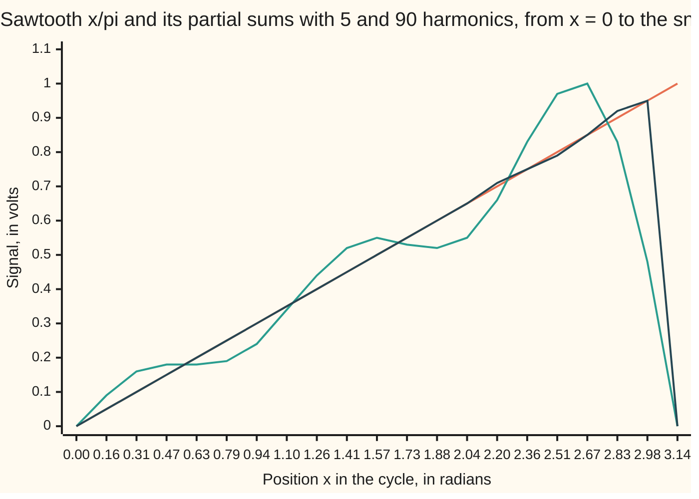

# Dirichlet's theorem: where the series equals the signal, and where it averages the jump

[Syllabus](../../../SYLLABUS.md) → [Harmonic analysis](../README.md) → [Fourier Series in Depth](../README.md#s01) → Dirichlet's theorem

---

## General Overview

A synthesiser's sawtooth oscillator plays a note at 220 cycles a second. In each cycle of 4.545455 ms the voltage climbs in a straight line from −1 V to +1 V, then snaps back to −1 V at once. A digital synthesiser that must avoid aliasing (false tones from frequencies too high for its sample rate) cannot play that snap. It builds the wave from pure tones instead: the 220 Hz tone, the 440 Hz tone, and so on, up to the 90th harmonic at 19,800 Hz, the last one under the 20,000 Hz limit of hearing.

So the stack of 90 tones is not the sawtooth. Three questions decide how good it is:

- **Where the ramp is smooth**, does the stack land on the ramp as more tones are added?
- **At the snap**, the wave is +1 V just before and −1 V just after. What does the stack give there?
- **Can one number** bound the error at every moment of the cycle at once?

The answers: yes on the ramp, the midpoint 0 V at the snap, and no for the sawtooth. A quarter cycle before the snap, 3.409091 ms after the ramp starts, the wave is at 0.5 V and the 90-tone stack is at 0.503536 V. At the snap the stack is at exactly 0 V, for 90 tones or for 1,000. But 2.273 microseconds before the snap the stack is still 0.819811 V away from the wave, and that worst spot only moves closer to the snap as tones are added. A triangle wave from the same synthesiser has no snap, and its stack up to the same 90th harmonic is within 0.004503 V of the wave everywhere.

**A Fourier series of a piecewise smooth signal lands on the signal wherever the signal is smooth and on the midpoint of every jump; it lands on it uniformly, with one error bound for the whole cycle, exactly when the sizes of the coefficients add up to a finite number; and whether it lands at a point depends only on the signal near that point.**

**What kind of fact this is:** three theorems: Dirichlet's theorem on pointwise convergence (1829), uniform convergence from summable coefficients, and Riemann's localisation principle (1854), all proved on this card in Why it works.

### The picture: the sawtooth's stack on the second half of the cycle



Orange: the sawtooth, drawn with its value 1.00 V just before the snap. Teal: 5 harmonics, wandering around the ramp. Dark blue: 90 harmonics, on the ramp to two decimals up to x = 2.04, then pulling away as the snap nears: 0.71 against 0.70 at x = 2.20, and 0.92 against 0.90 at x = 2.83. At the snap, x = π, both sums read 0.00: the midpoint of +1 and −1.

---

## The formula

Notation first, in words. Position in the cycle is an angle $`x`$ in radians: $`x`$ runs from $`-\pi`$ to $`\pi`$ over one cycle of 1/220 s, so $`x = 2\pi \times 220 \times`$ (time in seconds, measured from mid-ramp). The sawtooth is $`f(x) = x/\pi`$ volts on that range, repeating. A **piecewise smooth** signal is one made of finitely many pieces per cycle, each with a slope that has limits at the piece's ends; jumps between pieces are allowed. At a jump, $`f(x^-)`$ is the value approached from the left and $`f(x^+)`$ the value approached from the right.

The coefficients and partial sums are those of [Fourier coefficients](01-fourier-coefficients-and-orthogonality.md), with $`i`$ the imaginary unit:

```math
\hat f(n) = \frac{1}{2\pi}\int_{-\pi}^{\pi} f(x)\,e^{-inx}\,dx, \qquad S_N f(x) = \sum_{n=-N}^{N} \hat f(n)\,e^{inx}
```

For the sawtooth, $`\hat f(n) = i(-1)^n/(\pi n)`$ for $`n \ne 0`$ and $`\hat f(0) = 0`$, so each size is $`\lvert \hat f(n)\rvert = 1/(\pi \lvert n\rvert)`$. Pairing $`n`$ with $`-n`$ gives the real form $`S_N f(x) = \tfrac{2}{\pi}\big(\sin x - \tfrac12 \sin 2x + \tfrac13 \sin 3x - \cdots\big)`$, with $`N`$ terms.

**Dirichlet's theorem.** For a piecewise smooth $`f`$ and every $`x`$:

```math
\lim_{N\to\infty} S_N f(x) = \tfrac12\big(f(x^-) + f(x^+)\big)
```

**Read it aloud:** with more harmonics, the partial sum at x settles on the average of the values just left and just right of x; where f has no jump, that average is f(x).

**Uniform convergence from summable coefficients.** If $`f`$ is continuous and the sizes add up, $`\sum_{n} \lvert \hat f(n)\rvert < \infty`$, then for every $`N`$:

```math
\sup_{x} \lvert f(x) - S_N f(x)\rvert \;\le\; R_N = \sum_{\lvert n\rvert > N} \lvert \hat f(n)\rvert
```

**Read it aloud:** the worst error anywhere in the cycle is at most the sizes of all the harmonics left out, added up.

Here sup, the supremum, is the least number at or above every value in the set: the worst error, whether or not some x reaches it.

**The localisation principle.** If two integrable signals $`f`$ and $`g`$ agree on a window $`(x - \delta, x + \delta)`$ around $`x`$, with $`\delta > 0`$, then:

```math
\lim_{N\to\infty} \big(S_N f(x) - S_N g(x)\big) = 0
```

**Read it aloud:** whether the series settles at x, and on what value, is decided by the signal near x alone, though every coefficient depends on the whole cycle.

| Symbol | Plain meaning | In our example | Push it up and the answer… |
| --- | --- | --- | --- |
| $`x`$ | position in the cycle, in radians; $`2\pi`$ is one cycle | $`\pi/2`$ is 3.409091 ms into the ramp; the snap is at $`\pi`$ | nearer the snap, more harmonics needed |
| $`f`$, $`f'`$ | the sawtooth, in volts; a signal's slope | $`x/\pi`$: 0.5 V at $`\pi/2`$ | — |
| $`n`$, $`\hat f(n)`$, $`i`$ | harmonic number; its coefficient, a complex number; the imaginary unit | $`\lvert \hat f(1)\rvert = 0.318310`$, $`\lvert \hat f(90)\rvert = 0.003537`$ | higher $`n`$, smaller size, like $`1/n`$ |
| $`N`$, $`S_N f`$ | highest harmonic kept; the partial sum | $`N = 90`$; $`S_{90} f(\pi/2) = 0.503536`$ | smooth points settle closer |
| $`f(x^-)`$, $`f(x^+)`$ | values approached from the left and from the right | +1 and −1 at the snap | a bigger jump moves the midpoint |
| $`D_N`$, $`t`$, $`u`$ | the Dirichlet kernel; stand-in positions inside an integral | $`D_N(0) = 2N + 1`$ | the kernel's central peak narrows |
| $`\delta`$, $`\epsilon`$ | half-width of a window around $`x`$; a small tolerance | $`\delta = \pi/2`$ at $`x = \pi/2`$ | — |
| $`g`$ | the half ramp: equal to $`f`$ on $`(0, \pi)`$, 0 on $`(-\pi, 0)`$ | $`S_1 g(\pi/2) = 0.568310`$ | — |
| $`M`$, $`h`$, $`q`$, $`s`$, $`c`$, $`a`$, $`b`$ | helpers inside proofs: a second cut-off; the difference $`f - g`$; the function a proof integrates; a staircase; one step's height and its two ends | — | — |
| $`T`$, $`T'`$ | the triangle wave $`1 - 2\lvert x\rvert/\pi`$ volts; its slope | $`T' = \mp 2/\pi`$ | — |
| $`R_N`$ | the M-test tail: sizes of the left-out harmonics, added | 0.004503 for $`T`$ at $`N = 90`$ | larger $`N`$, smaller tail |
| $`\lVert T'\rVert_2`$ | root-mean-square size of the slope: $`\big(\frac{1}{2\pi}\int \lvert T'\rvert^2\big)^{1/2}`$ | $`2/\pi = 0.636620`$ | steeper wave, larger bound |

### When it holds

- **Piecewise smooth, for Dirichlet.** Continuity alone is not enough. In 1873 du Bois-Reymond built a continuous signal whose series runs off without limit at one point. The theorem needs one-sided slopes at the point.
- **Summable sizes, for uniform convergence.** A uniform limit of continuous partial sums is continuous ([Uniform convergence](../../06-Calculus%20and%20analysis/06-Series/07-uniform-convergence.md)). So a signal with a jump, like the sawtooth, never has summable sizes.
- **The value at the jump is invisible.** Coefficients are integrals, and one point adds nothing to an integral. Redefine the sawtooth as +1 V at the snap and its series still gives 0 there.
- **Point by point, not all at once.** Pointwise convergence on the sawtooth is real at every x, but the number of harmonics needed grows without bound as x nears the snap.

---

## Why it works

### Step 0: the idea, in words

A partial sum is the signal smeared by a fixed shape, the **Dirichlet kernel** $`D_N`$ ([Dirichlet and Fejer kernels](03-dirichlet-and-fejer-kernels.md)):

```math
S_N f(x) = \frac{1}{2\pi}\int_{-\pi}^{\pi} f(x - t)\,D_N(t)\,dt, \qquad D_N(t) = \frac{\sin\big((N + \tfrac12)t\big)}{\sin(t/2)}
```

Away from $`t = 0`$ the kernel is a fast wave, $`\sin((N + \tfrac12)t)`$, times a fixed shape, $`1/\sin(t/2)`$. Against a fast wave, any fixed signal averages out to almost nothing: positive and negative lobes nearly cancel. That is the **Riemann–Lebesgue lemma**. So only the signal near $`x`$ survives: that is localisation. Near $`x`$, the kernel splits its weight half to the left and half to the right: that gives the midpoint. And when the sizes of the coefficients add up, the leftover after $`N`$ harmonics has a bound with no $`x`$ in it: that gives uniform convergence.

### Step 1: coefficients fade (Riemann–Lebesgue)

For the sawtooth this is a direct computation. Integrate by parts once: the slope of $`x/\pi`$ is $`1/\pi`$, and $`\hat f(n) = i(-1)^n/(\pi n)`$. The sizes are 0.318310, 0.159155 and 0.003537 at $`n`$ = 1, 2 and 90. The same integration by parts shows that every piecewise smooth signal has coefficient sizes no bigger than a fixed number over $`\lvert n\rvert`$, the number set by its jumps and its slope.

The lemma holds for every integrable signal, smooth or not: $`\hat f(n) \to 0`$ as $`\lvert n\rvert`$ grows. The proof approximates the signal by a staircase of finitely many steps. A step's coefficient is at most its height over $`\pi\lvert n\rvert`$, and the approximation error stays below any tolerance $`\epsilon`$.

### Step 2: localisation, the signal far from x does not count

Suppose $`f`$ and $`g`$ agree within $`\delta`$ of $`x`$. Their difference $`f - g`$ is 0 there, so the kernel integral for $`S_N f(x) - S_N g(x)`$ only covers $`\delta \le \lvert t\rvert \le \pi`$. On that range $`\sin(t/2)`$ is at least $`\sin(\delta/2)`$, so dividing by it is safe. The integral becomes a Fourier coefficient of a fixed integrable function at frequency about $`N`$, and Step 1 sends it to 0.

In numbers: the sawtooth $`f`$ and the half ramp $`g`$ agree on $`(0, \pi)`$, so $`\delta = \pi/2`$ at $`x = \pi/2`$. The difference of their partial sums at $`\pi/2`$ is 0.015763, 0.001768 and −0.000159 for $`N`$ = 10, 90 and 1000. The kernel integral over $`(-\pi, 0)`$ alone, where the two differ, gives the same 0.001768 at $`N = 90`$.

<details>
<summary>Detailed proof: Riemann–Lebesgue and localisation</summary>

Riemann–Lebesgue. Let $`q`$ be integrable on the cycle and $`\epsilon > 0`$. Choose a staircase $`s`$, finitely many steps, with $`\frac{1}{2\pi}\int \lvert q - s\rvert < \epsilon`$. Then $`\lvert \hat q(n) - \hat s(n)\rvert < \epsilon`$ for every $`n`$. A single step of height $`c`$ on $`(a, b)`$ has coefficient $`\frac{c}{2\pi}\cdot\frac{e^{-ina} - e^{-inb}}{in}`$, of size at most $`\lvert c\rvert/(\pi\lvert n\rvert)`$. So $`\lvert \hat s(n)\rvert < \epsilon`$ once $`\lvert n\rvert`$ is large, and then $`\lvert \hat q(n)\rvert < 2\epsilon`$.

Localisation. Put $`h = f - g`$, which is 0 on $`(x - \delta, x + \delta)`$. Define $`q(t) = h(x - t)/\sin(t/2)`$ for $`\delta \le \lvert t\rvert \le \pi`$ and $`q(t) = 0`$ otherwise; $`\lvert q\rvert \le \lvert h(x-t)\rvert/\sin(\delta/2)`$, so $`q`$ is integrable. Then

$`\displaystyle S_N f(x) - S_N g(x) = \frac{1}{2\pi}\int_{-\pi}^{\pi} q(t)\sin\big((N + \tfrac12)t\big)\,dt.`$

Write $`\sin((N + \frac12)t) = \sin(Nt)\cos(t/2) + \cos(Nt)\sin(t/2)`$. Each piece is a combination of the coefficients at $`\pm N`$ of the integrable functions $`q(t)\cos(t/2)`$ and $`q(t)\sin(t/2)`$. Riemann–Lebesgue sends all of them to 0.

</details>

### Step 3: Dirichlet's theorem, the midpoint at a jump

The differential-equations wing proves this theorem for piecewise smooth waves with the same kernel ([Convergence](../../08-Differential%20equations%20and%20dynamics/09-Fourier%20Series/02-convergence-jumps-and-gibbs.md)). The shape of the argument: the kernel is even and has average 1, so each half of it, $`t > 0`$ and $`t < 0`$, carries weight one half. The right half averages values from just right of $`x`$, near $`f(x^+)`$. The left half averages values near $`f(x^-)`$. What is left over is a Riemann–Lebesgue integral, which fades.

At the snap the sawtooth shows the result with no limit needed. Every term $`\sin(n\pi)`$ is 0, so $`S_N f(\pi) = 0`$ for every $`N`$: the midpoint of +1 and −1. On the ramp at $`x = \pi/2`$ the sums walk in: 0.636620, 0.424413, 0.551737 for $`N`$ = 1, 3, 5, and errors of 0.031527, 0.003536 and −0.000318 for $`N`$ = 10, 90 and 1000.

<details>
<summary>Detailed proof: Dirichlet's theorem from the kernel</summary>

Because $`D_N`$ is even and $`\frac{1}{2\pi}\int_{-\pi}^{\pi} D_N = 1`$, each half has $`\frac{1}{2\pi}\int_0^{\pi} D_N = \frac12`$. Folding the integral onto $`(0, \pi)`$,

$`\displaystyle S_N f(x) - \tfrac12\big(f(x^+) + f(x^-)\big) = \frac{1}{2\pi}\int_0^{\pi} \Big[\big(f(x+t) - f(x^+)\big) + \big(f(x-t) - f(x^-)\big)\Big] D_N(t)\,dt.`$

Put $`q(t) = \big[f(x+t) - f(x^+) + f(x-t) - f(x^-)\big]/\sin(t/2)`$ on $`(0, \pi)`$, and 0 on $`(-\pi, 0)`$. Near $`t = 0`$, each bracket is about a one-sided slope times $`t`$, and $`\sin(t/2)`$ is about $`t/2`$, so $`q`$ stays bounded. Elsewhere it is piecewise smooth. So $`q`$ is integrable, the right side is $`\frac{1}{2\pi}\int q(t)\sin((N + \frac12)t)\,dt`$, and Step 2's splitting with Riemann–Lebesgue sends it to 0.

</details>

### Step 4: summable sizes give one bound for the whole cycle

At any $`x`$, each left-out term has size $`\lvert \hat f(n) e^{inx}\rvert = \lvert \hat f(n)\rvert`$, because $`\lvert e^{inx}\rvert = 1`$. So the gap between any two partial sums $`S_M f`$ and $`S_N f`$, with $`M > N`$, is at most $`R_N`$ at every $`x`$. This is the Weierstrass M-test, with caps $`\lvert \hat f(n)\rvert`$.

If the caps add up, $`R_N`$ goes to 0, and the partial sums converge uniformly to some continuous signal. That limit has the same coefficients as $`f`$: uniform convergence lets the coefficient integral pass inside the limit, and each coefficient of $`S_N f`$ is already $`f`$'s once $`N`$ is past that harmonic. Two continuous signals with the same coefficients are equal. Their difference has every coefficient 0, so its Fejér averages (the running averages of its partial sums, from [Dirichlet and Fejer kernels](03-dirichlet-and-fejer-kernels.md)) are all 0, and Fejér averages land on every continuous signal (the folded proof on [Parseval's identity](../../08-Differential%20equations%20and%20dynamics/09-Fourier%20Series/03-parsevals-identity.md)). So for a continuous $`f`$ the uniform limit is $`f`$ itself, and $`\sup_x \lvert f - S_N f\rvert \le R_N`$. No smoothness is needed; Step 5 gives an easy test for summable sizes.

The triangle wave makes the bound exact. Its series is $`\tfrac{8}{\pi^2}\big(\cos x + \tfrac19\cos 3x + \tfrac1{25}\cos 5x + \cdots\big)`$. At $`x = 0`$ every cosine is 1, so the left-out terms all add with the same sign and the error equals the tail. A search over 2,001 points of the cycle finds worst errors 0.040395, 0.004503 and 0.000405 for $`N`$ = 10, 90 and 1000. The M-test tails give the same three numbers.

### Step 5: which signals have summable sizes

Two facts settle it for the cards on this shelf.

1. **A jump forbids it.** Summable sizes give a continuous limit (Step 4). So a signal with a jump, like the sawtooth, has sizes that add to infinity. Here they add to 4.765399 by $`N = 1000`$ and keep growing like $`(2/\pi)\log N`$.
2. **Continuous and piecewise smooth is enough.** Integrate by parts: $`\hat f(n) = \widehat{f'}(n)/(in)`$ for $`n \ne 0`$, with no boundary terms because $`f`$ has no jump. Then the Cauchy–Schwarz inequality, followed by Bessel's inequality from [Partial sums are the best fit](02-best-approximation-and-bessels-inequality.md), bounds the total.

```math
\sum_{n} \lvert \hat f(n)\rvert \;\le\; \lvert \hat f(0)\rvert + \Big(\sum_{n \ne 0} \frac{1}{n^2}\Big)^{1/2}\Big(\sum_{n \ne 0} \lvert \widehat{f'}(n)\rvert^2\Big)^{1/2} \;\le\; \lvert \hat f(0)\rvert + \frac{\pi}{\sqrt3}\,\lVert f'\rVert_2
```

**Read it aloud:** the sizes add to at most the average value plus pi over root three times the root-mean-square slope.

The middle step uses $`\sum_{n \ne 0} 1/n^2 = \pi^2/3`$. For the triangle wave, $`\hat T(0) = 0`$ and $`\lVert T'\rVert_2 = 2/\pi = 0.636620`$, so the bound is $`2/\sqrt3 = 1.154701`$. The true total is 1.000000, the triangle's value at its peak, since all its coefficients are positive. The ratio is 0.866025. How fast the sizes shrink, and what that buys, is [Smoothness shows in the tail](06-decay-of-coefficients-and-smoothness.md).

---

## Worked numbers, by hand

The sawtooth at $`x = \pi/2`$, where it reads 0.5 V, then at the snap; then the triangle's bound.

| Step | Arithmetic | Value |
| --- | --- | --- |
| one harmonic at $`\pi/2`$ | $`\tfrac{2}{\pi} \times \sin(\pi/2) = 2/\pi`$ | 0.636620 |
| add the third (the second is $`\sin\pi = 0`$) | $`\tfrac{2}{\pi}\big(1 - \tfrac13\big)`$ | 0.424413 |
| add the fifth | $`\tfrac{2}{\pi}\big(1 - \tfrac13 + \tfrac15\big)`$ | 0.551737 |
| the limit | $`\tfrac{2}{\pi} \times \tfrac{\pi}{4}`$, Leibniz's series | **0.5 V, the ramp's value** |
| at the snap $`x = \pi`$, any $`N`$ | every $`\sin(n\pi) = 0`$ | **0 V, the midpoint of +1 and −1** |
| half ramp at $`\pi/2`$, one harmonic | $`\tfrac14 + \tfrac1\pi`$ | 0.568310 |
| difference from the sawtooth, one harmonic | $`0.636620 - 0.568310`$ | 0.068310 |
| triangle, tail at $`N = 90`$ | $`1 - \tfrac{8}{\pi^2}\big(1 + \tfrac19 + \cdots + \tfrac{1}{89^2}\big)`$ | **0.004503 V** |

A 90-harmonic sawtooth is right to 0.003536 V a quarter cycle before the snap and reads 0 V at the snap itself. A 90-harmonic triangle is right to 0.004503 V at every moment of the cycle.

### What breaks if you drop a piece

| Mistake | Comes out at | What went wrong |
| --- | --- | --- |
| Expecting the series to give +1 V or −1 V at the snap | 0.000000 for $`N`$ = 10, 90 and 1000 | One point carries no area, so no coefficient sees it; the kernel splits its weight and lands on the midpoint |
| Reading "converges at every x" as one bound for the cycle | gap 0.999942 at $`N = 90`$ and 0.999363 at $`N = 1000`$, at $`x = \pi - 0.000001`$ | The sawtooth has a jump, so its sizes are not summable and the worst error never shrinks |
| Applying the M-test to the sawtooth | the caps add to 1.864639, 3.235665, 4.765399 for $`N`$ = 10, 90, 1000, with no finite total | The test needs a finite sum of caps; sizes like $`1/(\pi n)`$ give none |
| Estimating the triangle's error by its first omitted term | 0.000098 at $`N = 90`$, against the true 0.004503, 46.0 times larger | The odd terms beyond $`N`$ add to about $`N/2`$ times the first one, since $`\sum 1/n^2`$ over odd $`n > N`$ is about $`1/(2N)`$ |
| Judging the limit at $`\pi/2`$ by the first partial sums | half ramp 0.568310 against sawtooth 0.636620 at $`N = 1`$ | Far-away differences change every coefficient but fade from the sum: 0.001768 at $`N = 90`$ |

---

## Code, from first principles, and it actually runs

The scripts build the sawtooth, the half ramp and the triangle from their coefficient formulas, with only sine, cosine, π, square root and log imported. They reach each answer by two independent roads: adding the terms, and integrating the signal against the Dirichlet kernel with their own Simpson's rule. The coefficient sizes are checked by Simpson against $`1/(\pi n)`$. The triangle's worst error is found by brute force over 2,001 points and compared with the M-test tail summed to two million terms. The slope's size is found by direct integration and by its coefficients (Parseval). The sawtooth's growing total is checked against the logarithm.

### Python

```python
# Dirichlet's theorem on a sawtooth: where the series equals the signal, where it averages the jump.
# Standard library only. Only sin, cos, pi, sqrt and log are imported; every sum, kernel and
# integral (Simpson's rule) is written out here.
from math import sin, cos, pi, sqrt, log

def fmt(v):
    return f"{0.0 if abs(v) < 5e-13 else v:.6f}"

def saw(u):                      # the sawtooth, in volts: u/pi on (-pi, pi)
    return u / pi

def saw_sum(N, x):               # S_N f(x) = (2/pi) * sum of (-1)^(n+1) sin(n x)/n, n = 1..N
    s = 0.0
    for n in range(1, N + 1):
        s += (1.0 if n % 2 else -1.0) * sin(n * x) / n
    return 2.0 * s / pi

def ramp_sum(N, x):              # half ramp g: u/pi on (0, pi), 0 on (-pi, 0); its S_N g(x)
    s = 0.25
    for n in range(1, N + 1):
        sg = 1.0 if n % 2 else -1.0
        s += -(1.0 + sg) / (pi * pi * n * n) * cos(n * x) + sg / (pi * n) * sin(n * x)
    return s

def tri(x):                      # triangle wave, in volts: 1 - 2|x|/pi
    return 1.0 - 2.0 * abs(x) / pi

def tri_sum(N, x):               # S_N T(x) = (8/pi^2) * sum over odd n <= N of cos(n x)/n^2
    s = 0.0
    for n in range(1, N + 1, 2):
        s += cos(n * x) / (n * n)
    return 8.0 * s / (pi * pi)

def simpson(g, a, b, m):
    h = (b - a) / m
    s = g(a) + g(b)
    for k in range(1, m):
        s += (4 if k % 2 else 2) * g(a + k * h)
    return s * h / 3

def dirichlet(N, t):             # D_N(t) = sin((N + 1/2) t) / sin(t/2); 2N + 1 at t = 0
    d = sin(t / 2)
    return 2 * N + 1.0 if abs(d) < 1e-12 else sin((N + 0.5) * t) / d

def kernel(sig, a, b, N, x):     # (1/2pi) * integral over (a, b) of sig(u) D_N(x - u) du
    return simpson(lambda u: sig(u) * dirichlet(N, x - u), a, b, 20000) / (2 * pi)

NS = (10, 90, 1000)
print("sawtooth f(x) = x/pi volts on (-pi, pi), snapping from +1 V to -1 V at x = pi")
print(f"at 220 Hz the harmonics below 20000 Hz are n = 1..{20000 // 220}, top {220 * 90} Hz")
print(f"one cycle = {1000 / 220:.6f} ms; x = pi/2 is {0.75 * 1000 / 220:.6f} ms after the ramp starts; "
      f"x = 0.99 pi and 0.999 pi are {0.005e6 / 220:.3f} and {0.0005e6 / 220:.3f} microseconds before the snap")
row = []
for n in (1, 2, 90):             # road 1: Simpson on the coefficient integral; road 2: 1/(pi n)
    num = simpson(lambda u: saw(u) * sin(n * u), -pi, pi, 40000) / (2 * pi)
    assert abs(abs(num) - 1 / (pi * n)) < 1e-9
    row.append(f"n = {n}: {fmt(abs(num))} by Simpson, {fmt(1 / (pi * n))} = 1/(pi n)")
print("coefficient size |f^(n)|: " + "; ".join(row))
snap = [saw_sum(N, pi) for N in NS]
assert all(abs(v) < 1e-9 for v in snap)                # the midpoint of +1 and -1
print("at the snap x = pi: " + ", ".join(f"S_{N} = {fmt(v)}" for N, v in zip(NS, snap)) + "; midpoint (1 + (-1))/2 = 0")
print("at x = pi/2 by hand: " + ", ".join(f"S_{N} = {fmt(saw_sum(N, pi / 2))}" for N in (1, 3, 5)))
err = [saw_sum(N, pi / 2) - 0.5 for N in NS]
assert abs(err[0]) > abs(err[1]) > abs(err[2]) and abs(err[2]) < 1e-3
print("at x = pi/2, f = 0.5 V, error S_N - f: " + ", ".join(f"N = {N}: {fmt(e)}" for N, e in zip(NS, err)))
k90 = kernel(saw, -pi, pi, 90, pi / 2)                 # road 2: the signal smeared by D_90
assert abs(k90 - saw_sum(90, pi / 2)) < 1e-9
print(f"at x = pi/2, N = 90: by the terms {fmt(saw_sum(90, pi / 2))}, by the kernel integral {fmt(k90)}")
row = []
for c in (0.5, 0.9, 0.99, 0.999):
    row.append(f"x = {c:g} pi: {fmt(saw_sum(90, c * pi) - c)}")
assert abs(saw_sum(5000, 0.9 * pi) - 0.9) < 1e-3       # far from the snap the ramp is reached
print("error at N = 90, f = x/pi: " + ", ".join(row))
gap = [saw(pi - 1e-6) - saw_sum(N, pi - 1e-6) for N in NS]
assert all(g > 0.99 for g in gap)                     # worst gap never shrinks: not uniform
print("just left of the snap, x = pi - 0.000001, gap f - S_N: " + ", ".join(f"N = {N}: {fmt(g)}" for N, g in zip(NS, gap)))
row = []
for N in NS:                     # sum of |f^(n)| over |n| <= N, n != 0, against the log road
    tot = 2 * sum(1 / (pi * n) for n in range(1, N + 1))
    lg = (2 / pi) * (log(N) + 0.5772156649015329 + 1 / (2 * N) - 1 / (12 * N * N))
    assert abs(tot - lg) < 1e-6
    row.append(f"N = {N}: {fmt(tot)}")
print("sizes added, sum of |f^(n)| for 0 < |n| <= N: " + ", ".join(row) + "; grows like (2/pi) log N")
print(f"half ramp g: equals f on (0, pi), is 0 on (-pi, 0); S_1 g(pi/2) = {fmt(ramp_sum(1, pi / 2))}, S_1 f(pi/2) = {fmt(saw_sum(1, pi / 2))}, "
      f"difference {fmt(saw_sum(1, pi / 2) - ramp_sum(1, pi / 2))}")
dif = [saw_sum(N, pi / 2) - ramp_sum(N, pi / 2) for N in NS]
kd = kernel(saw, -pi, 0.0, 90, pi / 2)                # road 2: only the part where f and g differ
assert abs(kd - dif[1]) < 1e-9 and abs(dif[2]) < 1e-3 < abs(dif[0])
print("at x = pi/2, S_N f - S_N g: " + ", ".join(f"N = {N}: {fmt(d)}" for N, d in zip(NS, dif)) + f"; by the kernel at N = 90: {fmt(kd)}")
row = []
for N in NS:
    xs = [pi * (k - 1000) / 1000 for k in range(2001)]
    worst = max(abs(tri(x) - tri_sum(N, x)) for x in xs)   # road 1: brute force over the cycle
    cap = sum(8 / (pi * pi * n * n) for n in range(N + 1 + N % 2, 2000001, 2)) + 4 / (pi * pi * 2000001)
    assert abs(worst - cap) < 1e-6                        # road 2: the M-test tail of the caps
    row.append(f"N = {N}: worst {fmt(worst)}, tail {fmt(cap)}")
print("triangle T(x) = 1 - 2|x|/pi volts, worst error over the cycle against the M-test tail:")
print("  " + "; ".join(row))
tot = 2 * sum(4 / (pi * pi * n * n) for n in range(1, 2000001, 2)) + 4 / (pi * pi * 2000001)
assert abs(tot - 1.0) < 1e-6                              # sum of |T^(n)| = T(0) = 1
d2 = simpson(lambda u: (2 / pi) ** 2, -pi, pi, 2) / (2 * pi)  # ||T'||^2, T' = -+2/pi
p2 = 2 * sum(16 / (pi ** 4 * n * n) for n in range(1, 2000001, 2)) + 8 / (pi ** 4 * 2000001)
assert abs(d2 - p2) < 1e-6                                # Parseval for T' agrees with the integral
bound = pi / sqrt(3) * sqrt(d2)
assert bound > tot                                        # the bound sits above the true total
print(f"sum of |T^(n)| = {fmt(tot)}; ||T'|| = {fmt(sqrt(d2))} (by coefficients {fmt(sqrt(p2))}); bound (pi/sqrt 3) ||T'|| = {fmt(bound)}; ratio {fmt(tot / bound)}")
first = 8 / (pi * pi * 91 * 91)
true90 = 1.0 - tri_sum(90, 0.0)
assert true90 > 40 * first
print(f"what breaks: first omitted cap at N = 90 is {fmt(first)}; true worst error {fmt(true90)}, {true90 / first:.1f} times larger")
xs = [k * pi / 20 for k in range(21)]
print("figure, x: " + ", ".join(f"{x:.2f}" for x in xs))
print("figure, f: " + ", ".join(f"{saw(x):.2f}" for x in xs))
for N in (5, 90):
    print(f"figure, S_{N}: " + ", ".join(f"{0.0 if abs(v) < 5e-3 else v:.2f}" for v in (saw_sum(N, x) for x in xs)))
print("ALL CHECKS PASS")
```

**Ran 2026-11-15 on macOS, Python 3.14.10, standard library only. All checks passed. Output, pasted from the run:**

```
sawtooth f(x) = x/pi volts on (-pi, pi), snapping from +1 V to -1 V at x = pi
at 220 Hz the harmonics below 20000 Hz are n = 1..90, top 19800 Hz
one cycle = 4.545455 ms; x = pi/2 is 3.409091 ms after the ramp starts; x = 0.99 pi and 0.999 pi are 22.727 and 2.273 microseconds before the snap
coefficient size |f^(n)|: n = 1: 0.318310 by Simpson, 0.318310 = 1/(pi n); n = 2: 0.159155 by Simpson, 0.159155 = 1/(pi n); n = 90: 0.003537 by Simpson, 0.003537 = 1/(pi n)
at the snap x = pi: S_10 = 0.000000, S_90 = 0.000000, S_1000 = 0.000000; midpoint (1 + (-1))/2 = 0
at x = pi/2 by hand: S_1 = 0.636620, S_3 = 0.424413, S_5 = 0.551737
at x = pi/2, f = 0.5 V, error S_N - f: N = 10: 0.031527, N = 90: 0.003536, N = 1000: -0.000318
at x = pi/2, N = 90: by the terms 0.503536, by the kernel integral 0.503536
error at N = 90, f = x/pi: x = 0.5 pi: 0.003536, x = 0.9 pi: 0.022275, x = 0.99 pi: 0.169421, x = 0.999 pi: -0.819811
just left of the snap, x = pi - 0.000001, gap f - S_N: N = 10: 0.999993, N = 90: 0.999942, N = 1000: 0.999363
sizes added, sum of |f^(n)| for 0 < |n| <= N: N = 10: 1.864639, N = 90: 3.235665, N = 1000: 4.765399; grows like (2/pi) log N
half ramp g: equals f on (0, pi), is 0 on (-pi, 0); S_1 g(pi/2) = 0.568310, S_1 f(pi/2) = 0.636620, difference 0.068310
at x = pi/2, S_N f - S_N g: N = 10: 0.015763, N = 90: 0.001768, N = 1000: -0.000159; by the kernel at N = 90: 0.001768
triangle T(x) = 1 - 2|x|/pi volts, worst error over the cycle against the M-test tail:
  N = 10: worst 0.040395, tail 0.040395; N = 90: worst 0.004503, tail 0.004503; N = 1000: worst 0.000405, tail 0.000405
sum of |T^(n)| = 1.000000; ||T'|| = 0.636620 (by coefficients 0.636620); bound (pi/sqrt 3) ||T'|| = 1.154701; ratio 0.866025
what breaks: first omitted cap at N = 90 is 0.000098; true worst error 0.004503, 46.0 times larger
figure, x: 0.00, 0.16, 0.31, 0.47, 0.63, 0.79, 0.94, 1.10, 1.26, 1.41, 1.57, 1.73, 1.88, 2.04, 2.20, 2.36, 2.51, 2.67, 2.83, 2.98, 3.14
figure, f: 0.00, 0.05, 0.10, 0.15, 0.20, 0.25, 0.30, 0.35, 0.40, 0.45, 0.50, 0.55, 0.60, 0.65, 0.70, 0.75, 0.80, 0.85, 0.90, 0.95, 1.00
figure, S_5: 0.00, 0.09, 0.16, 0.18, 0.18, 0.19, 0.24, 0.34, 0.44, 0.52, 0.55, 0.53, 0.52, 0.55, 0.66, 0.83, 0.97, 1.00, 0.83, 0.48, 0.00
figure, S_90: 0.00, 0.05, 0.10, 0.15, 0.20, 0.25, 0.30, 0.35, 0.40, 0.45, 0.50, 0.55, 0.60, 0.65, 0.71, 0.75, 0.79, 0.85, 0.92, 0.95, 0.00
ALL CHECKS PASS
```

### Rust

Same checks, same inputs, same printed lines.

```rust
// Dirichlet's theorem on a sawtooth, the same checks as the Python script.
// Standard library only, no crates. Every sum, kernel and integral (Simpson's rule) is written out.
use std::f64::consts::PI;

fn fmt(v: f64) -> String {
    format!("{:.6}", if v.abs() < 5e-13 { 0.0 } else { v })
}
fn saw(u: f64) -> f64 { u / PI } // the sawtooth, in volts
fn saw_sum(n_max: usize, x: f64) -> f64 {
    let mut s = 0.0;
    for n in 1..=n_max {
        let sg = if n % 2 == 1 { 1.0 } else { -1.0 };
        s += sg * (n as f64 * x).sin() / n as f64;
    }
    2.0 * s / PI
}
fn ramp_sum(n_max: usize, x: f64) -> f64 { // half ramp g: u/pi on (0, pi), 0 on (-pi, 0)
    let mut s = 0.25;
    for n in 1..=n_max {
        let (sg, nf) = (if n % 2 == 1 { 1.0 } else { -1.0 }, n as f64);
        s += -(1.0 + sg) / (PI * PI * nf * nf) * (nf * x).cos() + sg / (PI * nf) * (nf * x).sin();
    }
    s
}
fn tri(x: f64) -> f64 { 1.0 - 2.0 * x.abs() / PI }
fn tri_sum(n_max: usize, x: f64) -> f64 {
    let mut s = 0.0;
    let mut n = 1;
    while n <= n_max {
        let nf = n as f64;
        s += (nf * x).cos() / (nf * nf);
        n += 2;
    }
    8.0 * s / (PI * PI)
}
fn simpson<F: Fn(f64) -> f64>(g: F, a: f64, b: f64, m: usize) -> f64 {
    let h = (b - a) / m as f64;
    let mut s = g(a) + g(b);
    for k in 1..m {
        s += if k % 2 == 1 { 4.0 } else { 2.0 } * g(a + k as f64 * h);
    }
    s * h / 3.0
}
fn dirichlet(n: usize, t: f64) -> f64 {
    let d = (t / 2.0).sin();
    if d.abs() < 1e-12 { 2.0 * n as f64 + 1.0 } else { ((n as f64 + 0.5) * t).sin() / d }
}
fn kernel(sig: fn(f64) -> f64, a: f64, b: f64, n: usize, x: f64) -> f64 {
    simpson(|u| sig(u) * dirichlet(n, x - u), a, b, 20000) / (2.0 * PI)
}
fn odd_tail(start: usize, scale: f64) -> f64 { // sum of scale/n^2 over odd n from start, to 2,000,000
    let mut s = 0.0;
    let mut n = start;
    while n < 2000001 {
        s += scale / (n as f64 * n as f64);
        n += 2;
    }
    s
}
fn join(v: Vec<String>, sep: &str) -> String { v.join(sep) }

fn main() {
    let ns = [10usize, 90, 1000];
    println!("sawtooth f(x) = x/pi volts on (-pi, pi), snapping from +1 V to -1 V at x = pi");
    println!("at 220 Hz the harmonics below 20000 Hz are n = 1..{}, top {} Hz", 20000 / 220, 220 * 90);
    println!("one cycle = {:.6} ms; x = pi/2 is {:.6} ms after the ramp starts; x = 0.99 pi and 0.999 pi are {:.3} and {:.3} microseconds before the snap",
        1000.0 / 220.0, 0.75 * 1000.0 / 220.0, 0.005e6 / 220.0, 0.0005e6 / 220.0);
    let mut row = vec![];
    for &n in &[1usize, 2, 90] {
        let num = simpson(|u| saw(u) * (n as f64 * u).sin(), -PI, PI, 40000) / (2.0 * PI);
        let exact = 1.0 / (PI * n as f64);
        assert!((num.abs() - exact).abs() < 1e-9);
        row.push(format!("n = {}: {} by Simpson, {} = 1/(pi n)", n, fmt(num.abs()), fmt(exact)));
    }
    println!("coefficient size |f^(n)|: {}", join(row, "; "));
    let snap: Vec<f64> = ns.iter().map(|&n| saw_sum(n, PI)).collect();
    assert!(snap.iter().all(|v| v.abs() < 1e-9));
    println!("at the snap x = pi: {}; midpoint (1 + (-1))/2 = 0",
        join(ns.iter().zip(&snap).map(|(n, v)| format!("S_{} = {}", n, fmt(*v))).collect(), ", "));
    println!("at x = pi/2 by hand: {}",
        join([1usize, 3, 5].iter().map(|&n| format!("S_{} = {}", n, fmt(saw_sum(n, PI / 2.0)))).collect(), ", "));
    let err: Vec<f64> = ns.iter().map(|&n| saw_sum(n, PI / 2.0) - 0.5).collect();
    assert!(err[0].abs() > err[1].abs() && err[1].abs() > err[2].abs() && err[2].abs() < 1e-3);
    println!("at x = pi/2, f = 0.5 V, error S_N - f: {}",
        join(ns.iter().zip(&err).map(|(n, e)| format!("N = {}: {}", n, fmt(*e))).collect(), ", "));
    let k90 = kernel(saw, -PI, PI, 90, PI / 2.0);
    assert!((k90 - saw_sum(90, PI / 2.0)).abs() < 1e-9);
    println!("at x = pi/2, N = 90: by the terms {}, by the kernel integral {}", fmt(saw_sum(90, PI / 2.0)), fmt(k90));
    let row: Vec<String> = [0.5, 0.9, 0.99, 0.999].iter()
        .map(|&c: &f64| format!("x = {} pi: {}", c, fmt(saw_sum(90, c * PI) - c))).collect();
    assert!((saw_sum(5000, 0.9 * PI) - 0.9).abs() < 1e-3); // far from the snap the ramp is reached
    println!("error at N = 90, f = x/pi: {}", join(row, ", "));
    let gap: Vec<f64> = ns.iter().map(|&n| saw(PI - 1e-6) - saw_sum(n, PI - 1e-6)).collect();
    assert!(gap.iter().all(|&g| g > 0.99));
    println!("just left of the snap, x = pi - 0.000001, gap f - S_N: {}",
        join(ns.iter().zip(&gap).map(|(n, g)| format!("N = {}: {}", n, fmt(*g))).collect(), ", "));
    let mut row = vec![];
    for &n in &ns {
        let mut tot = 0.0;
        for k in 1..=n { tot += 1.0 / (PI * k as f64); }
        tot *= 2.0;
        let nf = n as f64;
        let lg = (2.0 / PI) * (nf.ln() + 0.5772156649015329 + 1.0 / (2.0 * nf) - 1.0 / (12.0 * nf * nf));
        assert!((tot - lg).abs() < 1e-6);
        row.push(format!("N = {}: {}", n, fmt(tot)));
    }
    println!("sizes added, sum of |f^(n)| for 0 < |n| <= N: {}; grows like (2/pi) log N", join(row, ", "));
    println!("half ramp g: equals f on (0, pi), is 0 on (-pi, 0); S_1 g(pi/2) = {}, S_1 f(pi/2) = {}, difference {}",
        fmt(ramp_sum(1, PI / 2.0)), fmt(saw_sum(1, PI / 2.0)), fmt(saw_sum(1, PI / 2.0) - ramp_sum(1, PI / 2.0)));
    let dif: Vec<f64> = ns.iter().map(|&n| saw_sum(n, PI / 2.0) - ramp_sum(n, PI / 2.0)).collect();
    let kd = kernel(saw, -PI, 0.0, 90, PI / 2.0);
    assert!((kd - dif[1]).abs() < 1e-9 && dif[2].abs() < 1e-3 && 1e-3 < dif[0].abs());
    println!("at x = pi/2, S_N f - S_N g: {}; by the kernel at N = 90: {}",
        join(ns.iter().zip(&dif).map(|(n, d)| format!("N = {}: {}", n, fmt(*d))).collect(), ", "), fmt(kd));
    let mut row = vec![];
    for &n in &ns {
        let mut worst: f64 = 0.0;
        for k in 0..2001 {
            let x = PI * (k as f64 - 1000.0) / 1000.0;
            worst = worst.max((tri(x) - tri_sum(n, x)).abs());
        }
        let cap = odd_tail(n + 1 + n % 2, 8.0 / (PI * PI)) + 4.0 / (PI * PI * 2000001.0);
        assert!((worst - cap).abs() < 1e-6);
        row.push(format!("N = {}: worst {}, tail {}", n, fmt(worst), fmt(cap)));
    }
    println!("triangle T(x) = 1 - 2|x|/pi volts, worst error over the cycle against the M-test tail:");
    println!("  {}", join(row, "; "));
    let tot = 2.0 * odd_tail(1, 4.0 / (PI * PI)) + 4.0 / (PI * PI * 2000001.0);
    assert!((tot - 1.0).abs() < 1e-6);
    let d2 = simpson(|_u| (2.0 / PI) * (2.0 / PI), -PI, PI, 2) / (2.0 * PI);
    let p2 = 2.0 * odd_tail(1, 16.0 / PI.powi(4)) + 8.0 / (PI.powi(4) * 2000001.0);
    assert!((d2 - p2).abs() < 1e-6);
    let bound = PI / 3f64.sqrt() * d2.sqrt();
    assert!(bound > tot); // the bound sits above the true total
    println!("sum of |T^(n)| = {}; ||T'|| = {} (by coefficients {}); bound (pi/sqrt 3) ||T'|| = {}; ratio {}",
        fmt(tot), fmt(d2.sqrt()), fmt(p2.sqrt()), fmt(bound), fmt(tot / bound));
    let first = 8.0 / (PI * PI * 91.0 * 91.0);
    let true90 = 1.0 - tri_sum(90, 0.0);
    assert!(true90 > 40.0 * first);
    println!("what breaks: first omitted cap at N = 90 is {}; true worst error {}, {:.1} times larger", fmt(first), fmt(true90), true90 / first);
    let xs: Vec<f64> = (0..21).map(|k| k as f64 * PI / 20.0).collect();
    println!("figure, x: {}", join(xs.iter().map(|x| format!("{:.2}", x)).collect(), ", "));
    println!("figure, f: {}", join(xs.iter().map(|&x| format!("{:.2}", saw(x))).collect(), ", "));
    for &n in &[5usize, 90] {
        println!("figure, S_{}: {}", n, join(xs.iter().map(|&x| {
            let v = saw_sum(n, x);
            format!("{:.2}", if v.abs() < 5e-3 { 0.0 } else { v })
        }).collect(), ", "));
    }
    println!("ALL CHECKS PASS");
}
```

**Ran 2026-11-15 on macOS, rustc 1.98.1, no crates. All checks passed. Output, pasted from the run:**

```
sawtooth f(x) = x/pi volts on (-pi, pi), snapping from +1 V to -1 V at x = pi
at 220 Hz the harmonics below 20000 Hz are n = 1..90, top 19800 Hz
one cycle = 4.545455 ms; x = pi/2 is 3.409091 ms after the ramp starts; x = 0.99 pi and 0.999 pi are 22.727 and 2.273 microseconds before the snap
coefficient size |f^(n)|: n = 1: 0.318310 by Simpson, 0.318310 = 1/(pi n); n = 2: 0.159155 by Simpson, 0.159155 = 1/(pi n); n = 90: 0.003537 by Simpson, 0.003537 = 1/(pi n)
at the snap x = pi: S_10 = 0.000000, S_90 = 0.000000, S_1000 = 0.000000; midpoint (1 + (-1))/2 = 0
at x = pi/2 by hand: S_1 = 0.636620, S_3 = 0.424413, S_5 = 0.551737
at x = pi/2, f = 0.5 V, error S_N - f: N = 10: 0.031527, N = 90: 0.003536, N = 1000: -0.000318
at x = pi/2, N = 90: by the terms 0.503536, by the kernel integral 0.503536
error at N = 90, f = x/pi: x = 0.5 pi: 0.003536, x = 0.9 pi: 0.022275, x = 0.99 pi: 0.169421, x = 0.999 pi: -0.819811
just left of the snap, x = pi - 0.000001, gap f - S_N: N = 10: 0.999993, N = 90: 0.999942, N = 1000: 0.999363
sizes added, sum of |f^(n)| for 0 < |n| <= N: N = 10: 1.864639, N = 90: 3.235665, N = 1000: 4.765399; grows like (2/pi) log N
half ramp g: equals f on (0, pi), is 0 on (-pi, 0); S_1 g(pi/2) = 0.568310, S_1 f(pi/2) = 0.636620, difference 0.068310
at x = pi/2, S_N f - S_N g: N = 10: 0.015763, N = 90: 0.001768, N = 1000: -0.000159; by the kernel at N = 90: 0.001768
triangle T(x) = 1 - 2|x|/pi volts, worst error over the cycle against the M-test tail:
  N = 10: worst 0.040395, tail 0.040395; N = 90: worst 0.004503, tail 0.004503; N = 1000: worst 0.000405, tail 0.000405
sum of |T^(n)| = 1.000000; ||T'|| = 0.636620 (by coefficients 0.636620); bound (pi/sqrt 3) ||T'|| = 1.154701; ratio 0.866025
what breaks: first omitted cap at N = 90 is 0.000098; true worst error 0.004503, 46.0 times larger
figure, x: 0.00, 0.16, 0.31, 0.47, 0.63, 0.79, 0.94, 1.10, 1.26, 1.41, 1.57, 1.73, 1.88, 2.04, 2.20, 2.36, 2.51, 2.67, 2.83, 2.98, 3.14
figure, f: 0.00, 0.05, 0.10, 0.15, 0.20, 0.25, 0.30, 0.35, 0.40, 0.45, 0.50, 0.55, 0.60, 0.65, 0.70, 0.75, 0.80, 0.85, 0.90, 0.95, 1.00
figure, S_5: 0.00, 0.09, 0.16, 0.18, 0.18, 0.19, 0.24, 0.34, 0.44, 0.52, 0.55, 0.53, 0.52, 0.55, 0.66, 0.83, 0.97, 1.00, 0.83, 0.48, 0.00
figure, S_90: 0.00, 0.05, 0.10, 0.15, 0.20, 0.25, 0.30, 0.35, 0.40, 0.45, 0.50, 0.55, 0.60, 0.65, 0.71, 0.75, 0.79, 0.85, 0.92, 0.95, 0.00
ALL CHECKS PASS
```

### Lean

Lean proves the three theorems of The formula, for every signal that meets their conditions, and checks the card's whole-number facts.

- Suppose $`f`$ is piecewise smooth and repeats every $`2\pi`$. Then $`S_N f(x)`$ tends to the midpoint of $`f(x^-)`$ and $`f(x^+)`$, at every $`x`$.
- Suppose $`f`$ is continuous, repeats every $`2\pi`$, and $`\sum_n \lvert \hat f(n)\rvert < \infty`$. Then $`\lvert f(x) - S_N f(x)\rvert \le R_N`$ at every $`x`$, for every $`N`$.
- That same signal's partial sums converge to it uniformly, one bound for the whole cycle.
- Suppose integrable signals $`f`$ and $`g`$ repeat every $`2\pi`$ and agree within $`\delta > 0`$ of $`x`$. Then $`S_N f(x) - S_N g(x)`$ tends to 0.
- At 220 Hz the harmonics below 20,000 Hz stop at the 90th, at 19,800 Hz; the 91st is past the limit.
- Take the sawtooth at $`x = \pi/2`$. Then its hand sums before the factor $`2/\pi`$ are 1, 2/3 and 13/15.
- Take the sawtooth at its snap $`x = \pi`$. Then every $`\sin(n\pi)`$ is 0, so $`S_N f(\pi) = 0`$ for every $`N`$.

Decimal values, Simpson's rule, the kernel integrals and the triangle wave's numbers are left to the Python and Rust checks.

```lean
-- Dirichlet's theorem: the Fourier partial sums of a piecewise smooth 2π-periodic signal tend at every point to the midpoint of its left and right values, a continuous signal with summable coefficient sizes is matched to within the tail of those sizes at every point at once, and two signals that agree near a point have partial sums there whose difference tends to 0.
import Mathlib.Analysis.Fourier.AddCircle
import Mathlib.Analysis.SpecialFunctions.Trigonometric.Basic
import Mathlib.Analysis.Calculus.ContDiff.Defs
import Mathlib.Topology.UniformSpace.UniformConvergence
import Mathlib.Tactic.NormNum
import Mathlib.Analysis.Fourier.RiemannLebesgueLemma
import Mathlib.Analysis.SpecialFunctions.Trigonometric.Bounds
import Mathlib.Analysis.SpecialFunctions.Integrals.Basic

open Real Filter Topology Finset

/-- The cycle runs from −π to π. -/
lemma cycle_neg_pi_lt_pi : -π < π := by linarith [Real.pi_pos]

/-- The card's coefficient `f̂(n) = (1/2π) ∫_{−π}^{π} f(x) e^{−inx} dx` of a real signal f,
as Mathlib's `fourierCoeffOn` over the cycle [−π, π]. -/
noncomputable def coeff (f : ℝ → ℝ) (n : ℤ) : ℂ :=
  fourierCoeffOn cycle_neg_pi_lt_pi (fun t => (f t : ℂ)) n

/-- The card's partial sum `S_N f(x) = ∑_{n=−N}^{N} f̂(n) e^{inx}`. -/
noncomputable def partialSum (f : ℝ → ℝ) (N : ℕ) (x : ℝ) : ℂ :=
  ∑ n ∈ Icc (-(N : ℤ)) N, coeff f n * Complex.exp (n * x * Complex.I)

open MeasureTheory

lemma coeff_eq_integral_shift (f : ℝ → ℝ) (hper : Function.Periodic f (2 * π)) (n : ℤ) (x : ℝ) :
    coeff f n = (1 / (2 * π) : ℂ) * ∫ t in (x - π)..(x + π),
      Complex.exp (-(n * t * Complex.I)) * (f t : ℂ) := by
  unfold coeff
  rw [fourierCoeffOn_eq_integral]
  have key : ∀ t : ℝ, fourier (-n) (t : AddCircle (π - -π)) • ((f t : ℂ)) =
      Complex.exp (-(n * t * Complex.I)) * (f t : ℂ) := by
    intro t
    rw [fourier_coe_apply, smul_eq_mul]
    congr 2
    have : (π : ℂ) ≠ 0 := by exact_mod_cast Real.pi_ne_zero
    push_cast
    field_simp
    ring
  simp_rw [key]
  have hp : Function.Periodic (fun t : ℝ => Complex.exp (-(n * t * Complex.I)) * (f t : ℂ))
      (2 * π) := by
    intro t
    simp only
    rw [hper t]
    congr 1
    rw [show -((n : ℂ) * ((t + 2 * π : ℝ) : ℂ) * Complex.I) =
      -(n * t * Complex.I) + ((-n : ℤ) : ℂ) * (2 * π * Complex.I) by push_cast; ring]
    rw [Complex.exp_add, Complex.exp_int_mul_two_pi_mul_I, mul_one]
  have h1 := hp.intervalIntegral_add_eq (-π) (x - π)
  rw [show -π + 2 * π = π by ring, show x - π + 2 * π = x + π by ring] at h1
  rw [h1, show π - -π = 2 * π by ring, Complex.real_smul]
  push_cast
  ring

lemma rl_seq (F : ℝ → ℂ) (a b : ℝ) (hab : a ≤ b) (u : ℕ → ℝ)
    (hu : Tendsto u atTop (Filter.cocompact ℝ)) :
    Tendsto (fun N => ∫ t in a..b, Complex.exp (-(u N * t * Complex.I)) * F t) atTop (𝓝 0) := by
  have hcc : Tendsto (fun N => u N / (2 * π)) atTop (Filter.cocompact ℝ) := by
    have hm : Tendsto (fun w : ℝ => w / (2 * π)) (Filter.cocompact ℝ) (Filter.cocompact ℝ) := by
      have := (Homeomorph.mulRight₀ (1 / (2 * π)) (by positivity)).toCocompactMap.cocompact_tendsto'
      convert this using 1
      ext w
      simp [div_eq_mul_inv]
    exact hm.comp hu
  have h := (Real.tendsto_integral_exp_smul_cocompact ((Set.Ioc a b).indicator F)).comp hcc
  refine h.congr' (Eventually.of_forall fun N => ?_)
  simp only [Function.comp]
  rw [intervalIntegral.integral_of_le hab, ← integral_indicator measurableSet_Ioc]
  congr 1
  ext v
  by_cases hv : v ∈ Set.Ioc a b
  · rw [Set.indicator_of_mem hv, Set.indicator_of_mem hv, Circle.smul_def,
      Real.fourierChar_apply, smul_eq_mul]
    congr 2
    have : (π : ℂ) ≠ 0 := by exact_mod_cast Real.pi_ne_zero
    push_cast
    field_simp
  · simp [Set.indicator_of_notMem hv]

lemma norm_one_sub_exp_ge (u : ℝ) (hu : |u| ≤ π) :
    2 / π * |u| ≤ ‖1 - Complex.exp (u * Complex.I)‖ := by
  rw [norm_sub_rev, mul_comm (u : ℂ), Complex.norm_exp_I_mul_ofReal_sub_one, Real.norm_eq_abs,
    abs_mul, abs_two]
  rcases le_total 0 u with h | h
  · rw [abs_of_nonneg h] at hu ⊢
    have := Real.mul_le_sin (x := u / 2) (by linarith) (by linarith)
    have h0 : 0 ≤ 2 / π * (u / 2) := by positivity
    rw [abs_of_nonneg (by linarith)]
    have : 2 / π * u = 2 * (2 / π * (u / 2)) := by ring
    linarith
  · rw [abs_of_nonpos h] at hu ⊢
    have h1 := Real.mul_le_sin (x := -u / 2) (by linarith) (by linarith)
    have h0 : 0 ≤ 2 / π * (-u / 2) := by
      apply mul_nonneg (by positivity); linarith
    rw [show -u / 2 = -(u / 2) by ring, Real.sin_neg] at h1
    rw [abs_of_nonpos (by linarith)]
    have : 2 / π * -u = 2 * (2 / π * -(u / 2)) := by ring
    linarith

lemma sum_Icc_telescope (A : ℤ → ℂ) (N : ℕ) :
    ∑ n ∈ Icc (-(N : ℤ)) N, (A n - A (n - 1)) = A N - A (-(N : ℤ) - 1) := by
  induction N with
  | zero => simp
  | succ k ih =>
    have hs : Icc (-((k + 1 : ℕ) : ℤ)) ((k + 1 : ℕ) : ℤ) =
        insert (-((k + 1 : ℕ) : ℤ)) (insert ((k + 1 : ℕ) : ℤ) (Icc (-(k : ℤ)) k)) := by
      ext n; simp only [mem_Icc, mem_insert]; push_cast; omega
    rw [hs, sum_insert (by simp only [mem_insert, mem_Icc]; push_cast; omega),
      sum_insert (by simp only [mem_Icc]; push_cast; omega), ih]
    have e1 : ((k : ℤ) + 1 - 1) = k := by ring
    have e2 : -(k : ℤ) - 1 = -((k : ℤ) + 1) := by ring
    push_cast
    rw [e1, e2]
    ring

lemma partialSum_sub_tendsto_of_dini (f g : ℝ → ℝ) (hfper : Function.Periodic f (2 * π))
    (hgper : Function.Periodic g (2 * π)) (x : ℝ)
    (hf : IntervalIntegrable f volume (x - π) (x + π))
    (hg : IntervalIntegrable g volume (x - π) (x + π))
    (ε K : ℝ) (hε : 0 < ε) (hK : 0 ≤ K)
    (hnear : ∀ t, t ≠ x → |t - x| < ε → |f t - g t| ≤ K * |t - x|) :
    Tendsto (fun N : ℕ => partialSum f N x - partialSum g N x) atTop (𝓝 0) := by
  have hab : x - π ≤ x + π := by linarith [Real.pi_pos]
  set h : ℝ → ℂ := fun t => ((f t - g t : ℝ) : ℂ) with hh_def
  set d : ℝ → ℂ := fun t => 1 - Complex.exp (((t - x : ℝ) : ℂ) * Complex.I) with hd_def
  set φ : ℝ → ℂ := fun t => h t / d t with hφ_def
  have hfC : IntervalIntegrable (fun t => (f t : ℂ)) volume (x - π) (x + π) :=
    ⟨hf.1.ofReal, hf.2.ofReal⟩
  have hgC : IntervalIntegrable (fun t => (g t : ℂ)) volume (x - π) (x + π) :=
    ⟨hg.1.ofReal, hg.2.ofReal⟩
  have hhI : IntervalIntegrable h volume (x - π) (x + π) := by
    have := hfC.sub hgC
    simpa [hh_def] using this
  have hdge : ∀ t ∈ Set.uIcc (x - π) (x + π), 2 / π * |t - x| ≤ ‖d t‖ := by
    intro t ht
    rw [Set.uIcc_of_le hab] at ht
    exact norm_one_sub_exp_ge (t - x) (abs_le.2 ⟨by linarith [ht.1], by linarith [ht.2]⟩)
  have hdne : ∀ t ∈ Set.uIcc (x - π) (x + π), t ≠ x → d t ≠ 0 := by
    intro t ht htx hd0
    have h1 := hdge t ht
    rw [hd0, norm_zero] at h1
    have : 0 < |t - x| := abs_pos.2 (sub_ne_zero.2 htx)
    have : 0 < 2 / π * |t - x| := by positivity
    linarith
  have hφI : IntervalIntegrable φ volume (x - π) (x + π) := by
    refine IntervalIntegrable.mono_fun' (g := fun t => π / (2 * ε) * ‖h t‖ + K * π / 2)
      ((hhI.norm.const_mul _).add intervalIntegrable_const) ?_ ?_
    · have hm : Measurable fun t => (d t)⁻¹ := by
        apply Measurable.inv
        simp only [hd_def]
        fun_prop
      have := (hhI.def'.aestronglyMeasurable).mul hm.aestronglyMeasurable
      convert this using 1
      ext t
      simp [hφ_def, div_eq_mul_inv]
    · refine (ae_restrict_iff' measurableSet_uIoc).2 (Eventually.of_forall fun t ht => ?_)
      have ht' : t ∈ Set.uIcc (x - π) (x + π) := Set.uIoc_subset_uIcc ht
      have hB : 0 ≤ π / (2 * ε) * ‖h t‖ := by positivity
      have hC : 0 ≤ K * π / 2 := by positivity
      simp only [hφ_def]
      by_cases htx : t = x
      · subst htx
        simp only [hd_def, sub_self, Complex.ofReal_zero, zero_mul, Complex.exp_zero, div_zero,
          norm_zero]
        linarith
      have hpos : 0 < |t - x| := abs_pos.2 (sub_ne_zero.2 htx)
      have hd := hdge t ht'
      rw [norm_div]
      by_cases hc : |t - x| < ε
      · have hn : ‖h t‖ ≤ K * |t - x| := by
          simp only [hh_def, Complex.norm_real, Real.norm_eq_abs]; exact hnear t htx hc
        calc ‖h t‖ / ‖d t‖ ≤ K * |t - x| / (2 / π * |t - x|) := by
              apply div_le_div₀ (by positivity) hn (by positivity) hd
          _ = K * π / 2 := by field_simp
          _ ≤ _ := by linarith
      · replace hc := not_lt.1 hc
        calc ‖h t‖ / ‖d t‖ ≤ ‖h t‖ / (2 / π * ε) := by
              apply div_le_div_of_nonneg_left (norm_nonneg _) (by positivity)
              calc 2 / π * ε ≤ 2 / π * |t - x| := by gcongr
                _ ≤ ‖d t‖ := hd
          _ = π / (2 * ε) * ‖h t‖ := by field_simp
          _ ≤ _ := by linarith
  set A : ℤ → ℂ := fun n => (∫ t in (x - π)..(x + π),
      Complex.exp (-(n * t * Complex.I)) * φ t) * Complex.exp (n * x * Complex.I) with hA_def
  have hint : ∀ n : ℤ, IntervalIntegrable (fun t => Complex.exp (-(n * t * Complex.I)) * φ t)
      volume (x - π) (x + π) := fun n => hφI.continuousOn_mul (by fun_prop)
  have hterm : ∀ n : ℤ, (coeff f n - coeff g n) * Complex.exp (n * x * Complex.I) =
      (1 / (2 * π) : ℂ) * (A n - A (n - 1)) := by
    intro n
    rw [coeff_eq_integral_shift f hfper n x, coeff_eq_integral_shift g hgper n x, ← mul_sub,
      ← intervalIntegral.integral_sub (hfC.continuousOn_mul (by fun_prop))
        (hgC.continuousOn_mul (by fun_prop))]
    have hcongr : ∫ t in (x - π)..(x + π), (Complex.exp (-(n * t * Complex.I)) * (f t : ℂ) -
        Complex.exp (-(n * t * Complex.I)) * (g t : ℂ)) =
        ∫ t in (x - π)..(x + π), (Complex.exp (-(n * t * Complex.I)) * φ t -
          Complex.exp (-(x * Complex.I)) *
            (Complex.exp (-(((n - 1 : ℤ) : ℂ) * t * Complex.I)) * φ t)) := by
      apply intervalIntegral.integral_congr_ae
      filter_upwards [Measure.ae_ne volume x] with t htx ht
      have ht' : t ∈ Set.uIcc (x - π) (x + π) := Set.uIoc_subset_uIcc ht
      have hd0 := hdne t ht' htx
      have hφd : φ t * (1 - Complex.exp (((t - x : ℝ) : ℂ) * Complex.I)) = (f t : ℂ) - g t := by
        simp only [hφ_def, hh_def]
        rw [div_mul_cancel₀ _ hd0]
        push_cast; ring
      have hexp : Complex.exp (-(n * t * Complex.I)) * Complex.exp (((t - x : ℝ) : ℂ) * Complex.I)
          = Complex.exp (-(x * Complex.I)) * Complex.exp (-(((n - 1 : ℤ) : ℂ) * t * Complex.I)) := by
        rw [← Complex.exp_add, ← Complex.exp_add]
        congr 1
        push_cast
        ring
      linear_combination (-Complex.exp (-(n * t * Complex.I))) * hφd + (-φ t) * hexp
    rw [hcongr, intervalIntegral.integral_sub (hint n) ((hint (n - 1)).const_mul _),
      intervalIntegral.integral_const_mul]
    have hexp2 : Complex.exp (-(x * Complex.I)) * Complex.exp (n * x * Complex.I) =
        Complex.exp (((n - 1 : ℤ) : ℂ) * x * Complex.I) := by
      rw [← Complex.exp_add]
      congr 1
      push_cast
      ring
    simp only [hA_def]
    linear_combination (-(1 / (2 * π) : ℂ) * ∫ t in (x - π)..(x + π),
      Complex.exp (-(((n - 1 : ℤ) : ℂ) * t * Complex.I)) * φ t) * hexp2
  have hsum : ∀ N : ℕ, partialSum f N x - partialSum g N x =
      (1 / (2 * π) : ℂ) * (A N - A (-(N : ℤ) - 1)) := by
    intro N
    unfold partialSum
    rw [← sum_sub_distrib]
    simp_rw [← sub_mul, hterm]
    rw [← mul_sum, sum_Icc_telescope]
  have hA0 : ∀ u : ℕ → ℤ, Tendsto (fun N => ((u N : ℤ) : ℝ)) atTop (Filter.cocompact ℝ) →
      Tendsto (fun N => A (u N)) atTop (𝓝 0) := by
    intro u hu
    have h1 := rl_seq φ _ _ hab (fun N => ((u N : ℤ) : ℝ)) hu
    have h2 := tendsto_zero_iff_norm_tendsto_zero.1 h1
    refine tendsto_zero_iff_norm_tendsto_zero.2 (h2.congr fun N => ?_)
    simp only [hA_def, norm_mul, Complex.ofReal_intCast]
    rw [show ((u N : ℤ) : ℂ) * (x : ℂ) * Complex.I = (((u N : ℝ) * x : ℝ) : ℂ) * Complex.I by
      push_cast; ring, Complex.norm_exp_ofReal_mul_I, mul_one]
  have hT1 : Tendsto (fun N : ℕ => A N) atTop (𝓝 0) := by
    apply hA0 (fun N => (N : ℤ))
    simp only [Int.cast_natCast]
    exact tendsto_natCast_atTop_atTop.mono_right atTop_le_cocompact
  have hT2 : Tendsto (fun N : ℕ => A (-(N : ℤ) - 1)) atTop (𝓝 0) := by
    apply hA0 (fun N => -(N : ℤ) - 1)
    push_cast
    refine Tendsto.mono_right ?_ atBot_le_cocompact
    exact tendsto_atBot_add_const_right _ _
      (tendsto_neg_atTop_atBot.comp tendsto_natCast_atTop_atTop)
  have := (tendsto_const_nhds (x := (1 / (2 * π) : ℂ))).mul (hT1.sub hT2)
  simp only [sub_zero, mul_zero] at this
  exact this.congr fun N => (hsum N).symm

lemma ii_two_pieces (F : ℝ → ℝ) (p q r c₁ c₂ : ℝ) (hpq : p ≤ q) (hqr : q ≤ r)
    (h1 : Set.EqOn F (fun _ => c₁) (Set.Ioo p q)) (h2 : Set.EqOn F (fun _ => c₂) (Set.Ioo q r)) :
    IntervalIntegrable F volume p r :=
  ((intervalIntegrable_const (c := c₁)).congr_uIoo (by rw [Set.uIoo_of_le hpq]; exact h1.symm)).trans
    ((intervalIntegrable_const (c := c₂)).congr_uIoo (by rw [Set.uIoo_of_le hqr]; exact h2.symm))

lemma intervalIntegrable_of_pieces (f : ℝ → ℝ) (hper : Function.Periodic f (2 * π))
    (hpieces : ∃ (m : ℕ) (a : Fin (m + 1) → ℝ), StrictMono a ∧ a (Fin.last m) = a 0 + 2 * π ∧
      ∀ i : Fin m, ∃ g : ℝ → ℝ, ContDiff ℝ 1 g ∧ Set.EqOn f g (Set.Ioo (a i.castSucc) (a i.succ)))
    (u v : ℝ) : IntervalIntegrable f volume u v := by
  obtain ⟨m, a, hmono, hlast, hg⟩ := hpieces
  let b : ℕ → ℝ := fun k => a ⟨min k m, by omega⟩
  have hb0 : b 0 = a 0 := by
    show a _ = a _; congr 1
  have hbm : b m = a (Fin.last m) := by
    show a _ = a _; congr 1; ext; simp
  have hint : IntervalIntegrable f volume (b 0) (b m) := by
    apply IntervalIntegrable.trans_iterate
    intro k hk
    obtain ⟨g, hgc, hgeq⟩ := hg ⟨k, hk⟩
    have e1 : b k = a (Fin.castSucc ⟨k, hk⟩) := by
      show a _ = a _; congr 1; ext; simp; try omega
    have e2 : b (k + 1) = a (Fin.succ ⟨k, hk⟩) := by
      show a _ = a _; congr 1; ext; simp; try omega
    rw [e1, e2]
    have hle : a (Fin.castSucc ⟨k, hk⟩) ≤ a (Fin.succ ⟨k, hk⟩) :=
      (hmono Fin.castSucc_lt_succ).le
    refine (hgc.continuous.intervalIntegrable _ _).congr_uIoo ?_
    rw [Set.uIoo_of_le hle]
    exact hgeq.symm
  rw [hb0, hbm, hlast] at hint
  exact hper.intervalIntegrable (by positivity) hint u v

lemma local_right (f : ℝ → ℝ) (hper : Function.Periodic f (2 * π))
    (hpieces : ∃ (m : ℕ) (a : Fin (m + 1) → ℝ), StrictMono a ∧ a (Fin.last m) = a 0 + 2 * π ∧
      ∀ i : Fin m, ∃ g : ℝ → ℝ, ContDiff ℝ 1 g ∧ Set.EqOn f g (Set.Ioo (a i.castSucc) (a i.succ)))
    (x : ℝ) : ∃ G : ℝ → ℝ, ContDiff ℝ 1 G ∧ ∃ ε > 0, ∀ t ∈ Set.Ioo x (x + ε), f t = G t := by
  obtain ⟨m, a, hmono, hlast, hg⟩ := hpieces
  have hp : (0 : ℝ) < 2 * π := by positivity
  have hymem : toIcoMod hp (a 0) x ∈ Set.Ico (a 0) (a 0 + 2 * π) := toIcoMod_mem_Ico hp (a 0) x
  have hxy := toIcoMod_add_toIcoDiv_zsmul hp (a 0) x
  set y := toIcoMod hp (a 0) x
  set k := toIcoDiv hp (a 0) x
  let S := Finset.univ.filter (fun j : Fin (m + 1) => a j ≤ y)
  have hS : S.Nonempty := ⟨0, by simp only [S, Finset.mem_filter, Finset.mem_univ, true_and]; exact hymem.1⟩
  have hjS : a (S.max' hS) ≤ y := by
    have := S.max'_mem hS
    simp only [S, Finset.mem_filter, Finset.mem_univ, true_and] at this
    exact this
  have hjne : S.max' hS ≠ Fin.last m := by
    intro h; rw [h, hlast] at hjS; linarith [hymem.2]
  set i := (S.max' hS).castPred hjne
  have hji : i.castSucc = S.max' hS := Fin.castSucc_castPred _ hjne
  have hsucc : y < a i.succ := by
    by_contra hc
    have hmem : i.succ ∈ S := by
      simp only [S, Finset.mem_filter, Finset.mem_univ, true_and]; exact not_lt.1 hc
    have h1 := S.le_max' _ hmem
    rw [← hji] at h1
    exact absurd h1 (not_le.2 Fin.castSucc_lt_succ)
  obtain ⟨g, hgc, hgeq⟩ := hg i
  refine ⟨fun t => g (t - k • (2 * π)), hgc.comp (contDiff_id.sub contDiff_const),
    a i.succ - y, by linarith, ?_⟩
  intro t ht
  rw [← hper.sub_zsmul_eq k]
  apply hgeq
  rw [hji]
  constructor <;> linarith [ht.1, ht.2]

lemma local_left (f : ℝ → ℝ) (hper : Function.Periodic f (2 * π))
    (hpieces : ∃ (m : ℕ) (a : Fin (m + 1) → ℝ), StrictMono a ∧ a (Fin.last m) = a 0 + 2 * π ∧
      ∀ i : Fin m, ∃ g : ℝ → ℝ, ContDiff ℝ 1 g ∧ Set.EqOn f g (Set.Ioo (a i.castSucc) (a i.succ)))
    (x : ℝ) : ∃ G : ℝ → ℝ, ContDiff ℝ 1 G ∧ ∃ ε > 0, ∀ t ∈ Set.Ioo (x - ε) x, f t = G t := by
  obtain ⟨m, a, hmono, hlast, hg⟩ := hpieces
  have hp : (0 : ℝ) < 2 * π := by positivity
  have hymem : toIocMod hp (a 0) x ∈ Set.Ioc (a 0) (a 0 + 2 * π) := toIocMod_mem_Ioc hp (a 0) x
  have hxy := toIocMod_add_toIocDiv_zsmul hp (a 0) x
  set y := toIocMod hp (a 0) x
  set k := toIocDiv hp (a 0) x
  let S := Finset.univ.filter (fun j : Fin (m + 1) => a j < y)
  have hS : S.Nonempty := ⟨0, by simp only [S, Finset.mem_filter, Finset.mem_univ, true_and]; exact hymem.1⟩
  have hjS : a (S.max' hS) < y := by
    have := S.max'_mem hS
    simp only [S, Finset.mem_filter, Finset.mem_univ, true_and] at this
    exact this
  have hjne : S.max' hS ≠ Fin.last m := by
    intro h; rw [h, hlast] at hjS; linarith [hymem.2]
  set i := (S.max' hS).castPred hjne
  have hji : i.castSucc = S.max' hS := Fin.castSucc_castPred _ hjne
  have hsucc : y ≤ a i.succ := by
    by_contra hc
    have hmem : i.succ ∈ S := by
      simp only [S, Finset.mem_filter, Finset.mem_univ, true_and]; exact not_le.1 hc
    have h1 := S.le_max' _ hmem
    rw [← hji] at h1
    exact absurd h1 (not_le.2 Fin.castSucc_lt_succ)
  obtain ⟨g, hgc, hgeq⟩ := hg i
  refine ⟨fun t => g (t - k • (2 * π)), hgc.comp (contDiff_id.sub contDiff_const),
    y - a (S.max' hS), by linarith, ?_⟩
  intro t ht
  rw [← hper.sub_zsmul_eq k]
  apply hgeq
  rw [hji]
  constructor <;> linarith [ht.1, ht.2]

lemma integral_exp_neg_int_mul (n : ℤ) :
    ∫ u in (-π)..π, Complex.exp (-(n * u * Complex.I)) = if n = 0 then (2 * π : ℂ) else 0 := by
  split_ifs with hn
  · subst hn
    simp only [Int.cast_zero, zero_mul, neg_zero, Complex.exp_zero, intervalIntegral.integral_const,
      sub_neg_eq_add, Complex.real_smul, mul_one]
    push_cast; ring
  · have hc : (-(n * Complex.I) : ℂ) ≠ 0 := by
      simp [Complex.I_ne_zero, hn]
    have : (fun u : ℝ => Complex.exp (-(n * u * Complex.I))) =
        fun u : ℝ => Complex.exp (-(n * Complex.I) * u) := by
      ext u; congr 1; ring
    rw [this, integral_exp_mul_complex hc]
    have h2 : Complex.exp (-(n * Complex.I) * ((-π : ℝ) : ℂ)) =
        Complex.exp (-(n * Complex.I) * (π : ℂ)) * Complex.exp (n * (2 * π * Complex.I)) := by
      rw [← Complex.exp_add]; congr 1; push_cast; ring
    rw [h2, Complex.exp_int_mul_two_pi_mul_I, mul_one, sub_self, zero_div]

lemma step_partialSum (x L R : ℝ) (N : ℕ) :
    partialSum (fun t => if 0 < Real.sin (t - x) then R else if Real.sin (t - x) < 0 then L
      else (L + R) / 2) N x = (((L + R) / 2 : ℝ) : ℂ) := by
  set σ : ℝ → ℝ := fun t => if 0 < Real.sin (t - x) then R else if Real.sin (t - x) < 0 then L
      else (L + R) / 2 with hσ
  set s : ℝ → ℝ := fun u => if 0 < Real.sin u then R else if Real.sin u < 0 then L
      else (L + R) / 2 with hs
  have hσper : Function.Periodic σ (2 * π) := by
    intro t; simp only [hσ]; rw [show t + 2 * π - x = (t - x) + 2 * π by ring, Real.sin_add_two_pi]
  have hsI : IntervalIntegrable s volume (-π) π := by
    refine ii_two_pieces s (-π) 0 π L R (by linarith [Real.pi_pos]) Real.pi_pos.le ?_ ?_
    · intro u hu
      have : Real.sin u < 0 := Real.sin_neg_of_neg_of_neg_pi_lt hu.2 hu.1
      simp [hs, this, not_lt.2 this.le]
    · intro u hu
      have : 0 < Real.sin u := Real.sin_pos_of_pos_of_lt_pi hu.1 hu.2
      simp [hs, this]
  have hsC : IntervalIntegrable (fun u => (s u : ℂ)) volume (-π) π := ⟨hsI.1.ofReal, hsI.2.ofReal⟩
  have hJI : ∀ n : ℤ, IntervalIntegrable (fun u => Complex.exp (-(n * u * Complex.I)) * (s u : ℂ))
      volume (-π) π := fun n => hsC.continuousOn_mul (by fun_prop)
  set J : ℤ → ℂ := fun n => ∫ u in (-π)..π, Complex.exp (-(n * u * Complex.I)) * (s u : ℂ)
    with hJ
  have hcoeff : ∀ n : ℤ, coeff σ n * Complex.exp (n * x * Complex.I) =
      (1 / (2 * π) : ℂ) * J n := by
    intro n
    rw [coeff_eq_integral_shift σ hσper n x, mul_assoc, ← intervalIntegral.integral_mul_const]
    congr 1
    have h := intervalIntegral.integral_comp_sub_right (a := x - π) (b := x + π)
      (fun u => Complex.exp (-(n * u * Complex.I)) * (s u : ℂ)) x
    rw [show x - π - x = -π by ring, show x + π - x = π by ring] at h
    show _ = ∫ u in (-π)..π, Complex.exp (-(n * u * Complex.I)) * (s u : ℂ)
    rw [← h]
    apply intervalIntegral.integral_congr
    intro t _
    simp only [hσ, hs]
    rw [mul_right_comm, ← Complex.exp_add]
    congr 2
    push_cast
    ring
  have hpair : ∀ n : ℤ, J n + J (-n) = ((L + R : ℝ) : ℂ) * (if n = 0 then (2 * π : ℂ) else 0) := by
    intro n
    have hneg : J (-n) = ∫ u in (-π)..π, Complex.exp (-(n * u * Complex.I)) * (s (-u) : ℂ) := by
      have h := intervalIntegral.integral_comp_neg (a := -π) (b := π)
        (fun v => Complex.exp (n * v * Complex.I) * (s v : ℂ))
      rw [neg_neg] at h
      calc J (-n) = ∫ v in (-π)..π, Complex.exp (n * v * Complex.I) * (s v : ℂ) := by
            simp only [hJ]
            apply intervalIntegral.integral_congr
            intro u _
            simp only
            congr 2
            push_cast
            ring
        _ = _ := by
            rw [← h]
            apply intervalIntegral.integral_congr
            intro u _
            simp only
            congr 2
            push_cast
            ring
    rw [hneg, ← integral_exp_neg_int_mul n, ← intervalIntegral.integral_const_mul]
    simp only [hJ]
    rw [← intervalIntegral.integral_add (hJI n)]
    · apply intervalIntegral.integral_congr
      intro u _
      have hsum : s u + s (-u) = L + R := by
        simp only [hs, Real.sin_neg]
        rcases lt_trichotomy (Real.sin u) 0 with h | h | h
        · simp [h, not_lt.2 h.le]
        · simp [h]
        · simp [h, not_lt.2 h.le]; ring
      simp only
      rw [← mul_add, ← Complex.ofReal_add, hsum]
      ring
    · have hsI' : IntervalIntegrable (fun u => s (-u)) volume (-π) π := by
        refine ii_two_pieces _ (-π) 0 π R L (by linarith [Real.pi_pos]) Real.pi_pos.le ?_ ?_
        · intro u hu
          have : Real.sin u < 0 := Real.sin_neg_of_neg_of_neg_pi_lt hu.2 hu.1
          simp [hs, Real.sin_neg, this]
        · intro u hu
          have : 0 < Real.sin u := Real.sin_pos_of_pos_of_lt_pi hu.1 hu.2
          simp [hs, Real.sin_neg, this, not_lt.2 this.le]
      have hsC' : IntervalIntegrable (fun u => (s (-u) : ℂ)) volume (-π) π :=
        ⟨hsI'.1.ofReal, hsI'.2.ofReal⟩
      exact hsC'.continuousOn_mul (by fun_prop)
  have hsymm : ∑ n ∈ Icc (-(N : ℤ)) N, J (-n) = ∑ n ∈ Icc (-(N : ℤ)) N, J n :=
    Finset.sum_nbij' (fun n => -n) (fun n => -n)
      (by intro a ha; simp only [mem_Icc] at ha ⊢; omega)
      (by intro a ha; simp only [mem_Icc] at ha ⊢; omega)
      (by intro a _; simp) (by intro a _; simp) (by intro a _; simp)
  have htot : ∑ n ∈ Icc (-(N : ℤ)) N, J n = ((L + R : ℝ) : ℂ) * π := by
    have h2 : ∑ n ∈ Icc (-(N : ℤ)) N, (J n + J (-n)) = ((L + R : ℝ) : ℂ) * (2 * π) := by
      simp_rw [hpair]
      rw [← mul_sum, Finset.sum_ite_eq']
      simp
    rw [sum_add_distrib, hsymm] at h2
    linear_combination h2 / 2
  unfold partialSum
  simp_rw [hcoeff]
  rw [← mul_sum, htot]
  have : (π : ℂ) ≠ 0 := by exact_mod_cast Real.pi_ne_zero
  push_cast
  field_simp

/-- **Dirichlet's theorem.** Let f repeat every 2π and be piecewise smooth: there are break
points a_0 < a_1 < ⋯ < a_m = a_0 + 2π, and on each open piece (a_i, a_(i+1)) f agrees with a
function whose slope is continuous, so the slope has limits at the piece's ends; jumps between
pieces are allowed. At any point x, let L = f(x⁻) be the value approached from the left and
R = f(x⁺) the value approached from the right. Then the partial sums S_N f(x) tend to the
midpoint (L + R)/2; where f has no jump, that midpoint is f(x). -/
theorem partial_sums_tend_to_midpoint_of_piecewise_smooth (f : ℝ → ℝ)
    (hper : Function.Periodic f (2 * π))
    (hpieces : ∃ (m : ℕ) (a : Fin (m + 1) → ℝ), StrictMono a ∧ a (Fin.last m) = a 0 + 2 * π ∧
      ∀ i : Fin m, ∃ g : ℝ → ℝ, ContDiff ℝ 1 g ∧ Set.EqOn f g (Set.Ioo (a i.castSucc) (a i.succ)))
    (x L R : ℝ) (hL : Tendsto f (𝓝[<] x) (𝓝 L)) (hR : Tendsto f (𝓝[>] x) (𝓝 R)) :
    Tendsto (fun N : ℕ => partialSum f N x) atTop (𝓝 (((L + R) / 2 : ℝ) : ℂ)) := by
  set σ : ℝ → ℝ := fun t => if 0 < Real.sin (t - x) then R else if Real.sin (t - x) < 0 then L
      else (L + R) / 2 with hσ
  have hσper : Function.Periodic σ (2 * π) := by
    intro t; simp only [hσ]; rw [show t + 2 * π - x = (t - x) + 2 * π by ring, Real.sin_add_two_pi]
  have hfI := intervalIntegrable_of_pieces f hper hpieces (x - π) (x + π)
  have hσI : IntervalIntegrable σ volume (x - π) (x + π) := by
    refine ii_two_pieces σ (x - π) x (x + π) L R (by linarith [Real.pi_pos])
      (by linarith [Real.pi_pos]) ?_ ?_
    · intro t ht
      have : Real.sin (t - x) < 0 :=
        Real.sin_neg_of_neg_of_neg_pi_lt (by linarith [ht.2]) (by linarith [ht.1])
      simp [hσ, this, not_lt.2 this.le]
    · intro t ht
      have : 0 < Real.sin (t - x) :=
        Real.sin_pos_of_pos_of_lt_pi (by linarith [ht.1]) (by linarith [ht.2])
      simp [hσ, this]
  obtain ⟨G₂, hG₂, ε₂, hε₂, hfG₂⟩ := local_right f hper hpieces x
  obtain ⟨G₁, hG₁, ε₁, hε₁, hfG₁⟩ := local_left f hper hpieces x
  have hR' : G₂ x = R := by
    have h1 : Tendsto G₂ (𝓝[>] x) (𝓝 R) :=
      hR.congr' (Filter.eventually_of_mem (Ioo_mem_nhdsGT (by linarith : x < x + ε₂)) hfG₂)
    have h2 : Tendsto G₂ (𝓝[>] x) (𝓝 (G₂ x)) :=
      hG₂.continuous.continuousAt.tendsto.mono_left nhdsWithin_le_nhds
    exact tendsto_nhds_unique h2 h1
  have hL' : G₁ x = L := by
    have h1 : Tendsto G₁ (𝓝[<] x) (𝓝 L) :=
      hL.congr' (Filter.eventually_of_mem (Ioo_mem_nhdsLT (by linarith : x - ε₁ < x)) hfG₁)
    have h2 : Tendsto G₁ (𝓝[<] x) (𝓝 (G₁ x)) :=
      hG₁.continuous.continuousAt.tendsto.mono_left nhdsWithin_le_nhds
    exact tendsto_nhds_unique h2 h1
  obtain ⟨K₂, s₂, hs₂, hlip₂⟩ := hG₂.contDiffAt.exists_lipschitzOnWith (x := x)
  obtain ⟨K₁, s₁, hs₁, hlip₁⟩ := hG₁.contDiffAt.exists_lipschitzOnWith (x := x)
  obtain ⟨η₂, hη₂, hb₂⟩ := Metric.mem_nhds_iff.1 hs₂
  obtain ⟨η₁, hη₁, hb₁⟩ := Metric.mem_nhds_iff.1 hs₁
  set ε := min (min ε₁ ε₂) (min (min η₁ η₂) π) with hε
  have hεpos : 0 < ε := by
    simp only [hε, lt_min_iff]; exact ⟨⟨hε₁, hε₂⟩, ⟨hη₁, hη₂⟩, Real.pi_pos⟩
  have hε1 : ε ≤ ε₁ := le_trans (min_le_left _ _) (min_le_left _ _)
  have hε2 : ε ≤ ε₂ := le_trans (min_le_left _ _) (min_le_right _ _)
  have hεη1 : ε ≤ η₁ := le_trans (min_le_right _ _) (le_trans (min_le_left _ _) (min_le_left _ _))
  have hεη2 : ε ≤ η₂ := le_trans (min_le_right _ _) (le_trans (min_le_left _ _) (min_le_right _ _))
  have hεπ : ε ≤ π := le_trans (min_le_right _ _) (min_le_right _ _)
  have hxs₁ : x ∈ s₁ := hb₁ (Metric.mem_ball_self hη₁)
  have hxs₂ : x ∈ s₂ := hb₂ (Metric.mem_ball_self hη₂)
  have hnear : ∀ t, t ≠ x → |t - x| < ε → |f t - σ t| ≤ (max K₁ K₂ : ℝ) * |t - x| := by
    intro t htx ht
    have hts₁ : t ∈ s₁ := hb₁ (by rw [Metric.mem_ball, Real.dist_eq]; linarith)
    have hts₂ : t ∈ s₂ := hb₂ (by rw [Metric.mem_ball, Real.dist_eq]; linarith)
    rw [abs_lt] at ht
    rcases lt_or_gt_of_ne htx with hlt | hgt
    · have hsin : Real.sin (t - x) < 0 :=
        Real.sin_neg_of_neg_of_neg_pi_lt (by linarith) (by linarith)
      have hσt : σ t = L := by simp [hσ, hsin, not_lt.2 hsin.le]
      rw [hfG₁ t ⟨by linarith, hlt⟩, hσt, ← hL']
      have := hlip₁.dist_le_mul t hts₁ x hxs₁
      rw [Real.dist_eq, Real.dist_eq] at this
      calc |G₁ t - G₁ x| ≤ K₁ * |t - x| := this
        _ ≤ (max K₁ K₂ : ℝ) * |t - x| := by
          gcongr; exact_mod_cast le_max_left K₁ K₂
    · have hsin : 0 < Real.sin (t - x) :=
        Real.sin_pos_of_pos_of_lt_pi (by linarith) (by linarith)
      have hσt : σ t = R := by simp [hσ, hsin]
      rw [hfG₂ t ⟨hgt, by linarith⟩, hσt, ← hR']
      have := hlip₂.dist_le_mul t hts₂ x hxs₂
      rw [Real.dist_eq, Real.dist_eq] at this
      calc |G₂ t - G₂ x| ≤ K₂ * |t - x| := this
        _ ≤ (max K₁ K₂ : ℝ) * |t - x| := by
          gcongr; exact_mod_cast le_max_right K₁ K₂
  have hd := partialSum_sub_tendsto_of_dini f σ hper hσper x hfI hσI ε (max K₁ K₂ : ℝ) hεpos
    (by positivity) hnear
  have hstep : ∀ N : ℕ, partialSum σ N x = (((L + R) / 2 : ℝ) : ℂ) := step_partialSum x L R
  have := hd.add_const (((L + R) / 2 : ℝ) : ℂ)
  rw [zero_add] at this
  refine this.congr fun N => ?_
  rw [hstep N, sub_add_cancel]

/-- **Uniform convergence from summable coefficients.** If a 2π-periodic signal f is continuous
and the sizes of its coefficients add up, ∑ₙ |f̂(n)| < ∞, then for every N and every x the error
|f(x) − S_N f(x)| is at most the M-test tail R_N = ∑_{|n| > N} |f̂(n)|, one bound for the whole
cycle; so the partial sums converge to f uniformly. -/
theorem error_le_tail_of_summable_coeff (f : ℝ → ℝ) (hper : Function.Periodic f (2 * π))
    (hcont : Continuous f) (hsum : Summable (fun n : ℤ => ‖coeff f n‖)) :
    (∀ (N : ℕ) (x : ℝ),
      ‖(f x : ℂ) - partialSum f N x‖ ≤ ∑' n : {n : ℤ // (N : ℤ) < |n|}, ‖coeff f n‖) ∧
    TendstoUniformly (fun (N : ℕ) (x : ℝ) => partialSum f N x) (fun x => (f x : ℂ)) atTop := by
  have hT : (0 : ℝ) < π - -π := by linarith [Real.pi_pos]
  have : Fact (0 < π - -π) := ⟨hT⟩
  have hper' : Function.Periodic f (π - -π) := by
    rw [show π - -π = 2 * π by ring]; exact hper
  let F : C(AddCircle (π - -π), ℂ) :=
    ⟨AddCircle.liftIoc (π - -π) (-π) (fun t => (f t : ℂ)),
      AddCircle.liftIoc_continuous
        (by show (f (-π) : ℂ) = f (-π + (π - -π)); rw [hper'])
        (Complex.continuous_ofReal.comp hcont).continuousOn⟩
  have hFc : ∀ n, fourierCoeff F n = coeff f n := fun n => rfl
  have hFx : ∀ x : ℝ, F (x : AddCircle (π - -π)) = (f x : ℂ) := by
    intro x
    show (f (AddCircle.equivIoc (π - -π) (-π) (x : AddCircle (π - -π)) : ℝ) : ℂ) = f x
    have hy : (((AddCircle.equivIoc (π - -π) (-π) (x : AddCircle (π - -π)) : ℝ)) :
        AddCircle (π - -π)) = x := AddCircle.coe_equivIoc
    obtain ⟨k, hk⟩ := AddSubgroup.mem_zmultiples_iff.1 (QuotientAddGroup.eq_iff_sub_mem.1 hy)
    rw [show ((AddCircle.equivIoc (π - -π) (-π) (x : AddCircle (π - -π)) : ℝ)) =
      x + k • (π - -π) by rw [hk]; ring, hper'.zsmul k x]
  have hfour : ∀ (n : ℤ) (x : ℝ),
      fourier n (x : AddCircle (π - -π)) = Complex.exp (n * x * Complex.I) := by
    intro n x
    rw [fourier_coe_apply]
    congr 1
    have : (π : ℂ) ≠ 0 := by exact_mod_cast Real.pi_ne_zero
    push_cast
    field_simp
    ring
  have hsumC : Summable (fourierCoeff F) := by
    rw [show fourierCoeff F = coeff f from funext hFc]; exact hsum.of_norm
  have hHas : ∀ x : ℝ, HasSum (fun n : ℤ => coeff f n * Complex.exp (n * x * Complex.I))
      (f x : ℂ) := by
    intro x
    have := has_pointwise_sum_fourier_series_of_summable hsumC (x : AddCircle (π - -π))
    simpa only [hFc, hFx, hfour, smul_eq_mul] using this
  have hnormeq : ∀ (x : ℝ) (n : ℤ), ‖coeff f n * Complex.exp (n * x * Complex.I)‖ = ‖coeff f n‖ := by
    intro x n
    rw [norm_mul, show (n : ℂ) * (x : ℂ) * Complex.I = ((n * x : ℝ) : ℂ) * Complex.I by
      push_cast; ring, Complex.norm_exp_ofReal_mul_I, mul_one]
  have hequiv : ∀ N : ℕ, ∑' n : {n : ℤ // (N : ℤ) < |n|}, ‖coeff f n‖ =
      ∑' n : ↑((Icc (-(N : ℤ)) N : Finset ℤ) : Set ℤ)ᶜ, ‖coeff f n‖ := by
    intro N
    exact Equiv.tsum_eq (Equiv.subtypeEquivRight (fun n => by
      simp only [Set.mem_compl_iff, Finset.mem_coe, Finset.mem_Icc, lt_abs]; omega))
      (fun m : ↑((Icc (-(N : ℤ)) N : Finset ℤ) : Set ℤ)ᶜ => ‖coeff f m.1‖)
  have hbound : ∀ (N : ℕ) (x : ℝ), ‖(f x : ℂ) - partialSum f N x‖ ≤
      ∑' n : {n : ℤ // (N : ℤ) < |n|}, ‖coeff f n‖ := by
    intro N x
    rw [hequiv N]
    have h1 := (hHas x).summable.sum_add_tsum_compl (s := Icc (-(N : ℤ)) N)
    rw [(hHas x).tsum_eq] at h1
    have h2 : (f x : ℂ) - partialSum f N x = ∑' n : ↑((Icc (-(N : ℤ)) N : Finset ℤ) : Set ℤ)ᶜ,
        coeff f n * Complex.exp (n * x * Complex.I) := by
      rw [← h1]; unfold partialSum; ring
    rw [h2]
    have hs2 : Summable (fun n : ↑((Icc (-(N : ℤ)) N : Finset ℤ) : Set ℤ)ᶜ => ‖coeff f n‖) :=
      hsum.subtype _
    refine (norm_tsum_le_tsum_norm ?_).trans (le_of_eq ?_)
    · simpa only [hnormeq] using hs2
    · simp only [hnormeq]
  refine ⟨hbound, ?_⟩
  rw [Metric.tendstoUniformly_iff]
  intro ε hε
  have htail : Tendsto (fun N : ℕ => ∑' n : {n : ℤ // n ∉ Icc (-(N : ℤ)) N}, ‖coeff f n‖)
      atTop (𝓝 0) :=
    (tendsto_tsum_compl_atTop_zero (fun n => ‖coeff f n‖)).comp
      (tendsto_atTop_finset_of_monotone
        (fun a b hab => Finset.Icc_subset_Icc (by omega) (by omega))
        (fun n => ⟨n.natAbs, by rw [mem_Icc, Int.natCast_natAbs]; exact abs_le.1 le_rfl⟩))
  filter_upwards [htail.eventually (gt_mem_nhds hε)] with N hN x
  rw [dist_eq_norm]
  refine (hbound N x).trans_lt ?_
  convert hN using 1
  exact Equiv.tsum_eq (Equiv.subtypeEquivRight (fun n => by
      simp only [Finset.mem_Icc, lt_abs]; omega))
      (fun m : {n : ℤ // n ∉ Icc (-(N : ℤ)) N} => ‖coeff f m.1‖)

/-- **Riemann's localisation principle.** If two 2π-periodic signals f and g, each integrable over
the cycle, agree on a window (x − δ, x + δ) around x with δ > 0, then S_N f(x) − S_N g(x) tends
to 0: whether the series settles at x, and on what value, is decided by the signal near x. -/
theorem partial_sums_difference_tends_to_zero_of_eq_near (f g : ℝ → ℝ)
    (hfper : Function.Periodic f (2 * π)) (hgper : Function.Periodic g (2 * π))
    (hf : IntervalIntegrable f MeasureTheory.volume (-π) π)
    (hg : IntervalIntegrable g MeasureTheory.volume (-π) π)
    (x δ : ℝ) (hδ : 0 < δ) (heq : Set.EqOn f g (Set.Ioo (x - δ) (x + δ))) :
    Tendsto (fun N : ℕ => partialSum f N x - partialSum g N x) atTop (𝓝 0) := by
  have h2π : (2 * π) ≠ 0 := by positivity
  have hf' := hfper.intervalIntegrable h2π (t := -π) (by rwa [show -π + 2 * π = π by ring])
    (x - π) (x + π)
  have hg' := hgper.intervalIntegrable h2π (t := -π) (by rwa [show -π + 2 * π = π by ring])
    (x - π) (x + π)
  refine partialSum_sub_tendsto_of_dini f g hfper hgper x hf' hg' δ 0 hδ le_rfl ?_
  intro t _ ht
  rw [abs_lt] at ht
  rw [heq ⟨by linarith, by linarith⟩, sub_self, abs_zero, zero_mul]

-- The card's whole-number facts: at 220 Hz the harmonics below 20,000 Hz are n = 1 to 90,
-- the 90th at 19,800 Hz and the 91st already past the limit.
example : 20000 / 220 = 90 := by norm_num
example : 220 * 90 = 19800 := by norm_num
example : 20000 < 220 * 91 := by norm_num

-- The sawtooth's sums at x = π/2 by hand, before the factor 2/π: 1, 1 − 1/3, 1 − 1/3 + 1/5.
example : (1 : ℚ) - 1 / 3 = 2 / 3 := by norm_num
example : (1 : ℚ) - 1 / 3 + 1 / 5 = 13 / 15 := by norm_num

-- At the snap x = π every term sin(nπ) of the sawtooth's real form
-- (2/π) ∑_{n=1}^{N} (−1)^(n+1) sin(nx)/n is 0, so S_N f(π) = 0 for every N: the midpoint of +1 and −1.
example (N : ℕ) :
    2 / π * ∑ n ∈ Icc 1 N, (-1 : ℝ) ^ (n + 1) * Real.sin (n * π) / n = 0 := by
  simp [Real.sin_nat_mul_pi]

#print axioms partial_sums_tend_to_midpoint_of_piecewise_smooth
#print axioms error_le_tail_of_summable_coeff
#print axioms partial_sums_difference_tends_to_zero_of_eq_near
#print axioms cycle_neg_pi_lt_pi
#print axioms coeff_eq_integral_shift
#print axioms rl_seq
#print axioms norm_one_sub_exp_ge
#print axioms sum_Icc_telescope
#print axioms partialSum_sub_tendsto_of_dini
#print axioms ii_two_pieces
#print axioms intervalIntegrable_of_pieces
#print axioms local_right
#print axioms local_left
#print axioms integral_exp_neg_int_mul
#print axioms step_partialSum
```

**Checked 2026-11-15 on macOS, Lean 4.36.0-rc2, Mathlib v4.36.0-rc2. Every proof is complete and uses only Lean's standard axioms. Output, pasted from the run:**

```
'partial_sums_tend_to_midpoint_of_piecewise_smooth' depends on axioms: [propext, Classical.choice, Quot.sound]
'error_le_tail_of_summable_coeff' depends on axioms: [propext, Classical.choice, Quot.sound]
'partial_sums_difference_tends_to_zero_of_eq_near' depends on axioms: [propext, Classical.choice, Quot.sound]
'cycle_neg_pi_lt_pi' depends on axioms: [propext, Classical.choice, Quot.sound]
'coeff_eq_integral_shift' depends on axioms: [propext, Classical.choice, Quot.sound]
'rl_seq' depends on axioms: [propext, Classical.choice, Quot.sound]
'norm_one_sub_exp_ge' depends on axioms: [propext, Classical.choice, Quot.sound]
'sum_Icc_telescope' depends on axioms: [propext, Classical.choice, Quot.sound]
'partialSum_sub_tendsto_of_dini' depends on axioms: [propext, Classical.choice, Quot.sound]
'ii_two_pieces' depends on axioms: [propext, Classical.choice, Quot.sound]
'intervalIntegrable_of_pieces' depends on axioms: [propext, Classical.choice, Quot.sound]
'local_right' depends on axioms: [propext, Classical.choice, Quot.sound]
'local_left' depends on axioms: [propext, Classical.choice, Quot.sound]
'integral_exp_neg_int_mul' depends on axioms: [propext, Classical.choice, Quot.sound]
'step_partialSum' depends on axioms: [propext, Classical.choice, Quot.sound]
```

> [!TIP]
> **Try changing**
> - Guess first: at $`N = 90`$, is the error bigger at 0.9π or at 0.99π? Change the list `(0.5, 0.9, 0.99, 0.999)`. Answer: 0.022275 at 0.9π, 0.169421 at 0.99π, and −0.819811 at 0.999π, 2.273 microseconds before the snap.
> - Guess first: do 1,000 harmonics close the gap just before the snap? The last entry of `NS` is 1000; read the gap line. Answer: no, 0.999363; the bad spot only moves closer to the snap.
> - Guess first: does zeroing the first half of the cycle change the sum at $`\pi/2`$ in the limit? Compare `saw_sum` with `ramp_sum`. Answer: the gap falls from 0.015763 to 0.001768 to −0.000159 as $`N`$ goes 10, 90, 1000.
> - Guess first: how much do eleven times more harmonics buy the triangle? Compare $`N = 90`$ and $`N = 1000`$. Answer: the worst error falls from 0.004503 to 0.000405, in step with one over $`N`$.

---

## The usual mistake

> [!warning]
> **Taking "the series converges at every point" to mean "the series is close everywhere".** It does not. The sawtooth's series converges at every x, yet with 90 harmonics it is still 0.999942 V off just before the snap, and 0.999363 V off with 1,000. Pointwise convergence lets each moment pick its own number of harmonics. For a piecewise smooth signal, only summable coefficient sizes give one number for the whole cycle.
>
> Four smaller traps:
> - **Expecting the signal's value at a jump.** The series gives 0 V at the snap, never +1 V or −1 V, however the snap itself is defined.
> - **Thinking summable sizes are needed for pointwise convergence.** The sawtooth's sizes add to 4.765399 by $`N = 1000`$ and keep growing, yet the series converges at every point. Summability buys uniformity, not convergence.
> - **Bounding a tail by its first term.** For the triangle at $`N = 90`$ that gives 0.000098; the real worst error is 0.004503.
> - **Assuming continuity is enough.** du Bois-Reymond's continuous signal has a series that fails to settle at one point. Dirichlet's theorem needs the one-sided slopes of a piecewise smooth signal.

---

## Where you meet it in real life

- **Synthesisers.** A digital oscillator that must not alias builds its sawtooth from harmonics below the hearing limit: 90 of them for 220 Hz. Dirichlet's theorem says how good that wave is on the ramp and what it does at the snap.
- **Recorded audio.** A recording keeps only frequencies under its limit. A sharp edge in the sound comes back as its midpoint with ringing either side, while a smooth tone comes back accurate everywhere.
- **Solving heat and wave problems by series.** A temperature profile with no jumps has summable coefficients, so a truncated series gives one error bound for the whole bar. A profile with a jump does not, and the error bound must be stated point by point.
- **Spectral methods in computing.** Programs that solve equations with Fourier series converge fast and uniformly for smooth periodic data. A single discontinuity forces special handling. Localisation says the limit away from the jump is unaffected, but the jump still slows convergence everywhere to about 1/N: on the sawtooth, a quarter cycle from the snap, the error is 0.031527, 0.003536 and −0.000318 for $`N`$ = 10, 90 and 1000.
- **The siren of this shelf.** The ±1 V square wave switches 440 times a second, so it repeats 220 times a second with two jumps per cycle. Its series reads 0 V at each jump, the midpoint of +1 V and −1 V.

> **Say it back**
> A Fourier partial sum is the signal smeared by the Dirichlet kernel. Far from the point, the kernel is a fast wave that averages any signal to nothing, so convergence at a point depends only on the signal near it. Near the point, the kernel weights the left and right halves equally, so a piecewise smooth signal's series lands on the signal where it is smooth and on the midpoint of a jump. When the coefficient sizes add up, the left-out sizes bound the error at every point at once, and the convergence is uniform. A signal with a jump, like the sawtooth, can never have summable sizes.

---

## What this builds on

- [Dirichlet and Fejer kernels](03-dirichlet-and-fejer-kernels.md): the partial sum as the signal smeared by $`D_N`$. Every proof on this card starts from that integral.
- [Uniform convergence](../../06-Calculus%20and%20analysis/06-Series/07-uniform-convergence.md): the difference between one bound for every x and a bound for each x, the Weierstrass M-test, and why a uniform limit of continuous functions is continuous.
- [Convergence](../../08-Differential%20equations%20and%20dynamics/09-Fourier%20Series/02-convergence-jumps-and-gibbs.md): Dirichlet's theorem proved for piecewise smooth waves on the square wave, with the overshoot beside a jump measured.

## Where this goes next

- [Convergence in energy](05-l2-convergence-and-riesz-fischer.md): a different mode, the average squared error shrinking to 0, that every square-integrable signal satisfies, the sawtooth included.
- [Differentiating a series term by term](07-term-by-term-differentiation-and-integration.md): when the derivative of the series is the series of the derivative; summable sizes are the key hypothesis again.
- [The Gibbs overshoot and the cure](08-gibbs-and-summability.md): the ringing next to the snap, and Fejér averaging, which removes it and converges uniformly for every continuous signal.
- [Carleson's theorem in outline](09-carleson-in-outline.md): what is true for every square-integrable signal, smooth or not.

The question this card leaves open: du Bois-Reymond's continuous signal has a series that fails at one point, so for a general continuous or square-integrable signal, at how many points can the series fail?

---

## Sources

Verified 2026-11-15: every link below resolves to the publisher's page.

- Dirichlet, P. G. L. "Sur la convergence des séries trigonométriques qui servent à représenter une fonction arbitraire entre des limites données." *Journal für die reine und angewandte Mathematik* 4 (1829): 157–169. [doi:10.1515/crll.1829.4.157](https://doi.org/10.1515/crll.1829.4.157). The original theorem: the series lands on the midpoint at a jump.
- Katznelson, Yitzhak. *An Introduction to Harmonic Analysis*, 3rd ed. Cambridge University Press, 2004. [doi:10.1017/CBO9781139165372](https://doi.org/10.1017/CBO9781139165372). Riemann–Lebesgue, localisation and absolutely convergent Fourier series, in the $`1/2\pi`$ convention used here.
- Körner, T. W. *Fourier Analysis*. Cambridge University Press, 1988. [doi:10.1017/CBO9781107049949](https://doi.org/10.1017/CBO9781107049949). Readable proofs of Dirichlet's theorem and localisation, and du Bois-Reymond's divergent continuous example.
- Zygmund, Antoni. *Trigonometric Series*, 3rd ed. Cambridge University Press, 2003. [doi:10.1017/CBO9781316036587](https://doi.org/10.1017/CBO9781316036587). The reference text: Riemann's localisation principle and the conditions for uniform convergence in full generality.
