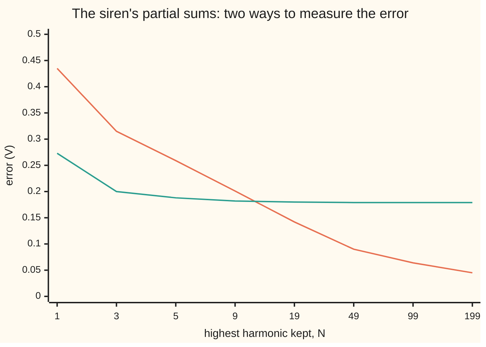

# Convergence in energy: Parseval, completeness, and Riesz-Fischer

[Syllabus](../../../SYLLABUS.md) → [Harmonic analysis](../README.md) → [Fourier Series in Depth](../README.md#s01) → Convergence in energy

---

## General Overview

A siren plays a square wave: +1 V for half of each cycle, −1 V for the other half, 220 cycles a second. It switches 440 times a second. Its Fourier series is a stack of odd harmonics at 220, 660, 1100 Hz and up.

A CD keeps tones up to 22,050 Hz, so it keeps the odd harmonics up to number 99, at 21,780 Hz. Two questions measure how good that copy is:

- **How much energy does the copy miss?** Energy here is the average of the squared voltage over a cycle. The siren holds 1 V²; the copy misses 0.4053 % of it. Keep more harmonics and the miss falls to zero.
- **How far off is the copy at its worst point?** Beside each switch the copy overshoots by 0.179 V. Keep more harmonics and the overshoot does not fall: at harmonic 999 it is still 0.178980 V.

So the series converges in one sense and fails in another. This card proves the first sense for every signal of finite energy, however rough. It is called **convergence in energy**, or mean-square convergence: the energy of the gap between the signal and its partial sum goes to zero.

The card also runs the road backwards. Write down a list of amounts with no signal in mind: cosine amounts 1 V, 1/2 V, 1/3 V, and so on. Their energies add to π²/12 = 0.822467 V², because the sum of 1/n² is π²/6. Is there a signal with exactly these amounts? The **Riesz-Fischer theorem** says yes. Here it is $`-\log(2\sin(|x|/2))`$, a signal that is infinite at one point. Its series does converge at every x except 0, but that takes an argument special to this list. Riesz-Fischer builds a signal from every square-summable list at once, through energy.

**Every finite-energy signal on the circle is the limit in energy of its Fourier partial sums, its energy equals the sum of its squared coefficients (Parseval), and every list of coefficients with a finite sum of squares belongs to exactly one such signal (Riesz-Fischer).**

**What kind of fact this is:** three theorems, proved on this card in Why it works. Two ingredients are proved on linked cards: finite-energy signals have no holes and continuous signals come close to them ([Riesz-Fischer](../../10-Measure%20and%20integration/07-Sizes%20of%20Functions/05-completeness-of-lp.md)), and Fejér averages of a continuous signal land on it uniformly (the folded proof on [Parseval's identity](../../08-Differential%20equations%20and%20dynamics/09-Fourier%20Series/03-parsevals-identity.md)).

### The picture: the gap in energy falls, the overshoot does not



Orange: the root-mean-square gap, the square root of the gap's energy, in volts. It falls towards 0. Teal: the overshoot beside a switch, in volts. It settles at 0.179 V and stays there. Both checks print every point.

---

## The formula

Notation first, in words. The phase $`x`$ runs over one cycle, $`-\pi \le x < \pi`$; for the siren $`x = 2\pi \times 220 \times t`$ with $`t`$ in seconds. The two ends are the same moment, so the phases form a circle, written $`\mathbb{T}`$.

- $`L^2(\mathbb{T})`$ is the set of **finite-energy signals** on the circle: signals $`f`$ whose square has a finite integral over a cycle. Two signals that differ only on a set of total length zero count as one.
- The **energy** is $`\|f\|_2^2 = \frac{1}{2\pi}\int_{-\pi}^{\pi} |f(x)|^2\,dx`$, the average of the square over a cycle. Into a 1-ohm resistor it is the mean power in watts. The **inner product** $`\langle f, g\rangle = \frac{1}{2\pi}\int_{-\pi}^{\pi} f(x)\,\overline{g(x)}\,dx`$ is linear in $`f`$; the bar is the complex conjugate.
- The **coefficient** $`\hat f(n) = \frac{1}{2\pi}\int_{-\pi}^{\pi} f(x)\,e^{-inx}\,dx`$ is the amount of the harmonic $`e^{inx}`$, for every whole number $`n`$, negative ones included ([Fourier coefficients](01-fourier-coefficients-and-orthogonality.md)). It equals wing 07's $`c_n`$.
- The **partial sum** $`S_N f(x) = \sum_{|n| \le N} \hat f(n)\,e^{inx}`$ keeps the harmonics from $`-N`$ to $`N`$.
- $`\ell^2(\mathbb{Z})`$ is the set of **square-summable lists**: lists $`c = (c_n)`$, one complex number for every whole number $`n`$, with $`\sum_n |c_n|^2`$ finite.

The three statements:

```math
\|f - S_N f\|_2^2 \;=\; \sum_{|n| > N} |\hat f(n)|^2 \;\longrightarrow\; 0, \qquad \|f\|_2^2 \;=\; \sum_{n=-\infty}^{\infty} |\hat f(n)|^2
```

```math
c \in \ell^2(\mathbb{Z}) \;\Longrightarrow\; \text{one } f \in L^2(\mathbb{T}) \text{ has } \hat f(n) = c_n \text{ for every } n, \text{ and } \Big\|\, f - \sum_{|n| \le N} c_n e^{inx} \Big\|_2 \to 0
```

**Read it aloud:** the energy a partial sum leaves out is the energy of the coefficients it leaves out, and that falls to zero; so the signal's energy is the total energy of its coefficients; and any list with finite total energy is the coefficient list of exactly one signal.

Together they say the coefficient map $`f \mapsto \hat f`$ matches $`L^2(\mathbb{T})`$ with $`\ell^2(\mathbb{Z})`$ one to one, and keeps energy. On the siren, $`\hat f(n) = 2/(i\pi n)`$ for odd $`n`$ and 0 otherwise, so the pair $`\pm n`$ holds $`8/(\pi^2 n^2)`$ V², and the pairs add to 1 V².

| Symbol | Plain meaning | In our example | Push it up and the answer… |
| --- | --- | --- | --- |
| $`x`$, $`t`$ | phase in radians; time in seconds | $`x = 2\pi \times 220 \times t`$ | the pattern repeats every $`2\pi`$ |
| $`\mathbb{T}`$ | the circle: phases with $`-\pi`$ and $`\pi`$ joined | one cycle of the siren | — |
| $`f`$, $`g`$ | signals on the circle, in volts | $`f`$: the siren, or the signal built from 1/n; $`g`$: Step 2's continuous stand-in | energies grow with their squares |
| $`L^2(\mathbb{T})`$, $`\lVert f \rVert_2`$ | finite-energy signals; the square root of the energy | siren energy 1 V² | — |
| $`\langle f, g\rangle`$ | inner product: the average of $`f`$ times conjugate $`g`$ | $`\langle f, f\rangle = 1`$ V² for the siren | — |
| $`\hat f(n)`$, $`n`$ | amount of harmonic $`n`$, which turns $`n`$ times per cycle | siren: $`2/(i\pi n)`$ at odd $`n`$, so $`n \times 220`$ Hz | louder tone $`n`$ |
| $`S_N f`$, $`N`$ | partial sum: harmonics $`-N`$ to $`N`$ kept | $`N = 99`$ for a CD copy | gap energy falls like $`1/N`$ |
| $`\ell^2(\mathbb{Z})`$, $`c`$, $`c_n`$ | square-summable lists; one list; its entry $`n`$ | $`c_{\pm n} = 1/(2n)`$, cosine amount $`1/n`$ V | — |
| $`P_N`$ | partial sum built from a list: $`\sum_{\lvert n \rvert \le N} c_n e^{inx}`$ | $`P_N(x) = \sum_{n=1}^{N} \cos(nx)/n`$ | closer to its limit in energy |
| $`\sigma_M g`$, $`M`$ | Fejér average: the mean of the partial sums $`S_0 g`$ to $`S_{M-1} g`$ | used in Step 2 | lands on a continuous $`g`$ uniformly |
| $`\varepsilon`$, $`r`$ | a tolerance; a dial between 0 and 1, used in a fold | — | — |
| $`i`$, $`k`$, $`z`$, $`u`$ | the imaginary unit; an odd harmonic number; a complex number in the fold; the code's variable with $`x = \pi u^3`$ | $`k = 3`$ is 660 Hz | — |

### When it holds

- **Finite energy.** The signal's square must have a finite integral. For $`1/\sqrt{|x|}`$ it is infinite, and no list of coefficients balances it.
- **A square-summable list.** The amounts $`1/\sqrt{n}`$ shrink to zero, yet their partial sums hold 3.742735 V² at $`N = 1000`$ and 7.196363 V² at $`N = 1{,}000{,}000`$, rising without end. No finite-energy signal has this list.
- **The whole family of harmonics.** Negative $`n`$ count as much as positive $`n`$. Drop one harmonic, and any signal holding some of it keeps a gap of at least that harmonic's energy forever ([Completeness of sines and cosines](../../18-Functional%20analysis/02-Hilbert%20Spaces/04-completeness-of-the-trigonometric-system.md)).
- **Convergence in energy, not uniform.** The siren's overshoot beside each switch stays at 0.179 V ([The Gibbs overshoot and the cure](08-gibbs-and-summability.md)), so the worst-point error never shrinks while the energy gap falls to 0. Convergence at each single point is a separate, harder question: [Dirichlet's theorem](04-pointwise-and-uniform-convergence.md) settles it for piecewise smooth signals, the siren included, and [Carleson's theorem in outline](09-carleson-in-outline.md) for every finite-energy signal, at almost every point.

---

## Why it works

### Step 0: Pythagoras plus no holes

The harmonics are perpendicular to each other, so energy splits across them like squared sides of a right triangle. That gives the ledger for a finite stack of harmonics. Two facts then carry it to infinity.

1. **Trigonometric polynomials come close to every signal.** A trigonometric polynomial of degree $`N`$ is a finite mix of the harmonics from $`-N`$ to $`N`$. If some mix is close in energy, the partial sum is at least as close, because it is the best mix.
2. **The finite-energy signals have no holes.** A list whose partial sums crowd together in energy has a signal to crowd towards.

Fact 1 proves convergence in energy and Parseval. Fact 2 proves Riesz-Fischer.

### Step 1: the gap's energy is the coefficients' tail

[Partial sums are the best fit](02-best-approximation-and-bessels-inequality.md) proves that $`f - S_N f`$ is perpendicular to every harmonic up to $`N`$. So $`f = S_N f + (f - S_N f)`$ splits into perpendicular pieces, and

```math
\|f - S_N f\|_2^2 \;=\; \|f\|_2^2 - \sum_{|n| \le N} |\hat f(n)|^2 .
```

**Read it aloud:** the energy left out is the total energy minus the energy of the harmonics kept.

It also proves the best-fit property: no trigonometric polynomial of degree $`N`$ is closer to $`f`$ in energy than $`S_N f`$. On the siren after harmonic 1, the ledger gives $`1 - 8/\pi^2 = 0.189431`$ V². Squaring and integrating $`f - S_1 f`$ directly gives the same 0.189431.

### Step 2: every finite-energy signal converges in energy

Fix a tolerance $`\varepsilon > 0`$. Three moves bring $`S_N f`$ within $`2\varepsilon`$ of $`f`$.

1. **A continuous stand-in.** [Riesz-Fischer](../../10-Measure%20and%20integration/07-Sizes%20of%20Functions/05-completeness-of-lp.md) proves continuous signals that are zero outside a bounded interval come within any tolerance of a finite-energy signal. Pick one, $`g`$, with $`\|f - g\|_2 < \varepsilon/2`$, and cut it to zero near $`\pm\pi`$ over a stretch short enough that the cut costs less than $`\varepsilon/2`$. Then $`\|f - g\|_2 < \varepsilon`$ still, and $`g`$ joins up around the circle.
2. **A trigonometric polynomial close to the stand-in.** The Fejér average $`\sigma_M g`$ lands on $`g`$ uniformly, that is, within any tolerance at every point at once. Its kernel is on [Dirichlet and Fejer kernels](03-dirichlet-and-fejer-kernels.md); the proof is in the fold of [Parseval's identity](../../08-Differential%20equations%20and%20dynamics/09-Fourier%20Series/03-parsevals-identity.md). Pick $`M`$ with $`|g(x) - \sigma_M g(x)| < \varepsilon`$ at every $`x`$. An average of squares below $`\varepsilon^2`$ is below $`\varepsilon^2`$, so $`\|g - \sigma_M g\|_2 < \varepsilon`$.
3. **The partial sum beats it.** $`\sigma_M g`$ is a trigonometric polynomial of degree $`M - 1`$. For every $`N \ge M - 1`$, Step 1's best fit and the triangle inequality give

```math
\|f - S_N f\|_2 \;\le\; \|f - \sigma_M g\|_2 \;\le\; \|f - g\|_2 + \|g - \sigma_M g\|_2 \;<\; 2\varepsilon .
```

The tolerance was arbitrary, so $`\|f - S_N f\|_2 \to 0`$. That is the trigonometric proof. [Completeness of sines and cosines](../../18-Functional%20analysis/02-Hilbert%20Spaces/04-completeness-of-the-trigonometric-system.md) reaches the same end by a smooth stand-in and integration by parts.

### Step 3: Parseval, and how fast the siren's gap closes

Let $`N \to \infty`$ in Step 1. The left side goes to 0 by Step 2, so

```math
\|f\|_2^2 = \sum_{n=-\infty}^{\infty} |\hat f(n)|^2 .
```

[Parseval's identity](../../08-Differential%20equations%20and%20dynamics/09-Fourier%20Series/03-parsevals-identity.md) proved this for piecewise-smooth signals. Now it holds for every finite-energy signal. On the siren it reads $`1 = (8/\pi^2)(1 + 1/9 + 1/25 + \dots)`$, so the odd squares add to $`\pi^2/8 = 1.233700550`$. That is the check already done in [Fourier series](../../07-Complex%20analysis/08-Transforms%20in%20Outline/01-fourier-series-in-complex-form.md). Here the code brackets it: the odd terms up to 999 give 1.233201, and the tail lies between 0.000500 and 0.000501.

The gap has a clean size. For odd $`N`$, the gap is $`(8/\pi^2)`$ times the sum of $`1/k^2`$ over odd $`k \ge N + 2`$. Each term sits between two telescoping pieces, $`1/(k(k+2)) < 1/k^2 < 1/(k(k-2))`$, so

```math
\frac{4}{\pi^2 (N+2)} \;<\; \|f - S_N f\|_2^2 \;<\; \frac{4}{\pi^2 N}.
```

**Read it aloud:** after harmonic $`N`$, the siren's missing energy is about $`4/\pi^2`$ divided by $`N`$, in V².

At $`N = 99`$ the gap is 0.004053 V², inside the bracket 0.004013 to 0.004094. That is the CD copy's 0.4053 % miss. Ten times as many harmonics leave about one tenth of the energy out.

### Step 4: Riesz-Fischer, from a list to a signal

Take any square-summable list $`c`$ and its partial sums $`P_N`$. For $`M > N`$, $`P_M - P_N`$ is a finite stack of harmonics, so by Pythagoras

```math
\|P_M - P_N\|_2^2 = \sum_{N < |n| \le M} |c_n|^2 .
```

The right side is a stretch of the tail of a convergent sum, so it goes to 0. The partial sums crowd together: they form a **Cauchy sequence** (late terms are close to each other). By [Riesz-Fischer](../../10-Measure%20and%20integration/07-Sizes%20of%20Functions/05-completeness-of-lp.md), $`L^2(\mathbb{T})`$ is complete, so a signal $`f`$ exists with $`\|f - P_N\|_2 \to 0`$.

Its coefficients are the list. For $`N \ge |n|`$, the coefficient of $`P_N`$ at $`n`$ is exactly $`c_n`$. A coefficient is an inner product with $`e^{inx}`$, which has energy 1, so the Cauchy-Schwarz inequality gives

```math
|\hat f(n) - c_n| = |\langle f - P_N,\, e^{inx}\rangle| \le \|f - P_N\|_2 \to 0 .
```

Only one signal has this list. If two did, their difference would have every coefficient 0, and Parseval would give it energy 0.

On the list $`c_{\pm n} = 1/(2n)`$, the gap between $`P_{100}`$ and $`P_{10}`$ has energy 0.042608 V², below $`1/(2 \times 10) = 0.05`$. Between $`P_{10000}`$ and $`P_{1000}`$ it is 0.000450, below 0.0005.

### Step 5: naming the rebuilt signal

Riesz-Fischer promises a signal but does not name it. For this list it is

```math
f(x) = -\log\big(2\sin(|x|/2)\big) = \sum_{n=1}^{\infty} \frac{\cos(nx)}{n} \quad \text{in energy,}
```

because $`2\sin(|x|/2)`$ is the distance from $`e^{ix}`$ to 1 on the unit circle. The code confirms it two ways. Simpson's rule on $`f`$ gives coefficients 0.500000, 0.250000, 0.166667 and 0.050000 at $`n = 1, 2, 3, 10`$, matching $`1/(2n)`$. And Simpson's rule on $`f^2`$ gives energy 0.822467 V², matching the list's $`\pi^2/12`$.

<details>
<summary>Detailed proof: the list 1/n builds −log(2 sin(|x|/2))</summary>

Turn the dial down first. For $`0 < r < 1`$ the series $`\sum_{n \ge 1} z^n/n`$ is $`-\log(1 - z)`$ for $`|z| < 1`$. Put $`z = re^{ix}`$ and keep the real part:

$`\displaystyle \sum_{n=1}^{\infty} \frac{r^n \cos(nx)}{n} = -\log\big|1 - re^{ix}\big| .`$

Both sides depend on $`r`$. Now let $`r \to 1`$ on each side.

The left side is the list $`c_{\pm n} = r^n/(2n)`$. Its energy distance from the list $`1/(2n)`$ is

$`\displaystyle \frac{1}{2}\sum_{n=1}^{\infty} \frac{(1 - r^n)^2}{n^2},`$

which goes to 0: each term goes to 0, and each is below $`1/n^2`$. By Step 4, the left side converges in energy to the signal that Riesz-Fischer builds from the list $`1/(2n)`$.

The right side converges at every $`x \ne 0`$ to $`-\log|1 - e^{ix}| = -\log(2\sin(|x|/2))`$. For $`r \ge 1/2`$, $`|1 - re^{ix}|`$ lies between $`\tfrac12|\sin x|`$ and 2. So the square of the right side stays below a fixed multiple of $`1 + \log^2|\sin x|`$, which has a finite integral. Dominated convergence then gives convergence in energy.

One sequence cannot converge in energy to two different signals. So the Riesz-Fischer signal is $`-\log(2\sin(|x|/2))`$.

</details>

### Step 6: what convergence in energy does not promise

The rebuilt signal is infinite at $`x = 0`$, and there its partial sums are $`1 + 1/2 + \dots + 1/N`$: 2.928968 V at $`N = 10`$, 7.485471 V at $`N = 1000`$, rising without bound. Away from the spike they behave: at $`x = \pi/2`$, $`f = -0.346574`$ V and $`P_{1000} = -0.346074`$ V.

The energy picture shows why that spike does not matter in energy. Each harmonic's share is $`1/(2n^2)`$ V²:

```
energy of the rebuilt signal, by harmonic (V^2)
n = 1   ████████████████████████████████████████   0.500000
n = 2   ██████████                                 0.125000
n = 3   ████                                       0.055556
n = 4   ██▌                                        0.031250
n = 5   █▌                                         0.020000
all n                                    total     0.822467
```

The spike is tall but narrow. Its square still has a finite integral, so it holds finite energy, and the harmonics account for all of it.

---

## Worked numbers, by hand

The siren cut after harmonic $`N = 3`$: a copy that keeps tones up to 660 Hz.

| Step | Arithmetic | Value |
| --- | --- | --- |
| siren energy | average of $`(\pm 1)^2`$ | 1 V² |
| harmonic pair $`\pm 1`$ | $`8/\pi^2`$ | 0.810569 V² |
| harmonic pair $`\pm 3`$ | $`8/(9\pi^2)`$ | 0.090063 V² |
| kept energy | $`8/\pi^2 + 8/(9\pi^2)`$ | 0.900633 V² |
| gap energy | 1 − 0.900633 | **0.099367 V²** |
| bracket from Step 3 | $`4/(5\pi^2)`$ to $`4/(3\pi^2)`$ | 0.081057 to 0.135095 |
| root-mean-square gap | $`\sqrt{0.099367}`$ | 0.315 V |

After two harmonics the copy misses about a tenth of the siren's energy, and its typical error is about 0.3 V. Simpson's rule on the squared gap gives the same 0.099367.

### What breaks if you drop a piece

| Mistake | Comes out at | What went wrong |
| --- | --- | --- |
| A list that is not square-summable, $`1/\sqrt{n}`$ | 3.742735 V² at $`N = 1000`$, 7.196363 V² at 1,000,000 | The partial sums are not Cauchy; there is no finite-energy signal to converge to |
| No $`1/2\pi`$ before the integral | siren energy 6.283185 against coefficients 1.000000 | Energy and coefficients on different scales |
| Positive $`n`$ only | coefficients 0.500000 against 1.000000 | A real signal splits its energy equally between $`n`$ and $`-n`$ |
| Judged by the largest error, $`N = 99`$ | overshoot 0.179013 V while the root-mean-square gap is 0.063661 V | Energy convergence says nothing about the worst point |

The code prints all four.

---

## Code, from first principles, and it actually runs

The code takes three independent roads to each energy. The ledger adds squared coefficients. Simpson's rule integrates the squared signal itself, with no coefficients. Integral bounds bracket each tail. For the rebuilt signal the substitution $`x = \pi u^3`$ tames the spike at $`x = 0`$, so Simpson's rule works on it. Both programs print the same lines.

### Python

```python
# Convergence in energy -- the check behind the card.  Standard library only.
# Two signals on one cycle of phase x in [-pi, pi):
#   the house siren, a +-1 V square wave (220 cycles a second), whose
#   coefficients are 2/(i pi n) on odd n;
#   the list 1/n, as cosine amounts in volts, which Riesz-Fischer turns into
#   a signal; the card identifies it as f(x) = -log(2 sin(|x|/2)).
# Every energy is (1/2pi) times the integral of the square over one cycle.
# Roads: the coefficient ledger (sums of |c_n|^2), Simpson's rule on the
# signal itself, and integral bounds on the tails.  Nothing imported knows
# the answer; math gives only sin, cos, log, sqrt and pi.
import math
PI = math.pi

def simpson(g, a, b, m=4000):            # Simpson's rule, m even slices
    h = (b - a) / m
    s = g(a) + g(b) + sum((4 if k % 2 else 2) * g(a + k * h) for k in range(1, m))
    return s * h / 3

def siren(x):                            # the square wave: +1 V on (0, pi), -1 V on (-pi, 0)
    return 1.0 if x > 0 else -1.0

def siren_sum(N, x):                     # S_N of the square wave, odd k <= N
    return 4 / PI * sum(math.sin(k * x) / k for k in range(1, N + 1, 2))

def siren_gap_ledger(N):                 # 1 - energies of harmonics |n| <= N
    return 1 - 8 / PI ** 2 * sum(1 / k ** 2 for k in range(1, N + 1, 2))

def siren_gap_direct(N):                 # (1/2pi) int (f - S_N)^2, by symmetry
    return simpson(lambda x: (1 - siren_sum(N, x)) ** 2, 0, PI) / PI

def log_signal(x):                       # the signal the list 1/n builds
    return -math.log(2 * math.sin(abs(x) / 2))

def log_sum(N, x):                       # P_N: cosines with amounts 1/n, n <= N
    return sum(math.cos(n * x) / n for n in range(1, N + 1))

def cycle_mean(g):                       # (1/pi) int_0^pi g dx for an even g;
    # x = pi u^3 tames the spike at x = 0, where the integrand tends to 0
    return simpson(lambda u: 0.0 if u == 0 else 3 * u * u * g(PI * u ** 3), 0, 1)

def tail(N, M):                          # (1/2) sum 1/n^2 for N < n <= M
    return 0.5 * sum(1 / n ** 2 for n in range(N + 1, M + 1))

f6 = lambda v: f"{v:.6f}"
print("== the siren: +-1 V square wave, 220 cycles a second ==")
print(f"switches per second {2 * 220}; odd harmonics at {220}, {3 * 220}, {5 * 220} Hz and up")
int_sq = simpson(lambda x: siren(x) ** 2, -PI, PI)  # int f^2 over a cycle, by Simpson
print(f"energy (1/2pi) int f^2 = {f6(int_sq / (2 * PI))} V^2; harmonic pair +-n holds 8/(pi^2 n^2)")
print("N | gap by ledger | gap by Simpson | lower 4/(pi^2 (N+2)) | upper 4/(pi^2 N)")
for N in (1, 3, 9, 99):
    led, direct = siren_gap_ledger(N), siren_gap_direct(N)
    lo, hi = 4 / (PI ** 2 * (N + 2)), 4 / (PI ** 2 * N)
    print(f"{N} | {f6(led)} | {f6(direct)} | {f6(lo)} | {f6(hi)}")
    assert abs(led - direct) < 1e-8                        # ledger = signal
    assert lo < led < hi                                   # tail bounds hold
p1, p3 = 8 / PI ** 2, 8 / (9 * PI ** 2)
print(f"worked N = 3: pair 1 = {f6(p1)}, pair 3 = {f6(p3)}, kept = {f6(p1 + p3)}, gap = {f6(1 - p1 - p3)} V^2")
print(f"CD copy keeps odd harmonics up to 99: {99 * 220} Hz <= 22050 Hz < {101 * 220} Hz")
print(f"CD copy misses {100 * siren_gap_ledger(99):.4f} % of the siren's energy")
odd = sum(1 / k ** 2 for k in range(1, 1000, 2))
print(f"Parseval on the siren: sum of 1/n^2 over odd n <= 999 = {f6(odd)}, "
      f"tail between {f6(1 / 2002)} and {f6(1 / 1998)}")
print(f"pi^2/8 = {PI ** 2 / 8:.9f} lies between {odd + 1 / 2002:.9f} and {odd + 1 / 1998:.9f}")
assert odd + 1 / 2002 < PI ** 2 / 8 < odd + 1 / 1998
print("chart, N | rms gap sqrt(gap) V | overshoot S_N(pi/(N+1)) - 1 V")
for N in (1, 3, 5, 9, 19, 49, 99, 199):
    over = siren_sum(N, PI / (N + 1)) - 1
    print(f"chart, {N} | {math.sqrt(siren_gap_ledger(N)):.3f} | {over:.3f}")
peak = siren_sum(999, PI / 1000) - 1
print(f"overshoot at N = 999: {f6(peak)} V; it does not go to 0")
assert peak > 0.178

print("== Riesz-Fischer: the list of cosine amounts 1/n V ==")
energy_list = PI ** 2 / 12
part = 0.5 * sum(1 / n ** 2 for n in range(1, 100001))
print(f"list energy: (1/2) sum 1/n^2 = pi^2/12 = {f6(energy_list)} V^2")
print(f"list energy summed to n = 100000: {f6(part)}, tail below {f6(0.5 / 100000)}")
energy_sig = cycle_mean(lambda x: log_signal(x) ** 2)
print(f"signal energy by Simpson, -log(2 sin(|x|/2)) squared: {f6(energy_sig)} V^2")
assert abs(energy_sig - energy_list) < 1e-6                # Parseval, both sides
assert 0 < energy_list - part < 0.5 / 100000
for N, M in ((10, 100), (100, 1000), (1000, 10000)):
    g = tail(N, M)
    print(f"Cauchy gap ||P_{M} - P_{N}||^2 = {f6(g)} <= 1/(2N) = {f6(0.5 / N)}")
    assert g < 0.5 / N
print("n | coefficient of the signal by Simpson | list value 1/(2n)")
for n in (1, 2, 3, 10):
    c = cycle_mean(lambda x: log_signal(x) * math.cos(n * x))
    print(f"{n} | {f6(c)} | {f6(1 / (2 * n))}")
    assert abs(c - 1 / (2 * n)) < 1e-6                     # rebuilt signal has the list
print("N | gap ||f - P_N||^2 by Simpson | by the list's tail")
for N in (1, 3, 10):
    direct = cycle_mean(lambda x: (log_signal(x) - log_sum(N, x)) ** 2)
    led = energy_list - 0.5 * sum(1 / n ** 2 for n in range(1, N + 1))
    print(f"{N} | {f6(direct)} | {f6(led)}")
    assert abs(direct - led) < 1e-6
print(f"at x = pi/2: f = {f6(log_signal(PI / 2))} V, P_1000 = {f6(log_sum(1000, PI / 2))} V")
for N in (10, 1000):
    print(f"at x = 0: P_{N}(0) = sum of 1/n = {f6(log_sum(N, 0))} V, still rising")
print("bars, energy of harmonic n = 1/(2n^2):", ", ".join(f6(0.5 / n ** 2) for n in range(1, 6)))

print("== what breaks ==")
for N in (1000, 1000000):
    h = 0.5 * sum(1 / n for n in range(1, N + 1))
    print(f"list 1/sqrt(n): energy of P_{N} = {f6(h)} V^2, no limit")
half = 4 / PI ** 2 * sum(1 / k ** 2 for k in range(1, 1000000, 2))  # n = 1, 3, ..., 999999
full = 2 * half                                        # the ledger over both signs of n
assert abs(int_sq / (2 * PI) - full) < 1e-6            # Parseval on the siren, both sides
print(f"no 1/2pi: int f^2 over a cycle = {f6(int_sq)} against sum |c_n|^2 = {f6(full)}")
print(f"positive n only: sum |c_n|^2 = {f6(half)} against {f6(full)}")
print(f"judged by the largest error: N = 99 rms gap {f6(math.sqrt(siren_gap_ledger(99)))} V, "
      f"overshoot {f6(siren_sum(99, PI / 100) - 1)} V")
print("ALL CHECKS PASS")
```

**Ran 2026-11-15 on macOS, Python 3.14.10, standard library only. All checks passed. Output, pasted from the run:**

```
== the siren: +-1 V square wave, 220 cycles a second ==
switches per second 440; odd harmonics at 220, 660, 1100 Hz and up
energy (1/2pi) int f^2 = 1.000000 V^2; harmonic pair +-n holds 8/(pi^2 n^2)
N | gap by ledger | gap by Simpson | lower 4/(pi^2 (N+2)) | upper 4/(pi^2 N)
1 | 0.189431 | 0.189431 | 0.135095 | 0.405285
3 | 0.099367 | 0.099367 | 0.081057 | 0.135095
9 | 0.040395 | 0.040395 | 0.036844 | 0.045032
99 | 0.004053 | 0.004053 | 0.004013 | 0.004094
worked N = 3: pair 1 = 0.810569, pair 3 = 0.090063, kept = 0.900633, gap = 0.099367 V^2
CD copy keeps odd harmonics up to 99: 21780 Hz <= 22050 Hz < 22220 Hz
CD copy misses 0.4053 % of the siren's energy
Parseval on the siren: sum of 1/n^2 over odd n <= 999 = 1.233201, tail between 0.000500 and 0.000501
pi^2/8 = 1.233700550 lies between 1.233700051 and 1.233701051
chart, N | rms gap sqrt(gap) V | overshoot S_N(pi/(N+1)) - 1 V
chart, 1 | 0.435 | 0.273
chart, 3 | 0.315 | 0.200
chart, 5 | 0.259 | 0.188
chart, 9 | 0.201 | 0.182
chart, 19 | 0.142 | 0.180
chart, 49 | 0.090 | 0.179
chart, 99 | 0.064 | 0.179
chart, 199 | 0.045 | 0.179
overshoot at N = 999: 0.178980 V; it does not go to 0
== Riesz-Fischer: the list of cosine amounts 1/n V ==
list energy: (1/2) sum 1/n^2 = pi^2/12 = 0.822467 V^2
list energy summed to n = 100000: 0.822462, tail below 0.000005
signal energy by Simpson, -log(2 sin(|x|/2)) squared: 0.822467 V^2
Cauchy gap ||P_100 - P_10||^2 = 0.042608 <= 1/(2N) = 0.050000
Cauchy gap ||P_1000 - P_100||^2 = 0.004475 <= 1/(2N) = 0.005000
Cauchy gap ||P_10000 - P_1000||^2 = 0.000450 <= 1/(2N) = 0.000500
n | coefficient of the signal by Simpson | list value 1/(2n)
1 | 0.500000 | 0.500000
2 | 0.250000 | 0.250000
3 | 0.166667 | 0.166667
10 | 0.050000 | 0.050000
N | gap ||f - P_N||^2 by Simpson | by the list's tail
1 | 0.322467 | 0.322467
3 | 0.141911 | 0.141911
10 | 0.047583 | 0.047583
at x = pi/2: f = -0.346574 V, P_1000 = -0.346074 V
at x = 0: P_10(0) = sum of 1/n = 2.928968 V, still rising
at x = 0: P_1000(0) = sum of 1/n = 7.485471 V, still rising
bars, energy of harmonic n = 1/(2n^2): 0.500000, 0.125000, 0.055556, 0.031250, 0.020000
== what breaks ==
list 1/sqrt(n): energy of P_1000 = 3.742735 V^2, no limit
list 1/sqrt(n): energy of P_1000000 = 7.196363 V^2, no limit
no 1/2pi: int f^2 over a cycle = 6.283185 against sum |c_n|^2 = 1.000000
positive n only: sum |c_n|^2 = 0.500000 against 1.000000
judged by the largest error: N = 99 rms gap 0.063661 V, overshoot 0.179013 V
ALL CHECKS PASS
```

### Rust

Same numbers, same labels, built with `rustc --edition 2021 -O`.

```rust
// Convergence in energy -- the same check as the Python, in Rust.  No crates.
// Two signals on one cycle of phase x in [-pi, pi):
//   the house siren, a +-1 V square wave (220 cycles a second), whose
//   coefficients are 2/(i pi n) on odd n;
//   the list 1/n, as cosine amounts in volts, which Riesz-Fischer turns into
//   a signal; the card identifies it as f(x) = -log(2 sin(|x|/2)).
// Every energy is (1/2pi) times the integral of the square over one cycle.
// Roads: the coefficient ledger (sums of |c_n|^2), Simpson's rule on the
// signal itself, and integral bounds on the tails.
use std::f64::consts::PI;

fn simpson(g: &dyn Fn(f64) -> f64, a: f64, b: f64, m: usize) -> f64 {
    let h = (b - a) / m as f64;
    let mut s = g(a) + g(b);
    for k in 1..m {
        s += if k % 2 == 1 { 4.0 } else { 2.0 } * g(a + k as f64 * h);
    }
    s * h / 3.0
}

fn siren(x: f64) -> f64 {                        // the square wave: +1 V on (0, pi), -1 V on (-pi, 0)
    if x > 0.0 { 1.0 } else { -1.0 }
}

fn siren_sum(n: usize, x: f64) -> f64 {          // S_N of the square wave, odd k <= N
    4.0 / PI * (1..=n).step_by(2).map(|k| (k as f64 * x).sin() / k as f64).sum::<f64>()
}

fn siren_gap_ledger(n: usize) -> f64 {           // 1 - energies of harmonics |n| <= N
    1.0 - 8.0 / (PI * PI) * (1..=n).step_by(2).map(|k| 1.0 / (k * k) as f64).sum::<f64>()
}

fn siren_gap_direct(n: usize) -> f64 {           // (1/2pi) int (f - S_N)^2, by symmetry
    simpson(&|x| (1.0 - siren_sum(n, x)).powi(2), 0.0, PI, 4000) / PI
}

fn log_signal(x: f64) -> f64 {                   // the signal the list 1/n builds
    -(2.0 * (x.abs() / 2.0).sin()).ln()
}

fn log_sum(n: usize, x: f64) -> f64 {            // P_N: cosines with amounts 1/n, n <= N
    (1..=n).map(|k| (k as f64 * x).cos() / k as f64).sum()
}

fn cycle_mean(g: &dyn Fn(f64) -> f64) -> f64 {   // (1/pi) int_0^pi g dx for an even g;
    // x = pi u^3 tames the spike at x = 0, where the integrand tends to 0
    simpson(&|u: f64| if u == 0.0 { 0.0 } else { 3.0 * u * u * g(PI * u.powi(3)) }, 0.0, 1.0, 4000)
}

fn tail(n: usize, m: usize) -> f64 {             // (1/2) sum 1/n^2 for N < n <= M
    0.5 * (n + 1..=m).map(|k| 1.0 / (k as f64 * k as f64)).sum::<f64>()
}

fn f6(v: f64) -> String { format!("{:.6}", v) }

fn main() {
    println!("== the siren: +-1 V square wave, 220 cycles a second ==");
    println!("switches per second {}; odd harmonics at {}, {}, {} Hz and up", 2 * 220, 220, 3 * 220, 5 * 220);
    let int_sq = simpson(&|x| siren(x).powi(2), -PI, PI, 4000); // int f^2 over a cycle, by Simpson
    println!("energy (1/2pi) int f^2 = {} V^2; harmonic pair +-n holds 8/(pi^2 n^2)", f6(int_sq / (2.0 * PI)));
    println!("N | gap by ledger | gap by Simpson | lower 4/(pi^2 (N+2)) | upper 4/(pi^2 N)");
    for n in [1usize, 3, 9, 99] {
        let (led, direct) = (siren_gap_ledger(n), siren_gap_direct(n));
        let (lo, hi) = (4.0 / (PI * PI * (n + 2) as f64), 4.0 / (PI * PI * n as f64));
        println!("{} | {} | {} | {} | {}", n, f6(led), f6(direct), f6(lo), f6(hi));
        assert!((led - direct).abs() < 1e-8);                  // ledger = signal
        assert!(lo < led && led < hi);                        // tail bounds hold
    }
    let (p1, p3) = (8.0 / (PI * PI), 8.0 / (9.0 * PI * PI));
    println!("worked N = 3: pair 1 = {}, pair 3 = {}, kept = {}, gap = {} V^2", f6(p1), f6(p3), f6(p1 + p3), f6(1.0 - p1 - p3));
    println!("CD copy keeps odd harmonics up to 99: {} Hz <= 22050 Hz < {} Hz", 99 * 220, 101 * 220);
    println!("CD copy misses {:.4} % of the siren's energy", 100.0 * siren_gap_ledger(99));
    let odd: f64 = (1..1000usize).step_by(2).map(|k| 1.0 / (k * k) as f64).sum();
    println!("Parseval on the siren: sum of 1/n^2 over odd n <= 999 = {}, tail between {} and {}",
             f6(odd), f6(1.0 / 2002.0), f6(1.0 / 1998.0));
    let p8 = PI * PI / 8.0;
    println!("pi^2/8 = {:.9} lies between {:.9} and {:.9}", p8, odd + 1.0 / 2002.0, odd + 1.0 / 1998.0);
    assert!(odd + 1.0 / 2002.0 < p8 && p8 < odd + 1.0 / 1998.0);
    println!("chart, N | rms gap sqrt(gap) V | overshoot S_N(pi/(N+1)) - 1 V");
    for n in [1usize, 3, 5, 9, 19, 49, 99, 199] {
        let over = siren_sum(n, PI / (n + 1) as f64) - 1.0;
        println!("chart, {} | {:.3} | {:.3}", n, siren_gap_ledger(n).sqrt(), over);
    }
    let peak = siren_sum(999, PI / 1000.0) - 1.0;
    println!("overshoot at N = 999: {} V; it does not go to 0", f6(peak));
    assert!(peak > 0.178);

    println!("== Riesz-Fischer: the list of cosine amounts 1/n V ==");
    let energy_list = PI * PI / 12.0;
    let part = 0.5 * (1..=100000usize).map(|k| 1.0 / (k as f64 * k as f64)).sum::<f64>();
    println!("list energy: (1/2) sum 1/n^2 = pi^2/12 = {} V^2", f6(energy_list));
    println!("list energy summed to n = 100000: {}, tail below {}", f6(part), f6(0.5 / 100000.0));
    let energy_sig = cycle_mean(&|x| log_signal(x).powi(2));
    println!("signal energy by Simpson, -log(2 sin(|x|/2)) squared: {} V^2", f6(energy_sig));
    assert!((energy_sig - energy_list).abs() < 1e-6);         // Parseval, both sides
    assert!(0.0 < energy_list - part && energy_list - part < 0.5 / 100000.0);
    for (n, m) in [(10usize, 100usize), (100, 1000), (1000, 10000)] {
        let g = tail(n, m);
        println!("Cauchy gap ||P_{} - P_{}||^2 = {} <= 1/(2N) = {}", m, n, f6(g), f6(0.5 / n as f64));
        assert!(g < 0.5 / n as f64);
    }
    println!("n | coefficient of the signal by Simpson | list value 1/(2n)");
    for n in [1usize, 2, 3, 10] {
        let c = cycle_mean(&|x| log_signal(x) * (n as f64 * x).cos());
        println!("{} | {} | {}", n, f6(c), f6(1.0 / (2 * n) as f64));
        assert!((c - 1.0 / (2 * n) as f64).abs() < 1e-6);     // rebuilt signal has the list
    }
    println!("N | gap ||f - P_N||^2 by Simpson | by the list's tail");
    for n in [1usize, 3, 10] {
        let direct = cycle_mean(&|x| (log_signal(x) - log_sum(n, x)).powi(2));
        let led = energy_list - 0.5 * (1..=n).map(|k| 1.0 / (k * k) as f64).sum::<f64>();
        println!("{} | {} | {}", n, f6(direct), f6(led));
        assert!((direct - led).abs() < 1e-6);
    }
    println!("at x = pi/2: f = {} V, P_1000 = {} V", f6(log_signal(PI / 2.0)), f6(log_sum(1000, PI / 2.0)));
    for n in [10usize, 1000] {
        println!("at x = 0: P_{}(0) = sum of 1/n = {} V, still rising", n, f6(log_sum(n, 0.0)));
    }
    let bars: Vec<String> = (1..=5).map(|k| f6(0.5 / (k * k) as f64)).collect();
    println!("bars, energy of harmonic n = 1/(2n^2): {}", bars.join(", "));

    println!("== what breaks ==");
    for n in [1000usize, 1000000] {
        let h = 0.5 * (1..=n).map(|k| 1.0 / k as f64).sum::<f64>();
        println!("list 1/sqrt(n): energy of P_{} = {} V^2, no limit", n, f6(h));
    }
    let half = 4.0 / (PI * PI) * (1..1000000usize).step_by(2).map(|k| 1.0 / (k as f64 * k as f64)).sum::<f64>();
    let full = 2.0 * half;                                    // the ledger over both signs of n
    assert!((int_sq / (2.0 * PI) - full).abs() < 1e-6);       // Parseval on the siren, both sides
    println!("no 1/2pi: int f^2 over a cycle = {} against sum |c_n|^2 = {}", f6(int_sq), f6(full));
    println!("positive n only: sum |c_n|^2 = {} against {}", f6(half), f6(full));
    println!("judged by the largest error: N = 99 rms gap {} V, overshoot {} V",
             f6(siren_gap_ledger(99).sqrt()), f6(siren_sum(99, PI / 100.0) - 1.0));
    println!("ALL CHECKS PASS");
}
```

**Ran 2026-11-15 on macOS, rustc 1.98.1, no crates. All checks passed. Output, pasted from the run:**

```
== the siren: +-1 V square wave, 220 cycles a second ==
switches per second 440; odd harmonics at 220, 660, 1100 Hz and up
energy (1/2pi) int f^2 = 1.000000 V^2; harmonic pair +-n holds 8/(pi^2 n^2)
N | gap by ledger | gap by Simpson | lower 4/(pi^2 (N+2)) | upper 4/(pi^2 N)
1 | 0.189431 | 0.189431 | 0.135095 | 0.405285
3 | 0.099367 | 0.099367 | 0.081057 | 0.135095
9 | 0.040395 | 0.040395 | 0.036844 | 0.045032
99 | 0.004053 | 0.004053 | 0.004013 | 0.004094
worked N = 3: pair 1 = 0.810569, pair 3 = 0.090063, kept = 0.900633, gap = 0.099367 V^2
CD copy keeps odd harmonics up to 99: 21780 Hz <= 22050 Hz < 22220 Hz
CD copy misses 0.4053 % of the siren's energy
Parseval on the siren: sum of 1/n^2 over odd n <= 999 = 1.233201, tail between 0.000500 and 0.000501
pi^2/8 = 1.233700550 lies between 1.233700051 and 1.233701051
chart, N | rms gap sqrt(gap) V | overshoot S_N(pi/(N+1)) - 1 V
chart, 1 | 0.435 | 0.273
chart, 3 | 0.315 | 0.200
chart, 5 | 0.259 | 0.188
chart, 9 | 0.201 | 0.182
chart, 19 | 0.142 | 0.180
chart, 49 | 0.090 | 0.179
chart, 99 | 0.064 | 0.179
chart, 199 | 0.045 | 0.179
overshoot at N = 999: 0.178980 V; it does not go to 0
== Riesz-Fischer: the list of cosine amounts 1/n V ==
list energy: (1/2) sum 1/n^2 = pi^2/12 = 0.822467 V^2
list energy summed to n = 100000: 0.822462, tail below 0.000005
signal energy by Simpson, -log(2 sin(|x|/2)) squared: 0.822467 V^2
Cauchy gap ||P_100 - P_10||^2 = 0.042608 <= 1/(2N) = 0.050000
Cauchy gap ||P_1000 - P_100||^2 = 0.004475 <= 1/(2N) = 0.005000
Cauchy gap ||P_10000 - P_1000||^2 = 0.000450 <= 1/(2N) = 0.000500
n | coefficient of the signal by Simpson | list value 1/(2n)
1 | 0.500000 | 0.500000
2 | 0.250000 | 0.250000
3 | 0.166667 | 0.166667
10 | 0.050000 | 0.050000
N | gap ||f - P_N||^2 by Simpson | by the list's tail
1 | 0.322467 | 0.322467
3 | 0.141911 | 0.141911
10 | 0.047583 | 0.047583
at x = pi/2: f = -0.346574 V, P_1000 = -0.346074 V
at x = 0: P_10(0) = sum of 1/n = 2.928968 V, still rising
at x = 0: P_1000(0) = sum of 1/n = 7.485471 V, still rising
bars, energy of harmonic n = 1/(2n^2): 0.500000, 0.125000, 0.055556, 0.031250, 0.020000
== what breaks ==
list 1/sqrt(n): energy of P_1000 = 3.742735 V^2, no limit
list 1/sqrt(n): energy of P_1000000 = 7.196363 V^2, no limit
no 1/2pi: int f^2 over a cycle = 6.283185 against sum |c_n|^2 = 1.000000
positive n only: sum |c_n|^2 = 0.500000 against 1.000000
judged by the largest error: N = 99 rms gap 0.063661 V, overshoot 0.179013 V
ALL CHECKS PASS
```

The two outputs match line for line.

### Lean

Lean proves the three theorems of The formula, for every finite-energy signal and every square-summable list, and checks the whole-number facts.

- Take a finite-energy signal $`f`$ and any $`N`$. Then $`\|f - S_N f\|_2^2 = \sum_{|n| > N} |\hat f(n)|^2`$, and this gap falls to 0.
- Take a finite-energy signal $`f`$. Then $`\|f\|_2^2 = \sum_n |\hat f(n)|^2`$, summed over every whole number $`n`$: Parseval.
- Take a square-summable list $`c`$. Then exactly one finite-energy signal $`f`$ has $`\hat f(n) = c_n`$ for every $`n`$, and $`P_N`$ converges to it in energy.
- The siren switches 440 times a second, and harmonics 3 and 5 sit at 660 Hz and 1100 Hz.
- The CD copy keeps odd harmonics up to 99: harmonic 99 sits at 21,780 Hz, below 22,050 Hz, and harmonic 101 at 22,220 Hz.
- Harmonics 1 to 5 of the rebuilt signal hold 1/2, 1/8, 1/18, 1/32 and 1/50 V².
- Step 4's bounds $`1/(2N)`$ at $`N`$ = 10, 100 and 1000 are 1/20, 1/200 and 1/2000.

Decimal values, Simpson's rule, naming the rebuilt signal and the 0.179 V overshoot are left to the Python and Rust checks.

```lean
-- Convergence in energy: every finite-energy signal on the circle is the limit in energy of its Fourier partial sums, its energy equals the sum of its squared coefficients, and every square-summable list is the coefficient list of exactly one finite-energy signal.
import Mathlib.Analysis.Fourier.AddCircle
import Mathlib.Order.Filter.AtTopBot.Interval

open MeasureTheory Filter Topology Real

namespace L2ConvergenceRieszFischer

/-! Notation, as on the card. The phase `x` runs over one cycle of length `2π`, with the two
ends joined: the circle `𝕋` is `AddCircle (2 * π)`. Mathlib's `haarAddCircle` is the length
measure divided by `2π`, so for a signal `f` in `L²(𝕋)` (Mathlib's `Lp ℂ 2 haarAddCircle`,
signals equal off a set of length zero counted as one) the energy
`(1/2π) ∫_{-π}^{π} |f(x)|² dx` is `‖f‖ ^ 2`. Mathlib's `fourierCoeff f n` is the card's
`f̂(n) = (1/2π) ∫ f(x) e^{-inx} dx`, and `fourierLp 2 n` is the harmonic `e^{inx}` as a
finite-energy signal. -/

local instance : Fact (0 < 2 * π) := ⟨Real.two_pi_pos⟩

/-- The finite-energy signals on the circle, `L²(𝕋)`. -/
abbrev L2Circle : Type := Lp ℂ 2 (@AddCircle.haarAddCircle (2 * π) _)

/-- The partial sum `S_N f = ∑_{|n| ≤ N} f̂(n) e^{inx}`: harmonics `-N` to `N` kept. -/
noncomputable def partialSum (f : L2Circle) (N : ℕ) : L2Circle :=
  ∑ n ∈ Finset.Icc (-(N : ℤ)) N, fourierCoeff (⇑f) n • fourierLp 2 n

/-- The partial sum built from a list, `P_N = ∑_{|n| ≤ N} c_n e^{inx}`. -/
noncomputable def listPartialSum (c : ℤ → ℂ) (N : ℕ) : L2Circle :=
  ∑ n ∈ Finset.Icc (-(N : ℤ)) N, c n • fourierLp 2 n

theorem parseval_helper (f : L2Circle) :
    HasSum (fun n : ℤ => ‖fourierCoeff (⇑f) n‖ ^ 2) (‖f‖ ^ 2) := by
  simp_rw [← fourierBasis_repr]
  have H₁ : HasSum (fun i => ‖fourierBasis.repr f i‖ ^ 2) (‖fourierBasis.repr f‖ ^ 2) := by
    apply_mod_cast lp.hasSum_norm ?_ (fourierBasis.repr f)
    simp
  have H₂ : ‖fourierBasis.repr f‖ ^ 2 = ‖f‖ ^ 2 := by simp
  rwa [H₂] at H₁

#print axioms parseval_helper

theorem coeff_sub_partialSum (f : L2Circle) (N : ℕ) (n : ℤ) :
    fourierCoeff (⇑(f - partialSum f N)) n =
      if n ∈ Finset.Icc (-(N : ℤ)) N then 0 else fourierCoeff (⇑f) n := by
  classical
  have key : ∀ m : ℤ, fourierBasis.repr (fourierLp 2 m : L2Circle) n =
      if n = m then 1 else 0 := by
    intro m
    rw [← coe_fourierBasis, HilbertBasis.repr_self, lp.single_apply, Pi.single_apply]
  rw [← fourierBasis_repr, ← fourierBasis_repr]
  rw [map_sub, partialSum, map_sum, lp.coeFn_sub, Pi.sub_apply, lp.coeFn_sum, Finset.sum_apply]
  simp only [map_smul, lp.coeFn_smul, Pi.smul_apply, key, smul_eq_mul, mul_ite, mul_one,
    mul_zero, Finset.sum_ite_eq, fourierBasis_repr]
  split_ifs <;> simp

#print axioms coeff_sub_partialSum

theorem tendsto_partialSum (f : L2Circle) :
    Tendsto (fun N : ℕ => partialSum f N) atTop (𝓝 f) :=
  (hasSum_fourier_series_L2 f).comp Finset.tendsto_Icc_neg

#print axioms tendsto_partialSum

/-- **Convergence in energy** (The formula, first statement; Why it works, Steps 1 and 2).
For every finite-energy signal `f` on the circle, the energy of the gap after harmonic `N` is
the energy of the coefficients left out, `‖f - S_N f‖² = ∑_{|n| > N} |f̂(n)|²`, and this gap
falls to zero: `‖f - S_N f‖ → 0` as `N → ∞`. -/
theorem fourier_partial_sums_converge_in_energy (f : L2Circle) :
    (∀ N : ℕ, HasSum (fun n : {n : ℤ // (N : ℤ) < |n|} => ‖fourierCoeff (⇑f) n‖ ^ 2)
        (‖f - partialSum f N‖ ^ 2)) ∧
      Tendsto (fun N : ℕ => ‖f - partialSum f N‖) atTop (𝓝 0) := by
  refine ⟨fun N => ?_, ?_⟩
  · have h := parseval_helper (f - partialSum f N)
    have hs : Function.support (fun n : ℤ => ‖fourierCoeff (⇑(f - partialSum f N)) n‖ ^ 2) ⊆
        {n : ℤ | (N : ℤ) < |n|} := by
      intro n hn
      by_contra hlt
      have hlt' : |n| ≤ (N : ℤ) := not_lt.mp hlt
      apply hn
      have hmem : n ∈ Finset.Icc (-(N : ℤ)) N := Finset.mem_Icc.mpr (abs_le.mp hlt')
      show ‖fourierCoeff (⇑(f - partialSum f N)) n‖ ^ 2 = 0
      rw [coeff_sub_partialSum]
      simp only [hmem, ↓reduceIte, norm_zero]
      norm_num
    have h2 := (hasSum_subtype_iff_of_support_subset hs).mpr h
    convert h2 using 1
    funext ⟨n, hn⟩
    have hmem : n ∉ Finset.Icc (-(N : ℤ)) N := by
      intro h'
      exact absurd (abs_le.mpr (Finset.mem_Icc.mp h')) (not_le.mpr hn)
    show ‖fourierCoeff (⇑f) n‖ ^ 2 = ‖fourierCoeff (⇑(f - partialSum f N)) n‖ ^ 2
    rw [coeff_sub_partialSum]
    simp only [hmem, ↓reduceIte]
  · have h := (tendsto_iff_norm_sub_tendsto_zero.mp (tendsto_partialSum f))
    simpa [norm_sub_rev] using h

/-- **Parseval for every finite-energy signal** (Why it works, Step 3). The energy of a
finite-energy signal `f` on the circle equals the sum of its squared coefficients over all
whole numbers `n`, negative ones included: `‖f‖² = ∑_n |f̂(n)|²`. -/
theorem parseval_energy_eq_sum_sq_coeff (f : L2Circle) :
    HasSum (fun n : ℤ => ‖fourierCoeff (⇑f) n‖ ^ 2) (‖f‖ ^ 2) := by
  exact parseval_helper f

/-- **Riesz-Fischer, from a list to a signal** (The formula, second statement; Why it works,
Step 4). Let `c` be a square-summable list, one complex number `c_n` for every whole number
`n` (`c ∈ ℓ²(ℤ)`). Then exactly one finite-energy signal `f` on the circle has `f̂(n) = c_n`
for every `n`, and the list's partial sums `P_N = ∑_{|n| ≤ N} c_n e^{inx}` converge to that
signal in energy. -/
theorem riesz_fischer_square_summable_list_builds_one_signal (c : ℤ → ℂ) (hc : Memℓp c 2) :
    (∃! f : L2Circle, ∀ n : ℤ, fourierCoeff (⇑f) n = c n) ∧
      ∀ f : L2Circle, (∀ n : ℤ, fourierCoeff (⇑f) n = c n) →
        Tendsto (fun N : ℕ => ‖f - listPartialSum c N‖) atTop (𝓝 0) := by
  refine ⟨⟨fourierBasis.repr.symm ⟨c, hc⟩, fun n => ?_, fun g hg => ?_⟩, fun f hf => ?_⟩
  · rw [← fourierBasis_repr, LinearIsometryEquiv.apply_symm_apply]
  · apply fourierBasis.repr.injective
    rw [LinearIsometryEquiv.apply_symm_apply]
    ext n
    rw [fourierBasis_repr, hg]
  · have he : ∀ N, listPartialSum c N = partialSum f N := by
      intro N
      simp only [listPartialSum, partialSum, hf]
    simp_rw [he]
    exact (fourier_partial_sums_converge_in_energy f).2

/-! The card's whole-number worked facts. -/

/-- The siren: 220 cycles a second switch 440 times a second. -/
example : 2 * 220 = 440 := by norm_num

/-- Odd harmonics of 220 Hz: harmonics 3 and 5 sit at 660 Hz and 1100 Hz. -/
example : 3 * 220 = 660 ∧ 5 * 220 = 1100 := by norm_num

/-- The CD copy keeps odd harmonics up to 99: `99 × 220 = 21780 ≤ 22050 < 22220 = 101 × 220`. -/
example : 99 * 220 = 21780 ∧ 99 * 220 ≤ 22050 ∧ 22050 < 101 * 220 ∧ 101 * 220 = 22220 := by
  norm_num

/-- Harmonic `n` of the rebuilt signal holds `1/(2n²)` V²: 1/2, 1/8, 1/18, 1/32, 1/50 for
`n = 1` to `5`. -/
example : (1 : ℚ) / (2 * 1 ^ 2) = 1 / 2 ∧ (1 : ℚ) / (2 * 2 ^ 2) = 1 / 8 ∧
    (1 : ℚ) / (2 * 3 ^ 2) = 1 / 18 ∧ (1 : ℚ) / (2 * 4 ^ 2) = 1 / 32 ∧
    (1 : ℚ) / (2 * 5 ^ 2) = 1 / 50 := by norm_num

/-- The Cauchy bounds `1/(2N)` at `N = 10, 100, 1000`: 1/20, 1/200, 1/2000. -/
example : (1 : ℚ) / (2 * 10) = 1 / 20 ∧ (1 : ℚ) / (2 * 100) = 1 / 200 ∧
    (1 : ℚ) / (2 * 1000) = 1 / 2000 := by norm_num

#print axioms fourier_partial_sums_converge_in_energy
#print axioms parseval_energy_eq_sum_sq_coeff
#print axioms riesz_fischer_square_summable_list_builds_one_signal

end L2ConvergenceRieszFischer
```

**Checked 2026-11-15 on macOS, Lean 4.36.0-rc2, Mathlib v4.36.0-rc2. Every proof is complete and uses only Lean's standard axioms. Output, pasted from the run:**

```
'L2ConvergenceRieszFischer.parseval_helper' depends on axioms: [propext, Classical.choice, Quot.sound]
'L2ConvergenceRieszFischer.coeff_sub_partialSum' depends on axioms: [propext, Classical.choice, Quot.sound]
'L2ConvergenceRieszFischer.tendsto_partialSum' depends on axioms: [propext, Classical.choice, Quot.sound]
'L2ConvergenceRieszFischer.fourier_partial_sums_converge_in_energy' depends on axioms: [propext, Classical.choice, Quot.sound]
'L2ConvergenceRieszFischer.parseval_energy_eq_sum_sq_coeff' depends on axioms: [propext, Classical.choice, Quot.sound]
'L2ConvergenceRieszFischer.riesz_fischer_square_summable_list_builds_one_signal' depends on axioms: [propext, Classical.choice, Quot.sound]
```

> [!TIP]
> **Try changing**
> - Guess first: does the overshoot shrink if you keep ten times the harmonics? Change `siren_sum(999, PI / 1000)` to `siren_sum(99, PI / 100)`. It reads 0.179013 V at 99 and 0.178980 V at 999: almost no change.
> - Guess first: what does the gap energy do from $`N = 9`$ to $`N = 99`$? The table prints 0.040395 and 0.004053: ten times the harmonics, one tenth the gap.
> - Guess first: is the list $`1/\sqrt{n}`$ the list of a finite-energy signal? Its energy reads 3.742735 at $`N = 1000`$ and 7.196363 at $`N = 1{,}000{,}000`$. It never settles, so no.
> - Guess first: how close is $`P_{1000}`$ to the rebuilt signal at $`x = \pi/2`$? It reads −0.346074 V against −0.346574 V. At $`x = 0`$ the same sum is 7.485471 V and climbing.

---

## The usual mistake

> [!warning]
> **Reading "the series converges in energy" as "the series is close to the signal everywhere at once".** Convergence in energy only makes the gap's squared average small. A gap can stay tall on a shrinking stretch: the siren's overshoot stays at 0.179 V while its energy gap falls to 0.004053 V². That is a failure of uniform convergence, not of convergence at a point: the overshoot moves into the switch as harmonics are added, and at each fixed x the siren's series still settles ([Dirichlet's theorem](04-pointwise-and-uniform-convergence.md)). Always say which kind of convergence is meant.
>
> Smaller traps:
> - **Thinking coefficients that shrink to zero are enough.** The amounts $`1/\sqrt{n}`$ shrink, yet their energies add to 7.196363 V² by $`N = 1{,}000{,}000`$ and keep rising. The test is a finite sum of squares.
> - **Dropping the $`1/2\pi`$.** The siren's integral of $`f^2`$ is 6.283185, its coefficients' squares add to 1. Parseval holds only with the $`1/2\pi`$ on the energy side, matching the one in $`\hat f(n)`$.
> - **Counting only positive $`n`$.** A real signal has $`\hat f(-n) = \overline{\hat f(n)}`$, so half its energy sits at negative $`n`$. The siren's positive half adds to 0.500000, not 1.
> - **Expecting Riesz-Fischer to give a formula.** It proves a signal exists. Naming it, as in Step 5, takes a separate argument.

---

## Where you meet it in real life

- **Digital audio.** A recording's quality is judged by error energy, the mean square of the difference from the original. Convergence in energy is the promise that adding bandwidth always lowers it.
- **Least-squares fitting.** Fitting harmonics by least squares minimises gap energy, and Step 1 says the answer is the partial sum. The fit improves without limit as harmonics are added.
- **Quantum mechanics.** A particle on a ring has a wave function with finite total probability, an element of $`L^2(\mathbb{T})`$. Riesz-Fischer says any list of amplitudes with squares adding to 1 is a genuine state.
- **Electrostatics.** In suitable units, the rebuilt signal is the two-dimensional potential, around a ring of radius 1, of a charged wire touching the ring at $`x = 0`$. It is infinite at the wire, but its mean square around the ring is finite, so its series still converges in energy.

> **Say it back**
> The energy a partial sum misses equals the energy of the coefficients it leaves out. Fejér averages show some trigonometric polynomial comes close in energy to any finite-energy signal, and the partial sum is the best one, so the gap goes to zero. In the limit, a signal's energy equals its coefficients' energy: Parseval. Going backwards, a list with a finite sum of squares has partial sums that crowd together, and because finite-energy signals have no holes they build exactly one signal. All of this is about energy: the siren's 0.179 V overshoot never goes away.

---

## What this builds on

- [Partial sums are the best fit](02-best-approximation-and-bessels-inequality.md): the partial sum is the nearest trigonometric polynomial, and its gap is perpendicular to what it keeps. Step 1 is that card's result.
- [Dirichlet's theorem](04-pointwise-and-uniform-convergence.md): convergence at points for piecewise-smooth signals, the sense this card sets beside convergence in energy.
- [Riesz-Fischer](../../10-Measure%20and%20integration/07-Sizes%20of%20Functions/05-completeness-of-lp.md): finite-energy signals have no holes, and continuous signals come close to any of them. Steps 2 and 4 use both.
- [Parseval's identity](../../08-Differential%20equations%20and%20dynamics/09-Fourier%20Series/03-parsevals-identity.md): Parseval for piecewise-smooth signals, summing $`1/n^2`$ from the sawtooth.
- [Orthonormal bases](../../18-Functional%20analysis/02-Hilbert%20Spaces/03-orthonormal-bases-and-parseval.md): the same three results for any perpendicular family of length-1 signals that leaves no direction out.
- [Completeness of sines and cosines](../../18-Functional%20analysis/02-Hilbert%20Spaces/04-completeness-of-the-trigonometric-system.md): a second proof that the harmonics leave no direction out, by integration by parts.
- [Fourier series](../../07-Complex%20analysis/08-Transforms%20in%20Outline/01-fourier-series-in-complex-form.md): the complex coefficients $`c_n`$ and the siren's $`\pi^2/8`$.

## Where this goes next

- [Smoothness shows in the tail](06-decay-of-coefficients-and-smoothness.md): Step 3's tail measured against smoothness. A jump gives a gap falling like $`1/N`$; each extra derivative speeds it up.
- [Carleson's theorem in outline](09-carleson-in-outline.md): convergence at almost every point for every finite-energy signal, far harder than convergence in energy.
- [Fourier analysis on a finite abelian group](../08-Harmonic%20Analysis%20on%20Groups/01-fourier-analysis-on-finite-abelian-groups.md): characters as the waves, and the transform on bit strings.
- [Pontryagin duality](../08-Harmonic%20Analysis%20on%20Groups/03-pontryagin-duality.md): the line, the circle, the integers and the clock as one Fourier theory.
- [Peter-Weyl](../08-Harmonic%20Analysis%20on%20Groups/04-peter-weyl-theorem.md): Fourier series on a compact group, with the matrix entries of its representations as the waves.

The question this card leaves open: convergence in energy allows a gap that stays tall on a shrinking stretch, so do the partial sums of a finite-energy signal still settle at almost every point?

---

## Sources

Verified 2026-11-15: every link below resolves to the publisher's page.

- Katznelson, Yitzhak. *An Introduction to Harmonic Analysis*, 3rd ed. Cambridge University Press, 2004. [doi:10.1017/CBO9781139165372](https://doi.org/10.1017/CBO9781139165372). Fourier series on the circle, Parseval's identity and the Riesz-Fischer theorem for $`L^2(\mathbb{T})`$.
- Stein, Elias M., and Rami Shakarchi. *Fourier Analysis: An Introduction*. Princeton University Press, 2003. [Publisher page](https://press.princeton.edu/books/hardcover/9780691113845/fourier-analysis). Mean-square convergence through Fejér averages and best approximation, the route of Step 2.
- Zygmund, Antoni. *Trigonometric Series*, 3rd ed. Cambridge University Press, 2003. [doi:10.1017/CBO9781316036587](https://doi.org/10.1017/CBO9781316036587). The standard reference for the series $`\sum \cos(nx)/n`$ and the Riesz-Fischer theorem.
- Fejér, Leopold. "Untersuchungen über Fouriersche Reihen." *Mathematische Annalen* 58 (1903): 51–69. [doi:10.1007/BF01447779](https://doi.org/10.1007/BF01447779). The averages of partial sums that land on every continuous signal.
