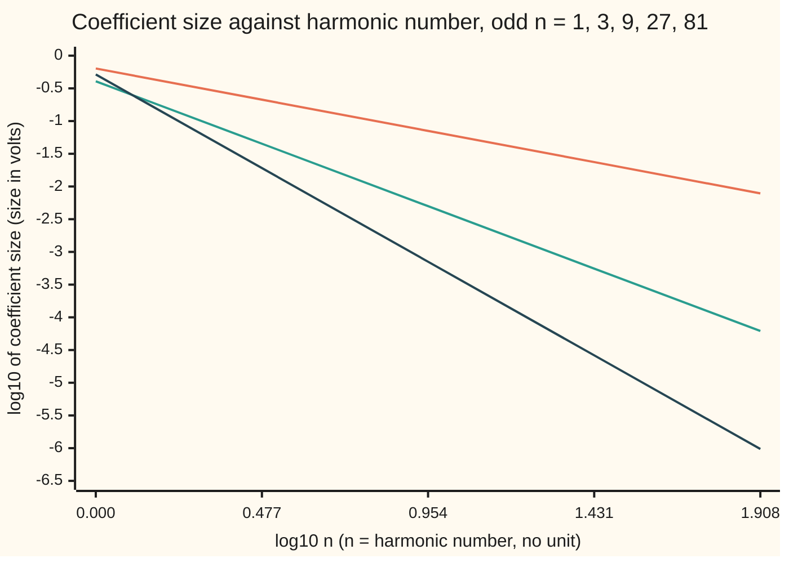

# Smoothness shows in the tail: how fast coefficients shrink, and how many terms you need

[Syllabus](../../../SYLLABUS.md) → [Harmonic analysis](../README.md) → [Fourier Series in Depth](../README.md#s01) → Smoothness shows in the tail

---

## General Overview

A siren switches between +1 V and −1 V 440 times a second. That makes a square wave of 220 cycles a second: 220 Hz. A tone generator builds it from pure tones at 220 Hz, 660 Hz, 1,100 Hz and so on, one per odd harmonic. How many tones does it need?

Swap the square wave for a triangle wave between the same ±1 V. The triangle ramps instead of jumping. To stay within 0.01 V of the true wave at every instant, it needs the harmonics up to number 41, the top one at 9,020 Hz. The square wave never gets within 0.01 V everywhere, however many tones are added: next to each jump the sum overshoots by 0.179 V.

The difference is smoothness. The square wave's coefficients (the sizes of its harmonics) fall like 1/n, where n is the harmonic number; the triangle's fall like 1/n². A wave of parabola arcs, one step smoother, falls like 1/n³ and needs only the harmonics up to number 5. This card turns the pattern into a rule, and the rule into a term count.

**Each derivative a wave keeps continuous all the way round its cycle buys one more power of 1/n in how fast its Fourier coefficients shrink, and the faster they shrink, the fewer terms reach a stated accuracy.**

**What kind of fact this is:** a theorem, proved on this card in Why it works, with a partial converse proved in a fold. The term counts are bounds; the checks set each one beside a brute-force count.

### The picture: three waves, three slopes on a log-log plot



Orange, top: the square wave, slope −1. Teal, middle: the triangle wave, slope −2. Dark, bottom: the parabola wave, slope −3. On a log-log plot a power law is a straight line whose slope is the power. Each wave is the integral of the one above it, scaled to ±1 V, and each integration steepens the line by one.

---

## The formula

Notation first, in words. The phase x runs from −π to π radians round one cycle; for the siren, x = 2π × 220 × t with t in seconds. The letter i is the imaginary unit, with i² = −1. The coefficient $`\hat f(n)`$ is the share of harmonic n, read off by the integral from [Fourier coefficients](01-fourier-coefficients-and-orthogonality.md):

```math
\hat f(n) = \frac{1}{2\pi}\int_{-\pi}^{\pi} f(x)\,e^{-inx}\,dx
```

For a real wave, harmonics n and −n pair up into one tone of amplitude $`2\lvert\hat f(n)\rvert`$ volts.

Count k for each wave: the number of times you differentiate it until a jump appears, checking all the way round the loop, including where x = π meets x = −π.

- the square wave jumps straight away: k = 0;
- the triangle is continuous, but its slope jumps at the corners: k = 1;
- the parabola wave and its slope are continuous; its second derivative jumps: k = 2.

Mathematicians write $`C^0`$ ("C zero") for a wave that is continuous round the loop, $`C^1`$ for one whose slope is continuous too, $`C^2`$ when the second derivative is also continuous, and so on. A wave with count k of 1 or more is $`C^{k-1}`$ but not $`C^k`$: the triangle is $`C^0`$ and the parabola wave is $`C^1`$. The square wave, k = 0, is not even continuous.

The **travel** $`V_k`$ of the k-th derivative is how far it moves up and down over one cycle: the sizes of its jumps added up, plus the climbing and falling between them. Mathematicians call it the total variation. The rule:

```math
\lvert \hat f(n)\rvert \;\le\; \frac{V_k}{2\pi\,\lvert n\rvert^{\,k+1}}
```

**Read it aloud:** if a wave is $`C^{k-1}`$ (for k = 0, no condition) and its k-th derivative travels a total of $`V_k`$ over a cycle, harmonic n's coefficient is at most that travel divided by 2π and by n to the power k + 1.

Adding the coefficients past N bounds the worst error of the cut series $`S_N f(x) = \sum_{\lvert n\rvert \le N} \hat f(n)\,e^{inx}`$, for k of 1 or more:

```math
\max_x \lvert f(x) - S_N f(x)\rvert \;\le\; \sum_{\lvert n\rvert > N} \lvert\hat f(n)\rvert \;\le\; \frac{V_k}{\pi\,k\,N^{k}}, \qquad\text{so}\qquad N \ge \Big(\frac{V_k}{\pi\,k\,\varepsilon}\Big)^{1/k} \text{ terms reach accuracy } \varepsilon
```

**Read it aloud:** the worst gap between the wave and its first N harmonics is at most the sum of all the coefficients left out; that sum falls like 1/N to the power k, so the terms needed grow like 1 over the accuracy, to the power 1/k.

For the triangle: $`V_1 = 8/\pi = 2.54648`$ V per radian, so $`\lvert\hat f(n)\rvert \le 0.40528/n^2`$, and accuracy 0.01 V needs at most $`8/(\pi^2 \times 0.01) = 81.06`$, so 82 harmonics.

| Symbol | Plain meaning | In our example | Push it up and the answer… |
| --- | --- | --- | --- |
| $`x`$ | phase round one cycle, in radians | −π to π; x = 2π × 220 × t | — |
| $`i`$ | the imaginary unit, i² = −1 | inside $`e^{-inx}`$ | — |
| $`f`$ | the wave, in volts | square, triangle or parabola, ±1 V | — |
| $`n`$ | harmonic number; harmonic n sounds at 220n Hz | 1, 3, 9, 27, 81 | coefficient shrinks |
| $`\hat f(n)`$ | coefficient: harmonic n's share, in volts | triangle: 0.40528/n² at odd n | — |
| $`k`$ | derivatives taken before a jump appears | 0, 1, 2 | one more power of 1/n |
| $`f^{(k)}`$ | the k-th derivative of the wave | triangle's slope: ±0.63662 V per radian | — |
| $`C^0`$, $`C^1`$, … | continuous round the loop; continuous with a continuous slope; and so on | triangle $`C^0`$, parabola $`C^1`$: count k gives $`C^{k-1}`$ | smoother wave |
| $`V_k`$ | travel of $`f^{(k)}`$ over one cycle | 4 V; 8/π; 32/π² | larger coefficients |
| $`S_N f`$, $`N`$ | the series cut after harmonic N, the last harmonic kept | N = 41 for the triangle at 0.01 V | smaller error |
| $`\mathrm{Si}`$ | the sine integral: $`\mathrm{Si}(u)`$ is the area under $`\sin(s)/s`$ from $`s = 0`$ to $`s = u`$; it sets the square wave's overshoot | $`(2/\pi)\,\mathrm{Si}(\pi) - 1 = 0.1790`$ V | — |
| $`\varepsilon`$ | the accuracy asked for, in volts | 0.01 V | fewer terms needed |

### When it holds

- **Continuous round the loop, not just inside.** The ramp x/π is smooth on (−π, π) but jumps from +1 to −1 at the seam, so its coefficients fall only like 1/n: n|f̂(n)| = 0.3183 at n = 1, 9 and 99.
- **The k-th derivative has finite travel.** Finitely many jumps with smooth pieces between are enough. Without it the rate can fail, though every integrable wave's coefficients still go to zero (the Riemann–Lebesgue lemma).
- **The error bound needs k of 1 or more.** For the square wave, k = 0, the sum of coefficients diverges and no N gives uniform accuracy: the overshoot stays at 0.1790 V. Accuracy in energy still works (Step 5).
- **It is a bound, not a count.** The triangle and parabola have no even harmonics, so the true counts, 41 and 5, are below the predicted 82 and 8.
- **The converse loses a power.** Coefficients falling like 1/n² prove the triangle continuous, but cannot prove it differentiable (Step 6).

---

## Why it works

### Step 0: integration by parts swaps a slope for a factor of 1/n

The coefficient integral multiplies the wave by $`e^{-inx}`$, which spins n times round the cycle. Integrating by parts takes a derivative off the wave and divides by $`in`$ (i times n), as long as the end terms cancel. They cancel whenever the wave is continuous round the loop. So each derivative that stays continuous buys a factor 1/n. The first jump ends the chain and pays one last factor of 1/n.

### Step 1: one derivative, one factor of n

[Integration by parts](../../06-Calculus%20and%20analysis/04-Integrals/04-integration-by-parts.md) on the coefficient integral of a wave continuous round the loop, with a piecewise smooth slope f′:

```math
\widehat{f'}(n) = \frac{1}{2\pi}\Big[f(x)e^{-inx}\Big]_{-\pi}^{\pi} + \frac{in}{2\pi}\int_{-\pi}^{\pi} f(x)\,e^{-inx}\,dx = in\,\hat f(n)
```

The end term is zero because f(π) = f(−π) and $`e^{-in\pi} = e^{in\pi}`$. [Parseval's identity](../../08-Differential%20equations%20and%20dynamics/09-Fourier%20Series/03-parsevals-identity.md) already used this in real form, to show the sawtooth falls like 1/n and the triangle like 1/n². This card uses it in general.

Check on the triangle at n = 3: the slope's coefficient, integrated directly, is 0.135095 V per radian. Three times the triangle's coefficient at n = 3 (0.045032, unrounded 0.0450316) gives the same 0.135095.

### Step 2: k derivatives, k factors

Repeat Step 1 while the derivative stays continuous round the loop. After k steps:

```math
\hat f(n) = \frac{\widehat{f^{(k)}}(n)}{(in)^k}
```

The parabola wave's second derivative is a square wave of height 8/π² V per radian squared. So the parabola's coefficients are the square wave's divided by n² and scaled, which is why the bottom line on the chart is the top line steepened by 2.

### Step 3: the first jump gives one more factor, and no more

Now let g be a wave with jumps, here $`f^{(k)}`$. Cut the cycle at the jumps and integrate by parts on each smooth piece. Each piece gives end terms (a jump times $`e^{-inx}/(in)`$) plus the integral of g′ times $`e^{-inx}/(in)`$. Write V(g) for the travel of g. Since $`\lvert e^{-inx}\rvert = 1`$, the total is at most

```math
\lvert\hat g(n)\rvert \le \frac{1}{2\pi\lvert n\rvert}\Big(\sum \lvert\text{jumps}\rvert + \int_{-\pi}^{\pi}\lvert g'(x)\rvert\,dx\Big) = \frac{V(g)}{2\pi\lvert n\rvert}
```

Put $`g = f^{(k)}`$ into Step 2 and the formula follows: k factors of 1/n from the derivatives, one more from the jumps.

For the square wave, g = f: two jumps of 2 V each, so V₀ = 4 V and the bound is 2/(πn) = 0.63662/n. The check integrates the coefficients and finds n|f̂(n)| = 0.63662 at n = 1, 3, 9 and 27. The bound is reached exactly at odd n, so it cannot be improved for these waves.

<details>
<summary>Detailed proof: the jump step, written out</summary>

Let g be smooth on each of the pieces $`(x_{j-1}, x_j)`$, j = 1 to m, with $`x_0 = -\pi`$ and $`x_m = \pi`$, and with a jump $`J_j = g(x_j^+) - g(x_j^-)`$ at each cut (counting the seam at ±π as one cut). On one piece,

$`\displaystyle \int_{x_{j-1}}^{x_j} g(x)e^{-inx}\,dx = \Big[\frac{g(x)e^{-inx}}{-in}\Big]_{x_{j-1}^+}^{x_j^-} + \frac{1}{in}\int_{x_{j-1}}^{x_j} g'(x)e^{-inx}\,dx.`$

Add over j. Each cut appears twice, once as the end of one piece and once as the start of the next, and $`e^{-inx}`$ takes the same value both times. The two end terms combine into $`J_j e^{-inx_j}/(in)`$. So

$`\displaystyle 2\pi\,\hat g(n) = \frac{1}{in}\Big(\sum_j J_j e^{-inx_j} + \int_{-\pi}^{\pi} g'(x)e^{-inx}\,dx\Big).`$

Take sizes and use $`\lvert e^{-inx}\rvert = 1`$: $`2\pi\lvert\hat g(n)\rvert \le (\sum_j\lvert J_j\rvert + \int\lvert g'\rvert)/\lvert n\rvert = V(g)/\lvert n\rvert`$. For the square wave the two jumps sit at 0 and ±π, $`e^{-inx}`$ is 1 and $`(-1)^n`$ there, and the jumps add for odd n and cancel for even n: the even coefficients are 0.000000 in the check.

</details>

### Step 4: add the tail to predict the term count

The cut series misses exactly the coefficients past N. At any x the error is $`\sum_{\lvert n\rvert > N}\hat f(n)e^{inx}`$, and each term has size at most $`\lvert\hat f(n)\rvert`$. So the worst error is at most the sum of the left-out sizes. With the formula, both signs of n, and the sum compared with an integral:

```math
\sum_{\lvert n\rvert > N}\lvert\hat f(n)\rvert \le \frac{V_k}{\pi}\sum_{n > N}\frac{1}{n^{k+1}} \le \frac{V_k}{\pi}\int_N^\infty \frac{dn}{n^{k+1}} = \frac{V_k}{\pi\,k\,N^k}
```

Set that equal to ε and solve for N. The answers, from the theorem alone:

| Accuracy ε | Triangle (k = 1) | Parabola (k = 2) |
| --- | ---: | ---: |
| 0.1 V | 9 | 3 |
| 0.01 V | 82 | 8 |
| 0.001 V | 811 | 23 |

Ten times tighter costs ten times the terms when k = 1, but only 23 against 8 when k = 2. In general the count grows like $`(1/\varepsilon)^{1/k}`$: smoother waves pay far less for each extra digit.

The true counts, found by brute force, are lower: 41 for the triangle and 5 for the parabola at 0.01 V. The theorem does not know that the even harmonics are zero, so it asks for 82 against 41, and 8 against 5.

### Step 5: the square wave converges in energy only

With k = 0 the sum of coefficient sizes is a multiple of 1 + 1/3 + 1/5 + …, which diverges, so Step 4 gives nothing. The cut series overshoots each jump by 0.1792 V at N = 41 and 0.1790 V at N = 401 and 4,053. The overshoot settles at $`(2/\pi)\,\mathrm{Si}(\pi) - 1 = 0.1790`$ V, where $`\mathrm{Si}(u) = \int_0^u \sin(s)/s\,ds`$ is the sine integral; [The Gibbs overshoot and the cure](08-gibbs-and-summability.md) explains it. The series does not converge uniformly: no N makes the worst error small.

What does shrink is the error in energy: the average of the squared error over a cycle. By Parseval, it equals the sum of $`\lvert\hat f(n)\rvert^2`$ past N ([Convergence in energy](05-l2-convergence-and-riesz-fischer.md)). The formula makes that at most $`V_0^2/(2\pi^2 N)`$. For a root-mean-square error (the square root of that average) of 0.01 V, the theorem asks for N = 8,106. The true count is 4,053, with the top harmonic at 891,660 Hz. That is far above hearing, and still right only on average.

### Step 6: the converse, and the power it loses

Run the rule backwards. If $`\sum_n \lvert n\rvert^k\,\lvert\hat f(n)\rvert`$ is finite, the series differentiated k times converges uniformly, so f is $`C^k`$. Coefficients falling like $`1/\lvert n\rvert^{k+2}`$ are enough.

The two directions do not quite meet. The triangle falls like 1/n², which makes $`\sum\lvert\hat f(n)\rvert`$ finite, so the triangle is continuous. But $`\sum\lvert n\rvert\,\lvert\hat f(n)\rvert`$ grows without end: 2.38 up to N = 100, 4.25 up to 10⁴, 6.11 up to 10⁶. And the triangle is indeed not $`C^1`$. The parabola's sum settles at 1.27324 = 4/π, which is its steepest slope, and the parabola is $`C^1`$.

<details>
<summary>Detailed proof: summable coefficients give continuous derivatives</summary>

Suppose $`\sum_n \lvert n\rvert^j\lvert\hat f(n)\rvert`$ is finite for every j up to k. The j-th derivative of a term $`\hat f(n)e^{inx}`$ is $`(in)^j\hat f(n)e^{inx}`$, of size $`\lvert n\rvert^j\lvert\hat f(n)\rvert`$ at every x.

So the j-times differentiated series is dominated, at every x, by a fixed convergent series of numbers. By the Weierstrass test it converges uniformly, and a uniform limit of continuous functions is continuous. A series whose differentiated series converges uniformly may be differentiated term by term ([Swapping limits](../../06-Calculus%20and%20analysis/06-Series/08-swapping-limits-with-integrals-and-derivatives.md)). Apply that k times: the sum is $`C^k`$.

The sum is f itself. The sum and f have the same coefficients, so their difference has every coefficient zero and, by Parseval, zero energy. So f equals the sum except on a set of zero length; where f is continuous, it equals the sum everywhere.

</details>

A wave with every derivative continuous has coefficients that fall faster than every power of 1/n, so a few terms describe it well.

---

## Worked numbers, by hand

The triangle wave between ±1 V at 220 Hz, accuracy 0.01 V at every instant.

| Step | Arithmetic | Value |
| --- | --- | --- |
| slope of the triangle | 2 V over π radians, falling then rising | ±0.63662 V per radian |
| travel of the slope, $`V_1`$ | two jumps of 2 × 0.63662 | 8/π = 2.54648 V per radian |
| coefficient bound | $`V_1/(2\pi n^2) = 4/(\pi^2 n^2)`$ | 0.40528/n² |
| check at n = 3 | 0.40528/9 | 0.045032 V |
| term count from the theorem | $`8/(\pi^2 \times 0.01)`$ | 81.06, so 82 |
| only odd harmonics are nonzero | half of 81.06 | 40.53, so about 41 |
| worst error at N = 39 | brute force, at x = 0 | 0.01013 V, too big |
| worst error at N = 41 | brute force, at x = 0 | **0.00965 V** |
| top harmonic | 41 × 220 Hz | 9,020 Hz |

So 21 nonzero tones, all at or below 9,020 Hz, rebuild the triangle wave within 0.01 V everywhere.

### What breaks if you drop a piece

| Mistake | Comes out at | What went wrong |
| --- | --- | --- |
| Ask the square wave for 0.01 V everywhere | overshoot 0.1792, 0.1790, 0.1790 V at N = 41, 401, 4,053 | k = 0: the tail sum diverges, so no uniform accuracy |
| Stop when the next amplitude is below 0.01 V | N = 9, worst error 0.04040 V | The tail adds many small terms: 4.04 times the target |
| Read 1/n² decay as "one smooth derivative" | sum of n times coefficients: 2.38, 4.25, 6.11, still growing | The converse loses a power; the triangle has corners |
| Count smoothness inside (−π, π) only | ramp x/π: n times coefficient = 0.3183 at n = 1, 9, 99 | The seam is a jump, so the decay is 1/n |

The code prints every one of these numbers.

---

## Code, from first principles, and it actually runs

The scripts build the three waves from their formulas and integrate each coefficient by a midpoint rule over 20,000 slices; nothing imported knows a Fourier coefficient. The decay rule takes two roads: integrated coefficients against closed forms, and the derivative's coefficient against n times the wave's. The travel $`V_k`$ is measured from each wave, by adding up how far its sampled k-th slope moves round the loop, and the bound it gives is set beside the integrated coefficients. The term counts take three: brute force over 2,001 points, the tail sum, and the theorem's bound. The square wave's energy error is integrated and set beside Parseval's tail, and its overshoot beside the sine integral's power series.

### Python

```python
# Decay of Fourier coefficients and smoothness -- the check behind the card.
# Standard library only.  Three +-1 V waves on the phase circle -pi <= x < pi:
# square (jumps), triangle (kinks), parabola wave (its slope kinks).
# Coefficients are integrated by a midpoint rule; term counts are found by
# brute force on a grid and by tail sums, then set beside the theorem's bound.
from math import pi, sin, cos, sqrt, log10, ceil
def fact(m): return 1 if m < 2 else m * fact(m - 1)

def sq(x):   return 1.0 if x > 0 else (-1.0 if x < 0 else 0.0)
def tri(x):  return 1.0 - 2.0 * abs(x) / pi
def par(x):  return 4.0 / pi ** 2 * (pi * x - x * abs(x))
def dtri(x): return -2.0 / pi * sq(x)                  # slope of tri, by hand
def dpar(x): return 4.0 / pi ** 2 * (pi - 2.0 * abs(x))  # slope of par, by hand

M = 20000                                              # midpoint slices on the circle
def coef(f, n):                                        # |f^(n)|, f^(n) = (1/2pi) int f e^(-inx) dx
    h = 2 * pi / M; a = b = 0.0
    for j in range(M):
        x = -pi + (j + 0.5) * h; v = f(x)
        a += v * cos(n * x); b += v * sin(n * x)
    return sqrt(a * a + b * b) * h / (2 * pi)

def travel(f, k, L=200, d=0.01):       # travel of the k-th slope round the loop, sampled from f
    xs = [-pi + 2 * pi * (j + 0.5) / L for j in range(L)]   # no sample within d of a kink
    g = [f(x) if k == 0 else (f(x + d) - f(x - d)) / (2 * d) if k == 1
         else (f(x + d) - 2 * f(x) + f(x - d)) / (d * d) for x in xs]
    return sum(abs(g[j] - g[j - 1]) for j in range(L))      # j = 0 closes the loop at the seam

K = {"square": 0, "triangle": 1, "parabola": 2}                       # slopes before a jump
EXACT = {"square": 2 / pi, "triangle": 4 / pi ** 2, "parabola": 16 / pi ** 3}  # n^(k+1)|f^(n)|, odd n
FUN = {"square": sq, "triangle": tri, "parabola": par}
V = {w: travel(FUN[w], K[w]) for w in FUN}                            # travel of the k-th slope

print("1. decay: n^(k+1) |f^(n)| at odd n, integrated; bound V/2pi")
ns = (1, 3, 9, 27, 81)
for w in FUN:
    k = K[w]; vals = [n ** (k + 1) * coef(FUN[w], n) for n in ns]
    print(f"  {w:<9} k={k}  " + " ".join(f"{v:.5f}" for v in vals) + f"   bound {V[w] / (2 * pi):.5f}")
    assert max(abs(v - EXACT[w]) for v in vals) < 1e-3 * EXACT[w]   # closed form, two roads
    assert abs(V[w] / (2 * pi) - vals[0]) < 1e-4 * vals[0]          # measured travel: bound is sharp
print("  even n=2:", " ".join(f"{coef(FUN[w], 2):.6f}" for w in FUN))

print("2. derivative rule: |slope^(n)| against n |f^(n)|")
for name, f, df in (("triangle", tri, dtri), ("parabola", par, dpar)):
    for n in (3, 9):
        lhs, rhs = coef(df, n), n * coef(f, n)
        print(f"  {name:<9} n={n}  {lhs:.6f}  {rhs:.6f}")
        assert abs(lhs - rhs) < 1e-4
print("  sawtooth x/pi, smooth inside, n|f^(n)| at n=1,9,99:",
      " ".join(f"{n * coef(lambda x: x / pi, n):.4f}" for n in (1, 9, 99)))

def tail(p, N, c, top=10 ** 6):        # c * sum over odd n > N of 1/n^p, plus integral tail
    s = sum(1.0 / n ** p for n in range(N + 1 + (N % 2 == 1), top, 2))
    return c * (s + 1.0 / (2 * (p - 1) * top ** (p - 1)))

G = 2001
grid = [-pi + 2 * pi * i / (G - 1) for i in range(G)]
def brute(w, eps, nmax=120):           # smallest N whose worst grid error <= eps
    f = FUN[w]; S = [0.0] * G; hist = {}
    for N in range(1, nmax + 1):
        if N % 2 == 1:
            for i, x in enumerate(grid):
                S[i] += (8 / pi ** 2 * cos(N * x) / N ** 2 if w == "triangle"
                         else 32 / pi ** 3 * sin(N * x) / N ** 3)
        hist[N] = max(abs(f(x) - S[i]) for i, x in enumerate(grid))
        if hist[N] <= eps: return N, hist
    return None, hist

def predict(w, eps): k = K[w]; return ceil((V[w] / (pi * k * eps)) ** (1.0 / k))
print("3. uniform accuracy 0.01 V: terms needed")
for w, p, c in (("triangle", 2, 8 / pi ** 2), ("parabola", 3, 32 / pi ** 3)):
    N, hist = brute(w, 0.01)
    Nt = next(m for m in range(1, 200) if tail(p, m, c) <= 0.01)
    print(f"  {w:<9} brute force N={N} (error {hist[N]:.5f} V, at N-2 {hist[N - 2]:.5f} V)"
          f"  tail sum N={Nt}  theorem N={predict(w, 0.01)}  top {N * 220} Hz")
    assert N <= Nt <= predict(w, 0.01)                  # each count is safe
    if w == "triangle": assert abs(hist[N] - tail(p, N, c)) < 1e-6   # grid vs tail sum
    if w == "triangle": Ntri = N
Vt = V["triangle"]; th = Vt / (pi * 0.01)
print(f"  triangle: V1 {Vt:.5f}, n=3 coefficient {coef(tri, 3):.6f}, bound {Vt / (2 * pi * 9):.6f},"
      f" theorem N {th:.2f}, half {th / 2:.2f}, nonzero tones {(Ntri + 1) // 2}")
tri_err = {N: tail(2, N, 8 / pi ** 2) for N in (1, 9, 41, 81)}
print("  triangle worst error at N=1,9,41,81:", " ".join(f"{tri_err[N]:.5f}" for N in tri_err))
assert abs(tri_err[1] - (1 - 8 / pi ** 2)) < 1e-6         # x=0: 1 - 8/pi^2 exactly
last = next(n for n in range(1, 99, 2) if 8 / pi ** 2 / (n + 2) ** 2 < 0.01)  # next term small
print(f"  mistake, stop when the next amplitude < 0.01 V: N={last}, worst error {tail(2, last, 8 / pi ** 2):.5f} V,"
      f" {tail(2, last, 8 / pi ** 2) / 0.01:.2f} x target")
for eps in (0.1, 0.01, 0.001):
    print(f"  eps {eps:<5}  theorem N: triangle {predict('triangle', eps)}"
          f"  parabola {predict('parabola', eps)}  square rms {ceil(16 / (2 * pi ** 2 * eps * eps))}")

print("4. square wave: no uniform accuracy; energy only")
def overshoot(N):                       # peak of S_N on (0, 3pi/(N+1)), 400 points
    best = 0.0
    for i in range(1, 401):
        x = 3 * pi / (N + 1) * i / 400
        best = max(best, 4 / pi * sum(sin(n * x) / n for n in range(1, N + 1, 2)))
    return best - 1.0
print("  overshoot above 1 V at N=41, 401, 4053:", " ".join(f"{overshoot(N):.4f}" for N in (41, 401, 4053)))
head, N = 0.0, 0
while True:
    N += 1
    if N % 2 == 1: head += 8 / pi ** 2 / N ** 2       # energy kept; total energy is 1 V^2
    if 1.0 - head <= 1e-4: break
print(f"  rms 0.01 V by Parseval: N={N}  rms {sqrt(1 - head):.6f} V  theorem N={ceil(16 / (2 * pi ** 2 * 1e-4))}  top {N * 220} Hz")
L = 40000; h = 2 * pi / L; e2 = 0.0                    # direct integral of (s - S_41)^2
for j in range(L):
    x = -pi + (j + 0.5) * h
    e2 += (sq(x) - 4 / pi * sum(sin(n * x) / n for n in range(1, 42, 2))) ** 2 * h / (2 * pi)
print(f"  N=41 mean-square error: integrated {e2:.6f}  Parseval tail {tail(2, 41, 8 / pi ** 2):.6f}")
assert abs(e2 - tail(2, 41, 8 / pi ** 2)) < 1e-5     # integral against coefficients
si = sum((-1) ** j * pi ** (2 * j + 1) / ((2 * j + 1) * fact(2 * j + 1)) for j in range(30))
print(f"  Gibbs limit (2/pi) Si(pi) - 1 = {2 / pi * si - 1:.4f}")
assert all(abs(overshoot(N) - (2 / pi * si - 1)) < 1e-3 for N in (401, 4053))

print("5. converse: sum of |n| |f^(n)| over 0<|n|<=N, N = 10^2, 10^4, 10^6")
for w, p, c in (("triangle", 1, 8 / pi ** 2), ("parabola", 2, 32 / pi ** 3)):
    print(f"  {w:<9}", " ".join(f"{c * sum(1.0 / n ** p for n in range(1, 10 ** e, 2)):.5f}" for e in (2, 4, 6)))
print(f"  parabola limit 4/pi = {4 / pi:.5f}")
d0 = 0.0 - 8 / pi ** 2 * sum(sin(n * 0.0) / n for n in range(1, 10 ** 4, 2))
print(f"  triangle slope at x=0: left {dtri(-1e-9):+.5f}, right {dtri(1e-9):+.5f}, differentiated series {d0:.5f}")

print("chart, log10 n:", " ".join(f"{log10(n):.3f}" for n in ns))
for w in FUN:
    print(f"chart, {w}:", " ".join(f"{log10(EXACT[w] / n ** (K[w] + 1)):.3f}" for n in ns))
print("ALL CHECKS PASS")
```

**Ran 2026-11-15 on macOS, Python 3.14.10, standard library only. All checks passed. Output, pasted from the run:**

```
1. decay: n^(k+1) |f^(n)| at odd n, integrated; bound V/2pi
  square    k=0  0.63662 0.63662 0.63662 0.63662 0.63664   bound 0.63662
  triangle  k=1  0.40528 0.40528 0.40528 0.40528 0.40527   bound 0.40528
  parabola  k=2  0.51602 0.51602 0.51602 0.51602 0.51602   bound 0.51602
  even n=2: 0.000000 0.000000 0.000000
2. derivative rule: |slope^(n)| against n |f^(n)|
  triangle  n=3  0.135095  0.135095
  triangle  n=9  0.045032  0.045032
  parabola  n=3  0.057336  0.057336
  parabola  n=9  0.006371  0.006371
  sawtooth x/pi, smooth inside, n|f^(n)| at n=1,9,99: 0.3183 0.3183 0.3183
3. uniform accuracy 0.01 V: terms needed
  triangle  brute force N=41 (error 0.00965 V, at N-2 0.01013 V)  tail sum N=41  theorem N=82  top 9020 Hz
  parabola  brute force N=5 (error 0.00539 V, at N-2 0.01185 V)  tail sum N=5  theorem N=8  top 1100 Hz
  triangle: V1 2.54648, n=3 coefficient 0.045032, bound 0.045032, theorem N 81.06, half 40.53, nonzero tones 21
  triangle worst error at N=1,9,41,81: 0.18943 0.04040 0.00965 0.00494
  mistake, stop when the next amplitude < 0.01 V: N=9, worst error 0.04040 V, 4.04 x target
  eps 0.1    theorem N: triangle 9  parabola 3  square rms 82
  eps 0.01   theorem N: triangle 82  parabola 8  square rms 8106
  eps 0.001  theorem N: triangle 811  parabola 23  square rms 810570
4. square wave: no uniform accuracy; energy only
  overshoot above 1 V at N=41, 401, 4053: 0.1792 0.1790 0.1790
  rms 0.01 V by Parseval: N=4053  rms 0.009999 V  theorem N=8106  top 891660 Hz
  N=41 mean-square error: integrated 0.009648  Parseval tail 0.009648
  Gibbs limit (2/pi) Si(pi) - 1 = 0.1790
5. converse: sum of |n| |f^(n)| over 0<|n|<=N, N = 10^2, 10^4, 10^6
  triangle  2.38127 4.24767 6.11407
  parabola  1.26808 1.27319 1.27324
  parabola limit 4/pi = 1.27324
  triangle slope at x=0: left +0.63662, right -0.63662, differentiated series 0.00000
chart, log10 n: 0.000 0.477 0.954 1.431 1.908
chart, square: -0.196 -0.673 -1.150 -1.627 -2.105
chart, triangle: -0.392 -1.346 -2.301 -3.255 -4.209
chart, parabola: -0.287 -1.719 -3.150 -4.581 -6.013
ALL CHECKS PASS
```

### Rust

```rust
// Decay of Fourier coefficients and smoothness -- the same check in Rust, std only.
// Three +-1 V waves on the phase circle -pi <= x < pi: square (jumps), triangle
// (kinks), parabola wave (its slope kinks).  Coefficients by a midpoint rule;
// term counts by brute force on a grid and by tail sums, beside the theorem's bound.
use std::f64::consts::PI;

fn sq(x: f64) -> f64 { if x > 0.0 { 1.0 } else if x < 0.0 { -1.0 } else { 0.0 } }
fn tri(x: f64) -> f64 { 1.0 - 2.0 * x.abs() / PI }
fn par(x: f64) -> f64 { 4.0 / (PI * PI) * (PI * x - x * x.abs()) }
fn dtri(x: f64) -> f64 { -2.0 / PI * sq(x) }                       // slope of tri, by hand
fn dpar(x: f64) -> f64 { 4.0 / (PI * PI) * (PI - 2.0 * x.abs()) }  // slope of par, by hand

const M: usize = 20000;                                            // midpoint slices
fn coef(f: fn(f64) -> f64, n: f64) -> f64 {                        // |f^(n)|
    let h = 2.0 * PI / M as f64;
    let (mut a, mut b) = (0.0, 0.0);
    for j in 0..M {
        let x = -PI + (j as f64 + 0.5) * h;
        let v = f(x); a += v * (n * x).cos(); b += v * (n * x).sin();
    }
    (a * a + b * b).sqrt() * h / (2.0 * PI)
}

fn tail(p: i32, n: usize, c: f64) -> f64 {   // c * sum over odd m > n of 1/m^p, plus integral tail
    let top = 1_000_000usize;
    let s: f64 = (n + 1 + n % 2..top).step_by(2).map(|m| 1.0 / (m as f64).powi(p)).sum();
    c * (s + 1.0 / (2.0 * (p - 1) as f64 * (top as f64).powi(p - 1)))
}

fn brute(tri_wave: bool, eps: f64) -> (usize, Vec<f64>) {  // smallest N whose worst grid error <= eps
    let g = 2001;
    let grid: Vec<f64> = (0..g).map(|i| -PI + 2.0 * PI * i as f64 / (g - 1) as f64).collect();
    let mut s = vec![0.0; g];
    let mut hist = vec![0.0; 1];
    for n in 1..=120usize {
        let nf = n as f64;
        if n % 2 == 1 {
            for (i, x) in grid.iter().enumerate() {
                s[i] += if tri_wave { 8.0 / (PI * PI) * (nf * x).cos() / (nf * nf) }
                        else { 32.0 / (PI * PI * PI) * (nf * x).sin() / (nf * nf * nf) };
            }
        }
        let mut worst = 0.0f64;
        for (i, x) in grid.iter().enumerate() {
            let f = if tri_wave { tri(*x) } else { par(*x) };
            worst = worst.max((f - s[i]).abs());
        }
        hist.push(worst);
        if worst <= eps { return (n, hist); }
    }
    (0, hist)
}

fn predict(v: f64, k: f64, eps: f64) -> usize { (v / (PI * k * eps)).powf(1.0 / k).ceil() as usize }
fn overshoot(n: usize) -> f64 {                // peak of S_N on (0, 3pi/(N+1)), 400 points
    let mut best = 0.0f64;
    for i in 1..=400 {
        let x = 3.0 * PI / (n as f64 + 1.0) * i as f64 / 400.0;
        let s: f64 = (1..=n).step_by(2).map(|m| (m as f64 * x).sin() / m as f64).sum();
        best = best.max(4.0 / PI * s);
    }
    best - 1.0
}

fn travel(f: fn(f64) -> f64, k: i32) -> f64 {  // travel of the k-th slope round the loop, sampled from f
    let d = 0.01;                              // 200 midpoints: no sample within d of a kink
    let s = |x: f64| match k { 0 => f(x), 1 => (f(x + d) - f(x - d)) / (2.0 * d), _ => (f(x + d) - 2.0 * f(x) + f(x - d)) / (d * d) };
    let g: Vec<f64> = (0..200).map(|j| s(-PI + 2.0 * PI * (j as f64 + 0.5) / 200.0)).collect();
    (0..200).map(|j| (g[j] - g[(j + 199) % 200]).abs()).sum()   // j = 0 closes the loop at the seam
}
fn join(v: &[f64], d: usize) -> String { v.iter().map(|x| format!("{:.*}", d, x)).collect::<Vec<_>>().join(" ") }

fn main() {
    let names = ["square", "triangle", "parabola"];
    let funs: [fn(f64) -> f64; 3] = [sq, tri, par];
    let kk = [0i32, 1, 2];
    let vv: Vec<f64> = (0..3).map(|w| travel(funs[w], kk[w])).collect();   // travel of the k-th slope
    let exact = [2.0 / PI, 4.0 / (PI * PI), 16.0 / (PI * PI * PI)];
    let ns = [1.0f64, 3.0, 9.0, 27.0, 81.0];

    println!("1. decay: n^(k+1) |f^(n)| at odd n, integrated; bound V/2pi");
    for w in 0..3 {
        let vals: Vec<f64> = ns.iter().map(|n| n.powi(kk[w] + 1) * coef(funs[w], *n)).collect();
        println!("  {:<9} k={}  {}   bound {:.5}", names[w], kk[w], join(&vals, 5), vv[w] / (2.0 * PI));
        assert!(vals.iter().all(|v| (v - exact[w]).abs() < 1e-3 * exact[w]));
        assert!((vv[w] / (2.0 * PI) - vals[0]).abs() < 1e-4 * vals[0]);   // measured travel: bound is sharp
    }
    println!("  even n=2: {}", join(&funs.iter().map(|f| coef(*f, 2.0)).collect::<Vec<_>>(), 6));

    println!("2. derivative rule: |slope^(n)| against n |f^(n)|");
    let pairs: [(&str, fn(f64) -> f64, fn(f64) -> f64); 2] = [("triangle", tri, dtri), ("parabola", par, dpar)];
    for (name, f, df) in pairs {
        for n in [3.0f64, 9.0] {
            let (lhs, rhs) = (coef(df, n), n * coef(f, n));
            println!("  {:<9} n={}  {:.6}  {:.6}", name, n, lhs, rhs);
            assert!((lhs - rhs).abs() < 1e-4);
        }
    }
    println!("  sawtooth x/pi, smooth inside, n|f^(n)| at n=1,9,99: {}",
             join(&[1.0f64, 9.0, 99.0].map(|n| n * coef(|x| x / PI, n)), 4));

    println!("3. uniform accuracy 0.01 V: terms needed");
    for (w, p, c, tw) in [(1usize, 2i32, 8.0 / (PI * PI), true), (2, 3, 32.0 / (PI * PI * PI), false)] {
        let (n, hist) = brute(tw, 0.01);
        let nt = (1..200).find(|m| tail(p, *m, c) <= 0.01).unwrap();
        let pr = predict(vv[w], kk[w] as f64, 0.01);
        println!("  {:<9} brute force N={} (error {:.5} V, at N-2 {:.5} V)  tail sum N={}  theorem N={}  top {} Hz",
                 names[w], n, hist[n], hist[n - 2], nt, pr, n * 220);
        assert!(n <= nt && nt <= pr);
        if tw { assert!((hist[n] - tail(p, n, c)).abs() < 1e-6); }
    }
    let ntri = brute(true, 0.01).0;
    let (vt, th) = (vv[1], vv[1] / (PI * 0.01));
    println!("  triangle: V1 {:.5}, n=3 coefficient {:.6}, bound {:.6}, theorem N {:.2}, half {:.2}, nonzero tones {}",
             vt, coef(tri, 3.0), vt / (2.0 * PI * 9.0), th, th / 2.0, (ntri + 1) / 2);
    let te: Vec<f64> = [1usize, 9, 41, 81].iter().map(|n| tail(2, *n, 8.0 / (PI * PI))).collect();
    println!("  triangle worst error at N=1,9,41,81: {}", join(&te, 5));
    assert!((te[0] - (1.0 - 8.0 / (PI * PI))).abs() < 1e-6);
    let last = (1..99usize).step_by(2).find(|n| 8.0 / (PI * PI) / (((n + 2) * (n + 2)) as f64) < 0.01).unwrap();
    let ml = tail(2, last, 8.0 / (PI * PI));
    println!("  mistake, stop when the next amplitude < 0.01 V: N={}, worst error {:.5} V, {:.2} x target", last, ml, ml / 0.01);
    for eps in [0.1f64, 0.01, 0.001] {
        println!("  eps {:<5}  theorem N: triangle {}  parabola {}  square rms {}", eps,
                 predict(vv[1], 1.0, eps), predict(vv[2], 2.0, eps), (16.0 / (2.0 * PI * PI * eps * eps)).ceil());
    }

    println!("4. square wave: no uniform accuracy; energy only");
    println!("  overshoot above 1 V at N=41, 401, 4053: {}", join(&[41usize, 401, 4053].map(overshoot), 4));
    let (mut head, mut n) = (0.0, 0usize);
    loop {
        n += 1;
        if n % 2 == 1 { head += 8.0 / (PI * PI) / ((n * n) as f64); }
        if 1.0 - head <= 1e-4 { break; }
    }
    println!("  rms 0.01 V by Parseval: N={}  rms {:.6} V  theorem N={}  top {} Hz",
             n, (1.0 - head).sqrt(), (16.0 / (2.0 * PI * PI * 1e-4)).ceil(), n * 220);
    let (l, mut e2) = (40000, 0.0);
    let h = 2.0 * PI / l as f64;
    for j in 0..l {
        let x = -PI + (j as f64 + 0.5) * h;
        let s: f64 = (1..42).step_by(2).map(|m| (m as f64 * x).sin() / m as f64).sum();
        e2 += (sq(x) - 4.0 / PI * s).powi(2) * h / (2.0 * PI);
    }
    let t41 = tail(2, 41, 8.0 / (PI * PI));
    println!("  N=41 mean-square error: integrated {:.6}  Parseval tail {:.6}", e2, t41);
    assert!((e2 - t41).abs() < 1e-5);
    let (mut si, mut term) = (0.0, PI);                       // Si(pi) as its power series
    for j in 0..30 {
        si += term / (2 * j + 1) as f64;
        term *= -PI * PI / (((2 * j + 2) * (2 * j + 3)) as f64);
    }
    println!("  Gibbs limit (2/pi) Si(pi) - 1 = {:.4}", 2.0 / PI * si - 1.0);
    assert!([401usize, 4053].iter().all(|n| (overshoot(*n) - (2.0 / PI * si - 1.0)).abs() < 1e-3));

    println!("5. converse: sum of |n| |f^(n)| over 0<|n|<=N, N = 10^2, 10^4, 10^6");
    for (w, p, c) in [(1usize, 1i32, 8.0 / (PI * PI)), (2, 2, 32.0 / (PI * PI * PI))] {
        let v: Vec<f64> = [2u32, 4, 6].iter()
            .map(|e| c * (1..10usize.pow(*e)).step_by(2).map(|m| 1.0 / (m as f64).powi(p)).sum::<f64>()).collect();
        println!("  {:<9} {}", names[w], join(&v, 5));
    }
    println!("  parabola limit 4/pi = {:.5}", 4.0 / PI);
    let d0 = 0.0 - 8.0 / (PI * PI) * (1..10000).step_by(2).map(|m| (m as f64 * 0.0).sin() / m as f64).sum::<f64>();
    println!("  triangle slope at x=0: left {:+.5}, right {:+.5}, differentiated series {:.5}", dtri(-1e-9), dtri(1e-9), d0);

    println!("chart, log10 n: {}", join(&ns.map(|n| n.log10()), 3));
    for w in 0..3 {
        println!("chart, {}: {}", names[w], join(&ns.map(|n| (exact[w] / n.powi(kk[w] + 1)).log10()), 3));
    }
    println!("ALL CHECKS PASS");
}
```

**Ran 2026-11-15 on macOS, rustc 1.98.1, no crates. All checks passed. Output, pasted from the run:**

```
1. decay: n^(k+1) |f^(n)| at odd n, integrated; bound V/2pi
  square    k=0  0.63662 0.63662 0.63662 0.63662 0.63664   bound 0.63662
  triangle  k=1  0.40528 0.40528 0.40528 0.40528 0.40527   bound 0.40528
  parabola  k=2  0.51602 0.51602 0.51602 0.51602 0.51602   bound 0.51602
  even n=2: 0.000000 0.000000 0.000000
2. derivative rule: |slope^(n)| against n |f^(n)|
  triangle  n=3  0.135095  0.135095
  triangle  n=9  0.045032  0.045032
  parabola  n=3  0.057336  0.057336
  parabola  n=9  0.006371  0.006371
  sawtooth x/pi, smooth inside, n|f^(n)| at n=1,9,99: 0.3183 0.3183 0.3183
3. uniform accuracy 0.01 V: terms needed
  triangle  brute force N=41 (error 0.00965 V, at N-2 0.01013 V)  tail sum N=41  theorem N=82  top 9020 Hz
  parabola  brute force N=5 (error 0.00539 V, at N-2 0.01185 V)  tail sum N=5  theorem N=8  top 1100 Hz
  triangle: V1 2.54648, n=3 coefficient 0.045032, bound 0.045032, theorem N 81.06, half 40.53, nonzero tones 21
  triangle worst error at N=1,9,41,81: 0.18943 0.04040 0.00965 0.00494
  mistake, stop when the next amplitude < 0.01 V: N=9, worst error 0.04040 V, 4.04 x target
  eps 0.1    theorem N: triangle 9  parabola 3  square rms 82
  eps 0.01   theorem N: triangle 82  parabola 8  square rms 8106
  eps 0.001  theorem N: triangle 811  parabola 23  square rms 810570
4. square wave: no uniform accuracy; energy only
  overshoot above 1 V at N=41, 401, 4053: 0.1792 0.1790 0.1790
  rms 0.01 V by Parseval: N=4053  rms 0.009999 V  theorem N=8106  top 891660 Hz
  N=41 mean-square error: integrated 0.009648  Parseval tail 0.009648
  Gibbs limit (2/pi) Si(pi) - 1 = 0.1790
5. converse: sum of |n| |f^(n)| over 0<|n|<=N, N = 10^2, 10^4, 10^6
  triangle  2.38127 4.24767 6.11407
  parabola  1.26808 1.27319 1.27324
  parabola limit 4/pi = 1.27324
  triangle slope at x=0: left +0.63662, right -0.63662, differentiated series 0.00000
chart, log10 n: 0.000 0.477 0.954 1.431 1.908
chart, square: -0.196 -0.673 -1.150 -1.627 -2.105
chart, triangle: -0.392 -1.346 -2.301 -3.255 -4.209
chart, parabola: -0.287 -1.719 -3.150 -4.581 -6.013
ALL CHECKS PASS
```

The two outputs are identical, line for line.

### Lean

Lean proves the decay rule, Step 1 and the error bound for every wave that meets When it holds, and checks the whole numbers.

- Take a wave whose k-th derivative has travel $`V_k`$, and which is $`C^{k-1}`$ when k is 1 or more. Then $`\lvert\hat f(n)\rvert \le V_k/(2\pi\lvert n\rvert^{k+1})`$ for every $`n \ne 0`$.
- Take a wave continuous round the loop, with a piecewise smooth slope f′, as in Step 1. Then $`\widehat{f'}(n) = in\,\hat f(n)`$ for every whole number n.
- Suppose the wave meets the first bullet with k of 1 or more, and N is 1 or more. Then $`\lvert f(x) - S_N f(x)\rvert \le V_k/(\pi k N^k)`$ at every phase x.
- Harmonic 41 sounds at 9,020 Hz, and harmonics 1 to 41 include 21 odd ones: the triangle's 21 tones.
- Harmonic 5 sounds at 1,100 Hz, and harmonic 4,053 at 891,660 Hz.

The decimal values, the brute-force counts, the overshoot and the converse in Step 6 are left to the Python and Rust checks.

```lean
-- Smoothness shows in the tail: a wave whose first k - 1 derivatives are continuous round the loop and whose k-th derivative has finite travel V has Fourier coefficients at most V / (2π |n|^(k+1)), so its first N harmonics are within V / (π k N^k) of it everywhere.
import Mathlib.Analysis.Fourier.AddCircle
import Mathlib.Topology.EMetricSpace.BoundedVariation
import Mathlib.Order.Interval.Finset.Defs
import Mathlib.Data.Int.Interval
import Mathlib.Analysis.BoundedVariation
import Mathlib.MeasureTheory.Integral.DivergenceTheorem
import Mathlib.Order.Filter.AtTopBot.Interval
import Mathlib.Analysis.PSeries

open Real Set Function

noncomputable section

lemma per_pt_eq (g : ℝ → ℂ) (hper : Periodic g (2 * π)) : g π = g (-π) := by
  have := hper (-π)
  rw [show -π + 2 * π = π by ring] at this
  exact this

#print axioms per_pt_eq

lemma fourier_pi_eq (n : ℤ) :
    fourier (-n) ((π : ℝ) : AddCircle (π - -π)) = fourier (-n) ((-π : ℝ) : AddCircle (π - -π)) := by
  have h := AddCircle.coe_add_period (π - -π) (-π)
  rw [show -π + (π - -π) = π by ring] at h
  rw [h]

#print axioms fourier_pi_eq

lemma coeff_deriv_aux (f f' : ℝ → ℂ) (s : Set ℝ)
    (hper : Periodic f (2 * π)) (hcont : Continuous f) (hs : s.Countable)
    (hderiv : ∀ x ∈ Ioo (-π) π, x ∉ s → HasDerivAt f (f' x) x)
    (hint : IntervalIntegrable f' MeasureTheory.volume (-π) π) (n : ℤ) :
    fourierCoeffOn (neg_lt_self pi_pos) f' n = Complex.I * n * fourierCoeffOn (neg_lt_self pi_pos) f n := by
  set T : ℝ := π - -π with hTdef
  have hT2 : T = 2 * π := by rw [hTdef]; ring
  have hTpos : 0 < T := by rw [hT2]; positivity
  set e : ℝ → ℂ := fun y => fourier (-n) (y : AddCircle T) with he
  have hec : Continuous e := (map_continuous (fourier (-n))).comp (AddCircle.continuous_mk' _)
  have hed : ∀ y, HasDerivAt e (-2 * π * Complex.I * n / T * e y) y :=
    fun y => hasDerivAt_fourier_neg T n y
  set G' : ℝ → ℂ := fun y => (-2 * π * Complex.I * n / T * e y) * f y + e y * f' y with hG'
  have hI1 : IntervalIntegrable (fun y => e y * f y) MeasureTheory.volume (-π) π :=
    (hec.mul hcont).intervalIntegrable _ _
  have hI2 : IntervalIntegrable (fun y => e y * f' y) MeasureTheory.volume (-π) π :=
    hint.continuousOn_mul hec.continuousOn
  have hFTC : ∫ y in (-π)..π, G' y = e π * f π - e (-π) * f (-π) := by
    apply MeasureTheory.integral_eq_of_hasDerivAt_off_countable_of_le (fun y => e y * f y) G'
      (neg_le_self pi_pos.le) hs (hec.mul hcont).continuousOn
    · intro x hx
      exact (hed x).mul (hderiv x hx.1 hx.2)
    · convert (hI1.const_mul (-2 * π * Complex.I * n / T)).add hI2 using 1
      ext y; simp only [hG']; ring
  have h0 : e π * f π - e (-π) * f (-π) = 0 := by
    rw [per_pt_eq f hper]
    simp only [he]
    rw [fourier_pi_eq n]; ring
  rw [h0] at hFTC
  have hsplit : ∫ y in (-π)..π, G' y =
      (-2 * π * Complex.I * n / T) * (∫ y in (-π)..π, e y * f y) + ∫ y in (-π)..π, e y * f' y := by
    have := intervalIntegral.integral_add (hI1.const_mul (-2 * π * Complex.I * n / T)) hI2
    rw [intervalIntegral.integral_const_mul] at this
    rw [← this]
    congr 1; ext y; simp only [hG']; ring
  rw [hsplit] at hFTC
  rw [fourierCoeffOn_eq_integral, fourierCoeffOn_eq_integral]
  simp only [smul_eq_mul, Complex.real_smul]
  change (↑(1 / T) : ℂ) * ∫ y in (-π)..π, e y * f' y = Complex.I * n * ((↑(1 / T) : ℂ) * ∫ y in (-π)..π, e y * f y)
  have hTc : (T : ℂ) = 2 * π := by rw [hT2]; push_cast; ring
  have hπ : (π : ℂ) ≠ 0 := Complex.ofReal_ne_zero.mpr pi_pos.ne'
  rw [hTc] at hFTC
  have : ∫ y in (-π)..π, e y * f' y = Complex.I * n * ∫ y in (-π)..π, e y * f y := by
    have h2 : (-2 * π * Complex.I * n / (2 * π)) = -(Complex.I * n) := by
      field_simp
    rw [h2] at hFTC
    linear_combination hFTC
  rw [this]; ring

#print axioms coeff_deriv_aux

lemma variation_sum_Icc (g : ℝ → ℂ) (x : ℕ → ℝ) (hx : Monotone x) (m : ℕ) :
    ∑ i ∈ Finset.range m, eVariationOn g (Icc (x i) (x (i + 1))) =
      eVariationOn g (Icc (x 0) (x m)) := by
  induction m with
  | zero =>
    rw [Finset.sum_range_zero, Icc_self, eVariationOn.subsingleton g subsingleton_singleton]
  | succ m ih =>
    rw [Finset.sum_range_succ, ih]
    have := eVariationOn.Icc_add_Icc g (s := univ) (hx (Nat.zero_le m)) (hx (Nat.le_succ m))
      (mem_univ _)
    simpa only [univ_inter] using this

#print axioms variation_sum_Icc

lemma norm_integral_le_of_bv_aux (g : ℝ → ℂ) (hper : Periodic g (2 * π))
    (hbv : BoundedVariationOn g (Icc (-π) π)) (n : ℤ) (hn : n ≠ 0) (m : ℕ) (hm : 0 < m) :
    ‖∫ y in (-π)..π, fourier (-n) (y : AddCircle (π - -π)) * g y‖ ≤
      (eVariationOn g (Icc (-π) π)).toReal / |(n : ℝ)| +
        (2 * π / m) * (eVariationOn g (Icc (-π) π)).toReal := by
  have hT2 : π - -π = 2 * π := by ring
  have hT : Fact (0 < π - -π) := ⟨by rw [hT2]; positivity⟩
  set V := (eVariationOn g (Icc (-π) π)).toReal with hV
  set e : ℝ → ℂ := fun y => fourier (-n) (y : AddCircle (π - -π)) with he
  have hec : Continuous e := (map_continuous (fourier (-n))).comp (AddCircle.continuous_mk' _)
  have hen : ∀ y, ‖e y‖ = 1 := fun y => by
    simp only [he, fourier_apply, Circle.norm_coe]
  set c0 : ℂ := ((π - -π : ℝ) : ℂ) / (-2 * π * Complex.I * n) with hc0def
  set Φ : ℝ → ℂ := fun y => c0 * e y with hΦdef
  have hΦ : ∀ y, HasDerivAt Φ (e y) y := fun y => has_antideriv_at_fourier_neg hT hn y
  have hnpos : 0 < |(n : ℝ)| := abs_pos.mpr (Int.cast_ne_zero.mpr hn)
  have hc0 : ‖c0‖ = 1 / |(n : ℝ)| := by
    rw [hc0def, norm_div, norm_mul, norm_mul, norm_mul, Complex.norm_I, Complex.norm_real,
      Complex.norm_real, Complex.norm_intCast, norm_neg, Complex.norm_ofNat, hT2]
    rw [Real.norm_eq_abs, Real.norm_eq_abs, abs_of_pos (by positivity : (0:ℝ) < 2 * π),
      abs_of_pos pi_pos]
    field_simp
  have hΦn : ∀ y, ‖Φ y‖ = 1 / |(n : ℝ)| := fun y => by
    rw [hΦdef]; simp only; rw [norm_mul, hen, hc0, mul_one]
  set h : ℝ := 2 * π / m with hhdef
  have hmpos : (0 : ℝ) < m := Nat.cast_pos.mpr hm
  have hhpos : 0 ≤ h := by positivity
  set x : ℕ → ℝ := fun i => -π + i * h with hxdef
  have hx0 : x 0 = -π := by simp [hxdef]
  have hxm : x m = π := by
    simp only [hxdef, hhdef]; field_simp; ring
  have hxmono : Monotone x := by
    intro i j hij
    simp only [hxdef]
    have : (i : ℝ) ≤ j := Nat.cast_le.mpr hij
    nlinarith
  have hxmem : ∀ i ≤ m, x i ∈ Icc (-π) π := fun i hi =>
    ⟨hx0 ▸ hxmono (Nat.zero_le i), hxm ▸ hxmono hi⟩
  have hxsucc : ∀ i, |x (i + 1) - x i| = h := fun i => by
    simp only [hxdef]; push_cast
    rw [show -π + ((i : ℝ) + 1) * h - (-π + i * h) = h by ring, abs_of_nonneg hhpos]
  have hgint : ∀ a b, a ∈ Icc (-π) π → b ∈ Icc (-π) π →
      IntervalIntegrable g MeasureTheory.volume a b :=
    fun a b ha hb => hbv.intervalIntegrable (uIcc_subset_Icc ha hb)
  have hegint : ∀ a b, a ∈ Icc (-π) π → b ∈ Icc (-π) π →
      IntervalIntegrable (fun y => e y * g y) MeasureTheory.volume a b :=
    fun a b ha hb => (hgint a b ha hb).continuousOn_mul hec.continuousOn
  have hsplit : ∫ y in (-π)..π, e y * g y =
      ∑ i ∈ Finset.range m, ∫ y in (x i)..(x (i + 1)), e y * g y := by
    rw [intervalIntegral.sum_integral_adjacent_intervals, hx0, hxm]
    intro k hk; exact hegint _ _ (hxmem k hk.le) (hxmem (k + 1) hk)
  have hpiece : ∀ i ∈ Finset.range m, ∫ y in (x i)..(x (i + 1)), e y * g y =
      g (x (i + 1)) * (Φ (x (i + 1)) - Φ (x i)) +
        ∫ y in (x i)..(x (i + 1)), e y * (g y - g (x (i + 1))) := by
    intro i hi
    have hi' := Finset.mem_range.1 hi
    have hΦint : ∫ y in (x i)..(x (i + 1)), e y = Φ (x (i + 1)) - Φ (x i) :=
      intervalIntegral.integral_eq_sub_of_hasDerivAt (fun y _ => hΦ y)
        (hec.intervalIntegrable _ _)
    have : ∫ y in (x i)..(x (i + 1)), e y * (g y - g (x (i + 1))) =
        (∫ y in (x i)..(x (i + 1)), e y * g y) - g (x (i + 1)) * ∫ y in (x i)..(x (i + 1)), e y := by
      rw [← intervalIntegral.integral_const_mul, ← intervalIntegral.integral_sub
        (hegint _ _ (hxmem i hi'.le) (hxmem (i + 1) hi')) ((hec.intervalIntegrable _ _).const_mul _)]
      congr 1; ext y; ring
    rw [this, hΦint]; ring
  have habel : ∑ i ∈ Finset.range m, g (x (i + 1)) * (Φ (x (i + 1)) - Φ (x i)) =
      ∑ i ∈ Finset.range m, (g (x i) - g (x (i + 1))) * Φ (x i) := by
    have htel := Finset.sum_range_sub (fun i => g (x i) * Φ (x i)) m
    have hend : g (x m) * Φ (x m) = g (x 0) * Φ (x 0) := by
      rw [hxm, hx0, per_pt_eq g hper]
      simp only [hΦdef, he]
      rw [fourier_pi_eq n]
    rw [hend, sub_self] at htel
    rw [← sub_eq_zero, ← Finset.sum_sub_distrib, ← htel]
    apply Finset.sum_congr rfl; intro i _; ring
  have hVi_ne : ∀ i < m, eVariationOn g (Icc (x i) (x (i + 1))) ≠ ⊤ := fun i hi =>
    ne_top_of_le_ne_top hbv (eVariationOn.mono _
      (Icc_subset_Icc (hxmem i hi.le).1 (hxmem (i + 1) hi).2))
  have herr : ∀ i ∈ Finset.range m,
      ‖∫ y in (x i)..(x (i + 1)), e y * (g y - g (x (i + 1)))‖ ≤
        (eVariationOn g (Icc (x i) (x (i + 1)))).toReal * h := by
    intro i hi
    have hi' := Finset.mem_range.1 hi
    have := intervalIntegral.norm_integral_le_of_norm_le_const (a := x i) (b := x (i + 1))
      (C := (eVariationOn g (Icc (x i) (x (i + 1)))).toReal)
      (f := fun y => e y * (g y - g (x (i + 1)))) ?_
    · rwa [hxsucc i] at this
    intro y hy
    rw [uIoc_of_le (hxmono (Nat.le_succ i))] at hy
    rw [norm_mul, hen, one_mul, ← dist_eq_norm]
    have := eVariationOn.edist_le g (s := Icc (x i) (x (i + 1))) ⟨hy.1.le, hy.2⟩
      ⟨hxmono (Nat.le_succ i), le_rfl⟩
    rw [edist_dist] at this
    exact (ENNReal.ofReal_le_iff_le_toReal (hVi_ne i hi')).1 this
  have hsumV : ∑ i ∈ Finset.range m, (eVariationOn g (Icc (x i) (x (i + 1)))).toReal ≤ V := by
    rw [← ENNReal.toReal_sum (fun i hi => hVi_ne i (Finset.mem_range.1 hi)),
      variation_sum_Icc g x hxmono m, hx0, hxm]
  have hjumps : ∑ i ∈ Finset.range m, ‖g (x i) - g (x (i + 1))‖ ≤ V := by
    have := eVariationOn.sum_le_of_monotoneOn_Iic (f := g) (s := Icc (-π) π) (n := m) (u := x)
      (hxmono.monotoneOn _) (fun i hi => hxmem i hi)
    have h2 : ENNReal.ofReal (∑ i ∈ Finset.range m, ‖g (x i) - g (x (i + 1))‖) =
        ∑ i ∈ Finset.range m, edist (g (x (i + 1))) (g (x i)) := by
      rw [ENNReal.ofReal_sum_of_nonneg (fun i _ => norm_nonneg _)]
      congr 1; ext i; rw [edist_dist, dist_eq_norm, norm_sub_rev]
    rw [← h2] at this
    exact (ENNReal.ofReal_le_iff_le_toReal hbv).1 this
  change ‖∫ y in (-π)..π, e y * g y‖ ≤ V / |(n : ℝ)| + h * V
  rw [hsplit, Finset.sum_congr rfl hpiece, Finset.sum_add_distrib, habel]
  refine (norm_add_le _ _).trans (add_le_add ?_ ?_)
  · refine (norm_sum_le _ _).trans ?_
    calc ∑ i ∈ Finset.range m, ‖(g (x i) - g (x (i + 1))) * Φ (x i)‖
        = (∑ i ∈ Finset.range m, ‖g (x i) - g (x (i + 1))‖) * (1 / |(n : ℝ)|) := by
          rw [Finset.sum_mul]; apply Finset.sum_congr rfl; intro i _; rw [norm_mul, hΦn]
      _ ≤ V * (1 / |(n : ℝ)|) := mul_le_mul_of_nonneg_right hjumps (by positivity)
      _ = V / |(n : ℝ)| := by ring
  · refine (norm_sum_le _ _).trans ?_
    refine (Finset.sum_le_sum herr).trans ?_
    rw [← Finset.sum_mul, mul_comm]
    exact mul_le_mul_of_nonneg_left hsumV hhpos

#print axioms norm_integral_le_of_bv_aux

lemma coeff_bv_bound (g : ℝ → ℂ) (hper : Periodic g (2 * π))
    (hbv : BoundedVariationOn g (Icc (-π) π)) (n : ℤ) (hn : n ≠ 0) :
    ‖fourierCoeffOn (neg_lt_self pi_pos) g n‖ ≤
      (eVariationOn g (Icc (-π) π)).toReal / (2 * π * |(n : ℝ)|) := by
  set V := (eVariationOn g (Icc (-π) π)).toReal with hV
  have hnpos : 0 < |(n : ℝ)| := abs_pos.mpr (Int.cast_ne_zero.mpr hn)
  have hI : ‖∫ y in (-π)..π, fourier (-n) (y : AddCircle (π - -π)) * g y‖ ≤ V / |(n : ℝ)| := by
    have ht : Filter.Tendsto (fun m : ℕ => V / |(n : ℝ)| + (2 * π / m) * V) Filter.atTop
        (nhds (V / |(n : ℝ)| + 0 * V)) :=
      tendsto_const_nhds.add ((tendsto_const_div_atTop_nhds_zero_nat (2 * π)).mul_const V)
    rw [zero_mul, add_zero] at ht
    refine ge_of_tendsto ht ?_
    rw [Filter.eventually_atTop]
    exact ⟨1, fun m hm => norm_integral_le_of_bv_aux g hper hbv n hn m hm⟩
  rw [fourierCoeffOn_eq_integral, norm_smul]
  simp only [smul_eq_mul]
  have hT2 : π - -π = 2 * π := by ring
  have hnorm : ‖(1 / (π - -π) : ℝ)‖ = 1 / (2 * π) := by
    rw [hT2, Real.norm_eq_abs, abs_of_pos (by positivity : (0:ℝ) < 1 / (2 * π))]
  rw [hnorm]
  calc 1 / (2 * π) * ‖∫ y in (-π)..π, fourier (-n) (y : AddCircle (π - -π)) * g y‖
      ≤ 1 / (2 * π) * (V / |(n : ℝ)|) := mul_le_mul_of_nonneg_left hI (by positivity)
    _ = V / (2 * π * |(n : ℝ)|) := by field_simp

#print axioms coeff_bv_bound

lemma Icc_succ_sum (g : ℤ → ℂ) (M : ℕ) :
    ∑ m ∈ Finset.Icc (-((M + 1 : ℕ) : ℤ)) ((M + 1 : ℕ) : ℤ), g m =
      g ((M : ℤ) + 1) + g (-((M : ℤ) + 1)) + ∑ m ∈ Finset.Icc (-(M : ℤ)) M, g m := by
  have hset : Finset.Icc (-((M + 1 : ℕ) : ℤ)) ((M + 1 : ℕ) : ℤ) =
      insert ((M : ℤ) + 1) (insert (-((M : ℤ) + 1)) (Finset.Icc (-(M : ℤ)) M)) := by
    ext z; simp only [Finset.mem_Icc, Finset.mem_insert]; push_cast; omega
  rw [hset, Finset.sum_insert, Finset.sum_insert, add_assoc]
  · simp only [Finset.mem_Icc]; omega
  · simp only [Finset.mem_insert, Finset.mem_Icc]; omega

#print axioms Icc_succ_sum

lemma pow_aux (M : ℝ) (hM : 0 ≤ M) (k : ℕ) : M ^ k * (M + 1 + k) ≤ (M + 1) ^ (k + 1) := by
  induction k with
  | zero => simp
  | succ k ih =>
    push_cast
    have h1 : 0 ≤ M ^ k := pow_nonneg hM k
    have hk0 : (0 : ℝ) ≤ k := k.cast_nonneg
    calc M ^ (k + 1) * (M + 1 + (k + 1)) = M ^ k * (M * (M + 2 + k)) := by ring
      _ ≤ M ^ k * ((M + 1) * (M + 1 + k)) :=
          mul_le_mul_of_nonneg_left (by nlinarith) h1
      _ = (M + 1) * (M ^ k * (M + 1 + k)) := by ring
      _ ≤ (M + 1) * (M + 1) ^ (k + 1) := mul_le_mul_of_nonneg_left ih (by linarith)
      _ = (M + 1) ^ (k + 1 + 1) := by ring

#print axioms pow_aux

lemma tail_aux (M : ℝ) (hM : 0 < M) (k : ℕ) (hk : 1 ≤ k) :
    1 / (M + 1) ^ (k + 1) ≤ 1 / (k * M ^ k) - 1 / (k * (M + 1) ^ k) := by
  have hkpos : (0 : ℝ) < k := by exact_mod_cast hk
  have key := pow_aux M hM.le k
  have hM1 : 0 < M + 1 := by linarith
  rw [← sub_nonneg]
  have : 1 / (k * M ^ k) - 1 / (k * (M + 1) ^ k) - 1 / (M + 1) ^ (k + 1) =
      ((M + 1) ^ (k + 1) - M ^ k * (M + 1 + k)) / (k * M ^ k * (M + 1) ^ (k + 1)) := by
    field_simp; ring
  rw [this]
  apply div_nonneg (by linarith) (by positivity)

#print axioms tail_aux

/-- **Decay of coefficients and smoothness.** Let `f` be a wave on the phase circle
(periodic with period `2π`), with derivatives `D 0 = f, D 1, …, D k`. Suppose
`D 0, …, D (k - 1)` are continuous and periodic (the wave is `C^(k-1)` round the loop;
for `k = 0` there is no condition), each `D j` with `j < k` has derivative `D (j + 1)`
except at countably many points (the jumps), and the `k`-th derivative `D k` is periodic
with finite travel (total variation) `V` over one cycle. Then for every harmonic `n ≠ 0`,
`|f̂(n)| ≤ V / (2π |n|^(k+1))`, where `f̂(n) = (1/2π) ∫_{-π}^{π} f(x) e^{-inx} dx`. -/
theorem fourierCoeff_decay_of_smoothness (k : ℕ) (f : ℝ → ℂ) (D : ℕ → ℝ → ℂ) (s : Set ℝ)
    (hD0 : D 0 = f)
    (hper : ∀ j ≤ k, Periodic (D j) (2 * π))
    (hcont : ∀ j < k, Continuous (D j))
    (hs : s.Countable)
    (hderiv : ∀ j < k, ∀ x ∈ Ioo (-π) π, x ∉ s → HasDerivAt (D j) (D (j + 1) x) x)
    (hbv : BoundedVariationOn (D k) (Icc (-π) π))
    (n : ℤ) (hn : n ≠ 0) :
    ‖fourierCoeffOn (neg_lt_self pi_pos) f n‖ ≤
      (eVariationOn (D k) (Icc (-π) π)).toReal / (2 * π * |(n : ℝ)| ^ (k + 1)) := by
  have hstep : ∀ j ≤ k, fourierCoeffOn (neg_lt_self pi_pos) (D j) n =
      (Complex.I * n) ^ j * fourierCoeffOn (neg_lt_self pi_pos) f n := by
    intro j hj
    induction j with
    | zero => simp [hD0]
    | succ j ih =>
      have hjk : j < k := hj
      have hint : IntervalIntegrable (D (j + 1)) MeasureTheory.volume (-π) π := by
        rcases lt_or_eq_of_le hj with h | h
        · exact (hcont (j + 1) h).intervalIntegrable _ _
        · rw [h]; exact hbv.intervalIntegrable (uIcc_of_le (neg_le_self pi_pos.le)).le
      rw [coeff_deriv_aux (D j) (D (j + 1)) s (hper j hjk.le) (hcont j hjk) hs
        (hderiv j hjk) hint n, ih hjk.le, pow_succ]
      ring
  have hb := coeff_bv_bound (D k) (hper k le_rfl) hbv n hn
  rw [hstep k le_rfl, norm_mul, norm_pow, norm_mul, Complex.norm_I, one_mul,
    Complex.norm_intCast] at hb
  have hnpos : 0 < |(n : ℝ)| := abs_pos.mpr (Int.cast_ne_zero.mpr hn)
  rw [le_div_iff₀ (by positivity)] at hb
  rw [le_div_iff₀ (by positivity)]
  calc ‖fourierCoeffOn (neg_lt_self pi_pos) f n‖ * (2 * π * |(n : ℝ)| ^ (k + 1))
      = |(n : ℝ)| ^ k * ‖fourierCoeffOn (neg_lt_self pi_pos) f n‖ * (2 * π * |(n : ℝ)|) := by
        ring
    _ ≤ _ := hb

/-- **One derivative, one factor of `n` (Step 1).** If a wave `f` is continuous round the
loop and has slope `f'` (integrable over a cycle) except at countably many points, then the
slope's coefficients are `i n` times the wave's: `(f')^(n) = i n f̂(n)`. -/
theorem fourierCoeff_deriv_eq_I_mul (f f' : ℝ → ℂ) (s : Set ℝ)
    (hper : Periodic f (2 * π)) (hcont : Continuous f) (hs : s.Countable)
    (hderiv : ∀ x ∈ Ioo (-π) π, x ∉ s → HasDerivAt f (f' x) x)
    (hint : IntervalIntegrable f' MeasureTheory.volume (-π) π) (n : ℤ) :
    fourierCoeffOn (neg_lt_self pi_pos) f' n = Complex.I * n * fourierCoeffOn (neg_lt_self pi_pos) f n := by
  exact coeff_deriv_aux f f' s hper hcont hs hderiv hint n

/-- **How many terms you need (Step 4).** Under the same hypotheses with `k ≥ 1`, the series
cut after harmonic `N ≥ 1`, `S_N f(x) = ∑_{|m| ≤ N} f̂(m) e^{imx}`, is within
`V / (π k N^k)` of the wave at every phase `x`. So `N ≥ (V / (π k ε))^(1/k)` harmonics
reach accuracy `ε` everywhere. -/
theorem uniform_error_le_of_smoothness (k : ℕ) (hk : 1 ≤ k) (f : ℝ → ℂ) (D : ℕ → ℝ → ℂ)
    (s : Set ℝ)
    (hD0 : D 0 = f)
    (hper : ∀ j ≤ k, Periodic (D j) (2 * π))
    (hcont : ∀ j < k, Continuous (D j))
    (hs : s.Countable)
    (hderiv : ∀ j < k, ∀ x ∈ Ioo (-π) π, x ∉ s → HasDerivAt (D j) (D (j + 1) x) x)
    (hbv : BoundedVariationOn (D k) (Icc (-π) π))
    (N : ℕ) (hN : 0 < N) (x : ℝ) :
    ‖f x - ∑ m ∈ Finset.Icc (-(N : ℤ)) N,
        fourierCoeffOn (neg_lt_self pi_pos) f m * Complex.exp (m * x * Complex.I)‖ ≤
      (eVariationOn (D k) (Icc (-π) π)).toReal / (π * k * (N : ℝ) ^ k) := by
  have hT2 : π - -π = 2 * π := by ring
  have hTpos : 0 < π - -π := by rw [hT2]; positivity
  have hT : Fact (0 < π - -π) := ⟨hTpos⟩
  set V := (eVariationOn (D k) (Icc (-π) π)).toReal with hV
  have hVnn : 0 ≤ V := ENNReal.toReal_nonneg
  set c : ℤ → ℂ := fun m => fourierCoeffOn (neg_lt_self pi_pos) f m with hc
  have hcb : ∀ m : ℤ, m ≠ 0 → ‖c m‖ ≤ V / (2 * π * |(m : ℝ)| ^ (k + 1)) := fun m hm =>
    fourierCoeff_decay_of_smoothness k f D s hD0 hper hcont hs hderiv hbv m hm
  have hfc : Continuous f := hD0 ▸ hcont 0 hk
  have hfper : Periodic f (2 * π) := hD0 ▸ hper 0 (Nat.zero_le _)
  have hfper' : Periodic f (π - -π) := by rw [hT2]; exact hfper
  let F : C(AddCircle (π - -π), ℂ) := ⟨AddCircle.liftIoc (π - -π) (-π) f,
    AddCircle.liftIoc_continuous
      (by rw [show -π + (π - -π) = π by ring]; exact (per_pt_eq f hfper).symm)
      hfc.continuousOn⟩
  have hFc : ∀ m, fourierCoeff F m = c m := fun m => rfl
  have hFx : ∀ y : ℝ, F (y : AddCircle (π - -π)) = f y := by
    intro y
    change f (toIocMod hT.out (-π) y) = f y
    rw [← self_sub_toIocDiv_zsmul]; exact hfper'.sub_zsmul_eq _
  have hsum_c : Summable c := by
    refine Summable.of_norm_bounded_eventually
      (g := fun m : ℤ => V / (2 * π) * |1 / (m : ℝ) ^ (k + 1)|)
      ((summable_one_div_int_pow.mpr (by omega)).abs.mul_left _) ?_
    filter_upwards [(Set.finite_singleton (0 : ℤ)).compl_mem_cofinite] with m hm
    have hm' : m ≠ 0 := hm
    refine (hcb m hm').trans (le_of_eq ?_)
    rw [abs_div, abs_one, abs_pow]
    ring
  have hser := has_pointwise_sum_fourier_series_of_summable (f := F)
    (by exact hsum_c) (x : AddCircle (π - -π))
  rw [hFx] at hser
  set a : ℤ → ℂ := fun m => c m * Complex.exp (m * x * Complex.I) with ha
  have hser' : HasSum a (f x) := by
    convert hser using 1
    ext m
    rw [hFc, smul_eq_mul, fourier_coe_apply]
    simp only [ha]
    congr 2
    push_cast
    have hπ : (π : ℂ) ≠ 0 := Complex.ofReal_ne_zero.mpr pi_pos.ne'
    field_simp
    ring
  have han : ∀ m, ‖a m‖ = ‖c m‖ := by
    intro m; simp only [ha]; rw [norm_mul]
    have : (m : ℂ) * x * Complex.I = ((m * x : ℝ) : ℂ) * Complex.I := by push_cast; ring
    rw [this, Complex.norm_exp_ofReal_mul_I, mul_one]
  set S : ℕ → ℂ := fun M => ∑ m ∈ Finset.Icc (-(M : ℤ)) M, a m with hSdef
  have hS : Filter.Tendsto S Filter.atTop (nhds (f x)) :=
    hser'.comp (Finset.tendsto_Icc_neg (R := ℤ))
  have hkpos : (0 : ℝ) < k := by exact_mod_cast hk
  have hbound : ∀ M ≥ N, ‖S M - S N‖ ≤
      V / π * (1 / (k * (N : ℝ) ^ k) - 1 / (k * (M : ℝ) ^ k)) := by
    intro M hM
    induction M, hM using Nat.le_induction with
    | base => simp
    | succ M hNM ih =>
      have hMpos : (0 : ℝ) < M := Nat.cast_pos.mpr (lt_of_lt_of_le hN hNM)
      have hS1 : S (M + 1) - S N = a ((M : ℤ) + 1) + a (-((M : ℤ) + 1)) + (S M - S N) := by
        simp only [hSdef]; rw [Icc_succ_sum]; ring
      rw [hS1]
      have hM1 : |(((M : ℤ) + 1 : ℤ) : ℝ)| = (M : ℝ) + 1 := by
        push_cast; exact abs_of_pos (by positivity)
      have h1 : ‖a ((M : ℤ) + 1)‖ ≤ V / (2 * π * ((M : ℝ) + 1) ^ (k + 1)) := by
        rw [han, ← hM1]; exact hcb _ (by omega)
      have h2 : ‖a (-((M : ℤ) + 1))‖ ≤ V / (2 * π * ((M : ℝ) + 1) ^ (k + 1)) := by
        rw [han, ← hM1]
        have := hcb (-((M : ℤ) + 1)) (by omega)
        rwa [Int.cast_neg, abs_neg] at this
      have ht := tail_aux M hMpos k hk
      calc ‖a ((M : ℤ) + 1) + a (-((M : ℤ) + 1)) + (S M - S N)‖
          ≤ ‖a ((M : ℤ) + 1)‖ + ‖a (-((M : ℤ) + 1))‖ + ‖S M - S N‖ := norm_add₃_le
        _ ≤ V / (2 * π * ((M : ℝ) + 1) ^ (k + 1)) + V / (2 * π * ((M : ℝ) + 1) ^ (k + 1)) +
              V / π * (1 / (k * (N : ℝ) ^ k) - 1 / (k * (M : ℝ) ^ k)) := by gcongr
        _ ≤ V / π * (1 / (k * (N : ℝ) ^ k) - 1 / (k * ((M + 1 : ℕ) : ℝ) ^ k)) := by
          push_cast
          have : V / (2 * π * ((M : ℝ) + 1) ^ (k + 1)) + V / (2 * π * ((M : ℝ) + 1) ^ (k + 1)) =
              V / π * (1 / ((M : ℝ) + 1) ^ (k + 1)) := by
            field_simp; ring
          rw [this, ← mul_add]
          apply mul_le_mul_of_nonneg_left _ (by positivity)
          linarith
  have hlim : Filter.Tendsto (fun M => ‖S M - S N‖) Filter.atTop (nhds ‖f x - S N‖) :=
    (hS.sub_const _).norm
  have hfin : ‖f x - S N‖ ≤ V / π * (1 / (k * (N : ℝ) ^ k)) := by
    refine le_of_tendsto hlim (Filter.eventually_atTop.2 ⟨N, fun M hM => (hbound M hM).trans ?_⟩)
    apply mul_le_mul_of_nonneg_left _ (by positivity)
    have : 0 ≤ 1 / (k * (M : ℝ) ^ k) := by positivity
    linarith
  change ‖f x - S N‖ ≤ V / (π * k * (N : ℝ) ^ k)
  convert hfin using 1
  field_simp

/-! The card's whole-number worked examples. -/

-- The triangle wave needs harmonics up to 41; the top one sounds at 41 × 220 Hz = 9,020 Hz.
example : 41 * 220 = 9020 := by norm_num

-- Only odd harmonics are nonzero, so harmonics 1 to 41 give 21 nonzero tones.
example : ((Finset.range 42).filter Odd).card = 21 := by decide

-- The parabola wave needs harmonics up to 5; the top one sounds at 5 × 220 Hz = 1,100 Hz.
example : 5 * 220 = 1100 := by norm_num

-- The square wave needs 4,053 harmonics for 0.01 V root-mean-square: top at 891,660 Hz.
example : 4053 * 220 = 891660 := by norm_num

#print axioms fourierCoeff_decay_of_smoothness
#print axioms fourierCoeff_deriv_eq_I_mul
#print axioms uniform_error_le_of_smoothness
```

**Checked 2026-11-15 on macOS, Lean 4.36.0-rc2, Mathlib v4.36.0-rc2. Every proof is complete and uses only Lean's standard axioms. Output, pasted from the run:**

```
'per_pt_eq' depends on axioms: [propext, Classical.choice, Quot.sound]
'fourier_pi_eq' depends on axioms: [propext, Classical.choice, Quot.sound]
'coeff_deriv_aux' depends on axioms: [propext, Classical.choice, Quot.sound]
'variation_sum_Icc' depends on axioms: [propext, Classical.choice, Quot.sound]
'norm_integral_le_of_bv_aux' depends on axioms: [propext, Classical.choice, Quot.sound]
'coeff_bv_bound' depends on axioms: [propext, Classical.choice, Quot.sound]
'Icc_succ_sum' depends on axioms: [propext, Classical.choice, Quot.sound]
'pow_aux' depends on axioms: [propext, Classical.choice, Quot.sound]
'tail_aux' depends on axioms: [propext, Classical.choice, Quot.sound]
'fourierCoeff_decay_of_smoothness' depends on axioms: [propext, Classical.choice, Quot.sound]
'fourierCoeff_deriv_eq_I_mul' depends on axioms: [propext, Classical.choice, Quot.sound]
'uniform_error_le_of_smoothness' depends on axioms: [propext, Classical.choice, Quot.sound]
```

> [!TIP]
> **Try changing**
> - Guess first: the theorem's count for the triangle at 0.001 V. Change `predict(w, 0.01)` to `predict(w, 0.001)`: 811, as the `eps 0.001` row shows, ten times the 82 at 0.01 V.
> - Guess first: the same change for the parabola wave. It gives 23, against 8 at 0.01 V.
> - Guess first: does the square wave's overshoot shrink from 401 to 4,053 harmonics? Compare `overshoot(401)` and `overshoot(4053)`: both are 0.1790 V.
> - Guess first: what decay does the ramp x/π have? The sawtooth line prints n times its coefficient: 0.3183 at n = 1, 9 and 99, so 1/n, like a square wave.

---

## The usual mistake

> [!warning]
> **A small last coefficient does not mean a small error.** The error is the whole tail, not its first term. For the triangle, the next amplitude falls below 0.01 V after N = 9, but the worst error there is 0.04040 V, 4.04 times the target. Add the tail, as in Step 4, before you stop.
>
> Smaller traps:
> - **Counting smoothness on the interval, not the loop.** The ramp x/π is a straight line, yet its coefficients fall like 1/n (0.3183/n) because the seam at ±π is a jump.
> - **Expecting uniform accuracy for a jump.** No number of terms brings the square wave within 0.01 V everywhere; the overshoot stays at 0.1790 V. Ask for accuracy in energy instead: 4,053 harmonics for 0.01 V root-mean-square.
> - **Reading the converse at full strength.** 1/n² decay proves continuity, not a derivative: the triangle's sums of n times its coefficients grow without end (6.11 at 10⁶) and the triangle has corners.
> - **Treating the predicted count as the true count.** The theorem gives 82 for the triangle; the truth is 41. The bound is safe, not tight.

---

## Where you meet it in real life

- **Digital clocks and radio interference.** A sharp-edged clock signal is a square wave whose 1/n harmonics leak into radio bands. Designers turn the edges into ramps, which makes the decay 1/n².
- **Synthesizers.** A digital oscillator plays only harmonics below half its sample rate. A triangle wave survives that cut almost unchanged; a square wave rings at every edge.
- **Spectral methods.** Solvers for smooth periodic problems store Fourier coefficients. A smooth solution's coefficients fall faster than any power, so a few dozen terms give many correct digits.
- **Reading a spectrum.** The slope of a log-log amplitude spectrum names the roughest feature inside: −1 a jump, −2 a corner, −3 a corner in the slope. A power spectrum squares the amplitudes, so there the slopes double.
- **Compression.** Image and audio coders keep the large coefficients and drop the rest. Smooth regions need few; edges need many, and dropping them leaves ringing.

> **Say it back**
> Integrating by parts turns a derivative into a factor of 1/n, as long as the wave is continuous round the loop. So a wave with k − 1 continuous derivatives and a jumping k-th derivative has coefficients no bigger than its travel over 2π times n to the power k + 1. Adding the coefficients past N bounds the worst error, so the term count for accuracy ε grows like 1/ε to the power 1/k. The triangle needs 41 harmonics for 0.01 V; the parabola 5; the square wave never gets there uniformly. Backwards, fast decay proves smoothness, but with one power lost.

---

## What this builds on

- [Fourier coefficients](01-fourier-coefficients-and-orthogonality.md): the coefficient $`\hat f(n)`$ with its 1/2π, which this card bounds.
- [Convergence in energy](05-l2-convergence-and-riesz-fischer.md): Parseval on the circle, which turns the square wave's coefficient tail into its energy error.
- [Integration by parts](../../06-Calculus%20and%20analysis/04-Integrals/04-integration-by-parts.md): the one move behind every factor of 1/n on this card.
- [Parseval's identity](../../08-Differential%20equations%20and%20dynamics/09-Fourier%20Series/03-parsevals-identity.md): the first sight of this idea, with the sawtooth's 1/n against the triangle's 1/n².

## Where this goes next

- [Differentiating a series term by term](07-term-by-term-differentiation-and-integration.md): when the differentiated series is the derivative, which is the step this card's converse relies on.

Related cards on this shelf: [Dirichlet's theorem](04-pointwise-and-uniform-convergence.md) says where the series meets the wave point by point, and [The Gibbs overshoot and the cure](08-gibbs-and-summability.md) explains the square wave's 0.179 V.

The question this card leaves open: the rule counts whole derivatives, so what decay does a wave with a cusp like $`\sqrt{\lvert x\rvert}`$ have, between one power and the next?

---

## Sources

Verified 2026-11-15: every link below resolves to the publisher's page.

- Katznelson, Yitzhak. *An Introduction to Harmonic Analysis*, 3rd ed. Cambridge University Press, 2004. [doi:10.1017/CBO9781139165372](https://doi.org/10.1017/CBO9781139165372). Chapter I: the derivative rule for coefficients and the bound by total variation, as in Steps 1 to 3.
- Körner, T. W. *Fourier Analysis*. Cambridge University Press, 1988. [doi:10.1017/CBO9781107049949](https://doi.org/10.1017/CBO9781107049949). Smoothness against decay and the converse by uniform convergence, with examples.
- Trefethen, Lloyd N. *Spectral Methods in MATLAB*. SIAM, 2000. [doi:10.1137/1.9780898719598](https://doi.org/10.1137/1.9780898719598). Chapter 4, "Smoothness and spectral accuracy": how decay sets the number of terms in computation.
- Hewitt, Edwin, and Robert E. Hewitt. "The Gibbs-Wilbraham phenomenon: An episode in Fourier analysis." *Archive for History of Exact Sciences* 21 (1979): 129–160. [doi:10.1007/BF00330404](https://doi.org/10.1007/BF00330404). The square wave's overshoot and its limit.
