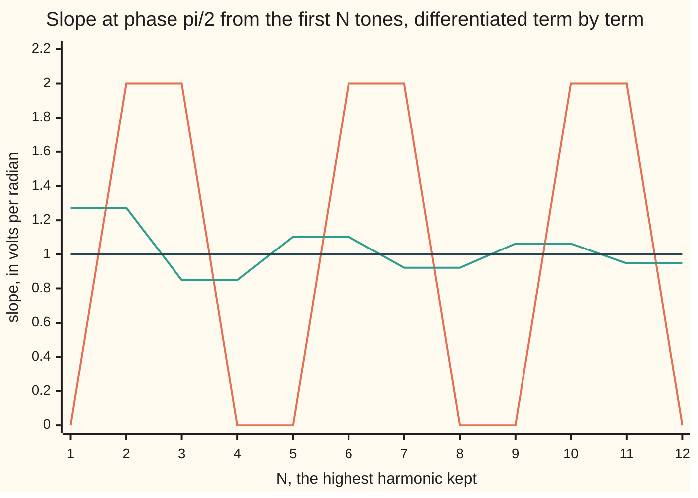

# Differentiating a series term by term: when it is legal, and what integration costs

[Syllabus](../../../SYLLABUS.md) → [Harmonic analysis](../README.md) → [Fourier Series in Depth](../README.md#s01) → Differentiating a series term by term

---

## General Overview

A synthesiser's oscillator puts out a sawtooth voltage at 220 cycles a second. Over each cycle the voltage climbs in a straight line from −3.14 V to +3.14 V, then snaps back. Measure the cycle by its phase x, an angle from −π to π radians, and the voltage is x volts.

The slope of that climb is easy: 1 volt per radian of phase. At 220 cycles a second the phase moves 1382.3 radians a second, so the voltage rises at 1382.3 V/s.

The same sawtooth is also a stack of sine tones, its Fourier series: 2 sin x − sin 2x + (2/3) sin 3x − ⋯. That series converges to the voltage at every phase inside the cycle. So it seems natural to get the slope by differentiating each tone and adding the results. Read at x = π/2, that answer comes out as 0, 2, 2, 0, 0, 2, 2, 0, … as tones are added. It never settles, and it is never 1.

Integration has no such trouble. Integrate each tone from 0 to π/2 and add: the sums close in on 1.233701, the true area under the climb. Integration only asks for two pieces of bookkeeping, a constant and the signal's average.

**Integrating a Fourier series term by term is always legal; differentiating it term by term is legal for a signal with no jump and a piecewise-smooth slope, and a jump spoils it, because every jump leaves a term that never shrinks.**

**What kind of fact this is:** two theorems, proved on this card in Why it works. The integration proof given here covers every signal of finite energy; the case of every integrable signal is stated, with a source.

### The picture: two slopes, read at π/2



Orange: the sawtooth, which jumps once a cycle. Its term-by-term slope bounces between 0 and 2 for ever. Teal: the triangle wave |x|, which has corners but no jump. Its term-by-term slope closes in on the true value. Dark blue: the true slope of both at π/2, 1 V per radian.

---

## The formula

Reminders. A signal f repeats every 2π in phase x. Its n-th Fourier coefficient is its share of the wave $`e^{inx}`$, where i is the imaginary unit ([Fourier coefficients](01-fourier-coefficients-and-orthogonality.md)):

```math
c_n=\hat f(n)=\frac{1}{2\pi}\int_{-\pi}^{\pi} f(x)\,e^{-inx}\,dx ,\qquad f(x)\sim\sum_{n=-\infty}^{\infty} c_n\,e^{inx}.
```

The coefficient $`c_0`$ is the signal's average over one cycle.

**Integration, term by term.** If f is integrable over one cycle, then for every x from −π to π

```math
\int_0^x f(y)\,dy \;=\; c_0\,x \;+\; \sum_{n\neq 0} c_n\,\frac{e^{inx}-1}{in},
```

and the sum converges uniformly in x: one worst-case gap, shrinking to 0, covers every x. This holds even where the series of f itself fails to converge.

**Differentiation, term by term.** If f is continuous with $`f(-\pi)=f(\pi)`$, so the repeated signal has no jump, and its slope $`f'`$ is piecewise smooth, then

```math
\widehat{f'}(n)=in\,c_n\quad\text{for every } n,\qquad\text{so}\qquad \sum_{n} in\,c_n\,e^{inx}\ \text{converges to}\ \frac{f'(x^+)+f'(x^-)}{2}\ \text{at every } x .
```

Here $`f'(x^+)`$ and $`f'(x^-)`$ are the slopes just to the right and just to the left of x. Where the slope is continuous, their average is $`f'(x)`$ itself.

**The jump rule.** If f is smooth inside the cycle but falls by $`J=f(\pi^-)-f(-\pi^+)`$ when it wraps round, then (with $`f(\pi^-)`$ the value just before π and $`f(-\pi^+)`$ the value just after −π)

```math
\widehat{f'}(n)=in\,c_n+(-1)^n\,\frac{J}{2\pi}.
```

**Read it aloud:** integrating divides each coefficient by in and always works, at the price of a straight line for the average and one constant; differentiating multiplies each coefficient by in and is honest only when there is no jump, since a jump of size J adds a term of fixed size J/2π to every coefficient of the slope.

For a sine series $`\sum b_n \sin nx`$ the same rules read: the slope's cosine coefficients are $`n\,b_n+(-1)^n J/\pi`$, and integrating $`b_n \sin ny`$ from 0 to x gives $`b_n(1-\cos nx)/n`$.

| Symbol | Plain meaning | In our example | Push it up and the answer… |
| --- | --- | --- | --- |
| $`x`$, $`y`$ | phase within one cycle, in radians, from −π to π; y is the phase inside an integral, from 0 to x | π/2 | — |
| $`f`$ | the signal, in volts | the sawtooth, f(x) = x | — |
| $`f'`$ | the signal's slope, in volts per radian | 1 | — |
| $`n`$ | the harmonic number: tone n makes n cycles per cycle of the signal | 1, 2, 3, … | the term-by-term slope weights tone n by n more |
| $`c_n`$, $`\hat f(n)`$ | the n-th complex coefficient | $`i(-1)^n/n`$ for the sawtooth | — |
| $`c_0`$ | the average of the signal over a cycle | 0 V for the sawtooth; 0.5 V for an on-off version of the siren (0 V or 1 V) | a steeper straight-line ramp in the integral |
| $`b_n`$, $`a_n`$ | sine and cosine coefficients | sawtooth $`b_n=2(-1)^{n+1}/n`$; triangle $`a_n=-4/(\pi n^2)`$, odd n | — |
| $`i`$ | the imaginary unit, $`i^2=-1`$ | — | — |
| $`J`$ | how far the signal falls when it wraps from π back to −π | 2π V for the sawtooth; 0 for the triangle | a bigger term that never shrinks |
| $`N`$ | the cut-off: the highest harmonic kept | 1 to 12; 100; 1000 | integration misses by at most 4/N |
| sgn x | the sign of x: +1 V when x > 0, −1 V when x < 0 | the ±1 V square wave, the shelf's siren; its on-off version, 0 V or 1 V, is (1 + sgn x)/2 | — |
| $`F`$ | the integral from 0 to x of the signal minus its average, in volt-radians | $`x^2/2`$ for the sawtooth | — |

### When it holds

- **For integration, f integrable over one cycle.** That is all. Without it the coefficients themselves are not defined.
- **For differentiation, no jump, including at the wrap.** Drop it and the sawtooth's slope at π/2 bounces between 0 and 2 instead of reading 1.
- **For differentiation, a piecewise-smooth slope.** The triangle qualifies; the square wave does not, since its "slope" would have to be a spike. Differentiate the triangle twice and the sums at π/4 run 0.9003, 0, −0.9003, 0 where the true slope is 0.
- **For integration, the average added back as a ramp.** Leave out $`c_0\,x`$ and the on-off wave (1 + sgn x)/2, average 0.5 V, integrates from 0 to π/2 to 0.7854 instead of 1.5708.

---

## Why it works

### Step 0: one integration by parts says everything

Differentiating $`e^{inx}`$ gives $`in\,e^{inx}`$: each coefficient is multiplied by in. That makes the tail of the series heavier by a factor n. A series whose terms shrink like 1/n turns into one whose terms do not shrink at all.

Integrating divides each coefficient by in. The tail gets lighter by a factor n, and a lighter tail can only converge better.

The question is whether $`in\,c_n`$ really is the coefficient of the slope. Integration by parts answers it, and the only thing that can spoil the answer is a boundary term. That boundary term is the jump.

### Step 1: the jump rule

Take f smooth inside the cycle. Integrate by parts in the coefficient of the slope:

```math
\widehat{f'}(n)=\frac{1}{2\pi}\Big[f(x)\,e^{-inx}\Big]_{-\pi}^{\pi}+\frac{in}{2\pi}\int_{-\pi}^{\pi} f(x)\,e^{-inx}\,dx=(-1)^n\frac{f(\pi^-)-f(-\pi^+)}{2\pi}+in\,c_n .
```

The boundary values use $`e^{\mp in\pi}=(-1)^n`$. The first term is $`(-1)^n J/(2\pi)`$: the jump rule. If the signal has more jumps inside the cycle, each adds its own boundary term of the same fixed size.

### Step 2: no jump, so differentiation is legal

If f is continuous and $`f(-\pi)=f(\pi)`$, then J = 0 and $`\widehat{f'}(n)=in\,c_n`$ exactly. A corner where the slope changes is harmless: split the integral at the corner, and the two boundary terms there cancel because f is continuous.

So the term-by-term series is the Fourier series of the slope, coefficient for coefficient. If the slope is piecewise smooth, [Dirichlet's theorem](04-pointwise-and-uniform-convergence.md) says that series converges at every x, to the slope where it is continuous and to the average of the two slopes at a corner.

The triangle |x| shows it. It is continuous, it has corners at 0 and ±π, and its slope is the square wave sgn x. Its coefficients are $`a_n=-4/(\pi n^2)`$ for odd n. Differentiated term by term at π/2, the sums run 1.2732, 0.8488, 1.1035, 0.9216, … and close in on 1. They form an alternating series, so each miss is at most the next term: up to harmonic 1001 the miss is 0.000635, under the bound 0.001269. At the corner x = 0 every term is a sine of 0, so the sum is 0: the average of the two slopes, −1 and +1.

### Step 3: a jump, so the derivative series fails everywhere

The sawtooth falls by J = 2π when it wraps. Its slope is the constant 1, whose coefficients past n = 0 are all 0. Term-by-term differentiation produces the cosine coefficients $`n\,b_n=2(-1)^{n+1}`$: 2, −2, 2, …. Add the jump term $`(-1)^n J/\pi=2(-1)^n`$ and the true coefficient 0 comes back.

The dropped jump term is the series of a spike: the sawtooth's cliff, a fall of 2π in no time at all. Term by term, the series carries that cliff's slope as well as the climb's.

The differentiated terms $`2(-1)^{n+1}\cos nx`$ never shrink, at any x. If $`\cos nx`$ did head for 0 along every n, it would along the even n too. But $`\cos 2nx = 2\cos^2 nx-1`$ heads for −1. So the derivative series diverges at every point. The code shows the sizes of the terms between n = 1000 and 1010 at x = 1 still reach 1.971823.

The calculus wing's rule, [Swapping limits](../../06-Calculus%20and%20analysis/06-Series/08-swapping-limits-with-integrals-and-derivatives.md), asks for the slopes to converge uniformly. It already proves the swap of limit and integral, and it shows sin(nx)/n as the failure. The Fourier rule reaches further: the triangle's slope series jumps at 0 and so cannot converge uniformly, yet term-by-term differentiation is still legal there, point by point.

### Step 4: integration always works, and what it costs

Let f be integrable with average $`c_0`$. Remove the average and integrate:

```math
F(x)=\int_0^x \big(f(y)-c_0\big)\,dy .
```

F is continuous. Across one whole cycle it gains $`\int_{-\pi}^{\pi}(f-c_0)=0`$, so $`F(-\pi)=F(\pi)`$: no jump. Step 1 applied to F gives $`c_n=in\,\hat F(n)`$, so $`\hat F(n)=c_n/(in)`$ for every n ≠ 0.

For a finite-energy signal these coefficients add up in absolute value, so the series converges uniformly, and its sum is F (fold below). For any integrable signal the series still converges uniformly to F, by the Dirichlet–Jordan test (also in the fold). Setting x = 0, where F(0) = 0, fixes the constant: $`\hat F(0)=-\sum_{n\ne 0} c_n/(in)`$. Add back $`c_0\,x`$ and the formula follows.

The cost is two pieces of bookkeeping:

- **The average leaves the series.** The term $`c_0\,x`$ is a straight-line ramp. It does not repeat every cycle, so no Fourier series can hold it.
- **A constant has to be summed.** The constant $`-\sum c_n/(in)`$ is itself an infinite series. For the sawtooth it is $`\sum 2(-1)^{n+1}/n^2=\pi^2/6=1.644934`$.

The gain is one extra factor 1/n in every coefficient, and with it uniform convergence. The sawtooth's series jumps at ±π; its integral, the parabola $`x^2/2`$, joins up continuously, with a corner at ±π.

<details>
<summary>Detailed proof: the integrated series converges uniformly</summary>

Let f have finite energy, $`\int_{-\pi}^{\pi}\lvert f\rvert^2<\infty`$; every piecewise-continuous signal does. Bessel's inequality ([Partial sums are the best fit](02-best-approximation-and-bessels-inequality.md)) bounds the sum of $`\lvert c_n\rvert^2`$. The Cauchy–Schwarz inequality, $`\sum \lvert u_n v_n\rvert \le (\sum u_n^2)^{1/2}(\sum v_n^2)^{1/2}`$, then gives

$`\displaystyle \sum_{n\ne 0}\left\lvert\frac{c_n}{in}\right\rvert \le \Big(\sum_{n\ne 0}\lvert c_n\rvert^2\Big)^{1/2}\Big(\sum_{n\ne 0}\frac{1}{n^2}\Big)^{1/2}<\infty .`$

Each term $`\hat F(n)e^{inx}`$ has size at most $`\lvert \hat F(n)\rvert`$, a number with no x in it, and these numbers have a finite sum. The Weierstrass M-test (terms under fixed caps with a finite sum converge uniformly) finishes it. The sum is continuous and has the same coefficients as F. Two continuous signals with the same coefficients are equal: their Fejer averages are the same, and those averages close in on each signal ([Dirichlet and Fejer kernels](03-dirichlet-and-fejer-kernels.md)). So the sum is F at every x. Step 1's integration by parts applies to F because F is the integral of $`f-c_0`$.

For an integrable f with infinite energy, F is still continuous and of bounded variation (its total rise and fall over a cycle is finite). The Dirichlet–Jordan test then gives uniform convergence; see Zygmund in Sources.

</details>

---

## Worked numbers, by hand

The sawtooth f(x) = x, read at x = π/2. There $`\cos(n\pi/2)`$ runs 0, −1, 0, 1, … and $`1-\cos(n\pi/2)`$ runs 1, 2, 1, 0, ….

| Step | Arithmetic | Value |
| --- | --- | --- |
| coefficients $`b_1, b_2, b_3`$ | $`2(-1)^{n+1}/n`$; the code also integrates them | 2, −1, 0.666667 |
| differentiated terms, n = 1 to 4 | $`n\,b_n\cos(n\pi/2)`$: 2 × 0, −2 × (−1), 2 × 0, −2 × 1 | 0, 2, 0, −2 |
| term-by-term slope, N = 1 to 4 | running totals | 0, 2, 2, 0 |
| true slope | difference quotient of x | **1 V per radian** |
| jump term, n = 1, 2, 3 | $`(-1)^n J/\pi`$ with J = 2π | −2, 2, −2 |
| repaired coefficient | $`n\,b_n`$ + jump term: 2 − 2, −2 + 2, 2 − 2 | 0, 0, 0 |
| integrated terms, n = 1 to 3 | $`b_n(1-\cos(n\pi/2))/n`$: 2 × 1/1, −1 × 2/2, (2/3) × 1/3 | 2, −1, 0.222222 |
| integrated sums, N = 1, 2, 3 | running totals | 2, 1, 1.222222 |
| integrated sum, N = 100 | the code adds them | 1.233700 |
| true integral | $`(\pi/2)^2/2=\pi^2/8`$ | **1.233701** |

Integrated term by term, the sawtooth gives the area under its climb, 1.233701 volt-radians, missing by 0.000001 after 100 tones. Differentiated term by term, it gives 0 or 2 V per radian, which at 220 cycles a second is 0 or 2764.6 V/s, against a true 1382.3 V/s.

The integration miss after N tones is at most 4/N. Each integrated term is at most $`(2/n)(2/n)=4/n^2`$ in size, and the terms past N add to less than 4/N. After 100 tones that bound is 0.04; the actual miss is far smaller.

### What breaks if you drop a piece

| Mistake | Comes out at | What went wrong |
| --- | --- | --- |
| Differentiate the sawtooth term by term | 0, 2, 2, 0, … at π/2; true slope 1 | the jump J = 2π leaves a term that never shrinks |
| Differentiate the triangle twice | 0.9003, 0, −0.9003, 0 at π/4; true slope of the square wave 0 | the first step is legal; the square wave jumps, so the second is not |
| Integrate the sawtooth, antiderivatives only, no constant | −0.4112; true 1.2337 | the constant π²/6 = 1.644934 was dropped |
| Integrate the on-off wave (1 + sgn x)/2, 0 V or 1 V, without the average | 0.7854; true 1.5708 | the ramp $`c_0\,x`$ = 0.5 × π/2 was dropped |

The code prints all four.

---

## Code, from first principles, and it actually runs

The code builds its own midpoint rule and adds every series itself; only π, sine and cosine come from the language. It takes two roads to each answer. The coefficients come from a closed form and from integration. The slope comes from term-by-term sums and from a difference quotient of the signal. The integral comes from term-by-term sums and from the midpoint rule, with the miss checked against the tail bound 4/N. The jump rule is checked against integrated coefficients of the slope.

### Python

```python
# Term by term -- the check behind the card.  math gives pi, sin and cos only.
# Coefficients are integrated by a midpoint rule written here; every series is
# summed here; each answer is met by a second road that shares no arithmetic.
from math import pi, sin, cos

def midpoint(g, a, b, m=200000):            # m slices, each read at its middle
    h = (b - a) / m
    return h * sum(g(a + (k + 0.5) * h) for k in range(m))

def saw(x):  return x                       # the sawtooth on -pi < x < pi
def b(n):    return 2 * (-1) ** (n + 1) / n  # its sine coefficients, closed form

# Road 1 against road 2: coefficients by formula and by integration.
for n in (1, 2, 3):
    num = midpoint(lambda x: saw(x) * sin(n * x), -pi, pi) / pi
    assert abs(num - b(n)) < 1e-8
    print(f"sawtooth b_{n}: formula {b(n):.6f}, integrated {num:.6f}")
# The slope f' = 1 has cosine coefficients 0 for n >= 1, yet n b_n is not 0.
J = saw(pi) - saw(-pi)                      # how far the sawtooth falls when it wraps
for n in (1, 2, 3):
    num = midpoint(lambda x: 1.0 * cos(n * x), -pi, pi) / pi
    jump = 2 * (-1) ** n * J / (2 * pi)     # the jump's share, in cosine form
    assert abs(num - (n * b(n) + jump)) < 1e-8
    print(f"n={n}: n b_n {n * b(n):.6f}, jump term {jump:.6f}, true coefficient of f' {abs(num):.6f}")

# The failure: differentiate x = sum b_n sin(nx) term by term, read at pi/2.
x = pi / 2
true_slope = (saw(x + 1e-6) - saw(x - 1e-6)) / 2e-6
d, partial = 0.0, []
for n in range(1, 1001):
    d += n * b(n) * cos(n * x)
    partial.append(d)
w = 2 * pi * 220                            # radians of phase per second at 220 cycles a second
print(f"slope of the sawtooth at pi/2, difference quotient: {true_slope:.6f} V per radian = {true_slope * w:.1f} V/s")
print(f"term by term claims 0 or 2 V per radian = 0 or {2 * w:.1f} V/s")
print("sawtooth, term-by-term slope at pi/2, N=1..12:", " ".join(f"{abs(v):.4f}" for v in partial[:12]))
assert min(abs(v - true_slope) for v in partial[100:]) > 0.99   # never within 0.99 of 1
fejer = sum(partial) / len(partial)
print(f"average of the first 1000 partial sums: {fejer:.6f}")
assert abs(fejer - true_slope) < 1e-9
top = max(abs(n * b(n) * cos(n * 1.0)) for n in range(1000, 1011))
print(f"largest term size for n=1000..1010 at x=1: {top:.6f} (terms never shrink)")
assert top > 1

# The legal case: the triangle |x|, the integral of the square wave.
tri_a = lambda n: -4 / (pi * n * n) if n % 2 else 0.0
for n in (1, 2, 3):
    num = midpoint(lambda t: abs(t) * cos(n * t), -pi, pi) / pi
    assert abs(num - tri_a(n)) < 1e-8
    print(f"triangle a_{n}: formula {tri_a(n):.6f}, integrated {num if abs(num) > 1e-9 else 0.0:.6f}")
s, rows = 0.0, {}
for n in range(1, 1002):
    s += -n * tri_a(n) * sin(n * x)          # derivative of a_n cos(nx) is -n a_n sin(nx)
    rows[n] = s
print("triangle, term-by-term slope at pi/2, N=1..12:", " ".join(f"{rows[n]:.4f}" for n in range(1, 13)))
for N in (11, 101, 1001):
    err, bound = abs(rows[N] - 1), 4 / (pi * (N + 2))   # alternating: next term caps the miss
    assert err <= bound
    print(f"N={N}: sum {rows[N]:.6f}, miss {err:.6f}, bound from the next term {bound:.6f}")

# Integration: integrate x = sum b_n sin(nx) from 0 to pi/2 term by term.
exact = x * x / 2
quad = midpoint(saw, 0.0, x)
print(f"integral of the sawtooth from 0 to pi/2: x^2/2 = {exact:.6f}, midpoint rule {quad:.6f}")
assert abs(exact - quad) < 1e-9
I = 0.0
for n in range(1, 1001):
    I += b(n) * (1 - cos(n * x)) / n          # integral of sin(ny) from 0 to x is (1 - cos nx)/n
    if n in (1, 2, 3, 10, 100, 1000):
        miss, bound = abs(I - exact), 4 / n
        assert miss <= bound
        print(f"N={n}: integrated terms {I:.6f}, miss {miss:.6f}, tail bound 4/N {bound:.6f}")
no_const = I - sum(b(n) / n for n in range(1, 200001))   # antiderivatives -cos/n, no constant
print(f"forget the constant pi^2/6 = {pi * pi / 6:.6f}: {no_const:.4f}")
assert abs(no_const - (exact - pi * pi / 6)) < 1e-4

# An on-off version of the siren: g = (1 + sgn x)/2, 0 V or 1 V, mean 1/2; integrate to pi/2.
sq = lambda n: 4 / (pi * n) if n % 2 else 0.0          # sgn x = sum sq_n sin(nx)
osc = sum(0.5 * sq(n) * (1 - cos(n * x)) / n for n in range(1, 200001))
print(f"on-off wave, integral to pi/2: true {midpoint(lambda t: 1.0, 0.0, x):.4f}, "
      f"terms only {osc:.4f}, with the mean term {0.5 * x + osc:.4f}")
assert abs(0.5 * x + osc - x) < 1e-5                  # g = 1 V on (0, pi/2): integral pi/2
bounce = [(4 / pi) * sum(cos(k * pi / 4) for k in range(1, N + 1, 2)) for N in (1, 3, 5, 7)]
print("square wave, term-by-term slope at pi/4, N=1,3,5,7:", " ".join(f"{v if abs(v) > 1e-9 else 0.0:.4f}" for v in bounce))
assert abs(bounce[0]) > 0.9 and abs(bounce[2]) > 0.9   # the square wave is flat there: slope 0
print("ALL CHECKS PASS")
```

**Ran 2026-11-15 on macOS, Python 3.14.10, standard library only. All checks passed. Output, pasted from the run:**

```
sawtooth b_1: formula 2.000000, integrated 2.000000
sawtooth b_2: formula -1.000000, integrated -1.000000
sawtooth b_3: formula 0.666667, integrated 0.666667
n=1: n b_n 2.000000, jump term -2.000000, true coefficient of f' 0.000000
n=2: n b_n -2.000000, jump term 2.000000, true coefficient of f' 0.000000
n=3: n b_n 2.000000, jump term -2.000000, true coefficient of f' 0.000000
slope of the sawtooth at pi/2, difference quotient: 1.000000 V per radian = 1382.3 V/s
term by term claims 0 or 2 V per radian = 0 or 2764.6 V/s
sawtooth, term-by-term slope at pi/2, N=1..12: 0.0000 2.0000 2.0000 0.0000 0.0000 2.0000 2.0000 0.0000 0.0000 2.0000 2.0000 0.0000
average of the first 1000 partial sums: 1.000000
largest term size for n=1000..1010 at x=1: 1.971823 (terms never shrink)
triangle a_1: formula -1.273240, integrated -1.273240
triangle a_2: formula 0.000000, integrated 0.000000
triangle a_3: formula -0.141471, integrated -0.141471
triangle, term-by-term slope at pi/2, N=1..12: 1.2732 1.2732 0.8488 0.8488 1.1035 1.1035 0.9216 0.9216 1.0631 1.0631 0.9473 0.9473
N=11: sum 0.947305, miss 0.052695, bound from the next term 0.097942
N=101: sum 1.006241, miss 0.006241, bound from the next term 0.012362
N=1001: sum 1.000635, miss 0.000635, bound from the next term 0.001269
integral of the sawtooth from 0 to pi/2: x^2/2 = 1.233701, midpoint rule 1.233701
N=1: integrated terms 2.000000, miss 0.766299, tail bound 4/N 4.000000
N=2: integrated terms 1.000000, miss 0.233701, tail bound 4/N 2.000000
N=3: integrated terms 1.222222, miss 0.011478, tail bound 4/N 1.333333
N=10: integrated terms 1.216619, miss 0.017082, tail bound 4/N 0.400000
N=100: integrated terms 1.233700, miss 0.000001, tail bound 4/N 0.040000
N=1000: integrated terms 1.233701, miss 0.000000, tail bound 4/N 0.004000
forget the constant pi^2/6 = 1.644934: -0.4112
on-off wave, integral to pi/2: true 1.5708, terms only 0.7854, with the mean term 1.5708
square wave, term-by-term slope at pi/4, N=1,3,5,7: 0.9003 0.0000 -0.9003 0.0000
ALL CHECKS PASS
```

### Rust

```rust
// Term by term -- the check behind the card.  std gives pi, sin and cos only.
// Coefficients are integrated by a midpoint rule written here; every series is
// summed here; each answer is met by a second road that shares no arithmetic.
use std::f64::consts::PI;

fn midpoint<F: Fn(f64) -> f64>(g: F, a: f64, b: f64) -> f64 {
    let m = 200000;                          // m slices, each read at its middle
    let h = (b - a) / m as f64;
    h * (0..m).map(|k| g(a + (k as f64 + 0.5) * h)).sum::<f64>()
}
fn saw(x: f64) -> f64 { x }                  // the sawtooth on -pi < x < pi
fn sign(n: u32) -> f64 { if n % 2 == 0 { 1.0 } else { -1.0 } } // (-1)^n
fn b(n: u32) -> f64 { -2.0 * sign(n) / n as f64 } // its sine coefficients, closed form
fn tri_a(n: u32) -> f64 { if n % 2 == 1 { -4.0 / (PI * (n * n) as f64) } else { 0.0 } }
fn sq(n: u32) -> f64 { if n % 2 == 1 { 4.0 / (PI * n as f64) } else { 0.0 } } // sgn x

fn main() {
    // Road 1 against road 2: coefficients by formula and by integration.
    for n in 1..=3u32 {
        let num = midpoint(|x| saw(x) * (n as f64 * x).sin(), -PI, PI) / PI;
        assert!((num - b(n)).abs() < 1e-8);
        println!("sawtooth b_{}: formula {:.6}, integrated {:.6}", n, b(n), num);
    }
    // The slope f' = 1 has cosine coefficients 0 for n >= 1, yet n b_n is not 0.
    let j = saw(PI) - saw(-PI);              // how far the sawtooth falls when it wraps
    for n in 1..=3u32 {
        let num = midpoint(|x| (n as f64 * x).cos(), -PI, PI) / PI;
        let jump = 2.0 * sign(n) * j / (2.0 * PI); // the jump's share, in cosine form
        let nb = n as f64 * b(n);
        assert!((num - (nb + jump)).abs() < 1e-8);
        println!("n={}: n b_n {:.6}, jump term {:.6}, true coefficient of f' {:.6}", n, nb, jump, num.abs());
    }

    // The failure: differentiate x = sum b_n sin(nx) term by term, read at pi/2.
    let x = PI / 2.0;
    let true_slope = (saw(x + 1e-6) - saw(x - 1e-6)) / 2e-6;
    let mut d = 0.0;
    let mut partial = Vec::new();
    for n in 1..=1000u32 {
        d += n as f64 * b(n) * (n as f64 * x).cos();
        partial.push(d);
    }
    let w = 2.0 * PI * 220.0;                // radians of phase per second at 220 cycles a second
    println!("slope of the sawtooth at pi/2, difference quotient: {:.6} V per radian = {:.1} V/s", true_slope, true_slope * w);
    println!("term by term claims 0 or 2 V per radian = 0 or {:.1} V/s", 2.0 * w);
    let row: Vec<String> = partial[..12].iter().map(|v| format!("{:.4}", v.abs())).collect();
    println!("sawtooth, term-by-term slope at pi/2, N=1..12: {}", row.join(" "));
    let closest = partial[100..].iter().map(|v| (v - true_slope).abs()).fold(f64::INFINITY, f64::min);
    assert!(closest > 0.99);                 // never within 0.99 of 1
    let fejer = partial.iter().sum::<f64>() / partial.len() as f64;
    println!("average of the first 1000 partial sums: {:.6}", fejer);
    assert!((fejer - true_slope).abs() < 1e-9);
    let top = (1000..=1010u32).map(|n| (n as f64 * b(n) * (n as f64).cos()).abs()).fold(0.0, f64::max);
    println!("largest term size for n=1000..1010 at x=1: {:.6} (terms never shrink)", top);
    assert!(top > 1.0);

    // The legal case: the triangle |x|, the integral of the square wave.
    for n in [1u32, 2, 3] {
        let num = midpoint(|t| t.abs() * (n as f64 * t).cos(), -PI, PI) / PI;
        assert!((num - tri_a(n)).abs() < 1e-8);
        println!("triangle a_{}: formula {:.6}, integrated {:.6}", n, tri_a(n), if num.abs() > 1e-9 { num } else { 0.0 });
    }
    let mut s = 0.0;
    let mut rows = vec![0.0; 1002];
    for n in 1..=1001u32 {
        s += -(n as f64) * tri_a(n) * (n as f64 * x).sin(); // derivative of a_n cos(nx) is -n a_n sin(nx)
        rows[n as usize] = s;
    }
    let row: Vec<String> = (1..=12).map(|n| format!("{:.4}", rows[n])).collect();
    println!("triangle, term-by-term slope at pi/2, N=1..12: {}", row.join(" "));
    for big_n in [11usize, 101, 1001] {
        let err = (rows[big_n] - 1.0).abs();
        let bound = 4.0 / (PI * (big_n + 2) as f64); // alternating: next term caps the miss
        assert!(err <= bound);
        println!("N={}: sum {:.6}, miss {:.6}, bound from the next term {:.6}", big_n, rows[big_n], err, bound);
    }

    // Integration: integrate x = sum b_n sin(nx) from 0 to pi/2 term by term.
    let exact = x * x / 2.0;
    let quad = midpoint(saw, 0.0, x);
    println!("integral of the sawtooth from 0 to pi/2: x^2/2 = {:.6}, midpoint rule {:.6}", exact, quad);
    assert!((exact - quad).abs() < 1e-9);
    let mut integ = 0.0;
    for n in 1..=1000u32 {
        integ += b(n) * (1.0 - (n as f64 * x).cos()) / n as f64; // integral of sin(ny) from 0 to x
        if [1, 2, 3, 10, 100, 1000].contains(&n) {
            let (miss, bound) = ((integ - exact).abs(), 4.0 / n as f64);
            assert!(miss <= bound);
            println!("N={}: integrated terms {:.6}, miss {:.6}, tail bound 4/N {:.6}", n, integ, miss, bound);
        }
    }
    let no_const = integ - (1..=200000u32).map(|n| b(n) / n as f64).sum::<f64>(); // no constant
    println!("forget the constant pi^2/6 = {:.6}: {:.4}", PI * PI / 6.0, no_const);
    assert!((no_const - (exact - PI * PI / 6.0)).abs() < 1e-4);

    // An on-off version of the siren: g = (1 + sgn x)/2, 0 V or 1 V, mean 1/2; integrate to pi/2.
    let osc: f64 = (1..=200000u32).map(|n| 0.5 * sq(n) * (1.0 - (n as f64 * x).cos()) / n as f64).sum();
    println!("on-off wave, integral to pi/2: true {:.4}, terms only {:.4}, with the mean term {:.4}",
             midpoint(|_t| 1.0, 0.0, x), osc, 0.5 * x + osc);
    assert!((0.5 * x + osc - x).abs() < 1e-5);      // g = 1 V on (0, pi/2): integral pi/2
    let bounce: Vec<f64> = [1u32, 3, 5, 7].iter()
        .map(|&big_n| 4.0 / PI * (1..=big_n).step_by(2).map(|k| (k as f64 * PI / 4.0).cos()).sum::<f64>())
        .collect();
    let row: Vec<String> = bounce.iter().map(|v| format!("{:.4}", if v.abs() > 1e-9 { *v } else { 0.0 })).collect();
    println!("square wave, term-by-term slope at pi/4, N=1,3,5,7: {}", row.join(" "));
    assert!(bounce[0].abs() > 0.9 && bounce[2].abs() > 0.9); // the square wave is flat there: slope 0
    println!("ALL CHECKS PASS");
}
```

**Ran 2026-11-15 on macOS, rustc 1.98.1, no crates. All checks passed. Output, pasted from the run:**

```
sawtooth b_1: formula 2.000000, integrated 2.000000
sawtooth b_2: formula -1.000000, integrated -1.000000
sawtooth b_3: formula 0.666667, integrated 0.666667
n=1: n b_n 2.000000, jump term -2.000000, true coefficient of f' 0.000000
n=2: n b_n -2.000000, jump term 2.000000, true coefficient of f' 0.000000
n=3: n b_n 2.000000, jump term -2.000000, true coefficient of f' 0.000000
slope of the sawtooth at pi/2, difference quotient: 1.000000 V per radian = 1382.3 V/s
term by term claims 0 or 2 V per radian = 0 or 2764.6 V/s
sawtooth, term-by-term slope at pi/2, N=1..12: 0.0000 2.0000 2.0000 0.0000 0.0000 2.0000 2.0000 0.0000 0.0000 2.0000 2.0000 0.0000
average of the first 1000 partial sums: 1.000000
largest term size for n=1000..1010 at x=1: 1.971823 (terms never shrink)
triangle a_1: formula -1.273240, integrated -1.273240
triangle a_2: formula 0.000000, integrated 0.000000
triangle a_3: formula -0.141471, integrated -0.141471
triangle, term-by-term slope at pi/2, N=1..12: 1.2732 1.2732 0.8488 0.8488 1.1035 1.1035 0.9216 0.9216 1.0631 1.0631 0.9473 0.9473
N=11: sum 0.947305, miss 0.052695, bound from the next term 0.097942
N=101: sum 1.006241, miss 0.006241, bound from the next term 0.012362
N=1001: sum 1.000635, miss 0.000635, bound from the next term 0.001269
integral of the sawtooth from 0 to pi/2: x^2/2 = 1.233701, midpoint rule 1.233701
N=1: integrated terms 2.000000, miss 0.766299, tail bound 4/N 4.000000
N=2: integrated terms 1.000000, miss 0.233701, tail bound 4/N 2.000000
N=3: integrated terms 1.222222, miss 0.011478, tail bound 4/N 1.333333
N=10: integrated terms 1.216619, miss 0.017082, tail bound 4/N 0.400000
N=100: integrated terms 1.233700, miss 0.000001, tail bound 4/N 0.040000
N=1000: integrated terms 1.233701, miss 0.000000, tail bound 4/N 0.004000
forget the constant pi^2/6 = 1.644934: -0.4112
on-off wave, integral to pi/2: true 1.5708, terms only 0.7854, with the mean term 1.5708
square wave, term-by-term slope at pi/4, N=1,3,5,7: 0.9003 0.0000 -0.9003 0.0000
ALL CHECKS PASS
```

### Lean

Lean proves all three rules in full, including integration for every integrable signal, and checks the sawtooth's worked numbers.

- Take a continuous f with no jump and a piecewise-smooth slope $`f'`$. Then $`\widehat{f'}(n)=in\,c_n`$ for every n.
- Take the same f. Then at every x the term-by-term series converges to $`(f'(x^+)+f'(x^-))/2`$.
- Take any f integrable over one cycle. Then the integrated series plus the ramp $`c_0\,x`$ converges uniformly to $`\int_0^x f(y)\,dy`$ over the whole cycle.
- Take f with a slope at every x inside the cycle, the slope integrable, and a fall of J at the wrap. Then $`\widehat{f'}(n)=in\,c_n+(-1)^n J/2\pi`$ for every n.
- The formula $`2(-1)^{n+1}/n`$ gives the sawtooth's $`b_1, b_2, b_3`$ as 2, −1 and 2/3.
- Take the sawtooth at π/2. Then its term-by-term slopes for N = 1 to 4 are 0, 2, 2, 0, never 1.
- The jump term $`(-1)^n J/\pi`$ turns each $`n\,b_n`$ into the true coefficient 0, for n = 1, 2, 3.
- The sawtooth's integrated sums at π/2 for N = 1, 2, 3 are 2, 1 and 11/9.

The midpoint-rule integrals, the long sums, the triangle and the on-off wave are left to the Python and Rust checks.

```lean
-- Differentiating a series term by term: integrating a Fourier series term by term always works for an integrable signal (with the average added back as a ramp and one constant), differentiating it term by term works for a signal with no jump and a piecewise-smooth slope, and a jump J adds the fixed amount (−1)^n J/2π to every coefficient of the slope.
import Mathlib.Analysis.Fourier.AddCircle
import Mathlib.Analysis.Calculus.ContDiff.Defs
import Mathlib.Topology.UniformSpace.UniformConvergence
import Mathlib.Tactic.NormNum
import Mathlib

open Real Filter Topology MeasureTheory Complex

lemma tt_coeff (g : ℝ → ℂ) (n : ℤ) :
    fourierCoeffOn (neg_lt_self Real.pi_pos) g n =
      (1 / (2 * π)) * ∫ x in (-π)..π, exp (-(I * n * x)) * g x := by
  rw [fourierCoeffOn_eq_integral]
  simp only [fourier_coe_apply, smul_eq_mul]
  have hp : (π : ℂ) ≠ 0 := by exact_mod_cast Real.pi_ne_zero
  have e : ∀ x : ℝ, 2 * π * I * (((-n : ℤ)) : ℂ) * x / ((π - -π : ℝ) : ℂ) = -(I * n * x) := by
    intro x; push_cast; field_simp; ring
  simp only [e]
  rw [Complex.real_smul]; push_cast; ring
#print axioms tt_coeff

noncomputable def ttD (N : ℕ) (t : ℝ) : ℝ := 1 + 2 * ∑ k ∈ Finset.range N, Real.cos ((k + 1) * t)

noncomputable def ttK (N : ℕ) (t : ℝ) : ℝ := ∑ k ∈ Finset.range N, 2 * Real.sin ((k + 1) * t) / (k + 1)

lemma ttD_cont (N : ℕ) : Continuous (ttD N) := by unfold ttD; fun_prop
#print axioms ttD_cont

lemma ttK_cont (N : ℕ) : Continuous (ttK N) := by unfold ttK; fun_prop
#print axioms ttK_cont

lemma ttD_even (N : ℕ) (t : ℝ) : ttD N (-t) = ttD N t := by
  simp [ttD]
#print axioms ttD_even

lemma ttK_odd (N : ℕ) (t : ℝ) : ttK N (-t) = -ttK N t := by
  simp only [ttK, mul_neg, Real.sin_neg, neg_div, ← Finset.sum_neg_distrib]
#print axioms ttK_odd

lemma ttK_per (N : ℕ) (t : ℝ) : ttK N (t + 2 * π) = ttK N t := by
  unfold ttK
  congr 1; ext k
  have : ((k : ℝ) + 1) * (t + 2 * π) = ((k : ℝ) + 1) * t + ((k + 1 : ℕ) : ℤ) * (2 * π) := by
    push_cast; ring
  rw [this, Real.sin_add_int_mul_two_pi]
#print axioms ttK_per

lemma ttD_sin (N : ℕ) (t : ℝ) : Real.sin (t / 2) * ttD N t = Real.sin ((N + 1 / 2) * t) := by
  induction N with
  | zero => simp [ttD]; ring_nf
  | succ n ih =>
    have e : ttD (n + 1) t = ttD n t + 2 * Real.cos ((n + 1) * t) := by
      simp only [ttD, Finset.sum_range_succ]; ring
    rw [e, mul_add, ih]
    have h1 : ((n:ℝ) + 1 / 2) * t = (n + 1) * t - t / 2 := by ring
    have h2 : (((n + 1 : ℕ) : ℝ) + 1 / 2) * t = (n + 1) * t + t / 2 := by push_cast; ring
    rw [h1, h2, Real.sin_sub, Real.sin_add]; ring
#print axioms ttD_sin

lemma ttD_bound (N : ℕ) (t : ℝ) : |ttD N t| ≤ 2 * N + 1 := by
  unfold ttD
  have : |∑ k ∈ Finset.range N, Real.cos ((k + 1) * t)| ≤ N := by
    refine (Finset.abs_sum_le_sum_abs _ _).trans ?_
    calc ∑ k ∈ Finset.range N, |Real.cos ((k + 1) * t)| ≤ ∑ k ∈ Finset.range N, (1 : ℝ) :=
          Finset.sum_le_sum fun k _ => Real.abs_cos_le_one _
      _ = N := by simp
  calc |1 + 2 * ∑ k ∈ Finset.range N, Real.cos ((k + 1) * t)|
      ≤ |(1:ℝ)| + |2 * ∑ k ∈ Finset.range N, Real.cos ((k + 1) * t)| := abs_add_le _ _
    _ ≤ 2 * N + 1 := by rw [abs_mul]; simp; linarith
#print axioms ttD_bound

lemma tt_int_cos (k : ℕ) (a b : ℝ) :
    ∫ t in a..b, Real.cos ((k + 1) * t) = (Real.sin ((k + 1) * b) - Real.sin ((k + 1) * a)) / (k + 1) := by
  have hk : (k : ℝ) + 1 ≠ 0 := by positivity
  rw [intervalIntegral.integral_comp_mul_left (fun t => Real.cos t) hk, integral_cos, smul_eq_mul]
  field_simp
#print axioms tt_int_cos

lemma ttD_prim (N : ℕ) (t : ℝ) : ∫ s in (0:ℝ)..t, ttD N s = t + ttK N t := by
  unfold ttD ttK
  rw [intervalIntegral.integral_add (by simp) (by apply Continuous.intervalIntegrable; fun_prop),
    intervalIntegral.integral_const_mul, intervalIntegral.integral_finsetSum
      (fun k _ => by apply Continuous.intervalIntegrable; fun_prop)]
  simp only [tt_int_cos, intervalIntegral.integral_const, sub_zero, smul_eq_mul, mul_one,
    mul_zero, Real.sin_zero, Finset.mul_sum]
  congr 1
  apply Finset.sum_congr rfl
  intro k _; ring
#print axioms ttD_prim

lemma ttD_int (N : ℕ) : ∫ t in (0:ℝ)..π, ttD N t = π := by
  rw [ttD_prim]
  unfold ttK
  have : ∀ k : ℕ, Real.sin ((k + 1) * π) = 0 := fun k => by
    have := Real.sin_nat_mul_pi (k + 1); push_cast at this; exact this
  simp [this]
#print axioms ttD_int

lemma tt_sum_Icc (g : ℤ → ℂ) (N : ℕ) :
    ∑ n ∈ Finset.Icc (-(N : ℤ)) N, g n = g 0 + ∑ k ∈ Finset.range N, (g (k + 1) + g (-(k + 1))) := by
  induction N with
  | zero => simp
  | succ n ih =>
    have e : Finset.Icc (-((n + 1 : ℕ) : ℤ)) ((n + 1 : ℕ) : ℤ) =
        insert (-((n : ℤ) + 1)) (insert ((n : ℤ) + 1) (Finset.Icc (-(n : ℤ)) n)) := by
      ext j; simp only [Finset.mem_Icc, Finset.mem_insert]; push_cast; omega
    rw [e, Finset.sum_insert (by simp; omega), Finset.sum_insert (by simp), ih,
      Finset.sum_range_succ]
    push_cast; ring
#print axioms tt_sum_Icc

lemma tt_exp_real (θ : ℝ) : exp (I * θ) = (Real.cos θ : ℂ) + (Real.sin θ : ℂ) * I := by
  rw [mul_comm, Complex.exp_mul_I]; push_cast; ring
#print axioms tt_exp_real

lemma ttD_complex (N : ℕ) (θ : ℝ) :
    ∑ n ∈ Finset.Icc (-(N : ℤ)) N, exp (I * n * θ) = (ttD N θ : ℂ) := by
  rw [tt_sum_Icc]
  unfold ttD
  push_cast
  rw [Finset.mul_sum]
  congr 1
  · simp
  · apply Finset.sum_congr rfl
    intro k _
    have : 2 * Complex.cos ((k + 1) * θ) = exp (((k + 1) * θ) * I) + exp (-((k + 1) * θ) * I) := by
      rw [Complex.cos]; ring
    rw [this]
    congr 1 <;> congr 1 <;> ring
#print axioms ttD_complex

lemma ttD_per (N : ℕ) (t : ℝ) : ttD N (t + 2 * π) = ttD N t := by
  unfold ttD
  congr 2; apply Finset.sum_congr rfl; intro k _
  have : ((k : ℝ) + 1) * (t + 2 * π) = ((k : ℝ) + 1) * t + ((k + 1 : ℕ) : ℤ) * (2 * π) := by
    push_cast; ring
  rw [this, Real.cos_add_int_mul_two_pi]
#print axioms ttD_per

lemma tt_ii_of_loc {h : ℝ → ℝ} (hloc : LocallyIntegrable h volume) (a b : ℝ) :
    IntervalIntegrable h volume a b :=
  intervalIntegrable_iff.mpr
    ((MeasureTheory.LocallyIntegrable.integrableOn_isCompact hloc isCompact_uIcc).mono_set
      Set.uIoc_subset_uIcc)
#print axioms tt_ii_of_loc

lemma tt_ii_ofReal {g : ℝ → ℝ} {a b : ℝ} (h : IntervalIntegrable g volume a b) :
    IntervalIntegrable (fun x => (g x : ℂ)) volume a b := ⟨h.1.ofReal, h.2.ofReal⟩
#print axioms tt_ii_ofReal

lemma tt_ii_shift (h : ℝ → ℝ) (hloc : LocallyIntegrable h volume) (x a b : ℝ) :
    IntervalIntegrable (fun t => h (x + t)) volume a b ∧
      IntervalIntegrable (fun t => h (x - t)) volume a b := by
  constructor
  · simpa using (tt_ii_of_loc hloc (x + a) (x + b)).comp_add_left x
  · simpa using (tt_ii_of_loc hloc (x - a) (x - b)).comp_sub_left x
#print axioms tt_ii_shift

lemma tt_partial (h : ℝ → ℝ) (hint : IntervalIntegrable h volume (-π) π) (N : ℕ) (x : ℝ) :
    ∑ n ∈ Finset.Icc (-(N : ℤ)) N,
        fourierCoeffOn (neg_lt_self Real.pi_pos) (fun y => (h y : ℂ)) n * exp (I * n * x) =
      (((1 / (2 * π)) * ∫ y in (-π)..π, h y * ttD N (x - y) : ℝ) : ℂ) := by
  have hpt : ∀ y : ℝ, ∑ n ∈ Finset.Icc (-(N : ℤ)) N, exp (-(I * n * y)) * (h y : ℂ) * exp (I * n * x)
      = ((h y * ttD N (x - y) : ℝ) : ℂ) := by
    intro y
    rw [Complex.ofReal_mul, ← ttD_complex, Finset.mul_sum]
    apply Finset.sum_congr rfl; intro n _
    rw [mul_comm (Complex.exp _) (h y : ℂ), mul_assoc, ← Complex.exp_add]
    congr 2; push_cast; ring
  have hii : ∀ n : ℤ, IntervalIntegrable (fun y : ℝ => exp (-(I * n * y)) * (h y : ℂ) * exp (I * n * x))
      volume (-π) π := fun n =>
    ((tt_ii_ofReal hint).continuousOn_mul (by fun_prop)).mul_const _
  simp_rw [tt_coeff]
  simp_rw [mul_assoc (1 / (2 * (π : ℂ))), ← intervalIntegral.integral_mul_const]
  rw [← Finset.mul_sum, ← intervalIntegral.integral_finsetSum (fun n _ => hii n)]
  simp_rw [hpt, intervalIntegral.integral_ofReal]
  push_cast; ring
#print axioms tt_partial

lemma tt_fold (h : ℝ → ℝ) (hper : Function.Periodic h (2 * π)) (hloc : LocallyIntegrable h volume)
    (x : ℝ) (N : ℕ) :
    ∫ y in (-π)..π, h y * ttD N (x - y) = ∫ t in (0:ℝ)..π, (h (x + t) + h (x - t)) * ttD N t := by
  set F : ℝ → ℝ := fun t => h (x - t) * ttD N t with hF
  have e1 : ∫ y in (-π)..π, h y * ttD N (x - y) = ∫ y in (-π)..π, F (x - y) := by
    congr 1; funext y; simp [F]
  rw [e1, intervalIntegral.integral_comp_sub_left]
  have hFp : Function.Periodic F (2 * π) := fun t => by
    simp only [F]
    rw [show x - (t + 2 * π) = x - t - 2 * π by ring, hper.sub_eq, ttD_per]
  have e2 : ∫ t in (x - π)..(x - -π), F t = ∫ t in (-π)..π, F t := by
    have := hFp.intervalIntegral_add_eq (x - π) (-π)
    rw [show x - π + 2 * π = x - -π by ring, show -π + 2 * π = π by ring] at this
    exact this
  rw [e2]
  have iF : ∀ a b, IntervalIntegrable F volume a b := fun a b =>
    (tt_ii_shift h hloc x a b).2.mul_continuousOn (ttD_cont N).continuousOn
  rw [← intervalIntegral.integral_add_adjacent_intervals (iF (-π) 0) (iF 0 π)]
  have e3 : ∫ t in (-π)..0, F t = ∫ t in (0:ℝ)..π, h (x + t) * ttD N t := by
    have := intervalIntegral.integral_comp_neg (a := 0) (b := π) F
    rw [neg_zero] at this
    rw [← this]
    congr 1; funext t; simp [F, ttD_even]
  rw [e3, ← intervalIntegral.integral_add
    ((tt_ii_shift h hloc x 0 π).1.mul_continuousOn (ttD_cont N).continuousOn) (iF 0 π)]
  congr 1; funext t; simp only [F]; ring
#print axioms tt_fold

lemma tt_RL (φ : ℝ → ℝ) (a b : ℝ) (hab : a ≤ b) (hφ : IntervalIntegrable φ volume a b) :
    Tendsto (fun N : ℕ => ∫ t in a..b, φ t * Real.sin ((N + 1 / 2) * t)) atTop (𝓝 0) := by
  set ψ : ℝ → ℂ := (Set.Ioc a b).indicator (fun t => (φ t : ℂ)) with hψ
  have RL := Real.tendsto_integral_exp_smul_cocompact ψ
  set w : ℕ → ℝ := fun N => -((N + 1 / 2) / (2 * π)) with hw
  have hwt : Tendsto w atTop (cocompact ℝ) := by
    rw [cocompact_eq_atBot_atTop]
    apply Tendsto.mono_right _ le_sup_left
    rw [hw]
    apply tendsto_neg_atTop_atBot.comp
    apply Tendsto.atTop_div_const (by positivity)
    exact tendsto_atTop_add_const_right _ _ tendsto_natCast_atTop_atTop
  have h2 := (Complex.continuous_im.tendsto 0).comp (RL.comp hwt)
  simp only [Complex.zero_im] at h2
  refine h2.congr' (Eventually.of_forall fun N => ?_)
  simp only [Function.comp_apply]
  have hint : IntegrableOn (fun t => (φ t : ℂ)) (Set.Ioc a b) := by
    rw [intervalIntegrable_iff_integrableOn_Ioc_of_le hab] at hφ
    exact hφ.ofReal
  rw [intervalIntegral.integral_of_le hab]
  have e1 : (fun v : ℝ => Real.fourierChar (-(v * w N)) • ψ v) =
      (Set.Ioc a b).indicator (fun v => Complex.exp (((N + 1 / 2) * v : ℝ) * I) * (φ v : ℂ)) := by
    funext v
    rw [hψ, Set.indicator_apply, Set.indicator_apply]
    split_ifs
    · rw [Circle.smul_def, Real.fourierChar_apply, smul_eq_mul]
      congr 3
      rw [hw]; field_simp
    · simp
  rw [e1, integral_indicator measurableSet_Ioc]
  have hint2 : IntegrableOn (fun v => Complex.exp (((N + 1 / 2) * v : ℝ) * I) * (φ v : ℂ))
      (Set.Ioc a b) := by
    refine hint.bdd_mul (c := 1) ?_ ?_
    · exact (Continuous.aestronglyMeasurable (by fun_prop))
    · exact Eventually.of_forall fun v => by
        rw [Complex.norm_exp_ofReal_mul_I]
  rw [← Complex.imCLM_apply, ← ContinuousLinearMap.integral_comp_comm _ hint2]
  apply setIntegral_congr_fun measurableSet_Ioc
  intro v _
  simp only [Complex.imCLM_apply, Complex.mul_im, Complex.exp_ofReal_mul_I_re,
    Complex.exp_ofReal_mul_I_im, Complex.ofReal_re, Complex.ofReal_im]
  ring
#print axioms tt_RL

lemma tt_sin_half_ge (t : ℝ) (h0 : 0 ≤ t) (h1 : t ≤ π) : t / π ≤ Real.sin (t / 2) := by
  have := Real.mul_le_sin (x := t / 2) (by linarith) (by linarith)
  have hp := Real.pi_pos
  calc t / π = 2 / π * (t / 2) := by field_simp
    _ ≤ _ := this
#print axioms tt_sin_half_ge

lemma tt_dirichlet (h : ℝ → ℝ) (hloc : LocallyIntegrable h volume) (x L R : ℝ)
    (hRb : ∃ δ > 0, ∃ C : ℝ, ∀ t ∈ Set.Ioo 0 δ, |h (x + t) - R| ≤ C * t)
    (hLb : ∃ δ > 0, ∃ C : ℝ, ∀ t ∈ Set.Ioo 0 δ, |h (x - t) - L| ≤ C * t) :
    Tendsto (fun N : ℕ => (1 / (2 * π)) * ∫ t in (0:ℝ)..π, (h (x + t) + h (x - t)) * ttD N t)
      atTop (𝓝 ((L + R) / 2)) := by
  obtain ⟨δR, hδR, CR, hCR⟩ := hRb
  obtain ⟨δL, hδL, CL, hCL⟩ := hLb
  have hp := Real.pi_pos
  set g : ℝ → ℝ := fun t => h (x + t) + h (x - t) - (L + R) with hg
  set φ : ℝ → ℝ := fun t => g t / Real.sin (t / 2) with hφ
  have hg_ii : IntervalIntegrable g volume 0 π :=
    ((tt_ii_shift h hloc x 0 π).1.add (tt_ii_shift h hloc x 0 π).2).sub intervalIntegrable_const
  set δ := min (min δR δL) π / 2 with hδ
  have hδ0 : 0 < δ := by positivity
  have hδR' : δ < δR := by
    have := min_le_left (min δR δL) π; have := min_le_left δR δL; linarith
  have hδL' : δ < δL := by
    have := min_le_left (min δR δL) π; have := min_le_right δR δL; linarith
  have hδπ : δ ≤ π / 2 := by have := min_le_right (min δR δL) π; linarith
  have hgI : IntegrableOn g (Set.Ioc 0 π) := hg_ii.1
  have hφ1 : IntegrableOn φ (Set.Ioc 0 δ) := by
    refine IntegrableOn.of_bound measure_Ioc_lt_top ?_ ((|CR| + |CL|) * π) ?_
    · have hm : AEStronglyMeasurable g (volume.restrict (Set.Ioc 0 δ)) :=
        (hgI.mono_set (Set.Ioc_subset_Ioc le_rfl (by linarith))).aestronglyMeasurable
      exact hm.mul (Measurable.aestronglyMeasurable (by fun_prop))
    · refine (ae_restrict_iff' measurableSet_Ioc).mpr (Eventually.of_forall fun t ht => ?_)
      have hs := tt_sin_half_ge t ht.1.le (by linarith [ht.2])
      have hspos : 0 < Real.sin (t / 2) := lt_of_lt_of_le (by positivity [ht.1]) hs
      have hgt : |g t| ≤ (|CR| + |CL|) * t := by
        have a1 := hCR t ⟨ht.1, by linarith [ht.2]⟩
        have a2 := hCL t ⟨ht.1, by linarith [ht.2]⟩
        have a3 : |g t| ≤ |h (x + t) - R| + |h (x - t) - L| := by
          rw [hg]; simp only
          have : h (x + t) + h (x - t) - (L + R) = (h (x + t) - R) + (h (x - t) - L) := by ring
          rw [this]; exact abs_add_le _ _
        have : CR * t ≤ |CR| * t := mul_le_mul_of_nonneg_right (le_abs_self _) ht.1.le
        have : CL * t ≤ |CL| * t := mul_le_mul_of_nonneg_right (le_abs_self _) ht.1.le
        linarith
      rw [Real.norm_eq_abs, hφ]; simp only
      rw [abs_div, abs_of_pos hspos, div_le_iff₀ hspos]
      have : t ≤ π * Real.sin (t / 2) := by rw [div_le_iff₀ hp] at hs; linarith
      calc |g t| ≤ (|CR| + |CL|) * t := hgt
        _ ≤ (|CR| + |CL|) * (π * Real.sin (t / 2)) :=
          mul_le_mul_of_nonneg_left this (by positivity)
        _ = _ := by ring
  have hφ2 : IntegrableOn φ (Set.Ioc δ π) := by
    have hc : ContinuousOn (fun t => (Real.sin (t / 2))⁻¹) (Set.Icc δ π) := by
      apply ContinuousOn.inv₀ (by fun_prop)
      intro t ht
      have := tt_sin_half_ge t (by linarith [ht.1]) ht.2
      have : 0 < t / π := div_pos (by linarith [ht.1]) hp
      linarith
    have := (hgI.mono_set (Set.Icc_subset_Ioc_iff (by linarith) |>.mpr ⟨hδ0, le_rfl⟩)).mul_continuousOn
      hc isCompact_Icc
    exact this.mono_set Set.Ioc_subset_Icc_self
  have hφi : IntervalIntegrable φ volume 0 π := by
    rw [intervalIntegrable_iff_integrableOn_Ioc_of_le hp.le,
      ← Set.Ioc_union_Ioc_eq_Ioc hδ0.le (by linarith)]
    exact hφ1.union hφ2
  have hRL := tt_RL φ 0 π hp.le hφi
  have key : ∀ N : ℕ, (1 / (2 * π)) * ∫ t in (0:ℝ)..π, (h (x + t) + h (x - t)) * ttD N t =
      (1 / (2 * π)) * (∫ t in (0:ℝ)..π, φ t * Real.sin ((N + 1 / 2) * t)) + (L + R) / 2 := by
    intro N
    have e1 : ∫ t in (0:ℝ)..π, (h (x + t) + h (x - t)) * ttD N t =
        ∫ t in (0:ℝ)..π, (g t * ttD N t + (L + R) * ttD N t) := by
      congr 1; funext t; simp only [g]; ring
    have e2 : ∫ t in (0:ℝ)..π, g t * ttD N t = ∫ t in (0:ℝ)..π, φ t * Real.sin ((N + 1 / 2) * t) := by
      apply intervalIntegral.integral_congr_ae
      refine Eventually.of_forall fun t ht => ?_
      rw [Set.uIoc_of_le hp.le] at ht
      have hs := tt_sin_half_ge t ht.1.le ht.2
      have hspos : 0 < Real.sin (t / 2) := lt_of_lt_of_le (by have := ht.1; positivity) hs
      rw [← ttD_sin, hφ]; simp only
      field_simp
    rw [e1, intervalIntegral.integral_add (hg_ii.mul_continuousOn (ttD_cont N).continuousOn)
      ((ttD_cont N).intervalIntegrable _ _ |>.const_mul _), intervalIntegral.integral_const_mul,
      ttD_int, e2]
    field_simp
  simp_rw [key]
  have := (hRL.const_mul (1 / (2 * π))).add_const ((L + R) / 2)
  simpa using this
#print axioms tt_dirichlet

lemma tt_piece_right (m : ℕ) (a : Fin (m + 1) → ℝ) (ha : StrictMono a)
    (hlast : a (Fin.last m) = a 0 + 2 * π) (y : ℝ) :
    ∃ j : Fin m, ∃ k : ℤ, a j.castSucc ≤ y - k * (2 * π) ∧ y - k * (2 * π) < a j.succ := by
  set k := toIcoDiv Real.two_pi_pos (a 0) y
  have hy' := toIcoMod_mem_Ico Real.two_pi_pos (a 0) y
  have hk : y - k * (2 * π) = toIcoMod Real.two_pi_pos (a 0) y := by
    rw [← self_sub_toIcoDiv_zsmul, zsmul_eq_mul]
  set y' := toIcoMod Real.two_pi_pos (a 0) y
  set s := Finset.univ.filter (fun i => a i ≤ y')
  have h0 : (0 : Fin (m + 1)) ∈ s := by simp [s, hy'.1]
  set i := s.max' ⟨0, h0⟩
  have hi : i ∈ s := Finset.max'_mem _ _
  have hne : i ≠ Fin.last m := by
    intro h
    have := (Finset.mem_filter.mp hi).2
    rw [h, hlast] at this
    linarith [hy'.2]
  obtain ⟨j, hj⟩ := Fin.exists_castSucc_eq.mpr hne
  refine ⟨j, k, ?_, ?_⟩
  · rw [hk, hj]; exact (Finset.mem_filter.mp hi).2
  · rw [hk]
    by_contra hc
    rw [not_lt] at hc
    have : j.succ ∈ s := by simp [s, hc]
    have : j.succ ≤ i := Finset.le_max' s _ this
    rw [← hj] at this
    exact absurd this (not_le.mpr (Fin.castSucc_lt_succ))
#print axioms tt_piece_right

lemma tt_piece_left (m : ℕ) (a : Fin (m + 1) → ℝ) (ha : StrictMono a)
    (hlast : a (Fin.last m) = a 0 + 2 * π) (y : ℝ) :
    ∃ j : Fin m, ∃ k : ℤ, a j.castSucc < y - k * (2 * π) ∧ y - k * (2 * π) ≤ a j.succ := by
  set k := toIocDiv Real.two_pi_pos (a 0) y
  have hy' := toIocMod_mem_Ioc Real.two_pi_pos (a 0) y
  have hk : y - k * (2 * π) = toIocMod Real.two_pi_pos (a 0) y := by
    rw [← self_sub_toIocDiv_zsmul, zsmul_eq_mul]
  set y' := toIocMod Real.two_pi_pos (a 0) y
  set s := Finset.univ.filter (fun i => y' ≤ a i)
  have h0 : Fin.last m ∈ s := by simp [s, hlast, hy'.2]
  set i := s.min' ⟨_, h0⟩
  have hi : i ∈ s := Finset.min'_mem _ _
  have hne : i ≠ 0 := by
    intro h
    have := (Finset.mem_filter.mp hi).2
    rw [h] at this
    linarith [hy'.1]
  obtain ⟨j, hj⟩ := Fin.exists_succ_eq.mpr hne
  refine ⟨j, k, ?_, ?_⟩
  · rw [hk]
    by_contra hc
    rw [not_lt] at hc
    have : j.castSucc ∈ s := by simp [s, hc]
    have : i ≤ j.castSucc := Finset.min'_le s _ this
    rw [← hj] at this
    exact absurd this (not_le.mpr (Fin.castSucc_lt_succ))
  · rw [hk, hj]; exact (Finset.mem_filter.mp hi).2
#print axioms tt_piece_left

lemma tt_loc_right (h : ℝ → ℝ) (hper' : Function.Periodic h (2 * π))
    (m : ℕ) (a : Fin (m + 1) → ℝ) (ha : StrictMono a) (hlast : a (Fin.last m) = a 0 + 2 * π)
    (hsmooth : ∀ i : Fin m, ∃ g : ℝ → ℝ, ContDiff ℝ 1 g ∧
      Set.EqOn h g (Set.Ioo (a i.castSucc) (a i.succ))) (x : ℝ) :
    ∃ δ > 0, ∃ G : ℝ → ℝ, ContDiff ℝ 1 G ∧ Set.EqOn h G (Set.Ioo x (x + δ)) := by
  obtain ⟨j, k, h1, h2⟩ := tt_piece_right m a ha hlast x
  obtain ⟨g, hg, hgh⟩ := hsmooth j
  refine ⟨a j.succ - (x - k * (2 * π)), by linarith, fun y => g (y - k * (2 * π)),
    hg.comp (contDiff_id.sub contDiff_const), fun y hy => ?_⟩
  simp only
  rw [← hper'.sub_int_mul_eq k]
  exact hgh ⟨by linarith [hy.1], by linarith [hy.2]⟩
#print axioms tt_loc_right

lemma tt_loc_left (h : ℝ → ℝ) (hper' : Function.Periodic h (2 * π))
    (m : ℕ) (a : Fin (m + 1) → ℝ) (ha : StrictMono a) (hlast : a (Fin.last m) = a 0 + 2 * π)
    (hsmooth : ∀ i : Fin m, ∃ g : ℝ → ℝ, ContDiff ℝ 1 g ∧
      Set.EqOn h g (Set.Ioo (a i.castSucc) (a i.succ))) (x : ℝ) :
    ∃ δ > 0, ∃ G : ℝ → ℝ, ContDiff ℝ 1 G ∧ Set.EqOn h G (Set.Ioo (x - δ) x) := by
  obtain ⟨j, k, h1, h2⟩ := tt_piece_left m a ha hlast x
  obtain ⟨g, hg, hgh⟩ := hsmooth j
  refine ⟨(x - k * (2 * π)) - a j.castSucc, by linarith, fun y => g (y - k * (2 * π)),
    hg.comp (contDiff_id.sub contDiff_const), fun y hy => ?_⟩
  simp only
  rw [← hper'.sub_int_mul_eq k]
  exact hgh ⟨by linarith [hy.1], by linarith [hy.2]⟩
#print axioms tt_loc_left

lemma tt_locInt (h : ℝ → ℝ)
    (hR : ∀ x : ℝ, ∃ δ > 0, ∃ G : ℝ → ℝ, ContDiff ℝ 1 G ∧ Set.EqOn h G (Set.Ioo x (x + δ)))
    (hL : ∀ x : ℝ, ∃ δ > 0, ∃ G : ℝ → ℝ, ContDiff ℝ 1 G ∧ Set.EqOn h G (Set.Ioo (x - δ) x)) :
    LocallyIntegrable h volume := by
  intro x
  obtain ⟨δ1, hδ1, G1, hG1, hE1⟩ := hR x
  obtain ⟨δ2, hδ2, G2, hG2, hE2⟩ := hL x
  refine ⟨Set.Ioo (x - δ2) (x + δ1), Ioo_mem_nhds (by linarith) (by linarith), ?_⟩
  have i1 : IntegrableOn h (Set.Ioo x (x + δ1)) :=
    ((hG1.continuous.continuousOn.integrableOn_Icc (a := x) (b := x + δ1)).mono_set
      Set.Ioo_subset_Icc_self).congr_fun (fun y hy => (hE1 hy).symm) measurableSet_Ioo
  have i2 : IntegrableOn h (Set.Ioo (x - δ2) x) :=
    ((hG2.continuous.continuousOn.integrableOn_Icc (a := x - δ2) (b := x)).mono_set
      Set.Ioo_subset_Icc_self).congr_fun (fun y hy => (hE2 hy).symm) measurableSet_Ioo
  have i3 : IntegrableOn h {x} := by simp [integrableOn_singleton_iff]
  refine ((i2.union i3).union i1).mono_set ?_
  intro y hy
  rcases lt_trichotomy y x with h1 | h1 | h1
  · exact Or.inl (Or.inl ⟨hy.1, h1⟩)
  · exact Or.inl (Or.inr h1)
  · exact Or.inr ⟨h1, hy.2⟩
#print axioms tt_locInt

lemma tt_lip_right (h : ℝ → ℝ) (x R : ℝ) (hR : Tendsto h (𝓝[>] x) (𝓝 R))
    (hloc : ∃ δ > 0, ∃ G : ℝ → ℝ, ContDiff ℝ 1 G ∧ Set.EqOn h G (Set.Ioo x (x + δ))) :
    ∃ δ > 0, ∃ C : ℝ, ∀ t ∈ Set.Ioo 0 δ, |h (x + t) - R| ≤ C * t := by
  obtain ⟨δ0, hδ0, G, hG, hE⟩ := hloc
  have hRG : R = G x := by
    have h1 : Tendsto G (𝓝[>] x) (𝓝 (G x)) :=
      hG.continuous.continuousAt.tendsto.mono_left nhdsWithin_le_nhds
    have h2 : Tendsto h (𝓝[>] x) (𝓝 (G x)) := by
      refine h1.congr' ?_
      filter_upwards [Ioo_mem_nhdsGT (show x < x + δ0 by linarith)] with y hy
      exact (hE hy).symm
    exact tendsto_nhds_unique hR h2
  obtain ⟨K, U, hU, hK⟩ := hG.locallyLipschitz x
  obtain ⟨ε, hε, hball⟩ := Metric.mem_nhds_iff.mp hU
  refine ⟨min δ0 ε, lt_min hδ0 hε, K, fun t ht => ?_⟩
  have ht1 : t < δ0 := lt_of_lt_of_le ht.2 (min_le_left _ _)
  have ht2 : t < ε := lt_of_lt_of_le ht.2 (min_le_right _ _)
  rw [hE ⟨by linarith [ht.1], by linarith⟩, hRG]
  have hx1 : x + t ∈ U := hball (by rw [Metric.mem_ball, Real.dist_eq]; simp [abs_of_pos ht.1, ht2])
  have hx2 : x ∈ U := hball (Metric.mem_ball_self hε)
  have := hK.dist_le_mul _ hx1 _ hx2
  rw [Real.dist_eq, Real.dist_eq] at this
  simpa [abs_of_pos ht.1] using this
#print axioms tt_lip_right

lemma tt_lip_left (h : ℝ → ℝ) (x L : ℝ) (hL : Tendsto h (𝓝[<] x) (𝓝 L))
    (hloc : ∃ δ > 0, ∃ G : ℝ → ℝ, ContDiff ℝ 1 G ∧ Set.EqOn h G (Set.Ioo (x - δ) x)) :
    ∃ δ > 0, ∃ C : ℝ, ∀ t ∈ Set.Ioo 0 δ, |h (x - t) - L| ≤ C * t := by
  obtain ⟨δ0, hδ0, G, hG, hE⟩ := hloc
  have hLG : L = G x := by
    have h1 : Tendsto G (𝓝[<] x) (𝓝 (G x)) :=
      hG.continuous.continuousAt.tendsto.mono_left nhdsWithin_le_nhds
    have h2 : Tendsto h (𝓝[<] x) (𝓝 (G x)) := by
      refine h1.congr' ?_
      filter_upwards [Ioo_mem_nhdsLT (show x - δ0 < x by linarith)] with y hy
      exact (hE hy).symm
    exact tendsto_nhds_unique hL h2
  obtain ⟨K, U, hU, hK⟩ := hG.locallyLipschitz x
  obtain ⟨ε, hε, hball⟩ := Metric.mem_nhds_iff.mp hU
  refine ⟨min δ0 ε, lt_min hδ0 hε, K, fun t ht => ?_⟩
  have ht1 : t < δ0 := lt_of_lt_of_le ht.2 (min_le_left _ _)
  have ht2 : t < ε := lt_of_lt_of_le ht.2 (min_le_right _ _)
  rw [hE ⟨by linarith, by linarith [ht.1]⟩, hLG]
  have hx1 : x - t ∈ U := hball (by rw [Metric.mem_ball, Real.dist_eq]; simp [abs_of_pos ht.1, ht2])
  have hx2 : x ∈ U := hball (Metric.mem_ball_self hε)
  have := hK.dist_le_mul _ hx1 _ hx2
  rw [Real.dist_eq, Real.dist_eq] at this
  simpa [abs_of_pos ht.1] using this
#print axioms tt_lip_left

lemma tt_deriv_off (f h : ℝ → ℝ) (hper : Function.Periodic f (2 * π))
    (hper' : Function.Periodic h (2 * π))
    (m : ℕ) (a : Fin (m + 1) → ℝ) (ha : StrictMono a) (hlast : a (Fin.last m) = a 0 + 2 * π)
    (hslope : ∀ i : Fin m, ∀ x ∈ Set.Ioo (a i.castSucc) (a i.succ), HasDerivAt f (h x) x)
    (y : ℝ) (hy : y ∉ Set.range (fun p : Fin (m + 1) × ℤ => a p.1 + p.2 * (2 * π))) :
    HasDerivAt f (h y) y := by
  obtain ⟨j, k, h1, h2⟩ := tt_piece_right m a ha hlast y
  have h1' : a j.castSucc < y - k * (2 * π) := by
    rcases h1.lt_or_eq with h | h
    · exact h
    · exact absurd ⟨(j.castSucc, k), by simp only; linarith⟩ hy
  have hd := hslope j _ ⟨h1', h2⟩
  have hf : f = fun z => f (z - k * (2 * π)) := by
    funext z; rw [hper.sub_int_mul_eq]
  rw [hf, ← hper'.sub_int_mul_eq k]
  exact HasDerivAt.comp_sub_const y _ hd
#print axioms tt_deriv_off

lemma tt_exp_hasDeriv (n : ℤ) (x : ℝ) :
    HasDerivAt (fun y : ℝ => exp (-(I * n * y))) (exp (-(I * n * x)) * (-(I * n))) x := by
  have h1 : HasDerivAt (fun y : ℝ => ((y : ℝ) : ℂ)) 1 x := by
    simpa using (hasDerivAt_id x).ofReal_comp
  have h2 : HasDerivAt (fun y : ℝ => -(I * n * (y : ℂ))) (-(I * n)) x := by
    convert (h1.const_mul (-(I * n))) using 1
    · funext y; ring
    · ring
  exact h2.cexp
#print axioms tt_exp_hasDeriv

lemma tt_exp_pi (n : ℤ) : exp (-(I * n * π)) = (-1 : ℂ) ^ n ∧ exp (-(I * n * (-π : ℝ))) = (-1 : ℂ) ^ n := by
  constructor
  · have : -(I * n * π) = ((-n : ℤ) : ℂ) * (π * I) := by push_cast; ring
    rw [this, Complex.exp_int_mul, Complex.exp_pi_mul_I, zpow_neg, ← inv_zpow, inv_neg, inv_one]
  · have : -(I * n * ((-π : ℝ) : ℂ)) = (n : ℂ) * (π * I) := by push_cast; ring
    rw [this, Complex.exp_int_mul, Complex.exp_pi_mul_I]
#print axioms tt_exp_pi

lemma tt_coeff_deriv (f h : ℝ → ℝ) (hcont : Continuous f) (hper : Function.Periodic f (2 * π))
    (E : Set ℝ) (hE : E.Countable) (hderiv : ∀ y ∉ E, HasDerivAt f (h y) y)
    (hint : IntervalIntegrable h volume (-π) π) (n : ℤ) :
    fourierCoeffOn (neg_lt_self Real.pi_pos) (fun x => (h x : ℂ)) n =
      I * n * fourierCoeffOn (neg_lt_self Real.pi_pos) (fun x => (f x : ℂ)) n := by
  have hπ : -π < π := neg_lt_self Real.pi_pos
  set e : ℝ → ℂ := fun y => exp (-(I * n * y)) with he
  have hce : Continuous e := by rw [he]; fun_prop
  have hfi : IntervalIntegrable (fun x => (f x : ℂ)) volume (-π) π :=
    (Complex.continuous_ofReal.comp hcont).intervalIntegrable _ _
  have hint2 : IntervalIntegrable (fun x => e x * (h x : ℂ) + e x * (f x : ℂ) * (-(I * n)))
      volume (-π) π :=
    ((tt_ii_ofReal hint).continuousOn_mul hce.continuousOn).add
      ((hfi.continuousOn_mul hce.continuousOn).mul_const (-(I * n)))
  have hF := integral_eq_of_hasDerivAt_off_countable_of_le (fun y => e y * (f y : ℂ))
    (fun x => e x * (h x : ℂ) + e x * (f x : ℂ) * (-(I * n))) hπ.le hE
    ((hce.mul (Complex.continuous_ofReal.comp hcont)).continuousOn)
    (fun x hx => by
      have := (tt_exp_hasDeriv n x).mul (hderiv x hx.2).ofReal_comp
      convert this using 1; ring) hint2
  rw [intervalIntegral.integral_add ((tt_ii_ofReal hint).continuousOn_mul hce.continuousOn)
    ((hfi.continuousOn_mul hce.continuousOn).mul_const (-(I * n))),
    intervalIntegral.integral_mul_const] at hF
  rw [tt_coeff, tt_coeff]
  obtain ⟨e1, e2⟩ := tt_exp_pi n
  have e1' : e π = (-1 : ℂ) ^ n := e1
  have e2' : e (-π) = (-1 : ℂ) ^ n := by rw [he]; simpa using e2
  have hfp : f π = f (-π) := by have := hper (-π); rw [show -π + 2 * π = π by ring] at this; exact this
  rw [e1', e2', hfp] at hF
  have hp : (π : ℂ) ≠ 0 := by exact_mod_cast Real.pi_ne_zero
  field_simp
  linear_combination hF
#print axioms tt_coeff_deriv

lemma ttD_eq_u (N : ℕ) (s : ℝ) (hs : Real.sin (s / 2) ≠ 0) :
    ttD N s = (Real.sin (s / 2))⁻¹ * Real.sin ((N + 1 / 2) * s) := by
  rw [← ttD_sin]; field_simp
#print axioms ttD_eq_u

lemma tt_sin_half_pos (s : ℝ) (h0 : 0 < s) (h1 : s ≤ π) : 0 < Real.sin (s / 2) :=
  lt_of_lt_of_le (div_pos h0 Real.pi_pos) (tt_sin_half_ge s h0.le h1)
#print axioms tt_sin_half_pos

lemma ttD_tail_bound (N : ℕ) (t : ℝ) (ht0 : 0 < t) (htπ : t ≤ π) :
    |∫ s in t..π, ttD N s| ≤ 2 + 2 * π / ((N + 1 / 2) * t) := by
  have hp := Real.pi_pos
  set l : ℝ := (N : ℝ) + 1 / 2 with hl
  have hl0 : 0 < l := by positivity
  have hl2 : 1 / l ≤ 2 := by
    rw [div_le_iff₀ hl0]; have : (0:ℝ) ≤ N := Nat.cast_nonneg N; linarith
  have hpos : ∀ s ∈ Set.uIcc t π, 0 < Real.sin (s / 2) := by
    intro s hs; rw [Set.uIcc_of_le htπ] at hs
    exact tt_sin_half_pos s (by linarith [hs.1]) hs.2
  set u : ℝ → ℝ := fun s => (Real.sin (s / 2))⁻¹ with hu
  set u' : ℝ → ℝ := fun s => -(Real.cos (s / 2) * (1 / 2)) / Real.sin (s / 2) ^ 2 with hu'
  set v : ℝ → ℝ := fun s => -Real.cos (l * s) / l with hv
  set v' : ℝ → ℝ := fun s => Real.sin (l * s) with hv'
  have hdu : ∀ s ∈ Set.uIcc t π, HasDerivAt u (u' s) s := by
    intro s hs
    have h1 : HasDerivAt (fun s : ℝ => Real.sin (s / 2)) (Real.cos (s / 2) * (1 / 2)) s :=
      ((hasDerivAt_id' s).div_const 2).sin
    exact h1.inv (hpos s hs).ne'
  have hdv : ∀ s ∈ Set.uIcc t π, HasDerivAt v (v' s) s := by
    intro s _
    have h1 := (((hasDerivAt_id' s).const_mul l).cos).neg.div_const l
    convert h1 using 1
    simp only [hv']; field_simp
  have hcu' : ContinuousOn u' (Set.uIcc t π) := by
    apply ContinuousOn.div (by fun_prop) (by fun_prop)
    intro s hs; exact pow_ne_zero _ (hpos s hs).ne'
  have hiu' : IntervalIntegrable u' volume t π := hcu'.intervalIntegrable
  have hiv' : IntervalIntegrable v' volume t π := (by fun_prop : Continuous v').intervalIntegrable _ _
  have hibp := intervalIntegral.integral_mul_deriv_eq_deriv_mul hdu hdv hiu' hiv'
  have e1 : ∫ s in t..π, ttD N s = ∫ s in t..π, u s * v' s := by
    apply intervalIntegral.integral_congr
    intro s hs
    simp only [u, v']
    rw [ttD_eq_u N s (hpos s hs).ne']
  have hupi : u π = 1 := by simp [u]
  have hut : u t ≤ π / t := by
    simp only [u]
    have := tt_sin_half_ge t ht0.le htπ
    have h0 : 0 < t / π := div_pos ht0 hp
    calc (Real.sin (t / 2))⁻¹ ≤ (t / π)⁻¹ := inv_anti₀ h0 this
      _ = π / t := by rw [inv_div]
  have hut0 : 0 ≤ u t := by simp only [u]; exact (inv_pos.mpr (hpos t (Set.left_mem_uIcc))).le
  have hvb : ∀ s, |v s| ≤ 1 / l := by
    intro s; simp only [v]
    rw [abs_div, abs_neg, abs_of_pos hl0]
    exact div_le_div_of_nonneg_right (Real.abs_cos_le_one _) hl0.le
  have hFTC : ∫ s in t..π, u' s = u π - u t :=
    intervalIntegral.integral_eq_sub_of_hasDerivAt hdu hiu'
  have h3 : |∫ s in t..π, u' s * v s| ≤ (u t - u π) / l := by
    have hg : IntervalIntegrable (fun s => -u' s / l) volume t π := (hiu'.neg).div_const l
    have := intervalIntegral.norm_integral_le_of_norm_le (f := fun s => u' s * v s) htπ
      (Eventually.of_forall fun s hs => ?_) hg
    · rw [Real.norm_eq_abs] at this
      refine this.trans (le_of_eq ?_)
      rw [intervalIntegral.integral_div, intervalIntegral.integral_neg, hFTC]; ring
    · have hs' : s ∈ Set.uIcc t π := by rw [Set.uIcc_of_le htπ]; exact Set.Ioc_subset_Icc_self hs
      have hneg : u' s ≤ 0 := by
        simp only [u']
        apply div_nonpos_of_nonpos_of_nonneg _ (by positivity)
        have : 0 ≤ Real.cos (s / 2) := Real.cos_nonneg_of_mem_Icc
          ⟨by linarith [hs.1], by linarith [hs.2]⟩
        linarith
      rw [Real.norm_eq_abs, abs_mul, abs_of_nonpos hneg]
      calc -u' s * |v s| ≤ -u' s * (1 / l) := mul_le_mul_of_nonneg_left (hvb s) (by linarith)
        _ = -u' s / l := by ring
  rw [e1, hibp]
  have h1 : |u π * v π| ≤ 2 := by rw [hupi, one_mul]; exact (hvb π).trans hl2
  have h2 : |u t * v t| ≤ u t / l := by
    rw [abs_mul, abs_of_nonneg hut0]
    calc u t * |v t| ≤ u t * (1 / l) := mul_le_mul_of_nonneg_left (hvb t) hut0
      _ = u t / l := by ring
  have h4 : u t / l ≤ π / (l * t) := by
    rw [div_le_div_iff₀ hl0 (by positivity)]
    have := mul_le_mul_of_nonneg_right hut (le_of_lt (mul_pos hl0 ht0))
    calc u t * (l * t) ≤ π / t * (l * t) := this
      _ = π * l := by field_simp
  have : |u π * v π - u t * v t - ∫ s in t..π, u' s * v s| ≤
      |u π * v π| + |u t * v t| + |∫ s in t..π, u' s * v s| := by
    have := abs_sub (u π * v π - u t * v t) (∫ s in t..π, u' s * v s)
    have := abs_sub (u π * v π) (u t * v t)
    linarith
  have hupi0 : 0 ≤ u π := by rw [hupi]; norm_num
  have h3' : (u t - u π) / l ≤ u t / l := div_le_div_of_nonneg_right (by linarith) hl0.le
  have e2 : 2 * π / (l * t) = 2 * (π / (l * t)) := by ring
  calc _ ≤ _ := this
    _ ≤ 2 + u t / l + u t / l := by linarith
    _ ≤ 2 + 2 * π / (l * t) := by linarith
#print axioms ttD_tail_bound

lemma ttD_head_bound (N : ℕ) (t : ℝ) (ht0 : 0 ≤ t) (htπ : t ≤ π) :
    |∫ s in (0:ℝ)..t, ttD N s| ≤ 3 * π + 2 := by
  have hp := Real.pi_pos
  rcases le_or_gt (((N : ℝ) + 1 / 2) * t) 1 with hc | hc
  · have := intervalIntegral.norm_integral_le_of_norm_le_const (a := 0) (b := t) (C := 2 * N + 1)
      (f := ttD N) (fun s _ => by rw [Real.norm_eq_abs]; exact ttD_bound N s)
    rw [Real.norm_eq_abs, sub_zero, abs_of_nonneg ht0] at this
    linarith
  · have ht : 0 < t := by
      by_contra h; push Not at h
      have : ((N : ℝ) + 1 / 2) * t ≤ 0 := mul_nonpos_of_nonneg_of_nonpos (by positivity) h
      linarith
    have hsplit := intervalIntegral.integral_add_adjacent_intervals (μ := volume) (a := 0) (b := t)
      (c := π) ((ttD_cont N).intervalIntegrable _ _) ((ttD_cont N).intervalIntegrable _ _)
    rw [ttD_int] at hsplit
    have hb := ttD_tail_bound N t ht htπ
    have : 2 * π / (((N : ℝ) + 1 / 2) * t) ≤ 2 * π := by
      rw [div_le_iff₀ (by positivity)]; nlinarith
    have e : ∫ s in (0:ℝ)..t, ttD N s = π - ∫ s in t..π, ttD N s := by linarith
    rw [e]
    have := abs_sub π (∫ s in t..π, ttD N s)
    rw [abs_of_pos hp] at this
    linarith
#print axioms ttD_head_bound

lemma ttK_eq (N : ℕ) (t : ℝ) : ttK N t = (∫ s in (0:ℝ)..t, ttD N s) - t := by
  have := ttD_prim N t; linarith
#print axioms ttK_eq

lemma ttK_bound (N : ℕ) (t : ℝ) : |ttK N t| ≤ 4 * π + 2 := by
  have hp := Real.pi_pos
  have h0 : ∀ s, 0 ≤ s → s ≤ π → |ttK N s| ≤ 4 * π + 2 := by
    intro s hs0 hs1
    rw [ttK_eq]
    have := ttD_head_bound N s hs0 hs1
    have := abs_sub (∫ r in (0:ℝ)..s, ttD N r) s
    rw [abs_of_nonneg hs0] at this
    linarith
  have h1 : ∀ s, -π ≤ s → s ≤ π → |ttK N s| ≤ 4 * π + 2 := by
    intro s hs0 hs1
    rcases le_total 0 s with h | h
    · exact h0 s h hs1
    · have := h0 (-s) (by linarith) (by linarith)
      rwa [ttK_odd, abs_neg] at this
  have hper : Function.Periodic (ttK N) (2 * π) := ttK_per N
  set k := toIcoDiv Real.two_pi_pos (-π) t
  have hm := toIcoMod_mem_Ico Real.two_pi_pos (-π) t
  have hk : t - k * (2 * π) = toIcoMod Real.two_pi_pos (-π) t := by
    rw [← self_sub_toIcoDiv_zsmul, zsmul_eq_mul]
  rw [← hper.sub_int_mul_eq k, hk]
  exact h1 _ hm.1 (by linarith [hm.2])
#print axioms ttK_bound

lemma ttK_lim0 (t : ℝ) (ht0 : 0 < t) (htπ : t ≤ π) :
    Tendsto (fun N : ℕ => ttK N t) atTop (𝓝 (π - t)) := by
  have hp := Real.pi_pos
  have e : ∀ N : ℕ, ttK N t = π - t -
      ∫ s in t..π, (Real.sin (s / 2))⁻¹ * Real.sin ((N + 1 / 2) * s) := by
    intro N
    rw [ttK_eq]
    have hsplit := intervalIntegral.integral_add_adjacent_intervals (μ := volume) (a := 0) (b := t)
      (c := π) ((ttD_cont N).intervalIntegrable _ _) ((ttD_cont N).intervalIntegrable _ _)
    rw [ttD_int] at hsplit
    have : ∫ s in t..π, ttD N s =
        ∫ s in t..π, (Real.sin (s / 2))⁻¹ * Real.sin ((N + 1 / 2) * s) := by
      apply intervalIntegral.integral_congr
      intro s hs; rw [Set.uIcc_of_le htπ] at hs
      exact ttD_eq_u N s (tt_sin_half_pos s (by linarith [hs.1]) hs.2).ne'
    linarith
  simp_rw [e]
  have hc : ContinuousOn (fun s => (Real.sin (s / 2))⁻¹) (Set.uIcc t π) := by
    apply ContinuousOn.inv₀ (by fun_prop)
    intro s hs; rw [Set.uIcc_of_le htπ] at hs
    exact (tt_sin_half_pos s (by linarith [hs.1]) hs.2).ne'
  have := tt_RL (fun s => (Real.sin (s / 2))⁻¹) t π htπ hc.intervalIntegrable
  simpa using (tendsto_const_nhds (x := π - t)).sub this
#print axioms ttK_lim0

noncomputable def ttS (t : ℝ) : ℝ := (if 0 < t then π else if t < 0 then -π else 0) - t

lemma ttS_odd (t : ℝ) : ttS (-t) = -ttS t := by
  unfold ttS
  rcases lt_trichotomy t 0 with h | h | h
  · simp [h, not_lt.mpr h.le]; ring
  · simp [h]
  · simp [h, not_lt.mpr h.le]; ring
#print axioms ttS_odd

lemma ttK_lim_pos (t : ℝ) (ht0 : 0 < t) (ht1 : t < 2 * π) :
    Tendsto (fun N : ℕ => ttK N t) atTop (𝓝 (π - t)) := by
  rcases le_or_gt t π with h | h
  · exact ttK_lim0 t ht0 h
  · have e : ∀ N, ttK N t = -ttK N (2 * π - t) := by
      intro N
      have := ttK_per N (-(2 * π - t))
      rw [show -(2 * π - t) + 2 * π = t by ring] at this
      rw [this, ttK_odd]
    simp_rw [e]
    have := (ttK_lim0 (2 * π - t) (by linarith) (by linarith)).neg
    convert this using 2; ring
#print axioms ttK_lim_pos

lemma ttK_lim (t : ℝ) (ht0 : -(2 * π) < t) (ht1 : t < 2 * π) :
    Tendsto (fun N : ℕ => ttK N t) atTop (𝓝 (ttS t)) := by
  rcases lt_trichotomy t 0 with h | h | h
  · have e : ∀ N, ttK N t = -ttK N (-t) := fun N => by rw [ttK_odd, neg_neg]
    simp_rw [e]
    have := (ttK_lim_pos (-t) (by linarith) (by linarith)).neg
    have hs : ttS t = -(π - -t) := by
      unfold ttS; simp [h, not_lt.mpr h.le]; ring
    rw [hs]; exact this
  · subst h
    have : ∀ N, ttK N 0 = 0 := fun N => by simp [ttK]
    simp_rw [this]
    have : ttS 0 = 0 := by simp [ttS]
    rw [this]; exact tendsto_const_nhds
  · have hs : ttS t = π - t := by unfold ttS; simp [h]
    rw [hs]; exact ttK_lim_pos t h ht1
#print axioms ttK_lim

lemma tt_pair_pt (k : ℕ) (x y : ℝ) (c : ℂ) :
    Complex.exp (-(I * ((k + 1 : ℕ) : ℤ) * y)) * c *
        ((Complex.exp (I * ((k + 1 : ℕ) : ℤ) * x) - 1) / (I * ((k + 1 : ℕ) : ℤ))) +
      Complex.exp (-(I * ((-((k + 1 : ℕ) : ℤ)) : ℤ) * y)) * c *
        ((Complex.exp (I * ((-((k + 1 : ℕ) : ℤ)) : ℤ) * x) - 1) / (I * ((-((k + 1 : ℕ) : ℤ)) : ℤ))) =
      c * ((2 * Real.sin ((k + 1) * (x - y)) / (k + 1) + 2 * Real.sin ((k + 1) * y) / (k + 1) : ℝ) : ℂ) := by
  set m : ℝ := (k : ℝ) + 1 with hm
  have hm0 : (m : ℂ) ≠ 0 := by rw [hm]; exact_mod_cast (Nat.succ_ne_zero k)
  have c1 : (((k + 1 : ℕ) : ℤ) : ℂ) = (m : ℂ) := by rw [hm]; push_cast; ring
  have c2 : (((-((k + 1 : ℕ) : ℤ)) : ℤ) : ℂ) = -(m : ℂ) := by rw [hm]; push_cast; ring
  rw [c1, c2]
  have e1 : -(I * (m : ℂ) * y) = I * ((-(m * y) : ℝ) : ℂ) := by push_cast; ring
  have e2 : I * (m : ℂ) * x = I * ((m * x : ℝ) : ℂ) := by push_cast; ring
  have e3 : -(I * -(m : ℂ) * y) = I * ((m * y : ℝ) : ℂ) := by push_cast; ring
  have e4 : I * -(m : ℂ) * x = I * ((-(m * x) : ℝ) : ℂ) := by push_cast; ring
  rw [e1, e2, e3, e4, tt_exp_real, tt_exp_real, tt_exp_real, tt_exp_real]
  rw [show m * (x - y) = m * x - m * y by ring, Real.sin_sub, Real.cos_neg, Real.sin_neg,
    Real.cos_neg, Real.sin_neg]
  push_cast
  field_simp
  ring_nf
#print axioms tt_pair_pt

lemma tt_int_sum (f : ℝ → ℝ) (hf : IntervalIntegrable f volume (-π) π) (N : ℕ) (x : ℝ) :
    fourierCoeffOn (neg_lt_self Real.pi_pos) (fun y => (f y : ℂ)) 0 * x +
      ∑ n ∈ (Finset.Icc (-(N : ℤ)) N).erase 0,
        fourierCoeffOn (neg_lt_self Real.pi_pos) (fun y => (f y : ℂ)) n *
          (exp (I * n * x) - 1) / (I * n) =
      (((1 / (2 * π)) * ∫ y in (-π)..π, f y * (x + ttK N (x - y) + ttK N y) : ℝ) : ℂ) := by
  set G : ℤ → ℂ := fun n => fourierCoeffOn (neg_lt_self Real.pi_pos) (fun y => (f y : ℂ)) n *
          (exp (I * n * x) - 1) / (I * n) with hG
  have hfc := tt_ii_ofReal hf
  have hsum : ∑ n ∈ (Finset.Icc (-(N : ℤ)) N).erase 0, G n =
      ∑ k ∈ Finset.range N, (G ((k + 1 : ℕ) : ℤ) + G (-((k + 1 : ℕ) : ℤ))) := by
    rw [Finset.sum_erase_eq_sub (by simp), tt_sum_Icc]
    push_cast; ring
  have hterm : ∀ n : ℤ, G n = (1 / (2 * π)) * ∫ y in (-π)..π,
      Complex.exp (-(I * n * y)) * (f y : ℂ) * ((Complex.exp (I * n * x) - 1) / (I * n)) := by
    intro n; simp only [hG]; rw [tt_coeff, intervalIntegral.integral_mul_const]; ring
  have hi : ∀ n : ℤ, IntervalIntegrable (fun y : ℝ => Complex.exp (-(I * n * y)) * (f y : ℂ) *
      ((Complex.exp (I * n * x) - 1) / (I * n))) volume (-π) π :=
    fun n => (hfc.continuousOn_mul (by fun_prop)).mul_const _
  have hpair : ∀ k : ℕ, G ((k + 1 : ℕ) : ℤ) + G (-((k + 1 : ℕ) : ℤ)) =
      (((1 / (2 * π)) * ∫ y in (-π)..π,
        f y * (2 * Real.sin ((k + 1) * (x - y)) / (k + 1) + 2 * Real.sin ((k + 1) * y) / (k + 1)) : ℝ) : ℂ) := by
    intro k
    rw [hterm, hterm, ← mul_add, ← intervalIntegral.integral_add (hi _) (hi _)]
    rw [intervalIntegral.integral_congr (g := fun y : ℝ => ((f y * (2 * Real.sin ((k + 1) * (x - y)) / (k + 1)
      + 2 * Real.sin ((k + 1) * y) / (k + 1)) : ℝ) : ℂ))
      (fun y _ => by rw [tt_pair_pt k x y (f y)]; push_cast; ring),
      intervalIntegral.integral_ofReal]
    push_cast; ring
  have hc0 : fourierCoeffOn (neg_lt_self Real.pi_pos) (fun y => (f y : ℂ)) 0 * x =
      (((1 / (2 * π)) * ∫ y in (-π)..π, f y * x : ℝ) : ℂ) := by
    have : ∫ y in (-π)..π, Complex.exp (-(I * ((0:ℤ) : ℂ) * y)) * (f y : ℂ) =
        ((∫ y in (-π)..π, f y : ℝ) : ℂ) := by
      rw [← intervalIntegral.integral_ofReal]; congr 1; funext y; simp
    rw [tt_coeff, this, intervalIntegral.integral_mul_const]; push_cast; ring
  rw [hc0, hsum]
  simp_rw [hpair]
  have hii : ∀ k ∈ Finset.range N, IntervalIntegrable (fun y => f y * (2 * Real.sin ((k + 1) * (x - y)) / (k + 1)
      + 2 * Real.sin ((k + 1) * y) / (k + 1))) volume (-π) π :=
    fun k _ => hf.mul_continuousOn (by fun_prop)
  have hS : IntervalIntegrable (fun y => ∑ k ∈ Finset.range N, f y * (2 * Real.sin ((k + 1) * (x - y)) / (k + 1)
      + 2 * Real.sin ((k + 1) * y) / (k + 1))) volume (-π) π := by
    have := IntervalIntegrable.sum (Finset.range N) hii
    convert this using 1; funext y; simp [Finset.sum_apply]
  rw [← Complex.ofReal_sum, ← Finset.mul_sum, ← intervalIntegral.integral_finsetSum hii,
    ← Complex.ofReal_add, ← mul_add,
    ← intervalIntegral.integral_add (hf.mul_continuousOn continuousOn_const) hS]
  congr 3; funext y
  simp only [ttK, ← Finset.mul_sum, Finset.sum_add_distrib]
  ring
#print axioms tt_int_sum

lemma ttS_pos (t : ℝ) (h : 0 < t) : ttS t = π - t := by unfold ttS; simp [h]
#print axioms ttS_pos

lemma ttS_neg (t : ℝ) (h : t < 0) : ttS t = -π - t := by
  unfold ttS; simp [h, not_lt.mpr h.le]
#print axioms ttS_neg

lemma ttS_meas : Measurable ttS := by
  unfold ttS
  refine Measurable.sub ?_ measurable_id
  exact Measurable.ite (measurableSet_lt measurable_const measurable_id) measurable_const
    (Measurable.ite (measurableSet_lt measurable_id measurable_const) measurable_const measurable_const)
#print axioms ttS_meas

lemma ttS_abs (t : ℝ) : |ttS t| ≤ π + |t| := by
  have hp := Real.pi_pos
  rcases lt_trichotomy t 0 with h | h | h
  · rw [ttS_neg t h]
    calc |-π - t| ≤ |-π| + |t| := abs_sub _ _
      _ = π + |t| := by rw [abs_neg, abs_of_pos hp]
  · subst h; simp [ttS]; positivity
  · rw [ttS_pos t h]
    calc |π - t| ≤ |π| + |t| := abs_sub _ _
      _ = π + |t| := by rw [abs_of_pos hp]
#print axioms ttS_abs

lemma tt_congr_Ioo {F G : ℝ → ℝ} {a b : ℝ} (hab : a ≤ b) (h : ∀ y ∈ Set.Ioo a b, F y = G y) :
    ∫ y in a..b, F y = ∫ y in a..b, G y := by
  rw [intervalIntegral.integral_of_le hab, intervalIntegral.integral_of_le hab,
    integral_Ioc_eq_integral_Ioo, integral_Ioc_eq_integral_Ioo]
  exact setIntegral_congr_fun measurableSet_Ioo h
#print axioms tt_congr_Ioo

lemma tt_WS_int (f : ℝ → ℝ) (hf : IntervalIntegrable f volume (-π) π) (x : ℝ)
    (hx : x ∈ Set.Icc (-π) π) :
    IntervalIntegrable (fun y => f y * (x + ttS (x - y) + ttS y)) volume (-π) π := by
  have hπ : -π ≤ π := by linarith [Real.pi_pos]
  rw [intervalIntegrable_iff_integrableOn_Ioc_of_le hπ]
  have h1 : IntegrableOn f (Set.Ioc (-π) π) := (intervalIntegrable_iff_integrableOn_Ioc_of_le hπ).mp hf
  refine h1.mul_bdd (c := 6 * π) ?_ ?_
  · exact (measurable_const.add (ttS_meas.comp (measurable_const.sub measurable_id))).add
      ttS_meas |>.aestronglyMeasurable
  · refine (ae_restrict_iff' measurableSet_Ioc).mpr (Eventually.of_forall fun y hy => ?_)
    rw [Real.norm_eq_abs]
    have a1 := ttS_abs (x - y)
    have a2 := ttS_abs y
    have a3 : |x| ≤ π := abs_le.mpr ⟨hx.1, hx.2⟩
    have a4 : |y| ≤ π := abs_le.mpr ⟨hy.1.le, hy.2⟩
    have a5 : |x - y| ≤ |x| + |y| := abs_sub _ _
    have a6 := abs_add_le (x + ttS (x - y)) (ttS y)
    have a7 := abs_add_le x (ttS (x - y))
    linarith
#print axioms tt_WS_int

lemma tt_target (f : ℝ → ℝ) (hf : IntervalIntegrable f volume (-π) π) (x : ℝ)
    (hx : x ∈ Set.Icc (-π) π) :
    ∫ y in (0:ℝ)..x, f y = (1 / (2 * π)) * ∫ y in (-π)..π, f y * (x + ttS (x - y) + ttS y) := by
  have hp := Real.pi_pos
  have iF := tt_WS_int f hf x hx
  have sub : ∀ c d, c ∈ Set.Icc (-π) π → d ∈ Set.Icc (-π) π →
      IntervalIntegrable (fun y => f y * (x + ttS (x - y) + ttS y)) volume c d := by
    intro c d hc hd
    refine iF.mono_set ?_
    rw [Set.uIcc_of_le (by linarith : -π ≤ π)]
    exact Set.uIcc_subset_Icc hc hd
  have m1 : (-π) ∈ Set.Icc (-π) π := ⟨le_rfl, by linarith⟩
  have m2 : π ∈ Set.Icc (-π) π := ⟨by linarith, le_rfl⟩
  have m0 : (0:ℝ) ∈ Set.Icc (-π) π := ⟨by linarith, by linarith⟩
  rcases le_or_gt 0 x with h0 | h0
  · rw [← intervalIntegral.integral_add_adjacent_intervals (sub _ _ m1 m0) (sub _ _ m0 m2),
      ← intervalIntegral.integral_add_adjacent_intervals (sub _ _ m0 hx) (sub _ _ hx m2)]
    have e1 : ∫ y in (-π)..0, f y * (x + ttS (x - y) + ttS y) = ∫ y in (-π)..0, (0:ℝ) := by
      apply tt_congr_Ioo (by linarith)
      intro y hy
      rw [ttS_pos (x - y) (by linarith [hy.2]), ttS_neg y hy.2]; ring
    have e2 : ∫ y in (0:ℝ)..x, f y * (x + ttS (x - y) + ttS y) = ∫ y in (0:ℝ)..x, f y * (2 * π) := by
      apply tt_congr_Ioo h0
      intro y hy
      rw [ttS_pos (x - y) (by linarith [hy.2]), ttS_pos y hy.1]; ring
    have e3 : ∫ y in x..π, f y * (x + ttS (x - y) + ttS y) = ∫ y in x..π, (0:ℝ) := by
      apply tt_congr_Ioo hx.2
      intro y hy
      rw [ttS_neg (x - y) (by linarith [hy.1]), ttS_pos y (by linarith [hy.1])]; ring
    rw [e1, e2, e3, intervalIntegral.integral_mul_const]
    simp only [intervalIntegral.integral_zero]
    field_simp
    ring
  · rw [← intervalIntegral.integral_add_adjacent_intervals (sub _ _ m1 hx) (sub _ _ hx m2),
      ← intervalIntegral.integral_add_adjacent_intervals (sub _ _ hx m0) (sub _ _ m0 m2)]
    have e1 : ∫ y in (-π)..x, f y * (x + ttS (x - y) + ttS y) = ∫ y in (-π)..x, (0:ℝ) := by
      apply tt_congr_Ioo hx.1
      intro y hy
      rw [ttS_pos (x - y) (by linarith [hy.2]), ttS_neg y (by linarith [hy.2])]; ring
    have e2 : ∫ y in x..0, f y * (x + ttS (x - y) + ttS y) = ∫ y in x..0, f y * (-(2 * π)) := by
      apply tt_congr_Ioo h0.le
      intro y hy
      rw [ttS_neg (x - y) (by linarith [hy.1]), ttS_neg y hy.2]; ring
    have e3 : ∫ y in (0:ℝ)..π, f y * (x + ttS (x - y) + ttS y) = ∫ y in (0:ℝ)..π, (0:ℝ) := by
      apply tt_congr_Ioo hp.le
      intro y hy
      rw [ttS_neg (x - y) (by linarith [hy.1]), ttS_pos y hy.1]; ring
    rw [e1, e2, e3, intervalIntegral.integral_mul_const, intervalIntegral.integral_symm x 0]
    simp only [intervalIntegral.integral_zero]
    field_simp
    ring
#print axioms tt_target

lemma tt_unif (f : ℝ → ℝ) (hf : IntervalIntegrable f volume (-π) π) (ψ : ℕ → ℝ → ℝ) (M : ℝ)
    (hψm : ∀ N, Measurable (ψ N)) (hψ0 : ∀ N t, 0 ≤ ψ N t)
    (hψM : ∀ N, ∀ t ∈ Set.Icc (-(2 * π)) (2 * π), ψ N t ≤ M)
    (hψlim : Tendsto (fun N => ∫ t in (-(2 * π))..(2 * π), ψ N t) atTop (𝓝 0)) :
    ∀ ε > 0, ∀ᶠ N in atTop, ∀ x ∈ Set.Icc (-π) π, ∫ y in (-π)..π, |f y| * ψ N (x - y) ≤ ε := by
  intro ε hε
  have hp := Real.pi_pos
  have hπ : -π ≤ π := by linarith
  have hM0 : 0 ≤ M := (hψ0 0 0).trans (hψM 0 0 ⟨by linarith, by linarith⟩)
  have h1 : IntegrableOn f (Set.Ioc (-π) π) := (intervalIntegrable_iff_integrableOn_Ioc_of_le hπ).mp hf
  have hfa : IntervalIntegrable (fun y => |f y|) volume (-π) π := hf.abs
  have hmin : ∀ B : ℕ, IntervalIntegrable (fun y => min |f y| (B : ℝ)) volume (-π) π := by
    intro B
    rw [intervalIntegrable_iff_integrableOn_Ioc_of_le hπ]
    refine Integrable.mono' h1.abs ?_ (Eventually.of_forall fun y => ?_)
    · exact (h1.aestronglyMeasurable.norm.inf aestronglyMeasurable_const)
    · rw [Real.norm_eq_abs, abs_of_nonneg (le_min (abs_nonneg _) (Nat.cast_nonneg B))]
      exact min_le_left _ _
  have hT : Tendsto (fun B : ℕ => ∫ y in (-π)..π, min |f y| (B : ℝ)) atTop
      (𝓝 (∫ y in (-π)..π, |f y|)) := by
    refine intervalIntegral.tendsto_integral_filter_of_dominated_convergence (fun y => |f y|)
      (Eventually.of_forall fun B => (hmin B).def'.aestronglyMeasurable) ?_ hfa ?_
    · refine Eventually.of_forall fun B => Eventually.of_forall fun y _ => ?_
      rw [Real.norm_eq_abs, abs_of_nonneg (le_min (abs_nonneg _) (Nat.cast_nonneg B))]
      exact min_le_left _ _
    · refine Eventually.of_forall fun y _ => tendsto_const_nhds.congr' ?_
      obtain ⟨B0, hB0⟩ := exists_nat_ge |f y|
      filter_upwards [eventually_ge_atTop B0] with B hB
      have : |f y| ≤ (B : ℝ) := hB0.trans (by exact_mod_cast hB)
      rw [min_eq_left this]
  set δ := ε / (2 * (M + 1)) with hδ
  have hδ0 : 0 < δ := by positivity
  obtain ⟨B, hB⟩ := ((hT.eventually (lt_mem_nhds (show (∫ y in (-π)..π, |f y|) - δ <
    ∫ y in (-π)..π, |f y| by linarith))).exists)
  have hev := hψlim.eventually (gt_mem_nhds (show (0:ℝ) < ε / (2 * (B + 1)) by positivity))
  filter_upwards [hev] with N hN x hx
  have hψi : ∀ c d, Set.Icc c d ⊆ Set.Icc (-(2 * π)) (2 * π) → c ≤ d →
      IntervalIntegrable (ψ N) volume c d := by
    intro c d hcd hle
    rw [intervalIntegrable_iff_integrableOn_Ioc_of_le hle]
    refine IntegrableOn.of_bound measure_Ioc_lt_top (hψm N).aestronglyMeasurable M ?_
    refine (ae_restrict_iff' measurableSet_Ioc).mpr (Eventually.of_forall fun t ht => ?_)
    rw [Real.norm_eq_abs, abs_of_nonneg (hψ0 N t)]
    exact hψM N t (hcd (Set.Ioc_subset_Icc_self ht))
  have hxy : ∀ y ∈ Set.Icc (-π) π, x - y ∈ Set.Icc (-(2 * π)) (2 * π) := by
    intro y hy; constructor <;> linarith [hx.1, hx.2, hy.1, hy.2]
  have hsh : IntervalIntegrable (fun y => ψ N (x - y)) volume (-π) π := by
    rw [intervalIntegrable_iff_integrableOn_Ioc_of_le hπ]
    refine IntegrableOn.of_bound measure_Ioc_lt_top
      ((hψm N).comp (measurable_const.sub measurable_id)).aestronglyMeasurable M ?_
    refine (ae_restrict_iff' measurableSet_Ioc).mpr (Eventually.of_forall fun y hy => ?_)
    rw [Real.norm_eq_abs, abs_of_nonneg (hψ0 N _)]
    exact hψM N _ (hxy y (Set.Ioc_subset_Icc_self hy))
  have hlhs : IntervalIntegrable (fun y => |f y| * ψ N (x - y)) volume (-π) π := by
    rw [intervalIntegrable_iff_integrableOn_Ioc_of_le hπ]
    refine h1.abs.mul_bdd (c := M)
      ((hψm N).comp (measurable_const.sub measurable_id)).aestronglyMeasurable ?_
    refine (ae_restrict_iff' measurableSet_Ioc).mpr (Eventually.of_forall fun y hy => ?_)
    rw [Real.norm_eq_abs, abs_of_nonneg (hψ0 N _)]
    exact hψM N _ (hxy y (Set.Ioc_subset_Icc_self hy))
  have hrhs : IntervalIntegrable (fun y => (B : ℝ) * ψ N (x - y) + M * (|f y| - min |f y| (B : ℝ)))
      volume (-π) π := (hsh.const_mul _).add ((hfa.sub (hmin B)).const_mul _)
  have step1 := intervalIntegral.integral_mono_on hπ hlhs hrhs (fun y hy => by
    have a1 := hψ0 N (x - y)
    have a2 := hψM N (x - y) (hxy y hy)
    have a3 : min |f y| (B : ℝ) ≤ B := min_le_right _ _
    have a4 : min |f y| (B : ℝ) ≤ |f y| := min_le_left _ _
    have a5 : 0 ≤ min |f y| (B : ℝ) := le_min (abs_nonneg _) (Nat.cast_nonneg B)
    calc |f y| * ψ N (x - y) = min |f y| (B : ℝ) * ψ N (x - y) +
          (|f y| - min |f y| (B : ℝ)) * ψ N (x - y) := by ring
      _ ≤ (B : ℝ) * ψ N (x - y) + (|f y| - min |f y| (B : ℝ)) * M := by
          gcongr
      _ = _ := by ring)
  rw [intervalIntegral.integral_add (hsh.const_mul _) ((hfa.sub (hmin B)).const_mul _),
    intervalIntegral.integral_const_mul, intervalIntegral.integral_const_mul,
    intervalIntegral.integral_sub hfa (hmin B)] at step1
  have hshift : ∫ y in (-π)..π, ψ N (x - y) ≤ ∫ t in (-(2 * π))..(2 * π), ψ N t := by
    rw [intervalIntegral.integral_comp_sub_left (fun t => ψ N t) x]
    apply intervalIntegral.integral_mono_interval (by linarith [hx.1]) (by linarith)
      (by linarith [hx.2]) (Eventually.of_forall fun t => hψ0 N t)
      (hψi _ _ le_rfl (by linarith))
  have hB' : (∫ y in (-π)..π, |f y|) - ∫ y in (-π)..π, min |f y| (B : ℝ) ≤ δ := by linarith
  have hN' : ∫ t in (-(2 * π))..(2 * π), ψ N t < ε / (2 * (B + 1)) := hN
  have hint0 : 0 ≤ ∫ t in (-(2 * π))..(2 * π), ψ N t :=
    intervalIntegral.integral_nonneg (by linarith) (fun t _ => hψ0 N t)
  have c1 : (B : ℝ) * ∫ y in (-π)..π, ψ N (x - y) ≤ ε / 2 := by
    have hB0 : (0:ℝ) ≤ B := Nat.cast_nonneg B
    calc (B : ℝ) * ∫ y in (-π)..π, ψ N (x - y) ≤ B * ∫ t in (-(2 * π))..(2 * π), ψ N t :=
          mul_le_mul_of_nonneg_left hshift hB0
      _ ≤ (B + 1) * (ε / (2 * (B + 1))) := by
          apply mul_le_mul (by linarith) hN'.le hint0 (by linarith)
      _ = ε / 2 := by field_simp
  have c2 : M * ((∫ y in (-π)..π, |f y|) - ∫ y in (-π)..π, min |f y| (B : ℝ)) ≤ ε / 2 := by
    calc M * ((∫ y in (-π)..π, |f y|) - ∫ y in (-π)..π, min |f y| (B : ℝ)) ≤ M * δ :=
          mul_le_mul_of_nonneg_left hB' hM0
      _ ≤ (M + 1) * δ := by nlinarith
      _ = ε / 2 := by rw [hδ]; field_simp
  linarith
#print axioms tt_unif

lemma tt_fpsi_int (f : ℝ → ℝ) (hf : IntervalIntegrable f volume (-π) π) (ψ : ℝ → ℝ) (M : ℝ)
    (hψm : Measurable ψ) (hψ0 : ∀ t, 0 ≤ ψ t)
    (hψM : ∀ t ∈ Set.Icc (-(2 * π)) (2 * π), ψ t ≤ M) (x : ℝ) (hx : x ∈ Set.Icc (-π) π) :
    IntervalIntegrable (fun y => |f y| * ψ (x - y)) volume (-π) π := by
  have hπ : -π ≤ π := by linarith [Real.pi_pos]
  have h1 : IntegrableOn f (Set.Ioc (-π) π) := (intervalIntegrable_iff_integrableOn_Ioc_of_le hπ).mp hf
  rw [intervalIntegrable_iff_integrableOn_Ioc_of_le hπ]
  refine h1.abs.mul_bdd (c := M) (hψm.comp (measurable_const.sub measurable_id)).aestronglyMeasurable ?_
  refine (ae_restrict_iff' measurableSet_Ioc).mpr (Eventually.of_forall fun y hy => ?_)
  rw [Real.norm_eq_abs, abs_of_nonneg (hψ0 _)]
  exact hψM _ ⟨by linarith [hx.1, hx.2, hy.1, hy.2], by linarith [hx.1, hx.2, hy.1, hy.2]⟩
#print axioms tt_fpsi_int

/-- **Differentiating term by term is legal when there is no jump.** Let the signal f repeat
every 2π and be continuous, so it has no jump, not even where it wraps from π back to −π. Let its
slope f' be piecewise smooth: there are break points a_0 < a_1 < ⋯ < a_m = a_0 + 2π, f has slope
f'(x) at every x inside each piece (a_i, a_(i+1)), and on each piece f' agrees with a continuously
differentiable function. Then the slope's n-th coefficient is i n c_n for every n, where
c_n = (1/2π) ∫_{−π}^{π} f(x) e^(−inx) dx; and at every x where the slope approaches L from the
left and R from the right, the term-by-term series ∑_{|n| ≤ N} i n c_n e^(inx) tends to the
average of the two slopes, (L + R)/2. -/
theorem differentiate_fourier_series_term_by_term (f f' : ℝ → ℝ)
    (hper : Function.Periodic f (2 * π)) (hcont : Continuous f)
    (hper' : Function.Periodic f' (2 * π))
    (m : ℕ) (a : Fin (m + 1) → ℝ) (ha : StrictMono a) (hlast : a (Fin.last m) = a 0 + 2 * π)
    (hslope : ∀ i : Fin m, ∀ x ∈ Set.Ioo (a i.castSucc) (a i.succ), HasDerivAt f (f' x) x)
    (hsmooth : ∀ i : Fin m, ∃ g : ℝ → ℝ, ContDiff ℝ 1 g ∧
      Set.EqOn f' g (Set.Ioo (a i.castSucc) (a i.succ))) :
    (∀ n : ℤ, fourierCoeffOn (neg_lt_self Real.pi_pos) (fun x => (f' x : ℂ)) n =
        I * n * fourierCoeffOn (neg_lt_self Real.pi_pos) (fun x => (f x : ℂ)) n) ∧
    ∀ x L R : ℝ, Tendsto f' (𝓝[<] x) (𝓝 L) → Tendsto f' (𝓝[>] x) (𝓝 R) →
      Tendsto (fun N : ℕ => ∑ n ∈ Finset.Icc (-(N : ℤ)) N,
          I * n * fourierCoeffOn (neg_lt_self Real.pi_pos) (fun y => (f y : ℂ)) n *
            exp (I * n * x))
        atTop (𝓝 (((L + R) / 2 : ℝ) : ℂ)) := by
  have hlocR := tt_loc_right f' hper' m a ha hlast hsmooth
  have hlocL := tt_loc_left f' hper' m a ha hlast hsmooth
  have hli : LocallyIntegrable f' volume := tt_locInt f' hlocR hlocL
  have hcoef : ∀ n : ℤ, fourierCoeffOn (neg_lt_self Real.pi_pos) (fun x => (f' x : ℂ)) n =
      I * n * fourierCoeffOn (neg_lt_self Real.pi_pos) (fun x => (f x : ℂ)) n :=
    tt_coeff_deriv f f' hcont hper _ (Set.countable_range _)
      (tt_deriv_off f f' hper hper' m a ha hlast hslope) (tt_ii_of_loc hli _ _)
  refine ⟨hcoef, fun x L R hL hR => ?_⟩
  simp_rw [← hcoef, tt_partial f' (tt_ii_of_loc hli _ _), tt_fold f' hper' hli]
  exact (Complex.continuous_ofReal.tendsto _).comp
    (tt_dirichlet f' hli x L R (tt_lip_right f' x R hR (hlocR x)) (tt_lip_left f' x L hL (hlocL x)))

/-- **Integrating term by term always works.** Let the signal f be integrable over one cycle
from −π to π, with coefficients c_n = (1/2π) ∫_{−π}^{π} f(x) e^(−inx) dx. Then for every x from
−π to π, ∫_0^x f(y) dy = c_0 x + ∑_{n ≠ 0} c_n (e^(inx) − 1)/(in): the partial sums over
0 < |n| ≤ N, with the ramp c_0 x added, converge to the integral uniformly in x on [−π, π]. -/
theorem integrate_fourier_series_term_by_term (f : ℝ → ℝ)
    (hf : IntervalIntegrable f volume (-π) π) :
    TendstoUniformlyOn
      (fun (N : ℕ) (x : ℝ) =>
        fourierCoeffOn (neg_lt_self Real.pi_pos) (fun y => (f y : ℂ)) 0 * x +
          ∑ n ∈ (Finset.Icc (-(N : ℤ)) N).erase 0,
            fourierCoeffOn (neg_lt_self Real.pi_pos) (fun y => (f y : ℂ)) n *
              (exp (I * n * x) - 1) / (I * n))
      (fun x => (((∫ y in (0 : ℝ)..x, f y) : ℝ) : ℂ)) atTop (Set.Icc (-π) π) := by
  have hp := Real.pi_pos
  have hπ : -π ≤ π := by linarith
  set ψ : ℕ → ℝ → ℝ := fun N t => |ttK N t - ttS t| with hψ
  set M : ℝ := 4 * π + 2 + 3 * π with hM
  have hψm : ∀ N, Measurable (ψ N) := fun N =>
    continuous_abs.measurable.comp ((ttK_cont N).measurable.sub ttS_meas)
  have hψ0 : ∀ N t, 0 ≤ ψ N t := fun N t => abs_nonneg _
  have hψM : ∀ N, ∀ t ∈ Set.Icc (-(2 * π)) (2 * π), ψ N t ≤ M := by
    intro N t ht
    have a1 := ttK_bound N t
    have a2 := ttS_abs t
    have a3 : |t| ≤ 2 * π := abs_le.mpr ⟨ht.1, ht.2⟩
    have a4 := abs_sub (ttK N t) (ttS t)
    simp only [ψ, M]; linarith
  have hψlim : Tendsto (fun N => ∫ t in (-(2 * π))..(2 * π), ψ N t) atTop (𝓝 0) := by
    have := intervalIntegral.tendsto_integral_filter_of_dominated_convergence (μ := volume)
      (l := atTop) (a := -(2 * π)) (b := 2 * π) (F := ψ) (f := fun _ => (0:ℝ)) (fun _ => M)
      (Eventually.of_forall fun N => (hψm N).aestronglyMeasurable)
      (Eventually.of_forall fun N => Eventually.of_forall fun t ht => by
        rw [Real.norm_eq_abs, abs_of_nonneg (hψ0 N t)]
        rw [Set.uIoc_of_le (by linarith)] at ht
        exact hψM N t ⟨ht.1.le, ht.2⟩)
      intervalIntegrable_const
      (by
        filter_upwards [Measure.ae_ne volume (2 * π)] with t hne ht
        rw [Set.uIoc_of_le (by linarith)] at ht
        have hlim := ttK_lim t ht.1 (lt_of_le_of_ne ht.2 hne)
        have := (hlim.sub_const (ttS t)).abs
        simpa using this)
    simpa using this
  rw [Metric.tendstoUniformlyOn_iff]
  intro ε hε
  have hU := tt_unif f hf ψ M hψm hψ0 hψM hψlim ε hε
  filter_upwards [hU] with N hN x hx
  rw [tt_int_sum f hf N x, tt_target f hf x hx, Complex.dist_eq, ← Complex.ofReal_sub,
    Complex.norm_real, Real.norm_eq_abs]
  have hKc : Continuous (fun y => x + ttK N (x - y) + ttK N y) :=
    (continuous_const.add ((ttK_cont N).comp (continuous_const.sub continuous_id))).add (ttK_cont N)
  have hWK : IntervalIntegrable (fun y => f y * (x + ttK N (x - y) + ttK N y)) volume (-π) π :=
    hf.mul_continuousOn hKc.continuousOn
  rw [← mul_sub, ← intervalIntegral.integral_sub (tt_WS_int f hf x hx) hWK]
  have h0 : (0:ℝ) ∈ Set.Icc (-π) π := ⟨by linarith, by linarith⟩
  have i1 := tt_fpsi_int f hf (ψ N) M (hψm N) (hψ0 N) (hψM N) x hx
  have i2 := tt_fpsi_int f hf (ψ N) M (hψm N) (hψ0 N) (hψM N) 0 h0
  have hb := intervalIntegral.norm_integral_le_of_norm_le (μ := volume)
    (f := fun y => f y * (x + ttS (x - y) + ttS y) - f y * (x + ttK N (x - y) + ttK N y))
    (g := fun y => |f y| * ψ N (x - y) + |f y| * ψ N (0 - y)) hπ
    (Eventually.of_forall fun y _ => by
      rw [Real.norm_eq_abs]
      have e : f y * (x + ttS (x - y) + ttS y) - f y * (x + ttK N (x - y) + ttK N y) =
          -(f y * ((ttK N (x - y) - ttS (x - y)) + (ttK N y - ttS y))) := by ring
      have e2 : ψ N (0 - y) = |ttK N y - ttS y| := by
        simp only [ψ, zero_sub, ttK_odd, ttS_odd]
        rw [show -ttK N y - -ttS y = -(ttK N y - ttS y) by ring, abs_neg]
      rw [e, abs_neg, abs_mul, e2, ← mul_add]
      exact mul_le_mul_of_nonneg_left (abs_add_le _ _) (abs_nonneg _))
    (i1.add i2)
  rw [Real.norm_eq_abs, intervalIntegral.integral_add i1 i2] at hb
  have hN0 := hN 0 h0
  have hNx := hN x hx
  rw [abs_mul, abs_of_pos (by positivity : (0:ℝ) < 1 / (2 * π))]
  have h3 := Real.pi_gt_three
  calc 1 / (2 * π) * |∫ y in (-π)..π,
        (f y * (x + ttS (x - y) + ttS y) - f y * (x + ttK N (x - y) + ttK N y))|
      ≤ 1 / (2 * π) * (ε + ε) := by
        apply mul_le_mul_of_nonneg_left _ (by positivity)
        linarith
    _ = ε / π := by field_simp; ring
    _ < ε := by rw [div_lt_iff₀ hp]; nlinarith

/-- **The jump rule.** Let f be smooth inside the cycle: it has slope f'(x) at every x strictly
between −π and π, the slope is integrable over the cycle, and f has a value A approached just
after −π and a value B approached just before π, so it falls by J = B − A when it wraps round.
Then for every n the slope's n-th coefficient is i n c_n plus the fixed amount (−1)^n J/2π. -/
theorem jump_rule (f f' : ℝ → ℝ)
    (hslope : ∀ x ∈ Set.Ioo (-π) π, HasDerivAt f (f' x) x)
    (hint : IntervalIntegrable f' volume (-π) π)
    (A B : ℝ) (hA : Tendsto f (𝓝[>] (-π)) (𝓝 A)) (hB : Tendsto f (𝓝[<] π) (𝓝 B)) (n : ℤ) :
    fourierCoeffOn (neg_lt_self Real.pi_pos) (fun x => (f' x : ℂ)) n =
      I * n * fourierCoeffOn (neg_lt_self Real.pi_pos) (fun x => (f x : ℂ)) n +
        (-1 : ℂ) ^ n * ((B - A : ℝ) : ℂ) / (2 * π) := by
  have hπ : -π < π := neg_lt_self Real.pi_pos
  -- f is a primitive of f' on the open interval
  have hP : ∀ x ∈ Set.Ioo (-π) π, f x = A + ∫ y in (-π)..x, f' y := by
    intro x hx
    have := intervalIntegral.integral_eq_sub_of_hasDerivAt_of_tendsto hx.1
      (fun y hy => hslope y ⟨hy.1, hy.2.trans hx.2⟩)
      (hint.mono_set (by rw [Set.uIcc_of_le hπ.le, Set.uIcc_of_le hx.1.le]
                         exact Set.Icc_subset_Icc le_rfl hx.2.le)) hA
      ((hslope x hx).continuousAt.tendsto.mono_left nhdsWithin_le_nhds)
    rw [this]; ring
  have hfi : IntervalIntegrable f volume (-π) π := by
    have hc : ContinuousOn (fun x => A + ∫ y in (-π)..x, f' y) (Set.Icc (-π) π) := by
      have h1 : IntegrableOn f' (Set.uIcc (-π) π) := by
        rw [Set.uIcc_of_le hπ.le, ← intervalIntegrable_iff_integrableOn_Icc_of_le hπ.le]; exact hint
      have := intervalIntegral.continuousOn_primitive_interval h1
      rw [Set.uIcc_of_le hπ.le] at this
      exact continuousOn_const.add this
    rw [intervalIntegrable_iff_integrableOn_Ioo_of_le hπ.le]
    exact ((hc.integrableOn_Icc).mono_set Set.Ioo_subset_Icc_self).congr_fun
      (fun x hx => (hP x hx).symm) measurableSet_Ioo
  set e : ℝ → ℂ := fun y => exp (-(I * n * y)) with he
  have hce : Continuous e := by rw [he]; fun_prop
  have hu : ∀ x ∈ Set.Ioo (-π) π, HasDerivAt (fun y => e y * (f y : ℂ))
      (e x * (f' x : ℂ) + e x * (f x : ℂ) * (-(I * n))) x := by
    intro x hx
    have := (tt_exp_hasDeriv n x).mul (hslope x hx).ofReal_comp
    convert this using 1; ring
  have hint2 : IntervalIntegrable (fun x => e x * (f' x : ℂ) + e x * (f x : ℂ) * (-(I * n)))
      volume (-π) π := by
    have h1 := (tt_ii_ofReal hint).continuousOn_mul hce.continuousOn
    have h2 := ((tt_ii_ofReal hfi).continuousOn_mul hce.continuousOn).mul_const (-(I * n))
    exact h1.add h2
  have hlimA : Tendsto (fun y => e y * (f y : ℂ)) (𝓝[>] (-π)) (𝓝 (e (-π) * (A : ℂ))) :=
    (hce.continuousAt.tendsto.mono_left nhdsWithin_le_nhds).mul
      ((Complex.continuous_ofReal.tendsto A).comp hA)
  have hlimB : Tendsto (fun y => e y * (f y : ℂ)) (𝓝[<] π) (𝓝 (e π * (B : ℂ))) :=
    (hce.continuousAt.tendsto.mono_left nhdsWithin_le_nhds).mul
      ((Complex.continuous_ofReal.tendsto B).comp hB)
  have hF := intervalIntegral.integral_eq_sub_of_hasDerivAt_of_tendsto hπ hu hint2 hlimA hlimB
  rw [intervalIntegral.integral_add ((tt_ii_ofReal hint).continuousOn_mul hce.continuousOn)
    (((tt_ii_ofReal hfi).continuousOn_mul hce.continuousOn).mul_const (-(I * n))),
    intervalIntegral.integral_mul_const] at hF
  rw [tt_coeff, tt_coeff]
  obtain ⟨e1, e2⟩ := tt_exp_pi n
  have e1' : e π = (-1 : ℂ) ^ n := e1
  have e2' : e (-π) = (-1 : ℂ) ^ n := by rw [he]; simpa using e2
  rw [e1', e2'] at hF
  have hp : (π : ℂ) ≠ 0 := by exact_mod_cast Real.pi_ne_zero
  field_simp
  push_cast
  linear_combination hF

-- The sawtooth f(x) = x: its sine coefficients b_n = 2(−1)^(n+1)/n for n = 1, 2, 3 are 2, −1, 2/3.
example : (2 * (-1 : ℚ) ^ (1 + 1) / 1, 2 * (-1 : ℚ) ^ (2 + 1) / 2, 2 * (-1 : ℚ) ^ (3 + 1) / 3) =
    (2, -1, 2 / 3) := by norm_num

-- Differentiated terms n b_n cos(nπ/2) for n = 1 to 4, with cos(nπ/2) = 0, −1, 0, 1:
-- the running totals are 0, 2, 2, 0, never the true slope 1.
example : ((2 : ℤ) * 0, 2 * 0 + (-2) * (-1), 2 * 0 + (-2) * (-1) + 2 * 0,
    2 * 0 + (-2) * (-1) + 2 * 0 + (-2) * 1) = (0, 2, 2, 0) := by norm_num

-- The jump term (−1)^n J/π with J = 2π is 2(−1)^n = −2, 2, −2 for n = 1, 2, 3, and it repairs
-- each differentiated coefficient n b_n = 2(−1)^(n+1) to the true coefficient 0.
example : (2 * (-1 : ℚ) ^ 1, 2 * (-1 : ℚ) ^ 2, 2 * (-1 : ℚ) ^ 3) = (-2, 2, -2) := by norm_num
example : (1 : ℚ) * (2 * (-1) ^ (1 + 1) / 1) + 2 * (-1) ^ 1 = 0 ∧
    (2 : ℚ) * (2 * (-1) ^ (2 + 1) / 2) + 2 * (-1) ^ 2 = 0 ∧
    (3 : ℚ) * (2 * (-1) ^ (3 + 1) / 3) + 2 * (-1) ^ 3 = 0 := by norm_num

-- Integrated terms b_n (1 − cos(nπ/2))/n for n = 1 to 3, with 1 − cos(nπ/2) = 1, 2, 1:
-- the running totals are 2, 1, 11/9 = 1.222222.
example : ((2 : ℚ) * 1 / 1, 2 * 1 / 1 + (-1) * 2 / 2, 2 * 1 / 1 + (-1) * 2 / 2 + (2 / 3) * 1 / 3) =
    (2, 1, 11 / 9) := by norm_num

#print axioms differentiate_fourier_series_term_by_term
#print axioms integrate_fourier_series_term_by_term
#print axioms jump_rule
```

**Checked 2026-11-15 on macOS, Lean 4.36.0-rc2, Mathlib v4.36.0-rc2. Every proof is complete and uses only Lean's standard axioms. Output, pasted from the run:**

```
'tt_coeff' depends on axioms: [propext, Classical.choice, Quot.sound]
'ttD_cont' depends on axioms: [propext, Classical.choice, Quot.sound]
'ttK_cont' depends on axioms: [propext, Classical.choice, Quot.sound]
'ttD_even' depends on axioms: [propext, Classical.choice, Quot.sound]
'ttK_odd' depends on axioms: [propext, Classical.choice, Quot.sound]
'ttK_per' depends on axioms: [propext, Classical.choice, Quot.sound]
'ttD_sin' depends on axioms: [propext, Classical.choice, Quot.sound]
'ttD_bound' depends on axioms: [propext, Classical.choice, Quot.sound]
'tt_int_cos' depends on axioms: [propext, Classical.choice, Quot.sound]
'ttD_prim' depends on axioms: [propext, Classical.choice, Quot.sound]
'ttD_int' depends on axioms: [propext, Classical.choice, Quot.sound]
'tt_sum_Icc' depends on axioms: [propext, Classical.choice, Quot.sound]
'tt_exp_real' depends on axioms: [propext, Classical.choice, Quot.sound]
'ttD_complex' depends on axioms: [propext, Classical.choice, Quot.sound]
'ttD_per' depends on axioms: [propext, Classical.choice, Quot.sound]
'tt_ii_of_loc' depends on axioms: [propext, Classical.choice, Quot.sound]
'tt_ii_ofReal' depends on axioms: [propext, Classical.choice, Quot.sound]
'tt_ii_shift' depends on axioms: [propext, Classical.choice, Quot.sound]
'tt_partial' depends on axioms: [propext, Classical.choice, Quot.sound]
'tt_fold' depends on axioms: [propext, Classical.choice, Quot.sound]
'tt_RL' depends on axioms: [propext, Classical.choice, Quot.sound]
'tt_sin_half_ge' depends on axioms: [propext, Classical.choice, Quot.sound]
'tt_dirichlet' depends on axioms: [propext, Classical.choice, Quot.sound]
'tt_piece_right' depends on axioms: [propext, Classical.choice, Quot.sound]
'tt_piece_left' depends on axioms: [propext, Classical.choice, Quot.sound]
'tt_loc_right' depends on axioms: [propext, Classical.choice, Quot.sound]
'tt_loc_left' depends on axioms: [propext, Classical.choice, Quot.sound]
'tt_locInt' depends on axioms: [propext, Classical.choice, Quot.sound]
'tt_lip_right' depends on axioms: [propext, Classical.choice, Quot.sound]
'tt_lip_left' depends on axioms: [propext, Classical.choice, Quot.sound]
'tt_deriv_off' depends on axioms: [propext, Classical.choice, Quot.sound]
'tt_exp_hasDeriv' depends on axioms: [propext, Classical.choice, Quot.sound]
'tt_exp_pi' depends on axioms: [propext, Classical.choice, Quot.sound]
'tt_coeff_deriv' depends on axioms: [propext, Classical.choice, Quot.sound]
'ttD_eq_u' depends on axioms: [propext, Classical.choice, Quot.sound]
'tt_sin_half_pos' depends on axioms: [propext, Classical.choice, Quot.sound]
'ttD_tail_bound' depends on axioms: [propext, Classical.choice, Quot.sound]
'ttD_head_bound' depends on axioms: [propext, Classical.choice, Quot.sound]
'ttK_eq' depends on axioms: [propext, Classical.choice, Quot.sound]
'ttK_bound' depends on axioms: [propext, Classical.choice, Quot.sound]
'ttK_lim0' depends on axioms: [propext, Classical.choice, Quot.sound]
'ttS_odd' depends on axioms: [propext, Classical.choice, Quot.sound]
'ttK_lim_pos' depends on axioms: [propext, Classical.choice, Quot.sound]
'ttK_lim' depends on axioms: [propext, Classical.choice, Quot.sound]
'tt_pair_pt' depends on axioms: [propext, Classical.choice, Quot.sound]
'tt_int_sum' depends on axioms: [propext, Classical.choice, Quot.sound]
'ttS_pos' depends on axioms: [propext, Classical.choice, Quot.sound]
'ttS_neg' depends on axioms: [propext, Classical.choice, Quot.sound]
'ttS_meas' depends on axioms: [propext, Classical.choice, Quot.sound]
'ttS_abs' depends on axioms: [propext, Classical.choice, Quot.sound]
'tt_congr_Ioo' depends on axioms: [propext, Classical.choice, Quot.sound]
'tt_WS_int' depends on axioms: [propext, Classical.choice, Quot.sound]
'tt_target' depends on axioms: [propext, Classical.choice, Quot.sound]
'tt_unif' depends on axioms: [propext, Classical.choice, Quot.sound]
'tt_fpsi_int' depends on axioms: [propext, Classical.choice, Quot.sound]
'differentiate_fourier_series_term_by_term' depends on axioms: [propext, Classical.choice, Quot.sound]
'integrate_fourier_series_term_by_term' depends on axioms: [propext, Classical.choice, Quot.sound]
'jump_rule' depends on axioms: [propext, Classical.choice, Quot.sound]
```

> [!TIP]
> **Try changing**
> Guess first, then run it. An assert is a line that stops the program when a number comes out wrong.
> - **Drop the jump term.** Set `jump = 0` in the second loop. Guess which assert stops it. The jump-rule assert does: n b_n is 2, −2, 2 while the slope's true coefficient is 0.
> - **Smooth the sawtooth's tail.** Make `b(n)` fall like 1/n² instead of 1/n. Guess whether the slope still bounces. The run stops at the first assert, because the signal being integrated is still the sawtooth: coefficients are fixed by the signal, not chosen.
> - **Keep more tones for the triangle.** Change the triangle loop's `range(1, 1002)` to `range(1, 10002)` and add 10001 to the list `(11, 101, 1001)`. Guess the miss. It shrinks about tenfold again, as it did from 101 to 1001, and stays under the next term.
> - **Average one fewer.** Change `range(1, 1001)` in the sawtooth's slope loop to `range(1, 1000)`. Guess the average of the 999 partial sums. It is 1000/999, just over 1, and the average's assert stops it: the averages equal 1 exactly only when N is a multiple of 4, and close in on 1 otherwise.

---

## The usual mistake

> [!warning]
> **"The series converges, so its derivative series converges too."** The sawtooth's series converges at every phase inside the cycle, yet its derivative series converges at no phase at all. Convergence of a series says nothing about its slopes. What matters is the jump: any jump, including the snap at the end of each cycle, leaves a term of fixed size in every coefficient.
>
> - Dropping the constant when integrating. The sawtooth's integral to π/2 comes out at −0.4112 instead of 1.2337; the lost constant is π²/6 = 1.644934.
> - Dropping the average when integrating. The on-off wave's integral to π/2 comes out at 0.7854 instead of 1.5708; the series holds only the swing, not the ramp.
> - Treating a corner as a jump. The triangle has corners, and term-by-term differentiation is still legal; at the corner it gives the average of the two slopes.
> - Differentiating twice because once worked. The triangle's first derivative series is the square wave, which jumps; differentiated again, it gives 0.9003, 0, −0.9003, 0 at π/4, where the true slope is 0.

---

## Where you meet it in real life

- **Synthesisers and circuits.** An integrator circuit turns the siren's ±1 V square wave into a triangle wave, and the tones follow the integration rule: each is divided by n. A differentiator circuit fed a sawtooth gives a steady level plus a sharp spike at every reset: the jump term, made physical.
- **Series solutions of the heat equation.** The solution is a Fourier series in space, differentiated twice term by term. After any positive time each coefficient carries a factor like $`e^{-n^2 t}`$, with t the time in the equation's scaled units, which shrinks faster than any power of n grows, so the term-by-term derivatives are legal.
- **Spectral methods in numerical computing.** A program differentiates a periodic sampled signal by multiplying each coefficient by in. For smooth periodic data the result is accurate to many digits; near a jump it rings, which is this card's failure seen on a grid.
- **Summing number series.** Integrating the sawtooth at x = π gives the parabola's value π²/2, and term by term the odd terms give 4(1 + 1/9 + 1/25 + ⋯). So the sum over odd n of 1/n² is π²/8 = 1.233701.

> **Say it back**
> Differentiating a Fourier series multiplies the n-th coefficient by in, and integrating divides it by in. Dividing only helps, so integrating term by term works for every integrable signal; it costs a straight-line term for the average and one constant. Multiplying by n can wreck convergence, and integration by parts shows exactly when: each jump adds a term of fixed size to every coefficient of the slope. A continuous signal with a piecewise-smooth slope, like the triangle wave, has no jump, and its term-by-term derivative converges to its slope. The sawtooth jumps once a cycle, so its term-by-term slope bounces between 0 and 2 at π/2 where the truth is 1.

---

## What this builds on

- [Dirichlet's theorem](04-pointwise-and-uniform-convergence.md): the series of a piecewise-smooth signal converges at every point, to the average at a jump; this card applies it to the slope and to the integral.
- [Smoothness shows in the tail](06-decay-of-coefficients-and-smoothness.md): a jump makes coefficients fall like 1/n and a corner like 1/n². This card shows the same fact from the other side: differentiating costs one power of n, and integrating buys one.
- [Swapping limits](../../06-Calculus%20and%20analysis/06-Series/08-swapping-limits-with-integrals-and-derivatives.md): the general rules for passing a limit through an integral or a derivative, with sin(nx)/n as the failure. This card adds the sharper rules for Fourier series.

## Where this goes next

- [The Gibbs overshoot and the cure](08-gibbs-and-summability.md): Fejer averaging, the average of the first N partial sums. It turns the sawtooth's bouncing slope 0, 2, 2, 0, … into 1.000000 at π/2, as the code prints.
- [Carleson's theorem in outline](09-carleson-in-outline.md): the series of a finite-energy signal converges at almost every point. The sawtooth's derivative series converges nowhere, so it is not the series of any finite-energy signal.
- [The transform rulebook](../02-The%20Fourier%20Transform/02-shift-scale-and-derivative-rules.md): on the whole line, differentiating a signal multiplies its transform by $`2\pi i\xi`$, the same rule with the frequency ξ in hertz.

Left open: when a series' derivative diverges everywhere, as the sawtooth's does, in what sense does it still describe the slope, spike included?

---

## Sources

Verified 2026-11-15: every link below resolves to the publisher's page.

- Tolstov, G. P. *Fourier Series*. Dover Publications. [Publisher page](https://store.doverpublications.com/products/9780486633176). Works the rules for integrating and differentiating Fourier series term by term, with many examples.
- Stein, E. M., and R. Shakarchi. *Fourier Analysis: An Introduction*. Princeton University Press, 2003. [Publisher page](https://press.princeton.edu/books/hardcover/9780691113845/fourier-analysis). The coefficient of a derivative by integration by parts, and convergence for continuous, piecewise-smooth signals.
- Katznelson, Y. *An Introduction to Harmonic Analysis*, 3rd ed. Cambridge University Press, 2004. [doi:10.1017/CBO9781139165372](https://doi.org/10.1017/CBO9781139165372). The coefficients of the integral of an integrable signal, $`c_n/(in)`$, in the circle's notation used here.
- Zygmund, A. *Trigonometric Series*, 3rd ed. Cambridge University Press, 2003. [doi:10.1017/CBO9781316036587](https://doi.org/10.1017/CBO9781316036587). The classical reference for term-by-term integration of the series of any integrable signal, and for the Dirichlet–Jordan test.
