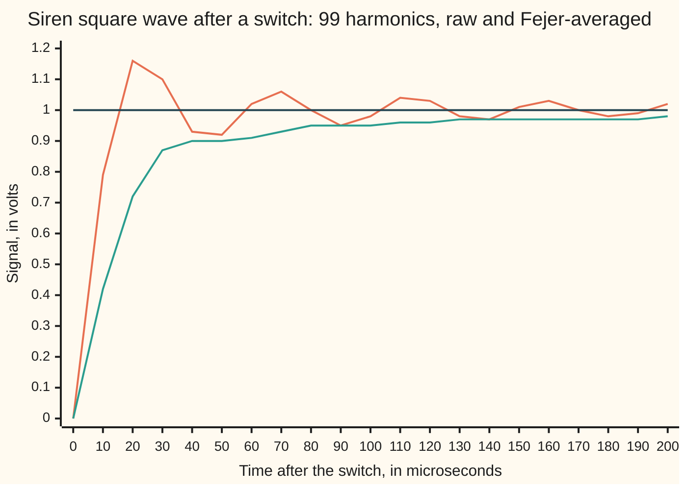

# The Gibbs overshoot and the cure: Fejer averaging and half-range series

[Syllabus](../../../SYLLABUS.md) → [Harmonic analysis](../README.md) → [Fourier Series in Depth](../README.md#s01) → The Gibbs overshoot and the cure

---

## General Overview

A warning siren's oscillator switches between +1 volt and −1 volt 440 times a second: a square wave of 220 cycles a second. Record it at 44,100 samples a second, the CD rate, and the recording can hold only tones below 22,050 Hz. That keeps harmonics up to the 100th. A square wave has only odd harmonics, so the last one present is the 99th, at 21,780 Hz.

An ideal recording is therefore a partial sum (illustrative: it assumes a perfectly sharp filter at 22,050 Hz): the wave rebuilt from its first 99 harmonics. Just after every switch it spikes to 1.179013 V, 22.73 microseconds (millionths of a second) after the switch, where the true wave sits at 1 V. Keeping more harmonics barely lowers the spike, which settles at 1.178980 V; mostly it moves the spike closer to the switch. This stubborn ear is the Gibbs overshoot, measured and proved on [Convergence](../../08-Differential%20equations%20and%20dynamics/09-Fourier%20Series/02-convergence-jumps-and-gibbs.md): its excess tends to 8.95% of the 2 V jump.

This card is about the cure. Do not trust the last partial sum alone. Average all of them, from the empty sum up to the 99th, or equivalently turn each harmonic down by a straight-line taper. The averaged wave never rises above 0.993634 V. The price is a softer edge: it reaches 0.9 V 38.62 microseconds after the switch, against 11.86 for the raw sum.

A second cure works when only half the cycle matters: describe the half-cycle with cosines instead of sines. The cosine series mirrors the signal instead of flipping it, so no jump is created and no ear appears.

**Averaging the partial sums weights the signal by a kernel that is never negative and totals 1, so the average can never leave the signal's range: beside a jump it climbs to the top without overshooting, and a mirror that removes the jump removes the ear.**

**What kind of fact this is:** a theorem, Fejér's, announced in 1900 and published in full in 1903; Why it works proves the no-overshoot bound and the rate of approach for the square wave, and links the general proof.

### The picture: the raw sum and the averaged sum just after a switch



The ringing line is the raw partial sum $`S_{99}`$; its top, 1.179 V at 22.73 microseconds, falls between two plotted samples. The smooth line is the Fejér average $`\sigma_{100}`$, climbing without a bump. The flat line is the true wave, 1 V.

---

## The formula

Notation first, in words. Position in the cycle is the angle $`x = 2\pi \times 220 \times t`$ radians, with $`t`$ in seconds, so 1 radian is 723.43 microseconds. The wave $`f`$ is +1 V for $`0 < x < \pi`$ and −1 V for $`-\pi < x < 0`$. Its coefficients $`\hat f(n)`$ come from [Fourier coefficients](01-fourier-coefficients-and-orthogonality.md).

$`S_N`$ is the partial sum of degree $`N`$: all harmonics up to the $`N`$-th. [Convergence](../../08-Differential%20equations%20and%20dynamics/09-Fourier%20Series/02-convergence-jumps-and-gibbs.md) counted odd tones instead, so its "50 tones" is $`S_{99}`$ here. The **Fejér mean** $`\sigma_N`$ (also called the Cesàro mean) is the plain average of the first $`N`$ partial sums:

```math
\sigma_N(x) = \frac{1}{N}\sum_{k=0}^{N-1} S_k(x) = \sum_{|n|<N}\Big(1 - \frac{|n|}{N}\Big)\hat f(n)\,e^{inx} = \frac{1}{2\pi}\int_{-\pi}^{\pi} f(x-y)\,F_N(y)\,dy
```

**Read it aloud:** average the first N partial sums; that is the same as turning harmonic n down by the factor 1 − |n|/N, and the same as smearing the signal with the Fejér kernel.

The kernel is a square divided by $`N`$, so it is never negative, and its average over a cycle is 1 ([Dirichlet and Fejer kernels](03-dirichlet-and-fejer-kernels.md)):

```math
F_N(y) = \frac{1}{N}\left(\frac{\sin(Ny/2)}{\sin(y/2)}\right)^2 \ge 0, \qquad \frac{1}{2\pi}\int_{-\pi}^{\pi} F_N(y)\,dy = 1, \qquad\text{so}\qquad \min f \le \sigma_N(x) \le \max f
```

**Read it aloud:** the weights are never negative and add up to one, so the average stays between the signal's lowest and highest values.

For the siren, the coefficients pair into sines on the odd harmonics:

```math
S_N(x) = \frac{4}{\pi}\sum_{\substack{n \le N\\ n\ \mathrm{odd}}}\frac{\sin(nx)}{n}, \qquad \sigma_N(x) = \frac{4}{\pi}\sum_{\substack{n < N\\ n\ \mathrm{odd}}}\Big(1 - \frac{n}{N}\Big)\frac{\sin(nx)}{n}
```

**Read it aloud:** the raw sum gives each odd harmonic its full share; the averaged sum gives harmonic n only the fraction 1 − n/N of it.

| Symbol | Plain meaning | In our example | Push it up and the answer… |
| --- | --- | --- | --- |
| $`t`$, $`x`$ | time in seconds; position in the cycle in radians | ear at 22.73 microseconds, $`x = \pi/100`$; mid-top $`x = \pi/2`$ | — |
| $`f`$ | the siren's square wave, in volts | +1 on top, −1 below | a bigger jump, a proportionally bigger ear |
| $`n`$, $`\hat f(n)`$, $`i`$ | harmonic number, its coefficient, and the imaginary unit | $`n = 1`$ is 220 Hz; sine share $`4/(\pi n)`$ on odd $`n`$ | — |
| $`N`$ | degree of a partial sum, or how many partial sums are averaged | 4 by hand; 20, 100, 500 in the code | the ramp beside the switch narrows like $`1/N`$ |
| $`S_N`$ | partial sum of degree $`N`$ | $`S_{99}`$ peaks at 1.179013 V | the ear moves in, stays 1.179 V high |
| $`\sigma_N`$ | Fejér mean: average of $`S_0`$ to $`S_{N-1}`$ | $`\sigma_{100}`$ never above 0.993634 V | closes in on 1 V like $`0.64/N`$ mid-top |
| $`F_N`$, $`y`$, $`E`$ | Fejér kernel; the shift it weights; the plain tone sum whose square it is | lowest value 0, mean 1 | taller, narrower bump |
| $`D_N`$ | Dirichlet kernel, the raw sum's weights | $`D_{99}`$ dips to −43.23 | deeper negative lobes |
| $`d`$ | distance from $`x`$ to the nearest switch, in radians | $`\pi/2`$ mid-top | smaller error bound |
| $`\mathrm{Si}`$, $`H`$ | limit shapes of the raw and averaged edges | $`\tfrac{2}{\pi}\mathrm{Si}(\pi) = 1.178980`$, $`H(\pi) = 0.773695`$ | — |
| $`k`$, $`j`$, $`u`$, $`s`$ | counters in a sum; $`u = Nx`$, the position zoomed by N; $`s`$ inside an integral | $`S_0`$ to $`S_3`$ for N = 4; 0.9 V at $`u`$ = 5.3315 | — |
| $`a_n`$, $`b_n`$ | cosine and sine coefficients of a half-cycle | top half: $`a_0 = 2`$, $`b_1`$ = 1.273240 | — |

### When it holds

- **Weights never negative, total exactly 1.** That is what bans overshoot. Divide the sum of 100 partial sums by 99 instead of 100 and the weights total 100/99: the peak becomes 1.003671 V.
- **A continuous signal, for uniform closeness.** For a continuous signal the averages close in uniformly, everywhere at once (the folded proof on [Parseval's identity](../../08-Differential%20equations%20and%20dynamics/09-Fourier%20Series/03-parsevals-identity.md)). With a jump they close in uniformly only on stretches that keep a fixed distance from it: on 0.1 to π − 0.1 the worst error is 0.061454 V at N = 100.
- **Not up to the jump.** At the switch itself every $`\sigma_N`$ gives 0 V, the midpoint, so just beside it the error stays near 1 V for every N. Pointwise convergence (each fixed point settles) holds there; uniform convergence (every point settles together) fails.
- **No speed-up at smooth points.** The taper dims every harmonic, even ones that needed no help. A pure tone $`\sin x`$ comes back as $`0.99\sin x`$ at N = 100.
- **A half-range cosine series removes only end jumps.** Mirroring a half-cycle removes the jump at its ends; a jump inside the half-cycle still makes an ear.

---

## Why it works

### Step 0: the ear comes from negative weights

A partial sum is a weighted average of the signal around $`x`$, with the Dirichlet kernel $`D_N`$ as the weights ([Dirichlet and Fejer kernels](03-dirichlet-and-fejer-kernels.md)). Those weights swing negative: $`D_{99}`$ is 199 at the centre and dips to −43.23 beside it.

Just after a switch, the first negative lobe sits over the −1 V side. A negative weight times −1 V adds voltage, so the sum climbs past 1 V. An average whose weights are all zero or more, and total 1, cannot exceed its largest input. Fejér's average is such an average.

### Step 1: averaging the partial sums tapers the harmonics

Harmonic $`n`$ enters $`S_k`$ only when $`k \ge |n|`$. Among $`S_0, \dots, S_{N-1}`$ that is $`N - |n|`$ sums out of $`N`$. So the average keeps the fraction $`1 - |n|/N`$ of harmonic $`n`$: the straight-line taper in the formula.

For N = 4: $`S_0 = 0`$, $`S_1 = S_2`$ hold the 220 Hz tone, and $`S_3`$ adds the 660 Hz tone. Their average keeps 3/4 of the first and 1/4 of the third.

### Step 2: the taper's kernel is a square

Add the tapered tones $`\sum_{|n|<N}(1 - |n|/N)\,e^{iny}`$. It equals $`\tfrac1N\big|1 + e^{iy} + \dots + e^{i(N-1)y}\big|^2`$, because the product of the sum with its conjugate contains $`e^{iny}`$ exactly $`N - |n|`$ times. Summing the geometric series gives the closed form $`F_N`$.

A squared size is never negative. The constant term, $`n = 0`$, has weight 1, and every other tone averages to zero over a cycle, so the kernel's average is 1. The code finds the lowest value of $`F_{100}`$ to be 0 and its mean 1.000000.

<details>
<summary>Detailed proof: the square, and the exact slope of the averaged siren</summary>

Write $`E(y) = \sum_{j=0}^{N-1} e^{ijy}`$. Then $`|E|^2 = \sum_{j,k} e^{i(j-k)y}`$, and the pairs with $`j - k = n`$ number $`N - |n|`$. So $`\tfrac1N|E|^2 = \sum_{|n|<N}(1 - |n|/N)e^{iny}`$, the tapered sum. Summing the geometric series,

$`\displaystyle |E(y)| = \left|\frac{e^{iNy} - 1}{e^{iy} - 1}\right| = \left|\frac{\sin(Ny/2)}{\sin(y/2)}\right|,`$

which gives $`F_N`$.

For the siren with $`0 < x < \pi`$, $`f(x - y) = -1`$ exactly when $`y`$ lies in $`(x, x + \pi)`$, a stretch of length π. Since the kernel's average is 1,

$`\displaystyle \sigma_N(x) = 1 - \frac{1}{\pi}\int_x^{x+\pi} F_N(y)\,dy.`$

Differentiate in $`x`$: $`\sigma_N'(x) = \tfrac1\pi\big(F_N(x) - F_N(x+\pi)\big)`$. For even $`N`$, $`\sin^2(N(x+\pi)/2) = \sin^2(Nx/2)`$ and $`\sin^2((x+\pi)/2) = \cos^2(x/2)`$, so

$`\displaystyle \sigma_N'(x) = \frac{\sin^2(Nx/2)}{\pi N}\left(\frac{1}{\sin^2(x/2)} - \frac{1}{\cos^2(x/2)}\right) \ge 0 \quad\text{for } 0 < x \le \frac{\pi}{2}.`$

So the averaged siren rises without a dip to its highest value at mid-top, and mirrors back down. For odd $`N`$ the slope can dip slightly negative, but the bound $`\sigma_N < 1`$ still holds.

</details>

### Step 3: no overshoot, ever

The weights are never negative and total 1, and the siren only takes the values +1 and −1. So $`-1 \le \sigma_N(x) \le 1`$ for every $`x`$ and every $`N`$. On the top half it is strictly below 1, because some weight always lands on the −1 V side.

The code confirms the highest values: 0.968248 V for N = 20, 0.993634 for 100, 0.998727 for 500, each at mid-top. The raw sums beside them peak at 1.179814, 1.179013 and 1.178981 V.

### Step 4: the edge is a ramp, about three times wider than the ear

Near the switch, put $`u = Nx`$. The kernel's tall centre, rescaled, becomes $`(\sin(s/2)/(s/2))^2`$, and the averaged edge takes one fixed shape:

```math
\sigma_N\!\left(\frac{u}{N}\right) \to H(u) = \frac{1}{\pi}\int_0^{u}\left(\frac{\sin(s/2)}{s/2}\right)^2 ds, \qquad S_{N-1}\!\left(\frac{u}{N}\right) \to \frac{2}{\pi}\,\mathrm{Si}(u)
```

**Read it aloud:** zoom in on the switch by the factor N, and the averaged edge becomes a fixed rising curve H, while the raw edge becomes the sine-integral curve.

$`H`$ only rises, because its integrand is never negative, and it ends at 1. The raw curve uses the sine integral, $`\mathrm{Si}(u) = \int_0^u \sin s/s\,ds`$. It passes 1 and peaks at 1.178980 when $`u = \pi`$. At that same spot the averaged edge is only at $`H(\pi)`$ = 0.773695.

To reach 0.9 V, the limit curves need $`u`$ = 5.3315 for the averaged edge and only 1.6398 for the raw edge. At N = 100 the code finds 38.62 against 11.86 microseconds ($`u`$ = 5.3385 and 1.6398). A softer edge is the price of no ear.

### Step 5: how fast it closes in away from the switch

On the top half, the error is the kernel's weight on the −1 V side: $`1 - \sigma_N(x) = \tfrac1\pi\int_x^{x+\pi} F_N`$. That side stays at least $`d`$ from the kernel's centre, where $`d`$ is the distance from $`x`$ to the nearer switch. There $`F_N(y) \le 1/(N\sin^2(d/2))`$, so

```math
1 - \sigma_N(x) \le \frac{1}{N \sin^2(d/2)}
```

**Read it aloud:** the error is at most one over N times the squared sine of half the distance to the switch.

Mid-top, $`d = \pi/2`$ and the bound is $`2/N`$. The true error is 0.006366 V at N = 100. $`N`$ times the error approaches $`2/\pi`$ = 0.636620; it is 0.636617 at N = 500. The bound is about π times the truth: crude but honest, and it falls like $`1/N`$. The fall in powers of N is the story on [Smoothness shows in the tail](06-decay-of-coefficients-and-smoothness.md).

### Step 6: half-range series, the mirror that removes the jump

Suppose only the top half-cycle matters, $`0 < x < \pi`$, where the siren is +1 V. [Half-range series](../../08-Differential%20equations%20and%20dynamics/09-Fourier%20Series/04-half-range-sine-and-cosine-series.md) builds two series for it.

- **Sines** extend it upside down to the left. That rebuilds the full square wave, jump and all, so the ear returns: 1.179013 V with harmonics up to 99. Its coefficients are $`4/(\pi n)`$ on odd $`n`$: 1.273240, 0.424413, 0.254648.
- **Cosines** mirror it upright. The mirror of a constant is the same constant, with no jump. The series is $`a_0/2 = 1`$ and every other coefficient is 0: exact with one term.

A less tidy case shows the same thing. A ramp from 0 to 1 V over the half-cycle, $`x/\pi`$, has a sine series that jumps by 2 V at $`x = \pi`$: it overshoots the ramp by 0.178988 V. Its cosine series mirrors into a triangle with no jump; with harmonics up to 99 its worst error is 0.002026 V, exactly the sum of the dropped coefficients.

---

## Worked numbers, by hand

Four partial sums of the siren at $`x = \pi/4`$, one eighth of a cycle after the switch. Here $`4/\pi`$ = 1.273240 and $`\sin(\pi/4) = \sin(3\pi/4)`$ = 0.707107.

| Step | Arithmetic | Value |
| --- | --- | --- |
| $`S_0`$ | no harmonics | 0 |
| $`S_1 = S_2`$ | 1.273240 × 0.707107 | 0.900316 V |
| $`S_3`$, the raw peak | 0.900316 + 0.900316 / 3 | 1.200422 V |
| $`\sigma_4`$, by averaging | (0 + 0.900316 + 0.900316 + 1.200422) / 4 | 0.750264 V |
| $`\sigma_4`$, by tapering | 1.273240 × (3/4 × 0.707107 + 1/4 × 0.707107 / 3) | 0.750264 V |
| at mid-top, $`x = \pi/2`$ | $`S_3`$ and $`\sigma_4`$ both give $`(4/\pi) \times 2/3`$ | 0.848826 V |
| N = 100, at the ear, $`x = \pi/100`$ | $`S_{99}`$ against $`\sigma_{100}`$ | 1.179013 against 0.773662 V |
| $`\sigma_{100}`$ at its highest | at mid-top | **0.993634 V** |

With 99 harmonics the speaker is driven 0.179 V above the top just after each switch; averaged, it never passes 0.994 V.

### What breaks if you drop a piece

| Mistake | Comes out at | What went wrong |
| --- | --- | --- |
| Keep the last partial sum only | overshoot 0.179814, 0.179013, 0.178981 V for N = 20, 100, 500 | Dirichlet weights dip negative; more terms only move the ear |
| Divide the sum of 100 partial sums by 99 | peak 1.003671 V | Weights total 100/99, not 1, so overshoot creeps back |
| Fejér on a smooth signal, the pure tone $`\sin x`$ | 0.990000 V at $`\pi/2`$, where $`S_1`$ gives 1.000000 | The taper dims harmonics that needed no cure |
| Sine series for the top half-cycle | peak 1.179013 V; cosine series 1.000000 V | The upside-down extension rebuilds the jump |

The code prints all four.

---

## Code, from first principles, and it actually runs

The script imports only sin, cos and π. It builds the Fejér mean by three independent roads: the tapered harmonics, the literal average of the partial sums, and the kernel integral done with its own Simpson's rule. They agree to 6 decimals at mid-top for N = 20, 100 and 500. The limits are reached two ways each: the raw peak against the sine integral's power series, and the averaged edge against the integral $`H`$, both solved by bisection. The half-range coefficients are integrated directly and checked against their formulas.

### Python

```python
# The Gibbs overshoot and the cure -- the check behind the card.  Only sin, cos
# and pi are imported.  Square wave: +1 V on (0, pi), -1 V on (-pi, 0), x = 2 pi 220 t.
# S(M, x) keeps harmonics up to M; sigma(N, x) averages S_0 .. S_(N-1) (Fejer).
from math import sin, cos, pi

def S(M, x):                                # the partial sum of degree M
    s = 0.0
    for n in range(1, M + 1, 2):
        s += 4 / pi * sin(n * x) / n
    return s

def sigma(N, x):                            # road one: taper harmonic n by 1 - n/N
    s = 0.0
    for n in range(1, N, 2):
        s += (1 - n / N) * 4 / pi * sin(n * x) / n
    return s

def sigma_avg(N, x):                        # road two: add S_0 .. S_(N-1), divide by N
    total, s = 0.0, 0.0
    for k in range(N):
        if k % 2:
            s += 4 / pi * sin(k * x) / k
        total += s
    return total / N

def fejer(N, t):                            # F_N(t) = (sin(Nt/2) / sin(t/2))^2 / N
    d = sin(t / 2)
    return float(N) if abs(d) < 1e-12 else (sin(N * t / 2) / d) ** 2 / N

def dirichlet(M, t):                        # D_M(t) = sin((M + 1/2) t) / sin(t/2)
    d = sin(t / 2)
    return 2.0 * M + 1 if abs(d) < 1e-12 else sin((M + 0.5) * t) / d

def simpson(g, a, b, n):                    # our own integrator, n even
    h, s = (b - a) / n, 0.0
    for i in range(n + 1):
        s += g(a + i * h) * (1 if i in (0, n) else 4 if i % 2 else 2)
    return s * h / 3

def sigma_kernel(N, x):                     # road three: 1 - (1/pi) * kernel area on the -1 side
    return 1 - simpson(lambda t: fejer(N, t), x, x + pi, 20000) / pi

def solve(g, lo, hi, target):               # bisection for g(x) = target, g rising
    for _ in range(60):
        mid = (lo + hi) / 2
        lo, hi = (mid, hi) if g(mid) < target else (lo, mid)
    return (lo + hi) / 2

def Si(u):                                  # sine integral, power series
    s, term, k = 0.0, u, 0
    while abs(term) > 1e-17:
        s += term / (2 * k + 1)
        k += 1
        term *= -u * u / ((2 * k) * (2 * k + 1))
    return s

us = lambda x: x / (2 * pi * 220) * 1e6      # radians to microseconds after the switch
yn = lambda c: "yes" if c else "no"
f6 = lambda v: f"{0.0 if abs(v) < 5e-7 else v:.6f}"   # never "-0.000000"
print(f"siren: +-1 V, 220 cycles a second, 440 switches; 1 radian = {us(1):.2f} us; CD rate 44100: "
      f"harmonics up to n = {22050 // 220}, last odd n = {(22050 // 220 - 1) | 1} ({((22050 // 220 - 1) | 1) * 220} Hz)")
print(f"by hand: 4/pi = {f6(4 / pi)}, sin(pi/4) = {f6(sin(pi / 4))}, S_1(pi/4) = S_2(pi/4) = {f6(S(2, pi / 4))} V")
print(f"by hand: S_3(pi/4) = {f6(S(3, pi / 4))} V, sigma_4(pi/4) = {f6(sigma(4, pi / 4))} V, "
      f"average of S_0..S_3 = {f6(sigma_avg(4, pi / 4))} V")
print(f"by hand: S_3(pi/2) = {f6(S(3, pi / 2))} V, sigma_4(pi/2) = {f6(sigma(4, pi / 2))} V")
grid = [j * pi / 20000 for j in range(1, 20001)]
fmin, dmin = min(fejer(100, t) for t in grid), min(dirichlet(99, t) for t in grid)
area = simpson(lambda t: fejer(100, t), -pi, pi, 20000) / (2 * pi)
print(f"kernels: F_100 lowest {f6(fmin)}, mean {f6(area)}; D_99 at 0 {dirichlet(99, 0):.0f}, lowest {dmin:.2f}")
gaps = []
for N in (20, 100, 500):
    peak, at = S(N - 1, pi / N), sigma(N, pi / N)
    g = [sigma(N, j * pi / 2000) for j in range(1, 2000)]
    rises = all(g[i + 1] >= g[i] for i in range(999))
    roads = [sigma(N, pi / 2), sigma_avg(N, pi / 2), sigma_kernel(N, pi / 2)]
    err, bound = 1 - roads[0], 2 / N
    worst = max(1 - sigma(N, 0.1 + j * (pi - 0.2) / 400) for j in range(401))
    xs, xp = solve(lambda x: sigma(N, x), 0, pi / 2, 0.9), solve(lambda x: S(N - 1, x), 0, pi / N, 0.9)
    gaps.append((N, peak - 1, at, max(g), rises, roads, err, worst, N * xs, N * xp))
    print(f"N = {N}: S_{N - 1} peak {f6(peak)} V at x = pi/N ({us(pi / N):.2f} us); sigma_{N} there {f6(at)} V")
    print(f"N = {N}: sigma_{N} highest {f6(max(g))} V, at x = pi/2: {yn(g.index(max(g)) == 999)}; "
          f"rises without a dip: {yn(rises)}")
    print(f"N = {N}: three roads at pi/2: {' '.join(f6(r) for r in roads)}")
    print(f"N = {N}: mid-top error {f6(err)} V, N x error {f6(N * err)}, bound 2/N {f6(bound)}, "
          f"bound/true {bound / err:.2f}; worst on [0.1, pi-0.1] {f6(worst)} V")
    print(f"N = {N}: reaches 0.9 V at {us(xs):.2f} us (N x = {N * xs:.4f}); S_{N - 1} at {us(xp):.2f} us (N x = {N * xp:.4f})")
H = lambda u: simpson(lambda s: 1.0 if s == 0 else (sin(s / 2) / (s / 2)) ** 2, 0, u, 4000) / pi
uH, uS = solve(H, pi, 4 * pi, 0.9), solve(lambda u: 2 / pi * Si(u), 0, pi, 0.9)
print(f"limits: (2/pi) Si(pi) = {f6(2 / pi * Si(pi))} ({(2 / pi * Si(pi) - 1) / 2 * 100:.2f}% of the jump), H(pi) = {f6(H(pi))}, 2/pi = {f6(2 / pi)}, "
      f"0.9 V at N x = {uH:.4f} (sigma), {uS:.4f} (S)")
step = 2 * pi * 220 * 1e-5                  # chart: every 10 microseconds, 0 to 200
print("chart, S_99:", " ".join(f"{S(99, k * step):.2f}" for k in range(21)))
print("chart, sigma_100:", " ".join(f"{sigma(100, k * step):.2f}" for k in range(21)))
top_b = [2 / pi * simpson(lambda x: sin(n * x), 0, pi, 2000) for n in range(1, 6)]
top_a = [2 / pi * simpson(lambda x: cos(n * x), 0, pi, 2000) for n in range(5)]
print("half-range, +1 V on (0, pi): sine b_1..b_5", " ".join(f6(v) for v in top_b))
print("half-range, +1 V on (0, pi): cosine a_0..a_4", " ".join(f6(v) for v in top_a))

def ramp_sine(M, x):                        # odd extension of x/pi: the sawtooth, jump 2 V at pi
    s = 0.0
    for n in range(1, M + 1):
        s += 2 / pi * (1 if n % 2 else -1) * sin(n * x) / n
    return s

def ramp_cosine(M, x):                      # even extension of x/pi: the triangle, no jump
    s = 0.5
    for n in range(1, M + 1, 2):
        s -= 4 / (pi * pi) * cos(n * x) / (n * n)
    return s

odd_sq = 0.0
for n in range(1, 100, 2):
    odd_sq += 1 / (n * n)
tail = 4 / (pi * pi) * (pi * pi / 8 - odd_sq)
rb1 = 2 / pi * simpson(lambda x: x / pi * sin(x), 0, pi, 2000)
ra1 = 2 / pi * simpson(lambda x: x / pi * cos(x), 0, pi, 2000)
rover = max(ramp_sine(99, x) - x / pi for x in (pi - j * 0.2 / 4000 for j in range(1, 4001)))
rworst = max(abs(ramp_cosine(99, j * pi / 2000) - j / 2000) for j in range(2001))
print(f"ramp x/pi V: b_1 {f6(rb1)} (formula {f6(2 / pi)}), a_1 {f6(ra1)} (formula {f6(-4 / pi ** 2)})")
print(f"ramp, degree 99: sine series overshoots the ramp by {f6(rover)} V; cosine series worst error {f6(rworst)} V, tail {f6(tail)}")
N, s100 = 100, gaps[1][3]
print(f"mistake 1, last partial sum: overshoot {', '.join(f6(g[1]) for g in gaps)} V for N = 20, 100, 500")
print(f"mistake 2, divide by N - 1 = 99: peak {f6(s100 * N / (N - 1))} V")
tone = 0.0
for k in range(N):                          # S_0 of sin x is 0; S_1 onwards is sin x itself
    tone += 0.0 if k == 0 else sin(pi / 2)
print(f"mistake 3, pure tone sin x at pi/2: sigma_100 {f6(tone / N)} V, S_1 {f6(sin(pi / 2))} V")
print(f"mistake 4, sine series of the top half: peak {f6(gaps[1][1] + 1)} V; cosine series {f6(top_a[0] / 2)} V")
for (N, over, at, top, rises, roads, err, worst, nxs, nxp) in gaps:
    assert abs(roads[0] - roads[1]) < 1e-12 and abs(roads[0] - roads[2]) < 1e-9   # three roads
    assert top < 1 and rises and over > 0.178                  # no ear for sigma; ear for S
    assert err <= 2 / N                                        # the tail bound holds
assert abs(sigma(4, pi / 4) - sigma_avg(4, pi / 4)) < 1e-12 and fmin >= 0 > dmin and abs(area - 1) < 1e-9
assert abs(gaps[2][1] + 1 - 2 / pi * Si(pi)) < 1e-4            # Gibbs limit, two roads
assert abs(gaps[2][2] - H(pi)) < 1e-4 and abs(gaps[2][6] * 500 - 2 / pi) < 1e-3
assert abs(gaps[2][8] - uH) < 0.01 and abs(gaps[2][9] - uS) < 0.01
assert all(abs(top_b[n - 1] - (4 / (pi * n) if n % 2 else 0)) < 1e-9 for n in range(1, 6))
assert abs(top_a[0] - 2) < 1e-9 and all(abs(v) < 1e-9 for v in top_a[1:])
assert abs(rworst - tail) < 1e-9 and abs(rover - gaps[1][1]) < 1e-3 and abs(ra1 + 4 / pi ** 2) < 1e-9
print("ALL CHECKS PASS")
```

**Ran 2026-11-15 on macOS, Python 3.14.10, standard library only. All checks passed. Output, pasted from the run:**

```
siren: +-1 V, 220 cycles a second, 440 switches; 1 radian = 723.43 us; CD rate 44100: harmonics up to n = 100, last odd n = 99 (21780 Hz)
by hand: 4/pi = 1.273240, sin(pi/4) = 0.707107, S_1(pi/4) = S_2(pi/4) = 0.900316 V
by hand: S_3(pi/4) = 1.200422 V, sigma_4(pi/4) = 0.750264 V, average of S_0..S_3 = 0.750264 V
by hand: S_3(pi/2) = 0.848826 V, sigma_4(pi/2) = 0.848826 V
kernels: F_100 lowest 0.000000, mean 1.000000; D_99 at 0 199, lowest -43.23
N = 20: S_19 peak 1.179814 V at x = pi/N (113.64 us); sigma_20 there 0.772858 V
N = 20: sigma_20 highest 0.968248 V, at x = pi/2: yes; rises without a dip: yes
N = 20: three roads at pi/2: 0.968248 0.968248 0.968248
N = 20: mid-top error 0.031752 V, N x error 0.635048, bound 2/N 0.100000, bound/true 3.15; worst on [0.1, pi-0.1] 0.429026 V
N = 20: reaches 0.9 V at 201.33 us (N x = 5.5661); S_19 at 59.29 us (N x = 1.6390)
N = 100: S_99 peak 1.179013 V at x = pi/N (22.73 us); sigma_100 there 0.773662 V
N = 100: sigma_100 highest 0.993634 V, at x = pi/2: yes; rises without a dip: yes
N = 100: three roads at pi/2: 0.993634 0.993634 0.993634
N = 100: mid-top error 0.006366 V, N x error 0.636556, bound 2/N 0.020000, bound/true 3.14; worst on [0.1, pi-0.1] 0.061454 V
N = 100: reaches 0.9 V at 38.62 us (N x = 5.3385); S_99 at 11.86 us (N x = 1.6398)
N = 500: S_499 peak 1.178981 V at x = pi/N (4.55 us); sigma_500 there 0.773694 V
N = 500: sigma_500 highest 0.998727 V, at x = pi/2: yes; rises without a dip: yes
N = 500: three roads at pi/2: 0.998727 0.998727 0.998727
N = 500: mid-top error 0.001273 V, N x error 0.636617, bound 2/N 0.004000, bound/true 3.14; worst on [0.1, pi-0.1] 0.012677 V
N = 500: reaches 0.9 V at 7.71 us (N x = 5.3318); S_499 at 2.37 us (N x = 1.6398)
limits: (2/pi) Si(pi) = 1.178980 (8.95% of the jump), H(pi) = 0.773695, 2/pi = 0.636620, 0.9 V at N x = 5.3315 (sigma), 1.6398 (S)
chart, S_99: 0.00 0.79 1.16 1.10 0.93 0.92 1.02 1.06 1.00 0.95 0.98 1.04 1.03 0.98 0.97 1.01 1.03 1.00 0.98 0.99 1.02
chart, sigma_100: 0.00 0.42 0.72 0.87 0.90 0.90 0.91 0.93 0.95 0.95 0.95 0.96 0.96 0.97 0.97 0.97 0.97 0.97 0.97 0.97 0.98
half-range, +1 V on (0, pi): sine b_1..b_5 1.273240 0.000000 0.424413 0.000000 0.254648
half-range, +1 V on (0, pi): cosine a_0..a_4 2.000000 0.000000 0.000000 0.000000 0.000000
ramp x/pi V: b_1 0.636620 (formula 0.636620), a_1 -0.405285 (formula -0.405285)
ramp, degree 99: sine series overshoots the ramp by 0.178988 V; cosine series worst error 0.002026 V, tail 0.002026
mistake 1, last partial sum: overshoot 0.179814, 0.179013, 0.178981 V for N = 20, 100, 500
mistake 2, divide by N - 1 = 99: peak 1.003671 V
mistake 3, pure tone sin x at pi/2: sigma_100 0.990000 V, S_1 1.000000 V
mistake 4, sine series of the top half: peak 1.179013 V; cosine series 1.000000 V
ALL CHECKS PASS
```

### Rust

Same numbers, same labels, built with `rustc --edition 2021 -O`.

```rust
// The Gibbs overshoot and the cure -- the same check as the Python, in Rust.  No
// crates.  Square wave: +1 V on (0, pi), -1 V on (-pi, 0), x = 2 pi 220 t.
// s_part(M, x) keeps harmonics up to M; sigma(N, x) averages S_0 .. S_(N-1) (Fejer).
use std::f64::consts::PI;

fn s_part(m: usize, x: f64) -> f64 {           // the partial sum of degree M
    let mut s = 0.0;
    for n in (1..=m).step_by(2) { s += 4.0 / PI * (n as f64 * x).sin() / n as f64 }
    s
}

fn sigma(nn: usize, x: f64) -> f64 {           // road one: taper harmonic n by 1 - n/N
    let mut s = 0.0;
    for n in (1..nn).step_by(2) {
        s += (1.0 - n as f64 / nn as f64) * 4.0 / PI * (n as f64 * x).sin() / n as f64;
    }
    s
}

fn sigma_avg(nn: usize, x: f64) -> f64 {       // road two: add S_0 .. S_(N-1), divide by N
    let (mut total, mut s) = (0.0, 0.0);
    for k in 0..nn {
        if k % 2 == 1 { s += 4.0 / PI * (k as f64 * x).sin() / k as f64 }
        total += s;
    }
    total / nn as f64
}

fn fejer(nn: usize, t: f64) -> f64 {           // F_N(t) = (sin(Nt/2) / sin(t/2))^2 / N
    let d = (t / 2.0).sin();
    if d.abs() < 1e-12 { nn as f64 } else { ((nn as f64 * t / 2.0).sin() / d).powi(2) / nn as f64 }
}

fn dirichlet(m: usize, t: f64) -> f64 {        // D_M(t) = sin((M + 1/2) t) / sin(t/2)
    let d = (t / 2.0).sin();
    if d.abs() < 1e-12 { 2.0 * m as f64 + 1.0 } else { ((m as f64 + 0.5) * t).sin() / d }
}

fn simpson(g: &dyn Fn(f64) -> f64, a: f64, b: f64, n: usize) -> f64 {   // our own integrator
    let (h, mut s) = ((b - a) / n as f64, 0.0);
    for i in 0..=n {
        let w = if i == 0 || i == n { 1.0 } else if i % 2 == 1 { 4.0 } else { 2.0 };
        s += g(a + i as f64 * h) * w;
    }
    s * h / 3.0
}

fn sigma_kernel(nn: usize, x: f64) -> f64 {    // road three: 1 - (1/pi) * kernel area on the -1 side
    1.0 - simpson(&|t| fejer(nn, t), x, x + PI, 20000) / PI
}

fn solve(g: &dyn Fn(f64) -> f64, mut lo: f64, mut hi: f64, target: f64) -> f64 {   // bisection
    for _ in 0..60 {
        let mid = (lo + hi) / 2.0;
        if g(mid) < target { lo = mid } else { hi = mid }
    }
    (lo + hi) / 2.0
}

fn si(u: f64) -> f64 {                          // sine integral, power series
    let (mut s, mut term, mut k) = (0.0, u, 0.0);
    while term.abs() > 1e-17 {
        s += term / (2.0 * k + 1.0);
        k += 1.0;
        term *= -u * u / ((2.0 * k) * (2.0 * k + 1.0));
    }
    s
}

fn ramp_sine(m: usize, x: f64) -> f64 {        // odd extension of x/pi: the sawtooth, jump 2 V at pi
    let mut s = 0.0;
    for n in 1..=m {
        let sign = if n % 2 == 1 { 1.0 } else { -1.0 };
        s += 2.0 / PI * sign * (n as f64 * x).sin() / n as f64;
    }
    s
}

fn ramp_cosine(m: usize, x: f64) -> f64 {      // even extension of x/pi: the triangle, no jump
    let mut s = 0.5;
    for n in (1..=m).step_by(2) { s -= 4.0 / (PI * PI) * (n as f64 * x).cos() / (n * n) as f64 }
    s
}

fn us(x: f64) -> f64 { x / (2.0 * PI * 220.0) * 1e6 }   // radians to microseconds after the switch
fn yn(c: bool) -> &'static str { if c { "yes" } else { "no" } }
fn f6(v: f64) -> String { format!("{:.6}", if v.abs() < 5e-7 { 0.0 } else { v }) }
fn join(v: &[f64]) -> String { v.iter().map(|&x| f6(x)).collect::<Vec<_>>().join(" ") }
fn hfun(u: f64) -> f64 {
    simpson(&|s| if s == 0.0 { 1.0 } else { ((s / 2.0).sin() / (s / 2.0)).powi(2) }, 0.0, u, 4000) / PI
}

fn main() {
    println!("siren: +-1 V, 220 cycles a second, 440 switches; 1 radian = {:.2} us; CD rate 44100: harmonics up to n = {}, last odd n = {} ({} Hz)",
             us(1.0), 22050 / 220, (22050 / 220 - 1) | 1, ((22050 / 220 - 1) | 1) * 220);
    println!("by hand: 4/pi = {}, sin(pi/4) = {}, S_1(pi/4) = S_2(pi/4) = {} V", f6(4.0 / PI), f6((PI / 4.0).sin()), f6(s_part(2, PI / 4.0)));
    println!("by hand: S_3(pi/4) = {} V, sigma_4(pi/4) = {} V, average of S_0..S_3 = {} V",
             f6(s_part(3, PI / 4.0)), f6(sigma(4, PI / 4.0)), f6(sigma_avg(4, PI / 4.0)));
    println!("by hand: S_3(pi/2) = {} V, sigma_4(pi/2) = {} V", f6(s_part(3, PI / 2.0)), f6(sigma(4, PI / 2.0)));
    let grid: Vec<f64> = (1..=20000).map(|j| j as f64 * PI / 20000.0).collect();
    let fmin = grid.iter().map(|&t| fejer(100, t)).fold(f64::INFINITY, f64::min);
    let dmin = grid.iter().map(|&t| dirichlet(99, t)).fold(f64::INFINITY, f64::min);
    let area = simpson(&|t| fejer(100, t), -PI, PI, 20000) / (2.0 * PI);
    println!("kernels: F_100 lowest {}, mean {}; D_99 at 0 {:.0}, lowest {:.2}", f6(fmin), f6(area), dirichlet(99, 0.0), dmin);
    let mut gaps = Vec::new();
    for nn in [20usize, 100, 500] {
        let (n, peak, at) = (nn as f64, s_part(nn - 1, PI / nn as f64), sigma(nn, PI / nn as f64));
        let g: Vec<f64> = (1..2000).map(|j| sigma(nn, j as f64 * PI / 2000.0)).collect();
        let top = g.iter().cloned().fold(f64::NEG_INFINITY, f64::max);
        let at_mid = g.iter().position(|&v| v == top) == Some(999);
        let rises = (0..999).all(|i| g[i + 1] >= g[i]);
        let roads = [sigma(nn, PI / 2.0), sigma_avg(nn, PI / 2.0), sigma_kernel(nn, PI / 2.0)];
        let (err, bound) = (1.0 - roads[0], 2.0 / nn as f64);
        let worst = (0..=400).map(|j| 1.0 - sigma(nn, 0.1 + j as f64 * (PI - 0.2) / 400.0))
            .fold(f64::NEG_INFINITY, f64::max);
        let xs = solve(&|x| sigma(nn, x), 0.0, PI / 2.0, 0.9);
        let xp = solve(&|x| s_part(nn - 1, x), 0.0, PI / nn as f64, 0.9);
        println!("N = {}: S_{} peak {} V at x = pi/N ({:.2} us); sigma_{} there {} V",
                 nn, nn - 1, f6(peak), us(PI / n), nn, f6(at));
        println!("N = {}: sigma_{} highest {} V, at x = pi/2: {}; rises without a dip: {}",
                 nn, nn, f6(top), yn(at_mid), yn(rises));
        println!("N = {}: three roads at pi/2: {}", nn, join(&roads));
        println!("N = {}: mid-top error {} V, N x error {}, bound 2/N {}, bound/true {:.2}; worst on [0.1, pi-0.1] {} V",
                 nn, f6(err), f6(n * err), f6(bound), bound / err, f6(worst));
        println!("N = {}: reaches 0.9 V at {:.2} us (N x = {:.4}); S_{} at {:.2} us (N x = {:.4})",
                 nn, us(xs), n * xs, nn - 1, us(xp), n * xp);
        assert!((roads[0] - roads[1]).abs() < 1e-12 && (roads[0] - roads[2]).abs() < 1e-9);  // three roads
        assert!(top < 1.0 && rises && peak - 1.0 > 0.178);   // no ear for sigma; ear for S
        assert!(err <= bound);                                // the tail bound holds
        gaps.push((peak - 1.0, at, top, err, n * xs, n * xp));
    }
    let (uh, us_) = (solve(&hfun, PI, 4.0 * PI, 0.9), solve(&|u| 2.0 / PI * si(u), 0.0, PI, 0.9));
    println!("limits: (2/pi) Si(pi) = {} ({:.2}% of the jump), H(pi) = {}, 2/pi = {}, 0.9 V at N x = {:.4} (sigma), {:.4} (S)",
             f6(2.0 / PI * si(PI)), (2.0 / PI * si(PI) - 1.0) / 2.0 * 100.0, f6(hfun(PI)), f6(2.0 / PI), uh, us_);
    let step = 2.0 * PI * 220.0 * 1e-5;          // chart: every 10 microseconds, 0 to 200
    let chart = |g: &dyn Fn(f64) -> f64| (0..21).map(|k| format!("{:.2}", g(k as f64 * step))).collect::<Vec<_>>().join(" ");
    println!("chart, S_99: {}", chart(&|x| s_part(99, x)));
    println!("chart, sigma_100: {}", chart(&|x| sigma(100, x)));
    let top_b: Vec<f64> = (1..6).map(|n| 2.0 / PI * simpson(&|x| (n as f64 * x).sin(), 0.0, PI, 2000)).collect();
    let top_a: Vec<f64> = (0..5).map(|n| 2.0 / PI * simpson(&|x| (n as f64 * x).cos(), 0.0, PI, 2000)).collect();
    println!("half-range, +1 V on (0, pi): sine b_1..b_5 {}", join(&top_b));
    println!("half-range, +1 V on (0, pi): cosine a_0..a_4 {}", join(&top_a));
    let mut odd_sq = 0.0;
    for n in (1..100).step_by(2) { odd_sq += 1.0 / (n * n) as f64 }
    let tail = 4.0 / (PI * PI) * (PI * PI / 8.0 - odd_sq);
    let rb1 = 2.0 / PI * simpson(&|x| x / PI * x.sin(), 0.0, PI, 2000);
    let ra1 = 2.0 / PI * simpson(&|x| x / PI * x.cos(), 0.0, PI, 2000);
    let rover = (1..=4000).map(|j| PI - j as f64 * 0.2 / 4000.0).map(|x| ramp_sine(99, x) - x / PI)
        .fold(f64::NEG_INFINITY, f64::max);
    let rworst = (0..=2000).map(|j| (ramp_cosine(99, j as f64 * PI / 2000.0) - j as f64 / 2000.0).abs())
        .fold(f64::NEG_INFINITY, f64::max);
    println!("ramp x/pi V: b_1 {} (formula {}), a_1 {} (formula {})", f6(rb1), f6(2.0 / PI), f6(ra1), f6(-4.0 / (PI * PI)));
    println!("ramp, degree 99: sine series overshoots the ramp by {} V; cosine series worst error {} V, tail {}",
             f6(rover), f6(rworst), f6(tail));
    println!("mistake 1, last partial sum: overshoot {}, {}, {} V for N = 20, 100, 500",
             f6(gaps[0].0), f6(gaps[1].0), f6(gaps[2].0));
    println!("mistake 2, divide by N - 1 = 99: peak {} V", f6(gaps[1].2 * 100.0 / 99.0));
    let mut tone = 0.0;
    for k in 0..100 { tone += if k == 0 { 0.0 } else { (PI / 2.0).sin() } }   // S_0 of sin x is 0
    println!("mistake 3, pure tone sin x at pi/2: sigma_100 {} V, S_1 {} V", f6(tone / 100.0), f6((PI / 2.0).sin()));
    println!("mistake 4, sine series of the top half: peak {} V; cosine series {} V", f6(gaps[1].0 + 1.0), f6(top_a[0] / 2.0));
    assert!((sigma(4, PI / 4.0) - sigma_avg(4, PI / 4.0)).abs() < 1e-12 && fmin >= 0.0 && dmin < 0.0 && (area - 1.0).abs() < 1e-9);
    assert!((gaps[2].0 + 1.0 - 2.0 / PI * si(PI)).abs() < 1e-4);              // Gibbs limit, two roads
    assert!((gaps[2].1 - hfun(PI)).abs() < 1e-4 && (gaps[2].3 * 500.0 - 2.0 / PI).abs() < 1e-3);
    assert!((gaps[2].4 - uh).abs() < 0.01 && (gaps[2].5 - us_).abs() < 0.01);
    assert!((1..6).all(|n| (top_b[n - 1] - if n % 2 == 1 { 4.0 / (PI * n as f64) } else { 0.0 }).abs() < 1e-9));
    assert!((top_a[0] - 2.0).abs() < 1e-9 && top_a[1..].iter().all(|v| v.abs() < 1e-9));
    assert!((rworst - tail).abs() < 1e-9 && (rover - gaps[1].0).abs() < 1e-3 && (ra1 + 4.0 / (PI * PI)).abs() < 1e-9);
    println!("ALL CHECKS PASS");
}
```

**Ran 2026-11-15 on macOS, rustc 1.98.1, no crates. All checks passed. Output, pasted from the run:**

```
siren: +-1 V, 220 cycles a second, 440 switches; 1 radian = 723.43 us; CD rate 44100: harmonics up to n = 100, last odd n = 99 (21780 Hz)
by hand: 4/pi = 1.273240, sin(pi/4) = 0.707107, S_1(pi/4) = S_2(pi/4) = 0.900316 V
by hand: S_3(pi/4) = 1.200422 V, sigma_4(pi/4) = 0.750264 V, average of S_0..S_3 = 0.750264 V
by hand: S_3(pi/2) = 0.848826 V, sigma_4(pi/2) = 0.848826 V
kernels: F_100 lowest 0.000000, mean 1.000000; D_99 at 0 199, lowest -43.23
N = 20: S_19 peak 1.179814 V at x = pi/N (113.64 us); sigma_20 there 0.772858 V
N = 20: sigma_20 highest 0.968248 V, at x = pi/2: yes; rises without a dip: yes
N = 20: three roads at pi/2: 0.968248 0.968248 0.968248
N = 20: mid-top error 0.031752 V, N x error 0.635048, bound 2/N 0.100000, bound/true 3.15; worst on [0.1, pi-0.1] 0.429026 V
N = 20: reaches 0.9 V at 201.33 us (N x = 5.5661); S_19 at 59.29 us (N x = 1.6390)
N = 100: S_99 peak 1.179013 V at x = pi/N (22.73 us); sigma_100 there 0.773662 V
N = 100: sigma_100 highest 0.993634 V, at x = pi/2: yes; rises without a dip: yes
N = 100: three roads at pi/2: 0.993634 0.993634 0.993634
N = 100: mid-top error 0.006366 V, N x error 0.636556, bound 2/N 0.020000, bound/true 3.14; worst on [0.1, pi-0.1] 0.061454 V
N = 100: reaches 0.9 V at 38.62 us (N x = 5.3385); S_99 at 11.86 us (N x = 1.6398)
N = 500: S_499 peak 1.178981 V at x = pi/N (4.55 us); sigma_500 there 0.773694 V
N = 500: sigma_500 highest 0.998727 V, at x = pi/2: yes; rises without a dip: yes
N = 500: three roads at pi/2: 0.998727 0.998727 0.998727
N = 500: mid-top error 0.001273 V, N x error 0.636617, bound 2/N 0.004000, bound/true 3.14; worst on [0.1, pi-0.1] 0.012677 V
N = 500: reaches 0.9 V at 7.71 us (N x = 5.3318); S_499 at 2.37 us (N x = 1.6398)
limits: (2/pi) Si(pi) = 1.178980 (8.95% of the jump), H(pi) = 0.773695, 2/pi = 0.636620, 0.9 V at N x = 5.3315 (sigma), 1.6398 (S)
chart, S_99: 0.00 0.79 1.16 1.10 0.93 0.92 1.02 1.06 1.00 0.95 0.98 1.04 1.03 0.98 0.97 1.01 1.03 1.00 0.98 0.99 1.02
chart, sigma_100: 0.00 0.42 0.72 0.87 0.90 0.90 0.91 0.93 0.95 0.95 0.95 0.96 0.96 0.97 0.97 0.97 0.97 0.97 0.97 0.97 0.98
half-range, +1 V on (0, pi): sine b_1..b_5 1.273240 0.000000 0.424413 0.000000 0.254648
half-range, +1 V on (0, pi): cosine a_0..a_4 2.000000 0.000000 0.000000 0.000000 0.000000
ramp x/pi V: b_1 0.636620 (formula 0.636620), a_1 -0.405285 (formula -0.405285)
ramp, degree 99: sine series overshoots the ramp by 0.178988 V; cosine series worst error 0.002026 V, tail 0.002026
mistake 1, last partial sum: overshoot 0.179814, 0.179013, 0.178981 V for N = 20, 100, 500
mistake 2, divide by N - 1 = 99: peak 1.003671 V
mistake 3, pure tone sin x at pi/2: sigma_100 0.990000 V, S_1 1.000000 V
mistake 4, sine series of the top half: peak 1.179013 V; cosine series 1.000000 V
ALL CHECKS PASS
```

The two outputs match line for line.

### Lean

For every $`N \ge 1`$, Lean proves the no-overshoot bound, the two kernel facts behind it, and the siren's case.

- Take a signal that can be integrated over a cycle and stays between a lowest value $`m`$ and a highest value $`M`$ there. Then its Fejér mean $`\sigma_N(x)`$ is a real number between $`m`$ and $`M`$, for every $`x`$.
- Take $`N \ge 1`$. Then the kernel $`F_N`$, written as the tapered tone sum, equals $`\tfrac1N|E|^2`$ and so is never negative.
- Take $`N \ge 1`$. Then the kernel's average over a cycle is exactly 1.
- Take the siren and any $`N \ge 1`$. Then its averaged wave $`\sigma_N(x)`$, the tapered odd-harmonic formula above, stays between −1 V and +1 V for every $`x`$.
- The CD-rate count, the N = 4 tapers and pair counts, and the mid-top value $`(4/\pi) \times 2/3`$ also check.

The decimals, edge shapes, 1/N rate, sine form of $`F_N`$ and half-range series are left to the Python and Rust checks.

```lean
-- The Gibbs overshoot and the cure: the Fejér mean of a signal, the average of its first N Fourier partial sums, never leaves the signal's range, because the Fejér kernel is a square that totals 1.
import Mathlib.Analysis.Fourier.AddCircle
import Mathlib.Analysis.SpecialFunctions.Trigonometric.Basic
import Mathlib.Analysis.SpecialFunctions.Complex.Circle
import Mathlib.Tactic.NormNum
import Mathlib.Analysis.SpecialFunctions.Integrals.Basic

open Real Complex Finset

/-- The card's coefficient `f̂(n) = (1/2π) ∫_{−π}^{π} f(x) e^{−inx} dx`, Mathlib's `fourierCoeffOn`
on `[−π, π]`, for a real signal viewed as complex-valued. -/
noncomputable def coeff (f : ℝ → ℝ) (n : ℤ) : ℂ :=
  fourierCoeffOn (neg_lt_self Real.pi_pos) (fun t => (f t : ℂ)) n

/-- The partial sum of degree `k`: `S_k(x) = ∑_{|n| ≤ k} f̂(n) e^{inx}`. -/
noncomputable def partialSum (f : ℝ → ℝ) (k : ℕ) (x : ℝ) : ℂ :=
  ∑ n ∈ Icc (-(k : ℤ)) k, coeff f n * exp (n * x * I)

/-- The Fejér mean: `σ_N(x) = (1/N) ∑_{k=0}^{N−1} S_k(x)`, the plain average of the first N
partial sums. -/
noncomputable def fejerMean (f : ℝ → ℝ) (N : ℕ) (x : ℝ) : ℂ :=
  (1 / N) * ∑ k ∈ range N, partialSum f k x

/-- The Fejér kernel as the tapered tone sum `F_N(y) = ∑_{|n| < N} (1 − |n|/N) e^{iny}`. -/
noncomputable def fejerKernel (N : ℕ) (y : ℝ) : ℂ :=
  ∑ n ∈ Icc (-((N : ℤ) - 1)) ((N : ℤ) - 1), (1 - ((|n| : ℤ) : ℂ) / N) * exp (n * y * I)

lemma gs_sum_Icc_succ {β : Type*} [AddCommMonoid β] (g : ℤ → β) (k : ℕ) :
    ∑ n ∈ Icc (-((k : ℤ) + 1)) ((k : ℤ) + 1), g n
      = g (-((k : ℤ) + 1)) + g ((k : ℤ) + 1) + ∑ n ∈ Icc (-(k : ℤ)) k, g n := by
  have h : Icc (-((k : ℤ) + 1)) ((k : ℤ) + 1)
      = insert (-((k : ℤ) + 1)) (insert ((k : ℤ) + 1) (Icc (-(k : ℤ)) k)) := by
    ext n; simp only [mem_Icc, mem_insert]; omega
  rw [h, sum_insert, sum_insert, add_assoc]
  · simp only [mem_Icc]; omega
  · simp only [mem_insert, mem_Icc]; omega

#print axioms gs_sum_Icc_succ

lemma gs_sum_Icc_pair {β : Type*} [AddCommMonoid β] (g : ℤ → β) (k : ℕ) :
    ∑ n ∈ Icc (-(k : ℤ)) k, g n = g 0 + ∑ j ∈ range k, (g ((j : ℤ) + 1) + g (-((j : ℤ) + 1))) := by
  induction k with
  | zero => simp
  | succ k ih =>
    push_cast
    rw [gs_sum_Icc_succ, ih, sum_range_succ]
    abel

#print axioms gs_sum_Icc_pair

lemma gs_fejer_count (g : ℤ → ℂ) (M : ℕ) :
    ∑ k ∈ range (M + 1), ∑ n ∈ Icc (-(k : ℤ)) k, g n
      = ∑ n ∈ Icc (-(M : ℤ)) M, ((M : ℂ) + 1 - ((|n| : ℤ) : ℂ)) * g n := by
  induction M with
  | zero => simp
  | succ M ih =>
    rw [sum_range_succ, ih]
    push_cast
    rw [gs_sum_Icc_succ, gs_sum_Icc_succ]
    have h1 : |(-((M : ℤ) + 1))| = (M : ℤ) + 1 := by
      rw [abs_neg]; exact abs_of_nonneg (by positivity)
    have h2 : |((M : ℤ) + 1)| = (M : ℤ) + 1 := abs_of_nonneg (by positivity)
    rw [h1, h2]
    have h3 : ∑ n ∈ Icc (-(M : ℤ)) M, ((M : ℂ) + 1 + 1 - ((|n| : ℤ) : ℂ)) * g n
        = ∑ n ∈ Icc (-(M : ℤ)) M, ((M : ℂ) + 1 - ((|n| : ℤ) : ℂ)) * g n
          + ∑ n ∈ Icc (-(M : ℤ)) M, g n := by
      rw [← sum_add_distrib]; refine sum_congr rfl fun n _ => by ring
    rw [h3]; push_cast; ring

#print axioms gs_fejer_count

lemma gs_square (y : ℝ) (N : ℕ) :
    (∑ j ∈ range N, exp (j * y * I)) * (∑ j ∈ range N, exp (-(j * y * I)))
      = ∑ k ∈ range N, ∑ n ∈ Icc (-(k : ℤ)) k, exp (n * y * I) := by
  induction N with
  | zero => simp
  | succ N ih =>
    rw [sum_range_succ', sum_range_succ' (fun j : ℕ => exp (-(j * y * I))), sum_range_succ, ← ih,
      gs_sum_Icc_pair]
    have ha : ∀ j : ℕ, exp (((j + 1 : ℕ) : ℂ) * y * I) = exp (y * I) * exp (j * y * I) := by
      intro j; rw [← Complex.exp_add]; push_cast; ring_nf
    have hb : ∀ j : ℕ, exp (-(((j + 1 : ℕ) : ℂ) * y * I)) = exp (-(y * I)) * exp (-(j * y * I)) := by
      intro j; rw [← Complex.exp_add]; push_cast; ring_nf
    simp_rw [ha, hb, ← mul_sum]
    have hab : exp (y * I) * exp (-(y * I)) = 1 := by rw [← Complex.exp_add]; simp
    have hc : ∑ j ∈ range N, (exp ((((j : ℤ) + 1 : ℤ) : ℂ) * y * I)
        + exp ((((-((j : ℤ) + 1)) : ℤ) : ℂ) * y * I))
        = exp (y * I) * ∑ j ∈ range N, exp (j * y * I)
          + exp (-(y * I)) * ∑ j ∈ range N, exp (-(j * y * I)) := by
      rw [mul_sum, mul_sum, ← sum_add_distrib]
      refine sum_congr rfl fun j _ => ?_
      rw [← Complex.exp_add, ← Complex.exp_add]; push_cast; ring_nf
    rw [hc]; simp only [Nat.cast_zero, zero_mul, neg_zero, Complex.exp_zero, Int.cast_zero]
    linear_combination (∑ j ∈ range N, exp (↑j * ↑y * I)) * (∑ j ∈ range N, exp (-(↑j * ↑y * I))) * hab

#print axioms gs_square

lemma gs_kernel_avg (M : ℕ) (y : ℝ) :
    fejerKernel (M + 1) y
      = 1 / ((M : ℂ) + 1) * ∑ k ∈ range (M + 1), ∑ n ∈ Icc (-(k : ℤ)) k, exp (n * y * I) := by
  rw [gs_fejer_count, fejerKernel, mul_sum]
  have hb : (((M + 1 : ℕ) : ℤ) - 1) = (M : ℤ) := by push_cast; ring
  rw [hb]
  refine sum_congr rfl fun n _ => ?_
  have : (M : ℂ) + 1 ≠ 0 := by norm_cast
  push_cast
  field_simp

#print axioms gs_kernel_avg

lemma gs_kernel_sq (N : ℕ) (hN : 0 < N) (y : ℝ) :
    fejerKernel N y = (((1 / N : ℝ) * ‖∑ j ∈ range N, exp (j * y * I)‖ ^ 2 : ℝ) : ℂ) := by
  obtain ⟨M, rfl⟩ : ∃ M, N = M + 1 := ⟨N - 1, by omega⟩
  rw [gs_kernel_avg, ← gs_square]
  have hc : (∑ j ∈ range (M + 1), exp (-(j * y * I)))
      = (starRingEnd ℂ) (∑ j ∈ range (M + 1), exp (j * y * I)) := by
    rw [map_sum]; refine sum_congr rfl fun j _ => ?_
    rw [← Complex.exp_conj]; congr 1; simp [conj_ofReal]
  rw [hc, Complex.mul_conj, Complex.normSq_eq_norm_sq]
  push_cast; ring

#print axioms gs_kernel_sq

lemma gs_int_exp (n : ℤ) :
    ∫ t in (-π)..π, exp (n * t * I) = if n = 0 then (2 * π : ℂ) else 0 := by
  split_ifs with h
  · subst h; simp; ring
  · have hc : (n : ℂ) * I ≠ 0 := mul_ne_zero (by exact_mod_cast h) I_ne_zero
    have e : ∀ t : ℝ, exp (n * t * I) = exp ((n * I) * t) := fun t => by ring_nf
    simp_rw [e]
    rw [integral_exp_mul_complex hc]
    have hp : exp (n * I * (π : ℂ)) = exp (n * I * ((-π : ℝ) : ℂ)) := by
      rw [show (n : ℂ) * I * (π : ℂ) = n * I * ((-π : ℝ) : ℂ) + n * (2 * π * I) by push_cast; ring,
        Complex.exp_add, exp_int_mul_two_pi_mul_I, mul_one]
    rw [hp, sub_self, zero_div]

#print axioms gs_int_exp

lemma gs_int_exp_shift (x : ℝ) (n : ℤ) :
    ∫ t in (-π)..π, exp (n * (x - t) * I) = if n = 0 then (2 * π : ℂ) else 0 := by
  have e : ∀ t : ℝ, exp (n * ((x : ℂ) - t) * I) = exp (n * x * I) * exp (((-n : ℤ) : ℂ) * t * I) := by
    intro t; rw [← Complex.exp_add]; congr 1; push_cast; ring
  simp_rw [e]
  rw [intervalIntegral.integral_const_mul, gs_int_exp]
  by_cases h : n = 0
  · subst h; simp
  · simp [h]

#print axioms gs_int_exp_shift

lemma gs_kernel_cont (N : ℕ) : Continuous (fun y : ℝ => fejerKernel N y) := by
  unfold fejerKernel; fun_prop

#print axioms gs_kernel_cont

lemma gs_int_kernel_shift (N : ℕ) (hN : 0 < N) (x : ℝ) :
    ∫ t in (-π)..π, fejerKernel N (x - t) = 2 * π := by
  unfold fejerKernel
  rw [intervalIntegral.integral_finsetSum]
  · simp_rw [Complex.ofReal_sub, intervalIntegral.integral_const_mul, gs_int_exp_shift, mul_ite, mul_zero]
    rw [sum_ite_eq']
    · simp; omega
  · intro n _
    exact (by fun_prop : Continuous fun t : ℝ => (1 - ((|n| : ℤ) : ℂ) / N) * exp (n * ((x - t : ℝ) : ℂ) * I)).intervalIntegrable _ _

#print axioms gs_int_kernel_shift

lemma gs_coeff (f : ℝ → ℝ) (n : ℤ) :
    coeff f n = 1 / (2 * π : ℂ) * ∫ t in (-π)..π, (f t : ℂ) * exp (-(n * t * I)) := by
  unfold coeff
  rw [fourierCoeffOn_eq_integral]
  simp only [fourier_coe_apply, Complex.real_smul, smul_eq_mul]
  have hp : (π : ℂ) ≠ 0 := ofReal_ne_zero.mpr pi_ne_zero
  congr 1
  · push_cast; ring
  · refine intervalIntegral.integral_congr fun t _ => ?_
    rw [mul_comm]; congr 2; push_cast; field_simp; ring

#print axioms gs_coeff

lemma gs_term (f : ℝ → ℝ) (n : ℤ) (x : ℝ) :
    coeff f n * exp (n * x * I)
      = 1 / (2 * π : ℂ) * ∫ t in (-π)..π, (f t : ℂ) * exp (n * ((x - t : ℝ) : ℂ) * I) := by
  rw [gs_coeff, mul_assoc, ← intervalIntegral.integral_mul_const]
  congr 2; ext t
  rw [mul_assoc, ← Complex.exp_add]; congr 2; push_cast; ring

#print axioms gs_term

lemma gs_ofReal_ii (f : ℝ → ℝ) (a b : ℝ) (hf : IntervalIntegrable f MeasureTheory.volume a b) :
    IntervalIntegrable (fun t => (f t : ℂ)) MeasureTheory.volume a b :=
  ⟨hf.1.ofReal, hf.2.ofReal⟩

#print axioms gs_ofReal_ii

lemma gs_mean_rep (f : ℝ → ℝ) (hf : IntervalIntegrable f MeasureTheory.volume (-π) π)
    (M : ℕ) (x : ℝ) :
    fejerMean f (M + 1) x
      = 1 / (2 * π : ℂ) * ∫ t in (-π)..π, (f t : ℂ) * fejerKernel (M + 1) (x - t) := by
  have hfC := gs_ofReal_ii f _ _ hf
  set c : ℂ := 1 / ((M : ℂ) + 1) with hc
  have hint : ∀ n : ℤ, IntervalIntegrable
      (fun t : ℝ => c * ((f t : ℂ) * exp (n * ((x - t : ℝ) : ℂ) * I))) MeasureTheory.volume (-π) π :=
    fun n => (hfC.mul_continuousOn
      (by fun_prop : Continuous fun t : ℝ => exp (n * ((x - t : ℝ) : ℂ) * I)).continuousOn).const_mul c
  have hpt : ∀ t : ℝ, (f t : ℂ) * fejerKernel (M + 1) (x - t)
      = ∑ k ∈ range (M + 1), ∑ n ∈ Icc (-(k : ℤ)) k,
          c * ((f t : ℂ) * exp (n * ((x - t : ℝ) : ℂ) * I)) := by
    intro t; rw [gs_kernel_avg, ← hc]; simp only [mul_sum]
    exact sum_congr rfl fun k _ => sum_congr rfl fun n _ => by ring
  simp_rw [hpt]
  rw [intervalIntegral.integral_finsetSum]
  · unfold fejerMean partialSum
    simp_rw [gs_term]
    rw [mul_sum, mul_sum]
    refine sum_congr rfl fun k _ => ?_
    rw [intervalIntegral.integral_finsetSum (fun n _ => hint n), mul_sum, mul_sum]
    refine sum_congr rfl fun n _ => ?_
    rw [intervalIntegral.integral_const_mul, hc]; push_cast; ring
  · intro k _
    have := IntervalIntegrable.sum (Icc (-(k : ℤ)) k) (fun n _ => hint n)
    convert this using 1; ext t; simp [Finset.sum_apply]

#print axioms gs_mean_rep

lemma gs_exp_pi_sym (n : ℤ) : exp (-(n * I * π)) = exp (n * I * π) := by
  rw [show -((n : ℂ) * I * π) = n * I * π + ((-n : ℤ) : ℂ) * (2 * π * I) by push_cast; ring,
    Complex.exp_add, exp_int_mul_two_pi_mul_I, mul_one]

#print axioms gs_exp_pi_sym

lemma gs_exp_pi (n : ℤ) : exp (n * I * π) = (-1) ^ n.natAbs := by
  have hm : ∀ m : ℕ, exp ((m : ℂ) * I * π) = (-1) ^ m := fun m => by
    rw [show (m : ℂ) * I * π = m * (π * I) by ring, Complex.exp_nat_mul, exp_pi_mul_I]
  obtain ⟨m, rfl | rfl⟩ := Int.eq_nat_or_neg n
  · rw [Int.natAbs_natCast]; push_cast; exact hm _
  · rw [Int.natAbs_neg, Int.natAbs_natCast]
    rw [show (((-(m : ℤ)) : ℤ) : ℂ) * I * π = -(((m : ℤ) : ℂ) * I * π) by push_cast; ring, gs_exp_pi_sym]
    push_cast; exact hm _

#print axioms gs_exp_pi

lemma gs_sq_ii_real (a b : ℝ) :
    IntervalIntegrable (fun t : ℝ => if t ≤ 0 then (-1 : ℝ) else 1) MeasureTheory.volume a b := by
  apply Monotone.intervalIntegrable
  intro s t hst
  dsimp only
  split_ifs with h1 h2 <;> (try simp only [not_le] at *) <;> linarith

#print axioms gs_sq_ii_real

lemma gs_sq_ii (a b : ℝ) :
    IntervalIntegrable (fun t : ℝ => (((if t ≤ 0 then (-1 : ℝ) else 1) : ℝ) : ℂ))
      MeasureTheory.volume a b :=
  gs_ofReal_ii (fun t : ℝ => if t ≤ 0 then (-1 : ℝ) else 1) a b (gs_sq_ii_real a b)

#print axioms gs_sq_ii

lemma gs_sq_split (h : ℝ → ℂ) (hc : Continuous h) :
    ∫ t in (-π)..π, (((if t ≤ 0 then (-1 : ℝ) else 1) : ℝ) : ℂ) * h t
      = -(∫ t in (-π)..0, h t) + ∫ t in (0 : ℝ)..π, h t := by
  have hi : ∀ a b : ℝ, IntervalIntegrable
      (fun t : ℝ => (((if t ≤ 0 then (-1 : ℝ) else 1) : ℝ) : ℂ) * h t) MeasureTheory.volume a b :=
    fun a b => (gs_sq_ii a b).mul_continuousOn hc.continuousOn
  rw [← intervalIntegral.integral_add_adjacent_intervals (hi (-π) 0) (hi 0 π),
    ← intervalIntegral.integral_neg]
  congr 1
  · refine intervalIntegral.integral_congr_ae (Filter.Eventually.of_forall fun t ht => ?_)
    rw [Set.uIoc_of_le (by linarith [pi_pos])] at ht
    simp [ht.2]
  · refine intervalIntegral.integral_congr_ae (Filter.Eventually.of_forall fun t ht => ?_)
    rw [Set.uIoc_of_le pi_pos.le] at ht
    simp [not_le.mpr ht.1]

#print axioms gs_sq_split

lemma gs_sq_coeff (n : ℤ) (hn : n ≠ 0) :
    coeff (fun t : ℝ => if t ≤ 0 then (-1 : ℝ) else 1) n
      = (((-1) ^ n.natAbs - 1) * I) / (π * n) := by
  rw [gs_coeff, gs_sq_split _ (by fun_prop)]
  set c : ℂ := -(n * I) with hc
  have hc0 : c ≠ 0 := by rw [hc]; exact neg_ne_zero.mpr (mul_ne_zero (by exact_mod_cast hn) I_ne_zero)
  have e : ∀ t : ℝ, exp (-(n * t * I)) = exp (c * t) := fun t => by rw [hc]; ring_nf
  simp_rw [e]
  rw [integral_exp_mul_complex hc0, integral_exp_mul_complex hc0]
  have h1 : exp (c * ((-π : ℝ) : ℂ)) = (-1) ^ n.natAbs := by
    rw [← gs_exp_pi]; congr 1; rw [hc]; push_cast; ring
  have h2 : exp (c * (π : ℂ)) = (-1) ^ n.natAbs := by
    rw [← gs_exp_pi, ← gs_exp_pi_sym]; congr 1; rw [hc]; ring
  rw [h1, h2]
  simp only [Complex.ofReal_zero, mul_zero, Complex.exp_zero]
  have hp : (π : ℂ) ≠ 0 := ofReal_ne_zero.mpr pi_ne_zero
  have hn' : (n : ℂ) ≠ 0 := by exact_mod_cast hn
  rw [hc]
  field_simp
  linear_combination (-2 * ((-1) ^ n.natAbs - 1) : ℂ) * I_sq

#print axioms gs_sq_coeff

lemma gs_sq_coeff_zero :
    coeff (fun t : ℝ => if t ≤ 0 then (-1 : ℝ) else 1) 0 = 0 := by
  rw [gs_coeff, gs_sq_split _ (by fun_prop)]
  simp

#print axioms gs_sq_coeff_zero

lemma gs_sq_pair (x : ℝ) (j : ℕ) :
    coeff (fun t : ℝ => if t ≤ 0 then (-1 : ℝ) else 1) ((j : ℤ) + 1)
        * exp ((((j : ℤ) + 1 : ℤ) : ℂ) * x * I)
      + coeff (fun t : ℝ => if t ≤ 0 then (-1 : ℝ) else 1) (-((j : ℤ) + 1))
        * exp (((-((j : ℤ) + 1) : ℤ) : ℂ) * x * I)
      = ((4 / π * (if Odd (j + 1) then Real.sin ((j + 1 : ℕ) * x) / (j + 1 : ℕ) else 0) : ℝ) : ℂ) := by
  rw [gs_sq_coeff _ (by omega), gs_sq_coeff _ (by omega)]
  have hA : ((j : ℤ) + 1).natAbs = j + 1 := by omega
  have hB : (-((j : ℤ) + 1)).natAbs = j + 1 := by omega
  rw [hA, hB]
  have e1 : exp ((((j : ℤ) + 1 : ℤ) : ℂ) * x * I)
      = Complex.cos (((j + 1 : ℕ) : ℂ) * x) + Complex.sin (((j + 1 : ℕ) : ℂ) * x) * I := by
    rw [← Complex.exp_mul_I]; push_cast; ring_nf
  have e2 : exp (((-((j : ℤ) + 1) : ℤ) : ℂ) * x * I)
      = Complex.cos (((j + 1 : ℕ) : ℂ) * x) - Complex.sin (((j + 1 : ℕ) : ℂ) * x) * I := by
    rw [show (((-((j : ℤ) + 1) : ℤ) : ℂ) * x * I) = (-(((j + 1 : ℕ) : ℂ) * x)) * I by push_cast; ring,
      Complex.exp_mul_I, Complex.cos_neg, Complex.sin_neg]; ring
  rw [e1, e2]
  have hp : (π : ℂ) ≠ 0 := ofReal_ne_zero.mpr pi_ne_zero
  have hj : ((j : ℂ) + 1) ≠ 0 := by norm_cast
  rcases Nat.even_or_odd (j + 1) with h | h
  · rw [h.neg_one_pow, ite_eq_right (Nat.not_odd_iff_even.mpr h)]
    push_cast; ring
  · rw [h.neg_one_pow, ite_eq_left h]
    push_cast
    field_simp
    linear_combination (-4 * Complex.sin (((j : ℂ) + 1) * x) : ℂ) * I_sq

#print axioms gs_sq_pair

lemma gs_sq_partial (x : ℝ) (k : ℕ) :
    partialSum (fun t : ℝ => if t ≤ 0 then (-1 : ℝ) else 1) k x
      = ((4 / π * ∑ m ∈ range (k + 1),
          (if Odd m then Real.sin (m * x) / m else 0) : ℝ) : ℂ) := by
  unfold partialSum
  rw [gs_sum_Icc_pair, gs_sq_coeff_zero, zero_mul, zero_add]
  simp_rw [gs_sq_pair]
  rw [sum_range_succ', ite_eq_right (by decide)]
  push_cast
  rw [add_zero, mul_sum]

#print axioms gs_sq_partial

lemma gs_count (b : ℕ → ℝ) (N : ℕ) :
    ∑ k ∈ range N, ∑ m ∈ range (k + 1), b m = ∑ m ∈ range N, ((N : ℝ) - m) * b m := by
  induction N with
  | zero => simp
  | succ N ih =>
    rw [sum_range_succ, ih]
    simp only [sum_range_succ]
    have : ∑ m ∈ range N, (((N + 1 : ℕ) : ℝ) - m) * b m
        = ∑ m ∈ range N, ((N : ℝ) - m) * b m + ∑ m ∈ range N, b m := by
      rw [← sum_add_distrib]; refine sum_congr rfl fun m _ => ?_; push_cast; ring
    rw [this]; push_cast; ring

#print axioms gs_count

lemma gs_sq_mean (N : ℕ) (hN : 0 < N) (x : ℝ) :
    fejerMean (fun t : ℝ => if t ≤ 0 then (-1 : ℝ) else 1) N x
      = ((4 / π * ∑ n ∈ (range N).filter Odd, (1 - (n : ℝ) / N) * Real.sin (n * x) / n : ℝ) : ℂ) := by
  unfold fejerMean
  simp_rw [gs_sq_partial]
  rw [← Complex.ofReal_sum, ← mul_sum, gs_count, sum_filter, mul_sum, mul_sum]
  have hN' : (N : ℝ) ≠ 0 := by exact_mod_cast hN.ne'
  push_cast
  rw [mul_sum]
  refine sum_congr rfl fun n _ => ?_
  split_ifs with hn
  · have hNc : (N : ℂ) ≠ 0 := by exact_mod_cast hN.ne'
    have hnc : (n : ℂ) ≠ 0 := by
      norm_cast; rintro rfl; exact absurd hn (by decide)
    push_cast; field_simp
  · simp

#print axioms gs_sq_mean

/-- Fejér's no-overshoot theorem: if a signal lies between `m` and `M` on a cycle `[−π, π]`
(and can be integrated there), then for every `N ≥ 1` and every `x` its Fejér mean `σ_N(x)`,
the average of its first `N` Fourier partial sums, is a real number between `m` and `M`.
Averaging never climbs past the signal's top or below its bottom, even beside a jump. -/
theorem fejer_mean_stays_in_range (f : ℝ → ℝ) (m M : ℝ)
    (hf : IntervalIntegrable f MeasureTheory.volume (-π) π)
    (hbound : ∀ t ∈ Set.Icc (-π) π, m ≤ f t ∧ f t ≤ M)
    (N : ℕ) (hN : 0 < N) (x : ℝ) :
    ∃ r : ℝ, fejerMean f N x = r ∧ m ≤ r ∧ r ≤ M := by
  obtain ⟨L, rfl⟩ : ∃ L, N = L + 1 := ⟨N - 1, by omega⟩
  set k : ℝ → ℝ := fun t =>
    (1 / ((L + 1 : ℕ) : ℝ)) * ‖∑ j ∈ range (L + 1), exp (j * ((x - t : ℝ) : ℂ) * I)‖ ^ 2 with hk
  have hkK : ∀ t, fejerKernel (L + 1) (x - t) = (k t : ℂ) := fun t => gs_kernel_sq _ (by omega) _
  have hkc : Continuous k := by rw [hk]; fun_prop
  have hk0 : ∀ t, 0 ≤ k t := fun t => by rw [hk]; positivity
  have hkI : ∫ t in (-π)..π, k t = 2 * π := by
    have h := gs_int_kernel_shift (L + 1) (by omega) x
    simp_rw [hkK] at h
    rw [intervalIntegral.integral_ofReal] at h
    exact_mod_cast h
  have hfk : IntervalIntegrable (fun t => f t * k t) MeasureTheory.volume (-π) π :=
    hf.mul_continuousOn hkc.continuousOn
  refine ⟨(∫ t in (-π)..π, f t * k t) / (2 * π), ?_, ?_, ?_⟩
  · rw [gs_mean_rep f hf]
    simp_rw [hkK]
    have h : ∫ t in (-π)..π, (f t : ℂ) * (k t : ℂ) = ((∫ t in (-π)..π, f t * k t : ℝ) : ℂ) := by
      rw [← intervalIntegral.integral_ofReal]; simp_rw [Complex.ofReal_mul]
    rw [h]; push_cast; ring
  · have hlo : ∫ t in (-π)..π, m * k t ≤ ∫ t in (-π)..π, f t * k t :=
      intervalIntegral.integral_mono_on (by linarith [pi_pos])
        ((hkc.intervalIntegrable _ _).const_mul m) hfk
        (fun t ht => mul_le_mul_of_nonneg_right (hbound t ht).1 (hk0 t))
    rw [intervalIntegral.integral_const_mul, hkI] at hlo
    rw [le_div_iff₀ (by positivity)]; linarith
  · have hhi : ∫ t in (-π)..π, f t * k t ≤ ∫ t in (-π)..π, M * k t :=
      intervalIntegral.integral_mono_on (by linarith [pi_pos]) hfk
        ((hkc.intervalIntegrable _ _).const_mul M)
        (fun t ht => mul_le_mul_of_nonneg_right (hbound t ht).2 (hk0 t))
    rw [intervalIntegral.integral_const_mul, hkI] at hhi
    rw [div_le_iff₀ (by positivity)]; linarith

/-- The Fejér kernel is a square divided by `N`, so never negative, and its average over a
cycle is 1: `F_N(y) = (1/N) |1 + e^{iy} + ⋯ + e^{i(N−1)y}|²` and `(1/2π) ∫_{−π}^{π} F_N = 1`. -/
theorem fejer_kernel_square_and_total_one (N : ℕ) (hN : 0 < N) :
    (∀ y : ℝ, fejerKernel N y =
        (((1 / N : ℝ) * ‖∑ j ∈ range N, exp (j * y * I)‖ ^ 2 : ℝ) : ℂ)) ∧
    (1 / (2 * π) : ℂ) * ∫ y in (-π)..π, fejerKernel N y = 1 := by
  refine ⟨fun y => gs_kernel_sq N hN y, ?_⟩
  have h := gs_int_kernel_shift N hN 0
  simp only [zero_sub] at h
  rw [intervalIntegral.integral_comp_neg (fun t => fejerKernel N t), neg_neg] at h
  rw [h]
  have hp : (π : ℂ) ≠ 0 := ofReal_ne_zero.mpr pi_ne_zero
  field_simp

/-- The siren never overshoots once averaged: the Fejér mean of the ±1 V square wave,
`σ_N(x) = (4/π) ∑_{n < N, n odd} (1 − n/N) sin(nx)/n`, stays between −1 V and +1 V
for every `N ≥ 1` and every `x`. -/
theorem square_wave_fejer_mean_no_overshoot (N : ℕ) (hN : 0 < N) (x : ℝ) :
    |4 / π * ∑ n ∈ (range N).filter Odd, (1 - (n : ℝ) / N) * Real.sin (n * x) / n| ≤ 1 := by
  obtain ⟨r, hr, h1, h2⟩ := fejer_mean_stays_in_range
    (fun t : ℝ => if t ≤ 0 then (-1 : ℝ) else 1) (-1) 1 (gs_sq_ii_real _ _)
    (fun t _ => by split_ifs <;> norm_num) N hN x
  rw [gs_sq_mean N hN x] at hr
  rw [Complex.ofReal_injective hr]
  exact abs_le.mpr ⟨h1, h2⟩

-- CD rate 44,100 per second keeps tones below 22,050 Hz: the 100th harmonic of 220 Hz fits,
-- the 101st does not, and the last odd one, the 99th, sits at 21,780 Hz.
example : 44100 / 2 = 22050 ∧ 100 * 220 < 22050 ∧ 22050 < 101 * 220 ∧ 99 * 220 = 21780 := by
  decide

-- Step 1, N = 4: harmonic 1 enters 3 of S_0..S_3 and harmonic 3 enters 1, so the average
-- keeps 3/4 of the first and 1/4 of the third.
example : ((range 4).filter (fun k => 1 ≤ k)).card = 3 ∧
    ((range 4).filter (fun k => 3 ≤ k)).card = 1 := by
  decide

example : (1 : ℚ) - 1 / 4 = 3 / 4 ∧ (1 : ℚ) - 3 / 4 = 1 / 4 := by
  norm_num

-- Step 2, N = 4: the pairs (j, k) with j − k = n number N − |n|.
example : ((range 4 ×ˢ range 4).filter (fun p : ℕ × ℕ => (p.1 : ℤ) - p.2 = 1)).card = 3 ∧
    ((range 4 ×ˢ range 4).filter (fun p : ℕ × ℕ => (p.1 : ℤ) - p.2 = -3)).card = 1 := by
  decide

-- At mid-top, sin(π/2) = 1 and sin(3π/2) = −1, so S_3 and σ_4 both give (4/π) × 2/3:
-- 1 − 1/3 = 2/3 and (3/4)·1 + (1/4)·(−1/3) = 2/3.
example : (1 : ℚ) - 1 / 3 = 2 / 3 ∧ (3 / 4 : ℚ) * 1 + (1 / 4) * (-1 / 3) = 2 / 3 := by
  norm_num

#print axioms fejer_mean_stays_in_range
#print axioms fejer_kernel_square_and_total_one
#print axioms square_wave_fejer_mean_no_overshoot
```

**Checked 2026-11-15 on macOS, Lean 4.36.0-rc2, Mathlib v4.36.0-rc2. Every proof is complete and uses only Lean's standard axioms. Output, pasted from the run:**

```
'gs_sum_Icc_succ' depends on axioms: [propext, Classical.choice, Quot.sound]
'gs_sum_Icc_pair' depends on axioms: [propext, Classical.choice, Quot.sound]
'gs_fejer_count' depends on axioms: [propext, Classical.choice, Quot.sound]
'gs_square' depends on axioms: [propext, Classical.choice, Quot.sound]
'gs_kernel_avg' depends on axioms: [propext, Classical.choice, Quot.sound]
'gs_kernel_sq' depends on axioms: [propext, Classical.choice, Quot.sound]
'gs_int_exp' depends on axioms: [propext, Classical.choice, Quot.sound]
'gs_int_exp_shift' depends on axioms: [propext, Classical.choice, Quot.sound]
'gs_kernel_cont' depends on axioms: [propext, Classical.choice, Quot.sound]
'gs_int_kernel_shift' depends on axioms: [propext, Classical.choice, Quot.sound]
'gs_coeff' depends on axioms: [propext, Classical.choice, Quot.sound]
'gs_term' depends on axioms: [propext, Classical.choice, Quot.sound]
'gs_ofReal_ii' depends on axioms: [propext, Classical.choice, Quot.sound]
'gs_mean_rep' depends on axioms: [propext, Classical.choice, Quot.sound]
'gs_exp_pi_sym' depends on axioms: [propext, Classical.choice, Quot.sound]
'gs_exp_pi' depends on axioms: [propext, Classical.choice, Quot.sound]
'gs_sq_ii_real' depends on axioms: [propext, Classical.choice, Quot.sound]
'gs_sq_ii' depends on axioms: [propext, Classical.choice, Quot.sound]
'gs_sq_split' depends on axioms: [propext, Classical.choice, Quot.sound]
'gs_sq_coeff' depends on axioms: [propext, Classical.choice, Quot.sound]
'gs_sq_coeff_zero' depends on axioms: [propext, Classical.choice, Quot.sound]
'gs_sq_pair' depends on axioms: [propext, Classical.choice, Quot.sound]
'gs_sq_partial' depends on axioms: [propext, Classical.choice, Quot.sound]
'gs_count' depends on axioms: [propext, Classical.choice, Quot.sound]
'gs_sq_mean' depends on axioms: [propext, Classical.choice, Quot.sound]
'fejer_mean_stays_in_range' depends on axioms: [propext, Classical.choice, Quot.sound]
'fejer_kernel_square_and_total_one' depends on axioms: [propext, Classical.choice, Quot.sound]
'square_wave_fejer_mean_no_overshoot' depends on axioms: [propext, Classical.choice, Quot.sound]
```

> [!TIP]
> **Try changing**
> Guess first, then run it.
> - **An odd count.** Change `(20, 100, 500)` to `(21, 100, 500)`. Guess: does $`\sigma_{21}`$ still rise without a dip? It does not: the slope formula needs an even count. It peaks at 0.970827 V on both sides of mid-top, with a small dip between, still below 1 V. The assert on `rises` stops the run.
> - **A stricter target.** In the line that sets `xs` and `xp`, change both 0.9 targets to 0.99. Guess how long $`\sigma_{100}`$ takes to reach 0.99 V. Answer: 493.18 microseconds, against 13.71 for the raw sum's first crossing; the printed label still says 0.9 V. The asserts against the 0.9 V limits then stop the run.
> - **The wrong divisor.** In `sigma_avg`, divide by `N - 1`. The second road at mid-top reads 1.019208 V for N = 20, above the top, and the three-roads assert stops the run.

---

## The usual mistake

> [!warning]
> **Adding more harmonics to cure the ear.** The ear's height barely falls: 0.179814, 0.179013 and 0.178981 V above the top for N = 20, 100 and 500, settling toward a peak of 1.178980 V. Mostly its place moves, from 113.64 to 22.73 to 4.55 microseconds after the switch. The cure is a change of weights, not more of them.
>
> - **Believing Fejér is faster everywhere.** Mid-top, $`\sigma_{100}`$ is still off by 0.006366 V, an error that falls only like 1/N, and a pure tone comes back at 0.990000 V instead of 1.
> - **Getting the average's divisor wrong.** Weights that total more than 1 overshoot again: 1.003671 V when 100 partial sums are divided by 99.
> - **Expecting uniform closeness right up to the switch.** The averaged wave is 0 V at the switch for every N, so just beside it the error stays near 1 V; only stretches kept away from the switch close in, 0.061454 V on 0.1 to π − 0.1 at N = 100.
> - **Using sines for a half-cycle that does not end at zero.** The odd extension builds a jump, and the ear comes back at 1.179013 V.

---

## Where you meet it in real life

- **Audio synthesis.** A band-limited square wave from a software synthesiser is a partial sum and rings after each switch. Tapering the top harmonics, as Fejér's weights do, trades the ring for a softer edge.
- **Spectrum analysis.** Fejér's straight-line taper is the triangular, or Bartlett, window applied to the harmonics. [Windows](../../13-Engineering%20mathematics/05-Signals/03-windows-and-spectral-leakage.md) compares it with smoother tapers that trade edge sharpness against ringing in other ways.
- **Image coding.** JPEG codes each 8 by 8 pixel block with cosines, the discrete form of the even mirror, so the cosine transform itself adds no false jump at the block edges.
- **Medical scans.** MRI images are rebuilt from a finite set of frequencies, so tissue edges ring. Scanners taper the outer frequencies to suppress the rings, at the cost of a slightly blurred edge.

> **Say it back**
> A raw partial sum overshoots a jump by 8.95% of it, because its weights dip negative, and more harmonics only move the ear closer. Averaging the first N partial sums tapers harmonic n by 1 − n/N. The weights then form a square, never negative and totalling 1, so the average stays within the signal's range: the siren's averaged wave never passes 0.993634 V at N = 100. The price is a softer edge and an error of order 1/N even where the wave is flat. Writing a half-cycle with cosines mirrors it without a jump, so there is no ear to cure.

---

## What this builds on

- [Dirichlet and Fejer kernels](03-dirichlet-and-fejer-kernels.md): the two kernels as weights, and why one dips negative and the other does not.
- [Dirichlet's theorem](04-pointwise-and-uniform-convergence.md): where the raw series lands at a jump, the midpoint, and the difference between pointwise and uniform convergence.
- [Convergence](../../08-Differential%20equations%20and%20dynamics/09-Fourier%20Series/02-convergence-jumps-and-gibbs.md): the ear's height, $`\tfrac{2}{\pi}\mathrm{Si}(\pi)`$, proved for any number of terms.
- [Half-range series](../../08-Differential%20equations%20and%20dynamics/09-Fourier%20Series/04-half-range-sine-and-cosine-series.md): the odd and even extensions and their sine and cosine series on half a cycle.
- [Parseval's identity](../../08-Differential%20equations%20and%20dynamics/09-Fourier%20Series/03-parsevals-identity.md): Fejér's theorem for continuous signals, proved in its fold from the kernel's positivity, total and tail bound.

## Where this goes next

- [Carleson's theorem in outline](09-carleson-in-outline.md): the next card. Averaging guarantees convergence for continuous signals; Carleson's theorem says the raw series itself converges almost everywhere (at every point outside a set of total length zero) for every finite-energy signal.
- [Windows](../../13-Engineering%20mathematics/05-Signals/03-windows-and-spectral-leakage.md): the same taper idea applied to finite recordings.
- [Approximate identities](../03-Convolution%20and%20Approximate%20Identities/03-approximate-identities.md): Fejér's kernel as the first example of a shrinking bump that smooths a signal without moving it.

Fejér's average always converges for a continuous signal, but the raw partial sums of some continuous signals fail to settle at some points; how rare those points can be is the question Carleson's theorem answers.

---

## Sources

Verified 2026-11-15: every link below resolves to the publisher's page.

- Fejér, Leopold. "Untersuchungen über Fouriersche Reihen." *Mathematische Annalen* 58 (1903): 51–69. [DOI](https://doi.org/10.1007/BF01447779). The averaging theorem and the never-negative kernel.
- Gibbs, J. Willard. "Fourier's Series." *Nature* 59 (1899): 606. [DOI](https://doi.org/10.1038/059606a0). The partial sums' limiting shape beside a jump.
- Hewitt, Edwin, and Robert E. Hewitt. "The Gibbs-Wilbraham phenomenon: an episode in Fourier analysis." *Archive for History of Exact Sciences* 21 (1979): 129–160. [DOI](https://doi.org/10.1007/BF00330404). The overshoot's history and its exact constant.
- Zygmund, A. *Trigonometric Series*, 3rd ed. Cambridge University Press, 2003. [Publisher page](https://doi.org/10.1017/CBO9781316036587). Cesàro means, Fejér's kernel, and the Gibbs phenomenon for summation methods.
- Katznelson, Yitzhak. *An Introduction to Harmonic Analysis*, 3rd ed. Cambridge University Press, 2004. [Publisher page](https://doi.org/10.1017/CBO9781139165372). Fejér's theorem and summability kernels as a general method.
