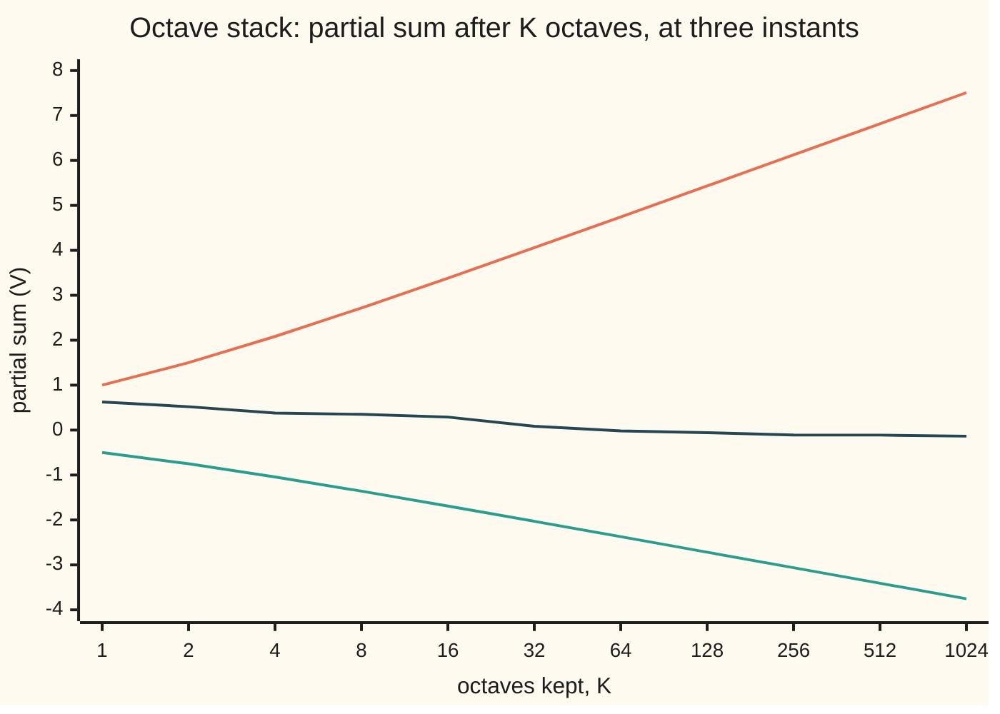

# Carleson's theorem in outline: almost everywhere, the series does converge

[Syllabus](../../../SYLLABUS.md) → [Harmonic analysis](../README.md) → [Fourier Series in Depth](../README.md#s01) → Carleson's theorem in outline

---

## General Overview

The shelf's siren is a ±1 V square wave at 220 cycles a second, so it switches 440 times a second. Its Fourier series (the sum of sine waves that rebuilds it) converges at every instant ([Dirichlet's theorem](04-pointwise-and-uniform-convergence.md)). Between switches it reaches the signal. At a switch it reaches 0 V, the midpoint. The series misses the signal only at the switch instants, and they form a list with total length zero.

Now take a rougher signal, the **octave stack**. Add a cosine at 220 Hz with height 1 V, one at 440 Hz with height 1/2 V, one at 880 Hz with height 1/3 V, and so on up every octave. It is a mathematical signal, not a recording. Its energy is finite: the mean square is 0.822467 V², so the root mean square (rms) is 0.9069 V.

At time t = 0 every cosine peaks together. The partial sums there are 1 + 1/2 + 1/3 + …, which never settle: after 1,024 octaves they stand at 7.5092 V and still climb. The same happens at every instant $`t = a/(220 \times 2^r)`$ seconds, for whole numbers a and r, and those instants sit in every time window, however short. At t = 1/660 s the sums sink without bound instead.

Does this series converge anywhere that matters? Yes, at every instant outside a set of total length zero. For the octave stack a short argument on this card proves it, because its waves sit only at octaves (Why it works, Step 1). Of 2,000 instants picked at random, none moved by more than 0.2 V between octave 256 and octave 1,024. A general finite-energy signal has no such shortcut: Lennart Carleson proved the same promise for every one of them in 1966. The word "almost" cannot be dropped, even for a continuous signal: Paul du Bois-Reymond built a continuous signal whose series diverges at a point in 1873.

**For every signal of finite energy, the Fourier partial sums converge to the signal at every instant outside a set of total length zero; continuous signals can still diverge on such a set, so "almost everywhere" is the best possible promise.**

**What kind of fact this is:** a theorem, stated here with its key idea and its sources but not proved, because the proof is long. Proved on this card: that Carleson's bound on the largest partial sum gives almost-everywhere convergence; that convergence in energy already gives convergence along a fast subsequence, which with one more line settles the octave stack; and, given the classical bound $`\lvert \sum_{j \le M} \sin(jx)/j \rvert \le \mathrm{Si}(\pi)`$, used without proof, that a continuous signal can diverge at a point.

### The picture: partial sums of the octave stack at three instants



Orange: t = 0, climbing without bound. Green: t = 1/660 s, sinking without bound. Dark: a random instant, settling. K doubles at each step, so the straight-looking lines grow like the natural logarithm of K: slowly, but forever.

---

## The formula

Notation from earlier cards, in one line each. The phase is x = 2π × 220 × t, so one siren cycle is one turn of the circle $`\mathbb{T}`$, the range $`-\pi \le x < \pi`$. The coefficient f̂(n) is wave n's share of the signal ([Fourier coefficients](01-fourier-coefficients-and-orthogonality.md)). The partial sum keeps the waves up to n = N:

```math
S_N f(x) = \sum_{n=-N}^{N} \hat f(n)\, e^{inx}, \qquad \hat f(n) = \frac{1}{2\pi}\int_{-\pi}^{\pi} f(x)\, e^{-inx}\, dx
```

Carleson's theorem:

```math
f \in L^2(\mathbb{T}) \quad\Longrightarrow\quad \lambda\big(\{x \in \mathbb{T} : S_N f(x) \not\to f(x) \text{ as } N \to \infty\}\big) = 0
```

**Read it aloud:** if the signal has finite energy, the instants where its partial sums fail to reach it have total length zero.

The engine of the proof is a bound on the largest partial sum, called **Carleson's maximal inequality**:

```math
\lambda\big(\{x : S^{*}f(x) > \alpha\}\big) \;\le\; \frac{A\,\|f\|_2^2}{\alpha^2}, \qquad S^{*}f(x) = \sup_{N} |S_N f(x)|
```

**Read it aloud:** the instants where some partial sum climbs above the level α have total length at most a fixed number A times the energy, divided by α squared.

| Symbol | Plain meaning | In our example | Push it up and the answer… |
| --- | --- | --- | --- |
| $`t`$, $`x`$ | time in seconds; the phase $`x = 2\pi \times 220 \times t`$ | $`t = 1/660`$ s is $`x = 2\pi/3`$ | — |
| $`\mathbb{T}`$, $`\lambda`$ | the circle $`-\pi \le x < \pi`$; $`\lambda`$ is length on it, $`2\pi`$ in all | bad set of the octave stack: $`\lambda = 0`$ | — |
| $`f`$, $`g`$, $`h`$ | the signal, in volts; $`g`$ a finite sum of waves close to $`f`$; $`h = f - g`$ | the octave stack; $`g`$ = its first $`K`$ octaves | — |
| $`n`$, $`\hat f(n)`$, $`i`$ | a whole-number frequency, in cycles per turn; that wave's coefficient; $`i`$ the imaginary unit | $`\hat f(\pm 2^{k-1}) = 1/(2k)`$ | — |
| $`N`$, $`S_N f`$ | the cut-off; the partial sum keeping waves $`-N`$ to $`N`$ | $`N = 2^{K-1}`$ keeps $`K`$ octaves | closer to the signal in energy, not always at a point |
| $`L^2(\mathbb{T})`$, $`\Vert f\Vert_2`$, $`L^p`$ | signals of finite energy; the rms, $`\Vert f\Vert_2^2 = \frac{1}{2\pi}\int \lvert f \rvert^2`$; $`L^p`$: the p-th power of the size has a finite integral | $`\Vert f\Vert_2 = 0.9069`$ V | the bad-set bound loosens |
| $`S^{*}f`$ | Carleson's maximal function: the largest partial-sum size at $`x`$ over all $`N`$ | infinite at $`t = 0`$ | — |
| $`\alpha`$, $`A`$, $`\varepsilon`$ | a level in volts; a fixed constant that works for every signal; a small positive number | $`\alpha = 0.2`$ V | larger $`\alpha`$: a smaller bad set |
| $`k`$, $`K`$ | octave number (or block number); octaves kept | $`K = 1{,}024`$ | — |
| $`H_M`$ | the harmonic number $`1 + \frac12 + \dots + \frac1M`$ | $`H_{1024} = 7.5092`$ | grows like the logarithm of $`M`$ |
| $`Q_{m,M}`$, $`m`$, $`M_k`$, $`j`$, Si | Fejér's block (Why it works, Step 4): waves $`m - M`$ to $`m + M`$; $`M_k = 2^{k^3}`$; $`j`$ counts inside a block or along a subsequence $`N_j`$; Si the sine integral | $`M_2 = 256`$; Si(π) = 1.851937 | a bigger block: a bigger partial sum at 0 |
| $`a`$, $`r`$ | whole numbers naming a bad instant $`t = a/(220 \times 2^r)`$ s | $`a = 0`$: the instant $`t = 0`$ | — |

### When it holds

- **Finite energy, or any power p above 1.** Richard Hunt extended the theorem from $`L^2`$ to every $`L^p`$ with $`p > 1`$ in 1968. For a signal that is only integrable, it fails: Andrey Kolmogorov built one in 1923 whose series diverges almost everywhere.
- **Almost every instant, not every instant.** The bad set has length zero but can be dense, as for the octave stack. For continuous signals too: for every set of length zero, some continuous signal diverges at every point of it (Kahane and Katznelson, 1966).
- **Pointwise, not uniform.** At each good instant the sums settle, but not at one shared speed. Near each siren switch the largest partial sum overshoots by 0.1790 V however many waves are kept.
- **Values on a null set do not count.** Change the siren at its 440 switch instants a second and no coefficient moves, so no theorem can promise the value there. An $`L^2`$ signal is only fixed up to a set of length zero ([Null sets and almost everywhere](../../10-Measure%20and%20integration/01-Sets%20You%20Can%20Measure/07-null-sets-and-almost-everywhere.md)).

---

## Why it works

### Step 0: control every partial sum at once

Convergence fails at an instant when the partial sums there keep swinging. One partial sum is easy to control on average, because its energy error shrinks. But the worst cut-off N can differ from instant to instant.

Carleson's maximal inequality controls the worst cut-off at every instant at once. The theorem then follows by comparing the signal with a finite sum of waves, whose series stops changing after finitely many terms.

### Step 1: what convergence in energy already gives

[Convergence in energy](05-l2-convergence-and-riesz-fischer.md) proves that the energy of $`f - S_N f`$ falls to zero. That forces convergence at almost every instant along any fast enough subsequence of cut-offs. "Fast enough" means the energy errors add up to a finite total.

For the octave stack, the energy beyond octave K is half of $`1/(K+1)^2 + 1/(K+2)^2 + \dots`$, about $`1/(2K)`$.

- Along K = 1, 4, 9, …, 1,024 the errors add to 0.6104, and the full list of squares adds to a finite total. So the sums at the square numbers of octaves converge almost everywhere.
- Along every K up to 1,024 they add to 3.4324, and the total grows without bound, like a logarithm of K. On its own, the easy argument says nothing about the full sequence.

For the octave stack one more line fills the gaps. Its waves sit only at octaves, so every cut-off N gives one of the octave sums. Between the square numbers $`j^2`$ and $`(j+1)^2`$ of octaves, the sum moves by at most $`\frac{1}{j^2+1} + \dots + \frac{1}{(j+1)^2}`$ at every instant. That is under $`(2j+1)/j^2`$, which shrinks to 0. So wherever the sums at square numbers settle, every partial sum settles: the octave stack converges almost everywhere without Carleson's theorem. Kolmogorov proved in 1924 that sums cut only at octaves converge almost everywhere for every finite-energy signal.

A general signal has waves at every frequency, so its partial sums can move at every cut-off, and no such bound exists. Carleson's theorem is the step from a fast subsequence to every cut-off.

<details>
<summary>Detailed proof: summable energy errors give convergence almost everywhere</summary>

Suppose the energy errors along the cut-offs $`N_j`$ add to a finite total. Then

$`\displaystyle \frac{1}{2\pi}\int_{\mathbb{T}} \sum_j \lvert f(x) - S_{N_j} f(x)\rvert^2\, dx = \sum_j \|f - S_{N_j} f\|_2^2 < \infty.`$

The swap of sum and integral is allowed for non-negative terms (monotone convergence). A non-negative function with a finite integral is finite almost everywhere. Where the sum $`\sum_j \lvert f(x) - S_{N_j} f(x) \rvert^2`$ is finite, its terms tend to zero, so $`S_{N_j} f(x) \to f(x)`$ there.

</details>

### Step 2: from the maximal inequality to the theorem

Pick a finite sum of waves g whose energy distance from f is tiny; one exists because partial sums converge in energy.

For N past the top frequency of g, $`S_N g = g`$ exactly, so any swing of $`S_N f - f`$ comes from $`f - g`$. The maximal inequality makes the set where that swing passes a level α as short as we like. A set shorter than every positive number has length zero.

<details>
<summary>Detailed proof: Carleson's inequality implies almost-everywhere convergence</summary>

Let $`h = f - g`$, where $`g`$ is a finite sum of waves of top frequency $`N_0`$ and $`\|h\|_2^2 < \varepsilon`$. For $`N \ge N_0`$, linearity gives $`S_N f - f = S_N h - h`$. So at every $`x`$, writing limsup for the largest size the swings keep coming back to as N grows:

$`\displaystyle \limsup_{N\to\infty} \lvert S_N f(x) - f(x) \rvert \le S^{*}h(x) + \lvert h(x) \rvert.`$

If the left side exceeds $`2\alpha`$, then $`S^{*}h(x) > \alpha`$ or $`\lvert h(x) \rvert > \alpha`$. The maximal inequality bounds the first set by $`A\varepsilon/\alpha^2`$. Chebyshev's inequality (area under $`\lvert h \rvert^2`$ is at least $`\alpha^2`$ times the length where $`\lvert h \rvert > \alpha`$) bounds the second by $`2\pi\varepsilon/\alpha^2`$. So:

$`\displaystyle \lambda\Big(\big\{x : \limsup_{N} \lvert S_N f(x) - f(x)\rvert > 2\alpha\big\}\Big) \le \frac{(A + 2\pi)\,\varepsilon}{\alpha^2}.`$

The left side does not depend on $`\varepsilon`$, so it is zero. Take $`\alpha = 1, \frac12, \frac13, \dots`$: countably many null sets make a null set, and off it the limsup is zero.

</details>

### Step 3: why the maximal inequality is hard

The partial sum is the signal smeared by the Dirichlet kernel ([Dirichlet and Fejer kernels](03-dirichlet-and-fejer-kernels.md)). That kernel swings positive and negative, and its average absolute size grows like a logarithm of N. So no bound on one kernel survives the sup over all N.

Carleson's idea, in words:

1. Cut the time–frequency plane into tiles of area about 1. A wave packet that lasts a shorter time must spread over a wider band of frequencies, in inverse proportion, so area 1 is the finest cut possible.
2. At each instant, the cut-off N picks out the tiles that matter. Sort tiles into families, called trees, that share a frequency neighbourhood.
3. Show the trees cannot all carry much of the signal's energy at once. The energy is then counted only once, with a fixed constant A.

Charles Fefferman reorganised the argument in 1973. Michael Lacey and Christoph Thiele gave a ten-page proof in 2000. The theorem needs only that some fixed A exists, not its value.

### Step 4: a continuous signal that diverges at a point

This is Fejér's simpler form of du Bois-Reymond's example. The building block is

```math
Q_{m,M}(x) = 2\sin(mx)\sum_{j=1}^{M}\frac{\sin(jx)}{j} = \sum_{j=1}^{M}\frac{\cos\big((m-j)x\big) - \cos\big((m+j)x\big)}{j}
```

- **It is small.** The sum of $`\sin(jx)/j`$ never exceeds Si(π) = 1.851937 in size, for every M and x, where Si is the sine integral from [The Gibbs overshoot and the cure](08-gibbs-and-summability.md). This classical bound is used here without proof; any fixed bound would do. The code finds 1.8458 for M = 256. So $`\lvert Q \rvert \le 2 \times 1.851937`$.
- **Half of it is large at 0.** The partial sum that stops at frequency m keeps only the $`\cos((m-j)x)/j`$ half. At x = 0 that half is $`H_M`$, which grows like a logarithm of M.
- **Glue blocks far apart.** Take $`f = \sum_k Q_{2M_k, M_k}/k^2`$ with $`M_k = 2^{k^3}`$. Block k uses frequencies from $`M_k`$ to $`3M_k`$, so blocks never overlap. The weights $`1/k^2`$ add to π²/6, so $`\lvert f \rvert \le 6.0926`$ and f is continuous.

At x = 0 each whole block is zero, so f(0) = 0. But the partial sum that stops halfway through block k is $`H_{M_k}/k^2`$, which grows in step with k:

```
block k  partial sum at x = 0 (bound on the signal: 6.0926)
   1     ##########                                    1.5000
   2     ###########                                   1.5311
   3     ###############                               2.1436
   4     ####################                          2.8087
   5     ########################                      3.4888
   6     #############################                 4.1749
   7     ##################################            4.8638
   8     #######################################       5.5542
   9     ############################################  6.2455
```

By block 9 the partial sum, 6.2455, is above 6.0926, a bound that f never exceeds.

### Step 5: what each result settles

| Result | Signals | What it settles |
| --- | --- | --- |
| du Bois-Reymond, 1873 | continuous | convergence at every point fails, even for continuous signals |
| Kolmogorov, 1923 | integrable | the bad set can be almost everything; integrable is not enough |
| Carleson, 1966 | finite energy | the bad set always has length zero |
| Kahane and Katznelson, 1966 | continuous | every set of length zero lies inside the bad set of some continuous signal, so "almost everywhere" cannot be improved |

---

## Worked numbers, by hand

The octave stack: wave $`2^{k-1}`$ in cycles per turn, at 220 × $`2^{k-1}`$ Hz, with height 1/k volt.

| Step | Arithmetic | Value |
| --- | --- | --- |
| energy, mean square | half of $`1 + \frac14 + \frac19 + \dots`$ = π²/12 | 0.822467 V² |
| rms | square root of 0.822467 | 0.9069 V |
| finite energy, so Carleson applies | | yes |
| energy between octaves 16 and 1,024 | half of $`\frac{1}{17^2} + \dots + \frac{1}{1024^2}`$ | 0.02981 V² |
| sum at t = 0 after 16 octaves | $`H_{16}`$ | 3.3807 V |
| sum at t = 0 after 1,024 octaves | $`H_{1024}`$ | 7.5092 V |
| sum at t = 1/660 s after 1,024 octaves | each term is $`-\frac{1}{2k}`$, so $`-H_{1024}/2`$ | −3.7546 V |
| bad instants $`a/(220 \times 2^r)`$ s | they can be listed, so cover the i-th by a window of length ε/2^i | total at most ε |
| random instants still moving by over 0.2 V after octave 256 | count of 2,000 | 0 |
| **length of the set where the series fails** | Carleson's theorem | **0** |

The random instants, counted after four cut-offs:

```
instants still moving by more than 0.2 V before octave 1,024, of 2,000
after octave   4  #################################### 1782
after octave  16  #################                     833
after octave  64  ##                                     75
after octave 256                                          0
```

What is left beyond octave 1,024 has rms 0.0221 V, so the second cut-off hides little.

The series reaches the octave stack at almost every instant, though it fails on a set that touches every time window. The random instants agree with the theorem; they cannot prove it.

### What breaks if you drop a piece

| Mistake | Comes out at | What went wrong |
| --- | --- | --- |
| Expect convergence at every instant (octave stack, t = 0) | 7.5092 V after 1,024 octaves, still climbing | finite energy allows a bad set of length zero; t = 0 is in it |
| Expect continuity to give convergence everywhere (Fejér's signal, x = 0) | 6.2455 at block 9, above the bound 6.0926, while f(0) = 0 | continuity does not control the partial sums |
| Read "almost everywhere" as "uniformly" (siren, N = 1,001) | largest partial sum 1.1790 V, overshoot 0.1790 V | each instant settles, but not at one shared speed |
| Use only convergence in energy for every cut-off | energy errors add to 3.4324 by K = 1,024 and keep growing | alone it covers a fast subsequence; the octave stack fills its gaps by a block bound, a general signal needs Carleson |

---

## Code, from first principles, and it actually runs

The code builds the three signals from their formulas, prints every number on this card, and takes four independent roads.

1. At the two bad instants, it adds the cosines directly, with exact phases from whole-number arithmetic. It checks the sums against the harmonic-number formula.
2. At 2,000 random instants, it draws the instant's binary digits as fair coin flips (SplitMix64, seed 2026). It checks the measured energy against the exact value from orthogonality.
3. It writes Fejér's first two blocks out as cosine coefficients and adds them directly. It checks the result against $`H_M/k^2`$.
4. It finds the siren's peak by search. It checks the peak against (2/π) Si(π), with Si computed by Simpson's rule.

### Python

```python
# Carleson's theorem in outline -- the check behind the card. Standard library only.
# Signal 1, the octave stack: f(x) = sum over k >= 1 of cos(2^(k-1) x) / k volts,
# x = 2*pi*220*t. Square-integrable; it diverges at x = 0 and x = 2*pi/3.
# Signal 2, Fejer's continuous signal: sum over k of Q(x; 2n, n) / k^2, n = 2^(k^3).
# Signal 3, the +-1 V siren square wave, for the Gibbs row.
import math

KMAX, POINTS, SEED, EPS = 1024, 2000, 2026, 0.2
MASK64 = (1 << 64) - 1

def splitmix(state):
    state = (state + 0x9E3779B97F4A7C15) & MASK64
    z = state
    z = ((z ^ (z >> 30)) * 0xBF58476D1CE4E5B9) & MASK64
    z = ((z ^ (z >> 27)) * 0x94D049BB133111EB) & MASK64
    return state, z ^ (z >> 31)

def harmonic_direct(n):
    return sum(1.0 / j for j in range(n, 0, -1))

# Euler's constant from one long sum, then the asymptotic harmonic number
NG = 100000
GAMMA = harmonic_direct(NG) - math.log(NG) - 1 / (2 * NG) + 1 / (12 * NG**2) - 1 / (120 * NG**4)
def harmonic_asym(log_n, n):
    return log_n + GAMMA + 1 / (2 * n) - 1 / (12 * n * n)

def simpson(fn, a, b, m):
    h = (b - a) / m
    s = fn(a) + fn(b) + sum((4 if i % 2 else 2) * fn(a + i * h) for i in range(1, m))
    return s * h / 3

SI_PI = simpson(lambda u: 1.0 if u == 0 else math.sin(u) / u, 0.0, math.pi, 1000)

# ---- the octave stack: energy, and the two bad points (exact phases by integer arithmetic)
energy = 0.5 * sum(1 / k**2 for k in range(1, 200001)) + 0.5 / 200000
print(f"octave stack energy, mean square volts^2: series {energy:.6f}  exact pi^2/12 {math.pi**2 / 12:.6f}")
print(f"octave stack rms volts: {math.sqrt(math.pi**2 / 12):.4f}")
tail_rms = math.sqrt(0.5 * sum(1 / k**2 for k in range(KMAX + 1, 2000001)))
print(f"rms of the part beyond octave {KMAX}: {tail_rms:.4f} V")
assert abs(energy - math.pi**2 / 12) < 1e-9

def bad_point_sums(p, q):  # x = 2*pi*p/q, phase of term k is 2^(k-1) p mod q, exactly
    s, out = 0.0, []
    for k in range(1, KMAX + 1):
        s += math.cos(2 * math.pi * ((pow(2, k - 1, q) * p) % q) / q) / k
        out.append(s)
    return out

CHART_K = [1, 2, 4, 8, 16, 32, 64, 128, 256, 512, 1024]
at0, at23 = bad_point_sums(0, 1), bad_point_sums(1, 3)
for K in CHART_K:
    assert abs(at0[K - 1] - harmonic_asym(math.log(K), K)) < 1 / (60 * K**4) + 1e-9  # road 2
    assert abs(at23[K - 1] + 0.5 * harmonic_direct(K)) < 1e-9             # every term is -1/(2k)
print("chart, octaves K        " + "".join(f"{K:>8d}" for K in CHART_K))
print("chart, at t = 0         " + "".join(f"{at0[K - 1]:8.4f}" for K in CHART_K))
print("chart, at t = 1/660 s   " + "".join(f"{at23[K - 1]:8.4f}" for K in CHART_K))

# ---- random instants: their binary digits are fair coin flips (SplitMix64, seed 2026)
state, osc_K0 = SEED, [4, 16, 64, 256]
still_moving, diff_sq, diff_sq2, first_point = [0] * 4, 0.0, 0.0, None
for pt in range(POINTS):
    words = []
    for _ in range(17):
        state, w = splitmix(state)
        words.append(w)
    bits = [(words[i // 64] >> (63 - i % 64)) & 1 for i in range(17 * 64)]
    win = 0
    for i in range(53):
        win = (win << 1) | bits[i]
    s, sums = 0.0, []
    for k in range(1, KMAX + 1):  # phase of term k = 2*pi * 0.b_k b_(k+1) ... b_(k+52)
        s += math.cos(2 * math.pi * win / 2**53) / k
        sums.append(s)
        win = ((win << 1) & ((1 << 53) - 1)) | bits[k + 52]
    if pt == 0:
        first_point = sums
    for i, K0 in enumerate(osc_K0):
        if max(abs(sums[K - 1] - sums[-1]) for K in range(K0, KMAX + 1)) > EPS:
            still_moving[i] += 1
    d = sums[-1] - sums[15]
    diff_sq += d * d
    diff_sq2 += d**4
print("chart, a random instant " + "".join(f"{first_point[K - 1]:8.4f}" for K in CHART_K))
mean_sq = diff_sq / POINTS
se = math.sqrt((diff_sq2 / POINTS - mean_sq**2) / POINTS)
exact_sq = 0.5 * sum(1 / k**2 for k in range(17, KMAX + 1))
print(f"energy between octaves 16 and {KMAX}: simulated {mean_sq:.5f}  exact {exact_sq:.5f}  std error {se:.5f}")
assert abs(mean_sq - exact_sq) < 4 * se
fracs = [c / POINTS for c in still_moving]
for K0, c, fr in zip(osc_K0, still_moving, fracs):
    print(f"bars, after octave {K0:>3d}: {c:>4d} of {POINTS} instants still move by more than {EPS} V  ({fr:.4f})")
assert fracs[0] > fracs[1] > fracs[2] > fracs[3] and fracs[0] > 0.5 and fracs[3] < 0.02

# ---- Step 1: convergence in energy gives a fast subsequence, not the whole sequence
def tail(K):
    return 0.5 * (math.pi**2 / 6 - sum(1 / k**2 for k in range(1, K + 1)))
along_squares = sum(tail(j * j) for j in range(1, 33))
along_all = sum(tail(K) for K in range(1, KMAX + 1))
print(f"sum of tail energies, K = 1, 4, 9, ..., 1024: {along_squares:.4f};  every K up to 1024: {along_all:.4f}")
assert along_squares < 1.0 and along_all > 3.0

# ---- Fejer's continuous signal: bounded, yet its partial sums at x = 0 grow without bound
bound = 2 * SI_PI * math.pi**2 / 6
print(f"Si(pi) = {SI_PI:.6f};  bound on |f|: 2 Si(pi) pi^2/6 = {bound:.4f}")
xs = [math.pi * (i + 0.5) / 4000 for i in range(4000)]
peak = max(abs(sum(math.sin(j * x) / j for j in range(1, 257))) for x in xs[:200])
print(f"largest |sum of sin(jx)/j, j <= 256| on the grid: {peak:.4f}")
assert 1.84 < peak < SI_PI
coef = {}  # direct road: write blocks 1 and 2 as cosine coefficients
for k, n in [(1, 2), (2, 256)]:
    for j in range(1, n + 1):
        coef[2 * n - j] = coef.get(2 * n - j, 0) + 1 / (j * k * k)
        coef[2 * n + j] = coef.get(2 * n + j, 0) - 1 / (j * k * k)
direct = [sum(c for fr, c in coef.items() if fr <= N) for N in (4, 512)]
assert abs(direct[0] - harmonic_direct(2)) < 1e-12 and abs(direct[1] - harmonic_direct(256) / 4) < 1e-12
assert abs(harmonic_direct(256) - harmonic_asym(math.log(256), 256)) < 1e-6
f_at_0 = sum(coef.values())
prod = sum(2 * math.sin(2 * n) * sum(math.sin(j) / j for j in range(1, n + 1)) / k**2 for k, n in [(1, 2), (2, 256)])
assert abs(sum(c * math.cos(fr) for fr, c in coef.items()) - prod) < 1e-12  # cosine form = product form, x = 1
print(f"f at x = 0, blocks 1 and 2: {abs(f_at_0):.4f}")
fej = []
for k in range(1, 10):
    e = k**3
    h = harmonic_direct(2**e) if e <= 20 else harmonic_asym(e * math.log(2), 2.0**e)
    fej.append(h / k**2)
print("bars, Fejer block k      " + "".join(f"{k:>8d}" for k in range(1, 10)))
print("bars, partial sum at 0   " + "".join(f"{v:8.4f}" for v in fej))
assert abs(fej[1] - direct[1]) < 1e-12 and fej[8] > bound > fej[7]

# ---- the siren square wave: converges at every non-switch instant, never uniformly
N = 1001
top = max((4 / math.pi) * sum(math.sin(k * x) / k for k in range(1, N + 1, 2))
          for x in [3 * math.pi / (N + 1) * i / 600 for i in range(1, 600)])
print(f"siren, N = {N}: largest partial sum {top:.4f} V, overshoot {top - 1:.4f} V;  limit (2/pi) Si(pi) = {2 / math.pi * SI_PI:.4f} V")
assert abs(top - 2 / math.pi * SI_PI) < 1e-3
print("ALL CHECKS PASS")
```

**Ran 2026-11-15 on macOS, Python 3.14.10, standard library only. All checks passed. Output, pasted from the run:**

```
octave stack energy, mean square volts^2: series 0.822467  exact pi^2/12 0.822467
octave stack rms volts: 0.9069
rms of the part beyond octave 1024: 0.0221 V
chart, octaves K               1       2       4       8      16      32      64     128     256     512    1024
chart, at t = 0           1.0000  1.5000  2.0833  2.7179  3.3807  4.0585  4.7439  5.4331  6.1243  6.8165  7.5092
chart, at t = 1/660 s    -0.5000 -0.7500 -1.0417 -1.3589 -1.6904 -2.0292 -2.3719 -2.7166 -3.0622 -3.4083 -3.7546
chart, a random instant   0.6270  0.5201  0.3800  0.3501  0.2902  0.0854 -0.0189 -0.0570 -0.1108 -0.1116 -0.1352
energy between octaves 16 and 1024: simulated 0.02766  exact 0.02981  std error 0.00088
bars, after octave   4: 1782 of 2000 instants still move by more than 0.2 V  (0.8910)
bars, after octave  16:  833 of 2000 instants still move by more than 0.2 V  (0.4165)
bars, after octave  64:   75 of 2000 instants still move by more than 0.2 V  (0.0375)
bars, after octave 256:    0 of 2000 instants still move by more than 0.2 V  (0.0000)
sum of tail energies, K = 1, 4, 9, ..., 1024: 0.6104;  every K up to 1024: 3.4324
Si(pi) = 1.851937;  bound on |f|: 2 Si(pi) pi^2/6 = 6.0926
largest |sum of sin(jx)/j, j <= 256| on the grid: 1.8458
f at x = 0, blocks 1 and 2: 0.0000
bars, Fejer block k             1       2       3       4       5       6       7       8       9
bars, partial sum at 0     1.5000  1.5311  2.1436  2.8087  3.4888  4.1749  4.8638  5.5542  6.2455
siren, N = 1001: largest partial sum 1.1790 V, overshoot 0.1790 V;  limit (2/pi) Si(pi) = 1.1790 V
ALL CHECKS PASS
```

### Rust

```rust
// Carleson's theorem in outline -- the same check as carleson_in_outline_check.py, in Rust.
// Standard library only, no crates. Same signals, same seed, same printed lines.
// Compile: rustc --edition 2021 -O carleson_in_outline_check.rs -o /tmp/carleson_check
use std::f64::consts::PI;

const KMAX: usize = 1024;
const POINTS: usize = 2000;
const SEED: u64 = 2026;
const EPS: f64 = 0.2;

fn splitmix(state: &mut u64) -> u64 {
    *state = state.wrapping_add(0x9E3779B97F4A7C15);
    let mut z = *state;
    z = (z ^ (z >> 30)).wrapping_mul(0xBF58476D1CE4E5B9);
    z = (z ^ (z >> 27)).wrapping_mul(0x94D049BB133111EB);
    z ^ (z >> 31)
}

fn harmonic_direct(n: u64) -> f64 { (1..=n).rev().map(|j| 1.0 / j as f64).sum() }

fn harmonic_asym(log_n: f64, n: f64, gamma: f64) -> f64 {
    log_n + gamma + 1.0 / (2.0 * n) - 1.0 / (12.0 * n * n)
}

fn simpson(f: &dyn Fn(f64) -> f64, a: f64, b: f64, m: usize) -> f64 {
    let h = (b - a) / m as f64;
    let inner: f64 = (1..m).map(|i| if i % 2 == 1 { 4.0 } else { 2.0 } * f(a + i as f64 * h)).sum();
    (f(a) + f(b) + inner) * h / 3.0
}

fn bad_point_sums(p: u64, q: u64) -> Vec<f64> { // x = 2 pi p/q; term k has phase 2^(k-1) p mod q
    let (mut s, mut out, mut r) = (0.0, Vec::new(), p % q);
    for k in 1..=KMAX {
        s += (2.0 * PI * r as f64 / q as f64).cos() / k as f64;
        out.push(s);
        r = 2 * r % q;
    }
    out
}

fn inv_sq_sum(a: usize, b: usize) -> f64 {
    (a..=b).map(|k| 1.0 / (k as f64 * k as f64)).sum()
}

fn row(label: &str, v: &[f64]) -> String {
    label.to_string() + &v.iter().map(|x| format!("{:8.4}", x)).collect::<String>()
}

fn main() {
    let ng = 100000u64;
    let n = ng as f64;
    let gamma = harmonic_direct(ng) - n.ln() - 1.0 / (2.0 * n) + 1.0 / (12.0 * n * n) - 1.0 / (120.0 * n.powi(4));
    let si_pi = simpson(&|u: f64| if u == 0.0 { 1.0 } else { u.sin() / u }, 0.0, PI, 1000);

    // ---- the octave stack: energy, and the two bad points
    let energy = 0.5 * inv_sq_sum(1, 200000) + 0.5 / 200000.0;
    println!("octave stack energy, mean square volts^2: series {:.6}  exact pi^2/12 {:.6}", energy, PI * PI / 12.0);
    println!("octave stack rms volts: {:.4}", (PI * PI / 12.0).sqrt());
    let tail_rms = (0.5 * inv_sq_sum(KMAX + 1, 2000000)).sqrt();
    println!("rms of the part beyond octave {}: {:.4} V", KMAX, tail_rms);
    assert!((energy - PI * PI / 12.0).abs() < 1e-9);
    let chart_k = [1usize, 2, 4, 8, 16, 32, 64, 128, 256, 512, 1024];
    let (at0, at23) = (bad_point_sums(0, 1), bad_point_sums(1, 3));
    for &k in &chart_k {
        let kf = k as f64;
        assert!((at0[k - 1] - harmonic_asym(kf.ln(), kf, gamma)).abs() < 1.0 / (60.0 * kf.powi(4)) + 1e-9);
        assert!((at23[k - 1] + 0.5 * harmonic_direct(k as u64)).abs() < 1e-9);
    }
    println!("chart, octaves K        {}", chart_k.iter().map(|k| format!("{:>8}", k)).collect::<String>());
    let pick = |v: &Vec<f64>| chart_k.iter().map(|&k| v[k - 1]).collect::<Vec<f64>>();
    println!("{}", row("chart, at t = 0         ", &pick(&at0)));
    println!("{}", row("chart, at t = 1/660 s   ", &pick(&at23)));

    // ---- random instants: binary digits are fair coin flips (SplitMix64, seed 2026)
    let mut state = SEED;
    let osc_k0 = [4usize, 16, 64, 256];
    let (mut still, mut dsq, mut dsq2) = ([0usize; 4], 0.0f64, 0.0f64);
    let mut first_point: Vec<f64> = Vec::new();
    let mask53: u64 = (1u64 << 53) - 1;
    for pt in 0..POINTS {
        let words: Vec<u64> = (0..17).map(|_| splitmix(&mut state)).collect();
        let bits: Vec<u64> = (0..17 * 64).map(|i| (words[i / 64] >> (63 - i % 64)) & 1).collect();
        let mut win: u64 = (0..53).fold(0, |w, i| (w << 1) | bits[i]);
        let (mut s, mut sums) = (0.0f64, Vec::with_capacity(KMAX));
        for k in 1..=KMAX {
            s += (2.0 * PI * win as f64 / 9007199254740992.0).cos() / k as f64;
            sums.push(s);
            win = ((win << 1) & mask53) | bits[k + 52];
        }
        let last = sums[KMAX - 1];
        for (i, &k0) in osc_k0.iter().enumerate() {
            if (k0..=KMAX).map(|k| (sums[k - 1] - last).abs()).fold(0.0, f64::max) > EPS { still[i] += 1; }
        }
        let d = last - sums[15];
        dsq += d * d;
        dsq2 += d.powi(4);
        if pt == 0 { first_point = sums; }
    }
    println!("{}", row("chart, a random instant ", &pick(&first_point)));
    let mean_sq = dsq / POINTS as f64;
    let se = ((dsq2 / POINTS as f64 - mean_sq * mean_sq) / POINTS as f64).sqrt();
    let exact_sq = 0.5 * inv_sq_sum(17, KMAX);
    println!("energy between octaves 16 and {}: simulated {:.5}  exact {:.5}  std error {:.5}", KMAX, mean_sq, exact_sq, se);
    assert!((mean_sq - exact_sq).abs() < 4.0 * se);
    let fr: Vec<f64> = still.iter().map(|&c| c as f64 / POINTS as f64).collect();
    for i in 0..4 {
        println!("bars, after octave {:>3}: {:>4} of {} instants still move by more than {} V  ({:.4})", osc_k0[i], still[i], POINTS, EPS, fr[i]);
    }
    assert!(fr[0] > fr[1] && fr[1] > fr[2] && fr[2] > fr[3] && fr[0] > 0.5 && fr[3] < 0.02);

    // ---- Step 1: convergence in energy gives a fast subsequence, not the whole sequence
    let tail = |k: usize| 0.5 * (PI * PI / 6.0 - inv_sq_sum(1, k));
    let along_squares: f64 = (1..=32).map(|j| tail(j * j)).sum();
    let along_all: f64 = (1..=KMAX).map(|k| tail(k)).sum();
    println!("sum of tail energies, K = 1, 4, 9, ..., 1024: {:.4};  every K up to 1024: {:.4}", along_squares, along_all);
    assert!(along_squares < 1.0 && along_all > 3.0);

    // ---- Fejer's continuous signal: bounded, yet its partial sums at x = 0 grow without bound
    let bound = 2.0 * si_pi * PI * PI / 6.0;
    println!("Si(pi) = {:.6};  bound on |f|: 2 Si(pi) pi^2/6 = {:.4}", si_pi, bound);
    let peak = (0..200).map(|i| PI * (i as f64 + 0.5) / 4000.0)
        .map(|x| (1..=256).map(|j| (j as f64 * x).sin() / j as f64).sum::<f64>().abs()).fold(0.0, f64::max);
    println!("largest |sum of sin(jx)/j, j <= 256| on the grid: {:.4}", peak);
    assert!(peak > 1.84 && peak < si_pi);
    let mut coef: Vec<(usize, f64)> = Vec::new(); // direct road: blocks 1 and 2 as cosine coefficients
    for &(k, nb) in &[(1usize, 2usize), (2, 256)] {
        for j in 1..=nb {
            let c = 1.0 / (j as f64 * (k * k) as f64);
            coef.extend([(2 * nb - j, c), (2 * nb + j, -c)]);
        }
    }
    let direct: Vec<f64> = [4usize, 512].iter().map(|&nn| coef.iter().filter(|p| p.0 <= nn).map(|p| p.1).sum()).collect();
    assert!((direct[0] - harmonic_direct(2)).abs() < 1e-12 && (direct[1] - harmonic_direct(256) / 4.0).abs() < 1e-12);
    assert!((harmonic_direct(256) - harmonic_asym(256f64.ln(), 256.0, gamma)).abs() < 1e-6);
    let f_at_0: f64 = coef.iter().map(|p| p.1).sum();
    let prod: f64 = [(1usize, 2usize), (2, 256)].iter()
        .map(|&(k, nb)| 2.0 * (2.0 * nb as f64).sin() * (1..=nb).map(|j| (j as f64).sin() / j as f64).sum::<f64>() / (k * k) as f64).sum();
    assert!((coef.iter().map(|p| p.1 * (p.0 as f64).cos()).sum::<f64>() - prod).abs() < 1e-12); // cosine form = product form, x = 1
    println!("f at x = 0, blocks 1 and 2: {:.4}", f_at_0.abs());
    let mut fej = Vec::new();
    for k in 1..10u32 {
        let e = k * k * k;
        let h = if e <= 20 { harmonic_direct(1u64 << e) } else { harmonic_asym(e as f64 * 2f64.ln(), 2f64.powi(e as i32), gamma) };
        fej.push(h / (k * k) as f64);
    }
    println!("bars, Fejer block k      {}", (1..10).map(|k| format!("{:>8}", k)).collect::<String>());
    println!("{}", row("bars, partial sum at 0   ", &fej));
    assert!((fej[1] - direct[1]).abs() < 1e-12 && fej[8] > bound && bound > fej[7]);

    // ---- the siren square wave: converges at every non-switch instant, never uniformly
    let nn = 1001usize;
    let mut top = f64::MIN;
    for i in 1..600 {
        let x = 3.0 * PI / (nn as f64 + 1.0) * i as f64 / 600.0;
        let v: f64 = (1..=nn).step_by(2).map(|k| (k as f64 * x).sin() / k as f64).sum::<f64>() * 4.0 / PI;
        top = top.max(v);
    }
    println!("siren, N = {}: largest partial sum {:.4} V, overshoot {:.4} V;  limit (2/pi) Si(pi) = {:.4} V", nn, top, top - 1.0, 2.0 / PI * si_pi);
    assert!((top - 2.0 / PI * si_pi).abs() < 1e-3);
    println!("ALL CHECKS PASS");
}
```

**Ran 2026-11-15 on macOS, rustc 1.98.1, no crates. All checks passed. Output, pasted from the run:**

```
octave stack energy, mean square volts^2: series 0.822467  exact pi^2/12 0.822467
octave stack rms volts: 0.9069
rms of the part beyond octave 1024: 0.0221 V
chart, octaves K               1       2       4       8      16      32      64     128     256     512    1024
chart, at t = 0           1.0000  1.5000  2.0833  2.7179  3.3807  4.0585  4.7439  5.4331  6.1243  6.8165  7.5092
chart, at t = 1/660 s    -0.5000 -0.7500 -1.0417 -1.3589 -1.6904 -2.0292 -2.3719 -2.7166 -3.0622 -3.4083 -3.7546
chart, a random instant   0.6270  0.5201  0.3800  0.3501  0.2902  0.0854 -0.0189 -0.0570 -0.1108 -0.1116 -0.1352
energy between octaves 16 and 1024: simulated 0.02766  exact 0.02981  std error 0.00088
bars, after octave   4: 1782 of 2000 instants still move by more than 0.2 V  (0.8910)
bars, after octave  16:  833 of 2000 instants still move by more than 0.2 V  (0.4165)
bars, after octave  64:   75 of 2000 instants still move by more than 0.2 V  (0.0375)
bars, after octave 256:    0 of 2000 instants still move by more than 0.2 V  (0.0000)
sum of tail energies, K = 1, 4, 9, ..., 1024: 0.6104;  every K up to 1024: 3.4324
Si(pi) = 1.851937;  bound on |f|: 2 Si(pi) pi^2/6 = 6.0926
largest |sum of sin(jx)/j, j <= 256| on the grid: 1.8458
f at x = 0, blocks 1 and 2: 0.0000
bars, Fejer block k             1       2       3       4       5       6       7       8       9
bars, partial sum at 0     1.5000  1.5311  2.1436  2.8087  3.4888  4.1749  4.8638  5.5542  6.2455
siren, N = 1001: largest partial sum 1.1790 V, overshoot 0.1790 V;  limit (2/pi) Si(pi) = 1.1790 V
ALL CHECKS PASS
```

### Lean

Lean proves the card's three proved steps, assuming what the card assumes, and checks its whole-number examples.

- Suppose Carleson's maximal inequality holds with some fixed constant $`A`$. Then every finite-energy signal's partial sums converge to it outside a set of total length zero.
- Take a finite-energy signal $`f`$ and cut-offs $`N_j`$ whose energy errors add up to a finite total. Then $`S_{N_j} f(x) \to f(x)`$ at every instant outside a set of total length zero.
- Suppose $`\lvert \sum_{j \le M} \sin(jx)/j \rvert`$ stays within one fixed bound for every $`M`$ and $`x`$. Then some continuous signal $`f`$ with $`f(0) = 0`$ has partial sums at 0 that grow without bound.
- The octave stack's sums at t = 0 match the chart: $`H_2 = 3/2`$ and $`H_4 = 25/12`$.
- Take the first 1,024 octaves. Then $`2^{k-1}`$ is never a multiple of 3, the fact behind the sums at t = 1/660 s.
- Fejér's blocks check too: $`M_2 = 256`$, and each of the nine charted blocks ends before the next starts.
- Block 1's bar in the chart is exactly $`H_2 = 3/2`$.

The decimals, the 2,000 random instants, Fejér's later bars and the siren's overshoot are left to the Python and Rust checks.

```lean
-- Carleson's theorem in outline: Carleson's maximal inequality makes the Fourier series of every finite-energy signal converge to it off a set of length zero, fast energy errors already give this along a subsequence, and a continuous signal can still diverge at a point.
import Mathlib.Analysis.Fourier.AddCircle
import Mathlib.NumberTheory.Harmonic.Defs
import Mathlib.NumberTheory.Harmonic.Bounds
import Mathlib.Analysis.Normed.Operator.BanachSteinhaus

open MeasureTheory Filter Topology Real

namespace CarlesonInOutline

/-! Notation, as on the card. The phase `x` runs over one cycle of length `2π`, with the two
ends joined: the circle `𝕋` is `AddCircle (2 * π)`. Its `volume` is length `λ`, `2π` in all.
Mathlib's `haarAddCircle` is length divided by `2π`, so for a signal `f` in `L²(𝕋)` (Mathlib's
`Lp ℂ 2 haarAddCircle`, signals equal off a set of length zero counted as one) the energy
`‖f‖₂² = (1/2π) ∫ |f(x)|² dx` is `‖f‖ ^ 2`. Mathlib's `fourierCoeff f n` is the card's
`f̂(n) = (1/2π) ∫ f(x) e^{-inx} dx`, and `fourier n x` is the wave `e^{inx}`.

Carleson's maximal inequality is not in Mathlib, and the card states it with sources but does
not prove it. So this file proves what the card proves: the step from that inequality to
almost-everywhere convergence (Why it works, Step 2), the fast-subsequence argument (Step 1),
and, given the classical bound on `∑ sin(jx)/j` that the card also uses without proof,
Fejér's continuous signal that diverges at a point (Step 4). -/

local instance : Fact (0 < 2 * π) := ⟨Real.two_pi_pos⟩

/-- The finite-energy signals on the circle, `L²(𝕋)`. -/
abbrev L2Circle : Type := Lp ℂ 2 (@AddCircle.haarAddCircle (2 * π) _)

/-- The partial sum at the instant `x`, `S_N f(x) = ∑_{n=-N}^{N} f̂(n) e^{inx}`. -/
noncomputable def partialSum (f : AddCircle (2 * π) → ℂ) (N : ℕ) (x : AddCircle (2 * π)) : ℂ :=
  ∑ n ∈ Finset.Icc (-(N : ℤ)) N, fourierCoeff f n * fourier n x

/-! Helper lemmas for the proofs below. -/

/-- A partial sum is a continuous signal. -/
lemma exists_continuousMap_partialSum (f : AddCircle (2 * π) → ℂ) (N : ℕ) :
    ∃ g : C(AddCircle (2 * π), ℂ), ⇑g = partialSum f N :=
  ⟨∑ n ∈ Finset.Icc (-(N : ℤ)) N, fourierCoeff f n • fourier n, by
    ext x; simp [partialSum]⟩

#print axioms exists_continuousMap_partialSum

/-- A partial sum has finite energy. -/
lemma memLp_partialSum (f : AddCircle (2 * π) → ℂ) (N : ℕ) :
    MemLp (partialSum f N) 2 (@AddCircle.haarAddCircle (2 * π) _) := by
  obtain ⟨g, hg⟩ := exists_continuousMap_partialSum f N
  rw [← hg]
  exact MemLp.of_bound g.continuous.aestronglyMeasurable ‖g‖
    (ae_of_all _ fun x => g.norm_coe_le_norm x)

#print axioms memLp_partialSum

/-- Almost everywhere for length is almost everywhere for normalised length. -/
lemma ae_volume_iff (P : AddCircle (2 * π) → Prop) :
    (∀ᵐ x ∂(volume : Measure (AddCircle (2 * π))), P x) ↔
      ∀ᵐ x ∂(@AddCircle.haarAddCircle (2 * π) _), P x := by
  rw [AddCircle.volume_eq_smul_haarAddCircle]
  exact Measure.ae_ennreal_smul_measure_iff (by simp [Real.pi_pos])

#print axioms ae_volume_iff

/-- For a finite-energy signal the coefficients are its coordinates in the Fourier basis. -/
lemma partialSum_Lp (g : L2Circle) (N : ℕ) (x : AddCircle (2 * π)) :
    partialSum (⇑g) N x =
      ∑ n ∈ Finset.Icc (-(N : ℤ)) N, (fourierBasis (T := 2 * π)).repr g n * fourier n x := by
  simp [partialSum, fourierBasis_repr]
#print axioms partialSum_Lp


lemma partialSum_Lp_add (g h : L2Circle) (N : ℕ) (x : AddCircle (2 * π)) :
    partialSum (⇑(g + h)) N x = partialSum (⇑g) N x + partialSum (⇑h) N x := by
  simp only [partialSum_Lp, map_add, lp.coeFn_add, Pi.add_apply, add_mul, Finset.sum_add_distrib]
#print axioms partialSum_Lp_add


lemma partialSum_Lp_sub (g h : L2Circle) (N : ℕ) (x : AddCircle (2 * π)) :
    partialSum (⇑(g - h)) N x = partialSum (⇑g) N x - partialSum (⇑h) N x := by
  simp only [partialSum_Lp, map_sub, lp.coeFn_sub, Pi.sub_apply, sub_mul, Finset.sum_sub_distrib]
#print axioms partialSum_Lp_sub


lemma partialSum_Lp_smul (c : ℂ) (g : L2Circle) (N : ℕ) (x : AddCircle (2 * π)) :
    partialSum (⇑(c • g)) N x = c * partialSum (⇑g) N x := by
  simp only [partialSum_Lp, map_smul, lp.coeFn_smul, Pi.smul_apply, smul_eq_mul, mul_assoc,
    Finset.mul_sum]
#print axioms partialSum_Lp_smul


lemma partialSum_Lp_zero (N : ℕ) (x : AddCircle (2 * π)) :
    partialSum (⇑(0 : L2Circle)) N x = 0 := by
  rw [partialSum_Lp]; simp
#print axioms partialSum_Lp_zero


/-- The partial sums of a trigonometric polynomial are the polynomial itself, once the cut-off
passes its degree. -/
lemma exists_partialSum_eq_of_mem_span (p : L2Circle)
    (hp : p ∈ Submodule.span ℂ (Set.range (fourierLp (T := 2 * π) 2))) :
    ∃ D : ℕ, ∀ᵐ x ∂(@AddCircle.haarAddCircle (2 * π) _),
      ∀ N : ℕ, D ≤ N → partialSum (⇑p) N x = p x := by
  induction hp using Submodule.span_induction with
  | mem q hq =>
    obtain ⟨k, rfl⟩ := hq
    refine ⟨k.natAbs, ?_⟩
    filter_upwards [coeFn_fourierLp (T := 2 * π) 2 k] with x hx
    intro N hN
    rw [partialSum_Lp, hx, ← coe_fourierBasis, HilbertBasis.repr_self]
    simp only [lp.single_apply, Pi.single_apply]
    rw [Finset.sum_eq_single k]
    · simp
    · intro b _ hb; simp [hb]
    · intro hk; exfalso; apply hk; rw [Finset.mem_Icc]; omega
  | zero =>
    refine ⟨0, ?_⟩
    filter_upwards [Lp.coeFn_zero ℂ 2 (@AddCircle.haarAddCircle (2 * π) _)] with x hx
    intro N _
    rw [partialSum_Lp_zero, hx, Pi.zero_apply]
  | add q r _ _ hq hr =>
    obtain ⟨D₁, h₁⟩ := hq
    obtain ⟨D₂, h₂⟩ := hr
    refine ⟨max D₁ D₂, ?_⟩
    filter_upwards [h₁, h₂, Lp.coeFn_add q r] with x hx₁ hx₂ hx
    intro N hN
    rw [partialSum_Lp_add, hx, Pi.add_apply, hx₁ N (le_of_max_le_left hN),
      hx₂ N (le_of_max_le_right hN)]
  | smul c q _ hq =>
    obtain ⟨D, h⟩ := hq
    refine ⟨D, ?_⟩
    filter_upwards [h, Lp.coeFn_smul c q] with x hx₁ hx
    intro N hN
    rw [partialSum_Lp_smul, hx, Pi.smul_apply, hx₁ N hN, smul_eq_mul]

#print axioms exists_partialSum_eq_of_mem_span

/-- Chebyshev's inequality for a finite-energy signal, with normalised length. -/
lemma haar_le_enorm_le (g : L2Circle) {β : ℝ} (hβ : 0 < β) :
    (@AddCircle.haarAddCircle (2 * π) _) {x | ENNReal.ofReal β ≤ ‖g x‖ₑ} ≤
      ENNReal.ofReal (‖g‖ ^ 2 / β ^ 2) := by
  have h := mul_meas_ge_le_pow_eLpNorm' (@AddCircle.haarAddCircle (2 * π) _)
    (p := 2) two_ne_zero ENNReal.ofNat_ne_top (f := ⇑g) (ENNReal.ofReal β)
  have he : eLpNorm (⇑g) 2 (@AddCircle.haarAddCircle (2 * π) _) = ENNReal.ofReal ‖g‖ := by
    rw [Lp.norm_def, ENNReal.ofReal_toReal (Lp.eLpNorm_ne_top g)]
  rw [he, ENNReal.toReal_ofNat, ENNReal.rpow_two, ENNReal.rpow_two,
    ← ENNReal.ofReal_pow hβ.le, ← ENNReal.ofReal_pow (norm_nonneg _)] at h
  rw [ENNReal.ofReal_div_of_pos (by positivity), ENNReal.le_div_iff_mul_le
    (Or.inl (ENNReal.ofReal_pos.mpr (by positivity)).ne') (Or.inl ENNReal.ofReal_ne_top), mul_comm]
  exact h

#print axioms haar_le_enorm_le

/-- The core of Step 2: from the maximal inequality, for each tolerance `ε`, almost every
instant has its partial sums eventually within `ε` of the signal. -/
lemma eventually_close_of_carleson (A : ℝ)
    (hCarleson : ∀ (g : L2Circle) (α : ℝ), 0 < α →
      volume {x : AddCircle (2 * π) | ∃ N : ℕ, α < ‖partialSum (⇑g) N x‖} ≤
        ENNReal.ofReal (A * ‖g‖ ^ 2 / α ^ 2))
    (f : L2Circle) {ε : ℝ} (hε : 0 < ε) :
    ∀ᵐ x ∂(volume : Measure (AddCircle (2 * π))),
      ∀ᶠ N in atTop, ‖partialSum (⇑f) N x - f x‖ ≤ ε := by
  set μ := @AddCircle.haarAddCircle (2 * π) _ with hμ
  set ν := (volume : Measure (AddCircle (2 * π))) with hν
  rw [ae_iff]
  set B := {x | ¬∀ᶠ N in atTop, ‖partialSum (⇑f) N x - f x‖ ≤ ε} with hB
  refine le_antisymm (ENNReal.le_of_forall_pos_le_add fun η hη _ => ?_) zero_le
  rw [zero_add]
  have hε2 : 0 < ε / 2 := by positivity
  set K : ℝ := (|A| + 2 * π) / (ε / 2) ^ 2 with hK
  have hKpos : 0 < K := by positivity
  set δ : ℝ := Real.sqrt (η / K) with hδ
  have hδpos : 0 < δ := Real.sqrt_pos.mpr (by positivity)
  have hKδ : K * δ ^ 2 = η := by
    rw [hδ, Real.sq_sqrt (by positivity)]; field_simp
  -- A trigonometric polynomial `p` within `δ` of `f`.
  have hf : f ∈ closure (Submodule.span ℂ (Set.range (fourierLp (T := 2 * π) 2)) :
      Set L2Circle) := by
    rw [← Submodule.topologicalClosure_coe, span_fourierLp_closure_eq_top (by norm_num)]
    trivial
  obtain ⟨p, hp, hfp⟩ := Metric.mem_closure_iff.mp hf δ hδpos
  set g : L2Circle := f - p with hg
  have hgδ : ‖g‖ < δ := by rw [hg, ← dist_eq_norm]; exact hfp
  obtain ⟨D, hD⟩ := exists_partialSum_eq_of_mem_span p hp
  have hgood : ∀ᵐ x ∂ν, (∀ N : ℕ, D ≤ N → partialSum (⇑p) N x = p x) ∧ g x = f x - p x :=
    (ae_volume_iff _).2 (hD.and (Lp.coeFn_sub f p))
  set E₀ := {x | ¬((∀ N : ℕ, D ≤ N → partialSum (⇑p) N x = p x) ∧ g x = f x - p x)} with hE₀
  set S₁ := {x : AddCircle (2 * π) | ∃ N : ℕ, ε / 2 < ‖partialSum (⇑g) N x‖} with hS₁
  set S₂ := {x : AddCircle (2 * π) | ENNReal.ofReal (ε / 2) ≤ ‖g x‖ₑ} with hS₂
  have hsub : B ⊆ E₀ ∪ S₁ ∪ S₂ := by
    intro x hxB
    by_contra hcon
    simp only [hE₀, hS₁, hS₂, Set.mem_union, Set.mem_ofPred_eq, not_or, not_not, not_exists,
      not_le, not_lt] at hcon
    obtain ⟨⟨⟨hpx, hgx⟩, h₁⟩, h₂⟩ := hcon
    apply hxB
    filter_upwards [eventually_ge_atTop D] with N hN
    have h₂' : ‖g x‖ < ε / 2 := by
      rw [← ofReal_norm] at h₂
      exact (ENNReal.ofReal_lt_ofReal_iff hε2).mp h₂
    have hsplit : partialSum (⇑f) N x - f x = partialSum (⇑g) N x - g x := by
      have := partialSum_Lp_sub f p N x
      rw [← hg] at this
      rw [this, hpx N hN, hgx]; ring
    calc ‖partialSum (⇑f) N x - f x‖ = ‖partialSum (⇑g) N x - g x‖ := by rw [hsplit]
      _ ≤ ‖partialSum (⇑g) N x‖ + ‖g x‖ := norm_sub_le _ _
      _ ≤ ε / 2 + ε / 2 := add_le_add (h₁ N) h₂'.le
      _ = ε := by ring
  have hE₀0 : ν E₀ = 0 := ae_iff.1 hgood
  have hS₁le : ν S₁ ≤ ENNReal.ofReal (|A| * ‖g‖ ^ 2 / (ε / 2) ^ 2) :=
    (hCarleson g (ε / 2) hε2).trans (ENNReal.ofReal_le_ofReal (by
      gcongr; exact le_abs_self A))
  have hS₂le : ν S₂ ≤ ENNReal.ofReal (2 * π * ‖g‖ ^ 2 / (ε / 2) ^ 2) := by
    rw [hν, AddCircle.volume_eq_smul_haarAddCircle, Measure.smul_apply, smul_eq_mul]
    calc ENNReal.ofReal (2 * π) * μ S₂
        ≤ ENNReal.ofReal (2 * π) * ENNReal.ofReal (‖g‖ ^ 2 / (ε / 2) ^ 2) := by
          gcongr; exact haar_le_enorm_le g hε2
      _ = ENNReal.ofReal (2 * π * ‖g‖ ^ 2 / (ε / 2) ^ 2) := by
          rw [← ENNReal.ofReal_mul (by positivity)]; ring_nf
  calc ν B ≤ ν (E₀ ∪ S₁ ∪ S₂) := measure_mono hsub
    _ ≤ ν E₀ + ν S₁ + ν S₂ := (measure_union_le _ _).trans (add_le_add_left (measure_union_le _ _) _)
    _ ≤ 0 + ENNReal.ofReal (|A| * ‖g‖ ^ 2 / (ε / 2) ^ 2) +
          ENNReal.ofReal (2 * π * ‖g‖ ^ 2 / (ε / 2) ^ 2) := by
        rw [hE₀0]; gcongr
    _ = ENNReal.ofReal (K * ‖g‖ ^ 2) := by
        rw [zero_add, ← ENNReal.ofReal_add (by positivity) (by positivity), hK]
        congr 1; ring
    _ ≤ ENNReal.ofReal (K * δ ^ 2) := by
        apply ENNReal.ofReal_le_ofReal
        gcongr
    _ = η := by rw [hKδ, ENNReal.ofReal_coe_nnreal]

#print axioms eventually_close_of_carleson

/-- The partial sum at `0`, as a continuous linear functional on continuous signals. -/
noncomputable def partialSumAtZeroCLM (N : ℕ) : C(AddCircle (2 * π), ℂ) →L[ℂ] ℂ :=
  ∑ n ∈ Finset.Icc (-(N : ℤ)) N,
    (innerSL ℂ (fourierLp (T := 2 * π) 2 n)).comp
      (ContinuousMap.toLp (E := ℂ) 2 (@AddCircle.haarAddCircle (2 * π) _) ℂ)

lemma partialSumAtZeroCLM_apply (N : ℕ) (f : C(AddCircle (2 * π), ℂ)) :
    partialSumAtZeroCLM N f = partialSum (⇑f) N 0 := by
  simp only [partialSumAtZeroCLM, partialSum, FunLike.coe_sum,
    Finset.sum_apply, ContinuousLinearMap.comp_apply, innerSL_apply_apply, fourier_eval_zero,
    mul_one]
  refine Finset.sum_congr rfl fun n _ => ?_
  rw [← fourierCoeff_toLp, ← fourierBasis_repr, HilbertBasis.repr_apply_apply, coe_fourierBasis]

#print axioms partialSumAtZeroCLM_apply

lemma partialSum_fourier_zero (N : ℕ) (k : ℤ) :
    partialSum (⇑(fourier (T := 2 * π) k)) N 0 =
      if k ∈ Finset.Icc (-(N : ℤ)) N then 1 else 0 := by
  simp only [partialSum, fourierCoeff_fourier, fourier_eval_zero, mul_one]
  rw [Finset.sum_pi_single']
#print axioms partialSum_fourier_zero


lemma fourier_add_fourier_neg (k : ℤ) (t : ℝ) :
    fourier (T := 2 * π) k (t : AddCircle (2 * π)) + fourier (-k) (t : AddCircle (2 * π)) =
      ((2 * Real.cos (k * t) : ℝ) : ℂ) := by
  rw [fourier_coe_apply, fourier_coe_apply]
  have h1 : 2 * (π : ℂ) * Complex.I * (k : ℂ) * (t : ℂ) / (2 * (π : ℝ) : ℝ) = (k * t : ℝ) * Complex.I := by
    push_cast; field_simp
  have h2 : 2 * (π : ℂ) * Complex.I * ((-k : ℤ) : ℂ) * (t : ℂ) / (2 * (π : ℝ) : ℝ) = -(k * t : ℝ) * Complex.I := by
    push_cast; field_simp
  rw [h1, h2, ← Complex.two_cos]
  push_cast; ring
#print axioms fourier_add_fourier_neg


/-- Fejér's test polynomial: `2 sin((n+1)x) ∑_{j=1}^{n} sin(jx)/j`, written with waves. -/
noncomputable def fejerTest (n : ℕ) : C(AddCircle (2 * π), ℂ) :=
  ∑ j ∈ Finset.Icc 1 n, ((1 : ℂ) / (2 * j)) •
    (fourier ((n : ℤ) + 1 - j) + fourier (-((n : ℤ) + 1 - j)) - fourier ((n : ℤ) + 1 + j) -
      fourier (-((n : ℤ) + 1 + j)))

lemma fejerTest_coe (n : ℕ) (t : ℝ) :
    fejerTest n (t : AddCircle (2 * π)) =
      ((2 * Real.sin ((n + 1) * t) * ∑ j ∈ Finset.Icc 1 n, Real.sin (j * t) / j : ℝ) : ℂ) := by
  simp only [fejerTest, ContinuousMap.coe_sum, Finset.sum_apply, ContinuousMap.coe_smul,
    Pi.smul_apply, ContinuousMap.coe_sub, ContinuousMap.coe_add, Pi.sub_apply, Pi.add_apply,
    smul_eq_mul]
  rw [Finset.mul_sum, Complex.ofReal_sum]
  refine Finset.sum_congr rfl fun j hj => ?_
  have hj0 : (j : ℝ) ≠ 0 := by
    have := (Finset.mem_Icc.mp hj).1; positivity
  have hre : ∀ a b c d : ℂ, a + b - c - d = (a + b) - (c + d) := fun a b c d => by ring
  rw [hre, fourier_add_fourier_neg, fourier_add_fourier_neg]
  have e1 : (((n : ℤ) + 1 - j : ℤ) : ℝ) * t = (n + 1) * t - j * t := by push_cast; ring
  have e2 : (((n : ℤ) + 1 + j : ℤ) : ℝ) * t = (n + 1) * t + j * t := by push_cast; ring
  rw [e1, e2, Real.cos_sub, Real.cos_add]
  push_cast
  field_simp
  ring

#print axioms fejerTest_coe

lemma norm_fejerTest_le (C : ℝ)
    (hC : ∀ (M : ℕ) (x : ℝ), |∑ j ∈ Finset.Icc 1 M, Real.sin (j * x) / j| ≤ C) (n : ℕ) :
    ‖fejerTest n‖ ≤ 2 * C := by
  have hC0 : 0 ≤ C := le_trans (abs_nonneg _) (hC 0 0)
  refine (ContinuousMap.norm_le _ (by positivity)).mpr fun x => ?_
  obtain ⟨t, rfl⟩ := QuotientAddGroup.mk_surjective x
  rw [show (QuotientAddGroup.mk t : AddCircle (2 * π)) = (t : AddCircle (2 * π)) from rfl,
    fejerTest_coe, Complex.norm_real, Real.norm_eq_abs, abs_mul, abs_mul]
  have h1 : |Real.sin ((n + 1) * t)| ≤ 1 := Real.abs_sin_le_one _
  have h2 := hC n t
  calc |(2 : ℝ)| * |Real.sin ((n + 1) * t)| * |∑ j ∈ Finset.Icc 1 n, Real.sin (j * t) / j|
      ≤ 2 * 1 * C := by
        rw [abs_two]
        gcongr
    _ = 2 * C := by ring
#print axioms norm_fejerTest_le


lemma partialSum_fejerTest (n : ℕ) :
    partialSum (⇑(fejerTest n)) n 0 = ∑ j ∈ Finset.Icc 1 n, (1 : ℂ) / j := by
  rw [← partialSumAtZeroCLM_apply, fejerTest, map_sum]
  refine Finset.sum_congr rfl fun j hj => ?_
  have hj' := Finset.mem_Icc.mp hj
  simp only [map_smul, map_sub, map_add, partialSumAtZeroCLM_apply, partialSum_fourier_zero,
    Finset.mem_Icc, smul_eq_mul]
  have hj0 : (j : ℂ) ≠ 0 := by exact_mod_cast (show j ≠ 0 by omega)
  split_ifs <;> try omega
  field_simp
  norm_num

#print axioms partialSum_fejerTest

/-- **Carleson's theorem, from Carleson's maximal inequality** (The formula; Why it works,
Steps 0 and 2). Suppose Carleson's maximal inequality holds with some fixed constant `A`: for
every finite-energy signal `g` and every level `α > 0`, the instants where some partial sum of
`g` climbs above `α` have total length at most `A ‖g‖₂² / α²`. Then for every finite-energy
signal `f` the Fourier partial sums `S_N f(x)` converge to `f(x)` at every instant `x` outside
a set of total length zero. -/
theorem carleson_inequality_gives_convergence_almost_everywhere (A : ℝ)
    (hCarleson : ∀ (g : L2Circle) (α : ℝ), 0 < α →
      volume {x : AddCircle (2 * π) | ∃ N : ℕ, α < ‖partialSum (⇑g) N x‖} ≤
        ENNReal.ofReal (A * ‖g‖ ^ 2 / α ^ 2))
    (f : L2Circle) :
    ∀ᵐ x ∂(volume : Measure (AddCircle (2 * π))),
      Tendsto (fun N : ℕ => partialSum (⇑f) N x) atTop (𝓝 (f x)) := by
  have hall := ae_all_iff.2 fun m : ℕ =>
    eventually_close_of_carleson A hCarleson f (ε := 1 / ((m : ℝ) + 1)) Nat.one_div_pos_of_nat
  filter_upwards [hall] with x hx
  rw [Metric.tendsto_nhds]
  intro ε hε
  obtain ⟨m, hm⟩ := exists_nat_one_div_lt hε
  filter_upwards [hx m] with N hN
  rw [dist_eq_norm]
  exact lt_of_le_of_lt hN hm

/-- **Summable energy errors give convergence almost everywhere** (Why it works, Step 1).
For a finite-energy signal `f` and any list of cut-offs `N_j` whose energy errors
`‖f - S_{N_j} f‖₂² = (1/2π) ∫ |f(x) - S_{N_j} f(x)|² dx` add up to a finite total, the partial
sums `S_{N_j} f(x)` converge to `f(x)` as `j → ∞` at every instant outside a set of total
length zero. -/
theorem summable_energy_errors_give_convergence_almost_everywhere (f : L2Circle)
    (Nj : ℕ → ℕ)
    (hsum : Summable fun j : ℕ =>
      ∫ x, ‖f x - partialSum (⇑f) (Nj j) x‖ ^ 2 ∂(@AddCircle.haarAddCircle (2 * π) _)) :
    ∀ᵐ x ∂(volume : Measure (AddCircle (2 * π))),
      Tendsto (fun j : ℕ => partialSum (⇑f) (Nj j) x) atTop (𝓝 (f x)) := by
  rw [ae_volume_iff]
  set μ := @AddCircle.haarAddCircle (2 * π) _ with hμ
  set h : ℕ → AddCircle (2 * π) → ℂ := fun j x => f x - partialSum (⇑f) (Nj j) x with hh
  have hmem : ∀ j, MemLp (h j) 2 μ := fun j => (Lp.memLp f).sub (memLp_partialSum _ _)
  have hint : ∀ j, Integrable (fun x => ‖h j x‖ ^ 2) μ := fun j =>
    (hmem j).integrable_norm_pow (by norm_num)
  have hmeas : ∀ j, AEMeasurable (fun x => ENNReal.ofReal (‖h j x‖ ^ 2)) μ := fun j =>
    ((hmem j).aestronglyMeasurable.aemeasurable.norm.pow_const 2).ennreal_ofReal
  have hlint : ∀ j, ∫⁻ x, ENNReal.ofReal (‖h j x‖ ^ 2) ∂μ =
      ENNReal.ofReal (∫ x, ‖h j x‖ ^ 2 ∂μ) := fun j =>
    (ofReal_integral_eq_lintegral_ofReal (hint j) (ae_of_all _ fun x => by positivity)).symm
  have htot : ∫⁻ x, ∑' j, ENNReal.ofReal (‖h j x‖ ^ 2) ∂μ ≠ ⊤ := by
    rw [lintegral_tsum hmeas]
    simp_rw [hlint]
    rw [← ENNReal.ofReal_tsum_of_nonneg (fun j => integral_nonneg fun x => pow_nonneg (norm_nonneg _) 2) hsum]
    exact ENNReal.ofReal_ne_top
  filter_upwards [ae_lt_top' (AEMeasurable.tsum hmeas) htot] with x hx
  have h1 := ENNReal.tendsto_atTop_zero_of_tsum_ne_top hx.ne
  have h2 : Tendsto (fun j => ‖h j x‖ ^ 2) atTop (𝓝 0) := by
    have := (ENNReal.tendsto_toReal ENNReal.zero_ne_top).comp h1
    have e : ∀ j, (ENNReal.ofReal (‖h j x‖ ^ 2)).toReal = ‖h j x‖ ^ 2 := fun j =>
      ENNReal.toReal_ofReal (pow_nonneg (norm_nonneg _) 2)
    simpa only [Function.comp_def, e, ENNReal.toReal_zero] using this
  have h3 : Tendsto (fun j => ‖h j x‖) atTop (𝓝 0) := by
    have := (Real.continuous_sqrt.tendsto 0).comp h2
    simpa [Function.comp_def, Real.sqrt_sq (norm_nonneg _)] using this
  rw [tendsto_iff_norm_sub_tendsto_zero]
  simpa [hh, norm_sub_rev] using h3

/-- **A continuous signal whose series diverges at a point** (Why it works, Step 4: Fejér's form
of du Bois-Reymond's example). Given the classical fact that the sums `∑_{j=1}^{M} sin(jx)/j`
stay below some fixed bound `C` in size for every `M` and every `x`, there is a continuous
signal `f` on the circle with `f(0) = 0` whose partial sums at `0` grow without bound. -/
theorem continuous_signal_with_divergent_series_at_a_point (C : ℝ)
    (hC : ∀ (M : ℕ) (x : ℝ), |∑ j ∈ Finset.Icc 1 M, Real.sin (j * x) / j| ≤ C) :
    ∃ f : C(AddCircle (2 * π), ℂ), f 0 = 0 ∧
      ∀ B : ℝ, ∃ N : ℕ, B < ‖partialSum (⇑f) N 0‖ := by
  by_contra hne
  push Not at hne
  -- Every continuous signal has bounded partial sums at `0`.
  have hbdd : ∀ f : C(AddCircle (2 * π), ℂ), ∃ B, ∀ N, ‖partialSumAtZeroCLM N f‖ ≤ B := by
    intro f
    set g : C(AddCircle (2 * π), ℂ) := f - ContinuousMap.const _ (f 0) with hg
    have hg0 : g 0 = 0 := by simp [hg]
    obtain ⟨B, hB⟩ := hne g hg0
    refine ⟨B + ‖f 0‖, fun N => ?_⟩
    have hconst : ContinuousMap.const (AddCircle (2 * π)) (f 0) = f 0 • fourier 0 := by
      ext x; simp
    have h1 : partialSumAtZeroCLM N g = partialSumAtZeroCLM N f - f 0 := by
      rw [hg, map_sub, hconst, map_smul, partialSumAtZeroCLM_apply (f := fourier 0),
        partialSum_fourier_zero, ite_eq_left_iff.mpr (fun h => absurd (by simp) h), smul_eq_mul,
        mul_one]
    have h2 := hB N
    rw [← partialSumAtZeroCLM_apply, h1] at h2
    calc ‖partialSumAtZeroCLM N f‖ = ‖(partialSumAtZeroCLM N f - f 0) + f 0‖ := by ring_nf
      _ ≤ ‖partialSumAtZeroCLM N f - f 0‖ + ‖f 0‖ := norm_add_le _ _
      _ ≤ B + ‖f 0‖ := by gcongr
  obtain ⟨C', hC'⟩ := banach_steinhaus hbdd
  -- But the test polynomials force the harmonic numbers to stay bounded.
  have hH : ∀ n : ℕ, (harmonic n : ℝ) ≤ C' * (2 * C) := by
    intro n
    have h1 := (partialSumAtZeroCLM n).le_opNorm (fejerTest n)
    rw [partialSumAtZeroCLM_apply, partialSum_fejerTest] at h1
    have h2 : ‖∑ j ∈ Finset.Icc 1 n, (1 : ℂ) / j‖ = (harmonic n : ℝ) := by
      have e : (∑ j ∈ Finset.Icc 1 n, (1 : ℂ) / j) =
          ((∑ j ∈ Finset.Icc 1 n, ((j : ℝ))⁻¹ : ℝ) : ℂ) := by
        push_cast; simp [one_div]
      rw [e, Complex.norm_real, Real.norm_of_nonneg (Finset.sum_nonneg fun _ _ => by positivity),
        harmonic_eq_sum_Icc]
      push_cast; rfl
    rw [h2] at h1
    calc (harmonic n : ℝ) ≤ ‖partialSumAtZeroCLM n‖ * ‖fejerTest n‖ := h1
      _ ≤ C' * (2 * C) := by
        exact mul_le_mul (hC' n) (norm_fejerTest_le C hC n) (norm_nonneg _)
          (le_trans (norm_nonneg _) (hC' 0))
  obtain ⟨n, hn⟩ := exists_nat_gt (Real.exp (C' * (2 * C)))
  have h1 := log_add_one_le_harmonic n
  push_cast at h1
  have h2 := hH n
  have h3 : C' * (2 * C) < Real.log (n + 1) := by
    rw [Real.lt_log_iff_exp_lt (by positivity)]
    linarith
  linarith

/-! The card's whole-number worked examples. -/

-- The octave stack at t = 0: after K octaves the partial sum is the harmonic number H_K;
-- the chart reads 1.5000 V at K = 2 and 2.0833 V at K = 4.
example : harmonic 2 = 3 / 2 := by
  simp [harmonic, Finset.sum_range_succ]; norm_num
example : harmonic 4 = 25 / 12 := by
  simp [harmonic, Finset.sum_range_succ]; norm_num

-- At t = 1/660 s, x = 2π/3: wave 2^(k-1) has phase 2^(k-1) mod 3, which is never 0, so every
-- cosine is -1/2 and every term is -1/(2k). Checked for the first 1,024 octaves.
example : ∀ k : Fin 1024, 2 ^ (k : ℕ) % 3 ≠ 0 := by
  intro k h
  have h3 : 3 ∣ 2 ^ (k : ℕ) := Nat.dvd_of_mod_eq_zero h
  have := (Nat.Prime.dvd_of_dvd_pow Nat.prime_three h3)
  omega

-- Fejér's blocks: M_k = 2^(k^3), so M_2 = 256, and block k (frequencies M_k to 3 M_k) ends
-- before block k + 1 starts, for the nine blocks in the card's bar chart.
example : 2 ^ (2 ^ 3) = 256 := by
  norm_num
example : ∀ k : Fin 9, 3 * 2 ^ ((k : ℕ) + 1) ^ 3 < 2 ^ ((k : ℕ) + 2) ^ 3 := by
  intro k
  have h : ((k : ℕ) + 1) ^ 3 + 2 ≤ ((k : ℕ) + 2) ^ 3 := by
    generalize (k : ℕ) = n
    ring_nf
    nlinarith [Nat.zero_le n, Nat.zero_le (n ^ 2)]
  have h2 : 2 ^ (((k : ℕ) + 1) ^ 3 + 2) ≤ 2 ^ (((k : ℕ) + 2) ^ 3) :=
    Nat.pow_le_pow_right (by norm_num) h
  have h3 : 0 < 2 ^ (((k : ℕ) + 1) ^ 3) := by positivity
  rw [pow_add] at h2
  omega

-- Fejér's block 1 (M_1 = 2): the partial sum at 0 halfway through it is H_2 = 1.5000.
example : harmonic (2 ^ (1 ^ 3)) / 1 ^ 2 = 3 / 2 := by
  simp [harmonic, Finset.sum_range_succ]; norm_num

#print axioms carleson_inequality_gives_convergence_almost_everywhere
#print axioms summable_energy_errors_give_convergence_almost_everywhere
#print axioms continuous_signal_with_divergent_series_at_a_point

end CarlesonInOutline
```

**Checked 2026-11-15 on macOS, Lean 4.36.0-rc2, Mathlib v4.36.0-rc2. Every proof is complete and uses only Lean's standard axioms. Output, pasted from the run:**

```
'CarlesonInOutline.exists_continuousMap_partialSum' depends on axioms: [propext, Classical.choice, Quot.sound]
'CarlesonInOutline.memLp_partialSum' depends on axioms: [propext, Classical.choice, Quot.sound]
'CarlesonInOutline.ae_volume_iff' depends on axioms: [propext, Classical.choice, Quot.sound]
'CarlesonInOutline.partialSum_Lp' depends on axioms: [propext, Classical.choice, Quot.sound]
'CarlesonInOutline.partialSum_Lp_add' depends on axioms: [propext, Classical.choice, Quot.sound]
'CarlesonInOutline.partialSum_Lp_sub' depends on axioms: [propext, Classical.choice, Quot.sound]
'CarlesonInOutline.partialSum_Lp_smul' depends on axioms: [propext, Classical.choice, Quot.sound]
'CarlesonInOutline.partialSum_Lp_zero' depends on axioms: [propext, Classical.choice, Quot.sound]
'CarlesonInOutline.exists_partialSum_eq_of_mem_span' depends on axioms: [propext, Classical.choice, Quot.sound]
'CarlesonInOutline.haar_le_enorm_le' depends on axioms: [propext, Classical.choice, Quot.sound]
'CarlesonInOutline.eventually_close_of_carleson' depends on axioms: [propext, Classical.choice, Quot.sound]
'CarlesonInOutline.partialSumAtZeroCLM_apply' depends on axioms: [propext, Classical.choice, Quot.sound]
'CarlesonInOutline.partialSum_fourier_zero' depends on axioms: [propext, Classical.choice, Quot.sound]
'CarlesonInOutline.fourier_add_fourier_neg' depends on axioms: [propext, Classical.choice, Quot.sound]
'CarlesonInOutline.fejerTest_coe' depends on axioms: [propext, Classical.choice, Quot.sound]
'CarlesonInOutline.norm_fejerTest_le' depends on axioms: [propext, Classical.choice, Quot.sound]
'CarlesonInOutline.partialSum_fejerTest' depends on axioms: [propext, Classical.choice, Quot.sound]
'CarlesonInOutline.carleson_inequality_gives_convergence_almost_everywhere' depends on axioms: [propext, Classical.choice, Quot.sound]
'CarlesonInOutline.summable_energy_errors_give_convergence_almost_everywhere' depends on axioms: [propext, Classical.choice, Quot.sound]
'CarlesonInOutline.continuous_signal_with_divergent_series_at_a_point' depends on axioms: [propext, Classical.choice, Quot.sound]
```

> [!TIP]
> **Try changing**
> - Guess first: does another seed change the story? Set `SEED = 7`. The counts shift by a few dozen and still fall to zero by octave 256.
> - Guess first: what does a stricter test do? Set `EPS = 0.1`. Every count rises, and a few dozen instants still move after octave 256. The counts still fall, and every assert still passes.
> - Guess first: is t = 1/1100 s a bad instant? Change `bad_point_sums(1, 3)` to `bad_point_sums(1, 5)`. The assert that every term is −1/(2k) fails. Print the sums instead: each run of four terms has cosines adding to −1, so they sink without bound.
> - Guess first: weight Fejér's blocks by $`1/k^3`$ instead of $`1/k^2`$ (change `k**2` to `k**3` in the line `fej.append(h / k**2)`). The last Fejér assert fails: the sums halfway through each block now stay bounded instead of growing. The series still fails at 0: halfway through a block the sum stays well above 0, and at each block's end it is back to 0.

---

## The usual mistake

> [!warning]
> **Reading "almost everywhere" as "everywhere except a few points".** The bad set of the octave stack touches every time window, and other signals have uncountably many bad instants. Length zero is the only promise. At t = 0 the octave stack's sums reach 7.5092 V after 1,024 octaves and keep climbing.
>
> Smaller traps:
> - **Thinking continuity is enough.** Fejér's continuous signal never exceeds 6.0926, yet its partial sum at 0 reaches 6.2455 by block 9.
> - **Thinking convergence in energy is enough.** Its errors add to 0.6104 along square numbers of octaves, but to 3.4324 along every cut-off up to 1,024, growing forever.
> - **Thinking almost everywhere means uniformly.** The siren's sums overshoot by 0.1790 V near every switch, whatever the cut-off.

---

## Where you meet it in real life

- **Random instants.** "Almost every instant" means "with probability 1": pick a time at random and the series converges there, as at the code's 2,000 random instants.
- **Time–frequency analysis.** Carleson's tiles grew into a toolkit for viewing signals in time and frequency at once, the same picture that the short-time Fourier transform draws.
- **Choosing a basis.** Wavelet expansions converge almost everywhere by a much easier argument, because local averages bound their partial sums. Fourier series need Carleson's full machinery.
- **Wave equations.** Carleson also posed the same question for quantum waves: does a solution return to its starting data at almost every point? It is active research.

> **Say it back**
> The Fourier series of a finite-energy signal reaches it at every instant outside a set of total length zero. That bad set can be dense, and even a continuous signal can diverge at a point. The proof bounds the largest partial sum everywhere at once, then compares the signal with a finite sum of waves. Convergence in energy alone gives only a fast subsequence.

---

## What this builds on

- [Dirichlet's theorem](04-pointwise-and-uniform-convergence.md): convergence at every point for piecewise smooth signals, such as the siren. This card asks what survives without smoothness.
- [Convergence in energy](05-l2-convergence-and-riesz-fischer.md): partial sums converge in energy for every finite-energy signal. Step 1 turns that into a fast subsequence, and Step 2 uses it to pick the finite sum g.
- [Null sets and almost everywhere](../../10-Measure%20and%20integration/01-Sets%20You%20Can%20Measure/07-null-sets-and-almost-everywhere.md): sets of length zero, and why countably many of them still have length zero. Every "almost everywhere" on this card uses it.

## Where this goes next

- [The maximal function](../06-Maximal%20Functions%20and%20Beyond/01-hardy-littlewood-maximal-function.md): the biggest average around a point, and the bound it obeys. It is the simpler cousin of Carleson's maximal function.
- [Singular integrals](../06-Maximal%20Functions%20and%20Beyond/03-singular-integrals-and-the-hilbert-transform-bound.md): kernels like the Dirichlet kernel that only just fail to be integrable, yet stay bounded.
- [Short-time Fourier transform](../05-Wavelets%20and%20Time-Frequency/01-short-time-fourier-and-gabor.md): the time–frequency picture in which Carleson's tiles live.
- [The Haar wavelet](../05-Wavelets%20and%20Time-Frequency/03-haar-wavelet-and-multiresolution.md): a basis whose partial sums converge almost everywhere by an easy argument.

The question this card leaves open: Kolmogorov's signal is only integrable, and every signal in $`L^p`$ with $`p > 1`$ converges almost everywhere. Exactly where the line falls between them is open as of 2026-11-15.

---

## Sources

Verified 2026-11-15: every link below resolves to the publisher's page.

- Carleson, Lennart. "On convergence and growth of partial sums of Fourier series." *Acta Mathematica* 116 (1966): 135–157. [doi:10.1007/BF02392815](https://doi.org/10.1007/BF02392815). The theorem for finite-energy signals, and the maximal inequality.
- Kolmogoroff, A. "Une série de Fourier-Lebesgue divergente presque partout." *Fundamenta Mathematicae* 4 (1923): 324–328. [doi:10.4064/fm-4-1-324-328](https://doi.org/10.4064/fm-4-1-324-328). An integrable signal whose series diverges almost everywhere.
- Katznelson, Yitzhak (with Jean-Pierre Kahane). "Sur les ensembles de divergence des séries trigonométriques." *Studia Mathematica* 26 (1966): 305–306. [doi:10.4064/sm-26-3-305-306](https://doi.org/10.4064/sm-26-3-305-306). For every set of length zero, a continuous signal whose series diverges at every point of it.
- Lacey, Michael, and Christoph Thiele. "A proof of boundedness of the Carleson operator." *Mathematical Research Letters* 7, no. 4 (2000): 361–370. [doi:10.4310/MRL.2000.v7.n4.a1](https://doi.org/10.4310/MRL.2000.v7.n4.a1). The short time–frequency proof outlined in Step 3.
- Katznelson, Yitzhak. *An Introduction to Harmonic Analysis*, 3rd ed. Cambridge University Press, 2004. [Publisher page](https://www.cambridge.org/core/books/an-introduction-to-harmonic-analysis/67C4CE356E7420BA17F3F1337291EF82). Textbook treatment of divergence of Fourier series, including continuous signals that diverge at a point.
