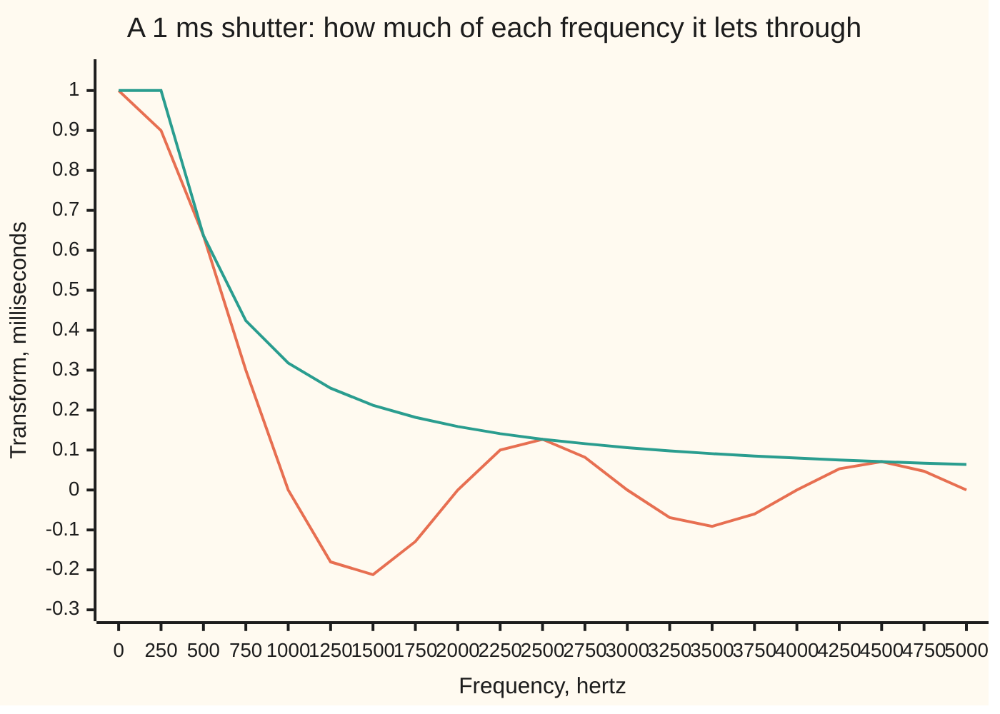

# The Fourier transform of an absolutely integrable signal, and why it fades at infinity

[Syllabus](../../../SYLLABUS.md) → [Harmonic analysis](../README.md) → [The Fourier Transform](../README.md#s02) → The Fourier transform of an absolutely integrable signal, and why it fades at infinity

---

## General Overview

A camera shutter opens for one millisecond, then closes. The room is lit by LED lamps that flicker 120 times a second, as many do on 60 Hz mains power. Does the flicker show in the photo?

It depends on how much of a 120 Hz wave the shutter's one-millisecond window lets through. That amount is the shutter's **Fourier transform** at 120 hertz (Hz, cycles per second): multiply the window by a wave spinning at that rate, and add up over all time. For this shutter the answer is 0.976481 ms, 97.6% of the 1 ms it would collect from steady light. So almost the whole flicker reaches the photo. Under a rolling shutter, each row opens at a different moment, and the flicker shows as bands.

Repeat the question for faster flicker. At 1000 Hz exactly one cycle fits in the window, and the share is zero. At 20,500 Hz it is 1.55%. Fast flicker averages out. This card proves that this is no accident of a neat rectangular window. Any signal with a finite total size has a spectrum that is bounded, continuous, and fades to zero at high frequency.

**For any signal whose absolute value has finite area, the Fourier transform is never larger than that area, changes smoothly with frequency, and shrinks to zero as the frequency grows (the Riemann–Lebesgue lemma).**

**What kind of fact this is:** a definition (the transform and its convention), with three theorems about it proved on this card in Why it works.

### The picture: the shutter's spectrum under its two bounds



The first line is the shutter's transform: sin(π × frequency × 1 ms) divided by (π × frequency). It is zero at every multiple of 1000 Hz, where a whole number of cycles fits in the window. The second line is the smaller of the two bounds this card proves: the area 1 ms, and the fading bound 1/(π × frequency). Wherever the sine is ±1, close to each peak, the ripples touch the fading bound or its mirror below zero, so the bound cannot be improved for this signal.

---

## The formula

[The Fourier transform](../../07-Complex%20analysis/08-Transforms%20in%20Outline/03-fourier-transform.md) already defines the transform with an angular frequency ω (omega, radians per second) and computes the flash's spectrum. This wing measures frequency in hertz, as instruments do. The letter $`\xi`$ (xi) is a frequency in hertz, $`t`$ is time in seconds, and $`f(t)`$ is a signal. Here $`f(t)`$ is the fraction of light the shutter lets in: 1 while open, 0 while shut. The hat, $`\hat f`$, read "f-hat", is the transform.

```math
\hat f(\xi) = \int_{-\infty}^{\infty} f(t)\, e^{-2\pi i \xi t}\, dt
```

**Read it aloud:** f-hat at xi is the signal times a probe wave turning xi times a second, added up over all time.

The probe $`e^{-2\pi i \xi t}`$ is a point on the unit circle, turning clockwise ξ times a second. The letter $`i`$ is the imaginary unit, with $`i^2 = -1`$. Its size is always 1.

**The convention, fixed once for this wing.** The 2π sits in the exponent, ξ is in hertz, and the inverse has no factor in front: $`f(t) = \int \hat f(\xi)\, e^{2\pi i \xi t}\, d\xi`$, proved on [Fourier inversion](04-fourier-inversion-theorem.md). Wing 07's transform at ω equals this one at $`\xi = \omega/2\pi`$. Other books put $`1/\sqrt{2\pi}`$ in front of an ω form. Convert any such formula once, at the start.

The transform is defined for every signal in $`L^1`$, read "L-one": the signals whose absolute value has finite area ([Integrable functions](../../10-Measure%20and%20integration/04-The%20Lebesgue%20Integral/04-integrable-functions-and-l1.md)). That area is written

```math
\lVert f\rVert_1 = \int_{-\infty}^{\infty} \lvert f(t)\rvert\, dt .
```

The three theorems of this card, for every $`f`$ in $`L^1`$:

```math
\lvert \hat f(\xi)\rvert \le \lVert f\rVert_1, \qquad \hat f \text{ is continuous}, \qquad \hat f(\xi) \to 0 \text{ as } \lvert\xi\rvert \to \infty .
```

**Read it aloud:** the transform never exceeds the signal's total absolute area, it has no jumps, and it fades to zero at high frequency.

For the shutter, open for $`T`$ = 1 ms from $`-T/2`$ to $`T/2`$, the transform is

```math
\hat f(\xi) = \frac{\sin(\pi \xi T)}{\pi \xi}, \qquad \hat f(0) = T .
```

A dimensionless signal has a transform in seconds; the card prints it in milliseconds.

| Symbol | Plain meaning | In our example | Push it up and the answer… |
| --- | --- | --- | --- |
| $`t`$ | time, in seconds | −0.5 ms to 0.5 ms while open | — |
| $`\xi`$ | frequency, in hertz | 120 Hz flicker | the transform fades |
| $`f(t)`$ | the signal: fraction of light let in | 1 while open, 0 while shut | — |
| $`\hat f(\xi)`$ | the transform: how much of frequency ξ the signal holds | 0.976481 ms at 120 Hz | — |
| $`T`$ | how long the shutter is open | 1 ms | the first zero moves down from 1000 Hz |
| $`\lVert f\rVert_1`$ | the area of the absolute value of f | 1 ms | the bound on the transform rises |
| $`h`$; $`L`$ | a small change of frequency; half the length of a cut-off time window | 10 Hz; about 1 s | the transform changes more; — |
| $`a`$, $`b`$, $`\mathbf 1_{[a,b)}`$ | the ends of one interval; the signal that is 1 on it and 0 off it | −0.5 ms and 0.5 ms for the shutter | — |
| $`g`$, $`c_k`$, $`a_k`$, $`k`$, $`n`$ | a staircase, constant on each of n intervals; its value on step k; where step k starts | 200 steps fitted to a leaf shutter | a closer fit |
| $`\varepsilon`$ | a tolerance (epsilon): how close is close enough | 0.01 ms | the frequency where fading is assured moves down |
| $`V`$ | the total jump size of a staircase: its jumps added without signs | 2 | its transform fades more slowly |
| $`\omega`$, $`i`$, $`\pi`$, $`e`$ | wing 07's frequency in radians per second; the imaginary unit; half a turn in radians; the base of natural logs | ω = 2πξ | — |

### When it holds

- **Finite area of |f|.** A lamp left on, f = 1, has infinite area. Its integral against a 120 Hz probe from −L to L swings between +2.652582 ms and −2.652582 ms as L grows, and never settles.
- **The area of |f|, not of f.** A pulse of +1 for half a millisecond, then −1, has net area 0. Its transform at 1000 Hz is 0.636620i ms, of size 0.636620 ms, not 0.
- **One convention.** Wing 07's ω formula fed 500 "hertz" gives 0.989616 ms. The true value at 500 Hz is 0.636620 ms.
- **Fading, not a speed.** The lemma says the transform reaches zero, not how fast. An unbounded spike in $`L^1`$ fades far more slowly than the shutter (Step 6).

---

## Why it works

### Step 0: the probe has size one, and spins fast

The probe $`e^{-2\pi i \xi t}`$ never has size bigger than 1. So the transform can never be bigger than the area of $`\lvert f\rvert`$. That is the bound.

Change ξ a little, and the probe changes a little at every time t. One integrable function lies above all the changes. Dominated convergence then makes the transform continuous.

At high frequency the probe turns many times while the signal hardly changes. The positive and negative halves of each turn cancel. For a rectangle only its two edges survive, and their share shrinks like 1/ξ. Every $`L^1`$ signal is within any tolerance of a staircase (a signal that is constant on each of finitely many intervals, so a sum of rectangles), so every transform fades.

### Step 1: bounded by the area

Take sizes inside the integral. The size of an integral is at most the integral of the size ([Integrable functions](../../10-Measure%20and%20integration/04-The%20Lebesgue%20Integral/04-integrable-functions-and-l1.md), the triangle inequality):

```math
\lvert \hat f(\xi)\rvert \le \int \lvert f(t)\rvert \cdot \lvert e^{-2\pi i \xi t}\rvert\, dt = \lVert f\rVert_1 .
```

The transform is linear: the transform of $`f - g`$ is $`\hat f - \hat g`$. So the same bound gives, at every frequency at once,

```math
\lvert \hat f(\xi) - \hat g(\xi)\rvert \le \lVert f - g\rVert_1 .
```

Two signals close in area have transforms close everywhere. Step 5 uses this.

For the shutter the bound is 1 ms, and it is reached at ξ = 0. Across −20 kHz to 20 kHz the largest value is 1.000000 ms.

### Step 2: continuous, by one dominating function

Move the frequency from ξ to ξ + h. Factor out the old probe, which has size 1:

```math
\lvert \hat f(\xi + h) - \hat f(\xi)\rvert \le \int \lvert f(t)\rvert\, \lvert e^{-2\pi i h t} - 1\rvert\, dt .
```

The right side does not depend on ξ. So one bound controls the change at every frequency at once.

As h shrinks to 0, the integrand shrinks to 0 at every t. It is never larger than $`2\lvert f(t)\rvert`$, which has finite area. That is a dominating function: one integrable roof over every member of the sequence. [Dominated convergence](../../10-Measure%20and%20integration/05-Swapping%20Limits%20and%20Integrals/02-dominated-convergence-theorem.md) lets the limit pass inside the integral, so the right side goes to 0. The transform is continuous, and in fact uniformly continuous: one h works for every ξ.

For the shutter, $`\lvert e^{-2\pi i h t} - 1\rvert = 2\lvert\sin(\pi h t)\rvert`$, and the bound integrates to $`\frac{4}{\pi h}\big(1 - \cos(\pi h T/2)\big)`$. At h = 10 Hz that is 0.015708 ms. The largest real change over 0 to 5000 Hz is 0.013703 ms, a ratio of 0.872.

### Step 3: one rectangle fades like 1/ξ

Let a signal be 1 on the interval from a to b and 0 elsewhere. Its transform comes from one antiderivative:

```math
\int_a^b e^{-2\pi i \xi t}\, dt = \frac{e^{-2\pi i \xi a} - e^{-2\pi i \xi b}}{2\pi i \xi} .
```

The top is a difference of two points on the unit circle, so its size is at most 2. The size of the whole is at most $`1/(\pi\lvert\xi\rvert)`$. This goes to 0.

For the shutter, a = −T/2 and b = T/2, and the formula becomes sin(πξT)/(πξ). At 20,500 Hz the sine is ±1, and the value equals the bound: 0.015527 ms both.

### Step 4: a staircase fades like V/ξ

A staircase $`g`$ takes the value $`c_k`$ on the interval from $`a_k`$ to $`a_{k+1}`$, for finitely many k. Add the rectangle transforms of Step 3 and regroup by edge. Each edge contributes its jump, the new value minus the old, times one point on the circle:

```math
\hat g(\xi) = \frac{1}{2\pi i \xi} \sum_k (c_k - c_{k-1})\, e^{-2\pi i \xi a_k} .
```

Here $`c_{k-1}`$ is 0 before the first step, and the last step drops back to 0. So $`\lvert \hat g(\xi)\rvert \le V/(2\pi\lvert\xi\rvert)`$, where $`V`$ is the total jump size. The shutter rises by 1 and falls by 1, so V = 2 and the bound is 1/(πξ), as in Step 3.

### Step 5: every L1 signal, by approximation

The smooth case is already known. [Convergence](../../08-Differential%20equations%20and%20dynamics/09-Fourier%20Series/02-convergence-jumps-and-gibbs.md) proves the lemma for piecewise-smooth signals by integrating by parts. That proof needs a derivative. A general $`L^1`$ signal may have none, and may even be unbounded.

The way round is approximation. [Riesz-Fischer](../../10-Measure%20and%20integration/07-Sizes%20of%20Functions/05-completeness-of-lp.md) proves that every $`L^1`$ signal has a staircase as close as wanted in area. Its Step 6 replaces each set by a finite union of intervals, which gives a staircase.

The argument, for a tolerance ε:

1. Choose a staircase $`g`$ with $`\lVert f - g\rVert_1 < \varepsilon/2`$.
2. By Step 1, $`\lvert \hat f(\xi) - \hat g(\xi)\rvert < \varepsilon/2`$ at every frequency.
3. By Step 4, $`\lvert \hat g(\xi)\rvert < \varepsilon/2`$ once $`\lvert\xi\rvert > V/(\pi\varepsilon)`$.
4. Add the two: $`\lvert \hat f(\xi)\rvert < \varepsilon`$ beyond that frequency.

Every ε has such a frequency, so the transform tends to 0. That is the Riemann–Lebesgue lemma.

**The leaf shutter, with numbers.** Real leaf shutters open and close over a short time. Model one that ramps from shut to open in 0.2 ms, stays open 0.6 ms, and ramps shut in 0.2 ms. Its area is 0.8 ms, and its transform at 3000 Hz is 0.050914 ms. Fit staircases of n equal steps, each at the leaf's middle value:

| Steps n | Area of the gap, ms | Largest gap between spectra, 0 to 50 kHz on a 5 Hz grid, ms |
| ---: | ---: | ---: |
| 5 | 0.100000 | 0.086918 |
| 10 | 0.050000 | 0.034889 |
| 20 | 0.025000 | 0.016475 |
| 40 | 0.012500 | 0.007997 |

Each spectrum gap stays under its area gap, as Step 1 says. Now take ε = 0.01 ms. A staircase of 200 steps has area gap 0.0025 ms, which leaves 0.0075 ms for the staircase's own transform. Its total jump is 2.000000, so the staircase part is small enough beyond 42441.3 Hz. The leaf's true transform there is 0.00004130 ms, far inside 0.01 ms.

<details>
<summary>Detailed proof: the Riemann–Lebesgue lemma for every f in L1</summary>

Let $`f`$ be in $`L^1`$ and let $`\varepsilon > 0`$. Step functions with bounded support are dense in $`L^1`$, so there is a staircase $`g = \sum_{k=0}^{n-1} c_k \mathbf 1_{[a_k, a_{k+1})}`$ with $`\lVert f - g\rVert_1 < \varepsilon/2`$. Here $`\mathbf 1_{[a, b)}`$ is 1 on the interval and 0 off it.

By linearity and the triangle inequality, for every ξ,

$`\displaystyle \lvert \hat f(\xi) - \hat g(\xi)\rvert = \Big\lvert \int (f - g)(t)\, e^{-2\pi i \xi t}\, dt \Big\rvert \le \lVert f - g\rVert_1 < \varepsilon/2 .`$

For ξ ≠ 0, each rectangle gives $`\big(e^{-2\pi i \xi a_k} - e^{-2\pi i \xi a_{k+1}}\big)/(2\pi i \xi)`$. Summing and regrouping by edge, with $`c_{-1} = c_n = 0`$,

$`\displaystyle \hat g(\xi) = \frac{1}{2\pi i \xi} \sum_{k=0}^{n} (c_k - c_{k-1})\, e^{-2\pi i \xi a_k}, \qquad \lvert \hat g(\xi)\rvert \le \frac{V}{2\pi \lvert\xi\rvert}, \quad V = \sum_{k=0}^{n} \lvert c_k - c_{k-1}\rvert .`$

For $`\lvert\xi\rvert > V/(\pi\varepsilon)`$ this is below ε/2. Then $`\lvert \hat f(\xi)\rvert \le \lvert \hat f(\xi) - \hat g(\xi)\rvert + \lvert \hat g(\xi)\rvert < \varepsilon`$. Since ε was arbitrary, $`\hat f(\xi) \to 0`$ as $`\lvert\xi\rvert \to \infty`$.

Continuity, proved in Step 2, and fading together say that $`\hat f`$ is a continuous function that vanishes at infinity. </details>

### Step 6: fading has no guaranteed speed

The piecewise-smooth proof gives fading like 1/ξ. A general $`L^1`$ signal can fade more slowly. Take the spike $`f(t) = \sqrt{T/t}`$ for 0 < t < T, and 0 elsewhere. It is unbounded near t = 0, but its area is finite: 2 ms. It is illustrative, a test signal rather than a real shutter.

| Frequency | Transform size, ms | ξ times the size |
| ---: | ---: | ---: |
| 1000 Hz | 0.596930 | 0.5969 |
| 10000 Hz | 0.212559 | 2.1256 |
| 100000 Hz | 0.069593 | 6.9593 |

The transform still fades, as Step 5 promises. But ξ times the size grows, so no bound of the form constant/ξ holds. The size follows the Fresnel estimate, $`T/\sqrt{2\xi T}`$ less a small edge term, which gives 0.069594 ms at 100 kHz. A spike that blows up faster, such as $`t^{-3/4}`$, fades more slowly still, like $`\xi^{-1/4}`$.

---

## Worked numbers, by hand

The 1 ms shutter under 120 Hz flicker.

| Step | Arithmetic | Value |
| --- | --- | --- |
| The angle | π × 120 × 0.001 | 0.376991 |
| Its sine | sin 0.376991 | 0.368125 |
| The divisor | π × 120 | 376.991 per second |
| The transform | 0.368125 / 376.991, in ms | 0.976481 ms |
| The bound | area of the open window | 1 ms |
| The share of the flicker passed | 0.976481 / 1 | **97.6%** |

A lamp flickering fully at 120 Hz gives exposures from 1.976481 ms down to 0.023519 ms, depending on when the shutter opens: a swing of ±0.976481 ms around 1 ms, which shows as bands in the photo.

### What breaks if you drop a piece

| Mistake | Comes out at | What went wrong |
| --- | --- | --- |
| A lamp left on, f = 1 | 0, then 2.652582 ms, then −2.652582 ms, at L = 1.00000, 1.00208, 1.00625 s | its area is infinite, so the integral has no limit |
| Wing 07's ω formula fed hertz, at 500 | 0.989616 ms, not 0.636620 ms | ω = 2πξ was skipped |
| Bounding by the net area of a +1 then −1 pulse | 0, but the transform at 1000 Hz has size 0.636620 ms | the bound needs the area of the absolute value |
| Assuming every L1 transform fades like 1/ξ | ξ times the spike's size: 0.5969, 2.1256, 6.9593 | the lemma gives fading, not a rate |

The code prints all four.

---

## Code, from first principles, and it actually runs

The code computes the shutter's transform by three roads: the closed form, the defining integral at two step counts (4000 and 8000 cells), and the exposure of a flickering lamp, which uses no complex numbers. It checks the bound on a grid, and the continuity bound both by formula and by integral. It fits staircases to the leaf shutter and runs the ε argument of Step 5 with real numbers. The +1 then −1 pulse, which is not symmetric, pins the sign of the exponent: its closed form and its integral must agree in both parts. The spike's transform is computed by Simpson's rule at two step counts and against the Fresnel estimate. The shutter has finite support, so its integrals have no tail to cut off.

### Python

```python
# The Fourier transform on L1 and Riemann-Lebesgue -- the check behind the card.
# Standard library only.  Convention: fhat(xi) = integral of f(t) e^(-2 pi i xi t) dt,
# t in seconds, xi in hertz, so fhat is in seconds; it is printed in milliseconds.
# The shutter is open (f = 1) for one millisecond, -T/2 < t < T/2.
from math import pi, sin, cos, sqrt

T = 0.001                                    # shutter open time, seconds

def ms(x):                                   # seconds to milliseconds, tiny values zeroed
    v = 1000 * x
    return 0.0 if abs(v) < 5e-10 else v

def gate_hat(xi, a, b):                      # transform of 1 on [a, b), closed form
    if xi == 0:
        return (b - a, 0.0)
    w = 2 * pi * xi                          # (e^(-iwa) - e^(-iwb)) / (iw)
    return ((sin(w * b) - sin(w * a)) / w, (cos(w * b) - cos(w * a)) / w)

def by_integral(f, a, b, xi, n):             # the defining integral, midpoint rule, n cells
    h, re, im = (b - a) / n, 0.0, 0.0
    for k in range(n):
        t = a + (k + 0.5) * h
        re += f(t) * cos(2 * pi * xi * t) * h
        im -= f(t) * sin(2 * pi * xi * t) * h
    return (re, im)

def size(z):
    return sqrt(z[0] ** 2 + z[1] ** 2)

gate = lambda t: 1.0 if -T / 2 <= t < T / 2 else 0.0
print("shutter: open 1 ms; area of |f| = %.6f ms" % ms(T))
print("xi Hz | closed form ms | integral n=8000 ms | gap n=4000 vs 8000 | share of xi = 0")
worst = 0.0
for xi in [0, 120, 500, 1000, 1500, 2500, 20500]:
    c = gate_hat(xi, -T / 2, T / 2)[0]
    n1, n2 = by_integral(gate, -T / 2, T / 2, xi, 4000), by_integral(gate, -T / 2, T / 2, xi, 8000)
    worst = max(worst, abs(c - n2[0]), abs(n2[1]))
    print("%5d | %.6f | %.6f | %.9f | %.6f" % (xi, ms(c), ms(n2[0]), ms(abs(n1[0] - n2[0])), ms(c) / ms(T)))
print("largest gap, closed form vs integral: %.9f ms" % ms(worst))
assert worst < 1e-9                                       # road 1 = road 2

# Third road: a light flickering 100% at 120 Hz, exposure for two shutter start times.
xi = 120.0
expo = lambda t0: by_integral(lambda t: 1 + cos(2 * pi * xi * (t - t0)), -T / 2, T / 2, 0, 4000)[0]
e_hi, e_lo = expo(0.0), expo(1 / (2 * xi))
print("120 Hz flicker: exposure %.6f ms to %.6f ms; half the swing %.6f ms = fhat(120)"
      % (ms(e_hi), ms(e_lo), ms((e_hi - e_lo) / 2)))
assert abs((e_hi - e_lo) / 2 - gate_hat(120, -T / 2, T / 2)[0]) < 1e-11
print("by hand at 120 Hz: pi xi T = %.6f, sin of it = %.6f, pi xi = %.3f per second"
      % (pi * 120 * T, sin(pi * 120 * T), pi * 120))

# Bounded: |fhat| <= area of |f|.  Continuous: one roof 2|f| for every frequency.
grid = [50 * k for k in range(-400, 401)]
top = max(size(gate_hat(x, -T / 2, T / 2)) for x in grid)
print("largest |fhat| on -20 to 20 kHz: %.6f ms, bound %.6f ms" % (ms(top), ms(T)))
h = 10.0
jump = max(abs(gate_hat(x + h, -T / 2, T / 2)[0] - gate_hat(x, -T / 2, T / 2)[0]) for x in range(0, 5001))
roof = 4 / (pi * h) * (1 - cos(pi * h * T / 2))          # integral of |f| |e^(-2 pi i h t) - 1|
roof_n = by_integral(lambda t: size((cos(2 * pi * h * t) - 1, sin(2 * pi * h * t))), -T / 2, T / 2, 0, 4000)[0]
print("step h = %g Hz: largest change %.6f ms; bound %.6f ms (integral %.6f); ratio %.3f"
      % (h, ms(jump), ms(roof), ms(roof_n), jump / roof))
assert top <= T + 1e-15 and jump <= roof and abs(roof - roof_n) < 1e-12

print("chart xi Hz: [" + ", ".join(str(250 * k) for k in range(21)) + "]")
print("chart fhat ms: [" + ", ".join("%.3f" % ms(gate_hat(250 * k, -T / 2, T / 2)[0]) for k in range(21)) + "]")
print("chart bound ms: [" + ", ".join("%.3f" % min(1.0, ms(1 / (pi * 250 * k))) if k else "1.000" for k in range(21)) + "]")
print("gate at 20500 Hz: |fhat| %.6f ms, fade bound 1/(pi xi) %.6f ms"
      % (ms(abs(gate_hat(20500, -T / 2, T / 2)[0])), ms(1 / (pi * 20500))))

# Riemann-Lebesgue by approximation: a leaf shutter with 0.2 ms ramps, matched by staircases.
def leaf(t):
    return max(0.0, min(1.0, (T / 2 - abs(t)) / 0.0002))
def leaf_hat(xi):                            # gate of 0.8 ms smoothed by a 0.2 ms ramp
    return T * 0.8 if xi == 0 else sin(pi * xi * 0.0008) / (pi * xi) * sin(pi * xi * 0.0002) / (pi * xi * 0.0002)
lh = by_integral(leaf, -T / 2, T / 2, 3000, 8000)
print("leaf shutter at 3000 Hz: closed form %.6f ms, integral %.6f ms (gap %.9f ms)" % (ms(leaf_hat(3000)), ms(lh[0]), ms(abs(leaf_hat(3000) - lh[0]))))
assert abs(leaf_hat(3000) - lh[0]) < 1e-10
def staircase(n):                            # n equal cells, each at the leaf's middle value
    w = T / n
    return [(-T / 2 + k * w, -T / 2 + (k + 1) * w, leaf(-T / 2 + (k + 0.5) * w)) for k in range(n)]
def stair_hat(st, xi):
    zs = [gate_hat(xi, a, b) for a, b, _ in st]
    return (sum(c * z[0] for (_, _, c), z in zip(st, zs)), sum(c * z[1] for (_, _, c), z in zip(st, zs)))
def l1_gap(st, n):                           # area of |leaf - staircase|, midpoint rule
    return by_integral(lambda t: abs(leaf(t) - st[min(n - 1, int((t + T / 2) / (T / n)))][2]), -T / 2, T / 2, 0, 40000)[0]
for n in [5, 10, 20, 40]:
    st = staircase(n)
    l1 = l1_gap(st, n)
    gap = max(size((leaf_hat(x) - stair_hat(st, x)[0], stair_hat(st, x)[1])) for x in range(0, 50001, 5))
    print("staircase %2d steps: area of |leaf - stair| %.6f ms; largest spectrum gap, 5 Hz grid %.6f ms" % (n, ms(l1), ms(gap)))
    assert gap <= l1 + 1e-12 and abs(l1 - 0.0005 / n) < 1e-9
steps = 200                                  # the staircase used in the epsilon argument
st = staircase(steps)
jumps = sum(abs(st[k][2] - (st[k - 1][2] if k else 0.0)) for k in range(steps)) + st[-1][2]
eps, l1 = 0.00001, l1_gap(st, steps)
xi0 = jumps / (2 * pi * (eps - l1))          # staircase fades like jumps / (2 pi xi)
print("target %.3f ms: %d steps, gap %.4f ms, left for the staircase %.4f ms, total jump %.6f; beyond %.1f Hz"
      % (ms(eps), steps, ms(l1), ms(eps - l1), jumps, xi0))
print("leaf |fhat| at that frequency: %.8f ms" % ms(abs(leaf_hat(xi0))))
assert abs(leaf_hat(xi0)) < eps and size(stair_hat(st, xi0)) <= jumps / (2 * pi * xi0)

# An unbounded signal, sqrt(T/t) for 0 < t < T: no piecewise-smooth proof applies, yet it fades.
def spike_hat(x, n):                         # t = T u^2: integral of 2T e^(-2 pi i x u^2), Simpson
    re = im = 0.0
    for k in range(n + 1):
        u, wt = k / n, (1 if k in (0, n) else 4 if k % 2 else 2)
        re += wt * cos(2 * pi * x * u * u)
        im -= wt * sin(2 * pi * x * u * u)
    return (2 * T * re / (3 * n), 2 * T * im / (3 * n))
print("spike: area of |f| = %.6f ms" % ms(2 * T))
for x in [1, 10, 100]:                       # x = xi T, a whole number
    a, b = spike_hat(x, 20000), spike_hat(x, 40000)
    far = (T / (2 * sqrt(x)), -T / (2 * sqrt(x)) + T / (2 * pi * x))   # Fresnel, less the tail past u = 1
    print("spike at %6d Hz: |fhat| %.6f ms, step gap %.9f, Fresnel %.6f ms; xi |fhat| %.4f"
          % (1000 * x, ms(size(b)), ms(size((a[0] - b[0], a[1] - b[1]))), ms(size(far)), 1000 * x * size(b)))
    assert size(b) <= 2 * T and abs(size(a) - size(b)) < 1e-12
    assert x == 1 or abs(size(b) - size(far)) < T / x ** 2

for L in [1.0, 1 + 1 / 480, 1 + 3 / 480]:              # constant light: no finite area
    print("mistake 1, constant light, integral over -L to L = %.5f s at 120 Hz: %.6f ms"
          % (L, ms(sin(2 * pi * 120 * L) / (pi * 120))))
print("mistake 2, omega form fed hertz: 2 sin(500 T/2)/500 = %.6f ms, true %.6f ms"
      % (ms(2 * sin(500 * T / 2) / 500), ms(gate_hat(500, -T / 2, T / 2)[0])))
pulse = lambda t: 1.0 if t < 0 else -1.0                   # +1 then -1: not even, so it pins the sign
pm = (gate_hat(1000, -T / 2, 0)[0] - gate_hat(1000, 0, T / 2)[0], gate_hat(1000, -T / 2, 0)[1] - gate_hat(1000, 0, T / 2)[1])
pn = by_integral(pulse, -T / 2, T / 2, 1000, 8000)
print("mistake 3, +1 then -1 pulse: net area %.3f ms, but fhat(1000) = %.6fi ms (integral %.6fi ms), size %.6f ms"
      % (ms(by_integral(pulse, -T / 2, T / 2, 0, 8000)[0]), ms(pm[1]), ms(pn[1]), ms(size(pm))))
assert abs(pm[0] - pn[0]) < 1e-10 and abs(pm[1] - pn[1]) < 1e-10   # the sign of the exponent
print("ALL CHECKS PASS")
```

**Ran 2026-11-15 on macOS, Python 3.14.10, standard library only. All checks passed. Output, pasted from the run:**

```
shutter: open 1 ms; area of |f| = 1.000000 ms
xi Hz | closed form ms | integral n=8000 ms | gap n=4000 vs 8000 | share of xi = 0
    0 | 1.000000 | 1.000000 | 0.000000000 | 1.000000
  120 | 0.976481 | 0.976481 | 0.000000001 | 0.976481
  500 | 0.636620 | 0.636620 | 0.000000012 | 0.636620
 1000 | 0.000000 | 0.000000 | 0.000000000 | 0.000000
 1500 | -0.212207 | -0.212207 | 0.000000037 | -0.212207
 2500 | 0.127324 | 0.127324 | 0.000000061 | 0.127324
20500 | 0.015527 | 0.015527 | 0.000000503 | 0.015527
largest gap, closed form vs integral: 0.000000168 ms
120 Hz flicker: exposure 1.976481 ms to 0.023519 ms; half the swing 0.976481 ms = fhat(120)
by hand at 120 Hz: pi xi T = 0.376991, sin of it = 0.368125, pi xi = 376.991 per second
largest |fhat| on -20 to 20 kHz: 1.000000 ms, bound 1.000000 ms
step h = 10 Hz: largest change 0.013703 ms; bound 0.015708 ms (integral 0.015708); ratio 0.872
chart xi Hz: [0, 250, 500, 750, 1000, 1250, 1500, 1750, 2000, 2250, 2500, 2750, 3000, 3250, 3500, 3750, 4000, 4250, 4500, 4750, 5000]
chart fhat ms: [1.000, 0.900, 0.637, 0.300, 0.000, -0.180, -0.212, -0.129, 0.000, 0.100, 0.127, 0.082, 0.000, -0.069, -0.091, -0.060, 0.000, 0.053, 0.071, 0.047, 0.000]
chart bound ms: [1.000, 1.000, 0.637, 0.424, 0.318, 0.255, 0.212, 0.182, 0.159, 0.141, 0.127, 0.116, 0.106, 0.098, 0.091, 0.085, 0.080, 0.075, 0.071, 0.067, 0.064]
gate at 20500 Hz: |fhat| 0.015527 ms, fade bound 1/(pi xi) 0.015527 ms
leaf shutter at 3000 Hz: closed form 0.050914 ms, integral 0.050914 ms (gap 0.000000012 ms)
staircase  5 steps: area of |leaf - stair| 0.100000 ms; largest spectrum gap, 5 Hz grid 0.086918 ms
staircase 10 steps: area of |leaf - stair| 0.050000 ms; largest spectrum gap, 5 Hz grid 0.034889 ms
staircase 20 steps: area of |leaf - stair| 0.025000 ms; largest spectrum gap, 5 Hz grid 0.016475 ms
staircase 40 steps: area of |leaf - stair| 0.012500 ms; largest spectrum gap, 5 Hz grid 0.007997 ms
target 0.010 ms: 200 steps, gap 0.0025 ms, left for the staircase 0.0075 ms, total jump 2.000000; beyond 42441.3 Hz
leaf |fhat| at that frequency: 0.00004130 ms
spike: area of |f| = 2.000000 ms
spike at   1000 Hz: |fhat| 0.596930 ms, step gap 0.000000000, Fresnel 0.605124 ms; xi |fhat| 0.5969
spike at  10000 Hz: |fhat| 0.212559 ms, step gap 0.000000000, Fresnel 0.212651 ms; xi |fhat| 2.1256
spike at 100000 Hz: |fhat| 0.069593 ms, step gap 0.000000000, Fresnel 0.069594 ms; xi |fhat| 6.9593
mistake 1, constant light, integral over -L to L = 1.00000 s at 120 Hz: 0.000000 ms
mistake 1, constant light, integral over -L to L = 1.00208 s at 120 Hz: 2.652582 ms
mistake 1, constant light, integral over -L to L = 1.00625 s at 120 Hz: -2.652582 ms
mistake 2, omega form fed hertz: 2 sin(500 T/2)/500 = 0.989616 ms, true 0.636620 ms
mistake 3, +1 then -1 pulse: net area 0.000 ms, but fhat(1000) = 0.636620i ms (integral 0.636620i ms), size 0.636620 ms
ALL CHECKS PASS
```

### Rust

Same numbers, same labels, built with `rustc --edition 2021 -O`.

```rust
// The Fourier transform on L1 and Riemann-Lebesgue -- the same check as the Python, in Rust.
// No crates.  Convention: fhat(xi) = integral of f(t) e^(-2 pi i xi t) dt, t in seconds,
// xi in hertz, so fhat is in seconds; it is printed in milliseconds.  A complex number is
// a pair (real part, imaginary part).  The shutter is open (f = 1) for one millisecond.
use std::f64::consts::PI;

const T: f64 = 0.001; // shutter open time, seconds

fn ms(x: f64) -> f64 { // seconds to milliseconds, tiny values zeroed
    let v = 1000.0 * x;
    if v.abs() < 5e-10 { 0.0 } else { v }
}

fn gate_hat(xi: f64, a: f64, b: f64) -> (f64, f64) { // transform of 1 on [a, b), closed form
    if xi == 0.0 { return (b - a, 0.0) }
    let w = 2.0 * PI * xi; // (e^(-iwa) - e^(-iwb)) / (iw)
    (((w * b).sin() - (w * a).sin()) / w, ((w * b).cos() - (w * a).cos()) / w)
}

fn by_integral(f: &dyn Fn(f64) -> f64, a: f64, b: f64, xi: f64, n: usize) -> (f64, f64) {
    let (h, mut re, mut im) = ((b - a) / n as f64, 0.0, 0.0); // midpoint rule, n cells
    for k in 0..n {
        let t = a + (k as f64 + 0.5) * h;
        re += f(t) * (2.0 * PI * xi * t).cos() * h;
        im -= f(t) * (2.0 * PI * xi * t).sin() * h;
    }
    (re, im)
}

fn size(z: (f64, f64)) -> f64 { (z.0.powi(2) + z.1.powi(2)).sqrt() }

fn leaf(t: f64) -> f64 { 0.0f64.max(1.0f64.min((T / 2.0 - t.abs()) / 0.0002)) }

fn leaf_hat(xi: f64) -> f64 { // gate of 0.8 ms smoothed by a 0.2 ms ramp
    if xi == 0.0 { return T * 0.8 }
    (PI * xi * 0.0008).sin() / (PI * xi) * (PI * xi * 0.0002).sin() / (PI * xi * 0.0002)
}

fn staircase(n: usize) -> Vec<(f64, f64, f64)> { // n equal cells, each at the leaf's middle value
    let w = T / n as f64;
    (0..n).map(|k| (-T / 2.0 + k as f64 * w, -T / 2.0 + (k + 1) as f64 * w,
                    leaf(-T / 2.0 + (k as f64 + 0.5) * w))).collect()
}

fn stair_hat(st: &[(f64, f64, f64)], xi: f64) -> (f64, f64) {
    let zs: Vec<(f64, f64)> = st.iter().map(|&(a, b, _)| gate_hat(xi, a, b)).collect();
    (st.iter().zip(&zs).fold(0.0, |s, (p, z)| s + p.2 * z.0),
     st.iter().zip(&zs).fold(0.0, |s, (p, z)| s + p.2 * z.1))
}

fn l1_gap(st: &[(f64, f64, f64)], n: usize) -> f64 { // area of |leaf - staircase|, midpoint rule
    let f = |t: f64| (leaf(t) - st[(n - 1).min(((t + T / 2.0) / (T / n as f64)) as usize)].2).abs();
    by_integral(&f, -T / 2.0, T / 2.0, 0.0, 40000).0
}

fn spike_hat(x: f64, n: usize) -> (f64, f64) { // t = T u^2: integral of 2T e^(-2 pi i x u^2), Simpson
    let (mut re, mut im) = (0.0, 0.0);
    for k in 0..=n {
        let u = k as f64 / n as f64;
        let wt = if k == 0 || k == n { 1.0 } else if k % 2 == 1 { 4.0 } else { 2.0 };
        re += wt * (2.0 * PI * x * u * u).cos();
        im -= wt * (2.0 * PI * x * u * u).sin();
    }
    (2.0 * T * re / (3.0 * n as f64), 2.0 * T * im / (3.0 * n as f64))
}

fn main() {
    let gate = |t: f64| if -T / 2.0 <= t && t < T / 2.0 { 1.0 } else { 0.0 };
    println!("shutter: open 1 ms; area of |f| = {:.6} ms", ms(T));
    println!("xi Hz | closed form ms | integral n=8000 ms | gap n=4000 vs 8000 | share of xi = 0");
    let mut worst: f64 = 0.0;
    for xi in [0.0, 120.0, 500.0, 1000.0, 1500.0, 2500.0, 20500.0] {
        let c = gate_hat(xi, -T / 2.0, T / 2.0).0;
        let (n1, n2) = (by_integral(&gate, -T / 2.0, T / 2.0, xi, 4000), by_integral(&gate, -T / 2.0, T / 2.0, xi, 8000));
        worst = worst.max((c - n2.0).abs()).max(n2.1.abs());
        println!("{:5} | {:.6} | {:.6} | {:.9} | {:.6}", xi as i64, ms(c), ms(n2.0), ms((n1.0 - n2.0).abs()), ms(c) / ms(T));
    }
    println!("largest gap, closed form vs integral: {:.9} ms", ms(worst));
    assert!(worst < 1e-9); // road 1 = road 2

    // Third road: a light flickering 100% at 120 Hz, exposure for two shutter start times.
    let xi = 120.0;
    let expo = |t0: f64| by_integral(&|t: f64| 1.0 + (2.0 * PI * xi * (t - t0)).cos(), -T / 2.0, T / 2.0, 0.0, 4000).0;
    let (e_hi, e_lo) = (expo(0.0), expo(1.0 / (2.0 * xi)));
    println!("120 Hz flicker: exposure {:.6} ms to {:.6} ms; half the swing {:.6} ms = fhat(120)",
             ms(e_hi), ms(e_lo), ms((e_hi - e_lo) / 2.0));
    assert!(((e_hi - e_lo) / 2.0 - gate_hat(120.0, -T / 2.0, T / 2.0).0).abs() < 1e-11);
    println!("by hand at 120 Hz: pi xi T = {:.6}, sin of it = {:.6}, pi xi = {:.3} per second",
             PI * 120.0 * T, (PI * 120.0 * T).sin(), PI * 120.0);

    // Bounded: |fhat| <= area of |f|.  Continuous: one roof 2|f| for every frequency.
    let top = (-400..=400).map(|k| size(gate_hat(50.0 * k as f64, -T / 2.0, T / 2.0))).fold(0.0, f64::max);
    println!("largest |fhat| on -20 to 20 kHz: {:.6} ms, bound {:.6} ms", ms(top), ms(T));
    let h = 10.0;
    let jump = (0..=5000).map(|x| (gate_hat(x as f64 + h, -T / 2.0, T / 2.0).0 - gate_hat(x as f64, -T / 2.0, T / 2.0).0).abs())
        .fold(0.0, f64::max);
    let roof = 4.0 / (PI * h) * (1.0 - (PI * h * T / 2.0).cos()); // integral of |f| |e^(-2 pi i h t) - 1|
    let roof_n = by_integral(&|t: f64| size(((2.0 * PI * h * t).cos() - 1.0, (2.0 * PI * h * t).sin())), -T / 2.0, T / 2.0, 0.0, 4000).0;
    println!("step h = {} Hz: largest change {:.6} ms; bound {:.6} ms (integral {:.6}); ratio {:.3}",
             h, ms(jump), ms(roof), ms(roof_n), jump / roof);
    assert!(top <= T + 1e-15 && jump <= roof && (roof - roof_n).abs() < 1e-12);

    let xs: Vec<String> = (0..21).map(|k| (250 * k).to_string()).collect();
    let fs: Vec<String> = (0..21).map(|k| format!("{:.3}", ms(gate_hat(250.0 * k as f64, -T / 2.0, T / 2.0).0))).collect();
    let bs: Vec<String> = (0..21).map(|k| if k == 0 { "1.000".to_string() }
        else { format!("{:.3}", 1.0f64.min(ms(1.0 / (PI * 250.0 * k as f64)))) }).collect();
    println!("chart xi Hz: [{}]", xs.join(", "));
    println!("chart fhat ms: [{}]", fs.join(", "));
    println!("chart bound ms: [{}]", bs.join(", "));
    println!("gate at 20500 Hz: |fhat| {:.6} ms, fade bound 1/(pi xi) {:.6} ms",
             ms(gate_hat(20500.0, -T / 2.0, T / 2.0).0.abs()), ms(1.0 / (PI * 20500.0)));

    // Riemann-Lebesgue by approximation: a leaf shutter with 0.2 ms ramps, matched by staircases.
    let lh = by_integral(&leaf, -T / 2.0, T / 2.0, 3000.0, 8000);
    println!("leaf shutter at 3000 Hz: closed form {:.6} ms, integral {:.6} ms (gap {:.9} ms)",
             ms(leaf_hat(3000.0)), ms(lh.0), ms((leaf_hat(3000.0) - lh.0).abs()));
    assert!((leaf_hat(3000.0) - lh.0).abs() < 1e-10);
    for n in [5usize, 10, 20, 40] {
        let st = staircase(n);
        let l1 = l1_gap(&st, n);
        let gap = (0..=10000).map(|k| { let x = 5.0 * k as f64; let s = stair_hat(&st, x);
            size((leaf_hat(x) - s.0, s.1)) }).fold(0.0, f64::max);
        println!("staircase {:2} steps: area of |leaf - stair| {:.6} ms; largest spectrum gap, 5 Hz grid {:.6} ms", n, ms(l1), ms(gap));
        assert!(gap <= l1 + 1e-12 && (l1 - 0.0005 / n as f64).abs() < 1e-9);
    }
    let steps = 200usize; // the staircase used in the epsilon argument
    let st = staircase(steps);
    let jumps = (0..steps).map(|k| (st[k].2 - if k > 0 { st[k - 1].2 } else { 0.0 }).abs()).fold(0.0, |s, v| s + v) + st[steps - 1].2;
    let (eps, l1) = (0.00001, l1_gap(&st, steps));
    let xi0 = jumps / (2.0 * PI * (eps - l1)); // staircase fades like jumps / (2 pi xi)
    println!("target {:.3} ms: {} steps, gap {:.4} ms, left for the staircase {:.4} ms, total jump {:.6}; beyond {:.1} Hz",
             ms(eps), steps, ms(l1), ms(eps - l1), jumps, xi0);
    println!("leaf |fhat| at that frequency: {:.8} ms", ms(leaf_hat(xi0).abs()));
    assert!(leaf_hat(xi0).abs() < eps && size(stair_hat(&st, xi0)) <= jumps / (2.0 * PI * xi0));

    // An unbounded signal, sqrt(T/t) for 0 < t < T: no piecewise-smooth proof applies, yet it fades.
    println!("spike: area of |f| = {:.6} ms", ms(2.0 * T));
    for x in [1.0f64, 10.0, 100.0] { // x = xi T, a whole number
        let (a, b) = (spike_hat(x, 20000), spike_hat(x, 40000));
        let far = (T / (2.0 * x.sqrt()), -T / (2.0 * x.sqrt()) + T / (2.0 * PI * x)); // Fresnel, less the tail past u = 1
        println!("spike at {:6} Hz: |fhat| {:.6} ms, step gap {:.9}, Fresnel {:.6} ms; xi |fhat| {:.4}",
                 (1000.0 * x) as i64, ms(size(b)), ms(size((a.0 - b.0, a.1 - b.1))), ms(size(far)), 1000.0 * x * size(b));
        assert!(size(b) <= 2.0 * T && (size(a) - size(b)).abs() < 1e-12);
        assert!(x == 1.0 || (size(b) - size(far)).abs() < T / x.powi(2));
    }

    for l in [1.0, 1.0 + 1.0 / 480.0, 1.0 + 3.0 / 480.0] { // constant light: no finite area
        println!("mistake 1, constant light, integral over -L to L = {:.5} s at 120 Hz: {:.6} ms",
                 l, ms((2.0 * PI * 120.0 * l).sin() / (PI * 120.0)));
    }
    println!("mistake 2, omega form fed hertz: 2 sin(500 T/2)/500 = {:.6} ms, true {:.6} ms",
             ms(2.0 * (500.0 * T / 2.0).sin() / 500.0), ms(gate_hat(500.0, -T / 2.0, T / 2.0).0));
    let pulse = |t: f64| if t < 0.0 { 1.0 } else { -1.0 }; // +1 then -1: not even, so it pins the sign
    let (p, q) = (gate_hat(1000.0, -T / 2.0, 0.0), gate_hat(1000.0, 0.0, T / 2.0));
    let (pm, pn) = ((p.0 - q.0, p.1 - q.1), by_integral(&pulse, -T / 2.0, T / 2.0, 1000.0, 8000));
    println!("mistake 3, +1 then -1 pulse: net area {:.3} ms, but fhat(1000) = {:.6}i ms (integral {:.6}i ms), size {:.6} ms",
             ms(by_integral(&pulse, -T / 2.0, T / 2.0, 0.0, 8000).0), ms(pm.1), ms(pn.1), ms(size(pm)));
    assert!((pm.0 - pn.0).abs() < 1e-10 && (pm.1 - pn.1).abs() < 1e-10); // the sign of the exponent
    println!("ALL CHECKS PASS");
}
```

**Ran 2026-11-15 on macOS, rustc 1.98.1, no crates. All checks passed. Output, pasted from the run:**

```
shutter: open 1 ms; area of |f| = 1.000000 ms
xi Hz | closed form ms | integral n=8000 ms | gap n=4000 vs 8000 | share of xi = 0
    0 | 1.000000 | 1.000000 | 0.000000000 | 1.000000
  120 | 0.976481 | 0.976481 | 0.000000001 | 0.976481
  500 | 0.636620 | 0.636620 | 0.000000012 | 0.636620
 1000 | 0.000000 | 0.000000 | 0.000000000 | 0.000000
 1500 | -0.212207 | -0.212207 | 0.000000037 | -0.212207
 2500 | 0.127324 | 0.127324 | 0.000000061 | 0.127324
20500 | 0.015527 | 0.015527 | 0.000000503 | 0.015527
largest gap, closed form vs integral: 0.000000168 ms
120 Hz flicker: exposure 1.976481 ms to 0.023519 ms; half the swing 0.976481 ms = fhat(120)
by hand at 120 Hz: pi xi T = 0.376991, sin of it = 0.368125, pi xi = 376.991 per second
largest |fhat| on -20 to 20 kHz: 1.000000 ms, bound 1.000000 ms
step h = 10 Hz: largest change 0.013703 ms; bound 0.015708 ms (integral 0.015708); ratio 0.872
chart xi Hz: [0, 250, 500, 750, 1000, 1250, 1500, 1750, 2000, 2250, 2500, 2750, 3000, 3250, 3500, 3750, 4000, 4250, 4500, 4750, 5000]
chart fhat ms: [1.000, 0.900, 0.637, 0.300, 0.000, -0.180, -0.212, -0.129, 0.000, 0.100, 0.127, 0.082, 0.000, -0.069, -0.091, -0.060, 0.000, 0.053, 0.071, 0.047, 0.000]
chart bound ms: [1.000, 1.000, 0.637, 0.424, 0.318, 0.255, 0.212, 0.182, 0.159, 0.141, 0.127, 0.116, 0.106, 0.098, 0.091, 0.085, 0.080, 0.075, 0.071, 0.067, 0.064]
gate at 20500 Hz: |fhat| 0.015527 ms, fade bound 1/(pi xi) 0.015527 ms
leaf shutter at 3000 Hz: closed form 0.050914 ms, integral 0.050914 ms (gap 0.000000012 ms)
staircase  5 steps: area of |leaf - stair| 0.100000 ms; largest spectrum gap, 5 Hz grid 0.086918 ms
staircase 10 steps: area of |leaf - stair| 0.050000 ms; largest spectrum gap, 5 Hz grid 0.034889 ms
staircase 20 steps: area of |leaf - stair| 0.025000 ms; largest spectrum gap, 5 Hz grid 0.016475 ms
staircase 40 steps: area of |leaf - stair| 0.012500 ms; largest spectrum gap, 5 Hz grid 0.007997 ms
target 0.010 ms: 200 steps, gap 0.0025 ms, left for the staircase 0.0075 ms, total jump 2.000000; beyond 42441.3 Hz
leaf |fhat| at that frequency: 0.00004130 ms
spike: area of |f| = 2.000000 ms
spike at   1000 Hz: |fhat| 0.596930 ms, step gap 0.000000000, Fresnel 0.605124 ms; xi |fhat| 0.5969
spike at  10000 Hz: |fhat| 0.212559 ms, step gap 0.000000000, Fresnel 0.212651 ms; xi |fhat| 2.1256
spike at 100000 Hz: |fhat| 0.069593 ms, step gap 0.000000000, Fresnel 0.069594 ms; xi |fhat| 6.9593
mistake 1, constant light, integral over -L to L = 1.00000 s at 120 Hz: 0.000000 ms
mistake 1, constant light, integral over -L to L = 1.00208 s at 120 Hz: 2.652582 ms
mistake 1, constant light, integral over -L to L = 1.00625 s at 120 Hz: -2.652582 ms
mistake 2, omega form fed hertz: 2 sin(500 T/2)/500 = 0.989616 ms, true 0.636620 ms
mistake 3, +1 then -1 pulse: net area 0.000 ms, but fhat(1000) = 0.636620i ms (integral 0.636620i ms), size 0.636620 ms
ALL CHECKS PASS
```

The two outputs match line for line.

### Lean

Lean proves the three theorems of The formula, for every signal in $`L^1`$.

- Take a signal $`f`$ in $`L^1`$ and any frequency $`\xi`$. Then $`\lvert \hat f(\xi)\rvert \le \lVert f\rVert_1`$: the bound by the area.
- Take a signal $`f`$ in $`L^1`$. Then $`\hat f`$ is continuous: it has no jumps as $`\xi`$ changes.
- Take a signal $`f`$ in $`L^1`$ and a tolerance $`\varepsilon > 0`$. Then $`\lvert \hat f(\xi)\rvert < \varepsilon`$ once $`\lvert\xi\rvert`$ is large enough: the Riemann–Lebesgue lemma.
- The card's formula for $`\hat f`$, with $`2\pi`$ in the exponent, is the transform built into Lean's maths library.

The shutter's numbers, the staircase fits, the spike's slow fading and the broken cases are left to the Python and Rust checks.

```lean
-- The Fourier transform of an absolutely integrable signal, and why it fades at infinity: for every integrable signal f, its transform f̂(ξ) = ∫ f(t) e^(−2πiξt) dt is bounded by the area of |f|, is continuous, and tends to zero as |ξ| grows (the Riemann–Lebesgue lemma).
import Mathlib.Analysis.Fourier.RiemannLebesgueLemma

open MeasureTheory Complex

/-- Our explicit integral `∫ f(t) e^(−2πiξt) dt` is Mathlib's Fourier transform `𝓕 f ξ`. -/
theorem fourier_explicit_eq (f : ℝ → ℂ) (ξ : ℝ) :
    (∫ t : ℝ, f t * cexp (-2 * ↑Real.pi * I * ↑ξ * ↑t)) = FourierTransform.fourier f ξ := by
  rw [Real.fourier_real_eq_integral_exp_smul]
  congr 1
  ext t
  rw [smul_eq_mul, mul_comm]
  congr 1
  push_cast
  ring_nf

#print axioms fourier_explicit_eq

/-- The Riemann–Lebesgue lemma: for every signal `f` whose absolute value has finite area
(`f` in L¹), the transform `f̂(ξ) = ∫ f(t) e^(−2πiξt) dt` shrinks to zero as the frequency
grows: for every tolerance `ε > 0` there is a frequency `R` beyond which `|f̂(ξ)| < ε`. -/
theorem fourier_transform_tends_to_zero (f : ℝ → ℂ) (hf : Integrable f) :
    ∀ ε : ℝ, 0 < ε → ∃ R : ℝ, ∀ ξ : ℝ, R < |ξ| →
      ‖∫ t : ℝ, f t * cexp (-2 * ↑Real.pi * I * ↑ξ * ↑t)‖ < ε := by
  intro ε hε
  have h := Real.zero_at_infty_fourier f
  rw [← Metric.cobounded_eq_cocompact, ← comap_norm_atTop] at h
  have h2 := (Metric.tendsto_nhds.mp h) ε hε
  rw [Filter.eventually_comap, Filter.eventually_atTop] at h2
  obtain ⟨R, hR⟩ := h2
  refine ⟨R, fun ξ hξ => ?_⟩
  have := hR |ξ| hξ.le ξ (Real.norm_eq_abs ξ)
  rw [fourier_explicit_eq]
  simpa [dist_zero_right] using this

/-- Bounded by the area: for every `f` in L¹ and every frequency `ξ`, the transform is never
larger than the area of `|f|`, that is `|f̂(ξ)| ≤ ‖f‖₁ = ∫ |f(t)| dt`. -/
theorem fourier_transform_le_l1_norm (f : ℝ → ℂ) (hf : Integrable f) (ξ : ℝ) :
    ‖∫ t : ℝ, f t * cexp (-2 * ↑Real.pi * I * ↑ξ * ↑t)‖ ≤ ∫ t : ℝ, ‖f t‖ := by
  refine (norm_integral_le_integral_norm _).trans (le_of_eq ?_)
  congr 1
  ext t
  rw [norm_mul, norm_exp]
  have : (-2 * ↑Real.pi * I * ↑ξ * ↑t : ℂ).re = 0 := by simp
  rw [this, Real.exp_zero, mul_one]

/-- Continuous: for every `f` in L¹, the transform `ξ ↦ f̂(ξ)` changes continuously with the
frequency `ξ`. -/
theorem fourier_transform_continuous (f : ℝ → ℂ) (hf : Integrable f) :
    Continuous (fun ξ : ℝ => ∫ t : ℝ, f t * cexp (-2 * ↑Real.pi * I * ↑ξ * ↑t)) := by
  simp_rw [fourier_explicit_eq]
  exact VectorFourier.fourierIntegral_continuous Real.continuous_fourierChar
    (innerSL ℝ).continuous₂ hf

#print axioms fourier_transform_tends_to_zero
#print axioms fourier_transform_le_l1_norm
#print axioms fourier_transform_continuous
```

**Checked 2026-11-15 on macOS, Lean 4.36.0-rc2, Mathlib v4.36.0-rc2. Every proof is complete and uses only Lean's standard axioms. Output, pasted from the run:**

```
'fourier_explicit_eq' depends on axioms: [propext, Classical.choice, Quot.sound]
'fourier_transform_tends_to_zero' depends on axioms: [propext, Classical.choice, Quot.sound]
'fourier_transform_le_l1_norm' depends on axioms: [propext, Classical.choice, Quot.sound]
'fourier_transform_continuous' depends on axioms: [propext, Classical.choice, Quot.sound]
```

> [!TIP]
> **Try changing**
> Guess first, then run it. Some asserts are pinned to the 1 ms shutter, so expect one to stop the program.
> - **A 2 ms shutter.** Set `T = 0.002`. Guess first: where is the first zero? It moves to 500 Hz, and the 120 Hz share falls to 0.907909. The flicker assert then stops the run, since its 4000 cells are now too coarse for its tolerance.
> - **A wider frequency step.** Set `h = 100.0`. Guess first: does the bound still hold? Yes: the largest change is 0.136727 ms against a bound of 0.156757 ms, and the ratio stays 0.872.
> - **A tighter tolerance.** Set `eps` to 0.000005, which is 0.005 ms. Guess first: the staircase now has only 0.0025 ms to work with, so the frequency where fading is assured triples, to 127324.0 Hz.
> - **Too coarse a staircase.** Set `steps = 20`. Guess first: its area gap, 0.0250 ms, already exceeds ε, so no frequency works. The run prints a negative frequency and the assert stops it.

---

## The usual mistake

> [!warning]
> **Reading the lemma as a speed.** Riemann–Lebesgue says the transform reaches zero, not when. The shutter fades like 1/ξ because it has edges and no worse. The unbounded spike's ξ times size climbs 0.5969, 2.1256, 6.9593 across 1, 10 and 100 kHz. A bound like a constant over ξ needs more than integrability, such as a derivative.
>
> - **Using a signal outside L1.** A lamp left on gives 2.652582 ms, then −2.652582 ms, as the window grows: no transform in this sense.
> - **Mixing conventions.** The ω formula read with hertz gives 0.989616 ms at 500, against 0.636620 ms.
> - **Bounding by the net area.** A +1 then −1 pulse has net area 0, yet its transform at 1000 Hz has size 0.636620 ms.

---

## Where you meet it in real life

- **Photography under LED light.** A shutter passes 97.6% of a 120 Hz flicker at 1 ms, and none at 1000 Hz. Driving the same lamp's LEDs at 20,500 Hz instead would leave 1.55% of the swing.
- **Audio and radio.** A filter's response to very high frequencies dies away for any impulse response with finite area. So a filter whose impulse response has finite area cannot pass arbitrarily fast tones.
- **Probability.** The characteristic function of any law with a density fades at infinity; a law with a jump in its distribution does not. [Characteristic functions](../../09-Probability%20and%20statistics/06-Limit%20Theorems%20in%20Practice/04-characteristic-functions-and-inversion.md) uses this transform with ξ = −t/2π.
- **Numerical work.** The bound by the area of |f| is how errors in a sampled signal carry over to its spectrum: an area error of 0.0025 ms costs at most 0.0025 ms at every frequency.

> **Say it back**
> The Fourier transform measures how much of each frequency a signal holds, by integrating it against a probe that turns ξ times a second. On this wing ξ is in hertz and the 2π sits in the exponent. The probe has size 1, so the transform is never larger than the area of the signal's absolute value. One dominating function makes it continuous. A rectangle's transform fades like 1/ξ, every integrable signal is close to a staircase of rectangles, and so every transform fades to zero, at no guaranteed speed.

---

## What this builds on

- [The Fourier transform](../../07-Complex%20analysis/08-Transforms%20in%20Outline/03-fourier-transform.md): the transform in ω form, motivated by a period that grows, and the flash's spectrum 2 sin(ω/2)/ω.
- [Integrable functions](../../10-Measure%20and%20integration/04-The%20Lebesgue%20Integral/04-integrable-functions-and-l1.md): the class $`L^1`$ and the triangle inequality behind Step 1.
- [Dominated convergence](../../10-Measure%20and%20integration/05-Swapping%20Limits%20and%20Integrals/02-dominated-convergence-theorem.md): the swap of limit and integral behind Step 2.
- [Convergence](../../08-Differential%20equations%20and%20dynamics/09-Fourier%20Series/02-convergence-jumps-and-gibbs.md): the piecewise-smooth case, by integrating by parts.

## Where this goes next

- [The transform rulebook](02-shift-scale-and-derivative-rules.md): how shifting, stretching and differentiating a signal change its transform.
- [Fourier inversion](04-fourier-inversion-theorem.md): rebuilding the signal from its spectrum, with no factor in front.
- [Wiener's Tauberian theorem](../03-Convolution%20and%20Approximate%20Identities/10-wieners-tauberian-theorem.md): shifts of one signal fill L¹ exactly when its spectrum never vanishes.
- [Stationary phase](../06-Maximal%20Functions%20and%20Beyond/12-oscillatory-integrals-and-stationary-phase.md): a fast-oscillating integral is decided near the points where the phase stops moving.

The rest of the shelf: [Two pairs worth memorising](03-gaussian-and-sinc-transform-pairs.md), [Plancherel](05-plancherel-and-l2.md), [Schwartz space and tempered distributions](06-schwartz-space-and-tempered-distributions.md), [The uncertainty principle](07-uncertainty-principle.md), [Poisson summation and sampling](08-poisson-summation-and-sampling.md), [The Hilbert transform](09-hilbert-transform-and-analytic-signals.md) and [Transforms in two and three dimensions](10-multidimensional-transform-and-tomography.md).

The shutter's spectrum fades but has no finite area of its own, so its inverse integral needs care: when does the spectrum give the signal back?

---

## Sources

Verified 2026-11-15: every link below resolves to the publisher's page.

- Stein, Elias M., and Rami Shakarchi. *Fourier Analysis: An Introduction*. Princeton University Press, 2003. [Publisher page](https://press.princeton.edu/books/hardcover/9780691113845/fourier-analysis). The transform on the line in the hertz convention, at an introductory level.
- Folland, Gerald B. *Real Analysis: Modern Techniques and Their Applications*, 2nd ed. Wiley, 1999. [Publisher page](https://www.wiley.com/en-us/Real+Analysis%3A+Modern+Techniques+and+Their+Applications%2C+2nd+Edition-p-9780471317166). Chapter 8: the transform on L1 with e^(−2πiξx), its bound, and the Riemann–Lebesgue lemma by density.
- Grafakos, Loukas. *Classical Fourier Analysis*, 3rd ed. Springer, 2014. [DOI 10.1007/978-1-4939-1194-3](https://doi.org/10.1007/978-1-4939-1194-3). The transform of L1 functions, continuity and Riemann–Lebesgue in the same convention.
- Katznelson, Yitzhak. *An Introduction to Harmonic Analysis*, 3rd ed. Cambridge University Press, 2004. [DOI 10.1017/CBO9781139165372](https://doi.org/10.1017/CBO9781139165372). Fourier transforms on the line, and the lack of any rate in the Riemann–Lebesgue lemma.
