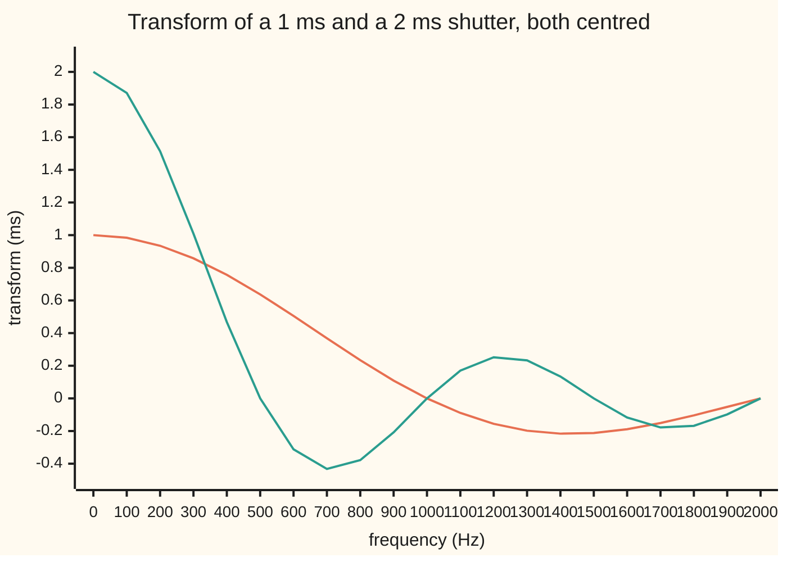

# The transform rulebook: shifting, scaling, and turning derivatives into multiplication

[Syllabus](../../../SYLLABUS.md) → [Harmonic analysis](../README.md) → [The Fourier Transform](../README.md#s02) → The transform rulebook

---

## General Overview

A camera shutter set to 1/1000 s lets light through for 1 millisecond (ms). Model it as a pulse: height 1 while open, 0 while shut. Its Fourier transform is already known from [The Fourier transform of an absolutely integrable signal, and why it fades at infinity](01-fourier-transform-on-l1-and-riemann-lebesgue.md). The transform says how much of each flicker frequency, in hertz (Hz, cycles per second), the open shutter still records.

Now change the camera. Set 1/500 s, so the shutter stays open 2 ms. Add 2 ms of shutter lag, the wait between pressing the button and the shutter opening. The new pulse opens at 2 ms and closes at 4 ms. Its transform could be found by a new integral. It does not need one.

The new pulse is the old pulse **stretched** by 2 and **delayed** by 3 ms, the time of its centre. Each change has a fixed effect on the transform. A stretch makes the transform twice as tall and half as wide. A delay turns each frequency's value by an angle and leaves its size alone. At 250 Hz, the old transform is 0.900316 ms. The rules give the new one, 1.273240i ms, with no integral at all.

**Five rules turn changes to a signal into changes to its transform: a delay turns it, a frequency shift slides it, a stretch rescales it, transforming twice flips it, and a derivative multiplies it by 2πi times the frequency.**

**What kind of fact this is:** five theorems, proved on this card in Why it works. The duality rule rests on Fourier inversion, which [Fourier inversion](04-fourier-inversion-theorem.md) proves.

### The picture: stretch the pulse, squeeze the transform



Orange: the 1 ms shutter, first zero at 1,000 Hz. Teal: the 2 ms shutter, twice as tall, first zero at 500 Hz. Delaying the 2 ms shutter by 3 ms keeps the size of the teal curve at every frequency and only turns its values in the complex plane.

---

## The formula

The convention is the one fixed on the L1-transform card: $`\hat f(\xi) = \int_{-\infty}^{\infty} f(t)\, e^{-2\pi i \xi t}\, dt`$, with $`t`$ in seconds and $`\xi`$ in hertz. The arrow $`f \longmapsto \hat f`$ below means "this signal has this transform".

```math
\begin{aligned} &\text{shift:} && f(t - t_0) &&\longmapsto\; e^{-2\pi i \xi t_0}\, \hat f(\xi) \\ &\text{modulation:} && e^{2\pi i \xi_0 t} f(t) &&\longmapsto\; \hat f(\xi - \xi_0) \\ &\text{scaling:} && f(t/s) &&\longmapsto\; |s|\, \hat f(s\xi) \\ &\text{duality:} && \hat f(t) &&\longmapsto\; f(-\xi) \\ &\text{derivative:} && f'(t) &&\longmapsto\; 2\pi i \xi\, \hat f(\xi), \qquad -2\pi i t\, f(t) \;\longmapsto\; \hat f\,'(\xi) \end{aligned}
```

For the shutter, stretch first, then delay. With $`h(t) = g\big((t - t_0)/s\big)`$:

```math
\hat h(\xi) = |s|\, \hat g(s\xi)\, e^{-2\pi i \xi t_0}, \qquad \hat g(\xi) = T\,\mathrm{sinc}(T\xi).
```

**Read it aloud:** "The new pulse's transform is the plain pulse's transform, read at twice the frequency, made twice as tall, and turned by the delay."

| Symbol | Plain meaning | In our example | Push it up and the answer… |
| --- | --- | --- | --- |
| $`f`$, $`\hat f`$ | any signal, and its transform | | |
| $`t`$, $`u`$, $`L`$ | time in seconds; $`u`$ is a stand-in time inside a substitution; $`L`$ is where a numerical integral is cut off | 0 to 6 ms; $`L`$ = 500 and 1,000 ms | |
| $`\xi`$ | frequency in hertz | 250 Hz | moves along the transform's curve |
| $`i`$ | the imaginary unit, $`i^2 = -1`$; multiplying by $`i`$ is a quarter turn | | |
| $`g`$, $`\hat g`$ | the plain shutter, open from −0.5 ms to 0.5 ms, and its transform | $`\hat g(250\text{ Hz}) = 0.900316`$ ms | |
| $`T`$ | the plain exposure | 1 ms | $`\hat g`$ grows taller and narrower |
| $`h`$, $`\hat h`$, $`k`$ | the new pulse, open from 2 ms to 4 ms, and its transform; $`k`$ is the stretched pulse before the delay | $`\hat h(250\text{ Hz}) = 1.273240i`$ ms | |
| $`t_0`$ | the delay of the pulse's centre | 3 ms | the turn spins faster with frequency; the size stays |
| $`s`$ | the stretch factor; negative $`s`$ also reverses time | 2 | the transform grows taller and narrower |
| $`\xi_0`$ | the frequency that a modulation slides the transform by | 2,000 Hz | the transform's peak moves right |
| $`\Lambda`$ | the tent: $`\Lambda(t) = \max(0,\, 1 - \lvert t\rvert/T)`$, peak 1, base 2 ms | $`\hat\Lambda(250\text{ Hz}) = 0.810569`$ ms | |
| $`\mathrm{sinc}`$ | $`\mathrm{sinc}(u) = \sin(\pi u)/(\pi u)`$, with $`\mathrm{sinc}(0) = 1`$, as in wing 13 | $`\mathrm{sinc}(0.5) = 0.636620`$ | |

The prime marks a derivative: $`f'`$ in time, $`\hat f\,'`$ in frequency.

### When it holds

- **The signal is absolutely integrable,** $`\int \lvert f\rvert\, dt < \infty`$. Shift, modulation and scaling then hold at every frequency. Without it the defining integral need not exist; the extension to finite-energy signals is on [Plancherel](05-plancherel-and-l2.md).
- **Duality needs $`\hat f`$ integrable too, and $`f`$ continuous.** The tent qualifies. The shutter does not: its transform, a sinc, has $`\int \lvert \hat g\rvert = \infty`$, and at its jumps inversion returns the midpoint 1/2.
- **The time derivative needs $`f`$ to have no jumps, with $`f'`$ integrable.** The shutter has two jumps. Its slope is 0 wherever it exists, so the slope's transform is 0, but at 250 Hz the rule gives $`2\pi i\xi \hat g(\xi)`$ = 1.414214i. The jumps carry all of it: a spike of +1 at −0.5 ms and one of −1 at 0.5 ms also give 1.414214i. [Schwartz space and tempered distributions](06-schwartz-space-and-tempered-distributions.md) makes such spikes precise.
- **The frequency derivative needs $`t f(t)`$ integrable.** The signal $`\mathrm{sinc}^2`$ fails this, since its tail falls only like $`1/t^2`$. Its transform, the tent, has corners where the rule would need a slope.
- **The stretch factor is not 0.** At $`s = 0`$ the "signal" $`f(t/s)`$ is undefined.

---

## Why it works

### Step 0: the transform weighs a signal against turning arrows

The transform at frequency $`\xi`$ multiplies the signal by an arrow $`e^{-2\pi i\xi t}`$ that turns $`\xi`$ times a second, then adds up. Moving or stretching the signal is the same as moving or stretching the clock that turns the arrows. One substitution inside the integral moves the change from the signal to the arrow. Each rule below is that substitution, done once.

### Step 1: a delay becomes a turn

Put $`u = t - t_0`$. Then $`t = u + t_0`$, and the arrow splits into two factors:

```math
\int f(t - t_0)\, e^{-2\pi i\xi t}\, dt = \int f(u)\, e^{-2\pi i\xi u}\, e^{-2\pi i\xi t_0}\, du = e^{-2\pi i\xi t_0}\, \hat f(\xi).
```

The factor $`e^{-2\pi i\xi t_0}`$ has size 1. A delay never changes how much of a frequency is present. It only turns the value by $`2\pi\xi t_0`$ radians, which is $`\xi t_0`$ full turns.

[Convolution](../../07-Complex%20analysis/08-Transforms%20in%20Outline/04-convolution-theorem.md) already met this rule: there the centred box slid half its width to become the one-sided shutter, and its transform picked up a turn.

### Step 2: a frequency shift slides the transform

Multiply the signal by $`e^{2\pi i\xi_0 t}`$, an arrow turning $`\xi_0`$ times a second. The two arrows combine into one:

```math
\int e^{2\pi i\xi_0 t} f(t)\, e^{-2\pi i\xi t}\, dt = \int f(t)\, e^{-2\pi i(\xi - \xi_0)t}\, dt = \hat f(\xi - \xi_0).
```

This is the mirror image of Step 1: a turn in time is a slide in frequency. A real tone $`\cos(2\pi\xi_0 t)`$ is the average of two arrows, $`(e^{2\pi i\xi_0 t} + e^{-2\pi i\xi_0 t})/2`$. So it makes two half-height copies of $`\hat f`$, one at $`+\xi_0`$ and one at $`-\xi_0`$.

Check it on a burst: the 1 ms shutter times a 2,000 Hz tone, two full cycles. At 2,000 Hz the rule gives $`(\hat g(0) + \hat g(4000))/2 = (1 + 0)/2 = 0.500000`$ ms. At 2,250 Hz it gives 0.476638 ms. The defining integral agrees with both.

### Step 3: a stretch rescales both axes

Put $`u = t/s`$ with $`s > 0`$. Then $`t = su`$ and $`dt = s\, du`$:

```math
\int f(t/s)\, e^{-2\pi i\xi t}\, dt = s \int f(u)\, e^{-2\pi i (s\xi) u}\, du = s\, \hat f(s\xi).
```

Twice as long in time means twice the area, so the transform at 0 doubles. Every wiggle in the transform now happens at half the frequency. For $`s < 0`$ the substitution also swaps the ends of the integral; swapping them back gives a minus sign that turns $`s`$ into $`\lvert s\rvert`$. With $`s = -1`$ the rule says that playing a signal backwards reads its transform at $`-\xi`$.

### Step 4: build the new shutter from the old

The new pulse is $`h(t) = g\big((t - 3\text{ ms})/2\big)`$. Read it inside out:

1. Stretch: $`k(t) = g(t/2)`$ is open from −1 ms to 1 ms. By Step 3, $`\hat k(\xi) = 2\,\hat g(2\xi)`$.
2. Delay: $`h(t) = k(t - 3\text{ ms})`$ is open from 2 ms to 4 ms. By Step 1, $`\hat h(\xi) = e^{-2\pi i\xi(3\text{ ms})}\, \hat k(\xi)`$.

The delay acts on the already-stretched pulse, so the turn uses the real frequency $`\xi`$, not $`2\xi`$. Delay first and stretch second gives a different pulse, centred at 6 ms.

### Step 5: transforming twice flips time

[Fourier inversion](04-fourier-inversion-theorem.md) proves that if $`f`$ and $`\hat f`$ are both integrable and $`f`$ is continuous, then $`f(t) = \int \hat f(\xi)\, e^{2\pi i\xi t}\, d\xi`$. Rename the letters: $`t`$ becomes the frequency, $`\xi`$ the time. Then

```math
\int \hat f(t)\, e^{-2\pi i \xi t}\, dt = f(-\xi).
```

So every transform pair gives a second pair for free, with time and frequency swapped and one sign flipped.

The tent gives an example. Its transform is $`T\,\mathrm{sinc}^2(T\xi)`$, found in Step 7. By duality, a signal shaped like $`\mathrm{sinc}^2`$ has the tent as its transform. With time in ms and frequency in kHz, so that $`\xi t`$ is a pure number, the signal $`\mathrm{sinc}^2(t)`$ should have the tent shape $`1 - \lvert\xi\rvert/(1\text{ kHz})`$ as its transform, so $`1 - 0.25 = 0.75`$ at 250 Hz. The defining integral, cut off at 500 ms and at 1,000 ms, gives 0.750000 both times. The cut tails are at most $`2/(\pi^2 L)`$ for a cut-off $`L`$: 0.000405 and 0.000203.

### Step 6: a derivative becomes multiplication by 2πiξ

Integrate by parts. The slope $`f'`$ moves off the signal and onto the arrow. The arrow's slope in $`t`$ is $`-2\pi i\xi\, e^{-2\pi i\xi t}`$, and the minus sign of integration by parts cancels its minus sign:

```math
\int f'(t)\, e^{-2\pi i\xi t}\, dt = \Big[f(t)\, e^{-2\pi i\xi t}\Big]_{-\infty}^{\infty} + 2\pi i\xi \int f(t)\, e^{-2\pi i\xi t}\, dt = 2\pi i\xi\, \hat f(\xi).
```

The bracket vanishes because $`f`$ goes to 0 at both ends. The fold below proves that.

So a fast wiggle, large $`\xi`$, is boosted by the derivative, and the steady part, $`\xi = 0`$, is wiped out. A derivative is a filter that amplifies high frequencies.

The rule also runs the other way. [Differentiating under the integral](../../06-Calculus%20and%20analysis/08-Multiple%20Integrals/05-differentiating-under-the-integral.md) lets the $`\xi`$-slope go inside, where it hits only the arrow: $`\hat f\,'(\xi) = \int (-2\pi i t) f(t)\, e^{-2\pi i\xi t}\, dt`$. For the new shutter at 250 Hz, a difference quotient of $`\hat h`$ and the transform of $`-2\pi i t\, h(t)`$ both give 24.0000 − 5.0930i ms². This slope is how engineers read a delay off a spectrum: the turn's angle falls at $`2\pi t_0`$ radians per hertz, which returns 3.000000 ms.

<details>
<summary>Detailed proof: why the boundary term vanishes</summary>

Assume $`f`$ is absolutely continuous, so $`f(b) - f(a) = \int_a^b f'(t)\, dt`$, and that $`f`$ and $`f'`$ are both integrable.

Because $`f'`$ is integrable, $`f(t) = f(0) + \int_0^t f'(u)\, du`$ has a limit as $`t \to \infty`$. Call it $`c`$. If $`c \neq 0`$, then $`\lvert f(t)\rvert > \lvert c\rvert/2`$ for all large $`t`$, and $`\int \lvert f\rvert`$ would be infinite. So $`c = 0`$. The same argument works as $`t \to -\infty`$.

On a finite interval from $`-R`$ to $`R`$, integration by parts holds for absolutely continuous functions:

$`\displaystyle \int_{-R}^{R} f'(t)\, e^{-2\pi i\xi t}\, dt = f(R)e^{-2\pi i\xi R} - f(-R)e^{2\pi i\xi R} + 2\pi i\xi \int_{-R}^{R} f(t)\, e^{-2\pi i\xi t}\, dt.`$

The arrows have size 1, so the two boundary terms have sizes $`\lvert f(R)\rvert`$ and $`\lvert f(-R)\rvert`$, which go to 0. Both integrals converge as $`R \to \infty`$ because $`f`$ and $`f'`$ are integrable. Letting $`R \to \infty`$ gives the rule.

For the frequency side, the $`\xi`$-slope of the integrand is $`-2\pi i t f(t) e^{-2\pi i\xi t}`$, whose size $`2\pi \lvert t f(t)\rvert`$ does not depend on $`\xi`$ and is integrable. That single bound is what licenses the swap on [Differentiating under the integral](../../06-Calculus%20and%20analysis/08-Multiple%20Integrals/05-differentiating-under-the-integral.md).

</details>

### Step 7: a new transform with no integral, the tent

The tent $`\Lambda`$ rises from 0 at −1 ms to 1 at 0, then falls to 0 at 1 ms. It has no jumps, so Step 6 applies. Its slope is $`+1/T`$ on the left half and $`-1/T`$ on the right half. Each half is a 1 ms shutter, delayed by $`-T/2`$ or $`+T/2`$. By the shift rule alone:

```math
\widehat{\Lambda'}(\xi) = \hat g(\xi)\,\frac{e^{\pi i\xi T} - e^{-\pi i\xi T}}{T} = 2i\sin(\pi\xi T)\,\mathrm{sinc}(T\xi).
```

Divide by $`2\pi i\xi`$, as Step 6 allows:

```math
\hat\Lambda(\xi) = \frac{2i\sin(\pi\xi T)\,\mathrm{sinc}(T\xi)}{2\pi i\xi} = T\,\mathrm{sinc}^2(T\xi).
```

At 250 Hz this is 0.810569 ms. [Convolution](../../07-Complex%20analysis/08-Transforms%20in%20Outline/04-convolution-theorem.md) reaches the same number by another road: the tent is the shutter smeared with itself, divided by $`T`$, so $`\hat\Lambda = \hat g^2/T = 0.900316^2 = 0.810569`$ ms.

---

## Worked numbers, by hand

The new shutter at 250 Hz. Plain shutter $`T = 1`$ ms, stretch $`s = 2`$, delay $`t_0 = 3`$ ms.

| Step | Arithmetic | Value |
| --- | --- | --- |
| frequency the stretch reads | $`s\xi = 2 \times 250`$ | 500 Hz |
| plain transform there | $`\hat g(500) = T\,\mathrm{sinc}(0.5) = 1 \times \sin(\pi/2)/(\pi/2)`$ | 0.636620 ms |
| times the stretch | $`2 \times 0.636620`$ | 1.273240 ms |
| turns of the arrow | $`\xi t_0 = 250 \times 0.003`$ | 0.75 turn |
| the turn | $`e^{-2\pi i \times 0.75} = \cos(1.5\pi) - i\sin(1.5\pi)`$ | $`i`$ |
| **new transform** | $`1.273240 \times i`$ | **1.273240i ms** |
| cross-check, by integral | $`\int_{2\text{ ms}}^{4\text{ ms}} e^{-2\pi i (250) t}\, dt = \dfrac{1 - (-1)}{-2\pi i \times 250}`$ s | 1.273240i ms |

What it means. A light that flickers 250 times a second, such as an LED dimmed by fast switching, shows up in photos as frames of different brightness. The share of the flicker's swing that a photo keeps is $`\lvert\hat h(\xi)\rvert / \hat h(0)`$. The turn has size 1, so the shutter lag does not change it:

| Flicker | 1 ms shutter keeps | 2 ms shutter keeps |
| --- | --- | --- |
| 100 Hz | 0.983632 | 0.935489 |
| 250 Hz | 0.900316 | 0.636620 |
| 500 Hz | 0.636620 | 0.000000 |

The 2 ms column is the 1 ms column read at double the frequency: that is the scaling rule. A 2 ms exposure wipes out 500 Hz flicker exactly, because it spans exactly one flicker cycle. At 100 Hz the full value is $`-0.578164 - 1.779406i`$ ms; its size divided by 2 ms is the 0.935489 in the table.

### What breaks if you drop a piece

The right answer at 250 Hz is 1.273240i ms.

| Mistake | Comes out at | What went wrong |
| --- | --- | --- |
| Stretch on the wrong side: $`2\,\hat g(\xi/2)`$ | 1.948991i ms | A longer pulse has a narrower transform, so it reads $`\hat g`$ at $`2\xi`$, not $`\xi/2`$. |
| Drop the factor $`\lvert s\rvert`$ | 0.636620i ms | The 2 ms pulse lets in twice the light; its transform at 0 must double. |
| Delay first, then stretch | −1.273240 ms | That pulse is centred at 6 ms, so the turn is 1.5 turns, not 0.75. |
| Plus sign in the turn | −1.273240i ms | That is the transform of a pulse 3 ms early, not 3 ms late. |
| Time reversal without $`\lvert s\rvert`$, $`s = -1`$ | +1.273240i ms for $`h(-t)`$ | The true value is −1.273240i ms; the sign from swapping the ends was lost. |
| Derivative rule on the plain shutter | 0 against 1.414214i | The shutter jumps, so it fails the hypothesis; the jumps hold the whole answer. |

---

## Code, from first principles, and it actually runs

The scripts work in milliseconds and kilohertz, so each product $`\xi t`$ is a pure number and every transform comes out in ms. They take **three roads** to the new shutter's transform: the rules applied to the plain shutter's closed form, the defining integral by Simpson's rule (adding up thin weighted slices), and the exact antiderivative of a box times an arrow. Then each other rule meets an integral: time reversal, the two-cycle burst, duality on $`\mathrm{sinc}^2`$ at two cut-offs with a tail bound, the tent by three roads, the shutter's failure of the derivative rule, and the frequency-side derivative. Every number on this card is printed below.

### Python

```python
# The transform rulebook -- the check behind the card.  Standard library only.
# Units: time t in ms, frequency xi in kHz, so xi*t is a pure number and every
# transform comes out in ms.  Every transform is computed here: road one uses
# the rules on the plain shutter's closed form; road two is the defining
# integral by Simpson's rule; road three, where it exists, is an exact
# antiderivative or another card's result.
import math

T, T0, S = 1.0, 3.0, 2.0  # plain exposure 1 ms; new pulse: delay 3 ms, stretch 2
def sinc(u): return 1.0 if u == 0 else math.sin(math.pi * u) / (math.pi * u)
def arrow(x): return complex(math.cos(x), math.sin(x))  # e^(ix), written out
def gate(t): return 1.0 if abs(t) <= T / 2 else 0.0  # plain shutter, centred on 0
def ghat(xi): return T * sinc(T * xi)  # its transform, from the L1-transform card
def h(t): return gate((t - T0) / S)  # the new pulse: open from 2 ms to 4 ms
def hhat(xi): return abs(S) * ghat(S * xi) * arrow(-2 * math.pi * xi * T0)  # rules
LO, HI = T0 - abs(S) * T / 2, T0 + abs(S) * T / 2  # where h is open

def simpson(f, a, b, n):  # n even
    w = (b - a) / n
    tot = f(a) + f(b)
    for k in range(1, n):
        tot += (4 if k % 2 else 2) * f(a + k * w)
    return tot * w / 3
def ft(f, xi, a, b, n=400):  # the defining integral, f zero outside [a, b]
    return simpson(lambda t: f(t) * arrow(-2 * math.pi * xi * t), a, b, n)
def box_exact(a, b, xi):  # integral of e^(-2 pi i xi t) from a to b, by hand
    return (arrow(-2 * math.pi * xi * a) - arrow(-2 * math.pi * xi * b)) / (2j * math.pi * xi)
def snap(x): return 0.0 if abs(x) < 5e-10 else x
def c(z):
    re, im = snap(z.real), snap(z.imag)
    return f"{re:.6f} {'-' if im < 0 else '+'} {abs(im):.6f}i"

print("plain shutter g: open 1 ms, centred on 0")
print(f"g-hat(250 Hz) = {ghat(0.25):.6f} ms, g-hat(0) = {ghat(0):.6f} ms")
print(f"new pulse h: opens {LO:.0f} ms, closes {HI:.0f} ms, centre {T0:.0f} ms")
print("xi Hz | by the rules | defining integral, Simpson n=400 | exact antiderivative")
for xi in (0.1, 0.25, 0.5):
    r, s, e = hhat(xi), ft(h, xi, LO, HI), box_exact(LO, HI, xi)
    print(f"{xi * 1000:.0f} | {c(r)} | {c(s)} | {c(e)}")
    assert abs(r - s) < 1e-9 and abs(r - e) < 1e-12
print(f"steps for 250 Hz: 2 x g-hat(500 Hz) = {2 * ghat(0.5):.6f} ms, turns {0.25 * T0:.2f}, turn = {c(arrow(-2 * math.pi * 0.25 * T0))}")
print("flicker swing kept | 1 ms shutter | 2 ms shutter")
for xi in (0.1, 0.25, 0.5):
    print(f"{xi * 1000:.0f} Hz | {abs(ghat(xi)) / ghat(0):.6f} | {snap(abs(hhat(xi)) / abs(hhat(0))):.6f}")
# time reversal: h(-t) has transform |-1| h-hat(-xi); forgetting |s| flips the sign
rev = ft(lambda t: h(-t), 0.25, -HI, -LO)
print(f"reversed h at 250 Hz: Simpson {c(rev)}, rule {c(hhat(-0.25))}, without |s| {c(-hhat(-0.25))}")
assert abs(rev - hhat(-0.25)) < 1e-9 and abs(rev + hhat(-0.25)) > 1
# modulation: the 1 ms gate times cos(2 pi 2 kHz t), a two-cycle burst
burst = lambda t: gate(t) * math.cos(2 * math.pi * 2.0 * t)
for xi in (2.0, 2.25):
    rule = (ghat(xi - 2.0) + ghat(xi + 2.0)) / 2
    s = ft(burst, xi, -0.5, 0.5, 2000)
    print(f"burst at {xi * 1000:.0f} Hz: rule {rule:.6f} ms, Simpson {c(s)} ms")
    assert abs(s - rule) < 1e-9
# duality: the tent L(t) = max(0, 1 - |t|) has transform sinc^2, so sinc^2 in time
# must have the tent as its transform: 0.75 at 250 Hz.  Cut-off L, tail <= 2/(pi^2 L).
tent = lambda t: max(0.0, 1 - abs(t))
for L in (500, 1000):
    d = 2 * simpson(lambda t: sinc(t) ** 2 * math.cos(2 * math.pi * 0.25 * t), 0.0, L, 100 * L)
    bound = 2 / (math.pi ** 2 * L)
    print(f"sinc^2 at 250 Hz, cut-off {L} ms: {d:.6f} ms, tent value {tent(0.25):.6f}, tail bound {bound:.6f}")
    assert abs(d - tent(0.25)) < bound
# derivative rule on the tent: L' is +1 on (-1, 0) and -1 on (0, 1): two shifted gates
dhat = ghat(0.25) * (arrow(math.pi * 0.25) - arrow(-math.pi * 0.25))  # shift rule only
tent_rule = dhat / (2j * math.pi * 0.25)
tent_simp = ft(tent, 0.25, -1.0, 0.0) + ft(tent, 0.25, 0.0, 1.0)
print(f"tent at 250 Hz: derivative rule {c(tent_rule)}, g-hat^2/T {ghat(0.25) ** 2 / T:.6f}, Simpson {c(tent_simp)}")
assert abs(tent_rule - ghat(0.25) ** 2 / T) < 1e-12 and abs(tent_simp - tent_rule) < 1e-9
# the rule fails on the gate itself: its slope is 0 wherever it exists; the jumps hold it all
slope = lambda t: (gate(t + 1e-4) - gate(t - 1e-4)) / 2e-4  # difference quotient, off the jumps
flat = sum(ft(slope, 0.25, a, b) for a, b in ((-1.0, -0.501), (-0.499, 0.499), (0.501, 1.0)))
spikes = arrow(math.pi * 0.25 * T) - arrow(-math.pi * 0.25 * T)  # +1 at -T/2, -1 at +T/2
print(f"gate, 250 Hz: transform of pointwise slope {c(flat)}, 2 pi i xi g-hat = {c(2j * math.pi * 0.25 * ghat(0.25))}, jump spikes {c(spikes)}")
assert abs(flat) < 1e-12 and abs(2j * math.pi * 0.25 * ghat(0.25) - spikes) < 1e-12
# frequency-side derivative: d/dxi h-hat = transform of -2 pi i t h(t)
dq = 1e-5
cd = (hhat(0.25 + dq) - hhat(0.25 - dq)) / (2 * dq)
sd = ft(lambda t: -2j * math.pi * t * h(t), 0.25, LO, HI)
c4 = lambda z: f"{z.real:.4f} {'-' if z.imag < 0 else '+'} {abs(z.imag):.4f}i"
print(f"slope of h-hat at 250 Hz: difference quotient {c4(cd)}, transform of -2 pi i t h {c4(sd)} ms^2")
assert abs(cd - sd) < 1e-6
ph = lambda xi: math.atan2(hhat(xi).imag, hhat(xi).real)
print(f"delay read from the phase slope: {-(ph(0.25 + dq) - ph(0.25 - dq)) / (2 * dq) / (2 * math.pi):.6f} ms")
# what breaks, all at 250 Hz; right answer 0 + 1.273240i ms
print("what breaks at 250 Hz, right answer", c(hhat(0.25)))
print("stretch on the wrong side, 2 g-hat(xi/2) |", c(2 * ghat(0.125) * arrow(-2 * math.pi * 0.25 * T0)))
print("drop the factor 2 |", c(ghat(0.5) * arrow(-2 * math.pi * 0.25 * T0)))
print("delay then stretch, centre at 6 ms |", c(hhat(0.25) * arrow(-2 * math.pi * 0.25 * T0)))
print("plus sign in the turn |", c(2 * ghat(0.5) * arrow(2 * math.pi * 0.25 * T0)))
print("chart, xi Hz           ", " ".join(f"{k * 100:6d}" for k in range(21)))
print("chart, 1 ms g-hat      ", " ".join(f"{snap(ghat(k / 10)):6.3f}" for k in range(21)))
print("chart, 2 ms 2g-hat(2xi)", " ".join(f"{snap(2 * ghat(k / 5)):6.3f}" for k in range(21)))
print("ALL CHECKS PASS")
```

**Ran 2026-11-15 on macOS, Python 3.14.10, standard library only. All checks passed. Output, pasted from the run:**

```
plain shutter g: open 1 ms, centred on 0
g-hat(250 Hz) = 0.900316 ms, g-hat(0) = 1.000000 ms
new pulse h: opens 2 ms, closes 4 ms, centre 3 ms
xi Hz | by the rules | defining integral, Simpson n=400 | exact antiderivative
100 | -0.578164 - 1.779406i | -0.578164 - 1.779406i | -0.578164 - 1.779406i
250 | 0.000000 + 1.273240i | 0.000000 + 1.273240i | 0.000000 + 1.273240i
500 | 0.000000 + 0.000000i | 0.000000 + 0.000000i | 0.000000 + 0.000000i
steps for 250 Hz: 2 x g-hat(500 Hz) = 1.273240 ms, turns 0.75, turn = 0.000000 + 1.000000i
flicker swing kept | 1 ms shutter | 2 ms shutter
100 Hz | 0.983632 | 0.935489
250 Hz | 0.900316 | 0.636620
500 Hz | 0.636620 | 0.000000
reversed h at 250 Hz: Simpson 0.000000 - 1.273240i, rule 0.000000 - 1.273240i, without |s| 0.000000 + 1.273240i
burst at 2000 Hz: rule 0.500000 ms, Simpson 0.500000 + 0.000000i ms
burst at 2250 Hz: rule 0.476638 ms, Simpson 0.476638 + 0.000000i ms
sinc^2 at 250 Hz, cut-off 500 ms: 0.750000 ms, tent value 0.750000, tail bound 0.000405
sinc^2 at 250 Hz, cut-off 1000 ms: 0.750000 ms, tent value 0.750000, tail bound 0.000203
tent at 250 Hz: derivative rule 0.810569 + 0.000000i, g-hat^2/T 0.810569, Simpson 0.810569 + 0.000000i
gate, 250 Hz: transform of pointwise slope 0.000000 + 0.000000i, 2 pi i xi g-hat = 0.000000 + 1.414214i, jump spikes 0.000000 + 1.414214i
slope of h-hat at 250 Hz: difference quotient 24.0000 - 5.0930i, transform of -2 pi i t h 24.0000 - 5.0930i ms^2
delay read from the phase slope: 3.000000 ms
what breaks at 250 Hz, right answer 0.000000 + 1.273240i
stretch on the wrong side, 2 g-hat(xi/2) | 0.000000 + 1.948991i
drop the factor 2 | 0.000000 + 0.636620i
delay then stretch, centre at 6 ms | -1.273240 + 0.000000i
plus sign in the turn | 0.000000 - 1.273240i
chart, xi Hz                 0    100    200    300    400    500    600    700    800    900   1000   1100   1200   1300   1400   1500   1600   1700   1800   1900   2000
chart, 1 ms g-hat        1.000  0.984  0.935  0.858  0.757  0.637  0.505  0.368  0.234  0.109  0.000 -0.089 -0.156 -0.198 -0.216 -0.212 -0.189 -0.151 -0.104 -0.052  0.000
chart, 2 ms 2g-hat(2xi)  2.000  1.871  1.514  1.009  0.468  0.000 -0.312 -0.432 -0.378 -0.208  0.000  0.170  0.252  0.233  0.134  0.000 -0.117 -0.178 -0.168 -0.098  0.000
ALL CHECKS PASS
```

### Rust

The same checks, with a small complex-number struct in place of Python's built-in complex type.

```rust
// The transform rulebook -- the same check as the Python file, in Rust.
// Standard library only, no crates.  Units: t in ms, xi in kHz, transforms in
// ms.  A complex number is a small struct; every transform is computed here.
use std::f64::consts::PI;
use std::ops::{Add, Mul, Sub};

#[derive(Clone, Copy)]
struct C { re: f64, im: f64 }
impl Add for C { type Output = C; fn add(self, o: C) -> C { C { re: self.re + o.re, im: self.im + o.im } } }
impl Sub for C { type Output = C; fn sub(self, o: C) -> C { C { re: self.re - o.re, im: self.im - o.im } } }
impl Mul for C {
    type Output = C;
    fn mul(self, o: C) -> C { C { re: self.re * o.re - self.im * o.im, im: self.re * o.im + self.im * o.re } }
}
impl C {
    fn sc(self, k: f64) -> C { C { re: self.re * k, im: self.im * k } }
    fn abs(self) -> f64 { (self.re * self.re + self.im * self.im).sqrt() }
    fn div(self, o: C) -> C { let d = o.re * o.re + o.im * o.im; (self * C { re: o.re, im: -o.im }).sc(1.0 / d) }
}
fn r(x: f64) -> C { C { re: x, im: 0.0 } }
const I: C = C { re: 0.0, im: 1.0 };

const T: f64 = 1.0; // plain exposure 1 ms
const T0: f64 = 3.0; // new pulse: delay 3 ms
const S: f64 = 2.0; // and stretch 2
fn sinc(u: f64) -> f64 { if u == 0.0 { 1.0 } else { (PI * u).sin() / (PI * u) } }
fn arrow(x: f64) -> C { C { re: x.cos(), im: x.sin() } } // e^(ix), written out
fn gate(t: f64) -> f64 { if t.abs() <= T / 2.0 { 1.0 } else { 0.0 } } // plain shutter
fn ghat(xi: f64) -> f64 { T * sinc(T * xi) } // from the L1-transform card
fn h(t: f64) -> f64 { gate((t - T0) / S) } // the new pulse: open 2 ms to 4 ms
fn hhat(xi: f64) -> C { arrow(-2.0 * PI * xi * T0).sc(S.abs() * ghat(S * xi)) } // rules
const LO: f64 = T0 - S.abs() * T / 2.0; // where h is open
const HI: f64 = T0 + S.abs() * T / 2.0;

fn simpson(f: &dyn Fn(f64) -> C, a: f64, b: f64, n: usize) -> C {
    let w = (b - a) / n as f64;
    let mut tot = f(a) + f(b);
    for k in 1..n { tot = tot + f(a + k as f64 * w).sc(if k % 2 == 1 { 4.0 } else { 2.0 }); }
    tot.sc(w / 3.0)
}
fn ft(f: &dyn Fn(f64) -> C, xi: f64, a: f64, b: f64, n: usize) -> C {
    simpson(&|t| f(t) * arrow(-2.0 * PI * xi * t), a, b, n)
}
fn box_exact(a: f64, b: f64, xi: f64) -> C {
    (arrow(-2.0 * PI * xi * a) - arrow(-2.0 * PI * xi * b)).div(I.sc(2.0 * PI * xi))
}
fn snap(x: f64) -> f64 { if x.abs() < 5e-10 { 0.0 } else { x } }
fn c(z: C) -> String {
    let (re, im) = (snap(z.re), snap(z.im));
    format!("{:.6} {} {:.6}i", re, if im < 0.0 { "-" } else { "+" }, im.abs())
}
fn c4(z: C) -> String { format!("{:.4} {} {:.4}i", z.re, if z.im < 0.0 { "-" } else { "+" }, z.im.abs()) }

fn main() {
    let hc = |t: f64| r(h(t));
    println!("plain shutter g: open 1 ms, centred on 0");
    println!("g-hat(250 Hz) = {:.6} ms, g-hat(0) = {:.6} ms", ghat(0.25), ghat(0.0));
    println!("new pulse h: opens {:.0} ms, closes {:.0} ms, centre {:.0} ms", LO, HI, T0);
    println!("xi Hz | by the rules | defining integral, Simpson n=400 | exact antiderivative");
    for xi in [0.1, 0.25, 0.5] {
        let (rr, s, e) = (hhat(xi), ft(&hc, xi, LO, HI, 400), box_exact(LO, HI, xi));
        println!("{:.0} | {} | {} | {}", xi * 1000.0, c(rr), c(s), c(e));
        assert!((rr - s).abs() < 1e-9 && (rr - e).abs() < 1e-12);
    }
    println!("steps for 250 Hz: 2 x g-hat(500 Hz) = {:.6} ms, turns {:.2}, turn = {}", 2.0 * ghat(0.5), 0.25 * T0, c(arrow(-2.0 * PI * 0.25 * T0)));
    println!("flicker swing kept | 1 ms shutter | 2 ms shutter");
    for xi in [0.1, 0.25, 0.5] {
        println!("{:.0} Hz | {:.6} | {:.6}", xi * 1000.0, ghat(xi).abs() / ghat(0.0), snap(hhat(xi).abs() / hhat(0.0).abs()));
    }
    // time reversal: h(-t) has transform |-1| h-hat(-xi); forgetting |s| flips the sign
    let rev = ft(&|t| r(h(-t)), 0.25, -HI, -LO, 400);
    println!("reversed h at 250 Hz: Simpson {}, rule {}, without |s| {}", c(rev), c(hhat(-0.25)), c(hhat(-0.25).sc(-1.0)));
    assert!((rev - hhat(-0.25)).abs() < 1e-9 && (rev + hhat(-0.25)).abs() > 1.0);
    // modulation: the 1 ms gate times cos(2 pi 2 kHz t), a two-cycle burst
    let burst = |t: f64| r(gate(t) * (2.0 * PI * 2.0 * t).cos());
    for xi in [2.0, 2.25] {
        let rule = (ghat(xi - 2.0) + ghat(xi + 2.0)) / 2.0;
        let s = ft(&burst, xi, -0.5, 0.5, 2000);
        println!("burst at {:.0} Hz: rule {:.6} ms, Simpson {} ms", xi * 1000.0, rule, c(s));
        assert!((s - r(rule)).abs() < 1e-9);
    }
    // duality: sinc^2 in time has the tent as its transform: 0.75 at 250 Hz.
    let tent = |t: f64| r((1.0 - t.abs()).max(0.0));
    for l in [500usize, 1000] {
        let lf = l as f64;
        let d = 2.0 * simpson(&|t| r(sinc(t).powi(2) * (2.0 * PI * 0.25 * t).cos()), 0.0, lf, 100 * l).re;
        let bound = 2.0 / (PI * PI * lf);
        println!("sinc^2 at 250 Hz, cut-off {} ms: {:.6} ms, tent value {:.6}, tail bound {:.6}", l, d, tent(0.25).re, bound);
        assert!((d - tent(0.25).re).abs() < bound);
    }
    // derivative rule on the tent: its slope is two shifted gates, +1 then -1
    let dhat = (arrow(PI * 0.25) - arrow(-PI * 0.25)).sc(ghat(0.25)); // shift rule only
    let tent_rule = dhat.div(I.sc(2.0 * PI * 0.25));
    let tent_simp = ft(&tent, 0.25, -1.0, 0.0, 400) + ft(&tent, 0.25, 0.0, 1.0, 400);
    println!("tent at 250 Hz: derivative rule {}, g-hat^2/T {:.6}, Simpson {}", c(tent_rule), ghat(0.25).powi(2) / T, c(tent_simp));
    assert!((tent_rule - r(ghat(0.25).powi(2) / T)).abs() < 1e-12 && (tent_simp - tent_rule).abs() < 1e-9);
    // the rule fails on the gate itself: its slope is 0 wherever it exists; the jumps hold it all
    let slope = |t: f64| r((gate(t + 1e-4) - gate(t - 1e-4)) / 2e-4); // difference quotient, off the jumps
    let flat = [(-1.0, -0.501), (-0.499, 0.499), (0.501, 1.0)].iter()
        .fold(r(0.0), |s, &(a, b)| s + ft(&slope, 0.25, a, b, 400));
    let spikes = arrow(PI * 0.25 * T) - arrow(-PI * 0.25 * T); // +1 at -T/2, -1 at +T/2
    let jump = I.sc(2.0 * PI * 0.25 * ghat(0.25));
    println!("gate, 250 Hz: transform of pointwise slope {}, 2 pi i xi g-hat = {}, jump spikes {}", c(flat), c(jump), c(spikes));
    assert!(flat.abs() < 1e-12 && (jump - spikes).abs() < 1e-12);
    // frequency-side derivative: d/dxi h-hat = transform of -2 pi i t h(t)
    let dq = 1e-5;
    let cd = (hhat(0.25 + dq) - hhat(0.25 - dq)).sc(1.0 / (2.0 * dq));
    let sd = ft(&|t| I.sc(-2.0 * PI * t * h(t)), 0.25, LO, HI, 400);
    println!("slope of h-hat at 250 Hz: difference quotient {}, transform of -2 pi i t h {} ms^2", c4(cd), c4(sd));
    assert!((cd - sd).abs() < 1e-6);
    let ph = |xi: f64| { let z = hhat(xi); z.im.atan2(z.re) };
    println!("delay read from the phase slope: {:.6} ms", -(ph(0.25 + dq) - ph(0.25 - dq)) / (2.0 * dq) / (2.0 * PI));
    // what breaks, all at 250 Hz
    let turn = arrow(-2.0 * PI * 0.25 * T0);
    println!("what breaks at 250 Hz, right answer {}", c(hhat(0.25)));
    println!("stretch on the wrong side, 2 g-hat(xi/2) | {}", c(turn.sc(2.0 * ghat(0.125))));
    println!("drop the factor 2 | {}", c(turn.sc(ghat(0.5))));
    println!("delay then stretch, centre at 6 ms | {}", c(hhat(0.25) * turn));
    println!("plus sign in the turn | {}", c(arrow(2.0 * PI * 0.25 * T0).sc(2.0 * ghat(0.5))));
    let row = |f: &dyn Fn(usize) -> String| (0..21).map(|k| f(k)).collect::<Vec<_>>().join(" ");
    println!("chart, xi Hz            {}", row(&|k| format!("{:6}", k * 100)));
    println!("chart, 1 ms g-hat       {}", row(&|k| format!("{:6.3}", snap(ghat(k as f64 / 10.0)))));
    println!("chart, 2 ms 2g-hat(2xi) {}", row(&|k| format!("{:6.3}", snap(2.0 * ghat(k as f64 / 5.0)))));
    println!("ALL CHECKS PASS");
}
```

**Ran 2026-11-15 on macOS, rustc 1.98.1, no crates. All checks passed. Output, pasted from the run:**

```
plain shutter g: open 1 ms, centred on 0
g-hat(250 Hz) = 0.900316 ms, g-hat(0) = 1.000000 ms
new pulse h: opens 2 ms, closes 4 ms, centre 3 ms
xi Hz | by the rules | defining integral, Simpson n=400 | exact antiderivative
100 | -0.578164 - 1.779406i | -0.578164 - 1.779406i | -0.578164 - 1.779406i
250 | 0.000000 + 1.273240i | 0.000000 + 1.273240i | 0.000000 + 1.273240i
500 | 0.000000 + 0.000000i | 0.000000 + 0.000000i | 0.000000 + 0.000000i
steps for 250 Hz: 2 x g-hat(500 Hz) = 1.273240 ms, turns 0.75, turn = 0.000000 + 1.000000i
flicker swing kept | 1 ms shutter | 2 ms shutter
100 Hz | 0.983632 | 0.935489
250 Hz | 0.900316 | 0.636620
500 Hz | 0.636620 | 0.000000
reversed h at 250 Hz: Simpson 0.000000 - 1.273240i, rule 0.000000 - 1.273240i, without |s| 0.000000 + 1.273240i
burst at 2000 Hz: rule 0.500000 ms, Simpson 0.500000 + 0.000000i ms
burst at 2250 Hz: rule 0.476638 ms, Simpson 0.476638 + 0.000000i ms
sinc^2 at 250 Hz, cut-off 500 ms: 0.750000 ms, tent value 0.750000, tail bound 0.000405
sinc^2 at 250 Hz, cut-off 1000 ms: 0.750000 ms, tent value 0.750000, tail bound 0.000203
tent at 250 Hz: derivative rule 0.810569 + 0.000000i, g-hat^2/T 0.810569, Simpson 0.810569 + 0.000000i
gate, 250 Hz: transform of pointwise slope 0.000000 + 0.000000i, 2 pi i xi g-hat = 0.000000 + 1.414214i, jump spikes 0.000000 + 1.414214i
slope of h-hat at 250 Hz: difference quotient 24.0000 - 5.0930i, transform of -2 pi i t h 24.0000 - 5.0930i ms^2
delay read from the phase slope: 3.000000 ms
what breaks at 250 Hz, right answer 0.000000 + 1.273240i
stretch on the wrong side, 2 g-hat(xi/2) | 0.000000 + 1.948991i
drop the factor 2 | 0.000000 + 0.636620i
delay then stretch, centre at 6 ms | -1.273240 + 0.000000i
plus sign in the turn | 0.000000 - 1.273240i
chart, xi Hz                 0    100    200    300    400    500    600    700    800    900   1000   1100   1200   1300   1400   1500   1600   1700   1800   1900   2000
chart, 1 ms g-hat        1.000  0.984  0.935  0.858  0.757  0.637  0.505  0.368  0.234  0.109  0.000 -0.089 -0.156 -0.198 -0.216 -0.212 -0.189 -0.151 -0.104 -0.052  0.000
chart, 2 ms 2g-hat(2xi)  2.000  1.871  1.514  1.009  0.468  0.000 -0.312 -0.432 -0.378 -0.208  0.000  0.170  0.252  0.233  0.134  0.000 -0.117 -0.178 -0.168 -0.098  0.000
ALL CHECKS PASS
```

### Lean

Lean proves all five rules of The formula, under the conditions in When it holds; the time derivative needs a slope everywhere.

- Take an absolutely integrable signal $`f`$ and any delay $`t_0`$. Then $`f(t - t_0) \longmapsto e^{-2\pi i \xi t_0}\, \hat f(\xi)`$ at every frequency $`\xi`$.
- Take the same $`f`$ and any frequency $`\xi_0`$. Then $`e^{2\pi i \xi_0 t} f(t) \longmapsto \hat f(\xi - \xi_0)`$: the transform slides.
- Take the same $`f`$ and a stretch factor $`s \neq 0`$, positive or negative. Then $`f(t/s) \longmapsto \lvert s\rvert\, \hat f(s\xi)`$.
- Take $`s \neq 0`$, stretch $`f`$ by $`s`$ first, then delay it by $`t_0`$. Then the result has transform $`\lvert s\rvert\, \hat f(s\xi)\, e^{-2\pi i \xi t_0}`$.
- Suppose $`f`$ is continuous, and both $`f`$ and $`\hat f`$ are absolutely integrable. Then $`\hat f(t) \longmapsto f(-\xi)`$: transforming twice flips time.
- Suppose $`f`$ has a slope at every time, and $`f`$ and $`f'`$ are absolutely integrable. Then $`f'(t) \longmapsto 2\pi i \xi\, \hat f(\xi)`$.
- Suppose $`f`$ and $`t f(t)`$ are absolutely integrable. Then $`\hat f`$ has a slope at every $`\xi`$, and $`-2\pi i t\, f(t) \longmapsto \hat f\,'(\xi)`$.
- The new shutter opens at 2 ms and closes at 4 ms. At 250 Hz its arrow makes 0.75 turn, against 1.5 turns if delayed first.

The numbers, the tent with its corners, the burst and the broken cases are left to the Python and Rust checks.

```lean
-- The transform rulebook: for an integrable signal on the line, with the transform f-hat(ξ) = ∫ f(t) e^(−2πiξt) dt, a delay turns the transform, a frequency shift slides it, a stretch rescales it, transforming twice flips time, and a derivative becomes multiplication by 2πiξ.
import Mathlib.Analysis.Fourier.FourierTransformDeriv
import Mathlib.Analysis.Fourier.Inversion

open MeasureTheory Complex Real
open scoped FourierTransform

/-- Helper: a delay by `t₀` multiplies the transform by `e^(−2πiξt₀)`. -/
theorem fourier_shift_aux (g : ℝ → ℂ) (t₀ ξ : ℝ) :
    𝓕 (fun t : ℝ => g (t - t₀)) ξ = cexp (-2 * π * I * ξ * t₀) * 𝓕 g ξ := by
  rw [Real.fourier_real_eq_integral_exp_smul, Real.fourier_real_eq_integral_exp_smul,
    ← integral_const_mul]
  have h := integral_sub_right_eq_self (μ := volume)
    (fun u : ℝ => cexp (↑(-2 * π * (u + t₀) * ξ) * I) • g u) t₀
  simp only [sub_add_cancel] at h
  rw [h]
  congr 1 with u
  rw [smul_eq_mul, smul_eq_mul, ← mul_assoc, ← Complex.exp_add]
  congr 2
  push_cast
  ring

/-- Helper: a stretch by `s ≠ 0` gives `|s|` times the transform read at `sξ`. -/
theorem fourier_scale_aux (g : ℝ → ℂ) (s : ℝ) (hs : s ≠ 0) (ξ : ℝ) :
    𝓕 (fun t : ℝ => g (t / s)) ξ = ((|s| : ℝ) : ℂ) * 𝓕 g (s * ξ) := by
  rw [Real.fourier_real_eq_integral_exp_smul, Real.fourier_real_eq_integral_exp_smul]
  have h := Measure.integral_comp_div (fun y : ℝ => cexp (↑(-2 * π * (y * s) * ξ) * I) • g y) s
  simp only [div_mul_cancel₀ _ hs] at h
  rw [h, Complex.real_smul]
  congr 2 with y
  congr 3
  push_cast
  ring

/-- Shift, modulation and scaling (the card's main formula). For an absolutely integrable
signal `f` and a stretch factor `s ≠ 0`, at every frequency `ξ` (in hertz), with
`f-hat(ξ) = ∫ f(t) e^(−2πiξt) dt` (Mathlib's `𝓕`):
* a delay by `t₀` turns the transform: `f(t − t₀) ↦ e^(−2πiξt₀) f-hat(ξ)`;
* multiplying by the arrow `e^(2πiξ₀t)` slides it: `↦ f-hat(ξ − ξ₀)`;
* a stretch by `s` rescales both axes: `f(t/s) ↦ |s| f-hat(sξ)`;
* stretch first, then delay: `f((t − t₀)/s) ↦ |s| f-hat(sξ) e^(−2πiξt₀)`. -/
theorem fourier_shift_modulation_scale (f : ℝ → ℂ) (hf : Integrable f)
    (t₀ ξ₀ s : ℝ) (hs : s ≠ 0) (ξ : ℝ) :
    𝓕 (fun t : ℝ => f (t - t₀)) ξ = cexp (-2 * π * I * ξ * t₀) * 𝓕 f ξ ∧
    𝓕 (fun t : ℝ => cexp (2 * π * I * ξ₀ * t) * f t) ξ = 𝓕 f (ξ - ξ₀) ∧
    𝓕 (fun t : ℝ => f (t / s)) ξ = ((|s| : ℝ) : ℂ) * 𝓕 f (s * ξ) ∧
    𝓕 (fun t : ℝ => f ((t - t₀) / s)) ξ =
      ((|s| : ℝ) : ℂ) * 𝓕 f (s * ξ) * cexp (-2 * π * I * ξ * t₀) := by
  refine ⟨fourier_shift_aux f t₀ ξ, ?_, fourier_scale_aux f s hs ξ, ?_⟩
  · rw [Real.fourier_real_eq_integral_exp_smul, Real.fourier_real_eq_integral_exp_smul]
    congr 1 with t
    rw [smul_eq_mul, smul_eq_mul, ← mul_assoc, ← Complex.exp_add]
    congr 2
    push_cast
    ring
  · rw [fourier_shift_aux (fun t : ℝ => f (t / s)) t₀ ξ, fourier_scale_aux f s hs ξ]
    exact mul_comm _ _

/-- Duality: transforming twice flips time. If `f` is continuous and both `f` and its
transform are absolutely integrable, then the transform of `f-hat` is `f(−ξ)`. -/
theorem fourier_fourier_eq_comp_neg (f : ℝ → ℂ) (hc : Continuous f) (hf : Integrable f)
    (hf' : Integrable (𝓕 f)) (ξ : ℝ) :
    𝓕 (𝓕 f) ξ = f (-ξ) := by
  have h := hf.fourierInv_fourier_eq hf' (hc.continuousAt (x := -ξ))
  rw [fourierInv_eq_fourier_neg, neg_neg] at h
  exact h

/-- The derivative rules, both directions.
* Time side: if `f` has no jumps (it is differentiable) and both `f` and its slope `f'` are
  absolutely integrable, then `f'` has transform `2πiξ f-hat(ξ)`.
* Frequency side: if `f` and `t f(t)` are absolutely integrable, then `f-hat` has a slope
  at every `ξ`, and that slope is the transform of `−2πi t f(t)`. -/
theorem fourier_deriv_rules :
    (∀ f : ℝ → ℂ, Differentiable ℝ f → Integrable f → Integrable (deriv f) →
      ∀ ξ : ℝ, 𝓕 (deriv f) ξ = 2 * π * I * ξ * 𝓕 f ξ) ∧
    (∀ f : ℝ → ℂ, Integrable f → Integrable (fun t : ℝ => (t : ℂ) * f t) →
      ∀ ξ : ℝ, HasDerivAt (𝓕 f) (𝓕 (fun t : ℝ => -2 * π * I * t * f t) ξ) ξ) := by
  refine ⟨fun f hd hf hf' ξ => ?_, fun f hf hf' ξ => ?_⟩
  · rw [Real.fourier_deriv hf hd hf']
    simp only [smul_eq_mul]
  · have h := Real.hasDerivAt_fourier hf (by simpa only [Complex.real_smul] using hf') ξ
    simpa only [Complex.real_smul, smul_eq_mul] using h

/-! The card's worked shutter, in milliseconds and kilohertz: plain exposure 1 ms,
stretch 2, delay 3 ms, frequency 250 Hz = 1/4 kHz. -/

-- The new pulse opens at 3 − 2 × 1/2 = 2 ms and closes at 3 + 2 × 1/2 = 4 ms.
example : (3 : ℚ) - 2 * (1 / 2) = 2 ∧ (3 : ℚ) + 2 * (1 / 2) = 4 := by norm_num
-- The stretch reads the plain transform at 2 × 250 = 500 Hz.
example : (2 : ℕ) * 250 = 500 := by decide
-- Turns of the arrow: 250 Hz × 3 ms = 1/4 kHz × 3 ms = 3/4 turn.
example : (1 / 4 : ℚ) * 3 = 3 / 4 := by norm_num
-- Delay first, then stretch: the centre lands at 2 × 3 = 6 ms, so 1.5 turns, not 0.75.
example : (2 : ℚ) * 3 = 6 ∧ (1 / 4 : ℚ) * 6 = 3 / 2 := by norm_num

#print axioms fourier_shift_aux
#print axioms fourier_scale_aux
#print axioms fourier_shift_modulation_scale
#print axioms fourier_fourier_eq_comp_neg
#print axioms fourier_deriv_rules
```

**Checked 2026-11-15 on macOS, Lean 4.36.0-rc2, Mathlib v4.36.0-rc2. Every proof is complete and uses only Lean's standard axioms. Output, pasted from the run:**

```
'fourier_shift_aux' depends on axioms: [propext, Classical.choice, Quot.sound]
'fourier_scale_aux' depends on axioms: [propext, Classical.choice, Quot.sound]
'fourier_shift_modulation_scale' depends on axioms: [propext, Classical.choice, Quot.sound]
'fourier_fourier_eq_comp_neg' depends on axioms: [propext, Classical.choice, Quot.sound]
'fourier_deriv_rules' depends on axioms: [propext, Classical.choice, Quot.sound]
```

> [!TIP]
> **Try changing**
> - Guess first: what happens with no shutter lag? Set `T0 = 0.0`. The pulse opens at −1 ms and closes at 1 ms, the turn is 1, and the 250 Hz row becomes 1.273240 + 0.000000i: real, same size.
> - Guess first: does a negative stretch change anything? Set `S = -2.0`. The whole output is unchanged, line for line. The shutter is symmetric, so $`g(t/(-2)) = g(t/2)`$, and $`\lvert s\rvert`$ keeps the height positive.
> - Guess first: how few slices can Simpson's rule use? Set `n=4` in `ft`. The first assert fails: four slices are too coarse for the nine-digit agreement it asks for.
> - Guess first: is the stretch rule really a rule about the shape? Set `S = 1.0`. The new pulse is the plain one delayed by 3 ms, and the 250 Hz row becomes the plain 0.900316 turned by $`i`$.

---

## The usual mistake

> [!warning]
> **Putting the stretch factor on the same side in both domains.** A pulse made longer in time has a transform made narrower in frequency: $`f(t/s)`$ goes with $`\hat f(s\xi)`$. Reading $`\hat g(\xi/2)`$ for the 2 ms shutter gives 1.948991i ms instead of 1.273240i ms. It claims a longer exposure keeps more fast flicker, which is backwards.
>
> Smaller traps:
> - **Forgetting the height factor.** The transform at 0 is the pulse's area. Without $`\lvert s\rvert`$ the 2 ms shutter gets 0.636620i ms, as if it let in half the light it does.
> - **Composing in the wrong order.** "Stretch by 2, then delay by 3 ms" and "delay by 3 ms, then stretch by 2" are different pulses, centred at 3 ms and 6 ms. The second gives −1.273240 ms.
> - **Flipping the sign of the turn.** $`e^{+2\pi i\xi t_0}`$ belongs to an earlier pulse. It gives −1.273240i ms.
> - **Using the derivative rule across a jump.** The shutter's pointwise slope has transform 0, while $`2\pi i\xi\hat g`$ is 1.414214i at 250 Hz.

---

## Where you meet it in real life

- **Photography and video.** Exposure time sets which flicker frequencies are averaged away. An exposure that spans whole flicker cycles removes that flicker, as the 2 ms shutter removes 500 Hz. Video under mains lighting is shot with exposures matched to the lamps' flicker for this reason.
- **Radio.** Amplitude modulation multiplies a voice by a carrier tone. By the modulation rule, the voice's spectrum appears as two copies around the carrier frequency, which is why each station needs a band of frequencies.
- **Radar and sonar.** A short burst of tone, like the two-cycle burst above, has a spectrum centred on its tone and as wide as one over its length. A shorter burst locates targets more sharply in time but spreads in frequency.
- **Delay measurement.** Group delay, the slope of a spectrum's angle, reads the time an audio filter or a cable holds a signal back, as the 3.000000 ms above.
- **Solving equations.** The derivative rule turns a differential equation into multiplication by $`2\pi i\xi`$, so each frequency can be solved alone. This is how the heat equation is solved on the line.

> **Say it back**
> The Fourier transform weighs a signal against turning arrows, so changing the signal changes the transform in fixed ways. A delay turns each frequency's value without changing its size. A stretch by $`s`$ makes the transform $`\lvert s\rvert`$ times as tall and $`s`$ times as narrow. Transforming twice returns the signal backwards, and a derivative multiplies by $`2\pi i\xi`$ when the signal has no jumps. With these rules, the 2 ms shutter opened after 2 ms of lag has transform 1.273240i ms at 250 Hz, and no new integral is needed.

---

## What this builds on

- [The Fourier transform of an absolutely integrable signal, and why it fades at infinity](01-fourier-transform-on-l1-and-riemann-lebesgue.md): the convention $`\hat f(\xi) = \int f(t)e^{-2\pi i\xi t}dt`$ and the plain shutter's transform, $`T\,\mathrm{sinc}(T\xi)`$, which every rule here starts from.
- [Differentiating under the integral](../../06-Calculus%20and%20analysis/08-Multiple%20Integrals/05-differentiating-under-the-integral.md): when a slope may go inside an integral; it gives the frequency-side derivative rule.
- [Convolution](../../07-Complex%20analysis/08-Transforms%20in%20Outline/04-convolution-theorem.md): the shift rule's first appearance, and a second road to the tent's transform.

## Where this goes next

- [Two pairs worth memorising](03-gaussian-and-sinc-transform-pairs.md): the bell curve and the sinc, whose transforms the scaling and duality rules carry to every width.
- [Schwartz space and tempered distributions](06-schwartz-space-and-tempered-distributions.md): the setting where the derivative rule holds across jumps, with the shutter's slope as two spikes.
- [Transforms in two and three dimensions](10-multidimensional-transform-and-tomography.md): the same rules with a vector of frequencies, where a rotation of the picture rotates its transform.

The question this card leaves open: the stretch rule trades width in time for width in frequency, so how narrow can both be at once?

---

## Sources

Verified 2026-11-15: every link below resolves to the publisher's page.

- Kammler, David W. *A First Course in Fourier Analysis*, 2nd ed. Cambridge University Press, 2008. [doi:10.1017/CBO9780511619700](https://doi.org/10.1017/CBO9780511619700). The rules in this card's convention, with frequency in hertz.
- Grafakos, Loukas. *Classical Fourier Analysis*, 3rd ed. Springer, 2014. [doi:10.1007/978-1-4939-1194-3](https://doi.org/10.1007/978-1-4939-1194-3). The rules for integrable functions, with the hypotheses this card states.
- Stein, Elias M., and Guido Weiss. *Introduction to Fourier Analysis on Euclidean Spaces*. Princeton University Press, 1971. [doi:10.1515/9781400883899](https://doi.org/10.1515/9781400883899). The integrable theory in chapter I, including the inversion that duality rests on.
- Bracewell, Ronald N. "The Fourier Transform." *Scientific American* 260, no. 6 (1989): 86–95. [doi:10.1038/scientificamerican0689-86](https://doi.org/10.1038/scientificamerican0689-86). The shift and similarity theorems explained for a general reader.
