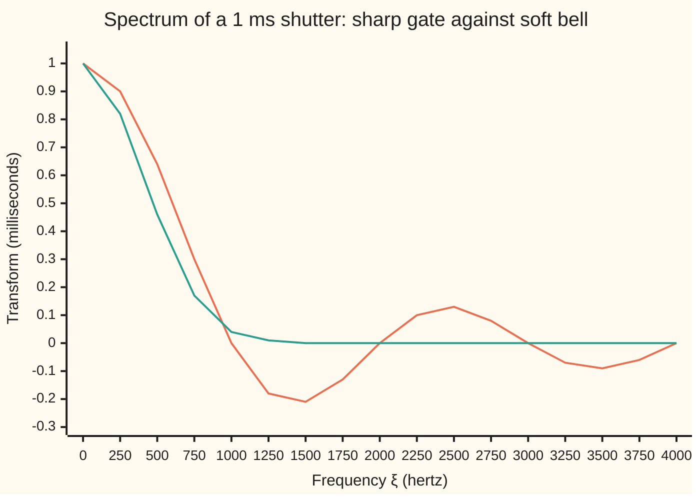

# Two pairs worth memorising: gate and sinc, and the bell curve that transforms to itself

[Syllabus](../../../SYLLABUS.md) → [Harmonic analysis](../README.md) → [The Fourier Transform](../README.md#s02) → Two pairs worth memorising

---

## General Overview

A camera shutter opens for one millisecond, a setting of 1/1000 s, and closes again. Light reaches the sensor only while it is open. Drawn against time, the shutter is a **gate**: open (1) for 1 ms, shut (0) at every other moment.

Under a lamp that flickers, the picture records the light averaged over that millisecond. The gate's **spectrum** (its Fourier transform: how much of each frequency it holds) says how much of each flicker survives the averaging. Flicker at 1,000 times a second vanishes completely, because the shutter catches exactly one whole wobble. Flicker at 100 times a second, the rate of many lamps on 50 Hz mains, passes at 98.4% strength. That is why fast shutter speeds show dark bands under such lights.

The gate's spectrum has a name, the **sinc** curve. A second shape, the **bell curve**, has a spectrum that is the same bell again. [The Fourier transform](../../07-Complex%20analysis/08-Transforms%20in%20Outline/03-fourier-transform.md) card already found both pairs in the radians-per-second form. This card redoes them in hertz, reads off the law that ties a pulse's length to its first spectral zero, and turns both pairs into test cases for transform code.

**A gate open for T seconds has spectrum T sinc(ξT), whose first zero sits at 1/T hertz, so 1 ms gives 1 kHz; the bell e^(−πt²) is its own transform; and because both answers are exact, they are the standard tests for any code that computes a transform.**

**What kind of fact this is:** two theorems, the gate–sinc pair and the self-transforming bell, proved on this card in Why it works; the code gaps in the benchmark are measurements.

### The picture: the two spectra of a 1 ms shutter



First line (orange): the gate open for 1 ms, spectrum T sinc(ξT). It crosses zero at 1, 2, 3 and 4 kHz and swings below zero between them. Second line (green): a bell-shaped shutter with the same 1 ms area, spectrum T e^(−π(Tξ)²). It never reaches zero, but by 1,500 Hz it is down to 0.000851 ms.

---

## The formula

Notation first. The transform of a signal $`f`$ is $`\hat f`$, read "f-hat". This wing measures frequency $`\xi`$ (xi) in hertz, cycles per second, and uses the convention fixed on [The Fourier transform of an absolutely integrable signal, and why it fades at infinity](01-fourier-transform-on-l1-and-riemann-lebesgue.md):

```math
\hat f(\xi) = \int_{-\infty}^{\infty} f(t)\, e^{-2\pi i \xi t}\, dt
```

**Read it aloud:** f-hat at ξ is the signal times a probe turning ξ whole turns a second, added up over all time.

The probe $`e^{-2\pi i \xi t}`$ is a point going round the unit circle, and $`i`$ is the imaginary unit, $`i^2 = -1`$. The **sinc** function is the one from the engineering wing: $`\mathrm{sinc}(u) = \sin(\pi u)/(\pi u)`$, with $`\mathrm{sinc}(0) = 1`$.

The two pairs:

```math
\text{gate: } f(t) = \begin{cases} 1 & |t| < T/2 \\ 0 & |t| > T/2 \end{cases} \quad\Longrightarrow\quad \hat f(\xi) = \frac{\sin(\pi \xi T)}{\pi \xi} = T\,\mathrm{sinc}(\xi T)
```

```math
\text{bell: } g(t) = e^{-\pi t^2} \quad\Longrightarrow\quad \hat g(\xi) = e^{-\pi \xi^2}
```

**Read it aloud:** a gate open for T seconds transforms to T times sinc of ξT; the bell e to the minus π t squared transforms to the same bell in ξ.

The gate's spectrum is zero exactly where $`\xi T`$ is a nonzero whole number:

```math
\hat f(\xi) = 0 \quad\text{at}\quad \xi = \frac{k}{T}, \qquad k = \pm 1, \pm 2, \ldots
```

**Read it aloud:** the zeros sit at whole multiples of one over the open time.

The bell stretched to the shutter's time scale, $`e^{-\pi (t/T)^2}`$, has area T and transforms to $`T\,e^{-\pi (T\xi)^2}`$. That is the second line in the chart.

| Symbol | Plain meaning | In our example | Push it up and the answer… |
| --- | --- | --- | --- |
| $`t`$ | time, in seconds, from the middle of the exposure | −0.5 ms to 0.5 ms | — |
| $`\xi`$ | frequency in hertz: cycles per second | 500, 1,000, 1,500 Hz | the sinc ripples and shrinks; the bell falls fast |
| $`T`$ | how long the shutter is open | 1 ms | zeros crowd in: the first sits at 1/T |
| $`f`$, $`\hat f`$ | the gate (open fraction, no unit) and its transform (seconds) | 1 inside; 0.636620 ms at 500 Hz | — |
| $`\mathrm{sinc}(u)`$ | sin(πu)/(πu); 1 at u = 0, zero at every other whole number | sinc(1/2) = 0.636620 | — |
| $`g`$, $`\hat g`$ | the bell e^(−πt²) and its transform | ĝ(1) = 0.043214 | — |
| $`k`$ | a nonzero whole number counting the zeros | k = 1 gives 1 kHz | the next zero, 1/T further on |
| $`h`$ | step between samples in the code test | 20 μs, a rate of 50 kHz | the sampled answer drifts from the true one |
| $`\mathrm{Si}(x)`$ | sine integral: area under sin(s)/s from 0 to x | Si(2π) = 1.418152 | — |
| $`W`$ | how far out sinc is integrated, in units of 1/T | W = 10, 100, 1,000 | the area under \|sinc\| keeps growing |
| $`i`$, $`\pi`$, $`e`$ | imaginary unit; half-turn 3.14159…; base of natural logs | probe $`e^{-2\pi i \xi t}`$ | — |

### When it holds

- **The gate has finite area, so its transform exists at every ξ.** The way back is harder. The area under |sinc| grows without end, about 0.933 for every factor of ten in range, so the inverse integral needs the care of [Fourier inversion](04-fourier-inversion-theorem.md).
- **The bell must be e^(−πt²) exactly to be its own transform.** Any other width gives a bell of the reciprocal width, by the scaling rule. In the radians-per-second form the self-transforming bell is e^(−t²/2), with a factor √(2π) in front.
- **Frequency is in hertz.** With the kernel $`e^{-i\xi t}`$ and ξ still read as hertz, the 1 ms gate's first zero moves from 1,000 Hz to 6,283.185 Hz, a factor of 2π.
- **The gate is centred on t = 0.** A shutter that opens at t = 0 instead picks up a turning factor: at 500 Hz the answer is −0.636620i ms, the same size in a new direction.
- **Sampled versions match only up to aliasing.** A sampled gate at 50 kHz misses the true spectrum by 6.29e−04 ms at 1,500 Hz; the bell misses by less than 1e−15 ms.

---

## Why it works

### Step 0: a probe that turns whole turns cancels

The transform of the gate is the probe added up over the open millisecond. Where the probe turns exactly once while the shutter is open, its pulls in every direction cancel, and the sum is 0. One turn in 1 ms is 1,000 turns a second: 1 kHz. Two turns gives 2 kHz, and so on.

The bell works by a different trick. Its exponent and the probe's exponent are both quadratic or linear in t. Completing the square merges them into one shifted bell, and a shifted bell has the same area as the original.

### Step 1: the gate, by one antiderivative

The gate is 1 for $`|t| < T/2`$ and 0 elsewhere, so the integral runs only over the open time. An antiderivative (a function whose rate is the integrand) of $`e^{-2\pi i \xi t}`$ is $`e^{-2\pi i \xi t}/(-2\pi i \xi)`$:

```math
\hat f(\xi) = \int_{-T/2}^{T/2} e^{-2\pi i \xi t}\, dt = \frac{e^{i\pi \xi T} - e^{-i\pi \xi T}}{2\pi i \xi} = \frac{\sin(\pi \xi T)}{\pi \xi}.
```

The last step is Euler's formula: $`e^{ia} - e^{-ia} = 2i\sin a`$. Multiply top and bottom by T and the result is $`T\,\mathrm{sinc}(\xi T)`$. At ξ = 0 the integral is the open time itself, 1 ms, which matches $`\mathrm{sinc}(0) = 1`$.

At 500 Hz, $`\pi \xi T = \pi/2`$, so the answer is $`1/(500\pi)`$ seconds: 0.636620 ms. The code finds the same value by adding up the integral directly with Simpson's rule (thin strips topped by parabolas).

### Step 2: the zeros, and the law of pulse length

The sine on top is zero when $`\pi \xi T`$ is a whole multiple of π, so $`\hat f`$ is zero at $`\xi = k/T`$ for every nonzero whole k. At ξ = 0 the bottom is zero too, and the value is T instead.

The first zero is the reciprocal of the open time. That is the scaling rule from [The transform rulebook](02-shift-scale-and-derivative-rules.md) in one case: stretch a signal in time by T, and its spectrum shrinks in frequency by T and grows in height by T.

| Pulse | Open time T | First zero 1/T |
| --- | --- | --- |
| shutter 1/100 s | 10 ms | 100 Hz |
| shutter 1/250 s | 4 ms | 250 Hz |
| shutter 1/1000 s | 1 ms | 1,000 Hz |
| shutter 1/4000 s | 0.25 ms | 4,000 Hz |
| radar pulse | 1 μs | 1,000,000 Hz |

Between the zeros the sinc swings above and below 0. The first side lobe (the hump between the first and second zero) peaks at 1,430.3 Hz, at 0.217234 of the main height. On a decibel scale that is −13.26 dB.

<details>
<summary>How much energy sits below the first zero: 90.3%</summary>

The energy of a signal is the area under its square. By [Plancherel](05-plancherel-and-l2.md), time and frequency hold the same energy. The gate's energy is T, so the fraction below the first zero is the area under sinc² from −1 to 1.

Substitute $`x = \pi u`$ and integrate by parts. The term $`\sin^2 x / x^2`$ becomes $`-\sin^2 x / x`$, which is 0 at both ends, plus $`\sin(2x)/x`$:

$`\displaystyle \int_{-1}^{1} \mathrm{sinc}^2(u)\, du = \frac{2}{\pi}\int_0^{\pi} \frac{\sin^2 x}{x^2}\, dx = \frac{2}{\pi}\int_0^{\pi} \frac{\sin 2x}{x}\, dx = \frac{2\,\mathrm{Si}(2\pi)}{\pi}.`$

The sine integral comes from its power series, $`\mathrm{Si}(x) = x - x^3/(3 \cdot 3!) + x^5/(5 \cdot 5!) - \ldots`$. At $`x = 2\pi`$, 21 terms give 1.418152, so the fraction is 2 × 1.418152 / π = 0.902823. Simpson's rule on sinc² gives the same 0.902823.

</details>

So 90.3% of a 1 ms gate's energy lies below 1 kHz. The other 9.7% spreads over the side lobes, which shrink only like 1/ξ.

### Step 3: the bell, by completing the square

Put the bell and the probe under one exponent and complete the square:

```math
-\pi t^2 - 2\pi i \xi t = -\pi (t + i\xi)^2 - \pi \xi^2.
```

The factor $`e^{-\pi \xi^2}`$ does not depend on t, so it comes out of the integral:

```math
\hat g(\xi) = e^{-\pi \xi^2} \int_{-\infty}^{\infty} e^{-\pi (t + i\xi)^2}\, dt.
```

The remaining integral is the bell's area along a line shifted by iξ. Sliding that line back to the real axis changes nothing. [The Fourier transform](../../07-Complex%20analysis/08-Transforms%20in%20Outline/03-fourier-transform.md) card proves this with a rectangle and Cauchy's theorem, and the fold below gives a proof with no complex numbers.

On the real line the area is $`\int e^{-\pi t^2}\, dt = 1`$. That is [The Gaussian integral](../../06-Calculus%20and%20analysis/08-Multiple%20Integrals/04-gaussian-integral.md), $`\int e^{-x^2} dx = \sqrt{\pi}`$, with $`x = \sqrt{\pi}\, t`$. So

```math
\hat g(\xi) = e^{-\pi \xi^2}.
```

At ξ = 1 this is $`e^{-\pi}`$ = 0.043214. Simpson's rule on [−6, 6] gives the same six digits at 600 and at 1,200 strips. The part cut off beyond |t| = 6 is below $`e^{-36\pi}/(6\pi)`$ = 4.05e−51.

<details>
<summary>Detailed proof: the bell without complex contours</summary>

Differentiate under the integral sign ([Differentiating under the integral](../../06-Calculus%20and%20analysis/08-Multiple%20Integrals/05-differentiating-under-the-integral.md)); the bell decays fast enough to allow it:

$`\displaystyle \hat g'(\xi) = \int_{-\infty}^{\infty} (-2\pi i t)\, e^{-\pi t^2}\, e^{-2\pi i \xi t}\, dt.`$

Now $`-2\pi t\, e^{-\pi t^2}`$ is the derivative $`g'(t)`$, so the integrand is $`i\, g'(t)\, e^{-2\pi i \xi t}`$. Integrate by parts. The boundary terms vanish because g does, and the derivative of the probe brings down $`-2\pi i \xi`$:

$`\displaystyle \hat g'(\xi) = i \cdot 2\pi i \xi \int_{-\infty}^{\infty} g(t)\, e^{-2\pi i \xi t}\, dt = -2\pi \xi\, \hat g(\xi).`$

This says $`\hat g`$ obeys the same rate equation as $`e^{-\pi \xi^2}`$ itself, whose derivative is $`-2\pi\xi\, e^{-\pi\xi^2}`$. So the ratio $`\hat g(\xi)/e^{-\pi \xi^2}`$ has derivative 0 and is constant. At ξ = 0 the ratio is $`\hat g(0) = \int e^{-\pi t^2} dt = 1`$. Therefore $`\hat g(\xi) = e^{-\pi \xi^2}`$ for every ξ.

The code checks the rate equation at ξ = 0.5. A difference quotient of the Simpson transform gives −1.432372, and $`-2\pi \xi\, \hat g(\xi) = -\pi \times 0.455938`$ gives −1.432372.

</details>

### Step 4: why these two pairs are the standard test

A transform routine can be wrong in its sign, its factor of 2π, its step size or its treatment of the ends. A test needs a signal whose transform is known exactly. These two pairs are exact, and they fail in opposite ways.

- **The bell is smooth and dies fast in both time and frequency.** A sampled bell matches its transform to rounding error. Any visible gap is a bug in the code.
- **The gate has two jumps.** Its spectrum fades only like 1/ξ, so sampling folds high frequencies back onto low ones, which is **aliasing**. The sampled gate misses by a small, known amount, and that amount must fall by 4 when the step h halves.
- **Both are even** (the same at −t as at t), so their transforms are real. A sign error in the probe goes unseen on them. The shifted gate, open from 0 to T, catches it.

The code samples each signal every h = 20 μs and takes one bin of a length-1,000 discrete Fourier transform (DFT: the finite sum that stands in for the integral). Bins fall every 50 Hz. The bell misses by at most 4.34e−16 ms. The gate misses by 2.09e−04 ms at 500 Hz and 6.29e−04 ms at 1,500 Hz. At h = 10 μs the 1,500 Hz gap is 1.57e−04 ms, a ratio of 4.0018.

---

## Worked numbers, by hand

The 1 ms shutter, T = 0.001 s.

| Step | Arithmetic | Value |
| --- | --- | --- |
| Gate at 0 Hz | the open time | 1.000000 ms |
| Gate at 500 Hz | sin(π/2)/(500π) = 1/(500π) s | 0.636620 ms |
| Gate at 1,000 Hz | sin(π)/(1000π) | 0 |
| Gate at 1,500 Hz | sin(3π/2)/(1500π) = −1/(1500π) s | −0.212207 ms |
| 100 Hz flicker passed | sinc(0.1) = sin(0.1π)/(0.1π) = 0.309017/0.314159 | 0.983632 |
| 1,000 Hz flicker passed | sinc(1) | 0 |
| Bell shutter, 1,000 Hz passed | e^(−π) | 0.043214 |
| Energy below 1 kHz | 2 Si(2π)/π = 2 × 1.418152/π | **0.902823** |

The 1 ms shutter blocks 1 kHz flicker completely and passes 100 Hz flicker almost untouched, while 90.3% of its own energy lies below 1 kHz.

### What breaks if you drop a piece

| Mistake | Comes out at | What went wrong |
| --- | --- | --- |
| Kernel $`e^{-i\xi t}`$ with ξ read as hertz | 0.958851 ms at 1 kHz; first zero at 6,283.185 Hz | the 2π belongs inside the exponent when ξ is in hertz |
| Sampled sum without the step h | 50.000000 at 0 Hz, not 1.000000 ms | the sum counts samples; h turns the count into an area |
| Gate's edge samples at full weight | 1.020000 ms at 0 Hz; −0.020000 ms at 1 kHz | each edge sample stands for half a step, so it takes weight 1/2 |
| Probe sign flipped to $`e^{+2\pi i \xi t}`$ | shifted shutter +0.636620i ms, not −0.636620i; centred gate unchanged | an even test signal cannot see the sign |

The code prints all four. It also prints the hypothesis that fails on the way back: the area under |sinc| on [−W, W] is 2.105726, 3.038857 and 3.972059 at W = 10, 100 and 1,000. It grows by 0.933 per factor of ten, matching $`(4/\pi^2)\ln 10`$ = 0.933203, so sinc has no finite area.

---

## Code, from first principles, and it actually runs

Both programs compute every number on this card and reach each transform by three independent roads. The first is the closed form. The second is the defining integral by Simpson's rule at two strip counts. The third is the finite twin: the sampled sum, one bin of a DFT, with its gap from the exact answer printed. The main-lobe energy is found two ways, by Simpson's rule and by the power series for Si. The asserts compare the roads, check that the gate's sampling gap quarters when the step halves, and confirm each mistake's wrong answer. Complex numbers are Python's built-in type and a small struct in Rust.

### Python

```python
# Gate and sinc, and the bell that is its own transform -- the check behind the card.
# Standard library only. Convention: f-hat(xi) = integral of f(t) e^(-2 pi i xi t) dt,
# t in seconds, xi in hertz. The gate is a camera shutter open for T = 1 ms.
# Roads: closed form; the defining integral by Simpson's rule at two step counts;
# the finite twin (a sampled sum, one bin of a length-1000 DFT); a series for Si.
import math

T = 0.001                                    # shutter open time, seconds
def sinc(u): return 1.0 if u == 0 else math.sin(math.pi * u) / (math.pi * u)
def one(t): return 1.0                       # the gate, inside its open interval
def gate_hat(xi): return T * sinc(xi * T)                       # road 1
def bell(t): return math.exp(-math.pi * (t / T) ** 2)          # bell with area T
def bell_hat(xi): return T * math.exp(-math.pi * (xi * T) ** 2)  # road 1
def ms(x): return "%.6f" % (0.0 if abs(x) < 5e-13 else 1000 * x)
def f6(x): return "%.6f" % (0.0 if abs(x) < 5e-10 else x)
def sci(x): return "%.2e" % x
def c2(x): return "%.2f" % (0.0 if abs(x) < 0.005 else x)
def cms(z): return ms(z.real) + (" - " if z.imag < -5e-13 else " + ") + ms(abs(z.imag)) + "i"
def probe(xi, t, sign=-1): a = 2 * math.pi * xi * t; return complex(math.cos(a), sign * math.sin(a))

def simpson(f, a, b, n):                     # n even: thin parabola-topped strips
    w = (b - a) / n; s = f(a) + f(b)
    for k in range(1, n): s += (4 if k % 2 else 2) * f(a + k * w)
    return s * w / 3

def by_integral(f, a, b, xi, n, sign=-1):    # road 2: the definition itself
    return simpson(lambda t: f(t) * probe(xi, t, sign), a, b, n)

def by_samples(f, xi, h, M, edge=1.0, step=True):   # road 3: the finite twin
    s = 0j                                   # edge: weight of the samples at n = -M, M
    for n in range(-M, M + 1):
        s += (edge if abs(n) == M else 1.0) * f(n * h) * probe(xi, n * h)
    return s * (h if step else 1.0)

print("convention: f-hat(xi) = integral f(t) e^(-2 pi i xi t) dt; t in s, xi in Hz; values in ms")
print("gate, T = 1 ms: closed form T sinc(xi T); Simpson on the open millisecond, 400 strips; errors at 200 and 400 strips:")
for xi in [0, 500, 1000, 1500, 2000]:
    a, b = by_integral(one, -T / 2, T / 2, xi, 200), by_integral(one, -T / 2, T / 2, xi, 400)
    e1, e2 = abs(a - gate_hat(xi)) / T, abs(b - gate_hat(xi)) / T
    print("  xi = %4d Hz: %s; %s; %s, %s of T" % (xi, ms(gate_hat(xi)), cms(b), sci(e1), sci(e2)))
    assert e1 < 1e-8 and e2 < 1e-9
print("first zeros 1/T for five pulse lengths, with Simpson at that frequency:")
for name, Ts in [("1/100 s", 1 / 100), ("1/250 s", 1 / 250), ("1/1000 s", 1 / 1000), ("1/4000 s", 1 / 4000), ("1 us pulse", 1e-6)]:
    z = by_integral(one, -Ts / 2, Ts / 2, 1 / Ts, 400)
    print("  %s: open %s ms, first zero 1/T = %s Hz, Simpson there %s" % (name, f6(1000 * Ts), f6(1 / Ts), cms(z)))
    assert abs(z) < 1e-15 and abs(by_integral(one, -Ts / 2, Ts / 2, 0.9 / Ts, 400)) > 0.1 * Ts
lobe = simpson(lambda u: sinc(u) ** 2, -1, 1, 2000)
si, term, k = 0.0, 2 * math.pi, 0              # Si(x) = sum (-1)^k x^(2k+1) / ((2k+1)(2k+1)!)
while abs(term) > 1e-17:
    si += term / (2 * k + 1); k += 1; term *= -(2 * math.pi) ** 2 / ((2 * k) * (2 * k + 1))
print("energy below 1 kHz: Simpson %s; 2 Si(2 pi)/pi %s (Si(2 pi) = %s, %d terms)" % (f6(lobe), f6(2 * si / math.pi), f6(si), k))
assert abs(lobe - 2 * si / math.pi) < 1e-9
peak, at = max((abs(sinc(1 + j / 10000)), 1000 + j / 10) for j in range(10001))
print("first side lobe, scan of 1000 to 2000 Hz in 0.1 Hz steps: largest |sinc| %s at %s Hz, %s dB" % (f6(peak), "%.1f" % at, "%.2f" % (20 * math.log10(peak))))
assert 0.2172 < peak < 0.2173 and 1430 < at < 1431
print("unit bell e^(-pi t^2), closed form e^(-pi xi^2) against Simpson on [-6, 6], 600 and 1200 strips:")
tail = math.exp(-36 * math.pi) / (6 * math.pi)
for xi in [0, 0.5, 1, 1.5]:
    a = by_integral(lambda t: math.exp(-math.pi * t * t), -6, 6, xi, 600)
    b = by_integral(lambda t: math.exp(-math.pi * t * t), -6, 6, xi, 1200)
    print("  xi = %.1f: %s; %s; %s" % (xi, f6(math.exp(-math.pi * xi * xi)), f6(a.real), f6(b.real)))
    assert abs(a - math.exp(-math.pi * xi * xi)) < 1e-12 and abs(b - a) < 1e-13
print("  cut-off |t| = 6, tail bound e^(-36 pi)/(6 pi) = %s" % sci(tail))
d = 1e-5
g = lambda x: by_integral(lambda t: math.exp(-math.pi * t * t), -6, 6, x, 1200).real
slope = (g(0.5 + d) - g(0.5 - d)) / (2 * d)
print("slope at xi = 0.5: difference quotient %s; -2 pi xi g-hat %s" % (f6(slope), f6(-math.pi * g(0.5))))
assert abs(slope + math.pi * g(0.5)) < 1e-6
print("shutter flicker pass-through, sinc(nu T) for the gate and e^(-pi (nu T)^2) for the bell:")
for nu in [100, 1000, 1500]:
    print("  nu = %4d Hz: gate %s, bell %s" % (nu, f6(gate_hat(nu) / T), f6(bell_hat(nu) / T)))
print("benchmark, h = 20 us (50 kHz), bins every 50 Hz of a length-1000 DFT; gap = sampled - exact:")
for xi in [0, 500, 1000, 1500]:
    gs, bs = by_samples(one, xi, T / 50, 25, 0.5), by_samples(bell, xi, T / 50, 300)
    print("  bin %2d, %4d Hz: gate %s gap %s; bell %s gap %s" % (xi // 50, xi, ms(gs.real), sci(1000 * (gs.real - gate_hat(xi))), ms(bs.real), sci(1000 * (bs.real - bell_hat(xi)))))
    assert abs(bs - bell_hat(xi)) < 1e-18 and abs(gs.imag) < 1e-15
    assert abs(gs.real - gate_hat(xi)) < 1e-3 * T   # half-weight edges: the gap is aliasing only
g1, g2 = [by_samples(one, 1500, T / m, m // 2, 0.5).real - gate_hat(1500) for m in (50, 100)]
print("gate gap at 1500 Hz: h = 20 us %s ms, h = 10 us %s ms, ratio %s" % (sci(1000 * g1), sci(1000 * g2), "%.4f" % (g1 / g2)))
assert 3.9 < g1 / g2 < 4.1 and abs(g1) > 1e-4 * T
shut = by_integral(one, 0, T, 500, 400, -1)     # shutter opening at t = 0 instead of centred
print("shutter on [0, T] at 500 Hz: Simpson %s; T sinc(1/2) e^(-i pi/2) %s" % (cms(shut), cms(complex(0, -gate_hat(500)))))
assert abs(shut - complex(0, -gate_hat(500))) < 1e-12
print("chart, xi = 0 to 4000 Hz in 250 Hz steps, gate in ms: " + ", ".join(c2(1000 * gate_hat(250 * j)) for j in range(17)))
print("chart, xi = 0 to 4000 Hz in 250 Hz steps, bell in ms: " + ", ".join(c2(1000 * bell_hat(250 * j)) for j in range(17)))
wrong = lambda xi: by_integral(one, -T / 2, T / 2, xi / (2 * math.pi), 400)   # kernel e^(-i xi t)
print("mistake, kernel e^(-i xi t) with xi in Hz: at 1000 Hz %s; first zero at %s Hz, Simpson there %s" % (cms(wrong(1000)), f6(2 * math.pi / T), cms(wrong(2 * math.pi / T))))
assert abs(wrong(2 * math.pi / T)) < 1e-15 and abs(wrong(1000) - gate_hat(1000)) > 0.9 * T
nostep = by_samples(one, 0, T / 50, 25, 0.5, step=False).real
print("mistake, no step h in the sum, gate at 0 Hz: %s instead of %s ms" % (f6(nostep), ms(gate_hat(0))))
assert abs(nostep - gate_hat(0) / (T / 50)) < 1e-9      # a count of samples: the area over h
full = by_samples(one, 1000, T / 50, 25).real
print("mistake, edge samples at full weight: 0 Hz %s ms, 1000 Hz %s ms" % (ms(by_samples(one, 0, T / 50, 25).real), ms(full)))
assert abs(full + T / 50) < 1e-15
flip = by_integral(one, 0, T, 500, 400, +1)
print("mistake, sign flipped to e^(+2 pi i xi t): shutter on [0, T] %s; centred gate %s, unchanged" % (cms(flip), cms(by_integral(one, -T / 2, T / 2, 500, 400, +1))))
assert abs(flip - shut.conjugate()) < 1e-15 and abs(flip - shut) > T
area = [2 * sum(simpson(lambda u: abs(sinc(u)), j, j + 1, 40) for j in range(W)) for W in (10, 100, 1000)]
print("hypothesis fails: area under |sinc| on [-W, W], W = 10, 100, 1000: %s, %s, %s; per decade %s, %s against (4/pi^2) ln 10 = %s"
      % (f6(area[0]), f6(area[1]), f6(area[2]), f6(area[1] - area[0]), f6(area[2] - area[1]), f6(4 / math.pi ** 2 * math.log(10))))
assert abs(area[2] - area[1] - 4 / math.pi ** 2 * math.log(10)) < 0.01
print("ALL CHECKS PASS")
```

**Ran 2026-11-15 on macOS, Python 3.14.10, standard library only. All checks passed. Output, pasted from the run:**

```
convention: f-hat(xi) = integral f(t) e^(-2 pi i xi t) dt; t in s, xi in Hz; values in ms
gate, T = 1 ms: closed form T sinc(xi T); Simpson on the open millisecond, 400 strips; errors at 200 and 400 strips:
  xi =    0 Hz: 1.000000; 1.000000 + 0.000000i; 0.00e+00, 0.00e+00 of T
  xi =  500 Hz: 0.636620; 0.636620 + 0.000000i; 2.15e-10, 1.35e-11 of T
  xi = 1000 Hz: 0.000000; 0.000000 + 0.000000i; 7.36e-17, 1.42e-17 of T
  xi = 1500 Hz: -0.212207; -0.212207 + 0.000000i; 5.82e-09, 3.63e-10 of T
  xi = 2000 Hz: 0.000000; 0.000000 + 0.000000i; 3.65e-17, 2.72e-17 of T
first zeros 1/T for five pulse lengths, with Simpson at that frequency:
  1/100 s: open 10.000000 ms, first zero 1/T = 100.000000 Hz, Simpson there 0.000000 + 0.000000i
  1/250 s: open 4.000000 ms, first zero 1/T = 250.000000 Hz, Simpson there 0.000000 + 0.000000i
  1/1000 s: open 1.000000 ms, first zero 1/T = 1000.000000 Hz, Simpson there 0.000000 + 0.000000i
  1/4000 s: open 0.250000 ms, first zero 1/T = 4000.000000 Hz, Simpson there 0.000000 + 0.000000i
  1 us pulse: open 0.001000 ms, first zero 1/T = 1000000.000000 Hz, Simpson there 0.000000 + 0.000000i
energy below 1 kHz: Simpson 0.902823; 2 Si(2 pi)/pi 0.902823 (Si(2 pi) = 1.418152, 21 terms)
first side lobe, scan of 1000 to 2000 Hz in 0.1 Hz steps: largest |sinc| 0.217234 at 1430.3 Hz, -13.26 dB
unit bell e^(-pi t^2), closed form e^(-pi xi^2) against Simpson on [-6, 6], 600 and 1200 strips:
  xi = 0.0: 1.000000; 1.000000; 1.000000
  xi = 0.5: 0.455938; 0.455938; 0.455938
  xi = 1.0: 0.043214; 0.043214; 0.043214
  xi = 1.5: 0.000851; 0.000851; 0.000851
  cut-off |t| = 6, tail bound e^(-36 pi)/(6 pi) = 4.05e-51
slope at xi = 0.5: difference quotient -1.432372; -2 pi xi g-hat -1.432372
shutter flicker pass-through, sinc(nu T) for the gate and e^(-pi (nu T)^2) for the bell:
  nu =  100 Hz: gate 0.983632, bell 0.969072
  nu = 1000 Hz: gate 0.000000, bell 0.043214
  nu = 1500 Hz: gate -0.212207, bell 0.000851
benchmark, h = 20 us (50 kHz), bins every 50 Hz of a length-1000 DFT; gap = sampled - exact:
  bin  0,    0 Hz: gate 1.000000 gap 0.00e+00; bell 1.000000 gap 4.34e-16
  bin 10,  500 Hz: gate 0.636410 gap -2.09e-04; bell 0.455938 gap 1.63e-16
  bin 20, 1000 Hz: gate 0.000000 gap -1.90e-17; bell 0.043214 gap 3.39e-17
  bin 30, 1500 Hz: gate -0.211578 gap 6.29e-04; bell 0.000851 gap -2.83e-17
gate gap at 1500 Hz: h = 20 us 6.29e-04 ms, h = 10 us 1.57e-04 ms, ratio 4.0018
shutter on [0, T] at 500 Hz: Simpson 0.000000 - 0.636620i; T sinc(1/2) e^(-i pi/2) 0.000000 - 0.636620i
chart, xi = 0 to 4000 Hz in 250 Hz steps, gate in ms: 1.00, 0.90, 0.64, 0.30, 0.00, -0.18, -0.21, -0.13, 0.00, 0.10, 0.13, 0.08, 0.00, -0.07, -0.09, -0.06, 0.00
chart, xi = 0 to 4000 Hz in 250 Hz steps, bell in ms: 1.00, 0.82, 0.46, 0.17, 0.04, 0.01, 0.00, 0.00, 0.00, 0.00, 0.00, 0.00, 0.00, 0.00, 0.00, 0.00, 0.00
mistake, kernel e^(-i xi t) with xi in Hz: at 1000 Hz 0.958851 + 0.000000i; first zero at 6283.185307 Hz, Simpson there 0.000000 + 0.000000i
mistake, no step h in the sum, gate at 0 Hz: 50.000000 instead of 1.000000 ms
mistake, edge samples at full weight: 0 Hz 1.020000 ms, 1000 Hz -0.020000 ms
mistake, sign flipped to e^(+2 pi i xi t): shutter on [0, T] 0.000000 + 0.636620i; centred gate 0.636620 + 0.000000i, unchanged
hypothesis fails: area under |sinc| on [-W, W], W = 10, 100, 1000: 2.105726, 3.038857, 3.972059; per decade 0.933131, 0.933202 against (4/pi^2) ln 10 = 0.933203
ALL CHECKS PASS
```

### Rust

Same numbers, same labels, built with `rustc --edition 2021 -O`.

```rust
// Gate and sinc, and the bell that is its own transform -- the check behind the card.
// Standard library only. Convention: f-hat(xi) = integral of f(t) e^(-2 pi i xi t) dt,
// t in seconds, xi in hertz. The gate is a camera shutter open for T = 1 ms.
// Roads: closed form; the defining integral by Simpson's rule at two step counts;
// the finite twin (a sampled sum, one bin of a length-1000 DFT); a series for Si.
use std::f64::consts::PI;

const T: f64 = 0.001; // shutter open time, seconds
#[derive(Clone, Copy)]
struct C { re: f64, im: f64 }
impl C {
    fn add(self, o: C) -> C { C { re: self.re + o.re, im: self.im + o.im } }
    fn sub(self, o: C) -> C { C { re: self.re - o.re, im: self.im - o.im } }
    fn scale(self, k: f64) -> C { C { re: k * self.re, im: k * self.im } }
    fn abs(self) -> f64 { self.re.hypot(self.im) }
    fn conj(self) -> C { C { re: self.re, im: -self.im } }
}
fn sinc(u: f64) -> f64 { if u == 0.0 { 1.0 } else { (PI * u).sin() / (PI * u) } }
fn one(_t: f64) -> f64 { 1.0 } // the gate, inside its open interval
fn gate_hat(xi: f64) -> f64 { T * sinc(xi * T) } // road 1
fn bell(t: f64) -> f64 { (-PI * (t / T).powi(2)).exp() } // bell with area T
fn bell_hat(xi: f64) -> f64 { T * (-PI * (xi * T).powi(2)).exp() } // road 1
fn ms(x: f64) -> String { format!("{:.6}", if x.abs() < 5e-13 { 0.0 } else { 1000.0 * x }) }
fn f6(x: f64) -> String { format!("{:.6}", if x.abs() < 5e-10 { 0.0 } else { x }) }
fn sci(x: f64) -> String { // Python's %.2e: two-digit exponent with a sign
    let s = format!("{:.2e}", x);
    let (m, e) = s.split_once('e').unwrap();
    let e: i32 = e.parse().unwrap();
    format!("{}e{}{:02}", m, if e < 0 { '-' } else { '+' }, e.abs())
}
fn c2(x: f64) -> String { format!("{:.2}", if x.abs() < 0.005 { 0.0 } else { x }) }
fn cms(z: C) -> String { format!("{}{}{}i", ms(z.re), if z.im < -5e-13 { " - " } else { " + " }, ms(z.im.abs())) }
fn probe(xi: f64, t: f64, sign: f64) -> C { let a = 2.0 * PI * xi * t; C { re: a.cos(), im: sign * a.sin() } }

fn simpson<F: Fn(f64) -> C>(f: F, a: f64, b: f64, n: usize) -> C { // n even: parabola-topped strips
    let w = (b - a) / n as f64;
    let mut s = f(a).add(f(b));
    for k in 1..n { s = s.add(f(a + k as f64 * w).scale(if k % 2 == 1 { 4.0 } else { 2.0 })); }
    let s = s.scale(w);
    C { re: s.re / 3.0, im: s.im / 3.0 }
}
fn simpson_re<F: Fn(f64) -> f64>(f: F, a: f64, b: f64, n: usize) -> f64 { simpson(|t| C { re: f(t), im: 0.0 }, a, b, n).re }
fn by_integral(f: fn(f64) -> f64, a: f64, b: f64, xi: f64, n: usize, sign: f64) -> C { // road 2
    simpson(|t| probe(xi, t, sign).scale(f(t)), a, b, n)
}
fn by_samples(f: fn(f64) -> f64, xi: f64, h: f64, m: i64, edge: f64, step: bool) -> C { // road 3
    let mut s = C { re: 0.0, im: 0.0 }; // edge: weight of the samples at n = -M, M
    for n in -m..=m {
        let t = n as f64 * h;
        s = s.add(probe(xi, t, -1.0).scale((if n.abs() == m { edge } else { 1.0 }) * f(t)));
    }
    s.scale(if step { h } else { 1.0 })
}
fn unit_bell(t: f64) -> f64 { (-PI * t * t).exp() }

fn main() {
    println!("convention: f-hat(xi) = integral f(t) e^(-2 pi i xi t) dt; t in s, xi in Hz; values in ms");
    println!("gate, T = 1 ms: closed form T sinc(xi T); Simpson on the open millisecond, 400 strips; errors at 200 and 400 strips:");
    for xi in [0.0, 500.0, 1000.0, 1500.0, 2000.0] {
        let (a, b) = (by_integral(one, -T / 2.0, T / 2.0, xi, 200, -1.0), by_integral(one, -T / 2.0, T / 2.0, xi, 400, -1.0));
        let g = C { re: gate_hat(xi), im: 0.0 };
        let (e1, e2) = (a.sub(g).abs() / T, b.sub(g).abs() / T);
        println!("  xi = {:4} Hz: {}; {}; {}, {} of T", xi as i64, ms(gate_hat(xi)), cms(b), sci(e1), sci(e2));
        assert!(e1 < 1e-8 && e2 < 1e-9);
    }
    println!("first zeros 1/T for five pulse lengths, with Simpson at that frequency:");
    for (name, ts) in [("1/100 s", 1.0 / 100.0), ("1/250 s", 1.0 / 250.0), ("1/1000 s", 1.0 / 1000.0), ("1/4000 s", 1.0 / 4000.0), ("1 us pulse", 1e-6)] {
        let z = by_integral(one, -ts / 2.0, ts / 2.0, 1.0 / ts, 400, -1.0);
        println!("  {}: open {} ms, first zero 1/T = {} Hz, Simpson there {}", name, f6(1000.0 * ts), f6(1.0 / ts), cms(z));
        assert!(z.abs() < 1e-15 && by_integral(one, -ts / 2.0, ts / 2.0, 0.9 / ts, 400, -1.0).abs() > 0.1 * ts);
    }
    let lobe = simpson_re(|u| sinc(u).powi(2), -1.0, 1.0, 2000);
    let (mut si, mut term, mut k) = (0.0f64, 2.0 * PI, 0i64); // Si(x) = sum (-1)^k x^(2k+1) / ((2k+1)(2k+1)!)
    while term.abs() > 1e-17 {
        si += term / (2 * k + 1) as f64; k += 1;
        term *= -(2.0 * PI).powi(2) / ((2 * k) * (2 * k + 1)) as f64;
    }
    println!("energy below 1 kHz: Simpson {}; 2 Si(2 pi)/pi {} (Si(2 pi) = {}, {} terms)", f6(lobe), f6(2.0 * si / PI), f6(si), k);
    assert!((lobe - 2.0 * si / PI).abs() < 1e-9);
    let (mut peak, mut at) = (0.0f64, 0.0f64);
    for j in 0..=10000 {
        let (p, a) = (sinc(1.0 + j as f64 / 10000.0).abs(), 1000.0 + j as f64 / 10.0);
        if p > peak || (p == peak && a > at) { peak = p; at = a; }
    }
    println!("first side lobe, scan of 1000 to 2000 Hz in 0.1 Hz steps: largest |sinc| {} at {:.1} Hz, {:.2} dB", f6(peak), at, 20.0 * peak.log10());
    assert!(0.2172 < peak && peak < 0.2173 && 1430.0 < at && at < 1431.0);
    println!("unit bell e^(-pi t^2), closed form e^(-pi xi^2) against Simpson on [-6, 6], 600 and 1200 strips:");
    let tail = (-36.0 * PI).exp() / (6.0 * PI);
    for xi in [0.0, 0.5, 1.0, 1.5] {
        let (a, b) = (by_integral(unit_bell, -6.0, 6.0, xi, 600, -1.0), by_integral(unit_bell, -6.0, 6.0, xi, 1200, -1.0));
        let exact = (-PI * xi * xi).exp();
        println!("  xi = {:.1}: {}; {}; {}", xi, f6(exact), f6(a.re), f6(b.re));
        assert!(a.sub(C { re: exact, im: 0.0 }).abs() < 1e-12 && b.sub(a).abs() < 1e-13);
    }
    println!("  cut-off |t| = 6, tail bound e^(-36 pi)/(6 pi) = {}", sci(tail));
    let d = 1e-5;
    let g = |x: f64| by_integral(unit_bell, -6.0, 6.0, x, 1200, -1.0).re;
    let slope = (g(0.5 + d) - g(0.5 - d)) / (2.0 * d);
    println!("slope at xi = 0.5: difference quotient {}; -2 pi xi g-hat {}", f6(slope), f6(-PI * g(0.5)));
    assert!((slope + PI * g(0.5)).abs() < 1e-6);
    println!("shutter flicker pass-through, sinc(nu T) for the gate and e^(-pi (nu T)^2) for the bell:");
    for nu in [100.0, 1000.0, 1500.0] {
        println!("  nu = {:4} Hz: gate {}, bell {}", nu as i64, f6(gate_hat(nu) / T), f6(bell_hat(nu) / T));
    }
    println!("benchmark, h = 20 us (50 kHz), bins every 50 Hz of a length-1000 DFT; gap = sampled - exact:");
    for xi in [0i64, 500, 1000, 1500] {
        let x = xi as f64;
        let (gs, bs) = (by_samples(one, x, T / 50.0, 25, 0.5, true), by_samples(bell, x, T / 50.0, 300, 1.0, true));
        println!("  bin {:2}, {:4} Hz: gate {} gap {}; bell {} gap {}", xi / 50, xi, ms(gs.re), sci(1000.0 * (gs.re - gate_hat(x))), ms(bs.re), sci(1000.0 * (bs.re - bell_hat(x))));
        assert!(bs.sub(C { re: bell_hat(x), im: 0.0 }).abs() < 1e-18 && gs.im.abs() < 1e-15);
        assert!((gs.re - gate_hat(x)).abs() < 1e-3 * T); // half-weight edges: the gap is aliasing only
    }
    let gap = |m: i64| by_samples(one, 1500.0, T / m as f64, m / 2, 0.5, true).re - gate_hat(1500.0);
    let (g1, g2) = (gap(50), gap(100));
    println!("gate gap at 1500 Hz: h = 20 us {} ms, h = 10 us {} ms, ratio {:.4}", sci(1000.0 * g1), sci(1000.0 * g2), g1 / g2);
    assert!(3.9 < g1 / g2 && g1 / g2 < 4.1 && g1.abs() > 1e-4 * T);
    let shut = by_integral(one, 0.0, T, 500.0, 400, -1.0); // shutter opening at t = 0 instead of centred
    let want = C { re: 0.0, im: -gate_hat(500.0) };
    println!("shutter on [0, T] at 500 Hz: Simpson {}; T sinc(1/2) e^(-i pi/2) {}", cms(shut), cms(want));
    assert!(shut.sub(want).abs() < 1e-12);
    let chart = |f: fn(f64) -> f64| (0..17).map(|j| c2(1000.0 * f(250.0 * j as f64))).collect::<Vec<_>>().join(", ");
    println!("chart, xi = 0 to 4000 Hz in 250 Hz steps, gate in ms: {}", chart(gate_hat));
    println!("chart, xi = 0 to 4000 Hz in 250 Hz steps, bell in ms: {}", chart(bell_hat));
    let wrong = |xi: f64| by_integral(one, -T / 2.0, T / 2.0, xi / (2.0 * PI), 400, -1.0); // kernel e^(-i xi t)
    println!("mistake, kernel e^(-i xi t) with xi in Hz: at 1000 Hz {}; first zero at {} Hz, Simpson there {}", cms(wrong(1000.0)), f6(2.0 * PI / T), cms(wrong(2.0 * PI / T)));
    assert!(wrong(2.0 * PI / T).abs() < 1e-15 && wrong(1000.0).sub(C { re: gate_hat(1000.0), im: 0.0 }).abs() > 0.9 * T);
    let nostep = by_samples(one, 0.0, T / 50.0, 25, 0.5, false).re;
    println!("mistake, no step h in the sum, gate at 0 Hz: {} instead of {} ms", f6(nostep), ms(gate_hat(0.0)));
    assert!((nostep - gate_hat(0.0) / (T / 50.0)).abs() < 1e-9); // a count of samples: the area over h
    let full = by_samples(one, 1000.0, T / 50.0, 25, 1.0, true).re;
    println!("mistake, edge samples at full weight: 0 Hz {} ms, 1000 Hz {} ms", ms(by_samples(one, 0.0, T / 50.0, 25, 1.0, true).re), ms(full));
    assert!((full + T / 50.0).abs() < 1e-15);
    let flip = by_integral(one, 0.0, T, 500.0, 400, 1.0);
    println!("mistake, sign flipped to e^(+2 pi i xi t): shutter on [0, T] {}; centred gate {}, unchanged", cms(flip), cms(by_integral(one, -T / 2.0, T / 2.0, 500.0, 400, 1.0)));
    assert!(flip.sub(shut.conj()).abs() < 1e-15 && flip.sub(shut).abs() > T);
    let area: Vec<f64> = [10, 100, 1000].iter().map(|&w| 2.0 * (0..w).fold(0.0, |acc, j| acc + simpson_re(|u| sinc(u).abs(), j as f64, (j + 1) as f64, 40))).collect();
    println!("hypothesis fails: area under |sinc| on [-W, W], W = 10, 100, 1000: {}, {}, {}; per decade {}, {} against (4/pi^2) ln 10 = {}",
        f6(area[0]), f6(area[1]), f6(area[2]), f6(area[1] - area[0]), f6(area[2] - area[1]), f6(4.0 / PI.powi(2) * 10f64.ln()));
    assert!((area[2] - area[1] - 4.0 / PI.powi(2) * 10f64.ln()).abs() < 0.01);
    println!("ALL CHECKS PASS");
}
```

**Ran 2026-11-15 on macOS, rustc 1.98.1, no crates. All checks passed. Output, pasted from the run:**

```
convention: f-hat(xi) = integral f(t) e^(-2 pi i xi t) dt; t in s, xi in Hz; values in ms
gate, T = 1 ms: closed form T sinc(xi T); Simpson on the open millisecond, 400 strips; errors at 200 and 400 strips:
  xi =    0 Hz: 1.000000; 1.000000 + 0.000000i; 0.00e+00, 0.00e+00 of T
  xi =  500 Hz: 0.636620; 0.636620 + 0.000000i; 2.15e-10, 1.35e-11 of T
  xi = 1000 Hz: 0.000000; 0.000000 + 0.000000i; 7.36e-17, 1.42e-17 of T
  xi = 1500 Hz: -0.212207; -0.212207 + 0.000000i; 5.82e-09, 3.63e-10 of T
  xi = 2000 Hz: 0.000000; 0.000000 + 0.000000i; 3.65e-17, 2.72e-17 of T
first zeros 1/T for five pulse lengths, with Simpson at that frequency:
  1/100 s: open 10.000000 ms, first zero 1/T = 100.000000 Hz, Simpson there 0.000000 + 0.000000i
  1/250 s: open 4.000000 ms, first zero 1/T = 250.000000 Hz, Simpson there 0.000000 + 0.000000i
  1/1000 s: open 1.000000 ms, first zero 1/T = 1000.000000 Hz, Simpson there 0.000000 + 0.000000i
  1/4000 s: open 0.250000 ms, first zero 1/T = 4000.000000 Hz, Simpson there 0.000000 + 0.000000i
  1 us pulse: open 0.001000 ms, first zero 1/T = 1000000.000000 Hz, Simpson there 0.000000 + 0.000000i
energy below 1 kHz: Simpson 0.902823; 2 Si(2 pi)/pi 0.902823 (Si(2 pi) = 1.418152, 21 terms)
first side lobe, scan of 1000 to 2000 Hz in 0.1 Hz steps: largest |sinc| 0.217234 at 1430.3 Hz, -13.26 dB
unit bell e^(-pi t^2), closed form e^(-pi xi^2) against Simpson on [-6, 6], 600 and 1200 strips:
  xi = 0.0: 1.000000; 1.000000; 1.000000
  xi = 0.5: 0.455938; 0.455938; 0.455938
  xi = 1.0: 0.043214; 0.043214; 0.043214
  xi = 1.5: 0.000851; 0.000851; 0.000851
  cut-off |t| = 6, tail bound e^(-36 pi)/(6 pi) = 4.05e-51
slope at xi = 0.5: difference quotient -1.432372; -2 pi xi g-hat -1.432372
shutter flicker pass-through, sinc(nu T) for the gate and e^(-pi (nu T)^2) for the bell:
  nu =  100 Hz: gate 0.983632, bell 0.969072
  nu = 1000 Hz: gate 0.000000, bell 0.043214
  nu = 1500 Hz: gate -0.212207, bell 0.000851
benchmark, h = 20 us (50 kHz), bins every 50 Hz of a length-1000 DFT; gap = sampled - exact:
  bin  0,    0 Hz: gate 1.000000 gap 0.00e+00; bell 1.000000 gap 4.34e-16
  bin 10,  500 Hz: gate 0.636410 gap -2.09e-04; bell 0.455938 gap 1.63e-16
  bin 20, 1000 Hz: gate 0.000000 gap -1.90e-17; bell 0.043214 gap 3.39e-17
  bin 30, 1500 Hz: gate -0.211578 gap 6.29e-04; bell 0.000851 gap -2.83e-17
gate gap at 1500 Hz: h = 20 us 6.29e-04 ms, h = 10 us 1.57e-04 ms, ratio 4.0018
shutter on [0, T] at 500 Hz: Simpson 0.000000 - 0.636620i; T sinc(1/2) e^(-i pi/2) 0.000000 - 0.636620i
chart, xi = 0 to 4000 Hz in 250 Hz steps, gate in ms: 1.00, 0.90, 0.64, 0.30, 0.00, -0.18, -0.21, -0.13, 0.00, 0.10, 0.13, 0.08, 0.00, -0.07, -0.09, -0.06, 0.00
chart, xi = 0 to 4000 Hz in 250 Hz steps, bell in ms: 1.00, 0.82, 0.46, 0.17, 0.04, 0.01, 0.00, 0.00, 0.00, 0.00, 0.00, 0.00, 0.00, 0.00, 0.00, 0.00, 0.00
mistake, kernel e^(-i xi t) with xi in Hz: at 1000 Hz 0.958851 + 0.000000i; first zero at 6283.185307 Hz, Simpson there 0.000000 + 0.000000i
mistake, no step h in the sum, gate at 0 Hz: 50.000000 instead of 1.000000 ms
mistake, edge samples at full weight: 0 Hz 1.020000 ms, 1000 Hz -0.020000 ms
mistake, sign flipped to e^(+2 pi i xi t): shutter on [0, T] 0.000000 + 0.636620i; centred gate 0.636620 + 0.000000i, unchanged
hypothesis fails: area under |sinc| on [-W, W], W = 10, 100, 1000: 2.105726, 3.038857, 3.972059; per decade 0.933131, 0.933202 against (4/pi^2) ln 10 = 0.933203
ALL CHECKS PASS
```

### Lean

Lean proves both pairs and the law of zeros, for every open time $`T > 0`$ and every frequency ξ.

- Take a gate open for T seconds, with $`T > 0`$. Then $`\hat f(\xi) = T\,\mathrm{sinc}(\xi T)`$ at every ξ, and $`\hat f(0) = T`$.
- Take the same gate. Then $`\hat f(\xi) = 0`$ exactly when $`\xi = k/T`$ for a nonzero whole number k. So the first zero sits at 1/T.
- Take the bell $`g(t) = e^{-\pi t^2}`$. Then $`\hat g(\xi) = e^{-\pi \xi^2}`$ at every ξ: the bell is its own transform.
- The card's transform, with $`2\pi`$ in the exponent and ξ in hertz, is the transform built into Lean's maths library.
- The table of first zeros and the 500 Hz value, $`1/(500\pi)`$ seconds, are checked as exact numbers.

The Simpson sums, the energy below 1 kHz, the side lobe, the sampled benchmark and the broken cases are left to the Python and Rust checks.

```lean
-- Two pairs worth memorising: with f-hat(ξ) = ∫ f(t) e^(−2πiξt) dt and ξ in hertz, a gate open for T seconds transforms to T sinc(ξT), which is zero exactly at ξ = k/T for nonzero whole k, and the bell e^(−πt²) transforms to itself.
import Mathlib.Analysis.SpecialFunctions.Gaussian.FourierTransform
import Mathlib.Analysis.SpecialFunctions.Trigonometric.Sinc

open MeasureTheory Complex Real
open scoped FourierTransform

/-! Mathlib's `𝓕` on `ℝ` is the card's transform exactly:
`𝓕 f ξ = ∫ f(t) e^(−2πiξt) dt`, with ξ in hertz (see `Real.fourier_real_eq_integral_exp_smul`).
Mathlib's `Real.sinc x` is `sin x / x` (and 1 at 0), so the card's
`sinc(u) = sin(πu)/(πu)` is `Real.sinc (π * u)`. -/

/-- The card's gate: open (1) while `|t| < T/2`, shut (0) at every other time. -/
noncomputable def gate (T : ℝ) : ℝ → ℂ :=
  Set.indicator (Set.Ioo (-T / 2) (T / 2)) (fun _ => 1)

/-- The gate's transform as an interval integral of the exponential. -/
lemma gate_fourier_eq_intervalIntegral (T : ℝ) (hT : 0 < T) (ξ : ℝ) :
    𝓕 (gate T) ξ = ∫ v in (-T / 2)..(T / 2), cexp ((-2 * π * ξ * I) * (v : ℂ)) := by
  rw [Real.fourier_real_eq_integral_exp_smul, intervalIntegral.integral_of_le (by linarith),
    integral_Ioc_eq_integral_Ioo, ← integral_indicator measurableSet_Ioo]
  congr 1
  ext v
  simp only [gate, Set.indicator, smul_eq_mul]
  split_ifs <;> simp
  congr 1
  ring

/-- Gate and sinc: a gate open for `T > 0` seconds has spectrum `T sinc(ξT)` at every
frequency `ξ` in hertz, that is `sin(πξT)/(πξ)` for `ξ ≠ 0` and the open time `T` at `ξ = 0`. -/
theorem gate_fourier_eq_T_mul_sinc (T : ℝ) (hT : 0 < T) (ξ : ℝ) :
    𝓕 (gate T) ξ = ((T * Real.sinc (π * (ξ * T)) : ℝ) : ℂ) := by
  rw [gate_fourier_eq_intervalIntegral T hT]
  rcases eq_or_ne ξ 0 with rfl | hξ
  · simp
    ring
  · have hc : (-2 * π * ξ * I : ℂ) ≠ 0 := by
      have := Real.pi_pos.ne'
      simp [hξ, this, I_ne_zero]
    rw [integral_exp_mul_complex hc]
    have hx : π * (ξ * T) ≠ 0 := by
      have := Real.pi_pos.ne'; positivity
    rw [Real.sinc_of_ne_zero hx]
    have key : cexp (-2 * π * ξ * I * ((T / 2 : ℝ) : ℂ)) - cexp (-2 * π * ξ * I * ((-T / 2 : ℝ) : ℂ))
        = -2 * I * Complex.sin ((π * (ξ * T) : ℝ) : ℂ) := by
      rw [Complex.sin]
      have e1 : -2 * π * ξ * I * ((T / 2 : ℝ) : ℂ) = -(((π * (ξ * T) : ℝ) : ℂ) * I) := by
        push_cast; ring
      have e2 : -2 * π * ξ * I * ((-T / 2 : ℝ) : ℂ) = ((π * (ξ * T) : ℝ) : ℂ) * I := by
        push_cast; ring
      rw [e1, e2]
      field_simp
      rw [I_sq]
      ring
    rw [key, ← Complex.ofReal_sin]
    have hπ : (π : ℂ) ≠ 0 := by exact_mod_cast Real.pi_pos.ne'
    have hξ' : (ξ : ℂ) ≠ 0 := by exact_mod_cast hξ
    have hT' : (T : ℂ) ≠ 0 := by exact_mod_cast hT.ne'
    push_cast
    field_simp

/-- The law of pulse length: the spectrum of a gate open for `T > 0` seconds is zero exactly
at the frequencies `ξ = k/T` with `k` a nonzero whole number; so the first zero is `1/T`. -/
theorem gate_fourier_eq_zero_iff (T : ℝ) (hT : 0 < T) (ξ : ℝ) :
    𝓕 (gate T) ξ = 0 ↔ ∃ k : ℤ, k ≠ 0 ∧ ξ = k / T := by
  rw [gate_fourier_eq_T_mul_sinc T hT, Complex.ofReal_eq_zero, mul_eq_zero, or_iff_right hT.ne']
  constructor
  · intro h
    rcases eq_or_ne ξ 0 with rfl | hξ
    · simp at h
    have hx : π * (ξ * T) ≠ 0 := by
      have := Real.pi_pos.ne'; positivity
    rw [Real.sinc_of_ne_zero hx, div_eq_zero_iff, or_iff_left hx, Real.sin_eq_zero_iff] at h
    obtain ⟨n, hn⟩ := h
    have hn' : (n : ℝ) = ξ * T := by
      have := Real.pi_pos.ne'
      apply mul_right_cancel₀ this
      linarith [hn]
    refine ⟨n, ?_, ?_⟩
    · rintro rfl
      simp at hn'
      rcases hn'.symm with h | h
      · exact hT.ne' h
      · exact hξ h
    · rw [hn']; field_simp
  · rintro ⟨k, hk, rfl⟩
    have hk' : (k : ℝ) ≠ 0 := by exact_mod_cast hk
    have e : π * ((k : ℝ) / T * T) = k * π := by field_simp
    rw [e, Real.sinc_of_ne_zero (by have := Real.pi_pos.ne'; positivity), Real.sin_int_mul_pi,
      zero_div]

/-- The bell that transforms to itself: the transform of `e^(−πt²)` is `e^(−πξ²)`. -/
theorem bell_fourier_eq_bell :
    𝓕 (fun t : ℝ => cexp (-π * (t : ℂ) ^ 2)) = fun ξ : ℝ => cexp (-π * (ξ : ℂ) ^ 2) := by
  have h := fourier_gaussian_pi (b := 1) (by simp)
  simpa using h

-- Worked numbers, exact.
-- Pulse lengths and first zeros 1/T: 1/100 s, 1/250 s, 1/1000 s, 1/4000 s, 1 μs.
example : 1 / (1 / 100 : ℚ) = 100 := by norm_num
example : 1 / (1 / 250 : ℚ) = 250 := by norm_num
example : 1 / (1 / 1000 : ℚ) = 1000 := by norm_num
example : 1 / (1 / 4000 : ℚ) = 4000 := by norm_num
example : 1 / (1 / 1000000 : ℚ) = 1000000 := by norm_num
-- Gate at 500 Hz with T = 1/1000 s: sin(π/2)/(500π) = 1/(500π) seconds.
example : Real.sin (π * 500 * (1 / 1000)) / (π * 500) = 1 / (500 * π) := by
  rw [show π * 500 * (1 / 1000) = π / 2 by ring, Real.sin_pi_div_two]; ring
-- Gate at 1,000 Hz with T = 1/1000 s: sin(π) = 0, the first zero.
example : Real.sin (π * 1000 * (1 / 1000)) = 0 := by
  rw [show π * 1000 * (1 / 1000) = π by ring, Real.sin_pi]
-- Sampling at h = 20 μs is a rate of 50 kHz; 1,000 bins of a DFT fall every 50 Hz.
example : 1 / (20 / 1000000 : ℚ) = 50000 := by norm_num
example : (50000 : ℚ) / 1000 = 50 := by norm_num
-- The 51 samples of 1, with half weight at the two ends, sum to 50; times h = 1/50 ms, 1 ms.
example : (49 : ℚ) + 2 * (1 / 2) = 50 := by norm_num
example : (50 : ℚ) * (1 / 50) = 1 := by norm_num
-- Edge samples at full weight: 51 steps of 1/50 ms give 51/50 ms at 0 Hz.
example : (51 : ℚ) * (1 / 50) = 51 / 50 := by norm_num

#print axioms gate_fourier_eq_intervalIntegral
#print axioms gate_fourier_eq_T_mul_sinc
#print axioms gate_fourier_eq_zero_iff
#print axioms bell_fourier_eq_bell
```

**Checked 2026-11-15 on macOS, Lean 4.36.0-rc2, Mathlib v4.36.0-rc2. Every proof is complete and uses only Lean's standard axioms. Output, pasted from the run:**

```
'gate_fourier_eq_intervalIntegral' depends on axioms: [propext, Classical.choice, Quot.sound]
'gate_fourier_eq_T_mul_sinc' depends on axioms: [propext, Classical.choice, Quot.sound]
'gate_fourier_eq_zero_iff' depends on axioms: [propext, Classical.choice, Quot.sound]
'bell_fourier_eq_bell' depends on axioms: [propext, Classical.choice, Quot.sound]
```

> [!TIP]
> **Try changing**
> Guess first, then run.
> - **A slower shutter.** Set `T = 0.01`, a 1/100 s shutter. Guess what it does to 100 Hz flicker. The flicker line prints gate 0.000000 at 100 Hz: the first zero has moved to 100 Hz, and 500 to 2,000 Hz are zeros too. The benchmark's bell assert then stops the run, since its tolerance is set for the 1 ms bell.
> - **Fewer strips.** In the first loop, change the 200 strips to 100. Guess how much the error grows. At 500 Hz it is 3.45e−09 of T, against 2.15e−10 at 200 strips: a factor of 16, because Simpson's error falls with the fourth power of the strip width. At 1,500 Hz it reaches 9.31e−08, and the first assert stops the run.
> - **A finer sample step.** In the benchmark loop, change the gate's `T / 50, 25` to `T / 100, 50`, so h = 10 μs. Guess the gap at 1,500 Hz. It is 1.57e−04 ms, a quarter of the 6.29e−04 ms at 20 μs, and the gap at 500 Hz falls from −2.09e−04 to −5.24e−05 ms. The run still passes.
> - **Flip the sign in `probe`.** Guess which test notices. The centred gate still reads 0.636620 ms at 500 Hz; only the shifted shutter changes, to +0.636620i ms, and its assert fails.

---

## The usual mistake

> [!warning]
> **Testing transform code only on even signals.** The gate and the bell are both symmetric about t = 0, so their transforms are real. A probe with the wrong sign gives exactly the same answers on them. Add a shifted gate: open from 0 to T, its transform at 500 Hz is −0.636620i ms, and the wrong sign gives +0.636620i ms.
>
> Smaller traps:
> - **Mixing hertz and radians per second.** Using $`e^{-i\xi t}`$ with ξ in hertz puts the 1 ms gate's first zero at 6,283.185 Hz instead of 1,000 Hz.
> - **Forgetting the step in a sampled sum.** The 51 samples of 1, with half weight at the two ends, sum to 50.000000. The area is 1 ms only after multiplying by h = 20 μs.
> - **Full weight on the gate's edges.** It adds half a step at each end: 1.020000 ms at 0 Hz, and −0.020000 ms at 1 kHz, where the true value is 0.
> - **Reading the first zero as a hard cut-off.** Only 90.3% of the energy lies below 1/T. The first side lobe still reaches 0.217234 of the peak, −13.26 dB, at 1,430.3 Hz.

---

## Where you meet it in real life

- **Cameras under mains lighting.** Many lamps flicker at 100 Hz on 50 Hz mains. A 1/1000 s shutter passes 98.4% of that flicker, so frames band. A 1/100 s shutter sits on the first zero and removes it.
- **Radar and sonar.** A rectangular pulse 1 μs long has its first spectral zero at 1 MHz. Shorter pulses resolve closer targets but need a wider band, by the same 1/T law.
- **Spectrum analysers.** Cutting a recording to a finite block multiplies it by a gate. Every pure tone then shows a sinc shape with side lobes at −13.26 dB. This is the leakage studied on [Windows](../../13-Engineering%20mathematics/05-Signals/03-windows-and-spectral-leakage.md).
- **Testing FFT code.** A fast Fourier transform (FFT: a quick way to compute the DFT) is checked against known pairs. The bell tests the scaling and the 2π to rounding error; the gate tests edge handling and shows aliasing.
- **Lasers and radio.** Ultrafast laser pulses are close to bells in time, so their spectra are bells too. Some digital radio standards shape each symbol with a bell-shaped filter because it has no side lobes.

> **Say it back**
> A gate open for T seconds transforms to T sinc(ξT), found with one antiderivative. Its spectrum is zero at every whole multiple of 1/T, so a 1 ms shutter blocks 1 kHz flicker and passes 100 Hz flicker at 98.4%. The bell e^(−πt²) transforms to itself, found by completing the square and using the bell's area of 1. A sampled bell matches its transform to rounding error, while a sampled gate shows a small aliasing gap that quarters when the step halves. Test transform code on both, and on a shifted gate, which is the only one of the three that catches a sign error.

---

## What this builds on

- [The transform rulebook](02-shift-scale-and-derivative-rules.md): the scaling rule that turns the first zero into 1/T, the shift rule behind the shifted shutter, and the derivative rule behind the folded proof of the bell.
- [The Gaussian integral](../../06-Calculus%20and%20analysis/08-Multiple%20Integrals/04-gaussian-integral.md): the area √π under e^(−x²), which makes the bell e^(−πt²) have area exactly 1.
- [The Fourier transform](../../07-Complex%20analysis/08-Transforms%20in%20Outline/03-fourier-transform.md): both pairs first, in the radians-per-second form, with the contour shift that this card's Step 3 relies on.

## Where this goes next

- [Fourier inversion](04-fourier-inversion-theorem.md): the next card. It uses the self-transforming bell to prove that the spectrum rebuilds the signal, and it shows the gate rebuilding as 1/2 at its edges.
- [The uncertainty principle](07-uncertainty-principle.md): the 1/T law made general. No signal is both brief and narrow in frequency, and the bell is the case where the trade is tightest.
- [Poisson summation and sampling](08-poisson-summation-and-sampling.md): why the sampled gate missed by 6.29e−04 ms at 1,500 Hz. Sampling adds copies of the spectrum, spaced by the sampling rate.
- [Strichartz estimates](../07-Multipliers%20and%20Estimates%20for%20PDE/06-strichartz-estimates-and-nonlinear-schrodinger.md): dispersion averaged over time, and when a nonlinear Schrödinger wave exists, scatters or blows up.

The question this card leaves open: sinc has no finite area, so in what sense does its inverse transform return the gate?

---

## Sources

Verified 2026-11-15: every link below resolves to the publisher's page.

- Folland, Gerald B. *Real Analysis: Modern Techniques and Their Applications*, 2nd ed. Wiley, 1999. [Publisher page](https://www.wiley.com/en-us/Real+Analysis%3A+Modern+Techniques+and+Their+Applications%2C+2nd+Edition-p-9780471317166). Chapter 8, "Elements of Fourier Analysis", uses the convention with $`e^{-2\pi i \xi x}`$ and computes the transform of the Gaussian.
- Harris, Fredric J. "On the Use of Windows for Harmonic Analysis with the Discrete Fourier Transform." *Proceedings of the IEEE* 66, no. 1 (1978): 51–83. [doi:10.1109/PROC.1978.10837](https://doi.org/10.1109/PROC.1978.10837). The rectangular window as a sampled gate, with its first side lobe at about −13 dB.
- Cooley, James W., and John W. Tukey. "An Algorithm for the Machine Calculation of Complex Fourier Series." *Mathematics of Computation* 19, no. 90 (1965): 297–301. [doi:10.1090/S0025-5718-1965-0178586-1](https://doi.org/10.1090/S0025-5718-1965-0178586-1). The fast algorithm for the DFT: the kind of code these two pairs are used to test.
