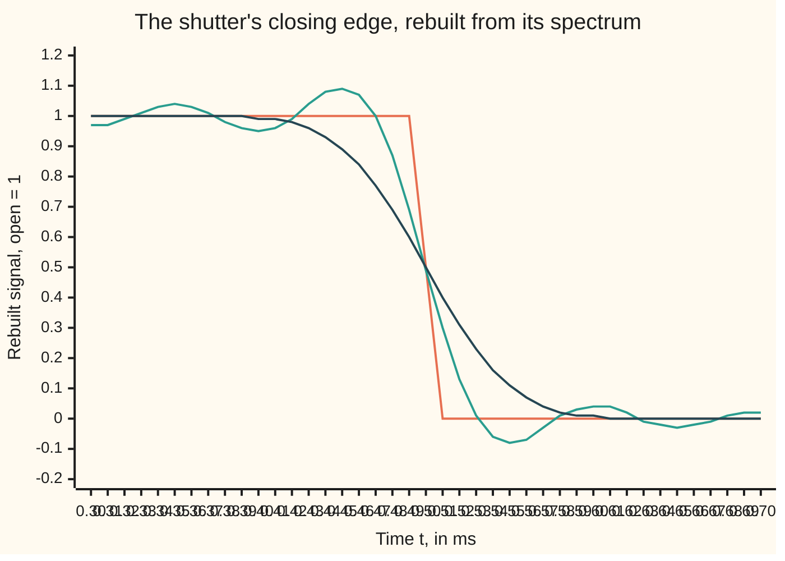

# Fourier inversion: rebuilding the signal from its spectrum, proved with a bell curve

[Syllabus](../../../SYLLABUS.md) → [Harmonic analysis](../README.md) → [The Fourier Transform](../README.md#s02) → Fourier inversion

---

## General Overview

A camera shutter opens for one millisecond. As a signal it is a gate: 1 while the shutter is open, from −0.5 ms to 0.5 ms, and 0 at every other time. Its spectrum (how much of each frequency it holds) is $`\hat f(\xi) = \sin(\pi T\xi)/(\pi\xi)`$, with T = 1 ms the open time and ξ (xi) the frequency in hertz. It reads 1 ms at 0 Hz, 0.636620 ms at 500 Hz and 0 at 1000 Hz ([Two pairs worth memorising](03-gaussian-and-sinc-transform-pairs.md)).

Now go back. Given only that spectrum, rebuild the shutter: add up every frequency's wave, each with its share. The obvious recipe is one integral over all frequencies. For the shutter that integral is not absolutely convergent, so it has a value only as a limit, such as the symmetric cut-off of Step 6. The area under the spectrum's size keeps growing as more frequencies are included: 2.105726 up to 10 kHz, 3.038857 up to 100 kHz, 3.972059 up to 1 MHz. Each tenfold step in frequency adds about 0.933 and the total never settles.

There are two ways to tame the sum:

- **Cut it off sharply.** Keep only frequencies below W, say W = 10 kHz. In the middle of the open millisecond the rebuilt value is 0.979776, not 1. Near the edge it overshoots to 1.094820, and the overshoot does not go away as W grows.
- **Fade it out with a bell curve.** Multiply each frequency's share by a bell that is 1 at 0 Hz and falls smoothly toward 0. With the bell set to 0.1 ms in time (Step 1 explains this width), the middle reads 1.000000, the edge reads 0.500000, and the rebuilt shutter never overshoots.

The bell is also how the theorem is proved. Fading the spectrum by a bell is the same as blurring the signal in time by a bell of area 1. As the bell narrows, the blur sharpens back to the signal.

**Multiply the spectrum by a narrowing bell curve, add up the waves, and the result is the signal blurred by a narrowing bell, which tends to the signal at every point where it is continuous and to the midpoint at a jump; when the spectrum has finite area under its size, the bell can be removed and the inverse integral gives the signal back exactly.**

**What kind of fact this is:** a theorem, proved on this card in Why it works. The sharp cut-off's behavior on the shutter is computed exactly, through the sine integral.

The complex-analysis wing's card [The Fourier transform](../../07-Complex%20analysis/08-Transforms%20in%20Outline/03-fourier-transform.md) already proves inversion with a bell, in a fold, assuming the spectrum has finite area under its size. This card states that proof in the hertz form and spends its space on the case that proof leaves open: a spectrum like the shutter's, whose area never settles.

### The picture: the shutter's edge, rebuilt two ways



First line (orange): the shutter, 1 while open, 0 after 0.5 ms, drawn at 0.5 on the edge. Second line (green): the sharp cut-off at W = 10 kHz, ringing above 1 and below 0. Third line (dark blue): the bell rebuild with ε = 0.1 ms, a smooth ramp through 0.5 that stays between 0 and 1.

---

## The formula

Notation first, in words.

- The **spectrum** of a signal f is its Fourier transform, $`\hat f(\xi) = \int f(t)\, e^{-2\pi i \xi t}\, dt`$, read "f-hat of xi". Time t is in seconds, frequency ξ in hertz, and i is the imaginary unit, with i² = −1 ([The Fourier transform of an absolutely integrable signal, and why it fades at infinity](01-fourier-transform-on-l1-and-riemann-lebesgue.md)).
- **Integrable** means the area under |f| is finite. The shutter's area is 1 ms.
- This card introduces the **inverse**: for a function g of frequency, $`\check g(t)`$, read "g-check of t", adds up the waves $`e^{2\pi i \xi t}`$ with weights $`g(\xi)`$. There is no factor in front, because ξ is in hertz.

```math
\check g(t) = \int_{-\infty}^{\infty} g(\xi)\, e^{2\pi i \xi t}\, d\xi
```

The bell rebuild fades the spectrum by a bell of width ε (epsilon), a time in seconds:

```math
G_\varepsilon f(t) = \int_{-\infty}^{\infty} \hat f(\xi)\, e^{-\pi \varepsilon^2 \xi^2}\, e^{2\pi i \xi t}\, d\xi = \int_{-\infty}^{\infty} f(s)\, g_\varepsilon(t - s)\, ds, \qquad g_\varepsilon(u) = \frac{1}{\varepsilon}\, e^{-\pi u^2/\varepsilon^2}
```

**Read it aloud:** fade every frequency's share by a bell, add up the waves, and you get the signal averaged with weights from a bell of width ε centered at t.

The theorem, for every integrable signal f:

```math
G_\varepsilon f(t) \to \tfrac12\big(f(t^+) + f(t^-)\big) \text{ as } \varepsilon \to 0 \text{ wherever both exist}, \qquad \int \lvert G_\varepsilon f - f\rvert\, dt \to 0, \qquad \text{and if } \int \lvert \hat f\rvert\, d\xi < \infty:\ f(t) = \check{\hat f}(t) \text{ wherever } f \text{ is continuous}
```

**Read it aloud:** the bell rebuild tends to the midpoint of the values just right and just left of t, which is f(t) itself where f is continuous; its average error tends to 0; and when the spectrum's size has finite area, the plain inverse returns f wherever f is continuous.

For the shutter, with T = 1 ms, the bell rebuild and the sharp cut-off have closed forms:

```math
G_\varepsilon f(t) = \tfrac12\Big[\mathrm{erf}\Big(\tfrac{\sqrt\pi\,(t + T/2)}{\varepsilon}\Big) - \mathrm{erf}\Big(\tfrac{\sqrt\pi\,(t - T/2)}{\varepsilon}\Big)\Big], \qquad S_W f(t) = \tfrac1\pi\Big[\mathrm{Si}\big(2\pi W (t + \tfrac T2)\big) - \mathrm{Si}\big(2\pi W (t - \tfrac T2)\big)\Big]
```

Here $`\mathrm{erf}(x) = \frac{2}{\sqrt\pi}\int_0^x e^{-u^2}\,du`$ is the error function and $`\mathrm{Si}(x) = \int_0^x \frac{\sin u}{u}\,du`$ is the sine integral. At t = 0.4 ms with ε = 0.1 ms the bell rebuild is ½[erf(9√π) + erf(√π)] = 0.993906.

| Symbol | Plain meaning | In our example | Push it up and the answer… |
| --- | --- | --- | --- |
| $`t`$, $`s`$, $`u`$, $`A(u)`$ | time in seconds; s runs over all times inside an integral; u = t − s is a time gap; in the fold, A(u) is the area under \|f(t − u) − f(t)\| | 0.4 ms; u = 0.1 ms in Step 2 | moves along the shutter |
| $`\xi`$, $`i`$ | frequency in hertz; the imaginary unit, i² = −1 | 0 to 10 kHz | — |
| $`f`$, $`\hat f`$ | the signal; its spectrum, in seconds | the shutter; $`\sin(\pi T\xi)/(\pi\xi)`$ | — |
| $`\check g`$ | the inverse of a function g of frequency | $`\check{\hat f}`$ | — |
| $`T`$ | the shutter's open time | 1 ms | edges move apart |
| $`\varepsilon`$; $`\eta`$, $`\delta`$ | the bell's width, in seconds; in the fold, a tolerance (eta) and a time distance (delta) within which f changes by less than eta | 0.1 ms | the rebuild blurs more |
| $`g_\varepsilon`$ | the time bell: height 1/ε, area 1 | peak 10,000 per second | — |
| $`G_\varepsilon f`$ | the bell rebuild | 0.993906 at 0.4 ms | — |
| $`W`$, $`L`$, $`S_W f`$ | the cut-off frequency (L when it grows in Step 2); the sharp rebuild | 10 kHz; 0.945786 at 0.4 ms | the miss shrinks, the overshoot stays |
| $`D_W`$ | the sharp cut-off's time kernel, $`\sin(2\pi W u)/(\pi u)`$ | height 20,000 per second | — |
| $`f(t^+)`$, $`f(t^-)`$ | f just right and just left of t | 0 and 1 at 0.5 ms | — |
| $`\mathrm{erf}`$, $`\mathrm{Si}`$ | error function; sine integral | erf(√π) = 0.987811, Si(2π) = 1.418152 | — |

### When it holds

- **The signal is integrable.** The swap of integrals in Step 2 needs the area under |f| to be finite. A constant signal f = 1 has no spectrum in this sense, and the proof has nothing to start from.
- **A point where f is continuous, or a clean jump.** At a jump the rebuild gives the midpoint: 0.500000 on the shutter's edge, which is neither the open value nor the closed one.
- **For the plain inverse, a spectrum of finite area.** The shutter fails this: the area grows by about 0.933 per tenfold step in frequency. Then only a faded or cut-off rebuild has a meaning, and the cut-off rebuild overshoots toward 1.089490 at each jump, however large W is.
- **One convention.** In hertz the inverse has no factor in front. Putting in the 1/(2π) of the radians-per-second form turns 1.000000 into 0.159155.

---

## Why it works

### Step 0: fade the spectrum, and the inverse becomes a blur

The plain inverse adds the shares of all frequencies at once. For the shutter those shares fall only like 1/ξ, so the sum is not absolutely convergent and has a value only as a limit of finite sums (Step 6).

Multiply the shares by a bell first. The high frequencies now die off fast, so the double integral (the spectrum written out as an integral, inside the inverse) has finite size. Then the order of integration may swap. The frequency integral comes out as a bell in time, and the rebuild is the signal blurred by that bell. A narrow blur of area 1 is close to the signal. That is the whole proof.

### Step 1: the bell is its own transform

The bell $`e^{-\pi t^2}`$ is its own transform ([Two pairs worth memorising](03-gaussian-and-sinc-transform-pairs.md)). By the scaling rule of [The transform rulebook](02-shift-scale-and-derivative-rules.md), the time bell of width ε and height 1/ε has as its transform the frequency bell $`e^{-\pi\varepsilon^2\xi^2}`$, of height 1. Both bells are even, so adding up waves weighted by the frequency bell gives the time bell back:

```math
\int_{-\infty}^{\infty} e^{-\pi\varepsilon^2\xi^2}\, e^{2\pi i \xi u}\, d\xi = \frac1\varepsilon\, e^{-\pi u^2/\varepsilon^2} = g_\varepsilon(u)
```

**Read it aloud:** adding up waves weighted by a frequency bell gives a time bell, ε wide, with area 1.

With ε = 0.1 ms, the time bell peaks at 1/ε = 10,000 per second. Its standard deviation (its spread) is $`\varepsilon/\sqrt{2\pi}`$ = 0.039894 ms. In frequency the fading factor at 10 kHz is $`e^{-\pi}`$ = 0.043214. So ε = 0.1 ms and W = 10 kHz use about the same range of frequencies.

### Step 2: the order of integration may swap

Write the spectrum out as its integral over time s and put it inside the bell rebuild:

```math
G_\varepsilon f(t) = \int\!\!\int f(s)\, e^{-2\pi i \xi s}\, e^{-\pi\varepsilon^2\xi^2}\, e^{2\pi i \xi t}\, ds\, d\xi
```

The size of the integrand is $`\lvert f(s)\rvert\, e^{-\pi\varepsilon^2\xi^2}`$. Its double integral is the area of |f| times 1/ε. For the shutter that is 1 ms times 10,000 per second, which is 10.000000: finite. So by [Tonelli and Fubini](../../10-Measure%20and%20integration/06-Product%20Measures%20and%20Fubini/03-tonelli-and-fubini.md) the order may swap. Do the ξ integral first, and Step 1 turns it into $`g_\varepsilon(t - s)`$:

```math
G_\varepsilon f(t) = \int f(s)\, g_\varepsilon(t - s)\, ds
```

The checks compute both sides separately, frequency side and time side, and they agree to 6 decimals at every point.

Without the bell this step fails. The inner integral over |ξ| < L, at u = t − s = 0.1 ms, is $`\sin(2\pi L u)/(\pi u)`$: 0 at L = 10 kHz, 3183.098862 per second at 12.5 kHz, 0 at 15 kHz, −3183.098862 at 17.5 kHz. It swings for ever and never settles.

### Step 3: a narrowing blur tends to the signal

The bell $`g_\varepsilon`$ is positive, has area 1, and puts almost all its weight within a few ε of 0. So $`G_\varepsilon f(t)`$ is a weighted average of f's values near t.

- **Where f is continuous** at t, nearby values are close to f(t), so the average is close to f(t). The far values carry weight that tends to 0 as ε → 0.
- **At a jump**, half the bell's weight lies on each side. The average tends to the midpoint. On the shutter's edge it is $`\tfrac12\mathrm{erf}(\sqrt\pi\, T/\varepsilon)`$, just under ½, and 0.500000 to six decimals at ε = 0.1 ms and 0.01 ms.
- **No overshoot.** A positive average of values between 0 and 1 stays between 0 and 1. The checks scan 0 to 1 ms and find the bell rebuild always in [0, 1].
- **In the average sense**, the area under $`\lvert G_\varepsilon f - f\rvert`$ tends to 0 for every integrable f. For the shutter it is 2ε/π: 0.063662 ms at ε = 0.1 ms and 0.006366 ms at ε = 0.01 ms.

Convergence here has three modes, and one fails. Pointwise (point by point) it holds wherever f is continuous. In the mean (average error) it always holds. Uniformly (the largest error over all t) it fails at a jump: just beside the edge the error stays near 0.5 for every ε.

<details>
<summary>Detailed proof: the blur tends to f at a point of continuity, and in the mean</summary>

Fix t where f is continuous, and a tolerance η > 0. Choose δ > 0 so that |f(s) − f(t)| < η whenever |s − t| < δ. Since the bell has area 1,

$`\displaystyle G_\varepsilon f(t) - f(t) = \int \big(f(s) - f(t)\big)\, g_\varepsilon(t - s)\, ds.`$

The part with |s − t| < δ is below η in size, because the bell's area is 1. On the part with |s − t| ≥ δ, the bell is at most $`e^{-\pi\delta^2/\varepsilon^2}/\varepsilon`$, which tends to 0 as ε → 0. So that part is at most this bound times the area of |f|, plus |f(t)| times the bell's area beyond δ, and both tend to 0. Hence the limit of $`\lvert G_\varepsilon f(t) - f(t)\rvert`$ is at most η, for every η: it is 0.

At a jump, split the integral at t. Each half of the bell carries area ½, and the same argument on each side gives ½ f(t⁺) + ½ f(t⁻).

In the mean: by Tonelli, the area under $`\lvert G_\varepsilon f - f\rvert`$ is at most the integral over u of $`g_\varepsilon(u)\, A(u)`$, where A(u) is the area under |f(t − u) − f(t)|. A(u) is at most twice the area of |f|, and tends to 0 as u → 0: true for a gate by direct computation, and for every integrable f because gates' sums approximate f in the mean. The bell's weight concentrates at u = 0, so the bound tends to 0.

</details>

### Step 4: when the spectrum has finite area, remove the bell

Suppose the area under $`\lvert\hat f\rvert`$ is finite. In the bell rebuild the integrand $`\hat f(\xi)\, e^{-\pi\varepsilon^2\xi^2} e^{2\pi i\xi t}`$ is at most $`\lvert\hat f(\xi)\rvert`$ in size, and it tends to $`\hat f(\xi)\, e^{2\pi i\xi t}`$ as ε → 0. By dominated convergence ([Swapping limits](../../06-Calculus%20and%20analysis/06-Series/08-swapping-limits-with-integrals-and-derivatives.md)) the limit passes inside:

```math
G_\varepsilon f(t) \to \check{\hat f}(t) \quad \text{for every } t
```

Step 3 says the same rebuild tends to f(t) wherever f is continuous. Limits are unique, so $`f(t) = \check{\hat f}(t)`$ there. The mean convergence of Step 3 also gives equality at almost every t: everywhere except on a set of total length 0.

### Step 5: two consequences

**Uniqueness.** If two integrable signals have the same spectrum, their bell rebuilds agree for every ε. Both tend to their own signal in the mean, so the signals agree at almost every t. The shutter defined to be open at its edges and the shutter defined to be closed there have the same spectrum. The rebuild gives neither choice: it gives 0.500000.

**A jump forces a spectrum of infinite area.** The inverse of a spectrum with finite area is continuous: dominated convergence again, as t moves. The shutter jumps, and no change on a set of length 0 removes a jump. So the shutter's spectrum cannot have finite area under its size. The direct count agrees: 2.105726, 3.038857 and 3.972059 up to 10 kHz, 100 kHz and 1 MHz, rising by 0.933131 and then 0.933202 per decade, against the limit (4/π²) ln 10 = 0.933203.

### Step 6: what the sharp cut-off does instead

Cutting at W is the same as blurring by the kernel $`D_W(u) = \sin(2\pi W u)/(\pi u)`$, by the swap of Step 2 over a finite range. That kernel has area 1, but it takes negative values and the area under its size is infinite. Three things follow, all visible on the shutter.

- **It still converges pointwise for the shutter.** The closed form tends to 1 inside, 0 outside and ½ on the edge. At W = 100 kHz: 0.997974 in the middle, 0.499493 on the edge, 0.004603 at 0.6 ms. This holds for piecewise-smooth signals, by the same argument as [Dirichlet's theorem](../01-Fourier%20Series%20in%20Depth/04-pointwise-and-uniform-convergence.md) for Fourier series.
- **It converges slowly.** The middle misses by 0.020224 at W = 10 kHz and 0.002026 at 100 kHz, close to 2/(π² W T). The miss falls like 1/W, because the kernel's slow tails reach the far edges.
- **It overshoots by a fixed amount, about 9% of the jump.** The largest value near the edge is 1.094820 at W = 10 kHz and 1.089999 at 100 kHz. The limit is ½ + Si(π)/π = 1.089490. This is the Gibbs overshoot, met for Fourier series on [The Gibbs overshoot and the cure](../01-Fourier%20Series%20in%20Depth/08-gibbs-and-summability.md). The peak moves toward the edge, at 0.4500 ms and then 0.4950 ms, but does not shrink.

The sharp cut-off leans on smoothness: for Fourier series, continuity alone is not enough, since du Bois-Reymond built a continuous signal whose sums fail to settle at one point ([Dirichlet's theorem](../01-Fourier%20Series%20in%20Depth/04-pointwise-and-uniform-convergence.md)). The bell rebuild needs no smoothness and never fails at a point of continuity. That is why the theorem is proved with the bell.

---

## Worked numbers, by hand

Bell rebuild at t = 0.4 ms, 0.1 ms inside the closing edge, with ε = 0.1 ms; then the sharp cut-off at W = 10 kHz at the same time.

| Step | Arithmetic | Value |
| --- | --- | --- |
| distance past the opening edge, in bell widths | (0.4 + 0.5)/0.1 | 9 |
| distance to the closing edge, in bell widths | (0.4 − 0.5)/0.1 | −1 |
| error functions | erf(9√π); erf(−√π) = −erf(√π) | 1.000000; −0.987811 |
| bell rebuild | ½ × (1.000000 + 0.987811) | **0.993906** |
| sharp cut-off arguments | 2π × 10 kHz × 0.9 ms; 2π × 10 kHz × (−0.1 ms) | 18π; −2π |
| sine integrals | Si(18π); Si(−2π) = −Si(2π) | 1.553123; −1.418152 |
| sharp rebuild | (1.553123 + 1.418152)/π | 0.945786 |
| middle of the shutter, sharp | (2/π) × Si(10π) = (2/π) × 1.539029 | 0.979776 |

At 0.1 ms inside the edge, the bell rebuild reads 0.993906: the shutter's true value 1, softened by the 0.6% of the bell's weight that lies past the edge. The sharp cut-off reads 0.945786 at the same time, because its kernel rings.

### What breaks if you drop a piece

| Mistake | Comes out at | What went wrong |
| --- | --- | --- |
| Putting 1/(2π) in front of the inverse, ξ in hertz | 0.159155 in the middle, not 1.000000 | That factor belongs to the radians-per-second form |
| Swapping the order with no bell | 0, 3183.098862, 0, −3183.098862 per second as L runs 10 to 17.5 kHz | The inner integral never settles: Fubini's condition fails |
| Expecting the edge to rebuild as 1 | 0.500000 (bell), 0.499493 (sharp, 100 kHz) | A jump rebuilds as its midpoint |
| Expecting the sharp cut-off's error to vanish everywhere | peak 1.094820, then 1.089999, limit 1.089490 | The kernel goes negative; uniform convergence fails |

The code prints all four.

---

## Code, from first principles, and it actually runs

The code rebuilds the shutter at five times, by both rebuilds, at two settings: W = 10 kHz with ε = 0.1 ms, and W = 100 kHz with ε = 0.01 ms. Each value is reached by three independent roads. The first is the closed form, through Si and erf, each a power series for small arguments and an asymptotic series for large ones, written out. The second is the frequency side: the faded or cut-off inverse integral, by Simpson's rule at two step counts, with the bell's integral cut at 4/ε and its tail bounded. The third is the time side: the signal blurred by $`g_\varepsilon`$ or $`D_W`$, also by Simpson's rule. The checks also measure the overshoot by a scan, the mean error against 2ε/π, the middle miss against 2/(π² W T), and the area under the spectrum's size against (4/π²) ln 10 per decade.

### Python

```python
# Fourier inversion -- the check behind the card.  Standard library only.
# Convention: fhat(xi) = integral of f(t) e^(-2 pi i xi t) dt, t in seconds, xi in
# hertz; the inverse has no factor in front.  The shutter is open (f = 1) for T = 1 ms.
# Two rebuilds: the sharp cut-off S_W (keep |xi| < W) and the bell rebuild G_eps
# (multiply the spectrum by e^(-pi eps^2 xi^2)).  Roads: closed forms through Si and
# erf, each a series written out here; the inverse integral on the frequency side by
# Simpson's rule at n and 2n strips; the blur on the time side, also by Simpson.
from math import pi, sin, cos, exp, sqrt, log

T = 0.001                                         # shutter open time, seconds
def f6(x): return "%.6f" % (0.0 if abs(x) < 5e-7 else x)
def sci(x): return "%.2e" % x
def c2(x): return "%.2f" % (0.0 if abs(x) < 0.005 else x)
def fhat(xi): return T if xi == 0 else sin(pi * T * xi) / (pi * xi)   # spectrum, s

def si(x):                                        # Si(x): area under sin(u)/u, 0 to x
    if x < 0: return -si(-x)
    if x <= 20:                                   # power series, 80 terms
        a, s = x, 0.0
        for k in range(80):
            s += a / (2 * k + 1)
            a *= -x * x / ((2 * k + 2) * (2 * k + 3))
        return s
    fa, ga, c = 0.0, 0.0, 1.0                     # large x: asymptotic series, 9 terms
    for k in range(9):
        fa += c / x ** (2 * k + 1)
        ga += c * (2 * k + 1) / x ** (2 * k + 2)
        c *= -(2 * k + 1) * (2 * k + 2)
    return pi / 2 - fa * cos(x) - ga * sin(x)

def erf(x):                                       # erf(x) = (2/sqrt(pi)) area under e^(-u^2)
    if x < 0: return -erf(-x)
    if x <= 4:                                    # power series, 100 terms
        a, s = x, 0.0
        for k in range(100):
            s += a / (2 * k + 1)
            a *= -x * x / (k + 1)
        return 2 * s / sqrt(pi)
    s, c = 0.0, 1.0                               # large x: erfc asymptotic, 7 terms
    for k in range(7):
        s += c
        c *= -(2 * k + 1) / (2 * x * x)
    return 1 - exp(-x * x) / (x * sqrt(pi)) * s

def simpson(g, a, b, n):
    w = (b - a) / n; s = g(a) + g(b)
    for k in range(1, n): s += (4 if k % 2 else 2) * g(a + k * w)
    return s * w / 3

def sharp_closed(t, W): return (si(2 * pi * W * (t + T / 2)) - si(2 * pi * W * (t - T / 2))) / pi
def bell_closed(t, e): return (erf(sqrt(pi) * (t + T / 2) / e) - erf(sqrt(pi) * (t - T / 2) / e)) / 2
def sharp_freq(t, W, n): return 2 * simpson(lambda x: fhat(x) * cos(2 * pi * x * t), 0, W, n)
def bell_freq(t, e, n): return 2 * simpson(lambda x: fhat(x) * exp(-pi * (e * x) ** 2) * cos(2 * pi * x * t), 0, 4 / e, n)
def dirichlet(u, W): return 2 * W if u == 0 else sin(2 * pi * W * u) / (pi * u)
def sharp_time(t, W, n): return simpson(lambda s: dirichlet(t - s, W), -T / 2, T / 2, n)
def bell_time(t, e, n): return simpson(lambda s: exp(-pi * ((t - s) / e) ** 2) / e, -T / 2, T / 2, n)

print("shutter open T = 1 ms; fhat in ms at 0, 500, 1000 Hz: %s, %s, %s" % tuple(f6(1000 * fhat(x)) for x in (0, 500, 1000)))
def lobes(m): return 2 * sum(simpson(lambda u: abs(sin(pi * u) / (pi * u)) if u else 1.0, k, k + 1, 40) for k in range(m))
areas = [lobes(10), lobes(100), lobes(1000)]
print("area under |fhat| on [-W, W], W = 10 kHz, 100 kHz, 1 MHz: %s, %s, %s" % tuple(f6(a) for a in areas))
print("growth per decade: %s, %s; (4/pi^2) ln 10 = %s" % (f6(areas[1] - areas[0]), f6(areas[2] - areas[1]), f6(4 / pi ** 2 * log(10))))
assert abs(areas[2] - areas[1] - 4 / pi ** 2 * log(10)) < 1e-5            # the area never settles
print("by hand: erf(9 sqrt(pi)) = %s, erf(sqrt(pi)) = %s, erf(5 sqrt(pi)) = %s" % (f6(erf(9 * sqrt(pi))), f6(erf(sqrt(pi))), f6(erf(5 * sqrt(pi)))))
print("by hand: Si(18 pi) = %s, Si(2 pi) = %s, Si(10 pi) = %s; area of |f| / eps = %s" % (f6(si(18 * pi)), f6(si(2 * pi)), f6(si(10 * pi)), f6(T / 1e-4)))
print("bell peak 1/eps = %s per s, spread eps/sqrt(2 pi) = %s ms, fade at 10 kHz = %s; D_W peak 2W = %s per s"
      % (f6(1 / 1e-4), f6(0.1 / sqrt(2 * pi)), f6(exp(-pi * (1e-4 * 1e4) ** 2)), f6(dirichlet(0, 10000))))
peaks = []
for W, e, n in [(10000, 1e-4, 4000), (100000, 1e-5, 40000)]:
    print("W = %d kHz, eps = %s ms; Simpson at %d and %d strips" % (W // 1000, f6(1000 * e), n, 2 * n))
    gap = 0.0
    for name, closed, freq, time in [("sharp cut-off S_W", sharp_closed, sharp_freq, sharp_time),
                                     ("bell rebuild G_eps", bell_closed, bell_freq, bell_time)]:
        p = W if closed is sharp_closed else e
        nf = n if closed is sharp_closed else 4 * n
        print("  %s at t ms: closed form | frequency side | time side" % name)
        for tm in (0.0, 0.4, 0.5, 0.6, 1.0):
            t = tm / 1000
            c, a, b, a2 = closed(t, p), freq(t, p, 2 * nf), time(t, p, 2 * n), freq(t, p, nf)
            gap = max(gap, abs(a - a2))
            print("    t = %.1f: %s | %s | %s" % (tm, f6(c), f6(a), f6(b)))
            assert abs(c - a) < 1e-7 and abs(c - b) < 1e-7                # three roads agree
    tail = 2 * T * exp(-16 * pi) / (8 * pi * e)
    print("  largest gap n vs 2n strips: %s; bell cut at 4/eps, tail bound %s" % (sci(gap), sci(tail)))
    scan = [(sharp_closed(k * 1e-7, W), k / 10000) for k in range(4000, 5001)]
    top, at = max(scan)
    hi = max(bell_closed(k * 1e-7, e) for k in range(0, 10001))
    lo = min(bell_closed(k * 1e-7, e) for k in range(0, 10001))
    peaks.append(top)
    print("  scan 0.4 to 0.5 ms: largest S_W %s at t = %.4f ms; G_eps over 0 to 1 ms stays in [%s, %s]" % (f6(top), at, f6(lo), f6(hi)))
    l1 = 2 * sum(simpson(lambda t: abs(bell_closed(t, e) - (j < 0)), T / 2 + j * e / 2, T / 2 + (j + 1) * e / 2, 200)
                 for j in range(-round(T / e), 20))
    print("  mean error, area of |G_eps - f|: %s ms; 2 eps/pi = %s ms" % (f6(1000 * l1), f6(1000 * 2 * e / pi)))
    print("  middle miss 1 - S_W(0): %s; 2/(pi^2 W T) = %s" % (f6(1 - sharp_closed(0, W)), f6(2 / (pi ** 2 * W * T))))
    assert abs(l1 - 2 * e / pi) < 1e-6 * 2 * e / pi                         # mean error is 2 eps/pi
    assert abs(1 - sharp_closed(0, W) - 2 / (pi ** 2 * W * T)) < 0.1 * 2 / (pi ** 2 * W * T)
    assert lo >= 0 and hi <= 1 and abs(bell_closed(T / 2, e) - 0.5) < 1e-12   # no overshoot, midpoint
print("single-edge overshoot limit 1/2 + Si(pi)/pi = %s" % f6(0.5 + si(pi) / pi))
assert min(peaks) > 0.5 + si(pi) / pi - 1e-3                               # overshoot never shrinks
print("mistake, 1/(2 pi) in front with xi in hertz: G_eps(0) = %s instead of %s" % (f6(bell_closed(0, 1e-4) / (2 * pi)), f6(bell_closed(0, 1e-4))))
print("mistake, edge read as 1: S_W(0.5 ms) = %s at 100 kHz, G_eps(0.5 ms) = %s" % (f6(sharp_closed(T / 2, 100000)), f6(bell_closed(T / 2, 1e-5))))
print("mistake, no damping: integral of e^(2 pi i xi u) over |xi| < L at u = 0.1 ms, per s:")
print("  L = 10, 12.5, 15, 17.5 kHz: %s" % ", ".join(f6(dirichlet(1e-4, L)) for L in (10000, 12500, 15000, 17500)))
ts = [0.3 + 0.01 * k for k in range(41)]
print("chart t ms: " + ", ".join("%.2f" % t for t in ts))
print("chart shutter: " + ", ".join("%.2f" % (1 if t < 0.499 else 0.5 if t < 0.501 else 0) for t in ts))
print("chart S_W 10 kHz: " + ", ".join(c2(sharp_closed(t / 1000, 10000)) for t in ts))
print("chart G_eps 0.1 ms: " + ", ".join(c2(bell_closed(t / 1000, 1e-4)) for t in ts))
print("ALL CHECKS PASS")
```

**Ran 2026-11-15 on macOS, Python 3.14.10, standard library only. All checks passed. Output, pasted from the run:**

```
shutter open T = 1 ms; fhat in ms at 0, 500, 1000 Hz: 1.000000, 0.636620, 0.000000
area under |fhat| on [-W, W], W = 10 kHz, 100 kHz, 1 MHz: 2.105726, 3.038857, 3.972059
growth per decade: 0.933131, 0.933202; (4/pi^2) ln 10 = 0.933203
by hand: erf(9 sqrt(pi)) = 1.000000, erf(sqrt(pi)) = 0.987811, erf(5 sqrt(pi)) = 1.000000
by hand: Si(18 pi) = 1.553123, Si(2 pi) = 1.418152, Si(10 pi) = 1.539029; area of |f| / eps = 10.000000
bell peak 1/eps = 10000.000000 per s, spread eps/sqrt(2 pi) = 0.039894 ms, fade at 10 kHz = 0.043214; D_W peak 2W = 20000.000000 per s
W = 10 kHz, eps = 0.100000 ms; Simpson at 4000 and 8000 strips
  sharp cut-off S_W at t ms: closed form | frequency side | time side
    t = 0.0: 0.979776 | 0.979776 | 0.979776
    t = 0.4: 0.945786 | 0.945786 | 0.945786
    t = 0.5: 0.494936 | 0.494936 | 0.494936
    t = 0.6: 0.043985 | 0.043985 | 0.043985
    t = 1.0: 0.006735 | 0.006735 | 0.006735
  bell rebuild G_eps at t ms: closed form | frequency side | time side
    t = 0.0: 1.000000 | 1.000000 | 1.000000
    t = 0.4: 0.993906 | 0.993906 | 0.993906
    t = 0.5: 0.500000 | 0.500000 | 0.500000
    t = 0.6: 0.006094 | 0.006094 | 0.006094
    t = 1.0: 0.000000 | 0.000000 | 0.000000
  largest gap n vs 2n strips: 5.22e-12; bell cut at 4/eps, tail bound 1.18e-22
  scan 0.4 to 0.5 ms: largest S_W 1.094820 at t = 0.4500 ms; G_eps over 0 to 1 ms stays in [0.000000, 1.000000]
  mean error, area of |G_eps - f|: 0.063662 ms; 2 eps/pi = 0.063662 ms
  middle miss 1 - S_W(0): 0.020224; 2/(pi^2 W T) = 0.020264
W = 100 kHz, eps = 0.010000 ms; Simpson at 40000 and 80000 strips
  sharp cut-off S_W at t ms: closed form | frequency side | time side
    t = 0.0: 0.997974 | 0.997974 | 0.997974
    t = 0.4: 0.994374 | 0.994374 | 0.994374
    t = 0.5: 0.499493 | 0.499493 | 0.499493
    t = 0.6: 0.004603 | 0.004603 | 0.004603
    t = 1.0: 0.000675 | 0.000675 | 0.000675
  bell rebuild G_eps at t ms: closed form | frequency side | time side
    t = 0.0: 1.000000 | 1.000000 | 1.000000
    t = 0.4: 1.000000 | 1.000000 | 1.000000
    t = 0.5: 0.500000 | 0.500000 | 0.500000
    t = 0.6: 0.000000 | 0.000000 | 0.000000
    t = 1.0: 0.000000 | 0.000000 | 0.000000
  largest gap n vs 2n strips: 5.22e-13; bell cut at 4/eps, tail bound 1.18e-21
  scan 0.4 to 0.5 ms: largest S_W 1.089999 at t = 0.4950 ms; G_eps over 0 to 1 ms stays in [0.000000, 1.000000]
  mean error, area of |G_eps - f|: 0.006366 ms; 2 eps/pi = 0.006366 ms
  middle miss 1 - S_W(0): 0.002026; 2/(pi^2 W T) = 0.002026
single-edge overshoot limit 1/2 + Si(pi)/pi = 1.089490
mistake, 1/(2 pi) in front with xi in hertz: G_eps(0) = 0.159155 instead of 1.000000
mistake, edge read as 1: S_W(0.5 ms) = 0.499493 at 100 kHz, G_eps(0.5 ms) = 0.500000
mistake, no damping: integral of e^(2 pi i xi u) over |xi| < L at u = 0.1 ms, per s:
  L = 10, 12.5, 15, 17.5 kHz: 0.000000, 3183.098862, 0.000000, -3183.098862
chart t ms: 0.30, 0.31, 0.32, 0.33, 0.34, 0.35, 0.36, 0.37, 0.38, 0.39, 0.40, 0.41, 0.42, 0.43, 0.44, 0.45, 0.46, 0.47, 0.48, 0.49, 0.50, 0.51, 0.52, 0.53, 0.54, 0.55, 0.56, 0.57, 0.58, 0.59, 0.60, 0.61, 0.62, 0.63, 0.64, 0.65, 0.66, 0.67, 0.68, 0.69, 0.70
chart shutter: 1.00, 1.00, 1.00, 1.00, 1.00, 1.00, 1.00, 1.00, 1.00, 1.00, 1.00, 1.00, 1.00, 1.00, 1.00, 1.00, 1.00, 1.00, 1.00, 1.00, 0.50, 0.00, 0.00, 0.00, 0.00, 0.00, 0.00, 0.00, 0.00, 0.00, 0.00, 0.00, 0.00, 0.00, 0.00, 0.00, 0.00, 0.00, 0.00, 0.00, 0.00
chart S_W 10 kHz: 0.97, 0.97, 0.99, 1.01, 1.03, 1.04, 1.03, 1.01, 0.98, 0.96, 0.95, 0.96, 0.99, 1.04, 1.08, 1.09, 1.07, 1.00, 0.87, 0.69, 0.49, 0.30, 0.13, 0.01, -0.06, -0.08, -0.07, -0.03, 0.01, 0.03, 0.04, 0.04, 0.02, -0.01, -0.02, -0.03, -0.02, -0.01, 0.01, 0.02, 0.02
chart G_eps 0.1 ms: 1.00, 1.00, 1.00, 1.00, 1.00, 1.00, 1.00, 1.00, 1.00, 1.00, 0.99, 0.99, 0.98, 0.96, 0.93, 0.89, 0.84, 0.77, 0.69, 0.60, 0.50, 0.40, 0.31, 0.23, 0.16, 0.11, 0.07, 0.04, 0.02, 0.01, 0.01, 0.00, 0.00, 0.00, 0.00, 0.00, 0.00, 0.00, 0.00, 0.00, 0.00
ALL CHECKS PASS
```

### Rust

Same numbers, same labels, built with `rustc --edition 2021 -O`.

```rust
// Fourier inversion -- the same check as the Python, in Rust.  No crates.
// Convention: fhat(xi) = integral of f(t) e^(-2 pi i xi t) dt, t in seconds, xi in
// hertz; the inverse has no factor in front.  The shutter is open (f = 1) for T = 1 ms.
// Two rebuilds: the sharp cut-off S_W (keep |xi| < W) and the bell rebuild G_eps
// (multiply the spectrum by e^(-pi eps^2 xi^2)).  Roads: closed forms through Si and
// erf, each a series written out here; the inverse integral on the frequency side by
// Simpson's rule at n and 2n strips; the blur on the time side, also by Simpson.
use std::f64::consts::PI;

const T: f64 = 0.001; // shutter open time, seconds
fn f6(x: f64) -> String { format!("{:.6}", if x.abs() < 5e-7 { 0.0 } else { x }) }
fn c2(x: f64) -> String { format!("{:.2}", if x.abs() < 0.005 { 0.0 } else { x }) }
fn sci(x: f64) -> String { // Python's %.2e: two-digit exponent
    let s = format!("{:.2e}", x);
    let (m, e) = s.split_at(s.find('e').unwrap());
    let n: i32 = e[1..].parse().unwrap();
    format!("{}e{}{:02}", m, if n < 0 { '-' } else { '+' }, n.abs())
}
fn fhat(xi: f64) -> f64 { if xi == 0.0 { T } else { (PI * T * xi).sin() / (PI * xi) } }

fn si(x: f64) -> f64 { // Si(x): area under sin(u)/u, 0 to x
    if x < 0.0 { return -si(-x); }
    if x <= 20.0 { // power series, 80 terms
        let (mut a, mut s) = (x, 0.0);
        for k in 0..80 {
            s += a / (2 * k + 1) as f64;
            a *= -x * x / (((2 * k + 2) * (2 * k + 3)) as f64);
        }
        return s;
    }
    let (mut fa, mut ga, mut c) = (0.0, 0.0, 1.0); // large x: asymptotic series, 9 terms
    for k in 0..9 {
        fa += c / x.powi(2 * k + 1);
        ga += c * (2 * k + 1) as f64 / x.powi(2 * k + 2);
        c *= -(((2 * k + 1) * (2 * k + 2)) as f64);
    }
    PI / 2.0 - fa * x.cos() - ga * x.sin()
}

fn erf(x: f64) -> f64 { // erf(x) = (2/sqrt(pi)) area under e^(-u^2)
    if x < 0.0 { return -erf(-x); }
    if x <= 4.0 { // power series, 100 terms
        let (mut a, mut s) = (x, 0.0);
        for k in 0..100 {
            s += a / (2 * k + 1) as f64;
            a *= -x * x / (k + 1) as f64;
        }
        return 2.0 * s / PI.sqrt();
    }
    let (mut s, mut c) = (0.0, 1.0); // large x: erfc asymptotic, 7 terms
    for k in 0..7 {
        s += c;
        c *= -((2 * k + 1) as f64) / (2.0 * x * x);
    }
    1.0 - (-x * x).exp() / (x * PI.sqrt()) * s
}

fn simpson(g: &dyn Fn(f64) -> f64, a: f64, b: f64, n: usize) -> f64 {
    let w = (b - a) / n as f64;
    let mut s = g(a) + g(b);
    for k in 1..n { s += (if k % 2 == 1 { 4.0 } else { 2.0 }) * g(a + k as f64 * w); }
    s * w / 3.0
}

fn sharp_closed(t: f64, w: f64) -> f64 { (si(2.0 * PI * w * (t + T / 2.0)) - si(2.0 * PI * w * (t - T / 2.0))) / PI }
fn bell_closed(t: f64, e: f64) -> f64 { (erf(PI.sqrt() * (t + T / 2.0) / e) - erf(PI.sqrt() * (t - T / 2.0) / e)) / 2.0 }
fn sharp_freq(t: f64, w: f64, n: usize) -> f64 { 2.0 * simpson(&|x| fhat(x) * (2.0 * PI * x * t).cos(), 0.0, w, n) }
fn bell_freq(t: f64, e: f64, n: usize) -> f64 {
    2.0 * simpson(&|x| fhat(x) * (-PI * (e * x).powi(2)).exp() * (2.0 * PI * x * t).cos(), 0.0, 4.0 / e, n)
}
fn dirichlet(u: f64, w: f64) -> f64 { if u == 0.0 { 2.0 * w } else { (2.0 * PI * w * u).sin() / (PI * u) } }
fn sharp_time(t: f64, w: f64, n: usize) -> f64 { simpson(&|s| dirichlet(t - s, w), -T / 2.0, T / 2.0, n) }
fn bell_time(t: f64, e: f64, n: usize) -> f64 { simpson(&|s| (-PI * ((t - s) / e).powi(2)).exp() / e, -T / 2.0, T / 2.0, n) }

fn lobes(m: usize) -> f64 {
    let g = |u: f64| if u != 0.0 { ((PI * u).sin() / (PI * u)).abs() } else { 1.0 };
    2.0 * (0..m).map(|k| simpson(&g, k as f64, (k + 1) as f64, 40)).sum::<f64>()
}

fn main() {
    println!("shutter open T = 1 ms; fhat in ms at 0, 500, 1000 Hz: {}, {}, {}",
             f6(1000.0 * fhat(0.0)), f6(1000.0 * fhat(500.0)), f6(1000.0 * fhat(1000.0)));
    let areas = [lobes(10), lobes(100), lobes(1000)];
    println!("area under |fhat| on [-W, W], W = 10 kHz, 100 kHz, 1 MHz: {}, {}, {}", f6(areas[0]), f6(areas[1]), f6(areas[2]));
    let decade = 4.0 / (PI * PI) * 10f64.ln();
    println!("growth per decade: {}, {}; (4/pi^2) ln 10 = {}", f6(areas[1] - areas[0]), f6(areas[2] - areas[1]), f6(decade));
    assert!((areas[2] - areas[1] - decade).abs() < 1e-5); // the area never settles
    let rp = PI.sqrt();
    println!("by hand: erf(9 sqrt(pi)) = {}, erf(sqrt(pi)) = {}, erf(5 sqrt(pi)) = {}", f6(erf(9.0 * rp)), f6(erf(rp)), f6(erf(5.0 * rp)));
    println!("by hand: Si(18 pi) = {}, Si(2 pi) = {}, Si(10 pi) = {}; area of |f| / eps = {}",
             f6(si(18.0 * PI)), f6(si(2.0 * PI)), f6(si(10.0 * PI)), f6(T / 1e-4));
    println!("bell peak 1/eps = {} per s, spread eps/sqrt(2 pi) = {} ms, fade at 10 kHz = {}; D_W peak 2W = {} per s",
             f6(1.0 / 1e-4), f6(0.1 / (2.0 * PI).sqrt()), f6((-PI * (1e-4f64 * 1e4).powi(2)).exp()), f6(dirichlet(0.0, 10000.0)));
    let mut peaks: Vec<f64> = Vec::new();
    for &(w, e, n) in &[(10000.0, 1e-4, 4000usize), (100000.0, 1e-5, 40000usize)] {
        println!("W = {} kHz, eps = {} ms; Simpson at {} and {} strips", (w / 1000.0) as i64, f6(1000.0 * e), n, 2 * n);
        let mut gap: f64 = 0.0;
        for sharp in [true, false] {
            let (p, nf) = if sharp { (w, n) } else { (e, 4 * n) };
            println!("  {} at t ms: closed form | frequency side | time side",
                     if sharp { "sharp cut-off S_W" } else { "bell rebuild G_eps" });
            for tm in [0.0, 0.4, 0.5, 0.6, 1.0] {
                let t = tm / 1000.0;
                let (c, a, b, a2) = if sharp {
                    (sharp_closed(t, p), sharp_freq(t, p, 2 * nf), sharp_time(t, p, 2 * n), sharp_freq(t, p, nf))
                } else {
                    (bell_closed(t, p), bell_freq(t, p, 2 * nf), bell_time(t, p, 2 * n), bell_freq(t, p, nf))
                };
                gap = gap.max((a - a2).abs());
                println!("    t = {:.1}: {} | {} | {}", tm, f6(c), f6(a), f6(b));
                assert!((c - a).abs() < 1e-7 && (c - b).abs() < 1e-7); // three roads agree
            }
        }
        let tail = 2.0 * T * (-16.0 * PI).exp() / (8.0 * PI * e);
        println!("  largest gap n vs 2n strips: {}; bell cut at 4/eps, tail bound {}", sci(gap), sci(tail));
        let (mut top, mut at) = (f64::MIN, 0.0);
        for k in 4000..=5000 {
            let v = sharp_closed(k as f64 * 1e-7, w);
            if v >= top { top = v; at = k as f64 / 10000.0; }
        }
        let bells: Vec<f64> = (0..=10000).map(|k| bell_closed(k as f64 * 1e-7, e)).collect();
        let hi = bells.iter().cloned().fold(f64::MIN, f64::max);
        let lo = bells.iter().cloned().fold(f64::MAX, f64::min);
        peaks.push(top);
        println!("  scan 0.4 to 0.5 ms: largest S_W {} at t = {:.4} ms; G_eps over 0 to 1 ms stays in [{}, {}]", f6(top), at, f6(lo), f6(hi));
        let jmin = -((T / e).round() as i64);
        let l1 = 2.0 * (jmin..20).map(|j| {
            let f = if j < 0 { 1.0 } else { 0.0 };
            simpson(&|t| (bell_closed(t, e) - f).abs(), T / 2.0 + j as f64 * e / 2.0, T / 2.0 + (j + 1) as f64 * e / 2.0, 200)
        }).sum::<f64>();
        println!("  mean error, area of |G_eps - f|: {} ms; 2 eps/pi = {} ms", f6(1000.0 * l1), f6(1000.0 * 2.0 * e / PI));
        let miss = 2.0 / (PI * PI * w * T);
        println!("  middle miss 1 - S_W(0): {}; 2/(pi^2 W T) = {}", f6(1.0 - sharp_closed(0.0, w)), f6(miss));
        assert!((l1 - 2.0 * e / PI).abs() < 1e-6 * 2.0 * e / PI); // mean error is 2 eps/pi
        assert!((1.0 - sharp_closed(0.0, w) - miss).abs() < 0.1 * miss);
        assert!(lo >= 0.0 && hi <= 1.0 && (bell_closed(T / 2.0, e) - 0.5).abs() < 1e-12); // no overshoot, midpoint
    }
    let limit = 0.5 + si(PI) / PI;
    println!("single-edge overshoot limit 1/2 + Si(pi)/pi = {}", f6(limit));
    assert!(peaks.iter().cloned().fold(f64::MAX, f64::min) > limit - 1e-3); // overshoot never shrinks
    println!("mistake, 1/(2 pi) in front with xi in hertz: G_eps(0) = {} instead of {}",
             f6(bell_closed(0.0, 1e-4) / (2.0 * PI)), f6(bell_closed(0.0, 1e-4)));
    println!("mistake, edge read as 1: S_W(0.5 ms) = {} at 100 kHz, G_eps(0.5 ms) = {}",
             f6(sharp_closed(T / 2.0, 100000.0)), f6(bell_closed(T / 2.0, 1e-5)));
    println!("mistake, no damping: integral of e^(2 pi i xi u) over |xi| < L at u = 0.1 ms, per s:");
    let swings: Vec<String> = [10000.0, 12500.0, 15000.0, 17500.0].iter().map(|&l| f6(dirichlet(1e-4, l))).collect();
    println!("  L = 10, 12.5, 15, 17.5 kHz: {}", swings.join(", "));
    let ts: Vec<f64> = (0..41).map(|k| 0.3 + 0.01 * k as f64).collect();
    let row = |g: &dyn Fn(f64) -> String| ts.iter().map(|&t| g(t)).collect::<Vec<String>>().join(", ");
    println!("chart t ms: {}", row(&|t| format!("{:.2}", t)));
    println!("chart shutter: {}", row(&|t| format!("{:.2}", if t < 0.499 { 1.0 } else if t < 0.501 { 0.5 } else { 0.0 })));
    println!("chart S_W 10 kHz: {}", row(&|t| c2(sharp_closed(t / 1000.0, 10000.0))));
    println!("chart G_eps 0.1 ms: {}", row(&|t| c2(bell_closed(t / 1000.0, 1e-4))));
    println!("ALL CHECKS PASS");
}
```

**Ran 2026-11-15 on macOS, rustc 1.98.1, no crates. All checks passed. Output, pasted from the run:**

```
shutter open T = 1 ms; fhat in ms at 0, 500, 1000 Hz: 1.000000, 0.636620, 0.000000
area under |fhat| on [-W, W], W = 10 kHz, 100 kHz, 1 MHz: 2.105726, 3.038857, 3.972059
growth per decade: 0.933131, 0.933202; (4/pi^2) ln 10 = 0.933203
by hand: erf(9 sqrt(pi)) = 1.000000, erf(sqrt(pi)) = 0.987811, erf(5 sqrt(pi)) = 1.000000
by hand: Si(18 pi) = 1.553123, Si(2 pi) = 1.418152, Si(10 pi) = 1.539029; area of |f| / eps = 10.000000
bell peak 1/eps = 10000.000000 per s, spread eps/sqrt(2 pi) = 0.039894 ms, fade at 10 kHz = 0.043214; D_W peak 2W = 20000.000000 per s
W = 10 kHz, eps = 0.100000 ms; Simpson at 4000 and 8000 strips
  sharp cut-off S_W at t ms: closed form | frequency side | time side
    t = 0.0: 0.979776 | 0.979776 | 0.979776
    t = 0.4: 0.945786 | 0.945786 | 0.945786
    t = 0.5: 0.494936 | 0.494936 | 0.494936
    t = 0.6: 0.043985 | 0.043985 | 0.043985
    t = 1.0: 0.006735 | 0.006735 | 0.006735
  bell rebuild G_eps at t ms: closed form | frequency side | time side
    t = 0.0: 1.000000 | 1.000000 | 1.000000
    t = 0.4: 0.993906 | 0.993906 | 0.993906
    t = 0.5: 0.500000 | 0.500000 | 0.500000
    t = 0.6: 0.006094 | 0.006094 | 0.006094
    t = 1.0: 0.000000 | 0.000000 | 0.000000
  largest gap n vs 2n strips: 5.22e-12; bell cut at 4/eps, tail bound 1.18e-22
  scan 0.4 to 0.5 ms: largest S_W 1.094820 at t = 0.4500 ms; G_eps over 0 to 1 ms stays in [0.000000, 1.000000]
  mean error, area of |G_eps - f|: 0.063662 ms; 2 eps/pi = 0.063662 ms
  middle miss 1 - S_W(0): 0.020224; 2/(pi^2 W T) = 0.020264
W = 100 kHz, eps = 0.010000 ms; Simpson at 40000 and 80000 strips
  sharp cut-off S_W at t ms: closed form | frequency side | time side
    t = 0.0: 0.997974 | 0.997974 | 0.997974
    t = 0.4: 0.994374 | 0.994374 | 0.994374
    t = 0.5: 0.499493 | 0.499493 | 0.499493
    t = 0.6: 0.004603 | 0.004603 | 0.004603
    t = 1.0: 0.000675 | 0.000675 | 0.000675
  bell rebuild G_eps at t ms: closed form | frequency side | time side
    t = 0.0: 1.000000 | 1.000000 | 1.000000
    t = 0.4: 1.000000 | 1.000000 | 1.000000
    t = 0.5: 0.500000 | 0.500000 | 0.500000
    t = 0.6: 0.000000 | 0.000000 | 0.000000
    t = 1.0: 0.000000 | 0.000000 | 0.000000
  largest gap n vs 2n strips: 5.22e-13; bell cut at 4/eps, tail bound 1.18e-21
  scan 0.4 to 0.5 ms: largest S_W 1.089999 at t = 0.4950 ms; G_eps over 0 to 1 ms stays in [0.000000, 1.000000]
  mean error, area of |G_eps - f|: 0.006366 ms; 2 eps/pi = 0.006366 ms
  middle miss 1 - S_W(0): 0.002026; 2/(pi^2 W T) = 0.002026
single-edge overshoot limit 1/2 + Si(pi)/pi = 1.089490
mistake, 1/(2 pi) in front with xi in hertz: G_eps(0) = 0.159155 instead of 1.000000
mistake, edge read as 1: S_W(0.5 ms) = 0.499493 at 100 kHz, G_eps(0.5 ms) = 0.500000
mistake, no damping: integral of e^(2 pi i xi u) over |xi| < L at u = 0.1 ms, per s:
  L = 10, 12.5, 15, 17.5 kHz: 0.000000, 3183.098862, 0.000000, -3183.098862
chart t ms: 0.30, 0.31, 0.32, 0.33, 0.34, 0.35, 0.36, 0.37, 0.38, 0.39, 0.40, 0.41, 0.42, 0.43, 0.44, 0.45, 0.46, 0.47, 0.48, 0.49, 0.50, 0.51, 0.52, 0.53, 0.54, 0.55, 0.56, 0.57, 0.58, 0.59, 0.60, 0.61, 0.62, 0.63, 0.64, 0.65, 0.66, 0.67, 0.68, 0.69, 0.70
chart shutter: 1.00, 1.00, 1.00, 1.00, 1.00, 1.00, 1.00, 1.00, 1.00, 1.00, 1.00, 1.00, 1.00, 1.00, 1.00, 1.00, 1.00, 1.00, 1.00, 1.00, 0.50, 0.00, 0.00, 0.00, 0.00, 0.00, 0.00, 0.00, 0.00, 0.00, 0.00, 0.00, 0.00, 0.00, 0.00, 0.00, 0.00, 0.00, 0.00, 0.00, 0.00
chart S_W 10 kHz: 0.97, 0.97, 0.99, 1.01, 1.03, 1.04, 1.03, 1.01, 0.98, 0.96, 0.95, 0.96, 0.99, 1.04, 1.08, 1.09, 1.07, 1.00, 0.87, 0.69, 0.49, 0.30, 0.13, 0.01, -0.06, -0.08, -0.07, -0.03, 0.01, 0.03, 0.04, 0.04, 0.02, -0.01, -0.02, -0.03, -0.02, -0.01, 0.01, 0.02, 0.02
chart G_eps 0.1 ms: 1.00, 1.00, 1.00, 1.00, 1.00, 1.00, 1.00, 1.00, 1.00, 1.00, 0.99, 0.99, 0.98, 0.96, 0.93, 0.89, 0.84, 0.77, 0.69, 0.60, 0.50, 0.40, 0.31, 0.23, 0.16, 0.11, 0.07, 0.04, 0.02, 0.01, 0.01, 0.00, 0.00, 0.00, 0.00, 0.00, 0.00, 0.00, 0.00, 0.00, 0.00
ALL CHECKS PASS
```

The two outputs match line for line.

### Lean

Lean proves the theorem and the blur formula of Step 0, for every integrable signal and every time t.

- Take an integrable signal f and a bell width ε > 0. Then $`G_\varepsilon f(t) = \int f(s)\, g_\varepsilon(t - s)\, ds`$.
- Suppose f is integrable and continuous at t. Then $`G_\varepsilon f(t) \to f(t)`$ as ε shrinks to 0.
- Suppose f is integrable, and the values $`f(t^+)`$ and $`f(t^-)`$ just right and left of t both exist. Then $`G_\varepsilon f(t) \to \tfrac12\big(f(t^+) + f(t^-)\big)`$ as ε shrinks to 0.
- Suppose f is integrable. Then the area under $`\lvert G_\varepsilon f - f\rvert`$ tends to 0 as ε shrinks to 0.
- Suppose f is integrable, f is continuous at t, and the area under $`\lvert\hat f\rvert`$ is finite. Then the plain inverse gives f back: $`\check{\hat f}(t) = f(t)`$.

Every number on the card, from the shutter's closed forms to the sharp cut-off's overshoot, is left to the Python and Rust checks.

```lean
-- Fourier inversion: fading an integrable signal's spectrum by a narrowing bell and adding up the waves blurs the signal by a bell, which tends to the midpoint at a clean jump and to the signal where it is continuous, and with an integrable spectrum the plain inverse gives the signal back.
import Mathlib.Analysis.Fourier.Inversion
import Mathlib.MeasureTheory.Function.ContinuousMapDense
import Mathlib.MeasureTheory.Group.Prod
import Mathlib.Topology.UniformSpace.UniformApproximation
import Mathlib.Topology.Order.LeftRight

open MeasureTheory Filter Real
open scoped Topology FourierTransform

/-- The bell rebuild `G_ε f(t) = ∫ f̂(ξ) e^(−π ε² ξ²) e^(2πiξt) dξ`: the spectrum faded by a
frequency bell of width `ε`, then summed back into waves. Mathlib's `𝓕 f ξ` is the card's
`f̂(ξ) = ∫ f(t) e^(−2πiξt) dt`, with `ξ` in hertz. -/
noncomputable def bellRebuild (ε : ℝ) (f : ℝ → ℂ) (t : ℝ) : ℂ :=
  ∫ ξ : ℝ, Complex.exp (-(π : ℂ) * (ε : ℂ) ^ 2 * (ξ : ℂ) ^ 2)
    * Complex.exp (2 * (π : ℂ) * Complex.I * (ξ : ℂ) * (t : ℂ)) * 𝓕 f ξ

theorem fit_rebuild_eq_blur (f : ℝ → ℂ) (hf : Integrable f) {ε : ℝ} (hε : 0 < ε) (t : ℝ) :
    bellRebuild ε f t =
      ∫ s : ℝ, f s * ((1 / ε * Real.exp (-π * (t - s) ^ 2 / ε ^ 2) : ℝ) : ℂ) := by
  have hb : 0 < ((π * ε ^ 2 : ℝ) : ℂ).re := by rw [Complex.ofReal_re]; positivity
  have J : Integrable (fun w : ℝ ↦ Complex.exp (-((π * ε ^ 2 : ℝ) : ℂ) * ‖w‖ ^ 2
      + 2 * π * Complex.I * (inner ℝ t w : ℝ))) :=
    GaussianFourier.integrable_cexp_neg_mul_sq_norm_add hb _ _
  have key := (VectorFourier.integral_fourierIntegral_smul_eq_flip (L := innerₗ ℝ)
      Real.continuous_fourierChar continuous_inner J hf)
  have e1 : ∀ s : ℝ, VectorFourier.fourierIntegral 𝐞 volume (innerₗ ℝ) (fun w : ℝ ↦ Complex.exp (-((π * ε ^ 2 : ℝ) : ℂ) * ‖w‖ ^ 2
      + 2 * π * Complex.I * (inner ℝ t w : ℝ))) s = 𝓕 (fun w : ℝ ↦ Complex.exp (-((π * ε ^ 2 : ℝ) : ℂ) * ‖w‖ ^ 2
      + 2 * π * Complex.I * (inner ℝ t w : ℝ))) s := fun s ↦ rfl
  simp only [e1] at key
  rw [show (VectorFourier.fourierIntegral 𝐞 volume (innerₗ ℝ).flip f) = 𝓕 f from ?_] at key
  swap
  · ext ξ
    rw [fourier_real_eq]
    simp [VectorFourier.fourierIntegral, mul_comm]
  simp only [fourier_gaussian_innerProductSpace' hb] at key
  unfold bellRebuild
  rw [show (∫ ξ : ℝ, Complex.exp (-(π : ℂ) * (ε : ℂ) ^ 2 * (ξ : ℂ) ^ 2) * Complex.exp (2 * (π : ℂ) * Complex.I * (ξ : ℂ) * (t : ℂ)) * 𝓕 f ξ) = ∫ x : ℝ, Complex.exp (-((π * ε ^ 2 : ℝ) : ℂ) * ‖x‖ ^ 2 + 2 * π * Complex.I * (inner ℝ t x : ℝ)) • 𝓕 f x from ?_, ← key]
  · congr 1 with s
    have h1 : ((π:ℂ) / ((π * ε ^ 2 : ℝ) : ℂ)) ^ ((Module.finrank ℝ ℝ : ℂ) / 2)
        = ((1/ε : ℝ) : ℂ) := by
      rw [Module.finrank_self, show ((π:ℂ) / ((π * ε ^ 2 : ℝ) : ℂ)) = (((ε⁻¹)^2 : ℝ) : ℂ) by
        push_cast; field_simp, show ((1:ℕ):ℂ)/2 = ((1/2 : ℝ) : ℂ) by push_cast; ring,
        ← Complex.ofReal_cpow (by positivity), ← Real.sqrt_eq_rpow, Real.sqrt_sq (by positivity),
        one_div]
    have h2 : ((‖t-s‖:ℝ):ℂ)^2 = ((t-s:ℝ):ℂ)^2 := by
      rw [← Complex.ofReal_pow, Real.norm_eq_abs, sq_abs, Complex.ofReal_pow]
    rw [smul_eq_mul, mul_comm _ (f s), h1, h2]
    push_cast
    congr 3
    field_simp
  · congr 1 with x
    have h2 : ((‖x‖:ℝ):ℂ)^2 = ((x:ℝ):ℂ)^2 := by
      rw [← Complex.ofReal_pow, Real.norm_eq_abs, sq_abs, Complex.ofReal_pow]
    rw [smul_eq_mul, Complex.exp_add, h2]
    simp only [RCLike.inner_apply, conj_trivial]
    push_cast
    ring_nf


#print axioms fit_rebuild_eq_blur

theorem fit_blur_tendsto (g : ℝ → ℂ) (hg : Integrable g) (v : ℝ) (hc : ContinuousAt g v) :
    Tendsto (fun ε : ℝ ↦ ∫ s : ℝ, g s * ((1 / ε * Real.exp (-π * (v - s) ^ 2 / ε ^ 2) : ℝ) : ℂ))
      (𝓝[>] 0) (𝓝 (g v)) := by
  have A := Real.tendsto_integral_gaussian_smul' hg hc
  have B : Tendsto (fun ε : ℝ ↦ 1 / (π * ε ^ 2)) (𝓝[>] 0) atTop := by
    have : Tendsto (fun ε : ℝ ↦ π * ε ^ 2) (𝓝[>] 0) (𝓝[>] 0) := by
      apply tendsto_nhdsWithin_of_tendsto_nhds_of_eventually_within
      · have hc : Continuous (fun ε : ℝ ↦ π * ε ^ 2) := by fun_prop
        simpa using (hc.tendsto 0).mono_left nhdsWithin_le_nhds
      · filter_upwards [self_mem_nhdsWithin] with ε (hε : 0 < ε)
        exact Set.mem_Ioi.2 (by positivity)
    exact (tendsto_inv_nhdsGT_zero.comp this).congr (fun ε ↦ by simp only [Function.comp, one_div])
  refine (A.comp B).congr' ?_
  filter_upwards [self_mem_nhdsWithin] with ε (hε : 0 < ε)
  simp only [Function.comp]
  congr 1 with s
  have h1 : ((π:ℂ) * ((1 / (π * ε ^ 2) : ℝ) : ℂ)) ^ ((Module.finrank ℝ ℝ : ℂ) / 2)
      = ((1/ε : ℝ) : ℂ) := by
    rw [Module.finrank_self, show ((π:ℂ) * ((1 / (π * ε ^ 2) : ℝ) : ℂ)) = (((ε⁻¹)^2 : ℝ) : ℂ) by
      push_cast; field_simp, show ((1:ℕ):ℂ)/2 = ((1/2 : ℝ) : ℂ) by push_cast; ring,
      ← Complex.ofReal_cpow (by positivity), ← Real.sqrt_eq_rpow, Real.sqrt_sq (by positivity),
      one_div]
  have h2 : ((‖v-s‖:ℝ):ℂ)^2 = ((v-s:ℝ):ℂ)^2 := by
    rw [← Complex.ofReal_pow, Real.norm_eq_abs, sq_abs, Complex.ofReal_pow]
  rw [smul_eq_mul, mul_comm _ (g s), h1, h2]
  push_cast
  congr 3
  field_simp

#print axioms fit_blur_tendsto

theorem fit_kernel_norm_le {ε : ℝ} (hε : 0 < ε) (u : ℝ) :
    ‖((1 / ε * Real.exp (-π * u ^ 2 / ε ^ 2) : ℝ) : ℂ)‖ ≤ 1 / ε := by
  rw [Complex.norm_real, Real.norm_eq_abs, abs_of_nonneg (by positivity)]
  have : Real.exp (-π * u ^ 2 / ε ^ 2) ≤ 1 := by
    rw [Real.exp_le_one_iff]
    have : 0 ≤ π * u ^ 2 / ε ^ 2 := by positivity
    rw [neg_mul, neg_div]; linarith
  calc 1 / ε * Real.exp (-π * u ^ 2 / ε ^ 2) ≤ 1 / ε * 1 := by gcongr
    _ = 1 / ε := mul_one _

#print axioms fit_kernel_norm_le

theorem fit_tendsto_add (t : ℝ) : Tendsto (fun u : ℝ ↦ t + u) (𝓝[>] 0) (𝓝[>] t) := by
  apply tendsto_nhdsWithin_of_tendsto_nhds_of_eventually_within
  · have hc : Continuous (fun u : ℝ ↦ t + u) := by fun_prop
    simpa using (hc.tendsto 0).mono_left nhdsWithin_le_nhds
  · filter_upwards [self_mem_nhdsWithin] with u (hu : 0 < u)
    exact Set.mem_Ioi.2 (by linarith)

theorem fit_tendsto_sub (t : ℝ) : Tendsto (fun u : ℝ ↦ t - u) (𝓝[>] 0) (𝓝[<] t) := by
  apply tendsto_nhdsWithin_of_tendsto_nhds_of_eventually_within
  · have hc : Continuous (fun u : ℝ ↦ t - u) := by fun_prop
    simpa using (hc.tendsto 0).mono_left nhdsWithin_le_nhds
  · filter_upwards [self_mem_nhdsWithin] with u (hu : 0 < u)
    exact Set.mem_Iio.2 (by linarith)

theorem fit_tendsto_add' (t : ℝ) : Tendsto (fun u : ℝ ↦ t + u) (𝓝[<] 0) (𝓝[<] t) := by
  apply tendsto_nhdsWithin_of_tendsto_nhds_of_eventually_within
  · have hc : Continuous (fun u : ℝ ↦ t + u) := by fun_prop
    simpa using (hc.tendsto 0).mono_left nhdsWithin_le_nhds
  · filter_upwards [self_mem_nhdsWithin] with u (hu : u < 0)
    exact Set.mem_Iio.2 (by linarith)

theorem fit_tendsto_sub' (t : ℝ) : Tendsto (fun u : ℝ ↦ t - u) (𝓝[<] 0) (𝓝[>] t) := by
  apply tendsto_nhdsWithin_of_tendsto_nhds_of_eventually_within
  · have hc : Continuous (fun u : ℝ ↦ t - u) := by fun_prop
    simpa using (hc.tendsto 0).mono_left nhdsWithin_le_nhds
  · filter_upwards [self_mem_nhdsWithin] with u (hu : u < 0)
    exact Set.mem_Ioi.2 (by linarith)

#print axioms fit_tendsto_add
#print axioms fit_tendsto_sub
#print axioms fit_tendsto_add'
#print axioms fit_tendsto_sub'

theorem fit_midpoint (f : ℝ → ℂ) (hf : Integrable f) (t : ℝ) (a b : ℂ)
    (ha : Tendsto f (𝓝[>] t) (𝓝 a)) (hb : Tendsto f (𝓝[<] t) (𝓝 b)) :
    Tendsto (fun ε ↦ bellRebuild ε f t) (𝓝[>] 0) (𝓝 ((a + b) / 2)) := by
  set h : ℝ → ℂ := fun u ↦ if u = 0 then (a + b) / 2 else (f (t + u) + f (t - u)) / 2 with hh
  have hae : (fun u ↦ (f (t + u) + f (t - u)) / 2) =ᵐ[volume] h := by
    filter_upwards [(Set.countable_singleton (0:ℝ)).ae_notMem volume] with u hu
    simp only [Set.mem_singleton_iff] at hu
    simp [hh, hu]
  have hi1 : Integrable (fun u ↦ f (t + u)) := hf.comp_add_left t
  have hi2 : Integrable (fun u ↦ f (t - u)) := hf.comp_sub_left t
  have hint : Integrable h := ((hi1.add hi2).div_const 2).congr hae
  have hcont : ContinuousAt h 0 := by
    rw [continuousAt_iff_continuous_left'_right']
    constructor
    · have T : Tendsto (fun u ↦ (f (t + u) + f (t - u)) / 2) (𝓝[<] 0) (𝓝 ((a + b) / 2)) := by
        rw [add_comm a b]
        exact ((hb.comp (fit_tendsto_add' t)).add (ha.comp (fit_tendsto_sub' t))).div_const 2
      have h0 : h 0 = (a + b) / 2 := by simp [hh]
      rw [ContinuousWithinAt, h0]
      refine T.congr' ?_
      filter_upwards [self_mem_nhdsWithin] with u (hu : u < 0)
      simp [hh, hu.ne]
    · have T : Tendsto (fun u ↦ (f (t + u) + f (t - u)) / 2) (𝓝[>] 0) (𝓝 ((a + b) / 2)) :=
        ((ha.comp (fit_tendsto_add t)).add (hb.comp (fit_tendsto_sub t))).div_const 2
      have h0 : h 0 = (a + b) / 2 := by simp [hh]
      rw [ContinuousWithinAt, h0]
      refine T.congr' ?_
      filter_upwards [self_mem_nhdsWithin] with u (hu : 0 < u)
      simp [hh, hu.ne']
  have L := fit_blur_tendsto h hint 0 hcont
  have h0 : h 0 = (a + b) / 2 := by simp [hh]
  rw [h0] at L
  refine L.congr' ?_
  filter_upwards [self_mem_nhdsWithin] with ε (hε : 0 < ε)
  rw [fit_rebuild_eq_blur f hf hε t]
  set K : ℝ → ℂ := fun u ↦ ((1 / ε * Real.exp (-π * u ^ 2 / ε ^ 2) : ℝ) : ℂ) with hK
  have hKm : AEStronglyMeasurable K volume := by
    apply Continuous.aestronglyMeasurable
    simp only [hK]; fun_prop
  have hKb : ∀ᵐ u ∂volume, ‖K u‖ ≤ 1 / ε := Eventually.of_forall (fit_kernel_norm_le hε)
  have e1 : (∫ s, h s * ((1 / ε * Real.exp (-π * (0 - s) ^ 2 / ε ^ 2) : ℝ) : ℂ))
      = ∫ s, (f (t + s) * K s + f (t - s) * K s) / 2 := by
    apply integral_congr_ae
    filter_upwards [hae] with s hs
    rw [← hs]
    simp only [hK, zero_sub, neg_sq]
    ring
  have e2 : (∫ s, f s * ((1 / ε * Real.exp (-π * (t - s) ^ 2 / ε ^ 2) : ℝ) : ℂ))
      = ∫ u, f (t - u) * K u := by
    rw [← integral_sub_left_eq_self _ volume t]
    simp [hK]
  have e3 : (∫ u, f (t + u) * K u) = ∫ u, f (t - u) * K u := by
    rw [← integral_neg_eq_self]
    simp [hK, sub_eq_add_neg]
  rw [e1, e2, integral_div, integral_add (hi1.mul_bdd hKm hKb) (hi2.mul_bdd hKm hKb), e3]
  ring

#print axioms fit_midpoint

theorem fit_kernel_eq {ε : ℝ} :
    (fun u : ℝ ↦ 1 / ε * Real.exp (-π * u ^ 2 / ε ^ 2))
      = fun u : ℝ ↦ 1 / ε * Real.exp (-(π / ε ^ 2) * u ^ 2) := by
  funext u; congr 2; ring

theorem fit_kernel_integral {ε : ℝ} (hε : 0 < ε) :
    ∫ u : ℝ, 1 / ε * Real.exp (-π * u ^ 2 / ε ^ 2) = 1 := by
  rw [fit_kernel_eq, integral_const_mul, integral_gaussian,
    show π / (π / ε ^ 2) = ε ^ 2 by field_simp, Real.sqrt_sq hε.le]
  field_simp

theorem fit_kernel_integrable {ε : ℝ} (hε : 0 < ε) :
    Integrable (fun u : ℝ ↦ 1 / ε * Real.exp (-π * u ^ 2 / ε ^ 2)) := by
  rw [fit_kernel_eq]
  exact (integrable_exp_neg_mul_sq (by positivity)).const_mul _

#print axioms fit_kernel_eq
#print axioms fit_kernel_integral
#print axioms fit_kernel_integrable

theorem fit_omega_le (f : ℝ → ℂ) (hf : Integrable f) (u : ℝ) :
    ∫ t, ‖f (t - u) - f t‖ ≤ 2 * ∫ t, ‖f t‖ := by
  have h1 : Integrable (fun t ↦ f (t - u)) := hf.comp_sub_right u
  calc ∫ t, ‖f (t - u) - f t‖ ≤ ∫ t, (‖f (t - u)‖ + ‖f t‖) :=
        integral_mono (h1.sub hf).norm (h1.norm.add hf.norm) (fun t ↦ norm_sub_le _ _)
    _ = 2 * ∫ t, ‖f t‖ := by
        rw [integral_add h1.norm hf.norm, integral_sub_right_eq_self (fun t ↦ ‖f t‖) u]
        ring

#print axioms fit_omega_le

theorem fit_omega_cc (g : ℝ → ℂ) (hg : Continuous g) (hs : HasCompactSupport g) :
    Continuous (fun u ↦ ∫ t, ‖g (t - u) - g t‖) := by
  obtain ⟨R, hR⟩ := hs.isCompact.isBounded.subset_closedBall 0
  obtain ⟨C, hC⟩ := hg.bounded_above_of_compact_support hs
  have hgi : Integrable g := hg.integrable_of_hasCompactSupport hs
  refine continuous_iff_continuousAt.2 fun u₀ ↦ ?_
  refine continuousAt_of_dominated (bound := fun t ↦
    (Set.Icc (u₀ - R - 1) (u₀ + R + 1)).indicator (fun _ ↦ C) t + ‖g t‖) ?_ ?_ ?_ ?_
  · exact Eventually.of_forall fun u ↦ by
      apply Continuous.aestronglyMeasurable; fun_prop
  · filter_upwards [Metric.ball_mem_nhds u₀ one_pos] with u hu
    refine Eventually.of_forall fun t ↦ ?_
    rw [norm_norm]
    refine (norm_sub_le _ _).trans ?_
    gcongr
    by_cases ht : t ∈ Set.Icc (u₀ - R - 1) (u₀ + R + 1)
    · rw [Set.indicator_of_mem ht]; exact hC _
    · rw [Set.indicator_of_notMem ht]
      have hu' : |u - u₀| < 1 := by simpa [Metric.mem_ball, Real.dist_eq] using hu
      have : t - u ∉ tsupport g := by
        intro hm
        have hm' := hR hm
        rw [Metric.mem_closedBall, dist_zero_right, Real.norm_eq_abs] at hm'
        apply ht
        rw [abs_le] at hm'
        rw [abs_lt] at hu'
        constructor <;> linarith [hm'.1, hm'.2, hu'.1, hu'.2]
      rw [image_eq_zero_of_notMem_tsupport this, norm_zero]
  · refine Integrable.add ?_ hgi.norm
    exact (continuous_const.integrableOn_Icc).integrable_indicator measurableSet_Icc
  · refine Eventually.of_forall fun t ↦ ?_
    apply Continuous.continuousAt
    fun_prop

#print axioms fit_omega_cc

theorem fit_omega_continuous (f : ℝ → ℂ) (hf : Integrable f) :
    Continuous (fun u ↦ ∫ t, ‖f (t - u) - f t‖) := by
  refine continuous_of_uniform_approx_of_continuous fun V hV ↦ ?_
  obtain ⟨δ, δpos, hδ⟩ := Metric.mem_uniformity_dist.1 hV
  obtain ⟨g, hgs, hfg, hgc, hgi⟩ := hf.exists_hasCompactSupport_integral_sub_le (ε := δ / 3)
    (by positivity)
  refine ⟨_, fit_omega_cc g hgc hgs, fun u ↦ hδ ?_⟩
  have h1 : Integrable (fun t ↦ f (t - u)) := hf.comp_sub_right u
  have h2 : Integrable (fun t ↦ g (t - u)) := hgi.comp_sub_right u
  have h3 : Integrable (fun t ↦ f (t - u) - g (t - u)) := h1.sub h2
  have h4 : Integrable (fun t ↦ f t - g t) := hf.sub hgi
  have i1 : Integrable (fun t ↦ ‖f (t - u) - f t‖) := (h1.sub hf).norm
  have i2 : Integrable (fun t ↦ ‖g (t - u) - g t‖) := (h2.sub hgi).norm
  rw [Real.dist_eq, ← integral_sub i1 i2]
  calc |∫ t, (‖f (t - u) - f t‖ - ‖g (t - u) - g t‖)|
      ≤ ∫ t, |‖f (t - u) - f t‖ - ‖g (t - u) - g t‖| := by
        simpa only [Real.norm_eq_abs] using
          norm_integral_le_integral_norm (fun t ↦ ‖f (t - u) - f t‖ - ‖g (t - u) - g t‖)
    _ ≤ ∫ t, (‖f (t - u) - g (t - u)‖ + ‖f t - g t‖) := by
        refine integral_mono (i1.sub i2).abs (h3.norm.add h4.norm)
          fun t ↦ ?_
        refine (abs_norm_sub_norm_le _ _).trans ?_
        calc ‖f (t - u) - f t - (g (t - u) - g t)‖
            = ‖(f (t - u) - g (t - u)) - (f t - g t)‖ := by ring_nf
          _ ≤ _ := norm_sub_le _ _
    _ = 2 * ∫ t, ‖f t - g t‖ := by
        rw [integral_add h3.norm h4.norm,
          integral_sub_right_eq_self (fun t ↦ ‖f t - g t‖) u]
        ring
    _ < δ := by linarith

#print axioms fit_omega_continuous

theorem fit_mean_bound (f : ℝ → ℂ) (hf : Integrable f) {ε : ℝ} (hε : 0 < ε) :
    ∫ t : ℝ, ‖bellRebuild ε f t - f t‖
      ≤ ∫ v : ℝ, (∫ t, ‖f (t - ε * v) - f t‖) * Real.exp (-π * v ^ 2) := by
  set ω : ℝ → ℝ := fun u ↦ ∫ t, ‖f (t - u) - f t‖ with hω
  set K : ℝ → ℝ := fun u ↦ 1 / ε * Real.exp (-π * u ^ 2 / ε ^ 2) with hK
  have hKi : Integrable K := fit_kernel_integrable hε
  have hK1 : ∫ u, K u = 1 := fit_kernel_integral hε
  have hK0 : ∀ u, 0 ≤ K u := fun u ↦ by simp only [hK]; positivity
  have hωc : Continuous ω := fit_omega_continuous f hf
  have hω0 : ∀ u, 0 ≤ ω u := fun u ↦ integral_nonneg fun t ↦ norm_nonneg _
  have hωb : ∀ u, ω u ≤ 2 * ∫ t, ‖f t‖ := fit_omega_le f hf
  have hKcm : AEStronglyMeasurable (fun u ↦ (K u : ℂ)) volume := by
    apply Continuous.aestronglyMeasurable; simp only [hK]; fun_prop
  have hKcb : ∀ᵐ u ∂volume, ‖(K u : ℂ)‖ ≤ 1 / ε := Eventually.of_forall (fit_kernel_norm_le hε)
  -- step a: pointwise bound
  have stepA : ∀ t, ‖bellRebuild ε f t - f t‖ ≤ ∫ u, ‖f (t - u) - f t‖ * K u := by
    intro t
    have e2 : bellRebuild ε f t = ∫ u, f (t - u) * (K u : ℂ) := by
      rw [fit_rebuild_eq_blur f hf hε t, ← integral_sub_left_eq_self _ volume t]
      simp [hK]
    have e3 : f t = ∫ u, f t * (K u : ℂ) := by
      rw [integral_const_mul, integral_complex_ofReal, hK1]; simp
    have i1 : Integrable (fun u ↦ f (t - u) * (K u : ℂ)) :=
      (hf.comp_sub_left t).mul_bdd hKcm hKcb
    have i2 : Integrable (fun u ↦ f t * (K u : ℂ)) := hKi.ofReal.const_mul _
    conv_lhs => rw [e2, e3, ← integral_sub i1 i2]
    refine (norm_integral_le_integral_norm _).trans (le_of_eq ?_)
    congr 1 with u
    rw [← sub_mul, norm_mul, Complex.norm_real, Real.norm_of_nonneg (hK0 u)]
  -- product integrability
  set H : ℝ × ℝ → ℝ := fun p ↦ ‖f (p.1 - p.2) - f p.1‖ * K p.2 with hH
  have hHm : AEStronglyMeasurable H (volume.prod volume) := by
    have a1 : AEStronglyMeasurable (fun p : ℝ × ℝ ↦ f (p.1 - p.2)) (volume.prod volume) :=
      hf.aestronglyMeasurable.comp_quasiMeasurePreserving
        (quasiMeasurePreserving_sub_of_right_invariant volume volume)
    have a2 : AEStronglyMeasurable (fun p : ℝ × ℝ ↦ f p.1) (volume.prod volume) :=
      hf.aestronglyMeasurable.comp_fst
    have a3 : AEStronglyMeasurable (fun p : ℝ × ℝ ↦ K p.2) (volume.prod volume) := by
      apply Continuous.aestronglyMeasurable; simp only [hK]; fun_prop
    exact (a1.sub a2).norm.mul a3
  have hωK : Integrable (fun u ↦ ω u * K u) :=
    hKi.bdd_mul hωc.aestronglyMeasurable (Eventually.of_forall fun u ↦ by
      rw [Real.norm_of_nonneg (hω0 u)]; exact hωb u)
  have hHi : Integrable H (volume.prod volume) := by
    rw [integrable_prod_iff' hHm]
    refine ⟨Eventually.of_forall fun u ↦ ?_, ?_⟩
    · show Integrable (fun t ↦ ‖f (t - u) - f t‖ * K u)
      exact ((hf.comp_sub_right u).sub hf).norm.mul_const _
    · refine hωK.congr (Eventually.of_forall fun u ↦ ?_)
      simp only [hH, hω]
      rw [← integral_mul_const]
      congr 1 with t
      rw [Real.norm_of_nonneg (mul_nonneg (norm_nonneg _) (hK0 u))]
  -- steps b, c
  have stepB : ∫ t, ‖bellRebuild ε f t - f t‖ ≤ ∫ t, ∫ u, H (t, u) :=
    integral_mono_of_nonneg (Eventually.of_forall fun t ↦ norm_nonneg _)
      hHi.integral_prod_left (Eventually.of_forall stepA)
  have stepC : ∫ t, ∫ u, H (t, u) = ∫ u, ω u * K u := by
    rw [integral_integral_swap (f := fun t u ↦ H (t, u)) hHi]
    congr 1 with u
    simp only [hH, hω]
    rw [integral_mul_const]
  -- step d: rescale
  have stepD : ∫ u, ω u * K u = ∫ v, ω (ε * v) * Real.exp (-π * v ^ 2) := by
    have := Measure.integral_comp_mul_left (fun u ↦ ω u * K u) ε
    have e : (fun v ↦ ω (ε * v) * K (ε * v))
        = fun v ↦ ε⁻¹ * (ω (ε * v) * Real.exp (-π * v ^ 2)) := by
      funext v
      simp only [hK]
      rw [show -π * (ε * v) ^ 2 / ε ^ 2 = -π * v ^ 2 by field_simp]
      ring
    rw [e, integral_const_mul, abs_of_pos (inv_pos.2 hε), smul_eq_mul] at this
    exact (mul_left_cancel₀ (inv_ne_zero hε.ne') this).symm
  rw [stepC, stepD] at stepB
  exact stepB

#print axioms fit_mean_bound

theorem fit_in_mean (f : ℝ → ℂ) (hf : Integrable f) :
    Tendsto (fun ε ↦ ∫ t : ℝ, ‖bellRebuild ε f t - f t‖) (𝓝[>] 0) (𝓝 0) := by
  set ω : ℝ → ℝ := fun u ↦ ∫ t, ‖f (t - u) - f t‖ with hω
  have hωc : Continuous ω := fit_omega_continuous f hf
  have hω0 : ∀ u, 0 ≤ ω u := fun u ↦ integral_nonneg fun t ↦ norm_nonneg _
  have hωb : ∀ u, ω u ≤ 2 * ∫ t, ‖f t‖ := fit_omega_le f hf
  have hωz : ω 0 = 0 := by simp [hω]
  have lim : Tendsto (fun ε : ℝ ↦ ∫ v : ℝ, ω (ε * v) * Real.exp (-π * v ^ 2)) (𝓝[>] 0)
      (𝓝 (∫ v : ℝ, ω (0 * v) * Real.exp (-π * v ^ 2))) := by
    refine tendsto_integral_filter_of_dominated_convergence
      (fun v ↦ (2 * ∫ t, ‖f t‖) * Real.exp (-π * v ^ 2)) ?_ ?_ ?_ ?_
    · exact Eventually.of_forall fun ε ↦ by
        apply Continuous.aestronglyMeasurable
        exact (hωc.comp (continuous_const.mul continuous_id)).mul (by fun_prop)
    · refine Eventually.of_forall fun ε ↦ Eventually.of_forall fun v ↦ ?_
      rw [Real.norm_of_nonneg (mul_nonneg (hω0 _) (Real.exp_pos _).le)]
      exact mul_le_mul_of_nonneg_right (hωb _) (Real.exp_pos _).le
    · exact (integrable_exp_neg_mul_sq Real.pi_pos).const_mul _
    · refine Eventually.of_forall fun v ↦ ?_
      have : Tendsto (fun ε : ℝ ↦ ε * v) (𝓝[>] 0) (𝓝 (0 * v)) :=
        ((continuous_id.mul continuous_const).tendsto 0).mono_left nhdsWithin_le_nhds
      exact ((hωc.tendsto _).comp this).mul_const _
  simp only [zero_mul, hωz, integral_zero] at lim
  refine tendsto_of_tendsto_of_tendsto_of_le_of_le' tendsto_const_nhds lim
    (Eventually.of_forall fun ε ↦ integral_nonneg fun t ↦ norm_nonneg _) ?_
  filter_upwards [self_mem_nhdsWithin] with ε (hε : 0 < ε)
  exact fit_mean_bound f hf hε

#print axioms fit_in_mean

/-- **Fourier inversion theorem.** For an integrable signal `f` and a time `t`: as the bell width
`ε` shrinks to 0, the bell rebuild tends to `f(t)` where `f` is continuous, and to the midpoint
`(f(t⁺) + f(t⁻))/2` at a clean jump; and when the spectrum is integrable too (finite area under
`|f̂|`), the plain inverse `∫ f̂(ξ) e^(2πiξt) dξ`, with no factor in front, equals `f(t)` wherever
`f` is continuous. -/
theorem fourier_inversion_theorem (f : ℝ → ℂ) (hf : Integrable f) (t : ℝ) :
    (ContinuousAt f t →
      Tendsto (fun ε ↦ bellRebuild ε f t) (𝓝[>] 0) (𝓝 (f t))) ∧
    (∀ a b : ℂ, Tendsto f (𝓝[>] t) (𝓝 a) → Tendsto f (𝓝[<] t) (𝓝 b) →
      Tendsto (fun ε ↦ bellRebuild ε f t) (𝓝[>] 0) (𝓝 ((a + b) / 2))) ∧
    (Integrable (𝓕 f) → ContinuousAt f t → 𝓕⁻ (𝓕 f) t = f t) := by
  refine ⟨fun hc ↦ ?_, fun a b ha hb ↦ fit_midpoint f hf t a b ha hb,
    fun hF hc ↦ hf.fourierInv_fourier_eq hF hc⟩
  have := fit_midpoint f hf t (f t) (f t) (hc.tendsto.mono_left nhdsWithin_le_nhds)
    (hc.tendsto.mono_left nhdsWithin_le_nhds)
  rwa [add_self_div_two] at this

/-- **Fading the spectrum is blurring the signal.** For an integrable signal and a bell width
`ε > 0`, the bell rebuild equals the signal averaged against the time bell
`g_ε(u) = (1/ε) e^(−π u²/ε²)`: `G_ε f(t) = ∫ f(s) g_ε(t − s) ds`. -/
theorem bell_rebuild_eq_blur (f : ℝ → ℂ) (hf : Integrable f) {ε : ℝ} (hε : 0 < ε) (t : ℝ) :
    bellRebuild ε f t =
      ∫ s : ℝ, f s * ((1 / ε * Real.exp (-π * (t - s) ^ 2 / ε ^ 2) : ℝ) : ℂ) := by
  exact fit_rebuild_eq_blur f hf hε t

/-- **Convergence in the mean.** For every integrable signal, the area under
`|G_ε f − f|` tends to 0 as the bell width `ε` shrinks to 0. -/
theorem bell_rebuild_tendsto_in_mean (f : ℝ → ℂ) (hf : Integrable f) :
    Tendsto (fun ε ↦ ∫ t : ℝ, ‖bellRebuild ε f t - f t‖) (𝓝[>] 0) (𝓝 0) := by
  exact fit_in_mean f hf

#print axioms fourier_inversion_theorem
#print axioms bell_rebuild_eq_blur
#print axioms bell_rebuild_tendsto_in_mean
```

**Checked 2026-11-15 on macOS, Lean 4.36.0-rc2, Mathlib v4.36.0-rc2. Every proof is complete and uses only Lean's standard axioms. Output, pasted from the run:**

```
'fit_rebuild_eq_blur' depends on axioms: [propext, Classical.choice, Quot.sound]
'fit_blur_tendsto' depends on axioms: [propext, Classical.choice, Quot.sound]
'fit_kernel_norm_le' depends on axioms: [propext, Classical.choice, Quot.sound]
'fit_tendsto_add' depends on axioms: [propext, Classical.choice, Quot.sound]
'fit_tendsto_sub' depends on axioms: [propext, Classical.choice, Quot.sound]
'fit_tendsto_add'' depends on axioms: [propext, Classical.choice, Quot.sound]
'fit_tendsto_sub'' depends on axioms: [propext, Classical.choice, Quot.sound]
'fit_midpoint' depends on axioms: [propext, Classical.choice, Quot.sound]
'fit_kernel_eq' depends on axioms: [propext, Classical.choice, Quot.sound]
'fit_kernel_integral' depends on axioms: [propext, Classical.choice, Quot.sound]
'fit_kernel_integrable' depends on axioms: [propext, Classical.choice, Quot.sound]
'fit_omega_le' depends on axioms: [propext, Classical.choice, Quot.sound]
'fit_omega_cc' depends on axioms: [propext, Classical.choice, Quot.sound]
'fit_omega_continuous' depends on axioms: [propext, Classical.choice, Quot.sound]
'fit_mean_bound' depends on axioms: [propext, Classical.choice, Quot.sound]
'fit_in_mean' depends on axioms: [propext, Classical.choice, Quot.sound]
'fourier_inversion_theorem' depends on axioms: [propext, Classical.choice, Quot.sound]
'bell_rebuild_eq_blur' depends on axioms: [propext, Classical.choice, Quot.sound]
'bell_rebuild_tendsto_in_mean' depends on axioms: [propext, Classical.choice, Quot.sound]
```

> [!TIP]
> **Try changing**
> - Guess first: does the overshoot shrink if the cut-off rises tenfold again? In the settings list, change the second W from `100000` to `1000000`. The peak is 1.089541 at 0.4995 ms: closer to the edge and to the limit 1.089490, but still about 9% of the jump. The middle miss falls to 0.000203.
> - Guess first: what does a bell twice as wide do? Change the first ε from `1e-4` to `2e-4`. The area under $`\lvert G_\varepsilon f - f\rvert`$ doubles, from 0.063662 ms to 0.127324 ms, and the value at 0.4 ms falls from 0.993906 to 0.894954. The edge still reads 0.500000, and the rebuild stays in [0, 1].
> - Guess first: how fast does the sharp cut-off's middle miss fall? Change the first W from `10000` to `20000`. The miss halves, from 0.020224 to 0.010127, against 2/(π² W T) = 0.010132: it falls like 1/W. The overshoot only moves, to 1.092088 at 0.4750 ms.
> - Guess first: what happens if the bell in `bell_freq` is made wider than the one in `bell_time`? Change `e * x` to `1.1 * e * x` in `bell_freq`. The frequency side no longer matches the time side, and the three-road assert fails, as it should.

---

## The usual mistake

> [!warning]
> **Writing the inverse as one integral for any spectrum.** The plain inverse $`\int \hat f(\xi)\, e^{2\pi i\xi t}\, d\xi`$ is an absolutely convergent integral only when the area under $`\lvert\hat f\rvert`$ is finite. For the shutter that area is 2.105726 up to 10 kHz, 3.038857 up to 100 kHz and 3.972059 up to 1 MHz, and it never settles. Any rebuild of the shutter is a limit of something finite: a faded integral, or a cut-off one. Which limit you take changes what you see near the edges.
>
> Smaller traps:
> - **The 2π in the wrong place.** In hertz the inverse has no factor in front. Copying 1/(2π) from the radians-per-second form gives 0.159155 in the middle of the shutter instead of 1.000000.
> - **Swapping the order without a bell.** The inner integral over frequency swings: 3183.098862 per second, then 0, then −3183.098862 as the cut-off grows. The bell is what makes the swap legal.
> - **Reading the edge as open or closed.** The rebuild at a jump is the midpoint: 0.500000 with the bell, 0.499493 with a sharp cut-off at 100 kHz.
> - **Expecting a higher cut-off to remove the ringing.** The overshoot is 1.094820 at 10 kHz and 1.089999 at 100 kHz, settling at 1.089490.

---

## Where you meet it in real life

- **Camera and display engineering.** A shutter or a pixel's on-time is a gate. Any filter on its spectrum, followed by the inverse, is a blur in time, and the shape of the filter decides whether edges ring.
- **Magnetic resonance imaging (MRI).** A scanner measures an image's spectrum up to a cut-off, then inverts it. A sharp cut-off leaves ringing lines beside sharp tissue edges, called Gibbs or truncation artifacts. Smooth fading windows trade that ringing for slight blur.
- **Infrared spectrometers.** A Fourier-transform spectrometer records a signal for a finite path length and inverts it. Multiplying by a smooth window first, called apodization, suppresses the side ripples that a sharp cut-off produces.
- **Audio filters.** A "brick-wall" low-pass filter that removes everything above a cut-off makes clicks ring before and after. Filters whose impulse response never goes negative, like the bell, do not overshoot.
- **Heat flow.** The bell rebuild is the signal after heat diffusion has run for a time proportional to ε². Inversion says that as that time shrinks to 0, the starting temperature profile comes back.

> **Say it back**
> The shutter's spectrum falls too slowly to add up directly: the area under its size grows by about 0.933 per tenfold step in frequency. Fade the spectrum by a bell before adding the waves, and the result is the shutter blurred in time by a bell of area 1. As the bell narrows, the blur tends to the signal at every point of continuity and to the midpoint at a jump, and its average error tends to 0. When the spectrum's size has finite area, the bell can be removed and the plain inverse gives the signal back. A sharp cut-off also converges on the shutter, but slowly and with an overshoot of about 9% that never shrinks.

---

## What this builds on

- [The Fourier transform of an absolutely integrable signal, and why it fades at infinity](01-fourier-transform-on-l1-and-riemann-lebesgue.md): the hertz convention, the spectrum of an integrable signal, and the shutter's spectrum.
- [Two pairs worth memorising](03-gaussian-and-sinc-transform-pairs.md): the bell that is its own transform, which turns the frequency fade into a time blur in Step 1.
- [Tonelli and Fubini](../../10-Measure%20and%20integration/06-Product%20Measures%20and%20Fubini/03-tonelli-and-fubini.md): when a double integral may be done in either order. Step 2 uses it.
- [Swapping limits](../../06-Calculus%20and%20analysis/06-Series/08-swapping-limits-with-integrals-and-derivatives.md): dominated convergence, which removes the bell in Step 4.
- [The Fourier transform](../../07-Complex%20analysis/08-Transforms%20in%20Outline/03-fourier-transform.md): the first proof of inversion by a bell, in the radians-per-second form, for a spectrum of finite area.

## Where this goes next

- [Plancherel](05-plancherel-and-l2.md): inversion keeps energy, which lets the transform reach every signal of finite energy, including ones that are not integrable.
- [Poisson summation and sampling](08-poisson-summation-and-sampling.md): rebuilding a signal from samples, where inversion is applied to a spectrum confined to a band.
- [Transforms in two and three dimensions](10-multidimensional-transform-and-tomography.md): the same bell proof in the plane and in space, used to rebuild images from their projections.
- [Pontryagin duality](../08-Harmonic%20Analysis%20on%20Groups/03-pontryagin-duality.md): the line, the circle, the integers and the clock as one Fourier theory.

Other cards on this shelf: [The transform rulebook](02-shift-scale-and-derivative-rules.md), [Schwartz space and tempered distributions](06-schwartz-space-and-tempered-distributions.md), [The uncertainty principle](07-uncertainty-principle.md) and [The Hilbert transform](09-hilbert-transform-and-analytic-signals.md).

The question this card leaves open: the shutter's energy is finite even though its spectrum's area is not, so does the transform keep energy, and can inversion be stated for every signal of finite energy?

---

## Sources

Verified 2026-11-15: every link below resolves to the publisher's page.

- Stein, Elias M., and Rami Shakarchi. *Fourier Analysis: An Introduction*. Princeton University Press, 2003. [Publisher page](https://press.princeton.edu/books/hardcover/9780691113845/fourier-analysis). The transform on the line in the hertz convention, and inversion proved with Gaussian kernels.
- Katznelson, Yitzhak. *An Introduction to Harmonic Analysis*, 3rd ed. Cambridge University Press, 2004. [doi:10.1017/CBO9781139165372](https://doi.org/10.1017/CBO9781139165372). Summability kernels on the line, inversion for integrable signals, and uniqueness.
- Grafakos, Loukas. *Classical Fourier Analysis*, 3rd ed. Springer, 2014. [doi:10.1007/978-1-4939-1194-3](https://doi.org/10.1007/978-1-4939-1194-3). Inversion for integrable signals with integrable transform, and convergence of Gaussian means in the mean.
- Körner, T. W. *Fourier Analysis*. Cambridge University Press, 1988. [doi:10.1017/CBO9781107049949](https://doi.org/10.1017/CBO9781107049949). The Gibbs overshoot and the contrast between sharp and smooth summation, with applications.
