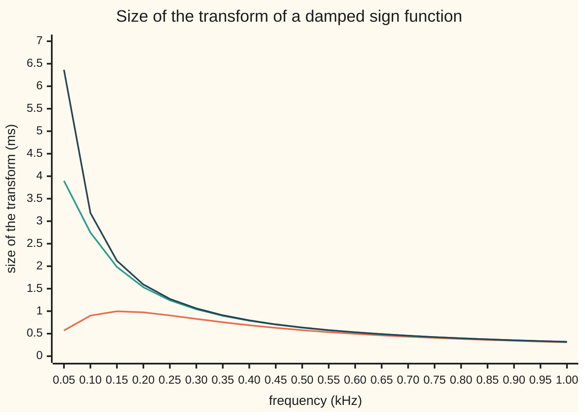

# Schwartz space and tempered distributions: transforms of spikes, constants and steps

[Syllabus](../../../SYLLABUS.md) → [Harmonic analysis](../README.md) → [The Fourier Transform](../README.md#s02) → Schwartz space and tempered distributions

---

## General Overview

A camera shutter set to 1/1000 s stays open for 1 millisecond (ms). Three kinds of light can reach the sensor. A flash so short that it is a spike. A lamp that is always on. A lamp switched on at one instant and left on, which is a step.

Each one needs a spectrum: how much of each flicker frequency, in hertz (Hz, cycles per second), it holds. The transform integral from [The Fourier transform of an absolutely integrable signal, and why it fades at infinity](01-fourier-transform-on-l1-and-riemann-lebesgue.md) fails on all three. The spike has no value at its own instant. The steady lamp and the switched-on lamp have infinite area, so the integral never settles.

The fix is to stop transforming the light and transform a measuring probe instead. A probe is a smooth signal that, with all its slopes, fades faster than any power of time; its transform is again such a probe. The class of all such probes is **Schwartz space**. The light is known only through its readings on these probes, and that is enough to give it a transform.

The answers are short. The flash has a flat spectrum: 1 at every frequency. The steady lamp has a spike at 0 Hz and nothing else. The switched-on lamp has half a spike at 0 Hz plus a tail that falls like one over the frequency: at 250 Hz it is −0.636620i ms. Switch a lamp on at −0.5 ms, subtract one switched on at +0.5 ms, and the two tails combine into the 1 ms shutter's own transform, 0.900316 ms at 250 Hz.

**Schwartz space is the set of smooth signals that fade faster than every power of time, with all their slopes; it is closed under the Fourier transform, so any signal of at most polynomial growth can be transformed by transforming the probe instead, which turns a spike into the constant 1, the constant 1 into a spike, and the sign function (−1 before time 0, +1 after) into one over πiξ.**

**What kind of fact this is:** a definition (Schwartz space and the transform of a tempered distribution), with theorems proved on this card in Why it works: the transforms of the sign function and the step, and the shutter rebuilt from two steps. The transforms of the spike and the constant are proved on [Tempered distributions](../../18-Functional%20analysis/04-Distributions%20and%20Sobolev%20Spaces/05-tempered-distributions-and-the-fourier-transform.md) and restated here in this wing's hertz convention.

### The picture: a fading sign function settles on one over πξ



The damped sign function is +1 times $`e^{-\varepsilon t}`$ after time 0 and −1 times $`e^{\varepsilon t}`$ before it. Orange: damping rate ε = 1 per ms. Teal: ε = 0.25 per ms. Dark: the limit, $`1/(\pi\xi)`$. As the damping fades, the curves climb onto the limit, which blows up at 0 Hz. The ordinary integral cannot give that limit; probe readings can.

---

## The formula

Notation first, in words. Time $`t`$ is in ms and frequency $`\xi`$ in kHz, so 250 Hz is $`\xi = 0.25`$ and $`\xi t`$ is a pure number. This is the wing's seconds-and-hertz convention with time counted in thousandths of a second and frequency in thousands of hertz, so the product $`\xi t`$, the formula and every $`2\pi`$ stay the same. The transform is this wing's $`\hat f(\xi) = \int f(t)\, e^{-2\pi i\xi t}\, dt`$, with no factor before the inverse.

- A **weighted slope** of a smooth function $`\varphi`$ is $`p_{a,b}(\varphi) = \sup_t \lvert t^a \varphi^{(b)}(t)\rvert`$: the largest size of its $`b`$-th slope after multiplying by $`t^a`$. Here sup means the largest value over all $`t`$, and $`a`$, $`b`$ are whole numbers from 0 up.
- **Schwartz space** $`\mathcal{S}`$ is the set of smooth functions whose weighted slopes are all finite. Its members are the **probes**.
- A **tempered distribution** $`u`$ is a rule that turns each probe into a number $`u(\varphi)`$, linearly, with a bound by finitely many weighted slopes. The set of them is $`\mathcal{S}'`$, from [Tempered distributions](../../18-Functional%20analysis/04-Distributions%20and%20Sobolev%20Spaces/05-tempered-distributions-and-the-fourier-transform.md), which wrote $`T`$ for a distribution; here $`T`$ is the exposure. A signal $`f`$ of at most polynomial growth is one, through $`u(\varphi) = \int f(t)\varphi(t)\,dt`$.

```math
\mathcal{S} = \Big\{\varphi \text{ smooth} : \sup_t \lvert t^a\,\varphi^{(b)}(t)\rvert < \infty \text{ for every } a, b \ge 0\Big\}, \qquad \hat u(\varphi) = u(\hat\varphi)
```

**Read it aloud:** "A probe fades faster than any power of time, and so does every slope it has. The transform of a distribution, read on a probe, is the distribution read on the probe's transform."

The four pairs this card uses:

```math
\hat\delta = 1, \qquad \hat 1 = \delta, \qquad \widehat{\mathrm{sgn}} = \mathrm{p.v.}\,\frac{1}{\pi i \xi}, \qquad \hat H = \tfrac12\,\delta + \mathrm{p.v.}\,\frac{1}{2\pi i \xi}
```

**Read it aloud:** "A spike has a flat spectrum. A constant has a spike at zero frequency. The sign function has one over πiξ, read with a balanced cut around zero. The step has half a spike at zero, plus half the sign function's tail."

The principal value, p.v., is the rule that reads one over $`\xi`$ on a probe by cutting out a gap of the same width on both sides of 0:

```math
\Big(\mathrm{p.v.}\,\frac{1}{\pi i \xi}\Big)(\varphi) = \lim_{\eta \to 0} \int_{\lvert\xi\rvert > \eta} \frac{\varphi(\xi)}{\pi i \xi}\, d\xi = \frac{1}{\pi i} \int_0^\infty \frac{\varphi(\xi) - \varphi(-\xi)}{\xi}\, d\xi
```

| Symbol | Plain meaning | In our example | Push it up and the answer… |
| --- | --- | --- | --- |
| $`t`$, $`\xi`$, $`i`$ | time in ms; frequency in kHz; the imaginary unit, $`i^2 = -1`$ | 250 Hz is $`\xi = 0.25`$ | |
| $`f`$, $`\hat f`$ | a signal and its transform | the light reaching the sensor | |
| $`\varphi`$, $`\hat\varphi`$, $`p_{a,b}`$ | a probe, its transform, and its weighted slopes | $`\varphi(\xi) = e^{-\pi(\xi - 0.25)^2}`$; $`p_{1,0}`$ of the bell is 0.241971 | a larger $`a`$ demands faster fading |
| $`\mathcal{S}`$, $`\mathcal{S}'`$ | Schwartz space; the tempered distributions on it | bells; spikes, constants, steps | |
| $`u`$, $`u(\varphi)`$, $`\hat u`$ | a tempered distribution, its reading on a probe, its transform | $`\widehat{\mathrm{sgn}}(\varphi) = -0.439414i`$ | |
| $`\delta`$, $`\delta_a`$ | the spike: the rule "read the probe at $`a`$"; $`\delta = \delta_0`$ | $`\delta(\varphi) = \varphi(0) = 0.821725`$ | |
| $`\mathrm{sgn}`$, $`H`$ | the sign function: −1 before 0, +1 after; the step: 0 before 0, 1 after | the lamp switched on at 0 | |
| p.v., $`\eta`$ | the principal value; the half-width of the gap it cuts | gap of 1 Hz each side | |
| $`g`$, $`T`$ | the shutter, 1 while open, centred on 0; its exposure | $`T = 1`$ ms, $`\hat g = 0.900316`$ ms at 250 Hz | $`\hat g`$ grows taller and narrower |
| $`\varepsilon`$, $`s_\varepsilon`$ | damping rate of the stand-in sign function, per ms; the stand-in itself | 1 down to 0.001 | the stand-in fades sooner and misses the limit by more |
| $`\mathrm{sinc}`$, $`D`$ | $`\mathrm{sinc}(x) = \sin(\pi x)/(\pi x)`$; the Dawson series, a third road in Step 3 | $`\mathrm{sinc}(0.25) = 0.900316`$ | |
| $`L`$, $`w`$ | how long a stand-in lamp stays on; how long a stand-in flash lasts, in ms | $`L = 1, 2, 4`$; $`w = 1, 0.1, 0.01`$ | a larger $`L`$ or a smaller $`w`$ comes closer to the ideal |

### When it holds

- **The probe must be in $`\mathcal{S}`$.** A probe that is zero outside an interval, as on [Distributions](../../18-Functional%20analysis/04-Distributions%20and%20Sobolev%20Spaces/01-test-functions-and-distributions.md), has a transform that is not: so $`u(\hat\varphi)`$ would read $`u`$ on something outside its domain.
- **The probe must fade faster than every power, not only some.** The smooth function $`1/(1 + t^2)`$ fades, but $`t^3/(1+t^2)`$ reaches 999.999000 at $`t`$ = 1,000 ms and keeps growing. Its transform, $`\pi e^{-2\pi\lvert\xi\rvert}`$, has a corner at 0, so it is not smooth.
- **The signal must be tempered: at most polynomial growth.** The step and the sign function are bounded, so they qualify. A signal like $`e^{t}`$ is not tempered: its reading on the Schwartz probe $`1/\cosh t`$ is infinite.
- **One convention.** In this wing's hertz form $`\hat 1 = \delta`$. The radian-per-second form of wing 07 gives $`2\pi\delta`$. Mixing them gives 5.163050 where 0.821725 is right.
- **The cut around 0 must be balanced.** One over $`\xi`$ is not integrable near 0. Cut an uneven gap and the reading moves.

---

## Why it works

### Step 0: move the transform onto the probe

For an integrable signal $`f`$ and a probe $`\varphi`$, swapping the order of a double integral gives

```math
\int \hat f(\xi)\,\varphi(\xi)\,d\xi = \int\!\!\int f(t)\, e^{-2\pi i \xi t}\,\varphi(\xi)\, dt\, d\xi = \int f(t)\,\hat\varphi(t)\,dt.
```

The left side needs $`\hat f`$. The right side needs only $`\hat\varphi`$. So define $`\hat u(\varphi) = u(\hat\varphi)`$ for any $`u`$ that can read $`\hat\varphi`$. This is the move made on [Tempered distributions](../../18-Functional%20analysis/04-Distributions%20and%20Sobolev%20Spaces/05-tempered-distributions-and-the-fourier-transform.md). This card asks which probes make it work, then uses it on steps.

### Step 1: the probes must survive the transform

The definition only works if $`\hat\varphi`$ is again a probe. [The transform rulebook](02-shift-scale-and-derivative-rules.md) gives two exchange rules:

- A slope in time becomes multiplication by $`2\pi i \xi`$ in frequency. Smoothness in time becomes fading in frequency.
- Multiplication by $`-2\pi i t`$ in time becomes a slope in frequency. Fading in time becomes smoothness in frequency.

A Schwartz probe has every slope and fades faster than every power. So its transform has every slope and fades faster than every power too: $`\mathcal{S}`$ maps into itself. The fold proves it.

The bell $`e^{-\pi t^2}`$ is the cleanest member. It is its own transform, as [Two pairs worth memorising](03-gaussian-and-sinc-transform-pairs.md) shows. At 0.5 kHz Simpson's rule (adding thin weighted slices) gives 0.455938, the bell's own value there. Its weighted slopes are finite: $`p_{1,0} = 0.241971`$, $`p_{2,0} = 0.117100`$, $`p_{0,1} = 1.520347`$.

Two nearby classes fail:

- **Probes zero outside an interval.** Their transforms extend to analytic functions of a complex frequency (functions given by a convergent power series around every point), so they cannot be zero on any interval. The bump $`e^{-1/(1-t^2)}`$, zero outside 1 ms of the centre, has transform 0.002526 ms at 3 kHz. The transform of a compactly supported probe is never compactly supported.
- **Probes that fade like a power.** $`1/(1+t^2)`$ fails the weight $`t^3`$, and its transform has a corner.

<details>
<summary>Detailed proof: the transform maps Schwartz space into itself</summary>

Let $`\varphi`$ be in $`\mathcal{S}`$ and fix whole numbers $`a`$, $`b`$. By the two exchange rules, $`\xi^a\,\hat\varphi^{(b)}(\xi)`$ is $`(-2\pi i)^b(2\pi i)^{-a}`$ times the transform of

$`\displaystyle h(t) = \frac{d^a}{dt^a}\big(t^b\,\varphi(t)\big).`$

The function $`h`$ is a finite sum of terms $`t^c\,\varphi^{(d)}(t)`$. Each has finite weighted slopes, so $`(1+t^2)\lvert h(t)\rvert`$ is bounded by some $`K`$. A transform is at most the integral of the size of its signal, so

$`\displaystyle \sup_\xi \lvert \xi^a\,\hat\varphi^{(b)}(\xi)\rvert \le (2\pi)^{b-a}\int \lvert h(t)\rvert\,dt \le (2\pi)^{b-a}\, K\int\frac{dt}{1+t^2} = (2\pi)^{b-a}\,\pi K.`$

Every weighted slope of $`\hat\varphi`$ is finite, so $`\hat\varphi`$ is in $`\mathcal{S}`$. The exchange rules are integration by parts with no boundary terms, since $`\varphi`$ fades, and a slope taken inside the integral, allowed because $`\lvert t^b\varphi(t)\rvert`$ is integrable for every $`b`$. The constant $`K`$ is built from finitely many weighted slopes of $`\varphi`$, so a tempered bound on $`u`$ carries over to $`\hat u`$: the transform maps $`\mathcal{S}'`$ into itself.

</details>

### Step 2: the spike and the constant, in hertz

Both pairs are one line each, proved on [Tempered distributions](../../18-Functional%20analysis/04-Distributions%20and%20Sobolev%20Spaces/05-tempered-distributions-and-the-fourier-transform.md):

```math
\hat\delta(\varphi) = \hat\varphi(0) = \int \varphi(\xi)\,d\xi = 1(\varphi), \qquad \hat 1(\varphi) = \int \hat\varphi(t)\,dt = \varphi(0) = \delta(\varphi).
```

The second uses [Fourier inversion](04-fourier-inversion-theorem.md) at 0. In hertz there is no $`2\pi`$: the factor lives inside the exponent.

The stand-ins settle as they should. A flash $`w`$ ms long with height $`1/w`$ has transform $`\mathrm{sinc}(w\xi)`$, where $`\mathrm{sinc}(x) = \sin(\pi x)/(\pi x)`$. At 250 Hz it is 0.900316, 0.998972, 0.999990 for $`w`$ = 1, 0.1, 0.01 ms, closing on 1.

A lamp on for $`L`$ ms has transform $`L\,\mathrm{sinc}(L\xi)`$. Read on the probe $`\varphi(\xi) = e^{-\pi(\xi - 0.25)^2}`$ it gives 0.726144, 0.824107, 0.821725 for $`L`$ = 1, 2, 4 ms. The limit is $`\delta(\varphi) = \varphi(0) = 0.821725`$. The gap is at most the bell's two tails past $`L/2`$, a bound of $`5.6 \times 10^{-7}`$ at 4 ms.

Read point by point, the same transforms never settle. At 100 Hz, $`L`$ = 5, 15, 25 ms give 3.183099, −3.183099, 3.183099. The convergence is in probe readings, not at each frequency.

### Step 3: the sign function, by fading it out

The sign function is not integrable. A damped copy is: $`s_\varepsilon(t) = e^{-\varepsilon\lvert t\rvert}\,\mathrm{sgn}(t)`$. Its transform is two exponential integrals:

```math
\hat s_\varepsilon(\xi) = \int_0^\infty e^{-\varepsilon t}\big(e^{-2\pi i\xi t} - e^{2\pi i\xi t}\big)\,dt = \frac{1}{\varepsilon + 2\pi i\xi} - \frac{1}{\varepsilon - 2\pi i\xi} = \frac{-4\pi i\xi}{\varepsilon^2 + 4\pi^2\xi^2}.
```

Let $`\varepsilon`$ fall to 0. On the time side, $`\int s_\varepsilon \hat\varphi\,dt \to \int \mathrm{sgn}\,\hat\varphi\,dt`$, because $`\lvert\hat\varphi\rvert`$ is integrable and bounds every term. So $`\hat s_\varepsilon \to \widehat{\mathrm{sgn}}`$ as probe readings.

On the frequency side, $`\hat s_\varepsilon`$ is odd, so it reads only the odd part of the probe:

```math
\hat s_\varepsilon(\varphi) = -4\pi i\int_0^\infty \big(\varphi(\xi) - \varphi(-\xi)\big)\,\frac{\xi}{\varepsilon^2 + 4\pi^2\xi^2}\,d\xi.
```

The fraction rises to $`1/(4\pi^2\xi)`$ as $`\varepsilon`$ falls. The difference $`\varphi(\xi) - \varphi(-\xi)`$ is at most a constant times $`\xi`$ near 0, so the integrand stays bounded by an integrable function. Dominated convergence (a limit may pass inside an integral when one integrable function bounds every term) passes the limit inside, and the limit is the principal value of $`1/(\pi i\xi)`$. So

```math
\widehat{\mathrm{sgn}} = \mathrm{p.v.}\,\frac{1}{\pi i \xi}.
```

On the probe $`\varphi(\xi) = e^{-\pi(\xi - 0.25)^2}`$, three roads agree on −0.439414i. The time side is $`-2i\int_0^\infty e^{-\pi t^2}\sin(\pi t/2)\,dt`$. The frequency side is the principal value. A third road is the Dawson series, $`D(x) = \sum_n (-2x^2)^n x/(1\cdot 3\cdots(2n+1))`$, which gives $`-2iD(\sqrt\pi/4)/\sqrt\pi`$.

The damped readings close in: the gap is 0.156233, 0.019947, 0.002048, 0.000205 for $`\varepsilon`$ = 1, 0.1, 0.01, 0.001 per ms. It shrinks about tenfold each time. Away from 0 Hz the limit is also an ordinary function: at 250 Hz it is $`1/(\pi i \times 0.25) = -1.273240i`$ ms.

### Step 4: the cross-check by the derivative rule

The sign function jumps by 2 at time 0, so its slope as a distribution is $`2\delta`$, as on [Distributions](../../18-Functional%20analysis/04-Distributions%20and%20Sobolev%20Spaces/01-test-functions-and-distributions.md). The derivative rule from [The transform rulebook](02-shift-scale-and-derivative-rules.md) carries over to $`\mathcal{S}'`$ by moving it onto the probe. So

```math
2\pi i\xi\,\widehat{\mathrm{sgn}} = \widehat{2\delta} = 2.
```

Away from 0 this says $`\widehat{\mathrm{sgn}} = 1/(\pi i\xi)`$, as found. At 0 it allows any multiple of $`\delta`$ to be added, since $`\xi\,\delta = 0`$. The sign function is odd, so its transform is odd, and $`\delta`$ is even: the multiple is 0. Step 3 needed no such argument.

### Step 5: the step is half a constant plus half a sign

The step is $`H = (1 + \mathrm{sgn})/2`$. The transform is linear, so Step 2 and Step 3 give

```math
\hat H = \tfrac12\,\delta + \mathrm{p.v.}\,\frac{1}{2\pi i\xi}.
```

The half spike is the lamp's average level, 1/2 over all time, sitting at 0 Hz. The tail is the switch-on.

On the centred bell probe, $`H(\hat\varphi) = \int_0^\infty e^{-\pi t^2}dt = 0.500000`$. The formula gives $`1/2 + 0`$: the bell is even, so the principal value reads 0. Drop the half spike and the answer is 0.000000. On the off-centre probe, the time side and the formula both give 0.410862 − 0.219707i.

### Step 6: the shutter is two steps, and its slope is two spikes

The 1 ms shutter switches on at −0.5 ms and off at +0.5 ms: $`g(t) = H(t + T/2) - H(t - T/2)`$. The delay rule from [The transform rulebook](02-shift-scale-and-derivative-rules.md) gives each step a turn $`e^{\mp\pi i\xi T}`$:

```math
\hat g(\xi) = \big(e^{\pi i\xi T} - e^{-\pi i\xi T}\big)\,\hat H(\xi) = 2i\sin(\pi\xi T)\Big(\tfrac12\,\delta + \frac{1}{2\pi i\xi}\Big) = \frac{\sin(\pi\xi T)}{\pi\xi} = T\,\mathrm{sinc}(T\xi).
```

The half spikes cancel, because the factor $`2i\sin(\pi\xi T)`$ is 0 at $`\xi = 0`$. The principal value is no longer needed, because $`\sin(\pi\xi T)/\xi`$ has no blow-up. Two signals with no ordinary transform combine into one that has it.

The rulebook left one promise. Its derivative rule failed on the shutter: the pointwise slope is 0, while $`2\pi i\xi\,\hat g`$ is 1.414214i at 250 Hz. In $`\mathcal{S}'`$ the slope is $`\delta_{-T/2} - \delta_{T/2}`$, a spike up at opening and a spike down at closing. Its transform is $`e^{\pi i\xi T} - e^{-\pi i\xi T} = 2i\sin(\pi\xi T)`$, which is 1.414214i at 250 Hz. The jumps hold the whole answer.

---

## Worked numbers, by hand

The 1 ms shutter at 250 Hz, built from two steps.

| Step | Arithmetic | Value |
| --- | --- | --- |
| sign function, away from 0 | $`1/(\pi i \times 0.25)`$ | −1.273240i ms |
| step, away from 0 | half of that | −0.636620i ms |
| turn of the opening step, at −0.5 ms | $`e^{\pi i \times 0.25 \times 1}`$ | $`e^{\pi i/4}`$ |
| turn of the closing step, at +0.5 ms | $`e^{-\pi i/4}`$ | $`e^{-\pi i/4}`$ |
| their difference: the two spikes | $`2i\sin(\pi/4)`$ | 1.414214i |
| half spikes at 0 Hz | factor is 0 at $`\xi = 0`$ | 0 |
| **shutter** | $`1.414214i \times (-0.636620i)`$ | **0.900316 ms** |

The answer is the shutter's known transform $`T\,\mathrm{sinc}(T\xi)`$, reached from two signals that have no ordinary transform. A 250 Hz flicker keeps 0.900316 of its swing in a 1 ms exposure, as [The transform rulebook](02-shift-scale-and-derivative-rules.md) found by another road.

### What breaks if you drop a piece

| Mistake | Comes out at | What went wrong |
| --- | --- | --- |
| Drop the half spike from $`\hat H`$, centred bell | 0.000000, not 0.500000 | The lamp's average level lives at 0 Hz. |
| Use $`\hat 1 = 2\pi\delta`$ in hertz | 5.163050, not 0.821725 | That factor belongs to the radian-per-second form. |
| Cut an uneven gap, −1 Hz to 2 Hz, around 0 | −0.256881i, not −0.439414i | One over $`\xi`$ is not integrable; only a balanced cut settles. |
| Read the lamp's transform at 100 Hz, point by point | 3.183099, −3.183099, 3.183099 for 5, 15, 25 ms | No limit: only probe readings converge. |
| Use $`1/(1+t^2)`$ as a probe | $`t^3/(1+t^2)`$ = 999.999000 at 1,000 ms | It fails a weighted slope; its transform has a corner. |
| Derivative rule on the shutter, pointwise | 0, not 1.414214i | The jumps are spikes; dropping them drops the whole slope. |

The uneven cut moves the answer by 0.182534i. As the gap shrinks it tends to $`i\varphi(0)\ln 2/\pi`$ = 0.181302i: $`\ln 2`$ is the area of $`1/\xi`$ from 1 Hz to 2 Hz, the extra strip cut from one side only.

---

## Code, from first principles, and it actually runs

The scripts work in ms and kHz. They take **four roads** to the sign function's transform on one probe: the probe's transform read by the sign function, the principal-value integral, a Dawson series, and damped stand-ins that settle. The step is checked by a time-side integral against the formula. The shutter is rebuilt from two steps and checked against Simpson's rule and its closed form, and its two spikes against $`2\pi i\xi`$ times the Simpson value. The spike and constant are checked through flashes and lamps that settle, with a tail bound. Every number on this card is printed below.

### Python

```python
# Schwartz space and tempered distributions -- the check behind the card.
# Standard library only.  Units: time t in ms, frequency xi in kHz, so xi*t is a
# pure number.  Convention: f-hat(xi) = integral of f(t) e^(-2 pi i xi t) dt.
# Every transform and pairing is computed here.  Roads: closed forms against the
# defining integral by Simpson's rule, the probe's own transform against the
# principal-value integral, a Dawson series, and damped stand-ins that settle.
import math

def simpson(f, a, b, n):  # n even
    w = (b - a) / n
    tot = f(a) + f(b)
    for k in range(1, n):
        tot += (4 if k % 2 else 2) * f(a + k * w)
    return tot * w / 3
def sinc(u): return 1.0 if u == 0 else math.sin(math.pi * u) / (math.pi * u)
def arrow(x): return complex(math.cos(x), math.sin(x))  # e^(ix), written out
def snap(x): return 0.0 if abs(x) < 5e-10 else x
def c(z): return f"{snap(z.real):.6f} {'-' if z.imag < 0 else '+'} {abs(z.imag):.6f}i"
XI0, R = 0.25, 6.0  # the probe's centre, 250 Hz; cut-off 6 kHz or 6 ms
def phi(x): return math.exp(-math.pi * (x - XI0) ** 2)  # probe in frequency
# its transform is e^(-pi t^2) e^(-2 pi i XI0 t): the bell is its own transform
TAIL = math.exp(-math.pi * (R - XI0) ** 2)  # bound on any probe tail past R
print(f"probe phi(xi) = exp(-pi (xi - 0.25)^2), cut-off {R:.0f}, tail below {TAIL:.1e}")

# 1. Schwartz space: weighted slopes p_ab = sup |t^a phi^(b)(t)| of the bell
g0 = lambda t: math.exp(-math.pi * t * t)
grid = [k / 100000 for k in range(500001)]
p10 = max(t * g0(t) for t in grid); p20 = max(t * t * g0(t) for t in grid)
p01 = max(2 * math.pi * t * g0(t) for t in grid)
ex10, ex20 = math.exp(-0.5) / math.sqrt(2 * math.pi), 1 / (math.pi * math.e)
print(f"bell weighted slopes: p00 1.000000, p10 {p10:.6f} (exact {ex10:.6f}),"
      f" p20 {p20:.6f} (exact {ex20:.6f}), p01 {p01:.6f} (exact {2 * math.pi * ex10:.6f})")
assert abs(p10 - ex10) < 1e-9 and abs(p20 - ex20) < 1e-9 and abs(p01 - 2 * math.pi * ex10) < 1e-8
bell_self = simpson(lambda t: g0(t) * math.cos(2 * math.pi * 0.5 * t), -R, R, 4000)
print(f"bell transform at 0.5 kHz: Simpson {bell_self:.6f}, bell itself {g0(0.5):.6f}")
assert abs(bell_self - g0(0.5)) < 1e-12
print("1/(1+t^2), weight t^3: " + ", ".join(f"t={t}: {t ** 3 / (1 + t * t):.6f}" for t in (10, 100, 1000)))
bump = lambda t: math.exp(-1 / (1 - t * t)) if abs(t) < 1 else 0.0
for xi in (2.0, 3.0):
    b1 = simpson(lambda t: bump(t) * math.cos(2 * math.pi * xi * t), -1, 1, 4000)
    b2 = simpson(lambda t: bump(t) * math.cos(2 * math.pi * xi * t), -1, 1, 8000)
    print(f"bump zero outside 1 ms, transform at {xi:.0f} kHz: {b1:.6f} ms (n=4000), {b2:.6f} ms (n=8000)")
    assert abs(b1 - b2) < 1e-9 and abs(b1) > 1e-4

# 2. delta and constant: delta-hat = 1, 1-hat = delta
for w in (1.0, 0.1, 0.01):  # a flash w ms long, height 1/w: area 1
    s = simpson(lambda t: math.cos(2 * math.pi * XI0 * t) / w, -w / 2, w / 2, 200)
    print(f"flash {w} ms at 250 Hz: closed form {sinc(w * XI0):.6f}, Simpson {s:.6f}, delta gives 1")
    assert abs(s - sinc(w * XI0)) < 1e-9
target = phi(0)  # 1-hat = delta, so 1-hat(phi) = phi(0)
print(f"lamp on for good, paired with probe: delta(phi) = phi(0) = {target:.6f}")
for L in (1, 2, 4):  # lamp on for L ms, transform L sinc(L xi)
    fr = simpson(lambda x: L * sinc(L * x) * phi(x), -R, R, 6000 * L)
    tm = simpson(lambda t: g0(t) * math.cos(2 * math.pi * XI0 * t), -L / 2, L / 2, 2000)
    gap = 2 * math.exp(-math.pi * L * L / 4) / (math.pi * L)
    print(f"lamp {L} ms: frequency side {fr:.6f}, time side {tm:.6f}, gap {abs(target - tm):.1e} <= bound {gap:.1e}")
    assert abs(fr - tm) < 1e-8 and abs(target - tm) <= gap
print("lamp transform at 100 Hz, pointwise: " + ", ".join(f"L={L} ms: {L * sinc(L * 0.1):.6f}" for L in (5, 15, 25)))

# 3. the sign function: sgn-hat = p.v. 1/(pi i xi)
time_side = -2j * simpson(lambda t: g0(t) * math.sin(2 * math.pi * XI0 * t), 0, R, 6000)
odd = lambda x: (phi(x) - phi(-x)) / x if x else 4 * math.pi * XI0 * phi(0)
pv = simpson(odd, 0, R, 6000) / (math.pi * 1j)
x, term, dawson, n = math.sqrt(math.pi) * XI0, math.sqrt(math.pi) * XI0, 0.0, 0
while abs(term) > 1e-17:  # Dawson series D(x) = sum (-2x^2)^n x / (1*3*...*(2n+1))
    dawson += term; n += 1; term *= -2 * x * x / (2 * n + 1)
series = -2j * dawson / math.sqrt(math.pi)
print(f"sgn-hat on probe: time side {c(time_side)}, p.v. side {c(pv)}, Dawson series {c(series)}")
assert abs(time_side - pv) < 1e-10 and abs(pv - series) < 1e-12
last = 1.0
for eps in (1.0, 0.1, 0.01, 0.001):  # damped sign e^(-eps|t|) sgn(t): transform -4 pi i xi/(eps^2 + 4 pi^2 xi^2)
    k = lambda x: (phi(x) - phi(-x)) * x / (eps ** 2 + 4 * math.pi ** 2 * x * x)
    pair = -4j * math.pi * simpson(k, 0, R, 400000)
    point = -4j * math.pi * XI0 / (eps ** 2 + 4 * math.pi ** 2 * XI0 ** 2)
    print(f"damped sign eps={eps}/ms: at 250 Hz {c(point)} ms, on probe {c(pair)}, gap {abs(pair - pv):.6f}")
    assert abs(pair - pv) < last / 5; last = abs(pair - pv)
assert last < 5e-4 and abs(point - 1 / (math.pi * 1j * XI0)) < 1e-6
print(f"sgn-hat at 250 Hz: 1/(pi i xi) = {c(1 / (math.pi * 1j * XI0))} ms")
uneven = (simpson(lambda x: phi(x) / x, 0.002, R, 400000) + simpson(lambda x: phi(x) / x, -R, -0.001, 400000)) / (math.pi * 1j)
print(f"uneven gap (-1 Hz, 2 Hz) instead of p.v.: {c(uneven)}, shift {c(uneven - pv)}, limit as the gap shrinks {c(-phi(0) * math.log(2) / (math.pi * 1j))}")
assert abs(uneven - pv + phi(0) * math.log(2) / (math.pi * 1j)) < 2e-3

# 4. the step H = (1 + sgn)/2: H-hat = delta/2 + p.v. 1/(2 pi i xi)
h_time = simpson(g0, 0, R, 6000)  # centred bell: H(bell-hat) = integral over t > 0
print(f"H-hat on the centred bell: time side {h_time:.6f}, formula 1/2 + 0 = 0.500000, without delta/2 0.000000")
assert abs(h_time - 0.5) < 1e-12
h_probe = simpson(lambda t: g0(t) * arrow(-2 * math.pi * XI0 * t), 0, R, 6000)  # H(phi-hat)
print(f"H-hat on probe: time side {c(h_probe)}, phi(0)/2 + p.v./2 {c(phi(0) / 2 + pv / 2)}")
assert abs(h_probe - (phi(0) / 2 + pv / 2)) < 1e-10
print(f"H-hat at 250 Hz, away from 0: 1/(2 pi i xi) = {c(1 / (2 * math.pi * 1j * XI0))} ms")
wrong = 2 * math.pi * target
print(f"1-hat = 2 pi delta in hertz (the omega-form factor): {wrong:.6f} instead of {target:.6f}")

# 5. the 1 ms shutter g = H(t + 1/2) - H(t - 1/2), and its slope: two spikes
T = 1.0
steps = (arrow(math.pi * XI0 * T) - arrow(-math.pi * XI0 * T)) / (2 * math.pi * 1j * XI0)
direct = simpson(lambda t: math.cos(2 * math.pi * XI0 * t), -T / 2, T / 2, 400)
print(f"shutter at 250 Hz: from two steps {c(steps)}, T sinc(T xi) {T * sinc(T * XI0):.6f}, Simpson {direct:.6f} ms")
assert abs(steps - direct) < 1e-9 and abs(direct - T * sinc(T * XI0)) < 1e-10  # two steps against Simpson
spikes = arrow(math.pi * XI0 * T) - arrow(-math.pi * XI0 * T)  # delta(t+1/2) - delta(t-1/2)
print(f"shutter slope at 250 Hz: two spikes {c(spikes)}, 2 pi i xi g-hat {c(2j * math.pi * XI0 * T * sinc(T * XI0))}, pointwise slope 0")
assert abs(spikes - 2j * math.pi * XI0 * direct) < 1e-9  # the jumps against 2 pi i xi times Simpson's g-hat
print("chart, xi kHz      " + " ".join(f"{k / 20:6.2f}" for k in range(1, 21)))
for eps in (1.0, 0.25):
    print(f"chart, eps={eps:<4}    " + " ".join(f"{4 * math.pi * (k / 20) / (eps ** 2 + 4 * math.pi ** 2 * (k / 20) ** 2):6.3f}" for k in range(1, 21)))
print("chart, 1/(pi xi)   " + " ".join(f"{1 / (math.pi * k / 20):6.3f}" for k in range(1, 21)))
print("ALL CHECKS PASS")
```

**Ran 2026-11-15 on macOS, Python 3.14.10, standard library only. All checks passed. Output, pasted from the run:**

```
probe phi(xi) = exp(-pi (xi - 0.25)^2), cut-off 6, tail below 7.8e-46
bell weighted slopes: p00 1.000000, p10 0.241971 (exact 0.241971), p20 0.117100 (exact 0.117100), p01 1.520347 (exact 1.520347)
bell transform at 0.5 kHz: Simpson 0.455938, bell itself 0.455938
1/(1+t^2), weight t^3: t=10: 9.900990, t=100: 99.990001, t=1000: 999.999000
bump zero outside 1 ms, transform at 2 kHz: 0.000291 ms (n=4000), 0.000291 ms (n=8000)
bump zero outside 1 ms, transform at 3 kHz: 0.002526 ms (n=4000), 0.002526 ms (n=8000)
flash 1.0 ms at 250 Hz: closed form 0.900316, Simpson 0.900316, delta gives 1
flash 0.1 ms at 250 Hz: closed form 0.998972, Simpson 0.998972, delta gives 1
flash 0.01 ms at 250 Hz: closed form 0.999990, Simpson 0.999990, delta gives 1
lamp on for good, paired with probe: delta(phi) = phi(0) = 0.821725
lamp 1 ms: frequency side 0.726144, time side 0.726144, gap 9.6e-02 <= bound 2.9e-01
lamp 2 ms: frequency side 0.824107, time side 0.824107, gap 2.4e-03 <= bound 1.4e-02
lamp 4 ms: frequency side 0.821725, time side 0.821725, gap 5.3e-07 <= bound 5.6e-07
lamp transform at 100 Hz, pointwise: L=5 ms: 3.183099, L=15 ms: -3.183099, L=25 ms: 3.183099
sgn-hat on probe: time side 0.000000 - 0.439414i, p.v. side 0.000000 - 0.439414i, Dawson series 0.000000 - 0.439414i
damped sign eps=1.0/ms: at 250 Hz 0.000000 - 0.906037i ms, on probe 0.000000 - 0.283181i, gap 0.156233
damped sign eps=0.1/ms: at 250 Hz 0.000000 - 1.268100i ms, on probe 0.000000 - 0.419468i, gap 0.019947
damped sign eps=0.01/ms: at 250 Hz 0.000000 - 1.273188i ms, on probe 0.000000 - 0.437366i, gap 0.002048
damped sign eps=0.001/ms: at 250 Hz 0.000000 - 1.273239i ms, on probe 0.000000 - 0.439209i, gap 0.000205
sgn-hat at 250 Hz: 1/(pi i xi) = 0.000000 - 1.273240i ms
uneven gap (-1 Hz, 2 Hz) instead of p.v.: 0.000000 - 0.256881i, shift 0.000000 + 0.182534i, limit as the gap shrinks 0.000000 + 0.181302i
H-hat on the centred bell: time side 0.500000, formula 1/2 + 0 = 0.500000, without delta/2 0.000000
H-hat on probe: time side 0.410862 - 0.219707i, phi(0)/2 + p.v./2 0.410862 - 0.219707i
H-hat at 250 Hz, away from 0: 1/(2 pi i xi) = 0.000000 - 0.636620i ms
1-hat = 2 pi delta in hertz (the omega-form factor): 5.163050 instead of 0.821725
shutter at 250 Hz: from two steps 0.900316 + 0.000000i, T sinc(T xi) 0.900316, Simpson 0.900316 ms
shutter slope at 250 Hz: two spikes 0.000000 + 1.414214i, 2 pi i xi g-hat 0.000000 + 1.414214i, pointwise slope 0
chart, xi kHz        0.05   0.10   0.15   0.20   0.25   0.30   0.35   0.40   0.45   0.50   0.55   0.60   0.65   0.70   0.75   0.80   0.85   0.90   0.95   1.00
chart, eps=1.0      0.572  0.901  0.998  0.974  0.906  0.828  0.754  0.687  0.629  0.578  0.534  0.496  0.462  0.432  0.406  0.383  0.362  0.343  0.326  0.310
chart, eps=0.25     3.898  2.748  1.983  1.531  1.242  1.043  0.898  0.788  0.702  0.633  0.576  0.528  0.488  0.453  0.423  0.397  0.374  0.353  0.334  0.318
chart, 1/(pi xi)    6.366  3.183  2.122  1.592  1.273  1.061  0.909  0.796  0.707  0.637  0.579  0.531  0.490  0.455  0.424  0.398  0.374  0.354  0.335  0.318
ALL CHECKS PASS
```

### Rust

The same checks, with a small complex-number struct and a helper that prints exponents the way Python does.

```rust
// Schwartz space and tempered distributions -- the same check as the Python
// file, in Rust.  Standard library only, no crates.  Units: t in ms, xi in kHz.
// A complex number is a small struct; every transform and pairing is computed.
use std::f64::consts::{E, PI};
use std::ops::{Add, Div, Mul, Sub};

#[derive(Clone, Copy)]
struct C { re: f64, im: f64 }
impl Add for C { type Output = C; fn add(self, o: C) -> C { C { re: self.re + o.re, im: self.im + o.im } } }
impl Sub for C { type Output = C; fn sub(self, o: C) -> C { C { re: self.re - o.re, im: self.im - o.im } } }
impl Mul for C { type Output = C; fn mul(self, o: C) -> C { C { re: self.re * o.re - self.im * o.im, im: self.re * o.im + self.im * o.re } } }
impl Div for C {
    type Output = C;
    fn div(self, o: C) -> C { let d = o.re * o.re + o.im * o.im; C { re: (self.re * o.re + self.im * o.im) / d, im: (self.im * o.re - self.re * o.im) / d } }
}
fn r(x: f64) -> C { C { re: x, im: 0.0 } }
fn im(x: f64) -> C { C { re: 0.0, im: x } }
fn abs(z: C) -> f64 { (z.re * z.re + z.im * z.im).sqrt() }
fn arrow(x: f64) -> C { C { re: x.cos(), im: x.sin() } } // e^(ix), written out
fn snap(x: f64) -> f64 { if x.abs() < 5e-10 { 0.0 } else { x } }
fn c(z: C) -> String { format!("{:.6} {} {:.6}i", snap(z.re), if z.im < 0.0 { "-" } else { "+" }, z.im.abs()) }
fn sci(x: f64) -> String { // Python's {:.1e}: mantissa, e, sign, two-digit exponent
    let s = format!("{:.1e}", x);
    let (m, e) = s.split_once('e').unwrap();
    let e: i32 = e.parse().unwrap();
    format!("{}e{}{:02}", m, if e < 0 { "-" } else { "+" }, e.abs())
}
fn simpson<F: Fn(f64) -> f64>(f: F, a: f64, b: f64, n: usize) -> f64 {
    let w = (b - a) / n as f64;
    let mut tot = f(a) + f(b);
    for k in 1..n { tot += (if k % 2 == 1 { 4.0 } else { 2.0 }) * f(a + k as f64 * w); }
    tot * w / 3.0
}
fn simpson_c<F: Fn(f64) -> C>(f: F, a: f64, b: f64, n: usize) -> C {
    r(simpson(|t| f(t).re, a, b, n)) + im(simpson(|t| f(t).im, a, b, n))
}
fn sinc(u: f64) -> f64 { if u == 0.0 { 1.0 } else { (PI * u).sin() / (PI * u) } }
const XI0: f64 = 0.25; // the probe's centre, 250 Hz
const R: f64 = 6.0; // cut-off 6 kHz or 6 ms
fn phi(x: f64) -> f64 { (-PI * (x - XI0).powi(2)).exp() } // probe in frequency
fn g0(t: f64) -> f64 { (-PI * t * t).exp() } // the bell, its own transform

fn main() {
    let tail = (-PI * (R - XI0).powi(2)).exp();
    println!("probe phi(xi) = exp(-pi (xi - 0.25)^2), cut-off {:.0}, tail below {}", R, sci(tail));

    // 1. Schwartz space: weighted slopes of the bell
    let (mut p10, mut p20, mut p01) = (f64::MIN, f64::MIN, f64::MIN);
    for k in 0..=500000 {
        let t = k as f64 / 100000.0;
        p10 = p10.max(t * g0(t)); p20 = p20.max(t * t * g0(t)); p01 = p01.max(2.0 * PI * t * g0(t));
    }
    let (ex10, ex20) = ((-0.5f64).exp() / (2.0 * PI).sqrt(), 1.0 / (PI * E));
    println!("bell weighted slopes: p00 1.000000, p10 {:.6} (exact {:.6}), p20 {:.6} (exact {:.6}), p01 {:.6} (exact {:.6})",
        p10, ex10, p20, ex20, p01, 2.0 * PI * ex10);
    assert!((p10 - ex10).abs() < 1e-9 && (p20 - ex20).abs() < 1e-9 && (p01 - 2.0 * PI * ex10).abs() < 1e-8);
    let bell_self = simpson(|t| g0(t) * (2.0 * PI * 0.5 * t).cos(), -R, R, 4000);
    println!("bell transform at 0.5 kHz: Simpson {:.6}, bell itself {:.6}", bell_self, g0(0.5));
    assert!((bell_self - g0(0.5)).abs() < 1e-12);
    let lor: Vec<String> = [10.0f64, 100.0, 1000.0].iter().map(|&t| format!("t={}: {:.6}", t, t.powi(3) / (1.0 + t * t))).collect();
    println!("1/(1+t^2), weight t^3: {}", lor.join(", "));
    let bump = |t: f64| if t.abs() < 1.0 { (-1.0 / (1.0 - t * t)).exp() } else { 0.0 };
    for xi in [2.0f64, 3.0] {
        let b1 = simpson(|t| bump(t) * (2.0 * PI * xi * t).cos(), -1.0, 1.0, 4000);
        let b2 = simpson(|t| bump(t) * (2.0 * PI * xi * t).cos(), -1.0, 1.0, 8000);
        println!("bump zero outside 1 ms, transform at {:.0} kHz: {:.6} ms (n=4000), {:.6} ms (n=8000)", xi, b1, b2);
        assert!((b1 - b2).abs() < 1e-9 && b1.abs() > 1e-4);
    }

    // 2. delta and constant
    for (w, lab) in [(1.0f64, "1.0"), (0.1, "0.1"), (0.01, "0.01")] {
        let s = simpson(|t| (2.0 * PI * XI0 * t).cos() / w, -w / 2.0, w / 2.0, 200);
        println!("flash {} ms at 250 Hz: closed form {:.6}, Simpson {:.6}, delta gives 1", lab, sinc(w * XI0), s);
        assert!((s - sinc(w * XI0)).abs() < 1e-9);
    }
    let target = phi(0.0);
    println!("lamp on for good, paired with probe: delta(phi) = phi(0) = {:.6}", target);
    for l in [1usize, 2, 4] {
        let lf = l as f64;
        let fr = simpson(|x| lf * sinc(lf * x) * phi(x), -R, R, 6000 * l);
        let tm = simpson(|t| g0(t) * (2.0 * PI * XI0 * t).cos(), -lf / 2.0, lf / 2.0, 2000);
        let gap = 2.0 * (-PI * lf * lf / 4.0).exp() / (PI * lf);
        println!("lamp {} ms: frequency side {:.6}, time side {:.6}, gap {} <= bound {}", l, fr, tm, sci((target - tm).abs()), sci(gap));
        assert!((fr - tm).abs() < 1e-8 && (target - tm).abs() <= gap);
    }
    let pw: Vec<String> = [5.0f64, 15.0, 25.0].iter().map(|&l| format!("L={} ms: {:.6}", l, l * sinc(l * 0.1))).collect();
    println!("lamp transform at 100 Hz, pointwise: {}", pw.join(", "));

    // 3. the sign function
    let time_side = im(-2.0 * simpson(|t| g0(t) * (2.0 * PI * XI0 * t).sin(), 0.0, R, 6000));
    let odd = |x: f64| if x != 0.0 { (phi(x) - phi(-x)) / x } else { 4.0 * PI * XI0 * phi(0.0) };
    let pv = r(simpson(odd, 0.0, R, 6000)) / im(PI);
    let x = PI.sqrt() * XI0;
    let (mut term, mut dawson, mut n) = (x, 0.0f64, 0);
    while term.abs() > 1e-17 { dawson += term; n += 1; term *= -2.0 * x * x / (2 * n + 1) as f64; }
    let series = im(-2.0 * dawson / PI.sqrt());
    println!("sgn-hat on probe: time side {}, p.v. side {}, Dawson series {}", c(time_side), c(pv), c(series));
    assert!(abs(time_side - pv) < 1e-10 && abs(pv - series) < 1e-12);
    let mut last = 1.0f64;
    let mut point = r(0.0);
    for (eps, lab) in [(1.0f64, "1.0"), (0.1, "0.1"), (0.01, "0.01"), (0.001, "0.001")] {
        let k = |x: f64| (phi(x) - phi(-x)) * x / (eps * eps + 4.0 * PI * PI * x * x);
        let pair = im(-4.0 * PI * simpson(k, 0.0, R, 400000));
        point = im(-4.0 * PI * XI0 / (eps * eps + 4.0 * PI * PI * XI0 * XI0));
        println!("damped sign eps={}/ms: at 250 Hz {} ms, on probe {}, gap {:.6}", lab, c(point), c(pair), abs(pair - pv));
        assert!(abs(pair - pv) < last / 5.0); last = abs(pair - pv);
    }
    let sgn_at = r(1.0) / im(PI * XI0);
    assert!(last < 5e-4 && abs(point - sgn_at) < 1e-6);
    println!("sgn-hat at 250 Hz: 1/(pi i xi) = {} ms", c(sgn_at));
    let uneven = r(simpson(|x| phi(x) / x, 0.002, R, 400000) + simpson(|x| phi(x) / x, -R, -0.001, 400000)) / im(PI);
    let lim = r(-phi(0.0) * 2f64.ln()) / im(PI);
    println!("uneven gap (-1 Hz, 2 Hz) instead of p.v.: {}, shift {}, limit as the gap shrinks {}", c(uneven), c(uneven - pv), c(lim));
    assert!(abs(uneven - pv - lim) < 2e-3);

    // 4. the step H = (1 + sgn)/2
    let h_time = simpson(g0, 0.0, R, 6000);
    println!("H-hat on the centred bell: time side {:.6}, formula 1/2 + 0 = 0.500000, without delta/2 0.000000", h_time);
    assert!((h_time - 0.5).abs() < 1e-12);
    let h_probe = simpson_c(|t| r(g0(t)) * arrow(-2.0 * PI * XI0 * t), 0.0, R, 6000);
    let h_formula = r(phi(0.0) / 2.0) + pv * r(0.5);
    println!("H-hat on probe: time side {}, phi(0)/2 + p.v./2 {}", c(h_probe), c(h_formula));
    assert!(abs(h_probe - h_formula) < 1e-10);
    println!("H-hat at 250 Hz, away from 0: 1/(2 pi i xi) = {} ms", c(r(1.0) / im(2.0 * PI * XI0)));
    println!("1-hat = 2 pi delta in hertz (the omega-form factor): {:.6} instead of {:.6}", 2.0 * PI * target, target);

    // 5. the 1 ms shutter from two steps, and its slope as two spikes
    let tt = 1.0f64;
    let spikes = arrow(PI * XI0 * tt) - arrow(-PI * XI0 * tt);
    let steps = spikes / im(2.0 * PI * XI0);
    let direct = simpson(|t| (2.0 * PI * XI0 * t).cos(), -tt / 2.0, tt / 2.0, 400);
    let gh = tt * sinc(tt * XI0);
    println!("shutter at 250 Hz: from two steps {}, T sinc(T xi) {:.6}, Simpson {:.6} ms", c(steps), gh, direct);
    assert!(abs(steps - r(direct)) < 1e-9 && (direct - gh).abs() < 1e-10); // two steps against Simpson
    let rule = im(2.0 * PI * XI0 * gh);
    println!("shutter slope at 250 Hz: two spikes {}, 2 pi i xi g-hat {}, pointwise slope 0", c(spikes), c(rule));
    assert!(abs(spikes - im(2.0 * PI * XI0 * direct)) < 1e-9); // the jumps against 2 pi i xi times Simpson's g-hat
    let xs: Vec<String> = (1..=20).map(|k| format!("{:6.2}", k as f64 / 20.0)).collect();
    println!("chart, xi kHz      {}", xs.join(" "));
    for (eps, lab) in [(1.0f64, "1.0 "), (0.25, "0.25")] {
        let v: Vec<String> = (1..=20).map(|k| { let x = k as f64 / 20.0; format!("{:6.3}", 4.0 * PI * x / (eps * eps + 4.0 * PI * PI * x * x)) }).collect();
        println!("chart, eps={}    {}", lab, v.join(" "));
    }
    let v: Vec<String> = (1..=20).map(|k| format!("{:6.3}", 1.0 / (PI * k as f64 / 20.0))).collect();
    println!("chart, 1/(pi xi)   {}", v.join(" "));
    println!("ALL CHECKS PASS");
}
```

**Ran 2026-11-15 on macOS, rustc 1.98.1, no crates. All checks passed. Output, pasted from the run:**

```
probe phi(xi) = exp(-pi (xi - 0.25)^2), cut-off 6, tail below 7.8e-46
bell weighted slopes: p00 1.000000, p10 0.241971 (exact 0.241971), p20 0.117100 (exact 0.117100), p01 1.520347 (exact 1.520347)
bell transform at 0.5 kHz: Simpson 0.455938, bell itself 0.455938
1/(1+t^2), weight t^3: t=10: 9.900990, t=100: 99.990001, t=1000: 999.999000
bump zero outside 1 ms, transform at 2 kHz: 0.000291 ms (n=4000), 0.000291 ms (n=8000)
bump zero outside 1 ms, transform at 3 kHz: 0.002526 ms (n=4000), 0.002526 ms (n=8000)
flash 1.0 ms at 250 Hz: closed form 0.900316, Simpson 0.900316, delta gives 1
flash 0.1 ms at 250 Hz: closed form 0.998972, Simpson 0.998972, delta gives 1
flash 0.01 ms at 250 Hz: closed form 0.999990, Simpson 0.999990, delta gives 1
lamp on for good, paired with probe: delta(phi) = phi(0) = 0.821725
lamp 1 ms: frequency side 0.726144, time side 0.726144, gap 9.6e-02 <= bound 2.9e-01
lamp 2 ms: frequency side 0.824107, time side 0.824107, gap 2.4e-03 <= bound 1.4e-02
lamp 4 ms: frequency side 0.821725, time side 0.821725, gap 5.3e-07 <= bound 5.6e-07
lamp transform at 100 Hz, pointwise: L=5 ms: 3.183099, L=15 ms: -3.183099, L=25 ms: 3.183099
sgn-hat on probe: time side 0.000000 - 0.439414i, p.v. side 0.000000 - 0.439414i, Dawson series 0.000000 - 0.439414i
damped sign eps=1.0/ms: at 250 Hz 0.000000 - 0.906037i ms, on probe 0.000000 - 0.283181i, gap 0.156233
damped sign eps=0.1/ms: at 250 Hz 0.000000 - 1.268100i ms, on probe 0.000000 - 0.419468i, gap 0.019947
damped sign eps=0.01/ms: at 250 Hz 0.000000 - 1.273188i ms, on probe 0.000000 - 0.437366i, gap 0.002048
damped sign eps=0.001/ms: at 250 Hz 0.000000 - 1.273239i ms, on probe 0.000000 - 0.439209i, gap 0.000205
sgn-hat at 250 Hz: 1/(pi i xi) = 0.000000 - 1.273240i ms
uneven gap (-1 Hz, 2 Hz) instead of p.v.: 0.000000 - 0.256881i, shift 0.000000 + 0.182534i, limit as the gap shrinks 0.000000 + 0.181302i
H-hat on the centred bell: time side 0.500000, formula 1/2 + 0 = 0.500000, without delta/2 0.000000
H-hat on probe: time side 0.410862 - 0.219707i, phi(0)/2 + p.v./2 0.410862 - 0.219707i
H-hat at 250 Hz, away from 0: 1/(2 pi i xi) = 0.000000 - 0.636620i ms
1-hat = 2 pi delta in hertz (the omega-form factor): 5.163050 instead of 0.821725
shutter at 250 Hz: from two steps 0.900316 + 0.000000i, T sinc(T xi) 0.900316, Simpson 0.900316 ms
shutter slope at 250 Hz: two spikes 0.000000 + 1.414214i, 2 pi i xi g-hat 0.000000 + 1.414214i, pointwise slope 0
chart, xi kHz        0.05   0.10   0.15   0.20   0.25   0.30   0.35   0.40   0.45   0.50   0.55   0.60   0.65   0.70   0.75   0.80   0.85   0.90   0.95   1.00
chart, eps=1.0      0.572  0.901  0.998  0.974  0.906  0.828  0.754  0.687  0.629  0.578  0.534  0.496  0.462  0.432  0.406  0.383  0.362  0.343  0.326  0.310
chart, eps=0.25     3.898  2.748  1.983  1.531  1.242  1.043  0.898  0.788  0.702  0.633  0.576  0.528  0.488  0.453  0.423  0.397  0.374  0.353  0.334  0.318
chart, 1/(pi xi)    6.366  3.183  2.122  1.592  1.273  1.061  0.909  0.796  0.707  0.637  0.579  0.531  0.490  0.455  0.424  0.398  0.374  0.354  0.335  0.318
ALL CHECKS PASS
```

### Lean

Lean proves the card's facts about Schwartz space, the sign function and the step, for every probe in $`\mathcal{S}`$, in this wing's hertz convention.

- The transform of a probe is again a probe: Schwartz space is closed under the transform.
- The sign function and the step, read on probes, are tempered distributions.
- Take any probe $`\varphi`$ and cut a balanced gap from $`-\eta`$ to $`\eta`$ around 0. Then the integral of $`\varphi(\xi)/(\pi i \xi)`$ outside the gap tends to $`\widehat{\mathrm{sgn}}(\varphi)`$ as $`\eta`$ shrinks.
- Take any probe $`\varphi`$ and the same balanced gap. Then $`\hat H(\varphi)`$ is $`\varphi(0)/2`$ plus the limit of the integral of $`\varphi(\xi)/(2\pi i \xi)`$ outside the gap.
- Lean also checks the 2 ms shutter's arithmetic at 250 Hz: $`2\sin(\pi \times 0.25 \times 2) = 2`$.

The spike and constant pairs, the shutter rebuilt from two steps, and every printed number are left to the Python and Rust checks.

```lean
-- Schwartz space and tempered distributions: the Fourier transform maps Schwartz space to itself, the sign function's transform is the principal value of 1/(πiξ), and the step's transform is half a spike plus half that.
import Mathlib.Analysis.Distribution.TemperedDistribution
import Mathlib.Basic.Real.Sign
import Mathlib.Analysis.Fourier.RiemannLebesgueLemma

open SchwartzMap FourierTransform MeasureTheory Filter Topology Complex

noncomputable section

theorem schwartz_oddQuot_integrable (φ : 𝓢(ℝ, ℂ)) :
    Integrable (fun ξ : ℝ => (φ ξ - φ (-ξ)) / (ξ : ℂ)) := by
  set M : ℝ := SchwartzMap.seminorm ℝ 0 0 (SchwartzMap.derivCLM ℝ ℂ φ) with hM
  have hM0 : 0 ≤ M := apply_nonneg _ _
  have hlip : LipschitzWith M.toNNReal φ := by
    refine lipschitzWith_of_nnnorm_deriv_le φ.differentiable fun x => ?_
    have := SchwartzMap.norm_le_seminorm ℝ (SchwartzMap.derivCLM ℝ ℂ φ) x
    rw [SchwartzMap.derivCLM_apply] at this
    rw [← NNReal.coe_le_coe, Real.coe_toNNReal _ hM0, coe_nnnorm]
    exact this
  have hmeas : AEStronglyMeasurable (fun ξ : ℝ => (φ ξ - φ (-ξ)) / (ξ : ℂ)) volume := by
    apply Measurable.aestronglyMeasurable
    exact ((φ.continuous.measurable).sub (φ.continuous.measurable.comp measurable_neg)).div
      Complex.measurable_ofReal
  have hbound : Integrable (fun ξ : ℝ =>
      (Set.Icc (-1 : ℝ) 1).indicator (fun _ => 2 * M) ξ + (‖φ ξ‖ + ‖φ (-ξ)‖)) := by
    refine Integrable.add ?_ (φ.integrable.norm.add (φ.integrable.comp_neg).norm)
    exact (continuous_const.integrableOn_Icc).integrable_indicator measurableSet_Icc
  refine hbound.mono' hmeas (Eventually.of_forall fun ξ => ?_)
  have hnum : ‖φ ξ - φ (-ξ)‖ ≤ M * (2 * |ξ|) := by
    have := hlip.dist_le_mul ξ (-ξ)
    simp only [dist_eq_norm, Real.coe_toNNReal _ hM0] at this
    convert this using 2
    rw [Real.norm_eq_abs, sub_neg_eq_add, ← two_mul, abs_mul, abs_two]
  rw [norm_div, Complex.norm_real, Real.norm_eq_abs]
  by_cases h1 : |ξ| ≤ 1
  · have hmem : ξ ∈ Set.Icc (-1 : ℝ) 1 := abs_le.mp h1
    rw [Set.indicator_of_mem hmem]
    rcases eq_or_ne ξ 0 with h0 | h0
    · subst h0; simp; positivity
    · have hpos : 0 < |ξ| := abs_pos.mpr h0
      rw [div_le_iff₀ hpos]
      nlinarith [norm_nonneg (φ ξ), norm_nonneg (φ (-ξ))]
  · push Not at h1
    have hmem : ξ ∉ Set.Icc (-1 : ℝ) 1 := fun h => by
      have := abs_le.mpr h; linarith
    rw [Set.indicator_of_notMem hmem, zero_add]
    rw [div_le_iff₀ (by linarith)]
    calc ‖φ ξ - φ (-ξ)‖ ≤ ‖φ ξ‖ + ‖φ (-ξ)‖ := norm_sub_le _ _
      _ ≤ (‖φ ξ‖ + ‖φ (-ξ)‖) * |ξ| := by
        nlinarith [norm_nonneg (φ ξ), norm_nonneg (φ (-ξ))]

#print axioms schwartz_oddQuot_integrable

theorem integrable_cexp_ofReal_mul_I_mul {f : ℝ → ℂ} (hf : Integrable f) {c : ℝ → ℝ}
    (hc : Continuous c) : Integrable (fun x => Complex.exp (↑(c x) * Complex.I) * f x) := by
  refine Integrable.mono' hf.norm ?_ (Eventually.of_forall fun x => ?_)
  · exact (by fun_prop : Continuous fun x => Complex.exp (↑(c x) * Complex.I)).aestronglyMeasurable.mul
      hf.aestronglyMeasurable
  · rw [norm_mul, Complex.norm_exp_ofReal_mul_I, one_mul]

#print axioms integrable_cexp_ofReal_mul_I_mul

theorem schwartz_fourier_apply_eq (φ : 𝓢(ℝ, ℂ)) (t : ℝ) :
    (𝓕 φ : 𝓢(ℝ, ℂ)) t =
      ∫ ξ : ℝ, Complex.exp (↑(2 * Real.pi * (-(ξ * t))) * Complex.I) * φ ξ := by
  rw [SchwartzMap.fourier_coe, Real.fourier_real_eq]
  simp_rw [Circle.smul_def, Real.fourierChar_apply, smul_eq_mul]

#print axioms schwartz_fourier_apply_eq

theorem schwartz_fourier_sub_neg (φ : 𝓢(ℝ, ℂ)) (t : ℝ) :
    ∫ ξ : ℝ, Complex.exp (↑(2 * Real.pi * (-(ξ * t))) * Complex.I) * (φ ξ - φ (-ξ)) =
      (𝓕 φ : 𝓢(ℝ, ℂ)) t - (𝓕 φ : 𝓢(ℝ, ℂ)) (-t) := by
  rw [schwartz_fourier_apply_eq, schwartz_fourier_apply_eq]
  simp_rw [mul_sub]
  rw [integral_sub (integrable_cexp_ofReal_mul_I_mul φ.integrable (by fun_prop))
    (integrable_cexp_ofReal_mul_I_mul φ.integrable.comp_neg (by fun_prop))]
  congr 1
  rw [← integral_neg_eq_self]
  congr 1
  ext ξ
  simp only [neg_mul, neg_neg, mul_neg]

#print axioms schwartz_fourier_sub_neg

theorem interval_kernel_eq (ξ R : ℝ) :
    (ξ : ℂ) * ∫ t in (0 : ℝ)..R, (Complex.exp (↑(2 * Real.pi * (-(ξ * t))) * Complex.I) -
        Complex.exp (↑(2 * Real.pi * (ξ * t)) * Complex.I)) =
      (2 - Complex.exp (↑(2 * Real.pi * (-(ξ * R))) * Complex.I) -
        Complex.exp (↑(2 * Real.pi * (ξ * R)) * Complex.I)) / (2 * Real.pi * Complex.I) := by
  have hpi : (2 * Real.pi * Complex.I : ℂ) ≠ 0 := by
    simp [Real.pi_ne_zero, Complex.I_ne_zero]
  have hd : ∀ (c t : ℝ), HasDerivAt (fun t : ℝ => Complex.exp (↑(2 * Real.pi * (c * t)) * Complex.I))
      (Complex.exp (↑(2 * Real.pi * (c * t)) * Complex.I) * (2 * Real.pi * c * Complex.I)) t := by
    intro c t
    have h1 : HasDerivAt (fun t : ℝ => (↑(2 * Real.pi * (c * t)) * Complex.I : ℂ))
        (2 * Real.pi * c * Complex.I) t := by
      have := (((hasDerivAt_id t).const_mul (2 * Real.pi * c)).ofReal_comp).mul_const Complex.I
      convert this using 1
      · ext s; simp only [id]; push_cast; ring
      · push_cast; ring
    exact h1.cexp
  rw [← intervalIntegral.integral_const_mul]
  have hG : ∀ t : ℝ, HasDerivAt
      (fun t : ℝ => -(Complex.exp (↑(2 * Real.pi * (-ξ * t)) * Complex.I) +
          Complex.exp (↑(2 * Real.pi * (ξ * t)) * Complex.I)) / (2 * Real.pi * Complex.I))
      ((ξ : ℂ) * (Complex.exp (↑(2 * Real.pi * (-(ξ * t))) * Complex.I) -
        Complex.exp (↑(2 * Real.pi * (ξ * t)) * Complex.I))) t := by
    intro t
    have := (((hd (-ξ) t).add (hd ξ t)).neg).div_const (2 * Real.pi * Complex.I)
    convert this using 1
    have e1 : (-ξ * t) = -(ξ * t) := by ring
    rw [e1]
    field_simp
    push_cast
    ring
  rw [intervalIntegral.integral_eq_sub_of_hasDerivAt (fun t _ => hG t)
    (by apply Continuous.intervalIntegrable; fun_prop)]
  have e2 : (-ξ * R) = -(ξ * R) := by ring
  simp only [e2, mul_zero, Complex.ofReal_zero, zero_mul, Complex.exp_zero]
  field_simp
  ring

#print axioms interval_kernel_eq

theorem schwartz_interval_odd_formula (φ : 𝓢(ℝ, ℂ)) (R : ℝ) (hR : 0 ≤ R) :
    ∫ t in (0:ℝ)..R, ((𝓕 φ : 𝓢(ℝ, ℂ)) t - (𝓕 φ : 𝓢(ℝ, ℂ)) (-t)) =
      (2 * (∫ ξ : ℝ, (φ ξ - φ (-ξ)) / (ξ : ℂ))
        - 𝓕 (fun ξ : ℝ => (φ ξ - φ (-ξ)) / (ξ : ℂ)) R
        - 𝓕 (fun ξ : ℝ => (φ ξ - φ (-ξ)) / (ξ : ℂ)) (-R)) / (4 * Real.pi * Complex.I) := by
  set g : ℝ → ℂ := fun ξ => (φ ξ - φ (-ξ)) / (ξ : ℂ) with hg
  have hgi : Integrable g := schwartz_oddQuot_integrable φ
  have hψi : Integrable (fun ξ : ℝ => φ ξ - φ (-ξ)) := φ.integrable.sub φ.integrable.comp_neg
  have hgψ : ∀ ξ : ℝ, (ξ : ℂ) * g ξ = φ ξ - φ (-ξ) := by
    intro ξ
    rcases eq_or_ne ξ 0 with h0 | h0
    · subst h0; simp
    · simp only [g]; field_simp [Complex.ofReal_ne_zero.mpr h0]
  set k : ℝ → ℝ → ℂ := fun t ξ => (Complex.exp (↑(2 * Real.pi * (-(ξ * t))) * Complex.I) -
        Complex.exp (↑(2 * Real.pi * (ξ * t)) * Complex.I)) * (φ ξ - φ (-ξ)) with hk
  have hpt : ∀ t : ℝ, (𝓕 φ : 𝓢(ℝ, ℂ)) t - (𝓕 φ : 𝓢(ℝ, ℂ)) (-t) = (1/2) * ∫ ξ, k t ξ := by
    intro t
    have h1 := schwartz_fourier_sub_neg φ t
    have h2 := schwartz_fourier_sub_neg φ (-t)
    simp only [neg_neg, mul_neg] at h2
    simp only [k, sub_mul]
    rw [integral_sub (integrable_cexp_ofReal_mul_I_mul hψi (by fun_prop))
      (integrable_cexp_ofReal_mul_I_mul hψi (by fun_prop))]
    rw [h1, h2]
    ring
  simp_rw [hpt]
  rw [intervalIntegral.integral_const_mul]
  have hint : Integrable (Function.uncurry k) ((volume.restrict (Set.Ioc 0 R)).prod volume) := by
    refine Integrable.mono' ((integrable_const (2:ℝ)).mul_prod hψi.norm) ?_ ?_
    · apply Continuous.aestronglyMeasurable
      have := φ.continuous
      simp only [k]
      fun_prop
    · refine Eventually.of_forall fun p => ?_
      simp only [Function.uncurry, k]
      rw [norm_mul]
      gcongr
      calc _ ≤ _ := norm_sub_le _ _
        _ = 2 := by rw [Complex.norm_exp_ofReal_mul_I, Complex.norm_exp_ofReal_mul_I]; norm_num
  rw [intervalIntegral.integral_of_le hR, integral_integral_swap hint]
  have hin : ∀ ξ : ℝ, ∫ t in Set.Ioc 0 R, k t ξ =
      g ξ * ((2 - Complex.exp (↑(2 * Real.pi * (-(ξ * R))) * Complex.I) -
        Complex.exp (↑(2 * Real.pi * (ξ * R)) * Complex.I)) / (2 * Real.pi * Complex.I)) := by
    intro ξ
    rw [← intervalIntegral.integral_of_le hR]
    simp only [k]
    rw [intervalIntegral.integral_mul_const, ← hgψ, ← interval_kernel_eq]
    ring
  simp_rw [hin]
  have hF1 : 𝓕 g R = ∫ ξ : ℝ, Complex.exp (↑(2 * Real.pi * (-(ξ * R))) * Complex.I) * g ξ := by
    rw [Real.fourier_real_eq]
    simp_rw [Circle.smul_def, Real.fourierChar_apply, smul_eq_mul]
  have hF2 : 𝓕 g (-R) = ∫ ξ : ℝ, Complex.exp (↑(2 * Real.pi * (ξ * R)) * Complex.I) * g ξ := by
    rw [Real.fourier_real_eq]
    simp_rw [Circle.smul_def, Real.fourierChar_apply, smul_eq_mul, mul_neg, neg_neg]
  rw [hF1, hF2]
  have hre : ∀ ξ : ℝ, g ξ * ((2 - Complex.exp (↑(2 * Real.pi * (-(ξ * R))) * Complex.I) -
        Complex.exp (↑(2 * Real.pi * (ξ * R)) * Complex.I)) / (2 * Real.pi * Complex.I)) =
      (2 * g ξ - Complex.exp (↑(2 * Real.pi * (-(ξ * R))) * Complex.I) * g ξ -
        Complex.exp (↑(2 * Real.pi * (ξ * R)) * Complex.I) * g ξ) / (2 * Real.pi * Complex.I) := by
    intro ξ; ring
  simp_rw [hre]
  rw [integral_div, integral_sub, integral_sub, integral_const_mul]
  · ring
  · exact hgi.const_mul 2
  · exact integrable_cexp_ofReal_mul_I_mul hgi (by fun_prop)
  · exact (hgi.const_mul 2).sub (integrable_cexp_ofReal_mul_I_mul hgi (by fun_prop))
  · exact integrable_cexp_ofReal_mul_I_mul hgi (by fun_prop)

#print axioms schwartz_interval_odd_formula

theorem schwartz_fourier_Ioi_sub_Iio (φ : 𝓢(ℝ, ℂ)) :
    (∫ t in Set.Ioi (0:ℝ), (𝓕 φ : 𝓢(ℝ, ℂ)) t) - (∫ t in Set.Iio (0:ℝ), (𝓕 φ : 𝓢(ℝ, ℂ)) t) =
      (∫ ξ : ℝ, (φ ξ - φ (-ξ)) / (ξ : ℂ)) / (2 * Real.pi * Complex.I) := by
  have hFi : Integrable (fun t => (𝓕 φ : 𝓢(ℝ, ℂ)) t) := (𝓕 φ).integrable
  set g : ℝ → ℂ := fun ξ => (φ ξ - φ (-ξ)) / (ξ : ℂ) with hg
  have hIio : ∫ t in Set.Iio (0:ℝ), (𝓕 φ : 𝓢(ℝ, ℂ)) t =
      ∫ t in Set.Ioi (0:ℝ), (𝓕 φ : 𝓢(ℝ, ℂ)) (-t) := by
    rw [integral_comp_neg_Ioi, neg_zero, integral_Iic_eq_integral_Iio]
  rw [hIio, ← integral_sub hFi.integrableOn hFi.comp_neg.integrableOn]
  have hT1 := intervalIntegral_tendsto_integral_Ioi 0 (hFi.sub hFi.comp_neg).integrableOn
    tendsto_id
  have hT2 : Tendsto (fun R : ℝ => (2 * (∫ ξ, g ξ) - 𝓕 g R - 𝓕 g (-R)) /
      (4 * Real.pi * Complex.I)) atTop
      (𝓝 ((2 * (∫ ξ, g ξ) - 0 - 0) / (4 * Real.pi * Complex.I))) := by
    have hRL := Real.zero_at_infty_fourier g
    have h1 : Tendsto (fun R : ℝ => 𝓕 g R) atTop (𝓝 0) :=
      hRL.mono_left (by rw [cocompact_eq_atBot_atTop]; exact le_sup_right)
    have h2 : Tendsto (fun R : ℝ => 𝓕 g (-R)) atTop (𝓝 0) :=
      (hRL.mono_left (by rw [cocompact_eq_atBot_atTop]; exact le_sup_left)).comp
        tendsto_neg_atTop_atBot
    exact ((tendsto_const_nhds.sub h1).sub h2).div_const _
  have heq : (fun R : ℝ => ∫ t in (0:ℝ)..id R,
      ((𝓕 φ : 𝓢(ℝ, ℂ)) t - (𝓕 φ : 𝓢(ℝ, ℂ)) (-t))) =ᶠ[atTop]
      fun R : ℝ => (2 * (∫ ξ, g ξ) - 𝓕 g R - 𝓕 g (-R)) / (4 * Real.pi * Complex.I) := by
    filter_upwards [eventually_ge_atTop 0] with R hR
    exact schwartz_interval_odd_formula φ R hR
  have := tendsto_nhds_unique (hT1.congr' heq) hT2
  simp only [Pi.sub_apply] at this
  rw [this]
  ring

#print axioms schwartz_fourier_Ioi_sub_Iio

theorem schwartz_integral_fourier (φ : 𝓢(ℝ, ℂ)) :
    (∫ t in Set.Ioi (0:ℝ), (𝓕 φ : 𝓢(ℝ, ℂ)) t) + (∫ t in Set.Iio (0:ℝ), (𝓕 φ : 𝓢(ℝ, ℂ)) t) =
      φ 0 := by
  have hFi : Integrable (fun t => (𝓕 φ : 𝓢(ℝ, ℂ)) t) := (𝓕 φ).integrable
  rw [add_comm, ← integral_Iic_eq_integral_Iio, intervalIntegral.integral_Iic_add_Ioi
    hFi.integrableOn hFi.integrableOn]
  have h := congrArg (fun f : 𝓢(ℝ, ℂ) => f 0) (fourierInv_fourier_eq (E := 𝓢(ℝ, ℂ)) (F := 𝓢(ℝ, ℂ)) φ)
  rw [← h, SchwartzMap.fourierInv_coe, Real.fourierInv_eq]
  simp

#print axioms schwartz_integral_fourier

theorem schwartz_pv_tendsto (φ : 𝓢(ℝ, ℂ)) :
    Tendsto (fun η : ℝ => ∫ ξ in {ξ : ℝ | η < |ξ|}, φ ξ / ((Real.pi : ℂ) * Complex.I * ξ))
      (𝓝[>] 0) (𝓝 ((∫ ξ : ℝ, (φ ξ - φ (-ξ)) / (ξ : ℂ)) / (2 * Real.pi * Complex.I))) := by
  set g : ℝ → ℂ := fun ξ => (φ ξ - φ (-ξ)) / (ξ : ℂ) with hg
  have hgi : Integrable g := schwartz_oddQuot_integrable φ
  have hS : ∀ η : ℝ, MeasurableSet {ξ : ℝ | η < |ξ|} := fun η =>
    measurableSet_lt measurable_const continuous_abs.measurable
  have key : ∀ η : ℝ, 0 < η →
      ∫ ξ in {ξ : ℝ | η < |ξ|}, φ ξ / ((Real.pi : ℂ) * Complex.I * ξ) =
        (∫ ξ, {ξ : ℝ | η < |ξ|}.indicator g ξ) / (2 * Real.pi * Complex.I) := by
    intro η hη
    set S := {ξ : ℝ | η < |ξ|} with hSdef
    set f : ℝ → ℂ := fun ξ => S.indicator (fun ξ => φ ξ / ((Real.pi : ℂ) * Complex.I * ξ)) ξ
      with hfdef
    have hf : Integrable f := by
      refine Integrable.mono' ((φ.integrable.norm).div_const (Real.pi * η)) ?_ ?_
      · exact (Measurable.indicator (φ.continuous.measurable.div (by fun_prop))
          (hS η)).aestronglyMeasurable
      · refine Eventually.of_forall fun ξ => ?_
        by_cases hξ : ξ ∈ S
        · simp only [f, Set.indicator_of_mem hξ]
          have h1 : η < |ξ| := hξ
          rw [norm_div, norm_mul, norm_mul, Complex.norm_real, Complex.norm_I, Complex.norm_real,
            Real.norm_eq_abs, Real.norm_eq_abs, abs_of_pos Real.pi_pos, mul_one]
          apply div_le_div_of_nonneg_left (norm_nonneg _) (by positivity)
          nlinarith [Real.pi_pos]
        · simp only [f, Set.indicator_of_notMem hξ, norm_zero]; positivity
    have hneg : ∫ ξ, f ξ = ∫ ξ, f (-ξ) := (integral_neg_eq_self f volume).symm
    have hsum : ∀ ξ, f ξ + f (-ξ) = S.indicator g ξ / (Real.pi * Complex.I) := by
      intro ξ
      by_cases hξ : ξ ∈ S
      · have hξ' : -ξ ∈ S := by simpa [S] using hξ
        simp only [f, Set.indicator_of_mem hξ, Set.indicator_of_mem hξ', g]
        have h1 : η < |ξ| := hξ
        have hx : (ξ : ℂ) ≠ 0 := by
          rw [Complex.ofReal_ne_zero]; rintro rfl; simp at h1; linarith
        have hpi : (Real.pi : ℂ) ≠ 0 := Complex.ofReal_ne_zero.mpr Real.pi_ne_zero
        push_cast
        field_simp
        ring
      · have hξ' : -ξ ∉ S := by simpa [S] using hξ
        simp [f, Set.indicator_of_notMem hξ, Set.indicator_of_notMem hξ']
    have h2 : 2 * ∫ ξ, f ξ = (∫ ξ, S.indicator g ξ) / (Real.pi * Complex.I) := by
      rw [two_mul]
      nth_rewrite 2 [hneg]
      rw [← integral_add hf hf.comp_neg]
      simp_rw [hsum]
      rw [integral_div]
    rw [← integral_indicator (hS η)]
    change ∫ ξ, f ξ = _
    have h2' : (2 : ℂ) ≠ 0 := two_ne_zero
    rw [mul_comm] at h2
    rw [eq_div_iff (by simp [Real.pi_ne_zero, Complex.I_ne_zero])]
    rw [show (∫ ξ, f ξ) * (2 * (Real.pi : ℂ) * Complex.I) = ((∫ ξ, f ξ) * 2) * (Real.pi * Complex.I)
      by ring, h2]
    field_simp [Real.pi_ne_zero, Complex.I_ne_zero]
  have hlim : Tendsto (fun η : ℝ => ∫ ξ, {ξ : ℝ | η < |ξ|}.indicator g ξ) (𝓝[>] 0)
      (𝓝 (∫ ξ, g ξ)) := by
    refine tendsto_integral_filter_of_dominated_convergence (fun ξ => ‖g ξ‖) ?_ ?_ hgi.norm ?_
    · exact Eventually.of_forall fun η => (hgi.aestronglyMeasurable.indicator (hS η))
    · exact Eventually.of_forall fun η => Eventually.of_forall fun ξ =>
        norm_indicator_le_norm_self _ _
    · refine Eventually.of_forall fun ξ => ?_
      rcases eq_or_ne ξ 0 with h0 | h0
      · have : ∀ η, {ξ : ℝ | η < |ξ|}.indicator g 0 = g 0 := by
          intro η; simp [g, Set.indicator]
        subst h0; simp only [this]; exact tendsto_const_nhds
      · apply tendsto_const_nhds.congr'
        filter_upwards [Ioo_mem_nhdsGT (abs_pos.mpr h0)] with η hη
        rw [Set.indicator_of_mem (show η < |ξ| from hη.2)]
  refine (hlim.div_const (2 * Real.pi * Complex.I)).congr' ?_
  filter_upwards [self_mem_nhdsWithin] with η hη
  exact (key η hη).symm

#print axioms schwartz_pv_tendsto

/-- The sign function (−1 before time 0, +1 after) is a tempered distribution, and its
Fourier transform is the principal value of `1/(πiξ)`: for every Schwartz probe `φ`, the
reading `ŝgn(φ) = sgn(φ̂)` equals the limit, as the balanced gap `(−η, η)` around 0 shrinks,
of `∫_{|ξ|>η} φ(ξ)/(πiξ) dξ`. -/
theorem fourier_sign_eq_pv_one_div_pi_I_xi :
    ∃ u : 𝓢'(ℝ, ℂ), (∀ ψ : 𝓢(ℝ, ℂ), u ψ = ∫ t : ℝ, (Real.sign t : ℂ) * ψ t) ∧
      ∀ φ : 𝓢(ℝ, ℂ),
        Tendsto
          (fun η : ℝ => ∫ ξ in {ξ : ℝ | η < |ξ|}, φ ξ / ((Real.pi : ℂ) * Complex.I * ξ))
          (𝓝[>] 0) (𝓝 (𝓕 u φ)) := by
  have : (volume.restrict (Set.Ioi (0:ℝ))).HasTemperateGrowth :=
    ⟨⟨_, (Measure.integrable_pow_neg_integrablePower (volume : Measure ℝ)).restrict⟩⟩
  have : (volume.restrict (Set.Iio (0:ℝ))).HasTemperateGrowth :=
    ⟨⟨_, (Measure.integrable_pow_neg_integrablePower (volume : Measure ℝ)).restrict⟩⟩
  have hval : ∀ ψ : 𝓢(ℝ, ℂ), ((volume.restrict (Set.Ioi (0:ℝ))).toTemperedDistribution -
      (volume.restrict (Set.Iio (0:ℝ))).toTemperedDistribution) ψ =
        (∫ t in Set.Ioi (0:ℝ), ψ t) - ∫ t in Set.Iio (0:ℝ), ψ t := by
    intro ψ
    simp
  refine ⟨(volume.restrict (Set.Ioi (0:ℝ))).toTemperedDistribution -
    (volume.restrict (Set.Iio (0:ℝ))).toTemperedDistribution, fun ψ => ?_, fun φ => ?_⟩
  · rw [hval, ← integral_indicator measurableSet_Ioi, ← integral_indicator measurableSet_Iio,
      ← integral_sub (ψ.integrable.indicator measurableSet_Ioi)
        (ψ.integrable.indicator measurableSet_Iio)]
    congr 1
    ext t
    rcases lt_trichotomy t 0 with h | h | h
    · simp [Real.sign_of_neg h, Set.indicator, h, not_lt.mpr h.le]
    · subst h; simp
    · simp [Real.sign_of_pos h, Set.indicator, h, not_lt.mpr h.le]
  · rw [TemperedDistribution.fourier_apply, hval, schwartz_fourier_Ioi_sub_Iio]
    exact schwartz_pv_tendsto φ

/-- Schwartz space is closed under the Fourier transform: for every Schwartz probe `φ`
on the line, its transform `ξ ↦ ∫ e^(−2πiξt) φ(t) dt` (hertz convention) is again a
Schwartz probe. -/
theorem fourier_maps_schwartz_to_schwartz (φ : 𝓢(ℝ, ℂ)) :
    ∃ ψ : 𝓢(ℝ, ℂ), ∀ ξ : ℝ,
      ψ ξ = ∫ t : ℝ, Complex.exp (-(2 * (Real.pi : ℂ) * ξ * t) * Complex.I) * φ t := by
  refine ⟨𝓕 φ, fun ξ => ?_⟩
  rw [schwartz_fourier_apply_eq]
  congr 1
  ext t
  congr 2
  push_cast
  ring

/-- The step `H` (0 before time 0, 1 after) is a tempered distribution, and its Fourier
transform is half a spike at 0 plus the principal value of `1/(2πiξ)`:
`Ĥ(φ) = φ(0)/2 + lim_{η→0} ∫_{|ξ|>η} φ(ξ)/(2πiξ) dξ` for every Schwartz probe `φ`. -/
theorem fourier_step_eq_half_delta_add_pv :
    ∃ u : 𝓢'(ℝ, ℂ), (∀ ψ : 𝓢(ℝ, ℂ), u ψ = ∫ t in Set.Ioi (0 : ℝ), ψ t) ∧
      ∀ φ : 𝓢(ℝ, ℂ),
        Tendsto
          (fun η : ℝ => φ 0 / 2 +
            ∫ ξ in {ξ : ℝ | η < |ξ|}, φ ξ / (2 * (Real.pi : ℂ) * Complex.I * ξ))
          (𝓝[>] 0) (𝓝 (𝓕 u φ)) := by
  have : (volume.restrict (Set.Ioi (0:ℝ))).HasTemperateGrowth :=
    ⟨⟨_, (Measure.integrable_pow_neg_integrablePower (volume : Measure ℝ)).restrict⟩⟩
  refine ⟨(volume.restrict (Set.Ioi (0:ℝ))).toTemperedDistribution, fun ψ => by simp,
    fun φ => ?_⟩
  have hval : ∀ ψ : 𝓢(ℝ, ℂ), (volume.restrict (Set.Ioi (0:ℝ))).toTemperedDistribution ψ =
      ∫ t in Set.Ioi (0:ℝ), ψ t := fun ψ => by simp
  rw [TemperedDistribution.fourier_apply, hval]
  have h1 := schwartz_fourier_Ioi_sub_Iio φ
  have h2 := schwartz_integral_fourier φ
  have hA : ∫ t in Set.Ioi (0:ℝ), (𝓕 φ : 𝓢(ℝ, ℂ)) t =
      φ 0 / 2 + (1 / 2) * ((∫ ξ : ℝ, (φ ξ - φ (-ξ)) / (ξ : ℂ)) / (2 * Real.pi * Complex.I)) := by
    rw [← h1, ← h2]
    ring
  rw [hA]
  have hfun : (fun η : ℝ => φ 0 / 2 +
      ∫ ξ in {ξ : ℝ | η < |ξ|}, φ ξ / (2 * (Real.pi : ℂ) * Complex.I * ξ)) =
      fun η : ℝ => φ 0 / 2 + (1 / 2) *
        ∫ ξ in {ξ : ℝ | η < |ξ|}, φ ξ / ((Real.pi : ℂ) * Complex.I * ξ) := by
    ext η
    rw [← integral_const_mul]
    congr 2
    ext ξ
    ring
  rw [hfun]
  exact ((schwartz_pv_tendsto φ).const_mul (1 / 2)).const_add (φ 0 / 2)

/-- The card's 2 ms shutter at 250 Hz: its two spikes give `e^(πiξT) − e^(−πiξT) = 2i·sin(πξT)`,
and at `ξ = 1/4`, `T = 2` the factor `2·sin(πξT)` is exactly 2, since `sin(π/2) = 1`. -/
example : 2 * Real.sin (Real.pi * (1 / 4) * 2) = 2 := by
  norm_num [show Real.pi * (1 / 4) * 2 = Real.pi / 2 by ring]

#print axioms fourier_sign_eq_pv_one_div_pi_I_xi
#print axioms fourier_maps_schwartz_to_schwartz
#print axioms fourier_step_eq_half_delta_add_pv
```

**Checked 2026-11-15 on macOS, Lean 4.36.0-rc2, Mathlib v4.36.0-rc2. Every proof is complete and uses only Lean's standard axioms. Output, pasted from the run:**

```
'schwartz_oddQuot_integrable' depends on axioms: [propext, Classical.choice, Quot.sound]
'integrable_cexp_ofReal_mul_I_mul' depends on axioms: [propext, Classical.choice, Quot.sound]
'schwartz_fourier_apply_eq' depends on axioms: [propext, Classical.choice, Quot.sound]
'schwartz_fourier_sub_neg' depends on axioms: [propext, Classical.choice, Quot.sound]
'interval_kernel_eq' depends on axioms: [propext, Classical.choice, Quot.sound]
'schwartz_interval_odd_formula' depends on axioms: [propext, Classical.choice, Quot.sound]
'schwartz_fourier_Ioi_sub_Iio' depends on axioms: [propext, Classical.choice, Quot.sound]
'schwartz_integral_fourier' depends on axioms: [propext, Classical.choice, Quot.sound]
'schwartz_pv_tendsto' depends on axioms: [propext, Classical.choice, Quot.sound]
'fourier_sign_eq_pv_one_div_pi_I_xi' depends on axioms: [propext, Classical.choice, Quot.sound]
'fourier_maps_schwartz_to_schwartz' depends on axioms: [propext, Classical.choice, Quot.sound]
'fourier_step_eq_half_delta_add_pv' depends on axioms: [propext, Classical.choice, Quot.sound]
```

> [!TIP]
> **Try changing**
> - Guess first: what does a 2 ms shutter give at 250 Hz? Set `T = 2.0`. The two steps give 1.273240 ms, and the two spikes give exactly 2i, since $`\sin(\pi/2) = 1`$.
> - Guess first: does the sign function's reading grow if the probe moves to 500 Hz? Set `XI0, R = 0.5, 6.0`. The reading grows to −0.609605i, and $`\varphi(0)`$ falls to 0.455938. The labels still say 250 Hz; the values are at 500 Hz.
> - Guess first: how close does a damping of 0.0001 per ms come? Add `0.0001` to the `eps` loop. The gap is about 0.00002, tenfold smaller again. The printed 0.000020 is low in its last digit: near 0 Hz the frequency grid is too coarse for this damping.

---

## The usual mistake

> [!warning]
> **Reading $`1/(\pi i\xi)`$ as an ordinary function.** It is not integrable near 0 Hz, so it gives no number on a probe until a rule for the cut is fixed. The rule is the balanced cut. An uneven gap from −1 Hz to 2 Hz gives −0.256881i instead of −0.439414i.
>
> Smaller traps:
> - **Forgetting the half spike in the step.** $`\hat H`$ is not $`1/(2\pi i\xi)`$ alone. On the centred bell it reads 0.500000; without the spike, 0.000000.
> - **Carrying the $`2\pi`$ across conventions.** In hertz $`\hat 1 = \delta`$. Writing $`2\pi\delta`$ gives 5.163050 where 0.821725 is right.
> - **Expecting pointwise limits.** The lamp's transform at 100 Hz bounces between 3.183099 and −3.183099 as the lamp stays on longer. It settles only on probes.
> - **Using probes that are zero outside an interval.** Their transforms are never such probes: the bump's transform is 0.002526 ms at 3 kHz.

---

## Where you meet it in real life

- **Photography and lighting.** A lamp switched on mid-exposure is a step. Its spectrum is the average level at 0 Hz plus a $`1/\xi`$ tail, which is why a fast switch-on spreads energy over many frequencies.
- **Circuits.** Turning on a supply is a step input. Engineers write its spectrum as $`\tfrac12\delta + 1/(2\pi i\xi)`$ and multiply by a filter's response, as in [Impulses](../../08-Differential%20equations%20and%20dynamics/08-Laplace%20Transforms%20for%20Initial-Value%20Problems/06-impulses-and-the-delta-function.md) with the Laplace transform.
- **Radio and audio.** A pure tone has a spectrum of two spikes. Treating tones and clicks as tempered distributions lets one formula handle them all.
- **Sampling.** A train of spikes, one per sample, has a spectrum that is again a train of spikes. [Poisson summation and sampling](08-poisson-summation-and-sampling.md) builds on it.
- **Quantum mechanics.** A particle with an exact momentum has a wave of constant size, whose transform is a spike: the constant-to-spike pair on this card.

> **Say it back**
> Some signals have no ordinary transform: a spike has no values, and constants and steps have infinite area. Schwartz space is the set of smooth probes that fade faster than every power, with all their slopes. It is closed under the transform, so a signal can be transformed by transforming the probe. The spike becomes 1, the constant becomes a spike, the sign function becomes one over πiξ with a balanced cut, and the step becomes half a spike plus half that. Two steps rebuild the 1 ms shutter's transform, 0.900316 ms at 250 Hz.

---

## What this builds on

- [The transform rulebook](02-shift-scale-and-derivative-rules.md): the delay and derivative rules this card carries over to distributions, and the shutter's failed derivative rule that Step 6 repairs.
- [Plancherel](05-plancherel-and-l2.md): the extension of the transform to finite-energy signals. This card goes further, to signals with infinite energy.
- [Tempered distributions](../../18-Functional%20analysis/04-Distributions%20and%20Sobolev%20Spaces/05-tempered-distributions-and-the-fourier-transform.md): the definition $`\hat u(\varphi) = u(\hat\varphi)`$ and the spike and constant pairs, in the radian-per-second form.
- [Impulses](../../08-Differential%20equations%20and%20dynamics/08-Laplace%20Transforms%20for%20Initial-Value%20Problems/06-impulses-and-the-delta-function.md): the spike as a limit of narrow pulses of area 1, the flash of this card.
- [Distributions](../../18-Functional%20analysis/04-Distributions%20and%20Sobolev%20Spaces/01-test-functions-and-distributions.md): objects known only by their probe readings, and the slope of a jump as a spike.

## Where this goes next

- [The Hilbert transform](09-hilbert-transform-and-analytic-signals.md): multiplication by $`-i\,\mathrm{sgn}(\xi)`$ in frequency. By duality, the pair $`\widehat{\mathrm{sgn}} = \mathrm{p.v.}\,1/(\pi i\xi)`$ becomes its kernel, $`\mathrm{p.v.}\,1/(\pi t)`$.
- [Paley-Wiener-Schwartz](11-paley-wiener-schwartz-theorem.md): a signal confined to a window has an entire spectrum whose growth gives the window's width.
- [Fourier multipliers](../07-Multipliers%20and%20Estimates%20for%20PDE/01-mihlin-hormander-multiplier-theorem.md): which equaliser settings are safe on every Lᵖ, by the Mihlin-Hörmander test.
- [Pseudodifferential operators](../07-Multipliers%20and%20Estimates%20for%20PDE/05-pseudodifferential-operators.md): a Fourier multiplier whose gain also depends on position.

The question this card leaves open: the sign function's transform needs a balanced cut at one point, so what happens to an operator whose kernel blows up like this everywhere it is applied?

---

## Sources

Verified 2026-11-15: every link below resolves to the publisher's page.

- Strichartz, Robert S. *A Guide to Distribution Theory and Fourier Transforms*. World Scientific, 2003. [doi:10.1142/5314](https://doi.org/10.1142/5314). Schwartz space, tempered distributions, and the transforms of the sign function and the step, written for readers new to the subject.
- Grafakos, Loukas. *Classical Fourier Analysis*, 3rd ed. Springer, 2014. [doi:10.1007/978-1-4939-1194-3](https://doi.org/10.1007/978-1-4939-1194-3). Chapter 2: Schwartz functions, their weighted slopes, and the transform on tempered distributions.
- Kammler, David W. *A First Course in Fourier Analysis*, 2nd ed. Cambridge University Press, 2008. [doi:10.1017/CBO9780511619700](https://doi.org/10.1017/CBO9780511619700). Generalised functions in this card's hertz convention, including the step and sign pairs.
- Hörmander, Lars. *The Analysis of Linear Partial Differential Operators I*, reprint of the 2nd ed. Springer, 2003. [doi:10.1007/978-3-642-61497-2](https://doi.org/10.1007/978-3-642-61497-2). Chapter 7: the transform on $`\mathcal{S}`$ and $`\mathcal{S}'`$, with full proofs.
