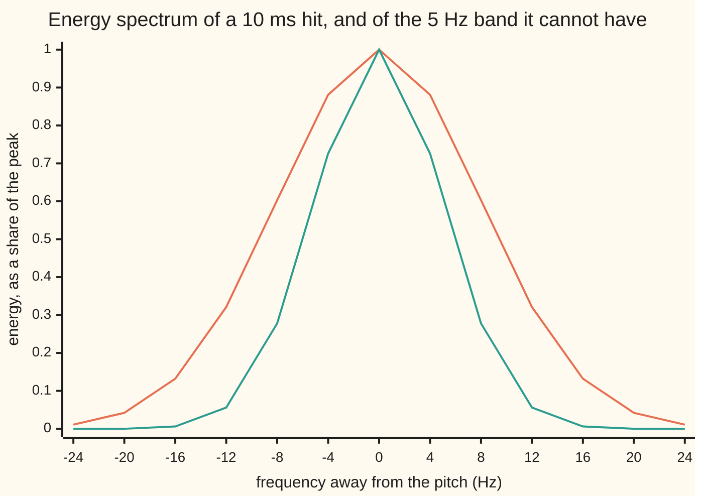

# The uncertainty principle: no signal is both brief and narrow in frequency

[Syllabus](../../../SYLLABUS.md) → [Harmonic analysis](../README.md) → [The Fourier Transform](../README.md#s02) → The uncertainty principle

---

## General Overview

A drummer hits a tom. The sound lasts a moment: its energy is spread over time with a standard deviation of 10 milliseconds (ms) about the centre of the hit. A sound engineer wants to know which frequencies, in hertz (Hz, cycles per second), the hit occupies. Could its energy sit in a band only 5 Hz wide, measured the same way, around the drum's pitch? The hit here is a synthetic bell-shaped pulse, so its numbers are illustrative.

It cannot. A hit that brief must spread its energy over at least 7.96 Hz, whatever the drum, the stick or the microphone. This card proves that floor, finds the one shape that reaches it, and shows why no signal can be both brief and narrow in frequency.

Both widths are measured the same way, as **standard deviations**: the root-mean-square distance from the centre. The time spread $`\Delta t`$ is the standard deviation of the energy $`\lvert f(t)\rvert^2`$ over time. The frequency spread $`\Delta\xi`$ is the standard deviation of the energy $`\lvert \hat f(\xi)\rvert^2`$ over frequency. With $`\Delta t`$ = 10 ms, the floor is $`1/(4\pi \times 0.010\text{ s})`$ = 7.96 Hz, and 5 Hz is only 0.628 of that.

**A signal's spread in time times its spread in frequency is at least 1/(4π), and only a bell-shaped pulse reaches that floor.**

**What kind of fact this is:** a theorem, the Heisenberg–Gabor inequality, proved on this card in Why it works, with its case of equality. A second theorem, Paley–Wiener, is stated with a source, and the half of it that the card needs is proved in a fold.

### The picture: the floor for a 10 ms hit, against the 5 Hz wish



Orange: the narrowest spectrum any 10 ms hit can have, a bell curve with spread 7.96 Hz. Teal: the 5 Hz spectrum the engineer wanted. Every 10 ms hit is at least as wide as the orange curve.

---

## The formula

The convention is the one fixed on [The Fourier transform of an absolutely integrable signal, and why it fades at infinity](01-fourier-transform-on-l1-and-riemann-lebesgue.md): $`\hat f(\xi) = \int f(t)\, e^{-2\pi i \xi t}\, dt`$, with $`t`$ in seconds and $`\xi`$ in hertz. The energy is $`\lVert f\rVert^2 = \int \lvert f(t)\rvert^2 dt`$, and [Plancherel](05-plancherel-and-l2.md) says it equals $`\int \lvert\hat f(\xi)\rvert^2 d\xi`$.

This card introduces the two spreads. Write $`t_0`$ for the signal's mean time and $`\xi_0`$ for its mean frequency, each weighted by energy. Then

```math
\Delta t^2 = \frac{1}{\lVert f\rVert^2}\int (t - t_0)^2\, \lvert f(t)\rvert^2\, dt, \qquad \Delta\xi^2 = \frac{1}{\lVert f\rVert^2}\int (\xi - \xi_0)^2\, \lvert \hat f(\xi)\rvert^2\, d\xi .
```

The Heisenberg–Gabor inequality says

```math
\Delta t \cdot \Delta\xi \;\ge\; \frac{1}{4\pi}, \qquad\text{with equality exactly when}\qquad f(t) = A\, e^{2\pi i \xi_0 t}\, e^{-c\,(t - t_0)^2}.
```

**Read it aloud:** "The time spread times the frequency spread is at least one over four pi, and it equals one over four pi only for a bell curve, slid to any time and any frequency."

| Symbol | Plain meaning | In our example | Push it up and the answer… |
| --- | --- | --- | --- |
| $`f(t)`$, $`\hat f(\xi)`$ | the signal: the drum hit's pressure at time $`t`$; its Fourier transform: how much of frequency $`\xi`$ it holds | a bell-shaped hit; a bell curve in $`\xi`$ | — |
| $`t`$, $`\xi`$, $`\omega`$ | time in seconds; frequency in hertz; angular frequency $`\omega = 2\pi\xi`$ in radians per second | — | — |
| $`i`$ | the imaginary unit, $`i^2 = -1`$ | — | — |
| $`\lVert f\rVert`$ | the square root of the signal's energy, $`\int \lvert f\rvert^2 dt`$ | $`\lVert f\rVert^2`$ = 0.025066 s, for peak height 1 | — |
| $`t_0`$, $`\xi_0`$ | the energy's mean time and mean frequency | 0 s; 0 Hz, or 100 Hz for the pitched hit | the spreads do not change |
| $`\Delta t`$ | time spread: standard deviation of $`\lvert f\rvert^2`$ | 10 ms | the floor on $`\Delta\xi`$ falls |
| $`\Delta\xi`$ | frequency spread: standard deviation of $`\lvert\hat f\rvert^2`$ | 7.957747 Hz at least | the floor on $`\Delta t`$ falls |
| $`A`$, $`c`$ | height and narrowness of the bell curve that meets the floor; $`c > 0`$ | $`c = 1/(4\Delta t^2)`$ | larger $`c`$: briefer, wider |
| $`f'`$, $`\overline{f}`$ | the slope of $`f`$; the complex conjugate of $`f`$ (here a bar is always a conjugate, never a mean) | — | — |
| $`L`$, $`\tau`$, $`T`$ | lengths of the other test shapes: the raised cosine, the two-sided decay, the shutter | 70.70 ms; 14.14 ms; 1 ms | — |
| $`B`$, $`C`$, $`z`$ | a band limit in hertz; the constant in the Paley–Wiener bound; a complex number $`z = x + iy`$ fed into $`f`$ | — | — |
| $`g`$, $`h`$ | any two signals in the Cauchy–Schwarz inequality; the proof takes $`g = t\,\overline{f}`$, $`h = f'`$ | — | — |

Other ways to measure width carry other constants. For the bell curve, the full width at half the peak energy is 2.354820 times the standard deviation. The hit is then 23.55 ms wide and its spectrum 18.74 Hz wide, a product of 0.441, not 0.0796. Always pair a constant with its kind of width.

[Uncertainty](../../13-Engineering%20mathematics/09-Quantum%20Mechanics%20in%20Outline/05-uncertainty-principle.md) already states this time–frequency trade-off for signals and proves its quantum form with operators. This card proves it for functions and their transforms, finds the equality case, and adds Paley–Wiener.

### When it holds

- **Both spreads are standard deviations of energy.** Use half-maximum widths with $`1/(4\pi)`$ and the floor drops from 7.96 Hz to 3.38 Hz. A 5 Hz band would then look possible, and it is not.
- **Frequency is in hertz.** The same theorem with angular frequency $`\omega = 2\pi\xi`$ in radians per second reads $`\Delta t\,\Delta\omega \ge 1/2`$. For the 10 ms hit that floor is $`1/(2\Delta t)`$ = 50 rad/s. Read it as 50 Hz and the floor is 6.28 times too high.
- **The signal has a finite slope energy, $`\int \lvert f'\rvert^2 dt < \infty`$.** A signal with a jump fails this. The 1 ms shutter has $`\Delta t`$ = 0.2887 ms but no finite $`\Delta\xi`$: the inequality holds and says nothing.
- **The band is read from one side of the spectrum.** A real signal's spectrum has two mirror copies. A real 100 Hz hit puts half its energy at +100 Hz and half at −100 Hz, so its mean is 0 Hz and its spread is 100.32 Hz. The inequality still holds, but that number is the gap between the copies, not the band. Use the complex hit, or one side.

---

## Why it works

### Step 0: narrow in frequency means a gentle slope

A brief signal must rise and fall quickly, so its slope is large. A large slope means a lot of energy at high frequencies, by the derivative rule: taking the slope multiplies the transform by $`2\pi i\xi`$, which is large at high $`\xi`$. So brevity in time forces width in frequency.

The proof turns this into one line of algebra. Integration by parts ties the energy to the pairing of two functions, $`t f`$ and $`f'`$. The Cauchy–Schwarz inequality caps that pairing by the product of their sizes. The two sizes are the time spread and the frequency spread.

### Step 1: centre the signal

A delay of $`t_0`$ and a frequency slide of $`\xi_0`$ move the energy without reshaping it. [The transform rulebook](02-shift-scale-and-derivative-rules.md) shows a delay only turns the phase of $`\hat f`$ (it multiplies $`\hat f`$ by a complex number of size 1) and a slide only moves it. So both spreads stay the same, and the proof may take $`t_0 = 0`$ and $`\xi_0 = 0`$.

The code checks this on a hit with a 100 Hz pitch, $`f(t)\,e^{2\pi i \cdot 100\, t}`$. Its mean frequency comes out at 100.000000 Hz and its spread at 7.957747 Hz, the same as the hit with no pitch.

### Step 2: the frequency spread is a slope

The derivative rule says $`f'`$ has transform $`2\pi i \xi\, \hat f(\xi)`$. Plancherel says energy is the same on both sides. Together:

```math
\int \lvert f'(t)\rvert^2\, dt = 4\pi^2 \int \xi^2\, \lvert\hat f(\xi)\rvert^2\, d\xi = 4\pi^2\, \Delta\xi^2\, \lVert f\rVert^2 .
```

So $`\Delta\xi = \lVert f'\rVert / (2\pi \lVert f\rVert)`$. The frequency spread can be measured in time alone, from the slope. For the hit, this road gives 7.957747 Hz without computing any transform.

### Step 3: the energy is a pairing of $`t f`$ and $`f'`$

The slope of $`\lvert f\rvert^2 = \overline{f} f`$ is $`2\,\mathrm{Re}(\overline{f} f')`$, where $`\mathrm{Re}`$ takes the real part. Integrate $`\lvert f\rvert^2`$ by parts against the slope of $`t`$, which is 1:

```math
\lVert f\rVert^2 = \int 1 \cdot \lvert f\rvert^2\, dt = \Big[\, t\,\lvert f\rvert^2 \Big]_{-\infty}^{\infty} - \int t\, \big(\lvert f\rvert^2\big)'\, dt = -2\,\mathrm{Re} \int t\, \overline{f(t)}\, f'(t)\, dt .
```

The bracket is zero because $`t \lvert f\rvert^2`$ fades at both ends. For the hit, both sides are 0.025066.

### Step 4: Cauchy–Schwarz finishes it

[Holder's inequality](../../10-Measure%20and%20integration/07-Sizes%20of%20Functions/02-holders-inequality.md) at $`p = q = 2`$ (both of its exponents set to 2) is the Cauchy–Schwarz inequality: $`\lvert\int g\,h\rvert \le \lVert g\rVert\,\lVert h\rVert`$. Apply it with $`g = t\,\overline{f}`$ and $`h = f'`$:

```math
\lVert f\rVert^2 \;\le\; 2\,\lVert t f\rVert\,\lVert f'\rVert = 2 \cdot \big(\Delta t\,\lVert f\rVert\big) \cdot \big(2\pi\, \Delta\xi\, \lVert f\rVert\big).
```

The first factor is $`\Delta t\,\lVert f\rVert`$ by the definition of $`\Delta t`$. The second is Step 2. Divide by $`4\pi \lVert f\rVert^2`$ and the inequality appears: $`\Delta t\,\Delta\xi \ge 1/(4\pi)`$.

<details>
<summary>Detailed proof: which signals the argument covers</summary>

The steps need three things: $`f`$ has finite energy, $`t f`$ has finite energy, and $`f'`$ exists with finite energy. If $`t f`$ or $`f'`$ has infinite energy, one spread is infinite and the inequality holds with nothing to prove.

For a smooth signal that fades faster than any power of $`t`$, a member of the Schwartz space of [Schwartz space and tempered distributions](06-schwartz-space-and-tempered-distributions.md), every step is a plain calculus fact. The bracket in Step 3 is zero, and the derivative rule holds.

A general signal with both spreads finite is a limit of such smooth signals, with $`\lVert f\rVert`$, $`\lVert t f\rVert`$ and $`\lVert f'\rVert`$ all converging in energy. Both sides of the inequality pass to the limit. Folland and Sitaram give the argument in full in their survey.

</details>

### Step 5: only the bell curve meets the floor

Two inequalities were used. Cauchy–Schwarz is an equality only when $`f'`$ is a constant multiple of $`t f`$: $`f'(t) = -2c\,t\,f(t)`$ for some complex $`c`$. Dropping the imaginary part is lossless only when that constant is real.

Solve $`f' = -2c\,t\,f`$ and $`f(t) = A\,e^{-c t^2}`$. Finite energy needs $`c > 0`$. Undo Step 1's centring, and every signal on the floor is $`A\,e^{2\pi i\xi_0 t}\,e^{-c(t - t_0)^2}`$.

For the drum, $`c = 1/(4\Delta t^2)`$ makes $`\lvert f\rvert^2 = e^{-t^2/(2\Delta t^2)}`$, a bell curve of standard deviation 10 ms. [Two pairs worth memorising](03-gaussian-and-sinc-transform-pairs.md) gives its transform as another bell curve. Its spread is 7.957747 Hz, exactly $`1/(4\pi\Delta t)`$.

Every other shape sits above the floor. Here is each one's product $`\Delta t\,\Delta\xi`$ as a multiple of $`1/(4\pi)`$, the first three at $`\Delta t`$ = 10 ms:

```
product over the floor 1/(4 pi); the first three shapes at dt = 10 ms
bell curve                          ####################           1.000000
raised cosine, L = 70.70 ms         #####################          1.026235
two-sided decay, tau = 14.14 ms     ############################   1.414214
1 ms shutter, dt = 0.2887 ms        no finite value: grows with the cut-off
```

The raised cosine is within 3% of the bell curve. The two-sided decay $`e^{-\lvert t\rvert/\tau}`$ has a sharp corner at its peak. That corner costs it 41%: its band is 11.25 Hz, not 7.96 Hz.

### Step 6: Paley–Wiener, why nothing is both time-limited and band-limited

Standard deviations allow long, faint tails. A stricter question: can a signal be exactly zero outside a time window and also exactly zero outside a frequency band? The answer is no, except for the zero signal.

**The Paley–Wiener theorem.** Take a signal $`f`$ with finite energy and a band limit $`B`$ in hertz. Then $`\hat f(\xi) = 0`$ for all $`\lvert\xi\rvert > B`$ exactly when $`f`$ extends to every complex $`z = x + iy`$ as an analytic function with

```math
\lvert f(x + iy)\rvert \;\le\; C\, e^{2\pi B \lvert y\rvert}
```

for some constant $`C`$, with $`f`$ of finite energy on the real line. Here "analytic" means given by a convergent power series around every point.

The key fact from complex analysis: an analytic function that is zero on any interval is zero everywhere. A band-limited signal is analytic. So if it is silent for even 1 ms, it is silent forever. The same argument with time and frequency swapped covers the other side. A signal that starts and stops, like the 1 ms shutter, has an analytic transform. So its transform cannot be zero on any band of frequencies, however high.

The code shows this for the shutter. Its share of energy beyond 1,000 Hz is 0.097177, beyond 10,000 Hz is 0.010127, and beyond 100,000 Hz is 0.001013. The share shrinks but never reaches zero.

<details>
<summary>Detailed proof: a band-limited signal is analytic</summary>

Suppose $`\hat f`$ is zero outside $`[-B, B]`$. Fourier inversion, from [Fourier inversion](04-fourier-inversion-theorem.md), writes $`f`$ back from $`\hat f`$, and the formula still makes sense for a complex $`z = x + iy`$:

$`\displaystyle f(z) = \int_{-B}^{B} \hat f(\xi)\, e^{2\pi i \xi z}\, d\xi .`$

For each $`\xi`$ the factor $`e^{2\pi i\xi z}`$ is analytic in $`z`$, and its size is $`e^{-2\pi\xi y} \le e^{2\pi B\lvert y\rvert}`$. The range of $`\xi`$ is finite, so the integral may be differentiated under the sign, and $`f(z)`$ is analytic everywhere. Cauchy–Schwarz on $`[-B, B]`$ gives the bound:

$`\displaystyle \lvert f(x + iy)\rvert \le e^{2\pi B\lvert y\rvert} \int_{-B}^{B} \lvert\hat f(\xi)\rvert\, d\xi \le e^{2\pi B\lvert y\rvert}\, \sqrt{2B}\, \lVert f\rVert .`$

So $`C = \sqrt{2B}\,\lVert f\rVert`$ works. The converse, that such a bound forces a band limit, needs contour integration. Paley and Wiener prove it in their 1934 book.

</details>

---

## Worked numbers, by hand

The drum hit, with energy spread $`\Delta t`$ = 10 ms = 0.010 s.

| Step | Arithmetic | Value |
| --- | --- | --- |
| the constant | $`1/(4\pi)`$ | 0.079577 |
| floor on the band | $`0.079577 / 0.010\text{ s}`$ | 7.957747 Hz |
| the bell-shaped hit's band | $`1/(4\pi \times 0.010)`$, by Step 5 | 7.957747 Hz |
| the wished-for band | 5 Hz, as a share of the floor | 0.628319 |
| time spread that 5 Hz needs | $`1/(4\pi \times 5\text{ Hz})`$ | 15.915494 ms |
| half-maximum width over standard deviation | $`2\sqrt{2\ln 2}`$ for a bell curve | 2.354820 |
| half-maximum width in time | $`2.354820 \times 10\text{ ms}`$ | 23.548200 ms |
| half-maximum width in frequency | $`2.354820 \times 7.957747\text{ Hz}`$ | 18.739063 Hz |
| **half-maximum product** | $`0.023548200\text{ s} \times 18.739063\text{ Hz}`$ | **0.441271** |

So a 10 ms hit occupies at least 7.96 Hz, as a standard deviation. A 5 Hz band needs the hit to last at least 15.9 ms. Measured at half the peak instead, the same bell-shaped hit spans 23.55 ms and 18.74 Hz, a product of 0.441.

### What breaks if you drop a piece

| Mistake | Comes out at | What went wrong |
| --- | --- | --- |
| Use $`\Delta t\,\Delta\omega \ge 1/2`$ and read rad/s as Hz | 50 "Hz" | The angular-frequency form was read in hertz: 6.28 times too high |
| Put the half-maximum width, 23.55 ms, into the standard-deviation bound | 3.38 Hz | Mixed kinds of width; this "floor" would wrongly allow the 5 Hz band |
| Measure a real 100 Hz hit's spread about 0 Hz | 100.32 Hz | Both mirror copies of a real spectrum were counted, so the spread measured the gap between ±100 Hz, not the band |
| Apply it to the 1 ms shutter, which has jumps (the hypothesis fails) | 318.31 Hz cut at 1 kHz, 1006.58 Hz at 10 kHz, 3183.10 Hz at 100 kHz | $`f'`$ has infinite energy, so $`\Delta\xi`$ has no finite value |

---

## Code, from first principles, and it actually runs

The script measures the bell-shaped hit's band by three independent roads. The first is the closed form $`1/(4\pi\Delta t)`$. The second computes the transform from its defining integral by Simpson's rule (thin slices weighted 1, 4, 2, 4, …), then the spread of $`\lvert\hat f\rvert^2`$ at two step sizes. The third never touches the transform: it uses Step 2, the slope's energy, with the slope by a finite difference.

It also checks Plancherel and the identity in Step 3, slides the hit to 100 Hz, and measures two other shapes in time and in frequency by sums, against their closed forms. Every truncated frequency integral prints a second cut-off or adds its tail in closed form. Then it measures the shutter at three cut-offs and works every number in What breaks.

### Python

```python
# The uncertainty principle -- the check behind the card.  Standard library only.
# A drum hit 10 ms wide (standard deviation of its energy in time): how narrow
# can its band be?  Floor 1/(4 pi dt).  Every transform and integral is written out.
from math import exp, sin, cos, pi, sqrt, log, atan

def simpson(fn, a, b, n):                       # n even: slices weighted 1, 4, 2, 4, ..., 1
    h = (b - a) / n
    s = fn(a) + fn(b) + sum((4 if i % 2 else 2) * fn(a + i * h) for i in range(1, n))
    return s * h / 3

def transform(f, xi, a, b, n):                  # f^(xi) = integral f(t) e^(-2 pi i xi t) dt
    return simpson(lambda t: f(t) * complex(cos(2 * pi * xi * t), -sin(2 * pi * xi * t)), a, b, n)

def spread_time(f, a, b, n):                    # (energy, mean time, dt) from |f|^2
    e = simpson(lambda t: abs(f(t)) ** 2, a, b, n)
    m = simpson(lambda t: t * abs(f(t)) ** 2, a, b, n) / e
    v = simpson(lambda t: (t - m) ** 2 * abs(f(t)) ** 2, a, b, n) / e
    return e, m, sqrt(v)

def moments(f, ta, tb, nt, xa, xb, nx):         # integrals of |f^|^2 times 1, xi, xi^2 over [xa, xb]
    h = (xb - xa) / nx
    xs = [xa + k * h for k in range(nx + 1)]
    w = [(1 if k in (0, nx) else (4 if k % 2 else 2)) * h / 3 for k in range(nx + 1)]
    p = [wk * abs(transform(f, x, ta, tb, nt)) ** 2 for wk, x in zip(w, xs)]
    return sum(p), sum(x * q for x, q in zip(xs, p)), sum(x * x * q for x, q in zip(xs, p))

def spread_freq(*args):                         # (energy, mean freq, dxi) from |f^|^2
    e, m1, m2 = moments(*args)
    return e, m1 / e, sqrt(m2 / e - (m1 / e) ** 2)

def spread_slope(f, a, b, n):                   # road 3: dxi = ||f'|| / (2 pi ||f||), f' by central difference
    d = 1e-7
    e = simpson(lambda t: f(t) ** 2, a, b, n)
    return sqrt(simpson(lambda t: ((f(t + d) - f(t - d)) / (2 * d)) ** 2, a, b, n) / e) / (2 * pi)

out = []
def show(label, x): out.append(f"{label:<46}{x:>14.6f}")

DT = 0.010                                      # the hit's spread in time, seconds
hit = lambda t: exp(-t * t / (4 * DT * DT))     # |hit|^2 is a bell curve of standard deviation DT
floor = 1 / (4 * pi * DT)
e_t, m_t, dt_num = spread_time(hit, -0.1, 0.1, 2000)
e_x, m_x, dx_400 = spread_freq(hit, -0.1, 0.1, 2000, -80.0, 80.0, 400)
dx_200 = spread_freq(hit, -0.1, 0.1, 2000, -80.0, 80.0, 200)[2]
dx_slope = spread_slope(hit, -0.1, 0.1, 2000)
tone = lambda t: hit(t) * complex(cos(2 * pi * 100 * t), sin(2 * pi * 100 * t))
_, m_tone, dx_tone = spread_freq(tone, -0.1, 0.1, 2000, 20.0, 180.0, 400)
real_hit = lambda t: hit(t) * cos(2 * pi * 100 * t)
_, m_real, dx_real = spread_freq(real_hit, -0.1, 0.1, 2000, -180.0, 180.0, 900)
# the proof's two lines, on the hit: ||f||^2 = -2 Re int t f f' dt, and Cauchy-Schwarz
d = 1e-7
slope = lambda t: (hit(t + d) - hit(t - d)) / (2 * d)
pairing = -2 * simpson(lambda t: t * hit(t) * slope(t), -0.1, 0.1, 2000)
cs = 2 * sqrt(simpson(lambda t: (t * hit(t)) ** 2, -0.1, 0.1, 2000)) * sqrt(simpson(lambda t: slope(t) ** 2, -0.1, 0.1, 2000))

show("closed form: floor 1/(4 pi dt), Hz", floor)
show("dt from |f|^2 sums, ms", 1000 * dt_num)
show("energy in time (closed form sqrt(2pi) dt)", e_t)
show("energy in frequency, transform by sums", e_x)
show("dxi, transform by sums, 400 steps, Hz", dx_400)
show("dxi, transform by sums, 200 steps, Hz", dx_200)
show("dxi from the slope, ||f'||/(2pi||f||), Hz", dx_slope)
show("product dt dxi", dt_num * dx_400)
show("  1/(4 pi)", 1 / (4 * pi))
show("proof: ||f||^2", e_t)
show("proof: -2 Re int t f f' dt", pairing)
show("proof: 2 ||t f|| ||f'||", cs)
show("100 Hz complex hit: mean frequency, Hz", m_tone)
show("100 Hz complex hit: dxi, Hz", dx_tone)
show("5 Hz needs dt at least, ms", 1000 / (4 * pi * 5))
show("5 Hz as a fraction of the floor", 5 / floor)
fw = 2 * sqrt(2 * log(2))
show("half-maximum width / standard deviation", fw)
show("half-maximum width in time, ms", 1000 * fw * DT)
show("half-maximum width in frequency, Hz", fw * floor)
show("half-maximum product, 2 ln2 / pi", fw * DT * fw * floor)
# other shapes, all scaled to dt = 10 ms: closed form against the transform by sums
L = DT / sqrt(1 / 12 - 5 / (8 * pi * pi))       # raised cosine cos^2(pi t / L), |t| < L/2
hann = lambda t: cos(pi * t / L) ** 2 if abs(t) < L / 2 else 0.0
dxh = spread_freq(hann, -L / 2, L / 2, 2000, -120.0, 120.0, 400)[2]
dxh2 = spread_freq(hann, -L / 2, L / 2, 2000, -240.0, 240.0, 800)[2]
dth = spread_time(hann, -L / 2, L / 2, 2000)[2]
show("raised cosine: length L, ms", 1000 * L)
show("raised cosine: dt by sums, ms", 1000 * dth)
show("raised cosine: dxi closed 1/(sqrt3 L), Hz", 1 / (sqrt(3) * L))
show("raised cosine: dxi by sums to 120 Hz", dxh)
show("raised cosine: dxi by sums to 240 Hz", dxh2)
show("raised cosine: product / floor", DT / (sqrt(3) * L) * 4 * pi)
tau = DT * sqrt(2)                              # two-sided decay e^(-|t|/tau), energy tau
dec = lambda t: exp(-abs(t) / tau)
a, X = 2 * pi * tau, 400.0                      # |f^|^2 = 4 tau^2 / (1 + a^2 xi^2)^2; tail beyond X in closed form
tail = 4 * tau * tau / a ** 3 * (pi / 2 - atan(a * X) + a * X / (1 + a * a * X * X))
m2 = moments(dec, -40 * tau, 40 * tau, 8000, -X, X, 800)[2]
dxd = sqrt((m2 + tail) / tau)
dtd = spread_time(dec, -40 * tau, 40 * tau, 8000)[2]
show("two-sided decay: tau = sqrt2 dt, ms", 1000 * tau)
show("two-sided decay: dt by sums, ms", 1000 * dtd)
show("two-sided decay: dxi closed 1/(2 pi tau), Hz", 1 / (2 * pi * tau))
show("two-sided decay: dxi by sums to 400 Hz", sqrt(m2 / tau))
show("  plus the closed-form tail beyond 400 Hz", dxd)
show("two-sided decay: product / floor", DT / (2 * pi * tau) * 4 * pi)
# the shutter: open 1 ms; its frequency spread has no finite value
T = 0.001
show("shutter: dt = T/sqrt12, ms", 1000 * T / sqrt(12))
for X in (1000.0, 10000.0, 100000.0):
    closed = sqrt((X - sin(2 * pi * T * X) / (2 * pi * T)) / (pi * pi * T))
    summed = sqrt(simpson(lambda x: sin(pi * T * x) ** 2 / (pi * pi), -X, X, int(X / 5)) / T)
    show(f"shutter: dxi cut at {X:>6.0f} Hz, closed", closed)
    show(f"shutter: dxi cut at {X:>6.0f} Hz, sums", summed)
    sinc2 = lambda x: T * T if x == 0 else (sin(pi * T * x) / (pi * x)) ** 2
    show(f"shutter: energy share beyond {X:>6.0f} Hz", 1 - simpson(sinc2, -X, X, int(X / 5)) / T)
show("mistake: rad/s floor 1/(2 dt) read as Hz", 1 / (2 * DT))
show("  over the true floor", 1 / (2 * DT) / floor)
show("mistake: half-max width 23.55 ms in sd bound", 1 / (4 * pi * fw * DT))
show("mistake: real 100 Hz hit, spread about 0", dx_real)
show("try: dt = 20 ms, floor Hz", 1 / (4 * pi * 0.020))
show("try: dt = 2 ms, floor Hz", 1 / (4 * pi * 0.002))
pts = list(range(-24, 25, 4))
out.append("chart, frequency (Hz)  " + " ".join(f"{x:>5d}" for x in pts))
out.append("chart, 10 ms hit       " + " ".join(f"{exp(-x * x / (2 * floor ** 2)):>5.3f}" for x in pts))
out.append("chart, 5 Hz wish       " + " ".join(f"{exp(-x * x / 50):>5.3f}" for x in pts))
print("\n".join(out))

assert abs(dx_400 - floor) < 1e-6 and abs(dx_200 - floor) < 1e-6      # transform by sums meets the closed form
assert abs(dx_slope - floor) < 1e-4                                     # derivative road meets it too
assert abs(dt_num - DT) < 1e-9 and abs(e_t - sqrt(2 * pi) * DT) < 1e-12
assert abs(e_x - e_t) < 1e-9                                            # Plancherel: same energy both sides
assert abs(pairing - e_t) < 1e-8 and cs >= pairing - 1e-12             # the proof's identity and Cauchy-Schwarz
assert abs(m_tone - 100) < 1e-6 and abs(dx_tone - floor) < 1e-6        # modulation slides, does not widen
assert abs(dxh2 - 1 / (sqrt(3) * L)) < 1e-4 and abs(dth - DT) < 1e-9          # raised cosine: band and length
assert abs(dxd - 1 / (2 * pi * tau)) < 1e-4 and abs(dtd - DT) < 1e-6          # two-sided decay: band and length
assert dth * dxh2 > 1 / (4 * pi) and dtd * dxd > 1 / (4 * pi)                # both sit above the floor
assert abs(dx_real - sqrt(100 ** 2 + floor ** 2)) < 1e-4
print("ALL CHECKS PASS")
```

**Ran 2026-11-15 on macOS, Python 3.14.10, standard library only. All checks passed. Output, pasted from the run:**

```
closed form: floor 1/(4 pi dt), Hz                  7.957747
dt from |f|^2 sums, ms                             10.000000
energy in time (closed form sqrt(2pi) dt)           0.025066
energy in frequency, transform by sums              0.025066
dxi, transform by sums, 400 steps, Hz               7.957747
dxi, transform by sums, 200 steps, Hz               7.957747
dxi from the slope, ||f'||/(2pi||f||), Hz           7.957747
product dt dxi                                      0.079577
  1/(4 pi)                                          0.079577
proof: ||f||^2                                      0.025066
proof: -2 Re int t f f' dt                          0.025066
proof: 2 ||t f|| ||f'||                             0.025066
100 Hz complex hit: mean frequency, Hz            100.000000
100 Hz complex hit: dxi, Hz                         7.957747
5 Hz needs dt at least, ms                         15.915494
5 Hz as a fraction of the floor                     0.628319
half-maximum width / standard deviation             2.354820
half-maximum width in time, ms                     23.548200
half-maximum width in frequency, Hz                18.739063
half-maximum product, 2 ln2 / pi                    0.441271
raised cosine: length L, ms                        70.697258
raised cosine: dt by sums, ms                      10.000000
raised cosine: dxi closed 1/(sqrt3 L), Hz           8.166516
raised cosine: dxi by sums to 120 Hz                8.166053
raised cosine: dxi by sums to 240 Hz                8.166459
raised cosine: product / floor                      1.026235
two-sided decay: tau = sqrt2 dt, ms                14.142136
two-sided decay: dt by sums, ms                    10.000000
two-sided decay: dxi closed 1/(2 pi tau), Hz       11.253954
two-sided decay: dxi by sums to 400 Hz             11.050615
  plus the closed-form tail beyond 400 Hz          11.253918
two-sided decay: product / floor                    1.414214
shutter: dt = T/sqrt12, ms                          0.288675
shutter: dxi cut at   1000 Hz, closed             318.309886
shutter: dxi cut at   1000 Hz, sums               318.309886
shutter: energy share beyond   1000 Hz              0.097177
shutter: dxi cut at  10000 Hz, closed            1006.584242
shutter: dxi cut at  10000 Hz, sums              1006.584242
shutter: energy share beyond  10000 Hz              0.010127
shutter: dxi cut at 100000 Hz, closed            3183.098862
shutter: dxi cut at 100000 Hz, sums              3183.098862
shutter: energy share beyond 100000 Hz              0.001013
mistake: rad/s floor 1/(2 dt) read as Hz           50.000000
  over the true floor                               6.283185
mistake: half-max width 23.55 ms in sd bound        3.379344
mistake: real 100 Hz hit, spread about 0          100.316129
try: dt = 20 ms, floor Hz                           3.978874
try: dt = 2 ms, floor Hz                           39.788736
chart, frequency (Hz)    -24   -20   -16   -12    -8    -4     0     4     8    12    16    20    24
chart, 10 ms hit       0.011 0.042 0.132 0.321 0.603 0.881 1.000 0.881 0.603 0.321 0.132 0.042 0.011
chart, 5 Hz wish       0.000 0.000 0.006 0.056 0.278 0.726 1.000 0.726 0.278 0.056 0.006 0.000 0.000
ALL CHECKS PASS
```

The three roads agree to six decimals. The shutter's spread grows about as the square root of the cut-off, so it has no limit.

### Rust

The same checks, with a small complex-number struct and Simpson's rule written out. No crates.

```rust
// The uncertainty principle -- the same check as w20_uncertainty_principle_check.py, in Rust.
// Standard library only, no crates.  A complex number is a small struct; every
// transform and integral is Simpson's rule written out.
use std::f64::consts::PI;

#[derive(Clone, Copy)]
struct C { re: f64, im: f64 }
impl C {
    fn mul(self, o: C) -> C { C { re: self.re * o.re - self.im * o.im, im: self.re * o.im + self.im * o.re } }
    fn norm2(self) -> f64 { self.re * self.re + self.im * self.im }
}
fn real(x: f64) -> C { C { re: x, im: 0.0 } }

fn wt(i: usize, n: usize) -> f64 { if i == 0 || i == n { 1.0 } else if i % 2 == 1 { 4.0 } else { 2.0 } }

fn simpson(f: &dyn Fn(f64) -> f64, a: f64, b: f64, n: usize) -> f64 {
    let h = (b - a) / n as f64;
    (0..=n).map(|i| wt(i, n) * f(a + i as f64 * h)).sum::<f64>() * h / 3.0
}

// f^(xi) = integral f(t) e^(-2 pi i xi t) dt
fn transform(f: &dyn Fn(f64) -> C, xi: f64, a: f64, b: f64, n: usize) -> C {
    let h = (b - a) / n as f64;
    let (mut re, mut im) = (0.0, 0.0);
    for i in 0..=n {
        let t = a + i as f64 * h;
        let v = f(t).mul(C { re: (2.0 * PI * xi * t).cos(), im: -(2.0 * PI * xi * t).sin() });
        re += wt(i, n) * v.re;
        im += wt(i, n) * v.im;
    }
    C { re: re * h / 3.0, im: im * h / 3.0 }
}

// integrals of |f^|^2 times 1, xi, xi^2 over [xa, xb]
fn moments(f: &dyn Fn(f64) -> C, ta: f64, tb: f64, nt: usize, xa: f64, xb: f64, nx: usize) -> (f64, f64, f64) {
    let h = (xb - xa) / nx as f64;
    let (mut e, mut m1, mut m2) = (0.0, 0.0, 0.0);
    for k in 0..=nx {
        let x = xa + k as f64 * h;
        let q = wt(k, nx) * h / 3.0 * transform(f, x, ta, tb, nt).norm2();
        e += q; m1 += x * q; m2 += x * x * q;
    }
    (e, m1, m2)
}

fn spread_time(f: &dyn Fn(f64) -> f64, a: f64, b: f64, n: usize) -> f64 {
    let e = simpson(&|t| f(t).powi(2), a, b, n);
    let m = simpson(&|t| t * f(t).powi(2), a, b, n) / e;
    (simpson(&|t| (t - m).powi(2) * f(t).powi(2), a, b, n) / e).sqrt()
}

fn spread_freq(f: &dyn Fn(f64) -> C, ta: f64, tb: f64, nt: usize, xa: f64, xb: f64, nx: usize) -> (f64, f64, f64) {
    let (e, m1, m2) = moments(f, ta, tb, nt, xa, xb, nx);
    (e, m1 / e, (m2 / e - (m1 / e).powi(2)).sqrt())
}

fn main() {
    let mut out: Vec<String> = Vec::new();
    let mut show = |label: &str, x: f64| out.push(format!("{:<46}{:>14.6}", label, x));

    let dt = 0.010;
    let hit = move |t: f64| (-t * t / (4.0 * dt * dt)).exp();
    let floor = 1.0 / (4.0 * PI * dt);
    let e_t = simpson(&|t| hit(t).powi(2), -0.1, 0.1, 2000);
    let m_t = simpson(&|t| t * hit(t).powi(2), -0.1, 0.1, 2000) / e_t;
    let dt_num = (simpson(&|t| (t - m_t).powi(2) * hit(t).powi(2), -0.1, 0.1, 2000) / e_t).sqrt();
    let hitc = move |t: f64| real(hit(t));
    let (e_x, _, dx_400) = spread_freq(&hitc, -0.1, 0.1, 2000, -80.0, 80.0, 400);
    let dx_200 = spread_freq(&hitc, -0.1, 0.1, 2000, -80.0, 80.0, 200).2;
    let d = 1e-7;
    let slope = move |t: f64| (hit(t + d) - hit(t - d)) / (2.0 * d);
    let dx_slope = (simpson(&|t| slope(t).powi(2), -0.1, 0.1, 2000) / e_t).sqrt() / (2.0 * PI);
    let tone = move |t: f64| real(hit(t)).mul(C { re: (2.0 * PI * 100.0 * t).cos(), im: (2.0 * PI * 100.0 * t).sin() });
    let (_, m_tone, dx_tone) = spread_freq(&tone, -0.1, 0.1, 2000, 20.0, 180.0, 400);
    let real_hit = move |t: f64| real(hit(t) * (2.0 * PI * 100.0 * t).cos());
    let dx_real = spread_freq(&real_hit, -0.1, 0.1, 2000, -180.0, 180.0, 900).2;
    // the proof's two lines, on the hit: ||f||^2 = -2 Re int t f f' dt, and Cauchy-Schwarz
    let pairing = -2.0 * simpson(&|t| t * hit(t) * slope(t), -0.1, 0.1, 2000);
    let cs = 2.0 * simpson(&|t| (t * hit(t)).powi(2), -0.1, 0.1, 2000).sqrt() * simpson(&|t| slope(t).powi(2), -0.1, 0.1, 2000).sqrt();

    show("closed form: floor 1/(4 pi dt), Hz", floor);
    show("dt from |f|^2 sums, ms", 1000.0 * dt_num);
    show("energy in time (closed form sqrt(2pi) dt)", e_t);
    show("energy in frequency, transform by sums", e_x);
    show("dxi, transform by sums, 400 steps, Hz", dx_400);
    show("dxi, transform by sums, 200 steps, Hz", dx_200);
    show("dxi from the slope, ||f'||/(2pi||f||), Hz", dx_slope);
    show("product dt dxi", dt_num * dx_400);
    show("  1/(4 pi)", 1.0 / (4.0 * PI));
    show("proof: ||f||^2", e_t);
    show("proof: -2 Re int t f f' dt", pairing);
    show("proof: 2 ||t f|| ||f'||", cs);
    show("100 Hz complex hit: mean frequency, Hz", m_tone);
    show("100 Hz complex hit: dxi, Hz", dx_tone);
    show("5 Hz needs dt at least, ms", 1000.0 / (4.0 * PI * 5.0));
    show("5 Hz as a fraction of the floor", 5.0 / floor);
    let fw = 2.0 * (2.0 * 2f64.ln()).sqrt();
    show("half-maximum width / standard deviation", fw);
    show("half-maximum width in time, ms", 1000.0 * fw * dt);
    show("half-maximum width in frequency, Hz", fw * floor);
    show("half-maximum product, 2 ln2 / pi", fw * dt * fw * floor);
    // other shapes, all scaled to dt = 10 ms: closed form against the transform by sums
    let l = dt / (1.0 / 12.0 - 5.0 / (8.0 * PI * PI)).sqrt();
    let hann = move |t: f64| real(if t.abs() < l / 2.0 { (PI * t / l).cos().powi(2) } else { 0.0 });
    let dxh = spread_freq(&hann, -l / 2.0, l / 2.0, 2000, -120.0, 120.0, 400).2;
    let dxh2 = spread_freq(&hann, -l / 2.0, l / 2.0, 2000, -240.0, 240.0, 800).2;
    let dth = spread_time(&|t| hann(t).re, -l / 2.0, l / 2.0, 2000);
    show("raised cosine: length L, ms", 1000.0 * l);
    show("raised cosine: dt by sums, ms", 1000.0 * dth);
    show("raised cosine: dxi closed 1/(sqrt3 L), Hz", 1.0 / (3f64.sqrt() * l));
    show("raised cosine: dxi by sums to 120 Hz", dxh);
    show("raised cosine: dxi by sums to 240 Hz", dxh2);
    show("raised cosine: product / floor", dt / (3f64.sqrt() * l) * 4.0 * PI);
    let tau = dt * 2f64.sqrt();
    let dec = move |t: f64| real((-t.abs() / tau).exp());
    let (a, x) = (2.0 * PI * tau, 400.0);
    let tail = 4.0 * tau * tau / a.powi(3) * (PI / 2.0 - (a * x).atan() + a * x / (1.0 + a * a * x * x));
    let m2 = moments(&dec, -40.0 * tau, 40.0 * tau, 8000, -x, x, 800).2;
    let dxd = ((m2 + tail) / tau).sqrt();
    let dtd = spread_time(&|t| dec(t).re, -40.0 * tau, 40.0 * tau, 8000);
    show("two-sided decay: tau = sqrt2 dt, ms", 1000.0 * tau);
    show("two-sided decay: dt by sums, ms", 1000.0 * dtd);
    show("two-sided decay: dxi closed 1/(2 pi tau), Hz", 1.0 / (2.0 * PI * tau));
    show("two-sided decay: dxi by sums to 400 Hz", (m2 / tau).sqrt());
    show("  plus the closed-form tail beyond 400 Hz", dxd);
    show("two-sided decay: product / floor", dt / (2.0 * PI * tau) * 4.0 * PI);
    // the shutter: open 1 ms; its frequency spread has no finite value
    let tt = 0.001;
    show("shutter: dt = T/sqrt12, ms", 1000.0 * tt / 12f64.sqrt());
    for xc in [1000.0f64, 10000.0, 100000.0] {
        let closed = ((xc - (2.0 * PI * tt * xc).sin() / (2.0 * PI * tt)) / (PI * PI * tt)).sqrt();
        let summed = (simpson(&|v| (PI * tt * v).sin().powi(2) / (PI * PI), -xc, xc, (xc / 5.0) as usize) / tt).sqrt();
        show(&format!("shutter: dxi cut at {:>6.0} Hz, closed", xc), closed);
        show(&format!("shutter: dxi cut at {:>6.0} Hz, sums", xc), summed);
        let sinc2 = |v: f64| if v == 0.0 { tt * tt } else { ((PI * tt * v).sin() / (PI * v)).powi(2) };
        show(&format!("shutter: energy share beyond {:>6.0} Hz", xc), 1.0 - simpson(&sinc2, -xc, xc, (xc / 5.0) as usize) / tt);
    }
    show("mistake: rad/s floor 1/(2 dt) read as Hz", 1.0 / (2.0 * dt));
    show("  over the true floor", 1.0 / (2.0 * dt) / floor);
    show("mistake: half-max width 23.55 ms in sd bound", 1.0 / (4.0 * PI * fw * dt));
    show("mistake: real 100 Hz hit, spread about 0", dx_real);
    show("try: dt = 20 ms, floor Hz", 1.0 / (4.0 * PI * 0.020));
    show("try: dt = 2 ms, floor Hz", 1.0 / (4.0 * PI * 0.002));
    let pts: Vec<i32> = (-24..=24).step_by(4).collect();
    let row = |g: &dyn Fn(f64) -> f64| pts.iter().map(|&p| format!("{:>5.3}", g(p as f64))).collect::<Vec<_>>().join(" ");
    let line1 = format!("chart, frequency (Hz)  {}", pts.iter().map(|p| format!("{:>5}", p)).collect::<Vec<_>>().join(" "));
    let line2 = format!("chart, 10 ms hit       {}", row(&|v| (-v * v / (2.0 * floor * floor)).exp()));
    let line3 = format!("chart, 5 Hz wish       {}", row(&|v| (-v * v / 50.0).exp()));
    out.push(line1); out.push(line2); out.push(line3);
    println!("{}", out.join("\n"));

    assert!((dx_400 - floor).abs() < 1e-6 && (dx_200 - floor).abs() < 1e-6);
    assert!((dx_slope - floor).abs() < 1e-4);
    assert!((dt_num - dt).abs() < 1e-9 && (e_t - (2.0 * PI).sqrt() * dt).abs() < 1e-12);
    assert!((e_x - e_t).abs() < 1e-9);
    assert!((pairing - e_t).abs() < 1e-8 && cs >= pairing - 1e-12);
    assert!((m_tone - 100.0).abs() < 1e-6 && (dx_tone - floor).abs() < 1e-6);
    assert!((dxh2 - 1.0 / (3f64.sqrt() * l)).abs() < 1e-4 && (dth - dt).abs() < 1e-9);
    assert!((dxd - 1.0 / (2.0 * PI * tau)).abs() < 1e-4 && (dtd - dt).abs() < 1e-6);
    assert!(dth * dxh2 > 1.0 / (4.0 * PI) && dtd * dxd > 1.0 / (4.0 * PI));
    assert!((dx_real - (100f64.powi(2) + floor * floor).sqrt()).abs() < 1e-4);
    println!("ALL CHECKS PASS");
}
```

**Ran 2026-11-15 on macOS, rustc 1.98.1, no crates. All checks passed. Output, pasted from the run:**

```
closed form: floor 1/(4 pi dt), Hz                  7.957747
dt from |f|^2 sums, ms                             10.000000
energy in time (closed form sqrt(2pi) dt)           0.025066
energy in frequency, transform by sums              0.025066
dxi, transform by sums, 400 steps, Hz               7.957747
dxi, transform by sums, 200 steps, Hz               7.957747
dxi from the slope, ||f'||/(2pi||f||), Hz           7.957747
product dt dxi                                      0.079577
  1/(4 pi)                                          0.079577
proof: ||f||^2                                      0.025066
proof: -2 Re int t f f' dt                          0.025066
proof: 2 ||t f|| ||f'||                             0.025066
100 Hz complex hit: mean frequency, Hz            100.000000
100 Hz complex hit: dxi, Hz                         7.957747
5 Hz needs dt at least, ms                         15.915494
5 Hz as a fraction of the floor                     0.628319
half-maximum width / standard deviation             2.354820
half-maximum width in time, ms                     23.548200
half-maximum width in frequency, Hz                18.739063
half-maximum product, 2 ln2 / pi                    0.441271
raised cosine: length L, ms                        70.697258
raised cosine: dt by sums, ms                      10.000000
raised cosine: dxi closed 1/(sqrt3 L), Hz           8.166516
raised cosine: dxi by sums to 120 Hz                8.166053
raised cosine: dxi by sums to 240 Hz                8.166459
raised cosine: product / floor                      1.026235
two-sided decay: tau = sqrt2 dt, ms                14.142136
two-sided decay: dt by sums, ms                    10.000000
two-sided decay: dxi closed 1/(2 pi tau), Hz       11.253954
two-sided decay: dxi by sums to 400 Hz             11.050615
  plus the closed-form tail beyond 400 Hz          11.253918
two-sided decay: product / floor                    1.414214
shutter: dt = T/sqrt12, ms                          0.288675
shutter: dxi cut at   1000 Hz, closed             318.309886
shutter: dxi cut at   1000 Hz, sums               318.309886
shutter: energy share beyond   1000 Hz              0.097177
shutter: dxi cut at  10000 Hz, closed            1006.584242
shutter: dxi cut at  10000 Hz, sums              1006.584242
shutter: energy share beyond  10000 Hz              0.010127
shutter: dxi cut at 100000 Hz, closed            3183.098862
shutter: dxi cut at 100000 Hz, sums              3183.098862
shutter: energy share beyond 100000 Hz              0.001013
mistake: rad/s floor 1/(2 dt) read as Hz           50.000000
  over the true floor                               6.283185
mistake: half-max width 23.55 ms in sd bound        3.379344
mistake: real 100 Hz hit, spread about 0          100.316129
try: dt = 20 ms, floor Hz                           3.978874
try: dt = 2 ms, floor Hz                           39.788736
chart, frequency (Hz)    -24   -20   -16   -12    -8    -4     0     4     8    12    16    20    24
chart, 10 ms hit       0.011 0.042 0.132 0.321 0.603 0.881 1.000 0.881 0.603 0.321 0.132 0.042 0.011
chart, 5 Hz wish       0.000 0.000 0.006 0.056 0.278 0.726 1.000 0.726 0.278 0.056 0.006 0.000 0.000
ALL CHECKS PASS
```

The two outputs are identical line for line.

### Lean

Lean proves the inequality, its case of equality and Step 6's conclusion, for every signal that meets the conditions below.

- Take a nonzero signal $`f`$ with a slope at every time, where $`f`$, $`t f`$ and $`f'`$ have finite energy. Then $`\Delta t \cdot \Delta\xi \ge 1/(4\pi)`$, with $`\xi`$ in hertz.
- Take the same signal. Then $`\Delta t \cdot \Delta\xi = 1/(4\pi)`$ exactly when $`f`$ is one of Step 5's bell curves, with $`c > 0`$.
- Take a signal of finite energy that is zero outside a time window and whose transform is zero outside the band $`[-B, B]`$. Then it is the zero signal, apart from a set of times of total length zero.
- For the 10 ms hit, the floor lies between 7.95 Hz and 7.96 Hz, so 5 Hz is below it.
- 5 Hz is exactly $`\pi/5`$ of that floor, and a 5 Hz band needs a time spread between 15 ms and 16 ms.
- The floor in angular frequency, $`1/(2\Delta t)`$, is 50 rad/s.

The transforms by sums, the other three shapes, the shutter's tails and the half-maximum widths are left to the Python and Rust checks.

```lean
-- The uncertainty principle: a nonzero signal's time spread times its frequency spread is at least 1/(4π), only a bell curve reaches it, and no nonzero signal is both time-limited and band-limited.
import Mathlib.Analysis.Fourier.FourierTransform
import Mathlib.Analysis.Calculus.Deriv.Basic
import Mathlib.Analysis.SpecialFunctions.Sqrt
import Mathlib.Analysis.Real.Pi.Bounds
import Mathlib

open MeasureTheory Real
open scoped FourierTransform

noncomputable section

/-- The energy `‖f‖² = ∫ |f(t)|² dt` of a signal `f : ℝ → ℂ`, with `t` in seconds. -/
def energy (f : ℝ → ℂ) : ℝ := ∫ t, ‖f t‖ ^ 2

/-- The mean time `t₀ = (1/‖f‖²) ∫ t |f(t)|² dt`, weighted by energy. -/
def meanTime (f : ℝ → ℂ) : ℝ := (∫ t, t * ‖f t‖ ^ 2) / energy f

/-- The time spread `Δt`: the standard deviation of the energy `|f(t)|²` over time,
`Δt² = (1/‖f‖²) ∫ (t - t₀)² |f(t)|² dt`. -/
def timeSpread (f : ℝ → ℂ) : ℝ :=
  Real.sqrt ((∫ t, (t - meanTime f) ^ 2 * ‖f t‖ ^ 2) / energy f)

/-- The mean frequency `ξ₀ = (1/‖f‖²) ∫ ξ |f̂(ξ)|² dξ`, with the hertz-form transform
`f̂(ξ) = ∫ f(t) e^(-2πiξt) dt` (Mathlib's `𝓕`). -/
def meanFreq (f : ℝ → ℂ) : ℝ := (∫ ξ, ξ * ‖𝓕 f ξ‖ ^ 2) / energy f

/-- The frequency spread `Δξ`: the standard deviation of the energy `|f̂(ξ)|²` over frequency,
`Δξ² = (1/‖f‖²) ∫ (ξ - ξ₀)² |f̂(ξ)|² dξ`. -/
def freqSpread (f : ℝ → ℂ) : ℝ :=
  Real.sqrt ((∫ ξ, (ξ - meanFreq f) ^ 2 * ‖𝓕 f ξ‖ ^ 2) / energy f)

lemma up_selfadj {f g : ℝ → ℂ} (hf : Integrable f) (hg : Integrable g) :
    ∫ ξ, 𝓕 f ξ * g ξ = ∫ x, f x * 𝓕 g x := by
  simpa using! VectorFourier.integral_bilin_fourierIntegral_eq_flip (ContinuousLinearMap.mul ℂ ℂ)
    (L := innerₗ ℝ) Real.continuous_fourierChar continuous_inner hf hg

lemma up_L2pair (h : Lp ℂ 2 (volume : Measure ℝ)) (g : SchwartzMap ℝ ℂ) :
    ∫ ξ, g ξ • (𝓕 h : Lp ℂ 2 (volume : Measure ℝ)) ξ = ∫ x, 𝓕 g x • h x := by
  have := congrArg (fun T : TemperedDistribution ℝ ℂ => T g) (Lp.fourier_toTemperedDistribution_eq h)
  simp only [TemperedDistribution.fourier_apply, Lp.toTemperedDistribution_apply] at this
  exact this.symm

open scoped ContDiff in
lemma up_unique (F : Lp ℂ 2 (volume : Measure ℝ)) {G : ℝ → ℂ} (hG : Continuous G)
    (h : ∀ g : SchwartzMap ℝ ℂ, HasCompactSupport (g : ℝ → ℂ) →
      ∫ ξ, g ξ * F ξ = ∫ ξ, g ξ * G ξ) : (F : ℝ → ℂ) =ᵐ[volume] G := by
  apply ae_eq_of_integral_contDiff_smul_eq
  · exact (Lp.memLp F).locallyIntegrable (by norm_num)
  · exact hG.locallyIntegrable
  · intro g g_smooth g_cpt
    have hg₁ : HasCompactSupport (Complex.ofRealCLM ∘ g) := g_cpt.comp_left rfl
    have hg₂ : ContDiff ℝ ∞ (Complex.ofRealCLM ∘ g) := by fun_prop
    have := h (hg₁.toSchwartzMap hg₂) hg₁
    simpa [Complex.real_smul] using this

/-- Plancherel on `L¹ ∩ L²`: the `L²` transform agrees with the integral. -/
lemma up_fourier_toLp {f : ℝ → ℂ} (hf1 : Integrable f) (hf2 : MemLp f 2) :
    ((𝓕 (hf2.toLp f) : Lp ℂ 2 (volume : Measure ℝ)) : ℝ → ℂ) =ᵐ[volume] 𝓕 f := by
  apply up_unique _ (VectorFourier.fourierIntegral_continuous Real.continuous_fourierChar
    (by fun_prop) hf1)
  intro g _
  rw [show (∫ ξ, g ξ * (𝓕 (hf2.toLp f) : Lp ℂ 2 (volume : Measure ℝ)) ξ)
      = ∫ ξ, g ξ • (𝓕 (hf2.toLp f) : Lp ℂ 2 (volume : Measure ℝ)) ξ from rfl, up_L2pair]
  have e1 : ∫ x, 𝓕 (g : ℝ → ℂ) x • (hf2.toLp f) x = ∫ x, f x * 𝓕 (g : ℝ → ℂ) x := by
    apply integral_congr_ae
    filter_upwards [hf2.coeFn_toLp] with x hx
    rw [hx, smul_eq_mul, mul_comm]
  rw [SchwartzMap.fourier_coe, e1, ← up_selfadj hf1 g.integrable]
  congr 1; ext ξ; rw [mul_comm]; rfl

lemma up_fourier_cont {f : ℝ → ℂ} (hf1 : Integrable f) : Continuous (𝓕 f) :=
  VectorFourier.fourierIntegral_continuous Real.continuous_fourierChar (by fun_prop) hf1

lemma up_fourier_deriv_toLp {f : ℝ → ℂ} (hf1 : Integrable f) (hdiff : Differentiable ℝ f)
    (hdf : MemLp (deriv f) 2) :
    ((𝓕 (hdf.toLp (deriv f)) : Lp ℂ 2 (volume : Measure ℝ)) : ℝ → ℂ) =ᵐ[volume]
      fun ξ => (2 * π * Complex.I * ξ) * 𝓕 f ξ := by
  apply up_unique _ (by have := up_fourier_cont hf1; fun_prop)
  intro g _
  rw [show (∫ ξ, g ξ * (𝓕 (hdf.toLp (deriv f)) : Lp ℂ 2 (volume : Measure ℝ)) ξ)
      = ∫ ξ, g ξ • (𝓕 (hdf.toLp (deriv f)) : Lp ℂ 2 (volume : Measure ℝ)) ξ from rfl, up_L2pair]
  have e1 : ∫ x, 𝓕 g x • (hdf.toLp (deriv f)) x = ∫ x, 𝓕 (g : ℝ → ℂ) x * deriv f x := by
    apply integral_congr_ae
    filter_upwards [hdf.coeFn_toLp] with x hx
    rw [hx, smul_eq_mul, SchwartzMap.fourier_coe]
  have hxg : Integrable (fun x : ℝ => x • g x) := by
    refine (g.integrable_pow_mul volume 1).mono' (by fun_prop) (Filter.Eventually.of_forall ?_)
    intro x; simp
  have hg1 : Integrable (fun x : ℝ => (-2 * π * Complex.I * x) • g x) := by
    have := hxg.smul (-2 * π * Complex.I)
    refine this.congr (Filter.Eventually.of_forall fun x => ?_)
    simp only [Pi.smul_apply, smul_eq_mul, Complex.real_smul]; ring
  have hbd : ∀ (h : ℝ → ℂ) (ξ : ℝ), ‖𝓕 h ξ‖ ≤ ∫ v, ‖h v‖ := fun h ξ =>
    Real.norm_fourier_le_integral_norm h ξ
  have hibp := integral_mul_deriv_eq_deriv_mul_of_integrable (u := 𝓕 (g : ℝ → ℂ)) (v := f)
    (u' := 𝓕 (fun x : ℝ => (-2 * π * Complex.I * x) • g x)) (v' := deriv f)
    (fun x _ => Real.hasDerivAt_fourier g.integrable hxg x)
    (fun x _ => (hdiff x).hasDerivAt)
    (by
      have h2 : MemLp (𝓕 (g : ℝ → ℂ)) 2 := by
        rw [← SchwartzMap.fourier_coe]; exact (𝓕 g).memLp 2
      exact h2.integrable_mul hdf)
    (Integrable.bdd_mul hf1 (up_fourier_cont hg1).aestronglyMeasurable
      (Filter.Eventually.of_forall (hbd _)))
    (Integrable.bdd_mul hf1 (up_fourier_cont g.integrable).aestronglyMeasurable
      (Filter.Eventually.of_forall (hbd _)))
  rw [e1, hibp]
  have e2 : ∫ x, 𝓕 (fun x : ℝ => (-2 * π * Complex.I * x) • g x) x * f x
      = ∫ x, f x * 𝓕 (fun x : ℝ => (-2 * π * Complex.I * x) • g x) x := by
    congr 1; ext x; ring
  rw [e2, ← up_selfadj hf1 hg1, ← integral_neg]
  congr 1; ext ξ; simp only [smul_eq_mul]; ring

lemma up_norm_sq (F : Lp ℂ 2 (volume : Measure ℝ)) : ‖F‖ ^ 2 = ∫ x, ‖F x‖ ^ 2 := by
  have h1 := MeasureTheory.L2.inner_def (𝕜 := ℂ) F F
  simp only [inner_self_eq_norm_sq_to_K] at h1
  have h3 : ((‖F‖ ^ 2 : ℝ) : ℂ) = ((∫ a, ‖(F : ℝ → ℂ) a‖ ^ 2 : ℝ) : ℂ) := by
    rw [← integral_complex_ofReal]; push_cast; exact h1
  exact_mod_cast h3

lemma up_norm_sq_toLp {f : ℝ → ℂ} (hf : MemLp f 2) : ‖hf.toLp f‖ ^ 2 = ∫ x, ‖f x‖ ^ 2 := by
  rw [up_norm_sq]
  apply integral_congr_ae
  filter_upwards [hf.coeFn_toLp] with x hx
  rw [hx]

lemma up_plancherel {f : ℝ → ℂ} (hf1 : Integrable f) (hf2 : MemLp f 2) :
    MemLp (𝓕 f) 2 ∧ ∫ ξ, ‖𝓕 f ξ‖ ^ 2 = ∫ x, ‖f x‖ ^ 2 := by
  have hae := up_fourier_toLp hf1 hf2
  refine ⟨(Lp.memLp _).ae_eq hae, ?_⟩
  rw [← up_norm_sq_toLp hf2, ← Lp.norm_fourier_eq, up_norm_sq]
  apply integral_congr_ae
  filter_upwards [hae] with x hx
  rw [hx]

lemma up_freq_deriv {f : ℝ → ℂ} (hf1 : Integrable f) (hf2 : MemLp f 2)
    (hdiff : Differentiable ℝ f) (hdf : MemLp (deriv f) 2) (b : ℝ) :
    MemLp (fun ξ : ℝ => (2 * π * Complex.I * (ξ - b)) * 𝓕 f ξ) 2 ∧
    ∫ ξ, ‖(2 * π * Complex.I * (ξ - b)) * 𝓕 f ξ‖ ^ 2 =
      ∫ t, ‖deriv f t + (-(2 * π * Complex.I * b)) • f t‖ ^ 2 := by
  set c : ℂ := -(2 * π * Complex.I * b)
  have hh : MemLp (fun t => deriv f t + c • f t) 2 := hdf.add (hf2.const_smul c)
  set X : Lp ℂ 2 (volume : Measure ℝ) := hdf.toLp (deriv f) + c • hf2.toLp f
  have hX : X = hh.toLp _ := by
    simp only [X]; rw [← MemLp.toLp_const_smul, ← MemLp.toLp_add]; rfl
  have hFX : 𝓕 X = 𝓕 (hdf.toLp (deriv f)) + c • 𝓕 (hf2.toLp f) := by
    simp only [X, FourierTransform.fourier_add, FourierTransform.fourier_smul]
  have hae : ((𝓕 X : Lp ℂ 2 (volume : Measure ℝ)) : ℝ → ℂ) =ᵐ[volume]
      fun ξ : ℝ => (2 * π * Complex.I * (ξ - b)) * 𝓕 f ξ := by
    rw [hFX]
    filter_upwards [Lp.coeFn_add (𝓕 (hdf.toLp (deriv f))) (c • 𝓕 (hf2.toLp f)),
      Lp.coeFn_smul c (𝓕 (hf2.toLp f)), up_fourier_toLp hf1 hf2,
      up_fourier_deriv_toLp hf1 hdiff hdf] with ξ h1 h2 h3 h4
    rw [h1, Pi.add_apply, h2, Pi.smul_apply, h3, h4, smul_eq_mul]
    simp only [c]; ring
  refine ⟨(Lp.memLp _).ae_eq hae, ?_⟩
  have := up_norm_sq_toLp hh
  rw [← hX, ← Lp.norm_fourier_eq, up_norm_sq] at this
  rw [← this]
  apply integral_congr_ae
  filter_upwards [hae] with x hx
  rw [hx]
lemma up_sq {g : ℝ → ℂ} (hg : MemLp g 2) : Integrable (fun x => ‖g x‖ ^ 2) :=
  (memLp_two_iff_integrable_sq_norm hg.aestronglyMeasurable).1 hg

lemma up_prod {u v : ℝ → ℂ} (hu : MemLp u 2) (hv : MemLp v 2) :
    Integrable (fun x => ‖u x‖ * ‖v x‖) := by
  refine ((up_sq hu).add (up_sq hv)).mono' (hu.aestronglyMeasurable.norm.mul hv.aestronglyMeasurable.norm) ?_
  refine Filter.Eventually.of_forall fun x => ?_
  have h1 := norm_nonneg (u x); have h2 := norm_nonneg (v x)
  rw [Real.norm_eq_abs, abs_of_nonneg (by positivity)]
  simp only [Pi.add_apply]; nlinarith [sq_nonneg (‖u x‖ - ‖v x‖)]

lemma up_shift {f : ℝ → ℂ} (hf : MemLp f 2) (htf : MemLp (fun t : ℝ => (t : ℂ) * f t) 2)
    (a : ℝ) : MemLp (fun t : ℝ => ((t - a : ℝ) : ℂ) * f t) 2 := by
  have : (fun t : ℝ => ((t - a : ℝ) : ℂ) * f t) =
      (fun t : ℝ => (t : ℂ) * f t) - fun t => (a : ℂ) * f t := by
    ext t; simp only [Pi.sub_apply]; push_cast; ring
  rw [this]; exact htf.sub (hf.const_mul _)

lemma up_norm_shift (f : ℝ → ℂ) (a t : ℝ) :
    ‖((t - a : ℝ) : ℂ) * f t‖ = |t - a| * ‖f t‖ := by
  rw [norm_mul, Complex.norm_real, Real.norm_eq_abs]

lemma up_L1 {f : ℝ → ℂ} (hf : MemLp f 2) (htf : MemLp (fun t : ℝ => (t : ℂ) * f t) 2) :
    Integrable f := by
  have h1 := up_sq hf
  have h2 := up_sq htf
  refine ((h1.add h2).add integrable_inv_one_add_sq).mono' hf.aestronglyMeasurable ?_
  refine Filter.Eventually.of_forall fun t => ?_
  simp only [Pi.add_apply, norm_mul, Complex.norm_real, Real.norm_eq_abs, mul_pow, sq_abs]
  set x := ‖f t‖
  have hx : 0 ≤ x := norm_nonneg _
  have hs : 0 < 1 + t ^ 2 := by positivity
  have key : (1 + t ^ 2) * x ≤ (1 + t ^ 2) * (x ^ 2 + t ^ 2 * x ^ 2 + (1 + t ^ 2)⁻¹) := by
    rw [mul_add, mul_inv_cancel₀ hs.ne']
    nlinarith [sq_nonneg ((1 + t ^ 2) * x - 1), sq_nonneg t, mul_nonneg (sq_nonneg t) hx]
  exact le_of_mul_le_mul_left key hs

lemma up_tw {f : ℝ → ℂ} (hf : MemLp f 2) (htf : MemLp (fun t : ℝ => (t : ℂ) * f t) 2)
    (a : ℝ) : Integrable (fun t => (t - a) ^ 2 * ‖f t‖ ^ 2) := by
  refine (up_sq (up_shift hf htf a)).congr (Filter.Eventually.of_forall fun t => ?_)
  simp only [up_norm_shift, mul_pow, sq_abs]

lemma up_inner_imag (z : ℂ) (b : ℝ) : inner ℝ z ((-(2 * π * Complex.I * b)) • z) = 0 := by
  simp [Complex.inner, Complex.mul_re, Complex.mul_im]
  ring

lemma up_ident {f : ℝ → ℂ} (hf : MemLp f 2) (htf : MemLp (fun t : ℝ => (t : ℂ) * f t) 2)
    (hdiff : Differentiable ℝ f) (hdf : MemLp (deriv f) 2) (a b : ℝ) :
    ∫ t, ‖f t‖ ^ 2 =
      -2 * ∫ t, (t - a) * inner ℝ (f t) (deriv f t + (-(2 * π * Complex.I * b)) • f t) := by
  have hderiv : ∀ t, HasDerivAt (fun t => (t - a) * ‖f t‖ ^ 2)
      (‖f t‖ ^ 2 + 2 * ((t - a) * inner ℝ (f t) (deriv f t))) t := by
    intro t
    have h1 := ((hasDerivAt_id t).sub_const a).mul (hdiff t).hasDerivAt.norm_sq
    refine h1.congr_deriv ?_
    simp only [id]; ring
  have hu := up_shift hf htf a
  have hint1 : Integrable (fun t => (t - a) * inner ℝ (f t) (deriv f t)) := by
    refine (up_prod hu hdf).mono'
      ((measurable_id.sub_const a).aestronglyMeasurable.mul
        (hf.aestronglyMeasurable.inner hdf.aestronglyMeasurable)) ?_
    refine Filter.Eventually.of_forall fun t => ?_
    rw [up_norm_shift, norm_mul, Real.norm_eq_abs, mul_assoc]
    gcongr
    exact abs_real_inner_le_norm _ _
  have hw : Integrable (fun t => (t - a) * ‖f t‖ ^ 2) := by
    refine (up_prod hu hf).mono'
      ((measurable_id.sub_const a).aestronglyMeasurable.mul (hf.aestronglyMeasurable.norm.pow 2)) ?_
    refine Filter.Eventually.of_forall fun t => ?_
    rw [up_norm_shift, norm_mul, Real.norm_eq_abs, norm_pow, Real.norm_eq_abs, abs_norm]
    ring_nf; rfl
  have h0 := integral_eq_zero_of_hasDerivAt_of_integrable hderiv
    ((up_sq hf).add (hint1.const_mul 2)) hw
  rw [integral_add (up_sq hf) (hint1.const_mul 2), integral_const_mul] at h0
  have e : ∀ t, (t - a) * inner ℝ (f t) (deriv f t + (-(2 * π * Complex.I * b)) • f t)
      = (t - a) * inner ℝ (f t) (deriv f t) := by
    intro t; rw [inner_add_right, up_inner_imag, add_zero]
  simp_rw [e]
  linarith

lemma up_ineq {f : ℝ → ℂ} (hf : MemLp f 2) (htf : MemLp (fun t : ℝ => (t : ℂ) * f t) 2)
    (hdiff : Differentiable ℝ f) (hdf : MemLp (deriv f) 2) (a b l : ℝ) (hl : 0 < l) :
    ∫ t, ‖f t‖ ^ 2 ≤ l * (∫ t, (t - a) ^ 2 * ‖f t‖ ^ 2) +
      (∫ t, ‖deriv f t + (-(2 * π * Complex.I * b)) • f t‖ ^ 2) / l := by
  set c : ℂ := -(2 * π * Complex.I * b)
  have hv : MemLp (fun t => deriv f t + c • f t) 2 := hdf.add (hf.const_smul c)
  have hu := up_shift hf htf a
  have eq : l * (∫ t, (t - a) ^ 2 * ‖f t‖ ^ 2) + (∫ t, ‖deriv f t + c • f t‖ ^ 2) / l
      = ∫ t, (l * ((t - a) ^ 2 * ‖f t‖ ^ 2) + ‖deriv f t + c • f t‖ ^ 2 / l) := by
    rw [integral_add ((up_tw hf htf a).const_mul l) ((up_sq hv).div_const l),
      integral_const_mul, integral_div]
  rw [eq, up_ident hf htf hdiff hdf a b, ← integral_const_mul (-2 : ℝ)]
  have hint : Integrable (fun t => -2 * ((t - a) * inner ℝ (f t) (deriv f t + c • f t))) := by
    refine ((up_prod hu hv).const_mul 2).mono'
      (((measurable_id.sub_const a).aestronglyMeasurable.mul
        (hf.aestronglyMeasurable.inner hv.aestronglyMeasurable)).const_mul _) ?_
    refine Filter.Eventually.of_forall fun t => ?_
    have hi := abs_real_inner_le_norm (f t) (deriv f t + c • f t)
    rw [norm_mul, norm_mul, up_norm_shift, Real.norm_eq_abs, Real.norm_eq_abs, Real.norm_eq_abs]
    have h2 : |(-2 : ℝ)| = 2 := by norm_num
    rw [h2, mul_assoc |t - a|]
    gcongr
  refine integral_mono hint (((up_tw hf htf a).const_mul l).add ((up_sq hv).div_const l)) ?_
  intro t
  simp only
  set v := deriv f t + c • f t
  have hi := abs_real_inner_le_norm (f t) v
  set p := |t - a| * ‖f t‖
  have hp : 0 ≤ p := by positivity
  have hq := norm_nonneg v
  have h1 : -2 * ((t - a) * inner ℝ (f t) v) ≤ 2 * (p * ‖v‖) := by
    have : |(t - a) * inner ℝ (f t) v| ≤ p * ‖v‖ := by
      rw [abs_mul, mul_assoc]; gcongr
    nlinarith [neg_abs_le ((t - a) * inner ℝ (f t) v)]
  have h2 : 2 * (p * ‖v‖) ≤ l * ((t - a) ^ 2 * ‖f t‖ ^ 2) + ‖v‖ ^ 2 / l := by
    have hp2 : p ^ 2 = (t - a) ^ 2 * ‖f t‖ ^ 2 := by simp only [p, mul_pow, sq_abs]
    rw [← hp2, div_eq_mul_inv]
    have hl' : 0 < l⁻¹ := inv_pos.mpr hl
    have : l * l⁻¹ = 1 := mul_inv_cancel₀ hl.ne'
    nlinarith [sq_nonneg (l * p - ‖v‖), mul_nonneg hl'.le (sq_nonneg (l * p - ‖v‖))]
  linarith


lemma up_V {f : ℝ → ℂ} (hf1 : Integrable f) (hf2 : MemLp f 2)
    (hdiff : Differentiable ℝ f) (hdf : MemLp (deriv f) 2) (b : ℝ) :
    Integrable (fun ξ : ℝ => (ξ - b) ^ 2 * ‖𝓕 f ξ‖ ^ 2) ∧
    ∫ t, ‖deriv f t + (-(2 * π * Complex.I * b)) • f t‖ ^ 2 =
      4 * π ^ 2 * ∫ ξ, (ξ - b) ^ 2 * ‖𝓕 f ξ‖ ^ 2 := by
  obtain ⟨hm, he⟩ := up_freq_deriv hf1 hf2 hdiff hdf b
  have hn : ∀ ξ : ℝ, ‖(2 * π * Complex.I * (ξ - b)) * 𝓕 f ξ‖ ^ 2
      = 4 * π ^ 2 * ((ξ - b) ^ 2 * ‖𝓕 f ξ‖ ^ 2) := by
    intro ξ
    rw [norm_mul, norm_mul, norm_mul, norm_mul, Complex.norm_I]
    rw [show ((ξ : ℂ) - b) = ((ξ - b : ℝ) : ℂ) by push_cast; ring, Complex.norm_real,
      Complex.norm_real, Complex.norm_ofNat, Real.norm_eq_abs, Real.norm_eq_abs,
      abs_of_pos pi_pos]
    simp only [mul_pow, sq_abs, one_pow]; ring
  have hi := up_sq hm
  simp_rw [hn] at hi he
  refine ⟨(hi.const_mul (4 * π ^ 2)⁻¹).congr (Filter.Eventually.of_forall fun ξ => ?_), ?_⟩
  · simp only; field_simp
  · rw [← he, integral_const_mul]

lemma up_alg {E U W : ℝ} (hE : 0 < E) (hU : 0 ≤ U) (hW : 0 ≤ W)
    (h : ∀ l : ℝ, 0 < l → E ≤ l * U + 4 * π ^ 2 * W / l) :
    0 < U ∧ E ^ 2 ≤ 16 * π ^ 2 * U * W := by
  have hp := pi_pos
  have hU' : 0 < U := by
    rcases hU.lt_or_eq with h' | h'
    · exact h'
    exfalso
    have hl : 0 < (8 * π ^ 2 * W + 1) / E := by positivity
    have := h _ hl
    rw [← h', mul_zero, zero_add, div_div_eq_mul_div, le_div_iff₀ (by positivity)] at this
    have : 0 ≤ E * (π ^ 2 * W) := by positivity
    nlinarith
  refine ⟨hU', ?_⟩
  have := h (E / (2 * U)) (by positivity)
  rw [div_div_eq_mul_div] at this
  have e1 : E / (2 * U) * U = E / 2 := by field_simp
  rw [e1] at this
  have e2 : 4 * π ^ 2 * W * (2 * U) / E = 8 * π ^ 2 * U * W / E := by ring
  rw [e2] at this
  have : E / 2 ≤ 8 * π ^ 2 * U * W / E := by linarith
  rw [le_div_iff₀ hE] at this
  nlinarith

lemma up_spread {E U W : ℝ} (hE : 0 < E) (hU : 0 ≤ U)
    (h : E ^ 2 ≤ 16 * π ^ 2 * U * W) :
    1 / (4 * π) ≤ Real.sqrt (U / E) * Real.sqrt (W / E) := by
  rw [← Real.sqrt_mul (div_nonneg hU hE.le)]
  apply Real.le_sqrt_of_sq_le
  have hp := pi_pos
  rw [div_pow, div_mul_div_comm, div_le_div_iff₀ (by positivity) (by positivity)]
  nlinarith

lemma up_energy_pos {f : ℝ → ℂ} (hf : MemLp f 2) (hc : Continuous f) (hne : f ≠ 0) :
    0 < ∫ t, ‖f t‖ ^ 2 := by
  rw [integral_pos_iff_support_of_nonneg (fun t => by positivity) (up_sq hf)]
  obtain ⟨t, ht⟩ : ∃ t, f t ≠ 0 := by
    by_contra h; push Not at h; exact hne (funext h)
  apply IsOpen.measure_pos
  · exact isOpen_ne_fun (by fun_prop) continuous_const
  · exact ⟨t, by simpa using ht⟩

lemma up_int_inner {f : ℝ → ℂ} (hf : MemLp f 2) (htf : MemLp (fun t : ℝ => (t : ℂ) * f t) 2)
    (hdf : MemLp (deriv f) 2) (a : ℝ) (c : ℂ) :
    Integrable (fun t => (t - a) * inner ℝ (f t) (deriv f t + c • f t)) := by
  have hv : MemLp (fun t => deriv f t + c • f t) 2 := hdf.add (hf.const_smul c)
  have hu := up_shift hf htf a
  refine (up_prod hu hv).mono'
    ((measurable_id.sub_const a).aestronglyMeasurable.mul
      (hf.aestronglyMeasurable.inner hv.aestronglyMeasurable)) ?_
  refine Filter.Eventually.of_forall fun t => ?_
  rw [up_norm_shift, norm_mul, Real.norm_eq_abs, Real.norm_eq_abs, mul_assoc]
  gcongr
  exact abs_real_inner_le_norm _ _

lemma up_x_int {w : ℝ → ℝ} (hw0 : ∀ x, 0 ≤ w x) (hw : Integrable w)
    (hw2 : Integrable fun x => x ^ 2 * w x) : Integrable fun x => x * w x := by
  refine (hw.add hw2).mono' (measurable_id.aestronglyMeasurable.mul hw.aestronglyMeasurable) ?_
  refine Filter.Eventually.of_forall fun t => ?_
  simp only [Pi.add_apply, norm_mul, Real.norm_eq_abs, abs_of_nonneg (hw0 t)]
  have ht : |t| ≤ 1 + t ^ 2 := by nlinarith [abs_nonneg t, sq_abs t, sq_nonneg (|t| - 1)]
  nlinarith [mul_le_mul_of_nonneg_right ht (hw0 t)]

lemma up_var_expand {w : ℝ → ℝ} (hw : Integrable w) (hw1 : Integrable fun x => x * w x)
    (hw2 : Integrable fun x => x ^ 2 * w x) (m : ℝ) :
    ∫ x, (x - m) ^ 2 * w x =
      (∫ x, x ^ 2 * w x) - 2 * m * (∫ x, x * w x) + m ^ 2 * ∫ x, w x := by
  have e : ∀ x, (x - m) ^ 2 * w x = (x ^ 2 * w x - (2 * m) * (x * w x)) + m ^ 2 * w x := by
    intro x; ring
  simp_rw [e]
  have i1 : Integrable (fun x => x ^ 2 * w x - 2 * m * (x * w x)) := hw2.sub (hw1.const_mul _)
  rw [integral_add i1 (hw.const_mul _),
    integral_sub hw2 (hw1.const_mul _), integral_const_mul, integral_const_mul]

lemma up_var {w : ℝ → ℝ} (hw0 : ∀ x, 0 ≤ w x) (hw : Integrable w)
    (hw2 : Integrable fun x => x ^ 2 * w x) {E : ℝ} (hE : ∫ x, w x = E) (hEpos : 0 < E)
    (a : ℝ) : ∫ x, (x - (∫ x, x * w x) / E) ^ 2 * w x ≤ ∫ x, (x - a) ^ 2 * w x := by
  have hw1 := up_x_int hw0 hw hw2
  rw [up_var_expand hw hw1 hw2, up_var_expand hw hw1 hw2, hE]
  set X := ∫ x, x * w x
  have : 0 ≤ (a * E - X) ^ 2 / E := by positivity
  have e : (a * E - X) ^ 2 / E = a ^ 2 * E - 2 * a * X + X ^ 2 / E := by
    field_simp; ring
  have e2 : (X / E) ^ 2 * E = X ^ 2 / E := by field_simp
  have e3 : 2 * (X / E) * X = 2 * (X ^ 2 / E) := by ring
  rw [e2, e3]
  linarith

lemma up_spread_eq {E U W : ℝ} (hE : 0 < E) (hU : 0 ≤ U) (hW : 0 ≤ W)
    (h : Real.sqrt (U / E) * Real.sqrt (W / E) = 1 / (4 * π)) :
    E ^ 2 = 16 * π ^ 2 * U * W := by
  rw [← Real.sqrt_mul (div_nonneg hU hE.le)] at h
  have hp := pi_pos
  have h2 : (Real.sqrt (U / E * (W / E))) ^ 2 = (1 / (4 * π)) ^ 2 := by rw [h]
  rw [Real.sq_sqrt (by positivity), div_mul_div_comm, div_pow] at h2
  field_simp at h2
  linarith

lemma up_spread_le {E U W : ℝ} (hE : 0 < E) (hU : 0 ≤ U)
    (h : 16 * π ^ 2 * U * W ≤ E ^ 2) :
    Real.sqrt (U / E) * Real.sqrt (W / E) ≤ 1 / (4 * π) := by
  rw [← Real.sqrt_mul (div_nonneg hU hE.le)]
  have hp := pi_pos
  rw [Real.sqrt_le_left (by positivity), div_mul_div_comm, div_pow,
    div_le_div_iff₀ (by positivity) (by positivity)]
  nlinarith

lemma up_ode {f : ℝ → ℂ} (hdiff : Differentiable ℝ f) (a b c : ℝ)
    (hae : ∀ᵐ t ∂volume, deriv f t + (-(2 * π * Complex.I * b)) • f t + (c * (t - a)) • f t = 0) :
    ∃ A : ℂ, ∀ t : ℝ, f t = A * Complex.exp (2 * π * b * t * Complex.I) *
      Complex.exp (-(((c / 2 : ℝ) : ℂ) * (t - a) ^ 2)) := by
  set φ : ℝ → ℂ := fun t =>
    Complex.exp (((c / 2 * (t - a) ^ 2 : ℝ) : ℂ) - 2 * π * Complex.I * b * t)
  have hφ : ∀ t, HasDerivAt φ (φ t * (((c * (t - a) : ℝ) : ℂ) - 2 * π * Complex.I * b)) t := by
    intro t
    have ha : HasDerivAt (fun t : ℝ => c / 2 * (t - a) ^ 2) (c * (t - a)) t := by
      have := (((hasDerivAt_id t).sub_const a).pow 2).const_mul (c / 2)
      refine this.congr_deriv ?_
      simp only [id]; ring
    have hb : HasDerivAt (fun t : ℝ => (t : ℂ)) 1 t := (hasDerivAt_id t).ofReal_comp
    have h1 := ha.ofReal_comp.sub (hb.const_mul (2 * π * Complex.I * b))
    have h2 := h1.cexp
    refine h2.congr_deriv ?_
    simp only [φ, mul_one, Pi.sub_apply]
  have hderiv : ∀ t, HasDerivAt (fun t => φ t * f t)
      (φ t * (deriv f t + (-(2 * π * Complex.I * b)) • f t + (c * (t - a)) • f t)) t := by
    intro t
    refine ((hφ t).mul (hdiff t).hasDerivAt).congr_deriv ?_
    simp only [smul_eq_mul, Complex.real_smul]; push_cast; ring
  have hd0 : (fun t => φ t * (deriv f t + (-(2 * π * Complex.I * b)) • f t +
      (c * (t - a)) • f t)) =ᵐ[volume] fun _ => (0 : ℂ) := by
    filter_upwards [hae] with t ht
    rw [ht, mul_zero]
  have hint : Integrable (fun t => φ t * (deriv f t + (-(2 * π * Complex.I * b)) • f t +
      (c * (t - a)) • f t)) := (integrable_zero ℝ ℂ volume).congr hd0.symm
  have hconst : ∀ t, φ t * f t = φ 0 * f 0 := by
    intro t
    have h1 := intervalIntegral.integral_eq_sub_of_hasDerivAt (a := 0) (b := t)
      (fun x _ => hderiv x) hint.intervalIntegrable
    have h0 : ∫ x in (0 : ℝ)..t, φ x * (deriv f x + (-(2 * π * Complex.I * b)) • f x +
        (c * (x - a)) • f x) = 0 := by
      rw [intervalIntegral.integral_congr_ae (g := fun _ => (0 : ℂ))]
      · simp
      · filter_upwards [hd0] with x hx _
        exact hx
    rw [h0] at h1
    exact (sub_eq_zero.mp h1.symm)
  refine ⟨φ 0 * f 0, fun t => ?_⟩
  have hexp : Complex.exp (2 * π * b * t * Complex.I) *
      Complex.exp (-(((c / 2 : ℝ) : ℂ) * (t - a) ^ 2)) * φ t = 1 := by
    simp only [φ]
    rw [← Complex.exp_add, ← Complex.exp_add]
    convert Complex.exp_zero using 2
    push_cast; ring
  calc f t = (Complex.exp (2 * π * b * t * Complex.I) *
      Complex.exp (-(((c / 2 : ℝ) : ℂ) * (t - a) ^ 2)) * φ t) * f t := by rw [hexp, one_mul]
    _ = _ := by rw [mul_assoc _ (φ t), hconst t]; ring

lemma up_gauss_deriv {f : ℝ → ℂ} (A : ℂ) (c t₀ ξ₀ : ℝ)
    (hform : ∀ t : ℝ, f t = A * Complex.exp (2 * π * ξ₀ * t * Complex.I) *
      Complex.exp (-(c * (t - t₀) ^ 2))) (t : ℝ) :
    deriv f t + (-(2 * π * Complex.I * ξ₀)) • f t = (-(2 * c * (t - t₀))) • f t := by
  have hfeq : f = fun t : ℝ => A * Complex.exp (2 * π * ξ₀ * t * Complex.I) *
      Complex.exp (-(c * (t - t₀) ^ 2)) := funext hform
  have hb : HasDerivAt (fun t : ℝ => (t : ℂ)) 1 t := (hasDerivAt_id t).ofReal_comp
  have h1 : HasDerivAt (fun t : ℝ => 2 * π * ξ₀ * (t : ℂ) * Complex.I)
      (2 * π * ξ₀ * 1 * Complex.I) t := (hb.const_mul _).mul_const _
  have h2 : HasDerivAt (fun t : ℝ => -((c : ℂ) * ((t : ℂ) - t₀) ^ 2))
      (-((c : ℂ) * (2 * ((t : ℂ) - t₀) ^ 1 * 1))) t := by
    have := ((hb.sub_const (t₀ : ℂ)).pow 2).const_mul (c : ℂ)
    exact this.neg
  have h3 := (h1.cexp.const_mul A).mul h2.cexp
  have hd : deriv f t = A * Complex.exp (2 * π * ξ₀ * t * Complex.I) *
      Complex.exp (-(c * (t - t₀) ^ 2)) *
        (2 * π * ξ₀ * Complex.I - 2 * c * (t - t₀)) := by
    rw [hfeq]
    refine h3.deriv.trans ?_
    ring
  rw [hd, hform t]
  simp only [smul_eq_mul, Complex.real_smul]; push_cast; ring

lemma up_exp_bound {f : ℝ → ℂ} {T : ℝ} (htime : ∀ t : ℝ, T < |t| → f t = 0) (z : ℂ) (v : ℝ) :
    ‖Complex.exp (((-2 * π * v : ℝ) : ℂ) * z * Complex.I) * f v‖ ≤
      Real.exp (2 * π * |T| * ‖z‖) * ‖f v‖ := by
  by_cases hv : f v = 0
  · simp [hv]
  have hvT : |v| ≤ T := by
    by_contra h; exact hv (htime v (not_le.mp h))
  rw [norm_mul, Complex.norm_exp]
  gcongr
  have hre : (((-2 * π * v : ℝ) : ℂ) * z * Complex.I).re = 2 * π * v * z.im := by
    simp [Complex.mul_re, Complex.mul_im]
  rw [hre]
  have h1 := Complex.abs_im_le_norm z
  have h2 : |v| ≤ |T| := hvT.trans (le_abs_self T)
  have hp := pi_pos
  calc 2 * π * v * z.im ≤ |2 * π * v * z.im| := le_abs_self _
    _ = 2 * π * (|v| * |z.im|) := by rw [abs_mul, abs_mul, abs_of_pos (by positivity)]; ring
    _ ≤ 2 * π * (|T| * ‖z‖) := by gcongr
    _ = _ := by ring

/-- **The Heisenberg–Gabor inequality.** Take a nonzero signal `f` with finite energy, with
`t f(t)` of finite energy (so the time spread is a finite standard deviation), and with a slope
`f'` of finite energy. Measure both widths as standard deviations of energy, the frequency in
hertz. Then the time spread times the frequency spread is at least `1/(4π)`:
`Δt · Δξ ≥ 1/(4π)`. -/
theorem heisenberg_gabor_uncertainty (f : ℝ → ℂ)
    (hf : MemLp f 2) (htf : MemLp (fun t : ℝ => (t : ℂ) * f t) 2)
    (hdiff : Differentiable ℝ f) (hdf : MemLp (deriv f) 2) (hne : f ≠ 0) :
    1 / (4 * π) ≤ timeSpread f * freqSpread f := by
  have hf1 := up_L1 hf htf
  have hE := up_energy_pos hf hdiff.continuous hne
  obtain ⟨hWi, hV⟩ := up_V hf1 hf hdiff hdf (meanFreq f)
  have hU0 : 0 ≤ ∫ t, (t - meanTime f) ^ 2 * ‖f t‖ ^ 2 :=
    integral_nonneg fun t => by positivity
  have hW0 : 0 ≤ ∫ ξ, (ξ - meanFreq f) ^ 2 * ‖𝓕 f ξ‖ ^ 2 :=
    integral_nonneg fun t => by positivity
  have key := up_alg hE hU0 hW0 (fun l hl => by
    have := up_ineq hf htf hdiff hdf (meanTime f) (meanFreq f) l hl
    rwa [hV] at this)
  exact up_spread hE hU0 key.2

/-- **Only the bell curve meets the floor.** Under the same conditions, `Δt · Δξ = 1/(4π)` exactly
when `f` is a bell curve slid to some time `t₀` and some frequency `ξ₀`:
`f(t) = A e^(2πiξ₀t) e^(-c(t - t₀)²)` with `c > 0`. -/
theorem uncertainty_equality_iff_gaussian (f : ℝ → ℂ)
    (hf : MemLp f 2) (htf : MemLp (fun t : ℝ => (t : ℂ) * f t) 2)
    (hdiff : Differentiable ℝ f) (hdf : MemLp (deriv f) 2) (hne : f ≠ 0) :
    timeSpread f * freqSpread f = 1 / (4 * π) ↔
      ∃ (A : ℂ) (c t₀ ξ₀ : ℝ), 0 < c ∧ ∀ t : ℝ,
        f t = A * Complex.exp (2 * π * ξ₀ * t * Complex.I) * Complex.exp (-(c * (t - t₀) ^ 2)) := by
  have hf1 := up_L1 hf htf
  have hE := up_energy_pos hf hdiff.continuous hne
  have hU0 : 0 ≤ ∫ t, (t - meanTime f) ^ 2 * ‖f t‖ ^ 2 :=
    integral_nonneg fun t => by positivity
  have hW0 : 0 ≤ ∫ ξ, (ξ - meanFreq f) ^ 2 * ‖𝓕 f ξ‖ ^ 2 :=
    integral_nonneg fun t => by positivity
  constructor
  · intro heq
    obtain ⟨hWi, hV⟩ := up_V hf1 hf hdiff hdf (meanFreq f)
    have h16 := up_spread_eq hE hU0 hW0 heq
    have key := up_alg hE hU0 hW0 (fun l hl => by
      have := up_ineq hf htf hdiff hdf (meanTime f) (meanFreq f) l hl
      rwa [hV] at this)
    set a := meanTime f
    set b := meanFreq f
    set E := ∫ t, ‖f t‖ ^ 2 with hEdef
    set U := ∫ t, (t - a) ^ 2 * ‖f t‖ ^ 2
    set W := ∫ ξ, (ξ - b) ^ 2 * ‖𝓕 f ξ‖ ^ 2
    have hUpos := key.1
    set c := E / (2 * U) with hc
    set c₀ : ℂ := -(2 * π * Complex.I * b)
    have hv : MemLp (fun t => deriv f t + c₀ • f t) 2 := hdf.add (hf.const_smul c₀)
    have hpt : ∀ t, ‖(deriv f t + c₀ • f t) + (c * (t - a)) • f t‖ ^ 2 =
        ‖deriv f t + c₀ • f t‖ ^ 2 + 2 * c * ((t - a) * inner ℝ (f t) (deriv f t + c₀ • f t)) +
          c ^ 2 * ((t - a) ^ 2 * ‖f t‖ ^ 2) := by
      intro t
      rw [norm_add_sq_real, real_inner_smul_right, real_inner_comm, norm_smul, Real.norm_eq_abs,
        mul_pow, sq_abs]
      ring
    have hI := up_int_inner hf htf hdf a c₀
    have hint : Integrable (fun t => ‖(deriv f t + c₀ • f t) + (c * (t - a)) • f t‖ ^ 2) := by
      simp_rw [hpt]
      exact ((up_sq hv).add (hI.const_mul (2 * c))).add ((up_tw hf htf a).const_mul (c ^ 2))
    have hsq : ∫ t, ‖(deriv f t + c₀ • f t) + (c * (t - a)) • f t‖ ^ 2 = 0 := by
      simp_rw [hpt]
      have i1 : Integrable (fun t => ‖deriv f t + c₀ • f t‖ ^ 2 +
          2 * c * ((t - a) * inner ℝ (f t) (deriv f t + c₀ • f t))) :=
        (up_sq hv).add (hI.const_mul (2 * c))
      rw [integral_add i1 ((up_tw hf htf a).const_mul (c ^ 2)),
        integral_add (up_sq hv) (hI.const_mul (2 * c)), integral_const_mul, integral_const_mul]
      have hid := up_ident hf htf hdiff hdf a b
      rw [hV]
      have hI' : ∫ t, (t - a) * inner ℝ (f t) (deriv f t + c₀ • f t) = -E / 2 := by
        rw [hEdef]; linarith
      rw [hI', hc]
      field_simp
      nlinarith
    have hzero := (integral_eq_zero_iff_of_nonneg (fun t => by positivity) hint).1 hsq
    have hae : ∀ᵐ t ∂volume, deriv f t + (-(2 * π * Complex.I * b)) • f t +
        (c * (t - a)) • f t = 0 := by
      filter_upwards [hzero] with t ht
      have h' : ‖deriv f t + c₀ • f t + (c * (t - a)) • f t‖ ^ 2 = 0 := ht
      exact norm_eq_zero.mp ((pow_eq_zero_iff two_ne_zero).mp h')
    obtain ⟨A, hA⟩ := up_ode hdiff a b c hae
    exact ⟨A, c / 2, a, b, by positivity, hA⟩
  · rintro ⟨A, c, t₀, ξ₀, hc, hform⟩
    have hv := up_gauss_deriv A c t₀ ξ₀ hform
    set E := ∫ t, ‖f t‖ ^ 2 with hEdef
    set U₁ := ∫ t, (t - t₀) ^ 2 * ‖f t‖ ^ 2
    set W₁ := ∫ ξ, (ξ - ξ₀) ^ 2 * ‖𝓕 f ξ‖ ^ 2
    have hid := up_ident hf htf hdiff hdf t₀ ξ₀
    simp_rw [hv, real_inner_smul_right, real_inner_self_eq_norm_sq] at hid
    have e1 : ∀ t : ℝ, (t - t₀) * (-(2 * c * (t - t₀)) * ‖f t‖ ^ 2)
        = (-(2 * c)) * ((t - t₀) ^ 2 * ‖f t‖ ^ 2) := fun t => by ring
    simp_rw [e1, integral_const_mul] at hid
    obtain ⟨hW1i, hV1⟩ := up_V hf1 hf hdiff hdf ξ₀
    simp_rw [hv, norm_smul, Real.norm_eq_abs, mul_pow, sq_abs] at hV1
    have e2 : ∀ t : ℝ, (2 * c * (t - t₀)) ^ 2 * ‖f t‖ ^ 2
        = (4 * c ^ 2) * ((t - t₀) ^ 2 * ‖f t‖ ^ 2) := fun t => by ring
    simp_rw [neg_sq, e2, integral_const_mul] at hV1
    obtain ⟨hFm, hFe⟩ := up_plancherel hf1 hf
    have hUle : ∫ t, (t - meanTime f) ^ 2 * ‖f t‖ ^ 2 ≤ U₁ :=
      up_var (w := fun t => ‖f t‖ ^ 2) (fun _ => by positivity) (up_sq hf)
        (by simpa using up_tw hf htf 0) rfl hE t₀
    have hWle : ∫ ξ, (ξ - meanFreq f) ^ 2 * ‖𝓕 f ξ‖ ^ 2 ≤ W₁ :=
      up_var (w := fun ξ => ‖𝓕 f ξ‖ ^ 2) (fun _ => by positivity) (up_sq hFm)
        (by simpa using (up_V hf1 hf hdiff hdf 0).1) hFe hE ξ₀
    have hU1 : 0 ≤ U₁ := integral_nonneg fun t => by positivity
    have hW1 : 0 ≤ W₁ := integral_nonneg fun t => by positivity
    apply le_antisymm
    · apply up_spread_le hE hU0
      have hp := pi_pos
      calc 16 * π ^ 2 * (∫ t, (t - meanTime f) ^ 2 * ‖f t‖ ^ 2) *
            (∫ ξ, (ξ - meanFreq f) ^ 2 * ‖𝓕 f ξ‖ ^ 2) ≤ 16 * π ^ 2 * U₁ * W₁ := by
            gcongr
        _ = E ^ 2 := by nlinarith
    · exact heisenberg_gabor_uncertainty f hf htf hdiff hdf hne

/-- **Paley–Wiener: nothing is both time-limited and band-limited.** A signal of finite energy
that is zero outside the time window `[-T, T]` and whose transform is zero outside the band
`[-B, B]` hertz is the zero signal (zero at almost every time). -/
theorem time_limited_and_band_limited_is_zero (f : ℝ → ℂ) (T B : ℝ) (hf : MemLp f 2)
    (htime : ∀ t : ℝ, T < |t| → f t = 0) (hband : ∀ ξ : ℝ, B < |ξ| → 𝓕 f ξ = 0) :
    f =ᵐ[volume] 0 := by
  have hf1 : Integrable f := by
    rw [← integrableOn_iff_integrable_of_support_subset (s := Set.Icc (-T) T)]
    · exact (hf.restrict _).integrable (by norm_num)
    · intro t ht
      by_contra h
      rw [Set.mem_Icc, ← abs_le] at h
      exact ht (htime t (not_le.mp h))
  set F : ℂ → ℂ := fun z => ∫ v, Complex.exp (((-2 * π * v : ℝ) : ℂ) * z * Complex.I) * f v
  have hcont : ∀ z : ℂ, Continuous fun v : ℝ =>
      Complex.exp (((-2 * π * v : ℝ) : ℂ) * z * Complex.I) := fun z => by fun_prop
  have hdiffF : Differentiable ℂ F := by
    intro z₀
    have hd := hasDerivAt_integral_of_dominated_loc_of_deriv_le (μ := volume)
      (F := fun z v => Complex.exp (((-2 * π * v : ℝ) : ℂ) * z * Complex.I) * f v)
      (F' := fun z v => ((-2 * π * v : ℝ) : ℂ) * Complex.I *
        (Complex.exp (((-2 * π * v : ℝ) : ℂ) * z * Complex.I) * f v))
      (x₀ := z₀) (s := Metric.ball z₀ 1)
      (bound := fun v => 2 * π * |T| * Real.exp (2 * π * |T| * (‖z₀‖ + 1)) * ‖f v‖)
      (Metric.ball_mem_nhds z₀ one_pos)
      (Filter.Eventually.of_forall fun z =>
        (hcont z).aestronglyMeasurable.mul hf1.aestronglyMeasurable)
      (hf1.norm.const_mul (Real.exp (2 * π * |T| * ‖z₀‖)) |>.mono'
        ((hcont z₀).aestronglyMeasurable.mul hf1.aestronglyMeasurable)
        (Filter.Eventually.of_forall fun v => up_exp_bound htime z₀ v))
      ((by fun_prop : Continuous fun v : ℝ => ((-2 * π * v : ℝ) : ℂ) * Complex.I).aestronglyMeasurable.mul
        ((hcont z₀).aestronglyMeasurable.mul hf1.aestronglyMeasurable))
      (Filter.Eventually.of_forall fun v z hz => by
        by_cases hv : f v = 0
        · simp [hv]
        have hvT : |v| ≤ T := by
          by_contra h; exact hv (htime v (not_le.mp h))
        have hz' : ‖z‖ ≤ ‖z₀‖ + 1 := by
          have := norm_le_norm_add_norm_sub' z z₀
          rw [Metric.mem_ball, dist_eq_norm] at hz
          linarith
        rw [norm_mul, norm_mul, Complex.norm_I, Complex.norm_real, Real.norm_eq_abs]
        have hp := pi_pos
        have hb := up_exp_bound htime z v
        have h1 : |-2 * π * v| ≤ 2 * π * |T| := by
          have e : |-2 * π * v| = 2 * π * |v| := by
            rw [abs_mul, abs_mul]; simp [abs_of_pos hp]
          rw [e]
          exact mul_le_mul_of_nonneg_left (hvT.trans (le_abs_self T)) (by positivity)
        have h2 : Real.exp (2 * π * |T| * ‖z‖) * ‖f v‖ ≤
            Real.exp (2 * π * |T| * (‖z₀‖ + 1)) * ‖f v‖ := by gcongr
        calc |-2 * π * v| * 1 * ‖Complex.exp (((-2 * π * v : ℝ) : ℂ) * z * Complex.I) * f v‖
            ≤ (2 * π * |T|) * (Real.exp (2 * π * |T| * (‖z₀‖ + 1)) * ‖f v‖) := by
              rw [mul_one]; gcongr; exact hb.trans h2
          _ = _ := by ring)
      (hf1.norm.const_mul _)
      (Filter.Eventually.of_forall fun v z _ => by
        have := ((((hasDerivAt_id z).const_mul (((-2 * π * v : ℝ) : ℂ))).mul_const
          Complex.I).cexp).mul_const (f v)
        refine this.congr_deriv ?_
        simp only [id]; ring)
    exact hd.2.differentiableAt
  have hFreal : ∀ w : ℝ, F w = 𝓕 f w := by
    intro w
    rw [Real.fourier_real_eq_integral_exp_smul]
    simp only [F, smul_eq_mul]
    congr 1; ext v; congr 2; push_cast; ring
  have hzero : Set.EqOn F 0 Set.univ := by
    have han : AnalyticOnNhd ℂ F Set.univ := fun z _ => hdiffF.analyticAt z
    refine han.eqOn_zero_of_preconnected_of_frequently_eq_zero isPreconnected_univ
      (Set.mem_univ ((|B| + 1 : ℝ) : ℂ)) ?_
    have ht : Filter.Tendsto (fun x : ℝ => (x : ℂ)) (nhdsWithin (|B| + 1) {(|B| + 1 : ℝ)}ᶜ)
        (nhdsWithin ((|B| + 1 : ℝ) : ℂ) {((|B| + 1 : ℝ) : ℂ)}ᶜ) := by
      refine Complex.continuous_ofReal.continuousWithinAt.tendsto_nhdsWithin ?_
      intro x hx
      rw [Set.mem_compl_singleton_iff] at hx ⊢
      exact fun h => hx (Complex.ofReal_injective h)
    refine ht.frequently (Filter.Eventually.frequently ?_)
    have hev : ∀ᶠ x in nhds (|B| + 1 : ℝ), B < |x| := by
      have : ∀ᶠ x in nhds (|B| + 1 : ℝ), |B| + 1 / 2 < x :=
        eventually_gt_nhds (by linarith)
      filter_upwards [this] with x hx
      have := le_abs_self B
      have := le_abs_self x
      linarith
    filter_upwards [nhdsWithin_le_nhds hev] with x hx
    rw [hFreal]; exact hband x hx
  have hF0 : ∀ ξ : ℝ, 𝓕 f ξ = 0 := fun ξ => by
    rw [← hFreal]; exact hzero (Set.mem_univ _)
  have hpl := (up_plancherel hf1 hf).2
  simp only [hF0, norm_zero, ne_eq, OfNat.ofNat_ne_zero, not_false_eq_true, zero_pow,
    integral_zero] at hpl
  have := (integral_eq_zero_iff_of_nonneg (fun t => by positivity) (up_sq hf)).1 hpl.symm
  filter_upwards [this] with t ht
  have h' : ‖f t‖ ^ 2 = 0 := ht
  simpa using h'

/-! The drum hit: `Δt` = 10 ms = 1/100 s. -/

-- The floor `1/(4π Δt)` is 7.96 Hz to two decimals: between 7.95 Hz and 7.96 Hz.
example : (795 / 100 : ℝ) < 1 / (4 * π * (1 / 100)) ∧ 1 / (4 * π * (1 / 100)) < 796 / 100 := by
  have h1 := Real.pi_gt_d4
  have h2 := Real.pi_lt_d4
  constructor
  · rw [lt_div_iff₀ (by positivity)]; norm_num at h2 ⊢; nlinarith
  · rw [div_lt_iff₀ (by positivity)]; norm_num at h1 ⊢; nlinarith

-- So a 10 ms hit cannot occupy 5 Hz: 5 Hz is below the floor.
example : (5 : ℝ) < 1 / (4 * π * (1 / 100)) := by
  have h := Real.pi_lt_d2
  rw [lt_div_iff₀ (by positivity)]; nlinarith

-- 5 Hz as a share of the floor is exactly π/5 (0.628).
example : (5 : ℝ) / (1 / (4 * π * (1 / 100))) = π / 5 := by
  field_simp; ring

-- A 5 Hz band needs a time spread of at least `1/(4π × 5)` s, between 15 ms and 16 ms.
example : (15 / 1000 : ℝ) < 1 / (4 * π * 5) ∧ 1 / (4 * π * 5) < 16 / 1000 := by
  have h1 := Real.pi_gt_d2
  have h2 := Real.pi_lt_d2
  constructor
  · rw [lt_div_iff₀ (by positivity)]; nlinarith
  · rw [div_lt_iff₀ (by positivity)]; norm_num at h1 ⊢; nlinarith

-- In radians per second the floor is `1/(2 Δt)` = 50 rad/s, not 50 Hz.
example : (1 : ℝ) / (2 * (1 / 100)) = 50 := by norm_num

#print axioms up_selfadj
#print axioms up_L2pair
#print axioms up_unique
#print axioms up_fourier_toLp
#print axioms up_fourier_cont
#print axioms up_fourier_deriv_toLp
#print axioms up_norm_sq
#print axioms up_norm_sq_toLp
#print axioms up_plancherel
#print axioms up_freq_deriv
#print axioms up_sq
#print axioms up_prod
#print axioms up_shift
#print axioms up_norm_shift
#print axioms up_L1
#print axioms up_tw
#print axioms up_inner_imag
#print axioms up_ident
#print axioms up_ineq
#print axioms up_V
#print axioms up_alg
#print axioms up_spread
#print axioms up_energy_pos
#print axioms up_int_inner
#print axioms up_x_int
#print axioms up_var_expand
#print axioms up_var
#print axioms up_spread_eq
#print axioms up_spread_le
#print axioms up_ode
#print axioms up_gauss_deriv
#print axioms up_exp_bound
#print axioms heisenberg_gabor_uncertainty
#print axioms uncertainty_equality_iff_gaussian
#print axioms time_limited_and_band_limited_is_zero
```

**Checked 2026-11-15 on macOS, Lean 4.36.0-rc2, Mathlib v4.36.0-rc2. Every proof is complete and uses only Lean's standard axioms. Output, pasted from the run:**

```
'up_selfadj' depends on axioms: [propext, Classical.choice, Quot.sound]
'up_L2pair' depends on axioms: [propext, Classical.choice, Quot.sound]
'up_unique' depends on axioms: [propext, Classical.choice, Quot.sound]
'up_fourier_toLp' depends on axioms: [propext, Classical.choice, Quot.sound]
'up_fourier_cont' depends on axioms: [propext, Classical.choice, Quot.sound]
'up_fourier_deriv_toLp' depends on axioms: [propext, Classical.choice, Quot.sound]
'up_norm_sq' depends on axioms: [propext, Classical.choice, Quot.sound]
'up_norm_sq_toLp' depends on axioms: [propext, Classical.choice, Quot.sound]
'up_plancherel' depends on axioms: [propext, Classical.choice, Quot.sound]
'up_freq_deriv' depends on axioms: [propext, Classical.choice, Quot.sound]
'up_sq' depends on axioms: [propext, Classical.choice, Quot.sound]
'up_prod' depends on axioms: [propext, Classical.choice, Quot.sound]
'up_shift' depends on axioms: [propext, Classical.choice, Quot.sound]
'up_norm_shift' depends on axioms: [propext, Classical.choice, Quot.sound]
'up_L1' depends on axioms: [propext, Classical.choice, Quot.sound]
'up_tw' depends on axioms: [propext, Classical.choice, Quot.sound]
'up_inner_imag' depends on axioms: [propext, Classical.choice, Quot.sound]
'up_ident' depends on axioms: [propext, Classical.choice, Quot.sound]
'up_ineq' depends on axioms: [propext, Classical.choice, Quot.sound]
'up_V' depends on axioms: [propext, Classical.choice, Quot.sound]
'up_alg' depends on axioms: [propext, Classical.choice, Quot.sound]
'up_spread' depends on axioms: [propext, Classical.choice, Quot.sound]
'up_energy_pos' depends on axioms: [propext, Classical.choice, Quot.sound]
'up_int_inner' depends on axioms: [propext, Classical.choice, Quot.sound]
'up_x_int' depends on axioms: [propext, Classical.choice, Quot.sound]
'up_var_expand' depends on axioms: [propext, Classical.choice, Quot.sound]
'up_var' depends on axioms: [propext, Classical.choice, Quot.sound]
'up_spread_eq' depends on axioms: [propext, Classical.choice, Quot.sound]
'up_spread_le' depends on axioms: [propext, Classical.choice, Quot.sound]
'up_ode' depends on axioms: [propext, Classical.choice, Quot.sound]
'up_gauss_deriv' depends on axioms: [propext, Classical.choice, Quot.sound]
'up_exp_bound' depends on axioms: [propext, Classical.choice, Quot.sound]
'heisenberg_gabor_uncertainty' depends on axioms: [propext, Classical.choice, Quot.sound]
'uncertainty_equality_iff_gaussian' depends on axioms: [propext, Classical.choice, Quot.sound]
'time_limited_and_band_limited_is_zero' depends on axioms: [propext, Classical.choice, Quot.sound]
```

> [!TIP]
> **Try changing**
> - Guess first: double the hit to `DT = 0.020`. The floor halves, to 3.98 Hz, on the first line. Then the first assert stops the run: the time window, ±0.1 s, is now only five spreads wide, so the transform by sums reads 3.978983 Hz.
> - Guess first: shorten it to `DT = 0.002`, a 2 ms click. The floor is 39.79 Hz. The same assert stops the run, for the opposite reason: the frequency window, ±80 Hz, is now only two spreads wide, so the transform by sums reads 35.086285 Hz.
> - Guess first: what spread lets the band be 5 Hz? Set `DT = 1 / (4 * pi * 5)`, which is 15.92 ms, and all three roads give a band of exactly 5.000000 Hz. Then the assert on the time-side energy stops the run: the ±0.1 s window, about six spreads wide, cuts off more energy than the $`10^{-12}`$ it allows.
> - Guess first: how much of the two-sided decay's band lies beyond 400 Hz? The output prints both: 11.05 Hz from the sums alone, 11.25 Hz with the closed-form `tail` added. Delete `tail` from `dxd` and an assert fails.

---

## The usual mistake

> [!warning]
> **Reading the floor as a limit of the instrument.** A better microphone or a longer analysis does not beat it. The inequality is a fact about the signal $`f`$ and its transform $`\hat f`$, before any measurement. A 10 ms hit holds at least 7.96 Hz of spread in itself.
>
> Smaller traps, each with the wrong number it gives:
> - **Mixing kinds of width.** Half-maximum widths with $`1/(4\pi)`$ give a floor of 3.38 Hz, not 7.96 Hz. The half-maximum constant for the bell curve is 0.441.
> - **Mixing hertz and radians per second.** $`1/(2\Delta t)`$ is 50 rad/s. Called 50 Hz, it is 6.28 times too high.
> - **Measuring a real signal about zero.** A real 100 Hz hit gives 100.32 Hz, because its spectrum has copies at ±100 Hz. Measure one side of the spectrum.
> - **Trusting a cut-off spread.** The shutter reads 318.31 Hz at a 1 kHz cut-off and 3183.10 Hz at 100 kHz. A spread that grows with the cut-off is infinite.

---

## Where you meet it in real life

- **Drum and percussion recording.** A tight, short hit cannot also be a pure tone. Equalising a 10 ms hit into a band narrower than 7.96 Hz necessarily smears it in time.
- **Ultrafast lasers.** A laser pulse whose half-maximum widths in time and frequency multiply to 0.441 is called transform-limited. It is the bell-curve case of this card, measured at half the peak.
- **Radar and sonar.** A short ping locates a target sharply in range but needs a wide band. Systems that need both send long coded pulses and compress them after reception.
- **Spectrograms.** Each slice of a spectrogram is a brief window, so its pitch detail is capped by this floor ([Spectrograms](../../13-Engineering%20mathematics/05-Signals/09-short-time-fourier-and-spectrograms.md)). The Gaussian window reaches the floor.
- **Quantum mechanics.** Position and momentum amplitudes are a Fourier pair, so the same theorem gives Heisenberg's $`\sigma_x\sigma_p \ge \hbar/2`$: the spreads of position and momentum, as standard deviations, against Planck's reduced constant $`\hbar`$ ([Uncertainty](../../13-Engineering%20mathematics/09-Quantum%20Mechanics%20in%20Outline/05-uncertainty-principle.md)).
- **Camera shutters.** A shutter open 1 ms, the shelf's running example, starts and stops sharply. By Paley–Wiener its energy reaches past every cut-off: 0.010127 of it lies beyond 10,000 Hz.

> **Say it back**
> Measure a signal's width in time and in frequency as standard deviations of its energy. Integration by parts writes the energy as a pairing of $`t f`$ and $`f'`$, and Cauchy–Schwarz caps that pairing. The result is $`\Delta t\,\Delta\xi \ge 1/(4\pi)`$, so a 10 ms drum hit spreads over at least 7.96 Hz. Only the bell curve meets the floor; other widths, like half-maximum, carry other constants. Paley–Wiener adds that no nonzero signal is zero both outside a time window and outside a frequency band.

---

## What this builds on

- [Two pairs worth memorising](03-gaussian-and-sinc-transform-pairs.md): the bell curve's transform is a bell curve. That pair is the equality case here.
- [Plancherel](05-plancherel-and-l2.md): energy is the same in time and in frequency. Step 2 uses it to turn the frequency spread into a slope.
- [Holder's inequality](../../10-Measure%20and%20integration/07-Sizes%20of%20Functions/02-holders-inequality.md): at $`p = q = 2`$ it is Cauchy–Schwarz, the one inequality in the proof, with its equality case.
- [Uncertainty](../../13-Engineering%20mathematics/09-Quantum%20Mechanics%20in%20Outline/05-uncertainty-principle.md): the same trade-off in quantum form, proved with operators. This card proves it for functions and their transforms.

## Where this goes next

- [Short-time Fourier transform](../05-Wavelets%20and%20Time-Frequency/01-short-time-fourier-and-gabor.md): slices a signal into windows and transforms each. This card's floor limits how sharp each slice can be in both time and frequency.
- [Poisson summation and sampling](08-poisson-summation-and-sampling.md): rebuilds a band-limited signal from its samples. Paley–Wiener says such a signal never falls silent on any interval.
- [Paley-Wiener-Schwartz](11-paley-wiener-schwartz-theorem.md): a signal confined to a window has an entire spectrum whose growth gives the window's width.

The question this card leaves open: if a signal cannot sit in one small box of time and frequency, how well can it be described by many overlapping boxes at once?

---

## Sources

Verified 2026-11-15: every link below resolves to the publisher's page.

- Gabor, D. "Theory of communication. Part 1: The analysis of information." *Journal of the Institution of Electrical Engineers, Part III* 93 (1946): 429–441. [doi:10.1049/ji-3-2.1946.0074](https://doi.org/10.1049/ji-3-2.1946.0074). The time–frequency floor for signals, with standard-deviation widths, and the bell-shaped pulse that meets it.
- Kennard, E. H. "Zur Quantenmechanik einfacher Bewegungstypen." *Zeitschrift für Physik* 44 (1927): 326–352. [doi:10.1007/BF01391200](https://doi.org/10.1007/BF01391200). The first exact inequality with standard deviations, and the bell curve as its equality case.
- Paley, R. E. A. C., and N. Wiener. *Fourier Transforms in the Complex Domain*. American Mathematical Society Colloquium Publications 19, 1934. [doi:10.1090/coll/019](https://doi.org/10.1090/coll/019). The Paley–Wiener theorem on band-limited functions as analytic functions.
- Folland, G. B., and A. Sitaram. "The uncertainty principle: a mathematical survey." *Journal of Fourier Analysis and Applications* 3 (1997): 207–238. [doi:10.1007/BF02649110](https://doi.org/10.1007/BF02649110). The proof by integration by parts and Cauchy–Schwarz, its exact hypotheses, and the stronger results that followed.
