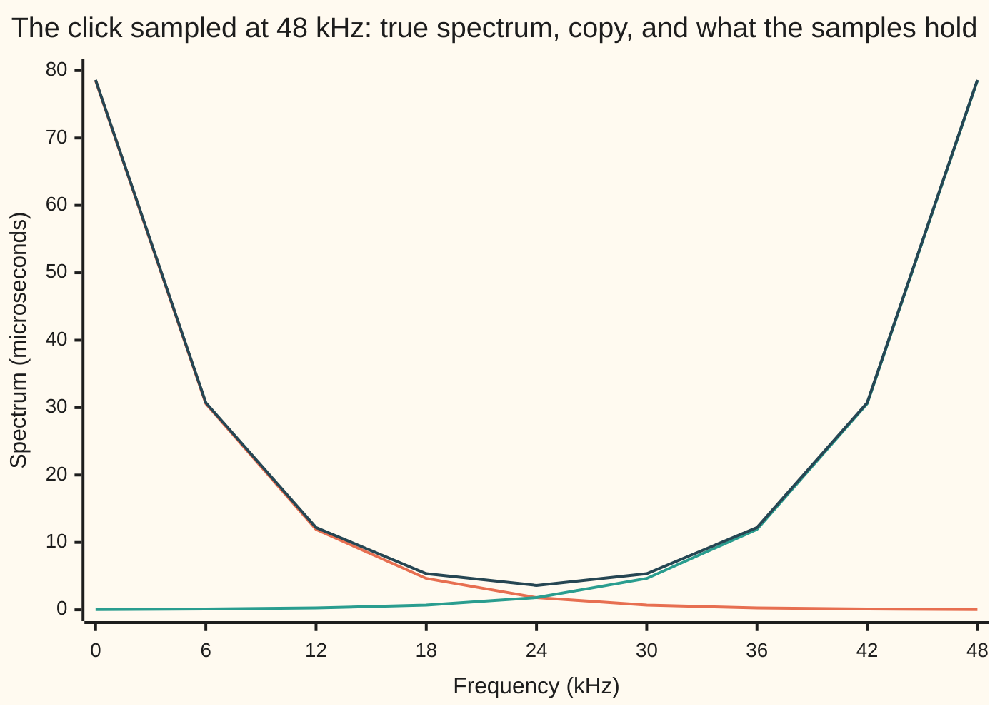

# Poisson summation and sampling: samples are enough when nothing wiggles too fast

[Syllabus](../../../SYLLABUS.md) → [Harmonic analysis](../README.md) → [The Fourier Transform](../README.md#s02) → Poisson summation and sampling

---

## General Overview

Film and video sound is recorded at 48,000 samples a second. A converter reads the microphone's voltage once every 20.833333 microseconds (μs, millionths of a second) and keeps nothing in between. Tap the microphone and it records a click: a pulse whose height falls to half 25 μs either side of its peak.

Do the samples hold the whole click? One exact identity answers this, **Poisson summation**. It says that adding up all the samples gives the same number as adding up the click's spectrum (the amount of each frequency it holds) at 0, ±48,000, ±96,000 hertz and so on, times 48,000. For the click both sums come to 3.773920671.

Applied once more, with each sample first multiplied by a turning factor (a complex number of size 1 whose angle grows steadily with the sample's time), the identity says something stronger. The samples' spectrum is the click's true spectrum plus a copy of it shifted by every whole multiple of 48,000 Hz. Where a copy lands on the original, two frequencies share one place, and the samples cannot tell them apart. That overlap is **aliasing**.

At 24,000 Hz, half the sampling rate, the copy from 48,000 Hz is as large as the original: the samples' spectrum there is 2.001064 times the truth. So the click is not held exactly. Rebuilt halfway between two samples, it reads 0.868449 instead of the true 0.852071.

**Adding a signal's samples gives the same total as adding its spectrum at every multiple of the sampling rate; so sampling copies the spectrum every sampling rate, and the samples fix the signal exactly when the copies do not overlap, which for a spectrum around zero needs nothing at or above half the rate.**

**What kind of fact this is:** a theorem. Poisson summation is proved on this card in Why it works, for continuous signals that, with their transforms, fade at least like a power of 1/|t| and 1/|ξ| higher than the first. The copies formula follows in one line. The sampling theorem is deduced in outline; its full proof is on the engineering [Sampling](../../13-Engineering%20mathematics/05-Signals/01-sampling-and-the-nyquist-theorem.md) card. The click is a model pulse from a stated formula, illustrative.

### The picture: the click's spectrum, its first copy, and their sum



Orange: the click's true spectrum. Green: its copy centred on 48 kHz. Dark blue: the samples' spectrum, the sum of all copies. The two curves cross at 24 kHz, at 1.81 μs each, and there the samples' spectrum is 3.62 μs, about double. Below 24 kHz the extra is small but never zero, since the click has some of every frequency.

---

## The formula

The convention is the one fixed on [The Fourier transform of an absolutely integrable signal, and why it fades at infinity](01-fourier-transform-on-l1-and-riemann-lebesgue.md): a signal $`f(t)`$, with $`t`$ in seconds, has transform $`\hat f(\xi) = \int f(t)\, e^{-2\pi i \xi t}\, dt`$, with $`\xi`$ in hertz and $`i`$ the imaginary unit. Samples are $`T`$ seconds apart, so the sampling rate is $`f_s = 1/T`$ samples a second.

**Poisson summation.** Let $`f`$ be continuous. Suppose there are constants $`M > 0`$ and $`\delta > 0`$ with $`|f(t)| \le M(1+|t|)^{-1-\delta}`$ and $`|\hat f(\xi)| \le M(1+|\xi|)^{-1-\delta}`$. Then

```math
\sum_{n=-\infty}^{\infty} f(nT) \;=\; f_s \sum_{k=-\infty}^{\infty} \hat f(k f_s),
```

and both sums converge absolutely.

**Read it aloud:** the sum of every sample equals the sampling rate times the sum of the spectrum read at every whole multiple of the sampling rate.

**The copies.** Define the **sampled spectrum** $`S(\xi) = T\sum_n f(nT)\, e^{-2\pi i \xi n T}`$: the spectrum the samples alone can report, scaled to the units of $`\hat f`$. Under the same conditions, for every $`\xi`$,

```math
S(\xi) \;=\; \sum_{k=-\infty}^{\infty} \hat f(\xi - k f_s).
```

**Read it aloud:** what the samples report at a frequency is the true spectrum there plus the true spectrum one, two, three sampling rates away, on both sides.

**The click.** In the example

```math
f(t) = \frac{1}{1 + (t/a)^2}, \qquad \hat f(\xi) = \pi a\, e^{-2\pi a |\xi|}, \qquad a = 25\ \mu\text{s}.
```

The pair follows from [Fourier inversion](04-fourier-inversion-theorem.md): the inverse transform of $`\pi a\, e^{-2\pi a|\xi|}`$ is two integrals of a falling exponential times a cosine, and they add up to $`a^2/(a^2+t^2)`$. Both decay conditions hold with $`\delta = 1`$: the click falls like $`1/t^2`$, its spectrum faster than any power. The click is **not** rapidly decreasing (falling faster than every power of $`1/|t|`$), so the functional-analysis card's proof does not reach it.

With $`b = a f_s`$, the click's half-width counted in samples, the spectrum side is a geometric series, and

```math
\sum_n f(nT) = \pi b\, \coth(\pi b) = 3.77392067076, \qquad b = 1.2,
```

where $`\coth u = \cosh u / \sinh u`$, the hyperbolic cotangent: $`(e^{u}+e^{-u})/(e^{u}-e^{-u})`$.

| Symbol | Plain meaning | In our example | Push it up and the answer… |
| --- | --- | --- | --- |
| $`f`$, $`\hat f`$ | the signal (click height, a fraction of its peak); its transform, in seconds | $`\hat f(0)`$ = 78.539816 μs | — |
| $`t`$, $`\xi`$, $`i`$ | time in seconds; frequency in hertz; the imaginary unit | ξ from 0 to 48 kHz | — |
| $`T`$, $`f_s`$ | time between samples; sampling rate, $`f_s = 1/T`$ | 20.833333 μs; 48,000 Hz | higher $`f_s`$: copies move apart, less aliasing |
| $`n`$, $`k`$ | sample number; copy number | all whole numbers | — |
| $`a`$, $`b`$ | click's half-width at half height; the same in samples, $`b = a f_s`$ | 25 μs; 1.2 | wider click: narrower spectrum, smaller copies |
| $`M`$, $`\delta`$ | size and extra power in the decay conditions | δ = 1 for the click | larger δ: faster-converging sums |
| $`S(\xi)`$ | the sampled spectrum: what the samples report | 3.623257 μs at 24 kHz | — |
| $`h`$, $`f_\xi`$, $`\eta`$ | in the proof: the Fourier series built from the $`c_k`$; the signal times the turning factor $`e^{-2\pi i \xi t}`$; a second frequency, in hertz | — | — |
| $`g`$, $`c_k`$ | in the proof: the signal wrapped round a circle of length $`T`$; its Fourier coefficients | $`c_k = f_s \hat f(k f_s)`$ | — |
| $`N`$ | where the sum over samples is cut off, $`\lvert n\rvert \le N`$ | 100,000 | the sum settles; the gap is below $`2b^2/N`$ |
| $`\mathrm{sinc}`$, $`\coth`$ | $`\mathrm{sinc}(u) = \sin(\pi u)/(\pi u)`$, 1 at 0; the hyperbolic cotangent | $`\coth(\pi b)`$ = 1.001064 | — |

### When it holds

- **The signal is continuous.** A jump sitting on a sample time breaks the identity. The shutter gate, open from 0 to 1 ms and read every 1 ms, gives sample sum 2 and spectrum sum 1. With the value 1/2 at each jump, both are 1.
- **The signal fades faster than 1/|t|.** A signal falling only like $`1/(1+|t|)`$ has samples whose sum diverges, like 1 + 1/2 + 1/3 + …, which grows without limit.
- **The spectrum fades faster than 1/|ξ|.** The gate's spectrum is a sinc, which falls only like $`1/|\xi|`$; that slow fall is the frequency-side sign of the jump.
- **Even spacing, for ever.** Every sample is exactly $`T`$ after the last, and none is missing. A recording that stops is a window times the signal, and each copy is smeared ([Windows](../../13-Engineering%20mathematics/05-Signals/03-windows-and-spectral-leakage.md)).
- **"Samples are enough" needs a band limit.** Exact recovery is guaranteed when $`\hat f(\xi) = 0`$ for $`|\xi| \ge f_s/2`$. The click fails this, so its rebuild is off by 0.016378.

---

## Why it works

### Step 0: wrap the signal round a circle

Cut the time line into pieces $`T`$ long and stack them, adding the signal's values. The result is a signal that repeats every $`T`$: the original wrapped round a circle of length $`T`$. Two readings of that wrapped signal give the theorem.

- Read at time 0, it is $`f(0) + f(T) + f(-T) + \dots`$, the sum of the samples.
- Read its Fourier coefficients: each one is $`f_s`$ times the full transform at a multiple of $`f_s`$, because the stacked pieces tile the whole line.

A periodic signal equals its Fourier series when the series behaves. So the sum of samples equals the series at time 0, which is the sum of the coefficients.

### Step 1: the wrapped signal is continuous

Define

```math
g(t) = \sum_{n=-\infty}^{\infty} f(t + nT).
```

On one period, $`0 \le t \le T`$, the term $`f(t+nT)`$ is at most $`M(1 + (|n|-1)T)^{-1-\delta}`$ for $`|n| \ge 1`$. Those bounds have a finite sum, since the power exceeds 1. So the series converges uniformly (at the same speed for every $`t`$), and a uniform limit of continuous signals is continuous. This is where the continuity of $`f`$ and its decay are used.

### Step 2: its Fourier coefficients are the transform at multiples of the rate

The $`k`$-th coefficient of $`g`$ on the circle of length $`T`$ ([Fourier series](../../07-Complex%20analysis/08-Transforms%20in%20Outline/01-fourier-series-in-complex-form.md)) is an average over one period. Put the sum outside the integral, which uniform convergence allows. Shift each piece back to its own place on the line. The pieces tile the line, so

```math
c_k = \frac{1}{T}\int_0^T g(t)\, e^{-2\pi i k t/T}\, dt = f_s\, \hat f(k f_s).
```

The turning factor survives the shift unchanged, because $`e^{-2\pi i k n} = 1`$ for whole numbers $`k`$ and $`n`$.

### Step 3: the series converges to the wrapped signal

By the decay of $`\hat f`$, the coefficients have a finite total size, $`\sum |c_k| < \infty`$. So the Fourier series converges uniformly to a continuous signal $`h`$ with the same coefficients as $`g`$. The difference $`g - h`$ is continuous with every coefficient 0. By Parseval ([Convergence in energy](../01-Fourier%20Series%20in%20Depth/05-l2-convergence-and-riesz-fischer.md)) its energy, the average of its squared size over a period, is 0. A continuous signal with no energy is 0 everywhere. Read $`g = h`$ at $`t = 0`$: that is Poisson summation.

<details>
<summary>Detailed proof: Poisson summation under the decay conditions</summary>

**Uniform convergence of g.** For $`0 \le t \le T`$ and $`|n| \ge 1`$, $`|t + nT| \ge (|n|-1)T`$, so

$`\displaystyle |f(t + nT)| \le M\big(1 + (|n|-1)T\big)^{-1-\delta}.`$

The right side does not depend on $`t`$ and its sum over $`n`$ is finite, because $`\sum_m (1 + mT)^{-1-\delta}`$ is at most $`1 + \int_0^\infty (1+uT)^{-1-\delta}\,du = 1 + 1/(\delta T)`$. By the Weierstrass test, a series bounded term by term by a convergent series of constants converges uniformly. Each term is continuous, so $`g`$ is continuous. It has period $`T`$, since replacing $`t`$ by $`t + T`$ only renumbers the terms.

**The coefficients.** Swap sum and integral, which uniform convergence allows, and substitute $`s = t + nT`$:

$`\displaystyle c_k = \frac{1}{T}\sum_n \int_{nT}^{(n+1)T} f(s)\, e^{-2\pi i k (s - nT)/T}\, ds = \frac{1}{T}\int_{-\infty}^{\infty} f(s)\, e^{-2\pi i k s/T}\, ds = f_s\, \hat f(k f_s).`$

The factor $`e^{2\pi i k n}`$ is 1, and the intervals $`[nT, (n+1)T]`$ tile the line. The last integral converges absolutely because $`f`$ decays faster than $`1/|s|`$.

**The series.** $`\sum_k |c_k| \le f_s M \sum_k (1 + |k| f_s)^{-1-\delta} < \infty`$. So $`h(t) = \sum_k c_k e^{2\pi i k t/T}`$ converges uniformly to a continuous signal. Integrating term by term, which uniform convergence allows, the coefficients of $`h`$ are the $`c_k`$.

**Uniqueness.** The signal $`g - h`$ is continuous, has period $`T`$, and has every coefficient 0. Parseval's identity on the circle gives

$`\displaystyle \frac{1}{T}\int_0^T |g(t) - h(t)|^2\, dt = \sum_k |0|^2 = 0.`$

A continuous signal with zero energy is zero at every point. So $`g(t) = h(t)`$ for every $`t`$, and at $`t = 0`$:

$`\displaystyle \sum_n f(nT) = g(0) = h(0) = \sum_k c_k = f_s\sum_k \hat f(k f_s).`$

**The copies.** Fix $`\xi`$ and put $`f_\xi(t) = f(t)\, e^{-2\pi i \xi t}`$. It is continuous with $`|f_\xi| = |f|`$, and by the modulation rule its transform is $`\hat f(\eta + \xi)`$ at frequency $`\eta`$, which obeys the same kind of bound with a larger constant $`M`$. Apply the theorem to $`f_\xi`$, multiply by $`T`$, and replace $`k`$ by $`-k`$:

$`\displaystyle T\sum_n f(nT)\, e^{-2\pi i \xi n T} = \sum_k \hat f(\xi - k f_s).`$

∎

</details>

### Step 4: the copies, from one more use of the theorem

Multiply the signal by $`e^{-2\pi i \xi t}`$, a turning factor at frequency $`\xi`$. By the modulation rule of [The transform rulebook](02-shift-scale-and-derivative-rules.md), that slides the spectrum by $`\xi`$. Poisson summation for the new signal is the copies formula.

So the copies are not an extra assumption about sampling. They are Poisson summation, read at every frequency at once.

### Step 5: no overlap means nothing is lost

Suppose $`\hat f(\xi) = 0`$ for $`|\xi| \ge f_s/2`$. Between $`-f_s/2`$ and $`f_s/2`$ only the copy with $`k = 0`$ is nonzero, so $`S(\xi) = \hat f(\xi)`$ there. The samples report the true spectrum, and the spectrum fixes the signal.

To write the signal down, invert the transform over that band. $`S`$ is a Fourier series in $`\xi`$ whose coefficients are $`T f(nT)`$. Integrating each term gives a sinc bump, and

```math
f(t) = \sum_{n=-\infty}^{\infty} f(nT)\, \mathrm{sinc}\big(f_s t - n\big).
```

**Read it aloud:** the signal at any time is each sample times a sinc bump centred on that sample's time, all added up. The engineering [Sampling](../../13-Engineering%20mathematics/05-Signals/01-sampling-and-the-nyquist-theorem.md) card proves this in full, by the same Fourier-series route.

### Step 6: overlap is aliasing

If a spectrum spread around zero reaches $`f_s/2`$ or beyond, copies land on the original and add to it. No rule applied to the samples can separate them.

- **A tone.** A 30 kHz cosine has spikes at ±30 kHz. The copy shifted by −48 kHz moves +30 to −18; the copy shifted by +48 kHz moves −30 to +18. The samples show an 18 kHz tone, sample for sample.
- **The click.** Its spectrum never reaches zero, so every copy overlaps the original a little. At 12 kHz the samples report 1.023598 times the truth; at 24 kHz, 2.001064 times.
- **A band away from zero.** The test is overlap, not the highest frequency. A signal that lives only between 40 and 48 kHz can be sampled at 16 kHz, twice the band's width. Its copies interleave without landing on each other: tones at 40.5, 41.5, …, 47.5 kHz are heard at 7.5, 6.5, …, 0.5 kHz, each in a place of its own. So the samples still fix the signal, though rebuilding it needs a formula for that band in place of Step 5's sinc.

### Step 7: how large the damage is

Apply the sinc formula of Step 5 to a signal that is not band-limited. It rebuilds the inverse transform of $`S`$ over the band, not of $`\hat f`$. Two pieces are wrong.

- The part of $`\hat f`$ beyond $`f_s/2`$ is missing.
- The copies have folded the same amount of spectrum into the band.

So the rebuild is off by at most twice the area of $`|\hat f|`$ beyond $`f_s/2`$. For the click that area is $`e^{-\pi b}`$, and the bound is $`2e^{-\pi b}`$ = 0.046108. The real error at $`t = T/2`$ is 0.016378, 0.355218 of the bound.

---

## Worked numbers, by hand

| Step | Arithmetic | Value |
| --- | --- | --- |
| time between samples | $`T`$ = 1 / 48,000 s | 20.833333 μs |
| click width in samples | $`b`$ = 25 μs × 48,000 / s | 1.2 |
| spectrum at 0 Hz | $`\hat f(0) = \pi a`$ = π × 25 μs | 78.539816 μs |
| central term of the spectrum side | $`f_s \hat f(0) = \pi b`$ = π × 1.2 | 3.769911184 |
| each copy at ±48 kHz | $`f_s \hat f(f_s) = \pi b\, e^{-2\pi b}`$ | 0.002003678 |
| spectrum side, copies up to ±3 | 3.769911184 + 2 × 0.002003678 + smaller terms | 3.77392067076 |
| closed form | $`\pi b \coth(\pi b)`$ = 3.769911 × 1.001064 | 3.77392067076 |
| sample side, 200,001 samples | $`1 + 2\sum_{n=1}^{100000} 1/(1 + (n/1.2)^2)`$ | 3.773891871 |
| what the cut-off misses | at most $`2b^2/N`$ = 2 × 1.44 / 100,000 | 0.000028800 |
| samples' spectrum at 24 kHz | $`\hat f(24\text{ kHz}) + \hat f(-24\text{ kHz}) + \dots`$ = 1.810666 + 1.810666 + … | 3.623257 μs, 2.001064 × the truth |
| rebuild at $`t = T/2`$ | sinc sum over 200,001 samples | 0.868449, true value 0.852071 |

**Both sides of Poisson summation come to 3.77392067076.** The central term alone, 3.769911184, is too small: the samples balance only once the copies at ±48 kHz and beyond are counted. The sample sum, cut at 100,000 on each side, falls short by 0.000028799856, just inside its tail bound 0.000028800000.

### What breaks if you drop a piece

| Mistake | Comes out at | What went wrong |
| --- | --- | --- |
| A jump on the grid: the shutter gate, open 0 to 1 ms, read every 1 ms | samples 2.000000, spectrum side 1.000000 | the wrapped signal is not continuous; the series reads the average of the two sides of each jump |
| Keep only the central copy, $`k = 0`$ | 3.769911184 instead of 3.773920671 | the copies at ±48 kHz and beyond carry the difference |
| Sample a 30 kHz tone at 48 kHz | an 18 kHz tone of height 1.000000 | the tone is above $`f_s/2`$ = 24 kHz; its copy lands at 18 kHz |
| Rebuild the click by sinc, as if it were band-limited | 0.868449 instead of 0.852071 at $`t = T/2`$ | copies overlap the original at every frequency; the error stays under $`2e^{-\pi b}`$ = 0.046108 |

The gate's failure is narrow. Shift the grid by 0.5 ms, so no sample sits on a jump, and both sides are 1.000000 again. Give the gate the value 1/2 at each jump and both sides are 1.000000 too: that is [Dirichlet's theorem](../01-Fourier%20Series%20in%20Depth/04-pointwise-and-uniform-convergence.md), where the series lands on the midpoint of a jump.

---

## Code, from first principles, and it actually runs

Each result is reached by independent roads:

- **Poisson summation**, three roads: 200,001 samples with a tail bound; the spectrum at the copy positions; the closed form $`\pi b \coth(\pi b)`$.
- **The copies** at 0, 12 and 24 kHz, three roads: a brute-force sum over samples; 41 shifted spectra; a geometric series.
- **The sinc rebuild** at $`T/2`$, two roads: the sinc sum; an integral of the copies by Simpson's rule with 4,000 steps. Both are checked against the error bound.
- **The 30 kHz tone**, three roads: the fold formula; 48 samples compared one by one; a search of the samples' spectrum for its peak.
- **The band away from zero**, two roads: the fold formula; 16 samples of each tone compared with its alias.
- **The gate**: its samples summed from the gate's definition, and its transform by the midpoint rule on the same gate. The asserts confirm the sample side exceeds the transform side by exactly 1 with a jump on the grid, and matches it with midpoint values or a shifted grid.

Every sum is added left to right, so the two languages print the same digits.

### Python

```python
# Poisson summation and sampling -- the check behind the card.  Standard library only.
# A click f(t) = 1/(1 + (t/a)^2), half height 25 microseconds either side of its peak,
# sampled 48,000 times a second.  Its transform is pi a exp(-2 pi a |xi|), xi in hertz.
# Roads: the sum of samples, the sum of spectrum values at the copy positions, and the
# closed form pi b coth(pi b); the sampled spectrum by brute force, by adding copies, and
# by a geometric series; the sinc rebuild against the integral of the copies; a tone
# folded by formula, by comparing samples and by a spectrum search; and the shutter's
# gate, where the theorem's hypothesis fails.
import math

A, FS = 25e-6, 48000.0               # click half-width (s); sampling rate (samples/s)
T, b = 1 / FS, A * FS                # sample spacing (s); b = a / T, a dimensionless width
C = 2 * math.pi * A                  # decay rate of the transform, seconds
def f(t): u = t / A; return 1 / (1 + u * u)
def fhat(xi): return math.pi * A * math.exp(-C * abs(xi))
def sinc(u): return 1.0 if u == 0 else math.sin(math.pi * u) / (math.pi * u)
def clean(v): return 0.0 if abs(v) < 5e-13 else v
def us(v): return f"{v * 1e6:.6f}"
def total(vals):                     # plain left-to-right sum, as in the Rust twin
    s = 0.0
    for v in vals: s += v
    return s

print(f"click a = 25 us, fs = 48000 Hz, T = {us(T)} us, b = a/T = {b:.6f}")
print("-- Poisson summation: sum of samples = fs * sum of transform at k fs")
closed = math.pi * b / math.tanh(math.pi * b)
for n_max in (10, 1000, 100000):
    s = 1 + 2 * total(f(n * T) for n in range(1, n_max + 1))
    bound = 2 * b * b / n_max         # sum over |n| > N of b^2/n^2 is below 2 b^2 / N
    print(f"samples |n|<={n_max}: {s:.9f}  tail bound {bound:.12f}  gap {closed - s:.12f}")
    assert 0 < closed - s < bound
for k_max in (0, 1, 3):
    c = FS * total(fhat(k * FS) for k in range(-k_max, k_max + 1))
    print(f"copies |k|<={k_max}: {c:.11f}")
print(f"closed form pi b coth(pi b): {closed:.11f}")
assert abs(c - closed) < 1e-12
k0 = FS * fhat(0)
print(f"copy at 48 kHz adds {FS * fhat(FS):.9f} on each side; without the copies: {k0:.9f}")

print("-- copies: T * sum f(nT) cos(2 pi xi n T) = sum over k of fhat(xi - k fs)")
q = math.exp(-C * FS)
def s_closed(xi): return math.pi * A * (math.exp(-C * xi) + math.exp(-C * (FS - xi))) / (1 - q)
def s_copies(xi): return total(fhat(xi - k * FS) for k in range(-20, 21))
N = 100000
for xi in (0.0, 12000.0, 24000.0):
    brute = T * (1 + 2 * total(f(n * T) * math.cos(2 * math.pi * xi * n * T) for n in range(1, N + 1)))
    tail = T * 2 * b * b / N
    print(f"xi {xi:.0f} Hz: fhat {us(fhat(xi))}  samples {us(brute)} (tail < {us(tail)})"
          f"  copies {us(s_copies(xi))}  closed {us(s_closed(xi))}  ratio {s_closed(xi) / fhat(xi):.6f}")
    assert abs(brute - s_closed(xi)) < tail and abs(s_copies(xi) - s_closed(xi)) < 1e-15
grid = [6000.0 * j for j in range(9)]
print("chart xi kHz: " + ", ".join(f"{g / 1000:.0f}" for g in grid))
print("chart fhat:   " + ", ".join(f"{fhat(g) * 1e6:.2f}" for g in grid))
print("chart copy:   " + ", ".join(f"{fhat(g - FS) * 1e6:.2f}" for g in grid))
print("chart sum:    " + ", ".join(f"{s_closed(g) * 1e6:.2f}" for g in grid))

print("-- rebuild halfway between samples, t = T/2, by the sinc sum")
t = T / 2
rebuilt = total(f(n * T) * sinc(t / T - n) for n in range(-N, N + 1))
m = 4000                              # Simpson on 0..fs/2 of 2 S(xi) cos(2 pi xi t)
h = (FS / 2) / m
w = [1 if j in (0, m) else (4 if j % 2 else 2) for j in range(m + 1)]
integral = h / 3 * total(w[j] * 2 * s_closed(j * h) * math.cos(2 * math.pi * j * h * t) for j in range(m + 1))
bound = 2 * math.exp(-math.pi * b)    # twice the transform's area beyond fs/2
print(f"true f(T/2) {f(t):.6f}  sinc sum {rebuilt:.6f}  integral of copies {integral:.6f}")
print(f"error {rebuilt - f(t):.6f}  bound 2 exp(-pi b) {bound:.6f}  ratio {(rebuilt - f(t)) / bound:.6f}")
assert abs(rebuilt - integral) < 1e-4 and abs(rebuilt - f(t)) < bound

print("-- a 30 kHz tone sampled at 48 kHz")
f0 = 30000.0
alias = abs(f0 - FS * math.floor(f0 / FS + 0.5))
diff = max(abs(math.cos(2 * math.pi * f0 * n * T) - math.cos(2 * math.pi * alias * n * T)) for n in range(48))
best, peak = 0.0, -1.0
for freq in range(0, 24001, 1000):        # 48 samples = 1 ms, so 1 kHz steps are exact bins
    re = total(math.cos(2 * math.pi * f0 * n * T) * math.cos(2 * math.pi * freq * n * T) for n in range(48))
    im = total(math.cos(2 * math.pi * f0 * n * T) * math.sin(2 * math.pi * freq * n * T) for n in range(48))
    amp = 2 * math.hypot(re, im) / 48
    if amp > peak: best, peak = freq, amp
print(f"fold formula {alias:.0f} Hz  largest sample gap to 18 kHz {clean(diff):.6f}"
      f"  spectrum peak {best} Hz height {peak:.6f}")
assert best == alias and diff < 1e-9
print(f"same tone at 44100: heard at {abs(f0 - 44100 * math.floor(f0 / 44100 + 0.5)):.0f} Hz")
print("-- a band away from zero, 40 to 48 kHz, sampled at 16 kHz: twice the band's width")
fb = 16000.0
tones = [40500.0 + 1000.0 * j for j in range(8)]
heard = [abs(x - fb * math.floor(x / fb + 0.5)) for x in tones]
gap_b = max(abs(math.cos(2 * math.pi * x * n / fb) - math.cos(2 * math.pi * y * n / fb)) for x, y in zip(tones, heard) for n in range(16))
print("tones kHz " + ", ".join(f"{x / 1000:.1f}" for x in tones) + "  heard at " + ", ".join(f"{y / 1000:.1f}" for y in heard)
      + f"  largest sample gap {gap_b:.6f}")
assert len(set(heard)) == len(tones) and max(heard) < fb / 2 and gap_b < 1e-9   # each tone lands in a place of its own

print("-- shutter gate, open 0 to 1 ms, read every 1 ms (units: ms and kHz)")
M = 1000
def gate(t, edge):                   # 1 while open, 0 outside, the value `edge` at the two jumps
    return edge if t in (0, 1) else (1.0 if 0 < t < 1 else 0.0)
def gate_hat(k):                     # transform at k kHz by the midpoint rule on -1..2 ms
    ts = [(j + 0.5) / M for j in range(-M, 2 * M)]
    re = total(gate(t, 1.0) * math.cos(2 * math.pi * k * t) for t in ts) / M
    im = -total(gate(t, 1.0) * math.sin(2 * math.pi * k * t) for t in ts) / M
    return re, im
hats = {k: gate_hat(k) for k in range(-5, 6)}
side = total(hats[k][0] for k in hats)
shift = total(hats[k][0] * math.cos(math.pi * k) - hats[k][1] * math.sin(math.pi * k) for k in hats)
closed_s, mid_s = (total(gate(n, e) for n in range(-5, 6)) for e in (1.0, 0.5))
shift_s = total(gate(n + 0.5, 1.0) for n in range(-5, 6))
print(f"transform at 1 kHz {clean(hats[1][0]):.6f} {clean(hats[1][1]):.6f}  transform side |k|<=5 {side:.6f}")
print(f"samples, gate closed at both ends: {closed_s:.6f}   with 1/2 at each jump: {mid_s:.6f}")
print(f"grid shifted by 0.5 ms: samples {shift_s:.6f}  transform side {shift:.6f}")
assert abs(side - 1) < 1e-9 and abs(shift - 1) < 1e-9   # the exact transform: 1 at 0 kHz, 0 at other whole kHz
assert abs(closed_s - side - 1) < 1e-9                  # a jump on the grid: the samples exceed the transform side by 1
assert abs(mid_s - side) < 1e-9 and abs(shift_s - shift) < 1e-9   # midpoint values, or a shifted grid: equal
print("ALL CHECKS PASS")
```

**Ran 2026-11-15 on macOS, Python 3.14.10, standard library only. All checks passed. Output, pasted from the run:**

```
click a = 25 us, fs = 48000 Hz, T = 20.833333 us, b = a/T = 1.200000
-- Poisson summation: sum of samples = fs * sum of transform at k fs
samples |n|<=10: 3.501021251  tail bound 0.288000000000  gap 0.272899420148
samples |n|<=1000: 3.771042112  tail bound 0.002880000000  gap 0.002878559100
samples |n|<=100000: 3.773891871  tail bound 0.000028800000  gap 0.000028799856
copies |k|<=0: 3.76991118431
copies |k|<=1: 3.77391853975
copies |k|<=3: 3.77392067076
closed form pi b coth(pi b): 3.77392067076
copy at 48 kHz adds 0.002003678 on each side; without the copies: 3.769911184
-- copies: T * sum f(nT) cos(2 pi xi n T) = sum over k of fhat(xi - k fs)
xi 0 Hz: fhat 78.539816  samples 78.622747 (tail < 0.000600)  copies 78.623347  closed 78.623347  ratio 1.001064
xi 12000 Hz: fhat 11.925156  samples 12.206568 (tail < 0.000600)  copies 12.206568  closed 12.206568  ratio 1.023598
xi 24000 Hz: fhat 1.810666  samples 3.623257 (tail < 0.000600)  copies 3.623257  closed 3.623257  ratio 2.001064
chart xi kHz: 0, 6, 12, 18, 24, 30, 36, 42, 48
chart fhat:   78.54, 30.60, 11.93, 4.65, 1.81, 0.71, 0.27, 0.11, 0.04
chart copy:   0.04, 0.11, 0.27, 0.71, 1.81, 4.65, 11.93, 30.60, 78.54
chart sum:    78.62, 30.73, 12.21, 5.36, 3.62, 5.36, 12.21, 30.73, 78.62
-- rebuild halfway between samples, t = T/2, by the sinc sum
true f(T/2) 0.852071  sinc sum 0.868449  integral of copies 0.868449
error 0.016378  bound 2 exp(-pi b) 0.046108  ratio 0.355218
-- a 30 kHz tone sampled at 48 kHz
fold formula 18000 Hz  largest sample gap to 18 kHz 0.000000  spectrum peak 18000 Hz height 1.000000
same tone at 44100: heard at 14100 Hz
-- a band away from zero, 40 to 48 kHz, sampled at 16 kHz: twice the band's width
tones kHz 40.5, 41.5, 42.5, 43.5, 44.5, 45.5, 46.5, 47.5  heard at 7.5, 6.5, 5.5, 4.5, 3.5, 2.5, 1.5, 0.5  largest sample gap 0.000000
-- shutter gate, open 0 to 1 ms, read every 1 ms (units: ms and kHz)
transform at 1 kHz 0.000000 0.000000  transform side |k|<=5 1.000000
samples, gate closed at both ends: 2.000000   with 1/2 at each jump: 1.000000
grid shifted by 0.5 ms: samples 1.000000  transform side 1.000000
ALL CHECKS PASS
```

### Rust

```rust
// Poisson summation and sampling -- the check behind the card.  Rust std only, no crates.
// A click f(t) = 1/(1 + (t/a)^2), half height 25 microseconds either side of its peak,
// sampled 48,000 times a second.  Its transform is pi a exp(-2 pi a |xi|), xi in hertz.
// Roads: the sum of samples, the sum of spectrum values at the copy positions, and the
// closed form pi b coth(pi b); the sampled spectrum by brute force, by adding copies, and
// by a geometric series; the sinc rebuild against the integral of the copies; a tone
// folded by formula, by comparing samples and by a spectrum search; and the shutter's
// gate, where the theorem's hypothesis fails.
use std::f64::consts::PI;

const A: f64 = 25e-6; // click half-width (s)
const FS: f64 = 48000.0; // sampling rate (samples/s)
const T: f64 = 1.0 / FS; // sample spacing (s)
const C: f64 = 2.0 * PI * A; // decay rate of the transform, seconds

fn f(t: f64) -> f64 { let u = t / A; 1.0 / (1.0 + u * u) }
fn fhat(xi: f64) -> f64 { PI * A * (-C * xi.abs()).exp() }
fn sinc(u: f64) -> f64 { if u == 0.0 { 1.0 } else { (PI * u).sin() / (PI * u) } }
fn clean(v: f64) -> f64 { if v.abs() < 5e-13 { 0.0 } else { v } }
fn us(v: f64) -> String { format!("{:.6}", v * 1e6) }
fn total<I: Iterator<Item = f64>>(vals: I) -> f64 { let mut s = 0.0; for v in vals { s += v; } s }
fn rnd(v: f64) -> f64 { (v + 0.5).floor() }
fn gate(t: f64, edge: f64) -> f64 { if t == 0.0 || t == 1.0 { edge } else if t > 0.0 && t < 1.0 { 1.0 } else { 0.0 } } // 1 while open, `edge` at the jumps
fn s_closed(xi: f64) -> f64 {
    let q = (-C * FS).exp();
    PI * A * ((-C * xi).exp() + (-C * (FS - xi)).exp()) / (1.0 - q)
}
fn s_copies(xi: f64) -> f64 { total((-20..=20).map(|k| fhat(xi - k as f64 * FS))) }
fn join(v: &[f64], f: impl Fn(f64) -> String) -> String {
    v.iter().map(|&g| f(g)).collect::<Vec<_>>().join(", ")
}

fn main() {
    let b = A * FS; // b = a / T, a dimensionless width
    println!("click a = 25 us, fs = 48000 Hz, T = {} us, b = a/T = {:.6}", us(T), b);
    println!("-- Poisson summation: sum of samples = fs * sum of transform at k fs");
    let closed = PI * b / (PI * b).tanh();
    for n_max in [10i64, 1000, 100000] {
        let s = 1.0 + 2.0 * total((1..=n_max).map(|n| f(n as f64 * T)));
        let bound = 2.0 * b * b / n_max as f64; // sum over |n| > N of b^2/n^2 is below 2 b^2 / N
        println!("samples |n|<={}: {:.9}  tail bound {:.12}  gap {:.12}", n_max, s, bound, closed - s);
        assert!(closed - s > 0.0 && closed - s < bound);
    }
    let mut c = 0.0;
    for k_max in [0i64, 1, 3] {
        c = FS * total((-k_max..=k_max).map(|k| fhat(k as f64 * FS)));
        println!("copies |k|<={}: {:.11}", k_max, c);
    }
    println!("closed form pi b coth(pi b): {:.11}", closed);
    assert!((c - closed).abs() < 1e-12);
    let k0 = FS * fhat(0.0);
    println!("copy at 48 kHz adds {:.9} on each side; without the copies: {:.9}", FS * fhat(FS), k0);

    println!("-- copies: T * sum f(nT) cos(2 pi xi n T) = sum over k of fhat(xi - k fs)");
    let n_big: i64 = 100000;
    for xi in [0.0f64, 12000.0, 24000.0] {
        let brute = T * (1.0 + 2.0 * total((1..=n_big).map(|n| f(n as f64 * T) * (2.0 * PI * xi * n as f64 * T).cos())));
        let tail = T * 2.0 * b * b / n_big as f64;
        println!("xi {:.0} Hz: fhat {}  samples {} (tail < {})  copies {}  closed {}  ratio {:.6}",
            xi, us(fhat(xi)), us(brute), us(tail), us(s_copies(xi)), us(s_closed(xi)), s_closed(xi) / fhat(xi));
        assert!((brute - s_closed(xi)).abs() < tail && (s_copies(xi) - s_closed(xi)).abs() < 1e-15);
    }
    let grid: Vec<f64> = (0..9).map(|j| 6000.0 * j as f64).collect();
    println!("chart xi kHz: {}", join(&grid, |g| format!("{:.0}", g / 1000.0)));
    println!("chart fhat:   {}", join(&grid, |g| format!("{:.2}", fhat(g) * 1e6)));
    println!("chart copy:   {}", join(&grid, |g| format!("{:.2}", fhat(g - FS) * 1e6)));
    println!("chart sum:    {}", join(&grid, |g| format!("{:.2}", s_closed(g) * 1e6)));

    println!("-- rebuild halfway between samples, t = T/2, by the sinc sum");
    let t = T / 2.0;
    let rebuilt = total((-n_big..=n_big).map(|n| f(n as f64 * T) * sinc(t / T - n as f64)));
    let m: i64 = 4000; // Simpson on 0..fs/2 of 2 S(xi) cos(2 pi xi t)
    let h = (FS / 2.0) / m as f64;
    let w = |j: i64| -> f64 { if j == 0 || j == m { 1.0 } else if j % 2 == 1 { 4.0 } else { 2.0 } };
    let integral = h / 3.0 * total((0..=m).map(|j| w(j) * 2.0 * s_closed(j as f64 * h) * (2.0 * PI * j as f64 * h * t).cos()));
    let bound = 2.0 * (-PI * b).exp(); // twice the transform's area beyond fs/2
    println!("true f(T/2) {:.6}  sinc sum {:.6}  integral of copies {:.6}", f(t), rebuilt, integral);
    println!("error {:.6}  bound 2 exp(-pi b) {:.6}  ratio {:.6}", rebuilt - f(t), bound, (rebuilt - f(t)) / bound);
    assert!((rebuilt - integral).abs() < 1e-4 && (rebuilt - f(t)).abs() < bound);

    println!("-- a 30 kHz tone sampled at 48 kHz");
    let f0 = 30000.0;
    let alias = (f0 - FS * rnd(f0 / FS)).abs();
    let tone = |f: f64, n: i64| (2.0 * PI * f * n as f64 * T).cos();
    let diff = (0..48).map(|n| (tone(f0, n) - tone(alias, n)).abs()).fold(0.0, f64::max);
    let (mut best, mut peak) = (0i64, -1.0);
    for freq in (0..=24000i64).step_by(1000) { // 48 samples = 1 ms, so 1 kHz steps are exact bins
        let re = total((0..48).map(|n| tone(f0, n) * (2.0 * PI * freq as f64 * n as f64 * T).cos()));
        let im = total((0..48).map(|n| tone(f0, n) * (2.0 * PI * freq as f64 * n as f64 * T).sin()));
        let amp = 2.0 * re.hypot(im) / 48.0;
        if amp > peak { best = freq; peak = amp; }
    }
    println!("fold formula {:.0} Hz  largest sample gap to 18 kHz {:.6}  spectrum peak {} Hz height {:.6}",
        alias, clean(diff), best, peak);
    assert!(best as f64 == alias && diff < 1e-9);
    println!("same tone at 44100: heard at {:.0} Hz", (f0 - 44100.0 * rnd(f0 / 44100.0)).abs());
    println!("-- a band away from zero, 40 to 48 kHz, sampled at 16 kHz: twice the band's width");
    let fb = 16000.0;
    let tones: Vec<f64> = (0..8).map(|j| 40500.0 + 1000.0 * j as f64).collect();
    let heard: Vec<f64> = tones.iter().map(|&x| (x - fb * rnd(x / fb)).abs()).collect();
    let gap_b = tones.iter().zip(&heard).flat_map(|(&x, &y)| (0..16).map(move |n|
        ((2.0 * PI * x * n as f64 / fb).cos() - (2.0 * PI * y * n as f64 / fb).cos()).abs())).fold(0.0, f64::max);
    println!("tones kHz {}  heard at {}  largest sample gap {:.6}",
        join(&tones, |x| format!("{:.1}", x / 1000.0)), join(&heard, |y| format!("{:.1}", y / 1000.0)), gap_b);
    let mut apart = heard.clone();
    apart.sort_by(|p, q| p.partial_cmp(q).unwrap());
    apart.dedup();
    assert!(apart.len() == tones.len() && heard.iter().all(|&y| y < fb / 2.0) && gap_b < 1e-9); // each tone lands in a place of its own

    println!("-- shutter gate, open 0 to 1 ms, read every 1 ms (units: ms and kHz)");
    let mm = 1000;
    let gate_hat = |k: i64| -> (f64, f64) { // transform at k kHz by the midpoint rule on -1..2 ms
        let ts: Vec<f64> = (-mm..2 * mm).map(|j| (j as f64 + 0.5) / mm as f64).collect();
        let arg = |t: f64| 2.0 * PI * k as f64 * t;
        (total(ts.iter().map(|&t| gate(t, 1.0) * arg(t).cos())) / mm as f64,
         -total(ts.iter().map(|&t| gate(t, 1.0) * arg(t).sin())) / mm as f64)
    };
    let hats: Vec<(i64, (f64, f64))> = (-5..=5).map(|k| (k, gate_hat(k))).collect();
    let side = total(hats.iter().map(|&(_, (re, _))| re));
    let shift = total(hats.iter().map(|&(k, (re, im))| re * (PI * k as f64).cos() - im * (PI * k as f64).sin()));
    let (closed_s, mid_s) = (total((-5..=5).map(|n| gate(n as f64, 1.0))), total((-5..=5).map(|n| gate(n as f64, 0.5))));
    let shift_s = total((-5..=5).map(|n| gate(n as f64 + 0.5, 1.0)));
    let h1 = gate_hat(1);
    println!("transform at 1 kHz {:.6} {:.6}  transform side |k|<=5 {:.6}", clean(h1.0), clean(h1.1), side);
    println!("samples, gate closed at both ends: {:.6}   with 1/2 at each jump: {:.6}", closed_s, mid_s);
    println!("grid shifted by 0.5 ms: samples {:.6}  transform side {:.6}", shift_s, shift);
    assert!((side - 1.0).abs() < 1e-9 && (shift - 1.0).abs() < 1e-9); // the exact transform: 1 at 0 kHz, 0 at other whole kHz
    assert!((closed_s - side - 1.0).abs() < 1e-9); // a jump on the grid: the samples exceed the transform side by 1
    assert!((mid_s - side).abs() < 1e-9 && (shift_s - shift).abs() < 1e-9); // midpoint values, or a shifted grid: equal
    println!("ALL CHECKS PASS");
}
```

**Ran 2026-11-15 on macOS, rustc 1.98.1, no crates. All checks passed. Output, pasted from the run:**

```
click a = 25 us, fs = 48000 Hz, T = 20.833333 us, b = a/T = 1.200000
-- Poisson summation: sum of samples = fs * sum of transform at k fs
samples |n|<=10: 3.501021251  tail bound 0.288000000000  gap 0.272899420148
samples |n|<=1000: 3.771042112  tail bound 0.002880000000  gap 0.002878559100
samples |n|<=100000: 3.773891871  tail bound 0.000028800000  gap 0.000028799856
copies |k|<=0: 3.76991118431
copies |k|<=1: 3.77391853975
copies |k|<=3: 3.77392067076
closed form pi b coth(pi b): 3.77392067076
copy at 48 kHz adds 0.002003678 on each side; without the copies: 3.769911184
-- copies: T * sum f(nT) cos(2 pi xi n T) = sum over k of fhat(xi - k fs)
xi 0 Hz: fhat 78.539816  samples 78.622747 (tail < 0.000600)  copies 78.623347  closed 78.623347  ratio 1.001064
xi 12000 Hz: fhat 11.925156  samples 12.206568 (tail < 0.000600)  copies 12.206568  closed 12.206568  ratio 1.023598
xi 24000 Hz: fhat 1.810666  samples 3.623257 (tail < 0.000600)  copies 3.623257  closed 3.623257  ratio 2.001064
chart xi kHz: 0, 6, 12, 18, 24, 30, 36, 42, 48
chart fhat:   78.54, 30.60, 11.93, 4.65, 1.81, 0.71, 0.27, 0.11, 0.04
chart copy:   0.04, 0.11, 0.27, 0.71, 1.81, 4.65, 11.93, 30.60, 78.54
chart sum:    78.62, 30.73, 12.21, 5.36, 3.62, 5.36, 12.21, 30.73, 78.62
-- rebuild halfway between samples, t = T/2, by the sinc sum
true f(T/2) 0.852071  sinc sum 0.868449  integral of copies 0.868449
error 0.016378  bound 2 exp(-pi b) 0.046108  ratio 0.355218
-- a 30 kHz tone sampled at 48 kHz
fold formula 18000 Hz  largest sample gap to 18 kHz 0.000000  spectrum peak 18000 Hz height 1.000000
same tone at 44100: heard at 14100 Hz
-- a band away from zero, 40 to 48 kHz, sampled at 16 kHz: twice the band's width
tones kHz 40.5, 41.5, 42.5, 43.5, 44.5, 45.5, 46.5, 47.5  heard at 7.5, 6.5, 5.5, 4.5, 3.5, 2.5, 1.5, 0.5  largest sample gap 0.000000
-- shutter gate, open 0 to 1 ms, read every 1 ms (units: ms and kHz)
transform at 1 kHz 0.000000 0.000000  transform side |k|<=5 1.000000
samples, gate closed at both ends: 2.000000   with 1/2 at each jump: 1.000000
grid shifted by 0.5 ms: samples 1.000000  transform side 1.000000
ALL CHECKS PASS
```

### Lean

Lean proves Poisson summation, the copies formula and the band-limited case for every continuous signal meeting the decay conditions.

- Suppose $`f`$ is continuous, both decay conditions hold, and $`T > 0`$. Then both sums converge absolutely, and $`\sum_n f(nT) = f_s \sum_k \hat f(k f_s)`$.
- Take the same conditions and any frequency $`\xi`$. Then $`S(\xi) = \sum_k \hat f(\xi - k f_s)`$: the samples' spectrum is the true spectrum plus every copy.
- Suppose also $`\hat f(\xi) = 0`$ whenever $`|\xi| \ge f_s/2`$. Then $`S(\xi) = \hat f(\xi)`$ for every $`|\xi| < f_s/2`$: the samples report the true spectrum.
- Lean also checks the hand arithmetic exactly, such as $`b = 1.2`$ and the 30 kHz tone heard at 18,000 Hz.
- It checks the band's eight tones, heard at 7.5, 6.5, …, 0.5 kHz.
- It checks the gate's sample sums: 2 with the jumps on the grid, and 1 with the value 1/2 at each jump.

The sinc rebuild, the click's closed form, the gate's transform side and every decimal are left to the Python and Rust checks.

```lean
-- Poisson summation and sampling: for a continuous signal that, with its transform, fades like a power of 1/|t| higher than the first, the sum of its samples every T seconds equals 1/T times the sum of its transform at the multiples of 1/T, so the samples' spectrum is the true spectrum plus copies every 1/T hertz, and with nothing at or above half the rate the samples report the true spectrum.
import Mathlib.Analysis.Fourier.PoissonSummation

open Complex Real
open scoped FourierTransform

section PSHelpers

open Filter Asymptotics MeasureTheory

/-- Decay bound to big-O at infinity. -/
lemma ps_isBigO_of_bound {h : ℝ → ℂ} {C a c b : ℝ} (hC : 0 ≤ C) (ha : a ≠ 0) (hb : 0 < b)
    (hh : ∀ x : ℝ, ‖h x‖ ≤ C * (1 + |a * x + c|) ^ (-b)) :
    h =O[cocompact ℝ] (|·| ^ (-b)) := by
  have ha' : 0 < |a| := abs_pos.mpr ha
  refine Asymptotics.IsBigO.of_bound (C * (|a| / 2) ^ (-b)) ?_
  have hev := (tendsto_norm_cocompact_atTop (E := ℝ)).eventually_ge_atTop (2 * |c| / |a| + 1)
  filter_upwards [hev] with x hx
  rw [Real.norm_eq_abs] at hx
  have hx1 : 2 * |c| ≤ |a| * |x| := by
    have : 2 * |c| / |a| ≤ |x| := by linarith
    rw [div_le_iff₀ ha'] at this; linarith
  have hxpos : 0 < |x| := by
    have : 0 ≤ 2 * |c| / |a| := by positivity
    linarith
  have hlow : |a| * |x| / 2 ≤ 1 + |a * x + c| := by
    have h1 : |a * x| - |c| ≤ |a * x + c| := by
      have := abs_sub_abs_le_abs_sub (a * x) (-c)
      simpa [sub_neg_eq_add, abs_neg] using this
    rw [abs_mul] at h1
    linarith
  have hpos : 0 < |a| * |x| / 2 := by positivity
  calc ‖h x‖ ≤ C * (1 + |a * x + c|) ^ (-b) := hh x
    _ ≤ C * (|a| * |x| / 2) ^ (-b) := by
        apply mul_le_mul_of_nonneg_left _ hC
        exact Real.rpow_le_rpow_of_nonpos hpos hlow (by linarith)
    _ = C * (|a| / 2) ^ (-b) * ‖|x| ^ (-b)‖ := by
        rw [Real.norm_eq_abs, abs_of_nonneg (Real.rpow_nonneg (abs_nonneg x) _),
          show |a| * |x| / 2 = (|a| / 2) * |x| by ring, Real.mul_rpow (by positivity) hxpos.le]
        ring

/-- Big-O decay with exponent above one gives summable norms at the integers. -/
lemma ps_summable_norm {h : ℝ → ℂ} {b : ℝ} (hb : 1 < b) (hh : h =O[cocompact ℝ] (|·| ^ (-b))) :
    Summable fun n : ℤ => ‖h n‖ :=
  summable_of_isBigO (Real.summable_abs_int_rpow hb)
    (hh.norm_left.comp_tendsto Int.tendsto_coe_cofinite)

/-- The general scaled and modulated Poisson formula. -/
lemma ps_main {f : ℝ → ℂ} (hc : Continuous f)
    {M δ : ℝ} (hM : 0 < M) (hδ : 0 < δ)
    (hf : ∀ t : ℝ, ‖f t‖ ≤ M * (1 + |t|) ^ (-1 - δ))
    (hFf : ∀ ξ : ℝ, ‖𝓕 f ξ‖ ≤ M * (1 + |ξ|) ^ (-1 - δ))
    {T : ℝ} (hT : 0 < T) (ξ : ℝ) :
    (T : ℂ) * ∑' n : ℤ, f (n * T) * Complex.exp (↑(-2 * π * ξ * (n * T)) * Complex.I) =
      ∑' k : ℤ, 𝓕 f (ξ + k * (1 / T)) := by
  set g : ℝ → ℂ := fun t => (T : ℂ) * (f (t * T) * Complex.exp (↑(-2 * π * ξ * (t * T)) * Complex.I))
    with hg
  have hb : 1 < 1 + δ := by linarith
  have hneg : -1 - δ = -(1 + δ) := by ring
  have hgc : Continuous g := by
    have : Continuous fun t : ℝ => f (t * T) := hc.comp (continuous_id.mul continuous_const)
    fun_prop
  have hFg : ∀ w : ℝ, 𝓕 g w = 𝓕 f (ξ + w * (1 / T)) := by
    intro w
    rw [Real.fourier_real_eq_integral_exp_smul, Real.fourier_real_eq_integral_exp_smul]
    set F : ℝ → ℂ := fun s => Complex.exp (↑(-2 * π * s * (ξ + w * (1 / T))) * Complex.I) • f s
    have hpt : ∀ v : ℝ, Complex.exp (↑(-2 * π * v * w) * Complex.I) • g v = (T : ℂ) • F (v * T) := by
      intro v
      simp only [hg, F, smul_eq_mul]
      have : Complex.exp (↑(-2 * π * v * w) * Complex.I) *
          Complex.exp (↑(-2 * π * ξ * (v * T)) * Complex.I) =
          Complex.exp (↑(-2 * π * (v * T) * (ξ + w * (1 / T))) * Complex.I) := by
        rw [← Complex.exp_add]
        congr 1
        have hT0 : (T : ℂ) ≠ 0 := by exact_mod_cast hT.ne'
        push_cast
        field_simp
        ring
      rw [← this]; ring
    simp_rw [hpt]
    rw [integral_smul, MeasureTheory.Measure.integral_comp_mul_right, abs_inv, abs_of_pos hT]
    have : (T : ℂ) * (T⁻¹ : ℝ) = 1 := by
      have hT0 : (T : ℂ) ≠ 0 := by exact_mod_cast hT.ne'
      push_cast; field_simp
    rw [smul_eq_mul, Complex.real_smul, ← mul_assoc, this, one_mul]
  have hg_bound : ∀ x : ℝ, ‖g x‖ ≤ (T * M) * (1 + |T * x + 0|) ^ (-(1 + δ)) := by
    intro x
    simp only [hg, norm_mul, Complex.norm_real, Real.norm_eq_abs, abs_of_pos hT]
    rw [Complex.norm_exp_ofReal_mul_I, mul_one, add_zero, mul_comm T x, mul_assoc, ← hneg]
    exact mul_le_mul_of_nonneg_left (hf _) hT.le
  have hFg_bound : ∀ x : ℝ, ‖𝓕 g x‖ ≤ M * (1 + |(1 / T) * x + ξ|) ^ (-(1 + δ)) := by
    intro x
    rw [hFg, ← hneg, add_comm ((1 / T) * x), mul_comm (1 / T)]
    exact hFf _
  have hgO := ps_isBigO_of_bound (by positivity) hT.ne' (by linarith) hg_bound
  have hFgO := ps_isBigO_of_bound hM.le (by positivity) (by linarith) hFg_bound
  have hP := Real.tsum_eq_tsum_fourier_of_rpow_decay_of_summable hgc hb hgO
    (ps_summable_norm hb hFgO).of_norm 0
  simp only [zero_add, hFg, AddCircle.coe_zero, fourier_eval_zero, mul_one] at hP
  rw [← hP, hg, tsum_mul_left]

end PSHelpers


/-- **Poisson summation.** Let `f` be a continuous signal and let `T > 0` be the time between
samples, so the sampling rate is `f_s = 1/T`. Suppose there are constants `M > 0` and `δ > 0`
with `|f(t)| ≤ M (1 + |t|)^(-1-δ)` and `|f̂(ξ)| ≤ M (1 + |ξ|)^(-1-δ)`, where
`f̂(ξ) = 𝓕 f ξ = ∫ f(t) e^(-2πiξt) dt`. Then both sums converge absolutely, and the sum of all
samples equals the sampling rate times the sum of the spectrum at every whole multiple of the
sampling rate: `∑ₙ f(nT) = f_s ∑ₖ f̂(k f_s)`. -/
theorem sum_of_samples_eq_rate_times_sum_of_spectrum {f : ℝ → ℂ} (hc : Continuous f)
    {M δ : ℝ} (hM : 0 < M) (hδ : 0 < δ)
    (hf : ∀ t : ℝ, ‖f t‖ ≤ M * (1 + |t|) ^ (-1 - δ))
    (hFf : ∀ ξ : ℝ, ‖𝓕 f ξ‖ ≤ M * (1 + |ξ|) ^ (-1 - δ))
    {T : ℝ} (hT : 0 < T) :
    (Summable fun n : ℤ => ‖f (n * T)‖) ∧
    (Summable fun k : ℤ => ‖𝓕 f (k * (1 / T))‖) ∧
    ∑' n : ℤ, f (n * T) = ((1 / T : ℝ) : ℂ) * ∑' k : ℤ, 𝓕 f (k * (1 / T)) := by
  have hb : 1 < 1 + δ := by linarith
  have hneg : -1 - δ = -(1 + δ) := by ring
  refine ⟨?_, ?_, ?_⟩
  · have hB : ∀ x : ℝ, ‖f (x * T)‖ ≤ M * (1 + |T * x + 0|) ^ (-(1 + δ)) := by
      intro x; rw [add_zero, mul_comm T x, ← hneg]; exact hf _
    have hO := ps_isBigO_of_bound hM.le hT.ne' (by linarith) hB
    exact ps_summable_norm hb hO
  · have hTi : (1 / T) ≠ 0 := by positivity
    have hB : ∀ x : ℝ, ‖𝓕 f (x * (1 / T))‖ ≤ M * (1 + |(1 / T) * x + 0|) ^ (-(1 + δ)) := by
      intro x; rw [add_zero, mul_comm (1 / T) x, ← hneg]; exact hFf _
    have hO := ps_isBigO_of_bound hM.le hTi (by linarith) hB
    have hS := ps_summable_norm hb hO
    beta_reduce at hS
    exact hS
  · have h := ps_main hc hM hδ hf hFf hT 0
    simp only [mul_zero, zero_mul, Complex.ofReal_zero, Complex.exp_zero, mul_one, zero_add] at h
    have hT0 : (T : ℂ) ≠ 0 := by exact_mod_cast hT.ne'
    have h1 : ((1 / T : ℝ) : ℂ) * (T : ℂ) = 1 := by push_cast; field_simp
    rw [← h, ← mul_assoc, h1, one_mul]

/-- **The copies.** Under the same conditions, the sampled spectrum
`S(ξ) = T ∑ₙ f(nT) e^(-2πiξnT)`, what the samples alone report, equals at every frequency `ξ`
the true spectrum plus a copy of it shifted by every whole multiple of the sampling rate
`f_s = 1/T`: `S(ξ) = ∑ₖ f̂(ξ - k f_s)`. -/
theorem sampled_spectrum_eq_sum_of_copies {f : ℝ → ℂ} (hc : Continuous f)
    {M δ : ℝ} (hM : 0 < M) (hδ : 0 < δ)
    (hf : ∀ t : ℝ, ‖f t‖ ≤ M * (1 + |t|) ^ (-1 - δ))
    (hFf : ∀ ξ : ℝ, ‖𝓕 f ξ‖ ≤ M * (1 + |ξ|) ^ (-1 - δ))
    {T : ℝ} (hT : 0 < T) (ξ : ℝ) :
    (T : ℂ) * ∑' n : ℤ, f (n * T) * Complex.exp (↑(-2 * π * ξ * (n * T)) * Complex.I) =
      ∑' k : ℤ, 𝓕 f (ξ - k * (1 / T)) := by
  rw [ps_main hc hM hδ hf hFf hT ξ]
  rw [← (Equiv.neg ℤ).tsum_eq]
  congr 1 with k
  simp [sub_eq_add_neg]

/-- **No overlap means nothing is lost.** Under the same conditions, if the spectrum is zero at
and above half the sampling rate, `f̂(ξ) = 0` for `|ξ| ≥ f_s/2` with `f_s = 1/T`, then inside
the band `|ξ| < f_s/2` the samples report the true spectrum exactly:
`T ∑ₙ f(nT) e^(-2πiξnT) = f̂(ξ)`. -/
theorem sampled_spectrum_eq_spectrum_of_band_limited {f : ℝ → ℂ} (hc : Continuous f)
    {M δ : ℝ} (hM : 0 < M) (hδ : 0 < δ)
    (hf : ∀ t : ℝ, ‖f t‖ ≤ M * (1 + |t|) ^ (-1 - δ))
    (hFf : ∀ ξ : ℝ, ‖𝓕 f ξ‖ ≤ M * (1 + |ξ|) ^ (-1 - δ))
    {T : ℝ} (hT : 0 < T)
    (hband : ∀ ξ : ℝ, (1 / T) / 2 ≤ |ξ| → 𝓕 f ξ = 0)
    (ξ : ℝ) (hξ : |ξ| < (1 / T) / 2) :
    (T : ℂ) * ∑' n : ℤ, f (n * T) * Complex.exp (↑(-2 * π * ξ * (n * T)) * Complex.I) =
      𝓕 f ξ := by
  rw [sampled_spectrum_eq_sum_of_copies hc hM hδ hf hFf hT ξ]
  rw [tsum_eq_single 0]
  · simp
  · intro k hk
    apply hband
    have hk1 : (1 : ℝ) ≤ |(k : ℝ)| := by
      rw [← Int.cast_abs]; exact_mod_cast Int.one_le_abs hk
    have hTi : 0 < 1 / T := by positivity
    have h2 : 1 / T ≤ |(k : ℝ) * (1 / T)| := by
      rw [abs_mul, abs_of_pos hTi]; nlinarith
    have h3 : |(k : ℝ) * (1 / T)| - |ξ| ≤ |ξ - k * (1 / T)| := by
      rw [abs_sub_comm]; exact abs_sub_abs_le_abs_sub _ _
    linarith

/-! Whole-number checks from the card's worked examples. -/

-- The click's width in samples: b = a f_s = 25 μs × 48,000 per second = 6/5 = 1.2.
example : (25 : ℚ) / 10 ^ 6 * 48000 = 6 / 5 := by norm_num

-- A 30 kHz tone sampled at 48 kHz: the nearest multiple of 48,000 is 48,000, heard at 18,000 Hz.
example : Int.natAbs (30000 - 48000 * 1) = 18000 := by decide
-- The same tone sampled at 44.1 kHz is heard at 14,100 Hz.
example : Int.natAbs (30000 - 44100 * 1) = 14100 := by decide

-- Tones at 40,500, 41,500, ..., 47,500 Hz sampled at 16,000 Hz (nearest multiple 48,000)
-- are heard at 7,500, 6,500, ..., 500 Hz, each in a place of its own.
example : (List.range 8).map (fun j : ℕ => Int.natAbs (40500 + 1000 * (j : ℤ) - 16000 * 3)) =
    [7500, 6500, 5500, 4500, 3500, 2500, 1500, 500] := by decide

-- The shutter gate, equal to 1 on [0, 1] ms and read every 1 ms: two samples (at 0 and 1)
-- are 1, so the sample sum is 2, while the transform side is 1.
example : ((Finset.Icc (-5 : ℤ) 5).filter (fun n => 0 ≤ n ∧ n ≤ 1)).card = 2 := by decide
-- With the value 1/2 at each jump, the sample sum is 1/2 + 1/2 = 1, matching the transform side.
example : (1 / 2 : ℚ) + 1 / 2 = 1 := by norm_num

#print axioms ps_isBigO_of_bound
#print axioms ps_summable_norm
#print axioms ps_main
#print axioms sum_of_samples_eq_rate_times_sum_of_spectrum
#print axioms sampled_spectrum_eq_sum_of_copies
#print axioms sampled_spectrum_eq_spectrum_of_band_limited
```

**Checked 2026-11-15 on macOS, Lean 4.36.0-rc2, Mathlib v4.36.0-rc2. Every proof is complete and uses only Lean's standard axioms. Output, pasted from the run:**

```
'ps_isBigO_of_bound' depends on axioms: [propext, Classical.choice, Quot.sound]
'ps_summable_norm' depends on axioms: [propext, Classical.choice, Quot.sound]
'ps_main' depends on axioms: [propext, Classical.choice, Quot.sound]
'sum_of_samples_eq_rate_times_sum_of_spectrum' depends on axioms: [propext, Classical.choice, Quot.sound]
'sampled_spectrum_eq_sum_of_copies' depends on axioms: [propext, Classical.choice, Quot.sound]
'sampled_spectrum_eq_spectrum_of_band_limited' depends on axioms: [propext, Classical.choice, Quot.sound]
```

> [!TIP]
> **Try changing**
> - Guess first: at the CD rate, 44,100 samples a second, where is the 30 kHz tone heard? Answer: at 14,100 Hz. The scripts print it on the line after the 48 kHz tone.
> - Guess first: if the click is made twice as wide, does the rebuild error grow or shrink? Set `A = 50e-6`. Answer: it shrinks. The spectrum narrows, $`b`$ doubles, and the bound $`2e^{-\pi b}`$ falls by a factor $`e^{\pi b}`$.
> - Guess first: cut the sample sum at $`|n| \le 10`$ instead of 100,000. How far short is it? Answer: 0.272899420, inside the tail bound 0.288: a $`1/t^2`$ tail is slow to settle.
> - Guess first: give the gate its jump values 1/2 instead of 1. Answer: the samples then add to 1.000000, and the identity holds again.

---

## The usual mistake

> [!warning]
> **"The rate is more than twice the highest frequency, so nothing is lost."** A click, a step or any pulse that starts and stops has no highest frequency: its spectrum never reaches zero. At 48,000 samples a second the click's copies overlap at every frequency, and the rebuild misses by 0.016378 halfway between samples. The rule protects only signals that a filter has made band-limited before the converter.
>
> - **Dropping the factor $`f_s`$.** The sum of spectrum values alone is 78.623347 μs, a time. Times $`f_s`$ it is the sample sum, 3.77392067076, a pure number.
> - **Expecting Poisson summation for a signal with a jump on the grid.** The gate read at 0, 1, 2 ms gives 2.000000 against 1.000000. Shift the grid or use midpoint values.
> - **Filtering after the converter.** The 30 kHz tone's samples equal an 18 kHz tone's: the largest gap is 0.000000. A digital filter cannot remove one without the other.
> - **Mixing hertz and radians per second.** In hertz the copies sit every $`f_s`$, here 48,000 Hz. In the ω form of wing 07 they sit every $`2\pi f_s`$ radians per second; reading 48,000 as an ω spacing puts them 2π times too close.

---

## Where you meet it in real life

- **Film and video sound.** Recorders sample at 48 kHz and put an analog low-pass filter before the converter, so the copies at ±48 kHz have nothing to overlap.
- **Numerical integration.** $`T\sum f(nT)`$ is the trapezoid rule for the area under $`f`$. Poisson summation says its error is exactly the copies: 78.623347 μs against the true area 78.539816 μs for the click. For smooth, fast-fading signals the copies are tiny, which is why the trapezoid rule is so accurate there.
- **Digital cameras.** A sensor's pixel grid samples the picture. Fine fabric or brick patterns above half the pixel rate come back as broad false stripes, called moiré; an optical low-pass filter in front of the sensor blurs them first.
- **Number theory and geometry.** Poisson summation applied to a bell curve gives the functional equation of the theta function, and applied over a lattice it bounds how densely spheres can be packed.

> **Say it back**
> Wrap a signal round a circle of length $`T`$ and read it two ways: at time 0 it is the sum of the samples, and its Fourier coefficients are the transform at multiples of the sampling rate. When the signal is continuous and both it and its transform fade faster than one over distance, the two readings agree: that is Poisson summation. Turned at every frequency, it says the samples' spectrum is the true spectrum plus copies every sampling rate. If nothing reaches half the rate, the copies stay apart and the samples rebuild the signal by sinc bumps. If something does, copies overlap, and the overlap is aliasing: a 30 kHz tone heard at 18 kHz, a click rebuilt 0.016378 too high.

---

## What this builds on

- [Fourier inversion](04-fourier-inversion-theorem.md): rebuilds a signal from its spectrum; it gives the click's transform pair and the last step of the sinc formula.
- [Two pairs worth memorising](03-gaussian-and-sinc-transform-pairs.md): the gate's sinc spectrum, which falls only like $`1/|\xi|`$ and so fails the decay condition.
- [Sampling](../../13-Engineering%20mathematics/05-Signals/01-sampling-and-the-nyquist-theorem.md): the engineering card proves the sampling theorem, sinc rebuilding and the alias formula, and sizes the filter; it stated Poisson summation and left the proof to this card.
- [Fourier series](../../07-Complex%20analysis/08-Transforms%20in%20Outline/01-fourier-series-in-complex-form.md): the complex series of a periodic signal, used on the wrapped signal $`g`$.
- [Sampling](../../18-Functional%20analysis/04-Distributions%20and%20Sobolev%20Spaces/06-sampling-the-dirac-comb-and-nyquist.md): the functional-analysis card writes sampling as a comb of spikes and proves Poisson summation for rapidly decreasing signals; this card widens it to signals like the click.

Earlier on this shelf, [Plancherel](05-plancherel-and-l2.md) carries the transform to every finite-energy signal, and [The uncertainty principle](07-uncertainty-principle.md) says why no pulse that stops can be band-limited.

---

## Where this goes next

- Sphere packing, solved in dimensions 8 and 24 (planned): Poisson summation over a lattice, with a cleverly chosen signal, gives the bound that settles the densest packing in those dimensions.
- The functional equation (planned): Poisson summation applied to a bell curve relates a theta function at $`x`$ and at $`1/x`$, the first step to the zeta function's symmetry.

The question left open: how fast must a spectrum fall for Poisson summation to hold, when the signal is continuous but the decay conditions fail?

---

## Sources

Verified 2026-11-15: every link below resolves to the publisher's page.

- Shannon, C. E. (1949). "Communication in the Presence of Noise". *Proceedings of the IRE* 37(1). [doi:10.1109/JRPROC.1949.232969](https://doi.org/10.1109/JRPROC.1949.232969). The sampling theorem and the sinc rebuilding formula, stated for engineers.
- Grafakos, L. (2014). *Classical Fourier Analysis*, 3rd edition. Springer, Graduate Texts in Mathematics 249. [doi:10.1007/978-1-4939-1194-3](https://doi.org/10.1007/978-1-4939-1194-3). Poisson summation under the decay conditions used on this card, with full proof.
- Jerri, A. J. (1977). "The Shannon sampling theorem—Its various extensions and applications: A tutorial review". *Proceedings of the IEEE* 65(11). [doi:10.1109/PROC.1977.10771](https://doi.org/10.1109/PROC.1977.10771). Aliasing error bounds for signals that are not band-limited, and the theorem's history.
- Unser, M. (2000). "Sampling—50 years after Shannon". *Proceedings of the IEEE* 88(4). [doi:10.1109/5.843002](https://doi.org/10.1109/5.843002). Sampling as projection, and the copies formula in modern signal processing.
