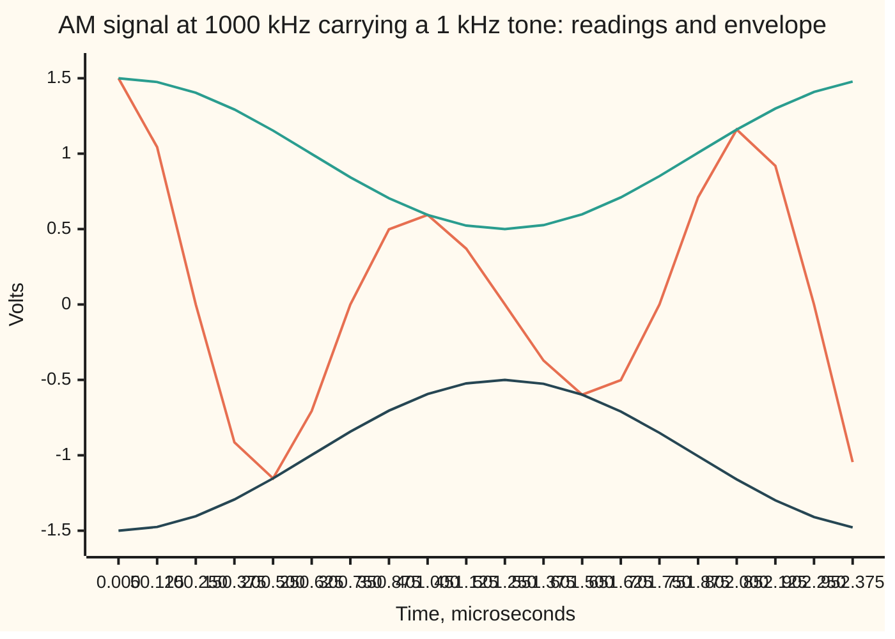

# The Hilbert transform: shift every frequency a quarter turn, and read off the envelope

[Syllabus](../../../SYLLABUS.md) → [Harmonic analysis](../README.md) → [The Fourier Transform](../README.md#s02) → The Hilbert transform

---

## General Overview

An AM radio station broadcasts on 1000 kHz. Its carrier, a steady wave, swings up and down a million times a second. A 1 kHz test tone rides on the carrier's height: the height rises to 1.5 V and falls to 0.5 V a thousand times a second. That slow outline of the swings is the **envelope**, and the envelope is the sound. The radio's job is to recover it.

One reading of the signal does not give the envelope. At 200.125 µs (microseconds) the signal reads 0.816 V, but the outline there is 1.154 V. An eighth of a microsecond later the signal reads 0 V, yet the outline has barely moved. The reading depends on where in its swing the carrier happens to be.

The fix is a partner wave: the same signal with every frequency in it shifted a quarter turn. Where the signal is a cosine, the partner is the matching sine. Then the signal squared plus the partner squared is the outline squared, at every instant: 0.816 squared plus 0.816 squared is 1.154 squared. The operation that makes the partner is the **Hilbert transform**. The signal and its partner together, as one complex number, are the **analytic signal**.

**The Hilbert transform turns every positive frequency of a signal back a quarter turn and every negative frequency forward a quarter turn; added to the signal as its imaginary part, it gives an analytic signal whose size is the envelope and whose angle is the phase.**

**What kind of fact this is:** a definition (the transform and the analytic signal), with theorems proved on this card in Why it works: the quarter-turn rule and the kernel 1/(πt) are the same operation, and the analytic signal of an AM wave has the message as its size whenever the carrier lies above every frequency in the message and the height stays positive.

### The picture: the swings and their outline

The signal and the envelope recovered from it, over one millisecond (one cycle of the tone). The carrier makes 1000 swings in this window, too many to draw, so the chart reads the signal every 50.125 µs. Each reading falls 45° further round the carrier's swing, so the readings land at different heights inside the outline.



The first line (orange) joins the signal's readings, and the joined line is not the signal's shape. The readings come back to the same place in the carrier's swing every 8 readings, 401 µs, so joining them draws a slow wave that the signal does not contain. That is aliasing, explained on [Poisson summation and sampling](08-poisson-summation-and-sampling.md). The second (teal) is the envelope, the size of the analytic signal; the third (dark) is its mirror image below zero. Every reading sits between the two. The envelope traces the tone: 1.5 V at the start, 0.5 V half way through. The signal is synthetic, from the formula in The formula section: illustrative, not a recording.

---

## The formula

This card uses the shelf's convention from [The Fourier transform of an absolutely integrable signal, and why it fades at infinity](01-fourier-transform-on-l1-and-riemann-lebesgue.md): $`\hat f(\xi) = \int f(t)\,e^{-2\pi i \xi t}\,dt`$, with time $`t`$ in seconds, frequency $`\xi`$ (xi) in hertz, and $`i`$ the imaginary unit, $`i^2 = -1`$. Multiplying by $`-i`$ turns a complex number a quarter turn clockwise.

**The multiplier.** A multiplier $`m(\xi)`$ is a function that multiplies the transform, frequency by frequency. The Hilbert transform $`Hf`$ of a signal $`f`$ has the multiplier $`-i\,\mathrm{sgn}(\xi)`$, where $`\mathrm{sgn}(\xi)`$ is the sign of the frequency: 1 if positive, −1 if negative, 0 at zero.

```math
\widehat{Hf}(\xi) = -i\,\mathrm{sgn}(\xi)\,\hat f(\xi)
```

**Read it aloud:** the transform of Hf at xi is f-hat at xi, turned a quarter turn back for positive xi and a quarter turn forward for negative xi.

**The kernel.** The same operation in time is a convolution with $`1/(\pi t)`$, taken as a principal value: cut equal gaps of half-width ε either side of the point where the kernel blows up, integrate, then close the gaps ([Poles on the path](../../07-Complex%20analysis/06-Real%20Integrals%20and%20Counting%20Zeros/04-indented-contours-and-principal-values.md)).

```math
Hf(t) = \mathrm{PV}\int_{-\infty}^{\infty} \frac{f(t-u)}{\pi u}\,du = \frac{1}{\pi}\int_{0}^{\infty} \frac{f(t-u) - f(t+u)}{u}\,du
```

**Read it aloud:** H f at t compares the signal a distance u behind t with the signal the same distance ahead, weights the difference by one over pi u, and adds over all distances.

**The analytic signal, its envelope and its phase.** For a real signal $`s`$,

```math
z(t) = s(t) + i\,Hs(t) = a(t)\,e^{i\varphi(t)}, \qquad a(t) = \lvert z(t)\rvert, \qquad \text{instantaneous frequency} = \frac{\varphi'(t)}{2\pi}
```

**Read it aloud:** the analytic signal is the signal plus i times its partner; its size is the envelope a, its angle is the phase phi, and the phase's rate of turning, in turns per second, is the instantaneous frequency.

**The radio signal.** The tone sets the carrier's height $`A(t)`$:

```math
s(t) = A(t)\cos(2\pi \xi_c t), \qquad A(t) = 1 + \mu\cos(2\pi \xi_m t), \qquad \xi_c = 1000\ \text{kHz},\ \xi_m = 1\ \text{kHz},\ \mu = 0.5
```

| Symbol | Plain meaning | In our example | Push it up and the answer… |
| --- | --- | --- | --- |
| $`t`$, $`\xi`$, $`\xi_0`$, $`\theta`$ | time in seconds; frequency in hertz; one fixed frequency; an angle | t = 200.125 µs for the worked instant | — |
| $`s(t)`$, $`f(t)`$ | the radio signal; any signal | s = 0.816097 V at the worked instant | — |
| $`\hat f(\xi)`$ | the Fourier transform: how much of frequency ξ the signal holds | three spikes, at 999, 1000 and 1001 kHz | — |
| $`m(\xi)`$, $`\mathrm{sgn}`$, $`i`$ | a multiplier; the sign of a number; the imaginary unit | $`m(\xi) = -i\,\mathrm{sgn}(\xi)`$ | size stays 1: energy is kept |
| $`Hf`$ | the Hilbert transform, the partner wave | Hs = 0.816097 V at the worked instant | — |
| $`\mathrm{PV}`$, $`u`$, $`\varepsilon`$, $`R`$, $`q_{\varepsilon,R}`$, $`x`$, $`X`$, $`\mathrm{Si}`$ | principal value; distance from t; inner and outer cut-offs; the kernel cut to ε < \|t\| < R; a running variable; Si(X), the integral of sin x / x from 0 to X | R = 50 and 100 ms for the click below | a larger cut-off lands closer |
| $`z(t)`$, $`\mathrm{Re}`$ | the analytic signal, s + i Hs; the real part | 0.816097 + 0.816097i V | — |
| $`a(t)`$, $`\varphi(t)`$ | the envelope; the phase, in degrees or radians | 1.154135 V; 45° | — |
| $`A(t)`$, $`\mu`$ | the carrier's height set by the tone; the modulation depth | 1.154135 V; μ = 0.5 | μ above 1: the envelope reads \|A\|, not A |
| $`\xi_c`$, $`\xi_m`$ | the carrier's frequency; the tone's frequency | 1000 kHz; 1 kHz | ξ_m above ξ_c: the envelope fails |
| $`T`$; $`N`$, $`k`$ | the shutter's open time; samples in the record; a frequency bin | T = 1 ms; N = 8000 at 8 MHz; bin k is k kHz | — |
| $`L^2`$, $`L^p`$, $`p`$ | signals of finite energy; signals whose size to the power p has finite area | the radio signal is not in $`L^2`$: it has finite mean square, 0.5625 V², but runs for ever, so its energy is infinite | — |

### When it holds

- **Finite energy.** On signals with finite energy (square-integrable, $`L^2`$), the multiplier has size 1, so by [Plancherel](05-plancherel-and-l2.md) $`Hf`$ has the same energy as $`f`$. A steady wave like the radio signal has infinite energy and lies outside this: H acts on it spike by spike, as a tempered distribution ([Schwartz space and tempered distributions](06-schwartz-space-and-tempered-distributions.md)), and on the computer as a loop. On signals with finite area alone it can fail: the 1 ms shutter's partner has infinite area (What breaks, below).
- **Equal gaps.** The kernel $`1/(\pi u)`$ has infinite area on each side of 0. Only the matched cut-out converges; the two sides cancel because the kernel is odd.
- **The carrier above the message.** The envelope is $`A(t)`$ only if every frequency in $`A`$ is below $`\xi_c`$. A 2 kHz tone on a 1 kHz carrier misses by 0.5 V.
- **A positive height.** The envelope is a size, so it reads $`\lvert A(t)\rvert`$. At depth μ = 1.5 the height reaches −0.5 V and the envelope reports +0.5 V.
- **A whole number of cycles, on a computer.** The discrete road treats the record as a loop. A record of 1.25 ms holds 1.25 tone cycles and the envelope misses by 0.210884 V at the seam.

---

## Why it works

### Step 0: a cosine is two arrows turning opposite ways

A cosine is the average of two arrows on the unit circle, one turning forward and one turning back: $`\cos\theta = (e^{i\theta} + e^{-i\theta})/2`$. Turn the forward arrow back a quarter turn and the backward arrow forward a quarter turn, and the average becomes a sine. Doing this at every frequency at once is the Hilbert transform. Keeping only the forward arrows gives one arrow, whose length is the envelope and whose angle is the phase.

### Step 1: the multiplier turns cosines into sines

Apply $`-i\,\mathrm{sgn}`$ to the two arrows of $`\cos(2\pi\xi_0 t)`$, a cosine at $`\xi_0 > 0`$ hertz. The forward arrow gets $`-i`$, the backward one $`+i`$:

```math
H\cos(2\pi\xi_0 t) = \frac{-i\,e^{2\pi i \xi_0 t} + i\,e^{-2\pi i \xi_0 t}}{2} = \sin(2\pi\xi_0 t)
```

The same sum gives $`H\sin = -\cos`$. So applying H twice gives minus the signal, and each wave keeps its size. On the radio signal the check confirms both. The signal is a 1 V cosine at 1000 kHz plus 0.25 V cosines at 999 and 1001 kHz, so by hand its mean square is $`(1 + 2 \times 0.25^2)/2 = 0.5625`$ V². The check finds 0.562500 V² for s and for Hs, and H(Hs) + s is zero to nine decimals.

### Step 2: the kernel 1/(πt) has the quarter-turn multiplier

Take the transform of the kernel, with equal gaps. Its cosine part is odd in t, so it cancels between t and −t. Only the sine part survives:

```math
\mathrm{PV}\int_{-\infty}^{\infty} \frac{e^{-2\pi i \xi t}}{\pi t}\,dt = \frac{-i}{\pi}\int_{-\infty}^{\infty} \frac{\sin(2\pi \xi t)}{t}\,dt = -i\,\mathrm{sgn}(\xi)
```

The last step is the area of sin x / x, which is π. [Poles on the path](../../07-Complex%20analysis/06-Real%20Integrals%20and%20Counting%20Zeros/04-indented-contours-and-principal-values.md) proves it by denting a contour round the pole at 0. Substituting $`x = 2\pi\xi t`$ keeps that area for ξ > 0 and flips its sign for ξ < 0. That sign flip is the sgn. The running area settles slowly:

| Cut-off X | (2/π) Si(X) | Off from 1 | Bound 4/(πX) |
| ---: | ---: | ---: | ---: |
| 10 | 1.055737 | 0.055737 | 0.127324 |
| 100 | 0.994544 | 0.005456 | 0.012732 |
| 1000 | 0.999641 | 0.000359 | 0.001273 |

The bound comes from integrating by parts: the area beyond X is at most 2/X.

A convolution in time is a product of transforms, so convolving with $`1/(\pi t)`$ multiplies by $`-i\,\mathrm{sgn}(\xi)`$. Pair the distances u and −u and the principal value becomes the second form in The formula, which needs no gap at all.

**The two roads agree on a test pulse.** Take a click $`f(t) = 1/(1 + t^2)`$, t in milliseconds. Its transform is $`\pi e^{-2\pi\lvert\xi\rvert}`$ with ξ in kHz: at 0.5 kHz the check finds 0.135760 by the defining integral against 0.135761 closed form. Its Hilbert transform is $`t/(1 + t^2)`$:

| t (ms) | Closed form | Kernel, cut-off 50 ms | Kernel, cut-off 100 ms | Multiplier road |
| ---: | ---: | ---: | ---: | ---: |
| 0.5 | 0.400000 | 0.399998 | 0.400000 | 0.400000 |
| 1.0 | 0.500000 | 0.499997 | 0.500000 | 0.500000 |
| 2.0 | 0.400000 | 0.399993 | 0.399999 | 0.400000 |

The kernel's tail beyond R is about $`4t/(3\pi R^3)`$, so doubling the cut-off cuts the error about eight times.

The click is the harmonic conjugate pair of [Harmonic functions](../../07-Complex%20analysis/07-Conformal%20Maps%20and%20Harmonic%20Functions/04-harmonic-functions-and-conjugates.md), read on the real line. Its analytic signal is $`1/(1 - it) = i/(t + i)`$, holomorphic (complex-differentiable) above the real axis. So $`1/(1+t^2)`$ and $`t/(1+t^2)`$ are the real and imaginary parts of one holomorphic function, on its edge. That is the Hilbert transform in general: the boundary value of the harmonic conjugate.

<details>
<summary>Detailed proof: the kernel and the multiplier are the same operator on finite-energy signals</summary>

Cut the kernel to $`\varepsilon < \lvert t\rvert < R`$ and call the result $`q_{\varepsilon,R}`$. It is odd and has finite area, so its transform is

$`\displaystyle \hat q_{\varepsilon,R}(\xi) = \frac{-2i}{\pi}\int_\varepsilon^R \frac{\sin(2\pi\xi t)}{t}\,dt = \frac{-2i}{\pi}\,\mathrm{sgn}(\xi)\Big(\mathrm{Si}(2\pi\lvert\xi\rvert R) - \mathrm{Si}(2\pi\lvert\xi\rvert\varepsilon)\Big).`$

The running integral Si is bounded: its largest value is reached at x = π. So these transforms are bounded by one constant for every ε, R and ξ. As ε shrinks and R grows they tend to $`-i\,\mathrm{sgn}(\xi)`$ at every ξ ≠ 0, because Si(x) tends to π/2.

For f with finite energy, $`q_{\varepsilon,R} * f`$ has transform $`\hat q_{\varepsilon,R}\,\hat f`$. Its distance from $`-i\,\mathrm{sgn}\,\hat f`$, measured by energy, tends to 0 by dominated convergence (the bound times $`\lvert\hat f\rvert^2`$ has finite area). By Plancherel the same is true in time: the truncated convolutions converge in energy to the function whose transform is $`-i\,\mathrm{sgn}\,\hat f`$. For a smooth, fast-decaying f ([Schwartz space and tempered distributions](06-schwartz-space-and-tempered-distributions.md)) they also converge at every point, to the paired integral in The formula, whose integrand is bounded near u = 0 by twice the largest slope of f.

</details>

### Step 3: the analytic signal has no negative frequencies

Add $`i`$ times the partner: $`\hat z = \hat s + i(-i\,\mathrm{sgn})\hat s = (1 + \mathrm{sgn}\,\xi)\,\hat s`$. That is $`2\hat s`$ at positive frequencies and 0 at negative ones. The real part of z is s, because H turns a real signal into a real one.

The converse is the key. A real signal's transform at −ξ is the complex conjugate of its transform at ξ. So any complex signal with only positive frequencies and real part s must have transform $`2\hat s`$ at every positive ξ. That makes it z. **There is only one positive-frequency signal with a given real part.**

### Step 4: the envelope of an AM wave

Write $`s = \mathrm{Re}\big(A(t)\,e^{2\pi i \xi_c t}\big)`$. Multiplying by $`e^{2\pi i \xi_c t}`$ shifts every frequency of A up by $`\xi_c`$ ([The transform rulebook](02-shift-scale-and-derivative-rules.md)). The tone's frequencies are −1, 0 and 1 kHz, so they land at 999, 1000 and 1001 kHz, all positive. By Step 3 this is the analytic signal:

```math
z(t) = A(t)\,e^{2\pi i \xi_c t}, \qquad a(t) = \lvert A(t)\rvert, \qquad \varphi(t) = 2\pi\xi_c t
```

So the envelope is the tone's height and the instantaneous frequency is the carrier's, 1000 kHz. If a frequency of A lay below $`-\xi_c`$, the shift would leave it negative, and Step 3 would no longer apply. This product rule is Bedrosian's theorem.

---

## Worked numbers, by hand

The worked instant is t = 200.125 µs, sample 1601 of the 8000 taken at 8 MHz.

| Step | Arithmetic | Value |
| --- | --- | --- |
| Tone's angle | 360° × 1000 Hz × 0.000200125 s | 72.045° |
| Its cosine | cos 72.045° | 0.308270 |
| Carrier's height A | 1 + 0.5 × 0.308270 | 1.154135 V |
| Carrier's angle | 360° × 1,000,000 Hz × 0.000200125 s = 200.125 turns | 45.000° |
| Signal s | 1.154135 × cos 45° | 0.816097 V |
| Partner Hs | 1.154135 × sin 45° | 0.816097 V |
| Envelope | √(0.816097² + 0.816097²) | **1.154135 V** |
| Phase | angle of 0.816097 + 0.816097i | 45.000° |

The receiver outputs 1.154135 V at this instant: the tone's height, with the carrier's swing removed.

The code reaches the same partner by the other road: transform all 8000 samples, multiply by $`-i\,\mathrm{sgn}`$, transform back. Its partner matches A sin(carrier angle) at every sample to nine decimals, and its phase turns 45° per sample, an instantaneous frequency of 1000.000 kHz throughout.

### What breaks if you drop a piece

| Mistake | Comes out at | What went wrong |
| --- | --- | --- |
| Forget the i: s + Hs | 1.632193 V at the worked instant, not 1.154135 V | the partner was added in line with the signal, not at a right angle |
| Flip the multiplier's sign | instantaneous frequency −1000.000 kHz | z kept only negative frequencies: the arrow turns backwards |
| Overmodulate, μ = 1.5 | envelope 0.500000 V at 500 µs, where A is −0.500000 V | a size cannot be negative: the envelope is \|A\| |
| A 2 kHz tone on a 1 kHz carrier | the envelope misses by up to 0.500000 V | the carrier is below the message, so the shift in Step 4 leaves a frequency negative |
| The 1 ms shutter as input | area of \|Hf\| from 1 ms out: 0.747200, 1.480267, 2.213204, 2.946139 ms at 10, 100, 1000, 10,000 ms | the partner's tail is 1/(πt), whose area grows by 0.732936 ms per factor of ten in t, without limit |

The shutter, the shelf's house example, is the gate: 1 while it is open, from −0.5 to 0.5 ms, and 0 otherwise. Its partner is $`(1/\pi)\ln\lvert(t + 0.5)/(t - 0.5)\rvert`$, t in ms. At 1, 10 and 100 ms it is 0.349699, 0.031858 and 0.003183, closing on 1/(πt): 0.318310, 0.031831, 0.003183. The gate has area 1 ms, but its partner has infinite area. The reason is in the transform: the gate's transform at 0 Hz is 1 ms, so $`-i\,\mathrm{sgn}(\xi)\hat f(\xi)`$ jumps there. A transform with a jump cannot belong to a signal of finite area, whose transform is continuous ([The Fourier transform of an absolutely integrable signal, and why it fades at infinity](01-fourier-transform-on-l1-and-riemann-lebesgue.md)).

---

## Code, from first principles, and it actually runs

The script builds every piece itself: a mixed-radix fast Fourier transform (it splits the 8000 samples by factors of 2 and 5), the multiplier, the kernel integral and the closed forms. It takes four independent roads. The closed form A sin(carrier angle) is checked against the fast-transform multiplier road at all 8000 samples. The fast transform is checked against a direct sum at four frequency bins. On the click, the kernel integral at two cut-offs is checked against the multiplier integral and the closed form. On the shutter, an antiderivative is checked against a numerical integral. The two programs print identical output.

### Python

```python
# The Hilbert transform and the analytic signal -- the check behind the card.
# Standard library only.  Convention: fhat(xi) = integral of f(t) e^(-2 pi i xi t) dt.
# H has multiplier -i sgn(xi) and kernel 1/(pi t); the analytic signal is z = s + i Hs.
from math import pi, sin, cos, exp, log, sqrt, atan2

def midpoint(g, a, b, n):                    # the integral of g from a to b, n cells
    h = (b - a) / n
    return h * sum(g(a + (k + 0.5) * h) for k in range(n))

# Road to the multiplier: (2/pi) times the integral of sin(x)/x from 0 to X tends to 1.
for X in [10, 100, 1000]:
    v = 2 / pi * midpoint(lambda x: sin(x) / x, 0, X, 100 * X)
    print("quarter turn: (2/pi) Si(%d) = %.6f, off by %.6f, bound 4/(pi X) = %.6f" % (X, v, abs(v - 1), 4 / (pi * X)))
    assert abs(v - 1) <= 4 / (pi * X)

# Kernel against multiplier, on a click f(t) = 1/(1 + t^2), t in ms, xi in kHz.
f = lambda t: 1 / (1 + t * t)
fh = midpoint(lambda t: f(t) * cos(pi * t), -200, 200, 40000)
print("click: fhat(0.5 kHz) by its integral %.6f ms, closed form pi e^(-pi) %.6f ms" % (fh, pi * exp(-pi)))
assert abs(fh - pi * exp(-pi)) < 1e-4
for t in [0.5, 1.0, 2.0]:
    exact = t / (1 + t * t)
    ker = [midpoint(lambda u: (f(t - u) - f(t + u)) / u, 0, R, 200 * R) / pi for R in (50, 100)]
    mul = midpoint(lambda x: 2 * pi * exp(-2 * pi * x) * sin(2 * pi * x * t), 0, 6, 60000)
    print("click Hf(%.1f ms): t/(1+t^2) %.6f; kernel R=50 %.6f, R=100 %.6f; multiplier %.6f"
          % (t, exact, ker[0], ker[1], mul))
    assert abs(ker[1] - exact) < 1e-6 and abs(mul - exact) < 1e-7

# The AM signal: s = A(t) cos(2 pi FC t), A = 1 + m cos(2 pi FM t), sampled 1 ms at 8 MHz.
FC, FM, FS = 1000e3, 1e3, 8e6                # carrier Hz, tone Hz, samples per second
def fft(a, sgn):                             # mixed-radix Cooley-Tukey, any n with factors 2 and 5
    n = len(a)
    if n == 1:
        return a[:]
    p = 2 if n % 2 == 0 else 5
    m = n // p
    subs = [fft(a[r::p], sgn) for r in range(p)]
    out = []
    for k in range(n):
        acc = 0j
        for r in range(p):
            ang = sgn * 2 * pi * r * k / n
            acc += subs[r][k % m] * complex(cos(ang), sin(ang))
        out.append(acc)
    return out
def hilbert(s, flip=1):                      # multiply bin k by -i sgn(k), zero at 0 and n/2
    n, X = len(s), fft([complex(v) for v in s], -1)
    for k in range(n):
        X[k] *= 0 if k == 0 or 2 * k == n else (-1j if 2 * k < n else 1j) * flip
    return [v.real / n for v in fft(X, 1)]
def am(m, fc, fm, n):
    t = [k / FS for k in range(n)]
    A = [1 + m * cos(2 * pi * fm * x) for x in t]
    return t, A, [a * cos(2 * pi * fc * x) for a, x in zip(A, t)]

t, A, s = am(0.5, FC, FM, 8000)
X = fft([complex(v) for v in s], -1)
for k in [999, 1000, 1001, 1500]:
    d = sum(s[j] * complex(cos(2 * pi * j * k / 8000), -sin(2 * pi * j * k / 8000)) for j in range(8000))
    print("bin %d (%d kHz): |FFT| %.6f, |direct DFT| %.6f" % (k, k, abs(X[k]), abs(d)))
    assert abs(X[k] - d) < 1e-6
hs = hilbert(s)
env = [sqrt(a * a + b * b) for a, b in zip(s, hs)]
gap_h = max(abs(b - a * sin(2 * pi * FC * x)) for a, b, x in zip(A, hs, t))
gap_e = max(abs(e - a) for e, a in zip(env, A))
print("largest gap, Hs against A sin: %.9f V; envelope against A: %.9f V" % (gap_h, gap_e))
assert gap_h < 1e-9 and gap_e < 1e-9
hhs = hilbert(hs)                            # H twice is minus the signal; energy is kept
ms_s, ms_h = sum(v * v for v in s) / 8000, sum(v * v for v in hs) / 8000
gap_hh = max(abs(a + b) for a, b in zip(hhs, s))
print("mean square: s %.6f V^2, Hs %.6f V^2, by hand (1 + 2 x 0.25^2)/2 = 0.562500; H(Hs) + s largest %.9f V" % (ms_s, ms_h, gap_hh))
assert abs(ms_s - 0.5625) < 1e-12 and abs(ms_h - 0.5625) < 1e-12 and gap_hh < 1e-9
n0 = 1601
ph = atan2(hs[n0], s[n0]) * 180 / pi
print("worked instant t = %.3f us: s %.6f V, Hs %.6f V, envelope %.6f V, A %.6f V, phase %.3f deg"
      % (t[n0] * 1e6, s[n0], hs[n0], env[n0], A[n0], ph))
print("by hand: message angle %.3f deg, cos %.6f, carrier angle %.3f deg"
      % (360 * FM * t[n0], cos(2 * pi * FM * t[n0]), (360 * FC * t[n0]) % 360))
assert abs(env[n0] - A[n0]) < 1e-9 and abs(ph - 45) < 1e-6
def inst_freq(s, hs):                        # phase step per sample, in kHz
    z = [complex(a, b) for a, b in zip(s, hs)]
    return [atan2((z[k + 1] * z[k].conjugate()).imag, (z[k + 1] * z[k].conjugate()).real) / (2 * pi) * FS / 1e3
            for k in range(len(z) - 1)]
fr = inst_freq(s, hs)
print("instantaneous frequency: %.3f kHz to %.3f kHz" % (min(fr), max(fr)))
assert abs(min(fr) - 1000) < 1e-6 and abs(max(fr) - 1000) < 1e-6
print("chart t us: [" + ", ".join("%.3f" % (t[401 * k] * 1e6) for k in range(20)) + "]")
z0 = lambda v: 0.0 if abs(v) < 5e-7 else v     # no "-0.000" from rounding noise
print("chart s V: [" + ", ".join("%.3f" % z0(s[401 * k]) for k in range(20)) + "]")
print("chart envelope V: [" + ", ".join("%.3f" % env[401 * k] for k in range(20)) + "]")
print("chart -envelope V: [" + ", ".join("%.3f" % -env[401 * k] for k in range(20)) + "]")

# What breaks.
print("mistake, s + Hs at the worked instant: %.6f V; |s| one sample later: %.6f V"
      % (abs(s[n0] + hs[n0]), abs(s[n0 + 1])))
print("mistake, sign flipped: frequency %.3f kHz" % min(inst_freq(s, hilbert(s, -1))))
t2, A2, s2 = am(0.5, FC, FM, 10000)          # 1.25 ms: 1.25 tone cycles, the loop has a seam
e2 = [sqrt(a * a + b * b) for a, b in zip(s2, hilbert(s2))]
g_all = max(abs(e - a) for e, a in zip(e2, A2))
g_mid = max(abs(e2[k] - A2[k]) for k in range(2000, 8001))
print("record 1.25 ms: largest envelope gap %.6f V; between 0.25 and 1 ms %.6f V" % (g_all, g_mid))
assert g_all > 0.01 and g_mid < g_all / 5
t3, A3, s3 = am(1.5, FC, FM, 8000)
e3 = [sqrt(a * a + b * b) for a, b in zip(s3, hilbert(s3))]
print("depth 1.5 at t = 500 us: message %.6f V, envelope %.6f V" % (A3[4000], e3[4000]))
assert abs(e3[4000] - abs(A3[4000])) < 1e-9
t4, A4, s4 = am(0.5, 1e3, 2e3, 8000)         # carrier below the tone: Bedrosian fails
e4 = [sqrt(a * a + b * b) for a, b in zip(s4, hilbert(s4))]
g4 = max(abs(e - a) for e, a in zip(e4, A4))
print("1 kHz carrier, 2 kHz tone: largest envelope gap %.6f V" % g4)
assert g4 > 0.1

# The 1 ms gate (the shutter): Hf = (1/pi) ln|(t + 1/2)/(t - 1/2)|, t in ms; tail T/(pi t).
Hg = lambda x: log(abs((x + 0.5) / (x - 0.5))) / pi
F = lambda x: ((x + 0.5) * log(x + 0.5) - (x - 0.5) * log(x - 0.5)) / pi
for x in [1, 10, 100]:
    print("gate Hf(%d ms) = %.6f, tail 1/(pi t) = %.6f" % (x, Hg(x), 1 / (pi * x)))
num = midpoint(Hg, 1, 10, 90000)
print("area of |Hf| from 1 to 10 ms: antiderivative %.6f ms, integral %.6f ms" % (F(10) - F(1), num))
assert abs(num - (F(10) - F(1))) < 1e-8
for R in [100, 1000, 10000]:
    print("area of |Hf| from 1 to %d ms: %.6f ms" % (R, F(R) - F(1)))
print("growth per decade, (1/pi) ln 10 = %.6f ms" % (log(10) / pi))
print("ALL CHECKS PASS")
```

**Ran 2026-11-15 on macOS, Python 3.14.10, standard library only. All checks passed. Output, pasted from the run:**

```
quarter turn: (2/pi) Si(10) = 1.055737, off by 0.055737, bound 4/(pi X) = 0.127324
quarter turn: (2/pi) Si(100) = 0.994544, off by 0.005456, bound 4/(pi X) = 0.012732
quarter turn: (2/pi) Si(1000) = 0.999641, off by 0.000359, bound 4/(pi X) = 0.001273
click: fhat(0.5 kHz) by its integral 0.135760 ms, closed form pi e^(-pi) 0.135761 ms
click Hf(0.5 ms): t/(1+t^2) 0.400000; kernel R=50 0.399998, R=100 0.400000; multiplier 0.400000
click Hf(1.0 ms): t/(1+t^2) 0.500000; kernel R=50 0.499997, R=100 0.500000; multiplier 0.500000
click Hf(2.0 ms): t/(1+t^2) 0.400000; kernel R=50 0.399993, R=100 0.399999; multiplier 0.400000
bin 999 (999 kHz): |FFT| 1000.000000, |direct DFT| 1000.000000
bin 1000 (1000 kHz): |FFT| 4000.000000, |direct DFT| 4000.000000
bin 1001 (1001 kHz): |FFT| 1000.000000, |direct DFT| 1000.000000
bin 1500 (1500 kHz): |FFT| 0.000000, |direct DFT| 0.000000
largest gap, Hs against A sin: 0.000000000 V; envelope against A: 0.000000000 V
mean square: s 0.562500 V^2, Hs 0.562500 V^2, by hand (1 + 2 x 0.25^2)/2 = 0.562500; H(Hs) + s largest 0.000000000 V
worked instant t = 200.125 us: s 0.816097 V, Hs 0.816097 V, envelope 1.154135 V, A 1.154135 V, phase 45.000 deg
by hand: message angle 72.045 deg, cos 0.308270, carrier angle 45.000 deg
instantaneous frequency: 1000.000 kHz to 1000.000 kHz
chart t us: [0.000, 50.125, 100.250, 150.375, 200.500, 250.625, 300.750, 350.875, 401.000, 451.125, 501.250, 551.375, 601.500, 651.625, 701.750, 751.875, 802.000, 852.125, 902.250, 952.375]
chart s V: [1.500, 1.043, 0.000, -0.914, -1.153, -0.706, 0.000, 0.498, 0.594, 0.370, 0.000, -0.372, -0.598, -0.502, 0.000, 0.711, 1.160, 0.919, 0.000, -1.045]
chart envelope V: [1.500, 1.475, 1.404, 1.293, 1.153, 0.998, 0.843, 0.704, 0.594, 0.523, 0.500, 0.526, 0.598, 0.710, 0.851, 1.006, 1.160, 1.299, 1.409, 1.478]
chart -envelope V: [-1.500, -1.475, -1.404, -1.293, -1.153, -0.998, -0.843, -0.704, -0.594, -0.523, -0.500, -0.526, -0.598, -0.710, -0.851, -1.006, -1.160, -1.299, -1.409, -1.478]
mistake, s + Hs at the worked instant: 1.632193 V; |s| one sample later: 0.000000 V
mistake, sign flipped: frequency -1000.000 kHz
record 1.25 ms: largest envelope gap 0.210884 V; between 0.25 and 1 ms 0.000049 V
depth 1.5 at t = 500 us: message -0.500000 V, envelope 0.500000 V
1 kHz carrier, 2 kHz tone: largest envelope gap 0.500000 V
gate Hf(1 ms) = 0.349699, tail 1/(pi t) = 0.318310
gate Hf(10 ms) = 0.031858, tail 1/(pi t) = 0.031831
gate Hf(100 ms) = 0.003183, tail 1/(pi t) = 0.003183
area of |Hf| from 1 to 10 ms: antiderivative 0.747200 ms, integral 0.747200 ms
area of |Hf| from 1 to 100 ms: 1.480267 ms
area of |Hf| from 1 to 1000 ms: 2.213204 ms
area of |Hf| from 1 to 10000 ms: 2.946139 ms
growth per decade, (1/pi) ln 10 = 0.732936 ms
ALL CHECKS PASS
```

### Rust

```rust
// The Hilbert transform and the analytic signal -- the check behind the card.
// Rust std only.  Convention: fhat(xi) = integral of f(t) e^(-2 pi i xi t) dt.
// H has multiplier -i sgn(xi) and kernel 1/(pi t); the analytic signal is z = s + i Hs.
use std::f64::consts::PI;

#[derive(Clone, Copy)]
struct C { re: f64, im: f64 }
impl C {
    fn mul(self, o: C) -> C { C { re: self.re * o.re - self.im * o.im, im: self.re * o.im + self.im * o.re } }
    fn add(self, o: C) -> C { C { re: self.re + o.re, im: self.im + o.im } }
    fn abs(self) -> f64 { self.re.hypot(self.im) }
}

fn midpoint<F: Fn(f64) -> f64>(g: F, a: f64, b: f64, n: usize) -> f64 {
    let h = (b - a) / n as f64;
    h * (0..n).map(|k| g(a + (k as f64 + 0.5) * h)).fold(0.0, |s, v| s + v)
}

const FC: f64 = 1000e3;
const FM: f64 = 1e3;
const FS: f64 = 8e6;

fn fft(a: &[C], sgn: f64) -> Vec<C> { // mixed-radix Cooley-Tukey, any n with factors 2 and 5
    let n = a.len();
    if n == 1 { return a.to_vec(); }
    let p = if n % 2 == 0 { 2 } else { 5 };
    let m = n / p;
    let subs: Vec<Vec<C>> = (0..p).map(|r| fft(&a.iter().skip(r).step_by(p).cloned().collect::<Vec<C>>(), sgn)).collect();
    (0..n).map(|k| {
        let mut acc = C { re: 0.0, im: 0.0 };
        for r in 0..p {
            let ang = sgn * 2.0 * PI * r as f64 * k as f64 / n as f64;
            acc = acc.add(subs[r][k % m].mul(C { re: ang.cos(), im: ang.sin() }));
        }
        acc
    }).collect()
}

fn hilbert(s: &[f64], flip: f64) -> Vec<f64> { // multiply bin k by -i sgn(k), zero at 0 and n/2
    let n = s.len();
    let mut x = fft(&s.iter().map(|&v| C { re: v, im: 0.0 }).collect::<Vec<C>>(), -1.0);
    for k in 0..n {
        let w = if k == 0 || 2 * k == n { C { re: 0.0, im: 0.0 } }
                else if 2 * k < n { C { re: 0.0, im: -flip } } else { C { re: 0.0, im: flip } };
        x[k] = x[k].mul(w);
    }
    fft(&x, 1.0).iter().map(|v| v.re / n as f64).collect()
}

fn am(m: f64, fc: f64, fm: f64, n: usize) -> (Vec<f64>, Vec<f64>, Vec<f64>) {
    let t: Vec<f64> = (0..n).map(|k| k as f64 / FS).collect();
    let a: Vec<f64> = t.iter().map(|&x| 1.0 + m * (2.0 * PI * fm * x).cos()).collect();
    let s = a.iter().zip(&t).map(|(&a, &x)| a * (2.0 * PI * fc * x).cos()).collect();
    (t, a, s)
}

fn envelope(s: &[f64], hs: &[f64]) -> Vec<f64> {
    s.iter().zip(hs).map(|(a, b)| (a * a + b * b).sqrt()).collect()
}

fn inst_freq(s: &[f64], hs: &[f64]) -> Vec<f64> { // phase step per sample, in kHz
    (0..s.len() - 1).map(|k| {
        let w = C { re: s[k + 1], im: hs[k + 1] }.mul(C { re: s[k], im: -hs[k] });
        w.im.atan2(w.re) / (2.0 * PI) * FS / 1e3
    }).collect()
}

fn gap(e: &[f64], a: &[f64], lo: usize, hi: usize) -> f64 {
    (lo..hi).map(|k| (e[k] - a[k]).abs()).fold(0.0, f64::max)
}

fn row(v: &[f64]) -> String {
    v.iter().map(|x| format!("{:.3}", x)).collect::<Vec<_>>().join(", ")
}

fn main() {
    // Road to the multiplier: (2/pi) times the integral of sin(x)/x from 0 to X tends to 1.
    for x in [10usize, 100, 1000] {
        let v = 2.0 / PI * midpoint(|u| u.sin() / u, 0.0, x as f64, 100 * x);
        let b = 4.0 / (PI * x as f64);
        println!("quarter turn: (2/pi) Si({}) = {:.6}, off by {:.6}, bound 4/(pi X) = {:.6}", x, v, (v - 1.0).abs(), b);
        assert!((v - 1.0).abs() <= b);
    }
    // Kernel against multiplier, on a click f(t) = 1/(1 + t^2), t in ms, xi in kHz.
    let f = |t: f64| 1.0 / (1.0 + t * t);
    let fh = midpoint(|t| f(t) * (PI * t).cos(), -200.0, 200.0, 40000);
    println!("click: fhat(0.5 kHz) by its integral {:.6} ms, closed form pi e^(-pi) {:.6} ms", fh, PI * (-PI).exp());
    assert!((fh - PI * (-PI).exp()).abs() < 1e-4);
    for t in [0.5, 1.0, 2.0] {
        let exact = t / (1.0 + t * t);
        let ker: Vec<f64> = [50usize, 100].iter().map(|&r| midpoint(|u| (f(t - u) - f(t + u)) / u, 0.0, r as f64, 200 * r) / PI).collect();
        let mul = midpoint(|x| 2.0 * PI * (-2.0 * PI * x).exp() * (2.0 * PI * x * t).sin(), 0.0, 6.0, 60000);
        println!("click Hf({:.1} ms): t/(1+t^2) {:.6}; kernel R=50 {:.6}, R=100 {:.6}; multiplier {:.6}", t, exact, ker[0], ker[1], mul);
        assert!((ker[1] - exact).abs() < 1e-6 && (mul - exact).abs() < 1e-7);
    }
    // The AM signal: s = A(t) cos(2 pi FC t), A = 1 + m cos(2 pi FM t), sampled 1 ms at 8 MHz.
    let (t, a, s) = am(0.5, FC, FM, 8000);
    let x = fft(&s.iter().map(|&v| C { re: v, im: 0.0 }).collect::<Vec<C>>(), -1.0);
    for k in [999usize, 1000, 1001, 1500] {
        let mut d = C { re: 0.0, im: 0.0 };
        for j in 0..8000 {
            let ang = 2.0 * PI * j as f64 * k as f64 / 8000.0;
            d = d.add(C { re: s[j], im: 0.0 }.mul(C { re: ang.cos(), im: -ang.sin() }));
        }
        println!("bin {} ({} kHz): |FFT| {:.6}, |direct DFT| {:.6}", k, k, x[k].abs(), d.abs());
        assert!(C { re: x[k].re - d.re, im: x[k].im - d.im }.abs() < 1e-6);
    }
    let hs = hilbert(&s, 1.0);
    let env = envelope(&s, &hs);
    let gap_h = (0..8000).map(|k| (hs[k] - a[k] * (2.0 * PI * FC * t[k]).sin()).abs()).fold(0.0, f64::max);
    let gap_e = gap(&env, &a, 0, 8000);
    println!("largest gap, Hs against A sin: {:.9} V; envelope against A: {:.9} V", gap_h, gap_e);
    assert!(gap_h < 1e-9 && gap_e < 1e-9);
    let hhs = hilbert(&hs, 1.0); // H twice is minus the signal; energy is kept
    let (ms_s, ms_h) = (s.iter().fold(0.0, |q, v| q + v * v) / 8000.0, hs.iter().fold(0.0, |q, v| q + v * v) / 8000.0);
    let gap_hh = (0..8000).map(|k| (hhs[k] + s[k]).abs()).fold(0.0, f64::max);
    println!("mean square: s {:.6} V^2, Hs {:.6} V^2, by hand (1 + 2 x 0.25^2)/2 = 0.562500; H(Hs) + s largest {:.9} V", ms_s, ms_h, gap_hh);
    assert!((ms_s - 0.5625).abs() < 1e-12 && (ms_h - 0.5625).abs() < 1e-12 && gap_hh < 1e-9);
    let n0 = 1601;
    let ph = hs[n0].atan2(s[n0]) * 180.0 / PI;
    println!("worked instant t = {:.3} us: s {:.6} V, Hs {:.6} V, envelope {:.6} V, A {:.6} V, phase {:.3} deg",
             t[n0] * 1e6, s[n0], hs[n0], env[n0], a[n0], ph);
    println!("by hand: message angle {:.3} deg, cos {:.6}, carrier angle {:.3} deg",
             360.0 * FM * t[n0], (2.0 * PI * FM * t[n0]).cos(), (360.0 * FC * t[n0]) % 360.0);
    assert!((env[n0] - a[n0]).abs() < 1e-9 && (ph - 45.0).abs() < 1e-6);
    let fr = inst_freq(&s, &hs);
    let (lo, hi) = (fr.iter().cloned().fold(f64::MAX, f64::min), fr.iter().cloned().fold(f64::MIN, f64::max));
    println!("instantaneous frequency: {:.3} kHz to {:.3} kHz", lo, hi);
    assert!((lo - 1000.0).abs() < 1e-6 && (hi - 1000.0).abs() < 1e-6);
    let pick = |v: &[f64], sign: f64| -> Vec<f64> {
        (0..20).map(|k| { let y = sign * v[401 * k]; if y.abs() < 5e-7 { 0.0 } else { y } }).collect()
    };
    println!("chart t us: [{}]", row(&pick(&t.iter().map(|x| x * 1e6).collect::<Vec<f64>>(), 1.0)));
    println!("chart s V: [{}]", row(&pick(&s, 1.0)));
    println!("chart envelope V: [{}]", row(&pick(&env, 1.0)));
    println!("chart -envelope V: [{}]", row(&pick(&env, -1.0)));

    // What breaks.
    println!("mistake, s + Hs at the worked instant: {:.6} V; |s| one sample later: {:.6} V", (s[n0] + hs[n0]).abs(), s[n0 + 1].abs());
    let flipped = inst_freq(&s, &hilbert(&s, -1.0)).iter().cloned().fold(f64::MAX, f64::min);
    println!("mistake, sign flipped: frequency {:.3} kHz", flipped);
    let (_, a2, s2) = am(0.5, FC, FM, 10000); // 1.25 ms: 1.25 tone cycles, the loop has a seam
    let e2 = envelope(&s2, &hilbert(&s2, 1.0));
    let (g_all, g_mid) = (gap(&e2, &a2, 0, 10000), gap(&e2, &a2, 2000, 8001));
    println!("record 1.25 ms: largest envelope gap {:.6} V; between 0.25 and 1 ms {:.6} V", g_all, g_mid);
    assert!(g_all > 0.01 && g_mid < g_all / 5.0);
    let (_, a3, s3) = am(1.5, FC, FM, 8000);
    let e3 = envelope(&s3, &hilbert(&s3, 1.0));
    println!("depth 1.5 at t = 500 us: message {:.6} V, envelope {:.6} V", a3[4000], e3[4000]);
    assert!((e3[4000] - a3[4000].abs()).abs() < 1e-9);
    let (_, a4, s4) = am(0.5, 1e3, 2e3, 8000); // carrier below the tone: Bedrosian fails
    let g4 = gap(&envelope(&s4, &hilbert(&s4, 1.0)), &a4, 0, 8000);
    println!("1 kHz carrier, 2 kHz tone: largest envelope gap {:.6} V", g4);
    assert!(g4 > 0.1);

    // The 1 ms gate (the shutter): Hf = (1/pi) ln|(t + 1/2)/(t - 1/2)|, t in ms; tail T/(pi t).
    let hg = |x: f64| ((x + 0.5) / (x - 0.5)).abs().ln() / PI;
    let big_f = |x: f64| ((x + 0.5) * (x + 0.5).ln() - (x - 0.5) * (x - 0.5).ln()) / PI;
    for x in [1.0, 10.0, 100.0] {
        println!("gate Hf({} ms) = {:.6}, tail 1/(pi t) = {:.6}", x, hg(x), 1.0 / (PI * x));
    }
    let num = midpoint(hg, 1.0, 10.0, 90000);
    println!("area of |Hf| from 1 to 10 ms: antiderivative {:.6} ms, integral {:.6} ms", big_f(10.0) - big_f(1.0), num);
    assert!((num - (big_f(10.0) - big_f(1.0))).abs() < 1e-8);
    for r in [100.0, 1000.0, 10000.0] {
        println!("area of |Hf| from 1 to {} ms: {:.6} ms", r, big_f(r) - big_f(1.0));
    }
    println!("growth per decade, (1/pi) ln 10 = {:.6} ms", 10f64.ln() / PI);
    println!("ALL CHECKS PASS");
}
```

**Ran 2026-11-15 on macOS, rustc 1.98.1, no crates. All checks passed. Output, pasted from the run:**

```
quarter turn: (2/pi) Si(10) = 1.055737, off by 0.055737, bound 4/(pi X) = 0.127324
quarter turn: (2/pi) Si(100) = 0.994544, off by 0.005456, bound 4/(pi X) = 0.012732
quarter turn: (2/pi) Si(1000) = 0.999641, off by 0.000359, bound 4/(pi X) = 0.001273
click: fhat(0.5 kHz) by its integral 0.135760 ms, closed form pi e^(-pi) 0.135761 ms
click Hf(0.5 ms): t/(1+t^2) 0.400000; kernel R=50 0.399998, R=100 0.400000; multiplier 0.400000
click Hf(1.0 ms): t/(1+t^2) 0.500000; kernel R=50 0.499997, R=100 0.500000; multiplier 0.500000
click Hf(2.0 ms): t/(1+t^2) 0.400000; kernel R=50 0.399993, R=100 0.399999; multiplier 0.400000
bin 999 (999 kHz): |FFT| 1000.000000, |direct DFT| 1000.000000
bin 1000 (1000 kHz): |FFT| 4000.000000, |direct DFT| 4000.000000
bin 1001 (1001 kHz): |FFT| 1000.000000, |direct DFT| 1000.000000
bin 1500 (1500 kHz): |FFT| 0.000000, |direct DFT| 0.000000
largest gap, Hs against A sin: 0.000000000 V; envelope against A: 0.000000000 V
mean square: s 0.562500 V^2, Hs 0.562500 V^2, by hand (1 + 2 x 0.25^2)/2 = 0.562500; H(Hs) + s largest 0.000000000 V
worked instant t = 200.125 us: s 0.816097 V, Hs 0.816097 V, envelope 1.154135 V, A 1.154135 V, phase 45.000 deg
by hand: message angle 72.045 deg, cos 0.308270, carrier angle 45.000 deg
instantaneous frequency: 1000.000 kHz to 1000.000 kHz
chart t us: [0.000, 50.125, 100.250, 150.375, 200.500, 250.625, 300.750, 350.875, 401.000, 451.125, 501.250, 551.375, 601.500, 651.625, 701.750, 751.875, 802.000, 852.125, 902.250, 952.375]
chart s V: [1.500, 1.043, 0.000, -0.914, -1.153, -0.706, 0.000, 0.498, 0.594, 0.370, 0.000, -0.372, -0.598, -0.502, 0.000, 0.711, 1.160, 0.919, 0.000, -1.045]
chart envelope V: [1.500, 1.475, 1.404, 1.293, 1.153, 0.998, 0.843, 0.704, 0.594, 0.523, 0.500, 0.526, 0.598, 0.710, 0.851, 1.006, 1.160, 1.299, 1.409, 1.478]
chart -envelope V: [-1.500, -1.475, -1.404, -1.293, -1.153, -0.998, -0.843, -0.704, -0.594, -0.523, -0.500, -0.526, -0.598, -0.710, -0.851, -1.006, -1.160, -1.299, -1.409, -1.478]
mistake, s + Hs at the worked instant: 1.632193 V; |s| one sample later: 0.000000 V
mistake, sign flipped: frequency -1000.000 kHz
record 1.25 ms: largest envelope gap 0.210884 V; between 0.25 and 1 ms 0.000049 V
depth 1.5 at t = 500 us: message -0.500000 V, envelope 0.500000 V
1 kHz carrier, 2 kHz tone: largest envelope gap 0.500000 V
gate Hf(1 ms) = 0.349699, tail 1/(pi t) = 0.318310
gate Hf(10 ms) = 0.031858, tail 1/(pi t) = 0.031831
gate Hf(100 ms) = 0.003183, tail 1/(pi t) = 0.003183
area of |Hf| from 1 to 10 ms: antiderivative 0.747200 ms, integral 0.747200 ms
area of |Hf| from 1 to 100 ms: 1.480267 ms
area of |Hf| from 1 to 1000 ms: 2.213204 ms
area of |Hf| from 1 to 10000 ms: 2.946139 ms
growth per decade, (1/pi) ln 10 = 0.732936 ms
ALL CHECKS PASS
```

### Lean

Lean proves the quarter-turn rule on steady waves, the kernel's multiplier at every frequency, and the envelope of an AM wave.

- Take a frequency $`\xi_0 > 0`$, with H acting spike by spike. Then H turns $`\cos(2\pi\xi_0 t)`$ into $`\sin(2\pi\xi_0 t)`$, and that sine into minus the cosine.
- Cut the kernel $`1/(\pi t)`$ to $`\varepsilon < \lvert t\rvert < R`$. Then its transform at $`\xi`$ tends to $`-i\,\mathrm{sgn}(\xi)`$ as $`\varepsilon`$ shrinks to 0 and $`R`$ grows.
- Suppose an AM wave's height $`A(t)`$ stays positive and has finitely many frequencies, all below $`\xi_c`$ in size. Then its analytic signal is $`A(t)\,e^{2\pi i\xi_c t}`$, and its envelope is exactly $`A(t)`$.
- The worked numbers check exactly: mean square 0.5625 V², sample 1601, the tone's angle 72.045°, and the carrier 45° past whole turns.
- The tone's frequencies land at 999, 1000 and 1001 kHz, and depth 1.5 gives a height of −0.5 V.

The kernel acting on finite-energy signals, the click, the shutter and the sampled 8 MHz record are left to the Python and Rust checks.

```lean
-- The Hilbert transform: the kernel 1/(πt), cut with equal gaps, has the quarter-turn multiplier -i sgn(ξ), that multiplier turns cosines into sines, and the analytic signal of an AM wave whose carrier lies above every message frequency is A(t) e^(2πi ξ_c t), with the positive height A(t) as its size.
import Mathlib.Basic.Real.Sign
import Mathlib.Analysis.SpecialFunctions.Trigonometric.Basic
import Mathlib.MeasureTheory.Integral.Bochner.Basic
import Mathlib.MeasureTheory.Measure.Lebesgue.Basic
import Mathlib.Data.Fin.VecNotation
import Mathlib.Analysis.SpecialFunctions.Trigonometric.Sinc
import Mathlib.Analysis.SpecialFunctions.Integrals.Basic
import Mathlib.Analysis.SpecialFunctions.ImproperIntegrals
import Mathlib.MeasureTheory.Integral.Prod
import Mathlib.MeasureTheory.Integral.IntervalIntegral.FundThmCalculus
import Mathlib.MeasureTheory.Integral.ExpDecay
import Mathlib.MeasureTheory.Integral.DominatedConvergence

open Complex MeasureTheory Filter Topology

noncomputable section

namespace HilbertCard

variable {ι : Type*} [Fintype ι]

/-- A steady signal made of finitely many arrows: coefficient `c k` at frequency `ν k` hertz,
`t` in seconds. -/
def trigSignal (c : ι → ℂ) (ν : ι → ℝ) (t : ℝ) : ℂ :=
  ∑ k, c k * exp (2 * Real.pi * I * ν k * t)

/-- The Hilbert transform by its multiplier `-i sgn(ξ)`, acting spike by spike. -/
def hilbert (c : ι → ℂ) (ν : ι → ℝ) (t : ℝ) : ℂ :=
  ∑ k, (-I * (Real.sign (ν k) : ℂ)) * c k * exp (2 * Real.pi * I * ν k * t)

/-- The analytic signal `z = s + i Hs`. -/
def analyticSignal (c : ι → ℂ) (ν : ι → ℝ) (t : ℝ) : ℂ :=
  trigSignal c ν t + I * hilbert c ν t

/-- The spectrum of the AM wave `A(t) cos(2π ξ_c t)`: each arrow `a k` of the message at `ν k`
splits into two arrows `a k / 2`, at `ν k + ξ_c` and at `ν k - ξ_c`. -/
def amCoeff (a : ι → ℂ) : ι ⊕ ι → ℂ :=
  Sum.elim (fun k => a k / 2) (fun k => a k / 2)

/-- The frequencies of the AM wave: the message's frequencies shifted up and down by `ξ_c`. -/
def amFreq (ν : ι → ℝ) (ξc : ℝ) : ι ⊕ ι → ℝ :=
  Sum.elim (fun k => ν k + ξc) (fun k => ν k - ξc)

end HilbertCard

open HilbertCard

variable {ι : Type*} [Fintype ι]


lemma hc_exp_neg_freq (ν t : ℝ) :
    exp (2 * Real.pi * I * ((-ν : ℝ) : ℂ) * t) = (exp (2 * Real.pi * I * ν * t))⁻¹ := by
  rw [← Complex.exp_neg]; congr 1; push_cast; ring

#print axioms hc_exp_neg_freq

lemma hc_exp_add_freq (ν ξ t : ℝ) :
    exp (2 * Real.pi * I * ((ν + ξ : ℝ) : ℂ) * t) =
      exp (2 * Real.pi * I * ν * t) * exp (2 * Real.pi * I * ξ * t) := by
  rw [← Complex.exp_add]; congr 1; push_cast; ring

#print axioms hc_exp_add_freq

lemma hc_exp_sub_freq (ν ξ t : ℝ) :
    exp (2 * Real.pi * I * ((ν - ξ : ℝ) : ℂ) * t) =
      exp (2 * Real.pi * I * ν * t) * (exp (2 * Real.pi * I * ξ * t))⁻¹ := by
  rw [← Complex.exp_neg, ← Complex.exp_add]; congr 1; push_cast; ring

#print axioms hc_exp_sub_freq

lemma hc_cos (ν t : ℝ) : ((Real.cos (2 * Real.pi * ν * t) : ℝ) : ℂ) =
    (exp (2 * Real.pi * I * ν * t) + (exp (2 * Real.pi * I * ν * t))⁻¹) / 2 := by
  rw [Complex.ofReal_cos, Complex.cos, ← Complex.exp_neg]
  congr 3 <;> push_cast <;> ring

#print axioms hc_cos

lemma hc_sin (ν t : ℝ) : ((Real.sin (2 * Real.pi * ν * t) : ℝ) : ℂ) =
    ((exp (2 * Real.pi * I * ν * t))⁻¹ - exp (2 * Real.pi * I * ν * t)) * I / 2 := by
  rw [Complex.ofReal_sin, Complex.sin, ← Complex.exp_neg]
  congr 4 <;> push_cast <;> ring

#print axioms hc_sin

open MeasureTheory in
lemma hc_dir_inner_exp (x : ℝ) (hx : 0 < x) :
    (∫ t in Set.Ioi (0 : ℝ), Real.exp (-x * t)) = 1 / x := by
  rw [integral_exp_mul_Ioi (by linarith) 0]
  simp

#print axioms hc_dir_inner_exp

open MeasureTheory in
lemma hc_dir_inner_sin (R t : ℝ) :
    (∫ x in (0 : ℝ)..R, Real.sin x * Real.exp (-x * t)) =
      (1 - Real.exp (-R * t) * (t * Real.sin R + Real.cos R)) / (1 + t ^ 2) := by
  have ht : (1 + t ^ 2) ≠ 0 := by positivity
  rw [intervalIntegral.integral_eq_sub_of_hasDerivAt
    (f := fun x : ℝ => -(Real.exp (-x * t) * (t * Real.sin x + Real.cos x)) / (1 + t ^ 2))]
  · simp only [neg_zero, zero_mul, Real.exp_zero, Real.sin_zero, Real.cos_zero, mul_zero,
      zero_add, one_mul]
    field_simp
    ring
  · intro x _
    have h1 := (((hasDerivAt_id' x).neg.mul_const t).exp)
    have h2 := ((Real.hasDerivAt_sin x).const_mul t).add (Real.hasDerivAt_cos x)
    have hd := ((h1.mul h2).neg).div_const (1 + t ^ 2)
    convert hd using 1
    simp only [Pi.neg_apply, Pi.add_apply]
    field_simp
    ring
  · exact (by fun_prop : Continuous fun x : ℝ => Real.sin x * Real.exp (-x * t)).intervalIntegrable _ _

#print axioms hc_dir_inner_sin

open MeasureTheory in
lemma hc_dir_integrable (R : ℝ) :
    Integrable (Function.uncurry fun x t : ℝ => Real.sin x * Real.exp (-x * t))
      ((volume.restrict (Set.Ioc (0 : ℝ) R)).prod (volume.restrict (Set.Ioi (0 : ℝ)))) := by
  have hc : Continuous (Function.uncurry fun x t : ℝ => Real.sin x * Real.exp (-x * t)) := by
    show Continuous (fun p : ℝ × ℝ => Real.sin p.1 * Real.exp (-p.1 * p.2))
    fun_prop
  refine (integrable_prod_iff hc.aestronglyMeasurable).mpr ⟨?_, ?_⟩
  · filter_upwards [ae_restrict_mem measurableSet_Ioc] with x hx
    exact (exp_neg_integrableOn_Ioi 0 hx.1).const_mul (Real.sin x)
  · have hint : Integrable (fun x : ℝ => |Real.sinc x|) (volume.restrict (Set.Ioc (0 : ℝ) R)) :=
      Continuous.integrableOn_Ioc (by fun_prop)
    refine hint.congr ?_
    filter_upwards [ae_restrict_mem measurableSet_Ioc] with x hx
    have hx0 : 0 < x := hx.1
    show |Real.sinc x| = ∫ t in Set.Ioi (0 : ℝ), ‖Real.sin x * Real.exp (-x * t)‖
    simp_rw [norm_mul, Real.norm_eq_abs, Real.abs_exp]
    rw [integral_const_mul, hc_dir_inner_exp x hx0, Real.sinc_of_ne_zero hx0.ne', abs_div,
      abs_of_pos hx0]
    ring

#print axioms hc_dir_integrable

open MeasureTheory in
lemma hc_dir_bound (R t : ℝ) :
    ‖Real.exp (-R * t) * (t * Real.sin R + Real.cos R) / (1 + t ^ 2)‖ ≤ 2 * Real.exp (-R * t) := by
  have ht : 0 < 1 + t ^ 2 := by positivity
  have he := Real.exp_pos (-R * t)
  rw [Real.norm_eq_abs, abs_div, abs_mul, Real.abs_exp, abs_of_pos ht, div_le_iff₀ ht]
  have h1 : |t * Real.sin R + Real.cos R| ≤ |t| + 1 := by
    calc |t * Real.sin R + Real.cos R| ≤ |t * Real.sin R| + |Real.cos R| := abs_add_le _ _
      _ ≤ |t| * 1 + 1 := by
        rw [abs_mul]
        gcongr
        · exact Real.abs_sin_le_one R
        · exact Real.abs_cos_le_one R
      _ = |t| + 1 := by ring
  have h2 : |t| ≤ 1 + t ^ 2 := by nlinarith [abs_nonneg t, sq_abs t]
  calc Real.exp (-R * t) * |t * Real.sin R + Real.cos R|
      ≤ Real.exp (-R * t) * (2 * (1 + t ^ 2)) := by
        apply mul_le_mul_of_nonneg_left _ he.le
        nlinarith [sq_nonneg t]
    _ = 2 * Real.exp (-R * t) * (1 + t ^ 2) := by ring

#print axioms hc_dir_bound

open MeasureTheory in
lemma hc_dir_partial (R : ℝ) (hR : 0 < R) :
    (∫ x in (0 : ℝ)..R, Real.sinc x) = Real.pi / 2 -
      ∫ t in Set.Ioi (0 : ℝ), Real.exp (-R * t) * (t * Real.sin R + Real.cos R) / (1 + t ^ 2) := by
  have hk : IntegrableOn (fun t : ℝ =>
      Real.exp (-R * t) * (t * Real.sin R + Real.cos R) / (1 + t ^ 2)) (Set.Ioi 0) := by
    refine Integrable.mono' ((exp_neg_integrableOn_Ioi 0 hR).const_mul 2) ?_
      (Eventually.of_forall fun t => hc_dir_bound R t)
    exact (Continuous.div (by fun_prop) (by fun_prop) (fun t => by positivity) : Continuous fun t : ℝ =>
      Real.exp (-R * t) * (t * Real.sin R + Real.cos R) / (1 + t ^ 2)).aestronglyMeasurable
  rw [intervalIntegral.integral_of_le hR.le]
  calc (∫ x in Set.Ioc 0 R, Real.sinc x)
      = ∫ x in Set.Ioc 0 R, ∫ t in Set.Ioi (0 : ℝ), Real.sin x * Real.exp (-x * t) := by
        refine setIntegral_congr_fun measurableSet_Ioc (fun x hx => ?_)
        have hx0 : 0 < x := hx.1
        rw [integral_const_mul, hc_dir_inner_exp x hx0, Real.sinc_of_ne_zero hx0.ne']
        ring
    _ = ∫ t in Set.Ioi (0 : ℝ), ∫ x in Set.Ioc 0 R, Real.sin x * Real.exp (-x * t) :=
        integral_integral_swap (hc_dir_integrable R)
    _ = ∫ t in Set.Ioi (0 : ℝ), ((1 + t ^ 2)⁻¹ -
          Real.exp (-R * t) * (t * Real.sin R + Real.cos R) / (1 + t ^ 2)) := by
        refine integral_congr_ae (Eventually.of_forall fun t => ?_)
        simp only
        rw [← intervalIntegral.integral_of_le hR.le, hc_dir_inner_sin]
        ring
    _ = Real.pi / 2 - ∫ t in Set.Ioi (0 : ℝ),
          Real.exp (-R * t) * (t * Real.sin R + Real.cos R) / (1 + t ^ 2) := by
        rw [integral_sub integrable_inv_one_add_sq.integrableOn hk, integral_Ioi_inv_one_add_sq,
          Real.arctan_zero, sub_zero]

#print axioms hc_dir_partial

open MeasureTheory in
lemma hc_dir_half : Tendsto (fun R : ℝ => ∫ x in (0 : ℝ)..R, Real.sinc x) atTop
    (𝓝 (Real.pi / 2)) := by
  have hE : Tendsto (fun R : ℝ => ∫ t in Set.Ioi (0 : ℝ),
      Real.exp (-R * t) * (t * Real.sin R + Real.cos R) / (1 + t ^ 2)) atTop (𝓝 0) := by
    have h2 : Tendsto (fun R : ℝ => 2 * R⁻¹) atTop (𝓝 0) := by
      simpa using tendsto_inv_atTop_zero.const_mul (2 : ℝ)
    refine squeeze_zero_norm' ?_ h2
    filter_upwards [eventually_gt_atTop 0] with R hR
    calc _ ≤ ∫ t in Set.Ioi (0 : ℝ), 2 * Real.exp (-R * t) :=
          norm_integral_le_of_norm_le ((exp_neg_integrableOn_Ioi 0 hR).const_mul 2)
            (Eventually.of_forall fun t => hc_dir_bound R t)
      _ = 2 * R⁻¹ := by rw [integral_const_mul, hc_dir_inner_exp R hR, one_div]
  have := hE.const_sub (Real.pi / 2)
  rw [sub_zero] at this
  refine this.congr' ?_
  filter_upwards [eventually_gt_atTop 0] with R hR
  rw [hc_dir_partial R hR]

#print axioms hc_dir_half


/-- The area under `sinc` from 0 to `y`. -/
def hcG (y : ℝ) : ℝ := ∫ x in (0 : ℝ)..y, Real.sinc x

lemma hc_G_cont : Continuous hcG :=
  intervalIntegral.continuous_primitive (fun a b => Real.continuous_sinc.intervalIntegrable a b) 0

#print axioms hc_G_cont

lemma hc_G_neg (y : ℝ) : hcG (-y) = -hcG y := by
  have h := intervalIntegral.integral_comp_neg (a := (0 : ℝ)) (b := y) (f := Real.sinc)
  simp only [Real.sinc_neg, neg_zero] at h
  unfold hcG
  rw [intervalIntegral.integral_symm (-y) 0, h]

#print axioms hc_G_neg

lemma hc_G_lim (ξ : ℝ) :
    Tendsto (fun R : ℝ => hcG (2 * Real.pi * ξ * R)) atTop (𝓝 (Real.sign ξ * (Real.pi / 2))) := by
  rcases lt_trichotomy ξ 0 with h | h | h
  · have hc : 0 < 2 * Real.pi * (-ξ) := by have := Real.pi_pos; nlinarith
    have := (hc_dir_half.comp (tendsto_id.const_mul_atTop hc)).neg
    rw [Real.sign_of_neg h]
    convert this using 2
    · simp only [Function.comp, id]
      rename_i x
      have hx : 2 * Real.pi * ξ * x = -(2 * Real.pi * (-ξ) * x) := by ring
      rw [hx, hc_G_neg]; rfl
    · ring
  · subst h
    simp only [Real.sign_zero, zero_mul, mul_zero]
    have : hcG 0 = 0 := by simp [hcG]
    rw [this]
    exact tendsto_const_nhds
  · have hc : 0 < 2 * Real.pi * ξ := by have := Real.pi_pos; positivity
    rw [Real.sign_of_pos h, one_mul]
    exact hc_dir_half.comp (tendsto_id.const_mul_atTop hc)

#print axioms hc_G_lim

lemma hc_real_part (ξ ε R : ℝ) (hε : 0 < ε) (hεR : ε < R) :
    (∫ x in ε..R, Real.sin (2 * Real.pi * ξ * x) / x) =
      hcG (2 * Real.pi * ξ * R) - hcG (2 * Real.pi * ξ * ε) := by
  set c := 2 * Real.pi * ξ with hcdef
  have h1 : (∫ x in ε..R, Real.sin (c * x) / x) = ∫ x in ε..R, c * Real.sinc (c * x) := by
    refine intervalIntegral.integral_congr fun x hx => ?_
    have hx0 : 0 < x := by
      rw [Set.uIcc_of_le hεR.le] at hx; linarith [hx.1]
    by_cases hc : c = 0
    · simp [hc]
    · rw [Real.sinc_of_ne_zero (mul_ne_zero hc hx0.ne')]
      field_simp
  rw [h1, intervalIntegral.integral_const_mul, intervalIntegral.mul_integral_comp_mul_left]
  unfold hcG
  rw [intervalIntegral.integral_interval_sub_left (Real.continuous_sinc.intervalIntegrable _ _)
    (Real.continuous_sinc.intervalIntegrable _ _)]

#print axioms hc_real_part

lemma hc_pointwise (ξ x : ℝ) (hx : x ≠ 0) :
    exp (-(2 * Real.pi * I * ξ * ((-x : ℝ) : ℂ))) / (Real.pi * ((-x : ℝ) : ℂ)) +
      exp (-(2 * Real.pi * I * ξ * x)) / (Real.pi * x) =
      (-2 * I / Real.pi) * ((Real.sin (2 * Real.pi * ξ * x) / x : ℝ) : ℂ) := by
  have e1 : exp (-(2 * Real.pi * I * ξ * ((-x : ℝ) : ℂ))) = exp (2 * Real.pi * I * ξ * x) := by
    congr 1; push_cast; ring
  have e2 : exp (-(2 * Real.pi * I * ξ * x)) = (exp (2 * Real.pi * I * ξ * x))⁻¹ := by
    rw [Complex.exp_neg]
  rw [e1, e2, Complex.ofReal_div, hc_sin]
  have hE : exp (2 * Real.pi * I * ξ * x) ≠ 0 := Complex.exp_ne_zero _
  have hx' : (x : ℂ) ≠ 0 := by exact_mod_cast hx
  have hpi : (Real.pi : ℂ) ≠ 0 := by exact_mod_cast Real.pi_ne_zero
  push_cast
  field_simp
  ring_nf
  rw [I_sq]
  ring

#print axioms hc_pointwise

lemma hc_contOn (ξ a b : ℝ) (h : ∀ t ∈ Set.Icc a b, t ≠ 0) :
    ContinuousOn (fun t : ℝ => exp (-(2 * Real.pi * I * ξ * t)) / (Real.pi * t)) (Set.Icc a b) := by
  refine ContinuousOn.div (by fun_prop) (by fun_prop) fun t ht => ?_
  have : (t : ℂ) ≠ 0 := by exact_mod_cast h t ht
  have hpi : (Real.pi : ℂ) ≠ 0 := by exact_mod_cast Real.pi_ne_zero
  exact mul_ne_zero hpi this

#print axioms hc_contOn

lemma hc_pieces (ξ ε R : ℝ) (hε : 0 < ε) (hεR : ε < R) :
    (∫ t in {t : ℝ | ε < |t| ∧ |t| < R}, exp (-(2 * Real.pi * I * ξ * t)) / (Real.pi * t)) =
      (-2 * I / Real.pi) * ((hcG (2 * Real.pi * ξ * R) - hcG (2 * Real.pi * ξ * ε) : ℝ) : ℂ) := by
  set f : ℝ → ℂ := fun t => exp (-(2 * Real.pi * I * ξ * t)) / (Real.pi * t) with hf
  have hset : {t : ℝ | ε < |t| ∧ |t| < R} = Set.Ioo (-R) (-ε) ∪ Set.Ioo ε R := by
    ext t
    simp only [Set.mem_ofPred_eq, Set.mem_union, Set.mem_Ioo, lt_abs, abs_lt]
    constructor
    · rintro ⟨h1 | h1, h2, h3⟩
      · right; exact ⟨h1, h3⟩
      · left; exact ⟨h2, by linarith⟩
    · rintro (⟨h1, h2⟩ | ⟨h1, h2⟩)
      · exact ⟨Or.inr (by linarith), h1, by linarith⟩
      · exact ⟨Or.inl h1, by linarith, h2⟩
  have hc1 : ContinuousOn f (Set.Icc (-R) (-ε)) :=
    hc_contOn ξ _ _ fun t ht => by linarith [ht.2]
  have hc2 : ContinuousOn f (Set.Icc ε R) :=
    hc_contOn ξ _ _ fun t ht => by linarith [ht.1]
  have hc2' : ContinuousOn (fun x => f (-x)) (Set.Icc ε R) := by
    have : ContinuousOn f (Set.Icc (-R) (-ε)) := hc1
    refine this.comp continuousOn_neg fun x hx => ?_
    exact ⟨by linarith [hx.2], by linarith [hx.1]⟩
  have hdisj : Disjoint (Set.Ioo (-R) (-ε)) (Set.Ioo ε R) :=
    Set.disjoint_left.mpr fun x h1 h2 => by linarith [h1.2, h2.1]
  rw [hset, setIntegral_union hdisj measurableSet_Ioo
    ((hc1.integrableOn_Icc).mono_set Set.Ioo_subset_Icc_self)
    ((hc2.integrableOn_Icc).mono_set Set.Ioo_subset_Icc_self),
    ← integral_Ioc_eq_integral_Ioo, ← integral_Ioc_eq_integral_Ioo,
    ← intervalIntegral.integral_of_le (by linarith), ← intervalIntegral.integral_of_le hεR.le,
    ← intervalIntegral.integral_comp_neg,
    ← intervalIntegral.integral_add
      (hc2'.intervalIntegrable_of_Icc hεR.le) (hc2.intervalIntegrable_of_Icc hεR.le),
    ← hc_real_part ξ ε R hε hεR, ← intervalIntegral.integral_ofReal,
    ← intervalIntegral.integral_const_mul]
  refine intervalIntegral.integral_congr fun x hx => ?_
  have hx0 : 0 < x := by
    rw [Set.uIcc_of_le hεR.le] at hx; linarith [hx.1]
  exact hc_pointwise ξ x hx0.ne'

#print axioms hc_pieces


/-- **Envelope of an AM wave (Bedrosian).** Let the height `A(t)` be a real message made of
finitely many frequencies, every one of them below the carrier frequency `ξ_c` in size, and let
the height stay positive. Then the signal is `A(t) cos(2π ξ_c t)`, its analytic signal is
`A(t) e^(2πi ξ_c t)`, so its size, the envelope, is `A(t)` and its phase is `2π ξ_c t`. -/
theorem am_analytic_signal_envelope (a : ι → ℂ) (ν : ι → ℝ) (ξc : ℝ) (A : ℝ → ℝ)
    (hA : ∀ t, (A t : ℂ) = trigSignal a ν t)
    (hfreq : ∀ k, |ν k| < ξc)
    (hpos : ∀ t, 0 < A t) (t : ℝ) :
    trigSignal (amCoeff a) (amFreq ν ξc) t = A t * Real.cos (2 * Real.pi * ξc * t) ∧
    analyticSignal (amCoeff a) (amFreq ν ξc) t = A t * exp (2 * Real.pi * I * ξc * t) ∧
    ‖analyticSignal (amCoeff a) (amFreq ν ξc) t‖ = A t := by
  have hAn : analyticSignal (amCoeff a) (amFreq ν ξc) t = A t * exp (2 * Real.pi * I * ξc * t) := by
    rw [hA]
    simp only [analyticSignal, trigSignal, hilbert, Fintype.sum_sum_type, amCoeff, amFreq,
      Sum.elim_inl, Sum.elim_inr, hc_exp_add_freq, hc_exp_sub_freq, Finset.sum_mul, mul_add,
      Finset.mul_sum, ← Finset.sum_add_distrib]
    refine Finset.sum_congr rfl fun k _ => ?_
    have h1 : 0 < ν k + ξc := by linarith [neg_abs_le (ν k), hfreq k]
    have h2 : ν k - ξc < 0 := by linarith [le_abs_self (ν k), hfreq k]
    rw [Real.sign_of_pos h1, Real.sign_of_neg h2]
    have hE : exp (2 * Real.pi * I * ξc * t) ≠ 0 := Complex.exp_ne_zero _
    field_simp
    push_cast
    ring_nf
    rw [I_sq]
    ring
  refine ⟨?_, hAn, ?_⟩
  · rw [hA, hc_cos]
    simp only [trigSignal, Fintype.sum_sum_type, amCoeff, amFreq, Sum.elim_inl, Sum.elim_inr,
      hc_exp_add_freq, hc_exp_sub_freq, Finset.sum_mul, ← Finset.sum_add_distrib]
    refine Finset.sum_congr rfl fun k _ => ?_
    ring
  · rw [hAn, norm_mul, Complex.norm_real, Real.norm_eq_abs, abs_of_pos (hpos t)]
    have : 2 * Real.pi * I * ξc * t = ((2 * Real.pi * ξc * t : ℝ) : ℂ) * I := by push_cast; ring
    rw [this, Complex.norm_exp_ofReal_mul_I, mul_one]

/-- **The kernel has the quarter-turn multiplier.** Cut the kernel `1/(π t)` to `ε < |t| < R`,
equal gaps on both sides of 0. Its Fourier transform at `ξ` hertz tends to `-i sgn(ξ)` as `ε`
shrinks to 0 and `R` grows without bound. -/
theorem pv_kernel_transform_eq_neg_I_sign (ξ : ℝ) :
    Tendsto (fun p : ℝ × ℝ =>
        ∫ t in {t : ℝ | p.1 < |t| ∧ |t| < p.2},
          exp (-(2 * Real.pi * I * ξ * t)) / (Real.pi * t))
      (𝓝[>] (0 : ℝ) ×ˢ atTop) (𝓝 (-I * (Real.sign ξ : ℂ))) := by
  have h1 : Tendsto (fun p : ℝ × ℝ => hcG (2 * Real.pi * ξ * p.2)) (𝓝[>] (0 : ℝ) ×ˢ atTop)
      (𝓝 (Real.sign ξ * (Real.pi / 2))) := (hc_G_lim ξ).comp tendsto_snd
  have h2 : Tendsto (fun p : ℝ × ℝ => hcG (2 * Real.pi * ξ * p.1)) (𝓝[>] (0 : ℝ) ×ˢ atTop)
      (𝓝 0) := by
    have hc : Continuous fun e : ℝ => hcG (2 * Real.pi * ξ * e) :=
      hc_G_cont.comp (continuous_const_mul _)
    have h0 : hcG (2 * Real.pi * ξ * 0) = 0 := by simp [hcG]
    have := (hc.tendsto 0).mono_left (nhdsWithin_le_nhds (s := Set.Ioi 0))
    rw [h0] at this
    exact this.comp tendsto_fst
  have key := ((Complex.continuous_ofReal.tendsto _).comp (h1.sub h2)).const_mul
    (-2 * I / (Real.pi : ℂ))
  have hlim : (-2 * I / (Real.pi : ℂ)) * ((Real.sign ξ * (Real.pi / 2) - 0 : ℝ) : ℂ) =
      -I * (Real.sign ξ : ℂ) := by
    have hpi : (Real.pi : ℂ) ≠ 0 := by exact_mod_cast Real.pi_ne_zero
    push_cast
    field_simp
    ring
  rw [hlim] at key
  refine key.congr' ?_
  have e1 : ∀ᶠ p : ℝ × ℝ in 𝓝[>] (0 : ℝ) ×ˢ atTop, p.1 ∈ Set.Ioo 0 1 :=
    Eventually.prod_inl (Ioo_mem_nhdsGT one_pos) _
  have e2 : ∀ᶠ p : ℝ × ℝ in 𝓝[>] (0 : ℝ) ×ˢ atTop, 1 < p.2 :=
    Eventually.prod_inr (eventually_gt_atTop 1) _
  filter_upwards [e1, e2] with p hp1 hp2
  exact (hc_pieces ξ p.1 p.2 hp1.1 (by linarith [hp1.2])).symm

/-- **The multiplier turns cosines into sines.** For a frequency `ξ₀ > 0`, the cosine
`cos(2π ξ₀ t)` is the two arrows `1/2` at `±ξ₀`, and its Hilbert transform is `sin(2π ξ₀ t)`;
the sine is the two arrows `∓i/2` at `±ξ₀`, and its Hilbert transform is `-cos(2π ξ₀ t)`. -/
theorem hilbert_cos_eq_sin_and_hilbert_sin_eq_neg_cos (ξ₀ : ℝ) (hξ : 0 < ξ₀) (t : ℝ) :
    trigSignal ![1 / 2, 1 / 2] ![ξ₀, -ξ₀] t = Real.cos (2 * Real.pi * ξ₀ * t) ∧
    hilbert ![1 / 2, 1 / 2] ![ξ₀, -ξ₀] t = Real.sin (2 * Real.pi * ξ₀ * t) ∧
    trigSignal ![-I / 2, I / 2] ![ξ₀, -ξ₀] t = Real.sin (2 * Real.pi * ξ₀ * t) ∧
    hilbert ![-I / 2, I / 2] ![ξ₀, -ξ₀] t = -Real.cos (2 * Real.pi * ξ₀ * t) := by
  have hE : exp (2 * Real.pi * I * ξ₀ * t) ≠ 0 := Complex.exp_ne_zero _
  simp only [trigSignal, hilbert, Fin.sum_univ_two, Matrix.cons_val_zero, Matrix.cons_val_one,
    hc_exp_neg_freq, hc_cos, hc_sin, Real.sign_of_pos hξ,
    Real.sign_of_neg (neg_neg_of_pos hξ)]
  refine ⟨?_, ?_, ?_, ?_⟩ <;>
  · field_simp
    try push_cast
    try ring_nf
    try rw [I_sq]
    try ring


-- The radio signal's mean square by hand: (1 + 2 × 0.25²)/2 = 0.5625 V².
example : ((1 : ℚ) + 2 * (1 / 4) ^ 2) / 2 = 9 / 16 := by norm_num
-- The worked instant t = 200.125 µs is sample 1601 at 8 MHz.
example : (200125 / 10 ^ 9 : ℚ) * 8000000 = 1601 := by norm_num
-- The tone's angle there: 360° × 1000 Hz × 0.000200125 s = 72.045°.
example : (360 : ℚ) * 1000 * (200125 / 10 ^ 9) = 14409 / 200 := by norm_num
-- The carrier's angle: 360° × 1,000,000 Hz × 0.000200125 s = 72045°, which is 45° past whole turns.
example : (360 : ℚ) * 1000000 * (200125 / 10 ^ 9) = 72045 := by norm_num
example : 72045 % 360 = 45 := by norm_num
-- Overmodulation at 500 µs, where the tone's cosine is -1: the height is 1 + 1.5 × (-1) = -0.5 V.
example : (1 : ℚ) + 3 / 2 * (-1) = -1 / 2 := by norm_num
-- The tone's frequencies -1, 0, 1 kHz land at 999, 1000, 1001 kHz on the 1000 kHz carrier.
example : ((-1 : ℤ) + 1000, (0 : ℤ) + 1000, (1 : ℤ) + 1000) = (999, 1000, 1001) := by norm_num
-- The record of 8000 samples splits into factors of 2 and 5 for the fast transform.
example : (8000 : ℕ) = 2 ^ 6 * 5 ^ 3 := by norm_num

#print axioms am_analytic_signal_envelope
#print axioms pv_kernel_transform_eq_neg_I_sign
#print axioms hilbert_cos_eq_sin_and_hilbert_sin_eq_neg_cos
```

**Checked 2026-11-15 on macOS, Lean 4.36.0-rc2, Mathlib v4.36.0-rc2. Every proof is complete and uses only Lean's standard axioms. Output, pasted from the run:**

```
'hc_exp_neg_freq' depends on axioms: [propext, Classical.choice, Quot.sound]
'hc_exp_add_freq' depends on axioms: [propext, Classical.choice, Quot.sound]
'hc_exp_sub_freq' depends on axioms: [propext, Classical.choice, Quot.sound]
'hc_cos' depends on axioms: [propext, Classical.choice, Quot.sound]
'hc_sin' depends on axioms: [propext, Classical.choice, Quot.sound]
'hc_dir_inner_exp' depends on axioms: [propext, Classical.choice, Quot.sound]
'hc_dir_inner_sin' depends on axioms: [propext, Classical.choice, Quot.sound]
'hc_dir_integrable' depends on axioms: [propext, Classical.choice, Quot.sound]
'hc_dir_bound' depends on axioms: [propext, Classical.choice, Quot.sound]
'hc_dir_partial' depends on axioms: [propext, Classical.choice, Quot.sound]
'hc_dir_half' depends on axioms: [propext, Classical.choice, Quot.sound]
'hc_G_cont' depends on axioms: [propext, Classical.choice, Quot.sound]
'hc_G_neg' depends on axioms: [propext, Classical.choice, Quot.sound]
'hc_G_lim' depends on axioms: [propext, Classical.choice, Quot.sound]
'hc_real_part' depends on axioms: [propext, Classical.choice, Quot.sound]
'hc_pointwise' depends on axioms: [propext, Classical.choice, Quot.sound]
'hc_contOn' depends on axioms: [propext, Classical.choice, Quot.sound]
'hc_pieces' depends on axioms: [propext, Classical.choice, Quot.sound]
'am_analytic_signal_envelope' depends on axioms: [propext, Classical.choice, Quot.sound]
'pv_kernel_transform_eq_neg_I_sign' depends on axioms: [propext, Classical.choice, Quot.sound]
'hilbert_cos_eq_sin_and_hilbert_sin_eq_neg_cos' depends on axioms: [propext, Classical.choice, Quot.sound]
```

> [!TIP]
> **Try changing**
> Guess first, then run it. An assert is a line that stops the program if a number comes out wrong.
> - **Flip the multiplier.** Make `flip` default to −1 in `hilbert`. Guess first: what happens to the partner, and to the envelope? The partner becomes −A sin, so the assert comparing Hs with A sin stops it. The envelope would be unchanged; only the phase runs backwards.
> - **Record 1.25 ms instead of 1 ms.** Change `am(0.5, FC, FM, 8000)` in the AM block to 10000 samples. Guess first: which assert fails? The direct-sum check stops it first, because it still sums only the first 8000 samples and no longer matches the fast transform of all 10000. The record-1.25-ms line in What breaks shows the envelope's error, 0.210884 V.
> - **Drop the pairing.** In the kernel line, add `f(t + u)` instead of subtracting it. Guess first: the two sides no longer cancel, the integrand blows up like 2f(t)/u near u = 0, and the kernel assert stops it.
> - **Lower the carrier.** Set the main signal to `am(0.5, 1e3, 2e3, 8000)`. Guess first: the envelope misses by up to 0.500000 V, as in What breaks, and the assert comparing Hs with A sin stops it.

---

## The usual mistake

> [!warning]
> **The fast-transform road treats the record as one turn of a loop.** It assumes the record repeats forever, end joined to start. A 1.25 ms record holds 1.25 cycles of the 1 kHz tone, so the join has a step in it. The partner sees that step as a real edge, and the envelope misses by up to 0.210884 V near the ends, against 0.000049 V between 0.25 and 1 ms. Trim the ends, or take a record holding whole cycles.
>
> - **Leaving out the i.** s + Hs is not the envelope. At the worked instant it reads 1.632193 V, not 1.154135 V.
> - **Reading the signal at one instant.** One sample after the worked instant the signal is 0.000000 V, while the envelope has barely moved from 1.154135 V.
> - **The wrong sign.** With multiplier $`+i\,\mathrm{sgn}`$ the envelope is right, but the phase runs backwards: −1000.000 kHz.
> - **Overmodulation.** At μ = 1.5 the envelope reads 0.500000 V where the height is −0.500000 V. A diode detector in a real radio makes the same error: the sound distorts.

---

## Where you meet it in real life

- **AM and software-defined radio.** A receiver's envelope detector, a diode and a capacitor, approximates the size of the analytic signal. A software radio computes z directly, as on this card.
- **Single-sideband radio.** The phasing method multiplies the signal and its Hilbert partner by a cosine and a sine and adds them. One sideband cancels, which halves the bandwidth used.
- **Medical ultrasound.** The brightness of each point in a scan is the envelope of the returning echo, found from its analytic signal.
- **Machine monitoring.** A cracked bearing gives a repeated knock that rides on a high resonance. The envelope of the vibration shows the knock's rate.
- **Seismic surveys.** Geophysicists map the envelope and the instantaneous frequency of reflected waves to pick out rock layers.

> **Say it back**
> The Hilbert transform turns each positive frequency back a quarter turn and each negative frequency forward, so a cosine becomes a sine. In time it is a principal-value convolution with 1/(πt), and the two descriptions agree because the area of sin x / x is π. Adding i times the partner gives the analytic signal, which has only positive frequencies. For an AM wave whose carrier lies above its message, the analytic signal is the message height times a turning arrow. Its size is the envelope, 1.154135 V at the worked instant, and its angle turns at the carrier's 1000 kHz.

---

## What this builds on

- [Plancherel](05-plancherel-and-l2.md): the transform keeps energy, so a multiplier of size 1, like $`-i\,\mathrm{sgn}`$, defines H on every finite-energy signal.
- [Schwartz space and tempered distributions](06-schwartz-space-and-tempered-distributions.md): the principal value of 1/(πt) is a tempered distribution, and its transform is the multiplier.
- [Poles on the path](../../07-Complex%20analysis/06-Real%20Integrals%20and%20Counting%20Zeros/04-indented-contours-and-principal-values.md): the principal value and the area π of sin x / x, which give the kernel its quarter-turn multiplier.
- [Harmonic functions](../../07-Complex%20analysis/07-Conformal%20Maps%20and%20Harmonic%20Functions/04-harmonic-functions-and-conjugates.md): the harmonic conjugate, of which the Hilbert transform is the boundary value on a line.

## Where this goes next

- [Singular integrals](../06-Maximal%20Functions%20and%20Beyond/03-singular-integrals-and-the-hilbert-transform-bound.md): kernels like 1/(πt) that blow up at 0 but cancel on average, and the proof that H keeps $`L^p`$ size for 1 < p < ∞.
- [Transforms in two and three dimensions](10-multidimensional-transform-and-tomography.md): rebuilding a scan from its projections uses a filter that acts on each projection like the Hilbert transform of its slope.

Left open: H keeps energy exactly, but the shutter shows it can turn a finite area into an infinite one. For which other measures of size does H stay bounded?

---

## Sources

Verified 2026-11-15: every link below resolves to the publisher's page.

- Gabor, D. "Theory of communication. Part 1: The analysis of information." *Journal of the Institution of Electrical Engineers, Part III* 93 (1946): 429–441. [doi:10.1049/ji-3-2.1946.0074](https://doi.org/10.1049/ji-3-2.1946.0074). Introduces the analytic signal: a real signal plus i times its Hilbert transform.
- Bedrosian, E. "A product theorem for Hilbert transforms." *Proceedings of the IEEE* 51, no. 5 (1963): 868–869. [doi:10.1109/PROC.1963.2308](https://doi.org/10.1109/PROC.1963.2308). The rule of Step 4: a slow height times a fast carrier.
- Marple, S. L. "Computing the discrete-time 'analytic' signal via FFT." *IEEE Transactions on Signal Processing* 47, no. 9 (1999): 2600–2603. [doi:10.1109/78.782222](https://doi.org/10.1109/78.782222). The discrete road used in the code, with the zero and half-rate bins handled as here.
- King, F. W. *Hilbert Transforms*, volume 1. Cambridge University Press, 2009. [doi:10.1017/CBO9780511721458](https://doi.org/10.1017/CBO9780511721458). A full reference on the transform on the line and on the circle, its kernel and its properties.
- Grafakos, L. *Classical Fourier Analysis*, 3rd edition. Springer, Graduate Texts in Mathematics 249, 2014. [doi:10.1007/978-1-4939-1194-3](https://doi.org/10.1007/978-1-4939-1194-3). Its chapter Singular Integrals of Convolution Type proves the multiplier of the principal-value kernel and the bounds that the Singular integrals card takes up.
