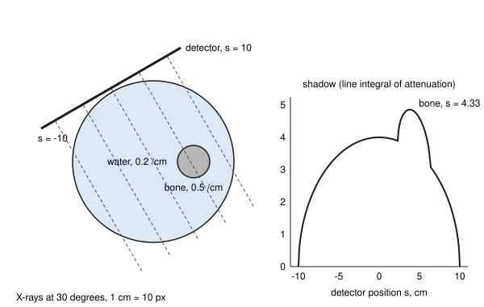
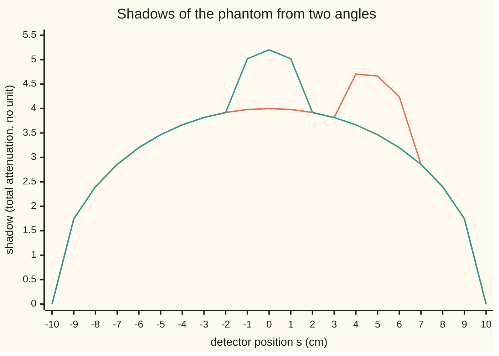

# Transforms in two and three dimensions: a slice of the spectrum is a shadow of the object

[Syllabus](../../../SYLLABUS.md) → [Harmonic analysis](../README.md) → [The Fourier Transform](../README.md#s02) → Transforms in two and three dimensions

---

## General Overview

A CT scanner (computed tomography: a picture of one slice of the body, built from X-rays) never photographs the slice. An X-ray tube on one side sends a row of thin parallel rays through the patient. A row of detectors on the other side measures how much of each ray gets through. Then tube and detectors turn by one degree and measure again, 180 times.

Each ray is dimmed by everything it crosses. The tissue's **attenuation** $`\mu`$ (the share of X-rays it removes per centimetre) adds up along the ray, and the share that gets through is $`e^{-\text{total}}`$. So the scanner reads off one number per ray: the total attenuation along that line. A row of those totals is a **shadow** of the slice, seen from one angle.

Take an illustrative test object, called a phantom: a water cylinder 20 cm across (attenuation 0.2 per cm) holding a bone rod 4 cm across (0.5 per cm in all), its centre 5 cm right of the middle. These are round numbers close to water and bone at typical CT energies. The ray through the middle crosses 20 cm of water: total 4.000000, so a share of 0.018316 gets through. The vertical ray through the rod's centre totals 4.664102 and lets through 0.009428. Every shadow is a smooth hump with a bump where the rod sits, and the bump moves as the scanner turns.

How can 180 humps give back the picture? This card's answer: take the one-dimensional Fourier transform of one shadow. It equals the picture's two-dimensional Fourier transform along one line through the centre, at the same angle. Each turn of the scanner fills in one more line, so the shadows together give the whole transform, and inversion gives the picture.

**The Fourier transform of a shadow is a slice, through the centre, of the Fourier transform of the object, so shadows from every angle determine the object.**

**What kind of fact this is:** three theorems on the two-dimensional transform (separability, rotation invariance, the projection-slice theorem), proved on this card in Why it works. The rebuilding formula rests on Fourier inversion, which [Fourier inversion](04-fourier-inversion-theorem.md) proves. The phantom is illustrative.

### The picture: one shadow at 30 degrees

<p align="center"></p>

Left: the phantom to scale, with five of the rays and the detector. Right: the shadow at 30 degrees. The rod's centre lands at detector position $`5\cos 30^\circ = 4.330`$ cm, where the shadow is 4.806. The top of the bump sits a little nearer the middle, because the water's hump slopes down under the rod.

### Two shadows of the same slice



Orange: vertical rays (angle 0 degrees). The rod's bump sits at 3 to 7 cm. Teal: horizontal rays (angle 90 degrees). Every horizontal ray near the middle crosses the rod too, so the bump sits at the centre and reaches 5.200. Same object, different shadows: the angle carries information.

---

## The formula

Reminders. A double integral totals a quantity patch by patch over a region ([Double integrals](../../06-Calculus%20and%20analysis/08-Multiple%20Integrals/01-double-integrals.md)). The one-dimensional transform is $`\hat f(\xi) = \int f(t)\, e^{-2\pi i \xi t}\, dt`$, with $`i`$ the imaginary unit, fixed on [The Fourier transform of an absolutely integrable signal, and why it fades at infinity](01-fourier-transform-on-l1-and-riemann-lebesgue.md). Here the signal is a picture $`f(x)`$, the attenuation at the point $`x = (x_1, x_2)`$, in cm.

This card introduces two pieces of notation. The **frequency vector** $`\xi = (\xi_1, \xi_2)`$, in cycles per cm, names a ripple across the plane. The **projection** $`P_\theta f`$ is the shadow at angle $`\theta`$.

```math
\hat f(\xi) = \iint f(x)\, e^{-2\pi i\, \xi\cdot x}\, dx, \qquad P_\theta f(s) = \int_{-\infty}^{\infty} f(s\,u_\theta + t\,u_\theta^{\perp})\, dt, \qquad \widehat{P_\theta f}(\sigma) = \hat f(\sigma\, u_\theta).
```

Here $`\xi\cdot x = \xi_1 x_1 + \xi_2 x_2`$, $`u_\theta = (\cos\theta, \sin\theta)`$ points along the detector, and $`u_\theta^{\perp} = (-\sin\theta, \cos\theta)`$ points along the rays.

**Read it aloud:** "Transform the shadow at angle theta, and at frequency sigma you get the picture's transform at the point sigma steps out from the centre in the direction theta."

| Symbol | Plain meaning | In our example | Push it up and the answer… |
| --- | --- | --- | --- |
| $`x = (x_1, x_2)`$, $`y`$ | a point in the slice, cm right and up from the centre; $`y`$ is a second point, used in a substitution | rod centre (5, 0) | a different point of the slice |
| $`f`$, $`\mu`$ | the picture: attenuation at each point, per cm; $`\mu`$ is one disc's added value | water 0.2, rod adds 0.3 | every shadow grows in proportion |
| $`\xi = (\xi_1, \xi_2)`$, $`\xi\cdot x`$ | frequency vector, cycles per cm; $`\xi\cdot x = \xi_1x_1 + \xi_2x_2`$ | (0.086603, 0.050000) | finer ripples |
| $`\hat f`$, $`i`$ | the picture's 2-D transform, in cm; $`i^2 = -1`$ | $`-7.052584 - 1.255614i`$ | this is the answer, set by the rest |
| $`\theta`$, $`u_\theta`$, $`u_\theta^{\perp}`$ | scanner angle; unit step along the detector; unit step along the rays | 30 degrees | the slice turns with the scanner |
| $`s`$, $`t`$ | position along the detector; distance along a ray, both cm | rod at $`s = 4.330127`$ | larger $`s`$: a ray further along the detector |
| $`P_\theta f`$ | the shadow: total attenuation along the ray at $`s`$, no unit | 4.806 at the rod's centre | its transform, the slice, grows in proportion |
| $`\sigma`$, $`\Sigma`$ | frequency along the detector, cycles per cm; the scanner's cut-off frequency | 0.1; 2, 4, 8 | higher $`\Sigma`$: sharper picture |
| $`\rho`$, $`r`$, $`F`$ | the distances $`\lvert \xi\rvert`$ and $`\lvert x\rvert`$ from the centre; $`F(r)`$ is a radial picture's profile | 0.1; 0 to 10 cm | larger $`\rho`$: finer ripples, and a disc's transform fades |
| $`R`$, $`c`$ | a disc's radius and centre, cm | water 10, (0, 0); rod 2, (5, 0) | larger $`R`$: a narrower transform; moving $`c`$ only turns its phase |
| $`J_0`$, $`J_1`$, $`J_n`$, $`z`$, $`\tau`$, $`\varphi`$ | Bessel functions of order 0, 1, $`n`$, at the argument $`z`$; $`\tau`$ and $`\varphi`$ are angles inside integrals | $`J_1(2\pi) = -0.212382530`$ | larger $`z`$: the values swing about 0 and shrink |
| $`g`$, $`h`$, $`A`$ | the two factors of a separable picture; a rotation of the plane | a 4 cm by 2 cm block | a wider factor: a narrower transform in that direction |

### When it holds

- **The picture is absolutely integrable,** $`\iint \lvert f\rvert\, dx < \infty`$. Then every shadow exists and the order of integration may be swapped. A picture with a constant background stretching forever has infinite shadows, and the theorem says nothing.
- **The whole line is recorded.** The slice needs the shadow out to where the object ends. A detector only 16 cm wide cuts off the edges of the 20 cm phantom and gives $`-11.576487 - 1.255614i`$ in place of $`-7.052584 - 1.255614i`$. Only the real part moves: the rod lies inside the 16 cm, and the water's edges are what is lost.
- **The slice runs along the detector, not along the rays.** Reading $`\hat f`$ along $`u_\theta^{\perp}`$ gives $`-4.247651 + 3.073144i`$: the transform of a shadow taken 90 degrees away.
- **Rotation invariance needs a true rotation** (or a reflection), which keeps lengths and angles. A stretch changes the transform's size too, as the scaling rule on [The transform rulebook](02-shift-scale-and-derivative-rules.md) says.
- **Rebuilding point by point needs more than the slice theorem.** A sharp edge makes $`\hat f`$ fade too slowly to be integrable, so a scanner with a cut-off sees the true value only in the limit: 0.464979, 0.475471, 0.482782 for the rod's 0.5 at cut-offs 2, 4 and 8 cycles per cm.

---

## Why it works

### Step 0: a tilted ripple is constant along the rays

A two-dimensional wave $`e^{2\pi i\, \xi\cdot x}`$ is a ripple across the plane, like a sheet of corrugated iron. Its crests are straight lines at right angles to $`\xi`$, spaced $`1/\lvert\xi\rvert`$ cm apart. Point $`\xi`$ along the detector direction $`u_\theta`$. Then the crests run exactly along the X-rays, and the wave has one value on each ray.

The transform at $`\xi`$ multiplies the picture by this wave and adds up. Adding along each ray first loses nothing the wave can see, because the wave is constant there. What is left after adding along a ray is the shadow's value at that ray. So the 2-D transform at $`\xi`$ is a 1-D transform of the shadow. The steps below make this exact, after two tools that this card also uses: separability and rotation.

### Step 1: a separable picture has a separable transform

Suppose the picture is a product, $`f(x_1, x_2) = g(x_1)\, h(x_2)`$, like a rectangle. The wave splits too: $`e^{-2\pi i(\xi_1x_1 + \xi_2x_2)} = e^{-2\pi i \xi_1x_1}\, e^{-2\pi i \xi_2x_2}`$. Integrating one variable at a time, as [Double integrals](../../06-Calculus%20and%20analysis/08-Multiple%20Integrals/01-double-integrals.md) allows, gives

```math
\hat f(\xi_1, \xi_2) = \hat g(\xi_1)\, \hat h(\xi_2).
```

Example: a block 4 cm wide and 2 cm tall, attenuation 1 per cm. Each factor is a gate, whose transform is the sinc pair: $`4\,\mathrm{sinc}(4\xi_1)`$ and $`2\,\mathrm{sinc}(2\xi_2)`$, with $`\mathrm{sinc}(u) = \sin(\pi u)/(\pi u)`$. At $`\xi = (0.1, 0.2)`$ this is $`3.027307 \times 1.513653 = 4.582294`$ cm. A two-dimensional Simpson's rule on the block gives 4.582294 too.

So every 1-D pair gives a 2-D pair for free. The bell $`e^{-\pi(x_1^2 + x_2^2)}`$ is a product of two 1-D bells, so its transform is the same bell in $`\xi`$, as [Two pairs worth memorising](03-gaussian-and-sinc-transform-pairs.md) shows in one dimension.

### Step 2: rotating the picture rotates its transform

Let $`A`$ be a rotation of the plane. Rotations keep lengths and angles, so $`A\xi\cdot Ax = \xi\cdot x`$, and they keep areas, so the Jacobian (the local area stretch) is 1. Change variables with $`y = Ax`$, as [Change of variables](../../06-Calculus%20and%20analysis/08-Multiple%20Integrals/03-change-of-variables-and-jacobians.md) allows:

```math
\iint f(Ax)\, e^{-2\pi i\, \xi\cdot x}\, dx = \iint f(y)\, e^{-2\pi i\, A\xi\cdot y}\, dy = \hat f(A\xi).
```

So the transform of the rotated picture is the old transform, rotated the same way. A picture that looks the same from every angle, like the water disc alone, is called **radial**. Its transform is radial too: it depends only on the distance $`\rho = \lvert\xi\rvert`$.

The check tests this on the water disc alone at $`\rho = 0.1`$. A sum over square pixels 0.05 cm wide gives $`-4.241509`$ at 0 degrees, $`-4.248697`$ at 30 degrees and $`-4.241509`$ at 90 degrees, all within 0.006141 of the exact $`-4.247651`$. The small differences come from the square pixel grid, which is not itself the same at every angle.

### Step 3: a radial picture has a Hankel transform

For a radial picture, $`f(x) = F(r)`$ with $`r = \lvert x\rvert`$, use polar coordinates. The angle integral of the wave is a standard function, the **Bessel function** $`J_0`$:

```math
\hat f(\rho) = 2\pi \int_0^\infty F(r)\, J_0(2\pi\rho r)\, r\, dr, \qquad J_n(z) = \frac{1}{\pi}\int_0^\pi \cos(n\tau - z\sin\tau)\, d\tau.
```

So the two-dimensional transform of a radially symmetric picture is a **Hankel transform of order 0**: a one-variable transform whose kernel is $`J_0`$, not a wave.

For a disc of radius $`R`$ and attenuation $`\mu`$, the integral has a closed form, worked in the fold below:

```math
\hat f(\rho) = \frac{\mu R\, J_1(2\pi R\rho)}{\rho}, \qquad \hat f(0) = \mu\pi R^2.
```

For the water disc at $`\rho = 0.1`$: $`0.2 \times 10 \times J_1(2\pi)/0.1 = 20 \times (-0.212382530) = -4.247651`$ cm. The Hankel integral, done by Simpson's rule, gives $`-4.247651`$ too.

A disc away from the centre is a shifted disc. The shift rule from [The transform rulebook](02-shift-scale-and-derivative-rules.md) works the same with vectors: moving the picture by $`c`$ multiplies its transform by the turn $`e^{-2\pi i\, \xi\cdot c}`$. That gives the whole phantom's transform:

```math
\hat f(\xi) = \frac{0.2 \times 10\, J_1(20\pi\rho)}{\rho} + \frac{0.3 \times 2\, J_1(4\pi\rho)}{\rho}\, e^{-2\pi i \times 5\xi_1}, \qquad \rho = \lvert\xi\rvert.
```

<details>
<summary>Detailed proof: the angle integral and the disc's transform</summary>

Write $`x`$ and $`\xi`$ in polar form, with angle $`\varphi`$ between them, so $`\xi\cdot x = \rho r\cos\varphi`$. The angle integral is

$`\displaystyle \int_0^{2\pi} e^{-2\pi i \rho r\cos\varphi}\, d\varphi = 2\pi J_0(2\pi\rho r).`$

The imaginary part cancels, because $`\cos(\varphi + \pi) = -\cos\varphi`$ and sine is odd. Shifting $`\varphi`$ by a quarter turn turns $`\cos\varphi`$ into $`-\sin\tau`$, and the remaining cosine integral over a full turn is twice the integral over half a turn. That is the definition of $`J_0`$ with $`n = 0`$. Multiplying by $`F(r)\, r\, dr`$ and integrating over $`r`$ gives the Hankel formula.

For the disc, $`F(r) = \mu`$ for $`r < R`$. Substitute $`z = 2\pi\rho r`$:

$`\displaystyle 2\pi\mu\int_0^R J_0(2\pi\rho r)\, r\, dr = \frac{2\pi\mu}{(2\pi\rho)^2}\int_0^{2\pi\rho R} z\, J_0(z)\, dz.`$

The power series of the Bessel functions show $`\big(z J_1(z)\big)' = z J_0(z)`$. So the last integral is $`2\pi\rho R\, J_1(2\pi\rho R)`$, and the whole is $`\mu R\, J_1(2\pi R\rho)/\rho`$.

</details>

### Step 4: the projection-slice theorem

Fix an angle $`\theta`$ and a frequency $`\sigma`$ along the detector. Describe each point by detector position and distance along its ray: $`x = s\,u_\theta + t\,u_\theta^{\perp}`$. This is a rotation of coordinates, so its Jacobian is 1, and $`u_\theta\cdot x = s`$. Then

```math
\hat f(\sigma u_\theta) = \iint f(x)\, e^{-2\pi i \sigma\, u_\theta\cdot x}\, dx = \int \Big( \int f(s\,u_\theta + t\,u_\theta^{\perp})\, dt \Big)\, e^{-2\pi i \sigma s}\, ds = \widehat{P_\theta f}(\sigma).
```

The middle step adds along each ray first. That is allowed because $`f`$ is absolutely integrable. The inner integral is the shadow. This proves the theorem.

The same proof works in three dimensions. Project a 3-D object along one direction onto a flat image, as an electron microscope does. The image's 2-D transform is the object's 3-D transform on the plane through the centre at right angles to that direction.

### Step 5: rebuilding the picture from the slices

Fourier inversion gives back the picture from its transform: $`f(x) = \iint \hat f(\xi)\, e^{2\pi i\, \xi\cdot x}\, d\xi`$. The slices give $`\hat f`$ in polar form, $`\xi = \sigma u_\theta`$, with $`\sigma`$ from $`-\infty`$ to $`\infty`$ and $`\theta`$ from 0 to 180 degrees. In those coordinates the area element is $`\lvert\sigma\rvert\, d\sigma\, d\theta`$. So

```math
f(x) = \int_0^\pi \int_{-\infty}^{\infty} \widehat{P_\theta f}(\sigma)\, \lvert\sigma\rvert\, e^{2\pi i \sigma\, u_\theta\cdot x}\, d\sigma\, d\theta.
```

Read it as two steps. The inner integral **filters** each shadow: it multiplies its transform by $`\lvert\sigma\rvert`$, a ramp that boosts fine detail. The outer integral **back-projects**: it smears each filtered shadow back along its rays and adds the 180 smears. This is **filtered back-projection**, the classic CT method. The ramp is a derivative followed by a Hilbert transform (a filter that turns every frequency by a quarter turn, from [The Hilbert transform](09-hilbert-transform-and-analytic-signals.md)), since $`\lvert\sigma\rvert = (2\pi i\sigma)(-i\,\mathrm{sgn}\,\sigma)/(2\pi)`$, where $`\mathrm{sgn}\,\sigma`$ is the sign of $`\sigma`$ (1, −1 or 0).

A real scanner stops at a cut-off frequency $`\Sigma`$. With 180 angles, the check rebuilds two points. It takes each angle's slice from the phantom's formula, which by the theorem is the transform of that angle's shadow, then filters and back-projects; it does not transform 180 sampled shadows.

| Point | True value | Cut-off 2 | Cut-off 4 | Cut-off 8 |
| --- | --- | --- | --- | --- |
| rod centre | 0.500000 | 0.464979 | 0.475471 | 0.482782 |
| water centre | 0.200000 | 0.191542 | 0.193686 | 0.195369 |

A second road gives the same six numbers. For the disc centred on the point, the Hankel integral of Step 3 has a closed form, $`\mu\big(1 - J_0(2\pi R\Sigma)\big)`$, because $`J_0' = -J_1`$. The other disc's Hankel integral is done by Simpson's rule on a coarser σ step than back-projection's, so the agreement also tests the σ steps. The gaps shrink slowly (0.035021, 0.024529, 0.017218 at the rod) because the phantom's edges are sharp, so its transform fades slowly.

---

## Worked numbers, by hand

The slice at 30 degrees and $`\sigma = 0.1`$ cycles per cm, from the phantom's formula.

| Step | Arithmetic | Value |
| --- | --- | --- |
| point on the slice | $`0.1\,(\cos 30^\circ, \sin 30^\circ)`$ | (0.086603, 0.050000) per cm |
| water: Bessel argument | $`2\pi \times 10 \times 0.1`$ | 6.283185 |
| water part | $`0.2 \times 10 \times J_1(6.283185)/0.1 = 20 \times (-0.212382530)`$ | −4.247651 cm |
| rod: Bessel argument | $`2\pi \times 2 \times 0.1`$ | 1.256637 |
| rod part, before its shift | $`0.3 \times 2 \times J_1(1.256637)/0.1 = 6 \times 0.512190709`$ | 3.073144 cm |
| rod centre along the detector | $`5 \cos 30^\circ`$ | 4.330127 cm |
| turn angle | $`2\pi \times 0.1 \times 4.330127`$ | 2.720699 rad |
| the turn | $`\cos(2.720699) - i\sin(2.720699)`$ | $`-0.912724 - 0.408576i`$ |
| rod part, turned | $`3.073144 \times (-0.912724 - 0.408576i)`$ | $`-2.804933 - 1.255614i`$ cm |
| **slice value** | $`-4.247651 + (-2.804933 - 1.255614i)`$ | $`\mathbf{-7.052584 - 1.255614i}`$ **cm** |
| from the shadow alone | 1-D transform of the 30-degree shadow, Simpson, 8,000 steps | $`-7.052624 - 1.255602i`$ cm |

What it means: the scanner learns how strongly the slice holds a ripple with crests 10 cm apart, tilted at 30 degrees, from one shadow and one 1-D transform. It never needs the picture. The imaginary part comes from the rod alone, because the water disc is centred and symmetric.

### What breaks if you drop a piece

| Mistake | Comes out at | What went wrong |
| --- | --- | --- |
| Slice along the rays, $`\hat f(\sigma u_\theta^{\perp})`$ | $`-4.247651 + 3.073144i`$ | That is the shadow from 90 degrees further round. |
| Detector 16 cm wide, shadow cut at $`\lvert s\rvert = 8`$ | $`-11.576487 - 1.255614i`$ | The theorem needs the whole line integral; the phantom's edges are missing. |
| Radial profile given a 1-D transform, $`2\mu R\,\mathrm{sinc}(2R\rho)`$ | 0.000000, not −4.247651 | A radial picture needs the Hankel transform, with $`J_0`$ and the factor $`r`$. |
| Back-projection without the ramp $`\lvert\sigma\rvert`$, rod centre, cut-off 4 | 15.503601, not 0.500000 | The polar area element was dropped; the picture comes out blurred and in the wrong units. |

---

## Code, from first principles, and it actually runs

The scripts work in centimetres and cycles per centimetre. They take **three roads** to the slice value: the closed form through Bessel functions and the shift rule; the 1-D transform of the shadow by Simpson's rule at 2,000 and 8,000 steps; and a sum over square pixels 0.1 cm and 0.05 cm wide, as a scanner's image would hold. The Bessel functions come from their defining integral and are checked against their power series. Separability meets a 2-D Simpson's rule, and the Hankel formula meets the $`J_1`$ closed form. Filtered back-projection over 180 angles, fed slices from the formula, meets a second road: the closed form for the disc centred on the point plus the other disc's Hankel integral, on a different σ step. The 16 cm detector's value is the formula minus the water's lost edges, integrated exactly in the angle variable, and Simpson's rule on the cut shadow agrees to within its step error. Every number on this card is printed below.

### Python

```python
# Transforms in two dimensions and the projection-slice theorem -- the check
# behind the card.  Standard library only.  Units: lengths in cm, frequencies in
# cycles per cm, attenuation mu in 1/cm, so shadows are pure numbers and 2-D
# transforms come out in cm.  Illustrative phantom: a water disc of radius 10 cm
# (mu 0.2) holding a bone rod of radius 2 cm centred 5 cm right (mu 0.5 in all).
import math

DISCS = [(0.0, 0.0, 10.0, 0.2), (5.0, 0.0, 2.0, 0.3)]  # centre x, y; radius; mu added
WATER = DISCS[:1]
TH, SIG = math.radians(30), 0.1  # the worked shadow: angle 30 degrees, 0.1 cycles/cm
def arrow(x): return complex(math.cos(x), math.sin(x))  # e^(ix), written out
def mu(x, y, discs=DISCS): return sum(m for a, b, r, m in discs if (x - a) ** 2 + (y - b) ** 2 < r * r)
def bessel(n, x, M=400):  # J_n(x) = (1/pi) int_0^pi cos(n t - x sin t) dt, trapezoid
    tot = 0.5 * (1 + math.cos(n * math.pi))
    tot += sum(math.cos(n * k * math.pi / M - x * math.sin(k * math.pi / M)) for k in range(1, M))
    return tot / M
def series(n, x, K=40):  # J_n(x) as its power series, a second road
    return sum((-1) ** k * (x / 2) ** (2 * k + n) / (math.factorial(k) * math.factorial(k + n)) for k in range(K))
def disc_hat(r, m, rho):  # radial transform of a disc: mu R J1(2 pi R rho) / rho
    return m * math.pi * r * r if rho == 0 else m * r * bessel(1, 2 * math.pi * r * rho) / rho
def fhat(x1, x2, discs=DISCS):  # each disc's radial transform, shifted to its centre
    rho = math.hypot(x1, x2)
    return sum(disc_hat(r, m, rho) * arrow(-2 * math.pi * (x1 * a + x2 * b)) for a, b, r, m in discs)
def shadow(th, s):  # line integral of mu along x cos th + y sin th = s: chord lengths
    tot = 0.0
    for a, b, r, m in DISCS:
        d = s - (a * math.cos(th) + b * math.sin(th))
        tot += 2 * m * math.sqrt(r * r - d * d) if abs(d) < r else 0.0
    return tot
def simpson(f, a, b, n):  # n even
    w = (b - a) / n
    return (f(a) + f(b) + sum((4 if k % 2 else 2) * f(a + k * w) for k in range(1, n))) * w / 3
def ft1(th, sig, n, lo=-10.0, hi=10.0):  # 1-D transform of the shadow, Simpson
    return simpson(lambda s: shadow(th, s) * arrow(-2 * math.pi * sig * s), lo, hi, n)
def pixels(x1, x2, h, discs=DISCS):  # 2-D transform of the image: sum over square pixels
    N, tot = round(20 / h), 0j
    for i in range(N):
        for j in range(N):
            x, y = -10 + (i + 0.5) * h, -10 + (j + 0.5) * h
            m = mu(x, y, discs)
            if m: tot += m * arrow(-2 * math.pi * (x1 * x + x2 * y))
    return tot * h * h
def recon(px, py, Sig, ramp=True, nth=180, ns=1200):  # filtered back-projection at (px, py), slices from the formula
    w = Sig / ns
    sig = [k * w for k in range(ns + 1)]
    wt = [(1 if k in (0, ns) else 4 if k % 2 else 2) * w / 3 * (sig[k] if ramp else 1) for k in range(ns + 1)]
    tab = [[disc_hat(r, m, s) for s in sig] for a, b, r, m in DISCS]  # radial parts, once
    tot = 0.0
    for j in range(nth):  # angles 0, 1, ..., 179 degrees
        ct, st = math.cos(j * math.pi / nth), math.sin(j * math.pi / nth)
        for d, (a, b, r, m) in enumerate(DISCS):  # slice j (= shadow j's transform) times the wave back
            off = (px - a) * ct + (py - b) * st
            tot += sum(wt[k] * tab[d][k] * math.cos(2 * math.pi * sig[k] * off) for k in range(ns + 1))
    return 2 * tot * math.pi / nth  # 2 for negative sigma; d theta = pi / nth
def hankel_recon(px, py, Sig, ns):  # the same picture, disc by disc: mu (1 - J0(2 pi R Sig)) if centred on the point
    return sum(m * (1 - bessel(0, 2 * math.pi * r * Sig)) if (px, py) == (a, b) else 2 * math.pi * simpson(
        lambda q: disc_hat(r, m, q) * bessel(0, 2 * math.pi * q * math.hypot(px - a, py - b)) * q, 0, Sig, ns) for a, b, r, m in DISCS)
def snap(x): return 0.0 if abs(x) < 5e-7 else x
def c(z): return f"{snap(z.real):.6f} {'-' if snap(z.imag) < 0 else '+'} {abs(z.imag):.6f}i"

print("Bessel functions: trapezoid integral | power series")
for x in (2 * math.pi * 0.2, 2 * math.pi):
    print(f"x = {x:.6f}: J0 {bessel(0, x):.9f} | {series(0, x):.9f}, J1 {bessel(1, x):.9f} | {series(1, x):.9f}")
    assert abs(bessel(0, x) - series(0, x)) < 1e-12 and abs(bessel(1, x) - series(1, x)) < 1e-12
for th, s in ((0, 0.0), (0, 5.0), (90, 0.0)):
    p = shadow(math.radians(th), s)
    print(f"shadow at {th} deg, s = {s:.0f} cm: {p:.6f}, share of X-rays through {math.exp(-p):.6f}")
# separability: a 4 cm by 2 cm block, mu 1: transform = 4 sinc(4 xi1) x 2 sinc(2 xi2)
sinc = lambda u: 1.0 if u == 0 else math.sin(math.pi * u) / (math.pi * u)
sep = 4 * sinc(4 * 0.1) * 2 * sinc(2 * 0.2)
blk = simpson(lambda x: simpson(lambda y: arrow(-2 * math.pi * (0.1 * x + 0.2 * y)), -1, 1, 80), -2, 2, 80)
print(f"block at (0.1, 0.2): {4 * sinc(0.4):.6f} x {2 * sinc(0.4):.6f} = {sep:.6f}, 2-D Simpson {c(blk)}")
assert abs(blk - sep) < 1e-6
# rotation invariance and the Hankel transform: the water disc alone
hank = 2 * math.pi * simpson(lambda r: 0.2 * bessel(0, 2 * math.pi * 0.1 * r) * r, 0, 10, 200)
print(f"water disc, |xi| = 0.1: mu R J1(2 pi R rho)/rho {disc_hat(10, 0.2, 0.1):.6f}, Hankel integral {hank:.6f}")
assert abs(hank - disc_hat(10, 0.2, 0.1)) < 1e-7
for deg in (0, 30, 90):
    p = pixels(0.1 * math.cos(math.radians(deg)), 0.1 * math.sin(math.radians(deg)), 0.05, WATER)
    print(f"  pixel sum, 0.05 cm pixels, direction {deg} deg: {c(p)}, gap {abs(p - hank):.6f}")
    assert abs(p - hank) < 0.01
# the projection-slice theorem at 30 degrees and 0.1 cycles/cm: three roads
U = (SIG * math.cos(TH), SIG * math.sin(TH))
two = fhat(*U)
print(f"water part {disc_hat(10, 0.2, SIG):.6f}, bone part {disc_hat(2, 0.3, SIG):.6f}, "
      f"bone centre along u {5 * math.cos(TH):.6f} cm, angle {2 * math.pi * SIG * 5 * math.cos(TH):.6f} rad, "
      f"turn {c(arrow(-2 * math.pi * SIG * 5 * math.cos(TH)))}, bone turned {c(disc_hat(2, 0.3, SIG) * arrow(-2 * math.pi * SIG * 5 * math.cos(TH)))}")
print(f"slice: 2-D transform at ({U[0]:.6f}, {U[1]:.6f}) by formula {c(two)}")
for n in (2000, 8000):
    one = ft1(TH, SIG, n)
    print(f"  1-D transform of the 30 deg shadow, Simpson n = {n}: {c(one)}, gap {abs(one - two):.6f}")
    assert abs(one - two) < 1e-3
for h in (0.1, 0.05):
    p = pixels(*U, h)
    print(f"  2-D pixel sum, {h} cm pixels: {c(p)}, gap {abs(p - two):.6f}")
assert abs(p - two) < 0.01
# rebuilding the picture: filtered back-projection against the Hankel road
for p, name in (((5.0, 0.0), "bone centre"), ((0.0, 0.0), "water centre")):
    for S in (2.0, 4.0, 8.0):
        a, b = recon(*p, S, ns=1000 * round(S)), hankel_recon(*p, S, ns=600 * round(S))  # sigma steps 1/1000 and 1/600
        print(f"{name}, cut-off {S:.0f} cycles/cm: back-projection {a:.6f}, closed form + Hankel {b:.6f}, true {mu(*p):.6f}, gap {mu(*p) - a:.6f}")
        assert abs(a - b) < 2e-7 and abs(a - mu(*p)) < 0.05
# what breaks, at 30 degrees and 0.1 cycles/cm unless stated
print("what breaks: right answer", c(two))
print("slice along the rays, not the detector |", c(fhat(-U[1], U[0])))
lost = simpson(lambda p: 80 * math.cos(p) * math.cos(p) * math.cos(20 * math.pi * SIG * math.sin(p)), math.asin(0.8), math.pi / 2, 400)
cut = ft1(TH, SIG, 8000, -8.0, 8.0)  # above: the water's chord beyond |s| = 8, exactly, with s = 10 sin p
print("detector 16 cm wide, shadow cut at |s| = 8 |", c(two - lost), "| Simpson on the cut shadow", c(cut))
assert abs(cut - (two - lost)) < 1e-4
print(f"water disc's profile given a 1-D transform | {snap(2 * 0.2 * 10 * sinc(2 * 10 * 0.1)):.6f} against {disc_hat(10, 0.2, 0.1):.6f}")
print(f"back-projection without the ramp, bone centre, cut-off 4 | {recon(5.0, 0.0, 4.0, False):.6f} against 0.500000")
print("chart, s cm      ", " ".join(f"{s:6d}" for s in range(-10, 11)))
for th in (0, 90):
    print(f"chart, shadow {th:2d} ", " ".join(f"{shadow(math.radians(th), s):6.3f}" for s in range(-10, 11)))
print(f"figure, 10 px per cm, water centre (190, 200) r 100, bone centre (240, 200) r 20, "
      f"30 deg rod centre at s = {5 * math.cos(TH):.3f} cm, height {shadow(TH, 5 * math.cos(TH)):.3f}")
print("ALL CHECKS PASS")
```

**Ran 2026-11-15 on macOS, Python 3.14.10, standard library only. All checks passed. Output, pasted from the run:**

```
Bessel functions: trapezoid integral | power series
x = 1.256637: J0 0.642511837 | 0.642511837, J1 0.512190709 | 0.512190709
x = 6.283185: J0 0.220276909 | 0.220276909, J1 -0.212382530 | -0.212382530
shadow at 0 deg, s = 0 cm: 4.000000, share of X-rays through 0.018316
shadow at 0 deg, s = 5 cm: 4.664102, share of X-rays through 0.009428
shadow at 90 deg, s = 0 cm: 5.200000, share of X-rays through 0.005517
block at (0.1, 0.2): 3.027307 x 1.513653 = 4.582294, 2-D Simpson 4.582294 + 0.000000i
water disc, |xi| = 0.1: mu R J1(2 pi R rho)/rho -4.247651, Hankel integral -4.247651
  pixel sum, 0.05 cm pixels, direction 0 deg: -4.241509 + 0.000000i, gap 0.006141
  pixel sum, 0.05 cm pixels, direction 30 deg: -4.248697 + 0.000000i, gap 0.001047
  pixel sum, 0.05 cm pixels, direction 90 deg: -4.241509 + 0.000000i, gap 0.006141
water part -4.247651, bone part 3.073144, bone centre along u 4.330127 cm, angle 2.720699 rad, turn -0.912724 - 0.408576i, bone turned -2.804933 - 1.255614i
slice: 2-D transform at (0.086603, 0.050000) by formula -7.052584 - 1.255614i
  1-D transform of the 30 deg shadow, Simpson n = 2000: -7.052758 - 1.255400i, gap 0.000276
  1-D transform of the 30 deg shadow, Simpson n = 8000: -7.052624 - 1.255602i, gap 0.000042
  2-D pixel sum, 0.1 cm pixels: -7.060194 - 1.261444i, gap 0.009587
  2-D pixel sum, 0.05 cm pixels: -7.052509 - 1.255112i, gap 0.000507
bone centre, cut-off 2 cycles/cm: back-projection 0.464979, closed form + Hankel 0.464979, true 0.500000, gap 0.035021
bone centre, cut-off 4 cycles/cm: back-projection 0.475471, closed form + Hankel 0.475471, true 0.500000, gap 0.024529
bone centre, cut-off 8 cycles/cm: back-projection 0.482782, closed form + Hankel 0.482782, true 0.500000, gap 0.017218
water centre, cut-off 2 cycles/cm: back-projection 0.191542, closed form + Hankel 0.191542, true 0.200000, gap 0.008458
water centre, cut-off 4 cycles/cm: back-projection 0.193686, closed form + Hankel 0.193686, true 0.200000, gap 0.006314
water centre, cut-off 8 cycles/cm: back-projection 0.195369, closed form + Hankel 0.195369, true 0.200000, gap 0.004631
what breaks: right answer -7.052584 - 1.255614i
slice along the rays, not the detector | -4.247651 + 3.073144i
detector 16 cm wide, shadow cut at |s| = 8 | -11.576487 - 1.255614i | Simpson on the cut shadow -11.576486 - 1.255588i
water disc's profile given a 1-D transform | 0.000000 against -4.247651
back-projection without the ramp, bone centre, cut-off 4 | 15.503601 against 0.500000
chart, s cm          -10     -9     -8     -7     -6     -5     -4     -3     -2     -1      0      1      2      3      4      5      6      7      8      9     10
chart, shadow  0   0.000  1.744  2.400  2.857  3.200  3.464  3.666  3.816  3.919  3.980  4.000  3.980  3.919  3.816  4.705  4.664  4.239  2.857  2.400  1.744  0.000
chart, shadow 90   0.000  1.744  2.400  2.857  3.200  3.464  3.666  3.816  3.919  5.019  5.200  5.019  3.919  3.816  3.666  3.464  3.200  2.857  2.400  1.744  0.000
figure, 10 px per cm, water centre (190, 200) r 100, bone centre (240, 200) r 20, 30 deg rod centre at s = 4.330 cm, height 4.806
ALL CHECKS PASS
```

### Rust

The same checks, with a small complex-number struct in place of Python's built-in complex type.

```rust
// Transforms in two dimensions and the projection-slice theorem -- the same
// check as the Python file, in Rust.  Standard library only, no crates.  Units:
// cm, cycles per cm, mu in 1/cm; shadows are pure numbers, 2-D transforms in cm.
// Illustrative phantom: water disc, radius 10 cm, mu 0.2; bone rod, radius 2 cm,
// centred 5 cm right, mu 0.5 in all.  A complex number is a small struct.
use std::f64::consts::PI;
use std::ops::{Add, Sub};

#[derive(Clone, Copy)]
struct C { re: f64, im: f64 }
impl Add for C { type Output = C; fn add(self, o: C) -> C { C { re: self.re + o.re, im: self.im + o.im } } }
impl Sub for C { type Output = C; fn sub(self, o: C) -> C { C { re: self.re - o.re, im: self.im - o.im } } }
impl C {
    fn sc(self, k: f64) -> C { C { re: self.re * k, im: self.im * k } }
    fn dv(self, k: f64) -> C { C { re: self.re / k, im: self.im / k } }
    fn abs(self) -> f64 { (self.re * self.re + self.im * self.im).sqrt() }
}
fn re(x: f64) -> C { C { re: x, im: 0.0 } }
const Z: C = C { re: 0.0, im: 0.0 };
type Disc = (f64, f64, f64, f64); // centre x, y; radius; mu added
const DISCS: [Disc; 2] = [(0.0, 0.0, 10.0, 0.2), (5.0, 0.0, 2.0, 0.3)];
const WATER: [Disc; 1] = [(0.0, 0.0, 10.0, 0.2)];
const SIG: f64 = 0.1; // the worked shadow: 0.1 cycles/cm at 30 degrees

fn arrow(x: f64) -> C { C { re: x.cos(), im: x.sin() } } // e^(ix), written out
fn mu(x: f64, y: f64, discs: &[Disc]) -> f64 {
    discs.iter().filter(|&&(a, b, r, _)| (x - a).powi(2) + (y - b).powi(2) < r * r).fold(0.0, |s, d| s + d.3)
}
fn bessel(n: i32, x: f64) -> f64 { // J_n(x) = (1/pi) int_0^pi cos(n t - x sin t) dt, trapezoid
    let (m, mut s) = (400, 0.0);
    for k in 1..m { let t = k as f64 * PI / m as f64; s += (n as f64 * t - x * t.sin()).cos(); }
    (0.5 * (1.0 + (n as f64 * PI).cos()) + s) / m as f64
}
fn series(n: i32, x: f64) -> f64 { // J_n(x) as its power series, a second road
    let (mut s, mut fk, mut fkn) = (0.0, 1.0, (1..=n).map(|v| v as f64).product::<f64>());
    for k in 0..40 {
        if k > 0 { fk *= k as f64; fkn *= (k + n) as f64; }
        s += (if k % 2 == 1 { -1.0 } else { 1.0 }) * (x / 2.0).powf((2 * k + n) as f64) / (fk * fkn);
    }
    s
}
fn disc_hat(r: f64, m: f64, rho: f64) -> f64 { // mu R J1(2 pi R rho) / rho
    if rho == 0.0 { m * PI * r * r } else { m * r * bessel(1, 2.0 * PI * r * rho) / rho }
}
fn fhat(x1: f64, x2: f64, discs: &[Disc]) -> C { // radial transforms, shifted to centres
    let rho = x1.hypot(x2);
    discs.iter().fold(Z, |s, &(a, b, r, m)| s + arrow(-2.0 * PI * (x1 * a + x2 * b)).sc(disc_hat(r, m, rho)))
}
fn shadow(th: f64, s: f64) -> f64 { // line integral of mu along x cos th + y sin th = s
    DISCS.iter().fold(0.0, |t, &(a, b, r, m)| { let d = s - (a * th.cos() + b * th.sin());
        t + if d.abs() < r { 2.0 * m * (r * r - d * d).sqrt() } else { 0.0 } })
}
fn simpson(f: &dyn Fn(f64) -> C, a: f64, b: f64, n: usize) -> C {
    let w = (b - a) / n as f64;
    let mut s = Z;
    for k in 1..n { s = s + f(a + k as f64 * w).sc(if k % 2 == 1 { 4.0 } else { 2.0 }); }
    (f(a) + f(b) + s).sc(w).dv(3.0)
}
fn ft1(th: f64, sig: f64, n: usize, lo: f64, hi: f64) -> C { // 1-D transform of the shadow
    simpson(&|s| arrow(-2.0 * PI * sig * s).sc(shadow(th, s)), lo, hi, n)
}
fn pixels(x1: f64, x2: f64, h: f64, discs: &[Disc]) -> C { // sum over square pixels
    let n = (20.0 / h).round() as usize;
    let mut tot = Z;
    for i in 0..n {
        for j in 0..n {
            let (x, y) = (-10.0 + (i as f64 + 0.5) * h, -10.0 + (j as f64 + 0.5) * h);
            let m = mu(x, y, discs);
            if m != 0.0 { tot = tot + arrow(-2.0 * PI * (x1 * x + x2 * y)).sc(m); }
        }
    }
    tot.sc(h).sc(h)
}
fn recon(px: f64, py: f64, sg: f64, ramp: bool, ns: usize) -> f64 { // filtered back-projection, slices from the formula
    let (nth, w) = (180, sg / ns as f64);
    let sig: Vec<f64> = (0..=ns).map(|k| k as f64 * w).collect();
    let wt: Vec<f64> = (0..=ns).map(|k| (if k == 0 || k == ns { 1.0 } else if k % 2 == 1 { 4.0 } else { 2.0 })
        * w / 3.0 * if ramp { sig[k] } else { 1.0 }).collect();
    let tab: Vec<Vec<f64>> = DISCS.iter().map(|&(_, _, r, m)| sig.iter().map(|&s| disc_hat(r, m, s)).collect()).collect();
    let mut tot = 0.0;
    for j in 0..nth {
        let (ct, st) = ((j as f64 * PI / nth as f64).cos(), (j as f64 * PI / nth as f64).sin());
        for (d, &(a, b, _, _)) in DISCS.iter().enumerate() {
            let off = (px - a) * ct + (py - b) * st;
            let mut s = 0.0;
            for k in 0..=ns { s += wt[k] * tab[d][k] * (2.0 * PI * sig[k] * off).cos(); }
            tot += s;
        }
    }
    2.0 * tot * PI / nth as f64
}
fn hankel_recon(px: f64, py: f64, sg: f64, ns: usize) -> f64 { // disc by disc: mu (1 - J0(2 pi R sg)) if centred on the point
    DISCS.iter().fold(0.0, |s, &(a, b, r, m)| s + if (px, py) == (a, b) { m * (1.0 - bessel(0, 2.0 * PI * r * sg)) } else { 2.0 * PI
        * simpson(&|q| re(disc_hat(r, m, q) * bessel(0, 2.0 * PI * q * (px - a).hypot(py - b)) * q), 0.0, sg, ns).re })
}
fn snap(x: f64) -> f64 { if x.abs() < 5e-7 { 0.0 } else { x } }
fn c(z: C) -> String { format!("{:.6} {} {:.6}i", snap(z.re), if snap(z.im) < 0.0 { "-" } else { "+" }, z.im.abs()) }
fn sinc(u: f64) -> f64 { if u == 0.0 { 1.0 } else { (PI * u).sin() / (PI * u) } }

fn main() {
    let th = 30f64.to_radians();
    println!("Bessel functions: trapezoid integral | power series");
    for x in [2.0 * PI * 0.2, 2.0 * PI] {
        println!("x = {:.6}: J0 {:.9} | {:.9}, J1 {:.9} | {:.9}", x, bessel(0, x), series(0, x), bessel(1, x), series(1, x));
        assert!((bessel(0, x) - series(0, x)).abs() < 1e-12 && (bessel(1, x) - series(1, x)).abs() < 1e-12);
    }
    for (deg, s) in [(0, 0.0), (0, 5.0), (90, 0.0)] {
        let p = shadow((deg as f64).to_radians(), s);
        println!("shadow at {} deg, s = {:.0} cm: {:.6}, share of X-rays through {:.6}", deg, s, p, (-p).exp());
    }
    // separability: a 4 cm by 2 cm block, mu 1: transform = 4 sinc(4 xi1) x 2 sinc(2 xi2)
    let sep = 4.0 * sinc(4.0 * 0.1) * 2.0 * sinc(2.0 * 0.2);
    let blk = simpson(&|x| simpson(&|y| arrow(-2.0 * PI * (0.1 * x + 0.2 * y)), -1.0, 1.0, 80), -2.0, 2.0, 80);
    println!("block at (0.1, 0.2): {:.6} x {:.6} = {:.6}, 2-D Simpson {}", 4.0 * sinc(0.4), 2.0 * sinc(0.4), sep, c(blk));
    assert!((blk - re(sep)).abs() < 1e-6);
    // rotation invariance and the Hankel transform: the water disc alone
    let hank = 2.0 * PI * simpson(&|r| re(0.2 * bessel(0, 2.0 * PI * 0.1 * r) * r), 0.0, 10.0, 200).re;
    println!("water disc, |xi| = 0.1: mu R J1(2 pi R rho)/rho {:.6}, Hankel integral {:.6}", disc_hat(10.0, 0.2, 0.1), hank);
    assert!((hank - disc_hat(10.0, 0.2, 0.1)).abs() < 1e-7);
    for deg in [0.0f64, 30.0, 90.0] {
        let p = pixels(0.1 * deg.to_radians().cos(), 0.1 * deg.to_radians().sin(), 0.05, &WATER);
        let gap = (p - re(hank)).abs();
        println!("  pixel sum, 0.05 cm pixels, direction {:.0} deg: {}, gap {:.6}", deg, c(p), gap);
        assert!(gap < 0.01);
    }
    // the projection-slice theorem at 30 degrees and 0.1 cycles/cm: three roads
    let u = (SIG * th.cos(), SIG * th.sin());
    let two = fhat(u.0, u.1, &DISCS);
    let turn = arrow(-2.0 * PI * SIG * 5.0 * th.cos());
    println!("water part {:.6}, bone part {:.6}, bone centre along u {:.6} cm, angle {:.6} rad, turn {}, bone turned {}", disc_hat(10.0, 0.2, SIG),
        disc_hat(2.0, 0.3, SIG), 5.0 * th.cos(), 2.0 * PI * SIG * 5.0 * th.cos(), c(turn), c(turn.sc(disc_hat(2.0, 0.3, SIG))));
    println!("slice: 2-D transform at ({:.6}, {:.6}) by formula {}", u.0, u.1, c(two));
    for n in [2000usize, 8000] {
        let one = ft1(th, SIG, n, -10.0, 10.0);
        println!("  1-D transform of the 30 deg shadow, Simpson n = {}: {}, gap {:.6}", n, c(one), (one - two).abs());
        assert!((one - two).abs() < 1e-3);
    }
    let mut p = Z;
    for h in [0.1, 0.05] {
        p = pixels(u.0, u.1, h, &DISCS);
        println!("  2-D pixel sum, {} cm pixels: {}, gap {:.6}", h, c(p), (p - two).abs());
    }
    assert!((p - two).abs() < 0.01);
    // rebuilding the picture: filtered back-projection against the Hankel road
    for (pt, name) in [((5.0, 0.0), "bone centre"), ((0.0, 0.0), "water centre")] {
        for sg in [2.0f64, 4.0, 8.0] {
            let ns = sg.round() as usize; // sigma steps 1/1000 and 1/600
            let (a, b, t) = (recon(pt.0, pt.1, sg, true, 1000 * ns), hankel_recon(pt.0, pt.1, sg, 600 * ns), mu(pt.0, pt.1, &DISCS));
            println!("{}, cut-off {:.0} cycles/cm: back-projection {:.6}, closed form + Hankel {:.6}, true {:.6}, gap {:.6}", name, sg, a, b, t, t - a);
            assert!((a - b).abs() < 2e-7 && (a - t).abs() < 0.05);
        }
    }
    // what breaks, at 30 degrees and 0.1 cycles/cm unless stated
    println!("what breaks: right answer {}", c(two));
    println!("slice along the rays, not the detector | {}", c(fhat(-u.1, u.0, &DISCS)));
    let (lost, cut) = (simpson(&|p| re(80.0 * p.cos() * p.cos() * (20.0 * PI * SIG * p.sin()).cos()), 0.8f64.asin(), PI / 2.0, 400).re, ft1(th, SIG, 8000, -8.0, 8.0));
    println!("detector 16 cm wide, shadow cut at |s| = 8 | {} | Simpson on the cut shadow {}", c(two - re(lost)), c(cut)); // water beyond |s| = 8, exactly
    assert!((cut - (two - re(lost))).abs() < 1e-4);
    println!("water disc's profile given a 1-D transform | {:.6} against {:.6}", snap(2.0 * 0.2 * 10.0 * sinc(2.0 * 10.0 * 0.1)), disc_hat(10.0, 0.2, 0.1));
    println!("back-projection without the ramp, bone centre, cut-off 4 | {:.6} against 0.500000", recon(5.0, 0.0, 4.0, false, 1200));
    let row = |f: &dyn Fn(i32) -> String| (-10..=10).map(|s| f(s)).collect::<Vec<_>>().join(" ");
    println!("chart, s cm       {}", row(&|s| format!("{:6}", s)));
    for deg in [0, 90] {
        println!("chart, shadow {:2}  {}", deg, row(&|s| format!("{:6.3}", shadow((deg as f64).to_radians(), s as f64))));
    }
    println!("figure, 10 px per cm, water centre (190, 200) r 100, bone centre (240, 200) r 20, 30 deg rod centre at s = {:.3} cm, height {:.3}",
        5.0 * th.cos(), shadow(th, 5.0 * th.cos()));
    println!("ALL CHECKS PASS");
}
```

**Ran 2026-11-15 on macOS, rustc 1.98.1, no crates. All checks passed. Output, pasted from the run:**

```
Bessel functions: trapezoid integral | power series
x = 1.256637: J0 0.642511837 | 0.642511837, J1 0.512190709 | 0.512190709
x = 6.283185: J0 0.220276909 | 0.220276909, J1 -0.212382530 | -0.212382530
shadow at 0 deg, s = 0 cm: 4.000000, share of X-rays through 0.018316
shadow at 0 deg, s = 5 cm: 4.664102, share of X-rays through 0.009428
shadow at 90 deg, s = 0 cm: 5.200000, share of X-rays through 0.005517
block at (0.1, 0.2): 3.027307 x 1.513653 = 4.582294, 2-D Simpson 4.582294 + 0.000000i
water disc, |xi| = 0.1: mu R J1(2 pi R rho)/rho -4.247651, Hankel integral -4.247651
  pixel sum, 0.05 cm pixels, direction 0 deg: -4.241509 + 0.000000i, gap 0.006141
  pixel sum, 0.05 cm pixels, direction 30 deg: -4.248697 + 0.000000i, gap 0.001047
  pixel sum, 0.05 cm pixels, direction 90 deg: -4.241509 + 0.000000i, gap 0.006141
water part -4.247651, bone part 3.073144, bone centre along u 4.330127 cm, angle 2.720699 rad, turn -0.912724 - 0.408576i, bone turned -2.804933 - 1.255614i
slice: 2-D transform at (0.086603, 0.050000) by formula -7.052584 - 1.255614i
  1-D transform of the 30 deg shadow, Simpson n = 2000: -7.052758 - 1.255400i, gap 0.000276
  1-D transform of the 30 deg shadow, Simpson n = 8000: -7.052624 - 1.255602i, gap 0.000042
  2-D pixel sum, 0.1 cm pixels: -7.060194 - 1.261444i, gap 0.009587
  2-D pixel sum, 0.05 cm pixels: -7.052509 - 1.255112i, gap 0.000507
bone centre, cut-off 2 cycles/cm: back-projection 0.464979, closed form + Hankel 0.464979, true 0.500000, gap 0.035021
bone centre, cut-off 4 cycles/cm: back-projection 0.475471, closed form + Hankel 0.475471, true 0.500000, gap 0.024529
bone centre, cut-off 8 cycles/cm: back-projection 0.482782, closed form + Hankel 0.482782, true 0.500000, gap 0.017218
water centre, cut-off 2 cycles/cm: back-projection 0.191542, closed form + Hankel 0.191542, true 0.200000, gap 0.008458
water centre, cut-off 4 cycles/cm: back-projection 0.193686, closed form + Hankel 0.193686, true 0.200000, gap 0.006314
water centre, cut-off 8 cycles/cm: back-projection 0.195369, closed form + Hankel 0.195369, true 0.200000, gap 0.004631
what breaks: right answer -7.052584 - 1.255614i
slice along the rays, not the detector | -4.247651 + 3.073144i
detector 16 cm wide, shadow cut at |s| = 8 | -11.576487 - 1.255614i | Simpson on the cut shadow -11.576486 - 1.255588i
water disc's profile given a 1-D transform | 0.000000 against -4.247651
back-projection without the ramp, bone centre, cut-off 4 | 15.503601 against 0.500000
chart, s cm          -10     -9     -8     -7     -6     -5     -4     -3     -2     -1      0      1      2      3      4      5      6      7      8      9     10
chart, shadow  0   0.000  1.744  2.400  2.857  3.200  3.464  3.666  3.816  3.919  3.980  4.000  3.980  3.919  3.816  4.705  4.664  4.239  2.857  2.400  1.744  0.000
chart, shadow 90   0.000  1.744  2.400  2.857  3.200  3.464  3.666  3.816  3.919  5.019  5.200  5.019  3.919  3.816  3.666  3.464  3.200  2.857  2.400  1.744  0.000
figure, 10 px per cm, water centre (190, 200) r 100, bone centre (240, 200) r 20, 30 deg rod centre at s = 4.330 cm, height 4.806
ALL CHECKS PASS
```

### Lean

Lean proves the card's three theorems for every absolutely integrable picture, every angle and every frequency.

- Take an absolutely integrable picture $`f`$, any angle $`\theta`$ and any frequency $`\sigma`$. Then $`\widehat{P_\theta f}(\sigma) = \hat f(\sigma u_\theta)`$, the projection-slice theorem.
- Suppose $`f(x_1, x_2) = g(x_1)\, h(x_2)`$, with $`g`$ and $`h`$ absolutely integrable. Then $`\hat f(\xi_1, \xi_2) = \hat g(\xi_1)\, \hat h(\xi_2)`$.
- Take a rotation or reflection $`A`$ of the plane, and an absolutely integrable picture $`f`$. Then the transform of $`f(Ax)`$ at $`\xi`$ is $`\hat f(A\xi)`$.
- Lean also checks two of the phantom's ray totals. The ray through the middle totals $`0.2 \times 20 = 4`$. The horizontal ray through the middle also crosses the rod, so it totals $`4 + 0.3 \times 4 = 5.2`$.

The Hankel transform, the disc's Bessel formula, filtered back-projection and every decimal are left to the Python and Rust checks.

```lean
-- Transforms in two and three dimensions: the one-dimensional transform of a picture's shadow at angle θ equals the picture's two-dimensional transform along the line through the centre in direction θ, and the two-dimensional transform splits over separable pictures and turns with rotated ones.
import Mathlib.Analysis.Fourier.FourierTransform
import Mathlib.Analysis.InnerProductSpace.PiL2
import Mathlib.MeasureTheory.Measure.Haar.InnerProductSpace
import Mathlib.Analysis.SpecialFunctions.Trigonometric.Basic
import Mathlib.Tactic.NormNum

open MeasureTheory Real
open scoped FourierTransform

/-- The plane of the slice, points `x = (x₁, x₂)` in cm. Mathlib's `𝓕 f ξ` on it is the card's
`f̂(ξ) = ∬ f(x) e^(−2πi ξ·x) dx`, with `ξ = (ξ₁, ξ₂)` in cycles per cm; on `ℝ` it is the card's
one-dimensional `f̂(σ) = ∫ f(s) e^(−2πiσs) ds`. -/
abbrev Plane := EuclideanSpace ℝ (Fin 2)

/-- `u_θ = (cos θ, sin θ)`: the unit step along the detector at scanner angle `θ`. -/
noncomputable def detDir (θ : ℝ) : Plane := !₂[Real.cos θ, Real.sin θ]

/-- `u_θ^⊥ = (−sin θ, cos θ)`: the unit step along the rays at scanner angle `θ`. -/
noncomputable def rayDir (θ : ℝ) : Plane := !₂[-Real.sin θ, Real.cos θ]

noncomputable def planeEquiv : ℝ × ℝ ≃ᵐ Plane :=
  MeasurableEquiv.finTwoArrow.symm.trans (MeasurableEquiv.toLp 2 (Fin 2 → ℝ))

lemma planeEquiv_apply (p : ℝ × ℝ) : planeEquiv p = !₂[p.1, p.2] := by
  ext i; fin_cases i <;> rfl

lemma planeEquiv_mp : MeasurePreserving planeEquiv volume volume :=
  (volume_preserving_finTwoArrow ℝ).symm.trans (PiLp.volume_preserving_toLp (Fin 2))

lemma orthonormal_dirs (θ : ℝ) : Orthonormal ℝ ![detDir θ, rayDir θ] := by
  rw [orthonormal_iff_ite]
  intro i j
  fin_cases i <;> fin_cases j <;>
    simp [detDir, rayDir, PiLp.inner_apply, Fin.sum_univ_two, EuclideanSpace.norm_eq] <;> ring_nf

noncomputable def dirBasis (θ : ℝ) : OrthonormalBasis (Fin 2) ℝ Plane :=
  (basisOfOrthonormalOfCardEqFinrank (orthonormal_dirs θ) (by simp)).toOrthonormalBasis
    (by rw [coe_basisOfOrthonormalOfCardEqFinrank]; exact orthonormal_dirs θ)

lemma dirBasis_repr_symm (θ : ℝ) (p : Plane) :
    (dirBasis θ).repr.symm p = p 0 • detDir θ + p 1 • rayDir θ := by
  rw [← OrthonormalBasis.sum_repr_symm, Fin.sum_univ_two]
  simp [dirBasis]

noncomputable def dirEquiv (θ : ℝ) : ℝ × ℝ ≃ᵐ Plane :=
  planeEquiv.trans (dirBasis θ).repr.symm.toMeasurableEquiv

lemma dirEquiv_apply (θ : ℝ) (p : ℝ × ℝ) : dirEquiv θ p = p.1 • detDir θ + p.2 • rayDir θ := by
  change (dirBasis θ).repr.symm (planeEquiv p) = _
  rw [dirBasis_repr_symm, planeEquiv_apply]
  simp

lemma dirEquiv_mp (θ : ℝ) : MeasurePreserving (dirEquiv θ) volume volume :=
  planeEquiv_mp.trans (dirBasis θ).repr.symm.measurePreserving

lemma inner_dirEquiv (θ σ : ℝ) (p : ℝ × ℝ) :
    inner ℝ (dirEquiv θ p) (σ • detDir θ) = p.1 * σ := by
  rw [dirEquiv_apply]
  simp [detDir, rayDir, PiLp.inner_apply, Fin.sum_univ_two]
  linear_combination (p.1 * σ) * sin_sq_add_cos_sq θ

/-- The shadow `P_θ f(s) = ∫ f(s u_θ + t u_θ^⊥) dt`: the total of the picture `f` along the ray
that meets the detector at position `s`. -/
noncomputable def shadow (θ : ℝ) (f : Plane → ℂ) (s : ℝ) : ℂ :=
  ∫ t : ℝ, f (s • detDir θ + t • rayDir θ)

/-- The projection-slice theorem. For an absolutely integrable picture `f` on the plane, the
one-dimensional transform of its shadow at angle `θ`, at frequency `σ` along the detector, equals
the picture's two-dimensional transform at the point `σ u_θ`, `σ` steps out from the centre in the
direction `θ`: `(P_θ f)^(σ) = f̂(σ u_θ)`. -/
theorem fourier_shadow_eq_slice (f : Plane → ℂ) (hf : Integrable f) (θ σ : ℝ) :
    𝓕 (shadow θ f) σ = 𝓕 f (σ • detDir θ) := by
  have hG : Integrable (fun p : ℝ × ℝ ↦
      (fun x : Plane ↦ Real.fourierChar (-inner ℝ x (σ • detDir θ)) • f x) (dirEquiv θ p)) :=
    (dirEquiv_mp θ).integrable_comp_emb (dirEquiv θ).measurableEmbedding
      |>.mpr ((fourierIntegral_convergent_iff _).mpr hf)
  rw [fourier_real_eq, fourier_eq f, ← (dirEquiv_mp θ).integral_comp', Measure.volume_eq_prod,
    integral_prod _ (by simpa [Measure.volume_eq_prod] using hG)]
  refine integral_congr_ae (Filter.Eventually.of_forall fun s ↦ ?_)
  simp only [inner_dirEquiv]
  simp only [dirEquiv_apply, shadow]
  simp only [Circle.smul_def]
  exact (integral_smul (𝕜 := ℂ) _ _).symm

/-- Separability. A separable picture `f(x₁, x₂) = g(x₁) h(x₂)`, with both factors absolutely
integrable, has the separable transform `f̂(ξ₁, ξ₂) = ĝ(ξ₁) ĥ(ξ₂)`. -/
theorem fourier_separable_eq_mul (g h : ℝ → ℂ) (hg : Integrable g) (hh : Integrable h) (ξ : Plane) :
    𝓕 (fun x : Plane ↦ g (x 0) * h (x 1)) ξ = 𝓕 g (ξ 0) * 𝓕 h (ξ 1) := by
  rw [fourier_real_eq, fourier_real_eq, fourier_eq, ← planeEquiv_mp.integral_comp',
    Measure.volume_eq_prod, ← integral_prod_mul]
  refine integral_congr_ae (Filter.Eventually.of_forall fun p ↦ ?_)
  simp only [planeEquiv_apply, Circle.smul_def, PiLp.inner_apply, Fin.sum_univ_two]
  simp [AddChar.map_add_eq_mul]
  rw [mul_comm (ξ.ofLp 1), mul_comm (ξ.ofLp 0)]
  ring

/-- Rotation invariance. Rotating an absolutely integrable picture by a rotation (or reflection)
`A` of the plane rotates its transform the same way: the transform of `x ↦ f(A x)` at `ξ` is
`f̂(A ξ)`. -/
theorem fourier_rotate_eq_rotate_fourier (A : Plane ≃ₗᵢ[ℝ] Plane) (f : Plane → ℂ)
    (hf : Integrable f) (ξ : Plane) :
    𝓕 (fun x ↦ f (A x)) ξ = 𝓕 f (A ξ) := by
  exact fourier_comp_linearIsometry A f ξ

-- The phantom, attenuations as fractions per cm: the ray through the middle crosses 20 cm of
-- water at 1/5 per cm, total 4.
example : (1 / 5 : ℚ) * 20 = 4 := by norm_num
-- The horizontal ray through the middle also crosses the 4 cm rod, which adds 3/10 per cm:
-- total 26/5 = 5.2, the top of the teal shadow.
example : (1 / 5 : ℚ) * 20 + 3 / 10 * 4 = 26 / 5 := by norm_num

#print axioms fourier_shadow_eq_slice
#print axioms fourier_separable_eq_mul
#print axioms fourier_rotate_eq_rotate_fourier
#print axioms planeEquiv_apply
#print axioms planeEquiv_mp
#print axioms orthonormal_dirs
#print axioms dirBasis_repr_symm
#print axioms dirEquiv_apply
#print axioms dirEquiv_mp
#print axioms inner_dirEquiv
#print axioms planeEquiv
#print axioms dirBasis
#print axioms dirEquiv
```

**Checked 2026-11-15 on macOS, Lean 4.36.0-rc2, Mathlib v4.36.0-rc2. Every proof is complete and uses only Lean's standard axioms. Output, pasted from the run:**

```
'fourier_shadow_eq_slice' depends on axioms: [propext, Classical.choice, Quot.sound]
'fourier_separable_eq_mul' depends on axioms: [propext, Classical.choice, Quot.sound]
'fourier_rotate_eq_rotate_fourier' depends on axioms: [propext, Classical.choice, Quot.sound]
'planeEquiv_apply' depends on axioms: [propext, Classical.choice, Quot.sound]
'planeEquiv_mp' depends on axioms: [propext, Classical.choice, Quot.sound]
'orthonormal_dirs' depends on axioms: [propext, Classical.choice, Quot.sound]
'dirBasis_repr_symm' depends on axioms: [propext, Classical.choice, Quot.sound]
'dirEquiv_apply' depends on axioms: [propext, Classical.choice, Quot.sound]
'dirEquiv_mp' depends on axioms: [propext, Classical.choice, Quot.sound]
'inner_dirEquiv' depends on axioms: [propext, Classical.choice, Quot.sound]
'planeEquiv' depends on axioms: [propext, Classical.choice, Quot.sound]
'dirBasis' depends on axioms: [propext, Classical.choice, Quot.sound]
'dirEquiv' depends on axioms: [propext, Classical.choice, Quot.sound]
```

> [!TIP]
> **Try changing**
> - Guess first: what does the slice give when the rays run horizontally? Set `TH = math.radians(90)`. The rod now projects to the centre of the detector, the turn is 1, and the slice value is the water part plus the unturned rod part, $`-4.247651 + 3.073144`$: a real number.
> - Guess first: what if the rod sits in the middle? Change its centre `(5.0, 0.0, 2.0, 0.3)` to `(0.0, 0.0, 2.0, 0.3)`. The phantom is now radial, and the slice at 30 degrees is the same real number: every angle gives the same shadow.
> - Guess first: how many detector steps does the 1-D road need? Set `(2000, 8000)` to `(200, 8000)`. The gap grows past the assert's limit of 0.001, and the run stops there.
> - Guess first: what about ripples 4 cm apart? Set `SIG` to `0.25`. The slice value changes, and all three roads still agree: every assert passes.

---

## The usual mistake

> [!warning]
> **Back-projecting the shadows without the ramp filter.** Smearing each raw shadow back along its rays and adding seems natural. But the slices crowd together near the centre of the frequency plane, so low frequencies get counted far too often. The polar area element $`\lvert\sigma\rvert`$ corrects that. Without it the rod's centre comes out at 15.503601 in place of 0.500000, and the picture is a blur.
>
> Smaller traps:
> - **Slicing along the rays.** The slice runs along the detector, at right angles to the rays. The wrong direction gives $`-4.247651 + 3.073144i`$ in place of $`-7.052584 - 1.255614i`$.
> - **Treating a radial profile as a 1-D signal.** The water disc's profile has 1-D transform $`2\mu R\,\mathrm{sinc}(2R\rho)`$, which is 0.000000 at 0.1 cycles per cm. The true 2-D value is $`-4.247651`$.
> - **Cutting the shadow short.** A detector narrower than the body loses the shadow's edges. At 16 cm wide the slice value is $`-11.576487 - 1.255614i`$.

---

## Where you meet it in real life

- **Hospital CT scanners.** Each rotation records hundreds of shadows of one slice. Filtered back-projection, or a refined method built on the same slice theorem, turns them into the picture a radiologist reads.
- **Radio astronomy.** A telescope with a long fan-shaped beam measures sums of the sky along strips. The projection-slice theorem was first stated for these strip sums.
- **Electron cryo-microscopy.** Each image of a frozen molecule is a projection of a 3-D object. By the 3-D slice theorem, each image's transform is a plane through the molecule's 3-D transform, and many images fill it in.
- **MRI with radial scanning.** Some MRI sequences record the slice's 2-D transform along lines through the centre directly. The picture is rebuilt with the same polar inversion and ramp.
- **Airport and industrial scanners.** Baggage and machine parts are imaged by CT, from the same shadows and the same mathematics.

> **Say it back**
> A CT scanner records shadows: totals of attenuation along parallel rays, one shadow per angle. The 1-D Fourier transform of a shadow equals the 2-D transform of the slice along a line through the centre, at the scanner's angle. The proof adds the picture along each ray first, which loses nothing because the matching ripple is constant along the rays. For the phantom at 30 degrees and 0.1 cycles per cm, the shadow and the 2-D formula both give $`-7.052584 - 1.255614i`$ cm. Shadows from 180 angles fill the transform, and filtered back-projection, with its ramp $`\lvert\sigma\rvert`$, rebuilds the picture.

---

## What this builds on

- [The transform rulebook](02-shift-scale-and-derivative-rules.md): the shift rule, which places the off-centre rod, and the scaling rule.
- [Fourier inversion](04-fourier-inversion-theorem.md): rebuilding a signal from its transform, the base of filtered back-projection.
- [Double integrals](../../06-Calculus%20and%20analysis/08-Multiple%20Integrals/01-double-integrals.md): integrating one variable at a time, which gives separability and lets the proof add along rays first.
- [Change of variables](../../06-Calculus%20and%20analysis/08-Multiple%20Integrals/03-change-of-variables-and-jacobians.md): the Jacobian, 1 for a rotation and $`\lvert\sigma\rvert`$ for the slices' polar coordinates.

## Where this goes next

- [Restriction and Kakeya in outline](../06-Maximal%20Functions%20and%20Beyond/06-restriction-and-kakeya-in-outline.md): when $`\hat f`$ has meaningful values on a curved surface, such as a sphere, rather than on flat slices through the centre.

The question this card leaves open: the transform of a picture with sharp edges fades too slowly to be integrable, and a circle or a sphere has zero area, so when does $`\hat f`$ still have meaningful values on such a curved set?

---

## Sources

Verified 2026-11-15: every link below resolves to the publisher's page.

- Kak, Avinash C., and Malcolm Slaney. *Principles of Computerized Tomographic Imaging*. SIAM, 2001. [doi:10.1137/1.9780898719277](https://doi.org/10.1137/1.9780898719277). The Fourier slice theorem and filtered back-projection with parallel rays, as used here.
- Natterer, Frank. *The Mathematics of Computerized Tomography*. SIAM, 2001. [doi:10.1137/1.9780898719284](https://doi.org/10.1137/1.9780898719284). The projection (Radon) transform, its hypotheses, and what goes wrong with incomplete data.
- Bracewell, Ronald N. "Strip Integration in Radio Astronomy." *Australian Journal of Physics* 9, no. 2 (1956): 198–217. [doi:10.1071/PH560198](https://doi.org/10.1071/PH560198). The first statement of the projection-slice theorem, for strip sums of the sky.
- Cormack, Allan M. "Representation of a Function by Its Line Integrals, with Some Radiological Applications." *Journal of Applied Physics* 34, no. 9 (1963): 2722–2727. [doi:10.1063/1.1729798](https://doi.org/10.1063/1.1729798). Recovering a picture from its line integrals, aimed at X-ray imaging.
- Stein, Elias M., and Guido Weiss. *Introduction to Fourier Analysis on Euclidean Spaces*. Princeton University Press, 1971. [doi:10.1515/9781400883899](https://doi.org/10.1515/9781400883899). The transform on the plane and in space, rotation invariance, and radial functions through Bessel functions.
