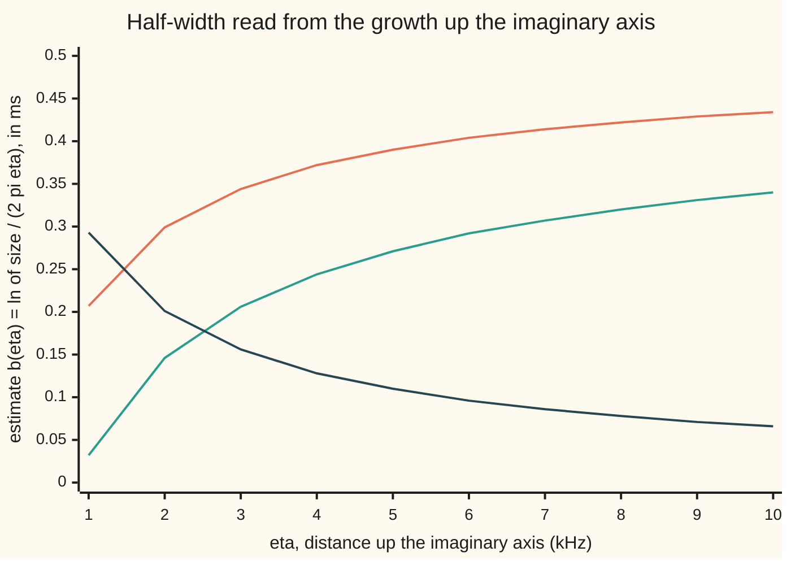

# Paley-Wiener-Schwartz: a signal confined to a window has an entire spectrum whose growth gives the window's width

[Syllabus](../../../SYLLABUS.md) → [Harmonic analysis](../README.md) → [The Fourier Transform](../README.md#s02) → Paley-Wiener-Schwartz

---

## General Overview

A camera shutter set to 1/1000 s is open for 1 millisecond (ms) and shut at every other time. Its spectrum, from [The Fourier transform of an absolutely integrable signal, and why it fades at infinity](01-fourier-transform-on-l1-and-riemann-lebesgue.md), is $`\hat g(\xi) = \sin(\pi\xi)/(\pi\xi)`$ ms, with the frequency $`\xi`$ in kilohertz (kHz). At 250 Hz it is 0.900316 ms.

That formula still makes sense when $`\xi`$ is replaced by a complex number $`\zeta = \xi + i\eta`$. The spectrum then becomes an **entire function**: one with a complex derivative at every point of the complex plane. Along the real line it is at most 1 ms. Off the line it grows, but never faster than $`e^{\pi\lvert\eta\rvert}`$ ms. At $`\zeta = 0.25 + 1i`$ kHz it is 3.572998 ms, under the ceiling $`e^{\pi}`$ = 23.140693 ms.

The rate $`\pi`$ in that ceiling is not an accident. It is $`\pi`$ times the 1 ms the shutter stays open. Open the shutter for 2 ms and the rate doubles. So the spectrum's growth off the real line records how wide the time window is. The theorem says this, both ways, for three kinds of signal:

- a **smooth** shutter that opens and closes gradually, whose spectrum also fades faster than every power of the frequency;
- any shutter with **finite energy**, including the hard 1 ms shutter;
- a **distribution**, such as $`\delta'`$, the slope of a spike, whose spectrum $`2\pi i\zeta`$ grows like a power and has rate 0: its window has width 0.

**A signal is zero outside the window from −A to A exactly when its transform extends to an entire function that grows no faster than $`e^{2\pi A\lvert\mathrm{Im}\,\zeta\rvert}`$ times a power of $`1 + \lvert\zeta\rvert`$; so the growth rate off the real line, divided by π, is the width of the window.**

**What kind of fact this is:** a theorem, the Paley–Wiener–Schwartz theorem. The half "window gives growth" is proved on this card in Why it works for all three kinds. The converse is proved for smooth signals in Step 5, by shifting the integration line; Step 4's Phragmén–Lindelöf turns a type bound into that ceiling, which (II) and the corollary need. The finite-energy and distribution converses reduce to the smooth one by smoothing, sketched in Step 5 and stated with sources.

### The picture: the growth reads off the half-width



Orange: the hard 1 ms shutter. Teal: the smooth shutter over the same 1 ms. Dark: the spike's slope $`\delta'`$. Both shutters climb toward the half-width 0.5 ms; the hard one reaches 0.489746 at 100 kHz and 0.498608 at 1,000 kHz. The spike's slope falls toward 0, its window's half-width.

---

## The formula

Notation first, in words. Time $`t`$ is in ms and frequency in kHz, so $`\xi t`$ is a pure number, as on [Schwartz space and tempered distributions](06-schwartz-space-and-tempered-distributions.md). The transform is this wing's $`\hat f(\xi) = \int f(t)\,e^{-2\pi i\xi t}\,dt`$. A complex frequency is $`\zeta = \xi + i\eta`$, with $`\eta = \mathrm{Im}\,\zeta`$ its imaginary part, also in kHz. The window is $`[-A, A]`$, so $`A`$ is its **half-width** and $`2A`$ its width.

- $`C_c^\infty`$ is the set of smooth signals (every slope exists) that are zero outside some interval.
- $`L^2`$ is the set of signals with finite energy $`\int\lvert f\rvert^2\,dt`$, with the transform from [Plancherel](05-plancherel-and-l2.md).
- A **tempered distribution** $`u`$ is a rule that reads smooth fast-fading probes, from [Schwartz space and tempered distributions](06-schwartz-space-and-tempered-distributions.md). Its **support** is the smallest closed set outside which every reading is 0.
- An entire function $`F`$ has **exponential type** $`\tau`$ if $`\tau`$ is the smallest rate such that, for every $`\varepsilon > 0`$, some constant $`C_\varepsilon`$ gives $`\lvert F(\zeta)\rvert \le C_\varepsilon\,e^{(\tau + \varepsilon)\lvert\zeta\rvert}`$. A power grows more slowly than every exponential, so $`2\pi i\zeta`$ has type 0.

The three statements, each read in both directions:

```math
\begin{aligned} &\text{(I) } \varphi \in C_c^\infty,\ \varphi = 0 \text{ outside } [-A, A] &&\iff \hat\varphi \text{ entire, and for every } N:\ \lvert\hat\varphi(\zeta)\rvert \le C_N\,(1 + \lvert\zeta\rvert)^{-N}\,e^{2\pi A\lvert\eta\rvert} \\ &\text{(II) } f \in L^2,\ f = 0 \text{ outside } [-A, A] &&\iff \hat f \text{ extends to an entire } F \text{ of exponential type at most } 2\pi A \text{ with } \textstyle\int \lvert F(\xi)\rvert^2\,d\xi < \infty \\ &\text{(III) } u \in \mathcal{S}',\ \mathrm{supp}\,u \subset [-A, A] &&\iff \hat u \text{ entire, and for some } N:\ \lvert\hat u(\zeta)\rvert \le C\,(1 + \lvert\zeta\rvert)^{N}\,e^{2\pi A\lvert\eta\rvert} \end{aligned}
```

**Read it aloud:** "A smooth signal lives in the window exactly when its spectrum is entire, grows at most like e to the 2πA times the imaginary part, and fades faster than every power. A finite-energy signal lives there exactly when its spectrum is entire, of type at most 2πA, and has finite energy on the real line. A distribution lives there exactly when its spectrum is entire and grows at most like that exponential times a power."

The **corollary** reads the window's edges off the growth up and down the imaginary axis. For a distribution with support whose smallest enclosing interval is $`[a, b]`$:

```math
b = \limsup_{\eta \to +\infty} \frac{\ln\lvert\hat u(i\eta)\rvert}{2\pi\eta}, \qquad -a = \limsup_{\eta \to +\infty} \frac{\ln\lvert\hat u(-i\eta)\rvert}{2\pi\eta}
```

**Read it aloud:** "The right edge is how fast the log of the spectrum grows going up the imaginary axis, over 2π. The left edge, with its sign flipped, is the same going down."

Here lim sup means the largest value the ratio keeps returning to. For the shutters below it is an ordinary limit. Write $`b(\eta)`$ for the ratio at a finite $`\eta`$: the picture plots it.

| Symbol | Plain meaning | In our example | Push it up and the answer… |
| --- | --- | --- | --- |
| $`t`$, $`\xi`$, $`i`$ | time in ms; real frequency in kHz; the imaginary unit, $`i^2 = -1`$ | 250 Hz is $`\xi = 0.25`$ | — |
| $`\zeta = \xi + i\eta`$, $`\eta`$ | a complex frequency; its imaginary part, in kHz | $`\zeta = 0.25 + 1i`$ | larger $`\lvert\eta\rvert`$, larger spectrum |
| $`f`$, $`\hat f`$, $`F`$, $`L^2`$, $`C_c^\infty`$ | a signal; its transform; the entire function that extends it; finite-energy signals; smooth signals zero outside an interval | the light reaching the sensor | — |
| $`g`$ | the hard shutter: 1 from −0.5 to 0.5 ms, 0 elsewhere | $`\hat g(0.25) = 0.900316`$ ms | — |
| $`\varphi`$ | the smooth shutter $`e^{1 - 1/(1 - 4t^2)}`$ inside the window, 0 outside | area 0.603450 ms | — |
| $`A`$, $`[a, b]`$ | the window's half-width; its edges in general | $`A`$ = 0.5 ms; $`[-0.5, 0.5]`$ | the growth rate rises |
| $`\tau = 2\pi A`$ | the exponential type: the rate in the ceiling | $`\pi`$ ms = 3.141593 ms | wider window |
| $`N`$, $`C`$, $`C_N`$, $`C_\varepsilon`$, $`M`$ | a power of $`1 + \lvert\zeta\rvert`$; the constants in the bounds; a bound on the real line | $`N = 1`$ for $`\delta'`$; $`M`$ = 1 ms for $`\hat g`$ | rougher signal, larger $`N`$ allowed |
| $`u`$, $`\mathcal{S}'`$, $`\mathrm{supp}\,u`$, $`\delta`$, $`\delta'`$ | a tempered distribution; the set of them; its support; the spike; its slope, $`\delta'(\psi) = -\psi'(0)`$ on a probe $`\psi`$ | $`\hat{\delta'}(\zeta) = 2\pi i\zeta`$ | — |
| $`b(\eta)`$ | the edge estimate $`\ln\lvert\hat f(i\eta)\rvert/(2\pi\eta)`$ | 0.434 ms at $`\eta`$ = 10 kHz | settles on $`b`$ |
| $`\rho_w`$, $`K`$ | a narrow smooth bump of area 1 and width $`w`$, standing in for $`\delta`$; the cut-off of a truncated inverse integral | $`w`$ = 1, 0.1, 0.01 ms; $`K`$ = 200 kHz | closer to the limit; smaller tail error |
| $`G`$, $`\theta`$, $`\varepsilon`$ | in the proofs: $`F`$ with its expected growth divided out; a smooth cut-off; its margin, or a small slack | $`G = F\,e^{i(2\pi A + 2\varepsilon)\zeta}`$ | — |

### When it holds

- **The window is bounded.** The bell $`e^{-\pi t^2}`$ has no window. Its transform is the same bell, as [Two pairs worth memorising](03-gaussian-and-sinc-transform-pairs.md) shows, and it extends to the entire $`e^{-\pi\zeta^2}`$. That grows like $`e^{\pi\eta^2}`$ up the imaginary axis, so $`b(\eta) = \eta/2`$: 5 ms at 10 kHz and 50 ms at 100 kHz, without end.
- **The real-line bound matters.** The entire function $`e^{\pi\zeta}`$ has size 1 everywhere on the imaginary axis, so it reads $`b = 0`$. But on the real line it reaches $`e^{31.415927}`$ at 10 kHz. It is no tempered distribution's transform, and no window exists.
- **For smoothness, every $`N`$.** Statement (I) needs the fading for every power. A spectrum with growth like $`(1 + \lvert\zeta\rvert)^{1}`$ comes from a distribution such as $`\delta'`$, not from a smooth signal.
- **One convention.** In wing 07's $`\omega = 2\pi\xi`$ form the ceiling reads $`e^{A\lvert\mathrm{Im}\,\omega\rvert}`$, rate 0.5 ms for the same shutter. The rule "rate over $`\pi`$ is the width" holds only in this card's hertz form.

---

## Why it works

### Step 0: a window turns every complex frequency into a bounded weight

The transform at a complex frequency weighs the signal by $`e^{-2\pi i\zeta t}`$. Its size is $`e^{2\pi\eta t}`$: it grows exponentially in time, at a rate set by $`\eta`$. On the whole line that weight is unbounded, so the integral usually fails. Inside a window $`[-A, A]`$ it never exceeds $`e^{2\pi A\lvert\eta\rvert}`$. So a confined signal has a transform at every complex frequency, and the window's half-width $`A`$ caps the growth. The converse says nothing else can produce that cap.

### Step 1: the window gives an entire spectrum with the ceiling

Take the hard shutter $`g`$. Its transform at any complex $`\zeta`$ is

```math
\hat g(\zeta) = \int_{-0.5}^{0.5} e^{-2\pi i\zeta t}\,dt = \frac{\sin(\pi\zeta)}{\pi\zeta}, \qquad \lvert\hat g(\zeta)\rvert \le \int_{-0.5}^{0.5} e^{2\pi\eta t}\,dt \le 1 \cdot e^{\pi\lvert\eta\rvert}.
```

The power series of $`e^{-2\pi i\zeta t}`$ in $`\zeta`$ can be integrated term by term over a bounded window. So $`\hat g`$ is a convergent power series in $`\zeta`$: it is entire. The same two lines work for any integrable signal in the window, with the area $`\int\lvert f\rvert`$ in place of 1. A finite-energy signal in a bounded window is integrable, so this proves the forward half of (II), and Plancherel gives finite energy on the real line.

The code checks the ceiling at four complex frequencies, against Simpson's rule:

| $`\zeta`$ (kHz) | hard shutter, ms | ceiling $`e^{\pi\lvert\eta\rvert}`$ | ratio | smooth shutter, ms | ratio to area × ceiling |
| --- | ---: | ---: | ---: | ---: | ---: |
| 0.25 | 0.900316 | 1.000000 | 0.900316 | 0.574525 | 0.952066 |
| 0.25 + 1i | 3.572998 | 23.140693 | 0.154403 | 1.190528 | 0.085255 |
| 2 + 2i | 30.131887 | 535.491656 | 0.056270 | 3.467193 | 0.010730 |
| 0.5 + 5i | 210170.234898 | 6635623.999341 | 0.031673 | 4971.086915 | 0.001241 |

The ratios fall because the ceiling uses the window's far edge for every $`t`$; only the edge itself grows that fast.

### Step 2: smoothness adds decay on top of the ceiling

The smooth shutter $`\varphi`$ rises from 0 at −0.5 ms to 1 at the centre and falls back to 0 at 0.5 ms, with every slope zero at the edges. [The transform rulebook](02-shift-scale-and-derivative-rules.md) turns a slope in time into a factor $`2\pi i\zeta`$, and this holds at complex $`\zeta`$ too: the shutter and all its slopes are 0 at the window's edges, so integration by parts leaves no boundary terms:

```math
(2\pi i\zeta)^N\,\hat\varphi(\zeta) = \widehat{\varphi^{(N)}}(\zeta), \qquad \lvert\hat\varphi(\zeta)\rvert \le \frac{\int\lvert\varphi^{(N)}\rvert\,dt}{(2\pi\lvert\zeta\rvert)^N}\,e^{\pi\lvert\eta\rvert}.
```

Every $`N`$ works, so $`\hat\varphi`$ fades faster than every power, inside the same ceiling. That is the forward half of (I). On the real line with $`N = 2`$, where $`\int\lvert\varphi''\rvert`$ = 17.362856686, four times the steepest slope of $`\varphi`$, because $`\varphi''`$ changes sign only at ±0.379918 ms:

| $`\xi`$ (kHz) | hard shutter, $`1/(\pi\xi)`$ | smooth shutter | bound, $`N = 2`$ | ratio |
| ---: | ---: | ---: | ---: | ---: |
| 1.5 | 0.212207 | 0.026214621 | 0.195469466 | 0.134111 |
| 2.5 | 0.127324 | 0.032350740 | 0.070369008 | 0.459730 |
| 4.5 | 0.070736 | 0.010129789 | 0.021718830 | 0.466406 |
| 8.5 | 0.037448 | 0.000122590 | 0.006087284 | 0.020139 |
| 16.5 | 0.019292 | 0.000106664 | 0.001615450 | 0.066027 |

The hard shutter's jumps cost it: it fades only like $`1/\xi`$. Both shutters share the same window and the same ceiling. The real line records smoothness; the imaginary direction records width.

### Step 3: distributions add a power instead

A distribution $`u`$ supported in the window reads a probe using only finitely many of its slopes, up to some order $`N`$. Feed it the probe $`e^{-2\pi i\zeta t}`$, cut off smoothly with a margin that shrinks like $`1/(1 + \lvert\zeta\rvert)`$ (see the fold). Each slope brings a factor $`2\pi\zeta`$, so the reading is at most $`C(1 + \lvert\zeta\rvert)^N e^{2\pi A\lvert\eta\rvert}`$. That is the forward half of (III).

For $`\delta'`$, the window is the single point 0 and $`N = 1`$. Its transform is $`\hat{\delta'}(\zeta) = 2\pi i\zeta`$: the spike's flat spectrum 1 from [Schwartz space and tempered distributions](06-schwartz-space-and-tempered-distributions.md), times the slope factor. There is no exponential at all: type 0, width 0.

The spike is an idealisation, so the code replaces it by narrow bumps $`\rho_w`$ of area 1 and width $`w`$, and transforms their slopes:

| width $`w`$ | at 1 kHz | at $`\zeta = 1i`$ kHz |
| ---: | ---: | ---: |
| 1 ms | 2.554418i | −12.748495 |
| 0.1 ms | 6.234295i | −6.332346 |
| 0.01 ms | 6.282695i | −6.283676 |
| limit $`2\pi i\zeta`$ | 6.283185i | −6.283185 |

At $`\zeta = 1i`$ the 1 ms bump is about twice the limit: its window still has width 1 ms, and its growth shows it. As $`w`$ shrinks, so does the window, and the growth disappears.

<details>
<summary>Detailed proof: the distribution bound, without the extra width</summary>

Let $`u`$ have support in $`[-A, A]`$. Being tempered and compactly supported, it has a finite order $`N`$: for some constant $`C`$, every probe $`\psi`$ gives

$`\displaystyle \lvert u(\psi)\rvert \le C \sum_{k \le N}\ \sup_{\lvert t\rvert \le A + 1} \lvert\psi^{(k)}(t)\rvert.`$

Take $`\psi(t) = \theta(t)\,e^{-2\pi i\zeta t}`$, where $`\theta`$ is smooth, equal to 1 near the window and 0 beyond a margin $`\varepsilon \le 1`$. The constant $`C`$ does not depend on $`\varepsilon`$. By the product rule, each slope of $`\psi`$ is a sum of terms $`\theta^{(j)}(t)\,(2\pi\zeta)^{k-j}\,e^{-2\pi i\zeta t}`$. The exponential is at most $`e^{2\pi(A + \varepsilon)\lvert\eta\rvert}`$ there.

To remove the margin from the exponent, choose $`\varepsilon = 1/(1 + \lvert\zeta\rvert)`$. Then $`e^{2\pi\varepsilon\lvert\eta\rvert} \le e^{2\pi}`$, a constant. A cut-off of margin $`\varepsilon`$ has slopes of size about $`\varepsilon^{-j}`$, which is $`(1 + \lvert\zeta\rvert)^j`$. Every term is then at most a constant times $`(1 + \lvert\zeta\rvert)^N e^{2\pi A\lvert\eta\rvert}`$. That is (III), forward. Hörmander gives this argument in full, in any number of dimensions.

</details>

### Step 4: the converse, part one: Phragmén–Lindelöf upgrades a type to a ceiling

Now go backwards. Start with an entire $`F`$ of exponential type at most $`2\pi A`$ that is bounded on the real line, say by $`M`$. The type bound $`C_\varepsilon e^{(2\pi A + \varepsilon)\lvert\zeta\rvert}`$ allows growth in every direction. The ceiling $`e^{2\pi A\lvert\eta\rvert}`$ allows growth only off the real line. The gap between them is closed by [Phragmen-Lindelof](../../07-Complex%20analysis/04-Taylor%20Series%2C%20Zeros%20and%20Rigidity/07-phragmen-lindelof-principle.md): a maximum principle on an unbounded region, valid when the function grows slowly enough.

The trick is to divide out the expected growth, with a little to spare. In the upper half-plane, $`G(\zeta) = F(\zeta)\,e^{i(2\pi A + 2\varepsilon)\zeta}`$ has $`\lvert G\rvert = \lvert F\rvert\,e^{-(2\pi A + 2\varepsilon)\eta}`$. On the real line $`\lvert G\rvert \le M`$. On the positive imaginary axis $`\lvert G\rvert \le C_\varepsilon e^{-\varepsilon\eta} \le C_\varepsilon`$, by the type bound. In each quarter-plane between them, $`G`$ grows at most exponentially, far below the limit the quarter-plane's angle allows. So $`\lvert G\rvert \le \max(M, C_\varepsilon)`$ there: $`G`$ is bounded on the whole upper half-plane. Phragmén–Lindelöf once more, on the half-plane, whose edge bound is $`M`$, gives $`\lvert G\rvert \le M`$. Let $`\varepsilon`$ shrink to 0:

```math
\lvert F(\xi + i\eta)\rvert \le M\, e^{2\pi A\lvert\eta\rvert}.
```

The lower half-plane is the same with $`e^{-i(2\pi A + 2\varepsilon)\zeta}`$. A real-line bound $`(1 + \lvert\xi\rvert)^N`$ in place of $`M`$ works the same way, after dividing by $`(\zeta + i)^N`$ in the upper half-plane.

### Step 5: the converse, part two: shift the line and let the signal vanish

Suppose $`F`$ meets the ceiling and fades like $`(1 + \lvert\zeta\rvert)^{-2}`$ inside it, as in (I). Define the signal by [Fourier inversion](04-fourier-inversion-theorem.md), $`\varphi(t) = \int F(\xi)\,e^{2\pi i\xi t}\,d\xi`$. Cauchy's theorem lets the integration line move up to height $`\eta`$, since the fading kills the ends. On the new line the integrand is at most $`C_2 (1 + \lvert\xi\rvert)^{-2} e^{2\pi A\eta}\,e^{-2\pi\eta t}`$. So

```math
\lvert\varphi(t)\rvert \le C_2\, e^{2\pi\eta\,(A - t)} \int (1 + \lvert\xi\rvert)^{-2}\,d\xi = 2\,C_2\, e^{2\pi\eta\,(A - t)} \quad\text{for every } \eta > 0.
```

For $`t > A`$ the exponent is negative. Letting $`\eta`$ grow sends the bound to 0, so $`\varphi(t) = 0`$. Moving the line down covers $`t < -A`$. The signal is silent outside the window. Faster fading makes $`\varphi`$ smooth, which proves (I) backwards.

For (II) and (III), smooth first: multiply $`F`$ by the transform of a narrow smooth bump $`\rho_w`$. The product meets (I) with half-width $`A + w/2`$, so its signal lives in $`[-A - w/2,\ A + w/2]`$. As $`w`$ shrinks, that signal settles on the original one (in energy for (II), on every probe for (III)), which therefore lives in $`[-A, A]`$. For (II) the needed real-line bound comes from a lemma of Plancherel and Pólya; Paley and Wiener give the $`L^2`$ case in full, and Hörmander the distribution case.

The code checks a finite-energy converse on $`\hat g(\zeta)^2 = \sin^2(\pi\zeta)/(\pi\zeta)^2`$. It is entire, of type $`2\pi`$ ms, and square-integrable on the line. So its signal must live in $`[-1, 1]`$ ms: it is the triangle $`1 - \lvert t\rvert`$, the shutter's overlap with a shifted copy of itself. Cutting the inverse integral at $`K`$ = 200 kHz leaves a tail of at most 0.001013:

| $`t`$ (ms) | inverse, cut at 200 kHz | triangle | gap |
| ---: | ---: | ---: | ---: |
| 0.0 | 0.999493 | 1.000000 | 0.000507 |
| 0.5 | 0.500000 | 0.500000 | 0.000000 |
| 1.5 | 0.000000 | 0.000000 | 0.000000 |

At 1.5 ms, outside the window, the signal is silent, as the type predicts.

### Step 6: the width, read off the growth

Step 4 and Step 5 together say more than "inside some window". If the growth up the imaginary axis has rate $`2\pi b`$, Phragmén–Lindelöf gives the ceiling $`e^{2\pi(b + \varepsilon)\eta}`$ on the whole upper half-plane, for every small $`\varepsilon`$. The shifted line then silences every $`t > b + \varepsilon`$, so the support's right edge is at most $`b`$. Step 1 gives the other inequality: the growth rate is at most $`2\pi`$ times the right edge. So the right edge is exactly the growth rate over $`2\pi`$. The left edge comes from the lower half-plane. That is the corollary.

For the hard shutter, $`\hat g(i\eta) = \sinh(\pi\eta)/(\pi\eta)`$, so

```math
b(\eta) = \frac{\ln\sinh(\pi\eta) - \ln(\pi\eta)}{2\pi\eta} \;\longrightarrow\; 0.5 \text{ ms}.
```

The convergence is slow, because of the $`\ln(\pi\eta)`$ term: 0.434 at 10 kHz, 0.489746 at 100, 0.498608 at 1,000, 0.499824 at 10,000. The smooth shutter approaches more slowly still: it is small near its edges, so it needs a larger $`\eta`$ before the edge dominates. The limit is the same, because the window is the same. [The uncertainty principle](07-uncertainty-principle.md) uses the band-limited mirror image of (II) to show that no signal is both time-limited and band-limited.

---

## Worked numbers, by hand

The hard shutter at the complex frequency $`\zeta = 0.25 + 1i`$ kHz, then its half-width read at $`\eta`$ = 10 kHz. The rule $`\lvert\sin(x + iy)\rvert^2 = \sin^2 x + \sinh^2 y`$ does the complex sine.

| Step | Arithmetic | Value |
| --- | --- | --- |
| 1 | $`\sinh\pi`$ | 11.548739 |
| 2 | $`\lvert\sin(\pi\zeta)\rvert = \sqrt{\sin^2(\pi/4) + \sinh^2\pi} = \sqrt{0.5 + 11.548739^2}`$ | 11.570366 |
| 3 | $`\lvert\pi\zeta\rvert = \pi\sqrt{0.25^2 + 1^2}`$ | 3.238280 |
| 4 | $`\lvert\hat g(\zeta)\rvert = 11.570366 / 3.238280`$ | 3.572998 ms |
| 5 | ceiling $`1\text{ ms} \times e^{\pi \times 1}`$ | 23.140693 ms |
| 6 | ratio 3.572998 / 23.140693 | 0.154403 |
| 7 | $`\ln\sinh(10\pi)`$ and $`\ln(10\pi)`$ | 30.722779 and 3.447315 |
| 8 | $`b(10) = (30.722779 - 3.447315)/(2\pi \times 10)`$ | 0.434 ms |
| 9 | limit of $`b(\eta)`$, times 2 | **width 1.000000 ms** |

The spectrum stays under its ceiling, and its growth rate, $`\pi`$ ms = 3.141593 ms, is $`\pi`$ times the 1 ms the shutter is open.

### What breaks if you drop a piece

| Mistake | Comes out at | What went wrong |
| --- | --- | --- |
| Read the type over $`2\pi`$ as the width | 0.500000 ms instead of 1.000000 ms | Type over $`2\pi`$ is the half-width $`A`$; the window is $`[-A, A]`$ |
| Drop the bounded window: the bell $`e^{-\pi t^2}`$ | $`b`$ = 0.500000, 5.000000, 50.000000 ms at $`\eta`$ = 1, 10, 100 | Entire, but of order 2, not exponential type: no window |
| Drop the real-line bound: $`e^{\pi\zeta}`$ | $`b = 0`$, yet size $`e^{31.415927}`$ at 10 kHz | Not a tempered distribution's transform; Phragmén–Lindelöf has no edge bound |

---

## Code, from first principles, and it actually runs

The scripts work in ms and kHz and compute every transform themselves, with a complex number written out in Rust. They take **five roads**. The closed forms of the hard shutter, the same shutter delayed by 0.5 ms, and the bell are checked against Simpson's rule at complex frequencies, and the smooth shutter against Simpson's rule at two step counts. The slope rule is checked against the transform of the second slope, with its decay bound, whose constant is checked against Simpson's rule between the zeros of $`\varphi''`$. A truncated inverse integral of $`\hat g^2`$ is checked against the triangle, inside a printed tail bound. Narrow bumps settle on $`2\pi i\zeta`$. The edge estimate climbs toward 0.5 ms.

### Python

```python
# Paley-Wiener-Schwartz -- the check behind the card.  Standard library only.
# Units: time t in ms, frequency in kHz, so xi*t is a pure number.
# Convention: f-hat(zeta) = integral of f(t) e^(-2 pi i zeta t) dt, with a complex
# frequency zeta = xi + i*eta.  Every transform is computed here.  Roads: closed
# forms against Simpson's rule at two step counts, the slope rule against the
# transform of the second slope, and narrow bumps that settle on the spike's slope.
import math, cmath
PI = math.pi

def simpson(f, a, b, n):              # n even; f may return complex numbers
    h = (b - a) / n
    s = f(a) + f(b)
    for k in range(1, n):
        s += (4 if k % 2 else 2) * f(a + k * h)
    return s * h / 3

def ft(f, z, a, b, n):                # transform of f (zero outside [a, b]) at complex z
    return simpson(lambda t: f(t) * cmath.exp(-2j * PI * z * t), a, b, n)

def bump(t, k):                       # smooth shutter exp(1 - 1/u), u = 1 - 4t^2: k-th slope
    u = 1 - 4 * t * t
    if u <= 1e-9: return 0.0
    p = math.exp(1 - 1 / u)
    if k == 0: return p
    if k == 1: return p * (-8 * t / u**2)
    return p * (64 * t * t / u**4 - 8 / u**2 - 128 * t * t / u**3)

g = lambda t: 1.0                     # the hard shutter, open from -0.5 to 0.5 ms
g_hat = lambda z: cmath.sin(PI * z) / (PI * z)
phi = lambda t: bump(t, 0)
def lnsinh(x): return x + math.log((1 - math.exp(-2 * x)) / 2)

# 1. both shutters obey the window bound |f-hat(zeta)| <= (area) e^(pi |eta|)
area = simpson(phi, -0.5, 0.5, 4000).real
print(f"smooth shutter area = {area:.6f} ms (hard shutter area = 1.000000 ms)")
for xi, eta in [(0.25, 0.0), (0.25, 1.0), (2.0, 2.0), (0.5, 5.0)]:
    z = complex(xi, eta)
    exact, simp = abs(g_hat(z)), abs(ft(g, z, -0.5, 0.5, 2000))
    sm = abs(ft(phi, z, -0.5, 0.5, 4000))
    sm2 = abs(ft(phi, z, -0.5, 0.5, 8000))
    bound = math.exp(PI * abs(eta))
    assert abs(exact - simp) < 1e-9 * max(1, exact) and abs(sm - sm2) < 1e-9 * max(1, sm)
    assert exact <= bound and sm <= area * bound
    print(f"zeta = {xi:.2f}+{eta:.2f}i  hard {exact:.6f} (Simpson {simp:.6f})  bound {bound:.6f}"
          f"  ratio {exact / bound:.6f}  smooth {sm:.6f}  ratio {sm / (area * bound):.6f}")
    if (xi, eta) == (0.25, 1.0):                      # the hand computation
        sh = math.sinh(PI)
        print(f"by hand: sinh(pi) = {sh:.6f}  |sin(pi zeta)| = {math.sqrt(0.5 + sh * sh):.6f}"
              f"  |pi zeta| = {abs(PI * z):.6f}")

# 2. read the window off the growth: b(eta) = ln|f-hat(i eta)| / (2 pi eta) -> 0.5 ms
etas = list(range(1, 11))
hard = [(lnsinh(PI * e) - math.log(PI * e)) / (2 * PI * e) for e in etas]
smooth = [math.log(abs(ft(phi, 1j * e, -0.5, 0.5, 4000))) / (2 * PI * e) for e in etas]
spike = [math.log(2 * PI * e) / (2 * PI * e) for e in etas]
assert abs(hard[0] - math.log(abs(ft(g, 1j, -0.5, 0.5, 2000))) / (2 * PI)) < 1e-9
assert abs(smooth[9] - math.log(abs(ft(phi, 10j, -0.5, 0.5, 8000))) / (20 * PI)) < 1e-9
print(f"by hand: ln sinh(10 pi) = {lnsinh(10 * PI):.6f}  ln(10 pi) = {math.log(10 * PI):.6f}")
print("chart eta (kHz):", " ".join(f"{e}" for e in etas))
for name, row in [("hard", hard), ("smooth", smooth), ("spike slope", spike)]:
    print(f"chart {name}:", " ".join(f"{v:.3f}" for v in row))
far = [(lnsinh(PI * e) - math.log(PI * e)) / (2 * PI * e) for e in (100, 1000, 10000)]
print("hard shutter b at eta = 100, 1000, 10000 kHz:", " ".join(f"{v:.6f}" for v in far))
assert hard[9] < far[0] < far[1] < far[2] < 0.5 and 0.5 - far[2] < 1e-3
print(f"type = 2 pi b = {2 * PI * 0.5:.6f} ms; window width = 2b = 1.000000 ms")
up, down = (math.log(abs(ft(g, s * 10j, 0, 1, 2000))) / (20 * PI) for s in (1, -1))
assert abs(up - hard[9] - 0.5) < 1e-9 and abs(down - hard[9] + 0.5) < 1e-9   # shift by 0.5 ms
print(f"shutter open 0 to 1 ms, b up and down at eta = 1000 kHz: {far[1] + 0.5:.6f} {far[1] - 0.5:.6f};"
      f" width {2 * far[1]:.6f} ms, type over pi {2 * far[1] + 1:.6f} ms")

# 3. the real line measures smoothness, not width: decay at half-integer kHz
ts = 48 ** -0.25                                  # phi'' = 0 only at +-ts, where 384 t^4 = 8
l1 = 4 * abs(bump(ts, 1))                         # so integral of |phi''| = 4 x steepest slope
l1s = 2 * simpson(lambda t: bump(t, 2), ts, 0.5, 4000) - simpson(lambda t: bump(t, 2), -ts, ts, 4000)
assert abs(bump(ts, 2)) < 1e-9 and abs(l1 - l1s) < 1e-9
print(f"integral of |second slope| = 4 x steepest slope = {l1:.9f}, at t = {ts:.6f} ms"
      f" (Simpson between the zeros {l1s:.9f})")
for xi in (1.5, 2.5, 4.5, 8.5, 16.5):
    h = abs(g_hat(xi))
    s = ft(phi, xi, -0.5, 0.5, 4000)
    s2 = ft(lambda t: bump(t, 2), xi, -0.5, 0.5, 4000)   # transform of the 2nd slope
    assert abs(s2 + (2 * PI * xi)**2 * s) < 1e-9          # slope rule: (2 pi i xi)^2
    assert abs(h - 1 / (PI * xi)) < 1e-12
    bnd = l1 / (2 * PI * xi)**2
    assert abs(s) <= bnd
    print(f"xi = {xi:4.1f} kHz  hard {h:.6f}  smooth {abs(s):.9f}  "
          f"bound {bnd:.9f}  ratio {abs(s) / bnd:.6f}")

# 4. L2 converse: g-hat^2 = sinc^2 has type 2 pi; its inverse is silent past 1 ms
K = 200.0
sinc2 = lambda x: 1.0 if x == 0 else (math.sin(PI * x) / (PI * x))**2
print(f"inverse of sinc^2, cut at {K:.0f} kHz, tail bound {2 / (PI**2 * K):.6f}:")
for t in (0.0, 0.5, 1.5):
    v = 2 * simpson(lambda x: sinc2(x) * math.cos(2 * PI * x * t), 0, K, 40000)
    tri = max(0.0, 1 - abs(t))
    assert abs(v - tri) < 2 / (PI**2 * K)
    print(f"  t = {t:.1f} ms  inverse {v:.6f}  triangle {tri:.6f}  gap {abs(v - tri):.6f}")

# 5. the spike's slope: narrow bumps rho_w (area 1, width w) whose slopes settle
for w in (1.0, 0.1, 0.01):
    d = lambda t: bump(t / w, 1) / (w * w * area)
    a = ft(d, 1.0, -w / 2, w / 2, 2000)
    b = ft(d, 1j, -w / 2, w / 2, 2000)
    print(f"w = {w:.3f} ms  at 1 kHz {a.imag:.6f}i  at 1i kHz {b.real:.6f}")
assert abs(a.imag - 2 * PI) < 1e-3 and abs(b.real + 2 * PI) < 1e-3
print(f"limit 2 pi i zeta: {2 * PI:.6f}i and {-2 * PI:.6f}")

# 6. what breaks
gb = [(-PI * (1j * e)**2).real / (2 * PI * e) for e in (1, 10, 100)]   # ln|e^(-pi zeta^2)| at i eta
tail, bq = math.exp(-64 * PI) / (8 * PI), []    # share of the bell's area more than 8 ms from its peak
for e in (1, 10):                               # the defining integral at zeta = i eta, cut at eta -+ 8
    v = simpson(lambda t: math.exp(-PI * t * t + 2 * PI * e * t), e - 8, e + 8, 2000)
    assert abs(v / math.exp(PI * e * e) - 1) < 1e-9
    bq.append(math.log(v) / (2 * PI * e))
print(f"bell by Simpson on [eta - 8, eta + 8] ms, tail share below {tail:.1e}:"
      f" b at eta = 1, 10: {bq[0]:.6f} {bq[1]:.6f}")
print("bell e^(-pi t^2): b at eta = 1, 10, 100:", " ".join(f"{v:.6f}" for v in gb))
ex, im = math.log(abs(cmath.exp(PI * 10))), abs(cmath.exp(PI * 1j * 10))
print(f"e^(pi zeta): ln size at 10 kHz {ex:.6f}; size at 10i kHz {im:.6f}, so b = 0")
print(f"half-width misread as width: {PI / (2 * PI):.6f} ms instead of 1.000000 ms")
print("ALL CHECKS PASS")
```

**Ran 2026-11-24 on macOS, Python 3.14.10, standard library only. All checks passed. Output, pasted from the run:**

```
smooth shutter area = 0.603450 ms (hard shutter area = 1.000000 ms)
zeta = 0.25+0.00i  hard 0.900316 (Simpson 0.900316)  bound 1.000000  ratio 0.900316  smooth 0.574525  ratio 0.952066
zeta = 0.25+1.00i  hard 3.572998 (Simpson 3.572998)  bound 23.140693  ratio 0.154403  smooth 1.190528  ratio 0.085255
by hand: sinh(pi) = 11.548739  |sin(pi zeta)| = 11.570366  |pi zeta| = 3.238280
zeta = 2.00+2.00i  hard 30.131887 (Simpson 30.131887)  bound 535.491656  ratio 0.056270  smooth 3.467193  ratio 0.010730
zeta = 0.50+5.00i  hard 210170.234898 (Simpson 210170.234965)  bound 6635623.999341  ratio 0.031673  smooth 4971.086915  ratio 0.001241
by hand: ln sinh(10 pi) = 30.722779  ln(10 pi) = 3.447315
chart eta (kHz): 1 2 3 4 5 6 7 8 9 10
chart hard: 0.207 0.299 0.344 0.372 0.390 0.404 0.414 0.422 0.429 0.434
chart smooth: 0.032 0.146 0.206 0.244 0.271 0.292 0.307 0.320 0.331 0.340
chart spike slope: 0.293 0.201 0.156 0.128 0.110 0.096 0.086 0.078 0.071 0.066
hard shutter b at eta = 100, 1000, 10000 kHz: 0.489746 0.498608 0.499824
type = 2 pi b = 3.141593 ms; window width = 2b = 1.000000 ms
shutter open 0 to 1 ms, b up and down at eta = 1000 kHz: 0.998608 -0.001392; width 0.997216 ms, type over pi 1.997216 ms
integral of |second slope| = 4 x steepest slope = 17.362856686, at t = 0.379918 ms (Simpson between the zeros 17.362856686)
xi =  1.5 kHz  hard 0.212207  smooth 0.026214621  bound 0.195469466  ratio 0.134111
xi =  2.5 kHz  hard 0.127324  smooth 0.032350740  bound 0.070369008  ratio 0.459730
xi =  4.5 kHz  hard 0.070736  smooth 0.010129789  bound 0.021718830  ratio 0.466406
xi =  8.5 kHz  hard 0.037448  smooth 0.000122590  bound 0.006087284  ratio 0.020139
xi = 16.5 kHz  hard 0.019292  smooth 0.000106664  bound 0.001615450  ratio 0.066027
inverse of sinc^2, cut at 200 kHz, tail bound 0.001013:
  t = 0.0 ms  inverse 0.999493  triangle 1.000000  gap 0.000507
  t = 0.5 ms  inverse 0.500000  triangle 0.500000  gap 0.000000
  t = 1.5 ms  inverse 0.000000  triangle 0.000000  gap 0.000000
w = 1.000 ms  at 1 kHz 2.554418i  at 1i kHz -12.748495
w = 0.100 ms  at 1 kHz 6.234295i  at 1i kHz -6.332346
w = 0.010 ms  at 1 kHz 6.282695i  at 1i kHz -6.283676
limit 2 pi i zeta: 6.283185i and -6.283185
bell by Simpson on [eta - 8, eta + 8] ms, tail share below 1.9e-89: b at eta = 1, 10: 0.500000 5.000000
bell e^(-pi t^2): b at eta = 1, 10, 100: 0.500000 5.000000 50.000000
e^(pi zeta): ln size at 10 kHz 31.415927; size at 10i kHz 1.000000, so b = 0
half-width misread as width: 0.500000 ms instead of 1.000000 ms
ALL CHECKS PASS
```

### Rust

```rust
// Paley-Wiener-Schwartz -- the check behind the card.  Rust std only.
// Units: time t in ms, frequency in kHz, so xi*t is a pure number.
// Convention: f-hat(zeta) = integral of f(t) e^(-2 pi i zeta t) dt, with a complex
// frequency zeta = xi + i*eta.  Every transform is computed here.  Roads: closed
// forms against Simpson's rule at two step counts, the slope rule against the
// transform of the second slope, and narrow bumps that settle on the spike's slope.
use std::f64::consts::PI;

#[derive(Clone, Copy)]
struct C { re: f64, im: f64 }
fn c(re: f64, im: f64) -> C { C { re, im } }
fn add(a: C, b: C) -> C { c(a.re + b.re, a.im + b.im) }
fn mul(a: C, b: C) -> C { c(a.re * b.re - a.im * b.im, a.re * b.im + a.im * b.re) }
fn sc(a: C, k: f64) -> C { c(a.re * k, a.im * k) }
fn div(a: C, b: C) -> C { let d = b.re * b.re + b.im * b.im; c((a.re * b.re + a.im * b.im) / d, (a.im * b.re - a.re * b.im) / d) }
fn abs(a: C) -> f64 { a.re.hypot(a.im) }
fn cexp(a: C) -> C { let m = a.re.exp(); c(m * a.im.cos(), m * a.im.sin()) }
fn csin(a: C) -> C { c(a.re.sin() * a.im.cosh(), a.re.cos() * a.im.sinh()) }

fn simpson(f: &dyn Fn(f64) -> C, a: f64, b: f64, n: usize) -> C {
    let h = (b - a) / n as f64;
    let mut s = add(f(a), f(b));
    for k in 1..n {
        s = add(s, sc(f(a + k as f64 * h), if k % 2 == 1 { 4.0 } else { 2.0 }));
    }
    sc(s, h / 3.0)
}
fn ft(f: &dyn Fn(f64) -> f64, z: C, a: f64, b: f64, n: usize) -> C {
    simpson(&|t: f64| sc(cexp(sc(mul(c(0.0, -2.0 * PI), z), t)), f(t)), a, b, n)
}
fn bump(t: f64, k: u32) -> f64 {
    let u = 1.0 - 4.0 * t * t;
    if u <= 1e-9 { return 0.0; }
    let p = (1.0 - 1.0 / u).exp();
    match k {
        0 => p,
        1 => p * (-8.0 * t / u.powi(2)),
        _ => p * (64.0 * t * t / u.powi(4) - 8.0 / u.powi(2) - 128.0 * t * t / u.powi(3)),
    }
}
fn g_hat(z: C) -> C { div(csin(sc(z, PI)), sc(z, PI)) }
fn lnsinh(x: f64) -> f64 { x + ((1.0 - (-2.0 * x).exp()) / 2.0).ln() }
fn join(v: &[f64], d: usize) -> String { v.iter().map(|x| format!("{:.*}", d, x)).collect::<Vec<_>>().join(" ") }

fn main() {
    let g = |_t: f64| 1.0;
    let phi = |t: f64| bump(t, 0);
    // 1. both shutters obey the window bound
    let area = simpson(&|t| c(phi(t), 0.0), -0.5, 0.5, 4000).re;
    println!("smooth shutter area = {:.6} ms (hard shutter area = 1.000000 ms)", area);
    for (xi, eta) in [(0.25, 0.0), (0.25, 1.0), (2.0, 2.0), (0.5, 5.0)] {
        let z = c(xi, eta);
        let (exact, simp) = (abs(g_hat(z)), abs(ft(&g, z, -0.5, 0.5, 2000)));
        let sm = abs(ft(&phi, z, -0.5, 0.5, 4000));
        let sm2 = abs(ft(&phi, z, -0.5, 0.5, 8000));
        let bound = (PI * eta.abs()).exp();
        assert!((exact - simp).abs() < 1e-9 * exact.max(1.0) && (sm - sm2).abs() < 1e-9 * sm.max(1.0));
        assert!(exact <= bound && sm <= area * bound);
        println!("zeta = {:.2}+{:.2}i  hard {:.6} (Simpson {:.6})  bound {:.6}  ratio {:.6}  smooth {:.6}  ratio {:.6}",
                 xi, eta, exact, simp, bound, exact / bound, sm, sm / (area * bound));
        if (xi, eta) == (0.25, 1.0) {
            let sh = PI.sinh();
            println!("by hand: sinh(pi) = {:.6}  |sin(pi zeta)| = {:.6}  |pi zeta| = {:.6}", sh, (0.5 + sh * sh).sqrt(), abs(sc(z, PI)));
        }
    }
    // 2. read the window off the growth
    let etas: Vec<f64> = (1..11).map(|e| e as f64).collect();
    let hard: Vec<f64> = etas.iter().map(|&e| (lnsinh(PI * e) - (PI * e).ln()) / (2.0 * PI * e)).collect();
    let smooth: Vec<f64> = etas.iter().map(|&e| abs(ft(&phi, c(0.0, e), -0.5, 0.5, 4000)).ln() / (2.0 * PI * e)).collect();
    let spike: Vec<f64> = etas.iter().map(|&e| (2.0 * PI * e).ln() / (2.0 * PI * e)).collect();
    assert!((hard[0] - abs(ft(&g, c(0.0, 1.0), -0.5, 0.5, 2000)).ln() / (2.0 * PI)).abs() < 1e-9);
    assert!((smooth[9] - abs(ft(&phi, c(0.0, 10.0), -0.5, 0.5, 8000)).ln() / (20.0 * PI)).abs() < 1e-9);
    println!("by hand: ln sinh(10 pi) = {:.6}  ln(10 pi) = {:.6}", lnsinh(10.0 * PI), (10.0 * PI).ln());
    println!("chart eta (kHz): {}", (1..11).map(|e| e.to_string()).collect::<Vec<_>>().join(" "));
    for (name, row) in [("hard", &hard), ("smooth", &smooth), ("spike slope", &spike)] {
        println!("chart {}: {}", name, join(row, 3));
    }
    let far: Vec<f64> = [100.0, 1000.0, 10000.0].iter().map(|&e: &f64| (lnsinh(PI * e) - (PI * e).ln()) / (2.0 * PI * e)).collect();
    println!("hard shutter b at eta = 100, 1000, 10000 kHz: {}", join(&far, 6));
    assert!(hard[9] < far[0] && far[0] < far[1] && far[1] < far[2] && far[2] < 0.5 && 0.5 - far[2] < 1e-3);
    println!("type = 2 pi b = {:.6} ms; window width = 2b = 1.000000 ms", 2.0 * PI * 0.5);
    let (up, down) = (abs(ft(&g, c(0.0, 10.0), 0.0, 1.0, 2000)).ln() / (20.0 * PI), abs(ft(&g, c(0.0, -10.0), 0.0, 1.0, 2000)).ln() / (20.0 * PI));
    assert!((up - hard[9] - 0.5).abs() < 1e-9 && (down - hard[9] + 0.5).abs() < 1e-9); // shift by 0.5 ms
    println!("shutter open 0 to 1 ms, b up and down at eta = 1000 kHz: {:.6} {:.6}; width {:.6} ms, type over pi {:.6} ms",
             far[1] + 0.5, far[1] - 0.5, 2.0 * far[1], 2.0 * far[1] + 1.0);
    // 3. the real line measures smoothness, not width
    let ts = 48f64.powf(-0.25); // phi'' = 0 only at +-ts, where 384 t^4 = 8
    let l1 = 4.0 * bump(ts, 1).abs(); // so integral of |phi''| = 4 x steepest slope
    let l1s = 2.0 * simpson(&|t| c(bump(t, 2), 0.0), ts, 0.5, 4000).re - simpson(&|t| c(bump(t, 2), 0.0), -ts, ts, 4000).re;
    assert!(bump(ts, 2).abs() < 1e-9 && (l1 - l1s).abs() < 1e-9);
    println!("integral of |second slope| = 4 x steepest slope = {:.9}, at t = {:.6} ms (Simpson between the zeros {:.9})", l1, ts, l1s);
    for xi in [1.5, 2.5, 4.5, 8.5, 16.5] {
        let h = abs(g_hat(c(xi, 0.0)));
        let s = ft(&phi, c(xi, 0.0), -0.5, 0.5, 4000);
        let s2 = ft(&|t| bump(t, 2), c(xi, 0.0), -0.5, 0.5, 4000);
        assert!(abs(add(s2, sc(s, (2.0 * PI * xi).powi(2)))) < 1e-9);
        assert!((h - 1.0 / (PI * xi)).abs() < 1e-12);
        let bnd = l1 / (2.0 * PI * xi).powi(2);
        assert!(abs(s) <= bnd);
        println!("xi = {:4.1} kHz  hard {:.6}  smooth {:.9}  bound {:.9}  ratio {:.6}", xi, h, abs(s), bnd, abs(s) / bnd);
    }
    // 4. L2 converse: sinc^2 has type 2 pi; its inverse is silent past 1 ms
    let k = 200.0;
    let sinc2 = |x: f64| if x == 0.0 { 1.0 } else { ((PI * x).sin() / (PI * x)).powi(2) };
    println!("inverse of sinc^2, cut at {:.0} kHz, tail bound {:.6}:", k, 2.0 / (PI * PI * k));
    for t in [0.0, 0.5, 1.5] {
        let v = 2.0 * simpson(&|x| c(sinc2(x) * (2.0 * PI * x * t).cos(), 0.0), 0.0, k, 40000).re;
        let tri = (1.0 - t.abs()).max(0.0);
        assert!((v - tri).abs() < 2.0 / (PI * PI * k));
        println!("  t = {:.1} ms  inverse {:.6}  triangle {:.6}  gap {:.6}", t, v, tri, (v - tri).abs());
    }
    // 5. the spike's slope: narrow bumps of area 1 and width w
    let (mut a, mut b) = (c(0.0, 0.0), c(0.0, 0.0));
    for w in [1.0, 0.1, 0.01] {
        let d = |t: f64| bump(t / w, 1) / (w * w * area);
        a = ft(&d, c(1.0, 0.0), -w / 2.0, w / 2.0, 2000);
        b = ft(&d, c(0.0, 1.0), -w / 2.0, w / 2.0, 2000);
        println!("w = {:.3} ms  at 1 kHz {:.6}i  at 1i kHz {:.6}", w, a.im, b.re);
    }
    assert!((a.im - 2.0 * PI).abs() < 1e-3 && (b.re + 2.0 * PI).abs() < 1e-3);
    println!("limit 2 pi i zeta: {:.6}i and {:.6}", 2.0 * PI, -2.0 * PI);
    // 6. what breaks
    let gb: Vec<f64> = [1.0, 10.0, 100.0].iter().map(|&e: &f64| PI * e * e / (2.0 * PI * e)).collect();
    let (tail, mut bq) = ((-64.0 * PI).exp() / (8.0 * PI), Vec::new()); // bell's area beyond 8 ms of its peak
    for e in [1.0, 10.0] { // the defining integral at zeta = i eta, cut at eta -+ 8
        let v = simpson(&|t| c((-PI * t * t + 2.0 * PI * e * t).exp(), 0.0), e - 8.0, e + 8.0, 2000).re;
        assert!((v / (PI * e * e).exp() - 1.0).abs() < 1e-9);
        bq.push(v.ln() / (2.0 * PI * e));
    }
    println!("bell by Simpson on [eta - 8, eta + 8] ms, tail share below {:.1e}: b at eta = 1, 10: {:.6} {:.6}", tail, bq[0], bq[1]);
    println!("bell e^(-pi t^2): b at eta = 1, 10, 100: {}", join(&gb, 6));
    let (ex, im) = (abs(cexp(c(PI * 10.0, 0.0))).ln(), abs(cexp(c(0.0, PI * 10.0))));
    println!("e^(pi zeta): ln size at 10 kHz {:.6}; size at 10i kHz {:.6}, so b = 0", ex, im);
    println!("half-width misread as width: {:.6} ms instead of 1.000000 ms", PI / (2.0 * PI));
    println!("ALL CHECKS PASS");
}
```

**Ran 2026-11-24 on macOS, rustc 1.98.1, no crates. All checks passed. Output, pasted from the run:**

```
smooth shutter area = 0.603450 ms (hard shutter area = 1.000000 ms)
zeta = 0.25+0.00i  hard 0.900316 (Simpson 0.900316)  bound 1.000000  ratio 0.900316  smooth 0.574525  ratio 0.952066
zeta = 0.25+1.00i  hard 3.572998 (Simpson 3.572998)  bound 23.140693  ratio 0.154403  smooth 1.190528  ratio 0.085255
by hand: sinh(pi) = 11.548739  |sin(pi zeta)| = 11.570366  |pi zeta| = 3.238280
zeta = 2.00+2.00i  hard 30.131887 (Simpson 30.131887)  bound 535.491656  ratio 0.056270  smooth 3.467193  ratio 0.010730
zeta = 0.50+5.00i  hard 210170.234898 (Simpson 210170.234965)  bound 6635623.999341  ratio 0.031673  smooth 4971.086915  ratio 0.001241
by hand: ln sinh(10 pi) = 30.722779  ln(10 pi) = 3.447315
chart eta (kHz): 1 2 3 4 5 6 7 8 9 10
chart hard: 0.207 0.299 0.344 0.372 0.390 0.404 0.414 0.422 0.429 0.434
chart smooth: 0.032 0.146 0.206 0.244 0.271 0.292 0.307 0.320 0.331 0.340
chart spike slope: 0.293 0.201 0.156 0.128 0.110 0.096 0.086 0.078 0.071 0.066
hard shutter b at eta = 100, 1000, 10000 kHz: 0.489746 0.498608 0.499824
type = 2 pi b = 3.141593 ms; window width = 2b = 1.000000 ms
shutter open 0 to 1 ms, b up and down at eta = 1000 kHz: 0.998608 -0.001392; width 0.997216 ms, type over pi 1.997216 ms
integral of |second slope| = 4 x steepest slope = 17.362856686, at t = 0.379918 ms (Simpson between the zeros 17.362856686)
xi =  1.5 kHz  hard 0.212207  smooth 0.026214621  bound 0.195469466  ratio 0.134111
xi =  2.5 kHz  hard 0.127324  smooth 0.032350740  bound 0.070369008  ratio 0.459730
xi =  4.5 kHz  hard 0.070736  smooth 0.010129789  bound 0.021718830  ratio 0.466406
xi =  8.5 kHz  hard 0.037448  smooth 0.000122590  bound 0.006087284  ratio 0.020139
xi = 16.5 kHz  hard 0.019292  smooth 0.000106664  bound 0.001615450  ratio 0.066027
inverse of sinc^2, cut at 200 kHz, tail bound 0.001013:
  t = 0.0 ms  inverse 0.999493  triangle 1.000000  gap 0.000507
  t = 0.5 ms  inverse 0.500000  triangle 0.500000  gap 0.000000
  t = 1.5 ms  inverse 0.000000  triangle 0.000000  gap 0.000000
w = 1.000 ms  at 1 kHz 2.554418i  at 1i kHz -12.748495
w = 0.100 ms  at 1 kHz 6.234295i  at 1i kHz -6.332346
w = 0.010 ms  at 1 kHz 6.282695i  at 1i kHz -6.283676
limit 2 pi i zeta: 6.283185i and -6.283185
bell by Simpson on [eta - 8, eta + 8] ms, tail share below 1.9e-89: b at eta = 1, 10: 0.500000 5.000000
bell e^(-pi t^2): b at eta = 1, 10, 100: 0.500000 5.000000 50.000000
e^(pi zeta): ln size at 10 kHz 31.415927; size at 10i kHz 1.000000, so b = 0
half-width misread as width: 0.500000 ms instead of 1.000000 ms
ALL CHECKS PASS
```

### Lean

Lean proves statements (I), (II) and (III) in both directions, for every half-width $`A`$.

- Take a tempered distribution $`u`$. Then $`\mathrm{supp}\,u \subset [-A, A]`$ exactly when $`\hat u`$ is entire and obeys the bound of (III). That bound is $`\lvert\hat u(\zeta)\rvert \le C(1 + \lvert\zeta\rvert)^N e^{2\pi A\lvert\eta\rvert}`$, for some $`C`$ and $`N`$.
- Take an entire function $`F`$. Then $`F`$ meets every bound of (I) exactly when it is the transform of a smooth signal zero outside $`[-A, A]`$.
- Take an entire function $`F`$ with finite energy on the real line. Then $`F`$ has exponential type at most $`2\pi A`$ exactly when it is the transform of a finite-energy signal zero outside $`[-A, A]`$.
- In (I) and (II), $`F`$ equals the transform's integral at every complex frequency, not only on the real line.
- The converses of (II) and (III), only sketched in Step 5, are proved in full.

The corollary that reads the edges off the growth, and every decimal in the tables, are left to the Python and Rust checks.

```lean
-- Paley-Wiener-Schwartz: a signal or distribution lives in the window [-A, A] exactly when its Fourier transform extends to an entire function with the growth bound e^(2πA|Im ζ|), for distributions, smooth signals and finite-energy signals.
import Mathlib.Analysis.Distribution.Support
import Mathlib.Analysis.Fourier.FourierTransform
import Mathlib.Analysis.Calculus.ContDiff.Defs
import Mathlib.Analysis.SpecialFunctions.Exp

import Mathlib

section PWSHelpers

open Real MeasureTheory Filter Complex Set Topology FourierTransform
open scoped ContDiff Manifold

lemma pws_contour_up {P : ℂ → ℂ} (hP : Differentiable ℂ P) {C c : ℝ} (hc : 0 < c)
    (hb : ∀ x y : ℝ, 0 ≤ y → ‖P (x + y * I)‖ ≤ C * Real.exp (-c * y) * (1 + x ^ 2)⁻¹) :
    ∫ x : ℝ, P x = 0 := by
  have hC : 0 ≤ C := by
    have h := (norm_nonneg _).trans (hb 0 0 le_rfl)
    have h2 : 0 < Real.exp (-c * 0) * (1 + (0:ℝ) ^ 2)⁻¹ := by positivity
    nlinarith [h, h2]
  have hcont : Continuous P := hP.continuous
  have hint : ∀ y : ℝ, 0 ≤ y → Integrable (fun x : ℝ => P (x + y * I)) := by
    intro y hy
    refine Integrable.mono' ((integrable_inv_one_add_sq).const_mul (C * Real.exp (-c * y))) ?_ ?_
    · exact (by fun_prop : Continuous fun x : ℝ => P (x + y * I)).aestronglyMeasurable
    · exact Eventually.of_forall fun x => hb x y hy
  have hshift : ∀ y : ℝ, 0 ≤ y → ∫ x : ℝ, P x = ∫ x : ℝ, P (x + y * I) := by
    intro y hy
    have h0 : (fun x : ℝ => P x) = fun x : ℝ => P (x + (0:ℝ) * I) := by
      ext x; simp
    let I₁ := fun T : ℝ => ∫ x : ℝ in -T..T, P (x + y * I)
    let I₂ := fun T : ℝ => ∫ x : ℝ in -T..T, P x
    let I₄ := fun T : ℝ => ∫ s : ℝ in (0 : ℝ)..y, P (T + s * I)
    let I₅ := fun T : ℝ => ∫ s : ℝ in (0 : ℝ)..y, P (-T + s * I)
    have Crect : ∀ T : ℝ, I₂ T - I₁ T + I * I₄ T - I * I₅ T = 0 := by
      intro T
      have := integral_boundary_rect_eq_zero_of_differentiableOn P (-T) (T + y * I)
        hP.differentiableOn
      simpa only [neg_im, ofReal_im, neg_zero, ofReal_zero, zero_mul, add_zero, neg_re,
        ofReal_re, add_re, mul_re, I_re, mul_zero, I_im, tsub_zero, add_im, mul_im,
        mul_one, zero_add, smul_eq_mul, ofReal_neg] using this
    have hv : ∀ (σ : ℝ), σ ^ 2 = 1 →
        Tendsto (fun T : ℝ => ∫ s : ℝ in (0 : ℝ)..y, P ((σ * T : ℝ) + s * I)) atTop (𝓝 0) := by
      intro σ hσ
      have hlim : Tendsto (fun T : ℝ => C * (1 + T ^ 2)⁻¹ * |y - 0|) atTop (𝓝 0) := by
        have : Tendsto (fun T : ℝ => (1 + T ^ 2)⁻¹) atTop (𝓝 0) :=
          (tendsto_atTop_add_const_left _ 1 (tendsto_pow_atTop two_ne_zero)).inv_tendsto_atTop
        simpa using (this.const_mul C).mul_const |y - 0|
      refine squeeze_zero_norm (fun T => ?_) hlim
      refine intervalIntegral.norm_integral_le_of_norm_le_const (fun s hs => ?_)
      rw [Set.uIoc_of_le hy] at hs
      refine (hb (σ * T) s hs.1.le).trans ?_
      have : (σ * T) ^ 2 = T ^ 2 := by rw [mul_pow, hσ, one_mul]
      rw [this]
      have he : Real.exp (-c * s) ≤ 1 := Real.exp_le_one_iff.mpr (by nlinarith [hs.1])
      have hp : 0 ≤ (1 + T ^ 2)⁻¹ := by positivity
      calc C * Real.exp (-c * s) * (1 + T ^ 2)⁻¹ ≤ C * 1 * (1 + T ^ 2)⁻¹ := by gcongr
        _ = _ := by ring
    have h1 : Tendsto I₁ atTop (𝓝 (∫ x : ℝ, P (x + y * I))) :=
      intervalIntegral_tendsto_integral (hint y hy) tendsto_neg_atTop_atBot tendsto_id
    have h2 : Tendsto I₂ atTop (𝓝 (∫ x : ℝ, P x)) := by
      have := intervalIntegral_tendsto_integral (hint 0 le_rfl) tendsto_neg_atTop_atBot tendsto_id
      simpa [I₂] using this
    have h4 : Tendsto I₄ atTop (𝓝 0) := by simpa [I₄] using hv 1 (by norm_num)
    have h5 : Tendsto I₅ atTop (𝓝 0) := by simpa [I₅] using hv (-1) (by norm_num)
    have hlim := ((h2.sub h1).add (h4.const_mul I)).sub (h5.const_mul I)
    have heq : (fun T => I₂ T - I₁ T + I * I₄ T - I * I₅ T) = fun _ => (0:ℂ) := funext Crect
    simp only [mul_zero, add_zero, sub_zero] at hlim
    rw [heq] at hlim
    have := tendsto_nhds_unique hlim tendsto_const_nhds
    exact (sub_eq_zero.mp this)
  have hle : ∀ y : ℝ, 0 ≤ y → ‖∫ x : ℝ, P x‖ ≤ C * Real.exp (-c * y) * π := by
    intro y hy
    rw [hshift y hy]
    calc ‖∫ x : ℝ, P (x + y * I)‖ ≤ ∫ x : ℝ, C * Real.exp (-c * y) * (1 + x ^ 2)⁻¹ :=
          norm_integral_le_of_norm_le ((integrable_inv_one_add_sq).const_mul _)
            (Eventually.of_forall fun x => hb x y hy)
      _ = C * Real.exp (-c * y) * π := by rw [integral_const_mul, integral_univ_inv_one_add_sq]
  have hlim : Tendsto (fun y : ℝ => C * Real.exp (-c * y) * π) atTop (𝓝 0) := by
    have : Tendsto (fun y : ℝ => Real.exp (-c * y)) atTop (𝓝 0) := by
      have := Real.tendsto_exp_neg_atTop_nhds_zero.comp (tendsto_id.const_mul_atTop hc)
      refine this.congr (fun y => ?_)
      simp [neg_mul]
    simpa using (this.const_mul C).mul_const π
  have : ‖∫ x : ℝ, P x‖ ≤ 0 :=
    ge_of_tendsto hlim (eventually_atTop.mpr ⟨0, fun y hy => hle y hy⟩)
  exact norm_le_zero_iff.mp this

lemma pws_norm_cexp (z : ℂ) (t : ℝ) :
    ‖cexp (-2 * π * I * z * t)‖ = Real.exp (2 * π * t * z.im) := by
  rw [Complex.norm_exp]
  congr 1
  simp [mul_re, mul_im]
  ring

lemma pws_norm_cexp_le (z : ℂ) (t R : ℝ) (ht : |t| ≤ R) :
    ‖cexp (-2 * π * I * z * t)‖ ≤ Real.exp (2 * π * R * |z.im|) := by
  rw [pws_norm_cexp]
  apply Real.exp_le_exp.mpr
  have h1 : t * z.im ≤ |t| * |z.im| := by
    rw [← abs_mul]; exact le_abs_self _
  have h2 : |t| * |z.im| ≤ R * |z.im| := mul_le_mul_of_nonneg_right ht (abs_nonneg _)
  have := Real.pi_pos
  nlinarith

lemma pws_lap_pointwise {f : ℝ → ℂ} {R : ℝ} (hsupp : ∀ t : ℝ, R < |t| → f t = 0) (z : ℂ)
    (t : ℝ) : ‖cexp (-2 * π * I * z * t) * f t‖ ≤ Real.exp (2 * π * R * |z.im|) * ‖f t‖ := by
  rw [norm_mul]
  by_cases ht : R < |t|
  · simp [hsupp t ht]
  · exact mul_le_mul_of_nonneg_right (pws_norm_cexp_le z t R (not_lt.mp ht)) (norm_nonneg _)

lemma pws_lap_integrable {f : ℝ → ℂ} {R : ℝ} (hf : Integrable f)
    (hsupp : ∀ t : ℝ, R < |t| → f t = 0) (z : ℂ) :
    Integrable (fun t : ℝ => cexp (-2 * π * I * z * t) * f t) :=
  Integrable.mono' (hf.norm.const_mul _)
    ((by fun_prop : Continuous fun t : ℝ => cexp (-2 * π * I * z * t)).aestronglyMeasurable.mul
      hf.aestronglyMeasurable)
    (Eventually.of_forall fun t => pws_lap_pointwise hsupp z t)

lemma pws_lap_norm_le {f : ℝ → ℂ} {R : ℝ} (hf : Integrable f)
    (hsupp : ∀ t : ℝ, R < |t| → f t = 0) (z : ℂ) :
    ‖∫ t : ℝ, cexp (-2 * π * I * z * t) * f t‖ ≤
      (∫ t : ℝ, ‖f t‖) * Real.exp (2 * π * R * |z.im|) := by
  calc ‖∫ t : ℝ, cexp (-2 * π * I * z * t) * f t‖
      ≤ ∫ t : ℝ, ‖cexp (-2 * π * I * z * t) * f t‖ := norm_integral_le_integral_norm _
    _ ≤ ∫ t : ℝ, Real.exp (2 * π * R * |z.im|) * ‖f t‖ :=
        integral_mono_of_nonneg (Eventually.of_forall fun t => norm_nonneg _)
            (hf.norm.const_mul _) (Eventually.of_forall fun t => pws_lap_pointwise hsupp z t)
    _ = (∫ t : ℝ, ‖f t‖) * Real.exp (2 * π * R * |z.im|) := by
        rw [integral_const_mul, mul_comm]

lemma pws_lap_hasDerivAt {f : ℝ → ℂ} {R : ℝ} (hf : Integrable f)
    (hsupp : ∀ t : ℝ, R < |t| → f t = 0) (z₀ : ℂ) :
    HasDerivAt (fun z : ℂ => ∫ t : ℝ, cexp (-2 * π * I * z * t) * f t)
      (∫ t : ℝ, (-2 * π * I * t) * cexp (-2 * π * I * z₀ * t) * f t) z₀ := by
  set R' := max R 0
  have hR' : ∀ t : ℝ, f t ≠ 0 → |t| ≤ R' := fun t ht =>
    (not_lt.mp fun h => ht (hsupp t h)).trans (le_max_left _ _)
  have key := hasDerivAt_integral_of_dominated_loc_of_deriv_le (𝕜 := ℂ) (μ := volume)
    (F := fun z t => cexp (-2 * π * I * z * t) * f t)
    (F' := fun z t => (-2 * π * I * t) * cexp (-2 * π * I * z * t) * f t)
    (x₀ := z₀) (s := Metric.ball z₀ 1)
    (bound := fun t => (2 * π * R') * Real.exp (2 * π * R' * (‖z₀‖ + 1)) * ‖f t‖)
    (Metric.ball_mem_nhds z₀ one_pos)
    (Eventually.of_forall fun z => ((by fun_prop : Continuous fun t : ℝ =>
        cexp (-2 * π * I * z * t)).aestronglyMeasurable.mul hf.aestronglyMeasurable))
    ?_ ?_ ?_ (hf.norm.const_mul _) ?_
  · exact key.2
  · exact pws_lap_integrable hf hsupp z₀
  · exact ((by fun_prop : Continuous fun t : ℝ =>
        (-2 * π * I * t) * cexp (-2 * π * I * z₀ * t)).aestronglyMeasurable.mul
          hf.aestronglyMeasurable)
  · refine Eventually.of_forall fun t z hz => ?_
    by_cases ht : f t = 0
    · simp [ht]
    have htR := hR' t ht
    have hz' : |z.im| ≤ ‖z₀‖ + 1 := by
      have : ‖z‖ ≤ ‖z₀‖ + 1 := by
        have := norm_le_norm_add_norm_sub' z z₀
        rw [Metric.mem_ball, dist_eq_norm] at hz
        linarith
      exact (Complex.abs_im_le_norm z).trans this
    rw [norm_mul, norm_mul]
    gcongr
    · simp only [norm_mul, norm_neg, Complex.norm_ofNat, Complex.norm_real, Complex.norm_I,
        mul_one, Real.norm_eq_abs, abs_of_pos Real.pi_pos]
      have := Real.pi_pos
      gcongr
    · refine (pws_norm_cexp_le z t R' htR).trans (Real.exp_le_exp.mpr ?_)
      have := Real.pi_pos
      have : 0 ≤ R' := le_max_right _ _
      gcongr
  · refine Eventually.of_forall fun t z _ => ?_
    have := ((hasDerivAt_id z).const_mul (-2 * π * I * t)).cexp.mul_const (f t)
    simp only [id] at this
    convert this using 1
    · ext z; ring_nf
    · ring_nf

lemma pws_lap_real (f : ℝ → ℂ) (ξ : ℝ) :
    ∫ t : ℝ, cexp (-2 * π * I * (ξ : ℂ) * t) * f t = 𝓕 f ξ := by
  rw [Real.fourier_real_eq_integral_exp_smul]
  congr 1; ext t
  rw [smul_eq_mul]; congr 2; push_cast; ring

lemma pws_entire_eq {F G : ℂ → ℂ} (hF : Differentiable ℂ F) (hG : Differentiable ℂ G)
    (h : ∀ x : ℝ, F x = G x) (z : ℂ) : F z = G z := by
  have hfreq : ∃ᶠ w in 𝓝[≠] (0:ℂ), F w = G w := by
    let u : ℕ → ℂ := fun n => ((1 / ((n:ℝ) + 1) : ℝ) : ℂ)
    have hu : Tendsto u atTop (𝓝[≠] (0:ℂ)) := by
      rw [tendsto_nhdsWithin_iff]
      constructor
      · have : Tendsto (fun n : ℕ => (1 / ((n:ℝ) + 1) : ℝ)) atTop (𝓝 0) :=
          tendsto_one_div_add_atTop_nhds_zero_nat
        have h2 := (Complex.continuous_ofReal.tendsto 0).comp this
        rw [ofReal_zero] at h2
        exact h2
      · refine Eventually.of_forall fun n => ?_
        simp only [mem_compl_iff, mem_singleton_iff, u, ofReal_eq_zero]
        positivity
    exact hu.frequently (Frequently.of_forall fun n => h _)
  exact AnalyticOnNhd.eqOn_of_preconnected_of_frequently_eq (fun w _ => hF.analyticAt w)
    (fun w _ => hG.analyticAt w) isPreconnected_univ (mem_univ 0) hfreq (mem_univ z)

lemma pws_one_add_pow_le (r : ℝ) (hr : 0 ≤ r) (N : ℕ) : (1 + r) ^ N ≤ 2 ^ N * (1 + r ^ N) := by
  rcases le_total r 1 with h | h
  · calc (1 + r) ^ N ≤ 2 ^ N := by gcongr; linarith
      _ ≤ 2 ^ N * (1 + r ^ N) := by
        have : 0 ≤ r ^ N := by positivity
        nlinarith [pow_pos (two_pos (α := ℝ)) N]
  · calc (1 + r) ^ N ≤ (2 * r) ^ N := by gcongr; linarith
      _ = 2 ^ N * r ^ N := by rw [mul_pow]
      _ ≤ 2 ^ N * (1 + r ^ N) := by
        have : 0 < (2:ℝ) ^ N := by positivity
        nlinarith

lemma pws_iteratedDeriv_vanish {φ : ℝ → ℂ} {A : ℝ} (hφ : ∀ t : ℝ, A < |t| → φ t = 0) (n : ℕ)
    (t : ℝ) (ht : A < |t|) : iteratedDeriv n φ t = 0 := by
  have hU : IsOpen {s : ℝ | A < |s|} := isOpen_lt continuous_const continuous_abs
  have : φ =ᶠ[𝓝 t] fun _ => (0:ℂ) := by
    filter_upwards [hU.mem_nhds ht] with s hs using hφ s hs
  rw [this.iteratedDeriv_eq n]
  simp

lemma pws_compact_of_vanish {φ : ℝ → ℂ} {A : ℝ} (hφ : ∀ t : ℝ, A < |t| → φ t = 0) :
    HasCompactSupport φ := by
  refine HasCompactSupport.intro (isCompact_Icc (a := -A) (b := A)) (fun t ht => hφ t ?_)
  simp only [mem_Icc, not_and_or, not_le] at ht
  rcases ht with h | h
  · exact lt_abs.mpr (Or.inr (by linarith))
  · exact lt_abs.mpr (Or.inl h)

lemma pws_ibp {φ : ℝ → ℂ} {A : ℝ} (hφ : ContDiff ℝ ∞ φ) (hsupp : ∀ t : ℝ, A < |t| → φ t = 0)
    (z : ℂ) (n : ℕ) :
    ∫ t : ℝ, cexp (-2 * π * I * z * t) * iteratedDeriv n φ t =
      (2 * π * I * z) ^ n * ∫ t : ℝ, cexp (-2 * π * I * z * t) * φ t := by
  induction n with
  | zero => simp
  | succ n ih =>
    have hcd : ∀ m : ℕ, ContDiff ℝ ∞ (iteratedDeriv m φ) := fun m => by
      rw [iteratedDeriv_eq_iterate]; exact ContDiff.iterate_deriv m hφ
    have hcs : ∀ m : ℕ, HasCompactSupport (iteratedDeriv m φ) := fun m =>
      pws_compact_of_vanish (pws_iteratedDeriv_vanish hsupp m)
    have hint : ∀ m : ℕ, Integrable (fun t : ℝ => cexp (-2 * π * I * z * t) * iteratedDeriv m φ t) :=
      fun m => ((by fun_prop : Continuous fun t : ℝ => cexp (-2 * π * I * z * t)).mul
        (hcd m).continuous).integrable_of_hasCompactSupport ((hcs m).mul_left)
    have hu : ∀ t : ℝ, HasDerivAt (fun t : ℝ => cexp (-2 * π * I * z * t))
        ((-2 * π * I * z) * cexp (-2 * π * I * z * t)) t := by
      intro t
      have := (((hasDerivAt_id t).ofReal_comp).const_mul (-2 * π * I * z)).cexp
      simp only [id, ofReal_one] at this
      convert this using 1; ring
    have hv : ∀ t : ℝ, HasDerivAt (iteratedDeriv n φ) (iteratedDeriv (n+1) φ t) t := by
      intro t
      rw [iteratedDeriv_succ]
      exact ((hcd n).differentiable (by simp)).differentiableAt.hasDerivAt
    have key := integral_mul_deriv_eq_deriv_mul_of_integrable
      (u := fun t : ℝ => cexp (-2 * π * I * z * t)) (v := iteratedDeriv n φ)
      (u' := fun t : ℝ => (-2 * π * I * z) * cexp (-2 * π * I * z * t))
      (v' := iteratedDeriv (n+1) φ) (fun t _ => hu t) (fun t _ => hv t) (hint (n+1)) ?_ (hint n)
    · rw [key]
      have : ∫ x : ℝ, -2 * π * I * z * cexp (-2 * π * I * z * x) * iteratedDeriv n φ x =
          (-2 * π * I * z) * ∫ x : ℝ, cexp (-2 * π * I * z * x) * iteratedDeriv n φ x := by
        rw [← integral_const_mul]; congr 1; ext x; ring
      rw [this, ih]; ring
    · have := (hint n).const_mul (-2 * π * I * z)
      refine this.congr (Eventually.of_forall fun t => ?_)
      simp only [Pi.mul_apply]; ring

lemma pws_I_bound {φ : ℝ → ℂ} {A : ℝ} (hφ : ContDiff ℝ ∞ φ)
    (hsupp : ∀ t : ℝ, A < |t| → φ t = 0) (N : ℕ) :
    ∃ C : ℝ, ∀ z : ℂ, ‖∫ t : ℝ, cexp (-2 * π * I * z * t) * φ t‖ * (1 + ‖z‖) ^ N ≤
      C * Real.exp (2 * π * A * |z.im|) := by
  have hcd : ∀ m : ℕ, ContDiff ℝ ∞ (iteratedDeriv m φ) := fun m => by
    rw [iteratedDeriv_eq_iterate]; exact ContDiff.iterate_deriv m hφ
  have hint : ∀ m : ℕ, Integrable (iteratedDeriv m φ) := fun m =>
    (hcd m).continuous.integrable_of_hasCompactSupport
      (pws_compact_of_vanish (pws_iteratedDeriv_vanish hsupp m))
  set M : ℕ → ℝ := fun m => ∫ t : ℝ, ‖iteratedDeriv m φ t‖
  have hM : ∀ m, 0 ≤ M m := fun m => integral_nonneg fun t => norm_nonneg _
  refine ⟨2 ^ N * (M 0 + M N / (2 * π) ^ N), fun z => ?_⟩
  set E := Real.exp (2 * π * A * |z.im|)
  have hE : 0 < E := Real.exp_pos _
  set L := ‖∫ t : ℝ, cexp (-2 * π * I * z * t) * φ t‖
  have h0 : L ≤ M 0 * E := by
    have := pws_lap_norm_le (hint 0) (pws_iteratedDeriv_vanish hsupp 0) z
    simpa [M, L, E] using this
  have hN : (2 * π) ^ N * (‖z‖ ^ N * L) ≤ M N * E := by
    have h1 := pws_lap_norm_le (hint N) (pws_iteratedDeriv_vanish hsupp N) z
    rw [pws_ibp hφ hsupp z N, norm_mul, norm_pow] at h1
    have : ‖2 * (π:ℂ) * I * z‖ = 2 * π * ‖z‖ := by
      simp [abs_of_pos Real.pi_pos]
    rw [this, mul_pow] at h1
    calc (2 * π) ^ N * (‖z‖ ^ N * L) = (2 * π) ^ N * ‖z‖ ^ N * L := by ring
      _ ≤ M N * E := h1
  have hpi : 0 < (2 * π) ^ N := by positivity
  have hN' : ‖z‖ ^ N * L ≤ M N / (2 * π) ^ N * E := by
    rw [div_mul_eq_mul_div, le_div_iff₀ hpi]; linarith
  have hL : 0 ≤ L := norm_nonneg _
  calc L * (1 + ‖z‖) ^ N ≤ L * (2 ^ N * (1 + ‖z‖ ^ N)) :=
        mul_le_mul_of_nonneg_left (pws_one_add_pow_le _ (norm_nonneg _) N) hL
    _ = 2 ^ N * (L + ‖z‖ ^ N * L) := by ring
    _ ≤ 2 ^ N * (M 0 * E + M N / (2 * π) ^ N * E) := by gcongr
    _ = 2 ^ N * (M 0 + M N / (2 * π) ^ N) * E := by ring

lemma pws_I_mpr (A : ℝ) (F : ℂ → ℂ) (φ : ℝ → ℂ) (hφ : ContDiff ℝ ∞ φ)
    (hsupp : ∀ t : ℝ, A < |t| → φ t = 0)
    (hz : ∀ z : ℂ, F z = ∫ t : ℝ, Complex.exp (-2 * π * Complex.I * z * t) * φ t) :
    Differentiable ℂ F ∧
      ∀ N : ℕ, ∃ C : ℝ, ∀ z : ℂ,
        ‖F z‖ * (1 + ‖z‖) ^ N ≤ C * Real.exp (2 * π * A * |z.im|) := by
  have hint : Integrable φ := hφ.continuous.integrable_of_hasCompactSupport
      (pws_compact_of_vanish hsupp)
  have hF : F = fun z : ℂ => ∫ t : ℝ, cexp (-2 * π * I * z * t) * φ t := funext hz
  refine ⟨?_, fun N => ?_⟩
  · rw [hF]; exact fun z => (pws_lap_hasDerivAt hint hsupp z).differentiableAt
  · obtain ⟨C, hC⟩ := pws_I_bound hφ hsupp N
    exact ⟨C, fun z => by rw [hz z]; exact hC z⟩

lemma pws_contour_down {P : ℂ → ℂ} (hP : Differentiable ℂ P) {C c : ℝ} (hc : 0 < c)
    (hb : ∀ x y : ℝ, y ≤ 0 → ‖P (x + y * I)‖ ≤ C * Real.exp (c * y) * (1 + x ^ 2)⁻¹) :
    ∫ x : ℝ, P x = 0 := by
  have hQ : Differentiable ℂ (fun z => P (-z)) := hP.comp differentiable_neg
  have h := pws_contour_up hQ hc (C := C) (fun x y hy => by
    have := hb (-x) (-y) (by linarith)
    have e : ((-x : ℝ):ℂ) + ((-y : ℝ):ℂ) * I = -((x:ℂ) + (y:ℂ) * I) := by push_cast; ring
    rw [e] at this
    simpa [neg_sq, mul_neg, neg_mul] using this)
  have : ∫ x : ℝ, P (-(x:ℂ)) = ∫ x : ℝ, P x := by
    have := integral_neg_eq_self (fun x : ℝ => P x) volume
    simpa using this
  simpa [this] using h

/-- Rapid decay in a strip gives the `(1+x^2)⁻¹` bound used by the contour lemmas. -/
lemma pws_decay_two {F : ℂ → ℂ} {A C : ℝ}
    (hC : ∀ z : ℂ, ‖F z‖ * (1 + ‖z‖) ^ 2 ≤ C * Real.exp (2 * π * A * |z.im|)) (x y : ℝ) :
    ‖F (x + y * I)‖ ≤ C * Real.exp (2 * π * A * |y|) * (1 + x ^ 2)⁻¹ := by
  have h := hC (x + y * I)
  have him : ((x:ℂ) + y * I).im = y := by simp
  rw [him] at h
  have hre : |x| ≤ ‖(x:ℂ) + y * I‖ := by
    have := Complex.abs_re_le_norm ((x:ℂ) + y * I)
    simpa using this
  have h1 : 1 + x ^ 2 ≤ (1 + ‖(x:ℂ) + y * I‖) ^ 2 := by
    have : x ^ 2 ≤ ‖(x:ℂ) + y * I‖ ^ 2 := by
      rw [← sq_abs]; exact pow_le_pow_left₀ (abs_nonneg _) hre 2
    nlinarith [norm_nonneg ((x:ℂ) + y * I)]
  have hpos : 0 < 1 + x ^ 2 := by positivity
  rw [← div_eq_mul_inv, le_div_iff₀ hpos]
  calc ‖F (x + y * I)‖ * (1 + x ^ 2) ≤ ‖F (x + y * I)‖ * (1 + ‖(x:ℂ) + y * I‖) ^ 2 :=
        mul_le_mul_of_nonneg_left h1 (norm_nonneg _)
    _ ≤ _ := h

lemma pws_norm_cexp_pos (ζ : ℂ) (t : ℝ) :
    ‖cexp (2 * π * I * ζ * t)‖ = Real.exp (-2 * π * ζ.im * t) := by
  rw [Complex.norm_exp]
  congr 1
  simp [mul_re, mul_im]

lemma pws_I_mp (A : ℝ) (F : ℂ → ℂ) (hF : Differentiable ℂ F)
    (hb : ∀ N : ℕ, ∃ C : ℝ, ∀ z : ℂ,
        ‖F z‖ * (1 + ‖z‖) ^ N ≤ C * Real.exp (2 * π * A * |z.im|)) :
    ∃ φ : ℝ → ℂ, ContDiff ℝ ∞ φ ∧ (∀ t : ℝ, A < |t| → φ t = 0) ∧
        (∀ ξ : ℝ, F ξ = 𝓕 φ ξ) ∧
        ∀ z : ℂ, F z = ∫ t : ℝ, Complex.exp (-2 * π * Complex.I * z * t) * φ t := by
  set g : ℝ → ℂ := fun ξ => F ξ with hg_def
  have hg_cont : Continuous g := hF.continuous.comp continuous_ofReal
  have hmom : ∀ n : ℕ, Integrable (fun ξ : ℝ => ‖ξ‖ ^ n * ‖g ξ‖) := by
    intro n
    obtain ⟨C, hC⟩ := hb (n + 2)
    refine Integrable.mono' ((integrable_inv_one_add_sq).const_mul C)
      (by fun_prop) (Eventually.of_forall fun ξ => ?_)
    have h := hC ξ
    simp only [ofReal_im, abs_zero, mul_zero, Real.exp_zero, mul_one, Complex.norm_real,
      Real.norm_eq_abs] at h
    simp only [norm_mul, norm_pow, norm_norm, Real.norm_eq_abs, abs_abs, abs_norm]
    have hpos : 0 < 1 + ξ ^ 2 := by positivity
    rw [← div_eq_mul_inv, le_div_iff₀ hpos]
    have h1 : |ξ| ^ n ≤ (1 + |ξ|) ^ n := by gcongr; linarith
    have h2 : 1 + ξ ^ 2 ≤ (1 + |ξ|) ^ 2 := by
      nlinarith [abs_nonneg ξ, sq_abs ξ]
    have hgn : 0 ≤ ‖g ξ‖ := norm_nonneg _
    calc |ξ| ^ n * ‖g ξ‖ * (1 + ξ ^ 2) ≤ (1 + |ξ|) ^ n * ‖g ξ‖ * (1 + |ξ|) ^ 2 := by
          gcongr
      _ = ‖F ξ‖ * (1 + |ξ|) ^ (n + 2) := by rw [pow_add]; simp only [g]; ring
      _ ≤ C := h
  have hgint : Integrable g :=
    (integrable_norm_iff hg_cont.aestronglyMeasurable).mp (by simpa using hmom 0)
  set φ : ℝ → ℂ := 𝓕⁻ g with hφ_def
  have hφ_smooth : ContDiff ℝ ∞ φ := by
    rw [hφ_def, fourierInv_eq_fourier_comp_neg]
    refine Real.contDiff_fourier (fun n _ => ?_)
    simpa [norm_neg] using (hmom n).comp_neg
  -- support
  obtain ⟨C₂, hC₂⟩ := hb 2
  have hdecay := pws_decay_two hC₂
  have hφ_supp : ∀ t : ℝ, A < |t| → φ t = 0 := by
    intro t ht
    have hφt : φ t = ∫ x : ℝ, cexp (2 * π * I * x * t) * F x := by
      rw [hφ_def, fourierInv_eq]
      congr 1; ext x
      simp only [Circle.smul_def, Real.fourierChar_apply, smul_eq_mul, g]
      congr 2
      simp [real_inner_eq_re_inner]; ring
    rw [hφt]
    have hPd : Differentiable ℂ (fun ζ : ℂ => cexp (2 * π * I * ζ * t) * F ζ) := by
      fun_prop
    rcases lt_abs.mp ht with h | h
    · refine pws_contour_up hPd (C := C₂) (c := 2 * π * (t - A)) (by nlinarith [Real.pi_pos])
        (fun x y hy => ?_)
      rw [norm_mul, pws_norm_cexp_pos]
      refine (mul_le_mul_of_nonneg_left (hdecay x y) (Real.exp_pos _).le).trans (le_of_eq ?_)
      simp only [add_im, ofReal_im, mul_im, ofReal_re, I_re, I_im, mul_zero, mul_one, zero_add,
        abs_of_nonneg hy]
      rw [show ∀ a b c d : ℝ, a * (b * c * d) = b * (a * c) * d from fun a b c d => by ring,
        ← Real.exp_add]
      congr 3; ring
    · refine pws_contour_down hPd (C := C₂) (c := 2 * π * (-t - A)) (by nlinarith [Real.pi_pos])
        (fun x y hy => ?_)
      rw [norm_mul, pws_norm_cexp_pos]
      refine (mul_le_mul_of_nonneg_left (hdecay x y) (Real.exp_pos _).le).trans (le_of_eq ?_)
      simp only [add_im, ofReal_im, mul_im, ofReal_re, I_re, I_im, mul_zero, mul_one, zero_add,
        abs_of_nonpos hy]
      rw [show ∀ a b c d : ℝ, a * (b * c * d) = b * (a * c) * d from fun a b c d => by ring,
        ← Real.exp_add]
      congr 3; ring
  have hφ_int : Integrable φ :=
    hφ_smooth.continuous.integrable_of_hasCompactSupport (pws_compact_of_vanish hφ_supp)
  have hFg : 𝓕 g = fun ξ => φ (-ξ) := by
    ext ξ; rw [hφ_def, fourierInv_eq_fourier_neg, neg_neg]
  have hinv : 𝓕 φ = g := by
    rw [hφ_def]
    refine Continuous.fourier_fourierInv_eq hg_cont hgint ?_
    rw [hFg]; exact hφ_int.comp_neg
  have hreal : ∀ ξ : ℝ, F ξ = 𝓕 φ ξ := fun ξ => by rw [hinv]
  refine ⟨φ, hφ_smooth, hφ_supp, hreal, fun z => ?_⟩
  refine pws_entire_eq hF (fun w => (pws_lap_hasDerivAt hφ_int hφ_supp w).differentiableAt)
    (fun x => ?_) z
  rw [pws_lap_real, hreal x]

/-! ## Plateau cutoffs -/

lemma pws_st_bound (n : ℕ) : ∃ B : ℝ, 0 ≤ B ∧ ∀ x : ℝ,
    ‖iteratedDeriv n Real.smoothTransition x‖ ≤ B := by
  have hc : Continuous (iteratedDeriv n Real.smoothTransition) :=
    Real.smoothTransition.contDiff.continuous_iteratedDeriv' n
  obtain ⟨B₀, hB₀⟩ := (isCompact_Icc (a := (0:ℝ)) (b := 1)).exists_bound_of_continuousOn
    hc.continuousOn
  refine ⟨max B₀ 1, le_max_of_le_right zero_le_one, fun x => ?_⟩
  rcases lt_or_ge x 0 with hx | hx
  · have : Real.smoothTransition =ᶠ[𝓝 x] fun _ => (0:ℝ) := by
      filter_upwards [Iio_mem_nhds hx] with y hy
      exact Real.smoothTransition.zero_of_nonpos (le_of_lt hy)
    rw [this.iteratedDeriv_eq n]
    cases n <;> simp
  rcases le_or_gt x 1 with hx1 | hx1
  · exact (hB₀ x ⟨hx, hx1⟩).trans (le_max_left _ _)
  · have : Real.smoothTransition =ᶠ[𝓝 x] fun _ => (1:ℝ) := by
      filter_upwards [Ioi_mem_nhds hx1] with y hy
      exact Real.smoothTransition.one_of_one_le (le_of_lt hy)
    rw [this.iteratedDeriv_eq n]
    cases n with
    | zero => simp
    | succ n => rw [iteratedDeriv_succ']; simp

/-- `st (c/w + s * t)`, an affine reparametrisation of the smooth transition. -/
lemma pws_st_affine_iteratedDeriv (n : ℕ) (c s : ℝ) (t : ℝ) :
    iteratedDeriv n (fun t : ℝ => Real.smoothTransition (s * t + c)) t =
      s ^ n * iteratedDeriv n Real.smoothTransition (s * t + c) := by
  have h1 : ContDiff ℝ n (fun y : ℝ => Real.smoothTransition (y + c)) :=
    Real.smoothTransition.contDiff.comp (contDiff_id.add contDiff_const)
  have := iteratedDeriv_comp_const_mul h1 s
  rw [this]
  simp only
  rw [iteratedDeriv_comp_add_const]

/-- The real plateau: `1` on `|t| ≤ a`, `0` on `|t| ≥ a + w`. -/
noncomputable def pwsPlatR (a w : ℝ) (t : ℝ) : ℝ :=
  Real.smoothTransition ((-1 / w) * t + (a + w) / w) *
    Real.smoothTransition ((1 / w) * t + (a + w) / w)

/-- The complex plateau. -/
noncomputable def pwsPlat (a w : ℝ) (t : ℝ) : ℂ := (pwsPlatR a w t : ℂ)

lemma pwsPlatR_contDiff (a w : ℝ) {n : ℕ∞} : ContDiff ℝ n (pwsPlatR a w) := by
  unfold pwsPlatR
  exact (Real.smoothTransition.contDiff.comp (by fun_prop)).mul
    (Real.smoothTransition.contDiff.comp (by fun_prop))

lemma pwsPlat_contDiff (a w : ℝ) : ContDiff ℝ ∞ (pwsPlat a w) := by
  unfold pwsPlat
  exact ofRealCLM.contDiff.comp (pwsPlatR_contDiff a w)

lemma pwsPlatR_eq_one {a w t : ℝ} (hw : 0 < w) (ht : |t| ≤ a) : pwsPlatR a w t = 1 := by
  unfold pwsPlatR
  have h1 : 1 ≤ (-1 / w) * t + (a + w) / w := by
    rw [div_mul_eq_mul_div, ← add_div, le_div_iff₀ hw]
    linarith [neg_abs_le t, le_abs_self t]
  have h2 : 1 ≤ (1 / w) * t + (a + w) / w := by
    rw [div_mul_eq_mul_div, ← add_div, le_div_iff₀ hw]
    linarith [neg_abs_le t, le_abs_self t]
  rw [Real.smoothTransition.one_of_one_le h1, Real.smoothTransition.one_of_one_le h2, mul_one]

lemma pwsPlatR_eq_zero {a w t : ℝ} (hw : 0 < w) (ht : a + w ≤ |t|) : pwsPlatR a w t = 0 := by
  unfold pwsPlatR
  rcases le_total 0 t with h | h
  · rw [abs_of_nonneg h] at ht
    have : (-1 / w) * t + (a + w) / w ≤ 0 := by
      rw [div_mul_eq_mul_div, ← add_div, div_nonpos_iff]
      right; exact ⟨by linarith, hw.le⟩
    rw [Real.smoothTransition.zero_of_nonpos this, zero_mul]
  · rw [abs_of_nonpos h] at ht
    have : (1 / w) * t + (a + w) / w ≤ 0 := by
      rw [div_mul_eq_mul_div, ← add_div, div_nonpos_iff]
      right; exact ⟨by linarith, hw.le⟩
    rw [Real.smoothTransition.zero_of_nonpos this, mul_zero]

lemma pwsPlat_eq_one {a w t : ℝ} (hw : 0 < w) (ht : |t| ≤ a) : pwsPlat a w t = 1 := by
  simp [pwsPlat, pwsPlatR_eq_one hw ht]

lemma pwsPlat_eq_zero {a w t : ℝ} (hw : 0 < w) (ht : a + w ≤ |t|) : pwsPlat a w t = 0 := by
  simp [pwsPlat, pwsPlatR_eq_zero hw ht]

lemma pwsPlatR_deriv_bound (n : ℕ) : ∃ β : ℝ, 0 ≤ β ∧ ∀ a w t : ℝ, 0 < w →
    ‖iteratedDeriv n (pwsPlatR a w) t‖ ≤ β * (1 / w) ^ n := by
  choose B hB0 hB using pws_st_bound
  refine ⟨∑ i ∈ Finset.range (n + 1), (n.choose i : ℝ) * B i * B (n - i),
    Finset.sum_nonneg fun i _ => by have := hB0 i; have := hB0 (n - i); positivity,
    fun a w t hw => ?_⟩
  have hf : ContDiffAt ℝ n (fun t : ℝ => Real.smoothTransition ((-1 / w) * t + (a + w) / w)) t :=
    (Real.smoothTransition.contDiff.comp (by fun_prop)).contDiffAt
  have hg : ContDiffAt ℝ n (fun t : ℝ => Real.smoothTransition ((1 / w) * t + (a + w) / w)) t :=
    (Real.smoothTransition.contDiff.comp (by fun_prop)).contDiffAt
  have hmul := iteratedDeriv_mul hf hg
  have hP : pwsPlatR a w = (fun t : ℝ => Real.smoothTransition ((-1 / w) * t + (a + w) / w)) *
      (fun t : ℝ => Real.smoothTransition ((1 / w) * t + (a + w) / w)) := by
    ext t; rfl
  rw [hP, hmul]
  refine (norm_sum_le _ _).trans ?_
  rw [Finset.sum_mul]
  refine Finset.sum_le_sum fun i hi => ?_
  have hi' : i ≤ n := Nat.lt_succ_iff.mp (Finset.mem_range.mp hi)
  rw [pws_st_affine_iteratedDeriv, pws_st_affine_iteratedDeriv]
  have hw' : 0 ≤ 1 / w := by positivity
  rw [norm_mul, norm_mul, norm_mul, norm_mul]
  have e1 : ‖(n.choose i : ℝ)‖ = n.choose i := by simp
  have e2 : ‖(-1 / w) ^ i‖ = (1 / w) ^ i := by
    rw [norm_pow, Real.norm_eq_abs, abs_div, abs_neg, abs_one, abs_of_pos hw]
  have e3 : ‖(1 / w) ^ (n - i)‖ = (1 / w) ^ (n - i) := by
    rw [norm_pow, Real.norm_eq_abs, abs_of_nonneg hw']
  rw [e1, e2, e3]
  have hpow : (1 / w) ^ n = (1 / w) ^ i * (1 / w) ^ (n - i) := by
    rw [← pow_add, Nat.add_sub_cancel' hi']
  rw [hpow]
  have := hB i ((-1 / w) * t + (a + w) / w)
  have := hB (n - i) ((1 / w) * t + (a + w) / w)
  have : 0 ≤ (1 / w) ^ i := by positivity
  have : 0 ≤ (1 / w) ^ (n - i) := by positivity
  have := hB0 i
  have := hB0 (n - i)
  calc (n.choose i : ℝ) * ((1 / w) ^ i * ‖iteratedDeriv i Real.smoothTransition
          ((-1 / w) * t + (a + w) / w)‖) * ((1 / w) ^ (n - i) *
          ‖iteratedDeriv (n - i) Real.smoothTransition ((1 / w) * t + (a + w) / w)‖)
        ≤ (n.choose i : ℝ) * ((1 / w) ^ i * B i) * ((1 / w) ^ (n - i) * B (n - i)) := by gcongr
      _ = (n.choose i : ℝ) * B i * B (n - i) * ((1 / w) ^ i * (1 / w) ^ (n - i)) := by ring

lemma pwsPlat_norm_iteratedFDeriv (n : ℕ) : ∃ β : ℝ, 0 ≤ β ∧ ∀ a w t : ℝ, 0 < w →
    ‖iteratedFDeriv ℝ n (pwsPlat a w) t‖ ≤ β * (1 / w) ^ n := by
  obtain ⟨β, hβ, h⟩ := pwsPlatR_deriv_bound n
  refine ⟨β, hβ, fun a w t hw => ?_⟩
  have : pwsPlat a w = ofRealLI ∘ pwsPlatR a w := rfl
  rw [this, LinearIsometry.norm_iteratedFDeriv_comp_left ofRealLI
    ((pwsPlatR_contDiff a w (n := (n : ℕ∞))).contDiffAt) le_rfl,
    norm_iteratedFDeriv_eq_norm_iteratedDeriv]
  exact h a w t hw

lemma pwsPlat_norm_iteratedDeriv (n : ℕ) : ∃ β : ℝ, 0 ≤ β ∧ ∀ a w t : ℝ, 0 < w →
    ‖iteratedDeriv n (pwsPlat a w) t‖ ≤ β * (1 / w) ^ n := by
  obtain ⟨β, hβ, h⟩ := pwsPlat_norm_iteratedFDeriv n
  exact ⟨β, hβ, fun a w t hw => by rw [← norm_iteratedFDeriv_eq_norm_iteratedDeriv]; exact h a w t hw⟩

/-! ## Vanishing of a distribution off its support -/

open SchwartzMap Distribution in
/-- A tempered distribution vanishes on compactly supported test functions inside `U`. -/
def pwsCV (u : 𝓢'(ℝ, ℂ)) (U : Set ℝ) : Prop :=
  ∀ φ : 𝓢(ℝ, ℂ), HasCompactSupport φ → tsupport φ ⊆ U → u φ = 0

open SchwartzMap in
/-- Multiply a Schwartz function with compact support by a smooth real function. -/
noncomputable def pwsMulCpt (ρ : ℝ → ℝ) (hρ : ContDiff ℝ ∞ ρ) (φ : 𝓢(ℝ, ℂ))
    (hφ : HasCompactSupport φ) : 𝓢(ℝ, ℂ) :=
  HasCompactSupport.toSchwartzMap (f := fun x => (ρ x : ℂ) * φ x)
    (by have := hφ.mul_left (f := fun x => (ρ x : ℂ)); exact this)
    (by simpa using (ofRealCLM.contDiff.comp hρ).mul (φ.smooth ⊤))

open SchwartzMap in
lemma pwsMulCpt_apply (ρ : ℝ → ℝ) (hρ : ContDiff ℝ ∞ ρ) (φ : 𝓢(ℝ, ℂ))
    (hφ : HasCompactSupport φ) (x : ℝ) : pwsMulCpt ρ hρ φ hφ x = (ρ x : ℂ) * φ x := by
  unfold pwsMulCpt; exact HasCompactSupport.toSchwartzMap_toFun _ _ x

open SchwartzMap in
lemma pwsCV_union {u : 𝓢'(ℝ, ℂ)} {U₁ U₂ : Set ℝ} (h₁ : pwsCV u U₁) (h₂ : pwsCV u U₂)
    (ho₁ : IsOpen U₁) (ho₂ : IsOpen U₂) : pwsCV u (U₁ ∪ U₂) := by
  intro φ hφc hφU
  set K := tsupport φ
  have hK : IsCompact K := hφc
  set L := K \ U₂
  have hL : IsClosed L := (hK.isClosed).sdiff ho₂
  have hdisj : Disjoint U₁ᶜ L := by
    rw [Set.disjoint_left]
    intro x hx hxL
    rcases hφU hxL.1 with h | h
    · exact hx h
    · exact hxL.2 h
  obtain ⟨f, hf0, hf1, -⟩ := exists_contMDiffMap_zero_one_nhds_of_isClosed 𝓘(ℝ, ℝ)
    ho₁.isClosed_compl hL hdisj (n := (⊤ : ℕ∞))
  set ρ : ℝ → ℝ := fun x => f x
  have hρ : ContDiff ℝ ∞ ρ := contMDiff_iff_contDiff.mp f.contMDiff
  have hρ' : ContDiff ℝ ∞ (fun x => 1 - ρ x) := contDiff_const.sub hρ
  obtain ⟨N₀, hN₀o, hN₀s, hN₀⟩ := mem_nhdsSet_iff_exists.mp hf0
  obtain ⟨N₁, hN₁o, hN₁s, hN₁⟩ := mem_nhdsSet_iff_exists.mp hf1
  have e : φ = pwsMulCpt ρ hρ φ hφc + pwsMulCpt (fun x => 1 - ρ x) hρ' φ hφc := by
    ext x; simp only [add_apply, pwsMulCpt_apply]; push_cast; ring
  rw [e, map_add]
  have z1 : u (pwsMulCpt ρ hρ φ hφc) = 0 := by
    refine h₁ _ (hφc.mul_left) ?_
    have hsub : tsupport (fun x => (ρ x : ℂ) * φ x) ⊆ N₀ᶜ := by
      refine (tsupport_mul_subset_left).trans ?_
      refine closure_minimal (fun x hx => ?_) hN₀o.isClosed_compl
      intro hxN
      have h0 : f x = 0 := hN₀ hxN
      exact hx (by simp [ρ, h0])
    refine hsub.trans ?_
    exact Set.compl_subset_comm.mp hN₀s
  have z2 : u (pwsMulCpt (fun x => 1 - ρ x) hρ' φ hφc) = 0 := by
    refine h₂ _ (hφc.mul_left) ?_
    have hsub : tsupport (fun x => ((1 - ρ x : ℝ) : ℂ) * φ x) ⊆ K \ N₁ := by
      refine closure_minimal (fun x hx => ?_) (hK.isClosed.sdiff hN₁o)
      have hx' : ((1 - ρ x : ℝ) : ℂ) * φ x ≠ 0 := hx
      refine ⟨subset_tsupport _ (right_ne_zero_of_mul hx'), fun hxN => ?_⟩
      have : ρ x = 1 := hN₁ hxN
      apply hx'; simp [this]
    refine hsub.trans (fun x hx => ?_)
    by_contra hxU
    exact hx.2 (hN₁s ⟨hx.1, hxU⟩)
  rw [z1, z2, add_zero]

open SchwartzMap Distribution in
lemma pwsCV_of_vanishing {u : 𝓢'(ℝ, ℂ)} {U : Set ℝ} (h : IsVanishingOn u U) : pwsCV u U :=
  fun φ _ hφ => h φ hφ

open SchwartzMap Distribution in
lemma pwsCV_compl_dsupport (u : 𝓢'(ℝ, ℂ)) : pwsCV u (dsupport u)ᶜ := by
  intro φ hφc hφU
  have hK : IsCompact (tsupport φ) := hφc
  rw [dsupport_compl_eq] at hφU
  rw [Set.sUnion_eq_biUnion] at hφU
  obtain ⟨t, hts, htfin, hcover⟩ := hK.elim_finite_subcover_image (c := fun a => a)
    (b := {a | IsVanishingOn u a ∧ IsOpen a}) (fun (a : Set ℝ) ha => ha.2) hφU
  have key : ∀ (t : Set (Set ℝ)), t.Finite → t ⊆ {a | IsVanishingOn u a ∧ IsOpen a} →
      pwsCV u (⋃ a ∈ t, a) ∧ IsOpen (⋃ a ∈ t, a) := by
    intro t ht
    induction t, ht using Set.Finite.induction_on with
    | empty =>
      intro _
      refine ⟨fun ψ _ hψ => ?_, by simp⟩
      simp only [Set.mem_empty_iff_false, Set.iUnion_of_empty, Set.iUnion_empty,
        Set.subset_empty_iff, tsupport_eq_empty_iff] at hψ
      have : ψ = 0 := by ext x; simp [hψ]
      simp [this]
    | @insert a s ha hs ih =>
      intro hsub
      have h1 := hsub (Set.mem_insert a s)
      obtain ⟨ih1, ih2⟩ := ih ((Set.subset_insert a s).trans hsub)
      rw [Set.biUnion_insert]
      exact ⟨pwsCV_union (pwsCV_of_vanishing h1.1) ih1 h1.2 ih2, h1.2.union ih2⟩
  exact (key t htfin hts).1 φ hφc hcover

open SchwartzMap in
/-- Multiply a Schwartz function by a smooth compactly supported function. -/
noncomputable def pwsCut (χ : ℝ → ℂ) (hχ : ContDiff ℝ ∞ χ) (hχc : HasCompactSupport χ)
    (φ : 𝓢(ℝ, ℂ)) : 𝓢(ℝ, ℂ) :=
  HasCompactSupport.toSchwartzMap (f := fun x => χ x * φ x)
    (by have := hχc.mul_right (f' := φ); exact this)
    (hχ.mul (φ.smooth ⊤))

open SchwartzMap in
lemma pwsCut_apply (χ : ℝ → ℂ) (hχ : ContDiff ℝ ∞ χ) (hχc : HasCompactSupport χ)
    (φ : 𝓢(ℝ, ℂ)) (x : ℝ) : pwsCut χ hχ hχc φ x = χ x * φ x := by
  unfold pwsCut; exact HasCompactSupport.toSchwartzMap_toFun _ _ x

lemma pwsPlat_hasCompactSupport (a w : ℝ) (hw : 0 < w) : HasCompactSupport (pwsPlat a w) := by
  refine HasCompactSupport.intro (isCompact_Icc (a := -(a + w)) (b := a + w)) (fun t ht => ?_)
  apply pwsPlat_eq_zero hw
  simp only [mem_Icc, not_and_or, not_le] at ht
  rcases ht with h | h
  · exact (le_abs.mpr (Or.inr (by linarith)))
  · exact (le_abs.mpr (Or.inl h.le))

lemma pwsPlat_mem_Icc (a w t : ℝ) : ‖pwsPlat a w t‖ ≤ 1 := by
  simp only [pwsPlat, Complex.norm_real, Real.norm_eq_abs, pwsPlatR]
  rw [abs_mul]
  have h1 := Real.smoothTransition.nonneg ((-1 / w) * t + (a + w) / w)
  have h2 := Real.smoothTransition.le_one ((-1 / w) * t + (a + w) / w)
  have h3 := Real.smoothTransition.nonneg ((1 / w) * t + (a + w) / w)
  have h4 := Real.smoothTransition.le_one ((1 / w) * t + (a + w) / w)
  rw [abs_of_nonneg h1, abs_of_nonneg h3]
  nlinarith

open SchwartzMap in
/-- Compactly supported cutoffs converge to the function in the Schwartz topology. -/
lemma pws_cut_tendsto (φ : 𝓢(ℝ, ℂ)) :
    Tendsto (fun m : ℕ => pwsCut (pwsPlat (m + 1) 1) (pwsPlat_contDiff _ _)
      (pwsPlat_hasCompactSupport _ _ one_pos) φ) atTop (𝓝 φ) := by
  rw [(schwartz_withSeminorms ℂ ℝ ℂ).tendsto_nhds]
  rintro ⟨k, n⟩ ε hε
  -- uniform bounds for the derivatives of `plateau - 1`
  have hγ : ∀ i : ℕ, ∃ γ : ℝ, 0 ≤ γ ∧ ∀ (m : ℕ) (t : ℝ),
      ‖iteratedDeriv i (fun s => pwsPlat (m + 1) 1 s - 1) t‖ ≤ γ := by
    intro i
    obtain ⟨β, hβ, hb⟩ := pwsPlat_norm_iteratedDeriv i
    refine ⟨β + 1, by linarith, fun m t => ?_⟩
    have hsub := iteratedDeriv_fun_sub (n := i) (x := t)
      ((pwsPlat_contDiff (m + 1) 1).contDiffAt.of_le (by exact_mod_cast le_top))
      (contDiffAt_const (c := (1:ℂ)))
    rw [hsub, iteratedDeriv_const]
    refine (norm_sub_le _ _).trans ?_
    have := hb (m + 1) 1 t one_pos
    simp only [div_one, one_pow, mul_one] at this
    have : ‖(if i = 0 then (1:ℂ) else 0)‖ ≤ 1 := by split_ifs <;> simp
    linarith
  choose γ hγ0 hγ using hγ
  set S : ℝ := ∑ i ∈ Finset.range (n + 1), (n.choose i : ℝ) * γ i *
    SchwartzMap.seminorm ℂ (k + 1) (n - i) φ
  have hS : 0 ≤ S := Finset.sum_nonneg fun i _ => by
    have := hγ0 i; positivity
  obtain ⟨m₀, hm₀⟩ := exists_nat_gt (S / ε)
  rw [eventually_atTop]
  refine ⟨m₀, fun m hm => ?_⟩
  have hm1 : (0:ℝ) < m + 1 := by positivity
  have key : SchwartzMap.seminorm ℂ k n (pwsCut (pwsPlat (m + 1) 1) (pwsPlat_contDiff _ _)
      (pwsPlat_hasCompactSupport _ _ one_pos) φ - φ) ≤ S / (m + 1) := by
    refine seminorm_le_bound' ℂ k n _ (by positivity) (fun t => ?_)
    have hfun : ((pwsCut (pwsPlat (m + 1) 1) (pwsPlat_contDiff _ _)
        (pwsPlat_hasCompactSupport _ _ one_pos) φ - φ : 𝓢(ℝ, ℂ)) : ℝ → ℂ) =
        (fun s => pwsPlat (m + 1) 1 s - 1) * (φ : ℝ → ℂ) := by
      ext s; simp only [sub_apply, pwsCut_apply, Pi.mul_apply]; ring
    rw [hfun]
    by_cases ht : |t| < m + 1
    · -- the cutoff is identically one near `t`
      have hev : (fun s => pwsPlat (m + 1) 1 s - 1) * (φ : ℝ → ℂ) =ᶠ[𝓝 t] fun _ => 0 := by
        have hU : IsOpen {s : ℝ | |s| < m + 1} := isOpen_lt continuous_abs continuous_const
        filter_upwards [hU.mem_nhds ht] with s hs
        simp [pwsPlat_eq_one one_pos (le_of_lt hs)]
      rw [hev.iteratedDeriv_eq n]
      simp only [iteratedDeriv_const]
      split_ifs <;> simp <;> positivity
    · rw [not_lt] at ht
      have hmul := iteratedDeriv_mul (n := n) (x := t)
        (((pwsPlat_contDiff (m + 1) 1).sub contDiff_const).contDiffAt.of_le
          (by exact_mod_cast le_top) : ContDiffAt ℝ n (fun s => pwsPlat (m + 1) 1 s - 1) t)
        ((φ.smooth ⊤).contDiffAt.of_le (by exact_mod_cast le_top))
      rw [hmul]
      have htpos : 0 < |t| := lt_of_lt_of_le hm1 ht
      calc |t| ^ k * ‖∑ i ∈ Finset.range (n + 1), (n.choose i : ℂ) *
            iteratedDeriv i (fun s => pwsPlat (m + 1) 1 s - 1) t * iteratedDeriv (n - i) φ t‖
          ≤ |t| ^ k * ∑ i ∈ Finset.range (n + 1), (n.choose i : ℝ) * γ i *
              ‖iteratedDeriv (n - i) φ t‖ := by
            gcongr
            refine (norm_sum_le _ _).trans (Finset.sum_le_sum fun i _ => ?_)
            rw [norm_mul, norm_mul]
            have : ‖(n.choose i : ℂ)‖ = n.choose i := by simp
            rw [this]
            gcongr
            exact hγ i m t
        _ = ∑ i ∈ Finset.range (n + 1), (n.choose i : ℝ) * γ i *
              (|t| ^ k * ‖iteratedDeriv (n - i) φ t‖) := by
            rw [Finset.mul_sum]; congr 1; ext i; ring
        _ ≤ ∑ i ∈ Finset.range (n + 1), (n.choose i : ℝ) * γ i *
              (SchwartzMap.seminorm ℂ (k + 1) (n - i) φ / (m + 1)) := by
            refine Finset.sum_le_sum fun i _ => ?_
            have := hγ0 i
            gcongr
            rw [le_div_iff₀ hm1]
            calc |t| ^ k * ‖iteratedDeriv (n - i) φ t‖ * (m + 1)
                ≤ |t| ^ k * ‖iteratedDeriv (n - i) φ t‖ * |t| := by gcongr
              _ = |t| ^ (k + 1) * ‖iteratedDeriv (n - i) φ t‖ := by ring
              _ ≤ _ := le_seminorm' ℂ (k + 1) (n - i) φ t
        _ = S / (m + 1) := by
            rw [Finset.sum_div]; congr 1; ext i; ring
  calc _ ≤ S / (m + 1) := key
    _ < ε := by
      rw [div_lt_iff₀ hm1]
      have : (m₀ : ℝ) ≤ m := by exact_mod_cast hm
      rw [div_lt_iff₀ hε] at hm₀
      nlinarith

open SchwartzMap in
lemma pwsCut_tsupport (χ : ℝ → ℂ) (hχ : ContDiff ℝ ∞ χ) (hχc : HasCompactSupport χ)
    (φ : 𝓢(ℝ, ℂ)) : tsupport (pwsCut χ hχ hχc φ) ⊆ tsupport φ := by
  have : (pwsCut χ hχ hχc φ : ℝ → ℂ) = fun x => χ x * φ x := funext (pwsCut_apply χ hχ hχc φ)
  rw [this]; exact tsupport_mul_subset_right

open SchwartzMap Distribution in
lemma pws_vanish_of_pwsCV {u : 𝓢'(ℝ, ℂ)} {U : Set ℝ} (h : pwsCV u U) :
    IsVanishingOn u U := by
  intro φ hφ
  have hlim := ((map_continuous u).tendsto φ).comp (pws_cut_tendsto φ)
  have hzero : ∀ m : ℕ, u (pwsCut (pwsPlat (m + 1) 1) (pwsPlat_contDiff _ _)
      (pwsPlat_hasCompactSupport _ _ one_pos) φ) = 0 := fun m =>
    h _ (HasCompactSupport.mul_right (pwsPlat_hasCompactSupport _ _ one_pos) |> fun hc => by
        have : (pwsCut (pwsPlat (m + 1) 1) (pwsPlat_contDiff _ _)
          (pwsPlat_hasCompactSupport _ _ one_pos) φ : ℝ → ℂ) =
            fun x => pwsPlat (m + 1) 1 x * φ x := funext (pwsCut_apply _ _ _ φ)
        rw [this]; exact hc)
      ((pwsCut_tsupport _ _ _ φ).trans hφ)
  simp only [Function.comp_def, hzero] at hlim
  exact tendsto_nhds_unique hlim tendsto_const_nhds

open SchwartzMap Distribution in
/-- A tempered distribution vanishes off its support. -/
lemma pws_isVanishingOn_compl_dsupport (u : 𝓢'(ℝ, ℂ)) : IsVanishingOn u (dsupport u)ᶜ :=
  pws_vanish_of_pwsCV (pwsCV_compl_dsupport u)

/-! ## The contour-shift vanishing lemma -/

lemma pws_lap_norm_le_gen {f : ℝ → ℂ} (hf : Integrable f) (z : ℂ) (E : ℝ)
    (hE : ∀ t : ℝ, f t ≠ 0 → ‖cexp (-2 * π * I * z * t)‖ ≤ E) :
    ‖∫ t : ℝ, cexp (-2 * π * I * z * t) * f t‖ ≤ (∫ t : ℝ, ‖f t‖) * E := by
  have hE0 : ∀ t : ℝ, ‖cexp (-2 * π * I * z * t) * f t‖ ≤ E * ‖f t‖ := by
    intro t
    rw [norm_mul]
    by_cases ht : f t = 0
    · simp [ht]
    · exact mul_le_mul_of_nonneg_right (hE t ht) (norm_nonneg _)
  calc ‖∫ t : ℝ, cexp (-2 * π * I * z * t) * f t‖
      ≤ ∫ t : ℝ, ‖cexp (-2 * π * I * z * t) * f t‖ := norm_integral_le_integral_norm _
    _ ≤ ∫ t : ℝ, E * ‖f t‖ :=
        integral_mono_of_nonneg (Eventually.of_forall fun t => norm_nonneg _)
            (hf.norm.const_mul _) (Eventually.of_forall hE0)
    _ = (∫ t : ℝ, ‖f t‖) * E := by rw [integral_const_mul, mul_comm]

/-- Rapid decay of the Fourier-Laplace transform of a smooth compactly supported function, with a
general exponential weight. -/
lemma pws_lap_bound_gen {φ : ℝ → ℂ} {R : ℝ} (hφ : ContDiff ℝ ∞ φ)
    (hsupp : ∀ t : ℝ, R < |t| → φ t = 0) {O : Set ℝ} (hO : IsOpen O) (hφO : ∀ t ∈ O, φ t = 0)
    (S : Set ℂ) (E : ℂ → ℝ) (hE0 : ∀ z ∈ S, 0 ≤ E z)
    (hE : ∀ z ∈ S, ∀ t : ℝ, t ∉ O → ‖cexp (-2 * π * I * z * t)‖ ≤ E z)
    (N : ℕ) :
    ∃ C : ℝ, ∀ z ∈ S, ‖∫ t : ℝ, cexp (-2 * π * I * z * t) * φ t‖ * (1 + ‖z‖) ^ N ≤ C * E z := by
  have hcd : ∀ m : ℕ, ContDiff ℝ ∞ (iteratedDeriv m φ) := fun m => by
    rw [iteratedDeriv_eq_iterate]; exact ContDiff.iterate_deriv m hφ
  have hint : ∀ m : ℕ, Integrable (iteratedDeriv m φ) := fun m =>
    (hcd m).continuous.integrable_of_hasCompactSupport
      (pws_compact_of_vanish (pws_iteratedDeriv_vanish hsupp m))
  have hvO : ∀ m : ℕ, ∀ t : ℝ, iteratedDeriv m φ t ≠ 0 → t ∉ O := by
    intro m t ht htO
    apply ht
    have : φ =ᶠ[𝓝 t] fun _ => (0:ℂ) := by
      filter_upwards [hO.mem_nhds htO] with s hs using hφO s hs
    rw [this.iteratedDeriv_eq m]; simp
  set M : ℕ → ℝ := fun m => ∫ t : ℝ, ‖iteratedDeriv m φ t‖
  have hM : ∀ m, 0 ≤ M m := fun m => integral_nonneg fun t => norm_nonneg _
  refine ⟨2 ^ N * (M 0 + M N / (2 * π) ^ N), fun z hz => ?_⟩
  have hEz : 0 ≤ E z := hE0 z hz
  set L := ‖∫ t : ℝ, cexp (-2 * π * I * z * t) * φ t‖
  have h0 : L ≤ M 0 * E z := by
    have := pws_lap_norm_le_gen (hint 0) z (E z) (fun t ht => hE z hz t (hvO 0 t ht))
    simpa [M, L] using this
  have hN : (2 * π) ^ N * (‖z‖ ^ N * L) ≤ M N * E z := by
    have h1 := pws_lap_norm_le_gen (hint N) z (E z) (fun t ht => hE z hz t (hvO N t ht))
    rw [pws_ibp hφ hsupp z N, norm_mul, norm_pow] at h1
    have : ‖2 * (π:ℂ) * I * z‖ = 2 * π * ‖z‖ := by
      simp [abs_of_pos Real.pi_pos]
    rw [this, mul_pow] at h1
    calc (2 * π) ^ N * (‖z‖ ^ N * L) = (2 * π) ^ N * ‖z‖ ^ N * L := by ring
      _ ≤ M N * E z := h1
  have hpi : 0 < (2 * π) ^ N := by positivity
  have hN' : ‖z‖ ^ N * L ≤ M N / (2 * π) ^ N * E z := by
    rw [div_mul_eq_mul_div, le_div_iff₀ hpi]; linarith
  have hL : 0 ≤ L := norm_nonneg _
  calc L * (1 + ‖z‖) ^ N ≤ L * (2 ^ N * (1 + ‖z‖ ^ N)) :=
        mul_le_mul_of_nonneg_left (pws_one_add_pow_le _ (norm_nonneg _) N) hL
    _ = 2 ^ N * (L + ‖z‖ ^ N * L) := by ring
    _ ≤ 2 ^ N * (M 0 * E z + M N / (2 * π) ^ N * E z) := by gcongr
    _ = 2 ^ N * (M 0 + M N / (2 * π) ^ N) * E z := by ring

lemma pws_cpt_bound {g : ℝ → ℂ} (hgc : HasCompactSupport g) :
    ∃ R : ℝ, ∀ t : ℝ, R < |t| → g t = 0 := by
  obtain ⟨R, hR⟩ := hgc.isCompact.isBounded.subset_closedBall 0
  refine ⟨R, fun t ht => image_eq_zero_of_notMem_tsupport fun hmem => ?_⟩
  have := hR hmem
  rw [Metric.mem_closedBall, dist_zero_right, Real.norm_eq_abs] at this
  linarith

lemma pws_fourierInv_real (g : ℝ → ℂ) (x : ℝ) :
    𝓕⁻ g x = ∫ v : ℝ, cexp (2 * π * I * v * x) * g v := by
  rw [fourierInv_eq]
  congr 1; ext v
  simp only [Circle.smul_def, Real.fourierChar_apply, smul_eq_mul]
  congr 2
  simp; ring

/-- The key vanishing lemma (upper half-plane version). -/
lemma pws_key_up {F : ℂ → ℂ} (hF : Differentiable ℂ F) {A C : ℝ} {N : ℕ}
    (hb : ∀ z : ℂ, ‖F z‖ ≤ C * (1 + ‖z‖) ^ N * Real.exp (2 * π * A * |z.im|))
    {g : ℝ → ℂ} (hg : ContDiff ℝ ∞ g) (hgc : HasCompactSupport g) {a : ℝ} (ha : A < a)
    (hga : ∀ t : ℝ, t < a → g t = 0) :
    Integrable (fun x : ℝ => F x * 𝓕⁻ g x) ∧ ∫ x : ℝ, F x * 𝓕⁻ g x = 0 := by
  obtain ⟨R, hR⟩ := pws_cpt_bound hgc
  set g' : ℝ → ℂ := fun t => g (-t)
  have hg' : ContDiff ℝ ∞ g' := hg.comp contDiff_neg
  have hR' : ∀ t : ℝ, R < |t| → g' t = 0 := fun t ht => hR (-t) (by rwa [abs_neg])
  have hg'int : Integrable g' :=
    hg'.continuous.integrable_of_hasCompactSupport (pws_compact_of_vanish hR')
  have hO : IsOpen (Ioi (-a)) := isOpen_Ioi
  have hg'O : ∀ t ∈ Ioi (-a), g' t = 0 := fun t ht => hga (-t) (by simp at ht; linarith)
  obtain ⟨C', hC'⟩ := pws_lap_bound_gen hg' hR' hO hg'O {z : ℂ | 0 ≤ z.im}
    (fun z => Real.exp (-2 * π * a * z.im)) (fun z _ => (Real.exp_pos _).le)
    (fun z hz t ht => by
      rw [pws_norm_cexp]
      apply Real.exp_le_exp.mpr
      simp only [mem_Ioi, not_lt] at ht
      have hz' : 0 ≤ z.im := hz
      have := Real.pi_pos
      nlinarith [mul_le_mul_of_nonneg_right ht hz'])
    (N + 2)
  set h : ℂ → ℂ := fun z => ∫ t : ℝ, cexp (-2 * π * I * z * t) * g' t
  have hh : Differentiable ℂ h := fun z => (pws_lap_hasDerivAt hg'int hR' z).differentiableAt
  have hhx : ∀ x : ℝ, h x = 𝓕⁻ g x := by
    intro x
    rw [pws_fourierInv_real]
    have := integral_neg_eq_self (fun t : ℝ => cexp (-2 * π * I * x * t) * g' t) volume
    simp only [h, ← this, g', neg_neg]
    congr 1; ext t
    congr 2; push_cast; ring
  have hC : 0 ≤ C := by
    have h0 := (norm_nonneg _).trans (hb 0)
    simpa using h0
  have hC'0 : 0 ≤ C' := by
    have h0 := (mul_nonneg (norm_nonneg _) (by positivity)).trans (hC' 0 (by simp))
    simpa using h0
  have hbound : ∀ x y : ℝ, 0 ≤ y → ‖(F * h) (x + y * I)‖ ≤
      C * C' * Real.exp (-(2 * π * (a - A)) * y) * (1 + x ^ 2)⁻¹ := by
    intro x y hy
    set ζ : ℂ := x + y * I
    have him : ζ.im = y := by simp [ζ]
    have hre : |x| ≤ ‖ζ‖ := by
      have := Complex.abs_re_le_norm ζ
      simpa [ζ] using this
    have hpos : 0 < 1 + x ^ 2 := by positivity
    set D := 1 + ‖ζ‖
    have hD : 1 + x ^ 2 ≤ D ^ 2 := by
      have : x ^ 2 ≤ ‖ζ‖ ^ 2 := by
        rw [← sq_abs]; exact pow_le_pow_left₀ (abs_nonneg _) hre 2
      nlinarith [norm_nonneg ζ]
    have hFb := hb ζ
    rw [him, abs_of_nonneg hy] at hFb
    have hhb := hC' ζ (by simp [him, hy])
    simp only [him] at hhb
    rw [Pi.mul_apply, norm_mul, ← div_eq_mul_inv, le_div_iff₀ hpos]
    have hD0 : 0 ≤ D := by positivity
    calc ‖F ζ‖ * ‖h ζ‖ * (1 + x ^ 2) ≤ ‖F ζ‖ * ‖h ζ‖ * D ^ 2 := by gcongr
      _ ≤ (C * D ^ N * Real.exp (2 * π * A * y)) * ‖h ζ‖ * D ^ 2 := by gcongr
      _ = C * Real.exp (2 * π * A * y) * (‖h ζ‖ * D ^ (N + 2)) := by ring
      _ ≤ C * Real.exp (2 * π * A * y) * (C' * Real.exp (-2 * π * a * y)) := by gcongr
      _ = C * C' * (Real.exp (2 * π * A * y) * Real.exp (-2 * π * a * y)) := by ring
      _ = C * C' * Real.exp (-(2 * π * (a - A)) * y) := by rw [← Real.exp_add]; congr 2; ring
  have key : ∫ x : ℝ, (fun z => F z * h z) x = 0 :=
    pws_contour_up (hF.mul hh) (C := C * C') (c := 2 * π * (a - A))
      (by nlinarith [Real.pi_pos]) hbound
  have hfun : (fun x : ℝ => F x * 𝓕⁻ g x) = fun x : ℝ => (F * h) x := by
    ext x; simp only [Pi.mul_apply, hhx]
  refine ⟨?_, ?_⟩
  · rw [hfun]
    refine Integrable.mono' ((integrable_inv_one_add_sq).const_mul (C * C')) ?_
      (Eventually.of_forall fun x => ?_)
    · exact ((hF.mul hh).continuous.comp continuous_ofReal).aestronglyMeasurable
    · have := hbound x 0 le_rfl
      simpa using this
  · rw [hfun]; simpa using key

/-- The key vanishing lemma (lower half-plane version). -/
lemma pws_key_down {F : ℂ → ℂ} (hF : Differentiable ℂ F) {A C : ℝ} {N : ℕ}
    (hb : ∀ z : ℂ, ‖F z‖ ≤ C * (1 + ‖z‖) ^ N * Real.exp (2 * π * A * |z.im|))
    {g : ℝ → ℂ} (hg : ContDiff ℝ ∞ g) (hgc : HasCompactSupport g) {a : ℝ} (ha : A < a)
    (hga : ∀ t : ℝ, -a < t → g t = 0) :
    Integrable (fun x : ℝ => F x * 𝓕⁻ g x) ∧ ∫ x : ℝ, F x * 𝓕⁻ g x = 0 := by
  have hF' : Differentiable ℂ (fun z => F (-z)) := hF.comp differentiable_neg
  have hb' : ∀ z : ℂ, ‖F (-z)‖ ≤ C * (1 + ‖z‖) ^ N * Real.exp (2 * π * A * |z.im|) := by
    intro z; have := hb (-z); simpa [norm_neg, abs_neg] using this
  have hgc' : HasCompactSupport (fun t => g (-t)) := hgc.comp_homeomorph (Homeomorph.neg ℝ)
  have := pws_key_up hF' hb' (hg.comp contDiff_neg) hgc' ha
    (fun t ht => hga (-t) (by linarith))
  have e : ∀ x : ℝ, 𝓕⁻ (fun t => g (-t)) x = 𝓕⁻ g (-x) := by
    intro x
    rw [pws_fourierInv_real, pws_fourierInv_real]
    have := integral_neg_eq_self (fun t : ℝ => cexp (2 * π * I * t * x) * g (-t)) volume
    rw [← this]
    congr 1; ext t
    simp only [neg_neg]
    congr 2; push_cast; ring
  have e' : ∀ x : ℝ, 𝓕⁻ (g ∘ fun p => -p) x = 𝓕⁻ g (-x) := e
  simp only [e'] at this
  refine ⟨?_, ?_⟩
  · have := this.1.comp_neg
    simpa using this
  · have h2 := integral_neg_eq_self (fun x : ℝ => F x * 𝓕⁻ g x) volume
    rw [← h2]
    simpa using this.2

/-- The key vanishing lemma: the pairing of `F` with the inverse transform of a test function
supported away from the window vanishes. -/
lemma pws_key {F : ℂ → ℂ} (hF : Differentiable ℂ F) {A C : ℝ} {N : ℕ}
    (hb : ∀ z : ℂ, ‖F z‖ ≤ C * (1 + ‖z‖) ^ N * Real.exp (2 * π * A * |z.im|))
    {g : ℝ → ℂ} (hg : ContDiff ℝ ∞ g) (hgc : HasCompactSupport g) {a : ℝ} (ha : A < a)
    (hga : ∀ t : ℝ, |t| < a → g t = 0) :
    ∫ x : ℝ, F x * 𝓕⁻ g x = 0 := by
  obtain ⟨c, a₁, hc, ha₁, hlow, hhigh⟩ : ∃ c a₁ : ℝ, 0 < c ∧ A < a₁ ∧
      (∀ t : ℝ, -c < t → t < a₁ → g t = 0) ∧ (∀ t : ℝ, -a₁ < t → t < c → g t = 0) := by
    by_cases h0 : 0 < a
    · refine ⟨a / 2, a, by linarith, ha, fun t h1 h2 => hga t ?_, fun t h1 h2 => hga t ?_⟩
      · rw [abs_lt]; constructor <;> linarith
      · rw [abs_lt]; constructor <;> linarith
    · refine ⟨-A / 2, A / 2, by linarith, by linarith, fun t h1 h2 => ?_, fun t h1 h2 => ?_⟩
      · exact absurd (h1.trans h2) (by linarith)
      · exact absurd (h1.trans h2) (by linarith)
  set ρ : ℝ → ℝ := fun t => Real.smoothTransition ((t + c) / (2 * c))
  have hρ : ContDiff ℝ ∞ ρ := Real.smoothTransition.contDiff.comp (by fun_prop)
  have hρ0 : ∀ t : ℝ, t ≤ -c → ρ t = 0 := fun t ht =>
    Real.smoothTransition.zero_of_nonpos (div_nonpos_of_nonpos_of_nonneg (by linarith)
      (by linarith))
  have hρ1 : ∀ t : ℝ, c ≤ t → ρ t = 1 := fun t ht =>
    Real.smoothTransition.one_of_one_le (by rw [le_div_iff₀ (by linarith)]; linarith)
  set g₁ : ℝ → ℂ := fun t => (ρ t : ℂ) * g t
  set g₂ : ℝ → ℂ := fun t => ((1 - ρ t : ℝ) : ℂ) * g t
  have hg₁ : ContDiff ℝ ∞ g₁ := (ofRealCLM.contDiff.comp hρ).mul hg
  have hg₂ : ContDiff ℝ ∞ g₂ := (ofRealCLM.contDiff.comp (contDiff_const.sub hρ)).mul hg
  have hg₁c : HasCompactSupport g₁ := by
    have := hgc.mul_left (f := fun t => (ρ t : ℂ)); exact this
  have hg₂c : HasCompactSupport g₂ := by
    have := hgc.mul_left (f := fun t => ((1 - ρ t : ℝ) : ℂ)); exact this
  have hg₁a : ∀ t : ℝ, t < a₁ → g₁ t = 0 := by
    intro t ht
    by_cases h : t ≤ -c
    · simp [g₁, hρ0 t h]
    · simp [g₁, hlow t (by linarith) ht]
  have hg₂a : ∀ t : ℝ, -a₁ < t → g₂ t = 0 := by
    intro t ht
    by_cases h : c ≤ t
    · simp [g₂, hρ1 t h]
    · simp [g₂, hhigh t ht (by linarith)]
  have k₁ := pws_key_up hF hb hg₁ hg₁c ha₁ hg₁a
  have k₂ := pws_key_down hF hb hg₂ hg₂c ha₁ hg₂a
  have hsplit : ∀ x : ℝ, 𝓕⁻ g x = 𝓕⁻ g₁ x + 𝓕⁻ g₂ x := by
    intro x
    rw [pws_fourierInv_real, pws_fourierInv_real, pws_fourierInv_real, ← integral_add]
    · congr 1; ext v; simp only [g₁, g₂]; push_cast; ring
    · exact ((by fun_prop : Continuous fun v : ℝ => cexp (2 * π * I * v * x)).mul
        hg₁.continuous).integrable_of_hasCompactSupport hg₁c.mul_left
    · exact ((by fun_prop : Continuous fun v : ℝ => cexp (2 * π * I * v * x)).mul
        hg₂.continuous).integrable_of_hasCompactSupport hg₂c.mul_left
  have : (fun x : ℝ => F x * 𝓕⁻ g x) =
      fun x : ℝ => F x * 𝓕⁻ g₁ x + F x * 𝓕⁻ g₂ x := by
    ext x; rw [hsplit x]; ring
  rw [this, integral_add k₁.1 k₂.1, k₁.2, k₂.2, add_zero]

open SchwartzMap Distribution in
lemma pws_gap {A : ℝ} (φ : 𝓢(ℝ, ℂ)) (hφc : HasCompactSupport φ)
    (hφU : tsupport φ ⊆ (Icc (-A) A)ᶜ) : ∃ a : ℝ, A < a ∧ ∀ t : ℝ, |t| < a → φ t = 0 := by
  by_cases hA : A < 0
  · exact ⟨A / 2, by linarith, fun t ht => absurd ht (by have := abs_nonneg t; linarith)⟩
  push Not at hA
  rcases (tsupport (φ : ℝ → ℂ)).eq_empty_or_nonempty with h | h
  · refine ⟨A + 1, by linarith, fun t _ => ?_⟩
    exact image_eq_zero_of_notMem_tsupport (by rw [h]; exact Set.notMem_empty t)
  · obtain ⟨t₀, ht₀, hmin⟩ := (hφc : IsCompact _).exists_isMinOn h continuous_abs.continuousOn
    refine ⟨|t₀|, ?_, fun t ht => image_eq_zero_of_notMem_tsupport fun hmem => ?_⟩
    · have := hφU ht₀
      simp only [mem_compl_iff, mem_Icc, not_and_or, not_le] at this
      rcases this with h1 | h1
      · rw [abs_of_neg (by linarith)]; linarith
      · rw [abs_of_pos (by linarith)]; exact h1
    · have := hmin hmem
      simp only [mem_setOf_eq] at this
      linarith

open SchwartzMap Distribution TemperedDistribution in
lemma pws_III_mpr (A : ℝ) (u : 𝓢'(ℝ, ℂ)) (F : ℂ → ℂ) (hF : Differentiable ℂ F) (C : ℝ) (N : ℕ)
    (hb : ∀ z : ℂ, ‖F z‖ ≤ C * (1 + ‖z‖) ^ N * Real.exp (2 * π * A * |z.im|))
    (hrep : ∀ ψ : 𝓢(ℝ, ℂ), (𝓕 u) ψ = ∫ ξ : ℝ, F ξ * ψ ξ) :
    dsupport u ⊆ Icc (-A) A := by
  have hvan : IsVanishingOn u (Icc (-A) A)ᶜ := by
    refine pws_vanish_of_pwsCV (fun φ hφc hφU => ?_)
    obtain ⟨a, ha, hφa⟩ := pws_gap φ hφc hφU
    have h1 : u φ = (𝓕 u) (𝓕⁻ φ) := by
      rw [TemperedDistribution.fourier_apply, FourierTransform.fourier_fourierInv_eq]
    rw [h1, hrep]
    simp only [SchwartzMap.fourierInv_coe]
    exact pws_key hF hb (φ.smooth ⊤) hφc ha hφa
  refine Set.sInter_subset_of_mem ⟨?_, isClosed_Icc⟩
  simpa using hvan

/-! ## A representation of compactly supported distributions -/

lemma pws_deriv_vanish {h : ℝ → ℂ} {R : ℝ} (hR : ∀ t : ℝ, R < |t| → h t = 0) (t : ℝ)
    (ht : R < |t|) : deriv h t = 0 := by
  have := pws_iteratedDeriv_vanish hR 1 t ht
  simpa [iteratedDeriv_one] using this

lemma pws_ftc_bound {h : ℝ → ℂ} (hh : ContDiff ℝ 1 h) {R : ℝ}
    (hR : ∀ t : ℝ, R < |t| → h t = 0) (x : ℝ) : ‖h x‖ ≤ ∫ t : ℝ, ‖deriv h t‖ := by
  have hdc : Continuous (deriv h) := hh.continuous_deriv le_rfl
  have hdint : Integrable (deriv h) :=
    hdc.integrable_of_hasCompactSupport (pws_compact_of_vanish (pws_deriv_vanish hR))
  set b := -(|R| + 1)
  rcases le_or_gt x b with hx | hx
  · have : R < |x| := by
      have : |R| + 1 ≤ |x| := by
        rw [abs_of_neg (show x < 0 by linarith [abs_nonneg R])]; linarith
      linarith [le_abs_self R]
    rw [hR x this, norm_zero]
    exact integral_nonneg fun t => norm_nonneg _
  · have hb : h b = 0 := hR b (by
      rw [abs_of_neg (by linarith [abs_nonneg R])]; linarith [le_abs_self R])
    have hd : ∀ t, HasDerivAt h (deriv h t) t := fun t =>
      ((hh.differentiable one_ne_zero) t).hasDerivAt
    have hftc := intervalIntegral.integral_eq_sub_of_hasDerivAt (fun t _ => hd t)
      (hdint.intervalIntegrable (a := b) (b := x))
    rw [hb, sub_zero] at hftc
    rw [← hftc]
    calc ‖∫ t in b..x, deriv h t‖ ≤ ∫ t in b..x, ‖deriv h t‖ :=
          intervalIntegral.norm_integral_le_integral_norm hx.le
      _ = ∫ t in Ioc b x, ‖deriv h t‖ := intervalIntegral.integral_of_le hx.le
      _ ≤ ∫ t : ℝ, ‖deriv h t‖ :=
          setIntegral_le_integral hdint.norm (Eventually.of_forall fun t => norm_nonneg _)

lemma pws_int_bound {w : ℝ → ℂ} {R : ℝ} (hR0 : 0 ≤ R)
    (hR : ∀ t : ℝ, R < |t| → w t = 0) {B : ℝ} (hB : ∀ t, ‖w t‖ ≤ B) :
    ∫ t : ℝ, ‖w t‖ ≤ 2 * R * B := by
  have hle : ∀ t, ‖w t‖ ≤ (Icc (-R) R).indicator (fun _ => B) t := by
    intro t
    by_cases ht : t ∈ Icc (-R) R
    · rw [indicator_of_mem ht]; exact hB t
    · rw [indicator_of_notMem ht]
      have : R < |t| := by
        simp only [mem_Icc, not_and_or, not_le] at ht
        rcases ht with h | h
        · exact lt_abs.mpr (Or.inr (by linarith))
        · exact lt_abs.mpr (Or.inl h)
      simp [hR t this]
  have hint : Integrable ((Icc (-R) R).indicator (fun _ : ℝ => B)) :=
    (continuous_const.integrableOn_Icc).integrable_indicator measurableSet_Icc
  by_cases hwi : Integrable (fun t => ‖w t‖)
  · calc ∫ t : ℝ, ‖w t‖ ≤ ∫ t : ℝ, (Icc (-R) R).indicator (fun _ => B) t :=
          integral_mono hwi hint hle
      _ = 2 * R * B := by
          rw [integral_indicator_const _ measurableSet_Icc, Real.volume_real_Icc_of_le
            (by linarith), smul_eq_mul]; ring
  · rw [integral_undef hwi]
    have : 0 ≤ B := (norm_nonneg _).trans (hB 0)
    positivity

lemma pws_chain {φ : ℝ → ℂ} (hφ : ContDiff ℝ ∞ φ) {R : ℝ} (hR0 : 0 ≤ R)
    (hR : ∀ t : ℝ, R < |t| → φ t = 0) (j n : ℕ) (x : ℝ) :
    ‖iteratedDeriv n φ x‖ ≤ (2 * R) ^ j * ∫ t : ℝ, ‖iteratedDeriv (n + 1 + j) φ t‖ := by
  have hcd : ∀ m : ℕ, ContDiff ℝ ∞ (iteratedDeriv m φ) := fun m => by
    rw [iteratedDeriv_eq_iterate]; exact ContDiff.iterate_deriv m hφ
  have base : ∀ (m : ℕ) (y : ℝ), ‖iteratedDeriv m φ y‖ ≤ ∫ t : ℝ, ‖iteratedDeriv (m + 1) φ t‖ := by
    intro m y
    have := pws_ftc_bound ((hcd m).of_le (by exact_mod_cast le_top))
      (pws_iteratedDeriv_vanish hR m) y
    simpa [← iteratedDeriv_succ] using this
  induction j generalizing n x with
  | zero => simpa using base n x
  | succ j ih =>
    refine (ih n x).trans ?_
    have h2 : ∫ t : ℝ, ‖iteratedDeriv (n + 1 + j) φ t‖ ≤
        2 * R * ∫ t : ℝ, ‖iteratedDeriv (n + 1 + j + 1) φ t‖ :=
      pws_int_bound hR0 (pws_iteratedDeriv_vanish hR _) (base _)
    have : n + 1 + (j + 1) = n + 1 + j + 1 := by ring
    rw [this, pow_succ, mul_assoc]
    gcongr

open SchwartzMap in
lemma pws_seminorm_bound (φ : 𝓢(ℝ, ℂ)) {R : ℝ} (hR0 : 0 ≤ R)
    (hR : ∀ t : ℝ, R < |t| → φ t = 0) (k n j : ℕ) :
    SchwartzMap.seminorm ℂ k n φ ≤
      R ^ k * ((2 * R) ^ j * ∫ t : ℝ, ‖iteratedDeriv (n + 1 + j) φ t‖) := by
  have hI : 0 ≤ ∫ t : ℝ, ‖iteratedDeriv (n + 1 + j) φ t‖ := integral_nonneg fun _ => norm_nonneg _
  refine seminorm_le_bound' ℂ k n φ (by positivity) (fun x => ?_)
  by_cases hx : R < |x|
  · rw [pws_iteratedDeriv_vanish hR n x hx, norm_zero, mul_zero]; positivity
  · push Not at hx
    have := pws_chain (φ.smooth ⊤) hR0 hR j n x
    gcongr

open SchwartzMap in
lemma pws_derivPow_coe (M : ℕ) (φ : 𝓢(ℝ, ℂ)) :
    (((derivCLM ℂ ℂ) ^ M) φ : ℝ → ℂ) = iteratedDeriv M φ := by
  induction M generalizing φ with
  | zero => simp
  | succ M ih =>
    rw [pow_succ, ContinuousLinearMap.mul_apply, ih, iteratedDeriv_succ']
    congr 1

open SchwartzMap in
lemma pws_holder (ψ : 𝓢(ℝ, ℂ)) {R : ℝ} (hR0 : 0 ≤ R) (hR : ∀ t : ℝ, R < |t| → ψ t = 0) :
    ∫ t : ℝ, ‖ψ t‖ ≤ (2 * R) ^ (1 / 2 : ℝ) * ‖ψ.toLp 2‖ := by
  set f₁ : ℝ → ℝ := (Icc (-R) R).indicator (fun _ => 1)
  have hf₁ : MemLp f₁ (ENNReal.ofReal 2) := by
    rw [show ENNReal.ofReal 2 = 2 by simp]
    exact memLp_indicator_const (μ := (volume : Measure ℝ)) 2
      (measurableSet_Icc : MeasurableSet (Icc (-R) R)).nullMeasurableSet (1:ℝ)
      (Or.inr (by rw [Real.volume_Icc]; exact ENNReal.ofReal_ne_top))
  have hg₁ : MemLp (fun t => ‖ψ t‖) (ENNReal.ofReal 2) := by
    rw [show ENNReal.ofReal 2 = 2 by simp]
    exact (ψ.memLp 2 volume).norm
  have hh := integral_mul_le_Lp_mul_Lq_of_nonneg (p := 2) (q := 2) Real.HolderConjugate.two_two
    (Eventually.of_forall fun t => by
      simp only [Pi.zero_apply, f₁]; exact indicator_nonneg (fun _ _ => zero_le_one) t)
    (Eventually.of_forall fun t => norm_nonneg (ψ t)) hf₁ hg₁
  have e1 : ∫ t : ℝ, f₁ t * ‖ψ t‖ = ∫ t : ℝ, ‖ψ t‖ := by
    congr 1; ext t
    by_cases ht : t ∈ Icc (-R) R
    · simp [f₁, indicator_of_mem ht]
    · have : R < |t| := by
        simp only [mem_Icc, not_and_or, not_le] at ht
        rcases ht with h | h
        · exact lt_abs.mpr (Or.inr (by linarith))
        · exact lt_abs.mpr (Or.inl h)
      simp [f₁, indicator_of_notMem ht, hR t this]
  have e2 : ∫ t : ℝ, f₁ t ^ (2:ℝ) = 2 * R := by
    have : (fun t => f₁ t ^ (2:ℝ)) = (Icc (-R) R).indicator (fun _ => (1:ℝ)) := by
      ext t
      by_cases ht : t ∈ Icc (-R) R
      · simp [f₁, indicator_of_mem ht]
      · simp [f₁, indicator_of_notMem ht]
    rw [this, integral_indicator_const _ measurableSet_Icc, Real.volume_real_Icc_of_le
      (by linarith), smul_eq_mul, mul_one]; ring
  have e3 : (∫ t : ℝ, ‖ψ t‖ ^ (2:ℝ)) ^ (1 / 2 : ℝ) = ‖ψ.toLp 2‖ := by
    rw [norm_toLp' (by simp) (by simp)]
    simp
  rw [e1, e2, e3] at hh
  exact hh

open SchwartzMap Distribution in
/-- Representation of a tempered distribution on test functions supported in `[-R, R]`. -/
lemma pws_rep (u : 𝓢'(ℝ, ℂ)) {R : ℝ} (hR1 : 1 ≤ R) :
    ∃ M : ℕ, ∃ f : ℝ → ℂ, Integrable f ∧ ∀ φ : 𝓢(ℝ, ℂ), (∀ t : ℝ, R < |t| → φ t = 0) →
      u φ = ∫ t : ℝ, f t * iteratedDeriv M φ t := by
  have hR0 : 0 ≤ R := by linarith
  -- Step 1: continuity bound
  let q : Seminorm ℂ 𝓢(ℝ, ℂ) := (normSeminorm ℂ ℂ).comp (u : 𝓢(ℝ, ℂ) →ₗ[ℂ] ℂ)
  have hq : Continuous q := continuous_norm.comp (map_continuous u)
  obtain ⟨s, C, -, hle⟩ := Seminorm.bound_of_continuous (schwartz_withSeminorms ℂ ℝ ℂ) q hq
  set M : ℕ := 1 + s.sup (fun i => i.2)
  set K₀ : ℕ := s.sup (fun i => i.1)
  set D : 𝓢(ℝ, ℂ) →L[ℂ] 𝓢(ℝ, ℂ) := (derivCLM ℂ ℂ) ^ M
  set T : 𝓢(ℝ, ℂ) →L[ℂ] Lp ℂ 2 (volume : Measure ℝ) := (toLpCLM ℂ ℂ 2 volume).comp D
  set C₂ : ℝ := (C : ℝ) * (R ^ K₀ * (2 * R) ^ M) * (2 * R) ^ (1 / 2 : ℝ)
  have hbound : ∀ φ : 𝓢(ℝ, ℂ), (∀ t : ℝ, R < |t| → φ t = 0) → ‖u φ‖ ≤ C₂ * ‖T φ‖ := by
    intro φ hφ
    have h1 : ‖u φ‖ ≤ (C : ℝ) * (s.sup (schwartzSeminormFamily ℂ ℝ ℂ)) φ := by
      have := hle φ
      rw [Seminorm.smul_apply, NNReal.smul_def, smul_eq_mul] at this
      exact this
    set I := ∫ t : ℝ, ‖iteratedDeriv M φ t‖
    have hI : 0 ≤ I := integral_nonneg fun _ => norm_nonneg _
    have h2 : (s.sup (schwartzSeminormFamily ℂ ℝ ℂ)) φ ≤ R ^ K₀ * (2 * R) ^ M * I := by
      refine Seminorm.finset_sup_apply_le (by positivity) (fun i hi => ?_)
      obtain ⟨k, n⟩ := i
      have hk : k ≤ K₀ := Finset.le_sup (f := fun i : ℕ × ℕ => i.1) hi
      have hn : n ≤ s.sup (fun i => i.2) := Finset.le_sup (f := fun i : ℕ × ℕ => i.2) hi
      have hj : n + 1 + (M - 1 - n) = M := by omega
      have := pws_seminorm_bound φ hR0 hφ k n (M - 1 - n)
      rw [hj] at this
      simp only [schwartzSeminormFamily_apply]
      refine this.trans ?_
      have hRk : R ^ k ≤ R ^ K₀ := pow_le_pow_right₀ hR1 hk
      have h2R : (2 * R) ^ (M - 1 - n) ≤ (2 * R) ^ M :=
        pow_le_pow_right₀ (by linarith) (by omega)
      calc R ^ k * ((2 * R) ^ (M - 1 - n) * I) ≤ R ^ K₀ * ((2 * R) ^ M * I) := by gcongr
        _ = _ := by ring
    have h3 : I ≤ (2 * R) ^ (1 / 2 : ℝ) * ‖T φ‖ := by
      have hDφ : ((D φ : 𝓢(ℝ, ℂ)) : ℝ → ℂ) = iteratedDeriv M φ := pws_derivPow_coe M φ
      have hv : ∀ t : ℝ, R < |t| → (D φ) t = 0 := by
        intro t ht
        rw [show (D φ) t = iteratedDeriv M φ t from congrFun hDφ t]
        exact pws_iteratedDeriv_vanish hφ M t ht
      have := pws_holder (D φ) hR0 hv
      simp only [T, ContinuousLinearMap.comp_apply, toLpCLM_apply]
      rw [show I = ∫ t : ℝ, ‖(D φ) t‖ by rw [hDφ]]
      exact this
    calc ‖u φ‖ ≤ (C : ℝ) * (s.sup (schwartzSeminormFamily ℂ ℝ ℂ)) φ := h1
      _ ≤ (C : ℝ) * (R ^ K₀ * (2 * R) ^ M * I) := by gcongr
      _ ≤ (C : ℝ) * (R ^ K₀ * (2 * R) ^ M * ((2 * R) ^ (1 / 2 : ℝ) * ‖T φ‖)) := by gcongr
      _ = C₂ * ‖T φ‖ := by ring
  -- Step 4: the subspace, the functional, Hahn-Banach and Riesz
  let V : Submodule ℂ 𝓢(ℝ, ℂ) :=
    { carrier := {φ | ∀ t : ℝ, R < |t| → φ t = 0}
      add_mem' := fun {a b} ha hb t ht => by simp [ha t ht, hb t ht]
      zero_mem' := fun t _ => by simp
      smul_mem' := fun c a ha t ht => by simp [ha t ht] }
  let Tι : V →ₗ[ℂ] Lp ℂ 2 (volume : Measure ℝ) := (T : 𝓢(ℝ, ℂ) →ₗ[ℂ] _).comp V.subtype
  let uι : V →ₗ[ℂ] ℂ := (u : 𝓢(ℝ, ℂ) →ₗ[ℂ] ℂ).comp V.subtype
  have hker : LinearMap.ker Tι ≤ LinearMap.ker uι := by
    intro φ hφ
    rw [LinearMap.mem_ker] at hφ ⊢
    have := hbound φ φ.2
    have h0 : T φ = 0 := hφ
    rw [h0, norm_zero, mul_zero] at this
    exact norm_le_zero_iff.mp this
  let ℓ₀ : LinearMap.range Tι →ₗ[ℂ] ℂ :=
    ((LinearMap.ker Tι).liftQ uι hker).comp (Tι.quotKerEquivRange.symm : _ →ₗ[ℂ] _)
  have hℓ₀ : ∀ φ : V, ℓ₀ ⟨Tι φ, LinearMap.mem_range_self Tι φ⟩ = u φ := by
    intro φ
    simp only [ℓ₀, LinearMap.coe_comp, LinearEquiv.coe_coe, Function.comp_apply,
      LinearMap.quotKerEquivRange_symm_apply_image]
    rfl
  have hℓ₀b : ∀ w : LinearMap.range Tι, ‖ℓ₀ w‖ ≤ C₂ * ‖w‖ := by
    rintro ⟨w, φ, rfl⟩
    rw [hℓ₀]
    exact hbound φ φ.2
  let ℓ : StrongDual ℂ (LinearMap.range Tι) := ℓ₀.mkContinuous C₂ hℓ₀b
  obtain ⟨g, hg, -⟩ := exists_extension_norm_eq (LinearMap.range Tι) ℓ
  let v := (InnerProductSpace.toDual ℂ (Lp ℂ 2 (volume : Measure ℝ))).symm g
  have hrep : ∀ φ : 𝓢(ℝ, ℂ), (∀ t : ℝ, R < |t| → φ t = 0) →
      u φ = ∫ t : ℝ, (starRingEnd ℂ) (v t) * iteratedDeriv M φ t := by
    intro φ hφ
    have e1 : u φ = g (T φ) := by
      have := hg ⟨Tι ⟨φ, hφ⟩, LinearMap.mem_range_self Tι ⟨φ, hφ⟩⟩
      have e2 : ((⟨Tι ⟨φ, hφ⟩, LinearMap.mem_range_self Tι ⟨φ, hφ⟩⟩ :
          LinearMap.range Tι) : Lp ℂ 2 (volume : Measure ℝ)) = T φ := rfl
      rw [e2] at this
      rw [this]
      simp only [ℓ, LinearMap.mkContinuous_apply]
      rw [hℓ₀]
    rw [e1, ← InnerProductSpace.toDual_symm_apply, L2.inner_def]
    apply integral_congr_ae
    have hDφ : ((D φ : 𝓢(ℝ, ℂ)) : ℝ → ℂ) = iteratedDeriv M φ := pws_derivPow_coe M φ
    filter_upwards [coeFn_toLp (D φ) 2 volume] with t ht
    have : ((T φ : Lp ℂ 2 (volume : Measure ℝ)) : ℝ → ℂ) t = iteratedDeriv M φ t := by
      simp only [T, ContinuousLinearMap.comp_apply, toLpCLM_apply]
      rw [ht, hDφ]
    rw [this]
    simp [v, mul_comm]
  -- Step 5: cut `v` down to the window
  set f : ℝ → ℂ := (Icc (-R) R).indicator (fun t => (starRingEnd ℂ) (v t))
  have : IsFiniteMeasure ((volume : Measure ℝ).restrict (Icc (-R) R)) :=
    isFiniteMeasure_restrict.mpr (by rw [Real.volume_Icc]; exact ENNReal.ofReal_ne_top)
  have hvint : Integrable (fun t => (starRingEnd ℂ) (v t))
      ((volume : Measure ℝ).restrict (Icc (-R) R)) := by
    have h1 : MemLp (fun t => v t) 2 ((volume : Measure ℝ).restrict (Icc (-R) R)) :=
      (Lp.memLp v).restrict _
    have h2 : Integrable (fun t => v t) ((volume : Measure ℝ).restrict (Icc (-R) R)) :=
      h1.integrable one_le_two
    exact Integrable.mono' h2.norm
      (Complex.continuous_conj.comp_aestronglyMeasurable h2.1)
      (Eventually.of_forall fun t => by simp)
  refine ⟨M, f, (integrable_indicator_iff measurableSet_Icc).mpr hvint, fun φ hφ => ?_⟩
  rw [hrep φ hφ]
  congr 1; ext t
  by_cases ht : t ∈ Icc (-R) R
  · simp [f, indicator_of_mem ht]
  · have : R < |t| := by
      simp only [mem_Icc, not_and_or, not_le] at ht
      rcases ht with h | h
      · exact lt_abs.mpr (Or.inr (by linarith))
      · exact lt_abs.mpr (Or.inl h)
    simp [f, indicator_of_notMem ht, pws_iteratedDeriv_vanish hφ M t this]

/-! ## The forward direction of the distributional theorem -/

open SchwartzMap in
/-- A smooth compactly supported function as a Schwartz function. -/
noncomputable def pwsCpt (g : ℝ → ℂ) (hg : ContDiff ℝ ∞ g) (hgc : HasCompactSupport g) :
    𝓢(ℝ, ℂ) := hgc.toSchwartzMap hg

open SchwartzMap in
lemma pwsCpt_apply (g : ℝ → ℂ) (hg : ContDiff ℝ ∞ g) (hgc : HasCompactSupport g) (x : ℝ) :
    pwsCpt g hg hgc x = g x := by
  unfold pwsCpt; exact HasCompactSupport.toSchwartzMap_toFun _ _ x

lemma pws_iteratedDeriv_cexp (c : ℂ) (k : ℕ) :
    iteratedDeriv k (fun t : ℝ => cexp (c * t)) = fun t : ℝ => c ^ k * cexp (c * t) := by
  induction k with
  | zero => ext t; simp
  | succ k ih =>
    rw [iteratedDeriv_succ, ih]
    ext t
    have h : HasDerivAt (fun t : ℝ => c ^ k * cexp (c * t)) (c ^ k * (cexp (c * t) * c)) t := by
      have := (((hasDerivAt_id t).ofReal_comp).const_mul c).cexp.const_mul (c ^ k)
      simpa using this
    rw [h.deriv]; ring

lemma pws_leibniz_cexp {χ : ℝ → ℂ} (hχ : ContDiff ℝ ∞ χ) (c : ℂ) (M : ℕ) (t : ℝ) :
    iteratedDeriv M (fun s : ℝ => χ s * cexp (c * s)) t =
      ∑ i ∈ Finset.range (M + 1), (M.choose i : ℂ) * iteratedDeriv i χ t *
        (c ^ (M - i) * cexp (c * t)) := by
  have hf : ContDiffAt ℝ M χ t := hχ.contDiffAt.of_le (by exact_mod_cast le_top)
  have hg : ContDiffAt ℝ M (fun s : ℝ => cexp (c * s)) t := by
    have : ContDiff ℝ M (fun s : ℝ => cexp (c * s)) :=
      (contDiff_const.mul ofRealCLM.contDiff).cexp
    exact this.contDiffAt
  have := iteratedDeriv_mul hf hg
  have e : (fun s : ℝ => χ s * cexp (c * s)) = χ * (fun s : ℝ => cexp (c * s)) := rfl
  rw [e, this]
  congr 1; ext i
  rw [pws_iteratedDeriv_cexp]

lemma pws_norm_integral_mul_le {f w : ℝ → ℂ} (hf : Integrable f) {B : ℝ}
    (hB : ∀ t, ‖w t‖ ≤ B) : ‖∫ t : ℝ, f t * w t‖ ≤ (∫ t : ℝ, ‖f t‖) * B := by
  calc ‖∫ t : ℝ, f t * w t‖ ≤ ∫ t : ℝ, ‖f t * w t‖ := norm_integral_le_integral_norm _
    _ ≤ ∫ t : ℝ, ‖f t‖ * B := by
        by_cases hi : Integrable (fun t => ‖f t * w t‖)
        · refine integral_mono hi (hf.norm.mul_const _) (fun t => ?_)
          rw [norm_mul]; exact mul_le_mul_of_nonneg_left (hB t) (norm_nonneg _)
        · rw [integral_undef hi]
          have : 0 ≤ B := (norm_nonneg _).trans (hB 0)
          exact integral_nonneg fun t => by positivity
    _ = (∫ t : ℝ, ‖f t‖) * B := integral_mul_const _ _

/-- The cutoff used for the forward direction. -/
noncomputable def pwsChi (A : ℝ) : ℝ → ℂ := pwsPlat (A + 1 / 2) (1 / 2)

lemma pwsChi_vanish (A : ℝ) (t : ℝ) (ht : A + 1 < |t|) : pwsChi A t = 0 :=
  pwsPlat_eq_zero (by norm_num) (by linarith)

lemma pwsChi_one (A : ℝ) (t : ℝ) (ht : |t| ≤ A + 1 / 2) : pwsChi A t = 1 :=
  pwsPlat_eq_one (by norm_num) ht

lemma pwsChi_contDiff (A : ℝ) : ContDiff ℝ ∞ (pwsChi A) := pwsPlat_contDiff _ _

lemma pwsChi_cpt (A : ℝ) : HasCompactSupport (pwsChi A) :=
  pwsPlat_hasCompactSupport _ _ (by norm_num)

lemma pws_dchi_bound (A : ℝ) (i : ℕ) : ∃ B : ℝ, ∀ t, ‖iteratedDeriv i (pwsChi A) t‖ ≤ B := by
  obtain ⟨β, -, hβ⟩ := pwsPlat_norm_iteratedDeriv i
  exact ⟨β * (1 / (1 / 2)) ^ i, fun t => hβ _ _ t (by norm_num)⟩

lemma pws_dchi_cont (A : ℝ) (i : ℕ) : Continuous (iteratedDeriv i (pwsChi A)) :=
  (pwsChi_contDiff A).continuous_iteratedDeriv i (by exact_mod_cast le_top)

/-- The pieces `f · χ^{(i)}`. -/
noncomputable def pwsH (A : ℝ) (f : ℝ → ℂ) (i : ℕ) : ℝ → ℂ :=
  fun t => f t * iteratedDeriv i (pwsChi A) t

lemma pwsH_integrable (A : ℝ) {f : ℝ → ℂ} (hf : Integrable f) (i : ℕ) :
    Integrable (pwsH A f i) := by
  obtain ⟨B, hB⟩ := pws_dchi_bound A i
  refine Integrable.mono' (hf.norm.mul_const B)
    (hf.aestronglyMeasurable.mul (pws_dchi_cont A i).aestronglyMeasurable)
    (Eventually.of_forall fun t => ?_)
  simp only [pwsH, norm_mul]
  exact mul_le_mul_of_nonneg_left (hB t) (norm_nonneg _)

lemma pwsH_vanish (A : ℝ) (f : ℝ → ℂ) (i : ℕ) (t : ℝ) (ht : A + 1 < |t|) : pwsH A f i t = 0 := by
  simp [pwsH, pws_iteratedDeriv_vanish (pwsChi_vanish A) i t ht]

/-- The entire function of the forward direction. -/
noncomputable def pwsG (A : ℝ) (f : ℝ → ℂ) (M : ℕ) (ζ : ℂ) : ℂ :=
  ∑ i ∈ Finset.range (M + 1), (M.choose i : ℂ) *
    ((-2 * π * I * ζ) ^ (M - i) * ∫ t : ℝ, cexp (-2 * π * I * ζ * t) * pwsH A f i t)

lemma pwsG_differentiable (A : ℝ) {f : ℝ → ℂ} (hf : Integrable f) (M : ℕ) :
    Differentiable ℂ (pwsG A f M) := by
  unfold pwsG
  refine Differentiable.fun_sum fun i _ => ?_
  refine (differentiable_const _).mul ((differentiable_const _ |>.mul differentiable_id
    |>.pow _).mul ?_)
  exact fun z => (pws_lap_hasDerivAt (pwsH_integrable A hf i) (pwsH_vanish A f i) z).differentiableAt

lemma pwsG_eq (A : ℝ) {f : ℝ → ℂ} (hf : Integrable f) (M : ℕ) (ζ : ℂ) :
    pwsG A f M ζ = ∫ t : ℝ, f t *
      iteratedDeriv M (fun s : ℝ => pwsChi A s * cexp (-2 * π * I * ζ * s)) t := by
  have hl : ∀ t : ℝ, f t * iteratedDeriv M (fun s : ℝ => pwsChi A s * cexp (-2 * π * I * ζ * s)) t
      = ∑ i ∈ Finset.range (M + 1), (M.choose i : ℂ) * ((-2 * π * I * ζ) ^ (M - i) *
          (cexp (-2 * π * I * ζ * t) * pwsH A f i t)) := by
    intro t
    rw [pws_leibniz_cexp (pwsChi_contDiff A) (-2 * π * I * ζ) M t, Finset.mul_sum]
    congr 1; ext i
    simp only [pwsH]; ring
  simp_rw [hl]
  rw [integral_finsetSum]
  · unfold pwsG
    congr 1; ext i
    rw [integral_const_mul, integral_const_mul]
  · intro i _
    exact ((pws_lap_integrable (pwsH_integrable A hf i) (pwsH_vanish A f i) ζ).const_mul _).const_mul _

lemma pwsPlat_cexp_contDiff (a w : ℝ) (c : ℂ) :
    ContDiff ℝ ∞ (fun s : ℝ => pwsPlat a w s * cexp (c * s)) :=
  (pwsPlat_contDiff a w).mul (contDiff_const.mul ofRealCLM.contDiff).cexp

lemma pwsPlat_cexp_cpt (a w : ℝ) (hw : 0 < w) (c : ℂ) :
    HasCompactSupport (fun s : ℝ => pwsPlat a w s * cexp (c * s)) := by
  have := (pwsPlat_hasCompactSupport a w hw).mul_right (f' := fun s : ℝ => cexp (c * s))
  exact this

/-- Pointwise bound for the `M`-th derivative of `plateau · exponential`. -/
lemma pws_dM_bound (M : ℕ) : ∃ K : ℝ, 0 ≤ K ∧ ∀ (A : ℝ) (ζ : ℂ) (t : ℝ),
    ‖iteratedDeriv M (fun s : ℝ => pwsPlat (A + 1 / (1 + ‖ζ‖) / 2) (1 / (1 + ‖ζ‖) / 2) s *
        cexp (-2 * π * I * ζ * s)) t‖ ≤
      K * (1 + ‖ζ‖) ^ M * Real.exp (2 * π * A * |ζ.im|) := by
  have hβ := fun i => pwsPlat_norm_iteratedDeriv i
  choose β hβ0 hβ using hβ
  have hS : 0 ≤ ∑ i ∈ Finset.range (M + 1), (M.choose i : ℝ) * β i :=
    Finset.sum_nonneg fun i _ => mul_nonneg (Nat.cast_nonneg _) (hβ0 i)
  refine ⟨(∑ i ∈ Finset.range (M + 1), (M.choose i : ℝ) * β i) * (2 * π) ^ M * Real.exp (2 * π),
    by positivity, fun A ζ t => ?_⟩
  set r := ‖ζ‖
  have hr : 0 ≤ r := norm_nonneg _
  set δ := 1 / (1 + r)
  have hδ : 0 < δ := by positivity
  have hδ1 : δ ≤ 1 := by rw [div_le_one (by positivity)]; linarith
  have hw : 0 < δ / 2 := by positivity
  rw [pws_leibniz_cexp (pwsPlat_contDiff _ _) (-2 * π * I * ζ) M t]
  by_cases ht : A + δ < |t|
  · -- every derivative of the plateau vanishes here
    have : ∀ i, iteratedDeriv i (pwsPlat (A + δ / 2) (δ / 2)) t = 0 := fun i =>
      pws_iteratedDeriv_vanish (fun s hs => pwsPlat_eq_zero hw (by linarith)) i t ht
    simp only [this, mul_zero, zero_mul, Finset.sum_const_zero, norm_zero]
    positivity
  push Not at ht
  have hE : ‖cexp (-2 * π * I * ζ * t)‖ ≤
      Real.exp (2 * π * A * |ζ.im|) * Real.exp (2 * π) := by
    refine (pws_norm_cexp_le ζ t (A + δ) ht).trans ?_
    rw [← Real.exp_add]
    apply Real.exp_le_exp.mpr
    have him : |ζ.im| ≤ r := Complex.abs_im_le_norm ζ
    have : δ * |ζ.im| ≤ 1 := by
      rw [div_mul_eq_mul_div, one_mul, div_le_one (by positivity)]; linarith
    nlinarith [Real.pi_pos]
  have hpow : ∀ i ∈ Finset.range (M + 1), (1 / (δ / 2)) ^ i * (2 * π * r) ^ (M - i) ≤
      (2 * π) ^ M * (1 + r) ^ M := by
    intro i hi
    have hi' : i ≤ M := Nat.lt_succ_iff.mp (Finset.mem_range.mp hi)
    have h1 : 1 / (δ / 2) = 2 * (1 + r) := by simp only [δ]; field_simp
    rw [h1]
    have h2 : 2 * (1 + r) ≤ 2 * π * (1 + r) := by nlinarith [Real.pi_gt_three]
    have h3 : 2 * π * r ≤ 2 * π * (1 + r) := by nlinarith [Real.pi_pos]
    calc (2 * (1 + r)) ^ i * (2 * π * r) ^ (M - i)
        ≤ (2 * π * (1 + r)) ^ i * (2 * π * (1 + r)) ^ (M - i) := by gcongr
      _ = (2 * π * (1 + r)) ^ M := by rw [← pow_add, Nat.add_sub_cancel' hi']
      _ = (2 * π) ^ M * (1 + r) ^ M := by rw [mul_pow]
  refine (norm_sum_le _ _).trans ?_
  calc ∑ i ∈ Finset.range (M + 1), ‖(M.choose i : ℂ) *
          iteratedDeriv i (pwsPlat (A + δ / 2) (δ / 2)) t *
          ((-2 * π * I * ζ) ^ (M - i) * cexp (-2 * π * I * ζ * t))‖
      ≤ ∑ i ∈ Finset.range (M + 1), (M.choose i : ℝ) * β i *
          ((2 * π) ^ M * (1 + r) ^ M) *
          (Real.exp (2 * π * A * |ζ.im|) * Real.exp (2 * π)) := by
        refine Finset.sum_le_sum fun i hi => ?_
        rw [norm_mul, norm_mul, norm_mul, norm_pow]
        have hc : ‖(M.choose i : ℂ)‖ = M.choose i := by simp
        have hz : ‖-2 * (π:ℂ) * I * ζ‖ = 2 * π * r := by
          simp [abs_of_pos Real.pi_pos, r]
        rw [hc, hz]
        have hb := hβ i (A + δ / 2) (δ / 2) t hw
        have := hpow i hi
        have h0 := hβ0 i
        calc (M.choose i : ℝ) * ‖iteratedDeriv i (pwsPlat (A + δ / 2) (δ / 2)) t‖ *
              ((2 * π * r) ^ (M - i) * ‖cexp (-2 * π * I * ζ * t)‖)
            ≤ (M.choose i : ℝ) * (β i * (1 / (δ / 2)) ^ i) *
              ((2 * π * r) ^ (M - i) * (Real.exp (2 * π * A * |ζ.im|) * Real.exp (2 * π))) := by
              gcongr
          _ = (M.choose i : ℝ) * β i * ((1 / (δ / 2)) ^ i * (2 * π * r) ^ (M - i)) *
              (Real.exp (2 * π * A * |ζ.im|) * Real.exp (2 * π)) := by ring
          _ ≤ _ := by gcongr
    _ = _ := by rw [← Finset.sum_mul, ← Finset.sum_mul]; ring

lemma pws_abs_gt_of_notMem {A s : ℝ} (h : A < |s|) : s ∈ (Icc (-A) A)ᶜ := by
  intro hs
  have := abs_le.mpr ⟨hs.1, hs.2⟩
  linarith

open SchwartzMap Distribution in
lemma pws_forward_bound (u : 𝓢'(ℝ, ℂ)) (A : ℝ) (hvan : IsVanishingOn u (Icc (-A) A)ᶜ)
    {M : ℕ} {f : ℝ → ℂ} (hf : Integrable f)
    (hrep : ∀ φ : 𝓢(ℝ, ℂ), (∀ t : ℝ, |A| + 2 < |t| → φ t = 0) →
      u φ = ∫ t : ℝ, f t * iteratedDeriv M φ t) :
    ∃ C : ℝ, ∀ ζ : ℂ, ‖pwsG A f M ζ‖ ≤ C * (1 + ‖ζ‖) ^ M * Real.exp (2 * π * A * |ζ.im|) := by
  obtain ⟨K, hK0, hK⟩ := pws_dM_bound M
  refine ⟨(∫ t : ℝ, ‖f t‖) * K, fun ζ => ?_⟩
  set c : ℂ := -2 * π * I * ζ
  set r := ‖ζ‖
  set δ := 1 / (1 + r)
  have hδ : 0 < δ := by positivity
  have hδ1 : δ ≤ 1 := by rw [div_le_one (by positivity)]; linarith [norm_nonneg ζ]
  -- the two Schwartz functions
  set Φ₁ := pwsCpt (fun s : ℝ => pwsPlat (A + 1 / 2) (1 / 2) s * cexp (c * s))
    (pwsPlat_cexp_contDiff _ _ c) (pwsPlat_cexp_cpt _ _ (by norm_num) c)
  set Φδ := pwsCpt (fun s : ℝ => pwsPlat (A + δ / 2) (δ / 2) s * cexp (c * s))
    (pwsPlat_cexp_contDiff _ _ c) (pwsPlat_cexp_cpt _ _ (by positivity) c)
  have hΦ₁ : (Φ₁ : ℝ → ℂ) = fun s : ℝ => pwsPlat (A + 1 / 2) (1 / 2) s * cexp (c * s) :=
    funext (pwsCpt_apply _ _ _)
  have hΦδ : (Φδ : ℝ → ℂ) = fun s : ℝ => pwsPlat (A + δ / 2) (δ / 2) s * cexp (c * s) :=
    funext (pwsCpt_apply _ _ _)
  have hv₁ : ∀ t : ℝ, |A| + 2 < |t| → Φ₁ t = 0 := by
    intro t ht
    rw [hΦ₁]; simp only
    rw [pwsPlat_eq_zero (by norm_num) (by linarith [le_abs_self A]), zero_mul]
  have hvδ : ∀ t : ℝ, |A| + 2 < |t| → Φδ t = 0 := by
    intro t ht
    rw [hΦδ]; simp only
    rw [pwsPlat_eq_zero (by positivity) (by linarith [le_abs_self A]), zero_mul]
  have e1 : pwsG A f M ζ = u Φ₁ := by
    rw [pwsG_eq A hf M ζ, hrep Φ₁ hv₁, hΦ₁]
    rfl
  have e2 : u Φ₁ = u Φδ := by
    have hdiff : u (Φ₁ - Φδ) = 0 := by
      refine hvan _ ?_
      have hsub : tsupport ((Φ₁ - Φδ : 𝓢(ℝ, ℂ)) : ℝ → ℂ) ⊆ {s : ℝ | A + δ / 2 ≤ |s|} := by
        refine closure_minimal (fun s hs => ?_) (isClosed_le continuous_const continuous_abs)
        by_contra hlt
        simp only [mem_setOf_eq, not_le] at hlt
        apply hs
        simp only [sub_apply, hΦ₁, hΦδ]
        rw [pwsPlat_eq_one (by norm_num) (by linarith), pwsPlat_eq_one (by positivity) hlt.le]
        ring
      refine hsub.trans (fun s hs => pws_abs_gt_of_notMem ?_)
      simp only [mem_setOf_eq] at hs
      linarith
    have : u Φ₁ = u Φδ + u (Φ₁ - Φδ) := by rw [← map_add, add_sub_cancel]
    rw [this, hdiff, add_zero]
  rw [e1, e2, hrep Φδ hvδ, hΦδ]
  calc ‖∫ t : ℝ, f t * iteratedDeriv M
          (fun s : ℝ => pwsPlat (A + δ / 2) (δ / 2) s * cexp (c * s)) t‖
      ≤ (∫ t : ℝ, ‖f t‖) * (K * (1 + r) ^ M * Real.exp (2 * π * A * |ζ.im|)) :=
        pws_norm_integral_mul_le hf (fun t => hK A ζ t)
    _ = _ := by ring

open SchwartzMap in
lemma pws_moment_integrable (ψ : 𝓢(ℝ, ℂ)) (k : ℕ) :
    Integrable (fun ξ : ℝ => (-2 * π * I * ξ) ^ k * ψ ξ) := by
  refine Integrable.mono' ((ψ.integrable_pow_mul volume k).const_mul ((2 * π) ^ k))
    (by fun_prop) (Eventually.of_forall fun ξ => ?_)
  rw [norm_mul, norm_pow]
  have : ‖-2 * (π:ℂ) * I * ξ‖ = 2 * π * ‖ξ‖ := by
    simp [abs_of_pos Real.pi_pos]
  rw [this, mul_pow]; ring_nf; rfl

open SchwartzMap in
lemma pws_iteratedDeriv_fourier_schwartz (ψ : 𝓢(ℝ, ℂ)) (k : ℕ) (t : ℝ) :
    iteratedDeriv k (𝓕 (ψ : ℝ → ℂ)) t =
      ∫ ξ : ℝ, cexp (-2 * π * I * ξ * t) * ((-2 * π * I * ξ) ^ k * ψ ξ) := by
  have h := Real.iteratedDeriv_fourier (f := (ψ : ℝ → ℂ)) (N := ⊤) (n := k)
    (fun n _ => by
      refine Integrable.mono' (ψ.integrable_pow_mul volume n) (by fun_prop)
        (Eventually.of_forall fun x => ?_)
      simp)
    (by exact_mod_cast le_top)
  rw [h, ← pws_lap_real]
  congr 1; ext ξ
  simp only [smul_eq_mul]
  congr 1; congr 1; ring

open SchwartzMap Distribution TemperedDistribution in
lemma pws_forward_fourier (u : 𝓢'(ℝ, ℂ)) (A : ℝ) (hvan : IsVanishingOn u (Icc (-A) A)ᶜ)
    {M : ℕ} {f : ℝ → ℂ} (hf : Integrable f)
    (hrep : ∀ φ : 𝓢(ℝ, ℂ), (∀ t : ℝ, |A| + 2 < |t| → φ t = 0) →
      u φ = ∫ t : ℝ, f t * iteratedDeriv M φ t) (ψ : 𝓢(ℝ, ℂ)) :
    (𝓕 u) ψ = ∫ ξ : ℝ, pwsG A f M ξ * ψ ξ := by
  set Ψ := pwsCut (pwsChi A) (pwsChi_contDiff A) (pwsChi_cpt A) (𝓕 ψ)
  have hΨ : (Ψ : ℝ → ℂ) = fun s => pwsChi A s * 𝓕 (ψ : ℝ → ℂ) s := by
    ext s; rw [pwsCut_apply, SchwartzMap.fourier_coe]
  have e1 : (𝓕 u) ψ = u Ψ := by
    rw [TemperedDistribution.fourier_apply]
    have hdiff : u (𝓕 ψ - Ψ) = 0 := by
      refine hvan _ ?_
      have hsub : tsupport ((𝓕 ψ - Ψ : 𝓢(ℝ, ℂ)) : ℝ → ℂ) ⊆ {s : ℝ | A + 1 / 2 ≤ |s|} := by
        refine closure_minimal (fun s hs => ?_) (isClosed_le continuous_const continuous_abs)
        by_contra hlt
        simp only [mem_setOf_eq, not_le] at hlt
        apply hs
        simp only [sub_apply, hΨ, SchwartzMap.fourier_coe]
        rw [pwsChi_one A s hlt.le]; ring
      refine hsub.trans (fun s hs => pws_abs_gt_of_notMem ?_)
      simp only [mem_setOf_eq] at hs
      linarith
    have : u (𝓕 ψ) = u Ψ + u (𝓕 ψ - Ψ) := by rw [← map_add, add_sub_cancel]
    rw [this, hdiff, add_zero]
  have hvΨ : ∀ t : ℝ, |A| + 2 < |t| → Ψ t = 0 := by
    intro t ht
    rw [hΨ]; simp only
    rw [pwsChi_vanish A t (by linarith [le_abs_self A]), zero_mul]
  rw [e1, hrep Ψ hvΨ, hΨ]
  -- the Leibniz expansion
  set p : ℕ → ℝ → ℂ := fun i ξ => (-2 * π * I * ξ) ^ (M - i) * ψ ξ
  have hp : ∀ i, Integrable (p i) := fun i => pws_moment_integrable ψ (M - i)
  have hD : ∀ t : ℝ, f t * iteratedDeriv M (fun s => pwsChi A s * 𝓕 (ψ : ℝ → ℂ) s) t =
      ∑ i ∈ Finset.range (M + 1), (M.choose i : ℂ) *
        ∫ ξ : ℝ, pwsH A f i t * cexp (-2 * π * I * ξ * t) * p i ξ := by
    intro t
    have hχ : ContDiffAt ℝ M (pwsChi A) t :=
      (pwsChi_contDiff A).contDiffAt.of_le (by exact_mod_cast le_top)
    have hF : ContDiffAt ℝ M (𝓕 (ψ : ℝ → ℂ)) t := by
      rw [← SchwartzMap.fourier_coe]
      exact ((𝓕 ψ).smooth ⊤).contDiffAt.of_le (by exact_mod_cast le_top)
    have := iteratedDeriv_mul hχ hF
    have e : (fun s => pwsChi A s * 𝓕 (ψ : ℝ → ℂ) s) = pwsChi A * 𝓕 (ψ : ℝ → ℂ) := rfl
    rw [e, this, Finset.mul_sum]
    refine Finset.sum_congr rfl fun i _ => ?_
    have : ∫ ξ : ℝ, pwsH A f i t * cexp (-2 * π * I * ξ * t) * p i ξ =
        pwsH A f i t * ∫ ξ : ℝ, cexp (-2 * π * I * ξ * t) * p i ξ := by
      rw [← integral_const_mul]; congr 1; ext ξ; ring
    rw [this, pws_iteratedDeriv_fourier_schwartz]
    simp only [pwsH, p]; ring
  simp_rw [hD]
  -- integrability in `t` of each summand
  have hint_t : ∀ i ∈ Finset.range (M + 1), Integrable (fun t : ℝ => (M.choose i : ℂ) *
      ∫ ξ : ℝ, pwsH A f i t * cexp (-2 * π * I * ξ * t) * p i ξ) := by
    intro i _
    refine Integrable.const_mul ?_ _
    have : (fun t : ℝ => ∫ ξ : ℝ, pwsH A f i t * cexp (-2 * π * I * ξ * t) * p i ξ) =
        fun t : ℝ => (∫ ξ : ℝ, cexp (-2 * π * I * ξ * t) * p i ξ) * pwsH A f i t := by
      ext t; rw [← integral_mul_const]; congr 1; ext ξ; ring
    rw [this]
    refine (pwsH_integrable A hf i).bdd_mul (c := ∫ ξ : ℝ, ‖p i ξ‖) ?_
      (Eventually.of_forall fun t => ?_)
    · have hc : Continuous (fun t : ℝ => ∫ ξ : ℝ, cexp (-2 * π * I * ξ * t) * p i ξ) := by
        have : (fun t : ℝ => ∫ ξ : ℝ, cexp (-2 * π * I * ξ * t) * p i ξ) = 𝓕 (p i) := by
          ext t; rw [← pws_lap_real]; congr 1; ext ξ; ring_nf
        rw [this]
        exact VectorFourier.fourierIntegral_continuous Real.continuous_fourierChar
          (by fun_prop) (hp i)
      exact hc.aestronglyMeasurable
    · refine (norm_integral_le_integral_norm _).trans (le_of_eq ?_)
      congr 1; ext ξ
      rw [norm_mul, Complex.norm_exp]; simp
  rw [integral_finsetSum _ hint_t]
  set L : ℕ → ℝ → ℂ := fun i ξ => ∫ t : ℝ, cexp (-2 * π * I * ξ * t) * pwsH A f i t
  have hLc : ∀ i, Continuous (L i) := by
    intro i
    have : L i = 𝓕 (pwsH A f i) := by ext ξ; exact pws_lap_real _ ξ
    rw [this]
    exact VectorFourier.fourierIntegral_continuous Real.continuous_fourierChar
      (by fun_prop) (pwsH_integrable A hf i)
  have hLb : ∀ i ξ, ‖L i ξ‖ ≤ ∫ t : ℝ, ‖pwsH A f i t‖ := by
    intro i ξ
    refine (norm_integral_le_integral_norm _).trans (le_of_eq ?_)
    congr 1; ext t
    rw [norm_mul, Complex.norm_exp]; simp
  -- Fubini for each summand
  have hfub : ∀ i, ∫ t : ℝ, ∫ ξ : ℝ, pwsH A f i t * cexp (-2 * π * I * ξ * t) * p i ξ =
      ∫ ξ : ℝ, p i ξ * L i ξ := by
    intro i
    have hint2 : Integrable (Function.uncurry fun (t ξ : ℝ) =>
        pwsH A f i t * cexp (-2 * π * I * ξ * t) * p i ξ) (volume.prod volume) := by
      refine Integrable.mono' ((pwsH_integrable A hf i).norm.mul_prod (hp i).norm) ?_
        (Eventually.of_forall fun z => ?_)
      · refine (((pwsH_integrable A hf i).1.comp_fst).mul ?_).mul (hp i).1.comp_snd
        exact (by fun_prop : Continuous fun z : ℝ × ℝ =>
          cexp (-2 * π * I * z.2 * z.1)).aestronglyMeasurable
      · obtain ⟨t, ξ⟩ := z
        simp only [Function.uncurry_apply_pair, norm_mul, Complex.norm_exp]
        have : (-2 * (π:ℂ) * I * ξ * t).re = 0 := by simp
        rw [this, Real.exp_zero, mul_one]
    rw [integral_integral_swap hint2]
    congr 1; ext ξ
    simp only [L]
    rw [← integral_const_mul]
    congr 1; ext t; ring
  have hlhs : ∀ i ∈ Finset.range (M + 1), ∫ t : ℝ, (M.choose i : ℂ) *
      ∫ ξ : ℝ, pwsH A f i t * cexp (-2 * π * I * ξ * t) * p i ξ =
      ∫ ξ : ℝ, (M.choose i : ℂ) * ((-2 * π * I * ξ) ^ (M - i) * L i ξ) * ψ ξ := by
    intro i _
    rw [integral_const_mul, hfub i, ← integral_const_mul]
    congr 1; ext ξ; simp only [p]; ring
  rw [Finset.sum_congr rfl hlhs, ← integral_finsetSum]
  · congr 1; ext ξ
    simp only [pwsG, Finset.sum_mul, L]
  · intro i _
    have : (fun ξ : ℝ => (M.choose i : ℂ) * ((-2 * π * I * ξ) ^ (M - i) * L i ξ) * ψ ξ) =
        fun ξ : ℝ => (M.choose i : ℂ) * (L i ξ * p i ξ) := by
      ext ξ; simp only [p]; ring
    rw [this]
    exact ((hp i).bdd_mul (hLc i).aestronglyMeasurable
      (Eventually.of_forall fun ξ => hLb i ξ)).const_mul _

/-! ## The finite-energy theorem: a Phragmén-Lindelöf step -/

lemma pws_PL_upper {g : ℂ → ℂ} (hg : Differentiable ℂ g) {C₀ B₀ M : ℝ}
    (hgrowth : ∀ z, ‖g z‖ ≤ C₀ * Real.exp (B₀ * ‖z‖))
    (hre : ∀ x : ℝ, ‖g x‖ ≤ M) (him : ∀ y : ℝ, 0 ≤ y → ‖g (y * I)‖ ≤ M)
    (z : ℂ) (hz : 0 ≤ z.im) : ‖g z‖ ≤ M := by
  have hO : ∀ S : Set ℂ, g =O[Bornology.cobounded ℂ ⊓ 𝓟 S] fun z => Real.exp (B₀ * ‖z‖ ^ (1:ℝ)) := by
    intro S
    refine Asymptotics.IsBigO.of_bound C₀ (Eventually.of_forall fun w => ?_)
    rw [Real.rpow_one, Real.norm_of_nonneg (Real.exp_pos _).le]
    exact hgrowth w
  rcases le_total 0 z.re with hre0 | hre0
  · exact PhragmenLindelof.quadrant_I hg.diffContOnCl ⟨1, by norm_num, B₀, hO _⟩
      (fun x _ => hre x) him hre0 hz
  · exact PhragmenLindelof.quadrant_II hg.diffContOnCl ⟨1, by norm_num, B₀, hO _⟩
      (fun x _ => hre x) him hre0 hz

/-- From exponential type and a bound on the real line to a bound `e^{τ|Im z|}`. -/
lemma pws_PL_strip {G : ℂ → ℂ} (hG : Differentiable ℂ G) {τ C₀ B M : ℝ}
    (hgrowth : ∀ z, ‖G z‖ ≤ C₀ * Real.exp (τ * ‖z‖)) (hreal : ∀ x : ℝ, ‖G x‖ ≤ B)
    (him : ∀ y : ℝ, ‖G (y * I)‖ ≤ M * Real.exp (τ * |y|)) (hMB : B ≤ M) :
    ∀ z, ‖G z‖ ≤ M * Real.exp (τ * |z.im|) := by
  have hcexp : ∀ w : ℂ, ‖cexp (I * τ * w)‖ = Real.exp (-τ * w.im) := by
    intro w; rw [Complex.norm_exp]; congr 1; simp [mul_re, mul_im]
  have hC₀ : 0 ≤ C₀ := by
    have := (norm_nonneg _).trans (hgrowth 0); simpa using this
  have key : ∀ (G' : ℂ → ℂ), Differentiable ℂ G' → (∀ z, ‖G' z‖ ≤ C₀ * Real.exp (τ * ‖z‖)) →
      (∀ x : ℝ, ‖G' x‖ ≤ B) → (∀ y : ℝ, 0 ≤ y → ‖G' (y * I)‖ ≤ M * Real.exp (τ * y)) →
      ∀ z, 0 ≤ z.im → ‖G' z‖ ≤ M * Real.exp (τ * z.im) := by
    intro G' hG' hg' hr' hi' z hz
    set g : ℂ → ℂ := fun w => G' w * cexp (I * τ * w)
    have hg : Differentiable ℂ g := hG'.mul (by fun_prop)
    have hgrowth' : ∀ w, ‖g w‖ ≤ C₀ * Real.exp ((|τ| + |τ|) * ‖w‖) := by
      intro w
      simp only [g, norm_mul, hcexp]
      have h1 : -τ * w.im ≤ |τ| * ‖w‖ := by
        have := abs_im_le_norm w
        nlinarith [neg_abs_le τ, le_abs_self τ, abs_nonneg τ, abs_nonneg w.im,
          abs_mul τ w.im, neg_abs_le (τ * w.im), le_abs_self (τ * w.im), norm_nonneg w]
      have h2 : τ * ‖w‖ ≤ |τ| * ‖w‖ := mul_le_mul_of_nonneg_right (le_abs_self τ) (norm_nonneg w)
      calc ‖G' w‖ * Real.exp (-τ * w.im) ≤ C₀ * Real.exp (τ * ‖w‖) * Real.exp (|τ| * ‖w‖) := by
            gcongr; exact hg' w
        _ ≤ C₀ * Real.exp (|τ| * ‖w‖) * Real.exp (|τ| * ‖w‖) := by gcongr
        _ = C₀ * Real.exp ((|τ| + |τ|) * ‖w‖) := by rw [mul_assoc, ← Real.exp_add]; ring_nf
    have hre : ∀ x : ℝ, ‖g x‖ ≤ M := by
      intro x
      simp only [g, norm_mul, hcexp, ofReal_im, mul_zero, Real.exp_zero, mul_one]
      exact (hr' x).trans hMB
    have him : ∀ y : ℝ, 0 ≤ y → ‖g (y * I)‖ ≤ M := by
      intro y hy
      simp only [g, norm_mul, hcexp]
      have : ((y:ℂ) * I).im = y := by simp
      rw [this]
      calc ‖G' (y * I)‖ * Real.exp (-τ * y) ≤ M * Real.exp (τ * y) * Real.exp (-τ * y) := by
            gcongr; exact hi' y hy
        _ = M := by rw [mul_assoc, ← Real.exp_add]; simp
    have := pws_PL_upper hg hgrowth' hre him z hz
    simp only [g, norm_mul, hcexp] at this
    have hpos := Real.exp_pos (-τ * z.im)
    calc ‖G' z‖ = ‖G' z‖ * Real.exp (-τ * z.im) * Real.exp (τ * z.im) := by
          rw [mul_assoc, ← Real.exp_add]; simp
      _ ≤ M * Real.exp (τ * z.im) := by gcongr
  intro z
  rcases le_total 0 z.im with hz | hz
  · rw [abs_of_nonneg hz]
    exact key G hG hgrowth hreal (fun y hy => by
      have := him y; rwa [abs_of_nonneg hy] at this) z hz
  · have h := key (fun w => G (-w)) (hG.comp differentiable_neg)
      (fun w => by simpa [norm_neg] using hgrowth (-w))
      (fun x => by simpa using hreal (-x))
      (fun y hy => by
        have := him (-y)
        rw [abs_neg, abs_of_nonneg hy] at this
        have e : -((y:ℂ) * I) = ((-y : ℝ) : ℂ) * I := by push_cast; ring
        show ‖G (-((y:ℂ) * I))‖ ≤ _
        rw [e]; exact this)
      (-z) (by simp; linarith)
    rw [abs_of_nonpos hz]
    simpa using h

lemma pws_exp_shift {τ a b : ℝ} (h : |a - b| ≤ 1) : Real.exp (τ * a) ≤ Real.exp |τ| * Real.exp (τ * b) := by
  rw [← Real.exp_add]
  apply Real.exp_le_exp.mpr
  have : τ * (a - b) ≤ |τ| := by
    calc τ * (a - b) ≤ |τ * (a - b)| := le_abs_self _
      _ = |τ| * |a - b| := abs_mul _ _
      _ ≤ |τ| * 1 := by gcongr
      _ = |τ| := mul_one _
  linarith

lemma pws_D_bound {F : ℂ → ℂ} (hF : Differentiable ℂ F) (hL2 : MemLp (fun ξ : ℝ => F ξ) 2)
    {τ C : ℝ} (hC : ∀ z, ‖F z‖ ≤ C * Real.exp (τ * ‖z‖)) :
    ∃ K : ℝ, ∀ z, ‖F (z + 1) - F z‖ ≤ K * Real.exp (τ * |z.im|) := by
  obtain ⟨H, hH⟩ := hF.isExactOn_univ
  have hH' : ∀ z, HasDerivAt H (F z) z := fun z => hH z (mem_univ z)
  set G : ℂ → ℂ := fun z => H (z + 1) - H z
  have hGd : ∀ z, HasDerivAt G (F (z + 1) - F z) z := fun z =>
    ((hH' (z + 1)).comp_add_const z 1).sub (hH' z)
  have hG : Differentiable ℂ G := fun z => (hGd z).differentiableAt
  have hGint : ∀ z, G z = ∫ s in (0:ℝ)..1, F (z + s) := by
    intro z
    have hd : ∀ s ∈ uIcc (0:ℝ) 1, HasDerivAt (fun s : ℝ => H (z + s)) (F (z + s)) s :=
      fun s _ => ((hH' (z + s)).comp_const_add z (s : ℂ)).comp_ofReal
    rw [intervalIntegral.integral_eq_sub_of_hasDerivAt hd
      ((hF.continuous.comp (continuous_const.add continuous_ofReal)).intervalIntegrable 0 1)]
    simp [G]
  have hC0 : 0 ≤ C := by
    have := (norm_nonneg _).trans (hC 0); simpa using this
  -- growth of `G`
  have hgrowth : ∀ z, ‖G z‖ ≤ (C * Real.exp |τ|) * Real.exp (τ * ‖z‖) := by
    intro z
    rw [hGint z]
    have := intervalIntegral.norm_integral_le_of_norm_le_const (a := (0:ℝ)) (b := 1)
      (f := fun s : ℝ => F (z + s)) (C := (C * Real.exp |τ|) * Real.exp (τ * ‖z‖))
      (fun s hs => by
        rw [uIoc_of_le zero_le_one] at hs
        refine (hC _).trans ?_
        rw [mul_assoc]
        gcongr
        apply pws_exp_shift
        have h1 := abs_norm_sub_norm_le (z + s) z
        simp only [add_sub_cancel_left, Complex.norm_real, Real.norm_eq_abs,
          abs_of_pos hs.1] at h1
        linarith [hs.2])
    simpa using this
  -- bound on the real line
  have hmeas : AEStronglyMeasurable (fun ξ : ℝ => F ξ) volume :=
    (hF.continuous.comp continuous_ofReal).aestronglyMeasurable
  have hsq : Integrable (fun ξ : ℝ => ‖F ξ‖ ^ 2) :=
    (memLp_two_iff_integrable_sq_norm hmeas).mp hL2
  set B : ℝ := (1 + ∫ ξ : ℝ, ‖F ξ‖ ^ 2) / 2
  have hreal : ∀ x : ℝ, ‖G x‖ ≤ B := by
    intro x
    rw [hGint x]
    have hc0 : Continuous fun s : ℝ => F (x + s) :=
      hF.continuous.comp (continuous_const.add continuous_ofReal)
    have hc : Continuous fun s : ℝ => ‖F (x + s)‖ ^ 2 := hc0.norm.pow 2
    calc ‖∫ s in (0:ℝ)..1, F (x + s)‖ ≤ ∫ s in (0:ℝ)..1, ‖F (x + s)‖ :=
          intervalIntegral.norm_integral_le_integral_norm zero_le_one
      _ ≤ ∫ s in (0:ℝ)..1, (1 + ‖F (x + s)‖ ^ 2) / 2 := by
          refine intervalIntegral.integral_mono_on zero_le_one (hc0.norm.intervalIntegrable 0 1) ?_
            (fun s _ => ?_)
          · exact ((continuous_const.add hc).div_const 2).intervalIntegrable 0 1
          · nlinarith [sq_nonneg (‖F (x + s)‖ - 1)]
      _ = (1 + ∫ s in (0:ℝ)..1, ‖F (x + s)‖ ^ 2) / 2 := by
          rw [intervalIntegral.integral_div, intervalIntegral.integral_add
            intervalIntegrable_const (hc.intervalIntegrable 0 1)]
          simp
      _ ≤ B := by
          show _ ≤ (1 + ∫ ξ : ℝ, ‖F ξ‖ ^ 2) / 2
          gcongr
          have e : ∫ s in (0:ℝ)..1, ‖F (x + s)‖ ^ 2 = ∫ y in x..x + 1, ‖F y‖ ^ 2 := by
            have := intervalIntegral.integral_comp_add_left (fun y : ℝ => ‖F y‖ ^ 2) x
              (a := 0) (b := 1)
            simpa using this
          rw [e, intervalIntegral.integral_of_le (by linarith)]
          exact setIntegral_le_integral hsq (Eventually.of_forall fun y => by positivity)
  set M := max B (C * Real.exp |τ|)
  have hGb := pws_PL_strip hG hgrowth hreal (fun y => by
      refine (hgrowth _).trans ?_
      have : ‖(y:ℂ) * I‖ = |y| := by simp
      rw [this]; gcongr; exact le_max_right _ _) (le_max_left _ _)
  refine ⟨M * Real.exp |τ|, fun z => ?_⟩
  rw [← (hGd z).deriv]
  have hcauchy := Complex.norm_deriv_le_of_forall_mem_sphere_norm_le (c := z) (R := 1)
    (C := M * Real.exp |τ| * Real.exp (τ * |z.im|)) one_pos hG.diffContOnCl (fun w hw => by
      refine (hGb w).trans ?_
      have hM : 0 ≤ M := le_max_of_le_right (by positivity)
      rw [mul_assoc]
      gcongr
      · apply pws_exp_shift
        rw [mem_sphere_iff_norm] at hw
        have h1 : |w.im - z.im| ≤ 1 := by
          have := abs_im_le_norm (w - z); rw [hw, sub_im] at this; exact this
        exact (abs_abs_sub_abs_le_abs_sub w.im z.im).trans h1)
  simpa using hcauchy

lemma pws_mult {f g : ℝ → ℂ} (hf : Integrable f) (hg : Integrable g) :
    ∫ x : ℝ, 𝓕 g x * f x = ∫ ξ : ℝ, g ξ * 𝓕 f ξ := by
  simp_rw [← pws_lap_real]
  have hint : Integrable (Function.uncurry fun (x t : ℝ) =>
      cexp (-2 * π * I * x * t) * g t * f x) (volume.prod volume) := by
    refine Integrable.mono' (hf.norm.mul_prod hg.norm) ?_ ?_
    · exact (((by fun_prop : Continuous fun z : ℝ × ℝ => cexp (-2 * π * I * z.1 * z.2)
        ).aestronglyMeasurable.mul hg.1.comp_snd).mul hf.1.comp_fst)
    · refine Eventually.of_forall fun z => ?_
      obtain ⟨x, t⟩ := z
      simp only [Function.uncurry_apply_pair, norm_mul, Complex.norm_exp]
      have : (-2 * (π:ℂ) * I * x * t).re = 0 := by simp
      rw [this, Real.exp_zero, one_mul, mul_comm]
  have e1 : ∫ x : ℝ, (∫ t : ℝ, cexp (-2 * π * I * x * t) * g t) * f x =
      ∫ x : ℝ, ∫ t : ℝ, cexp (-2 * π * I * x * t) * g t * f x := by
    congr 1; ext x; rw [integral_mul_const]
  rw [e1, integral_integral_swap hint]
  congr 1; ext t
  rw [← integral_const_mul]
  congr 1; ext x; ring_nf

open SchwartzMap in
/-- On `L¹ ∩ L²` the integral Fourier transform agrees with the `L²` one. -/
lemma pws_fourier_L2 {f : ℝ → ℂ} (hf1 : Integrable f) (hf2 : MemLp f 2) :
    𝓕 f =ᵐ[volume] ((𝓕 (hf2.toLp f) : Lp ℂ 2 (volume : Measure ℝ)) : ℝ → ℂ) := by
  have hc : Continuous (𝓕 f) := VectorFourier.fourierIntegral_continuous
    Real.continuous_fourierChar (by fun_prop) hf1
  refine ae_eq_of_integral_contDiff_smul_eq (hc.locallyIntegrable)
    ((Lp.memLp _).locallyIntegrable (by norm_num)) (fun g hg hgc => ?_)
  set gc : 𝓢(ℝ, ℂ) := pwsCpt (fun x => (g x : ℂ)) (ofRealCLM.contDiff.comp hg)
    (hgc.comp_left (g := ofRealCLM) (by simp))
  have hgc' : (gc : ℝ → ℂ) = fun x => (g x : ℂ) := funext (pwsCpt_apply _ _ _)
  have e1 : ∫ x : ℝ, g x • 𝓕 f x = ∫ x : ℝ, gc x * 𝓕 f x := by
    simp only [hgc', Complex.real_smul]
  have e2 : ∫ x : ℝ, g x • ((𝓕 (hf2.toLp f) : Lp ℂ 2 (volume : Measure ℝ)) : ℝ → ℂ) x =
      ∫ x : ℝ, 𝓕 (gc : ℝ → ℂ) x * f x := by
    have h1 := Lp.toTemperedDistribution_apply (𝓕 (hf2.toLp f)) gc
    rw [← Lp.fourier_toTemperedDistribution_eq, TemperedDistribution.fourier_apply,
      Lp.toTemperedDistribution_apply] at h1
    have h2 : ∫ x : ℝ, g x • ((𝓕 (hf2.toLp f) : Lp ℂ 2 (volume : Measure ℝ)) : ℝ → ℂ) x =
        ∫ x : ℝ, gc x • ((𝓕 (hf2.toLp f) : Lp ℂ 2 (volume : Measure ℝ)) : ℝ → ℂ) x := by
      simp only [hgc', Complex.real_smul, smul_eq_mul]
    rw [h2, ← h1, SchwartzMap.fourier_coe]
    apply integral_congr_ae
    filter_upwards [hf2.coeFn_toLp] with x hx
    rw [hx, smul_eq_mul]
  rw [e1, e2, pws_mult hf1 (gc.integrable)]

open SchwartzMap in
/-- Pairing the inverse `L²` transform with a test function. -/
lemma pws_pair (FL : Lp ℂ 2 (volume : Measure ℝ)) {F : ℂ → ℂ}
    (hFL : (FL : ℝ → ℂ) =ᵐ[volume] fun ξ : ℝ => F ξ) (φ : 𝓢(ℝ, ℂ)) :
    ∫ t : ℝ, φ t * ((𝓕⁻ FL : Lp ℂ 2 (volume : Measure ℝ)) : ℝ → ℂ) t =
      ∫ x : ℝ, F x * 𝓕⁻ (φ : ℝ → ℂ) x := by
  have h1 := Lp.toTemperedDistribution_apply (𝓕⁻ FL) φ
  rw [← Lp.fourierInv_toTemperedDistribution_eq, TemperedDistribution.fourierInv_apply,
    Lp.toTemperedDistribution_apply] at h1
  simp only [smul_eq_mul] at h1
  rw [← h1, SchwartzMap.fourierInv_coe]
  apply integral_congr_ae
  filter_upwards [hFL] with x hx
  rw [hx, mul_comm]

lemma pws_fourierInv_shift (g : ℝ → ℂ) (y : ℝ) :
    𝓕⁻ g (y - 1) = 𝓕⁻ (fun t : ℝ => cexp (-2 * π * I * t) * g t) y := by
  rw [pws_fourierInv_real, pws_fourierInv_real]
  congr 1; ext v
  rw [← mul_assoc, ← Complex.exp_add]
  congr 2; push_cast; ring

open SchwartzMap in
lemma pws_shift_pair {F : ℂ → ℂ} (hF : Continuous F) (hL2 : MemLp (fun ξ : ℝ => F ξ) 2)
    (g : 𝓢(ℝ, ℂ)) (ge : 𝓢(ℝ, ℂ)) (hge : ∀ t, ge t = cexp (-2 * π * I * t) * g t) :
    ∫ x : ℝ, (F (x + 1) - F x) * 𝓕⁻ (g : ℝ → ℂ) x =
      ∫ x : ℝ, (F x * 𝓕⁻ (ge : ℝ → ℂ) x - F x * 𝓕⁻ (g : ℝ → ℂ) x) := by
  have hgefun : (ge : ℝ → ℂ) = fun t : ℝ => cexp (-2 * π * I * t) * g t := funext hge
  have hi1 : Integrable (fun x : ℝ => F x * 𝓕⁻ (ge : ℝ → ℂ) x) := by
    have := hL2.integrable_mul (q := 2) ((𝓕⁻ ge).memLp 2 volume)
    rw [SchwartzMap.fourierInv_coe] at this
    exact this
  have hi2 : Integrable (fun x : ℝ => F x * 𝓕⁻ (g : ℝ → ℂ) x) := by
    have := hL2.integrable_mul (q := 2) ((𝓕⁻ g).memLp 2 volume)
    rw [SchwartzMap.fourierInv_coe] at this
    exact this
  have hshift : ∀ x : ℝ, F ((x : ℂ) + 1) * 𝓕⁻ (g : ℝ → ℂ) x =
      (fun y : ℝ => F y * 𝓕⁻ (ge : ℝ → ℂ) y) (x + 1) := by
    intro x
    show _ = F ((x + 1 : ℝ) : ℂ) * 𝓕⁻ (ge : ℝ → ℂ) (x + 1)
    rw [hgefun, ← pws_fourierInv_shift, add_sub_cancel_right]
    push_cast; rfl
  have hi1' : Integrable (fun x : ℝ => F ((x : ℂ) + 1) * 𝓕⁻ (g : ℝ → ℂ) x) := by
    simp only [hshift]
    exact hi1.comp_add_right 1
  have e : (fun x : ℝ => (F (x + 1) - F x) * 𝓕⁻ (g : ℝ → ℂ) x) =
      fun x : ℝ => F ((x : ℂ) + 1) * 𝓕⁻ (g : ℝ → ℂ) x - F x * 𝓕⁻ (g : ℝ → ℂ) x := by
    ext x; ring
  have h3 : ∫ x : ℝ, F ((x : ℂ) + 1) * 𝓕⁻ (g : ℝ → ℂ) x =
      ∫ x : ℝ, F x * 𝓕⁻ (ge : ℝ → ℂ) x := by
    simp only [hshift]
    exact integral_add_right_eq_self (fun y : ℝ => F y * 𝓕⁻ (ge : ℝ → ℂ) y) 1
  rw [e, integral_sub hi1' hi2, h3, ← integral_sub hi1 hi2]

lemma pws_cexp_ne_one_ae : ∀ᵐ t : ℝ, cexp (-2 * π * I * t) ≠ 1 := by
  have hsub : {t : ℝ | cexp (-2 * π * I * t) = 1} ⊆ Set.range (fun n : ℤ => (n : ℝ)) := by
    intro t ht
    simp only [mem_setOf_eq] at ht
    obtain ⟨n, hn⟩ := Complex.exp_eq_one_iff.mp ht
    refine ⟨-n, ?_⟩
    have h2 : (-2 * π * I * t : ℂ) = (-(t:ℂ)) * (2 * π * I) := by ring
    rw [h2] at hn
    have hne : (2 * π * I : ℂ) ≠ 0 := by
      simp [Real.pi_ne_zero, I_ne_zero]
    have := mul_right_cancel₀ hne hn
    have h3 : ((-n : ℤ) : ℂ) = (t : ℂ) := by push_cast; linear_combination this
    exact_mod_cast h3
  have hc : (Set.range (fun n : ℤ => (n : ℝ))).Countable := Set.countable_range _
  have h0 : volume {t : ℝ | cexp (-2 * π * I * t) = 1} = 0 :=
    measure_mono_null hsub (hc.measure_zero volume)
  rw [ae_iff]
  simpa using h0

open SchwartzMap in
/-- The core of the finite-energy theorem: the inverse `L²` transform vanishes off the window. -/
lemma pws_II_vanish (A : ℝ) {F : ℂ → ℂ} (hF : Differentiable ℂ F)
    (htype : ∀ ε : ℝ, 0 < ε → ∃ C : ℝ, ∀ z : ℂ, ‖F z‖ ≤ C * Real.exp ((2 * π * A + ε) * ‖z‖))
    (hL2 : MemLp (fun ξ : ℝ => F ξ) 2) :
    ∀ᵐ t : ℝ, A < |t| →
      ((𝓕⁻ (hL2.toLp (fun ξ : ℝ => F ξ)) : Lp ℂ 2 (volume : Measure ℝ)) : ℝ → ℂ) t = 0 := by
  set FL := hL2.toLp (fun ξ : ℝ => F ξ)
  set f₀ : ℝ → ℂ := ((𝓕⁻ FL : Lp ℂ 2 (volume : Measure ℝ)) : ℝ → ℂ)
  have hf₀ : MemLp f₀ 2 := Lp.memLp _
  set e : ℝ → ℂ := fun t => cexp (-2 * π * I * t) - 1
  have he : Continuous e := by fun_prop
  have he2 : ∀ t, ‖e t‖ ≤ 2 := by
    intro t
    refine (norm_sub_le _ _).trans ?_
    rw [Complex.norm_exp]
    have : (-2 * (π:ℂ) * I * t).re = 0 := by simp
    rw [this]; norm_num
  -- for each `n`, vanishing on `|t| > A + 1/(n+1)`
  have step : ∀ n : ℕ, ∀ᵐ t : ℝ, A + 1 / (n + 1) < |t| → f₀ t = 0 := by
    intro n
    set ε : ℝ := 2 * π * (1 / (n + 1))
    have hε : 0 < ε := by positivity
    obtain ⟨C, hC⟩ := htype ε hε
    obtain ⟨K, hK⟩ := pws_D_bound hF hL2 hC
    set A' := A + 1 / (n + 1)
    have hτ : 2 * π * A + ε = 2 * π * A' := by simp only [ε, A']; ring
    have hD : ∀ z : ℂ, ‖F (z + 1) - F z‖ ≤ K * (1 + ‖z‖) ^ 0 * Real.exp (2 * π * A' * |z.im|) := by
      intro z; rw [pow_zero, mul_one, ← hτ]; exact hK z
    have hDd : Differentiable ℂ (fun z => F (z + 1) - F z) :=
      (hF.comp (differentiable_id.add_const 1)).sub hF
    set U : Set ℝ := (Icc (-A') A')ᶜ
    have hU : IsOpen U := isClosed_Icc.isOpen_compl
    have hloc : LocallyIntegrableOn (fun t => e t * f₀ t) U := by
      have : MemLp (fun t => e t * f₀ t) 2 := by
        refine (hf₀.const_mul 2).of_le (he.aestronglyMeasurable.mul hf₀.aestronglyMeasurable)
          (Eventually.of_forall fun t => ?_)
        rw [norm_mul, norm_mul]
        have : ‖(2:ℂ)‖ = 2 := by simp
        rw [this]
        exact mul_le_mul_of_nonneg_right (he2 t) (norm_nonneg _)
      exact (this.locallyIntegrable (by norm_num)).locallyIntegrableOn U
    have hvan := hU.ae_eq_zero_of_integral_contDiff_smul_eq_zero hloc (fun g hg hgc hgU => by
      set gc : 𝓢(ℝ, ℂ) := pwsCpt (fun x => (g x : ℂ)) (ofRealCLM.contDiff.comp hg)
        (hgc.comp_left (g := ofRealCLM) (by simp))
      have hgc' : (gc : ℝ → ℂ) = fun x => (g x : ℂ) := funext (pwsCpt_apply _ _ _)
      have hcs : HasCompactSupport (fun x => (g x : ℂ)) := hgc.comp_left (g := ofRealCLM) (by simp)
      set ge : 𝓢(ℝ, ℂ) := pwsCpt (fun t => cexp (-2 * π * I * t) * (g t : ℂ))
        ((by exact (contDiff_const.mul ofRealCLM.contDiff).cexp :
          ContDiff ℝ ∞ fun t : ℝ => cexp (-2 * π * I * t)).mul
          (ofRealCLM.contDiff.comp hg)) (hcs.mul_left)
      set φ : 𝓢(ℝ, ℂ) := pwsCpt (fun t => e t * (g t : ℂ))
        ((by exact ((contDiff_const.mul ofRealCLM.contDiff).cexp).sub contDiff_const :
          ContDiff ℝ ∞ e).mul (ofRealCLM.contDiff.comp hg)) (hcs.mul_left)
      have hφ' : (φ : ℝ → ℂ) = fun t => e t * (g t : ℂ) := funext (pwsCpt_apply _ _ _)
      have hge' : (ge : ℝ → ℂ) = fun t : ℝ => cexp (-2 * π * I * t) * (g t : ℂ) :=
        funext (pwsCpt_apply _ _ _)
      have h1 : ∫ x : ℝ, g x • (e x * f₀ x) = ∫ x : ℝ, φ x * f₀ x := by
        congr 1; ext x; rw [pwsCpt_apply, Complex.real_smul]; ring
      have hFL : (FL : ℝ → ℂ) =ᵐ[volume] fun ξ : ℝ => F ξ := hL2.coeFn_toLp
      rw [h1, pws_pair FL hFL φ]
      have h2 := pws_shift_pair hF.continuous hL2 gc ge (fun t => by
        rw [pwsCpt_apply, hgc'])
      have hgap := pws_gap gc (by rw [hgc']; exact hcs) (by rw [hgc']; exact (by
        have : tsupport (fun x => (g x : ℂ)) ⊆ tsupport g :=
          tsupport_comp_subset (g := ofRealCLM) (by simp) g
        exact this.trans hgU))
      obtain ⟨a, ha, hga⟩ := hgap
      have hkey := pws_key hDd hD (gc.smooth ⊤) (by rw [hgc']; exact hcs) ha hga
      rw [h2] at hkey
      rw [← hkey]
      congr 1; ext x
      have : 𝓕⁻ (φ : ℝ → ℂ) x = 𝓕⁻ (ge : ℝ → ℂ) x - 𝓕⁻ (gc : ℝ → ℂ) x := by
        rw [pws_fourierInv_real, pws_fourierInv_real, pws_fourierInv_real, ← integral_sub]
        · congr 1; ext v; simp only [hφ', hge', hgc', e]; ring
        · rw [hge']
          exact ((by fun_prop : Continuous fun v : ℝ => cexp (2 * π * I * v * x)).mul
            (by fun_prop : Continuous fun t : ℝ => cexp (-2 * π * I * t) * (g t : ℂ))
            ).integrable_of_hasCompactSupport (hcs.mul_left.mul_left)
        · exact ((by fun_prop : Continuous fun v : ℝ => cexp (2 * π * I * v * x)).mul
            (gc.continuous)).integrable_of_hasCompactSupport
            (by rw [hgc']; exact hcs.mul_left)
      rw [this]
      ring)
    filter_upwards [hvan, pws_cexp_ne_one_ae] with t ht hne ht'
    have hmem : t ∈ U := pws_abs_gt_of_notMem ht'
    have := ht hmem
    simp only [e] at this
    exact (mul_eq_zero.mp this).resolve_left (sub_ne_zero.mpr hne)
  rw [← ae_all_iff] at step
  filter_upwards [step] with t ht hAt
  obtain ⟨n, hn⟩ := exists_nat_one_div_lt (sub_pos.mpr hAt)
  exact ht n (by linarith)

lemma pws_integrable_of_window {f : ℝ → ℂ} {A : ℝ} (hf2 : MemLp f 2)
    (hv : ∀ t : ℝ, A < |t| → f t = 0) : Integrable f := by
  have hfi : f = (Icc (-A) A).indicator f := by
    ext t
    by_cases ht : t ∈ Icc (-A) A
    · rw [indicator_of_mem ht]
    · rw [indicator_of_notMem ht]
      exact hv t (by
        simp only [mem_Icc, not_and_or, not_le] at ht
        rcases ht with h | h
        · exact lt_abs.mpr (Or.inr (by linarith))
        · exact lt_abs.mpr (Or.inl h))
  have : IsFiniteMeasure ((volume : Measure ℝ).restrict (Icc (-A) A)) :=
    isFiniteMeasure_restrict.mpr (by rw [Real.volume_Icc]; exact ENNReal.ofReal_ne_top)
  rw [hfi]
  exact (integrable_indicator_iff measurableSet_Icc).mpr
    ((hf2.restrict _).integrable one_le_two)

lemma pws_II_mp (A : ℝ) (F : ℂ → ℂ) (hF : Differentiable ℂ F)
    (htype : ∀ ε : ℝ, 0 < ε → ∃ C : ℝ, ∀ z : ℂ, ‖F z‖ ≤ C * Real.exp ((2 * π * A + ε) * ‖z‖))
    (hL2 : MemLp (fun ξ : ℝ => F ξ) 2) :
    ∃ f : ℝ → ℂ, MemLp f 2 ∧ (∀ t : ℝ, A < |t| → f t = 0) ∧
        (∀ ξ : ℝ, F ξ = 𝓕 f ξ) ∧
        ∀ z : ℂ, F z = ∫ t : ℝ, Complex.exp (-2 * π * Complex.I * z * t) * f t := by
  set FL := hL2.toLp (fun ξ : ℝ => F ξ)
  set f₀ : ℝ → ℂ := ((𝓕⁻ FL : Lp ℂ 2 (volume : Measure ℝ)) : ℝ → ℂ)
  have hvan := pws_II_vanish A hF htype hL2
  set f : ℝ → ℂ := (Icc (-A) A).indicator f₀
  have hnot : ∀ t : ℝ, t ∉ Icc (-A) A → A < |t| := by
    intro t ht
    simp only [mem_Icc, not_and_or, not_le] at ht
    rcases ht with h | h
    · exact lt_abs.mpr (Or.inr (by linarith))
    · exact lt_abs.mpr (Or.inl h)
  have hff₀ : f =ᵐ[volume] f₀ := by
    filter_upwards [hvan] with t ht
    by_cases hm : t ∈ Icc (-A) A
    · simp [f, indicator_of_mem hm]
    · simp only [f, indicator_of_notMem hm]
      exact (ht (hnot t hm)).symm
  have hf2 : MemLp f 2 := (Lp.memLp _).ae_eq hff₀.symm
  have hv : ∀ t : ℝ, A < |t| → f t = 0 := by
    intro t ht
    have : t ∉ Icc (-A) A := fun hm => by
      have := abs_le.mpr ⟨hm.1, hm.2⟩; linarith
    simp [f, indicator_of_notMem this]
  have hf1 : Integrable f := pws_integrable_of_window hf2 hv
  have hLp : hf2.toLp f = 𝓕⁻ FL := by
    apply Lp.ext
    exact (hf2.coeFn_toLp).trans hff₀
  have hreal : ∀ ξ : ℝ, F ξ = 𝓕 f ξ := by
    have h1 := pws_fourier_L2 hf1 hf2
    rw [hLp, fourier_fourierInv_eq] at h1
    have h2 : 𝓕 f =ᵐ[volume] fun ξ : ℝ => F ξ := h1.trans hL2.coeFn_toLp
    have hc1 : Continuous (𝓕 f) := VectorFourier.fourierIntegral_continuous
      Real.continuous_fourierChar (by fun_prop) hf1
    have hc2 : Continuous fun ξ : ℝ => F ξ := hF.continuous.comp continuous_ofReal
    have := (Continuous.ae_eq_iff_eq volume hc1 hc2).mp h2
    exact fun ξ => (congrFun this ξ).symm
  refine ⟨f, hf2, hv, hreal, fun z => ?_⟩
  exact pws_entire_eq hF (fun w => (pws_lap_hasDerivAt hf1 hv w).differentiableAt)
    (fun x => by rw [pws_lap_real, hreal x]) z

lemma pws_II_mpr (A : ℝ) (F : ℂ → ℂ) (f : ℝ → ℂ) (hf2 : MemLp f 2)
    (hv : ∀ t : ℝ, A < |t| → f t = 0) (hreal : ∀ ξ : ℝ, F ξ = 𝓕 f ξ)
    (hz : ∀ z : ℂ, F z = ∫ t : ℝ, Complex.exp (-2 * π * Complex.I * z * t) * f t) :
    Differentiable ℂ F ∧
      (∀ ε : ℝ, 0 < ε → ∃ C : ℝ, ∀ z : ℂ, ‖F z‖ ≤ C * Real.exp ((2 * π * A + ε) * ‖z‖)) ∧
      MemLp (fun ξ : ℝ => F ξ) 2 := by
  have hf1 : Integrable f := pws_integrable_of_window hf2 hv
  refine ⟨?_, fun ε hε => ?_, ?_⟩
  · rw [show F = _ from funext hz]
    exact fun w => (pws_lap_hasDerivAt hf1 hv w).differentiableAt
  · by_cases hA : 0 ≤ A
    · refine ⟨∫ t : ℝ, ‖f t‖, fun z => ?_⟩
      rw [hz z]
      refine (pws_lap_norm_le hf1 hv z).trans ?_
      have h1 := abs_im_le_norm z
      have h2 := Real.pi_pos
      gcongr
      all_goals first
        | exact h1
        | nlinarith [norm_nonneg z, abs_nonneg z.im]
    · push Not at hA
      have hf0 : ∀ t, f t = 0 := fun t => hv t (by linarith [abs_nonneg t])
      refine ⟨0, fun z => ?_⟩
      rw [hz z]
      simp [hf0]
  · have h1 := pws_fourier_L2 hf1 hf2
    have : (fun ξ : ℝ => F ξ) = 𝓕 f := funext hreal
    rw [this]
    exact (Lp.memLp _).ae_eq h1.symm

end PWSHelpers

#print axioms pws_contour_up
#print axioms pws_norm_cexp
#print axioms pws_norm_cexp_le
#print axioms pws_lap_pointwise
#print axioms pws_lap_integrable
#print axioms pws_lap_norm_le
#print axioms pws_lap_hasDerivAt
#print axioms pws_lap_real
#print axioms pws_entire_eq
#print axioms pws_one_add_pow_le
#print axioms pws_iteratedDeriv_vanish
#print axioms pws_compact_of_vanish
#print axioms pws_ibp
#print axioms pws_I_bound
#print axioms pws_I_mpr
#print axioms pws_contour_down
#print axioms pws_decay_two
#print axioms pws_norm_cexp_pos
#print axioms pws_I_mp
#print axioms pws_st_bound
#print axioms pws_st_affine_iteratedDeriv
#print axioms pwsPlatR_contDiff
#print axioms pwsPlat_contDiff
#print axioms pwsPlatR_eq_one
#print axioms pwsPlatR_eq_zero
#print axioms pwsPlat_eq_one
#print axioms pwsPlat_eq_zero
#print axioms pwsPlatR_deriv_bound
#print axioms pwsPlat_norm_iteratedFDeriv
#print axioms pwsPlat_norm_iteratedDeriv
#print axioms pwsMulCpt_apply
#print axioms pwsCV_union
#print axioms pwsCV_of_vanishing
#print axioms pwsCV_compl_dsupport
#print axioms pwsCut_apply
#print axioms pwsPlat_hasCompactSupport
#print axioms pwsPlat_mem_Icc
#print axioms pws_cut_tendsto
#print axioms pwsCut_tsupport
#print axioms pws_vanish_of_pwsCV
#print axioms pws_isVanishingOn_compl_dsupport
#print axioms pws_lap_norm_le_gen
#print axioms pws_lap_bound_gen
#print axioms pws_cpt_bound
#print axioms pws_fourierInv_real
#print axioms pws_key_up
#print axioms pws_key_down
#print axioms pws_key
#print axioms pws_gap
#print axioms pws_III_mpr
#print axioms pws_deriv_vanish
#print axioms pws_ftc_bound
#print axioms pws_int_bound
#print axioms pws_chain
#print axioms pws_seminorm_bound
#print axioms pws_derivPow_coe
#print axioms pws_holder
#print axioms pws_rep
#print axioms pwsCpt_apply
#print axioms pws_iteratedDeriv_cexp
#print axioms pws_leibniz_cexp
#print axioms pws_norm_integral_mul_le
#print axioms pwsChi_vanish
#print axioms pwsChi_one
#print axioms pwsChi_contDiff
#print axioms pwsChi_cpt
#print axioms pws_dchi_bound
#print axioms pws_dchi_cont
#print axioms pwsH_integrable
#print axioms pwsH_vanish
#print axioms pwsG_differentiable
#print axioms pwsG_eq
#print axioms pwsPlat_cexp_contDiff
#print axioms pwsPlat_cexp_cpt
#print axioms pws_dM_bound
#print axioms pws_abs_gt_of_notMem
#print axioms pws_forward_bound
#print axioms pws_moment_integrable
#print axioms pws_iteratedDeriv_fourier_schwartz
#print axioms pws_forward_fourier
#print axioms pws_PL_upper
#print axioms pws_PL_strip
#print axioms pws_exp_shift
#print axioms pws_D_bound
#print axioms pws_mult
#print axioms pws_fourier_L2
#print axioms pws_pair
#print axioms pws_fourierInv_shift
#print axioms pws_shift_pair
#print axioms pws_cexp_ne_one_ae
#print axioms pws_II_vanish
#print axioms pws_integrable_of_window
#print axioms pws_II_mp
#print axioms pws_II_mpr

open Real MeasureTheory SchwartzMap Distribution FourierTransform
open scoped ContDiff

/-- Statement (III), the card's main claim. A tempered distribution `u` on the line has its
support inside the window `[-A, A]` exactly when its Fourier transform is given by an entire
function `F` that grows at most like a power of `1 + |ζ|` times `e^(2πA |Im ζ|)`. -/
theorem tempered_distribution_support_in_window_iff (A : ℝ) (u : 𝓢'(ℝ, ℂ)) :
    dsupport u ⊆ Set.Icc (-A) A ↔
      ∃ F : ℂ → ℂ, Differentiable ℂ F ∧
        (∃ (C : ℝ) (N : ℕ), ∀ z : ℂ,
          ‖F z‖ ≤ C * (1 + ‖z‖) ^ N * Real.exp (2 * π * A * |z.im|)) ∧
        ∀ ψ : 𝓢(ℝ, ℂ), (𝓕 u) ψ = ∫ ξ : ℝ, F ξ * ψ ξ := by
  constructor
  · intro h
    have hvan : IsVanishingOn u (Set.Icc (-A) A)ᶜ :=
      (pws_isVanishingOn_compl_dsupport u).mono (Set.compl_subset_compl.mpr h)
    obtain ⟨M, f, hf, hrep⟩ := pws_rep u (R := |A| + 2) (by linarith [abs_nonneg A])
    obtain ⟨C, hC⟩ := pws_forward_bound u A hvan hf hrep
    exact ⟨pwsG A f M, pwsG_differentiable A hf M, ⟨C, M, hC⟩,
      pws_forward_fourier u A hvan hf hrep⟩
  · rintro ⟨F, hF, ⟨C, N, hb⟩, hrep⟩
    exact pws_III_mpr A u F hF C N hb hrep

/-- Statement (I). An entire function `F` fades faster than every power of `1 + |ζ|` inside
the ceiling `e^(2πA |Im ζ|)` exactly when it is the transform of a smooth signal that is zero
outside the window `[-A, A]`: `F` is that signal's transform `𝓕 φ` on the real line and its
integral `∫ φ(t) e^(-2πiζt) dt` at every complex frequency `ζ`. -/
theorem smooth_window_iff_entire_rapid_decay (A : ℝ) (F : ℂ → ℂ) :
    (Differentiable ℂ F ∧
      ∀ N : ℕ, ∃ C : ℝ, ∀ z : ℂ,
        ‖F z‖ * (1 + ‖z‖) ^ N ≤ C * Real.exp (2 * π * A * |z.im|)) ↔
      ∃ φ : ℝ → ℂ, ContDiff ℝ ∞ φ ∧ (∀ t : ℝ, A < |t| → φ t = 0) ∧
        (∀ ξ : ℝ, F ξ = 𝓕 φ ξ) ∧
        ∀ z : ℂ, F z = ∫ t : ℝ, Complex.exp (-2 * π * Complex.I * z * t) * φ t := by
  constructor
  · rintro ⟨hF, hb⟩
    exact pws_I_mp A F hF hb
  · rintro ⟨φ, hφ, hsupp, -, hz⟩
    exact pws_I_mpr A F φ hφ hsupp hz

/-- Statement (II), Paley and Wiener's finite-energy case. An entire function `F` has
exponential type at most `2πA` and finite energy on the real line exactly when it is the
transform of a finite-energy signal that is zero outside the window `[-A, A]`, both on the real
line and as the integral `∫ f(t) e^(-2πiζt) dt` at every complex frequency `ζ`. -/
theorem finite_energy_window_iff_entire_exponential_type (A : ℝ) (F : ℂ → ℂ) :
    (Differentiable ℂ F ∧
      (∀ ε : ℝ, 0 < ε → ∃ C : ℝ, ∀ z : ℂ, ‖F z‖ ≤ C * Real.exp ((2 * π * A + ε) * ‖z‖)) ∧
      MemLp (fun ξ : ℝ => F ξ) 2) ↔
      ∃ f : ℝ → ℂ, MemLp f 2 ∧ (∀ t : ℝ, A < |t| → f t = 0) ∧
        (∀ ξ : ℝ, F ξ = 𝓕 f ξ) ∧
        ∀ z : ℂ, F z = ∫ t : ℝ, Complex.exp (-2 * π * Complex.I * z * t) * f t := by
  constructor
  · rintro ⟨hF, htype, hL2⟩
    exact pws_II_mp A F hF htype hL2
  · rintro ⟨f, hf2, hv, hreal, hz⟩
    exact pws_II_mpr A F f hf2 hv hreal hz

#print axioms tempered_distribution_support_in_window_iff
#print axioms smooth_window_iff_entire_rapid_decay
#print axioms finite_energy_window_iff_entire_exponential_type
```

**Checked 2026-11-24 on macOS, Lean 4.36.0-rc2, Mathlib v4.36.0-rc2. Every proof is complete and uses only Lean's standard axioms. Output, pasted from the run:**

```
'pws_contour_up' depends on axioms: [propext, Classical.choice, Quot.sound]
'pws_norm_cexp' depends on axioms: [propext, Classical.choice, Quot.sound]
'pws_norm_cexp_le' depends on axioms: [propext, Classical.choice, Quot.sound]
'pws_lap_pointwise' depends on axioms: [propext, Classical.choice, Quot.sound]
'pws_lap_integrable' depends on axioms: [propext, Classical.choice, Quot.sound]
'pws_lap_norm_le' depends on axioms: [propext, Classical.choice, Quot.sound]
'pws_lap_hasDerivAt' depends on axioms: [propext, Classical.choice, Quot.sound]
'pws_lap_real' depends on axioms: [propext, Classical.choice, Quot.sound]
'pws_entire_eq' depends on axioms: [propext, Classical.choice, Quot.sound]
'pws_one_add_pow_le' depends on axioms: [propext, Classical.choice, Quot.sound]
'pws_iteratedDeriv_vanish' depends on axioms: [propext, Classical.choice, Quot.sound]
'pws_compact_of_vanish' depends on axioms: [propext, Classical.choice, Quot.sound]
'pws_ibp' depends on axioms: [propext, Classical.choice, Quot.sound]
'pws_I_bound' depends on axioms: [propext, Classical.choice, Quot.sound]
'pws_I_mpr' depends on axioms: [propext, Classical.choice, Quot.sound]
'pws_contour_down' depends on axioms: [propext, Classical.choice, Quot.sound]
'pws_decay_two' depends on axioms: [propext, Classical.choice, Quot.sound]
'pws_norm_cexp_pos' depends on axioms: [propext, Classical.choice, Quot.sound]
'pws_I_mp' depends on axioms: [propext, Classical.choice, Quot.sound]
'pws_st_bound' depends on axioms: [propext, Classical.choice, Quot.sound]
'pws_st_affine_iteratedDeriv' depends on axioms: [propext, Classical.choice, Quot.sound]
'pwsPlatR_contDiff' depends on axioms: [propext, Classical.choice, Quot.sound]
'pwsPlat_contDiff' depends on axioms: [propext, Classical.choice, Quot.sound]
'pwsPlatR_eq_one' depends on axioms: [propext, Classical.choice, Quot.sound]
'pwsPlatR_eq_zero' depends on axioms: [propext, Classical.choice, Quot.sound]
'pwsPlat_eq_one' depends on axioms: [propext, Classical.choice, Quot.sound]
'pwsPlat_eq_zero' depends on axioms: [propext, Classical.choice, Quot.sound]
'pwsPlatR_deriv_bound' depends on axioms: [propext, Classical.choice, Quot.sound]
'pwsPlat_norm_iteratedFDeriv' depends on axioms: [propext, Classical.choice, Quot.sound]
'pwsPlat_norm_iteratedDeriv' depends on axioms: [propext, Classical.choice, Quot.sound]
'pwsMulCpt_apply' depends on axioms: [propext, Classical.choice, Quot.sound]
'pwsCV_union' depends on axioms: [propext, Classical.choice, Quot.sound]
'pwsCV_of_vanishing' depends on axioms: [propext, Classical.choice, Quot.sound]
'pwsCV_compl_dsupport' depends on axioms: [propext, Classical.choice, Quot.sound]
'pwsCut_apply' depends on axioms: [propext, Classical.choice, Quot.sound]
'pwsPlat_hasCompactSupport' depends on axioms: [propext, Classical.choice, Quot.sound]
'pwsPlat_mem_Icc' depends on axioms: [propext, Classical.choice, Quot.sound]
'pws_cut_tendsto' depends on axioms: [propext, Classical.choice, Quot.sound]
'pwsCut_tsupport' depends on axioms: [propext, Classical.choice, Quot.sound]
'pws_vanish_of_pwsCV' depends on axioms: [propext, Classical.choice, Quot.sound]
'pws_isVanishingOn_compl_dsupport' depends on axioms: [propext, Classical.choice, Quot.sound]
'pws_lap_norm_le_gen' depends on axioms: [propext, Classical.choice, Quot.sound]
'pws_lap_bound_gen' depends on axioms: [propext, Classical.choice, Quot.sound]
'pws_cpt_bound' depends on axioms: [propext, Classical.choice, Quot.sound]
'pws_fourierInv_real' depends on axioms: [propext, Classical.choice, Quot.sound]
'pws_key_up' depends on axioms: [propext, Classical.choice, Quot.sound]
'pws_key_down' depends on axioms: [propext, Classical.choice, Quot.sound]
'pws_key' depends on axioms: [propext, Classical.choice, Quot.sound]
'pws_gap' depends on axioms: [propext, Classical.choice, Quot.sound]
'pws_III_mpr' depends on axioms: [propext, Classical.choice, Quot.sound]
'pws_deriv_vanish' depends on axioms: [propext, Classical.choice, Quot.sound]
'pws_ftc_bound' depends on axioms: [propext, Classical.choice, Quot.sound]
'pws_int_bound' depends on axioms: [propext, Classical.choice, Quot.sound]
'pws_chain' depends on axioms: [propext, Classical.choice, Quot.sound]
'pws_seminorm_bound' depends on axioms: [propext, Classical.choice, Quot.sound]
'pws_derivPow_coe' depends on axioms: [propext, Classical.choice, Quot.sound]
'pws_holder' depends on axioms: [propext, Classical.choice, Quot.sound]
'pws_rep' depends on axioms: [propext, Classical.choice, Quot.sound]
'pwsCpt_apply' depends on axioms: [propext, Classical.choice, Quot.sound]
'pws_iteratedDeriv_cexp' depends on axioms: [propext, Classical.choice, Quot.sound]
'pws_leibniz_cexp' depends on axioms: [propext, Classical.choice, Quot.sound]
'pws_norm_integral_mul_le' depends on axioms: [propext, Classical.choice, Quot.sound]
'pwsChi_vanish' depends on axioms: [propext, Classical.choice, Quot.sound]
'pwsChi_one' depends on axioms: [propext, Classical.choice, Quot.sound]
'pwsChi_contDiff' depends on axioms: [propext, Classical.choice, Quot.sound]
'pwsChi_cpt' depends on axioms: [propext, Classical.choice, Quot.sound]
'pws_dchi_bound' depends on axioms: [propext, Classical.choice, Quot.sound]
'pws_dchi_cont' depends on axioms: [propext, Classical.choice, Quot.sound]
'pwsH_integrable' depends on axioms: [propext, Classical.choice, Quot.sound]
'pwsH_vanish' depends on axioms: [propext, Classical.choice, Quot.sound]
'pwsG_differentiable' depends on axioms: [propext, Classical.choice, Quot.sound]
'pwsG_eq' depends on axioms: [propext, Classical.choice, Quot.sound]
'pwsPlat_cexp_contDiff' depends on axioms: [propext, Classical.choice, Quot.sound]
'pwsPlat_cexp_cpt' depends on axioms: [propext, Classical.choice, Quot.sound]
'pws_dM_bound' depends on axioms: [propext, Classical.choice, Quot.sound]
'pws_abs_gt_of_notMem' depends on axioms: [propext, Classical.choice, Quot.sound]
'pws_forward_bound' depends on axioms: [propext, Classical.choice, Quot.sound]
'pws_moment_integrable' depends on axioms: [propext, Classical.choice, Quot.sound]
'pws_iteratedDeriv_fourier_schwartz' depends on axioms: [propext, Classical.choice, Quot.sound]
'pws_forward_fourier' depends on axioms: [propext, Classical.choice, Quot.sound]
'pws_PL_upper' depends on axioms: [propext, Classical.choice, Quot.sound]
'pws_PL_strip' depends on axioms: [propext, Classical.choice, Quot.sound]
'pws_exp_shift' depends on axioms: [propext, Classical.choice, Quot.sound]
'pws_D_bound' depends on axioms: [propext, Classical.choice, Quot.sound]
'pws_mult' depends on axioms: [propext, Classical.choice, Quot.sound]
'pws_fourier_L2' depends on axioms: [propext, Classical.choice, Quot.sound]
'pws_pair' depends on axioms: [propext, Classical.choice, Quot.sound]
'pws_fourierInv_shift' depends on axioms: [propext, Classical.choice, Quot.sound]
'pws_shift_pair' depends on axioms: [propext, Classical.choice, Quot.sound]
'pws_cexp_ne_one_ae' depends on axioms: [propext, Classical.choice, Quot.sound]
'pws_II_vanish' depends on axioms: [propext, Classical.choice, Quot.sound]
'pws_integrable_of_window' depends on axioms: [propext, Classical.choice, Quot.sound]
'pws_II_mp' depends on axioms: [propext, Classical.choice, Quot.sound]
'pws_II_mpr' depends on axioms: [propext, Classical.choice, Quot.sound]
'tempered_distribution_support_in_window_iff' depends on axioms: [propext, Classical.choice, Quot.sound]
'smooth_window_iff_entire_rapid_decay' depends on axioms: [propext, Classical.choice, Quot.sound]
'finite_energy_window_iff_entire_exponential_type' depends on axioms: [propext, Classical.choice, Quot.sound]
```

> [!TIP]
> **Try changing**
> - Guess first: does the smooth shutter ever catch up? Change `etas` to `list(range(1, 11)) + [20, 40]`. At 20 and 40 kHz its estimate is 0.390 and 0.424 ms, against the hard shutter's 0.462 and 0.478: still behind, still rising toward 0.5.
> - Guess first: how close does the cut-off inverse come to the triangle at 0 ms with twice the cut-off? Set `K = 400.0` and the step count to 80000. The gap halves to 0.000253, inside the new tail bound 0.000507.
> - Guess first: how close does a 0.001 ms bump come to $`2\pi i\zeta`$? Add `0.001` to the `w` loop. It gives 6.283180i at 1 kHz and −6.283190 at $`\zeta = 1i`$, against 6.283185 for both.

---

## The usual mistake

> [!warning]
> **Reading the window's width from the real line.** Decay along the real frequencies measures smoothness, not width. At 16.5 kHz the hard shutter's spectrum is 0.019292 ms and the smooth shutter's is 0.000106664 ms, yet both are open for exactly 1 ms. The bell $`e^{-\pi t^2}`$ fades faster than either and has no window at all. The width lives only in the growth off the real line.
>
> Smaller traps:
> - **Taking the half-width for the width.** The rate $`\pi`$ ms over $`2\pi`$ is 0.500000 ms: the half-width $`A`$. The width is 1.000000 ms.
> - **Reading one direction for an off-centre window.** "Rate over $`\pi`$ is the width" assumes a window centred at 0. Delay the shutter to open from 0 to 1 ms: the rulebook's shift factor $`e^{-\pi i\zeta}`$ has size $`e^{\pi\eta}`$, so the rate is $`2\pi`$ ms going up and 0 going down, and the type over $`\pi`$ reads 2 ms. Read the two rates separately: the width is (up + down) over $`2\pi`$, 1 ms. At 1,000 kHz the code reads 0.998608 ms up and −0.001392 ms down: width 0.997216 ms, type over $`\pi`$ 1.997216 ms.
> - **Trusting one finite $`\eta`$.** At 10 kHz the estimate is 0.434 ms, not 0.5. The $`\ln(\pi\eta)`$ term fades only like $`\ln\eta/\eta`$: even at 1,000 kHz it reads 0.498608.
> - **Taking "entire" as enough.** The bell's transform and $`e^{\pi\zeta}`$ are entire too. One grows like $`e^{\pi\eta^2}`$, with $`b`$ = 50 ms at 100 kHz; the other reaches $`e^{31.415927}`$ on the real line. Neither has a window.
> - **Forgetting the margin in the distribution bound.** A cut-off with a fixed margin gives the rate $`2\pi(A + \varepsilon)`$, too large. The sharp rate $`2\pi A`$ needs the margin to shrink like $`1/(1 + \lvert\zeta\rvert)`$.

---

## Where you meet it in real life

- **Camera shutters and gated sensors.** Any exposure that starts and stops has an entire spectrum. Its growth up the imaginary axis gives the closing time and its growth down gives the opening time, so both directions together fix the exposure time, whatever the shutter's shape.
- **Antennas and telescope apertures.** A dish of finite size has a far-field pattern that is the transform of its aperture, so it is entire of exponential type. This is why the pattern can never be zero over a whole range of angles.
- **Waves that travel at finite speed.** A sound pulse spreads no faster than the speed of sound. The wave equation's solution operator therefore has bounded support at each time, and its spectrum is entire of exponential type. Paley–Wiener–Schwartz turns "finite speed" into a growth bound and back.
- **Linear partial differential equations.** Hörmander's theory builds fundamental solutions and proves regularity by moving between a distribution's support and its transform's growth, exactly as on this card.
- **Band-limited signals.** Swapping time and frequency, a signal with no energy above $`B`$ hertz is entire of type $`2\pi B`$ in time. That is the setting of [Poisson summation and sampling](08-poisson-summation-and-sampling.md).

> **Say it back**
> A signal that lives in the window from −A to A has a transform at every complex frequency, because the weight there is at most $`e^{2\pi A\lvert\eta\rvert}`$. So the spectrum is entire and grows off the real line at rate $`2\pi A`$. A smooth signal fades faster than every power on top of that; a distribution grows like a power instead. Conversely, Phragmén–Lindelöf turns such a growth bound into a ceiling on each half-plane, and moving the inversion line silences the signal outside the window. The 1 ms shutter's spectrum grows at rate $`\pi`$ ms, and the rate over $`\pi`$ is its width.

---

## What this builds on

- [Schwartz space and tempered distributions](06-schwartz-space-and-tempered-distributions.md): the probes, the distributions they read, the ms and kHz units, and the spike's flat spectrum.
- [The uncertainty principle](07-uncertainty-principle.md): the band-limited Paley–Wiener theorem in brief, which this card's statement (II) mirrors with time and frequency swapped.
- [Plancherel](05-plancherel-and-l2.md): the transform on finite-energy signals, and energy kept equal on both sides, used in statement (II).
- [Jensen's formula](../../07-Complex%20analysis/10-Entire%20and%20Meromorphic%20Functions/02-jensens-formula-and-order-of-growth.md): entire functions and their order of growth. Exponential type is order 1 with a fixed rate, and the bell's order 2 is why it has no window.
- [Phragmen-Lindelof](../../07-Complex%20analysis/04-Taylor%20Series%2C%20Zeros%20and%20Rigidity/07-phragmen-lindelof-principle.md): the maximum principle on unbounded regions, which turns a type bound into the ceiling in Step 4.
- [Tempered distributions](../../18-Functional%20analysis/04-Distributions%20and%20Sobolev%20Spaces/05-tempered-distributions-and-the-fourier-transform.md): the transform of a distribution, defined by moving it onto the probe.

## Where this goes next

- [Pseudodifferential operators](../07-Multipliers%20and%20Estimates%20for%20PDE/05-pseudodifferential-operators.md): operators that multiply the transform by a symbol that also depends on position. Its Step 5 proves, from the parametrix, that an elliptic operator's solutions are smooth when its data are smooth (hypoellipticity, in its global form), by reading smoothness as fast decay of a transform, the real-line half of this card.

The question this card leaves open: the real line records smoothness and the imaginary direction records the window, so can both be read at once, place by place, to say where a signal is rough and in which frequency directions?

---

## Sources

Verified 2026-11-24: every link below resolves to the publisher's page.

- Paley, R. E. A. C., and N. Wiener. *Fourier Transforms in the Complex Domain*. American Mathematical Society Colloquium Publications 19, 1934. [doi:10.1090/coll/019](https://doi.org/10.1090/coll/019). The original theorem: a finite-energy signal in a window has an entire transform of exponential type, and conversely.
- Hörmander, Lars. *The Analysis of Linear Partial Differential Operators I*, reprint of the 2nd ed. Springer, 2003. [doi:10.1007/978-3-642-61497-2](https://doi.org/10.1007/978-3-642-61497-2). Chapter 7, "The Fourier Transformation": the Paley–Wiener–Schwartz theorem for smooth signals and distributions, with the sharp bound and the support read from the growth.
- Strichartz, Robert S. *A Guide to Distribution Theory and Fourier Transforms*. World Scientific, 2003. [doi:10.1142/5314](https://doi.org/10.1142/5314). Chapter 7, "Fourier Analysis": the Paley–Wiener theorems for smooth functions and distributions, written for readers new to the subject.
