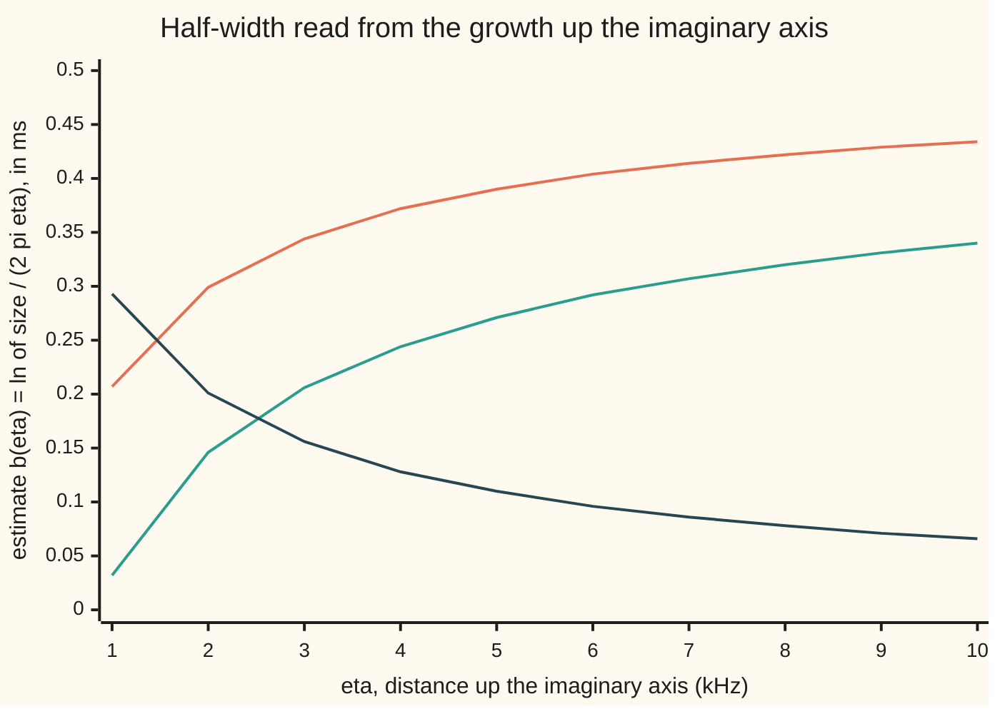

# Paley-Wiener-Schwartz: a signal confined to a window has an entire spectrum whose growth gives the window's width

[Syllabus](../../../SYLLABUS.md) → [Harmonic analysis](../README.md) → [The Fourier Transform](../README.md#s02) → Paley-Wiener-Schwartz

---

## General Overview

A camera shutter set to 1/1000 s is open for 1 millisecond (ms) and shut at every other time. Its spectrum, from [The Fourier transform of an absolutely integrable signal, and why it fades at infinity](01-fourier-transform-on-l1-and-riemann-lebesgue.md), is $`\hat g(\xi) = \sin(\pi\xi)/(\pi\xi)`$ ms, with the frequency $`\xi`$ in kilohertz (kHz). At 250 Hz it is 0.900316 ms.

That formula still makes sense when $`\xi`$ is replaced by a complex number $`\zeta = \xi + i\eta`$. The spectrum then becomes an **entire function**: one with a complex derivative at every point of the complex plane. Along the real line it is at most 1 ms. Off the line it grows, but never faster than $`e^{\pi\lvert\eta\rvert}`$ ms. At $`\zeta = 0.25 + 1i`$ kHz it is 3.572998 ms, under the ceiling $`e^{\pi}`$ = 23.140693 ms.

The rate $`\pi`$ in that ceiling is not an accident. It is $`\pi`$ times the 1 ms the shutter stays open. Open the shutter for 2 ms and the rate doubles. So the spectrum's growth off the real line records how wide the time window is. The theorem says this, both ways, for three kinds of signal:

- a **smooth** shutter that opens and closes gradually, whose spectrum also fades faster than every power of the frequency;
- any shutter with **finite energy**, including the hard 1 ms shutter;
- a **distribution**, such as $`\delta'`$, the slope of a spike, whose spectrum $`2\pi i\zeta`$ grows like a power and has rate 0: its window has width 0.

**A signal is zero outside the window from −A to A exactly when its transform extends to an entire function that grows no faster than $`e^{2\pi A\lvert\mathrm{Im}\,\zeta\rvert}`$ times a power of $`1 + \lvert\zeta\rvert`$; so the growth rate off the real line, divided by π, is the width of the window.**

**What kind of fact this is:** a theorem, the Paley–Wiener–Schwartz theorem. The half "window gives growth" is proved on this card in Why it works for all three kinds. The converse is proved for smooth signals in Step 5, by shifting the integration line; Step 4's Phragmén–Lindelöf turns a type bound into that ceiling, which (II) and the corollary need. The finite-energy and distribution converses reduce to the smooth one by smoothing, sketched in Step 5 and stated with sources.

### The picture: the growth reads off the half-width



Orange: the hard 1 ms shutter. Teal: the smooth shutter over the same 1 ms. Dark: the spike's slope $`\delta'`$. Both shutters climb toward the half-width 0.5 ms; the hard one reaches 0.489746 at 100 kHz and 0.498608 at 1,000 kHz. The spike's slope falls toward 0, its window's half-width.

---

## The formula

Notation first, in words. Time $`t`$ is in ms and frequency in kHz, so $`\xi t`$ is a pure number, as on [Schwartz space and tempered distributions](06-schwartz-space-and-tempered-distributions.md). The transform is this wing's $`\hat f(\xi) = \int f(t)\,e^{-2\pi i\xi t}\,dt`$. A complex frequency is $`\zeta = \xi + i\eta`$, with $`\eta = \mathrm{Im}\,\zeta`$ its imaginary part, also in kHz. The window is $`[-A, A]`$, so $`A`$ is its **half-width** and $`2A`$ its width.

- $`C_c^\infty`$ is the set of smooth signals (every slope exists) that are zero outside some interval.
- $`L^2`$ is the set of signals with finite energy $`\int\lvert f\rvert^2\,dt`$, with the transform from [Plancherel](05-plancherel-and-l2.md).
- A **tempered distribution** $`u`$ is a rule that reads smooth fast-fading probes, from [Schwartz space and tempered distributions](06-schwartz-space-and-tempered-distributions.md). Its **support** is the smallest closed set outside which every reading is 0.
- An entire function $`F`$ has **exponential type** $`\tau`$ if $`\tau`$ is the smallest rate such that, for every $`\varepsilon > 0`$, some constant $`C_\varepsilon`$ gives $`\lvert F(\zeta)\rvert \le C_\varepsilon\,e^{(\tau + \varepsilon)\lvert\zeta\rvert}`$. A power grows more slowly than every exponential, so $`2\pi i\zeta`$ has type 0.

The three statements, each read in both directions:

```math
\begin{aligned} &\text{(I) } \varphi \in C_c^\infty,\ \varphi = 0 \text{ outside } [-A, A] &&\iff \hat\varphi \text{ entire, and for every } N:\ \lvert\hat\varphi(\zeta)\rvert \le C_N\,(1 + \lvert\zeta\rvert)^{-N}\,e^{2\pi A\lvert\eta\rvert} \\ &\text{(II) } f \in L^2,\ f = 0 \text{ outside } [-A, A] &&\iff \hat f \text{ extends to an entire } F \text{ of exponential type at most } 2\pi A \text{ with } \textstyle\int \lvert F(\xi)\rvert^2\,d\xi < \infty \\ &\text{(III) } u \in \mathcal{S}',\ \mathrm{supp}\,u \subset [-A, A] &&\iff \hat u \text{ entire, and for some } N:\ \lvert\hat u(\zeta)\rvert \le C\,(1 + \lvert\zeta\rvert)^{N}\,e^{2\pi A\lvert\eta\rvert} \end{aligned}
```

**Read it aloud:** "A smooth signal lives in the window exactly when its spectrum is entire, grows at most like e to the 2πA times the imaginary part, and fades faster than every power. A finite-energy signal lives there exactly when its spectrum is entire, of type at most 2πA, and has finite energy on the real line. A distribution lives there exactly when its spectrum is entire and grows at most like that exponential times a power."

The **corollary** reads the window's edges off the growth up and down the imaginary axis. For a distribution with support whose smallest enclosing interval is $`[a, b]`$:

```math
b = \limsup_{\eta \to +\infty} \frac{\ln\lvert\hat u(i\eta)\rvert}{2\pi\eta}, \qquad -a = \limsup_{\eta \to +\infty} \frac{\ln\lvert\hat u(-i\eta)\rvert}{2\pi\eta}
```

**Read it aloud:** "The right edge is how fast the log of the spectrum grows going up the imaginary axis, over 2π. The left edge, with its sign flipped, is the same going down."

Here lim sup means the largest value the ratio keeps returning to. For the shutters below it is an ordinary limit. Write $`b(\eta)`$ for the ratio at a finite $`\eta`$: the picture plots it.

| Symbol | Plain meaning | In our example | Push it up and the answer… |
| --- | --- | --- | --- |
| $`t`$, $`\xi`$, $`i`$ | time in ms; real frequency in kHz; the imaginary unit, $`i^2 = -1`$ | 250 Hz is $`\xi = 0.25`$ | — |
| $`\zeta = \xi + i\eta`$, $`\eta`$ | a complex frequency; its imaginary part, in kHz | $`\zeta = 0.25 + 1i`$ | larger $`\lvert\eta\rvert`$, larger spectrum |
| $`f`$, $`\hat f`$, $`F`$, $`L^2`$, $`C_c^\infty`$ | a signal; its transform; the entire function that extends it; finite-energy signals; smooth signals zero outside an interval | the light reaching the sensor | — |
| $`g`$ | the hard shutter: 1 from −0.5 to 0.5 ms, 0 elsewhere | $`\hat g(0.25) = 0.900316`$ ms | — |
| $`\varphi`$ | the smooth shutter $`e^{1 - 1/(1 - 4t^2)}`$ inside the window, 0 outside | area 0.603450 ms | — |
| $`A`$, $`[a, b]`$ | the window's half-width; its edges in general | $`A`$ = 0.5 ms; $`[-0.5, 0.5]`$ | the growth rate rises |
| $`\tau = 2\pi A`$ | the exponential type: the rate in the ceiling | $`\pi`$ ms = 3.141593 ms | wider window |
| $`N`$, $`C`$, $`C_N`$, $`C_\varepsilon`$, $`M`$ | a power of $`1 + \lvert\zeta\rvert`$; the constants in the bounds; a bound on the real line | $`N = 1`$ for $`\delta'`$; $`M`$ = 1 ms for $`\hat g`$ | rougher signal, larger $`N`$ allowed |
| $`u`$, $`\mathcal{S}'`$, $`\mathrm{supp}\,u`$, $`\delta`$, $`\delta'`$ | a tempered distribution; the set of them; its support; the spike; its slope, $`\delta'(\psi) = -\psi'(0)`$ on a probe $`\psi`$ | $`\hat{\delta'}(\zeta) = 2\pi i\zeta`$ | — |
| $`b(\eta)`$ | the edge estimate $`\ln\lvert\hat f(i\eta)\rvert/(2\pi\eta)`$ | 0.434 ms at $`\eta`$ = 10 kHz | settles on $`b`$ |
| $`\rho_w`$, $`K`$ | a narrow smooth bump of area 1 and width $`w`$, standing in for $`\delta`$; the cut-off of a truncated inverse integral | $`w`$ = 1, 0.1, 0.01 ms; $`K`$ = 200 kHz | closer to the limit; smaller tail error |
| $`G`$, $`\theta`$, $`\varepsilon`$ | in the proofs: $`F`$ with its expected growth divided out; a smooth cut-off; its margin, or a small slack | $`G = F\,e^{i(2\pi A + 2\varepsilon)\zeta}`$ | — |

### When it holds

- **The window is bounded.** The bell $`e^{-\pi t^2}`$ has no window. Its transform is the same bell, as [Two pairs worth memorising](03-gaussian-and-sinc-transform-pairs.md) shows, and it extends to the entire $`e^{-\pi\zeta^2}`$. That grows like $`e^{\pi\eta^2}`$ up the imaginary axis, so $`b(\eta) = \eta/2`$: 5 ms at 10 kHz and 50 ms at 100 kHz, without end.
- **The real-line bound matters.** The entire function $`e^{\pi\zeta}`$ has size 1 everywhere on the imaginary axis, so it reads $`b = 0`$. But on the real line it reaches $`e^{31.415927}`$ at 10 kHz. It is no tempered distribution's transform, and no window exists.
- **For smoothness, every $`N`$.** Statement (I) needs the fading for every power. A spectrum with growth like $`(1 + \lvert\zeta\rvert)^{1}`$ comes from a distribution such as $`\delta'`$, not from a smooth signal.
- **One convention.** In wing 07's $`\omega = 2\pi\xi`$ form the ceiling reads $`e^{A\lvert\mathrm{Im}\,\omega\rvert}`$, rate 0.5 ms for the same shutter. The rule "rate over $`\pi`$ is the width" holds only in this card's hertz form.

---

## Why it works

### Step 0: a window turns every complex frequency into a bounded weight

The transform at a complex frequency weighs the signal by $`e^{-2\pi i\zeta t}`$. Its size is $`e^{2\pi\eta t}`$: it grows exponentially in time, at a rate set by $`\eta`$. On the whole line that weight is unbounded, so the integral usually fails. Inside a window $`[-A, A]`$ it never exceeds $`e^{2\pi A\lvert\eta\rvert}`$. So a confined signal has a transform at every complex frequency, and the window's half-width $`A`$ caps the growth. The converse says nothing else can produce that cap.

### Step 1: the window gives an entire spectrum with the ceiling

Take the hard shutter $`g`$. Its transform at any complex $`\zeta`$ is

```math
\hat g(\zeta) = \int_{-0.5}^{0.5} e^{-2\pi i\zeta t}\,dt = \frac{\sin(\pi\zeta)}{\pi\zeta}, \qquad \lvert\hat g(\zeta)\rvert \le \int_{-0.5}^{0.5} e^{2\pi\eta t}\,dt \le 1 \cdot e^{\pi\lvert\eta\rvert}.
```

The power series of $`e^{-2\pi i\zeta t}`$ in $`\zeta`$ can be integrated term by term over a bounded window. So $`\hat g`$ is a convergent power series in $`\zeta`$: it is entire. The same two lines work for any integrable signal in the window, with the area $`\int\lvert f\rvert`$ in place of 1. A finite-energy signal in a bounded window is integrable, so this proves the forward half of (II), and Plancherel gives finite energy on the real line.

The code checks the ceiling at four complex frequencies, against Simpson's rule:

| $`\zeta`$ (kHz) | hard shutter, ms | ceiling $`e^{\pi\lvert\eta\rvert}`$ | ratio | smooth shutter, ms | ratio to area × ceiling |
| --- | ---: | ---: | ---: | ---: | ---: |
| 0.25 | 0.900316 | 1.000000 | 0.900316 | 0.574525 | 0.952066 |
| 0.25 + 1i | 3.572998 | 23.140693 | 0.154403 | 1.190528 | 0.085255 |
| 2 + 2i | 30.131887 | 535.491656 | 0.056270 | 3.467193 | 0.010730 |
| 0.5 + 5i | 210170.234898 | 6635623.999341 | 0.031673 | 4971.086915 | 0.001241 |

The ratios fall because the ceiling uses the window's far edge for every $`t`$; only the edge itself grows that fast.

### Step 2: smoothness adds decay on top of the ceiling

The smooth shutter $`\varphi`$ rises from 0 at −0.5 ms to 1 at the centre and falls back to 0 at 0.5 ms, with every slope zero at the edges. [The transform rulebook](02-shift-scale-and-derivative-rules.md) turns a slope in time into a factor $`2\pi i\zeta`$, and this holds at complex $`\zeta`$ too: the shutter and all its slopes are 0 at the window's edges, so integration by parts leaves no boundary terms:

```math
(2\pi i\zeta)^N\,\hat\varphi(\zeta) = \widehat{\varphi^{(N)}}(\zeta), \qquad \lvert\hat\varphi(\zeta)\rvert \le \frac{\int\lvert\varphi^{(N)}\rvert\,dt}{(2\pi\lvert\zeta\rvert)^N}\,e^{\pi\lvert\eta\rvert}.
```

Every $`N`$ works, so $`\hat\varphi`$ fades faster than every power, inside the same ceiling. That is the forward half of (I). On the real line with $`N = 2`$, where $`\int\lvert\varphi''\rvert`$ = 17.362856686, four times the steepest slope of $`\varphi`$, because $`\varphi''`$ changes sign only at ±0.379918 ms:

| $`\xi`$ (kHz) | hard shutter, $`1/(\pi\xi)`$ | smooth shutter | bound, $`N = 2`$ | ratio |
| ---: | ---: | ---: | ---: | ---: |
| 1.5 | 0.212207 | 0.026214621 | 0.195469466 | 0.134111 |
| 2.5 | 0.127324 | 0.032350740 | 0.070369008 | 0.459730 |
| 4.5 | 0.070736 | 0.010129789 | 0.021718830 | 0.466406 |
| 8.5 | 0.037448 | 0.000122590 | 0.006087284 | 0.020139 |
| 16.5 | 0.019292 | 0.000106664 | 0.001615450 | 0.066027 |

The hard shutter's jumps cost it: it fades only like $`1/\xi`$. Both shutters share the same window and the same ceiling. The real line records smoothness; the imaginary direction records width.

### Step 3: distributions add a power instead

A distribution $`u`$ supported in the window reads a probe using only finitely many of its slopes, up to some order $`N`$. Feed it the probe $`e^{-2\pi i\zeta t}`$, cut off smoothly with a margin that shrinks like $`1/(1 + \lvert\zeta\rvert)`$ (see the fold). Each slope brings a factor $`2\pi\zeta`$, so the reading is at most $`C(1 + \lvert\zeta\rvert)^N e^{2\pi A\lvert\eta\rvert}`$. That is the forward half of (III).

For $`\delta'`$, the window is the single point 0 and $`N = 1`$. Its transform is $`\hat{\delta'}(\zeta) = 2\pi i\zeta`$: the spike's flat spectrum 1 from [Schwartz space and tempered distributions](06-schwartz-space-and-tempered-distributions.md), times the slope factor. There is no exponential at all: type 0, width 0.

The spike is an idealisation, so the code replaces it by narrow bumps $`\rho_w`$ of area 1 and width $`w`$, and transforms their slopes:

| width $`w`$ | at 1 kHz | at $`\zeta = 1i`$ kHz |
| ---: | ---: | ---: |
| 1 ms | 2.554418i | −12.748495 |
| 0.1 ms | 6.234295i | −6.332346 |
| 0.01 ms | 6.282695i | −6.283676 |
| limit $`2\pi i\zeta`$ | 6.283185i | −6.283185 |

At $`\zeta = 1i`$ the 1 ms bump is about twice the limit: its window still has width 1 ms, and its growth shows it. As $`w`$ shrinks, so does the window, and the growth disappears.

<details>
<summary>Detailed proof: the distribution bound, without the extra width</summary>

Let $`u`$ have support in $`[-A, A]`$. Being tempered and compactly supported, it has a finite order $`N`$: for some constant $`C`$, every probe $`\psi`$ gives

$`\displaystyle \lvert u(\psi)\rvert \le C \sum_{k \le N}\ \sup_{\lvert t\rvert \le A + 1} \lvert\psi^{(k)}(t)\rvert.`$

Take $`\psi(t) = \theta(t)\,e^{-2\pi i\zeta t}`$, where $`\theta`$ is smooth, equal to 1 near the window and 0 beyond a margin $`\varepsilon \le 1`$. The constant $`C`$ does not depend on $`\varepsilon`$. By the product rule, each slope of $`\psi`$ is a sum of terms $`\theta^{(j)}(t)\,(2\pi\zeta)^{k-j}\,e^{-2\pi i\zeta t}`$. The exponential is at most $`e^{2\pi(A + \varepsilon)\lvert\eta\rvert}`$ there.

To remove the margin from the exponent, choose $`\varepsilon = 1/(1 + \lvert\zeta\rvert)`$. Then $`e^{2\pi\varepsilon\lvert\eta\rvert} \le e^{2\pi}`$, a constant. A cut-off of margin $`\varepsilon`$ has slopes of size about $`\varepsilon^{-j}`$, which is $`(1 + \lvert\zeta\rvert)^j`$. Every term is then at most a constant times $`(1 + \lvert\zeta\rvert)^N e^{2\pi A\lvert\eta\rvert}`$. That is (III), forward. Hörmander gives this argument in full, in any number of dimensions.

</details>

### Step 4: the converse, part one: Phragmén–Lindelöf upgrades a type to a ceiling

Now go backwards. Start with an entire $`F`$ of exponential type at most $`2\pi A`$ that is bounded on the real line, say by $`M`$. The type bound $`C_\varepsilon e^{(2\pi A + \varepsilon)\lvert\zeta\rvert}`$ allows growth in every direction. The ceiling $`e^{2\pi A\lvert\eta\rvert}`$ allows growth only off the real line. The gap between them is closed by [Phragmen-Lindelof](../../07-Complex%20analysis/04-Taylor%20Series%2C%20Zeros%20and%20Rigidity/07-phragmen-lindelof-principle.md): a maximum principle on an unbounded region, valid when the function grows slowly enough.

The trick is to divide out the expected growth, with a little to spare. In the upper half-plane, $`G(\zeta) = F(\zeta)\,e^{i(2\pi A + 2\varepsilon)\zeta}`$ has $`\lvert G\rvert = \lvert F\rvert\,e^{-(2\pi A + 2\varepsilon)\eta}`$. On the real line $`\lvert G\rvert \le M`$. On the positive imaginary axis $`\lvert G\rvert \le C_\varepsilon e^{-\varepsilon\eta} \le C_\varepsilon`$, by the type bound. In each quarter-plane between them, $`G`$ grows at most exponentially, far below the limit the quarter-plane's angle allows. So $`\lvert G\rvert \le \max(M, C_\varepsilon)`$ there: $`G`$ is bounded on the whole upper half-plane. Phragmén–Lindelöf once more, on the half-plane, whose edge bound is $`M`$, gives $`\lvert G\rvert \le M`$. Let $`\varepsilon`$ shrink to 0:

```math
\lvert F(\xi + i\eta)\rvert \le M\, e^{2\pi A\lvert\eta\rvert}.
```

The lower half-plane is the same with $`e^{-i(2\pi A + 2\varepsilon)\zeta}`$. A real-line bound $`(1 + \lvert\xi\rvert)^N`$ in place of $`M`$ works the same way, after dividing by $`(\zeta + i)^N`$ in the upper half-plane.

### Step 5: the converse, part two: shift the line and let the signal vanish

Suppose $`F`$ meets the ceiling and fades like $`(1 + \lvert\zeta\rvert)^{-2}`$ inside it, as in (I). Define the signal by [Fourier inversion](04-fourier-inversion-theorem.md), $`\varphi(t) = \int F(\xi)\,e^{2\pi i\xi t}\,d\xi`$. Cauchy's theorem lets the integration line move up to height $`\eta`$, since the fading kills the ends. On the new line the integrand is at most $`C_2 (1 + \lvert\xi\rvert)^{-2} e^{2\pi A\eta}\,e^{-2\pi\eta t}`$. So

```math
\lvert\varphi(t)\rvert \le C_2\, e^{2\pi\eta\,(A - t)} \int (1 + \lvert\xi\rvert)^{-2}\,d\xi = 2\,C_2\, e^{2\pi\eta\,(A - t)} \quad\text{for every } \eta > 0.
```

For $`t > A`$ the exponent is negative. Letting $`\eta`$ grow sends the bound to 0, so $`\varphi(t) = 0`$. Moving the line down covers $`t < -A`$. The signal is silent outside the window. Faster fading makes $`\varphi`$ smooth, which proves (I) backwards.

For (II) and (III), smooth first: multiply $`F`$ by the transform of a narrow smooth bump $`\rho_w`$. The product meets (I) with half-width $`A + w/2`$, so its signal lives in $`[-A - w/2,\ A + w/2]`$. As $`w`$ shrinks, that signal settles on the original one (in energy for (II), on every probe for (III)), which therefore lives in $`[-A, A]`$. For (II) the needed real-line bound comes from a lemma of Plancherel and Pólya; Paley and Wiener give the $`L^2`$ case in full, and Hörmander the distribution case.

The code checks a finite-energy converse on $`\hat g(\zeta)^2 = \sin^2(\pi\zeta)/(\pi\zeta)^2`$. It is entire, of type $`2\pi`$ ms, and square-integrable on the line. So its signal must live in $`[-1, 1]`$ ms: it is the triangle $`1 - \lvert t\rvert`$, the shutter's overlap with a shifted copy of itself. Cutting the inverse integral at $`K`$ = 200 kHz leaves a tail of at most 0.001013:

| $`t`$ (ms) | inverse, cut at 200 kHz | triangle | gap |
| ---: | ---: | ---: | ---: |
| 0.0 | 0.999493 | 1.000000 | 0.000507 |
| 0.5 | 0.500000 | 0.500000 | 0.000000 |
| 1.5 | 0.000000 | 0.000000 | 0.000000 |

At 1.5 ms, outside the window, the signal is silent, as the type predicts.

### Step 6: the width, read off the growth

Step 4 and Step 5 together say more than "inside some window". If the growth up the imaginary axis has rate $`2\pi b`$, Phragmén–Lindelöf gives the ceiling $`e^{2\pi(b + \varepsilon)\eta}`$ on the whole upper half-plane, for every small $`\varepsilon`$. The shifted line then silences every $`t > b + \varepsilon`$, so the support's right edge is at most $`b`$. Step 1 gives the other inequality: the growth rate is at most $`2\pi`$ times the right edge. So the right edge is exactly the growth rate over $`2\pi`$. The left edge comes from the lower half-plane. That is the corollary.

For the hard shutter, $`\hat g(i\eta) = \sinh(\pi\eta)/(\pi\eta)`$, so

```math
b(\eta) = \frac{\ln\sinh(\pi\eta) - \ln(\pi\eta)}{2\pi\eta} \;\longrightarrow\; 0.5 \text{ ms}.
```

The convergence is slow, because of the $`\ln(\pi\eta)`$ term: 0.434 at 10 kHz, 0.489746 at 100, 0.498608 at 1,000, 0.499824 at 10,000. The smooth shutter approaches more slowly still: it is small near its edges, so it needs a larger $`\eta`$ before the edge dominates. The limit is the same, because the window is the same. [The uncertainty principle](07-uncertainty-principle.md) uses the band-limited mirror image of (II) to show that no signal is both time-limited and band-limited.

---

## Worked numbers, by hand

The hard shutter at the complex frequency $`\zeta = 0.25 + 1i`$ kHz, then its half-width read at $`\eta`$ = 10 kHz. The rule $`\lvert\sin(x + iy)\rvert^2 = \sin^2 x + \sinh^2 y`$ does the complex sine.

| Step | Arithmetic | Value |
| --- | --- | --- |
| 1 | $`\sinh\pi`$ | 11.548739 |
| 2 | $`\lvert\sin(\pi\zeta)\rvert = \sqrt{\sin^2(\pi/4) + \sinh^2\pi} = \sqrt{0.5 + 11.548739^2}`$ | 11.570366 |
| 3 | $`\lvert\pi\zeta\rvert = \pi\sqrt{0.25^2 + 1^2}`$ | 3.238280 |
| 4 | $`\lvert\hat g(\zeta)\rvert = 11.570366 / 3.238280`$ | 3.572998 ms |
| 5 | ceiling $`1\text{ ms} \times e^{\pi \times 1}`$ | 23.140693 ms |
| 6 | ratio 3.572998 / 23.140693 | 0.154403 |
| 7 | $`\ln\sinh(10\pi)`$ and $`\ln(10\pi)`$ | 30.722779 and 3.447315 |
| 8 | $`b(10) = (30.722779 - 3.447315)/(2\pi \times 10)`$ | 0.434 ms |
| 9 | limit of $`b(\eta)`$, times 2 | **width 1.000000 ms** |

The spectrum stays under its ceiling, and its growth rate, $`\pi`$ ms = 3.141593 ms, is $`\pi`$ times the 1 ms the shutter is open.

### What breaks if you drop a piece

| Mistake | Comes out at | What went wrong |
| --- | --- | --- |
| Read the type over $`2\pi`$ as the width | 0.500000 ms instead of 1.000000 ms | Type over $`2\pi`$ is the half-width $`A`$; the window is $`[-A, A]`$ |
| Drop the bounded window: the bell $`e^{-\pi t^2}`$ | $`b`$ = 0.500000, 5.000000, 50.000000 ms at $`\eta`$ = 1, 10, 100 | Entire, but of order 2, not exponential type: no window |
| Drop the real-line bound: $`e^{\pi\zeta}`$ | $`b = 0`$, yet size $`e^{31.415927}`$ at 10 kHz | Not a tempered distribution's transform; Phragmén–Lindelöf has no edge bound |

---

## Code, from first principles, and it actually runs

The scripts work in ms and kHz and compute every transform themselves, with a complex number written out in Rust. They take **five roads**. The closed forms of the hard shutter, the same shutter delayed by 0.5 ms, and the bell are checked against Simpson's rule at complex frequencies, and the smooth shutter against Simpson's rule at two step counts. The slope rule is checked against the transform of the second slope, with its decay bound, whose constant is checked against Simpson's rule between the zeros of $`\varphi''`$. A truncated inverse integral of $`\hat g^2`$ is checked against the triangle, inside a printed tail bound. Narrow bumps settle on $`2\pi i\zeta`$. The edge estimate climbs toward 0.5 ms.

### Python

```python
# Paley-Wiener-Schwartz -- the check behind the card.  Standard library only.
# Units: time t in ms, frequency in kHz, so xi*t is a pure number.
# Convention: f-hat(zeta) = integral of f(t) e^(-2 pi i zeta t) dt, with a complex
# frequency zeta = xi + i*eta.  Every transform is computed here.  Roads: closed
# forms against Simpson's rule at two step counts, the slope rule against the
# transform of the second slope, and narrow bumps that settle on the spike's slope.
import math, cmath
PI = math.pi

def simpson(f, a, b, n):              # n even; f may return complex numbers
    h = (b - a) / n
    s = f(a) + f(b)
    for k in range(1, n):
        s += (4 if k % 2 else 2) * f(a + k * h)
    return s * h / 3

def ft(f, z, a, b, n):                # transform of f (zero outside [a, b]) at complex z
    return simpson(lambda t: f(t) * cmath.exp(-2j * PI * z * t), a, b, n)

def bump(t, k):                       # smooth shutter exp(1 - 1/u), u = 1 - 4t^2: k-th slope
    u = 1 - 4 * t * t
    if u <= 1e-9: return 0.0
    p = math.exp(1 - 1 / u)
    if k == 0: return p
    if k == 1: return p * (-8 * t / u**2)
    return p * (64 * t * t / u**4 - 8 / u**2 - 128 * t * t / u**3)

g = lambda t: 1.0                     # the hard shutter, open from -0.5 to 0.5 ms
g_hat = lambda z: cmath.sin(PI * z) / (PI * z)
phi = lambda t: bump(t, 0)
def lnsinh(x): return x + math.log((1 - math.exp(-2 * x)) / 2)

# 1. both shutters obey the window bound |f-hat(zeta)| <= (area) e^(pi |eta|)
area = simpson(phi, -0.5, 0.5, 4000).real
print(f"smooth shutter area = {area:.6f} ms (hard shutter area = 1.000000 ms)")
for xi, eta in [(0.25, 0.0), (0.25, 1.0), (2.0, 2.0), (0.5, 5.0)]:
    z = complex(xi, eta)
    exact, simp = abs(g_hat(z)), abs(ft(g, z, -0.5, 0.5, 2000))
    sm = abs(ft(phi, z, -0.5, 0.5, 4000))
    sm2 = abs(ft(phi, z, -0.5, 0.5, 8000))
    bound = math.exp(PI * abs(eta))
    assert abs(exact - simp) < 1e-9 * max(1, exact) and abs(sm - sm2) < 1e-9 * max(1, sm)
    assert exact <= bound and sm <= area * bound
    print(f"zeta = {xi:.2f}+{eta:.2f}i  hard {exact:.6f} (Simpson {simp:.6f})  bound {bound:.6f}"
          f"  ratio {exact / bound:.6f}  smooth {sm:.6f}  ratio {sm / (area * bound):.6f}")
    if (xi, eta) == (0.25, 1.0):                      # the hand computation
        sh = math.sinh(PI)
        print(f"by hand: sinh(pi) = {sh:.6f}  |sin(pi zeta)| = {math.sqrt(0.5 + sh * sh):.6f}"
              f"  |pi zeta| = {abs(PI * z):.6f}")

# 2. read the window off the growth: b(eta) = ln|f-hat(i eta)| / (2 pi eta) -> 0.5 ms
etas = list(range(1, 11))
hard = [(lnsinh(PI * e) - math.log(PI * e)) / (2 * PI * e) for e in etas]
smooth = [math.log(abs(ft(phi, 1j * e, -0.5, 0.5, 4000))) / (2 * PI * e) for e in etas]
spike = [math.log(2 * PI * e) / (2 * PI * e) for e in etas]
assert abs(hard[0] - math.log(abs(ft(g, 1j, -0.5, 0.5, 2000))) / (2 * PI)) < 1e-9
assert abs(smooth[9] - math.log(abs(ft(phi, 10j, -0.5, 0.5, 8000))) / (20 * PI)) < 1e-9
print(f"by hand: ln sinh(10 pi) = {lnsinh(10 * PI):.6f}  ln(10 pi) = {math.log(10 * PI):.6f}")
print("chart eta (kHz):", " ".join(f"{e}" for e in etas))
for name, row in [("hard", hard), ("smooth", smooth), ("spike slope", spike)]:
    print(f"chart {name}:", " ".join(f"{v:.3f}" for v in row))
far = [(lnsinh(PI * e) - math.log(PI * e)) / (2 * PI * e) for e in (100, 1000, 10000)]
print("hard shutter b at eta = 100, 1000, 10000 kHz:", " ".join(f"{v:.6f}" for v in far))
assert hard[9] < far[0] < far[1] < far[2] < 0.5 and 0.5 - far[2] < 1e-3
print(f"type = 2 pi b = {2 * PI * 0.5:.6f} ms; window width = 2b = 1.000000 ms")
up, down = (math.log(abs(ft(g, s * 10j, 0, 1, 2000))) / (20 * PI) for s in (1, -1))
assert abs(up - hard[9] - 0.5) < 1e-9 and abs(down - hard[9] + 0.5) < 1e-9   # shift by 0.5 ms
print(f"shutter open 0 to 1 ms, b up and down at eta = 1000 kHz: {far[1] + 0.5:.6f} {far[1] - 0.5:.6f};"
      f" width {2 * far[1]:.6f} ms, type over pi {2 * far[1] + 1:.6f} ms")

# 3. the real line measures smoothness, not width: decay at half-integer kHz
ts = 48 ** -0.25                                  # phi'' = 0 only at +-ts, where 384 t^4 = 8
l1 = 4 * abs(bump(ts, 1))                         # so integral of |phi''| = 4 x steepest slope
l1s = 2 * simpson(lambda t: bump(t, 2), ts, 0.5, 4000) - simpson(lambda t: bump(t, 2), -ts, ts, 4000)
assert abs(bump(ts, 2)) < 1e-9 and abs(l1 - l1s) < 1e-9
print(f"integral of |second slope| = 4 x steepest slope = {l1:.9f}, at t = {ts:.6f} ms"
      f" (Simpson between the zeros {l1s:.9f})")
for xi in (1.5, 2.5, 4.5, 8.5, 16.5):
    h = abs(g_hat(xi))
    s = ft(phi, xi, -0.5, 0.5, 4000)
    s2 = ft(lambda t: bump(t, 2), xi, -0.5, 0.5, 4000)   # transform of the 2nd slope
    assert abs(s2 + (2 * PI * xi)**2 * s) < 1e-9          # slope rule: (2 pi i xi)^2
    assert abs(h - 1 / (PI * xi)) < 1e-12
    bnd = l1 / (2 * PI * xi)**2
    assert abs(s) <= bnd
    print(f"xi = {xi:4.1f} kHz  hard {h:.6f}  smooth {abs(s):.9f}  "
          f"bound {bnd:.9f}  ratio {abs(s) / bnd:.6f}")

# 4. L2 converse: g-hat^2 = sinc^2 has type 2 pi; its inverse is silent past 1 ms
K = 200.0
sinc2 = lambda x: 1.0 if x == 0 else (math.sin(PI * x) / (PI * x))**2
print(f"inverse of sinc^2, cut at {K:.0f} kHz, tail bound {2 / (PI**2 * K):.6f}:")
for t in (0.0, 0.5, 1.5):
    v = 2 * simpson(lambda x: sinc2(x) * math.cos(2 * PI * x * t), 0, K, 40000)
    tri = max(0.0, 1 - abs(t))
    assert abs(v - tri) < 2 / (PI**2 * K)
    print(f"  t = {t:.1f} ms  inverse {v:.6f}  triangle {tri:.6f}  gap {abs(v - tri):.6f}")

# 5. the spike's slope: narrow bumps rho_w (area 1, width w) whose slopes settle
for w in (1.0, 0.1, 0.01):
    d = lambda t: bump(t / w, 1) / (w * w * area)
    a = ft(d, 1.0, -w / 2, w / 2, 2000)
    b = ft(d, 1j, -w / 2, w / 2, 2000)
    print(f"w = {w:.3f} ms  at 1 kHz {a.imag:.6f}i  at 1i kHz {b.real:.6f}")
assert abs(a.imag - 2 * PI) < 1e-3 and abs(b.real + 2 * PI) < 1e-3
print(f"limit 2 pi i zeta: {2 * PI:.6f}i and {-2 * PI:.6f}")

# 6. what breaks
gb = [(-PI * (1j * e)**2).real / (2 * PI * e) for e in (1, 10, 100)]   # ln|e^(-pi zeta^2)| at i eta
tail, bq = math.exp(-64 * PI) / (8 * PI), []    # share of the bell's area more than 8 ms from its peak
for e in (1, 10):                               # the defining integral at zeta = i eta, cut at eta -+ 8
    v = simpson(lambda t: math.exp(-PI * t * t + 2 * PI * e * t), e - 8, e + 8, 2000)
    assert abs(v / math.exp(PI * e * e) - 1) < 1e-9
    bq.append(math.log(v) / (2 * PI * e))
print(f"bell by Simpson on [eta - 8, eta + 8] ms, tail share below {tail:.1e}:"
      f" b at eta = 1, 10: {bq[0]:.6f} {bq[1]:.6f}")
print("bell e^(-pi t^2): b at eta = 1, 10, 100:", " ".join(f"{v:.6f}" for v in gb))
ex, im = math.log(abs(cmath.exp(PI * 10))), abs(cmath.exp(PI * 1j * 10))
print(f"e^(pi zeta): ln size at 10 kHz {ex:.6f}; size at 10i kHz {im:.6f}, so b = 0")
print(f"half-width misread as width: {PI / (2 * PI):.6f} ms instead of 1.000000 ms")
print("ALL CHECKS PASS")
```

**Ran 2026-11-24 on macOS, Python 3.14.10, standard library only. All checks passed. Output, pasted from the run:**

```
smooth shutter area = 0.603450 ms (hard shutter area = 1.000000 ms)
zeta = 0.25+0.00i  hard 0.900316 (Simpson 0.900316)  bound 1.000000  ratio 0.900316  smooth 0.574525  ratio 0.952066
zeta = 0.25+1.00i  hard 3.572998 (Simpson 3.572998)  bound 23.140693  ratio 0.154403  smooth 1.190528  ratio 0.085255
by hand: sinh(pi) = 11.548739  |sin(pi zeta)| = 11.570366  |pi zeta| = 3.238280
zeta = 2.00+2.00i  hard 30.131887 (Simpson 30.131887)  bound 535.491656  ratio 0.056270  smooth 3.467193  ratio 0.010730
zeta = 0.50+5.00i  hard 210170.234898 (Simpson 210170.234965)  bound 6635623.999341  ratio 0.031673  smooth 4971.086915  ratio 0.001241
by hand: ln sinh(10 pi) = 30.722779  ln(10 pi) = 3.447315
chart eta (kHz): 1 2 3 4 5 6 7 8 9 10
chart hard: 0.207 0.299 0.344 0.372 0.390 0.404 0.414 0.422 0.429 0.434
chart smooth: 0.032 0.146 0.206 0.244 0.271 0.292 0.307 0.320 0.331 0.340
chart spike slope: 0.293 0.201 0.156 0.128 0.110 0.096 0.086 0.078 0.071 0.066
hard shutter b at eta = 100, 1000, 10000 kHz: 0.489746 0.498608 0.499824
type = 2 pi b = 3.141593 ms; window width = 2b = 1.000000 ms
shutter open 0 to 1 ms, b up and down at eta = 1000 kHz: 0.998608 -0.001392; width 0.997216 ms, type over pi 1.997216 ms
integral of |second slope| = 4 x steepest slope = 17.362856686, at t = 0.379918 ms (Simpson between the zeros 17.362856686)
xi =  1.5 kHz  hard 0.212207  smooth 0.026214621  bound 0.195469466  ratio 0.134111
xi =  2.5 kHz  hard 0.127324  smooth 0.032350740  bound 0.070369008  ratio 0.459730
xi =  4.5 kHz  hard 0.070736  smooth 0.010129789  bound 0.021718830  ratio 0.466406
xi =  8.5 kHz  hard 0.037448  smooth 0.000122590  bound 0.006087284  ratio 0.020139
xi = 16.5 kHz  hard 0.019292  smooth 0.000106664  bound 0.001615450  ratio 0.066027
inverse of sinc^2, cut at 200 kHz, tail bound 0.001013:
  t = 0.0 ms  inverse 0.999493  triangle 1.000000  gap 0.000507
  t = 0.5 ms  inverse 0.500000  triangle 0.500000  gap 0.000000
  t = 1.5 ms  inverse 0.000000  triangle 0.000000  gap 0.000000
w = 1.000 ms  at 1 kHz 2.554418i  at 1i kHz -12.748495
w = 0.100 ms  at 1 kHz 6.234295i  at 1i kHz -6.332346
w = 0.010 ms  at 1 kHz 6.282695i  at 1i kHz -6.283676
limit 2 pi i zeta: 6.283185i and -6.283185
bell by Simpson on [eta - 8, eta + 8] ms, tail share below 1.9e-89: b at eta = 1, 10: 0.500000 5.000000
bell e^(-pi t^2): b at eta = 1, 10, 100: 0.500000 5.000000 50.000000
e^(pi zeta): ln size at 10 kHz 31.415927; size at 10i kHz 1.000000, so b = 0
half-width misread as width: 0.500000 ms instead of 1.000000 ms
ALL CHECKS PASS
```

### Rust

```rust
// Paley-Wiener-Schwartz -- the check behind the card.  Rust std only.
// Units: time t in ms, frequency in kHz, so xi*t is a pure number.
// Convention: f-hat(zeta) = integral of f(t) e^(-2 pi i zeta t) dt, with a complex
// frequency zeta = xi + i*eta.  Every transform is computed here.  Roads: closed
// forms against Simpson's rule at two step counts, the slope rule against the
// transform of the second slope, and narrow bumps that settle on the spike's slope.
use std::f64::consts::PI;

#[derive(Clone, Copy)]
struct C { re: f64, im: f64 }
fn c(re: f64, im: f64) -> C { C { re, im } }
fn add(a: C, b: C) -> C { c(a.re + b.re, a.im + b.im) }
fn mul(a: C, b: C) -> C { c(a.re * b.re - a.im * b.im, a.re * b.im + a.im * b.re) }
fn sc(a: C, k: f64) -> C { c(a.re * k, a.im * k) }
fn div(a: C, b: C) -> C { let d = b.re * b.re + b.im * b.im; c((a.re * b.re + a.im * b.im) / d, (a.im * b.re - a.re * b.im) / d) }
fn abs(a: C) -> f64 { a.re.hypot(a.im) }
fn cexp(a: C) -> C { let m = a.re.exp(); c(m * a.im.cos(), m * a.im.sin()) }
fn csin(a: C) -> C { c(a.re.sin() * a.im.cosh(), a.re.cos() * a.im.sinh()) }

fn simpson(f: &dyn Fn(f64) -> C, a: f64, b: f64, n: usize) -> C {
    let h = (b - a) / n as f64;
    let mut s = add(f(a), f(b));
    for k in 1..n {
        s = add(s, sc(f(a + k as f64 * h), if k % 2 == 1 { 4.0 } else { 2.0 }));
    }
    sc(s, h / 3.0)
}
fn ft(f: &dyn Fn(f64) -> f64, z: C, a: f64, b: f64, n: usize) -> C {
    simpson(&|t: f64| sc(cexp(sc(mul(c(0.0, -2.0 * PI), z), t)), f(t)), a, b, n)
}
fn bump(t: f64, k: u32) -> f64 {
    let u = 1.0 - 4.0 * t * t;
    if u <= 1e-9 { return 0.0; }
    let p = (1.0 - 1.0 / u).exp();
    match k {
        0 => p,
        1 => p * (-8.0 * t / u.powi(2)),
        _ => p * (64.0 * t * t / u.powi(4) - 8.0 / u.powi(2) - 128.0 * t * t / u.powi(3)),
    }
}
fn g_hat(z: C) -> C { div(csin(sc(z, PI)), sc(z, PI)) }
fn lnsinh(x: f64) -> f64 { x + ((1.0 - (-2.0 * x).exp()) / 2.0).ln() }
fn join(v: &[f64], d: usize) -> String { v.iter().map(|x| format!("{:.*}", d, x)).collect::<Vec<_>>().join(" ") }

fn main() {
    let g = |_t: f64| 1.0;
    let phi = |t: f64| bump(t, 0);
    // 1. both shutters obey the window bound
    let area = simpson(&|t| c(phi(t), 0.0), -0.5, 0.5, 4000).re;
    println!("smooth shutter area = {:.6} ms (hard shutter area = 1.000000 ms)", area);
    for (xi, eta) in [(0.25, 0.0), (0.25, 1.0), (2.0, 2.0), (0.5, 5.0)] {
        let z = c(xi, eta);
        let (exact, simp) = (abs(g_hat(z)), abs(ft(&g, z, -0.5, 0.5, 2000)));
        let sm = abs(ft(&phi, z, -0.5, 0.5, 4000));
        let sm2 = abs(ft(&phi, z, -0.5, 0.5, 8000));
        let bound = (PI * eta.abs()).exp();
        assert!((exact - simp).abs() < 1e-9 * exact.max(1.0) && (sm - sm2).abs() < 1e-9 * sm.max(1.0));
        assert!(exact <= bound && sm <= area * bound);
        println!("zeta = {:.2}+{:.2}i  hard {:.6} (Simpson {:.6})  bound {:.6}  ratio {:.6}  smooth {:.6}  ratio {:.6}",
                 xi, eta, exact, simp, bound, exact / bound, sm, sm / (area * bound));
        if (xi, eta) == (0.25, 1.0) {
            let sh = PI.sinh();
            println!("by hand: sinh(pi) = {:.6}  |sin(pi zeta)| = {:.6}  |pi zeta| = {:.6}", sh, (0.5 + sh * sh).sqrt(), abs(sc(z, PI)));
        }
    }
    // 2. read the window off the growth
    let etas: Vec<f64> = (1..11).map(|e| e as f64).collect();
    let hard: Vec<f64> = etas.iter().map(|&e| (lnsinh(PI * e) - (PI * e).ln()) / (2.0 * PI * e)).collect();
    let smooth: Vec<f64> = etas.iter().map(|&e| abs(ft(&phi, c(0.0, e), -0.5, 0.5, 4000)).ln() / (2.0 * PI * e)).collect();
    let spike: Vec<f64> = etas.iter().map(|&e| (2.0 * PI * e).ln() / (2.0 * PI * e)).collect();
    assert!((hard[0] - abs(ft(&g, c(0.0, 1.0), -0.5, 0.5, 2000)).ln() / (2.0 * PI)).abs() < 1e-9);
    assert!((smooth[9] - abs(ft(&phi, c(0.0, 10.0), -0.5, 0.5, 8000)).ln() / (20.0 * PI)).abs() < 1e-9);
    println!("by hand: ln sinh(10 pi) = {:.6}  ln(10 pi) = {:.6}", lnsinh(10.0 * PI), (10.0 * PI).ln());
    println!("chart eta (kHz): {}", (1..11).map(|e| e.to_string()).collect::<Vec<_>>().join(" "));
    for (name, row) in [("hard", &hard), ("smooth", &smooth), ("spike slope", &spike)] {
        println!("chart {}: {}", name, join(row, 3));
    }
    let far: Vec<f64> = [100.0, 1000.0, 10000.0].iter().map(|&e: &f64| (lnsinh(PI * e) - (PI * e).ln()) / (2.0 * PI * e)).collect();
    println!("hard shutter b at eta = 100, 1000, 10000 kHz: {}", join(&far, 6));
    assert!(hard[9] < far[0] && far[0] < far[1] && far[1] < far[2] && far[2] < 0.5 && 0.5 - far[2] < 1e-3);
    println!("type = 2 pi b = {:.6} ms; window width = 2b = 1.000000 ms", 2.0 * PI * 0.5);
    let (up, down) = (abs(ft(&g, c(0.0, 10.0), 0.0, 1.0, 2000)).ln() / (20.0 * PI), abs(ft(&g, c(0.0, -10.0), 0.0, 1.0, 2000)).ln() / (20.0 * PI));
    assert!((up - hard[9] - 0.5).abs() < 1e-9 && (down - hard[9] + 0.5).abs() < 1e-9); // shift by 0.5 ms
    println!("shutter open 0 to 1 ms, b up and down at eta = 1000 kHz: {:.6} {:.6}; width {:.6} ms, type over pi {:.6} ms",
             far[1] + 0.5, far[1] - 0.5, 2.0 * far[1], 2.0 * far[1] + 1.0);
    // 3. the real line measures smoothness, not width
    let ts = 48f64.powf(-0.25); // phi'' = 0 only at +-ts, where 384 t^4 = 8
    let l1 = 4.0 * bump(ts, 1).abs(); // so integral of |phi''| = 4 x steepest slope
    let l1s = 2.0 * simpson(&|t| c(bump(t, 2), 0.0), ts, 0.5, 4000).re - simpson(&|t| c(bump(t, 2), 0.0), -ts, ts, 4000).re;
    assert!(bump(ts, 2).abs() < 1e-9 && (l1 - l1s).abs() < 1e-9);
    println!("integral of |second slope| = 4 x steepest slope = {:.9}, at t = {:.6} ms (Simpson between the zeros {:.9})", l1, ts, l1s);
    for xi in [1.5, 2.5, 4.5, 8.5, 16.5] {
        let h = abs(g_hat(c(xi, 0.0)));
        let s = ft(&phi, c(xi, 0.0), -0.5, 0.5, 4000);
        let s2 = ft(&|t| bump(t, 2), c(xi, 0.0), -0.5, 0.5, 4000);
        assert!(abs(add(s2, sc(s, (2.0 * PI * xi).powi(2)))) < 1e-9);
        assert!((h - 1.0 / (PI * xi)).abs() < 1e-12);
        let bnd = l1 / (2.0 * PI * xi).powi(2);
        assert!(abs(s) <= bnd);
        println!("xi = {:4.1} kHz  hard {:.6}  smooth {:.9}  bound {:.9}  ratio {:.6}", xi, h, abs(s), bnd, abs(s) / bnd);
    }
    // 4. L2 converse: sinc^2 has type 2 pi; its inverse is silent past 1 ms
    let k = 200.0;
    let sinc2 = |x: f64| if x == 0.0 { 1.0 } else { ((PI * x).sin() / (PI * x)).powi(2) };
    println!("inverse of sinc^2, cut at {:.0} kHz, tail bound {:.6}:", k, 2.0 / (PI * PI * k));
    for t in [0.0, 0.5, 1.5] {
        let v = 2.0 * simpson(&|x| c(sinc2(x) * (2.0 * PI * x * t).cos(), 0.0), 0.0, k, 40000).re;
        let tri = (1.0 - t.abs()).max(0.0);
        assert!((v - tri).abs() < 2.0 / (PI * PI * k));
        println!("  t = {:.1} ms  inverse {:.6}  triangle {:.6}  gap {:.6}", t, v, tri, (v - tri).abs());
    }
    // 5. the spike's slope: narrow bumps of area 1 and width w
    let (mut a, mut b) = (c(0.0, 0.0), c(0.0, 0.0));
    for w in [1.0, 0.1, 0.01] {
        let d = |t: f64| bump(t / w, 1) / (w * w * area);
        a = ft(&d, c(1.0, 0.0), -w / 2.0, w / 2.0, 2000);
        b = ft(&d, c(0.0, 1.0), -w / 2.0, w / 2.0, 2000);
        println!("w = {:.3} ms  at 1 kHz {:.6}i  at 1i kHz {:.6}", w, a.im, b.re);
    }
    assert!((a.im - 2.0 * PI).abs() < 1e-3 && (b.re + 2.0 * PI).abs() < 1e-3);
    println!("limit 2 pi i zeta: {:.6}i and {:.6}", 2.0 * PI, -2.0 * PI);
    // 6. what breaks
    let gb: Vec<f64> = [1.0, 10.0, 100.0].iter().map(|&e: &f64| PI * e * e / (2.0 * PI * e)).collect();
    let (tail, mut bq) = ((-64.0 * PI).exp() / (8.0 * PI), Vec::new()); // bell's area beyond 8 ms of its peak
    for e in [1.0, 10.0] { // the defining integral at zeta = i eta, cut at eta -+ 8
        let v = simpson(&|t| c((-PI * t * t + 2.0 * PI * e * t).exp(), 0.0), e - 8.0, e + 8.0, 2000).re;
        assert!((v / (PI * e * e).exp() - 1.0).abs() < 1e-9);
        bq.push(v.ln() / (2.0 * PI * e));
    }
    println!("bell by Simpson on [eta - 8, eta + 8] ms, tail share below {:.1e}: b at eta = 1, 10: {:.6} {:.6}", tail, bq[0], bq[1]);
    println!("bell e^(-pi t^2): b at eta = 1, 10, 100: {}", join(&gb, 6));
    let (ex, im) = (abs(cexp(c(PI * 10.0, 0.0))).ln(), abs(cexp(c(0.0, PI * 10.0))));
    println!("e^(pi zeta): ln size at 10 kHz {:.6}; size at 10i kHz {:.6}, so b = 0", ex, im);
    println!("half-width misread as width: {:.6} ms instead of 1.000000 ms", PI / (2.0 * PI));
    println!("ALL CHECKS PASS");
}
```

**Ran 2026-11-24 on macOS, rustc 1.98.1, no crates. All checks passed. Output, pasted from the run:**

```
smooth shutter area = 0.603450 ms (hard shutter area = 1.000000 ms)
zeta = 0.25+0.00i  hard 0.900316 (Simpson 0.900316)  bound 1.000000  ratio 0.900316  smooth 0.574525  ratio 0.952066
zeta = 0.25+1.00i  hard 3.572998 (Simpson 3.572998)  bound 23.140693  ratio 0.154403  smooth 1.190528  ratio 0.085255
by hand: sinh(pi) = 11.548739  |sin(pi zeta)| = 11.570366  |pi zeta| = 3.238280
zeta = 2.00+2.00i  hard 30.131887 (Simpson 30.131887)  bound 535.491656  ratio 0.056270  smooth 3.467193  ratio 0.010730
zeta = 0.50+5.00i  hard 210170.234898 (Simpson 210170.234965)  bound 6635623.999341  ratio 0.031673  smooth 4971.086915  ratio 0.001241
by hand: ln sinh(10 pi) = 30.722779  ln(10 pi) = 3.447315
chart eta (kHz): 1 2 3 4 5 6 7 8 9 10
chart hard: 0.207 0.299 0.344 0.372 0.390 0.404 0.414 0.422 0.429 0.434
chart smooth: 0.032 0.146 0.206 0.244 0.271 0.292 0.307 0.320 0.331 0.340
chart spike slope: 0.293 0.201 0.156 0.128 0.110 0.096 0.086 0.078 0.071 0.066
hard shutter b at eta = 100, 1000, 10000 kHz: 0.489746 0.498608 0.499824
type = 2 pi b = 3.141593 ms; window width = 2b = 1.000000 ms
shutter open 0 to 1 ms, b up and down at eta = 1000 kHz: 0.998608 -0.001392; width 0.997216 ms, type over pi 1.997216 ms
integral of |second slope| = 4 x steepest slope = 17.362856686, at t = 0.379918 ms (Simpson between the zeros 17.362856686)
xi =  1.5 kHz  hard 0.212207  smooth 0.026214621  bound 0.195469466  ratio 0.134111
xi =  2.5 kHz  hard 0.127324  smooth 0.032350740  bound 0.070369008  ratio 0.459730
xi =  4.5 kHz  hard 0.070736  smooth 0.010129789  bound 0.021718830  ratio 0.466406
xi =  8.5 kHz  hard 0.037448  smooth 0.000122590  bound 0.006087284  ratio 0.020139
xi = 16.5 kHz  hard 0.019292  smooth 0.000106664  bound 0.001615450  ratio 0.066027
inverse of sinc^2, cut at 200 kHz, tail bound 0.001013:
  t = 0.0 ms  inverse 0.999493  triangle 1.000000  gap 0.000507
  t = 0.5 ms  inverse 0.500000  triangle 0.500000  gap 0.000000
  t = 1.5 ms  inverse 0.000000  triangle 0.000000  gap 0.000000
w = 1.000 ms  at 1 kHz 2.554418i  at 1i kHz -12.748495
w = 0.100 ms  at 1 kHz 6.234295i  at 1i kHz -6.332346
w = 0.010 ms  at 1 kHz 6.282695i  at 1i kHz -6.283676
limit 2 pi i zeta: 6.283185i and -6.283185
bell by Simpson on [eta - 8, eta + 8] ms, tail share below 1.9e-89: b at eta = 1, 10: 0.500000 5.000000
bell e^(-pi t^2): b at eta = 1, 10, 100: 0.500000 5.000000 50.000000
e^(pi zeta): ln size at 10 kHz 31.415927; size at 10i kHz 1.000000, so b = 0
half-width misread as width: 0.500000 ms instead of 1.000000 ms
ALL CHECKS PASS
```

> [!TIP]
> **Try changing**
> - Guess first: does the smooth shutter ever catch up? Change `etas` to `list(range(1, 11)) + [20, 40]`. At 20 and 40 kHz its estimate is 0.390 and 0.424 ms, against the hard shutter's 0.462 and 0.478: still behind, still rising toward 0.5.
> - Guess first: how close does the cut-off inverse come to the triangle at 0 ms with twice the cut-off? Set `K = 400.0` and the step count to 80000. The gap halves to 0.000253, inside the new tail bound 0.000507.
> - Guess first: how close does a 0.001 ms bump come to $`2\pi i\zeta`$? Add `0.001` to the `w` loop. It gives 6.283180i at 1 kHz and −6.283190 at $`\zeta = 1i`$, against 6.283185 for both.

---

## The usual mistake

> [!warning]
> **Reading the window's width from the real line.** Decay along the real frequencies measures smoothness, not width. At 16.5 kHz the hard shutter's spectrum is 0.019292 ms and the smooth shutter's is 0.000106664 ms, yet both are open for exactly 1 ms. The bell $`e^{-\pi t^2}`$ fades faster than either and has no window at all. The width lives only in the growth off the real line.
>
> Smaller traps:
> - **Taking the half-width for the width.** The rate $`\pi`$ ms over $`2\pi`$ is 0.500000 ms: the half-width $`A`$. The width is 1.000000 ms.
> - **Reading one direction for an off-centre window.** "Rate over $`\pi`$ is the width" assumes a window centred at 0. Delay the shutter to open from 0 to 1 ms: the rulebook's shift factor $`e^{-\pi i\zeta}`$ has size $`e^{\pi\eta}`$, so the rate is $`2\pi`$ ms going up and 0 going down, and the type over $`\pi`$ reads 2 ms. Read the two rates separately: the width is (up + down) over $`2\pi`$, 1 ms. At 1,000 kHz the code reads 0.998608 ms up and −0.001392 ms down: width 0.997216 ms, type over $`\pi`$ 1.997216 ms.
> - **Trusting one finite $`\eta`$.** At 10 kHz the estimate is 0.434 ms, not 0.5. The $`\ln(\pi\eta)`$ term fades only like $`\ln\eta/\eta`$: even at 1,000 kHz it reads 0.498608.
> - **Taking "entire" as enough.** The bell's transform and $`e^{\pi\zeta}`$ are entire too. One grows like $`e^{\pi\eta^2}`$, with $`b`$ = 50 ms at 100 kHz; the other reaches $`e^{31.415927}`$ on the real line. Neither has a window.
> - **Forgetting the margin in the distribution bound.** A cut-off with a fixed margin gives the rate $`2\pi(A + \varepsilon)`$, too large. The sharp rate $`2\pi A`$ needs the margin to shrink like $`1/(1 + \lvert\zeta\rvert)`$.

---

## Where you meet it in real life

- **Camera shutters and gated sensors.** Any exposure that starts and stops has an entire spectrum. Its growth up the imaginary axis gives the closing time and its growth down gives the opening time, so both directions together fix the exposure time, whatever the shutter's shape.
- **Antennas and telescope apertures.** A dish of finite size has a far-field pattern that is the transform of its aperture, so it is entire of exponential type. This is why the pattern can never be zero over a whole range of angles.
- **Waves that travel at finite speed.** A sound pulse spreads no faster than the speed of sound. The wave equation's solution operator therefore has bounded support at each time, and its spectrum is entire of exponential type. Paley–Wiener–Schwartz turns "finite speed" into a growth bound and back.
- **Linear partial differential equations.** Hörmander's theory builds fundamental solutions and proves regularity by moving between a distribution's support and its transform's growth, exactly as on this card.
- **Band-limited signals.** Swapping time and frequency, a signal with no energy above $`B`$ hertz is entire of type $`2\pi B`$ in time. That is the setting of [Poisson summation and sampling](08-poisson-summation-and-sampling.md).

> **Say it back**
> A signal that lives in the window from −A to A has a transform at every complex frequency, because the weight there is at most $`e^{2\pi A\lvert\eta\rvert}`$. So the spectrum is entire and grows off the real line at rate $`2\pi A`$. A smooth signal fades faster than every power on top of that; a distribution grows like a power instead. Conversely, Phragmén–Lindelöf turns such a growth bound into a ceiling on each half-plane, and moving the inversion line silences the signal outside the window. The 1 ms shutter's spectrum grows at rate $`\pi`$ ms, and the rate over $`\pi`$ is its width.

---

## What this builds on

- [Schwartz space and tempered distributions](06-schwartz-space-and-tempered-distributions.md): the probes, the distributions they read, the ms and kHz units, and the spike's flat spectrum.
- [The uncertainty principle](07-uncertainty-principle.md): the band-limited Paley–Wiener theorem in brief, which this card's statement (II) mirrors with time and frequency swapped.
- [Plancherel](05-plancherel-and-l2.md): the transform on finite-energy signals, and energy kept equal on both sides, used in statement (II).
- [Jensen's formula](../../07-Complex%20analysis/10-Entire%20and%20Meromorphic%20Functions/02-jensens-formula-and-order-of-growth.md): entire functions and their order of growth. Exponential type is order 1 with a fixed rate, and the bell's order 2 is why it has no window.
- [Phragmen-Lindelof](../../07-Complex%20analysis/04-Taylor%20Series%2C%20Zeros%20and%20Rigidity/07-phragmen-lindelof-principle.md): the maximum principle on unbounded regions, which turns a type bound into the ceiling in Step 4.
- [Tempered distributions](../../18-Functional%20analysis/04-Distributions%20and%20Sobolev%20Spaces/05-tempered-distributions-and-the-fourier-transform.md): the transform of a distribution, defined by moving it onto the probe.

## Where this goes next

- [Pseudodifferential operators](../07-Multipliers%20and%20Estimates%20for%20PDE/05-pseudodifferential-operators.md): operators that multiply the transform by a symbol that also depends on position. Its Step 5 proves, from the parametrix, that an elliptic operator's solutions are smooth when its data are smooth (hypoellipticity, in its global form), by reading smoothness as fast decay of a transform, the real-line half of this card.

The question this card leaves open: the real line records smoothness and the imaginary direction records the window, so can both be read at once, place by place, to say where a signal is rough and in which frequency directions?

---

## Sources

Verified 2026-11-24: every link below resolves to the publisher's page.

- Paley, R. E. A. C., and N. Wiener. *Fourier Transforms in the Complex Domain*. American Mathematical Society Colloquium Publications 19, 1934. [doi:10.1090/coll/019](https://doi.org/10.1090/coll/019). The original theorem: a finite-energy signal in a window has an entire transform of exponential type, and conversely.
- Hörmander, Lars. *The Analysis of Linear Partial Differential Operators I*, reprint of the 2nd ed. Springer, 2003. [doi:10.1007/978-3-642-61497-2](https://doi.org/10.1007/978-3-642-61497-2). Chapter 7, "The Fourier Transformation": the Paley–Wiener–Schwartz theorem for smooth signals and distributions, with the sharp bound and the support read from the growth.
- Strichartz, Robert S. *A Guide to Distribution Theory and Fourier Transforms*. World Scientific, 2003. [doi:10.1142/5314](https://doi.org/10.1142/5314). Chapter 7, "Fourier Analysis": the Paley–Wiener theorems for smooth functions and distributions, written for readers new to the subject.
