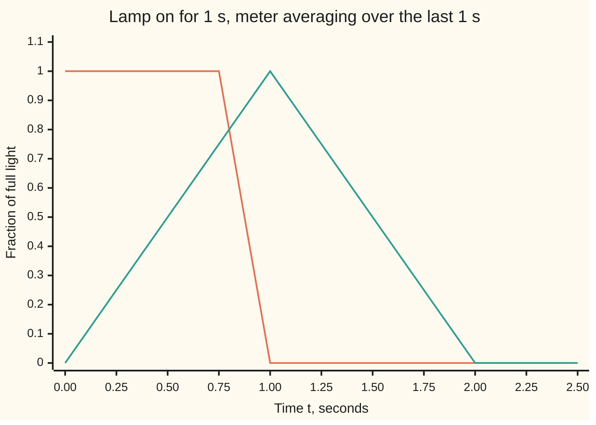

# Convolution: slide, multiply, add, and the inequality that bounds the result

[Syllabus](../../../SYLLABUS.md) → [Harmonic analysis](../README.md) → [Convolution and Approximate Identities](../README.md#s03) → Convolution

---

## General Overview

A lamp is switched on for exactly one second, then off. A light meter beside it does not show the light at each instant. It shows the average light over the last one second. Many meters offer such a setting, so that the display does not jump about.

What does the meter read? Slide the meter's one-second window along the time axis. At each moment, multiply the lamp's signal by the window and add up what is inside. At 0.25 s the window holds a quarter of a second of light, so the meter reads 0.25. At 1 s the window and the lamp's second line up exactly, and the meter reads 1. At 1.5 s half the window still holds light: 0.5. By 2 s the window has left the lamp behind, and the reading is 0.

The reading rises in a straight line and falls in a straight line: a triangle, 2 s wide at its base and 1 tall. Two one-second gates (signals equal to 1 for one second and 0 otherwise) have made a triangle. Slide, multiply, add: that operation is **convolution**, the word used from here on.

A blurred photograph is the same operation in space. The lens spreads each point of light into a small patch, and the picture is every point's patch added up. So the first practical question is size. How big can the result of a convolution be? Size here is a p-size: raise the signal's absolute value to a power p, integrate, and take the p-th root. This card proves the answer, **Young's inequality**, and finds the exponents where its bound is tight and where it is not.

**Convolution slides one signal across the other, multiplies, and adds; its size, measured in the exponent r, is at most the product of the two signals' sizes in exponents p and q, whenever 1/p + 1/q = 1 + 1/r.**

**What kind of fact this is:** convolution is a definition; that it commutes and associates, and Young's inequality, are theorems proved on this card in Why it works. The best constant inside Young's inequality is a theorem stated with its source and checked on bell curves.

### The picture: a one-second lamp through a one-second average



The first line is the lamp: 1 from 0 to 1 s, then 0. The second line is the meter's reading, the triangle. The chart samples every quarter second, so the lamp's drop at 1 s is drawn as a slope. Both checks print every point.

---

## The formula

[Convolution](../../07-Complex%20analysis/08-Transforms%20in%20Outline/04-convolution-theorem.md) in the complex-analysis wing already defines convolution, smears a box with a box into a tent, and shows that the area under the result is at most the product of the two areas. [Convolution](../../10-Measure%20and%20integration/06-Product%20Measures%20and%20Fubini/05-convolution-and-sums.md) in the measure wing proves that it adds independent quantities. This card restates the definition and spends its length on the size bound.

Notation first, in words. The letter $`t`$ is time in seconds, and $`s`$ is a second time that runs over the whole line inside an integral. The signal $`f`$ is the lamp: 1 for $`0 \le t < 1`$, and 0 otherwise. The signal $`g`$ is the meter's window: 1 per second for $`0 \le t < 1`$, and 0 otherwise, so its area is exactly 1. The star means convolution, not multiplication:

```math
(f * g)(t) = \int_{-\infty}^{\infty} f(s)\, g(t - s)\, ds .
```

**Read it aloud:** the convolution at time t flips g, slides it to t, multiplies it by f at every time s, and adds up.

For the lamp and the meter, $`g(t - s)`$ is 1 exactly when s lies in the last second before t. So the integral is the overlap of the lamp's second with that window, and $`(f * g)(t) = \max\big(0,\ \min(t, 1) - \max(0, t - 1)\big)`$: the triangle.

**Sizes.** [Lp spaces](../../10-Measure%20and%20integration/07-Sizes%20of%20Functions/01-lp-spaces.md) measures a signal by its p-size, read "p-norm":

```math
\lVert f\rVert_p = \Big(\int_{-\infty}^{\infty} \lvert f(t)\rvert^p\, dt\Big)^{1/p}, \qquad \lVert f\rVert_\infty = \text{the largest value of } \lvert f\rvert \text{, ignoring sets of length zero.}
```

A gate of height 1 and length 1 s has every p-size equal to 1. That makes the lamp a clean test: Young's bound for it is always 1.

**Young's inequality.** Let $`p`$, $`q`$ and $`r`$ be exponents from 1 to ∞ (infinity) that obey the exponent rule

```math
\frac1p + \frac1q = 1 + \frac1r ,
```

with $`1/\infty = 0`$. Then for every $`f`$ of finite p-size and every $`g`$ of finite q-size,

```math
\lVert f * g\rVert_r \le \lVert f\rVert_p\, \lVert g\rVert_q .
```

**Read it aloud:** the r-size of the convolution is at most the p-size of the first signal times the q-size of the second, provided one over p plus one over q equals one plus one over r.

**The best constant.** The factor 1 on the right is not always the smallest that works. Write $`p'`$, read "p-prime", for the conjugate exponent $`p/(p-1)`$, the number with $`1/p + 1/p' = 1`$. It is the exponent wing 10 calls q. This wing writes it $`p'`$, because Young's inequality needs the letter q for the second signal. The pairs (1, ∞) and (∞, 1) count as conjugate. On the line, the best constant is

```math
C_{p,q} = A_p\, A_q\, A_{r'}, \qquad A_m = \Big(\frac{m^{1/m}}{m'^{\,1/m'}}\Big)^{1/2}, \qquad A_1 = A_\infty = 1 .
```

**Read it aloud:** the smallest factor that makes Young's inequality true on the line is a product of three numbers, one for each of p, q and the conjugate of r, and the product is at most 1.

A single factor can exceed 1. At p = 3, q = 1.2, r = 6, which obey the rule, the factors are 1.049115, 0.929279 and 0.929279, and their product is 0.905974.

| Symbol | Plain meaning | In our example | Push it up and the answer… |
| --- | --- | --- | --- |
| $`t`$; $`s`$, $`v`$, $`y`$, $`z`$ | time in seconds; times run over the line inside integrals | t = 0.25 s, reading 0.25 | later t: the triangle rises, then falls |
| $`f`$ | the first signal: the lamp, as a fraction of full light | 1 for one second | a taller lamp, a taller triangle |
| $`g`$ | the second signal: the meter's window, per second | 1 per second for one second, area 1 | — |
| $`f * g`$ | the convolution: g flipped, slid to t, multiplied by f, added up | the triangle, peak 1 at t = 1 s | — |
| $`u`$ | a third signal, in the associativity proof | in the finite twin, the sequence 1, 0, 2 | — |
| $`p`$, $`q`$ | the exponents that measure f and g | 4/3 and 4/3 | the size leans harder on the peak |
| $`r`$ | the exponent that measures the convolution, fixed by the rule | 2 when p = q = 4/3 | — |
| $`\lVert f\rVert_p`$ | the p-size of f: p-th root of the integral of the p-th power | 1 for every p, for the lamp | — |
| $`p'`$, $`m'`$ | the conjugate exponent, p/(p − 1) | 4 when p = 4/3 | falls toward 1 |
| $`A_m`$, $`C_{p,q}`$ | one exponent's factor; the best constant in Young's inequality | 0.877383 at p = q = 4/3 | — |
| $`w`$; $`L`$ | the length of a gate; half the length of a cut-off window, both in seconds | 1 s, also 0.01 s and 100 s; L = 10, 100, 1000 s | sizes grow like powers of w; — |
| $`a`$, $`b`$; $`j`$, $`k`$ | sequences sampled four times a second; sample numbers | the gate 1, 1, 1, 1 and the ramp 1, 2, 3, 4 | — |

### When it holds

- **The exponents obey the rule 1/p + 1/q = 1 + 1/r.** Take p = q = r = 2, which breaks it. For gates of length 100 s, the 2-size of their triangle is 8.164966 times the product of their 2-sizes, and the ratio grows like the square root of the length. No constant works.
- **Both sizes are finite.** Take as the second signal the kernel $`1/(1 + \lvert t\rvert)`$, an illustrative test signal; a kernel is the signal that does the smoothing. It has infinite area. Convolved with the lamp, the area of the result over −L to L is 4.793029, 9.230208 and 13.817509 for L = 10, 100 and 1000 s, growing like 2 log L without end. Its 2-size is finite (it is √2 = 1.414214), so the case p = 1, q = r = 2 still applies. The 2-size of the result is at most 1.402199, below the bound √2: it is 1.401486 on −1000 to 1000 s, and the tail beyond adds at most 2/L to its square.
- **The constant 1 is the best one only at the edges.** It is tight when p = 1, q = 1 or r = ∞. Inside, at p = q = 4/3 and r = 2, no signals reach more than 0.877383 of the bound.
- **The signals live on the line, the circle or the integers.** The proof needs only that sliding a signal does not change its size. On the integers the best constant is 1 for every rule-abiding p, q, r: a single spike convolved with itself is the same spike, and every one of its sizes is 1. Measure size so that sliding changes it, and the bound fails: if each second after t = 1 s counts double, the two gates keep area 1 each, but the triangle's area becomes 0.5 + 2 × 0.5 = 1.5.

---

## Why it works

### Step 0: one integral, two ways to spend the sizes

Each value of the convolution is an integral of a product, f times a slid copy of g. Hölder's inequality bounds an integral of a product by sizes: it is at most the product of the two sizes, in conjugate exponents. If the exponents are conjugate, that alone bounds the peak of the convolution.

The general case splits the product into three pieces and applies Hölder's inequality to all three at once. One piece carries everything that depends on t; the other two are fixed sizes of f and g. Integrating the first piece over t, one variable at a time, gives the size of f times the size of g. The exponent rule is exactly what makes the three pieces fit together. Stretching time shows it is the only rule that can.

### Step 1: the order and the grouping do not matter

**Commutes.** Substitute $`s = t - v`$ in the definition. The integral becomes $`\int g(v)\, f(t - v)\, dv`$, which is $`(g * f)(t)`$. Sliding the lamp across the window gives the same reading as sliding the window across the lamp.

**Associates.** Take a third signal $`u`$. Write $`((f * g) * u)(t)`$ as a double integral of $`f(y)\, g(s - y)\, u(t - s)`$ over y and s. Substitute $`s = y + z`$ and integrate over z first. The result is $`\int f(y)\, (g * u)(t - y)\, dy = (f * (g * u))(t)`$. Swapping the order of integration is allowed by [Tonelli and Fubini](../../10-Measure%20and%20integration/06-Product%20Measures%20and%20Fubini/03-tonelli-and-fubini.md) when all three signals have finite area. The measure-wing card proves both facts for any probability laws.

**The finite twin.** Sample the signals four times a second. The lamp becomes the gate 1, 1, 1, 1, and a brightening lamp becomes the ramp 1, 2, 3, 4. The discrete convolution adds products along each diagonal: $`(a * b)[k] = \sum_j a[j]\, b[k - j]`$. In whole numbers:

- gate * gate = 1, 2, 3, 4, 3, 2, 1: the triangle again.
- gate * ramp = ramp * gate = 1, 3, 6, 10, 9, 7, 4.
- with the third sequence u = 1, 0, 2: (gate * ramp) * u = gate * (ramp * u) = 1, 3, 8, 16, 21, 27, 22, 14, 8.

The ramp is not symmetric, so the equal orders are not an accident of shape. The third sequence differs from the first on purpose: with the gate in both outer places, commutativity alone would force the two groupings to agree.

### Step 2: the two edge cases

**Peak, r = ∞.** When $`q = p'`$, the rule gives $`1/r = 0`$. At each t, [Holder's inequality](../../10-Measure%20and%20integration/07-Sizes%20of%20Functions/02-holders-inequality.md) bounds the integral of $`f(s)\, g(t - s)`$ by $`\lVert f\rVert_p\, \lVert g\rVert_{p'}`$. Sliding g does not change its size. So the peak of the convolution is at most the product.

For the lamp at p = q = 2, the bound is 1 × 1 and the peak is 1. Equality holds, because at t = 1 s the window lines up exactly with the lamp, which is Hölder's equality case.

**One area, p = 1.** [Convolution and mollifiers](../../18-Functional%20analysis/04-Distributions%20and%20Sobolev%20Spaces/03-convolution-and-mollifiers.md) proves $`\lVert f * g\rVert_q \le \lVert f\rVert_1\, \lVert g\rVert_q`$ from [Minkowski's inequality](../../10-Measure%20and%20integration/07-Sizes%20of%20Functions/03-minkowskis-inequality.md): the convolution is an average of slid copies of g, weighted by f, and an average of copies is no bigger than one copy. At q = 1 this is the complex-analysis card's area result. For the lamp, the triangle's area is 1, exactly 1 × 1.

### Step 3: the general case, by splitting the product in three

Take f and g non-negative. Replacing a signal by its absolute value can only raise the left side, and leaves the right side alone. Fix a time t. Split the product into three factors:

```math
f(s)\, g(t-s) = \big(f(s)^p\, g(t-s)^q\big)^{1/r} \cdot f(s)^{1 - p/r} \cdot g(t-s)^{1 - q/r} .
```

The powers of f add to $`p/r + 1 - p/r = 1`$, and the same holds for g, so nothing has changed.

Now apply Hölder's inequality with three exponents r, $`q'`$ and $`p'`$. They fit, because $`1/r + 1/q' + 1/p' = 1/r + (1 - 1/q) + (1 - 1/p) = 1`$ by the exponent rule. The second factor, raised to the power $`q'`$, gives back $`f^p`$; the third, raised to $`p'`$, gives back $`g^q`$. So

```math
(f * g)(t) \le \Big(\int f(s)^p\, g(t - s)^q\, ds\Big)^{1/r}\, \lVert f\rVert_p^{\,p/q'}\, \lVert g\rVert_q^{\,q/p'} .
```

Raise both sides to the power r and integrate over t. The double integral of $`f(s)^p g(t-s)^q`$ splits into $`\lVert f\rVert_p^p\, \lVert g\rVert_q^q`$. Collecting powers leaves $`\lVert f * g\rVert_r^r \le \lVert f\rVert_p^r\, \lVert g\rVert_q^r`$. The fold has every exponent.

<details>
<summary>Detailed proof: Young's inequality for every rule-abiding p, q, r</summary>

Let $`1 \le p, q, r \le \infty`$ with $`1/p + 1/q = 1 + 1/r`$. Then $`1/p - 1/r = 1 - 1/q = 1/q' \ge 0`$, so $`r \ge p`$, and likewise $`r \ge q`$. Since $`\lvert f * g\rvert \le \lvert f\rvert * \lvert g\rvert`$, assume $`f, g \ge 0`$.

If $`r = \infty`$, then $`q = p'`$ and Step 2 applies. If $`p = 1`$, then $`q = r`$ and the mollifier card's bound applies; the case $`q = 1`$ follows by commutativity. Assume now $`1 < p, q < \infty`$ and $`r < \infty`$. Then $`p'`$ and $`q'`$ are finite.

Hölder's inequality for three functions, with exponents $`r, q', p'`$ whose reciprocals add to 1, follows from the two-function form applied twice. For fixed t it gives

$`\displaystyle (f*g)(t) = \int \big(f(s)^p g(t-s)^q\big)^{1/r} f(s)^{1-p/r} g(t-s)^{1-q/r}\, ds \le \Big(\int f(s)^p g(t-s)^q ds\Big)^{1/r} \Big(\int f^{(1-p/r)q'}\Big)^{1/q'} \Big(\int g^{(1-q/r)p'}\Big)^{1/p'} .`$

Here $`(1 - p/r)\, q' = p\,(1/p - 1/r)\, q' = p`$ and $`(1 - q/r)\, p' = q\,(1/q - 1/r)\, p' = q`$. So the last two factors are $`\lVert f\rVert_p^{p/q'}`$ and $`\lVert g\rVert_q^{q/p'}`$, where the fact that sliding does not change size was used for g.

Raise to the power r and integrate in t. By Tonelli's theorem, $`\int\!\!\int f(s)^p g(t-s)^q\, ds\, dt = \lVert f\rVert_p^p \lVert g\rVert_q^q`$. Hence

$`\displaystyle \lVert f*g\rVert_r^r \le \lVert f\rVert_p^{\,p + pr/q'}\, \lVert g\rVert_q^{\,q + qr/p'} .`$

Now $`p + pr/q' = p + pr(1/p - 1/r) = r`$ and $`q + qr/p' = q + qr(1/q - 1/r) = r`$. Taking r-th roots gives $`\lVert f*g\rVert_r \le \lVert f\rVert_p \lVert g\rVert_q`$. Finiteness of the right side also shows $`(f*g)(t)`$ is finite for almost every t (every t outside a set of total length zero).

</details>

### Step 4: stretching time forces the rule

Stretch both signals in time by a factor w: replace f(t) by f(t/w). Each p-size gets multiplied by $`w^{1/p}`$, because the integral covers w times as much time. The convolution becomes $`w\,(f * g)(t/w)`$: it is w times taller, because the overlap lasts w times longer, and its r-size is multiplied by $`w^{1 + 1/r}`$.

So the left side of Young's inequality scales like $`w^{1 + 1/r}`$, and the right side like $`w^{1/p + 1/q}`$. If the two powers differ, a large or small enough w makes the left side win. The exponent rule is the only way to avoid that.

For gates of length w at p = q = 4/3 and r = 2, the ratio of the two sides is 0.816497 at w = 0.01 s, 1 s and 100 s alike. Off the rule, at p = q = r = 2, the ratio is 0.081650, 0.816497 and 8.164966.

### Step 5: when the bound is tight

The ratio of the two sides measures how tight the bound is. The checks compute it for the unit gates and for the bell curve $`e^{-\pi t^2}`$, also called a Gaussian, which has area 1.

| p, q, r | Gates | Bell curves | Best constant |
| --- | ---: | ---: | ---: |
| 1, 1, 1 | 1.000000 | 1.000000 | 1.000000 |
| 1, 2, 2 | 0.816497 | 0.840896 | 1.000000 |
| 4/3, 4/3, 2 | 0.816497 | 0.877383 | 0.877383 |
| 3/2, 3/2, 3 | 0.793701 | 0.866025 | 0.866025 |
| 2, 2, ∞ | 1.000000 | 1.000000 | 1.000000 |

Three facts show in the table.

1. **At the edges the constant 1 is best.** At p = q = r = 1, any two non-negative signals give equality: the area of the triangle is the product of the areas. At r = ∞, signals that line up give equality. At p = 1, q = r = 2, no pair reaches 1, but a narrower and narrower f, with area 1, comes as close as wanted ([Approximate identities](03-approximate-identities.md)).
2. **Inside, the constant 1 is never reached.** Beckner (1975) and Brascamp and Lieb (1976) found the best constant $`C_{p,q}`$ above, and showed that bell curves reach it. At p = q = 4/3 it is $`(4/3)^{3/4}/4^{1/4}`$ = 0.877383, and two equal bell curves reach exactly that.
3. **The gates fall short inside.** Their ratio, 0.816497, is below the bell curves' 0.877383. Only bell curves reach the best constant.

On the integers a signal cannot be narrowed below one sample. A single spike reaches ratio 1 for every rule-abiding triple, so there the constant 1 is best everywhere.

---

## Worked numbers, by hand

The lamp and the meter, at p = q = 4/3 and r = 2.

| Step | Arithmetic | Value |
| --- | --- | --- |
| Reading at 0.25 s | overlap of the lamp's [0, 1) with the window (−0.75, 0.25] | 0.25 |
| Reading at 1.5 s | overlap of [0, 1) with (0.5, 1.5] | 0.5 |
| Check the rule | 3/4 + 3/4 = 1.5 = 1 + 1/2 | holds |
| Sizes of lamp and window | a height-1, length-1 gate: the 4/3-th root of 1 | 1 and 1 |
| Young's bound | 1 × 1 | 1 |
| Square of the triangle, integrated | 2 × (integral of t² from 0 to 1) = 2 × 1/3 | 0.666667 |
| Its square root, the 2-size | √(2/3) | **0.816497** |
| Best possible ratio | (4/3)^(3/4) / 4^(1/4) = 1.240806 / 1.414214 | 0.877383 |

The meter's reading has 2-size 0.816497, below Young's bound of 1 and below the best constant 0.877383. Averaging spreads the lamp's one second of light over two seconds, and the 2-size, which rewards height, falls.

### What breaks if you drop a piece

| Mistake | Comes out at | What went wrong |
| --- | --- | --- |
| Exponents off the rule, p = q = r = 2, gates of 100 s | ratio 8.164966, and growing like √w | stretching time breaks any fixed bound off the rule |
| Expecting a finite area from the lamp and the kernel 1/(1 + \|t\|) | areas 4.793029, 9.230208, 13.817509 out to L = 10, 100, 1000 s | the kernel's area is infinite; only its 2-size is finite |
| Taking 1 as the best constant at p = q = 4/3, r = 2 | bell curves reach 0.877383, nothing more | inside the edges the best constant is below 1 |

The code prints all three.

---

## Code, from first principles, and it actually runs

The code reaches the meter's reading by three roads: the overlap formula, the defining integral by the midpoint rule at 1000 and 2000 cells, and the finite twin in exact whole numbers. Because the lamp is a 0-or-1 step with edges on cell boundaries, the midpoint rule is exact here. The twin also checks commutativity on a ramp, which is not symmetric, and associativity with a third sequence unlike the first, so commutativity alone cannot make the groupings agree. The sizes of the triangle come from a closed form and from the discrete convolution of sampled gates, 2000 samples a second. The bell curves' ratios come from a closed form and from a grid convolution cut off at 6 s, with the size of what is cut off printed. The best constant comes from Beckner's formula, an independent road. The scaling table and the infinite-area kernel are computed both by closed form and by summing.

### Python

```python
# Convolution and Young's inequality -- the check behind the card.  Standard library only.
# Time t in seconds.  The lamp f is 1 on [0, 1) s.  The meter's window g is 1 per second
# on [0, 1) s.  Their convolution, the meter reading, is the triangle on [0, 2] s.
from math import exp, pi, log, sqrt
INF = float('inf')

def tri(t):                            # road 1: the overlap of [0, 1) and (t - 1, t]
    return max(0.0, min(t, 1.0) - max(0.0, t - 1.0))

def conv_mid(t, n):                    # road 2: the defining integral, n midpoint cells
    h = 1.0 / n
    return h * sum(1 for k in range(n) if 0.0 <= t - (k + 0.5) * h < 1.0)

def dconv(a, b):                       # road 3: the finite twin, exact whole numbers
    c = [0] * (len(a) + len(b) - 1)
    for i, x in enumerate(a):
        for j, y in enumerate(b):
            c[i + j] += x * y
    return c

def tri_norm(r, w=1.0):                # closed form r-size of the triangle from width-w gates
    return w if r == INF else (2 / (r + 1)) ** (1 / r) * w ** (1 + 1 / r)

def twin_norm(r, n, w=1.0):            # r-size of the sampled gates' discrete convolution
    h = w / n
    c = [h * min(m + 1, 2 * n - 1 - m) for m in range(2 * n - 1)]
    return max(c) if r == INF else (h * sum(x ** r for x in c)) ** (1 / r)

def gate_norm(p, w=1.0):
    return 1.0 if p == INF else w ** (1 / p)

def A(m):                              # Beckner's factor; A(1) = A(inf) = 1
    if m == 1 or m == INF:
        return 1.0
    mp = m / (m - 1)
    return sqrt(m ** (1 / m) / mp ** (1 / mp))

def conj(m):
    return INF if m == 1 else 1.0 if m == INF else m / (m - 1)

print("gates: lamp f on [0, 1) s, window g 1 per second on [0, 1) s")
for t in (0.25, 0.5, 1.0, 1.5, 1.75):
    a, b1, b2 = tri(t), conv_mid(t, 1000), conv_mid(t, 2000)
    assert abs(a - b1) < 1e-9 and abs(a - b2) < 1e-9
    print(f"reading at t = {t:.2f} s: overlap {a:.6f}, integral n=1000 {b1:.6f}, n=2000 {b2:.6f}")
print("chart,t," + ",".join(f"{k / 4:.2f}" for k in range(11)))
print("chart,lamp," + ",".join(f"{1.0 if k < 4 else 0.0:.2f}" for k in range(11)))
print("chart,reading," + ",".join(f"{tri(k / 4):.2f}" for k in range(11)))

gate, ramp, u = [1, 1, 1, 1], [1, 2, 3, 4], [1, 0, 2]   # four samples a second
assert dconv(gate, gate) == [1, 2, 3, 4, 3, 2, 1]
assert dconv(gate, ramp) == dconv(ramp, gate)
assert dconv(dconv(gate, ramp), u) == dconv(gate, dconv(ramp, u))   # u is not the gate
print("twin gate*gate", dconv(gate, gate))
print("twin gate*ramp", dconv(gate, ramp), "ramp*gate", dconv(ramp, gate))
print("twin (gate*ramp)*u", dconv(dconv(gate, ramp), u), "with u", u)
print("twin gate*(ramp*u)", dconv(gate, dconv(ramp, u)))

N, D = 1200, 0.01                      # Gaussians e^(-pi t^2) on a grid, cut off at 6 s
fk = [exp(-pi * (k * D) ** 2) for k in range(-2 * N, 2 * N + 1)]
f = [fk[2 * N + i - N // 2] for i in range(N + 1)]
hh = [D * sum(f[j] * fk[2 * N + i - j] for j in range(N + 1)) for i in range(N + 1)]
def gnorm(v, p):
    return max(v) if p == INF else (D * sum(x ** p for x in v)) ** (1 / p)
print(f"gaussian h(0): grid {hh[N // 2]:.6f}, closed form 1/sqrt(2) {1 / sqrt(2):.6f}")
print(f"cut-off 6 s; beyond it h stays below {exp(-pi * 18):.1e}")
assert abs(hh[N // 2] - 1 / sqrt(2)) < 1e-9

triples = [("1,1,1", 1, 1, 1), ("1,2,2", 1, 2, 2), ("4/3,4/3,2", 4 / 3, 4 / 3, 2),
           ("3/2,3/2,3", 1.5, 1.5, 3), ("2,2,inf", 2, 2, INF)]
print("young: p,q,r | gates | gates twin | gaussians | gaussians grid | best constant")
for lab, p, q, r in triples:
    assert abs(1 / p + 1 / q - 1 - (0 if r == INF else 1 / r)) < 1e-12
    g1 = tri_norm(r) / (gate_norm(p) * gate_norm(q))
    g2 = twin_norm(r, 2000)
    gn = lambda m: 1.0 if m == INF else m ** (-1 / (2 * m))
    hn = 1 / sqrt(2) * (1.0 if r == INF else (r / 2) ** (-1 / (2 * r)))
    c1 = hn / (gn(p) * gn(q))
    c2 = gnorm(hh, r) / (gnorm(f, p) * gnorm(f, q))
    best = A(p) * A(q) * A(conj(r))
    assert abs(g1 - g2) < 1e-6 and abs(c1 - c2) < 1e-9
    assert g1 <= best + 1e-12 and c1 <= best + 1e-12 and best <= 1 + 1e-12
    if lab in ("4/3,4/3,2", "3/2,3/2,3"):
        assert abs(c1 - best) < 1e-12  # Gaussians reach Beckner's constant
    print(f"young,{lab} | {g1:.6f} | {g2:.6f} | {c1:.6f} | {c2:.6f} | {best:.6f}")
print(f"worked: triangle squared, integrated {tri_norm(2) ** 2:.6f}; (4/3)^(3/4) {(4 / 3) ** 0.75:.6f}; 4^(1/4) {4 ** 0.25:.6f}")
a3 = (A(3), A(1.2), A(conj(6)))        # a rule-abiding triple, 1/3 + 5/6 = 1 + 1/6
assert a3[0] > 1 and abs(A(3) * A(1.5) - 1) < 1e-12   # one factor above 1; A(m) A(m') = 1
assert a3[0] * a3[1] * a3[2] <= 1
print(f"beckner: p,q,r = 3,1.2,6 | A(3) {a3[0]:.6f} | A(1.2) {a3[1]:.6f} | A(6') {a3[2]:.6f} | product {a3[0] * a3[1] * a3[2]:.6f}")
wa = sum(tri((k + 0.5) / 1000) * (2 if k >= 1000 else 1) for k in range(2000)) / 1000
assert abs(wa - 1.5) < 1e-9            # sliding changes size: seconds after 1 s count double
print(f"weighted: after 1 s each second counts double; gates' areas 1 and 1, triangle's area {wa:.6f} = 0.5 + 2 x 0.5")

print("scaling: gates of width w | ratio at p=q=4/3, r=2 | ratio at p=q=r=2 (off the rule) | twin n=1000")
for w in (0.01, 1.0, 100.0):
    good = tri_norm(2, w) / gate_norm(4 / 3, w) ** 2
    bad = tri_norm(2, w) / gate_norm(2, w) ** 2   # closed form sqrt(2/3) sqrt(w)
    twin = twin_norm(2, 1000, w) / gate_norm(2, w) ** 2
    assert abs(good - twin_norm(2, 1000, w) / gate_norm(4 / 3, w) ** 2) < 1e-6
    assert abs(bad - twin) < 1e-6 * bad
    print(f"scaling,w = {w:g} s | {good:.6f} | {bad:.6f} | {twin:.6f}")
fall = [4, 3, 2, 1]
print(f"try: w = 10000 s off the rule {tri_norm(2, 1e4) / gate_norm(2, 1e4) ** 2:.6f}; 10 cells at 0.25 s {conv_mid(0.25, 10):.1f}")
print("try: falling ramp, gate*fall", dconv(gate, fall), "(gate*fall)*u", dconv(dconv(gate, fall), u))

def G(s):                              # integral of 1/(1 + |u|) from 0 to s
    return log(1 + s) if s >= 0 else -log(1 - s)
def Hx(x):
    return (1 + x) * log(1 + x) - x
print("break: kernel 1/(1 + |t|), not in L1; area of lamp * kernel on [-L, L]")
for L in (10, 100, 1000):
    n = 200 * L
    num = sum(G(t) - G(t - 1) for t in (-L + (k + 0.5) * 2 * L / n for k in range(n))) * 2 * L / n
    assert abs(num - (Hx(L + 1) - Hx(L - 1))) < 1e-4
    print(f"break,L = {L} s: area {num:.6f}, closed form {Hx(L + 1) - Hx(L - 1):.6f}, 2 log L {2 * log(L):.6f}")
L, n = 1000, 200000
sq = sum((G(t) - G(t - 1)) ** 2 for t in (-L + (k + 0.5) * 2 * L / n for k in range(n))) * 2 * L / n
assert sqrt(sq + 2 / L) <= sqrt(2)   # 2-size with the tail bound stays under Young's bound
print(f"break: 2-size on [-1000, 1000] {sqrt(sq):.6f}, with tail at most {sqrt(sq + 2 / L):.6f}, Young bound sqrt(2) {sqrt(2):.6f}")
print("ALL CHECKS PASS")
```

**Ran 2026-11-15 on macOS, Python 3.14.10, standard library only. All checks passed. Output, pasted from the run:**

```text
gates: lamp f on [0, 1) s, window g 1 per second on [0, 1) s
reading at t = 0.25 s: overlap 0.250000, integral n=1000 0.250000, n=2000 0.250000
reading at t = 0.50 s: overlap 0.500000, integral n=1000 0.500000, n=2000 0.500000
reading at t = 1.00 s: overlap 1.000000, integral n=1000 1.000000, n=2000 1.000000
reading at t = 1.50 s: overlap 0.500000, integral n=1000 0.500000, n=2000 0.500000
reading at t = 1.75 s: overlap 0.250000, integral n=1000 0.250000, n=2000 0.250000
chart,t,0.00,0.25,0.50,0.75,1.00,1.25,1.50,1.75,2.00,2.25,2.50
chart,lamp,1.00,1.00,1.00,1.00,0.00,0.00,0.00,0.00,0.00,0.00,0.00
chart,reading,0.00,0.25,0.50,0.75,1.00,0.75,0.50,0.25,0.00,0.00,0.00
twin gate*gate [1, 2, 3, 4, 3, 2, 1]
twin gate*ramp [1, 3, 6, 10, 9, 7, 4] ramp*gate [1, 3, 6, 10, 9, 7, 4]
twin (gate*ramp)*u [1, 3, 8, 16, 21, 27, 22, 14, 8] with u [1, 0, 2]
twin gate*(ramp*u) [1, 3, 8, 16, 21, 27, 22, 14, 8]
gaussian h(0): grid 0.707107, closed form 1/sqrt(2) 0.707107
cut-off 6 s; beyond it h stays below 2.8e-25
young: p,q,r | gates | gates twin | gaussians | gaussians grid | best constant
young,1,1,1 | 1.000000 | 1.000000 | 1.000000 | 1.000000 | 1.000000
young,1,2,2 | 0.816497 | 0.816497 | 0.840896 | 0.840896 | 1.000000
young,4/3,4/3,2 | 0.816497 | 0.816497 | 0.877383 | 0.877383 | 0.877383
young,3/2,3/2,3 | 0.793701 | 0.793701 | 0.866025 | 0.866025 | 0.866025
young,2,2,inf | 1.000000 | 1.000000 | 1.000000 | 1.000000 | 1.000000
worked: triangle squared, integrated 0.666667; (4/3)^(3/4) 1.240806; 4^(1/4) 1.414214
beckner: p,q,r = 3,1.2,6 | A(3) 1.049115 | A(1.2) 0.929279 | A(6') 0.929279 | product 0.905974
weighted: after 1 s each second counts double; gates' areas 1 and 1, triangle's area 1.500000 = 0.5 + 2 x 0.5
scaling: gates of width w | ratio at p=q=4/3, r=2 | ratio at p=q=r=2 (off the rule) | twin n=1000
scaling,w = 0.01 s | 0.816497 | 0.081650 | 0.081650
scaling,w = 1 s | 0.816497 | 0.816497 | 0.816497
scaling,w = 100 s | 0.816497 | 8.164966 | 8.164968
try: w = 10000 s off the rule 81.649658; 10 cells at 0.25 s 0.3
try: falling ramp, gate*fall [4, 7, 9, 10, 6, 3, 1] (gate*fall)*u [4, 7, 17, 24, 24, 23, 13, 6, 2]
break: kernel 1/(1 + |t|), not in L1; area of lamp * kernel on [-L, L]
break,L = 10 s: area 4.793029, closed form 4.793029, 2 log L 4.605170
break,L = 100 s: area 9.230208, closed form 9.230208, 2 log L 9.210340
break,L = 1000 s: area 13.817509, closed form 13.817509, 2 log L 13.815511
break: 2-size on [-1000, 1000] 1.401486, with tail at most 1.402199, Young bound sqrt(2) 1.414214
ALL CHECKS PASS
```

### Rust

```rust
// Convolution and Young's inequality -- the check behind the card.  Rust std only.
// Time t in seconds.  The lamp f is 1 on [0, 1) s.  The meter's window g is 1 per second
// on [0, 1) s.  Their convolution, the meter reading, is the triangle on [0, 2] s.
use std::f64::consts::PI;
const INF: f64 = f64::INFINITY;

fn tri(t: f64) -> f64 { // road 1: the overlap of [0, 1) and (t - 1, t]
    (t.min(1.0) - (t - 1.0).max(0.0)).max(0.0)
}
fn conv_mid(t: f64, n: usize) -> f64 { // road 2: the defining integral, n midpoint cells
    let h = 1.0 / n as f64;
    h * (0..n).filter(|&k| { let u = t - (k as f64 + 0.5) * h; 0.0 <= u && u < 1.0 }).count() as f64
}
fn dconv(a: &[i64], b: &[i64]) -> Vec<i64> { // road 3: the finite twin, exact whole numbers
    let mut c = vec![0i64; a.len() + b.len() - 1];
    for (i, x) in a.iter().enumerate() { for (j, y) in b.iter().enumerate() { c[i + j] += x * y; } }
    c
}
fn tri_norm(r: f64, w: f64) -> f64 { // closed form r-size of the triangle from width-w gates
    if r == INF { w } else { (2.0 / (r + 1.0)).powf(1.0 / r) * w.powf(1.0 + 1.0 / r) }
}
fn twin_norm(r: f64, n: usize, w: f64) -> f64 { // r-size of the sampled gates' discrete convolution
    let h = w / n as f64;
    let c: Vec<f64> = (0..2 * n - 1).map(|m| h * ((m + 1).min(2 * n - 1 - m)) as f64).collect();
    if r == INF { c.iter().cloned().fold(0.0, f64::max) }
    else { (h * c.iter().map(|x| x.powf(r)).sum::<f64>()).powf(1.0 / r) }
}
fn gate_norm(p: f64, w: f64) -> f64 { if p == INF { 1.0 } else { w.powf(1.0 / p) } }
fn a_fac(m: f64) -> f64 { // Beckner's factor; A(1) = A(inf) = 1
    if m == 1.0 || m == INF { return 1.0; }
    let mp = m / (m - 1.0);
    (m.powf(1.0 / m) / mp.powf(1.0 / mp)).sqrt()
}
fn conj(m: f64) -> f64 { if m == 1.0 { INF } else if m == INF { 1.0 } else { m / (m - 1.0) } }
fn gsum(v: &[f64], p: f64, d: f64) -> f64 {
    if p == INF { v.iter().cloned().fold(0.0, f64::max) }
    else { (d * v.iter().map(|x| x.powf(p)).sum::<f64>()).powf(1.0 / p) }
}
fn big_g(s: f64) -> f64 { if s >= 0.0 { (1.0 + s).ln() } else { -(1.0 - s).ln() } }
fn hx(x: f64) -> f64 { (1.0 + x) * (1.0 + x).ln() - x }
fn join(v: &[f64]) -> String { v.iter().map(|x| format!("{:.2}", x)).collect::<Vec<_>>().join(",") }

fn main() {
    println!("gates: lamp f on [0, 1) s, window g 1 per second on [0, 1) s");
    for &t in &[0.25, 0.5, 1.0, 1.5, 1.75] {
        let (a, b1, b2) = (tri(t), conv_mid(t, 1000), conv_mid(t, 2000));
        assert!((a - b1).abs() < 1e-9 && (a - b2).abs() < 1e-9);
        println!("reading at t = {:.2} s: overlap {:.6}, integral n=1000 {:.6}, n=2000 {:.6}", t, a, b1, b2);
    }
    let ts: Vec<f64> = (0..11).map(|k| k as f64 / 4.0).collect();
    println!("chart,t,{}", join(&ts));
    println!("chart,lamp,{}", join(&(0..11).map(|k| if k < 4 { 1.0 } else { 0.0 }).collect::<Vec<_>>()));
    println!("chart,reading,{}", join(&ts.iter().map(|&t| tri(t)).collect::<Vec<_>>()));

    let (gate, ramp, u) = ([1i64, 1, 1, 1], [1i64, 2, 3, 4], [1i64, 0, 2]); // four samples a second
    assert_eq!(dconv(&gate, &gate), vec![1, 2, 3, 4, 3, 2, 1]);
    assert_eq!(dconv(&gate, &ramp), dconv(&ramp, &gate));
    assert_eq!(dconv(&dconv(&gate, &ramp), &u), dconv(&gate, &dconv(&ramp, &u))); // u is not the gate
    println!("twin gate*gate {:?}", dconv(&gate, &gate));
    println!("twin gate*ramp {:?} ramp*gate {:?}", dconv(&gate, &ramp), dconv(&ramp, &gate));
    println!("twin (gate*ramp)*u {:?} with u {:?}", dconv(&dconv(&gate, &ramp), &u), u);
    println!("twin gate*(ramp*u) {:?}", dconv(&gate, &dconv(&ramp, &u)));

    let (n, d) = (1200usize, 0.01); // Gaussians e^(-pi t^2) on a grid, cut off at 6 s
    let fk: Vec<f64> = (0..=4 * n).map(|k| (-PI * ((k as f64 - 2.0 * n as f64) * d).powi(2)).exp()).collect();
    let f: Vec<f64> = (0..=n).map(|i| fk[2 * n + i - n / 2]).collect();
    let hh: Vec<f64> = (0..=n).map(|i| d * (0..=n).map(|j| f[j] * fk[2 * n + i - j]).sum::<f64>()).collect();
    println!("gaussian h(0): grid {:.6}, closed form 1/sqrt(2) {:.6}", hh[n / 2], 1.0 / 2f64.sqrt());
    println!("cut-off 6 s; beyond it h stays below {:.1e}", (-PI * 18.0).exp());
    assert!((hh[n / 2] - 1.0 / 2f64.sqrt()).abs() < 1e-9);

    let triples = [("1,1,1", 1.0, 1.0, 1.0), ("1,2,2", 1.0, 2.0, 2.0), ("4/3,4/3,2", 4.0 / 3.0, 4.0 / 3.0, 2.0),
                   ("3/2,3/2,3", 1.5, 1.5, 3.0), ("2,2,inf", 2.0, 2.0, INF)];
    println!("young: p,q,r | gates | gates twin | gaussians | gaussians grid | best constant");
    for &(lab, p, q, r) in &triples {
        let rinv = if r == INF { 0.0 } else { 1.0 / r };
        assert!((1.0 / p + 1.0 / q - 1.0 - rinv).abs() < 1e-12);
        let g1 = tri_norm(r, 1.0) / (gate_norm(p, 1.0) * gate_norm(q, 1.0));
        let g2 = twin_norm(r, 2000, 1.0);
        let gn = |m: f64| if m == INF { 1.0 } else { m.powf(-1.0 / (2.0 * m)) };
        let hn = 1.0 / 2f64.sqrt() * if r == INF { 1.0 } else { (r / 2.0).powf(-1.0 / (2.0 * r)) };
        let c1 = hn / (gn(p) * gn(q));
        let c2 = gsum(&hh, r, d) / (gsum(&f, p, d) * gsum(&f, q, d));
        let best = a_fac(p) * a_fac(q) * a_fac(conj(r));
        assert!((g1 - g2).abs() < 1e-6 && (c1 - c2).abs() < 1e-9);
        assert!(g1 <= best + 1e-12 && c1 <= best + 1e-12 && best <= 1.0 + 1e-12);
        if lab == "4/3,4/3,2" || lab == "3/2,3/2,3" {
            assert!((c1 - best).abs() < 1e-12); // Gaussians reach Beckner's constant
        }
        println!("young,{} | {:.6} | {:.6} | {:.6} | {:.6} | {:.6}", lab, g1, g2, c1, c2, best);
    }
    println!("worked: triangle squared, integrated {:.6}; (4/3)^(3/4) {:.6}; 4^(1/4) {:.6}",
             tri_norm(2.0, 1.0).powi(2), (4.0f64 / 3.0).powf(0.75), 4f64.powf(0.25));
    let a3 = [a_fac(3.0), a_fac(1.2), a_fac(conj(6.0))]; // a rule-abiding triple, 1/3 + 5/6 = 1 + 1/6
    assert!(a3[0] > 1.0 && (a_fac(3.0) * a_fac(1.5) - 1.0).abs() < 1e-12); // one factor above 1; A(m) A(m') = 1
    assert!(a3[0] * a3[1] * a3[2] <= 1.0);
    println!("beckner: p,q,r = 3,1.2,6 | A(3) {:.6} | A(1.2) {:.6} | A(6') {:.6} | product {:.6}",
             a3[0], a3[1], a3[2], a3[0] * a3[1] * a3[2]);
    let wa = (0..2000).map(|k| tri((k as f64 + 0.5) / 1000.0) * if k >= 1000 { 2.0 } else { 1.0 }).sum::<f64>() / 1000.0;
    assert!((wa - 1.5).abs() < 1e-9); // sliding changes size: seconds after 1 s count double
    println!("weighted: after 1 s each second counts double; gates' areas 1 and 1, triangle's area {:.6} = 0.5 + 2 x 0.5", wa);

    println!("scaling: gates of width w | ratio at p=q=4/3, r=2 | ratio at p=q=r=2 (off the rule) | twin n=1000");
    for &w in &[0.01, 1.0, 100.0] {
        let good = tri_norm(2.0, w) / gate_norm(4.0 / 3.0, w).powi(2);
        let bad = tri_norm(2.0, w) / gate_norm(2.0, w).powi(2); // closed form sqrt(2/3) sqrt(w)
        let twin = twin_norm(2.0, 1000, w) / gate_norm(2.0, w).powi(2);
        assert!((good - twin_norm(2.0, 1000, w) / gate_norm(4.0 / 3.0, w).powi(2)).abs() < 1e-6);
        assert!((bad - twin).abs() < 1e-6 * bad);
        println!("scaling,w = {} s | {:.6} | {:.6} | {:.6}", w, good, bad, twin);
    }
    let fall = [4i64, 3, 2, 1];
    println!("try: w = 10000 s off the rule {:.6}; 10 cells at 0.25 s {:.1}",
             tri_norm(2.0, 1e4) / gate_norm(2.0, 1e4).powi(2), conv_mid(0.25, 10));
    println!("try: falling ramp, gate*fall {:?} (gate*fall)*u {:?}", dconv(&gate, &fall), dconv(&dconv(&gate, &fall), &u));

    println!("break: kernel 1/(1 + |t|), not in L1; area of lamp * kernel on [-L, L]");
    let cell = |l: f64, n: usize, k: usize| -l + (k as f64 + 0.5) * 2.0 * l / n as f64;
    for &l in &[10usize, 100, 1000] {
        let (lf, n) = (l as f64, 200 * l);
        let num = (0..n).map(|k| { let t = cell(lf, n, k); big_g(t) - big_g(t - 1.0) }).sum::<f64>() * 2.0 * lf / n as f64;
        let exact = hx(lf + 1.0) - hx(lf - 1.0);
        assert!((num - exact).abs() < 1e-4);
        println!("break,L = {} s: area {:.6}, closed form {:.6}, 2 log L {:.6}", l, num, exact, 2.0 * lf.ln());
    }
    let (l, n) = (1000.0f64, 200000usize);
    let sq = (0..n).map(|k| { let t = cell(l, n, k); (big_g(t) - big_g(t - 1.0)).powi(2) }).sum::<f64>() * 2.0 * l / n as f64;
    assert!((sq + 2.0 / l).sqrt() <= 2f64.sqrt()); // 2-size with the tail bound stays under Young's bound
    println!("break: 2-size on [-1000, 1000] {:.6}, with tail at most {:.6}, Young bound sqrt(2) {:.6}",
             sq.sqrt(), (sq + 2.0 / l).sqrt(), 2f64.sqrt());
    println!("ALL CHECKS PASS");
}
```

**Ran 2026-11-15 on macOS, rustc 1.98.1, no crates. All checks passed. Output, pasted from the run:**

```text
gates: lamp f on [0, 1) s, window g 1 per second on [0, 1) s
reading at t = 0.25 s: overlap 0.250000, integral n=1000 0.250000, n=2000 0.250000
reading at t = 0.50 s: overlap 0.500000, integral n=1000 0.500000, n=2000 0.500000
reading at t = 1.00 s: overlap 1.000000, integral n=1000 1.000000, n=2000 1.000000
reading at t = 1.50 s: overlap 0.500000, integral n=1000 0.500000, n=2000 0.500000
reading at t = 1.75 s: overlap 0.250000, integral n=1000 0.250000, n=2000 0.250000
chart,t,0.00,0.25,0.50,0.75,1.00,1.25,1.50,1.75,2.00,2.25,2.50
chart,lamp,1.00,1.00,1.00,1.00,0.00,0.00,0.00,0.00,0.00,0.00,0.00
chart,reading,0.00,0.25,0.50,0.75,1.00,0.75,0.50,0.25,0.00,0.00,0.00
twin gate*gate [1, 2, 3, 4, 3, 2, 1]
twin gate*ramp [1, 3, 6, 10, 9, 7, 4] ramp*gate [1, 3, 6, 10, 9, 7, 4]
twin (gate*ramp)*u [1, 3, 8, 16, 21, 27, 22, 14, 8] with u [1, 0, 2]
twin gate*(ramp*u) [1, 3, 8, 16, 21, 27, 22, 14, 8]
gaussian h(0): grid 0.707107, closed form 1/sqrt(2) 0.707107
cut-off 6 s; beyond it h stays below 2.8e-25
young: p,q,r | gates | gates twin | gaussians | gaussians grid | best constant
young,1,1,1 | 1.000000 | 1.000000 | 1.000000 | 1.000000 | 1.000000
young,1,2,2 | 0.816497 | 0.816497 | 0.840896 | 0.840896 | 1.000000
young,4/3,4/3,2 | 0.816497 | 0.816497 | 0.877383 | 0.877383 | 0.877383
young,3/2,3/2,3 | 0.793701 | 0.793701 | 0.866025 | 0.866025 | 0.866025
young,2,2,inf | 1.000000 | 1.000000 | 1.000000 | 1.000000 | 1.000000
worked: triangle squared, integrated 0.666667; (4/3)^(3/4) 1.240806; 4^(1/4) 1.414214
beckner: p,q,r = 3,1.2,6 | A(3) 1.049115 | A(1.2) 0.929279 | A(6') 0.929279 | product 0.905974
weighted: after 1 s each second counts double; gates' areas 1 and 1, triangle's area 1.500000 = 0.5 + 2 x 0.5
scaling: gates of width w | ratio at p=q=4/3, r=2 | ratio at p=q=r=2 (off the rule) | twin n=1000
scaling,w = 0.01 s | 0.816497 | 0.081650 | 0.081650
scaling,w = 1 s | 0.816497 | 0.816497 | 0.816497
scaling,w = 100 s | 0.816497 | 8.164966 | 8.164968
try: w = 10000 s off the rule 81.649658; 10 cells at 0.25 s 0.3
try: falling ramp, gate*fall [4, 7, 9, 10, 6, 3, 1] (gate*fall)*u [4, 7, 17, 24, 24, 23, 13, 6, 2]
break: kernel 1/(1 + |t|), not in L1; area of lamp * kernel on [-L, L]
break,L = 10 s: area 4.793029, closed form 4.793029, 2 log L 4.605170
break,L = 100 s: area 9.230208, closed form 9.230208, 2 log L 9.210340
break,L = 1000 s: area 13.817509, closed form 13.817509, 2 log L 13.815511
break: 2-size on [-1000, 1000] 1.401486, with tail at most 1.402199, Young bound sqrt(2) 1.414214
ALL CHECKS PASS
```

### Lean

Lean proves Young's inequality for every rule-abiding p, q and r, and the order and grouping rules, for real signals on the line.

- Take p, q and r from 1 to ∞ obeying the exponent rule, f of finite p-size and g of finite q-size. Then $`\lVert f * g\rVert_r \le \lVert f\rVert_p\, \lVert g\rVert_q`$.
- Take any two real signals f and g. Then $`f * g = g * f`$ at every time.
- Take three signals f, g and u of finite area. Then $`(f * g) * u = f * (g * u)`$ at every time outside a set of total length zero.
- The finite twin's sums also check, for the gate, the ramp and u = 1, 0, 2.
- So does the exponent rule at 4/3, 4/3, 2 and at 3, 1.2, 6, and its failure at 2, 2, 2.

The lamp's triangle, the bell curves, the best constant, the scaling table and the infinite-area kernel are left to the Python and Rust checks.

```lean
-- Convolution: the convolution of real signals on the line commutes, associates when all three have finite area, and obeys Young's inequality whenever 1/p + 1/q = 1 + 1/r.
import Mathlib.Analysis.Convolution
import Mathlib.MeasureTheory.Function.LpSeminorm.Basic
import Mathlib.MeasureTheory.Measure.Lebesgue.Basic
import Mathlib.MeasureTheory.Measure.Lebesgue.EqHaar
import Mathlib.MeasureTheory.Measure.Haar.Unique
import Mathlib.MeasureTheory.Integral.MeanInequalities

open MeasureTheory
open scoped Convolution ENNReal

theorem lintegral_three_holder {α : Type*} [MeasurableSpace α] {μ : Measure α}
    {X Y Z : α → ℝ≥0∞} (hX : AEMeasurable X μ) (hY : AEMeasurable Y μ) (hZ : AEMeasurable Z μ)
    {a b c : ℝ} (ha : 0 ≤ a) (hb : 0 ≤ b) (hc : 0 ≤ c) (habc : a + b + c = 1) :
    ∫⁻ t, X t ^ a * Y t ^ b * Z t ^ c ∂μ ≤
      (∫⁻ t, X t ∂μ) ^ a * (∫⁻ t, Y t ∂μ) ^ b * (∫⁻ t, Z t ∂μ) ^ c := by
  have h := ENNReal.lintegral_prod_norm_pow_le (μ := μ) (Finset.univ : Finset (Fin 3))
    (f := ![X, Y, Z]) (p := ![a, b, c]) (by intro i _; fin_cases i <;> simpa)
    (by simpa [Fin.sum_univ_three] using habc) (by intro i _; fin_cases i <;> simpa)
  simpa [Fin.prod_univ_three, mul_assoc] using h

theorem young_lintegral_aux (F G : ℝ → ℝ≥0∞) (hF : Measurable F) (hG : Measurable G)
    {P Q R : ℝ} (hP : 1 ≤ P) (hQ : 1 ≤ Q) (hR : 1 ≤ R) (h : 1 / P + 1 / Q = 1 + 1 / R) :
    ∫⁻ x, (∫⁻ y, F y * G (x - y)) ^ R ≤
      (∫⁻ y, F y ^ P) ^ (R / P) * (∫⁻ y, G y ^ Q) ^ (R / Q) := by
  set A := ∫⁻ y, F y ^ P with hA
  set B := ∫⁻ y, G y ^ Q with hB
  have hP0 : 0 < P := by linarith
  have hQ0 : 0 < Q := by linarith
  have hR0 : 0 < R := by linarith
  have hPi : 1 / P ≤ 1 := by rw [div_le_one hP0]; exact hP
  have hQi : 1 / Q ≤ 1 := by rw [div_le_one hQ0]; exact hQ
  set a : ℝ := 1 / R with ha_def
  set b : ℝ := 1 - 1 / Q with hb_def
  set c : ℝ := 1 - 1 / P with hc_def
  have ha : 0 ≤ a := by positivity
  have hb : 0 ≤ b := by linarith
  have hc : 0 ≤ c := by linarith
  have habc : a + b + c = 1 := by linarith
  have hPab : P * a + P * b = 1 := by
    rw [← mul_add, show a + b = 1 / P by linarith]; field_simp
  have hQac : Q * a + Q * c = 1 := by
    rw [← mul_add, show a + c = 1 / Q by linarith]; field_simp
  have hid : ∀ x y, F y * G (x - y) =
      (F y ^ P * G (x - y) ^ Q) ^ a * (F y ^ P) ^ b * (G (x - y) ^ Q) ^ c := by
    intro x y
    rw [ENNReal.mul_rpow_of_nonneg _ _ ha, ← ENNReal.rpow_mul, ← ENNReal.rpow_mul,
      ← ENNReal.rpow_mul, ← ENNReal.rpow_mul]
    calc F y * G (x - y) = F y ^ (P * a + P * b) * G (x - y) ^ (Q * a + Q * c) := by
          rw [hPab, hQac]; simp
      _ = _ := by
          rw [ENNReal.rpow_add_of_nonneg _ _ (by positivity) (by positivity),
            ENNReal.rpow_add_of_nonneg _ _ (by positivity) (by positivity)]; ring
  have hpt : ∀ x, ∫⁻ y, F y * G (x - y) ≤
      (∫⁻ y, F y ^ P * G (x - y) ^ Q) ^ a * A ^ b * B ^ c := by
    intro x
    simp_rw [hid x]
    have hGx : Measurable fun y => G (x - y) := hG.comp (measurable_const.sub measurable_id)
    calc _ ≤ (∫⁻ y, F y ^ P * G (x - y) ^ Q) ^ a * A ^ b * (∫⁻ y, G (x - y) ^ Q) ^ c :=
          lintegral_three_holder (((hF.pow_const P).mul (hGx.pow_const Q)).aemeasurable)
            (hF.pow_const P).aemeasurable (hGx.pow_const Q).aemeasurable ha hb hc habc
      _ = _ := by rw [lintegral_sub_left_eq_self (fun z => G z ^ Q) x]
  have haR : a * R = 1 := by rw [ha_def]; field_simp
  have hpt2 : ∀ x, (∫⁻ y, F y * G (x - y)) ^ R ≤
      (∫⁻ y, F y ^ P * G (x - y) ^ Q) * (A ^ (b * R) * B ^ (c * R)) := by
    intro x
    calc _ ≤ ((∫⁻ y, F y ^ P * G (x - y) ^ Q) ^ a * A ^ b * B ^ c) ^ R :=
          ENNReal.rpow_le_rpow (hpt x) hR0.le
      _ = _ := by
          rw [ENNReal.mul_rpow_of_nonneg _ _ hR0.le, ENNReal.mul_rpow_of_nonneg _ _ hR0.le,
            ← ENNReal.rpow_mul, ← ENNReal.rpow_mul, ← ENNReal.rpow_mul, haR,
            ENNReal.rpow_one, mul_assoc]
  have hmeas : Measurable (Function.uncurry fun x y => F y ^ P * G (x - y) ^ Q) :=
    ((hF.comp measurable_snd).pow_const P).mul
      ((hG.comp (measurable_fst.sub measurable_snd)).pow_const Q)
  have hK : ∫⁻ x, ∫⁻ y, F y ^ P * G (x - y) ^ Q = A * B := by
    rw [lintegral_lintegral_swap hmeas.aemeasurable]
    have : ∀ y, ∫⁻ x, F y ^ P * G (x - y) ^ Q = F y ^ P * B := by
      intro y
      have hm : Measurable fun x => G (x - y) ^ Q :=
        (hG.comp (measurable_id.sub measurable_const)).pow_const Q
      rw [lintegral_const_mul _ hm]
      rw [lintegral_sub_right_eq_self (fun z => G z ^ Q) y]
    simp_rw [this]
    rw [lintegral_mul_const _ (hF.pow_const P)]
  have e1 : R / P = 1 + b * R := by
    rw [show R / P = R * (1 / P) by ring, show 1 / P = 1 + 1 / R - 1 / Q by linarith, hb_def]
    field_simp
    ring
  have e2 : R / Q = 1 + c * R := by
    rw [show R / Q = R * (1 / Q) by ring, show 1 / Q = 1 + 1 / R - 1 / P by linarith, hc_def]
    field_simp
    ring
  calc ∫⁻ x, (∫⁻ y, F y * G (x - y)) ^ R
      ≤ ∫⁻ x, (∫⁻ y, F y ^ P * G (x - y) ^ Q) * (A ^ (b * R) * B ^ (c * R)) :=
        lintegral_mono hpt2
    _ = A * B * (A ^ (b * R) * B ^ (c * R)) := by
        have hm : Measurable fun x => ∫⁻ y, F y ^ P * G (x - y) ^ Q :=
          hmeas.lintegral_prod_right'
        rw [lintegral_mul_const'' _ hm.aemeasurable, hK]
    _ = A ^ (R / P) * B ^ (R / Q) := by
        rw [e1, e2, ENNReal.rpow_add_of_nonneg _ _ zero_le_one (by positivity),
          ENNReal.rpow_add_of_nonneg _ _ zero_le_one (by positivity), ENNReal.rpow_one,
          ENNReal.rpow_one]
        ring

#print axioms lintegral_three_holder
#print axioms young_lintegral_aux

/-- **Young's inequality.** Let `p`, `q`, `r` be exponents from 1 to ∞ with
`1/p + 1/q = 1 + 1/r` (where `1/∞ = 0`). For every real signal `f` on the line of finite
p-size and every real signal `g` of finite q-size, the r-size of the convolution
`(f * g)(t) = ∫ f(s) g(t - s) ds` is at most the p-size of `f` times the q-size of `g`. -/
theorem youngs_inequality (p q r : ℝ≥0∞) (hp : 1 ≤ p) (hq : 1 ≤ q) (hr : 1 ≤ r)
    (hpqr : p⁻¹ + q⁻¹ = 1 + r⁻¹) (f g : ℝ → ℝ) (hf : MemLp f p) (hg : MemLp g q) :
    eLpNorm (f ⋆ g) r ≤ eLpNorm f p * eLpNorm g q := by
  by_cases hrtop : r = ⊤
  · subst hrtop
    simp only [ENNReal.inv_top, add_zero] at hpqr
    have : p.HolderConjugate q := ENNReal.holderConjugate_iff.mpr hpqr
    rw [eLpNorm_exponent_top (hf.aestronglyMeasurable.convolution _ hg.aestronglyMeasurable)]
    refine eLpNormEssSup_le_of_ae_enorm_bound (Filter.Eventually.of_forall fun x => ?_)
    have h1 := enorm_convolution_le (p := p) (q := q) (μ := volume)
      (ContinuousLinearMap.lsmul ℝ ℝ) hf.aestronglyMeasurable hg.aestronglyMeasurable x
    have h2 : ‖(ContinuousLinearMap.lsmul ℝ ℝ : ℝ →L[ℝ] ℝ →L[ℝ] ℝ)‖ₑ ≤ (1 : ℝ≥0∞) :=
      ContinuousLinearMap.opENorm_lsmul_le
    calc _ ≤ _ := h1
      _ ≤ 1 * eLpNorm f p * eLpNorm g q := by gcongr
      _ = _ := by rw [one_mul]
  have hr0 : r ≠ 0 := (lt_of_lt_of_le zero_lt_one hr).ne'
  have hp0 : p ≠ 0 := (lt_of_lt_of_le zero_lt_one hp).ne'
  have hq0 : q ≠ 0 := (lt_of_lt_of_le zero_lt_one hq).ne'
  have hq1 : q⁻¹ ≤ 1 := ENNReal.inv_le_one.mpr hq
  have hp1 : p⁻¹ ≤ 1 := ENNReal.inv_le_one.mpr hp
  have hptop : p ≠ ⊤ := by
    rintro rfl
    rw [ENNReal.inv_top, zero_add] at hpqr
    have h1 : 1 + r⁻¹ ≤ 1 + 0 := by rw [add_zero, ← hpqr]; exact hq1
    have h2 := (ENNReal.add_le_add_iff_left ENNReal.one_ne_top).1 h1
    exact hrtop (ENNReal.inv_eq_zero.1 (nonpos_iff_eq_zero.1 h2))
  have hqtop : q ≠ ⊤ := by
    rintro rfl
    rw [ENNReal.inv_top, add_zero] at hpqr
    have h1 : 1 + r⁻¹ ≤ 1 + 0 := by rw [add_zero, ← hpqr]; exact hp1
    have h2 := (ENNReal.add_le_add_iff_left ENNReal.one_ne_top).1 h1
    exact hrtop (ENNReal.inv_eq_zero.1 (nonpos_iff_eq_zero.1 h2))
  have hP : 1 ≤ p.toReal := by
    simpa using ENNReal.toReal_mono hptop hp
  have hQ : 1 ≤ q.toReal := by
    simpa using ENNReal.toReal_mono hqtop hq
  have hR : 1 ≤ r.toReal := by
    simpa using ENNReal.toReal_mono hrtop hr
  have h : 1 / p.toReal + 1 / q.toReal = 1 + 1 / r.toReal := by
    have := congrArg ENNReal.toReal hpqr
    rw [ENNReal.toReal_add (ENNReal.inv_ne_top.2 hp0) (ENNReal.inv_ne_top.2 hq0),
      ENNReal.toReal_add ENNReal.one_ne_top (ENNReal.inv_ne_top.2 hr0),
      ENNReal.toReal_inv, ENNReal.toReal_inv, ENNReal.toReal_inv, ENNReal.toReal_one] at this
    simpa [one_div] using this
  have hconv : f ⋆ g = hf.aestronglyMeasurable.mk f ⋆ hg.aestronglyMeasurable.mk g := convolution_congr _ hf.aestronglyMeasurable.ae_eq_mk hg.aestronglyMeasurable.ae_eq_mk
  rw [hconv, eLpNorm_congr_ae hf.aestronglyMeasurable.ae_eq_mk, eLpNorm_congr_ae hg.aestronglyMeasurable.ae_eq_mk]
  have hmf : StronglyMeasurable (hf.aestronglyMeasurable.mk f) := hf.aestronglyMeasurable.stronglyMeasurable_mk
  have hmg : StronglyMeasurable (hg.aestronglyMeasurable.mk g) := hg.aestronglyMeasurable.stronglyMeasurable_mk
  set f' := hf.aestronglyMeasurable.mk f
  set g' := hg.aestronglyMeasurable.mk g
  rw [eLpNorm_eq_lintegral_rpow_enorm_toReal hr0 hrtop
      (hmf.aestronglyMeasurable.convolution _ hmg.aestronglyMeasurable),
    eLpNorm_eq_lintegral_rpow_enorm_toReal hp0 hptop hmf.aestronglyMeasurable,
    eLpNorm_eq_lintegral_rpow_enorm_toReal hq0 hqtop hmg.aestronglyMeasurable]
  have hptwise : ∀ x, ‖(f' ⋆ g') x‖ₑ ≤ ∫⁻ y, ‖f' y‖ₑ * ‖g' (x - y)‖ₑ := by
    intro x
    rw [convolution_lsmul]
    refine (enorm_integral_le_lintegral_enorm _).trans_eq ?_
    simp [enorm_mul]
  have hR0 : 0 < r.toReal := by linarith
  calc (∫⁻ x, ‖(f' ⋆ g') x‖ₑ ^ r.toReal) ^ (1 / r.toReal)
      ≤ (∫⁻ x, (∫⁻ y, ‖f' y‖ₑ * ‖g' (x - y)‖ₑ) ^ r.toReal) ^ (1 / r.toReal) := by
        gcongr with x; exact hptwise x
    _ ≤ ((∫⁻ y, ‖f' y‖ₑ ^ p.toReal) ^ (r.toReal / p.toReal) *
          (∫⁻ y, ‖g' y‖ₑ ^ q.toReal) ^ (r.toReal / q.toReal)) ^ (1 / r.toReal) := by
        gcongr
        exact young_lintegral_aux _ _ hmf.measurable.enorm hmg.measurable.enorm hP hQ hR h
    _ = _ := by
        rw [ENNReal.mul_rpow_of_nonneg _ _ (by positivity), ← ENNReal.rpow_mul,
          ← ENNReal.rpow_mul]
        congr 2 <;> field_simp

/-- **Convolution commutes.** Sliding the lamp across the window gives the same reading as
sliding the window across the lamp: `f * g = g * f` for real signals on the line. -/
theorem convolution_comm_real (f g : ℝ → ℝ) : f ⋆ g = g ⋆ f := by
  refine convolution_symm _ ?_
  ext x y
  simp [mul_comm]

/-- **Convolution associates.** For three real signals on the line of finite area,
`(f * g) * u = f * (g * u)` at every time outside a set of total length zero. -/
theorem convolution_assoc_real (f g u : ℝ → ℝ) (hf : Integrable f) (hg : Integrable g)
    (hu : Integrable u) : (f ⋆ g) ⋆ u =ᵐ[volume] f ⋆ (g ⋆ u) := by
  have h1 := hf.ae_convolution_exists (ContinuousLinearMap.lsmul ℝ ℝ) hg
  have h2 := hg.norm.ae_convolution_exists (ContinuousLinearMap.mul ℝ ℝ) hu.norm
  have h3 := hf.norm.ae_convolution_exists (ContinuousLinearMap.mul ℝ ℝ)
    (hg.norm.integrable_convolution (ContinuousLinearMap.mul ℝ ℝ) hu.norm)
  filter_upwards [h3] with x hx
  exact convolution_assoc (ContinuousLinearMap.lsmul ℝ ℝ) (ContinuousLinearMap.lsmul ℝ ℝ)
    (ContinuousLinearMap.lsmul ℝ ℝ) (ContinuousLinearMap.lsmul ℝ ℝ)
    (fun a b c => by simp [mul_assoc]) hf.1 hg.1 hu.1 h1 h2 hx

/-! ### The card's whole-number worked examples -/

/-- The finite twin: discrete convolution of sequences indexed by sample number,
`(a * b)[k] = ∑_{i + j = k} a[i] b[j]`. -/
def dconv (a b : ℕ → ℤ) (k : ℕ) : ℤ := ∑ x ∈ Finset.antidiagonal k, a x.1 * b x.2

/-- A finite sequence, zero after its last entry. -/
def seqOf (l : List ℤ) (k : ℕ) : ℤ := l.getD k 0

-- gate * gate = 1, 2, 3, 4, 3, 2, 1: the triangle again.
example : (List.range 7).map (dconv (seqOf [1, 1, 1, 1]) (seqOf [1, 1, 1, 1])) =
    [1, 2, 3, 4, 3, 2, 1] := by decide

-- gate * ramp = ramp * gate = 1, 3, 6, 10, 9, 7, 4.
example : (List.range 7).map (dconv (seqOf [1, 1, 1, 1]) (seqOf [1, 2, 3, 4])) =
    [1, 3, 6, 10, 9, 7, 4] := by decide

example : (List.range 7).map (dconv (seqOf [1, 2, 3, 4]) (seqOf [1, 1, 1, 1])) =
    [1, 3, 6, 10, 9, 7, 4] := by decide

-- (gate * ramp) * u = gate * (ramp * u) = 1, 3, 8, 16, 21, 27, 22, 14, 8, with u = 1, 0, 2.
example : (List.range 9).map
    (dconv (dconv (seqOf [1, 1, 1, 1]) (seqOf [1, 2, 3, 4])) (seqOf [1, 0, 2])) =
    [1, 3, 8, 16, 21, 27, 22, 14, 8] := by decide

example : (List.range 9).map
    (dconv (seqOf [1, 1, 1, 1]) (dconv (seqOf [1, 2, 3, 4]) (seqOf [1, 0, 2]))) =
    [1, 3, 8, 16, 21, 27, 22, 14, 8] := by decide

-- The exponent rule at p = q = 4/3, r = 2: 3/4 + 3/4 = 1 + 1/2.
example : ((4 / 3 : ℚ))⁻¹ + (4 / 3 : ℚ)⁻¹ = 1 + (2 : ℚ)⁻¹ := by norm_num

-- The rule at p = 3, q = 6/5, r = 6: 1/3 + 5/6 = 1 + 1/6.
example : (3 : ℚ)⁻¹ + (6 / 5 : ℚ)⁻¹ = 1 + (6 : ℚ)⁻¹ := by norm_num

-- p = q = r = 2 breaks the rule: 1/2 + 1/2 is 1, not 3/2.
example : (2 : ℚ)⁻¹ + (2 : ℚ)⁻¹ ≠ 1 + (2 : ℚ)⁻¹ := by norm_num

#print axioms youngs_inequality
#print axioms convolution_comm_real
#print axioms convolution_assoc_real
```

**Checked 2026-11-15 on macOS, Lean 4.36.0-rc2, Mathlib v4.36.0-rc2. Every proof is complete and uses only Lean's standard axioms. Output, pasted from the run:**

```
'lintegral_three_holder' depends on axioms: [propext, Classical.choice, Quot.sound]
'young_lintegral_aux' depends on axioms: [propext, Classical.choice, Quot.sound]
'youngs_inequality' depends on axioms: [propext, Classical.choice, Quot.sound]
'convolution_comm_real' depends on axioms: [propext, Classical.choice, Quot.sound]
'convolution_assoc_real' depends on axioms: [propext, Classical.choice, Quot.sound]
```

> [!TIP]
> **Try changing**
> Guess first, then run it. Some asserts are pinned to the card's settings, so expect one to stop the program.
> - **A longer gate.** Add `10000.0` to the widths in the scaling loop. Guess first: on the rule the ratio stays 0.816497; off the rule it is 81.649658, ten times the value at 100 s.
> - **Exponents off the rule.** Add the triple `("2,2,2", 2, 2, 2)` to `triples`. Guess first: 1/2 + 1/2 is 1, not 1.5, so the rule assert stops the run before any ratio prints.
> - **A falling ramp.** Set `ramp = [4, 3, 2, 1]`. Guess first: the order still does not matter. Both orders give 4, 7, 9, 10, 6, 3, 1, and both groupings with u give 4, 7, 17, 24, 24, 23, 13, 6, 2.
> - **Too few cells.** Change `conv_mid(t, 1000)` to `conv_mid(t, 10)`. Guess first: one cell's midpoint now sits exactly on the window's edge at 0.25 s, so the integral reads 0.3 instead of 0.25, and the assert stops the run.

---

## The usual mistake

> [!warning]
> **Using Hölder's rule instead of Young's.** Hölder pairs exponents with 1/p + 1/q = 1. Young needs 1/p + 1/q = 1 + 1/r. Take two signals of finite 2-size and expect a convolution of finite 2-size, and gates of length 100 s give a ratio of 8.164966, rising like √w. Two 2-size signals give a bounded convolution, r = ∞, not a 2-size one.
>
> - **Forgetting that both sizes must be finite.** The lamp convolved with $`1/(1 + \lvert t\rvert)`$ has area 13.817509 out to 1000 s and still growing; Young bounds only its 2-size, at most 1.402199 (1.401486 on −1000 to 1000 s, plus the tail) against √2 = 1.414214.
> - **Treating the bound as tight.** At p = q = 4/3, r = 2, no pair of signals reaches more than 0.877383 of it. The unit gates reach 0.816497.
> - **Forgetting the flip.** The convolution uses g(t − s). Using g(s − t) gives correlation, which is a different operation for any g that is not symmetric ([Correlation](06-correlation-and-the-matched-filter.md)).

---

## Where you meet it in real life

- **Photography.** A lens or shake blur spreads each point of light by a kernel of area 1. The case p = 1 says the blur never raises any size of the picture. The case r = ∞ bounds the brightest pixel after blurring by the 2-size of the picture times the 2-size of the blur.
- **Audio filters.** A digital filter convolves the input with its impulse response. The case p = 1, q = r = ∞ says the output's peak is at most the area under the response's absolute value times the input's peak. This is why a filter whose response has finite area cannot run away on a bounded input.
- **Probability.** The density of a sum of two independent quantities is the convolution of their densities. Two uniform densities on [0, 1] give the triangle, and the case p = q = 2, r = ∞ bounds its peak by 1 × 1, exactly the peak 1.
- **Heat flow.** The temperature at a later time is the starting temperature convolved with the heat kernel. Young's inequality turns the kernel's sizes into decay rates for the temperature's peak.

> **Say it back**
> Convolution flips one signal, slides it along the other, multiplies, and adds. A one-second lamp read through a one-second average gives a triangle, 2 s wide and 1 tall. The order and the grouping do not matter, by a substitution and by integrating one variable at a time. Young's inequality bounds the r-size of the result by the p-size of one signal times the q-size of the other, when 1/p + 1/q = 1 + 1/r, and stretching time shows no other rule works. The constant 1 is best at the edges; inside, the best constant is smaller, and bell curves reach it.

---

## What this builds on

- [Convolution](../../10-Measure%20and%20integration/06-Product%20Measures%20and%20Fubini/05-convolution-and-sums.md): convolution as the law of a sum of independent quantities, with commutativity and associativity proved for any laws.
- [Lp spaces](../../10-Measure%20and%20integration/07-Sizes%20of%20Functions/01-lp-spaces.md): the p-size of a signal and conjugate exponents.
- [Minkowski's inequality](../../10-Measure%20and%20integration/07-Sizes%20of%20Functions/03-minkowskis-inequality.md): the size of a sum is at most the sum of the sizes, behind the case p = 1.
- [Convolution](../../07-Complex%20analysis/08-Transforms%20in%20Outline/04-convolution-theorem.md): the box-into-tent picture and the bound on the area, the case p = q = r = 1.
- [Convolution and mollifiers](../../18-Functional%20analysis/04-Distributions%20and%20Sobolev%20Spaces/03-convolution-and-mollifiers.md): the case p = 1 in every exponent, proved with a smoothing bump.

## Where this goes next

- [The convolution theorem](02-convolution-theorem-and-impulse-response.md): in the hertz convention, convolution becomes multiplication of transforms, and a filter is read by its frequency response.
- [Approximate identities](03-approximate-identities.md): narrower and narrower kernels of area 1, which approach the edge of Young's inequality and return the signal itself.
- [Densities add by convolution](08-convolution-of-densities.md): the triangle as the density of a sum, and what convolution does to probability laws.

The rest of the shelf: [The Gaussian and Poisson kernels](04-gaussian-and-poisson-kernels.md), [Blurring and unblurring](05-smoothing-blurring-and-deconvolution.md), [Correlation](06-correlation-and-the-matched-filter.md), [Wiener-Khinchin](07-wiener-khinchin-and-the-power-spectrum.md) and [Solving differential equations by transform](09-fourier-methods-for-differential-equations.md).

Young's inequality bounds how big the meter's reading can be, but not which details of the lamp survive the averaging: which frequencies does a convolution keep, and which does it remove?

---

## Sources

Verified 2026-11-15: every link below resolves to the publisher's page.

- Grafakos, Loukas. *Classical Fourier Analysis*, 3rd ed. Springer, 2014. [DOI 10.1007/978-1-4939-1194-3](https://doi.org/10.1007/978-1-4939-1194-3). Chapter 1: convolution on groups, its algebra, and Young's inequality for all rule-abiding exponents.
- Folland, Gerald B. *Real Analysis: Modern Techniques and Their Applications*, 2nd ed. Wiley, 1999. [Publisher page](https://www.wiley.com/en-us/Real+Analysis%3A+Modern+Techniques+and+Their+Applications%2C+2nd+Edition-p-9780471317166). Section 8.2: convolution, commutativity and associativity, and Young's inequality.
- Beckner, William. "Inequalities in Fourier Analysis." *Annals of Mathematics* 102 (1975), 159–182. [DOI 10.2307/1970980](https://doi.org/10.2307/1970980). The best constant in Young's inequality on the line, found with bell curves.
- Brascamp, Herm Jan, and Elliott H. Lieb. "Best constants in Young's inequality, its converse, and its generalization to more than three functions." *Advances in Mathematics* 20 (1976), 151–173. [DOI 10.1016/0001-8708(76)90184-5](https://doi.org/10.1016/0001-8708(76)90184-5). The best constant for every rule-abiding triple, with bell curves as the signals that reach it.
