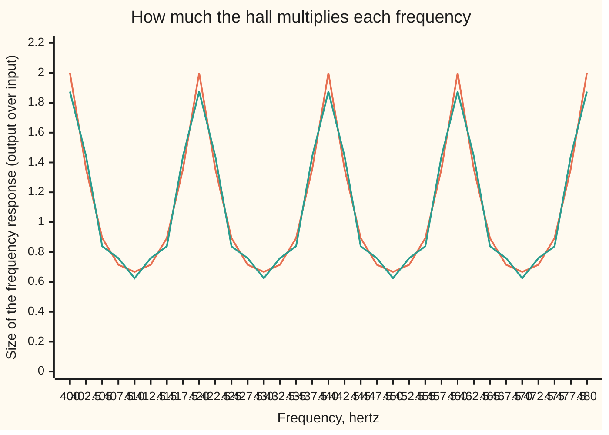

# The convolution theorem: blending in time is multiplying in frequency

[Syllabus](../../../SYLLABUS.md) → [Harmonic analysis](../README.md) → [Convolution and Approximate Identities](../README.md#s03) → The convolution theorem

---

## General Overview

A small hall has two bare parallel walls 8.575 m apart. Stand against one wall and clap once. A microphone at the same spot hears the clap, then an echo 50 ms later at half the size, then one at a quarter, and so on. After 0.4983 s, about half a second, the echoes have fallen to a thousandth of the clap.

That one recording is the hall's **impulse response**: its answer to one sharp kick. The hall is linear (two sounds together give the sum of their separate echoes) and time-invariant (it echoes the same way at 8 pm and at 9 pm). So the clap predicts what any sound becomes. Each moment of the sound sets off its own scaled, delayed copy of the echo pattern, and the copies add. That adding is **convolution**.

Now play a steady violin A at 440 hertz (Hz, cycles per second). Each echo arrives 50 ms late, which is exactly 22 whole cycles. So every echo lands in step with the tone: 1 + 0.5 + 0.25 + … = 2. The listener hears the A at twice its size. At 430 Hz each echo is 21.5 cycles late, half a cycle out of step. The echoes alternate: 1 − 0.5 + 0.25 − … = 2/3.

So the hall does one simple thing to each frequency: it multiplies it by one number. That number is the **frequency response**, the Fourier transform of the impulse response (the hall's answer to an ideal kick). This is the convolution theorem: blending in time is multiplying in frequency.

It also runs backwards. Multiplying in time, such as keeping only the first 0.2 s of the recording, is blending in frequency. The cut blurs the hall's response, and the peak at 440 Hz drops from 2 to 1.875.

**Convolving two signals multiplies their transforms frequency by frequency, and multiplying two signals convolves their transforms; so a linear time-invariant system multiplies each frequency by the transform of its impulse response.**

**What kind of fact this is:** a theorem in both directions. The forward direction is proved on the complex-analysis card [Convolution](../../07-Complex%20analysis/08-Transforms%20in%20Outline/04-convolution-theorem.md) and restated here in hertz. The reverse direction is proved on this card, for integrable and for finite-energy signals. The hall is an illustrative model with one pair of walls, not a measured hall.

### The picture: the hall's comb



Orange: the hall's frequency response, from an ideal kick and every echo. It peaks at 2 every 20 Hz, where the echoes land in step, and dips to 0.667 halfway between. Teal: the same ideal-kick response read from only 0.2 s of recording, which keeps four arrivals. The cut smears the comb: the peaks drop to 1.875, the dips sink to 0.625, and the slopes ripple. Both checks print every point.

---

## The formula

Notation from earlier cards, in one line each. Time $`t`$ is in seconds and frequency $`\xi`$ (xi) in hertz. The transform of a signal $`f`$ is $`\hat f(\xi) = \int f(t)\, e^{-2\pi i \xi t}\, dt`$, read "f-hat", with $`i`$ the imaginary unit ([The Fourier transform of an absolutely integrable signal, and why it fades at infinity](../02-The%20Fourier%20Transform/01-fourier-transform-on-l1-and-riemann-lebesgue.md)). The star $`f * g`$ is convolution, $`(f * g)(t) = \int f(s)\, g(t - s)\, ds`$: slide a flipped copy of $`g`$ along $`f`$ and add up the overlap ([Convolution](01-convolution-and-youngs-inequality.md)).

The theorem, both ways:

```math
\widehat{f * g}(\xi) = \hat f(\xi)\,\hat g(\xi), \qquad \widehat{f\,g}(\xi) = (\hat f * \hat g)(\xi) = \int_{-\infty}^{\infty} \hat f(\eta)\,\hat g(\xi - \eta)\, d\eta .
```

**Read it aloud:** the transform of a blend is the product of the transforms; the transform of a product is the blend of the transforms, where $`\eta`$ (eta) runs over every frequency.

The system reading. A sound $`x`$ goes in, a sound $`y`$ comes out, and $`h`$ is the impulse response. This card introduces $`\hat h(\xi)`$, the **frequency response**:

```math
y = x * h \quad\Longrightarrow\quad \hat y(\xi) = \hat h(\xi)\,\hat x(\xi), \qquad \hat h(\xi) = \int_{-\infty}^{\infty} h(t)\, e^{-2\pi i \xi t}\, dt .
```

**Read it aloud:** whatever the hall does to a sound, it does by multiplying each frequency of the sound by one number, the transform of its impulse response.

For the hall, the ideal kick $`\delta`$ (wing 08's delta: a spike of area 1 at one instant) comes back as itself plus echoes:

```math
h(t) = \sum_{k=0}^{\infty} a^k\,\delta(t - kT), \qquad \hat h(\xi) = \sum_{k=0}^{\infty} a^k e^{-2\pi i \xi k T} = \frac{1}{1 - a\, e^{-2\pi i \xi T}} .
```

**Read it aloud:** arrival number k is a to the k times as loud and k delays late; each delay turns a frequency by a fixed angle, and the turned arrivals add up as a geometric series.

| Symbol | Plain meaning | In our example | Push it up and the answer… |
| --- | --- | --- | --- |
| $`t`$, $`s`$; $`\xi`$; $`\eta`$ | time, in seconds (s also a time inside an integral); frequency, in hertz; a second frequency that runs over all frequencies inside a blend | 440 Hz, 430 Hz | the hall's response repeats every 20 Hz |
| $`f`$, $`g`$, $`u`$; $`L^1`$; $`L^2`$ | any two signals (u is a helper signal in the proof); the signals whose absolute value has finite area; the signals with finite energy (the area of the square is finite) | the clap recording and the recording window | — |
| $`\hat f(\xi)`$; $`i`$ | the transform: how much of frequency ξ the signal holds; the imaginary unit, $`i^2 = -1`$; a bar, as in $`\overline{g}`$, is the complex conjugate (flip the sign of $`i`$) | $`\hat h(440) = 2`$ | — |
| $`f * g`$ | convolution: slide, multiply, add | the hall's output $`x * h`$ | — |
| $`x`$; $`y`$ | the sound played on stage; the sound at the listener's seat | a steady A at 440 Hz | $`y`$ scales with $`x`$ |
| $`h`$; $`\delta`$ | the impulse response; the ideal kick | direct sound plus echoes | — |
| $`\hat h(\xi)`$ | the frequency response: the factor the hall multiplies frequency ξ by | 2 at 440 Hz, 0.666667 at 430 Hz | — |
| $`a`$; $`T`$; $`k`$ | the size of each echo against the one before; the delay between echoes; the arrival count | 0.5; 0.05 s; 0, 1, 2, … | peaks grow to $`1/(1-a)`$; peaks crowd closer |
| $`c`$; $`\sigma`$ | a real clap: a narrow bell-shaped bump of area 1; its width (standard deviation) | 0.1 ms | the recorded response at 440 Hz falls |
| $`r`$ | the clap recording, $`r = c * h`$ | its transform $`\hat r(440)`$ = 1.925012 | — |
| $`w`$ | the recording window: 1 from −0.025 s to 0.175 s, 0 outside | 0.2 s long, four arrivals | a longer window blurs less |
| $`\omega`$; $`\pi`$; $`e`$ | wing 07's frequency in radians per second, $`\omega = 2\pi\xi`$; half a turn in radians; the base of natural logarithms | — | — |

### When it holds

- **The forward direction needs $`f`$ and $`g`$ in $`L^1`$.** For a system, that is a total echo size $`\sum a^k`$ that is finite. Walls that keep all the sound ($`a = 1`$) break it: at 440 Hz the tone grows to 21 times its size after 1 s and never settles.
- **The reverse direction, integrable form, needs $`f`$ and $`g`$ in $`L^1`$ and $`\hat f`$ in $`L^1`$.** The clap recording qualifies: its transform carries the bell-shaped factor of the clap, so it has finite area.
- **The reverse direction, energy form, needs only $`f`$ and $`g`$ in $`L^2`$.** Two windows qualify, although their transforms (sinc shapes) have infinite area. Without either form, $`\hat f * \hat g`$ can diverge.
- **The kick is idealised.** A real clap $`c`$ has a width, so the recording is $`r = c * h`$ and the theorem gives $`\hat r = \hat c\,\hat h`$. A clap 1 ms wide reads 0.043789 at 440 Hz instead of 2.
- **One convention.** In hertz the reverse direction has no factor in front. In wing 07's ω form it gains a factor $`1/2\pi`$.

---

## Why it works

### Step 0: a steady tone comes out as itself, resized and turned

Feed a pure tone $`e^{2\pi i \xi t}`$ into a system with impulse response $`h`$. The output at time $`t`$ is

```math
\int h(s)\, e^{2\pi i \xi (t - s)}\, ds = e^{2\pi i \xi t} \int h(s)\, e^{-2\pi i \xi s}\, ds = \hat h(\xi)\, e^{2\pi i \xi t} .
```

The tone's frequency cannot change. Only its size and its starting angle change, by the one complex number $`\hat h(\xi)`$. This is why frequency is the right language for a linear time-invariant system.

In the hall the factor builds up arrival by arrival. Each echo of a 440 Hz tone is 22 whole cycles late and adds in step. Each echo of a 430 Hz tone is 21.5 cycles late and adds upside down:

| Arrivals heard | 1 | 2 | 3 | 4 | 5 | 6 | all |
| --- | --- | --- | --- | --- | --- | --- | --- |
| 440 Hz | 1.0000 | 1.5000 | 1.7500 | 1.8750 | 1.9375 | 1.9688 | 2 |
| 430 Hz | 1.0000 | 0.5000 | 0.7500 | 0.6250 | 0.6875 | 0.6562 | 0.666667 |

### Step 1: any sound is a blend of tones, so the output's transform is a product

[Linear and time-invariant](../../13-Engineering%20mathematics/02-Linear%20Systems%20and%20Transforms/01-linear-time-invariant-systems-and-convolution.md) shows that such a system's output is $`y = x * h`$. Write the input as a blend of tones. Step 0 multiplies each tone by $`\hat h(\xi)`$. So $`\hat y(\xi) = \hat h(\xi)\, \hat x(\xi)`$.

The careful version is the forward theorem, proved on [Convolution](../../07-Complex%20analysis/08-Transforms%20in%20Outline/04-convolution-theorem.md) for $`f`$, $`g`$ in $`L^1`$. Its proof swaps the order of a double integral and splits the turn $`e^{-2\pi i \xi t}`$ into a turn for each signal. That card works in ω; put $`\omega = 2\pi\xi`$ and it reads $`\widehat{f * g} = \hat f\, \hat g`$ in hertz, with no factor.

For the real clap, the recording is $`r = c * h`$. So $`\hat r(\xi) = \hat c(\xi)\, \hat h(\xi)`$, and for a bell-shaped clap of area 1, $`\hat c(\xi) = e^{-2\pi^2 \sigma^2 \xi^2}`$. At 440 Hz with a 0.1 ms clap that is 0.962506 × 2 = 1.925012. The code also computes $`\hat r(440)`$ straight from its defining integral and gets the same number.

### Step 2: the reverse direction is the same theorem seen from the other side

The inverse transform is the transform with the sign of $`i`$ flipped (proved on [Fourier inversion](../02-The%20Fourier%20Transform/04-fourier-inversion-theorem.md)). So time and frequency play the same roles. A blend on one side is a product on the other, whichever side you start from.

The proof needs one extra fact: a way to write $`f`$ back in terms of $`\hat f`$. That fact is inversion when $`\hat f`$ has finite area, and the energy identity of [Plancherel](../02-The%20Fourier%20Transform/05-plancherel-and-l2.md) when the signals have finite energy. Those two facts give the two forms below.

### Step 3: the integrable form, by swapping two integrals

Take $`f`$, $`g`$ and $`\hat f`$ in $`L^1`$. Then inversion gives $`f(t) = \int \hat f(\eta)\, e^{2\pi i \eta t}\, d\eta`$ at almost every point, and that integral is bounded by the area of $`|\hat f|`$, so $`f g`$ is in $`L^1`$. Put the inversion inside the transform of $`f g`$:

```math
\widehat{f\,g}(\xi) = \int g(t) \left[ \int \hat f(\eta)\, e^{2\pi i \eta t}\, d\eta \right] e^{-2\pi i \xi t}\, dt = \int \hat f(\eta) \left[ \int g(t)\, e^{-2\pi i (\xi - \eta) t}\, dt \right] d\eta .
```

The inner bracket on the right is $`\hat g(\xi - \eta)`$, so the whole is $`(\hat f * \hat g)(\xi)`$. The swap is allowed because $`|\hat f(\eta)|\,|g(t)|`$ has finite area over the whole plane: it is the area of $`|\hat f|`$ times the area of $`|g|`$ (Fubini's theorem).

### Step 4: the energy form, by Plancherel

Take $`f`$ and $`g`$ in $`L^2`$. The product $`f g`$ has finite area, because $`|f g| \le \tfrac12 (|f|^2 + |g|^2)`$. Read $`\widehat{f g}(\xi)`$ as the overlap of $`f`$ with a second signal built from $`g`$. Plancherel says an overlap is the same measured in time or in frequency. The second signal's transform is a flipped, shifted $`\hat g`$, and the overlap in frequency is the blend.

<details>
<summary>Detailed proof: the energy form</summary>

Fix ξ and put $`u(t) = \overline{g(t)}\, e^{2\pi i \xi t}`$, where the bar is the complex conjugate. Then $`u`$ is in $`L^2`$, and

$`\displaystyle \widehat{f\,g}(\xi) = \int f(t)\, \overline{u(t)}\, dt .`$

Plancherel's identity in its overlap form (polarisation) says this equals the same overlap of transforms:

$`\displaystyle \int f(t)\, \overline{u(t)}\, dt = \int \hat f(\eta)\, \overline{\hat u(\eta)}\, d\eta .`$

Compute $`\hat u`$ for $`g`$ in $`L^1 \cap L^2`$ first, then extend by Plancherel's continuity:

$`\displaystyle \hat u(\eta) = \int \overline{g(t)}\, e^{-2\pi i (\eta - \xi) t}\, dt = \overline{\int g(t)\, e^{-2\pi i (\xi - \eta) t}\, dt} = \overline{\hat g(\xi - \eta)} .`$

So $`\overline{\hat u(\eta)} = \hat g(\xi - \eta)`$, and the overlap is $`\int \hat f(\eta)\, \hat g(\xi - \eta)\, d\eta = (\hat f * \hat g)(\xi)`$. That integral converges absolutely, by the same bound as for $`f g`$, applied to $`\hat f`$ and the shifted $`\hat g`$, which are in $`L^2`$ by Plancherel.

</details>

### Step 5: why cutting the recording blurs the comb

A microphone records for a while and stops. The kept recording is $`r\,w`$, the recording times the window. By the reverse direction its transform is $`\hat r * \hat w`$: the hall's comb blended with the window's spectrum. That spectrum is a sinc shape whose first zeros sit 5 Hz either side of its centre, the reciprocal of 0.2 s. The comb's peaks are 20 Hz apart, so each peak gets averaged with its slopes and drops.

In time the same answer is plain counting. The window keeps the direct clap and three echoes, so at 440 Hz the sum stops at 1 + 0.5 + 0.25 + 0.125 = 1.875. The code computes the blend $`\hat r * \hat w`$ as an integral over 80,001 frequencies, cut off at ±20000 Hz with a printed tail bound of 5.2e-33, and lands on the counted answer to six decimals.

---

## Worked numbers, by hand

The hall: $`a = 0.5`$, $`T = 0.05`$ s, a clap $`\sigma = 0.1`$ ms wide, a window 0.2 s long.

| Step | Arithmetic | Value |
| --- | --- | --- |
| cycles per echo delay at 440 Hz | $`440 \times 0.05`$ | 22.00 |
| turn per echo at 440 Hz | $`e^{-2\pi i \times 22}`$ | 1 |
| $`\hat h(440)`$ | $`1/(1 - 0.5)`$ | 2 |
| cycles per echo delay at 430 Hz | $`430 \times 0.05`$ | 21.50 |
| $`\hat h(430)`$, each echo upside down | $`1/(1 + 0.5)`$ | 0.666667 |
| cycles per echo delay at 435 Hz | $`435 \times 0.05`$ | 21.75 |
| $`\hat h(435)`$, each echo a quarter turn | $`1/(1 - 0.5i) = (1 + 0.5i)/1.25`$ | 0.8 + 0.4i: size 0.894427, turned 26.57° |
| the clap's factor $`\hat c(440)`$ | $`e^{-2\pi^2 (0.0001)^2 (440)^2} = e^{-0.038215}`$ | 0.962506 |
| full recording $`\hat r(440)`$ | $`0.962506 \times 2`$ | 1.925012 |
| cut recording at 440 Hz | $`0.962506 \times (1 + 0.5 + 0.25 + 0.125)`$ | **1.804699** |

The 0.2 s recording reports the A at 1.804699 times its size, against 2 for the true hall. Part of that gap is the clap's width (1.925012 with every echo kept), and the rest is the cut.

### What breaks if you drop a piece

| Mistake | Comes out at | What went wrong |
| --- | --- | --- |
| Add the echoes' sizes and ignore their delays, 430 Hz | 2.000000 (right: 0.666667) | Each delay turns the echo; at 430 Hz the turn is half a cycle, so alternate echoes cancel |
| Walls that keep all the sound, $`a = 1`$, 440 Hz after 1 s | 21.000000 and still growing (right, $`a = 0.5`$: 1.999999) | $`h`$ is not in $`L^1`$: the echo sizes add to infinity, so there is no frequency response |
| Read a 1 ms clap as the ideal kick, 440 Hz | 0.043789 (right: 2) | $`\hat c(440)`$ is not near 1: the clap is too slow to contain 440 Hz at full strength |
| Use the ω form for the reverse direction, without its $`1/2\pi`$ | 11.339255 (right: 1.804699) | In ω the blend runs over $`2\pi`$ times as much frequency, so the ω form needs $`1/2\pi`$ in front |

---

## Code, from first principles, and it actually runs

The code reaches the hall's numbers by four roads. Road 1 plays a sampled tone through the echoes, sample by sample, and measures what comes out, against the closed form $`1/(1 - a e^{-2\pi i \xi T})`$. Road 2 transforms the clap recording by its defining integral, against $`\hat c\,\hat h`$ (the forward direction). Road 3 computes the cut recording's transform as the blend $`\hat r * \hat w`$, against counting four arrivals (the reverse direction, integrable form). Road 4 blends the window's spectrum with itself, against the window's own spectrum (the energy form, where neither spectrum has finite area). Then it prints every "what breaks" and "try changing" number.

### Python

```python
# The convolution theorem and the hall's echo -- the check behind the card.
# Standard library only. Every transform, echo sum and blend is written out here.
from math import cos, sin, exp, pi, atan2, degrees, log
A, T, SIG = 0.5, 0.05, 1e-4           # echo strength, echo delay (s), clap width (s, standard deviation)
LO, HI = -0.025, 0.175                # the recording window w: 1 from LO to HI seconds, 0 outside
L, MID = HI - LO, (LO + HI) / 2       # window length 0.2 s, window centre 0.075 s

def cmul(p, q): return (p[0] * q[0] - p[1] * q[1], p[0] * q[1] + p[1] * q[0])
def turn(x): return (cos(x), sin(x))                       # e^(ix)
def size(p): return (p[0] ** 2 + p[1] ** 2) ** 0.5
def hhat(xi, a=A, d=T):                                    # frequency response, closed form 1/(1 - a e^(-2 pi i xi d))
    re, im = 1 - a * cos(2 * pi * xi * d), a * sin(2 * pi * xi * d)
    m = re * re + im * im
    return (re / m, -im / m)
def chat(xi, s=SIG): return exp(-2 * pi * pi * s * s * xi * xi)   # transform of the clap bump, area 1
def echo_sum(xi, n, a=A):                                  # first n+1 arrivals: sum of a^k e^(-2 pi i xi k T)
    re = im = 0.0
    for k in range(n + 1):
        re += a ** k * cos(2 * pi * xi * k * T); im -= a ** k * sin(2 * pi * xi * k * T)
    return (re, im)
def show(w):                                           # size and turn, a turn under 0.005 deg printed as 0
    ang = degrees(atan2(w[1], w[0]))
    return f"{size(w):.6f} at {(ang if abs(ang) >= 0.005 else 0.0):+.2f} deg"

# Road 1: play a steady tone in the hall, sample by sample, and measure what reaches the seat.
def tone_gain(xi, a=A, echoes=30, fs=8820):
    D, N = round(T * fs), fs                               # 441 samples between echoes; measure over 1 s
    sx = sy = (0.0, 0.0)
    for n in range(echoes * D, echoes * D + N):
        x = cos(2 * pi * xi * n / fs)
        y = sum(a ** k * cos(2 * pi * xi * (n - k * D) / fs) for k in range(echoes + 1))
        p = turn(-2 * pi * xi * n / fs)
        sx = (sx[0] + x * p[0], sx[1] + x * p[1]); sy = (sy[0] + y * p[0], sy[1] + y * p[1])
    m = sx[0] ** 2 + sx[1] ** 2                            # complex ratio of output to input at xi
    return ((sy[0] * sx[0] + sy[1] * sx[1]) / m, (sy[1] * sx[0] - sy[0] * sx[1]) / m)

# Road 2: the clap recording r(t) = sum a^k c(t - kT), transformed by its defining integral (Simpson).
def rhat_integral(xi, s=SIG, echoes=40, n=200):
    re = im = 0.0
    for k in range(echoes + 1):
        a0, h = k * T - 8 * s, 16 * s / n
        for j in range(n + 1):
            t = a0 + j * h
            wt = (1 if j in (0, n) else 4 if j % 2 else 2) * h / 3
            v = A ** k * exp(-(t - k * T) ** 2 / (2 * s * s)) / (s * (2 * pi) ** 0.5)
            re += wt * v * cos(2 * pi * xi * t); im -= wt * v * sin(2 * pi * xi * t)
    return (re, im)

# Road 3: the reverse direction. The cut recording r.w has transform (rhat * what)(xi), a blend over eta.
def whatf(nu):                                             # transform of the window: e^(-2 pi i nu MID) sin(pi nu L)/(pi nu)
    amp = L if abs(nu) < 1e-12 else sin(pi * nu * L) / (pi * nu)
    p = turn(-2 * pi * nu * MID)
    return (amp * p[0], amp * p[1])
def blend(F, G, xi, M=20000.0, step=0.5):                  # integral of F(eta) G(xi - eta) d eta, trapezoid
    re = im = 0.0
    for j in range(int(2 * M / step) + 1):
        eta = -M + j * step
        q = cmul(F(eta), G(xi - eta))
        wt = step / 2 if j in (0, int(2 * M / step)) else step
        re += wt * q[0]; im += wt * q[1]
    return (re, im)
def rhat(eta): return cmul((chat(eta), 0.0), hhat(eta))

print(f"1 frequency response of the hall (walls {343 * T / 2:.3f} m apart, peaks every {1 / T:.0f} Hz), closed form against a played tone")
for xi in (440, 430, 435):
    print(f"  {xi} Hz  formula {show(hhat(xi))}   tone {show(tone_gain(xi))}")
print("  cycles per echo delay: " + " ".join(f"{xi * T:.2f}" for xi in (440, 430, 435)))
print(f"  h-hat(435) = {hhat(435)[0]:.6f} + {hhat(435)[1]:.6f}i")
print(f"  decay to a thousandth of the clap's size: {T * log(1000) / log(1 / A):.4f} s")
print("  echo build-up, arrivals 0..5:")
for xi in (440, 430):
    print(f"   {xi} Hz " + " ".join(f"{echo_sum(xi, n)[0]:.4f}" for n in range(6)))
print("2 clap recording at 440 Hz: c-hat times h-hat against the defining integral")
print(f"  product {show(rhat(440))}   integral {show(rhat_integral(440))}")
print(f"  c-hat(440) = exp(-{2 * pi * pi * SIG * SIG * 440 * 440:.6f}) = {chat(440):.6f}")
print("  settling as the clap shortens (2 c-hat(440)):")
for s in (1e-3, 3e-4, 1e-4, 3e-5):
    print(f"   width {s * 1000:.2f} ms  {2 * chat(440, s):.6f}")
print(f"3 cut to 0.2 s (window spectrum first zero {1 / L:.1f} Hz, blend over {int(40000 / 0.5) + 1} frequencies)")
print(f"  tail beyond 20000 Hz: clap factor there {chat(20000):.1e}, tail bound {0.8 * chat(20000) / (4 * pi * pi * SIG * SIG * 20000):.1e}")
cut = {}
for xi in (440, 430):
    closed = cmul((chat(xi), 0.0), echo_sum(xi, 3))
    cut[xi] = blend(rhat, whatf, xi)
    print(f"  {xi} Hz  closed {show(closed)}   blend {show(cut[xi])}   full {size(rhat(xi)):.6f}")
print("4 window times itself is itself (L2 only), tails cut beyond 20000 Hz")
gg = {}
for xi in (0.0, 2.5):
    gg[xi] = blend(whatf, whatf, xi)
    print(f"  {xi} Hz  blend {size(gg[xi]):.6f}   what {size(whatf(xi)):.6f}   tail bound {2 / (pi * pi * 20000):.7f}")
print("5 what breaks")
print(f"  echo sizes added, delays ignored, 430 Hz   {echo_sum(0, 40)[0]:.6f}")
print(f"  omega form, reverse without 1/2pi, 440 Hz  {2 * pi * size(cut[440]):.6f}")
print(f"  walls keep everything, 440 Hz after 1 s    {size(echo_sum(440, 20, 1.0)):.6f}")
print(f"  same walls, a = 0.5, after 1 s             {size(echo_sum(440, 20)):.6f}")
print(f"  clap 1 ms wide taken as the kick, 440 Hz   {2 * chat(440, 1e-3):.6f}")
print("6 try changing")
print(f"  a = 0.8: 440 Hz {size(hhat(440, 0.8)):.6f}  430 Hz {size(hhat(430, 0.8)):.6f}")
print(f"  T = 0.1 s (walls {343 * 0.1 / 2:.3f} m apart): 430 Hz {size(hhat(430, A, 0.1)):.6f}")
print(f"  window to 0.375 s (8 arrivals), 440 Hz {size(echo_sum(440, 7)):.6f}")
xs = [400 + 2.5 * j for j in range(33)]
print("chart, hall " + " ".join(f"{size(hhat(x)):.3f}" for x in xs))
print("chart, cut  " + " ".join(f"{size(echo_sum(x, 3)):.3f}" for x in xs))

assert abs(size(hhat(440)) - echo_sum(440, 60)[0]) < 1e-12, "comb peak: closed form against 61 arrivals"
assert abs(size(hhat(430)) - echo_sum(430, 60)[0]) < 1e-12, "comb dip: closed form against 61 arrivals"
for xi in (440, 430, 435):                                  # played tone against the closed form
    g, f = tone_gain(xi), hhat(xi)
    assert size((g[0] - f[0], g[1] - f[1])) < 1e-8, "road 1"
p, q = rhat(440), rhat_integral(440)
assert size((p[0] - q[0], p[1] - q[1])) < 1e-9, "forward theorem on the clap recording"
for xi in (440, 430):
    c = cmul((chat(xi), 0.0), echo_sum(xi, 3))
    assert size((c[0] - cut[xi][0], c[1] - cut[xi][1])) < 1e-6, "reverse theorem, cut recording"
for xi in (0.0, 2.5):
    w = whatf(xi)
    assert size((gg[xi][0] - w[0], gg[xi][1] - w[1])) < 2 / (pi * pi * 20000), "reverse theorem in L2"
assert size(echo_sum(440, 20, 1.0)) > 20, "no absorption: no settling"
print("ALL CHECKS PASS")
```

**Ran 2026-11-15 on macOS, Python 3.14.10, standard library only. All checks passed. Output, pasted from the run:**

```
1 frequency response of the hall (walls 8.575 m apart, peaks every 20 Hz), closed form against a played tone
  440 Hz  formula 2.000000 at +0.00 deg   tone 2.000000 at +0.00 deg
  430 Hz  formula 0.666667 at +0.00 deg   tone 0.666667 at +0.00 deg
  435 Hz  formula 0.894427 at +26.57 deg   tone 0.894427 at +26.57 deg
  cycles per echo delay: 22.00 21.50 21.75
  h-hat(435) = 0.800000 + 0.400000i
  decay to a thousandth of the clap's size: 0.4983 s
  echo build-up, arrivals 0..5:
   440 Hz 1.0000 1.5000 1.7500 1.8750 1.9375 1.9688
   430 Hz 1.0000 0.5000 0.7500 0.6250 0.6875 0.6562
2 clap recording at 440 Hz: c-hat times h-hat against the defining integral
  product 1.925012 at +0.00 deg   integral 1.925012 at +0.00 deg
  c-hat(440) = exp(-0.038215) = 0.962506
  settling as the clap shortens (2 c-hat(440)):
   width 1.00 ms  0.043789
   width 0.30 ms  1.417949
   width 0.10 ms  1.925012
   width 0.03 ms  1.993133
3 cut to 0.2 s (window spectrum first zero 5.0 Hz, blend over 80001 frequencies)
  tail beyond 20000 Hz: clap factor there 5.1e-35, tail bound 5.2e-33
  440 Hz  closed 1.804699 at +0.00 deg   blend 1.804699 at +0.00 deg   full 1.925012
  430 Hz  closed 0.602600 at +0.00 deg   blend 0.602600 at +0.00 deg   full 0.642773
4 window times itself is itself (L2 only), tails cut beyond 20000 Hz
  0.0 Hz  blend 0.199995   what 0.200000   tail bound 0.0000101
  2.5 Hz  blend 0.127324   what 0.127324   tail bound 0.0000101
5 what breaks
  echo sizes added, delays ignored, 430 Hz   2.000000
  omega form, reverse without 1/2pi, 440 Hz  11.339255
  walls keep everything, 440 Hz after 1 s    21.000000
  same walls, a = 0.5, after 1 s             1.999999
  clap 1 ms wide taken as the kick, 440 Hz   0.043789
6 try changing
  a = 0.8: 440 Hz 5.000000  430 Hz 0.555556
  T = 0.1 s (walls 17.150 m apart): 430 Hz 2.000000
  window to 0.375 s (8 arrivals), 440 Hz 1.992188
chart, hall 2.000 1.357 0.894 0.715 0.667 0.715 0.894 1.357 2.000 1.357 0.894 0.715 0.667 0.715 0.894 1.357 2.000 1.357 0.894 0.715 0.667 0.715 0.894 1.357 2.000 1.357 0.894 0.715 0.667 0.715 0.894 1.357 2.000
chart, cut  1.875 1.442 0.839 0.759 0.625 0.759 0.839 1.442 1.875 1.442 0.839 0.759 0.625 0.759 0.839 1.442 1.875 1.442 0.839 0.759 0.625 0.759 0.839 1.442 1.875 1.442 0.839 0.759 0.625 0.759 0.839 1.442 1.875
ALL CHECKS PASS
```

Road 1 lands on the closed form in size and angle. Road 2's integral equals the product. Road 3's blend over 80,001 frequencies equals the counted answer. In road 4 the blend at 0 Hz reads 0.199995 against 0.2, inside the printed bound for the tails cut beyond 20000 Hz.

### Rust

Same roads, same inputs, same output.

```rust
// The convolution theorem and the hall's echo -- the same check as the Python, in Rust.
// Standard library only, no crates. A complex number is a small struct.
use std::f64::consts::PI;
const A: f64 = 0.5; // echo strength
const T: f64 = 0.05; // echo delay, s
const SIG: f64 = 1e-4; // clap width, s (standard deviation)
const LO: f64 = -0.025; // the recording window w: 1 from LO to HI seconds, 0 outside
const HI: f64 = 0.175;
const L: f64 = HI - LO; // window length 0.2 s
const MID: f64 = (LO + HI) / 2.0; // window centre 0.075 s

#[derive(Clone, Copy)]
struct C { re: f64, im: f64 }
fn c(re: f64, im: f64) -> C { C { re, im } }
fn mul(p: C, q: C) -> C { c(p.re * q.re - p.im * q.im, p.re * q.im + p.im * q.re) }
fn sub(p: C, q: C) -> C { c(p.re - q.re, p.im - q.im) }
fn turn(x: f64) -> C { c(x.cos(), x.sin()) } // e^(ix)
fn size(p: C) -> f64 { (p.re * p.re + p.im * p.im).sqrt() }
fn hhat(xi: f64, a: f64, d: f64) -> C { // frequency response, closed form 1/(1 - a e^(-2 pi i xi d))
    let (re, im) = (1.0 - a * (2.0 * PI * xi * d).cos(), a * (2.0 * PI * xi * d).sin());
    let m = re * re + im * im;
    c(re / m, -im / m)
}
fn chat(xi: f64, s: f64) -> f64 { (-2.0 * PI * PI * s * s * xi * xi).exp() } // transform of the clap bump
fn echo_sum(xi: f64, n: usize, a: f64) -> C { // first n+1 arrivals: sum of a^k e^(-2 pi i xi k T)
    let mut z = c(0.0, 0.0);
    for k in 0..=n {
        let ak = a.powi(k as i32);
        z.re += ak * (2.0 * PI * xi * k as f64 * T).cos();
        z.im -= ak * (2.0 * PI * xi * k as f64 * T).sin();
    }
    z
}
fn show(w: C) -> String { // size and turn, a turn under 0.005 deg printed as 0
    let ang = w.im.atan2(w.re).to_degrees();
    format!("{:.6} at {:+.2} deg", size(w), if ang.abs() >= 0.005 { ang } else { 0.0 })
}

// Road 1: play a steady tone in the hall, sample by sample, and measure what reaches the seat.
fn tone_gain(xi: f64) -> C {
    let (fs, echoes) = (8820usize, 30usize);
    let d = (T * fs as f64).round() as usize; // 441 samples between echoes; measure over 1 s
    let (mut sx, mut sy) = (c(0.0, 0.0), c(0.0, 0.0));
    for n in echoes * d..echoes * d + fs {
        let x = (2.0 * PI * xi * n as f64 / fs as f64).cos();
        let mut y = 0.0;
        for k in 0..=echoes {
            y += A.powi(k as i32) * (2.0 * PI * xi * (n - k * d) as f64 / fs as f64).cos();
        }
        let p = turn(-2.0 * PI * xi * n as f64 / fs as f64);
        sx = c(sx.re + x * p.re, sx.im + x * p.im);
        sy = c(sy.re + y * p.re, sy.im + y * p.im);
    }
    let m = sx.re * sx.re + sx.im * sx.im; // complex ratio of output to input at xi
    c((sy.re * sx.re + sy.im * sx.im) / m, (sy.im * sx.re - sy.re * sx.im) / m)
}

// Road 2: the clap recording r(t) = sum a^k c(t - kT), transformed by its defining integral (Simpson).
fn rhat_integral(xi: f64) -> C {
    let (s, echoes, n) = (SIG, 40usize, 200usize);
    let mut z = c(0.0, 0.0);
    for k in 0..=echoes {
        let (a0, h) = (k as f64 * T - 8.0 * s, 16.0 * s / n as f64);
        for j in 0..=n {
            let t = a0 + j as f64 * h;
            let wt = (if j == 0 || j == n { 1.0 } else if j % 2 == 1 { 4.0 } else { 2.0 }) * h / 3.0;
            let tk = t - k as f64 * T;
            let v = A.powi(k as i32) * (-tk * tk / (2.0 * s * s)).exp() / (s * (2.0 * PI).sqrt());
            z.re += wt * v * (2.0 * PI * xi * t).cos();
            z.im -= wt * v * (2.0 * PI * xi * t).sin();
        }
    }
    z
}

// Road 3: the reverse direction. The cut recording r.w has transform (rhat * what)(xi), a blend over eta.
fn whatf(nu: f64) -> C { // transform of the window: e^(-2 pi i nu MID) sin(pi nu L)/(pi nu)
    let amp = if nu.abs() < 1e-12 { L } else { (PI * nu * L).sin() / (PI * nu) };
    let p = turn(-2.0 * PI * nu * MID);
    c(amp * p.re, amp * p.im)
}
fn blend(f: fn(f64) -> C, g: fn(f64) -> C, xi: f64) -> C { // integral of F(eta) G(xi - eta), trapezoid
    let (m, step) = (20000.0, 0.5);
    let last = (2.0 * m / step) as usize;
    let mut z = c(0.0, 0.0);
    for j in 0..=last {
        let eta = -m + j as f64 * step;
        let q = mul(f(eta), g(xi - eta));
        let wt = if j == 0 || j == last { step / 2.0 } else { step };
        z.re += wt * q.re;
        z.im += wt * q.im;
    }
    z
}
fn rhat(eta: f64) -> C { mul(c(chat(eta, SIG), 0.0), hhat(eta, A, T)) }

fn main() {
    println!("1 frequency response of the hall (walls {:.3} m apart, peaks every {:.0} Hz), closed form against a played tone", 343.0 * T / 2.0, 1.0 / T);
    let tones = [440.0, 430.0, 435.0];
    let gains: Vec<C> = tones.iter().map(|&xi| tone_gain(xi)).collect();
    for (i, &xi) in tones.iter().enumerate() {
        println!("  {} Hz  formula {}   tone {}", xi, show(hhat(xi, A, T)), show(gains[i]));
    }
    let cyc: Vec<String> = tones.iter().map(|&xi| format!("{:.2}", xi * T)).collect();
    println!("  cycles per echo delay: {}", cyc.join(" "));
    println!("  h-hat(435) = {:.6} + {:.6}i", hhat(435.0, A, T).re, hhat(435.0, A, T).im);
    println!("  decay to a thousandth of the clap's size: {:.4} s", T * 1000f64.ln() / (1.0 / A).ln());
    println!("  echo build-up, arrivals 0..5:");
    for xi in [440.0, 430.0] {
        let v: Vec<String> = (0..6).map(|n| format!("{:.4}", echo_sum(xi, n, A).re)).collect();
        println!("   {} Hz {}", xi, v.join(" "));
    }
    println!("2 clap recording at 440 Hz: c-hat times h-hat against the defining integral");
    let (p, q) = (rhat(440.0), rhat_integral(440.0));
    println!("  product {}   integral {}", show(p), show(q));
    println!("  c-hat(440) = exp(-{:.6}) = {:.6}", 2.0 * PI * PI * SIG * SIG * 440.0 * 440.0, chat(440.0, SIG));
    println!("  settling as the clap shortens (2 c-hat(440)):");
    for s in [1e-3, 3e-4, 1e-4, 3e-5] {
        println!("   width {:.2} ms  {:.6}", s * 1000.0, 2.0 * chat(440.0, s));
    }
    println!("3 cut to 0.2 s (window spectrum first zero {:.1} Hz, blend over {} frequencies)", 1.0 / L, (40000.0 / 0.5) as usize + 1);
    println!("  tail beyond 20000 Hz: clap factor there {:.1e}, tail bound {:.1e}", chat(20000.0, SIG), 0.8 * chat(20000.0, SIG) / (4.0 * PI * PI * SIG * SIG * 20000.0));
    let mut cut = Vec::new();
    for xi in [440.0, 430.0] {
        let closed = mul(c(chat(xi, SIG), 0.0), echo_sum(xi, 3, A));
        let b = blend(rhat, whatf, xi);
        println!("  {} Hz  closed {}   blend {}   full {:.6}", xi, show(closed), show(b), size(rhat(xi)));
        cut.push((closed, b));
    }
    println!("4 window times itself is itself (L2 only), tails cut beyond 20000 Hz");
    let bound = 2.0 / (PI * PI * 20000.0);
    let mut gg = Vec::new();
    for xi in [0.0, 2.5] {
        let b = blend(whatf, whatf, xi);
        println!("  {:.1} Hz  blend {:.6}   what {:.6}   tail bound {:.7}", xi, size(b), size(whatf(xi)), bound);
        gg.push((b, whatf(xi)));
    }
    println!("5 what breaks");
    println!("  echo sizes added, delays ignored, 430 Hz   {:.6}", echo_sum(0.0, 40, A).re);
    println!("  omega form, reverse without 1/2pi, 440 Hz  {:.6}", 2.0 * PI * size(cut[0].1));
    println!("  walls keep everything, 440 Hz after 1 s    {:.6}", size(echo_sum(440.0, 20, 1.0)));
    println!("  same walls, a = 0.5, after 1 s             {:.6}", size(echo_sum(440.0, 20, A)));
    println!("  clap 1 ms wide taken as the kick, 440 Hz   {:.6}", 2.0 * chat(440.0, 1e-3));
    println!("6 try changing");
    println!("  a = 0.8: 440 Hz {:.6}  430 Hz {:.6}", size(hhat(440.0, 0.8, T)), size(hhat(430.0, 0.8, T)));
    println!("  T = 0.1 s (walls {:.3} m apart): 430 Hz {:.6}", 343.0 * 0.1 / 2.0, size(hhat(430.0, A, 0.1)));
    println!("  window to 0.375 s (8 arrivals), 440 Hz {:.6}", size(echo_sum(440.0, 7, A)));
    let xs: Vec<f64> = (0..33).map(|j| 400.0 + 2.5 * j as f64).collect();
    let hall: Vec<String> = xs.iter().map(|&x| format!("{:.3}", size(hhat(x, A, T)))).collect();
    let cutc: Vec<String> = xs.iter().map(|&x| format!("{:.3}", size(echo_sum(x, 3, A)))).collect();
    println!("chart, hall {}", hall.join(" "));
    println!("chart, cut  {}", cutc.join(" "));

    assert!((size(hhat(440.0, A, T)) - echo_sum(440.0, 60, A).re).abs() < 1e-12, "comb peak");
    assert!((size(hhat(430.0, A, T)) - echo_sum(430.0, 60, A).re).abs() < 1e-12, "comb dip");
    for (i, &xi) in tones.iter().enumerate() {
        assert!(size(sub(gains[i], hhat(xi, A, T))) < 1e-8, "road 1");
    }
    assert!(size(sub(p, q)) < 1e-9, "forward theorem on the clap recording");
    for (closed, b) in &cut { assert!(size(sub(*closed, *b)) < 1e-6, "reverse theorem, cut recording"); }
    for (b, w) in &gg { assert!(size(sub(*b, *w)) < bound, "reverse theorem in L2"); }
    assert!(size(echo_sum(440.0, 20, 1.0)) > 20.0, "no absorption: no settling");
    println!("ALL CHECKS PASS");
}
```

**Ran 2026-11-15 on macOS, rustc 1.98.1, no crates. All checks passed. Output, pasted from the run:**

```
1 frequency response of the hall (walls 8.575 m apart, peaks every 20 Hz), closed form against a played tone
  440 Hz  formula 2.000000 at +0.00 deg   tone 2.000000 at +0.00 deg
  430 Hz  formula 0.666667 at +0.00 deg   tone 0.666667 at +0.00 deg
  435 Hz  formula 0.894427 at +26.57 deg   tone 0.894427 at +26.57 deg
  cycles per echo delay: 22.00 21.50 21.75
  h-hat(435) = 0.800000 + 0.400000i
  decay to a thousandth of the clap's size: 0.4983 s
  echo build-up, arrivals 0..5:
   440 Hz 1.0000 1.5000 1.7500 1.8750 1.9375 1.9688
   430 Hz 1.0000 0.5000 0.7500 0.6250 0.6875 0.6562
2 clap recording at 440 Hz: c-hat times h-hat against the defining integral
  product 1.925012 at +0.00 deg   integral 1.925012 at +0.00 deg
  c-hat(440) = exp(-0.038215) = 0.962506
  settling as the clap shortens (2 c-hat(440)):
   width 1.00 ms  0.043789
   width 0.30 ms  1.417949
   width 0.10 ms  1.925012
   width 0.03 ms  1.993133
3 cut to 0.2 s (window spectrum first zero 5.0 Hz, blend over 80001 frequencies)
  tail beyond 20000 Hz: clap factor there 5.1e-35, tail bound 5.2e-33
  440 Hz  closed 1.804699 at +0.00 deg   blend 1.804699 at +0.00 deg   full 1.925012
  430 Hz  closed 0.602600 at +0.00 deg   blend 0.602600 at +0.00 deg   full 0.642773
4 window times itself is itself (L2 only), tails cut beyond 20000 Hz
  0.0 Hz  blend 0.199995   what 0.200000   tail bound 0.0000101
  2.5 Hz  blend 0.127324   what 0.127324   tail bound 0.0000101
5 what breaks
  echo sizes added, delays ignored, 430 Hz   2.000000
  omega form, reverse without 1/2pi, 440 Hz  11.339255
  walls keep everything, 440 Hz after 1 s    21.000000
  same walls, a = 0.5, after 1 s             1.999999
  clap 1 ms wide taken as the kick, 440 Hz   0.043789
6 try changing
  a = 0.8: 440 Hz 5.000000  430 Hz 0.555556
  T = 0.1 s (walls 17.150 m apart): 430 Hz 2.000000
  window to 0.375 s (8 arrivals), 440 Hz 1.992188
chart, hall 2.000 1.357 0.894 0.715 0.667 0.715 0.894 1.357 2.000 1.357 0.894 0.715 0.667 0.715 0.894 1.357 2.000 1.357 0.894 0.715 0.667 0.715 0.894 1.357 2.000 1.357 0.894 0.715 0.667 0.715 0.894 1.357 2.000
chart, cut  1.875 1.442 0.839 0.759 0.625 0.759 0.839 1.442 1.875 1.442 0.839 0.759 0.625 0.759 0.839 1.442 1.875 1.442 0.839 0.759 0.625 0.759 0.839 1.442 1.875 1.442 0.839 0.759 0.625 0.759 0.839 1.442 1.875
ALL CHECKS PASS
```

### Lean

Lean proves both directions of the theorem for all signals in $`L^1`$ or $`L^2`$, and checks the hall's arithmetic.

- Take $`x`$ and $`h`$ in $`L^1`$, and $`y = x * h`$. Then $`\hat y(\xi) = \hat h(\xi)\,\hat x(\xi)`$ at every frequency $`\xi`$.
- Take $`f`$, $`g`$ and $`\hat f`$ in $`L^1`$. Then $`\widehat{f\,g}(\xi) = (\hat f * \hat g)(\xi)`$ at every frequency $`\xi`$.
- Take $`f`$ and $`g`$ in $`L^2`$ only, so $`\hat f`$ and $`\hat g`$ may have infinite area. Then $`\widehat{f\,g}(\xi) = (\hat f * \hat g)(\xi)`$ at every frequency $`\xi`$.
- Lean also checks the hand arithmetic exactly, such as $`\hat h(440) = 2`$, $`\hat h(430) = 2/3`$ and $`\hat h(435) = 0.8 + 0.4i`$.
- It checks the echo build-up rows, the cut sum 1.875, and the sums for $`a = 0.8`$, eight arrivals and $`T = 0.1`$ s.

The comb formula for $`\hat h`$, the real clap, the window blends and every decimal are left to the Python and Rust checks.

```lean
-- The convolution theorem: the transform of a convolution is the product of the transforms, and the transform of a product is the convolution of the transforms, for integrable signals with an integrable spectrum or for finite-energy signals.
import Mathlib.Analysis.Fourier.Convolution
import Mathlib.Analysis.Fourier.LpSpace
import Mathlib.Analysis.Fourier.Inversion
import Mathlib.Analysis.Distribution.AEEqOfIntegralContDiff
import Mathlib.MeasureTheory.Function.Holder
import Mathlib.Tactic.NormNum

/-! Signals are complex-valued functions of time `t : ℝ` in seconds. `𝓕 f ξ` is Mathlib's Fourier
transform in hertz, `∫ e^(−2πiξt) f(t) dt`, the card's `f̂(ξ)`. The card's convolution
`(f * g)(t) = ∫ f(s) g(t − s) ds` is Mathlib's `f ⋆[ContinuousLinearMap.mul ℂ ℂ] g`.
"In `L¹`" is `Integrable` and "in `L²`" (finite energy) is `MemLp · 2`. For a finite-energy
signal the transform is Plancherel's transform on `L²`, `𝓕 (hf.toLp f)`, read as a function
defined almost everywhere. -/

open MeasureTheory FourierTransform
open scoped Convolution

/-- The inverse transform can be moved across an integral: `∫ 𝓕⁻ H · K = ∫ H · 𝓕⁻ K`. -/
theorem conv_aux_flip_inv {H K : ℝ → ℂ} (hH : Integrable H) (hK : Integrable K) :
    ∫ η, 𝓕⁻ H η * K η = ∫ t, H t * 𝓕⁻ K t := by
  have hfl : (-innerₗ ℝ : ℝ →ₗ[ℝ] ℝ →ₗ[ℝ] ℝ).flip = -innerₗ ℝ := by
    ext; simp
  have := VectorFourier.integral_fourierIntegral_smul_eq_flip (L := (-innerₗ ℝ : ℝ →ₗ[ℝ] ℝ →ₗ[ℝ] ℝ))
    (μ := volume) (ν := volume) Real.continuous_fourierChar
    (by simp; fun_prop) hH hK
  rw [hfl] at this
  simp only [smul_eq_mul] at this
  exact this

#print axioms conv_aux_flip_inv

/-- The transform can be moved across an integral: `∫ 𝓕 H · K = ∫ H · 𝓕 K`. -/
theorem conv_aux_flip {H K : ℝ → ℂ} (hH : Integrable H) (hK : Integrable K) :
    ∫ η, 𝓕 H η * K η = ∫ t, H t * 𝓕 K t := by
  have hfl : (innerₗ ℝ : ℝ →ₗ[ℝ] ℝ →ₗ[ℝ] ℝ).flip = innerₗ ℝ := by
    ext; simp
  have := VectorFourier.integral_fourierIntegral_smul_eq_flip (L := (innerₗ ℝ : ℝ →ₗ[ℝ] ℝ →ₗ[ℝ] ℝ))
    (μ := volume) (ν := volume) Real.continuous_fourierChar
    (by simp; fun_prop) hH hK
  rw [hfl] at this
  simp only [smul_eq_mul] at this
  exact this

#print axioms conv_aux_flip

/-- Fourier inversion almost everywhere: if `f` and `𝓕 f` are in `L¹`, then `𝓕⁻ (𝓕 f) = f` a.e. -/
theorem conv_aux_inv_ae {f : ℝ → ℂ} (hf : Integrable f) (hf' : Integrable (𝓕 f)) :
    𝓕⁻ (𝓕 f) =ᵐ[volume] f := by
  have hc : Continuous (𝓕⁻ (𝓕 f)) := by
    rw [← Real.Lp.fourierTransformInv_toLp (memLp_one_iff_integrable.2 hf')]
    exact BoundedContinuousFunction.continuous _
  refine ae_eq_of_integral_contDiff_smul_eq hc.locallyIntegrable hf.locallyIntegrable ?_
  intro g hg hgs
  have hGs : HasCompactSupport (fun x => (g x : ℂ)) := hgs.comp_left Complex.ofReal_zero
  have hGd := Complex.ofRealCLM.contDiff.comp hg
  let φ : SchwartzMap ℝ ℂ := hGs.toSchwartzMap hGd
  have hφ : ∀ x, φ x = (g x : ℂ) := fun x => rfl
  have h1 : Integrable (𝓕⁻ (φ : ℝ → ℂ)) := by
    rw [← SchwartzMap.fourierInv_coe]; exact (𝓕⁻ φ).integrable
  have h2 : 𝓕 (𝓕⁻ (φ : ℝ → ℂ)) = φ := by
    rw [← SchwartzMap.fourierInv_coe, ← SchwartzMap.fourier_coe, fourier_fourierInv_eq]
  calc ∫ x, g x • 𝓕⁻ (𝓕 f) x = ∫ x, 𝓕⁻ (𝓕 f) x * φ x := by
        congr 1; ext x; rw [hφ, Complex.real_smul, mul_comm]
    _ = ∫ x, 𝓕 f x * 𝓕⁻ (φ : ℝ → ℂ) x := conv_aux_flip_inv hf' φ.integrable
    _ = ∫ x, f x * 𝓕 (𝓕⁻ (φ : ℝ → ℂ)) x := conv_aux_flip hf h1
    _ = ∫ x, g x • f x := by
        rw [h2]; congr 1; ext x; rw [hφ, Complex.real_smul, mul_comm]

#print axioms conv_aux_inv_ae

/-- Schwartz functions are dense in `L²`. -/
theorem conv_aux_dense :
    DenseRange (SchwartzMap.toLpCLM ℝ ℂ 2 (volume : Measure ℝ)) :=
  SchwartzMap.denseRange_toLpCLM ENNReal.ofNat_ne_top

#print axioms conv_aux_dense

/-- The `L²` pairing by multiplication is the integral of the product. -/
theorem conv_aux_pairing_eq_integral (u v : Lp ℂ 2 (volume : Measure ℝ)) :
    (ContinuousLinearMap.mul ℂ ℂ).lpPairing volume 2 2 u v = ∫ t, u t * v t := by
  rw [ContinuousLinearMap.lpPairing_eq_integral]
  rfl

#print axioms conv_aux_pairing_eq_integral

/-- The convolution theorem, forward direction, read as a system. If the input `x` and the impulse
response `h` both have finite area (`L¹`), the output `y = x * h` has transform
`ŷ(ξ) = ĥ(ξ) x̂(ξ)` at every frequency `ξ`: the system multiplies each frequency of the input by
one number, its frequency response `ĥ(ξ)`. -/
theorem convolution_multiplies_each_frequency {x h : ℝ → ℂ} (hx : Integrable x)
    (hh : Integrable h) (ξ : ℝ) :
    𝓕 (x ⋆[ContinuousLinearMap.mul ℂ ℂ] h) ξ = 𝓕 h ξ * 𝓕 x ξ := by
  rw [Real.fourier_mul_convolution_eq hx hh, mul_comm]

/-- The reverse direction, integrable form. If `f` and `g` are in `L¹` and `f̂` is in `L¹`, then
multiplying in time is blending in frequency: the transform of the product `f g` is the
convolution of the transforms, `(f g)^(ξ) = ∫ f̂(η) ĝ(ξ − η) dη`, at every frequency `ξ`. -/
theorem product_transforms_to_convolution {f g : ℝ → ℂ} (hf : Integrable f)
    (hg : Integrable g) (hf' : Integrable (𝓕 f)) (ξ : ℝ) :
    𝓕 (fun t => f t * g t) ξ = (𝓕 f ⋆[ContinuousLinearMap.mul ℂ ℂ] 𝓕 g) ξ := by
  set h : ℝ → ℂ := fun t => (𝐞 (-(t * ξ)) : ℂ) * g t with hh
  have hhi : Integrable h := by
    have := (Real.fourierIntegral_convergent_iff (V := ℝ) (μ := volume) ξ).2 hg
    refine this.congr (Filter.Eventually.of_forall fun t => ?_)
    simp [hh, Circle.smul_def, mul_comm]
  have key : ∀ η, 𝓕 g (ξ - η) = 𝓕⁻ h η := by
    intro η
    rw [Real.fourier_real_eq, Real.fourierInv_eq]
    congr 1; ext t
    simp only [hh, Circle.smul_def, smul_eq_mul, ← mul_assoc]
    congr 1
    rw [← Circle.coe_mul, ← AddChar.map_add_eq_mul]
    congr 2
    simp; ring
  rw [MeasureTheory.convolution_def]
  simp only [ContinuousLinearMap.mul_apply', key]
  calc 𝓕 (fun t => f t * g t) ξ = ∫ t, h t * f t := by
        rw [Real.fourier_real_eq]; congr 1; ext t
        simp [hh, Circle.smul_def]; ring
    _ = ∫ t, h t * 𝓕⁻ (𝓕 f) t := by
        apply integral_congr_ae
        filter_upwards [conv_aux_inv_ae hf hf'] with t ht
        rw [ht]
    _ = ∫ η, 𝓕⁻ h η * 𝓕 f η := (conv_aux_flip_inv hhi hf').symm
    _ = ∫ η, 𝓕 f η * 𝓕⁻ h η := by congr 1; ext η; ring

/-- The reverse direction, energy form. If `f` and `g` only have finite energy (`L²`), the product
`f g` still has finite area, and its transform is the convolution of the two `L²` transforms,
`(f g)^(ξ) = ∫ f̂(η) ĝ(ξ − η) dη`, at every frequency `ξ`, although `f̂` and `ĝ` need not have
finite area. -/
theorem product_transforms_to_convolution_of_finite_energy {f g : ℝ → ℂ} (hf : MemLp f 2)
    (hg : MemLp g 2) (ξ : ℝ) :
    𝓕 (fun t => f t * g t) ξ =
      (⇑(𝓕 (hf.toLp f) : Lp ℂ 2 (volume : Measure ℝ)) ⋆[ContinuousLinearMap.mul ℂ ℂ]
        ⇑(𝓕 (hg.toLp g) : Lp ℂ 2 (volume : Measure ℝ))) ξ := by
  set e : ℝ → ℂ := fun t => (𝐞 (-(t * ξ)) : ℂ) with he_def
  have he : MemLp e ⊤ volume := by
    refine memLp_top_of_bound ?_ 1 (Filter.Eventually.of_forall fun t => ?_)
    · exact (Continuous.comp continuous_subtype_val
        (Real.continuous_fourierChar.comp (by fun_prop))).aestronglyMeasurable
    · simp [he_def]
  set Λ := (ContinuousLinearMap.mul ℂ ℂ).lpPairing (volume : Measure ℝ) 2 2 with hΛ
  set K := (ContinuousLinearMap.mul ℂ ℂ).holderL (volume : Measure ℝ) ⊤ 2 2 (he.toLp e) with hK
  have hmp : MeasurePreserving (fun η : ℝ => ξ - η) volume volume :=
    Measure.measurePreserving_sub_left volume ξ
  set R : Lp ℂ 2 (volume : Measure ℝ) →L[ℂ] Lp ℂ 2 (volume : Measure ℝ) :=
    (Lp.compMeasurePreservingₗᵢ ℂ (fun η : ℝ => ξ - η) hmp).toContinuousLinearMap with hR
  -- the two sides as functions on `L² × L²`
  have hP : ∀ (u v : Lp ℂ 2 (volume : Measure ℝ)) (f₀ g₀ : ℝ → ℂ), u =ᵐ[volume] f₀ →
      v =ᵐ[volume] g₀ → Λ (K u) v = 𝓕 (fun t => f₀ t * g₀ t) ξ := by
    intro u v f₀ g₀ hu hv
    rw [hΛ, conv_aux_pairing_eq_integral, Real.fourier_real_eq]
    apply integral_congr_ae
    filter_upwards [hu, hv, ContinuousLinearMap.coeFn_holder (ContinuousLinearMap.mul ℂ ℂ)
      (r := 2) (he.toLp e) u, he.coeFn_toLp] with t h1 h2 h3 h4
    rw [hK, ContinuousLinearMap.holderL_apply_apply, h3, h4, h1, h2]
    simp [he_def, Circle.smul_def]; ring
  have hQ : ∀ (U V : Lp ℂ 2 (volume : Measure ℝ)) (F₀ G₀ : ℝ → ℂ), U =ᵐ[volume] F₀ →
      V =ᵐ[volume] G₀ → Λ U (R V) = (F₀ ⋆[ContinuousLinearMap.mul ℂ ℂ] G₀) ξ := by
    intro U V F₀ G₀ hU hV
    rw [hΛ, conv_aux_pairing_eq_integral, MeasureTheory.convolution_def]
    apply integral_congr_ae
    have hV' : (fun η => V (ξ - η)) =ᵐ[volume] fun η => G₀ (ξ - η) :=
      hmp.quasiMeasurePreserving.ae_eq_comp hV
    filter_upwards [hU, hV', Lp.coeFn_compMeasurePreserving V hmp] with t h1 h2 h3
    show U t * (Lp.compMeasurePreserving (fun η : ℝ => ξ - η) hmp V) t = _
    rw [h3, Function.comp_apply, h1, h2, ContinuousLinearMap.mul_apply']
  have hmain : ∀ u v : Lp ℂ 2 (volume : Measure ℝ), Λ (K u) v = Λ (𝓕 u) (R (𝓕 v)) := by
    intro u v
    refine DenseRange.induction_on₂ (p := fun u v => Λ (K u) v = Λ (𝓕 u) (R (𝓕 v)))
      conv_aux_dense ?_ ?_ u v
    · have hFc : Continuous (𝓕 : Lp ℂ 2 (volume : Measure ℝ) → Lp ℂ 2 (volume : Measure ℝ)) :=
        (Lp.fourierTransformₗᵢ ℝ ℂ).continuous
      have h1 : Continuous (fun q : Lp ℂ 2 (volume : Measure ℝ) × Lp ℂ 2 (volume : Measure ℝ) =>
          Λ (K q.1) q.2) :=
        (Λ.continuous.comp (K.continuous.comp continuous_fst)).clm_apply continuous_snd
      have h2 : Continuous (fun q : Lp ℂ 2 (volume : Measure ℝ) × Lp ℂ 2 (volume : Measure ℝ) =>
          Λ (𝓕 q.1) (R (𝓕 q.2))) :=
        (Λ.continuous.comp (hFc.comp continuous_fst)).clm_apply
          (R.continuous.comp (hFc.comp continuous_snd))
      exact isClosed_eq h1 h2
    · intro φ ψ
      simp only [SchwartzMap.toLpCLM_apply, SchwartzMap.toLp_fourier_eq]
      rw [hP _ _ φ ψ (φ.coeFn_toLp 2 volume) (ψ.coeFn_toLp 2 volume),
        hQ _ _ (𝓕 (φ : ℝ → ℂ)) (𝓕 (ψ : ℝ → ℂ)) ((𝓕 φ).coeFn_toLp 2 volume)
          ((𝓕 ψ).coeFn_toLp 2 volume)]
      exact product_transforms_to_convolution φ.integrable ψ.integrable (𝓕 φ).integrable ξ
  rw [← hP _ _ f g hf.coeFn_toLp hg.coeFn_toLp, hmain,
    hQ _ _ _ _ (Filter.EventuallyEq.refl _ _) (Filter.EventuallyEq.refl _ _)]

-- The hall: echo strength a = 1/2, echo delay T = 0.05 s = 1/20 s.
-- Walls 343 × 0.05 / 2 = 8.575 m = 343/40 m apart; peaks every 1/T = 20 Hz.
example : (343 : ℚ) * (1 / 20) / 2 = 343 / 40 ∧ 1 / ((1 : ℚ) / 20) = 20 := by norm_num
-- Cycles per echo delay: 440 × 0.05 = 22, 430 × 0.05 = 21.5, 435 × 0.05 = 21.75.
example : (440 : ℚ) * (1 / 20) = 22 ∧ (430 : ℚ) * (1 / 20) = 43 / 2 ∧
    (435 : ℚ) * (1 / 20) = 87 / 4 := by norm_num
-- ĥ(440) = 1/(1 − 0.5) = 2 and ĥ(430) = 1/(1 + 0.5) = 2/3 (0.666667).
example : 1 / (1 - (1 : ℚ) / 2) = 2 ∧ 1 / (1 + (1 : ℚ) / 2) = 2 / 3 := by norm_num
-- ĥ(435) = 1/(1 − 0.5i) = 0.8 + 0.4i, and its size squared is 0.8 = 4/5 (size 0.894427).
example : (1 : ℂ) / (1 - Complex.I / 2) = 4 / 5 + 2 / 5 * Complex.I := by
  rw [div_eq_iff (by simp [Complex.ext_iff])]
  ring_nf
  simp [Complex.I_sq]
  norm_num
example : ((4 : ℚ) / 5) ^ 2 + (2 / 5) ^ 2 = 4 / 5 := by norm_num
-- Echo build-up at 440 Hz, arrivals 0..5: 1, 1.5, 1.75, 1.875, 1.9375, 1.96875.
example : (List.range 6).map (fun n => ∑ k ∈ Finset.range (n + 1), ((1 : ℚ) / 2) ^ k) =
    [1, 3 / 2, 7 / 4, 15 / 8, 31 / 16, 63 / 32] := by
  simp [List.range_succ, Finset.sum_range_succ]; norm_num
-- Echo build-up at 430 Hz, each echo upside down: 1, 0.5, 0.75, 0.625, 0.6875, 0.65625.
example : (List.range 6).map (fun n => ∑ k ∈ Finset.range (n + 1), ((-1 : ℚ) / 2) ^ k) =
    [1, 1 / 2, 3 / 4, 5 / 8, 11 / 16, 21 / 32] := by
  simp [List.range_succ, Finset.sum_range_succ]; norm_num
-- The cut recording keeps four arrivals: 1 + 0.5 + 0.25 + 0.125 = 1.875 at the peak.
example : ∑ k ∈ Finset.range 4, ((1 : ℚ) / 2) ^ k = 15 / 8 := by
  norm_num [Finset.sum_range_succ]
-- The recording window runs from −0.025 s to 0.175 s: 0.2 s long, first zero of its spectrum 5 Hz.
example : (7 : ℚ) / 40 - (-1 / 40) = 1 / 5 ∧ 1 / ((1 : ℚ) / 5) = 5 := by norm_num
-- Walls that keep all the sound, a = 1: after 1 s (20 echoes) the 440 Hz tone is 21 times its size.
example : ∑ k ∈ Finset.range 21, (1 : ℚ) ^ k = 21 := by norm_num
-- Try changing: a = 0.8 gives 1/(1 − 0.8) = 5 at 440 Hz and 1/(1 + 0.8) = 5/9 (0.555556) at 430 Hz.
example : 1 / (1 - (4 : ℚ) / 5) = 5 ∧ 1 / (1 + (4 : ℚ) / 5) = 5 / 9 := by norm_num
-- Try changing: eight arrivals give 255/128 = 1.9921875 at 440 Hz; T = 0.1 s puts the walls 17.15 m apart.
example : ∑ k ∈ Finset.range 8, ((1 : ℚ) / 2) ^ k = 255 / 128 := by
  norm_num [Finset.sum_range_succ]
example : (343 : ℚ) * (1 / 10) / 2 = 343 / 20 := by norm_num

#print axioms convolution_multiplies_each_frequency
#print axioms product_transforms_to_convolution
#print axioms product_transforms_to_convolution_of_finite_energy
```

**Checked 2026-11-15 on macOS, Lean 4.36.0-rc2, Mathlib v4.36.0-rc2. Every proof is complete and uses only Lean's standard axioms. Output, pasted from the run:**

```
'conv_aux_flip_inv' depends on axioms: [propext, Classical.choice, Quot.sound]
'conv_aux_flip' depends on axioms: [propext, Classical.choice, Quot.sound]
'conv_aux_inv_ae' depends on axioms: [propext, Classical.choice, Quot.sound]
'conv_aux_dense' depends on axioms: [propext, Classical.choice, Quot.sound]
'conv_aux_pairing_eq_integral' depends on axioms: [propext, Classical.choice, Quot.sound]
'convolution_multiplies_each_frequency' depends on axioms: [propext, Classical.choice, Quot.sound]
'product_transforms_to_convolution' depends on axioms: [propext, Classical.choice, Quot.sound]
'product_transforms_to_convolution_of_finite_energy' depends on axioms: [propext, Classical.choice, Quot.sound]
```

> [!TIP]
> **Try changing**
> - Guess first: make the walls harder, so each echo keeps 80% instead of 50%. Set `A = 0.8`. The peak at 440 Hz rises to 5.000000 and the dip at 430 Hz falls to 0.555556: harder walls, a harsher comb.
> - Guess first: move the walls to 17.150 m apart. Set `T = 0.1`. The peaks now come every 10 Hz, and 430 Hz becomes a peak: 2.000000.
> - Guess first: record longer. Keep eight arrivals instead of four, with a window running to 0.375 s. With an ideal kick the reading at 440 Hz is 1.992188, against 1.875 for four arrivals and 2 for all.
> - Guess first: clap sharper. A clap 0.03 ms wide reads 1.993133 at 440 Hz; one 0.3 ms wide reads 1.417949.

---

## The usual mistake

> [!warning]
> **Adding up echo sizes and forgetting that each delay turns the echo.** An echo's effect on a frequency is its size times a turn of $`2\pi \xi k T`$. At 440 Hz every turn is a whole number of cycles, and the sizes add to 2. At 430 Hz the turns alternate, and the sum is 0.666667. Adding sizes alone gives 2.000000 at every frequency.
>
> - **Blending where the theorem says multiply.** A system multiplies the input's spectrum by $`\hat h`$. It blends only when the time signals are multiplied, as when a recording is cut.
> - **Taking a real clap for the ideal kick.** A 1 ms clap reads 0.043789 at 440 Hz, not 2. Divide by $`\hat c`$, or clap sharper.
> - **Reading a cut recording as the whole hall.** Four arrivals give 1.875 at the peak, not 2. A cut always blurs the response by the window's spectrum.
> - **Mixing conventions.** The reverse direction in ω form without its $`1/2\pi`$ gives 11.339255 instead of 1.804699.

---

## Where you meet it in real life

- **Convolution reverb in music production.** A dry studio recording is convolved with an impulse response measured in a real church or hall, so it sounds as if played there. Long impulse responses are applied through the product of transforms, because it is far cheaper than sliding and adding.
- **Room acoustics.** Acousticians fire a starting pistol or pop a balloon, record the room, and read reverberation time and colouration off the impulse response. Two bare parallel walls give the comb on this card, heard as a "flutter echo".
- **Loudspeakers and headphones.** A single measured impulse response gives the frequency response printed on a data sheet. An equaliser then multiplies by its inverse where it can.
- **Radio.** Multiplying a voice by a carrier wave is the reverse direction at work: the voice's spectrum is blended with two spikes, which moves it up to the carrier frequency.
- **Cameras and telescopes.** A lens spreads each point of light into a small blur, the point-spread function. Its transform, the optical transfer function, says how much contrast survives at each spatial frequency.

> **Say it back**
> A linear time-invariant system is a convolution with its impulse response, the response to one sharp kick. A steady tone comes out as itself, multiplied by one complex number, the transform of the impulse response. So under the transform the convolution becomes a product, frequency by frequency. The reverse also holds: a product in time is a blend in frequency, for integrable signals with an integrable spectrum, or for finite-energy signals. In the hall, echoes in step double a 440 Hz tone, echoes out of step cut 430 Hz to two-thirds, and cutting the recording blurs the comb.

---

## What this builds on

- [Convolution](01-convolution-and-youngs-inequality.md) (this shelf): the definition of $`f * g`$ on the line and the bound that keeps it integrable.
- [Convolution](../../07-Complex%20analysis/08-Transforms%20in%20Outline/04-convolution-theorem.md) (complex analysis): the forward direction, proved in ω form, which Step 1 restates in hertz.
- [Convolution](../../08-Differential%20equations%20and%20dynamics/08-Laplace%20Transforms%20for%20Initial-Value%20Problems/07-convolution-and-the-impulse-response.md) (differential equations): the impulse response and the one-sided Laplace version; this card reads the same idea two-sided, by frequency.
- [Linear and time-invariant](../../13-Engineering%20mathematics/02-Linear%20Systems%20and%20Transforms/01-linear-time-invariant-systems-and-convolution.md): why linearity and a fixed clock make every such system a convolution.
- [Digital filters](../../13-Engineering%20mathematics/05-Signals/04-digital-filters-fir-and-iir.md): the sampled version, where a moving average's frequency response has zeros exactly on a hum.

## Where this goes next

- [Blurring and unblurring](05-smoothing-blurring-and-deconvolution.md): dividing by the frequency response to undo a blur, and why the dips make that unstable.
- [Correlation](06-correlation-and-the-matched-filter.md): sliding without the flip, to find a known shape such as a clap inside noise.
- [Wiener-Khinchin](07-wiener-khinchin-and-the-power-spectrum.md): the theorem applied to a signal against itself gives its power spectrum.
- [Densities add by convolution](08-convolution-of-densities.md): the law of a sum of independent quantities is a convolution, so its transform is a product.
- [Solving differential equations by transform](09-fourier-methods-for-differential-equations.md): derivatives become multiplication, and the solution is a convolution with a kernel.

The rest of the shelf: [Approximate identities](03-approximate-identities.md), which makes the shrinking clap precise, and [The Gaussian and Poisson kernels](04-gaussian-and-poisson-kernels.md).

The hall's dips never reach zero, so dividing by $`\hat h`$ would recover the dry sound; what happens when a response has true zeros, and noise sits on top?

---

## Sources

Verified 2026-11-15: every link below resolves to the publisher's page.

- Folland, Gerald B. *Real Analysis: Modern Techniques and Their Applications*, 2nd ed. Wiley, 1999. [Publisher page](https://www.wiley.com/en-us/Real+Analysis%3A+Modern+Techniques+and+Their+Applications%2C+2nd+Edition-p-9780471317166). Chapter 8: the transform in the hertz convention, the convolution theorem, inversion and Plancherel.
- Grafakos, Loukas. *Classical Fourier Analysis*, 3rd ed. Springer, 2014. [DOI 10.1007/978-1-4939-1194-3](https://doi.org/10.1007/978-1-4939-1194-3). The transform of products and convolutions on $`L^1`$ and $`L^2`$, in the same convention.
- Katznelson, Yitzhak. *An Introduction to Harmonic Analysis*, 3rd ed. Cambridge University Press, 2004. [DOI 10.1017/CBO9781139165372](https://doi.org/10.1017/CBO9781139165372). Convolution and the transform on the line, with the roles of time and frequency exchanged.
- Kuttruff, Heinrich. *Room Acoustics*, 6th ed. CRC Press, 2016. [DOI 10.1201/9781315372150](https://doi.org/10.1201/9781315372150). The room's impulse response, its echoes, flutter echo between parallel walls, and reverberation time.
- Schroeder, Manfred R. "New method of measuring reverberation time." *Journal of the Acoustical Society of America* 37 (1965): 409–412. [DOI 10.1121/1.1909343](https://doi.org/10.1121/1.1909343). Reading reverberation time from one recorded impulse response.
